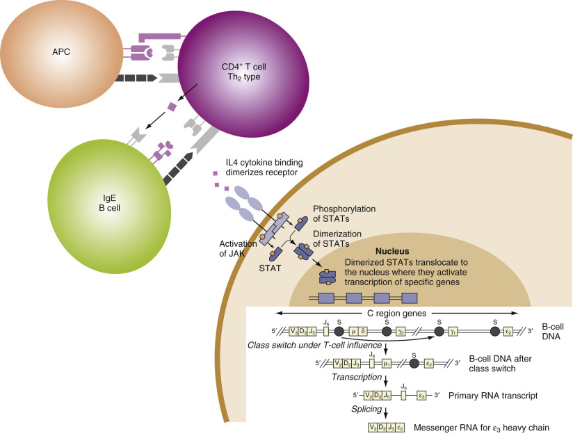
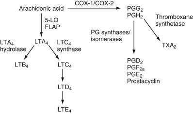
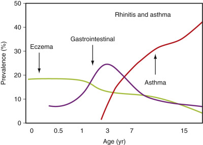
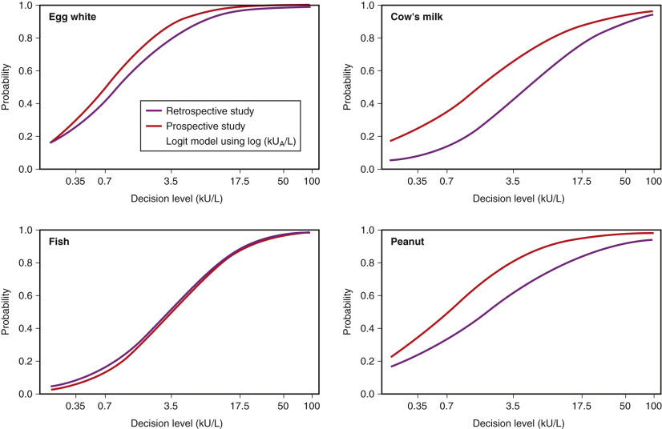
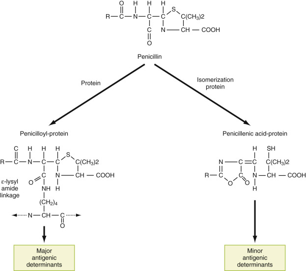

## Key Points

  * •

The prevalence of allergic disease has increased in recent years throughout the world, especially in developed countries. 

  * •

IgE antibody is the most important trigger molecule for allergic inflammation. 

  * •

Laboratory tests for IgE antibody that establish a high likelihood of allergic disease are widely available, and clinical practice guidelines advocate their use. A positive IgE antibody test result is an indicator of allergic sensitization and a risk factor that provides support for a clinical history–based diagnosis of allergic disease. 

  * •

New treatments for allergic diseases such as therapeutic monoclonal anti-IgE antibodies require demonstration of a total serum IgE level between 30 and 700 kU/L in serum prior to use. 

  * •

Clinical investigations of the natural history of allergic diseases in children have shown a reproducible sequence of sensitization to allergens that makes it increasingly important to establish the diagnosis of allergy at an early age to identify allergen triggers, optimize treatment, and possibly ameliorate progression of serious diseases such as asthma. 

  * •

Tests for total IgE and allergen-specific IgE antibodies are useful principally for diagnosis. 

  * •

Measurement of serum total IgE in children and adults is of limited value in the diagnosis of allergic disease due to the overlap between atopic and non-atopic populations. An elevated IgE level carries a high predictive value for allergic disease, but a normal level does not exclude allergic disease. Measurement of total serum IgE is useful in patients suspected of having allergic bronchopulmonary aspergillosis. 

  * •

Measurement of allergen-specific IgE antibodies is diagnostically useful and can be recommended in the following clinical situations: 

    * •

Evaluation of children with clinical signs and symptoms of allergy, including eczema, gastrointestinal signs, rhinitis, or wheezing 

    * •

Evaluation of children and adults suspected of having allergic respiratory disease to establish the diagnosis and to define the specificity of allergen sensitization to pollens, animal proteins, dust mites, fungal antigens, and foods. Results are useful to identify allergens for immunotherapy treatment regimens. 

    * •

Confirmation of sensitization to food allergens and aid in determining the presence of food allergy in children and adults with signs of immediate hypersensitivity to food ingestion 

    * •

Evaluation of sensitization to insect venom allergens, particularly as an aid in defining venom specificity when skin tests are equivocal or there is sensitization to multiple venoms 

    * •

Confirmation of the clinical history–based diagnosis of drug hypersensitivity in patients with anaphylactic sensitivity 

    * •

Confirmation of sensitization to occupational allergens, for example, natural rubber latex. 

  * •

Testing for IgE antibodies is not routinely recommended for evaluating the effects of immunotherapy, or for excluding the diagnosis of anaphylactic sensitivity to insect venoms in treated patients. Tests for IgE antibodies are indicated only in patients who have had a thorough medical history and physical examination. 

,  

##  Overview 

The prevalence of allergic disease has increased significantly in the United States and throughout the developed world (  Devereux et al, 2014  ). Longitudinal epidemiologic studies have shown an increased prevalence of sensitization to common allergens, and increased prevalence of asthma, atopic dermatitis, food allergy, and allergic rhinitis in children. A recent study of the prevalence of allergic sensitization in the United States revealed that more than 40% of children 6 years of age and older and more than 35% of children 1 to 5 year of age had serologic evidence of sensitization to one or more common allergens (  Salo et al, 2014  ). Allergic sensitization defined by the presence of IgE antibodies to one or more allergens is a significant risk factor for allergic disease. Allergic sensitization is also a distinguishing characteristic of atopy, the inherited tendency to develop allergic diseases. 

Estimates of the prevalence of common allergic diseases in the United States vary with disease, patient age, and geographic location. The prevalence of asthma increased steadily from the 1950s to the present and currently is estimated at between 5% and 10% among adults and children in different states (  Centers for Disease Control and Prevention [CDC], 2010  ). According to recent data, more than 31 million persons in the United States suffer from asthma; more than 7 million are children (  Weiss & Sullivan, 2001  ;  Arroyave et al, 2013  ). The prevalence of allergic rhinitis has increased in the United States from about 5% in 1970 to approximately 9% in 2004, thus affecting more than 25 million Americans (  National Center for Health Statistics, 2006  ). The prevalence of food allergies has also increased. The cumulative prevalence of sensitization to common food allergens in children may be as high as 24% in the United States. In contrast, the cumulative prevalence of food allergies in children is 4% to 8% (see later); and, many sensitized children do not display signs and symptoms of systemic food allergy (  Branum & Lukacs, 2009  ). Given the high overall prevalence of allergic disease in the United States, estimates of the total yearly cost of diagnosing and managing patients with allergic diseases run to the tens of billions of dollars. Simply stated, allergic diseases are a major public health concern. 

Recent attempts to explain the increased prevalence of allergic diseases have focused on both genetic and environmental influences. A large number of genes and genetic polymorphisms contribute to the development of allergic diseases (see later), but fail to account for the risk for developing a particular allergic disease and do not explain the rapid changes in disease prevalence noted previously. Current theories postulate a causative role for environmental influences to account for the increased prevalence of allergic diseases. Several investigators have proposed that diminished exposure to microorganisms during early childhood in developed countries may lead to aberrant development of the adaptive immune system and may predispose to both allergic disease and certain autoimmune diseases (  Liu, 2010  ). This theory, called the _hygiene hypothesis,_ postulates that early exposure to bacteria and other microorganisms promotes development of mature antigen-presenting dendritic cells and regulatory T cells, whereas diminished exposure leads to high levels of Th1 and Th2 effector T cells that participate in the pathogenesis of immune-mediated diseases. The proposed mechanism for the beneficial effect of early exposure to microorganisms and environmental antigens includes a role for enhanced release of the anti-inflammatory cytokines interleukin (IL)-10, interleukin (IL)-12, and transforming growth factor-β by dendritic cells, which induces antigen-specific regulatory T cells (  Smits et al, 2005  ). This effect may be mediated by interactions between bacterial products (e.g., bacterial endotoxin) and Toll-like receptors [TLR2 and TLR4]) on dendritic cells, monocytes, and macrophages of the innate immune system. Longitudinal studies in large cohorts of allergic patients and experimental studies in animal models are underway to investigate the epidemiology and biologic mechanisms of allergic disease development and to validate the hygiene hypothesis. 

The signs and symptoms of allergic diseases can be difficult to distinguish from those of other disorders (  Host et al, 2003  ). Clinical manifestations of allergy may be relatively mild and self-limited, as in seasonal allergic rhinitis, or severe with marked morbidity, as in asthma. Laboratory tests are useful in the evaluation of patients with allergic disease, but awareness of the basic mechanisms of immediate hypersensitivity and knowledge of the empirical relationships between test results and their diagnostic predictive values are required to translate testing results into a clinical diagnosis. This chapter addresses these subjects, beginning with a review of the biological mechanisms of immediate hypersensitivity and the “allergic phenotype.” It then discusses laboratory tests as they may be applied to the diagnostic evaluation of children and adults with allergic disease. 

The distinction between sensitization to an allergen or allergen component and clinical allergy is a key concept emphasized throughout this chapter. The authors identify the chemical components of common allergens including species-specific and cross-reactive components. The minimum numbers of tests needed to achieve high positive and negative predictive values for allergic disease are overviewed for different clinical situations. The discussion mentions clinical situations and testing schemes in which laboratory testing is not likely to be cost-effective or may lead to erroneous diagnoses. Recent developments in the laboratory evaluation of allergy include a much expanded repertoire of tests for IgE antibodies to putative allergens including tests for antibodies to highly purified native allergenic proteins and recombinant allergen components. New analytic methods that utilize microarrays to test for over 100 allergen-specific IgE antibodies simultaneously have proved useful in clinical studies and may soon be available in clinical practice. These methods lend themselves to interpretive reporting with patient-specific comments that aid in identifying clinically significant patterns of sensitization. 

,  

##  Pathogenesis of Allergic Disease 

 

##  Mechanisms of Immediate Hypersensitivity 

Immunoglobulin E is the principal trigger molecule for allergic inflammation. In the late 1960s, investigators working independently in two laboratories described a new isotype of human immunoglobulin that was responsible for the skin-sensitizing activity of serum from patients with allergic diseases (  Ishizaka & Ishizaka, 1966  ;  Bennich et al, 1969  ). This immunoglobulin, originally called _IgND,_ was later named _IgE_ (  Ishizaka & Ishizaka, 1967  ). In the years that followed, investigators have focused on discovering the basic biological mechanisms of immediate hypersensitivity. These include mechanisms that control IgE production by immunocompetent B-lymphocytes, and that promote the recruitment of inflammatory cells and release of vasoactive mediators from IgE-sensitized effector cells at sites of allergic inflammation. Recent studies have focused on investigating genetic determinants of the allergic phenotype and on identifying genes responsible for regulating IgE production and for influencing tissue responses to allergic inflammation. 

 

##  Atopy and the Allergic Phenotype: Genetic Influences and Candidate Genes 

The term _atopic_ (from the word _atopy_ ) describes those individuals who are genetically predisposed to produce specific IgE antibodies following exposure to allergens. These individuals are highly likely to develop allergic diseases. Nevertheless, while atopy is characteristic of allergic disease, signs and symptoms of allergic diseases, notably asthma and eczema, may also occur in the absence of atopy. This finding demonstrates that the genetic predisposition to allergic diseases is complex and fails to account entirely for development of clinical allergy. It is useful to consider two principal domains of genetic influence. Genes that encode molecules directly involved in immune responses strongly influence IgE synthesis and determine atopy. In addition, genes that affect other complimentary biologic functions, including tissue structure and repair, tissue permeability to allergens, cell migration, and fibrinolysis, determine the susceptibility of end organs to inflammation and modulate exposure of the immune system to environmental allergens (  Holloway et al, 2010  ;  Holloway, 2014  ). 

Knowledge of genes that predispose to allergic diseases comes from several sources. Population-wide linkage analysis studies have identified the chromosomal locations of candidate genes; and, positional cloning studies support the relationship of putative allergy genes to known genes for molecules involved in regulating the immune response. Genome-wide association studies examine the relationships between candidate genes for atopy (IgE synthesis) and disease susceptibility in populations with asthma and other common allergic diseases (  Holloway et al, 2010  ;  Holloway, 2014  ). 

Among the various candidate genes, some of the strongest evidence for a role in allergic disease exists for genes encoding molecules that promote IgE synthesis. Included in this group are the following: genes for interleukin 4 (IL-4), interleukin 13 (IL-13), IL-4 receptor alpha chain (IL4R), and signal transducer and activator of transcription 6 (STAT6) (  Kabesch et al, 2006  ;  Holloway & Koppelman, 2007  ). As described later, the products of these genes collectively influence the development of Th2 helper cells and promote the expression and deletional class switching of epsilon immunoglobulin heavy chain genes. Class II HLA loci and alleles on chromosome 6p strongly influence the immune response and sensitization to specific allergens and allergen component proteins. For example, responsiveness to the common aeroallergens Derp p and Derp f peptides from dust mites ( _Dermatophagoides pterynissinus_ and _Dermatophagoides farinae_ ) are found in linkage with other loci associated with bronchial hyperresponsiveness in asthmatic individuals (  Moffatt et al, 2010  ). A similar linkage has been proposed for an atopy gene closely linked to the IgE Fc receptor α-chain locus on chromosome 1q23 (  Weidinger et al, 2008  ). Studies suggest additional genes may predispose to allergic disease, including genes for the interleukin 6 receptor (IL6R) and GATA-binding protein 3 involved in the production of Th2 lymphocytes, and genes for the Toll-like receptor TL4R that influence the innate immune response to environmental antigens. Cytokine genes, including the genes for interleukins 3, 5, and 33 (IL-3, IL-5, and IL-33), influence the development, proliferation, and recruitment of allergic effector cells, including mast cells, basophils, and eosinophils. 

Other genes influence allergic disease susceptibility by affecting biologic functions that facilitate exposure to allergens or determine the response of tissue to inflammation. Mutations in the gene for filaggrin on chromosome 1q21 predispose to atopy and the disease atopic dermatitis (  Irvine et al, 2011  ). Fillagrin is an important protein component of the cutaneous epidermal barrier. Null mutations in the fillagrin gene may promote allergy development by weakening this barrier (  Palmer et al, 2006  ). The products of several genes determine the response of tissues to chronic inflammation. _ADAM33_ is an exemplary gene. This gene encodes a metalloproteinase that influences airway remodeling and smooth muscle hyperactivity associated with asthma susceptibility and progression (  Van Eerdewegh et al, 2002  ). Examples of several genes that predispose to atopy and allergic disease are listed in [ Table 55-1 ](<#t0010>) . While the above-mentioned genes influence susceptibility to allergic disease, and mutations and polymorphisms of several candidate genes have been identified, there is no clinical evidence at this time to support routine testing for genetic polymorphisms in the evaluation of patients with allergic disease. 

TABLE 55-1 

Genes and the Allergic Phenotype 

Chromosome  |  Genetic Locus  |  Phenotype   
---|---|---  
6p21-23  |  HLA D region (HLA-DRB1 and DQB1)  |  Responder or nonresponder to common allergens   
11q12  |  Fc ε receptor alpha chain  |  Enhanced responsiveness to aeroallergens; high total serum immunoglobulin (Ig)E   
5q31  |  Cytokines interleukin (IL)-3, IL-4, IL-5, IL-9, and IL-13 and IL-33  |  High total serum IgE   
16  |  IL-4 receptor  |  High total serum IgE   
20p13   
1q21  |  _ADAM33_ gene   
Filaggrin  |  Enhanced airway responsiveness, airway remodeling   
Diminished epithelial barrier to allergens   
  
_HLA,_ Human leukocyte antigen. 

Note: More than 120 candidate genes have been described to be associated with allergic disease. This table lists a selected sample of genes found in multiple studies. See text for discussion of additional loci and genes. 

 

##  Regulation of IgE Synthesis: Molecular and Cellular Interactions 

As noted earlier, class II genes of the HLA D region strongly influence individual responses to exogenous antigens (  Pieters, 2000  ;  Wang & Reinherz, 2002  ). Gene products of the highly polymorphic HLA D region; DR, DQ, and DP molecules expressed on the plasma membranes of antigen-presenting dendritic cells; and B cells bind processed antigen for presentation to immunocompetent T cells. This interaction initiates the immune response (  Wang & Reinherz, 2002  ). B cells act as antigen-presenting cells by binding antigen (allergen) through membrane-associated immunoglobulin (i.e., IgE-Fc epsilon RI) (  Oettgen, 2014  ). The cellular and humoral responses that follow antigen presentation are complex and include interactions mediated by cell-to-cell contacts and secretion of stimulatory cytokines. Production of mature IgE antibodies by B cells exemplifies these mechanisms ( [ Fig. 55-1 ](<#f0010>) ). 

Figure 55-1 

Cellular and molecular interactions regulating immunoglobulin (Ig)E synthesis. 

All B cells initially produce IgM antibodies. Rearrangement of V, D, and J exons that encode portions of the immunoglobulin (Ig) variable region create a variable region motif (VDJ) that encodes the antigen binding (Fab) portion of a mature Ig heavy chain. The rearranged VDJ motif determines specificity for antigen and is located upstream from exons that encode the constant regions of the various Ig heavy chains, including the alpha-, γ-, and ε-exons. Production of mature transcripts for complete Ig molecules that bear these heavy chains requires additional rearrangements at the heavy chain (IgH) locus. These rearrangements result in a change in expression of heavy chain constant region domains from µ to another isotype (e.g., γ). This process is referred to as _deletional switch recombination,_ because endonucleases excise exons encoding domains of the µ-chain in an irreversible process (  Coico et al, 2003  ;  Oettgen, 2014  ). Two pathways involving rearrangement of Ig heavy chain genes lead to the production of IgE antibodies: a direct pathway from IgM to IgE, and a sequential pathway from IgM to an IgG intermediate to IgE (  Wu & Zarrin, 2014  ). 

Synthesis of mature IgE molecules occurs in a series of steps that begin with expression of germline (sterile) transcripts of the ε heavy chain. Germline transcription must occur before deletional switch recombination. At the molecular level, this process involves interaction with a promoter exon upstream from the four exons that encode domains of the ε heavy chain (see later) (see [ Fig. 55-1 ](<#f0010>) ). The ε-promoter contains binding sites for the transcription factors STAT6 and nuclear factor kappa B (NF-κB), which drives transcription by activating the promoter. Mutations at binding sites for these transcription factors block isotype switching to IgE. Because germline transcripts are “sterile” and do not encode a functional heavy chain, further metabolism of the germline transcript by endonucleases is required to create a functional heavy chain molecule. Endonucleases excise Cµ and ligate the now adjacent VDJ and Cε sequences. The process of deletional switch recombination involves rearrangement of double-stranded DNA at specific sites called _S regions_ by enzymatically catalyzed breakage, cleavage, and recombination of DNA to create the functional heavy chain. 

At the cellular level, IgE synthesis is initiated by cell-to-cell interactions and is driven by soluble cytokine mediators (  Oettgen & Geha, 2001  ;  Oettgen, 2014  ). Cytokines produced by T helper/inducer cells of the Th2 phenotype are required for the production of IgE heavy chain transcripts. The stimulatory cytokines IL-4 and IL-13 provide essential signals for synthesis of IgE. Th2 cells produce several cytokines that act as growth factors for B cells, including IL-4 and IL-13, which have been shown to induce production of germline ε-transcripts in human B cells (  Vercelli et al, 1989  ;  Defrance et al, 1994  ). These cytokines exert their effects by interacting with multimeric cell surface receptors composed of alpha and gamma chains. The functional receptors for IL-4 and IL-13 are of two types that share a common ligand-binding IL-4R α-chain. Type 1 receptors expressed on Th2 cells and mast cells bind only IL-4 and are heterodimers of IL-4R alpha and gamma chains. Type 2 receptors are widely expressed on T cells, bind both IL-4 and IL-13, and are heterodimers of IL-4Rα and IL-13Rα chains. Binding of IL-4 and IL-13 to these receptors induces a series of phosphorylation reactions, which result in DNA transcription driven by phosphorylated transcription factors. Tyrosine kinases of the Janus family (JAK1, 2, and 3) are associated with intracellular domains of the IL-4 and IL-13 receptors and catalyze phosphorylation of the receptors, thus enabling them to bind intracellular transcription factors. The transcription factors, including STAT6 and NF-κB, once phosphorylated translocate to the nucleus, where they bind to the ε-promoter and induce expression of germline ε-transcripts (  Oettgen & Geha, 2001  ;  Oettgen, 2014  ). 

Coincident with the interaction of antigen-presenting cells and T cells described earlier, which takes place primarily through the T cell antigen receptor (TCR) and leads to production of IL-4 and IL-13, a second signal provided by cell-to-cell interaction promotes switch recombination from µ to ε heavy chain expression (  Oettgen, 2014  ). This signal is provided by the interaction of CD40 (constituitively expressed on B cells) and CD40 ligand (CD154) expressed only on activated T cells. Engagement of the TCR results in upregulation of CD40 ligand on the T cell surface. CD40 ligand interacts with CD40 on the surface of B cells to catalyze activation of NF-κB, which, in turn, facilitates activation of the ε-promoter through STAT6 and other activation-induced proteins (  Oettgen & Geha, 2001  ;  Oettgen, 2014  ). CD40 is a member of the tumor necrosis factor receptor superfamily, and engagement of CD40 by CD40 ligand antagonizes apoptosis of B cells. Engagement of CD40 by CD40 ligand also upregulates CD80-CD86 expression on B cells, which interacts with CD28 on T cells to strongly amplify cytokine transcription and secretion of IL-4 and IL-13. The importance of CD40 ligand (CD154) to the process of class switching is illustrated in patients with X-linked hyper-IgM syndrome who are deficient in CD40 ligand and are unable to produce IgG, IgA, or IgE antibodies (  Korthauer et al, 1993  ). 

IgE-producing B cells at mucosal sites and in lymph node follicles typically differentiate into short-lived plasmablasts and plasma cells, while a small number of long-lived plasma cells persist in bone marrow (  Wu & Zarrin, 2014  ). This finding helps to account for the rapid decline in IgE antibody levels that occurs when antigen stimulation is withdrawn. Initial IgE responses to allergen occur primarily at extrafollicular sites, where low affinity antibodies are produced by direct class switching from IgM to IgE. Persistent or recurrent antigenic stimulation promotes development of higher-affinity IgE antibodies by a process of somatic mutation called _affinity maturation._

 

##  Immunoglobulin E: Structural and Functional Characteristics 

The heavy chains of IgE molecules are structurally different from other immunoglobulin isotypes. They confer skin sensitizing activity by binding to high-affinity Fc epsilon receptors on tissue mast cells (see later) (  Ishizaka & Ishizaka, 1966  ;  Bennich et al, 1969  ). Immunoglobulin fragments (Fab and Fab′2 fragments) prepared by enzymatic digestion of purified IgE myeloma proteins do not bind to cell surface receptors for IgE and do not mediate skin-sensitizing activity. The unique antigenic determinants of IgE molecules are contained on the Fc ε-fragment (  Bennich et al, 1969  ). While the heavy chains of human IgE molecules resemble other Igs, they differ by having an additional domain, C epsilon 4, which confers a higher molecular weight. IgE molecules are also more heavily glycosylated than IgG molecules and bind more avidly to lectin proteins. The physicochemical properties and immunologic functions of different regions of the IgE molecule, determined by experiments performed with purified human IgE myeloma proteins and immunoglobulin fragments prepared by enzymatic digestion, are summarized in [ Table 55-2 ](<#t0015>) (reviewed in  CLSI  , 2015). 

TABLE 55-2 

Physicochemical Properties of Immunoglobulin E (IgE) 

H chain class  |  ε  
---|---  
Molecular formula  |  ε 2  L  2   
Sedimentation coefficient(s)  |  8   
Molecular weight, Da  |  190,000; H chain molecular weight is 70,000   
Carbohydrate, %  |  18   
Complement fixation (classic)  |  None   
Serum half-life, days  |  1-5   
Placental transfer  |  None   
Reaginic activity  |  4+; Fc-containing fragments inhibit skin-sensitizing activity of native IgE, but Fab-containing fragments do not   
  
_Fab,_ Antigen binding. 

Human IgE protein makes up only approximately 0.0005% of total serum immunoglobulin. The low serum concentration of IgE is partly a function of binding to effector cells but also reflects a high catabolic rate, greater than 70% per day. The half-life of IgE in blood is 1 to 5 days; by comparison, IgG molecules have a serum half-life of approximately 20 days. The half-life of IgE bound to tissue mast cells is much longer, up to several months. Individual IgE molecules have a functional valency of 2, as shown schematically in [ Figure 55-2 ](<#f0015>) . 

Figure 55-2 

Immunoglobulin (Ig)E structure. 

As noted earlier, human IgE antibodies sensitize mast cells in the skin to release histamine. The skin-sensitizing activity of IgE is heat-labile. Heating at 56° C for 2 hours irreversibly modifies the Cε3 and Cε4 domains of IgE molecules and abolishes skin-sensitizing activity (  Ishizaka & Ishizaka, 1967  ). Reduction and alkylation of inter-ε-chain disulfide bonds also abolishes binding to effector cells. Aggregated human IgE does not fix complement by the classical pathway, and there is no significant placental transfer of human IgE. 

 

##  Cells and Mediators of Immediate Hypersensitivity Reactions 

Mast cells are the principal effector cells of immediate hypersensitivity reactions. They also promote inflammation, tissue repair, wound healing, and responses to bacterial infection. Other cell types, including eosinophils, basophils, neutrophils, and lymphocytes also sustain allergic inflammation (  Bradding & Saito, 2014  ). 

Once thought to be closely related cells, mast cells and basophils both stain metachromatically with basic dyes and contain histamine in pre-formed granules (  Galli, 1990  ). More recent studies have focused on the development of these two cell types from different precursors (  Bradding & Saito, 2014  ). Mast cells develop from pluripotent hematopoetic stem cells and bear receptors for stem cell factor. Mast cell precursors originate in the bone marrow as CD34  \+  , tyrosine kinase Kit receptor (CD117)  \+  progenitors. Developing mast cells home to tissues by binding to fibroblasts that contain integrin and vascular cell adhesion molecule 1 (VCAM-1). In peripheral tissues, mast cell precursors under the influence of stem cell factor develop into mature cells. Two subtypes of human mast cells (described later) require different cytokines for development. Mast cells that predominate at mucosal surfaces require stem cell factor, and the T cell cytokines IL-3, -4, -5, -9, and -10, whereas mast cells that develop in submucosal connective tissues require only stem cell factor and develop without additional cytokines from T cells. Unlike mast cells, basophils develop in the bone marrow from granulocyte precursors and enter the circulation as mature cells. Mast cells and basophils both contain histamine in pre-formed granules, but mast cells typically contain up to 10 times more histamine per cell than basophils. 

There are two phenotypically distinct mast cell subtypes termed MCt and _MCtc._ MCt cells contain only tryptase; MCtc cells contain both tryptase and chymase. MCt cells predominate at mucosal surfaces at sites of allergic inflammation, often in proximity to T lymphocytes. MCtc cells are more numerous in submucosal sites and in connective tissues and are not associated with allergic inflammation or T lymphocytic infiltration (  Irani et al, 1986  ;  Bradding & Saito, 2014  ). The two subtypes of mast cells also differ in their cytokine profiles (MCt cells contain little IL-4 but are high in IL-5 content), release of inflammatory mediators (MCt cells release more LCT4 and PGD2 than MCtc cells), and responsiveness to chemoattractants (MCt cells do not respond to C5a). Viewed collectively, mast cells are most numerous in the following tissues: lung (alveolar walls and bronchial epithelium and subepithelium), small intestine (epithelium and subepithelium), nasal mucosa, and skin. 

Mast cells release two types of inflammatory mediators: mediators contained in pre-formed granules and mediators newly synthesized and released in response to signals associated with allergic inflammation. The principal pre-formed mediators are histamine, tryptase, chondroitin sulfates (proteoglycans), and tumor necrosis factor (TNF)-α; the newly synthesized inflammatory mediators include cyclooxygenase (prostaglandin) and lipoxygenase (leukotriene) products of arachidonic acid metabolism. In addition to the newly synthesized prostaglandin and leukotriene mediators released within minutes of an allergic trigger, mast cells also synthesize and release several cytokines. Mast cell cytokines released within hours of initiation of inflammation amplify the allergic response (IL-4, IL-5, and IL-13), recruit inflammatory cells (TNF-alpha), and promote proliferation of fibroblasts and endothelial cells. 

The primary mechanism of release of pre-formed mediators from mast cells involves transmembrane signaling mediated by cell surface (homocytotropic) IgE antibodies bound to high-affinity receptors for IgE (Fc epsilon RI). Fc ε RI are located diffusely on the plasma membranes of mast cells. Binding of IgE antibodies to Fc ε RI is reversible but of high affinity (Ka = 10  10  M  –1  ) (  Wank et al, 1983  ). Although IgE antibodies in blood have a half-life of less than 5 days, the half-life of IgE antibodies bound to Fc ε RI on mast cells is much longer and may persist for months (  Oettgen, 2014  ). Fc ε RI are saturated at physiologic concentrations of IgE. The number of Fc ε RI per cell ranges from 40,000 to as many as 500,000. Higher numbers of receptors are induced by culturing cells in the presence of IgE, and cells obtained from atopic individuals typically express higher numbers of Fc ε RI, reflecting upregulation of Fc ε RI by IgE. Pharmacologic treatment with anti-IgE (Omalizumab) leads to decreased circulating IgE and decreased numbers of Fc ε RI on mast cells and basophils (  Beck et al, 2004  ). 

Fc ε RI is a multimetric receptor, composed of α-, β-, and γ-subunits as follows: α1, β1, and γ2\. IgE antibodies bind to the α-subunit; the β\- and γ-subunits contain intracytoplasmic regions that function in transmembrane signaling (  Ravetech & Kinet, 1991  ;  Metcalfe et al, 2009  ). Fc ε RI molecules are mobile within the plasma membranes of sensitized cells, as indicated by capping studies performed with fluorescein-conjugated anti-IgE antibodies. This mobility over short distances is important for the release of mediators from mast cells. Cross-linking (or bridging) of occupied IgE receptors by multivalent antigens or by intact anti-IgE antibodies or their F(ab′)2 fragments triggers release of histamine and other pre-formed mediators and initiates the synthesis and release of prostaglandin and leukotriene mediators. Univalent allergens, including haptens and Fab fragments of anti-IgE antibodies, do not promote mediator release. 

The mechanism of mediator release from sensitized mast cells is exquisitely sensitive and depends upon release of Ca  ++  from intracellular stores in the endoplasmic reticulum and influx of extracellular Ca  ++  . Aggregation of as few as 1000 molecules of IgE per cell can result in release of histamine and other mediators. Transmembrane signaling mediated by Fc ε RI aggregation is a complex process that is dependent upon phosphorylation of Fc ε receptor subunit proteins by enzymes of the Src tyrosine kinase family, including LYN and SYK, which produce a series of phosphorylated intermediates including phospholipase Cgamma. Phospholipase Cgamma hydrolyzes phophatidylinositol 4, 5-biphosphate (PIP2) to generate inositol 3, 4, 5-triphosphate (IP3) and diacylgycerol (DAG). IP3binds to receptors on membranes of the endoplasmic reticulum, resulting in release of stored intracellular Ca  ++  . DAG plus Ca  ++  activates protein kinase enzymes that mediate the influx of additional extracellular Ca  ++  , which triggers the release of pre-formed mediators by a process of exocytosis. Increased intracellular Ca  ++  also promotes activation of cytosolic phospholipase A2, which initiates synthesis of arachidonic acid derived from membrane lipids. Free arachidonic acid is metabolized in mast cells to prostaglandin D  2  by enzymes of the cyclooxygenase (COX) pathway (COX-2, PG synthase, and isomerase), and to the cysteinyl leukotrienes LTB4, LTC4, LTD4, and LTE4 by enzymes of the 5-lipoxygenase pathway (  Metcalfe et al, 2009  ;  Bradding & Saito, 2014  ) ( [ Fig. 55-3 ](<#f0020>) ). 

Figure 55-3 

Metabolism of arachidonic acid. 

_COX,_ Cyclooxygenase; _FLAP,_ 5-lipoxygenase–activating protein; _5-LO,_ 5-lipoxygenase; _LT,_ leukotriene; _PG,_ prostaglandin; _TX,_ thromboxane. 

Histamine is the best-known mediator of allergic inflammation. Injected intradermally, histamine produces a characteristic wheal-and-flare reaction that results from simultaneous vasoconstriction of postcapillary venules and neurogenic erythema (  Petersen et al, 1997  ). Histamine in mast cells is contained in pre-formed granules with approximately 3 to 8 pg of histamine per cell. After release from mast cells, histamine interacts with specific G-protein–coupled receptors termed _H 1  _ to _H 4  _ (  Wess, 1997  ;  Gether, 2000  ). Engagement of the H1 histamine receptor leads to activation of phospholipase C with subsequent protein kinase C activation and Ca  ++  mobilization that causes the cellular responses associated with acute allergic inflammation. Histamine interacts with different receptors in different tissues. H  1  receptors in the airway promote contraction of bronchial smooth muscle, increased mucous production, tissue edema, and increased vascular permeability. H  2  receptors in the stomach promote acid secretion. H  3  and H  4  receptors are found on histaminergic nerves and bone marrow cells, respectively. 

Histamine is degraded by two enzymatic pathways, with the major metabolite, _N_ -methyl imidazole acetic acid (MIAA) resulting from sequential methylation and deamination of histamine by the enzymes histamine _N_ -methyl transferase and monoamine oxidase. Most secreted histamine is excreted in urine as MIAA, with a lesser amount appearing un-degraded. 

The most abundant pre-formed proteins in mast cell granules are the neutral proteases, tryptase and chymase. Tryptase is a tetramer comprised of 29 to 40 kDa subunits with a molecular mass of approximately 134 kDa (  Schwartz et al, 1981  ). Two cDNA subunits of tryptase termed α and β cloned from human mast cells bear approximately 90% sequence homology with one another (  Miller et al, 1990  ). Most tryptase in human serum occurs in the form of α\- and β-monomers. Alpha tryptase, currently referred to as _protryptase,_ is released constitutively from mast cells; β-tryptase, currently referred to as _mature tryptase,_ is stored in secretory granules as a noncovalent complex with the proteoglycan heparin and is optimally detected in serum within 30 minutes to 4 hours following the initiation of an allergic reaction (  Schwartz, 2006  ). The concentration of protryptase in serum provides an estimate of mast cell mass, while mature tryptase serves as a marker of mast cell activation resulting from allergic inflammation. In addition to exhibiting enzymatic activity, tryptase promotes growth of fibroblasts and smooth muscle cells, activates mast cells, and promotes release of the chemoattractant IL-8 from epithelial cells (  Cairns & Walls, 1996  ). 

Newly synthesized prostaglandins and leukotrienes are important proinflammatory allergic mediators. The principal prostaglandin mediator of mast cells is PGD  2  (see [ Fig. 55-3 ](<#f0020>) ), which is more potent than histamine on a molar basis but it is released in smaller quantities than histamine from activated mast cells (  Bradding & Saito, 2014  ). PGD  2  and its metabolite, 9α, 11βPGF2, promote constriction of airway smooth muscle, peripheral vasodilatation, and inhibition of platelet aggregation. 

IgE-mediated mast cell activation also results in synthesis and release of the cysteinyl leukotrienes LTC4, LTD4, and LTE4 (see [ Fig. 55-3 ](<#f0020>) ). Eosinophils, basophils, and macrophages also synthesize and release leukotrienes. Production of leukotrienes is upregulated in mast cells exposed to IL-4 (  Hsieh et al, 2001  ). The cyteinyl leukotrienes are extremely potent bronchoconstrictors, up to 1000 times more potent than histamine, and they promote increased vascular permeability, mucous production, and tissue fibrosis (  Bradding & Saito, 2014  ). Leukotrienes play a significant role in allergic inflammation and in asthma. Their biologic effects are mediated by cellular receptors, CysLT1 and CysLT2, expressed on many different cell types including bronchial smooth muscle cells, monocytes and macrophages, mast cells, and eosinophils. The role of leukotrienes in asthma is demonstrated by clinical trials that show the early asthmatic response to allergen is diminished by administration of leukotriene antagonists (  Findlay et al, 1992  ). 

Allergic inflammation often proceeds in two stages: an immediate response to allergen contact that occurs within minutes, followed by a late reaction that occurs up to 24 hours following allergen exposure. This biphasic response occurs commonly in asthma. Both stages of the allergic response depend on the presence and engagement of cell-bound IgE antibodies. The initial response reflects the effects of histamine, prostaglandin, and leukotriene mediators. The late response requires recruitment of additional inflammatory cells, including eosinophils and neutrophils, at sites of allergic inflammation, followed by release of mediators from these activated cells. Release of cytokines and chemoattractants from activated mast cells promotes infiltration and degranulation of leukocytes in the late inflammatory response. 

,  

##  Laboratory Testing in the Evaluation of Allergic Diseases 

 

##  The Rationale for Testing 

Measurements of total IgE protein (IgE) and allergen-specific IgE antibodies (IgE antibodies) in serum are useful to identify a state of sensitization in allergic (atopic) children and adults. These tests are mainstays in the laboratory evaluation of allergic diseases. First-generation tests for total IgE and allergen-specific IgE antibodies were developed more than 40 years ago, shortly after the discovery of IgE. Most hospital clinical laboratories do not perform a full repertoire of IgE antibody tests on site. Rather, they prefer to send specimens to referral laboratories for analysis. In recent years, the use of laboratory tests in the evaluation of patients with allergic diseases has increased with changes in the logistics of health care delivery, in particular the nearly universal adoption of managed care health plans. Other important developments favoring the use of laboratory tests in the practice of clinical allergy include: significant improvements in the analytical methods for detecting and quantifying IgE antibodies including automation, molecular characterization of many species-specific and cross-reactive allergen components with FDA clearance of recombinant allergen proteins for use in diagnostic tests (so-called _component resolved diagnostics or molecular allergy diagnostics_ ), development of pharmacologic anti-IgE (Omalizumab) therapy for treatment of asthma, and, perhaps most important, expanded empirical knowledge of the natural history of allergic diseases, especially in children (  Wahn, 2000  ;  Du Toit et al, 2015  ). 

Before the era of managed care, it was often possible for patients with symptoms and signs of allergy to see an allergy specialist without prior medical evaluation. This is no longer the case for most patients, who are evaluated initially by primary care physicians. In this paradigm, laboratory tests that establish a high likelihood of allergic disease or have prognostic significance assume increased importance, since the results may justify referrals to allergy specialists or enable primary care physicians to manage patients within their own practices. 

In the field of clinical allergy, tests for total and allergen-specific IgE antibodies are ordered principally for diagnosis. In addition, test results may indicate an increased likelihood of persistent allergy and are useful to identify allergen specificities in the planning of immunotherapy regimens in patients with rhinitis or allergic asthma. The results of clinical studies are less clear about the efficacy of laboratory data for evaluating the response to immunotherapy and in monitoring the course of disease. While it is commonplace in clinical studies to monitor the concentrations of IgE antibodies over time in cohorts of patients with particular allergic diseases treated with different therapies or to elucidate the natural history of disease, this practice is not recommended in most clinical situations. It is not clear from clinical studies that repeat testing has value for deciding whether to continue or modify treatment regimens. It is also appropriate to caution against the practice of performing extensive and indiscriminate panels of IgE antibody tests in the evaluation of patients with suspected allergic disease. This practice is not likely to be helpful in diagnosis, may promote misdiagnosis of allergic disease in patients with clinically insignificant sensitization to allergen(s) or result in inappropriate therapy, and is actively discouraged by a consensus recommendation of allergy specialists (  Bernstein et al, 2008  ). 

 

##  Allergen Molecules: Protein Component Families, Molecular Structures, and Cross-Reactivity 

Recent studies have identified the common molecular structures and chemical properties of principal protein components that are present in extracts of allergenic substances ( [ Table 55-3 ](<#t0020>) ) (  Kazemi-Shirazi et al, 2000  ;  Shakib et al, 2008  ;  Breiteneder, 2009  ;  Stewart et al, 2014  ). Most allergen component proteins are enzymes, enzyme inhibitors, ligand-binding proteins, or storage proteins, or are associated with cytoskeletal proteins, especially actin. In addition, some allergenic molecules have unique structures that facilitate their recognition and binding by cells of the innate immune system. In some cases, they may directly promote the synthesis of IgE antibodies by the adaptive immune system (  Shakib et al, 2008  ). An example is Der p 1 allergen that is released in fecal particles produced by the dust mite, _Dermatophagoides pteronyssinus. D. pteronyssinus_ sensitivity is important in the pathogenesis of allergic asthma. Der p 1 is a cysteine protease that acts in the airway to degrade protective surfactant molecules and α 1  -antitrypsin, which normally provide a barrier to inhaled allergens. In addition, Der p 1 directly promotes mast cell degranulation and increased secretion of IL-4, and may also inhibit the development of Treg cells that dampen the Th2-driven response to Der p 1 antigen exposure. 

TABLE 55-3 

Allergen Component Families 

Protein Family  |  Sensitivity to Heat and Proteases  |  Examples of Plant Food Allergen Sources  |  Clinical Expression   
---|---|---|---  
PR-10 proteins (Birch pollen Bet v 1 homologues)  |  Sensitive [ * ](<#hl0000190>) |  Betulaceae: hazelnut [ * ](<#hl0000190>)   
Rosaceae (e.g., apple, cherry, peach)   
Apiaceae (e.g., carrot, celery, [ * ](<#hl0000190>) fennel, parsley)   
Fabaceae (e.g., peanut, [ * ](<#hl0000190>) soybean, [ * ](<#hl0000190>) mungbean)  |  Oral allergy syndrome (OAS); Symptoms usually mild but may be severe, (e.g. Gly m 4 [soybean])   
nsLTPs (nonspecific lipid transfer proteins)  |  Stable  |  Betulaceae: hazelnut   
Rosaceae (e.g., apple, cherry, peach)   
Other: maize, peanut, barley, grape, cabbage  |  Systemic reactions common   
Profilins (Birch pollen Bet v 2 homologues)  |  Sensitive to intermediate  |  Profilins are widely distributed in plants and plant foods: including citrus, banana, tomato, vegetables and nuts  |  Mainly OAS; Symptoms usually mild   
Storage proteins (2S albumins, 7S/11S globulins)   
Parvalbumin  |  Stable   
Stable  |  Kennels/nuts/seeds (e.g., peanut/soybean, tree nuts, seeds, cereals)   
Fish, freshwater and saltwater  |  Systemic reactions common   
Systemic reactions common   
CCDs (cross-reactive carbohydrate determinants)  |  Stable  |  CCDs are widely distributed in plant foods.   
CCD allergenicity has been proposed for celery, tomato, and zucchini.  |  [ † ](<#hl0000193>)  
  
_PR-10 proteins,_ Pathogenesis-related family 10 proteins from plants. 

 * Bet v 1 homologues in hazelnut, celery, peanut, and soybean have been found to be partially heat stable, and systemic reactions may occur. 

 † Immunoglobulin (Ig)E antibodies to profilins and CCDs in general are considered to have less clinical relevance than those to other allergen components. 

Recombinant protein technology has enabled development of a new generation of allergen component reagents for use in immunoassays of IgE antibodies. Studies of recombinant component proteins have enhanced our understanding of the molecular basis of cross-reactivity between common pollen and food allergens. Studies of the molecular structures of allergenic components have identified several families of allergen of proteins that commonly elicit allergic signs and symptoms (see [ Table 55-3 ](<#t0020>) ). The following are of particular clinical importance: Pathogenesis-related family 10 proteins (PR10 proteins) from plants and foods; nonspecific lipid-transfer proteins (nsLTPs) from foods and pollens; profilin proteins from foods and pollens; heat-stable storage proteins from foods, including 2S albumin, 7S globulin, and 11S globulin proteins; parvalbumin proteins from freshwater and saltwater fish; tropomyosin from shellfish; lipocalins from cat and dog; serum albumin from cow's milk, beef, eggs, and chicken; and cross-reactive carbohydrate determinants (CCDs) from glycoproteins in pollens, plant foods, and insect venoms. A complete discussion of these allergen component families is beyond the scope of this chapter, but it is important to comment on certain properties of these components that determine their allergenicity and cross-reactivity (  Matricardi et al, 2015  ). 

The PR10 and profilin component families are referred to as _panallergens_ , as these proteins are widely conserved in different plant species. PR-10 proteins feature a high degree of structural sequence homology and are susceptible to degradation by heat and digestive enzymes. Bet v 1 from birch pollen was among the first of the PR10 components identified, and subsequent studies have sequenced and synthesized Bet v 1 homologues from many different plant foods (  Ballmer-Weber et al, 2011  ). PR-10 proteins in plant foods commonly elicit local symptoms such as oral allergy syndrome (OAS). Profilin components bind actin; are widely distributed in pollens and plant foods including vegetables, fruits, and nuts; and share a high degree of sequence homology (  Santos & Van Ree, 2011  ). Profilins are also susceptible to degradation by proteolytic enzymes and heat. Profilin sensitization does not usually cause clinical symptoms but may cause severe reactions in some patients with allergic sensitization to citrus fruits, melon, banana, or tomato. Sensitization to both PR-10 and profilin panallergen proteins often occurs through pollen exposure with subsequent cross-reactive sensitization to homologues in foods. Panallergen sensitization and sensitization to ubiquitous CCD glycoprotein moieties accounts for the presence in some sera of IgE antibodies that cross-react widely with allergens of common pollens and foods. This finding can confound the interpretation of skin tests and in vitro tests for IgE antibodies and can lead to the misdiagnosis of widespread allergy to multiple foods. 

nsLTP, storage proteins, and parvalbumin proteins are resistant to heat and proteolytic degradation. This property promotes stable three-dimensional protein structures that greatly enhance the allergenicity of these proteins. nsLTP components are found in the outer layers of Rosaceae fruits such as peach, where they are responsible for severe reactions in allergic individuals. 2S albumin storage proteins are found in peanut, tree nuts (e.g. cashew, walnut, and pecan), soybeans, and a wide variety of seeds (  Sharma et al, 2011  ;  Beyer et al, 2015  ). 2S albumins from different species have a relatively low degree of sequence homology, and there is limited cross-reactivity between distantly related botanical families (e.g., IgE antibodies to 2S albumins from different tree nuts often cross-react but do not react with 2S albumin from the legume peanut). Parvalbumin is a major allergen in both freshwater and saltwater fish (  Griesmeier et al, 2010  ). Parvalbumin components resist heat and proteolytic degradation and cause most severe allergic reactions to fish. In addition to the components mentioned earlier, additional clinically important ingested, injected, and inhaled allergenic molecules have been produced by recombinant technology and are FDA cleared as diagnostic test reagents. 

 

##  In Vivo Test Techniques: Skin Tests and End-Organ Challenge Tests 

In discussing the use of laboratory tests in the diagnosis and management of allergic diseases, it is important also to mention commonly used in vivo tests, particularly the skin-prick test and end-organ challenge tests. In vivo tests are regarded by many allergy specialists in the United States as standards of diagnostic accuracy and reliability. The ability to reproduce a specific allergic reaction by in vivo challenge is considered the most highly predictive technique for demonstrating sensitization and for defining allergic reactivity. Despite this widely held opinion, the results of skin tests can be highly variable (  McCann & Ownby, 2002  ). Sources of variability include lack of standardization and differences in the potency of allergen extracts available for testing, and differences in the techniques employed by different operators. 

Skins tests are performed by prick/puncture and intradermal injection methods (  Demoly et al, 1998  ). The response to intradermal injection of an allergen extract is graded by measuring the diameter of the wheal and erythema reaction within 15 minutes following allergen injection. A 1+ reaction corresponds to a 5- to 10-mm wheal. A response of this magnitude is usually considered evidence of sensitization to an allergen. Highly sensitized individuals may develop wheal diameters greater than 15 mm with pseudopods. Skin tests also are performed by the skin-prick method. Skin-prick testing makes use of more concentrated allergen extracts—up to 1000-fold greater concentrations than are used for intradermal testing. A mean wheal diameter of 3 mm is commonly considered the threshold for a positive reaction. The wheal size provides an estimate of the degree of sensitization. A more quantitative estimate of sensitization can be obtained by the technique of end-point titration. Serial, tenfold dilutions of allergen extract are used, beginning with the most dilute solution (  Turkeltaub, 2000  ). The endpoint is defined as the greatest dilution that produces a 1+ reaction. 

End-organ challenge tests are useful in both the diagnosis and clinical management of the allergic patient. Adaptations include the bronchial provocation test in the evaluation of asthma; the double-blind, placebo-controlled food elimination and challenge test in the diagnosis of food allergy; and the rarely used sting challenge in the diagnosis of anaphylactic sensitivity to insect venom. Use of challenge tests in routine clinical situations is limited by the lack of well-standardized allergen extracts of defined potency, and by the limited number of allergens that can be tested in an individual on a single occasion. As an example, double-blind food elimination and challenge procedures require periods of abstinence of several days between introductions of suspected foods. Although generally regarded as the most reliable test for food allergy, the double-blind, placebo-controlled food challenge test is performed by relatively few practicing allergists. 

 

##  Measurement of IgE: Analytic Methods and Reference Ranges 

Historically, a variety of immunochemical methods have been used to measure IgE, including competitive displacement immunoassays, immunometric (sandwich) assays with radiolabeled and enzyme-labeled second-stage antibodies, and enhanced sensitivity nephelometry (  Hamilton, 2014a  ). Currently, autoanalyzer-based nonisotopic immunometric assays are the most widely used in clinical laboratories. In brief, anti-IgE antibody (either polyclonal or monoclonal) is immobilized to a solid phase to capture IgE from serum. Following a buffer wash, bound IgE is detected with a second enzyme-labeled antibody that produces a response (optical density or fluorescence) that is proportional to the total IgE content in the test serum. Clinically used immunoassays for total serum IgE are capable of detecting to1 kU/L of IgE, with a working range of 2 to 5000 kU/L. One kU equals approximately 2.4 micrograms of IgE. Assay calibrators used in commercial products are well standardized between manufac­turers and are traceable to an international standard (  Thorpe et al, 2014  ). Interlaboratory proficiency surveys indicate that measurement of total serum IgE is highly reproducible, with interlaboratory coefficients of variation <15% (  Hamilton, 2010  ). 

A number of studies have examined the total serum IgE concentrations in healthy, nonallergic children and adults. Synthesis of IgE occurs in the human fetus as early as the 11th week of gestation, but cord serum typically contains less than 1 kU/L of IgE. Serum concentrations of IgE in children increase slowly with age and reach adult levels at approximately 10 years of age ( [ Table 55-4 ](<#t0025>) ). In both children and adults, studies of healthy subjects have yielded frequency histograms of IgE measurements that are strongly positively skewed, with upper 95th percentile confidence intervals that are seemingly high compared with mean levels of IgE. The distribution of IgE concentrations in allergic subjects significantly overlaps the skewed distribution of results in healthy controls. To adjust for this finding, many laboratories report reference ranges that are based on logarithmic transformations of the skewed normal distributions, and the upper limits of “normal” are portrayed as +1 standard deviation (SD) of age-related distributions of healthy controls (see [ Table 55-4 ](<#t0025>) ). This convention is confusing to many clinicians who are not aware of the skewed histograms of serum IgE concentrations in healthy nonallergic subjects. 

TABLE 55-4 

Serum Immunoglobulin E (IgE) Reference Ranges in Children and Adults 

Age  |  Mean (kU/L)  |  +1 SD (kU/L)   
---|---|---  
6 weeks  |  0.6  |  2.3   
3 months  |  1.0  |  4.1   
6 months  |  1.8  |  7.3   
9 months  |  2.6  |  10   
12 months  |  3.2  |  13   
2 years  |  5.7  |  23   
3 years  |  8.0  |  32   
4 years  |  10  |  40   
5 years  |  12  |  48   
6 years  |  14  |  56   
7 years  |  16  |  63   
8 years  |  18  |  71   
9 years  |  20  |  78   
10 years  |  22  |  85   
[ * ](<#hl0000274>) Adults  |  13.2  |  41   
  
_SD,_ Standard deviation. 

 * The +2SD cutoffs for adults and children reported in different studies vary considerably (  CLSI  , 2015) 

 

##  Measurement of Total Serum IgE: Clinical Applications 

The measurement of IgE protein in serum has been thoroughly evaluated for 1) its clinical usefulness as a screening test in the diagnosis of various allergic diseases, 2) its predictive value as an indicator of the likelihood for development of allergic disease in asymptomatic infants and children, and 3) as a prognostic indicator in adults with certain types of chronic allergic disease. Measurement of IgE may also be useful in the evaluation of patients suspected of having immunodeficiency diseases, parasitic diseases, allergic bronchopulmonary aspergillosis, or the rare hyper-IgE (Job) syndrome. 

The hyper-IgE syndrome was described in 1972 by Buckley and colleagues, who reported two patients with greatly elevated serum IgE levels, diffuse dermatitis, recurrent furunculosis, and pneumonia with pneumatoceles secondary to _Staphylococcus aureus_ infection. Subsequent reports of patients with this disorder have defined the clinical syndrome: elevations of serum IgE concentration are extreme (2000 to 50,000 kU/L), and patients have blood and tissue eosinophilia and strongly positive immediate wheal-and-flare reactions to inhalant allergens, pollens, foods, and bacterial and fungal antigens. Despite these findings, asthma is not common in patients with hyper-IgE syndrome (  Buckley, 1978  ). 

The synthesis of IgE, as reflected by serum levels, has been studied in patients with a variety of primary immunodeficiency diseases. Increased IgE levels have been described in some patients with partial deficiencies of cellular immunity, including Di George syndrome, Omen's syndrome, and Wiskott-Aldrich syndrome. Immunodeficiency with increased IgE can be classified based on inheritance with autosomal dominant disease, Job syndrome, caused by STAT3 mutations and mutations of DOCK8 or Tyk2 associated with recessive inheritance (  Xiong et al, 2012  ). Immunodeficiency diseases in which there is complete absence of synthesis of immunoglobulins G, A, and M, such as severe combined immunodeficiency disease, characteristically show diminished IgE synthesis and markedly decreased serum IgE levels. Serum IgE levels are variable in patients with IgA deficiency; ataxia telangiectasia patients typically have diminished levels, but patients with isolated IgA deficiency may have normal or modestly increased levels. 

Parasitic infiltration of the gastrointestinal tract or parenchymatous organs strongly stimulates IgE synthesis. Studies in laboratory animals suggest that specific IgE antibodies are important in the host defense against parasites such as _Nippostrongylus brasiliensis_ and _Schistosoma mansoni._ Serum IgE concentrations greater than 1000kU/L are regularly found in children in areas of endemic infestation with parasites. Other parasitic diseases known to be associated with increased serum IgE levels include visceral larva migrans _(Toxocara canis),_ intestinal capillariasis _(Capillaria phillippinensis),_ schistosomiasis, ancylostomiasis, and echinococcosis. In patients with intestinal parasitic disease, serum levels of IgE have been noted to decrease considerably following successful treatment with antiparasitic drugs. 

In reviewing the usefulness of the total serum IgE measurements in the diagnosis of allergic diseases, it is appropriate to discuss its use in children and adults separately. Elevated IgE levels in serum at birth or during infancy often antedate the development of clinical allergy (  Kjellman & Croner, 1984  ). Serum IgE levels above the 95th percentile are found in approximately 75% of children with a biparental family history of allergic disease. Among healthy children with IgE levels more than 1SD above the mean for a given age, development of allergic disease during the following 18 months is increased more than tenfold compared with a group with lower IgE levels. Although predictive of future development of allergic disease, these data are mainly of epidemiologic interest. 

Measurements of IgE in infants and children are of limited value in the diagnosis of allergic disease. Serum IgE levels greater than the + 1 SDl cutoff support the diagnosis of an allergic disease; but, normal IgE levels do not exclude the diagnosis of allergic disease during infancy or later in life. The results of other diagnostic tests, including tests for IgE antibodies, are more sensitive, specific, and have higher predictive values for allergic disease (see later). If the presenting signs of allergic disease are unequivocal (e.g., eczema and rhinitis in a child with an atopic family history), the serum IgE level provides little additional information. In older children and adults, measurement of IgE in serum also has limited diagnostic sensitivity. In general, children with sensitization and allergy to several different allergens and multiple allergic diseases have elevated serum IgE levels, whereas children sensitized to fewer allergens with limited end-organ involvement often have normal levels. In atopic children, the presence of cutaneous disease and gastrointestinal manifestations increase the likelihood that the serum IgE level will be elevated. Children with allergic diseases that involve several target organs also tend to have elevations in serum IgE of greater magnitude than those with limited disease. 

Measurement of serum IgE also has limited diagnostic usefulness in adults suspected of having an allergic disease. Results of clinical studies of adult respiratory allergy indicate that approximately 50% of adults with allergic asthma and fewer than 5% of adults with nonallergic asthma have elevated serum IgE levels. Asthmatic adults sensitized to a limited number of allergens usually have normal levels. The highest IgE levels in adults typically occur in patients with allergic sensitization to several allergens and combinations of asthma, atopic dermatitis, and rhinitis. Just as in children, the limited diagnostic sensitivity of the serum IgE level limits the clinical usefulness of this test in those situations in which the diagnosis of allergic disease is most uncertain (  Klink et al, 1990  ). Despite limited sensitivity, the finding of an elevated concentration of IgE in serum carries a high positive predictive value for allergic disease. 

Allergic bronchopulmonary aspergillosis (ABPA) is associated with marked elevation in the serum concentration of IgE. This disease typically occurs in patients with allergic asthma, generally of long duration. The concentration of IgE in serum is elevated during times of acute pulmonary infiltration, but may fluctuate considerably during the course of the disease. A normal IgE level in a patient with active lung disease virtually excludes the diagnosis of ABPA. 

 

##  Measurement of Allergen-Specific IgE Antibodies: Analytic Methods 

Two methods are commonly used in clinical practice to test for IgE antibodies: allergen skin testing by the skin-prick method (see previous discussion) and in vitro testing by immunometric assays with solid-phase allergen immunosorbents. A third type of method measures release of histamine (leukocyte histamine release assay) or expression of activation antigen (CD63) on the surface of blood basophils exposed to allergen in vitro (basophil activation assay) (  Nolte, 1993  ). These basophil-based assays have not been widely adopted by clinical laboratories in the United States because they require a fresh whole blood sample and are thus used principally in clinical research. Cellular assays require testing of blood samples within 24 hours, and cells from up to 15% of individuals do not release histamine in vitro. Assays that rely on detection of activation markers may be subject to false-positive results from IL-3 priming required before exposure to allergen. The results of early clinical studies of commercial cell-based assays showed relatively poor sensitivity compared with skin tests for several allergens, including foods and insect venoms (  Maly et al, 1997  ). In more recent clinical studies, basophil activation results have shown improved efficacy for identifying allergy to foods and hapten drugs and may be useful to predict the severity of reactions in peanut-allergic children (  Santos et al, 2015  ). 

Immunometric assays for IgE antibodies were introduced in the late 1960s (  Wide et al, 1967  ). Original (first-generation) methods utilized solid-phase immunosorbents prepared by coupling allergen extracts covalently to cyanogen bromide–activated Sephadex, paper disks, or microcrystalline cellulose particles as capture reagents for IgE antibodies. After incubating with serum, the solid phase was washed with buffer, and radiolabeled, affinity-purified, polyclonal anti-IgE antibody was added as a detection protein. These early methods were semiquantitative, with results determined by comparison to an arbitrary dose-response reference curve that measured binding of IgE antibodies in calibrator solutions to a birch pollen immunosorbent. Results were reported in arbitrarily defined classes from 0 (negative) to 5+ (strongly positive). The original commercial method, now obsolete, was referred to by the term _radioallergosorbent test_ (RAST). First-generation tests for IgE antibodies had a number of limitations: The immunosorbents had limited capacity to bind IgE antibodies, which resulted in relatively poor analytic sensitivity; long incubations were required; and IgE binding to immunosorbents was susceptible to interference from competing IgG antibodies. In addition, the allergens used to prepare these early immunosorbents were poorly characterized and varied considerably from lot to lot and from one manufacturer to another. 

The most widely used allergen-specific IgE antibody assays are currently computer-driven autoanalyzers that report quantitative results and address the performance and analytical sensitivity and specificity concerns of the earliest RAST. One important advancement is the use of higher-capacity allergen immunosorbents that have an increased antibody-binding capacity compared to earlier solid-phase reagents. Their calibration is now traceable to the WHO IgE Reference Preparation 75/502 (  Ewan & Coote, 1990  ;  Hamilton et al, 2015  ). A modified method of calibration is based on demonstrating parallelism between the dose-response curve for total serum IgE and the dose-response curves for IgE bound to each different allergen immunosorbent. This type of calibration scheme, called _heterologous interpolation,_ permits reporting of results for IgE antibody tests in mass units, kUA/L (  Hamilton et al, 2015  ). Analytical sensitivity has been enhanced with detection of IgE antibodies at concentrations as low as 0.1 kUA/L. The expression of results in actual concentrations enables identification of precise cutoffs for classifying clinical data. In addition, the current singleplex assays that analyze one IgE antibody specificity per analysis are more resistant to interference by IgG antibodies because of the higher binding capacity of the allergosorbent. Reproducibility has also been enhanced with the use of more well-characterized allergen extracts. Results are typically available within 6 hours with reduced turnaround times for clinical tests. 

Significant improvements have been achieved in the reagent allergens used to measure IgE antibodies. As noted earlier, allergenic molecules of several protein families have been extensively characterized structurally. More than 100 recombinant protein components are now available for clinically important allergen specificities, including components of dust mites; cat, dog, and animal epithelia; mold allergens (e.g., _Alternaria tenuis;_ pollen aeroallergens from trees, grasses, and weeds); food allergens including peanut, tree nuts, soybean, wheat, milk, egg, stone fruits, fish, and shellfish; natural rubber latex; and insect venom allergens. Approximately 50 recombinant and highly purified natural component allergens have been cleared for clinical testing in the United States by the FDA. 

Although much improved over early versions, and despite FDA clearance as quantitative methods, IgE antibody assays from different manufacturers do not generate numerically equivalent test results. This is an important caveat, since published cutoffs for clinical decision making are method-dependent (  Hamilton, 2010  ;  College of American Pathologists, 2014  ). Assays from different commercial manufacturers differ in the allergen used in their immunosorbents. 

Test methods for IgE antibodies have also been adapted to detect multiple different antibodies simultaneously (so-called _multiallergen tests_ ), and a commercial screening test of moderate Clinical Laboratory Improvement Act complexity has recently been introduced for point-of-care testing. By coupling several allergens to the same immunosorbent, it is possible to test an aliquot of serum for the presence of several different antibodies without losing analytic sensitivity (  Ownby et al, 1984  ;  Hamilton et al, 2015  ). The diagnostic sensitivity and negative predictive value of multiallergen tests exceeds that of other single-analyte screening tests for allergy, including measurement of serum total IgE (  Ownby et al, 1984  ). Multiallergen reagents can be used effectively in algorithms to test sera for antibodies to several allergens of a common class (e.g. grass pollens or foods). Testing for individual specificities is indicated only if the screening test is positive. 

The point-of-care test uses a disposable cassette and whole blood to qualitatively identify IgE antibodies to 10 individual allergens in a panel of common inhalant aeroallergens. Although less sensitive analytically than current immunometric methods, this test shows promise in primary care situations for rapid detection of IgE antibodies to common aeroallergens. 

 

##  Measurement of IgE Antibodies: Clinical Applications 

At the outset it is useful to note that in vitro testing for IgE antibodies has certain advantages compared with in vivo skin testing. It poses no risk to the patient, and results are not influenced by concomitant treatment with antihistamines, adrenergic bronchodilators, or brief courses of treatment with systemic corticosteroids. In addition, IgE antibody testing is preferable to skin testing in infants and in patients with dermographism or widespread dermatitis. Disadvantages must also be noted. In vitro testing is costly if large numbers of individual tests are ordered, it is often necessary to send tests to referral laboratories, and the results may not be available for several days. 

Current recommendations for clinical use are based on the results of empirical studies in which the sensitivities and predictive values of IgE antibody results were compared with the results of skin tests and challenge tests. 

It is clear from many published studies that the diagnostic sensitivity and specificity of IgE antibody results vary considerably depending upon the populations studied and the allergens and diseases in question. When considering a particular disease or allergen, results vary significantly depending on characteristics of the study cohorts especially patients' age, geographic location, affected target organs, and severity of disease. Results are also affected by the elapsed time between exposure to allergen and testing, and the class of allergen tested. For the purposes of this chapter, it is useful to review the following clinical applications separately: allergic diseases of infants and children including food allergies, adult allergic diseases, insect venom sensitivities, and drug and occupational allergies. 

Atopic children commonly develop symptoms and signs of allergic disease in a predictable sequence. This concept has been called the **allergic march.** In genetically predisposed infants, eczema (atopic dermatitis) is often the first manifestation of allergic disease. Atopic infants and children younger than 3 years of age may also have gastrointestinal symptoms (colic, diarrhea, vomiting, and abdominal pain) or may suffer from chronic otitis. Very young children may suffer from recurrent wheezing. As the atopic child matures, cutaneous and gastrointestinal symptoms commonly give way to worsening respiratory symptoms with development of allergic rhinitis and asthma (  Wahn, 1998  ;  Wahn, 2000  ;  Hahn & Bachavier, 2005  ). The typical sequence of the allergic march is shown schematically in [ Figure 55-4 ](<#f0025>) . 

Figure 55-4 

Relationship of age and clinical manifestations of allergic disease in children. 

The presenting symptoms of allergic diseases in infants and children are not specific and are easily mistaken for other etiologies. Increasingly, physicians have recognized that empirical therapy for suspected allergic diseases in children is not acceptable because it often results in unnecessary or inappropriate treatment with antihistamines, inhaled or systemic corticosteroids, leukotriene antagonists, and antibiotics. Empirical therapy may also allow the allergic march to proceed unchecked by missing the opportunity to lessen exposure to offending allergens. Although the results of clinical investigations are inconclusive, evidence suggests that avoidance of offending allergens and optimum pharmacotherapy may lessen the risk for sensitization to additional allergens and may mitigate the advance of allergic respiratory diseases later in childhood (  Wahn, 1998  ;  Platts-Mills, 2003  ;  van Bever et al, 2008  ). 

In a consensus document, the European Academy of Allergy and Clinical Immunology made the following recommendation (  Host et al, 2003  ): Generally, all individuals with severe, persisting, or recurrent possible “allergic symptoms” and individuals with need for continuous prophylactic treatment should be tested for specific allergy, irrespective of the age of the child. Included in this description are children with cutaneous disease, gastrointestinal symptoms (colic, diarrhea, vomiting, or failure to thrive), recurrent wheezing, otitis, rhinitis, or asthma. Laboratory tests for IgE antibodies and skin tests were considered essentially interchangeable for the purpose of evaluating symptomatic children (  Host et al, 2003  ). 

The selection of appropriate allergens for testing is determined by clinical signs and symptoms and by the age of the child. The most frequent offending allergens in infants and children younger than 3 years of age are foods, notably component protein allergens in cow's milk, egg white, wheat, soy, peanut, fish, and shellfish (  Nickel et al, 1997  ;  Sampson, 2001  ;  Salo et al, 2014  ). Immediate hypersensitivity to food allergens in infants is commonly associated with eczema, gastrointestinal symptoms, chronic otitis, and wheezing. Less commonly, atopic children younger than 3 years of age may be sensitized and have demonstrable IgE antibodies to house dust mites ( _D. farinae_ and _D. pteronyssinus_ ) and ubiquitous molds (e.g., _Alternaria tenuis_ ). These inhalant allergens are common asthmatic triggers in older children. Except for a child with systemic signs and symptoms (anaphylaxis or oral allergy syndrome) whose symptoms are strongly associated with ingestion of particular food(s) (e.g., peanut or tree nuts), it is seldom necessary to test for IgE antibodies to multiple foods if the results of tests for the above-mentioned common food allergens are negative. In addition, allergic respiratory disease caused by seasonal inhalant aeroallergens such as pollens is uncommon before 5 years of age, and routine testing for IgE antibodies to these allergens is not necessary. In the age group younger than 5 years of age, the presumptive diagnosis of an allergic disease can usually be established with tests for IgE antibodies to common foods, dust mites ( _D. pteronyssinus_ and _D. farinae_ ), and cat, dog, or cockroach allergens if indicated by exposure history. 

Positive test results for IgE antibodies to common food allergens in children younger than 5 years of age have dual significance: They establish a substantial likelihood of allergic disease, and they indicate an increased risk for sensitization to additional allergens later in childhood (  Nickel et al, 1997  ;  Wahn, 2009  ). For these reasons, the identification of IgE antibodies to common food allergens in symptomatic infants and children younger than 5 years of age is important for making proper treatment choices and for deciding whether to seek referral to an allergy specialist. The concentrations of IgE antibodies that predict clinically significant, immediate hypersensitivity with high positive predictive values (95% or greater) differ considerably for different foods and study populations, and the clinical significance of low levels of IgE antibodies to common foods is limited (  Sampson & Ho, 1997  ;  Sampson, 2001  ). Nevertheless, it is clear from the relationships shown in [ Figure 55-5 ](<#f0030>) that the higher the level of IgE antibodies, the greater the likelihood of an allergic reaction to each food allergen. The receiver operating characteristic curves depicted in [ Figure 55-5 ](<#f0030>) indicate cutoff concentrations for several common food allergens that had high predictive values for positive responses on subsequent food challenge testing. As illustrated by the graphs, a distinct advantage is associated with reporting results in quantitative units compared with the obsolete convention of class scores. 

Figure 55-5 

Probability of reacting to food allergens at increasing levels of immunoglobulin (Ig)E antibodies. 

(With permission from Sampson HA: Utility of food-specific IgE concentrations in predicting symptomatic food allergy, _J Allergy Clin Immunol_ 107:891–896, 2001.) 

Allergic diseases in children older than 3 years of age typically manifest with respiratory signs and symptoms: rhinitis, wheezing, and persistent cough (see [ Fig. 55-4 ](<#f0025>) ). In atopic children and adults, it is useful to think of the entire respiratory tract as a single allergic target organ. Allergic rhinitis and asthma often accompany one another. Most asthmatic children suffer from rhinitis, and children with rhinitis often have asthma that may be clinically apparent or subclinical. With the development of disease affecting the respiratory tract, tests for IgE antibodies to inhalant aeroallergens become much more important for clinical decision making (  Host et al, 2003  ;  Stringari et al, 2014  ). Because a vast number of different inhalant aeroallergens are available for testing, it is important to be selective in the initial testing of children with respiratory signs and symptoms, to avoid unnecessary testing. 

The allergens chosen for testing in children with respiratory diseases depend on the age of the child and the scope of clinical manifestations ( [ Table 55-5 ](<#t0030>) ). After 3 or 4 years of age, it is common for atopic children to develop IgE antibodies to indoor perennial aeroallergens, including house dust mites, animal epithelia (cat and dog), cockroach, and molds. The last antibody specificities to develop in children are common outdoor aeroallergens, including pollen inhalants of trees, grasses, and weeds. There is no agreement on the minimum number of inhalant allergens that should be tested when evaluating children with respiratory symptoms, but by consensus testing should include house dust mites, cat or dog epithelium, a ubiquitous mold species (e.g., _A. tenuis_ ), and appropriate pollen allergens (  Host et al, 2003  ). Testing for IgE antibodies to pollen allergens is indicated in older children, especially when symptoms are seasonal and tests can be performed at the time symptoms are manifest. Concentrations of IgE antibodies to seasonal inhalants vary with seasons, and there is little utility in performing tests for IgE antibodies to pollen inhalants when the allergens are not present in the environment because results may be falsely negative. The multiallergen IgE antibody test is an efficient option to screen initially for the presence of IgE antibodies to families of pollen allergens. A positive result indicates the presence of IgE antibodies to at least one of the allergens, but is not specific for a particular allergen. As such, positive results are useful to identify patients for further testing with individual allergens. 

TABLE 55-5 

Selected Immunoglobulin (Ig)E Antibody Tests for Evaluating Children with Clinical Signs of Allergy 

Age, Years  |  Signs of Disease  |  Allergens   
---|---|---  
Younger than 3  |  Eczema with or without wheezing and otitis  |  Common foods: Egg white, milk, wheat, soy; house dust mites ( _Dermatophagoides farinae_ and _Dermatophagoides pteronyssinus_ )   
Older than 3 or 4  |  Rhinitis, wheezing, asthma  |  Common perennial inhalants: house dust mites, cat or dog, cockroach, _Alternaria tenuis_  
Older than 3 or 4  |  Rhinitis, wheezing, asthma with seasonal exacerbations  |  Common perennial inhalants, as above, plus pollen inhalants (tree, grass, or weed pollens)   
  
Testing for IgE antibodies is indicated in children with symptoms of asthma. Longitudinal cohort studies and population-based studies of children point to the importance of IgE antibodies and exposure to allergens in predicting the severity of disease in children with wheezing. The likelihood of wheezing and exacerbations of disease increase directly with the summed concentrations of IgE antibodies to inhalant aeroallergens (  Custovic et al, 2005  ). In addition, high concentrations of IgE antibodies to dust mite, animal epithelia, and other common aeroallergens in children with wheezing predispose to greater morbidity and increase the likelihood of inpatient hospital treatment (  Custovic et al, 2005  ;  Arroyave et al, 2013  ). The probability of exacerbations of disease increases directly with the concentrations of IgE antibodies for several common aeroallergens (  Arroyave et al, 2013  ). Development of asthma in a child is almost invariably accompanied by rhinitis and is classified commonly as allergic phenotype disease (  Corren, 2013  ). 

In adults with allergic rhinitis, tests for IgE antibodies are reliable for identifying individuals sensitized to all allergen classes. The most prevalent sensitivities are to aeroallergens, including house dust mites, cockroach, animal epithelia, mold spores, pollens, and organic dust allergens (  Hamilton et al, 2015  ). Testing is indicated if the results are likely to influence the mode of treatment (  Gendo & Larson, 2004  ). In adults suspected of having allergic rhinitis, IgE antibody tests are most useful when the pretest probability of disease is relatively low (less than 30%). Such patients typically do not have clinical findings that strongly suggest an allergic etiology. In this situation, positive test results greatly increase the posttest probability of allergic disease. Among patients with a strongly suggestive clinical history (prominent nasal symptoms and allergen triggers), testing is less likely to be useful and empirical treatment is often indicated. Skin tests and IgE antibody tests have essentially equivalent diagnostic utility in adults with allergic rhinitis, and either test modality is helpful to identify allergens for inclusion in immunotherapy regimens (  Gendo & Larson, 2004  ). 

Testing for IgE antibodies also is clinically indicated in the evaluation of adults with asthmatic symptoms to characterize the phenotype of disease and to identify allergen triggers including occupational allergens. Unlike disease in children, adult-onset asthma is often non-atopic. Late (adult) onset, non-atopic asthma is considered a distinct phenotype characterized by prominent neutrophilic inflammation of the airways with blood and sputum eosinophilia (  Corren, 2013  ). 

New and novel drug treatments for allergic diseases have become available in recent years. In particular, the treatment of severe persistent allergic asthma has been improved by anti-IgE pharmacotherapy (  Busse et al, 2001  ;  Soler et al, 2001  ;  Lanier et al, 2003  ;  Humbert et al, 2014  ). Therapeutic anti-IgE (Omalizumab) is a recombinant humanized mouse monoclonal antibody to IgE that binds to the ε heavy chain of IgE, inhibits binding of IgE antibodies to Fc ε receptors on mast cells, and decreases antigen-induced mediator release from mast cells and basophils. Treatment with anti-IgE pharmacotherapy also decreases expression of Fc ε receptors on mast cells and decreases circulating IL-13. By interfering with binding of IgE antibodies to effector cells, anti-IgE antibody effectively blocks the release of inflammatory mediators that results from exposure to allergen. Results of clinical studies of anti-IgE pharmacotherapy for asthma have shown reduced rates of disease exacerbation and reduced requirements for corticosteroid drugs in treated patients. The dosage of anti-IgE is calculated based upon body weight and serum IgE concentration. In patients with elevated serum IgE concentrations (30 to 700 kU/L in the United States; 30 to 1500 kU/L in the European Union), omalizumab is administered subcutaneously every 2 to 4 weeks to achieve a reduction in IgE level to less than 50 ng/mL (approximately 25 kU/L). The duration of therapy required in patients with severe allergic asthma has not been determined. Caution should be exercised when interpreting IgE antibody data that have been obtained by analyzing serum collected from a patient who has received Omalizumab, as the presence of exogenous anti-IgE in the serum may compromise the accuracy of some clinically used IgE antibody assays (  Hamilton, 2006  ). 

As noted earlier, quantitative tests for IgE antibodies are widely used in the evaluation of suspected sensitization and allergy to foods (  Sampson, 2001  ). The acknowledged gold standard for determining food allergy is the double-blind, placebo-controlled food challenge test (  Sampson et al, 2014  ). Published empirical data indicate that the presence of IgE antibodies confirms food allergen sensitization, and serum concentrations of IgE antibodies may be useful to predict positive response to food challenges for several common foods including milk, egg, soy, and wheat (see [ Fig. 55-5 ](<#f0030>) ). Concentrations of IgE antibodies were identified above which food challenges were likely to be positive and therefore not indicated. Subsequent studies indicated that caution is required in applying these published cutoffs in clinical practice. Attempts by different investigators to reproduce the empirical cutoffs of earlier studies showed considerable differences for milk and egg allergens, and it was not possible to define predictive cutoffs for soy or wheat. In addition, negative test results did not conclusively rule out reactivity to food challenge, and positive results did not reliably predict the severity of reactions in individual allergic patients. Despite these limitations, IgE antibody testing is recommended in the current food allergy practice parameter (  Sampson et al, 2014  ). 

The recent availability of recombinant food allergen component proteins greatly facilitates identifying and differentiating cross-reactive sensitization from sensitization to species-specific food proteins. This advancement is important because patients sensitized to heat-stable, species-specific storage proteins (e.g., Ara h 2 in peanut, Cor a 14 in hazelnut) are likely to be at greater risk for systemic reactions. The overall prevalence of food sensitization as indicated by positive IgE antibody tests (or skin-prick tests) greatly exceeds the prevalence of food allergy (  Sicherer & Wood, 2013  ;  Sicherer & Sampson, 2014  ). For example, while approximately 8% to 10% of non-atopic children have positive tests for IgE antibodies detected by testing with whole peanut allergen, fewer than 2% react to peanut ingestion. This finding is explained by noting that most peanut-sensitized children have antibodies to the highly cross-reactive PR10 protein Ara h 8 or a profilin homologue, are sensitized to homologous pollen panallergen(s), and do not have antibodies to species-specific, peanut storage proteins. Antibodies to the 2S albumin storage protein Ara h 2 are strongly associated with systemic reactivity to peanut in most peanut-allergic children and adults (  Nicolaou & Custovic, 2011  ;  Klemans et al, 2013  ;  Sicherer & Sampson, 2014  ). Several studies have examined the sensitivity and specificity of IgE antibodies to Ara h 2 for identifying and predicting systemic reactivity to peanut, and, although Ara h 2 antibodies are more specific for peanut allergy and have a much higher positive predictive value for peanut allergy, the results must be interpreted in the clinical context when assessing the risk for peanut allergy (  Sicherer & Wood, 2013  ). Higher concentrations of IgE antibodies to Ara h 2 are associated with greater risk for systemic reactivity (  Sicherer & Wood, 2013  ). 

Testing for IgE antibodies to components also is useful for determining allergy to many other foods. The situation is analogous to that described earlier for peanut, that is, the prevalence of sensitization is much greater than the prevalence of severe allergy, and many positive results in sensitized patients can be accounted for by the presence of antibodies to cross-reactive, heat-labile, panallergen components or to carbohydrate moieties (CCDs) on plant glycoproteins. Sensitization to panallergen PR10 or profilin components causes primarily mild allergic reactions to fruits and vegetables. While this is a useful generalization, there are some notable exceptions, such as soy for which the PR10 homologue Gly m 4 is associated with severe systemic reactivity. The risk for allergic reactivity to several food components is summarized in [ Table 55-3 ](<#t0020>) . 

Testing for IgE antibodies is also useful in a number of special situations. Exercise-induced anaphylaxis has been described in patients with IgE antibodies to the wheat components, omega-5-gliadin, or nsLTP (  Pastorello et al, 2014  ). Delayed anaphylaxis occurring 3 to 6 hours after ingestion of red meat is associated with IgE antibodies to the cross-reactive carbohydrate determinant galactose-alpha-1,3-galactose (so called _alpha gal_ ). Antibodies to alpha gal are also associated with allergic reactions to Cetuximab. The galactose-alpha-1,3-galactose epitope is present on the Fab portion of Cetuximab, a mouse-human monoclonal antibody against epidermal growth factor used to treat colon carcinoma and squamous cell carcinoma of the head and neck (  Chung et al, 2008  ). Up to one-third of patients treated with Cetuximab have allergic reactions. Sensitization to alpha-gal is believed to occur through tick bites and is more common in the Southeastern United States (  Commins & Platts-Mills, 2009  ;  Berg et al, 2014  ). 

Testing for IgE antibodies is useful in the evaluation of suspected allergy to Hymenoptera venom(s). Individuals sensitized to the venoms of honey bees, yellow jackets, hornets, or wasps may manifest signs of anaphylaxis following a sting including urticaria, angioedema, bronchospasm, or cardiovascular collapse. The reported death rate from sting-induced systemic reactions is at least 40 cases annually, and the incidence of venom-induced anaphylaxis is exceeded only by anaphylaxis caused by food or drug allergies (  Wood et al, 2014  ). The natural history of untreated venom sensitivity varies from patient to patient. In many patients with documented venom allergy, it is possible to elicit a clinical history of progressively more severe reactions to successive stings. Anaphylaxis also can occur in individuals with no prior history of allergic reactions. Conversely, venom allergy apparently ameliorates spontaneously in many other cases. The decision to treat a patient with venom immunotherapy is based on clinical assessment of the risk for anaphylaxis to possible future stings. The most reliable indicator of venom allergy is the response to a deliberate sting challenge, but this test is seldom performed and is rarely required in previously untreated patients to establish the diagnosis of venom allergy. Venom skin tests and IgE antibody tests are useful to confirm the clinical impression of venom allergy and to define its specificity. Comparative studies indicate that skin testing is a more sensitive diagnostic modality, with only approximately 80% of skin test–positive patients having demonstrable IgE antibodies to whole venom allergens (  Golden et al, 2003  ). Venom IgE antibody tests are useful primarily to confirm the results of skin tests, to define the allergen specificity of venom hypersensitivity, and in selected patients to identify venom sensitivity when a positive clinical history is not confirmed by venom skin testing (  Golden et al, 2003  ). Carbohydrate free, species-specific major component allergens from bee venom (Api m 1), Vespula (hornet) venom (Ves v 1, phospholipase, and Ves v 5, antigen 5), and Polistes (wasp) venom have been used recently in clinical studies but are not yet FDA approved in the United States. These reagents have been shown to aid in differentiating allergy from cross-reactivity in patients with positive skin tests and IgE antibody tests to multiple whole-venom allergens (  Muller et al, 2012  ;  Ebo et al, 2013  ). The ability to identify cross-reactivity also is important in choosing appropriate allergens for immunotherapy. Recombinant venom components may also increase the diagnostic sensitivity of testing in patients with negative IgE antibody tests to whole-venom allergens (  Kohler et al, 2014  ). 

With the exception of the sting challenge, no in vitro or in vivo test reliably predicts the clinical response to an insect sting in a treated patient following venom immunotherapy. Although the concentrations of IgG antibodies in serum increase markedly with venom immunotherapy, no cutoff level has been defined that can be used to identify those patients who are no longer at risk. Semiquantitative estimates of IgG antibodies are not useful clinically, and levels of IgE antibodies following treatment bear no consistent relationship to clinical status. The decision to discontinue venom immunotherapy is based on clinical studies that show high protection rates after approximately 3 years of treatment (  Yunginger, 1998  ). 

Measurements of IgE antibodies have also been applied to the diagnosis of drug allergies. Although many drugs and their metabolites are capable of eliciting synthesis of antibodies, clinical data and the results of IgE antibody measurements are available for relatively few drugs, including the penicillins (beta lactam antibiotics) and insulin. Penicillin and its isomer, penicillenic acid, combine with serum proteins through amide linkages to create allergenic moieties. Penicilloyl-protein and penicillenic acid-protein comprise the so-called major and minor antigenic determinants, respectively ( [ Fig. 55-6 ](<#f0035>) ). Measurable levels of IgM and IgG antibodies specific for the penicilloyl determinant occur commonly in penicillin-treated patients. Although high titers of these antibodies persist in plasma for relatively short periods, lower titers can often be detected years after treatment (  Shepherd, 1991  ). The diagnosis of hypersensitivity to penicillin has relied on skin testing with penicillin, penicilloyl-polylysine, and a minor antigen mixture. Positive skin test results occur infrequently, especially when testing is done remotely following treatment with penicillin. Fewer than 30% of patients with probable histories of immediate hypersensitivity to penicillin have positive skin tests, and immediate hypersensitivity reactions to penicillin therapy are rare in patients with negative skin tests (  Blanca et al, 2009  ). 

Figure 55-6 

Allergens derived from penicillin. 

Using the results of skin tests as a diagnostic reference, clinical studies have reported IgE antibodies to the penicilloyl determinant in 65% to 85% of patients with positive skin tests (  Fontaine et al, 2007  ). Anti-penicilloyl antibodies were not detected in control subjects. On the basis of these data, it is reasonable to recommend in vitro testing for penicilloyl-IgE antibodies only in patients with a history of recent reactions. The absence of specific antibodies to penicilloyl-polylysinedoes does not exclude the possibility of clinically significant IgE antibodies to other penicillin metabolites (  Weiss & Adkinson, 1988  ;  Fontaine et al, 2007  ;  Blanca et al, 2009  ). There is considerable cross-reactivity between different beta-lactam drugs. Nevertheless, some patients have unique antibodies that react with amoxicillin side chains, and testing with amoxicilloyl allergen is indicated to identify such cases (  Blanca et al, 2001  ). 

Allergic diseases, particularly asthma, may be caused by a wide variety of allergens encountered in the workplace. The list of causative agents associated with allergic occupational asthma is long and includes the following: animal proteins, enzymes, plant proteins, legumes, anhydrides, metallic salts, dyes, isocyanates, and wood dusts. Testing for IgE antibodies is available for many of these allergens. Considerable attention has been devoted to studies of natural rubber latex (Hevea brasiliensis) as an allergen in the health care workplace and in patients with spina bifida who have undergone multiple surgical procedures. Natural rubber latex is a complex allergen that contains several unique protein component allergens. Testing for IgE antibodies to latex whole allergen is useful for identifying sensitized individuals (  Bernstein et al, 2003  ). Approximately 90% of skin test–positive patients have measurable IgE antibodies to latex allergens (  Hamilton et al, 2003  ). The majority of latex-sensitized patients who fail to react to exposure to latex are sensitized only to the profilin component Hev b 8 and do not have antibodies to other latex components (  Ott et al, 2010  ). 

In concluding this section on testing for IgE antibodies with currently available tests, it is appropriate to summarize some of the major points made earlier. Measurement of IgE antibodies is useful and can be recommended in the following clinical situations: 1) to evaluate children with early clinical signs of allergic disease, including children with eczema, gastrointestinal symptoms, wheezing, and rhinitis; 2) to evaluate children and adults suspected of having allergic respiratory disease to establish the diagnosis and to define the specificity of allergen sensitization to pollens, dust mites, mold allergens, and foods; 3) to confirm sensitization to food allergens in patients with signs of clinical food allergy; 4) to identify allergens for use in immunotherapy regimens in patients with severe allergic rhinitis; 5) to evaluate the specificity of sensitization to insect venom allergens; 6) to confirm the diagnosis of penicillin hypersensitivity in patients with recent clinical reactions; and 7) to confirm the presence of sensitization and possible allergy to occupational allergens. Testing for IgE antibodies is not routinely recommended for evaluating the effects of immunotherapy in treated patients, or for excluding the diagnosis of anaphylactic sensitivity to insect venoms in treated patients. Testing for IgE antibodies is indicated only in patients who have had a thorough medical history and physical examination. Importantly, the presence of allergen-specific IgE antibody as detected either in the blood or skin of a patient is strictly an indication of sensitization and not verification of allergic disease. The clinical history of the patient must be the final arbiter that is used to interpret IgE antibody results in making the definitive diagnosis of allergic disease (  Hamilton, 2014b  ). 

 

##  Future Directions: Component-Resolved Diagnostics and Testing by Microarray Methods 

As discussed earlier, it is important in clinical allergy practice to identify sensitization to an allergen and to differentiate cross-reactivity from probable allergy. As noted in [ Table 55-3 ](<#t0020>) , many allergens from seemingly unrelated sources (e.g., pollen aeroallergens and plant foods) share components from widely conserved protein and glycoprotein families (profilins, PR-10, panallergens, and CCDs) with high degrees of structural similarity. Other allergenic proteins are unique to particular sources (e.g., food storage proteins). In several instances, panels of recombinant protein components from a single source have proved more useful than extracted whole allergens for determining sensitization to an allergen (e.g., peanut and natural rubber latex) and will often reveal whether reactivity to the whole allergen is caused by sensitization to one or more unique allergen components, or is attributable to cross-reactivity arising from sensitization to a panallergen. This distinction is important, as the likelihood of severe reactivity or persistent allergy is usually greater with sensitization to unique allergen components (e.g., Ara h 2 in peanut or ovomucoid in egg white) (  Valenta et al, 1999  ). Knowledge of cross-reactivity also may help to determine the optimum allergens for use in immunotherapy regimens. In a recent study, tests for IgE antibodies to recombinant component allergens failed to reveal antibodies to major allergens in up to 60% of children with allergic rhinitis who had positive tests to extracted pollen allergens (  Stringari et al, 2014  ). It is not known at this time whether more selective immunotherapy based on component testing will improve the efficacy of immunotherapy treatment regimens. The use of allergen components in clinical testing has been called _component-resolved diagnosis_ and _molecular allergy diagnosis,_ and it is safe to conclude that this type of testing will increase in use as its likely advantages are better defined and more components are cleared for clinical testing (  Canonica et al, 2013  ). 

Recombinant protein components have been paired with microarray technologies to enable testing for multiple IgE antibodies simultaneously. Up to 112 different recombinant allergen components from more than 50 different allergens have been used in a single microarray panel. Results of semiquantitative microarray tests are consistent with the results of established quantitative immunometric methods for IgE antibodies (  Jahn-Schmid et al, 2003  ;  Martinez-Aranguren et al, 2014  ). The results of a microarray analysis can be used to construct a serologic phenotype profile that displays sensitization to unique and cross-reactive allergen components. This type of analysis holds considerable promise for evaluating patients prior to immunotherapy, for investigating suspected food allergy, for resolving cases of apparent sensitization to multiple different allergens, and for investigating cases of anaphylaxis in which the offending allergen is not apparent from the clinical history. At this time, microarray test platforms and many of the recombinant component reagents are not cleared for clinical use by the U.S. FDA. 

 

##  Tests for Mediators of Immediate Hypersensitivity Reactions 

As noted earlier, a number of mediators of immediate hypersensitivity reactions, including histamine, tryptase, the cysteinyl leukotrienes, and prostaglandin D  2  , have been identified. Each of these mediators promotes inflammation in human allergic disease or in animal models of allergy and anaphylaxis. Despite their proven roles in promoting allergic inflammation, measurements of mediators in body fluids are of limited usefulness clinically in the differential diagnosis of allergic diseases. Measurements of histamine in plasma or urine occasionally can be of value in patients with anaphylaxis when tests are performed immediately following an anaphylactic episode, but care is needed to obtain a suitable specimen (  Friedman et al, 1989  ). Hemolysis can lead to falsely elevated histamine levels in the blood, and histamine-rich foods and bacterial colonization can lead to falsely elevated levels in urine. A more useful test in this clinical setting is measurement of tryptase in blood (  Schwartz, 2006  ). Tryptase in serum consists primarily of pro-tryptase and mature tryptase (previously referred to as α\- and β-monomers, respectively) released constitutively from mast cells. Following anaphylaxis, mature β-tryptase (tetramer) is released from sensitized mast cells, and the level of tryptase increases rapidly (15 minutes to 2 hours) and remains elevated for up to 24 hours. An elevated concentration of tryptase measured in postmortem blood is consistent with the diagnosis of anaphylaxis (  Schwartz, 2006  ). By comparison, histamine is cleared rapidly from blood with a half-life of minutes. The leukotrienes are active locally and are present in minute concentrations in body fluids. Measurement of leukotrienes may be informative in research applications, but testing is rarely used in the clinical evaluation of allergic patients. 

,,
