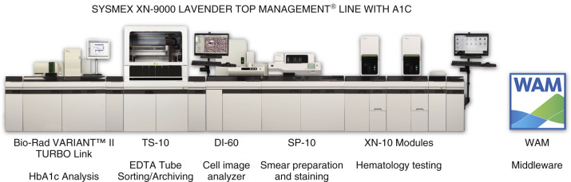

## Key Points

  * •

Laboratory testing has undergone revolutionary changes over the past decade so that all routine chemistry and hematology testing is completely automated. 

  * •

Automated solutions are available for preanalytic, analytic, and postanalytic stages of laboratory testing. The degree of automation implemented in a laboratory should match its needs and can vary from a freestanding analyzer to a workcell or totally automated solution. 

  * •

Preanalytic automation is heavily dependent on uniquely identifying (often with a bar code) the primary collection container. Analyzers automatically perform many tasks and when integrated with other automated modules can significantly reduce hands-on time, thereby enabling staff to concentrate on exception processing, problem solving, and quality oversight. 

  * •

A continuum of automation strategies has been developed to meet scalable needs and to offset staff shortages; other key benefits are shorter turnaround time, fewer errors, safer staff working environment, and focus on value-based testing. 

What is automation? In the context of the clinical laboratory, it can be described as the process by which an instrument automatically performs tasks that would otherwise have to be performed manually by laboratory staff. In recent years, _laboratory automation_ has also been used to describe a broader process wherein multiple devices, often linked together, are capable of automating preanalytic, analytic, and postanalytic stages of testing (see [ Chapter 2 ](<##!/content/3-s2.0-B9780323295680000024?scrollTo=%23c00002>) ). Thus in addition to performing tests, automation now includes solutions for specimen sorting, processing, transport, sample introduction, and storage. At the core of these configurations is a sophisticated information system that monitors and controls these tasks, optimizes performance, self-monitors analytic performance, and interfaces with the laboratory information system (LIS). This chapter discusses the fundamental concepts of automation as it relates to both of the preceding definitions, with specific emphasis on clinical chemistry. 

,  

##  Evolution of Automation 

Prior to the introduction of automation in the 1950s, laboratory testing was a completely manual process that required technologists to hand-pipette specimen and reagent into glass test tubes, incubate, read reaction changes in a spectrophotometer, and extrapolate values from a calibration curve that was plotted on paper. These tasks are still performed today—only on automated platforms that eliminate manual intervention and thus significantly improve the reproducibility, accuracy, flexibility, and turnaround time of testing, while lowering costs, eliminating errors, and enhancing patient safety through robust sample identification and test reporting technologies (  Battisto, 2004  ). 

The first automated analyzers were based on continuous-flow technology (i.e., reagents would continuously flow through the channels); they sequentially analyzed each sample in a single or multiple parallel channel configuration. The same group of tests was performed on each sample irrespective of which tests were ordered; in other words, there was no test selectivity. These devices were followed by variable profile analyzers that could perform a subset of tests from the master profile or suppress those that were not ordered. The one characteristic shared by these analyzers was that their operating cycles were sample-based—that is, they processed a set number of samples per hour irrespective of the number of tests ordered per sample. Another approach to testing was the batch analyzer (e.g., centrifugal analyzer), which could perform a single test on a large number of samples. These devices were “run-based” systems; once the batch testing began, it could not be interrupted to add a new sample. By the early 1980s, the inflexibility of these designs started to be addressed with the introduction of a totally new concept: the random access analyzer. 

Unlike its predecessors, the random access analyzer selects sample and reagent randomly without regard to placement on the analyzer. This type of operation implies several unique characteristics that differentiate it from other instruments: 

  * 1.

It has a single analytic pathway for all testing instead of dedicated channels for each test. 

  * 2.

Tests are initiated sequentially based on what is ordered—that is, tests are not batched. 

  * 3.

It has a flexible configuration to process each test's unique parameters (e.g., wavelength, number of readings, reagent additions). 

  * 4.

It performs tests discretely, each in its own cuvette. 

  * 5.

Throughput is based on the number of tests run per hour, not the number of samples per hour. Virtually all of today's automated chemistry systems are based on random access design. This flexible design has allowed many tests that previously were performed on a variety of platforms to be consolidated into one. 

Although the random access analyzer was originally introduced for general chemistry and homogeneous immunoassay testing, many of its operating characteristics were adapted in the 1990s to heterogeneous immunoassay testing. These tests typically require more flexible assay parameters, such as variable incubation times, reagent additions and wash steps, and unique detection systems (e.g., luminometer) that require testing to be performed in a specially designed unit. Because of these testing requirements, immunoassay throughput is significantly lower than that of a general chemistry analyzer. Although immunoassay analyzers were originally introduced as standalone units, they are also typically available as an integrated subsystem within a single chemistry/immunoassay platform. 

After great strides occurred in automating sample analysis, more attention was focused on the preanalytic processes that increasingly accounted for errors and workflow delays. These included sample labeling (or relabeling with bar codes), loading and unloading centrifuges, manual aliquoting (e.g., splitting samples to be used at several workstations or transferring samples into another container to be sent out for testing or used in in-house instruments), and sorting samples for different workstations. Each step could potentially lead to an error, such as a misidentified sample resulting in an incorrect report. Finally, the uncapping and capping of samples posed biohazard risks due to aerosol exposure and contact with blood and body fluids. In response to these issues, preanalytic automation was introduced in the form of standalone units or preanalytic processing modules integrated into an automated laboratory configuration. 

In addition to refining the capabilities of automated analyzers, in the past 10 to 15 years, the laboratory community has primarily focused on automating the entire testing process from collection to reporting, including a major emphasis on integrating these activities and optimizing preanalytic tasks and sample storage. Total laboratory automation (TLA) is the culmination of this design strategy (  Sarkozi et al, 2003  ), one that uses intralaboratory sample transportation systems such as conveyors or tracks to move samples between analyzers and into and out of processing stations that centrifuge, decap/cap, and store sample containers. TLA is discussed in greater detail below. 

As we enter a new era in health care, with enhanced emphasis on value-based management, the diversity of laboratory automation solutions is well positioned to meet the needs of small-, medium-, and high-volume clinical laboratories (  Burtis & Bruns, 2014  ). Some of the factors that will continue to drive automation are presented in [ Box 5-1 ](<#b0010>) . 

Box 5-1 

Factors That Drive Laboratory Automation 

  * Turnaround time (TAT) demands 

  * Specimen integrity issues 

  * Staff shortages 

  * Economic factors 

  * Need to lower maintenance 

  * Need to reduce calibration 

  * Need to reduce downtime 

  * Faster start-up times 

  * 24/7 uptime 

  * Throughput 

  * Computer and software technology 

  * Primary tube sampling 

  * Increasing the number of different analytes on one system 

  * Increasing the number of different methods on one system 

  * Reducing laboratory errors 

  * Number of specimens 

  * Types of fluids 

  * Safety 

  * Environmental concerns (i.e., biohazard risks) 

,  

##  Preanalytic and Postanalytic Automation 

 

##  Automated Delivery 

The preanalytic stage focuses on sample collection and processing (see [ Chapter 3 ](<##!/content/3-s2.0-B9780323295680000036?scrollTo=%23c00003>) ). The first processing step begins with the delivery of samples from the collection location. For decades, specimens drawn within a facility were transported to the laboratory by phlebotomists or other staff. If the specimens were obtained from outside the facility, a courier service was often used. Both of these batch processes were usually based on scheduled pick-ups. One of the earliest automated transport systems to be introduced—and still the most popular one today—is the pneumatic tube (e.g., TransLogic® Pneumatic Tube System, Swisslog, Denver, Colo.); it rapidly transports 4- or 6-inch-diameter high-impact polycarbonate carriers from one point (or carrier station) in a facility to another. Each station is uniquely identified, and carriers are programmed to travel to a specific station. Thus the sender can load blood collection tubes into a carrier and program it to go to the laboratory, and blood units from transfusion services or medications from pharmacies can be delivered to patient care units. Pneumatic tube carriers are lined with foam to cushion contents and reduce the potential for breakage. These systems are also designed to prevent hemolysis by avoiding significant elevation of _g_ forces during acceleration and deceleration. 

Other automated delivery systems have also been developed for use predominantly in the laboratory and, in some instances, outside it. Electrical track vehicles can transport a larger number of specimens than pneumatic tubes; they require a station for loading and unloading specimens, and this may pose a problem in facilities with limited space. They can also transport ice or refrigerated packs with samples because of their larger carrying capacity. Mobile robots offer another transportation option: They can deliver samples directly to the workstation. These devices either follow a line in the floor or use a more sophisticated, flexible, and expensive guidance system. Mobile robots are batch delivery systems, and they require staff to load and unload samples at each stop. Conveyors or track systems are used in some laboratory facilities, especially if the laboratory receives a very large number of samples. Conveyor or track systems are designed to transport specimens horizontally (i.e., across the floor) and vertically (i.e., to a different floor). 

 

##  Automated Specimen Processing 

Automated specimen processing minimizes non-value-added steps in the laboratory testing process (e.g., aliquoting, sorting tubes) and improves quality by reducing manual handling errors; it also addresses reproducibility and throughput issues. Automation enhances worker safety: It reduces operator exposure to potentially hazardous biologic material and eliminates repetitive stress injuries. [ Box 5-2 ](<#b0015>) lists common specimen handling steps; some or all of these tasks have been included in front-end automation systems. Standalone units (with or without centrifugation) selectively target a group of preanalytic or postanalytic steps. For example, a unit may include sample sorting, sample uncapping, and aliquoting. After processing, samples are manually transported to a workstation. In contrast to this _targeted automation_ approach, these tasks can also be integrated into a larger, fully automated modular design that is connected to an analytic and storage (postanalytic) component and eliminates any handling after initial loading. One example of a standalone automated unit is the Automate  TM  800 (Beckman Coulter Inc., Brea, Calif.); it can perform sample receipt, sorting, centrifugation, decapping, sample volume detection, and aliquotting functions). 

Box 5-2 

Automation 

Preanalytic and Postanalytic Steps 

  * Primary tube ID/labeling (if not done remotely) 

  * LIS Receiving 

  * Sorting (and prioritizing stats) 

  * Centrifuging 

  * Decapping 

  * Secondary tube labeling 

  * Volume checks/clot detection 

  * Aliquoting 

  * Destination sorting into analyzer racks 

  * Recapping 

  * Sample storage and retrieval 

 

##  Postanalytic Processing 

Standalone systems are also available to archive and retrieve bar-coded specimens; samples are scanned and placed in numbered positions in numbered racks. Specimens are retrieved by entering the patient's sample accession number or a medical record number into the archival system's database. The rack number and sample position are displayed for the user. Some systems include a refrigerator for sample storage and automatic disposal of samples at predetermined times. The Cobas p 701 (Roche Diagnostics, Indianapolis, Ind.) is an example of a postanalytic unit that can be used as a freestanding device or be connected to a preanalytic system. It can store up to 27,000 tubes in a walk-in refrigerator; samples are automatically disposed based on user-defined short- and long-term storage time frames. 

,  

##  Emerging Technologies in Preanalytic and Postanalytic Processing 

 

##  Automated Specimen Inspection 

_Automated specimen inspection_ can potentially address two of the most significant preanalytic concerns: identifying sample identification errors and sample integrity issues. Ideally, an automated device could sort a random collection of different-sized containers with different additives and assess each one for proper labeling, adequate volume, and interference from icterus, lipemia, or hemolysis. This recently described invention uses optical character recognition to identify potentially mislabeled samples (  Hawker et al, 2014  ). 

 

##  Radio-Frequency Identification 

_Radio-frequency identification (RFID)_ can significantly change how laboratory samples are tracked from collection to final disposition and can do so passively—that is, without active human intervention. This can reduce errors and misplaced samples (  Shim et al, 2011  ). Compared to traditional labels, RFID tags have several advantages: 

  * 1.

_No line of sight reading_ —that is, all of the RFID tagged samples in a closed transport container can be read without having to open the container or delivery package. 

  * 2.

_Dynamic data storage_ —data encoded on the sample container's read-write chip can be modified from a distance to reflect updated information like add-on tests. 

  * 3.

_Not affected by cold storage_ —ice and frost accumulated during freezer storage do not obscure an RFID tag, unlike with traditional labels. 

Although RFID technology has the potential to radically change how specimens are tracked, it has yet to be commercialized on a large scale in the clinical laboratory, in part owing to its greater cost as compared to existing approaches. On the other hand, RFID technology is being introduced by instrument vendors as a simple and automated approach to manage reagent inventory. 

,  

##  The Automated Chemistry Analyzer: Core Components 

The automated analyzer is central to the operation of the clinical laboratory. [ Chapter 4 ](<##!/content/3-s2.0-B9780323295680000048?scrollTo=%23c00004>) discusses many of the testing principles used by these devices. This section discusses various physical operating characteristics and design features that enable these devices to function in an automated manner ( [ Box 5-3 ](<#b0020>) ). 

Box 5-3 

Automation 

Analytic Steps 

  * Sample introduction and transport to cuvet or dilution cup 

  * Addition of reagent 

  * Mixing of sample and reagent 

  * Incubation 

  * Detection 

  * Calculations 

  * Readout and result reporting 

 

##  Sampling 

All fully automated general chemistry analyzers are capable of sampling directly from the collection tube. Direct tube sampling along with bar code reading has eliminated the need to transfer samples into another container, reduced errors, and minimized technologist exposure to potentially biohazardous materials. Tubes are typically decapped before sampling; however, some chemistry systems such as the UniCell analyzers (Beckman Coulter Inc., Brea, Calif.) offer cap-piercing technology. The analyzer uses a blade to slit the stopper, and the sample probe pierces the stopper to withdraw an aliquot of sample. Note that cap-piercing technology is available on all high-throughput hematology analyzers. 

Automatic sampling may be accomplished in different ways. The peristaltic pump is an example of an older technology that is still used in some instrument designs (e.g., electrolyte measurements). More commonly, positive liquid displacement pipettes are used to transfer sample from cups or tubes to the analytic module. These pipettes dispense sample into the reaction container, or they flush out sample together with diluent. Computer-controlled stepper motors can precisely control the amount of liquid that is aspirated and dispensed. A similar configuration is used for reagent dispensing. 

In most analyzers, samples are aspirated and dispensed using a thin, stainless-steel probe. In some analyzers, the probe pierces a rubber stopper, and in others it passes directly into a test tube or a cup. A potential problem is the formation of a sample clot that adheres to the probe. The clot may plug the probe, preventing further use; occupy sample volume, thereby leading to a “short sample” measurement error; or adhere to the sample probe, thereby leading to an instrument malfunction and/or sample probe misalignment. Most sample probe designs can detect clots and reject the sample. Liquid level sensors detect the presence of an inadequate or short sample; they typically travel a specified distance into the sample container to determine whether liquid is present. 

Reusable pipette probes are subject to carryover—that is, contamination of one sample by the previous sample. This can create spurious results. Several instrument modifications have been used to reduce carryover. One approach is to aspirate a wash solution between pipetting cycles. Another technique is to back-flush the probe using a wash solution. The wash solution flows through the probe in a direction opposite to that of the aspiration into a waste container. This technique minimizes the risk of pulling a small clot deeper into the system. To completely eliminate carryover, some devices use disposable plastic pipette tips to transfer each sample, although this slightly increases consumable costs. 

 

##  Reagent Handling 

Automated analyzers need to address how reagents are stored, handled, prepared, proportioned, and dispensed. Most laboratories use bulk reagents that are ready to use with little or no preparation. If the reagent is lyophilized, most analyzers will automatically reconstitute the contents with diluent. Some analyzers use unit test reagents (i.e., reagent is present for the performance of a single test). In dry technology, reagents are impregnated on a solid phase strip or slide. Another type of unit test reagent is a container or test tube with premeasured liquid or powdered material to which water, buffer, or sample is added. 

Reagents are stored in (environmentally controlled) compartments, and inventory is monitored in real time. Most of the methods used in the laboratory require only a single reagent, but some require two or more. When a reagent becomes depleted, the computer alerts the operator to replace the empty container with a new one. Onboard reagent storage compartments are refrigerated to maintain reagent stability. 

Bar code labels uniquely identify each reagent container so multiple containers of a high-volume reagent can be loaded and the analyzer will sequentially use the contents of each. The bar code label may contain additional information such as expiration dates, lot numbers, and volume of reagent (or number of tests) in the container. Some analyzers may couple a liquid level sensor onto the reagent probe, which confirms reagent aspiration and also measures remaining test inventory in the container. 

For all tests, the bar-coded reagent label stores calibration information such as concentration, expected detector responses, calibration curve algorithms, and tolerances for acceptability of calibration. This information is often referred to as _master lot_ or _master calibration_ . 

Automated analyzers are categorized as _open_ or _closed_ reagent systems, a distinction that may influence purchasing decisions. An open reagent system can accommodate reagents from third-party (i.e., noninstrument manufacturer) vendors and allows the operator to modify test parameters to implement these tests. _Open_ reagent systems provide users with greater flexibility and adapt easily to new methods and analytes. As a note of caution, many of the instruments do not allow full access to all of the functions and calculations that the manufacturer uses, and third-party methods often cannot be optimized. A _closed_ reagent system can only use the instrument manufacturer's reagents and therefore may not offer a new or proprietary test that is available only from an external vendor. Although reagents may cost more in a closed system, reagent handling and identification are usually more tightly integrated with the analyzer operation, thereby leading to hidden benefits. Most laboratories predominantly use reagents from their instrument vendor. Even “closed” systems sometimes have some limited ability to accommodate third-party reagents. 

 

##  Mixing and Incubation 

Many unique approaches are used to mix sample and reagent in automated systems. They include magnetic stirring, rotating paddles, forceful dispensing, the use of ultrasonic energy, and vigorous lateral displacement. Dry slide analyzers do not require sample and reagent mixing because sample need only flow through the reagent layers to accomplish this task. 

An incubator must provide a constant and accurate temperature for the reaction; this is achieved by using circulating air or water baths or heated metal blocks. Electronic thermocouples and thermistors monitor and maintain required temperatures. 

 

##  Detection 

An automated analyzer may typically include several detection systems, depending on the test menu offered. For example, general chemistry assays may be measured by absorption or reflectance spectroscopy; electrolytes may be measured by ion-selective electrodes; and immunoassays may be based on chemiluminescence and thus require a luminometer. These technologies are discussed in [ Chapter 4 ](<##!/content/3-s2.0-B9780323295680000048?scrollTo=%23c00004>) . Most of the chemistry analyzers marketed today incorporate several measuring subsystems. Typically, they are dedicated chemistry, dedicated immunoassay, or chemistry/immunoassay integrated platforms. 

 

##  Data Processing and Real-Time Monitoring 

The instrument computer controls signal processing, data handling, and process control. Signal processing coverts an analog signal from the detector to a digital signal that is usable by all communication devices. Data processing can transform nonlinear input signals into linear calibration plots, thereby enabling nonlinear assays (e.g., those based on reflectance spectrophotometry) to be automated. Within the analyzer, the computer controls electromechanical processes so they are uniform, repeatable, and in the correct sequence. These operations include activating pipetting devices, moving cuvets from one point to another, moving sample tubes, and dispensing reagents. User-friendly software can display Levey-Jennings QC charts and calibration curves, and online troubleshooting can be accessed along with “how to” videos that help guide users through instrument training and maintenance. Real-time monitoring (using Internet connectivity) has allowed vendors to continuously analyze instrument subsystems and identify components that could potentially fail before they actually do. Based on these data, vendors can schedule service and avoid potential unscheduled downtime during off-hours. 

,  

##  The Continuum of Chemistry Automation 

Laboratory vendors offer a variety of automation solutions designed to meet the needs of laboratories of all sizes. Often, these solutions are scalable, allowing the same technology to be used across a network of laboratories, albeit implemented in different configurations. What follows is a brief description of these configurations. Automation is a constantly evolving technology, with new solutions often introduced by vendors, so it is important to review the latest offerings and competitive differences when new automation is considered. Currently, the major vendors in core chemistry and immunodiagnostics are Abbott Diagnostics, Lake Forest, Ill.; Beckman Coulter Inc., Brea, Calif.; Ortho Clinical Diagnostics, Rochester, N.Y.; Roche Diagnostics U.S. Headquarters, Indianapolis, Ind.; and Siemens Healthcare Diagnostics, Inc., Tarrytown, N.Y. 

 

##  Workstation 

The most basic unit of automation is the workstation, which is typically an automated clinical analyzer (described above). The analyzer may be dedicated to general chemistry testing, immunoassay testing, or a single platform that integrates both technologies. Although samples have to be manually loaded and unloaded, this standalone device automates the entire testing process. The instrument operator usually initiates calibration, quality control, and daily maintenance activities and replenishes reagents. Typically, bar-coded samples and bidirectional LIS interfaces allow analyzers to automatically determine which tests to run on each sample and automatically upload (and autoverify) results. Provided the analyzer can accommodate a sufficient number of samples and reagents, the operator can “walk away” for a period of time. However, all instrument alerts appear on the local device and need to be reviewed. Another drawback of this approach is that the operator must manually gauge how to “load balance” the daily routine work and stat requests to achieve optimal throughput and performance across several freestanding workstations. 

 

##  Workcell 

To further enhance productivity, vendors have developed integrated groups of analyzers that can function as a single unit and can be monitored by a single technologist. A “virtual” workcell is a cluster of such devices—for example, chemistry analyzers, hematology cell counters, or coagulation instruments—that is not physically connected by a track, but in which the devices are interfaced to one another through common software known as middleware. A “physical” workcell is a similar cluster of devices that is connected by a track and thus has a single sample loading and unloading station. The middleware is a central hub that can consolidate most of the user interaction emanating from all the devices and present it to the technologist on a single display. For example, it can display the status of all the samples processed on each system, the pending list of stat samples, the error messages from different systems, and the samples that require reruns (and that may have to be manually reloaded); it can also autoverify samples that meet the preset criteria. Also, it can “load balance” by either indicating to the technologist where to load a sample on the virtual workcell or by automatically doing so on the physical one. 

 

##  Total Laboratory Automation 

The idea of totally automating a clinical laboratory has its roots in Japan, and the concept was first introduced in the early 1980s. Early designs used one-arm robots, conveyor belts, and modifications to existing chemistry analyzers to perform as many preanalytic and analytic tasks as possible with no human intervention (  Olsen, 2012  ). Each laboratory workstation was coupled to the conveyor belts so the samples could be moved from one workstation to another. Continued research and modifications to these earlier systems led to the development of commercial total laboratory automation (TLA) systems designed for hospital-based laboratories. 

In a TLA design, multiple analyzers are coupled to a specimen management and transportation system; process control software (middleware) coordinates the activities of the various automation modules ( [ Box 5-4 ](<#b0025>) ) and is interfaced to the LIS. These systems are typically designed for laboratories that process 1000 to 10,000 samples per day—for example, a core laboratory within a health system's network of laboratories. TLA can include a wide variety of modules, including analytic units to perform chemistry, hematology, coagulation, and immunochemistry tests, as well as preanalytic/postanalytic units such as centrifuges, specimen sorting modules, specimen decappers and recappers, specimen aliquot modules, and refrigerated storage units. 

Box 5-4 

Process Control Software Functions 

  * 1.

Calculate number of aliquots and volume needed for each workstation 

  * 2.

Route samples to analyzers in most optimal way 

  * 3.

Recap sample 

  * 4.

Autoretrieval of samples for reflex or repeat testing 

  * 5.

Autoverification of results 

TLA benefits include a decrease in labeling and other preanalytic errors, shorter turnaround times, and a reduction in full-time equivalents (FTEs) necessary to process a given test volume—that is, increased productivity. The latter is of special interest given the current shortage of laboratory technologists. Laboratories using a high degree of automation thus have the ability to introduce new assays and/or process additional testing volume without adding staff. Staff savings from automated testing can be reassigned to other areas or projects, such as increasing the frequency of testing for tests currently run on a limited schedule or implementing new tests in-house that were previously sent to a reference lab. 

The major limitations of TLA include the need for substantial financial investment and increased floor space. Initial investment may reach millions of dollars, and floor space requirements may exceed 4000 square feet. Another factor that requires the attention of planners because of the complex nature of TLA is the need for highly technical personnel to operate and troubleshoot the system. Other challenges to TLA include infrastructure remodeling, personnel team building, and software interfacing. In addition, some systems may not be able to easily interrupt workflow to analyze emergency (stat) samples (  Battisto, 2004  ). 

Most TLA vendors assist (when requested) in the planning, budgeting, implementation, and optimization of their system. For example, the vendor will often perform a Six Sigma/Lean analysis of the laboratory to develop a proposed layout and determine the optimal configuration of preanalytic, analytic, and storage units. After implementation, the vendors will typically review performance to assess and suggest minor modifications. 

,  

##  Laboratory Automation in Other Sections of the Lab 

In addition to the major advances in chemistry automation discussed above, transformational changes have also occurred and continue to evolve in other laboratory sections. What follows is a brief overview of some of these changes, the technology of which is discussed in greater detail in other chapters. 

 

##  Hematology 

Hematology analyzers use a variety of technologies (e.g., electrical impedance, flow cytometry, light scatter, and absorbance) to count and classify red cells, white cells, and platelets and to identify morphologic abnormalities. (These principles are discussed in [ Chapter 30 ](<##!/content/3-s2.0-B9780323295680000309?scrollTo=%23c00030>) .) Recent trends in hematology have focused on automating all aspects of cell counting, including manual review of the WBC differential and automating unrelated tests that typically could be run on the same EDTA collection container (e.g., hemoglobin A1C). 

Hematology automation is available as a standalone workcell or as a component of a larger track system that includes chemistry and preanalytic modules. For most users, a compact workcell provides most of the functionality that can be realized from hematology automation. In either configuration, the system is typically comprised, at a minimum, of multiple cell counters, a slide maker stainer, and a tube sorter; these devices are usually physically connected by a track. Devices can also be virtually connected; this requires samples to be loaded and unloaded from each module. As with chemistry systems, middleware connects the modules, balances testing load among analyzers, and determines which samples require staining or other follow-up. More sophisticated versions may also include a module for automated slide microscopy (e.g., CellaVision Inc., Durham, N.C.) and/or A1C testing (by HPLC method). Thus all tasks historically performed on an EDTA tube can be automated with minimal operator intervention. Compact analytic units and concentrated reagents that are automatically reconstituted onboard have significantly downsized the footprint of these systems and have decreased the space needed to store off-line reagents. User interaction and manual slide reviews are kept to a minimum. One example of scalable hematology automation is the Sysmex XN-9000™ (Sysmex Corporation, Kobe City, Hyogo Prefecture, Japan) ( [ Fig. 5-1 ](<#f0010>) ); it can include up to nine analytic modules, along with the capability to connect slide preparation units, tube sorters, HbA1c testing, and automated microscopy. The system is driven by Sysmex's proprietary WAM™ middleware, which enables multisite connectivity and systemwide rules that can yield autovalidation rates greater than 88%. 

Figure 5-1 

Sysmex XN-9000™ (Sysmex Corporation). 

The Sysmex XN-9000 has features such as slide preparation units, tube sorters, HbA1c testing, and automated microscopy. 

(From Sysmex Corporation, with permission.) 

 

##  Microbiology 

Although continuous-monitoring blood culture systems and automated microbial identification and antimicrobial susceptibility testing systems have been widely implemented for many years, microbiology sample processing and workup have largely been manual, time-consuming tasks. Samples need to be plated on culture media, incubated, and then monitored at periodic intervals. This entails much hands-on time, and plates are constantly shuffled between workstations and incubators. Until recently, microbiology lagged behind chemistry and hematology in its ability to automate manual tasks. However, with the introduction of new technologies to address these long-standing issues, the microbiology laboratory is at the cusp of a transformational change. These core changes are driven by sophisticated specimen-processing devices that can address the unique intricacies of this discipline and laboratory automation solutions that can integrate the various workstations (including plating, incubation, identification, and susceptibility testing) into a single unit. As the microbiology laboratory continues to introduce non-growth-dependent techniques (e.g., molecular diagnostics), coupled with sophisticated automation, it is likely that the boundaries between this discipline and others will continue to erode (  Bourbeau & Ledeboer, 2013  ). 

,  

##  Planning for Laboratory Automation 

An understanding of laboratory workflow and the role of technology is a key prerequisite to developing a performance optimization strategy. This is more fully discussed in [ Chapter 2 ](<##!/content/3-s2.0-B9780323295680000024?scrollTo=%23c00002>) . The application of these concepts is particularly important in TLA, where project costs are measured in millions of dollars. Objectives need to be clearly defined, and decisions must be based on accurate data. For example, one must fully understand the capabilities of the LIS and its limitations; the current result turnaround time; the laboratory layout to determine if automation will fit (and if there is sufficient space to support existing operations during construction); specimen and test mapping; and the current cost and test volume to share with vendors in the request for proposal (RFP). Ultimately, vendors will propose solutions based on these data. To adequately evaluate and compare bids, one must understand what they are based on. 

The RFP outlines the laboratory's strategies, service needs, and goals (  Melanson et al, 2007  ). It also provides a standardized framework and a deadline for vendors to respond. [ Table 5-1 ](<#t0010>) provides examples of the type of information requested in an RFP. 

TABLE 5-1 

Laboratory Automation RFP: Examples of Needs, Goals, and Terms to Consider 

Laboratory turnaround time  |  90th percentile for test completion: general chemistry (30 minutes), immunoassay (45 minutes), CBC (20 minutes), basic coagulation (30 minutes)   
Ability to prioritize stats   
---|---  
Throughput  |  During peak periods, throughput adequate to meet TAT and grow business by 20% with existing configuration   
Method  |  Proposed test menu and (current) volume with ability to add open (user-defined) channels   
Specimen management  |  Operator alerts for sample integrity issues (like hemolysis, icterus), insufficient sample, label error   
System should be able to store, locate, and retrieve sample for add-on or repeat tests   
LIS Needs  |  Seamless and bidirectional interface   
Can operate independent of TLA   
Financial impact and contract terms  |  Budget neutral; with reallocation of staff   
Contract length; fixed reagent and consumable pricing over contract period versus annual adjustment   
Service included for life of contract versus initial 2 years   
Environment and safety  |  Will not generate excessive heat or noise   
System will minimize workplace exposure to hazards   
Downtime and service  |  Dedicated service engineer for first 2 months   
24/7 on-call service thereafter with 2-hour response time   
Minimal downtime   
References  |  Contact information for at least two current customers using the proposed or a similar configuration   
  
After the RFP has been distributed, vendors can be invited to present their analysis of the laboratory's current and future needs/goals, along with a proposed solution and project timeline. Vendors also provide useful information about the competitive advantages of their system and the drawbacks of others; this may highlight issues that may not otherwise be apparent. Subsequent to these presentations, it is useful to conduct customer phone interviews to clarify potential concerns about a specific issue that may have surfaced during the vendor presentation or to validate that performance expectations are met. [ Box 5-5 ](<#b0030>) provides examples of questions that can be used to probe customer experience. 

Box 5-5 

Stategic Planning for Automation 

Site Visit and Customer Questions 

  * Why did you choose to automate? 

  * Why did you pick your current manufacturer? 

  * How did your lab function before automation? 

  * Do you ever have downtime? 

  * How is the service response? 

  * Are there any recurrent problems? 

  * How did the staff react to the new automation? 

  * What LIS do you have? 

  * What kind of remodeling did your lab perform? 

  * Are there any expectations that were never met? 

  * What were your ultimate goals after the automation? 

  * Did you realize all your goals? 

  * Would you buy this product again? 

  * What is the one idea or “words of wisdom” that you would give us? 

In the last phase of the process, the vendor selection team identifies two or three final candidates based on RFP responses, vendor presentations, and customer feedback. This is an optimal time to visit customer sites and see the proposed system in operation. Typically, these vendors are also invited back to present their final financial proposal and system configuration. After selecting a vendor, the final contractual terms are negotiated by the legal and purchasing experts, and an implementation plan is developed. It is a good idea to assess the expected results of the implemented automation about 6 months after the installation. 

,,
