## Key Points

  * •

Many analytic determinations made in clinical laboratories are based on measurements of radiant energy that is absorbed or transmitted. The devices used to measure absorbed or transmitted light energy are photometers and spectrophotometers. 

  * •

The basic components of spectrophotometers include radiant energy source, wavelength selector, cuvette holder, photodetector, signal processors, and readout devices. 

  * •

A reflectometer is used to measure analytes by measuring the quantity of light reflected by a liquid sample that has been dispensed onto a grainy or fibrous solid support. 

  * •

Nephelometers are used to detect light that is scattered at various angles, whereas turbidimetry measures a reduction in light transmission due to particle formation. 

  * •

A flow cytometer measures light patterns produced as particles pass single file through a laser light beam. The flow cytometer is used to count and sort cells. It is also a key component of hematology analyzers and a technology used to differentiate white blood cells. 

  * •

Electrochemical principles are used to measure numerous analytes in biologic fluids. Specific electrochemical techniques include potentiometry, amperometry, coulometry, conductivity, and anodic stripping voltammetry. 

  * •

Analytes measured by electrochemical techniques include electrolytes, blood gases, pH, metabolites (e.g., glucose, urea nitrogen), ionized calcium, lead, and chloride in sweat. 

  * •

Chromatography is a separation technique based on the different interactions of specimen compounds with a mobile phase and a stationary phase, as the compound travels through a support medium. 

  * •

Mass spectrometers have become increasingly important clinical instruments, especially in emerging fields such as proteomics. Mass spectrometry is based on fragmentation and ionization of molecules. The relative abundance of each of the ions yields a characteristic mass spectrum of the parent molecule. The basic components of a mass spectrometer include an ion source, a mass analyzer, and an ion detector. 

A fundamental understanding of the principles of instrumentation used in clinical laboratories is essential. These instruments must provide the clinician with the best possible data to be of value to the patient. Without a thorough understanding of the necessary principles associated with an analyzer, operators will be ill equipped to perform maintenance procedures and calibrations and to troubleshoot problems that may arise. 

The goal of this chapter is to provide the reader with a brief and broad description of the essential principles of analytic instruments in the clinical laboratory. For a more comprehensive review of this topic, the reader is referred to references on clinical instrumentation at the end of this chapter. 

,  

##  Principles of Instrumentation 

 

##  Spectrophotometry 

Absorption spectroscopy has provided scientists with a means to use both qualitative and quantitative methods of measuring analytes in body fluids. Bouguer initially developed the principles of absorption spectroscopy in the early 1700s. Two other scientists, Lambert and Beer, continued to develop the fundamental principles of absorption spectroscopy, commonly known as Beer's law. Before reviewing the laws of spectroscopy, it is prudent to gain an understanding of light and the effects of its interactions with matter. 

Diverse spectrophotometric methods use electromagnetic radiation (EMR), which can take several forms, the most recognizable being light and radiant heat. Other types of EMR include gamma (γ) rays and x-rays, as well as microwaves, radiofrequency radiation, and ultraviolet radiation. The energies involved with specific regions of the electromagnetic spectrum (EMS) and their corresponding wavelengths change dramatically from radio waves to γ radiation. 

Some properties of EMR can be described by means of a classical sinusoidal wave model. Parameters associated with this waveform include wavelength, frequency, velocity, and amplitude, as shown in [ Figure 4-1, _B_ ](<#f0010>) _._ EMR requires no supporting medium for its transmission and passes readily through a vacuum. 

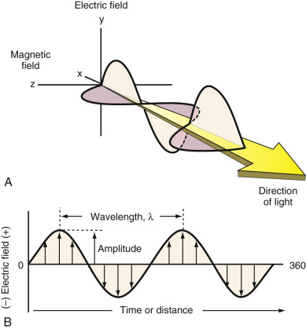

Figure 4-1 

Diagram of a beam of monochromatic, plane-polarized light. 

**A,** Magnetic ( _y_ -axis) and electrical ( _x_ -axis) field vectors at right angles to each other. **B,** Two-dimensional view of the electrical vector. 

The sine wave model does not provide the total picture when discussing the absorption and emission of radiant energy. EMR also exists as a stream of discrete particles, or packets, of energy called photons. The energy of the photons is proportional to the frequency of the radiation. This dual nature of EMR is considered complementary and applies to the behavior of streams of electrons, protons, and other elementary particles. 

The wave model allows us to represent EMR as both an electrical and a magnetic field that can undergo in-phase, sinusoidal oscillation at right angles both to each other and to the direction of propagation. The electrical and magnetic fields for a monochromatic beam of plane-polarized light (with oscillation of either the electric or magnetic fields within a single plane) [ * ](<#fn0010>) in a specific direction of propagation are shown in [ Figure 4-1, _A_ ](<#f0010>) (  Skoog et al, 1998  ). The electrical vector or component of the waveform is shown in two-dimensional format. Remember that a vector has both magnitude and direction. The electrical field vector at a certain point in time and space is proportional to its own magnitude. 

* Unpolarized radiation has waves in many planes. 

Time or distance of wave propagation is plotted on the abscissa. Most of the instrument principles widely used in the laboratory involve the electrical component of radiation and will represent the focus of discussion throughout this chapter. An exception will be nuclear magnetic resonance (NMR). With this technique, the magnetic component produces the desired effect. 

Several wave parameters will be described. _Amplitude_ of the sine wave is shown as the length of the electronic vector at maximum peak height. A _period_ , _p_ , is defined as the time in seconds required for the passage of successive maxima or minima through a fixed point in space. The number of oscillations of the waveform in a second is called _frequency_ , _v_ . The unit of frequency is hertz (Hz), which corresponds to one cycle per second. Frequency is also equal to 1/ _p_ . A _wavelength_ , λ, is the linear distance between any two equivalent points on a successive wave ( [ Box 4-1 ](<#b0010>) ). A widely used unit for wavelength in the visible spectrum is the nanometer, nm (10  −9  m). Electromagnetic radiation in the x-rays or gamma region may be expressed in terms of angstrom units, Å (10  −10  m). Finally, because of its much longer wavelength, EMR in the infrared region may have units corresponding to the micrometer, µm (10  −6  m). 

Box 4-1 

Units for Expression of Wavelength 

1 nm = 10  −9  m = 10  −7  cm; other units sometimes used include the following: 

1 µm = 10  −6  m = 10  −4  cm 

1 Å = 10  −10  m = 10  −8  cm 

 

##  Velocity of Propagation 

Velocity of propagation, _v_ i  in meters per second, is determined by multiplying frequency by wavelength. Thus: 

 υ i  =  υ λ i 

The frequency of light is determined by the source and does not change, whereas the velocity depends on the composition of the medium through which it passes. Therefore, [ Equation 4-1 ](<#e0010>) implies that the wavelength of radiation is also dependent on the medium. 

The velocity of light traveling through a vacuum is independent of wavelength and is at its maximum. This velocity is represented by the symbol c and is equivalent to 2.99792 × 10  8  m/s. [ Equation 4-1 ](<#e0010>) can then be rewritten as follows: 

 c  =  v  λ =  3.00  × 10  8  m  /  s  =  3.00  × 10  8  m  /  s  1  =  3.00  × 10  10  cm  /  s 

In any medium containing matter, the propagation of radiation is slowed by the interaction between the EMR field of the radiation and the electrons bound in the atoms of that matter. Because the radiant frequency does not vary and is fixed by the source, the wavelength must decrease as radiation passes from air to a slower medium ( [ Box 4-2 ](<#b0015>) ). 

Box 4-2 

Example 

Velocity of Propagation 

What is the wavelength in nm for EMR having a frequency of 1.58 × 10  15  Hz? 

 

##  Solution 

λ = c/ _v_

λ (nm) = 

λ (nm) = 190 

 

##  Energy of EMR 

One should note the following safety concern: Optical devices that emit high-frequency EMR generate very high energies and can damage the eyes. Examples include deuterium and xenon lamps. 

Wavelength and frequency are related to the energy of a photon, _E_ , by Planck's [ * ](<#fn0015>) constant _h_ , 6.626 × 10  −34  J s, and _c_ , the velocity of light in a vacuum (3.00 × 10  8  ms  –1  ): 

* Also expressed in units 6.626 × 10  −27  erg s. 

 E  =  h  υ =  h  c  /  λ

where: 

  * _E_ = energy of a photon in joules or eV 

  * _h_ = Planck's constant (6.626 × 10  −34  J s) 

  * _v_ = frequency in Hz (cycles/s) 

Quite often the energies of photons are stated in terms of an electron volt (eV). An eV is defined as the energy acquired by an electron that has been accelerated through a potential of 1 volt. The conversion factors between joules and eV are as follows: 

 1  J  =  6.24  × 10  18  eV  1  eV  =  1.602  × 10  − 19  J 

To illustrate the difference in energies of photons in the EMS, compare the energy of photons in the ultraviolet (UV) region versus the visible region of the EMS ( [ Box 4-3 ](<#b0020>) ). 

Box 4-3 

Example 

Energy of EMR 

What is the energy in joules and eV of EMR equivalent to (a) 190 nm? (b) 520 nm? 

 

##  Solution 

 

##  (a) 

E = _hc_ / _v_

E = 1.046 × 10  −18  J 

Or to convert to eV, use the conversion of 1 J = 6.24 × 10  18  eV. 

Therefore, the number of eVs is 6.53. 

 

##  (b) 

E = _hc_ / _v_

E = 3.82 × 10  −19  J or 2.38 eV 

The relationship of frequency, wavelength, and photon energy throughout the EMS can be seen in [ Figure 4-2 ](<#f0015>) . This graphic illustrates, for example, that very-high-energy gamma photons have extremely short wavelengths and very high frequencies (  Rubinson & Rubinson, 2000  ). The converse is true for television and radio wave parameters. 

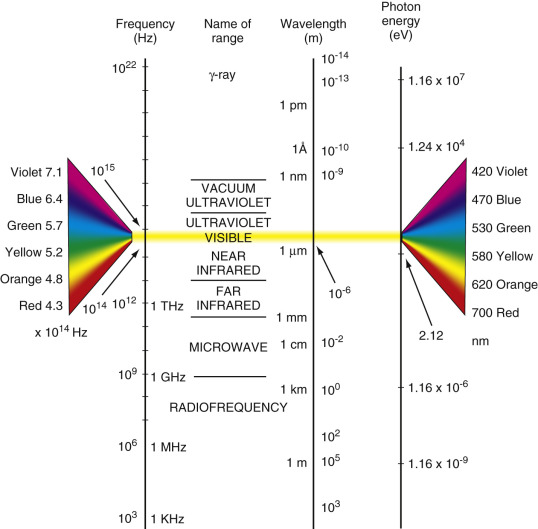

Figure 4-2 

A diagram of the names, frequencies, wavelengths, and photon energies of electromagnetic radiation (EMR). 

Both visible and ultraviolet light are widely used in analytic methods. 

 

##  Scattering of Radiation 

Transmission of radiation in matter can be viewed as a momentary retention of the radiant energy by atoms, ions, or molecules followed by reemission of the radiation in all directions as particles return to their original state. Destructive interference removes most but not all of the reemitted radiation involving atomic or molecular particles that are small relative to the wavelength of the radiation. The exception is radiation that travels in the original direction of the beam; the path of the beam appears to be unaltered because of the interaction. It has been shown that a very small fraction of the radiation is transmitted at all angles from the original path and that the intensity of this scattered radiation increases with particle size. 

 

##  Rayleigh Scattering 

Scattering by molecules or aggregates of molecules with dimensions significantly smaller than the wavelength of the radiation is referred to as _Rayleigh scattering_ . The intensity is proportional to the inverse fourth power of the wavelength, the square of the polarizability of the particles, and the dimensions of the scattering particles. In Rayleigh scattering, the wavelengths of absorbed and emitted photons are the same. An example of Rayleigh scattering is the blue color of the sky, which results from increased scattering of the shorter wavelength of the visible spectrum. 

 

##  Tyndall Effect 

The Tyndall effect occurs with particles of colloidal dimensions and can be seen with the naked eye. Measurements of scattered radiation are used to determine the size and shape of polymer molecules and colloidal particles. 

 

##  Raman Scattering 

Raman scatter involves absorption of photons producing vibrational excitation. Emission or scatter occurs at longer wavelengths. Raman scatter always varies from the excitation energy by a constant energy difference. 

 

##  Beer-Lambert Law 

If monochromatic EMR ( _P_ o  ) is directed toward a cuvet containing an absorbing species, the amount of light ( _P_ ) transmitted ( _T_ ) is equal to: 

 T  =  P  /  P  o 

and percent transmittance is equal to 100 _T_ . 

Lambert proved that for monochromatic radiation that passes through an absorber of constant concentration, a logarithmic decrease is seen in the radiant power as the path length increases arithmetically. The absorbance ( _A_ ) of a solution was determined to be equivalent to: 

 A  =  log  P  o  /  P 

The relationship between transmittance, _T_ , or percent transmittance ( _P_ / _P_ o  × 100), and absorbance is shown in [ Figure 4-3 ](<#f0020>) . Absorbance and percent transmittance ( [ Box 4-4 ](<#b0025>) ) are inversely related as given by the following: 

 A  =  2  − log  %  T 

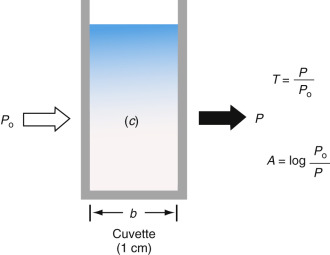

Figure 4-3 

Attenuation of monochromatic light by an absorbing solution. 

Box 4-4 

Example 

Beer-Lambert Law 

What is the absorbance of a solution whose transmittance is 10%? 

 

##  Solution 

_A_ = 2 – log %T 

_A_ = 2 – log 10%T = 2 – 1 = 1 

Beer followed with studies on the relationship between radiant power and concentration. His approach was to keep the path length and wavelength constant, while determining the relationship of radiant power, _P,_ and concentrations of the absorbing species. Based on previous work by Lambert, Beer discovered that for monochromatic radiation, absorbance is directly proportional to the path length, _b_ , through the medium and the concentration, _c_ , of the absorbing species. The work culminated in the Beer-Lambert law, or, simply, Beer's law. 

The principles established are represented by the following: 

 A  =  − log  T  =  log  P  o  /  P  =  a  b  c 

where: 

  * _a_ = absorptivity in L g  –1  cm  –1 

  * _b_ = path length of 1 cm 

  * _c_ = concentration in units of g/L 

When the concentration in [ Equation 4-7 ](<#e0045>) is expressed in moles per liter and the path length in centimeters, the term applied is _molar absorptivity,_ given the symbol ε, epsilon, and is equivalent to the extinction coefficient (“ _a_ ”) times gram molecular weight of the absorbing species. 

 A  =  ε b  c 

where units for ε are L mol  –1  cm  –1  . 

The graph of absorbance versus concentration shows the intercept at zero and a linear plot with a slope equivalent to “ _ab_ .” Absorption spectroscopy is used best for solutions whose absorbance values are less than 2.0. Absorbance values greater than 2.0 may yield erroneous results because of other interactions of light with matter (e.g., variations in the refractive index of a solution). This may cause a deviation from Beer's law, resulting in bending of the linear plot as shown in [ Figure 4-4 ](<#f0025>) . 

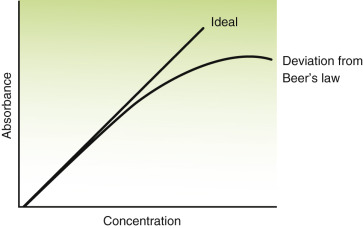

Figure 4-4 

A plot of absorbance versus concentration illustrating deviation from Beer's law. 

Deviations from Beer's law may be caused by changes in instrument functions or chemical reactions. Instrument deviation is commonly a result of the finite bandpass of the filter or monochromator. Beer's law assumes monochromatic radiation, but truly monochromatic radiation is best achieved using only unique line emission sources. If absorptivity is constant over the instrument bandpass, then Beer's law is followed within close limits. 

Deviations from Beer's law become apparent at higher concentration (i.e., higher absorbance). In [ Figure 4-4 ](<#f0025>) , the curved line bends toward the concentration axis as opacity is approached. This lack of adherence to Beer's law in a negative direction is undesirable because of the somewhat large increase in the relative concentration error. 

Deviation from Beer's law can occur with shifts or changes in chemical or physical equilibrium involving the absorbing species. Changes in solution pH, ionic strength, and temperature can result in such deviations. 

 

##  Components of a Spectrophotometer 

A typical photometer or spectrophotometer contains six basic components in a single- or double-beam configuration. These components include a stable source of radiant energy; a filter that isolates a specific region of the electromagnetic spectrum; a sample holder; a radiation detector; a signal processor; and a readout device. Each component of a typical photometer is shown in [ Figure 4-5 ](<#f0030>) . 

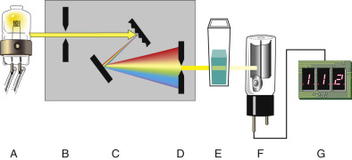

Figure 4-5 

Components of a single-beam spectrophotometer. 

**A,** Exciter lamp. **B,** Entrance slit. **C,** Monochromator. **D,** Exit slit. **E,** Cuvet. **F,** Photodetector. **G,** Light-emitting diode (LED) display. 

The following steps outline the function of each component in any absorption-type photometer as it detects light and provides information to the operator: 

  * 1.

The light source provides the energy that the sample will modify or attenuate by absorption. The light is polychromatic (i.e., all visible wavelengths are present). 

  * 2.

A wavelength selector or filter isolates a portion of the spectrum emitted by the source and focuses it on the sample. 

  * 3.

The sample in a suitable container (e.g., a cuvet) absorbs a fraction of the incident light and transmits the remainder. 

  * 4.

The light that passes through the cuvet and sample strikes the cathode of a photodetector and generates an electrical signal. 

  * 5.

The electrical signal is processed electronically (e.g., amplified, digitized). 

  * 6.

The processed signal is electronically coupled to the display unit (e.g., light-emitting diode [LED], X-Y strip chart recorder, meter). 

 

##  Radiant Energy Sources 

Radiant energy sources or lamps provide polychromatic light and must generate sufficient radiant energy or power to measure the analyte of interest. A regulated power supply is required to provide a stable and constant source of voltage for the lamp. Radiant energy sources are of two types: _continuum_ and _line_ . A continuum source emits radiation that changes in intensity very slowly as a function of wavelength. Line sources emit a limited number of discrete lines or bands of radiation, each of which spans a limited range of wavelengths. 

Continuum sources find wide applications in the laboratory. Examples of continuum sources include tungsten, deuterium, and xenon. For testing in the visible region of the EMS, tungsten or tungsten-halogen lamps are widely used. The filament in the tungsten-halogen lamp is maintained at a higher temperature than in the normal tungsten lamp. This takes advantage of the Wien and Sefan relationship to provide a source with a maximum wavelength near the center of the visible spectrum (whiter), and with a greater energy output (brighter). Introducing a halogen gas into the lamp envelope counteracts the problem of increased atom vaporization from the high-temperature filament. 

The deuterium lamp is routinely used to provide UV radiation in analytic spectrometers. The voltage applied is typically about 100 volts, which gives the electrons enough energy to excite the deuterium atoms in a low-pressure gas to emit photons across the full UV range. 

The strong atomic interaction in a high-pressure xenon discharge lamp produces a continuous source of radiation, which covers both the UV and the visible range. The discharge light is normally pulsed for short periods with a frequency that determines the average intensity of the light from the source and also its lifetime. 

In atomic emission line sources, electrons move between atomic energy levels. If the atom is free of any interaction with other atoms, the amount of energy liberated can be very precise, and all of the photons share a very clearly defined wavelength. This is the characteristic sharp “line” emission from an electronic discharge in a low-pressure gas. Line sources that emit a few discrete lines find wide use in atomic absorption, molecular, and fluorescent spectroscopy. Mercury and sodium vapor lamps provide sharp lines in the ultraviolet and visible regions and are used in several spectrophotometers. For atomic absorption spectroscopy applications, the hollow cathode lamp provides atomic emission from free metal atoms by using the heat of a gaseous discharge (e.g., in neon) to vaporize metal atoms into the discharge. Typically, each lamp is specific to a particular metal. However, some lamps use two, three, or more metals, although the emission from each of these is reduced. 

A laser source is very useful in analytic instrumentation because of its high intensity and narrow bandwidth and the coherent nature of its outputs. Several specific uses of lasers include high-resolution spectroscopy, kinetic studies of processes with lifetimes in the range of 10  −9  to 10  −12  s, as light sources for nephelometers, and as ionization inducers in the MALDI and SELDI mass spectrometric techniques (see later). 

 

##  Wavelength Selectors 

A critical component of all spectrometers is the device used to select the appropriate wavelength. Several types of wavelength selectors are available, including filters, prisms, grating monochromators, and holographic gratings. The quality of these selectors is described by their nominal wavelengths, spectral bandwidths, and bandpass. _Nominal wavelength_ represents the wavelength in nanometers at peak transmittance. Spectral bandwidth is the range of wavelengths above one-half peak transmittance. It is sometimes called the _half power point_ or _full width at half peak maximum_ (FWHM). The total range of wavelengths transmitted is the _bandpass_ . [ Figure 4-6 ](<#f0035>) summarizes these characteristics of wavelength selectors. This figure also summarizes the difference in wavelength selectivity between interference ( _A,_ left) and absorbance filters ( _B,_ right), as we now discuss. 

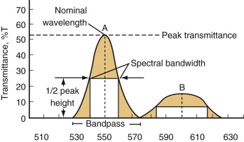

Figure 4-6 

Comparison of spectral characteristics of two types of filters. 

**A,** Interference filter. **B,** Absorption filter. The spectral bandwidth of filter A is much less than filter B and therefore allows fewer wavelengths of light through. 

 

##  Filters 

An important component of the spectrophotometer is the wavelength filter. Its purpose is to isolate monochromatic light, or at least as narrow a range of wavelengths of light as possible, and direct it to the sample or to the photodetector. Remember, the purpose of absorption spectroscopy is to detect how much light is absorbed by the sample. This is a measure of the absorbance of an analyte in a sample that is directly proportional to concentration (see Beer's law above). The percent transmittance is the ratio of the amount of light transmitted through the sample to the amount of light transmitted in the absence of the sample (e.g., buffer or solvent without the sample). Theoretically, it should be possible to determine this ratio without any filter at all. However, under these circumstances, most of the light that enters the sample in the cuvet will not be absorbed, so to determine absorbance, it would be necessary to measure a small difference between two large numbers (i.e., the amount of light transmitted in the absence [control] and the presence of the sample). Therefore, to obviate this condition, it becomes necessary to filter out as much “extraneous” light as possible to enable accurate measurements of absorbance. 

Two approaches may be taken to filtering light waves. The first is to limit the wavelengths of light that enter the sample with appropriate filters, so-called presample filters. The second is to allow multiwavelength light to pass through the sample and then to break up this light into its component wavelengths using a high-resolution prism and focus each of these component wavelengths on specific detectors, essentially one for each of the component wavelengths. If a sample absorbs light at one wavelength, then the ratio of the light transmittance of this wavelength of the sample to that for the control can be used to compute the percent transmittance and absorbance. This arrangement is termed _postsample filtering_ . 

**Presample Filters** (  Bender, 1987  ). Fundamentally, two types of these filters are used: absorption and interference filters. Absorption filters simply absorb regions of the electromagnetic spectrum and allow only a limited domain of this spectrum to pass through to the sample cuvet. The simplest sort of absorption filters consists of different forms of glass. One form of glass allows transmission only of wavelengths of light greater than 400 nm, while a second form allows transmission only of wavelengths of light less than 600 nm. If both glasses are arranged serially, they allow for transmission of light of wavelengths of only between 400 and 600 nm, with a peak at 500 nm. As a refinement of this approach, the older spectrophotometers utilize colored glass or transparent plastic materials. These colors are arranged in a circle or wheel so that light of a relatively narrow range of wavelengths is transmitted when each colored sector is in the light path. For example, if light in the green portion of the visible spectrum is desired, the wheel is turned so that the green filter is placed in the light path. The spectral bandwidth of these absorption filters ranges from about 30 to 50 nm (see [ Fig. 4-6 ](<#f0035>) ). 

This bandwidth is rather large but is adequate for determining the concentration of compounds in solution; absorbance filters are less adequate for scanning the absorption spectra of individual compounds and macromolecules or for accurately determining low concentrations of molecules. To achieve the latter goals, it becomes necessary to use interference filters. 

In the simplest interference filter, light on the path to the sample cuvet enters a magnesium fluoride chamber that is coated with micro-mirrors on the interior. As shown in [ Figure 4-7, _A_ ](<#f0040>) , light enters evenly spaced ports or slits on the left. Only light that enters each slit can continue; the rest is absorbed by the chamber. Light entering a slit, at an angle to the horizontal, travels across the chamber and is reflected back to the opposite wall. In [ Figure 4-7, _A_ ](<#f0040>) , if the path length _ab_ equals _bc_ , and the path length equals the desired wavelength of light, it can be shown from the theory of optics that the light whose wavelength equals that of the path length or integral multiples of this path length will undergo constructive interference (i.e., the waves will add to one another exactly) with incoming light at slits above it. For example, in [ Figure 4-7, _A_ ](<#f0040>) , light of wavelength _L_ = _ab_ , reflected from _b_ to _c_ , will be exactly in phase with light of wavelength _L_ or integral multiples of _L_ , entering the slit at _c_ ; all other wavelengths will destructively interfere with light entering slit _c_ . The light is then reflected again at _c_ to _d_ and back again to _e_ , where, again, it will add to (constructively interfere with) only light waves of the same wavelength or integral multiples of it. Eventually, only light at the desired wavelength will be transmitted through the opposite wall at slits _f_ and _h_ . 

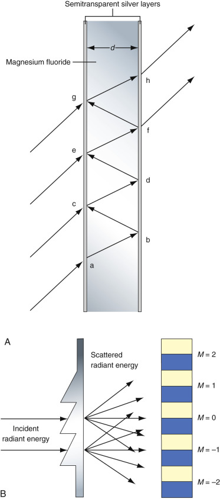

Figure 4-7 

**A,** An interference MgF  2  filter. Light enters the filter at regularly spaced apertures at the same angle of incidence at each aperture. Going from the bottom of the figure, the light entering at _a_ travels to _b_ , where a mirror is reflecting it to _c_ . Path lengths _ab_ = _bc_ . If these, in turn, are equal to the desired wavelength (or integral multiples of it), light of the desired wavelength arriving at _c_ will be exactly in phase with light from the light source of that wavelength, and this will result in constructive interference. It will be out of phase with all other wavelengths and will therefore destructively interact with them. This summation process takes place multiple times until only light of the desired wavelength escapes through exit apertures such as at _f_ and _h_ (after  Bender, 1987  ). **B,** A diffraction filter. When light enters multiple apertures, as in part A, each of which is equidistant from its two neighbors, light of each of the wavelengths interferes both constructively and destructively with itself, giving rise to light _(yellow)_ and dark _(blue)_ bands or fringes that can be observed on a screen. The position and spacing of these bands depend only on the wavelength and the angle of incidence. As shown in this figure, if apertures are placed only at the points where light _(yellow)_ fringes occur in the figure, only light of a specific wavelength will pass through this exit aperture. 

It is important to note that because integral multiples of the wavelengths of incident light will constructively interfere with transmitted light in the chamber, more than one wavelength of light can be transmitted from the chamber. The actual quantitative relationship between the wavelengths ( _L_ ) transmitted by the chamber; the angle of incidence, _q_ , of the light entering a slit; the refractive index, _R_ , of MgF  2  (1.38); and the distance, _d_ , across the chamber is as follows: 

 M  L  =  2  d  R  sin  (  q  ) 

where _M_ is any integer. Note that this equation predicts that for any given distance, _d_ , many wavelengths of integral multiples to the fundamental wavelength where _M_ = 1 can be transmitted. In practice, many of these other wavelengths can be excluded by using such techniques as placing appropriate glass filters in series with the interference chamber. 

The above arrangement successfully transmits (close to) monochromatic light at a particular wavelength. However, it does not allow for scanning of wavelengths to obtain the absorption spectra of different samples. To accomplish this, another, similar, arrangement is used. In this case, however, advantage is taken of another principle from the theory of optics: the principle of light diffraction. As shown in [ Figure 4-7, _B_ ](<#f0040>) , when monochromatic light is allowed to enter two slits on one surface of a chamber, very much like the one shown in [ Figure 4-7, _A_ ](<#f0040>) , except that there is no material (MgF  2  ) in the chamber, the two light waves interfere with each other such that if a screen is placed on the opposite surface of the chamber, discrete regions of light and dark bands will be seen (  Bender, 1987  ). The light bands are from light waves that have added constructively to one another and are transmitted; the dark bands result from destructive interference of the light waves, and no light waves are transmitted. The position of the bands and the distance between the bands depend on the wavelength of light that enters the two apertures and on the angle of incidence of both beams. Because, for a given angle of incidence, the position of the light bands for transmitted monochromatic light depends exclusively on the wavelength of light, if exit apertures are placed on the opposite surface only where the light bands occur for light of a desired wavelength, only light of that wavelength will be emitted from the chamber. This effect can be enhanced by placing multiple entry apertures next to one another in a sawtooth or grating pattern, such that adjacent apertures are at a fixed distance, _d_ , from one another, as shown in [ Figure 4-7, _B_ ](<#f0040>) . 

Now, polychromatic light is composed of multiple different monochromatic wavelengths of light. When polychromatic light is allowed to pass through the two apertures, as in [ Figure 4-7, _B_ ](<#f0040>) , each of the wavelengths will constructively and destructively interfere with itself, as described earlier. Two different wavelengths of light will interfere only destructively with each other unless they are integral multiples of each other, as discussed in the previous case of the MgF  2  chamber. This allows us to “trap” the light of the desired wavelength by placing the exit apertures where the light bands are known to occur on the opposite surface for that monochromatic wavelength. A limiting factor for selecting truly monochromatic light is the size of the aperture that can allow some “stray” light from adjacent light bands for very close wavelengths to exit. 

As with the MgF  2  interference chamber described previously, another source of contaminating light can occur from light of wavelengths that are integral multiples of the desired wavelength. The relationship that describes the wavelength as a function of the distance is similar to that for the MgF  2  chamber—that is, 

 M  L  =  d  sin  (  q  ) 

Here, however, _d_ is the distance between two adjacent entry slits on the near surface (toward the light source), _not_ the distance across the chamber as with the MgF  2  chamber. Note that for a given distance, _d,_ and angle of incidence, _q,_ this equation has multiple solutions. For example, if the desired wavelength is 800 nm, _d_ sin( _q_ ) = 800. But this is for _M_ = 1, _L_ = 800 nm. Another solution is _M_ = 2, _L_ = 400 nm, and another _M_ = 3, _L_ = 266.67 nm, and so on. As with the MgF  2  chamber, these other wavelengths can be filtered out by the use of appropriate glass or other filters. 

Note that the system shown in [ Figure 4-7, _B_ ](<#f0040>) , allows for continuous scanning of the absorption spectrum for any analyte. Wavelengths can be continuously changed, most often using electronic devices, by changing the position of the aperture on the exit side of the chamber or by changing the angle of incidence of the entering light by altering the angle of the near surface of the chamber. Filters that have this capacity are called _monochromators_ . Both interference systems in [ Figure 4-7 ](<#f0040>) have spectral bandwidths of approximately 1.5% of the wavelength at peak transmittance, much lower than the absorption filters illustrated in [ Figure 4-6 ](<#f0035>) . 

**Postsample Filters.** A different approach to obtaining monochromatic light and an accurate determination of absorbance is simply to allow the light to pass through the sample unfiltered. The light is then passed through a prism, where it is broken into its constituent wavelengths. The action of a prism depends on refraction of radiation by the prism material. The dispersive power depends on the variation of the refractive index with wavelength. A ray of radiation that enters a prism at an angle of incidence is bent toward the normal (vertical to the prism face), and at the prism–air interface, it is bent away from the vertical. As we describe in the section on photomultipliers that follows, each wavelength is focused onto a photodiode array such that each photodiode responds to only a specific set of wavelengths. The amount of transmitted light in the presence of the sample is compared with that in the absence of the sample. Photodiode arrays are examples of devices that convert photon energy into electrical currents in a system where photons excite the outer electrons in metal to move in the so-called conduction band, generating a current. 

 

##  Sample Containers (Cuvets) 

Sample containers (i.e., cells or cuvets) are used to hold samples and must be made of material that is transparent to radiation in the spectral region of interest. In the ultraviolet region of the electromagnetic spectrum (below 350 nm), cuvets are made from fused silica or quartz. Silicate glasses can be used in the region between 350 and 2000 nm. Plastic containers have also found application in the visible region. Generally, the path length of cuvets is 1 cm, although much smaller path lengths are used in automated systems. However, to increase sensitivity, some cuvets are designed to have path lengths of 10 cm, increasing the absorbance for a given solution by a factor of 10 (Beer's law; [ Equation 4-7 ](<#e0045>) ). 

Many double-beam spectrophotometers are designed with two cuvet holders: one for the sample and the other for the solvent. If two cuvets are used, they should be optically matched for more accurate results. Matched pairs of cuvets are obtainable from a manufacturer, but their optical performance should be verified before use by measuring the absorbance of identical solutions and comparing their values. One cell should then be reserved for the sample solution and the other for solvent. Cells should be scrupulously cleaned before and after each use. 

 

##  Photodetectors 

It is necessary to determine how much light passes through the sample in the cuvet. To accomplish this task, advantage is taken of the photoelectric effect that forms the basis of the quantum theory. Photons of specific wavelength excite the outer shell electrons of metals at their resonance frequencies to high-energy states in which they move through the so-called “conduction band,” where electrons move through the outer shells of the metal, thereby causing a current. This current, the magnitude of which is directly related to the intensity of the incident light, can then be detected and digitized. 

**Photomultiplier Tubes (PMTs).** Perhaps the most common type of photon detector is the photomultiplier. Photomultiplier tubes are commonly used when radiant power is very low, which is characteristic of very-low-analyte concentrations. The operating principle is similar to the phototube, with one significant difference. Some PMTs are designed to provide an amplified signal nearly 1 million times larger than their phototube counterparts. This is accomplished by using multiple dynodes positioned throughout the PMT. The response of the PMT begins when incoming photons strike a photocathode. Electrons are ejected from the surface of the photocathode. A PMT has several additional electrodes called _dynodes_ , each having a potential that is approximately 90 V higher than the previous one. Upon striking a dynode, each photoelectron causes emission of several additional electrons; these, in turn, are accelerated toward a second dynode, which is 90 V more positive than the previous dynode, which further amplifies the incident signal. This process, shown in [ Figure 4-8 ](<#f0045>) , continues within the PMT until all electrons are collected at the anode, where the resulting current is passed to an electronic amplifier. 

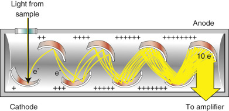

Figure 4-8 

Schematic of a photomultiplier tube. 

In this diagram, a tenfold amplification of the initial signal is produced at the anode. 

(Redrawn from Simonson MG: In Kaplan LA, Pesce AJ, editors. _Nonisotopic alternatives to radioimmunoassay._ New York, 1981, Marcel Dekker.) 

Photomultiplier tubes are highly sensitive to ultraviolet and visible radiation. They also have very fast response times. These tubes are limited to measuring low-power radiation because intense light causes irreversible damage to the photoelectric surface. 

**Photovoltaic or Barrier Layer Cell.** A variant method of detecting photon-induced current is the photovoltaic cell. This is a basic phototransducer that is used for detecting and measuring radiation in the visible region. This cell typically has a maximum sensitivity at about 550 nm, and the response falls off to about 10% of the maximum at 350 and 750 nm. It consists of a flat copper or iron electrode upon which is deposited a layer of semiconductor material, such as selenium. The outer surface of the semiconductor is coated with a thin, transparent metallic film of gold or silver, which serves as the second or collector electrode. When radiation of sufficient energy reaches the semiconductor, covalent bonds are broken, with the result that conduction electrons and holes are formed. The electrons migrate toward the metallic film and the holes toward the base upon which the semiconductor is deposited. The liberated electrons are free to migrate through the external circuit to interact with these holes. The result is an electrical current of a magnitude that is proportional to the number of photons that strike the semiconductor surface and a photocurrent that is directly proportional to the intensity of the radiation that strikes the cells. 

These types of photodetectors are rugged and low cost, and they require no external source of electrical energy. Low sensitivity and fatigue are two distinct disadvantages of these cells. For routine analyses at optimum wavelengths, these photocells provide reliable analytic data. 

**Vacuum Phototubes.** A vacuum phototube has a semicylindrical cathode and a wire anode sealed inside an evacuated transparent envelope. The concave surface of the electrode supports a layer of photoemissive material that tends to emit electrons when it is irradiated. When a potential is applied across the electrode, the emitted electrons flow to the wire anode, generating a photocurrent that is generally about one tenth as great as the photocurrent associated with photovoltaic cells for a given radiant intensity. The number of electrons ejected from a photoemissive surface is directly proportional to the radiant power of the beam that strikes the surface. All of the electrons are collected at the anode. Several types of photoemissive surfaces are used in commercial phototubes. These include highly sensitive bialkali materials made up of potassium, cesium, and antimony; red-sensitive material using multialkalis—for example, Na/K/Cs/Sb; ultraviolet sensitive with UV transparent windows; and flat response-type substances using Ga/As compositions. 

**Silicon Diode Transducers.** Silicon diode transducers are more sensitive than vacuum phototubes but less sensitive than the PMTs described above. Photodiodes have spectral ranges from about 190 to 1100 nm. These devices contain positively (P) and negatively (N) charged semiconductive materials adjoining one another embedded on a silicon chip. A power supply is attached to this arrangement so that its positive pole connects to the _N_ -type and its negative pole to the _P_ -type material. This arrangement results in a depletion layer that reduces the conductance of the junction to nearly zero. If radiation is allowed to impinge on the chip, holes and electrons formed in the depletion layer are swept through the device to produce a current that is proportional to radiant power (  Skoog et al, 1998  ). This process is shown in [ Figure 4-9 ](<#f0050>) . 

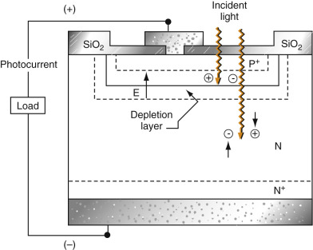

Figure 4-9 

Schematic of a semiconductor photodiode used as a detector in many spectrometers. 

**Multichannel Photon Transducers.** In the discussion of postsample filters, it was noted that unfiltered light emerging from the sample could be broken up into its constituent wavelengths using prisms; these different wavelengths are then directed to electronic detectors such that the intensity of light of each of the constituent wavelengths can be quantitated. Here, we describe some of these multiwavelength photodetectors. 

A multichannel transducer consists of an array of small photoelectric-sensitive elements arranged linearly or in a two-dimensional pattern on a single semiconductor chip. The chip, which is usually silicon and typically has dimensions of a few millimeters on a side, also contains electronic circuitry that makes it possible to determine the electrical output signal from each of the photosensitive elements sequentially or simultaneously. The alignment of a multichannel transducer is generally in the focal plane of a spectrometer, so various elements of the dispersed spectrum can be converted and measured simultaneously. Several types of multichannel transducers currently are used; they may include photodiode arrays (PDAs), charge-injection devices (CIDs), and charge-coupled devices (CCDs). 

 

##  Photodiode Arrays. 

By using the modern fabrication techniques of microelectronics, it is now possible to produce a linear (one-dimensional) array of several hundred photodiodes set side-by-side on a single integrated circuit (IC), or “chip” ( [ Fig. 4-10 ](<#f0055>) ). Each diode is capable of recording the intensity at one point along the line, and together they provide a linear profile of the light variation along the array. 

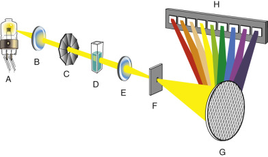

Figure 4-10 

Photodiode array. 

**A,** Lamp. **B,** Lens. **C,** Shutter. **D,** Cell. **E,** Lens. **F,** Slit. **G,** Grating. **H,** Photodiode array. 

A multiplex method is used to sort all of the signals received from the PDA. It records each signal individually and then feeds the signals sequentially to a single amplifier. The output of the PDA is a histogram profile, along the array, of the charge leaked by each photodiode. This mirrors the variation of light intensity across the array. Thus the PDA detection occurs in three main stages: 

  * 1.

Initialization 

  * 2.

Accumulation of charge at each pixel-integration time 

  * 3.

Read-out signals 

In comparison with the PMT, the PDA has a lower dynamic range and higher noise. It is most useful as a simultaneous multichannel detector (  Skoog et al, 1998  ). 

 

##  Charge-Transfer Devices. 

Recent developments in solid-state detection techniques have now produced very effective two-dimensional array detectors that operate on a charge-transfer process as an alternative to photodiodes. A _charge-transfer device_ (CTD) is a detection system in which a photon, striking the IC semiconductor material, releases electrons from their bound state into a mobile state. The released charge, consisting of negative electrons and positive holes, then drifts to, and accumulates at, surface electrodes. An array of these surface electrodes divides the detector into separate, light-sensitive “pixels.” The charge that accumulated at each electrode is proportional to the integrated light intensity falling on that particular pixel. 

Two distinct classes of CTDs are known: charge-injection devices (CIDs) and charge-coupled devices (CCDs). In a CCD, all of the charge packets are moved “in-step” along the array row from one pixel to the next, as in a “bucket chain.” At the end of the row, the charge packets are fed sequentially into an _on-chip_ low-noise amplifier, which then converts the charge into a voltage signal. The overall signal profile across the two-dimensional array is recorded one row at a time, thus giving a series of voltage signals corresponding to all of the pixels in the detection area. 

In a CID, the charge accumulated in each pixel can be measured independently and nondestructively by using a network of “sensing” electrodes, which can monitor the presence of the accumulated charge. This is an important factor that differentiates CID systems from CCD and PDA systems, in which the whole of the detection area is “read” destructively in a single process. 

 

##  Signal Processors and Readout 

The processing of an electrical signal received from a transducer is accomplished by a device that amplifies, rectifies AC to DC (or the reverse), alters the phase of the signal, and filters it to remove unwanted components. In addition, the signal processor may need to perform mathematical operations on the signal such as differential calculations, integration, or conversion to a logarithm. Several readout devices have been used and include digital meters, d'Arsonval meters, recorders, light-emitting diodes (LEDs), cathode-ray tubes (CRTs), and liquid crystal displays (LCDs). 

 

##  Quality Assurance in Spectrophotometry 

Several photometric parameters must be monitored periodically by users. Monitoring these parameters is recommended by most regulatory agencies and accrediting organizations. The parameters routinely monitored include wavelength or photometric accuracy, absorbance check, linearity, and stray light. 

_Accuracy_ is the closeness of a measurement to its true value. _Wavelength accuracy_ implies that a photometer is measuring at the wavelength that it is set to. _Photometric accuracy_ can be assessed easily using special glass-type optical filters. Two examples of commonly used filters include didymium and holmium oxide. Didymium glass has a broad absorption peak around 600 nm, and holmium oxide has multiple absorption peaks with a sharp peak occurring at 360 nm. 

An _absorbance check_ is performed using glass filters or solutions that have known absorbance values for a specific wavelength. The operator simply measures the absorbance of each solution at a specified wavelength and compares the results with the stated values. Each user should establish a tolerance for the measurements based on accepted criteria. 

_Linearity_ is defined as the ability of a photometric system to yield a linear relationship between the radiant power incident upon its detector and the concentration (i.e., Beer's law). The linearity of a spectrometer can be determined using optical filters or solutions that have known absorbance values for a given wavelength. Linearity measurements should be evaluated for both slope and intercept. 

_Stray light_ is described as any light that impinges upon the detector that does not originate from a polychromatic light source. Stray light can have a significant impact on any measurement made. Stray light effect can be evaluated by using special cutoff filters. 

 

##  Types of Photometric Instruments 

Several instrument designs and configurations may be used for absorption photometry. Each has unique terminology associated with its design. The terminology is not universal among users but is presented here as a guide. A _spectroscope_ is an optical instrument used for visual identification of atomic emission lines. It has a monochromator, usually a prism or diffraction grating, in which the exit slit is replaced by an eyepiece that can be moved along the focal plane. The wavelength of an emission line can then be determined from the angle between the incident and dispersed beam when the line is centered on the eyepiece. 

A _colorimeter_ uses the human eye as the detector. The user compares the observed color of the unknown sample against a standard or a series of colored standards of known concentrations. _Photometers_ consist of a light source, a filter, and a photoelectric transducer, as well as a signal processor and readout. Some manufacturers use the term _colorimeter_ or _photoelectric colorimeter_ for a photometer. These photometers use filters for isolation of specific wavelengths, not gratings or prisms. 

A _spectrometer_ is an instrument that provides information about the intensity of radiation as a function of wavelength or frequency. Spectrophotometers are spectrometers equipped with one or more exit slits and photoelectron transducers that permit determination of the ratio of the power of two beams as a function of wavelength, as in absorption spectroscopy. Most spectrophotometers use a grating monochromator to break up the light into a spectrum, as discussed earlier in the section on presam­ple filters. 

Single-beam spectrophotometers are the simplest types of absorption spectrometers. These instruments are designed to make one measurement at a time at one specified wavelength. The absorption maximum of the analyte must be known in advance when a single-beam instrument is used. The wavelength is then set to this value. The reference material (solvent blank) is transferred into a suitable cuvet and is placed in the path of the monochromatic light. The spectrometer is adjusted to read 0%T when a shutter is placed to block all radiation from the detector and is adjusted to read 100%T when the shutter is removed. After these adjustments have been made, the sample is placed in the light path, the absorbance is measured, and the concentration is determined using calculations based on Beer's law or by constructing a calibration curve for the analyte. 

A double-beam spectrophotometer splits or chops the monochromatic beam of radiation into two components. One beam passes through the sample, and the other passes through a reference solution or blank. In this design, the radiant power in the reference beam varies with the source energy, monochromator transmission, reference material transmission, and detector response, making the difference between the sample and the reference beam largely a function of the sample. The output of the reference beam can be kept constant, and the absorbance of the sample can be recorded directly as the electrical output of the sample beam. 

Two fundamental instrument designs are used for double-beam spectrophotometers: double beam in space and double beam in time. A double beam in space design uses two photodetectors: one for the sample beam and the other for the reference beam. The two signals generated are directed to a differential amplifier, which then passes on the difference between the signals to the readout device. A schematic of the double beam in space system is shown in [ Figure 4-11 ](<#f0060>) . 

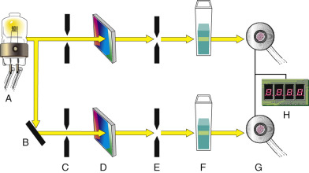

Figure 4-11 

Double beam in space design of spectrophotometer. 

**A,** Exciter lamp. **B,** Mirror. **C,** Entrance slits. **D,** Monochromators. **E,** Exit slits. **F,** Cuvettes. **G,** Photodetectors. **H,** Light-emitting diode (LED). 

A double beam in time instrument uses one photodetector and alternately passes the monochromatic radiation through the sample cuvet and then to the reference cuvet, using a _chopper_ . A chopper is the term used for a device such as a rotating sector mirror that breaks up or rotates radiation beams. Each beam, consisting of a pulse of radiation separated in time by a dark interval, is then directed onto an appropriate detector. A schematic of the double beam in time system is shown in [ Figure 4-12 ](<#f0065>) . 

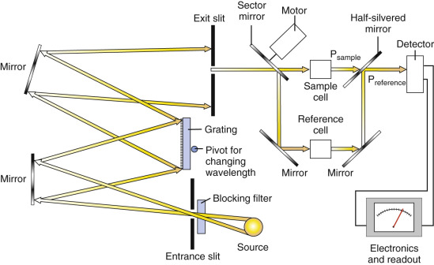

Figure 4-12 

Double beam in time design of spectrophotometer. 

A scanning double-beam system includes a double-beam spectrophotometer and a recorder that can provide an X-Y plot of absorbance versus wavelength for a given test sample. This type of configuration is ideal for determining the wavelength spectrum of an analyte in solution. The spectrophotometer has an automatically driven wavelength cam that can rotate at a predetermined speed. The recorder can be calibrated to the wavelength of the monochromator to facilitate the identification of each peak maxima. 

 

##  Reflectometry 

Measurement of analytes in biologic fluids using reflectometry has been used for decades. Two clinical applications include urine dipstick analysis and dry slide chemical analysis. The instruments used for these applications include a reflectometer. A reflectometer is a filter photometer that measures the quantity of light reflected by a liquid sample that has been dispensed onto a grainy or fibrous solid support. 

The two types of reflectance are specular and diffuse. Specular reflectance occurs on a polished surface where the angle of incidence of the radiant energy is equal to the angle of reflection. Polished surfaces—for example, a mirror—can be used to direct and manage radiant energy but not to determine concentration. Diffuse reflectance occurs on nonpolished surfaces (i.e., a grainy or fibrous surface), as noted earlier. The reflected radiant energy tends to go in many directions. Diffuse reflection occurs within the layers and depends on the properties and characteristics of the layers themselves. A colored substance absorbs the wavelength of its color and reflects all other wavelengths at many different angles. Therefore, the amount of a substance present can be measured as an indirect function of the reflected light. 

A typical reflectometer used in a clinical laboratory detects only a constant fraction of the diffuse reflected light. Thus the reflectance of a sample is represented by the following: 

 R  (  diffuse reflectance  )  =  R  ′ (  fraction of diffuse reflectance of sample  )  R  ′ (  fraction of diffuse reflectance of a standard  ) 

The amount of light reflected by a solution dispensed onto a white granular or grainy surface is inversely related to the concentration of the sample, as given by the following: 

 R  density  =  − log  (  R  sample  − R  black  (  R  standard  )  )  × R  white 

where: 

  * _R_ density  = corrected reflectance density of the sample 

  * _R_ sample  = measured reflectance of the sample 

  * _R_ black  = reflectance of a black reference 

  * _R_ white  = reflectance of a white reference 

  * _R_ standard  = reflectance of a standard solution 

The ideal reflectance value of a pure white standard of ceramic material is _one_ (i.e., all light is reflected), and conversely, the ideal reflectance value of pure black material is _zero_ (i.e., all light is absorbed). 

The relationship of percent reflectance and concentration of an analyte is nonlinear. Several algorithms have been developed for linearizing this relationship. The specific algorithm used depends on the reflection characteristics of the composition material of the pad or film, the nature of the illumination, and the geometry of the instrument. 

 

##  Reflectometers 

The components of a reflectometer are very similar to those of a photometer, as shown in [ Figure 4-13 ](<#f0070>) . A tungsten–quartz halide lamp serves as a source of polychromatic radiation. A monochromator (e.g., stationary filter or filter wheel for multiple analytes) is used to isolate the wavelength of interest. Next, the monochromatic light passes through a slit and is directed onto the surface of a urine dipstick pad or dry slide, depending on the instrumentation used. Solid-state photodiodes are typically used to detect reflected radiant energy. Special optical devices—for example, fiberoptics or ellipsoidal mirrors—can be used to direct radiant energy onto the detector. A computer or microprocessor is used to convert nonlinear reflectance signals into direct readout concentration units. 

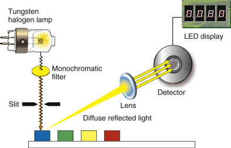

Figure 4-13 

Components in a typical reflectometer used to measure analytes on urine dipstick. 

The different-colored blocks represent different tests performed in urinalysis; the _blue_ represents the quantitation of analyte using reflectance (i.e., the reflectance of light focused on the sample and reflected at an angle _[yellow beam],_ where it is detected). 

 

##  Molecular Luminescence Spectroscopy (Fluorometry) 

 

##  Principle 

Luminescence is based on an energy exchange process that occurs when certain compounds absorb electromagnetic radiation, become excited, and return to an energy level lower than or equal to their original level. Because some energy is lost before emission from the excited state by collision with the solvent or other molecules, the wavelength of the emitted light is longer than that of the exciting light. Most uncharged molecules contain even numbers of electrons in the ground state. These electrons fill molecular orbits in pairs with their spins in opposite directions. No electron energies can be detected by application of a magnetic field to such spin patterns, and this electronic state is called the singlet state. Similarly, if an electron becomes excited by electromagnetic radiation and its spin remains paired with the ground state, this creates a singlet excited state. The lifetime of the excited state is the average length of time the molecule remains excited before emission of light. For a singlet excited state, the lifetime of the excited state is on the order of 10  −9  to 10  −6  s. The light emission from a singlet excited state is called _fluorescence_ . When the spins of the electrons in the excited state are unpaired, the electron energy levels will be split if a magnetic field is applied, and this electronic state is called a triplet state. Triplet state lifetimes range from 10  −4  to 10 s (  Willard et al, 1988  ). Light emission from an excited triplet state is called _phosphorescence_ . 

Luminescence is widely used because of its high sensitivity; the signal-to-noise ratio is very high because light is measured against a nearly dark background. High specificity is a function of using two spectra, the excitation and emission spectra, and the possibility of measuring the lifetime of the fluorescent state. Two compounds that are excited at the same wavelength but emit at different wavelengths are readily differentiated with this technique. 

 

##  Components of Fluorometers and Spectrophotofluorometers 

Instruments designed for fluorescence measurement have the following basic components: a light source, an excitation (primary) monochromator, a cuvet, an emission (secondary) monochromator, and a photodetector ( [ Fig. 4-14 ](<#f0075>) ). The exciter lamp is a high-intensity light source such as a mercury vapor lamp or a xenon arc lamp. Simple instruments use mercury vapor lamps that do not require any special power supply. Mercury vapor lamps produce discrete and intense resonance lines that are not ideal for compounds with absorption bands at wavelengths not coinciding with these emission bands. For such compounds, xenon arc lamps producing an intense continuous spectrum between 300 and 1300 nm are appropriate. These lamps are used in nearly all commercial spectrophotofluorometers. In fluorescence measurements, the emitted light is detected at a right angle to the incident light to eliminate potential interference by the excitation signal. Phototubes or photomultiplier tubes (PMTs) are required for fluorescence measurements because the signals are generally of low intensity. Newer fluorometers on the market today use diode array and CTDs, which allow the rapid recording of both excitation and emission spectra and are particularly useful in chromatography and electrophoresis. 

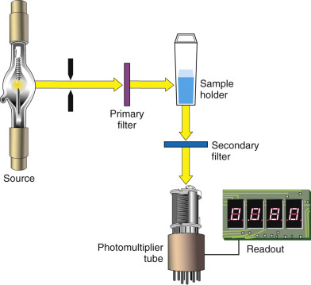

Figure 4-14 

Components of a fluorometer. 

(From Bishop ML, Duben-Engelkirk JL, Fody EP: _Clinical chemistry: Principles, procedures, correlations._ Philadelphia, 1992, JB Lippincott Company; with permission.) 

_Time-resolved fluorescence assays_ minimize problems inherent in other fluorescent assays such as overlapping excitation or emission spectra of compounds present in the sample with the fluorophore. The label most commonly used is a chelate of europium (Eu  3+  ). Energy is absorbed by the organic ligand, leading to an excited state as the electrons migrate from the ground state singlet to the excited singlet state. The excitation may lead to any vibrational multiplet of the excited state S  1  . The molecule rapidly returns to the lowest energy levels in S  1  by a nonradiative process. The energy is transferred to the metal ion, which becomes excited and subsequently emits characteristic radiation. The radiative transition of excited Eu  3+  after an energy transfer from triplet state results in an emission wavelength of 613 nm. The fluorescence lifetime of Eu  3+  chelate is 10 to 1000 µs compared with nanoseconds for the most commonly used fluorophore. Therefore, Eu  3+  with its longer emission lifetime makes it more attractive to use over a fluorophore like fluorescein with a lifetime of 4.5 ns. Time-resolved fluorescence instruments are similar to a typical fluorometer, except that time-resolved fluorometers use a time-gated measure on only a portion of the total emission spectra. 

_Chemiluminescence_ applications have increased dramatically owing to the increased sensitivity over fluorescence. (In chemiluminescence, the light signal is measured against a completely dark background because no excitation light is required.) The primary application has been in the area of immunoassays where several chemiluminescence compounds have been used as antigen labels. Chemiluminescence differs from fluorescence and phosphorescence in that the emission of light is created from a chemical or electrochemical reaction and not from absorption of electromagnetic energy. The chemical reaction yields an electronically excited compound that emits light as it returns to its ground state or that transfers its energy to another compound, which then produces emission. Chemiluminescence involves the oxidation of an organic compound (e.g., dioxetane, luminol, acridinium ester) by an oxidant (hydrogen peroxide, hypochlorite, or oxygen). These oxidation reactions may occur in the presence of catalysts, such as enzymes (alkaline phosphatase, horseradish peroxidase, or microperoxidase), metal ions (Cu  2+  or Fe  3+  phthalocyanine complex), and hemin. The excited products formed in the oxidation reaction produce chemiluminescence on return to the singlet state. A luminometer is used to detect chemiluminescence; it contains a PMT that provides a very strong electrical output signal. A typical signal from a chemiluminescent compound rises rapidly with time and reaches a maximum when reagent and analyte are completely mixed. An exponential decay of the signal follows until baseline is reached. 

 

##  Nephelometry and Turbidimetry 

Nephelometry and turbidimetry are used to measure the concentrations of large particles (such as antigen–antibody complexes, prealbumin, and other serum proteins) that because of their size cannot be measured by absorption spectroscopy. Nephelometry detects light that is scattered at various angles; scattered light yields a small signal that must be amplified. In contrast, turbidimetry measures a reduction in light transmission due to particle formation; thus it detects a small decrease in a large signal ( [ Fig. 4-15 ](<#f0080>) ). 

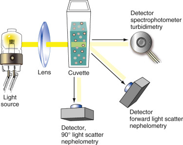

Figure 4-15 

Optical arrangements of nephelometry and turbidimetry. 

Note that nephelometry detects (right-angle or forward) scattered light, and turbidimetry measures a reduction of light transmitted in the forward direction. 

(Modified from Bishop ML, Duben-Engelkirk JL, Fody EP: _Clinical chemistry: Principles, procedures, correlations._ Philadelphia, 1992, JB Lippincott Company; with permission.) 

 

##  Principle 

Nephelometry and turbidimetry are based on the scattering of radiation by particles in suspension. When a collimated light beam strikes a particle in suspension, portions of the light are absorbed, reflected, scattered, and transmitted. Nephelometry is the measurement of the light scattered by a particulate solution. Three types of light scatters occur according to the relative size of the light wavelength (  Gauldie, 1981  ). If the wavelength (λ) of light is much larger than the diameter ( _d_ ) of the particle ( _d_ < 0.1λ), the light scatter is symmetrical around the particle. Minimum light scatter occurs at 90 degrees to the incident beam and was described by Rayleigh (  Rayleigh, 1885  ). If the wavelength of light is much smaller than the particle diameter ( _d_ < 0.1λ), then the light scatters forward owing to destructive out-of-phase backscatter, as described by the Mie theory. If the wavelength of light is approximately the same as the particle size, more light scatters in the forward direction than in other directions, as defined by the Rayleigh-Debye theory. A common application of nephelometry is the measurement of antigen–antibody reactions. Because most antigen–antibody complexes have a diameter of 250 to 1500 nm, and the wavelengths used are 320 to 650 nm, light is scattered forward (Rayleigh-Debye type). 

 

##  Nephelometer 

A typical nephelometer consists of a light source, a collimator, a monochromator, a sample cuvet, a stray light trap, and a photodetector. Light scattered by particles is measured at an angle, typically 15 to 90 degrees to the beam incident on the cuvet (see [ Fig. 4-15 ](<#f0080>) ). Light scattering depends on the wavelength of incident light and particle size. For macromolecules with size close to or larger than the light wavelength, measurement of forward light scatter increases the sensitivity of nephelometry. Light sources include a mercury-arc lamp, a tungsten-filament lamp, a light-emitting diode, and a laser. 

Lasers produce stable, nearly ideal monochromatic light of narrow bandwidth and emit radiant energy that is coherent, parallel, and polarized. A laser beam can be maintained as a very slim cylinder only a few micrometers in cross section. A typical helium-neon laser lamp consists of a helium-pumping electrode (cathode) and a hollow glass laser core surrounded by a laser plasma tube (anode). Both the plasma tube and the core are filled with free helium and neon gases. The electrical discharge between the cathode and the anode is confined to the hollow glass core to keep it concentrated for maximum energy transfer. Two mirrors are positioned at the ends of the laser tube. One of them is fully reflective and the other partially transparent. When the electrode is charged, the helium atoms are excited to a higher energy state and then transfer this energy to the neon atoms by collision. In turn, the excited neon atoms emit photons. Photons bounce back and forth between the two end mirrors, stimulating other atoms to emit additional photons, resulting in an amplification process. The amplified light eventually emerges as a laser beam through the partially transparent mirror. With the high-intensity monochromatic beam, a substantial increase in sensitivity has been seen with lasers over conventional light sources. Disadvantages of laser sources include cost, safety and cooling requirements, and limited availability of wavelengths. 

 

##  Turbidimetry 

The measurement of the reduction in light transmission caused by particle formation is termed _turbidimetry_ . Light transmitted in the forward direction is detected. The amount of light absorbed by a suspension of particles depends on the specimen concentration and on the particle size. Solutions requiring quantitation by turbidimetry are measured using visible photometers or visible spectrophotometers. Higher sensitivity has been achieved using photodetectors that can detect small changes in photon signals. Sensitivity comparable with nephelometry can be attained using low wavelengths and high-quality spectrophotometers. Many clinical applications exist for turbidimetry. Various microbiology analyzers measure the turbidity of samples to detect bacterial growth in broth cultures. Turbidimetry is routinely used to measure the antibiotic sensitivities from such cultures. In coagulation analyzers, turbidimetric measurements detect clot formation in the sample cuvets. Turbidimetric assays have long been available in clinical chemistry to quantify protein concentration in biologic fluids, such as urine and cerebrospinal fluid (CSF). 

 

##  Refractometry 

Refractometry is based on light refraction. When light passes from one medium into another, the light beam changes its direction at the boundary surface if its speed in the second medium is different from that in the first. The ability of a substance to bend light is called _refractivity_ , and it is measured as a difference between the _angle of incidence_ and the _angle of refraction._ The refractivity of a liquid depends on the wavelength of the incident light, the temperature, the nature of the liquid medium, and the concentration of the solute dissolved in the medium. If the first three factors are held constant, the refractivity of a solution is an indirect measurement of total solute concentration. Refractometry can be used to measure protein concentration, specific gravity of urine, and column effluent of high-performance liquid chromatography analysis. 

 

##  Osmometry 

Osmometry is the measurement of the osmolality of an aqueous solution such as serum, plasma, or urine. As osmotically active particles (e.g., glucose, urea nitrogen, sodium) are added to a solution, causing its osmolality to increase, four other properties of the solution are also affected. These properties are osmotic pressure, boiling point, freezing point, and vapor pressure. They are called _colligative properties_ of the solution because they can be related to one another and to the osmolality. As the osmolality of a solution increases, (1) the osmotic pressure increases, (2) the boiling point is elevated, (3) the freezing point is depressed, and (4) the vapor pressure is depressed. Osmometry is based on measuring changes in the colligative properties of solutions that occur owing to variations in particle concentration. Freezing-point depression osmometry is the most commonly used method for measuring the changes in colligative properties of a solution. It is based on the principle that the addition of solute molecules lowers the temperature at which a solution freezes. 

 

##  Principle of Freezing-Point Osmometry 

The freezing point is the temperature at which water and ice are in equilibrium and is related to solute concentration. It is described by the following equation: 

 ρ T  f  =  K  f  m 

where: 

  * ρT  f  = change in freezing-point temperature 

  * K  f  = freezing-point constant of the solvent 

  * _m_ = molality 

A 1.0-mOsm/kg solution has a freezing point depression of 0.00186° C when compared with pure solvent (water). Thus blood plasma, with an osmolality of about 285 mOsm/kg, has a freezing point of about –0.53° C. 

 

##  Freezing-Point Osmometer 

A freezing-point osmometer consists of a sample chamber containing a stirrer and a thermistor (temperature-sensing device) connected to a readout device. The sample is rapidly supercooled to several degrees below its freezing point in a refrigeration chamber containing, for example, ethylene glycol. The sample is then agitated with the stirrer to initiate freezing. As ice crystals form, heat is released from the solution; this raises the temperature of the sample. The rate at which this heat of fusion is released from the ice being rapidly formed reaches equilibrium with the rate of heat removed by the colder temperature of the sample chamber. This equilibrium temperature, known as the freezing point of the solution, stays constant for several minutes once it is reached. This freezing point is detected by the thermistor, and the osmolality of the sample is converted to units of milliosmoles per kilogram of water. 

 

##  Flow Cytometry 

A flow cytometer measures multiple properties of cells suspended in a moving fluid medium. As each particle passes single file through a laser light source, it produces a characteristic light pattern that is measured by multiple detectors for scattered light (forward and 90 degrees) and fluorescent light (if the cell is stained with a fluorochrome). Flow cytometry is used to count and sort cells, as well as viral particles, DNA fragments, bacteria, and latex beads. It is a core component of hematology cell counters and the technology used to differentiate white blood cells. 

In flow cytometry, the term _particle_ describes any object flowing through the instrument. An _event_ is anything that is interpreted by the instrument to be a single particle. An event may be determined correctly or incorrectly by a flow cytometer. Methods have been developed to compensate for measurement of unwanted events. An example is the correction for measuring the simultaneous passing of two particles. Particles must be in suspension as single cells to be analyzed. If not, they can be made suitable for flow cytometry by the use of mechanical disruption or enzymatic digestion. Size restrictions also apply; cells or particles must be from 1 to 30 µm in diameter. Specialized flow cytometers are designed to handle smaller particles such as DNA fragments or bacteria. 

 

##  Instrument Components 

The system shown in [ Figure 4-16 ](<#f0085>) has all of the design features of a flow cytometer with cell-sorting capabilities. The cell suspension aliquots are introduced into the flow chamber using air pressure. As cells pass through the flow chamber, a low-pressure sheath fluid surrounds them. This outer fluid stream creates a laminar flow that forces the specimen to the center and results in a single-file alignment of the individual cells. This process is called _hydrodynamic focusing_ . A laser beam passes through each cell as it flows through the chamber. Forward light scatter is proportional to cell size, and 90-degree or right-angle scatter is related to cell granularity and nuclear irregularity. If the cells are labeled with appropriate fluorochromes, fluorescent signals proportional to the amount of bound label can be measured. Green fluorescence usually means that the dye fluorescein was used as a marker; red fluorescence usually means that a dye such as phycoerythrin was used as the contrasting marker. These dyes are usually attached to antibodies to specifically target selective antigens on cells or particles. 

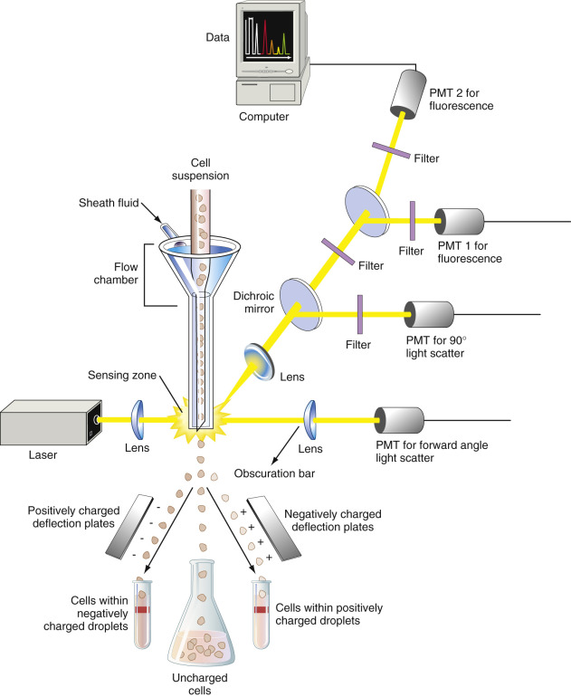

Figure 4-16 

Components of a flow cytometer and a cell sorter. 

(Redrawn from Ward KM, Lehmann CA, Leiken AM: _Clinical laboratory instrumentation and automation: Principles, applications, and selection._ Philadelphia, 1994, WB Saunders; with permission.) 

Forward light scatter is directed to the forward scatter photodetector. At right angles to the laser beam are mirrors that divide the right-angle light scatter among the remaining photodetectors (e.g., a right-angle scatter detector and two fluorescence detectors). Across the forward lens is an obscuration bar that blocks the laser beam after it passes through the stream. Only light from the laser that has been refracted or scattered as it strikes a particle in the stream is diverted enough from its original direction to avoid the obscuration bar and strike the forward positioned lens and the photodiode behind it. Granulocytes, monocytes, and lymphocytes are separated on the basis of size and granularity patterns, as determined by simultaneously analyzing forward and right-angle light scatter. For example, granulocytes with irregular nuclei scatter more light to the side than do lymphocytes with their spherical nuclei. Cell subpopulations can be identified by using electronic gating and analyzing fluorescence patterns (based on labels used for specific cells). 

FACS, an acronym for _fluorescence-activated cell sorter,_ describes the ability of a flow cytometer to physically sort cells in a liquid suspension. To do so, the instrument design has to be modified to electrically charge cells of interest. This is done by first vibrating the sheath stream to break it into drops. The stream of drops flows past two charge (high-voltage) plates, where the cells of interest are electrically charged with a voltage pulse. Then the flow stream enters an electrical field, where the charged cells are deflected into suitable collection containers. Unwanted cells are not charged and are not deflected upon passing through the field. 

 

##  Electrochemistry 

Electrochemistry involves measurement of the current or voltage generated by the activity of specific ions. Analytic techniques include potentiometry, coulometry, voltammetry, and amperometry. 

 

##  Potentiometry 

The measurement of potential (voltage) between two electrodes in a solution forms the basis for a variety of procedures for measuring analyte concentration. Electrical potentials are produced at the interface between a metal and ions of that metal in a solution. Such potentials also exist when a membrane semipermeable to that ion separates different concentrations of an ion. To measure the electrode potential, a constant-voltage source is needed as the reference potential. The electrode with a constant voltage is called the reference electrode, whereas the measuring electrode is called the indicator electrode. Concentration of ions in a solution can be calculated from the measured potential difference between the two electrodes. The measured cell potential is related to the molar concentration by the Nernst equation: 

 E  =  E  o  − R  T  /  n  F  ln  a  red  /  a  ox  =  E  o  − 2.302  R  T  /  n  F  log  a  red  /  a  ox 

where: 

  * _E_ = cell potential measured 

  * _E_ o  = standard reduction potential 

  * _n_ = number of electrons involved in the reaction 

  * _a_ red  = activity of the reduced species 

  * _a_ ox  = activity of the oxidized species 

  * _F_ = Faraday (96,485 C/mol) 

  * _T_ = absolute temperature 

  * _R_ = molar gas constant 

Substituting molar concentration for activity and common logarithm for natural log: 

 E  =  E  o  − (  0.0592  /  n  )  log  C  red  /  C  ox 

where: 

  * _C_ red  = concentration of reduced species 

  * _C_ ox  = concentration of oxidized species 

The Nernst equation is useful for predicting the electrochemical cell potential given the concentrations of oxidized and reduced species for a given electrode system. 

 

##  Reference Electrodes 

In many electroanalytic applications (e.g., measuring pH), it is desirable that the half-cell potential of one electrode be known, constant, and completely insensitive to the composition of the solution under study. An electrode that fits this description is called a _reference electrode_ . 

An ideal reference electrode should (1) conform to the Nernst equation, (2) exhibit a potential that is constant with time, (3) return to its original potential after being subjected to small currents, and (4) exhibit little hysteresis (i.e., lags with temperature cycling). The standard hydrogen electrode (SHE) exhibits many of these qualities but is not practical to use in clinical laboratory instrumentation. Thus the calomel and silver/silver chloride reference electrodes are widely used for clinical measurements. 

The calomel electrode (saturated calomel electrode [SCE]) consists of mercury in contact with a solution that is saturated with mercury (I) chloride (calomel) and that also contains a known concentration of potassium chloride. The silver/silver chloride electrode consists of a silver electrode immersed in a solution of potassium chloride that has been saturated with silver chloride. Silver/silver chloride electrodes can be used at temperatures greater than 60° C, whereas calomel electrodes cannot. Mercury (II) ions, however, react with fewer sample components than do silver ions (which can react with proteins, for example); such reactions can lead to plugging of the junction between the electrode and the analyte solution. 

 

##  Ion-Selective Electrode 

An ion-selective electrode (ISE) is an electrochemical transducer capable of responding to one specific ion. An ISE is very sensitive and selective for the ion it measures. It consists of a membrane or other barrier separating a reference solution and a reference electrode from the solution to be analyzed. The complexity of ion-selective electrode design depends on the membrane/barrier composition that determines its ionic selectivity. Many types of ISEs are available, including glass electrodes, liquid membrane electrodes, precipitate-impregnated membrane electrodes, solid-state electrodes, gas electrodes, and enzyme electrodes. 

 

##  pH Electrode 

Glass electrodes were the first and are still the most common electrodes for measuring hydrogen ion activity (pH or negative log of the hydrogen ion concentration). A pH electrode consists of a small bulb made of layers of hydrated and nonhydrated glass, which contains a chloride ion buffer solution. The buffer has a known hydrogen ion concentration. An internal electrode, usually silver/silver chloride, serves as an internal reference electrode. A saturated calomel electrode is used as an external reference electrode. One theory suggests that the sodium ions in the hydrated glass layer drift out. Sodium ions have a large ionic radius. Specimens containing hydrogen ions, which have a smaller ionic radius, replace the sodium ions. The result is a net increase in the external membrane potential. This potential propagates through the thin, dry membrane to the inner hydrated surface of the glass. Chloride ions in the inner buffer solution respond by migrating to the internal glass layer. Potentials generated at the pH electrode are referenced to the external reference electrode (saturated calomel), and the difference or change is displayed as pH units. 

 

##  _p_ CO  2  Electrode 

The _p_ CO  2  electrode is a pH electrode contained within a plastic jacket. This plastic jacket is filled with a sodium bicarbonate buffer and has a gas-permeable membrane (Teflon or silicone) across its opening. When whole blood containing dissolved carbon dioxide (CO  2  ) contacts the Teflon membrane, CO  2  from the blood passes through and mixes with the buffer. The equilibrium reaction shown in [ Equation 4-14 ](<#e0090>) shifts, depending on the number of carbon dioxide molecules in a sample. The hydrogen ion activity is measured by a potentiometric pH indicator system. 

 CO  2  \+  H  2  O  ⇌ HCO  3  − \+  H  \+ 

 

##  Coulometry 

Coulometry measures the quantity of electricity (in coulombs) needed to convert an analyte to a different oxidation state. By definition, a coulomb is the quantity of electricity or charge that is transported in 1 second by a constant current of 1 ampere. For a constant current of 1 ampere for _t_ seconds, the number of coulombs ( _Q_ ) is given by the expression: 

 Q  =  I  t 

A Faraday is the charge in coulombs associated with 1 mole of electrons. The charge of the electron is 1.6018 × 10  −19  C, so 1 Faraday is equal to 96,485 C/mol. 

Coulometry is used to measure chloride ion in serum, plasma, CSF, and sweat samples. In measuring chloride with coulometry, a constant current is applied across the two silver electrodes, which liberate silver ions into the specimen at a constant rate. Chloride ions in the sample combine with released silver ions to produce insoluble silver chloride. A pair of indicator and reference electrodes senses the excess silver ions and stops the titration. The number of silver ions released by ionization, which is exactly equal to that of chloride ions in the sample, can be calculated from Faraday's law: 

 Q  =  I  t  =  z  n  F 

where: 

  * _z_ = number of electrons involved in the reaction 

  * _n_ = number of moles of analyte in the sample 

  * _F_ = Faraday's constant (96,485 C/mol of electrons) 

 

##  Amperometry 

_Amperometry_ is the measurement of the current flow produced by an oxidation–reduction reaction. Several immobilized enzyme electrodes use this principle, as do _p_ O  2  electrodes (discussed later) and chloride titrators. The measurement of chloride in samples involves the use of two electrochemical methods: coulometry (discussed earlier) and amperometry. In the chloride titrator, a pair of silver electrodes serves as the indicator electrodes. When all of the chloride has been consumed, the silver appears in excess, causing an increase in current. This signals the endpoint of the reaction. 

 

##  _p_ O  2  Gas-Sensing Electrode 

A widely used oxygen-sensing electrode (to determine partial pressure of oxygen in blood) incorporated in blood gas analyzers uses an amperometric or current-sensing electrolytic cell as the indicator electrode. 

The _p_ O  2  electrode uses a gas-permeable membrane, usually polypropylene, which allows dissolved oxygen to pass through. This membrane also prevents other blood constituents (that may interfere with the electrode) from passing through. Once the oxygen permeates the membrane, it reacts with a polarized platinum cathode according to the following reaction: 

 O  2  \+  4  e  ′ → 2  O  − 2  O  − \+  2  H  2  O  → 4  OH  −

This, in turn, produces a change in the current through the cell, and the change is directly proportional to the partial pressure of oxygen present in the specimen. 

 

##  Voltammetry 

_Voltammetry_ is a method in which a potential is applied to an electro­chemical cell and the resulting current is measured. The most important advantages of voltammetry are sensitivity and the capability for multielement measurements. Analytes can be detected in the parts-per-billion range. With careful selection of testing conditions and methods, several analytes can be measured simultaneously in a single voltammetric study. Voltammetry consumes minimal analyte, unlike coulometry, which converts all of the analyte to another state. _Anodic stripping voltammetry_ is an electrochemical technique used to measure heavy metals such as lead. The measurement of lead in blood occurs in basically two steps. First, free lead is electroplated (deposited) onto the platinum cathodes at a characteristic voltage. Second, the lead is stripped off of the platinum cathode, and the current is monitored over time. The current value is proportional to the amount of lead in the blood sample. This technique allows the sample to be preconcentrated at the electrode, which enables the method to detect very low analyte levels. 

 

##  Conductance 

The principles of conductance have several applications associated with clinical laboratory procedures. Examples include monitoring water purity, measuring analytes in blood such as urea, and serving as components of detectors used in high-performance liquid chromatography (HPLC), gas chromatography (GC), cell counters, and capillary electrophoresis. 

Electrolytic conductivity is a measure of the ability of a solution to carry an electrical current. Solutions of electrolytes conduct an electrical current by migration of ions under the influence of a potential gradient. The ions move at a rate dependent on their charge and size, the microscopic viscosity of the medium, and the magnitude of the potential gradient. Thus for an applied potential, _E_ , maintained constant but at a value that exceeds the deposition potential of the electrolyte, the current, _I_ , that flows between the electrodes immersed in the electrolyte, varies inversely with the resistance of the electrolytic solution, _R_ . The reciprocal of resistance, _1_ / _R_ , is called the conductance, _G_ , and is expressed in reciprocal ohms, or mhos. 

 

##  Impedance 

Electrical impedance measurement is based on the change in electrical resistance across an aperture when a particle in conductive liquid passes through this aperture. Electrical impedance is used primarily in the hematology laboratory to enumerate leukocytes, erythrocytes, and platelets. In a typical electrical impedance instrument, as originally developed by Wallace Coulter, aspirated blood is divided into two separate volumes for measurements. One volume is mixed with diluent and is delivered to the cell bath, where erythrocyte and platelet counts are performed. As a cell passes through the aperture, partially occluding it, the electrical impedance increases, producing a voltage pulse, the size of which is proportional to the cell size. The number of pulses is directly related to the cell count. Particles measuring between 2 and 20 fL are counted as platelets, whereas those measuring greater than 36 fL are counted as erythrocytes. The other blood volume is mixed with diluent and a cytochemical-lytic reagent that lyses only the red blood cells. A leukocyte count is performed as the remaining cells pass through an aperture. Particles greater than 35 fL are recorded as leukocytes. 

 

##  Electrophoresis and Densitometry 

Electrophoresis is the separation of charged compounds based on their electrical charge. When a voltage is applied to a salt solution (usually sodium chloride), an electrical current is produced by the flow of ions: cations toward the cathode and anions toward the anode. Conductivity of a solution increases with its total ionic concentration. The greater the net charges of a dissolved compound, the faster it moves through the solution toward the oppositely charged electrode. The net charge of a compound, in turn, depends on the solution pH. Electrophoresis separations often require high voltages (50-200 V DC); therefore, the power supply should supply a constant DC voltage at these levels. The buffer solution must have a carefully controlled ionic strength. A dilute buffer causes heat to be generated in the cell, and a high ionic strength does not allow good separation of the fractions. Common support media for electrophoresis in clinical work include cellulose acetate, agarose, and polyacrylamide gels. Total volume of specimen applied depends on the sensitivity of the detection method. For clinical work, 1 µL of serum may be applied. Once the electrophoresis is completed, the support medium is treated with a dye to identify the separated fractions. The most common dyes used for the visualization step include Amido Black, Ponceau S, Fat Red 7B, and Sudan Black B. To obtain a quantitative profile of the separated fractions, densitometry is performed on the stained support medium. 

A densitometer measures the absorbance of the stain on a support medium. The basic components of a densitometer include a light source, a monochromator and a movable carriage to scan the medium over the entire area, an optical system, and a photodetector. Signals detected by the photodetector are related to the absorbance of the sample stain on the support, which is proportional to the specimen concentration. The support medium is moved through the light beam at a fixed rate, so a graph may be constructed that represents multiple density readings taken at different points. Most densitometers have a built-in integrator to find the area under the curve, so all sample fractions can be quantified. 

 

##  Isoelectric Focusing 

Proteins are polymers of amino acids that can be anions or cations, depending on the pH environment. At a specific pH, a protein will have a net charge of zero when the positive charge and the negative charge of its amino acids cancel each other out. At this pH value, known as the protein's isoelectric point (pI), the protein is isoelectric. Isoelectric focusing (IEF) techniques are performed similarly to other electrophoresis methods, except that the separating molecules migrate through a pH gradient. This pH gradient is created by adding acid to the anodic area of the electrolyte cell and adding base to the cathode area ( [ Fig. 4-17 ](<#f0090>) ). A solution of ampholytes (mixtures of small amphoteric ions with different pIs) is placed between the two electrodes. These ampholytes have high buffering capacity at their respective isoelectric points. The ampholytes close to the anode carry a net positive charge, and those close to the cathode carry a net negative charge. When an electrical voltage is applied, each ampholyte will rapidly migrate to the area where the pH is equal to its isoelectric point. With their high buffering capacity, the ampholytes create stable pH zones for the more slowly migrating proteins. The advantage of isoelectric focusing techniques lies in their ability to resolve mixtures of proteins. Using narrow-range ampholytes, macromolecules differing in isoelectric point by only 0.02 pH units can be identified. Isoelectric focusing has been useful in measuring serum acid phosphatase isoenzymes. Its application has also been extended to detect oligoclonal immunoglobulin bands in CSF and isoenzymes of creatine kinase and alkaline phosphatase in serum. 

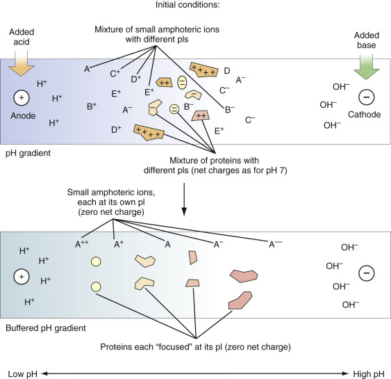

Figure 4-17 

Isoelectric focusing (see text). 

(Redrawn from  Schoeff LE, Williams RH  : _Principles of laboratory instruments._ St. Louis, 1993, Mosby; with permission.) 

 

##  Chromatography 

Chromatography is a separation method based on different interactions of the specimen compounds with the mobile phase and with the stationary phase as the compounds travel through a support medium. Compounds interacting more strongly with the stationary phase are retained longer in the medium than those that favor the mobile phase. Chromatographic techniques may be classified according to their mobile phase: gas chromatography and liquid chromatography. [ Figure 4-18 ](<#f0095>) shows a typical chromatogram representing the concentration of each detectable compound eluting from the column as a function of time. Retention time ( _t_ R  ) is the time it takes a compound to elute. This value is characteristic of a compound and is related to the strength of its interaction with the stationary phase and the mobile phase. The retention time therefore can be used to determine a compound's identity. In this example, two compounds are separated, and their retention times are represented by ( _t_ R1  ) and ( _t_ R2  ). These are uncorrected retention times and are measured from the injection time, _t_ = 0. A column's ability to separate two compounds depends on several factors, which include the difference in retention of the compounds or capacity factor, _k ′ _ ; the selectivity factor, α; and the number of theoretical plates. 

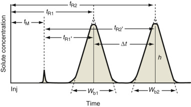

Figure 4-18 

Chromatogram for the separation of two compounds. 

Note that the uncorrected retention time ( _t_ R1  and _t_ R2  ) is from injection (Inj) to peak; the corrected time ( _t_ R1′ and _t_ R2′ ) takes into account the retention time of a nonretained compound ( _t_ M). 

(Redrawn from Ravindranath B: _Principles and practice of chromatography_ . New York, 1989, John Wiley & Sons; with permission.) 

The value of _k ′ _ can be calculated by the following equation: 

 k  ′ =  (  t  R1  − t  m  )  /  t  m  or  t  R  1  ′ /  t  m 

where: 

  * _t_ m  = retention time of an unretained compound 

  * _t_ R1′ = corrected retention time 

Another measurement derived from the calculated capacity factor is the selectivity factor (α) or relative retention of two solutes. A ratio of both capacity factors is used to calculate the selectivity factor. To measure the width of each peak, draw tangents along the sides of the peak to the baseline. _W_ b  represents the distance between the two intersected lines. Another useful concept is theoretical plates. This describes the process by which the sample is transported down the column. In each “plate,” the sample equilibrates between stationary and mobile phases. The analyte moves down the column as the equilibrated mobile phase transfers sample from one plate to another. To calculate the number of theoretical plates ( _N_ ), use the following equation: 

 N  =  16  (  t  R  /  W  b  )  2 

A plate number has no units, and the larger the value of _N_ for a column, the greater is its separation efficiency. The combined effects of solvent efficiency and column efficiency are expressed in the resolution ( _R s  _ ) of the column: 

 R  s  =  (  t  R  2  − t  R  1  )  /  0.5  (  W  b  1  \+  W  b  2  ) 

The concentration of unknown compound can be derived by integration of peak areas or by using the method of internal standardization. 

 

##  Gas Chromatography 

Gas chromatography (GC) is useful for compounds that are naturally volatile or can be easily converted into a volatile form. GC has been a widely used method for decades owing to its high resolution, low detection limits, accuracy, and short analytic time. Applications involve various organic molecules, including many drugs (see [ Chapter 23 ](<##!/content/3-s2.0-B9780323295680000231?scrollTo=%23c00023>) ). Retention of a compound in GC is determined by its vapor pressure and volatility, which, in turn, depends on its interaction with the stationary phase. Two types of stationary phases commonly used in GC are solid absorbent (gas–solid chromatography [GSC]) and liquids coated on solid supports (gas–liquid chromatography [GLC]). In GSC, the same material (usually alumina, silica, or activated carbon) acts as both the stationary phase and the support phase. Although this was the first type of stationary phase developed, it is not as widely used as other types, primarily because of the strong retention of polar and low volatile solutes by the column (  Ravindranath, 1989  ). GLC uses liquid phases such as polymers, hydrocarbons, fluorocarbons, liquid crystals, and molten organic salts to coat the solid support material. Calcine diatomaceous earth graded into appropriate-size ranges is often used as a stationary phase because it is a stable inorganic substance. The use of fused silica capillary columns in which the stationary phase is chemically bonded onto the inner surface of the column has become very popular with chromatographers. The advantage of this type of column is that the stationary phase does not leave the solid support and bleed into the detector, and a uniform monomolecular layer of the stationary phase is obtained through the bonding procedure. 

Components of a typical GC system are illustrated in [ Figure 4-19 ](<#f0100>) . Its basic design consists of five components: a gas cylinder as a mobile phase source, a sample injector, a column, a detector, and a computer for data acquisition. These systems may be automated to provide the user with a more precise and efficient separation. Carrier gases (mobile phase), which must be chemically inert, include helium, hydrogen, and nitrogen. Other substances used as mobile phases include steam and supercritical fluids. Examples of these are carbon dioxide, nitrous oxide, and ammonia. The carrier gas should be of high purity, and the flow must be tightly controlled to ensure optimum column efficiency and reproducibility of test results. Samples are manually introduced into the GC using a syringe pipet or an automated syringe pipet system. A pipet tip pierces a plastic septum located in the injector port. Each injection port is heated to very high temperatures. Samples are vaporized and swept onto the column. If the molecule of interest is not volatile enough for direct injection, it is necessary to derivatize it into a more volatile form. Most derivatization reactions belong to one of three groups: silylation, alkylation, and acylation. Silylation is the most common technique that replaces active hydrogens on the compounds with alkylsilyl groups. This substitution results in a more volatile form that is also less polar and more thermally stable. 

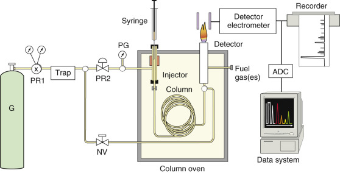

Figure 4-19 

Components of a gas chromatographic system. 

_G,_ Gas cylinder. _NV,_ Valve for adjusting the gas flow rate. _PG,_ Pressure gauge. _PR1_ and _PR2,_ Regulators. 

(Redrawn from Ravindranath B: _Principles and practice of chromatography._ New York, 1989, John Wiley & Sons; with permission.) 

Retention of compounds in a GC column can also be adjusted by changing the column temperature. The column temperature affects the volatility of the compounds and thus the degree of their interaction with the stationary phase. By proper selection of the starting temperature and temperature gradient during the procedure, good resolution of both weakly and strongly retained compounds may be achieved. The GC column, enclosed in a temperature-controlled oven, can be a packed column or a capillary column. Packed columns are usually 1 to 5 m long and 2 to 4 mm in diameter and are filled with a stationary phase. Capillary columns range from 5 to 100 m in length and from 0.1 to 0.8 mm in diameter and have a stationary phase located on their interior surface (  Bartle, 1993  ). Capillary columns generally have higher efficiency and better detection limits. However, packed columns have a larger specimen or sample capacity, making them more useful in purification work. Examples of detectors used in GC include a flame ionization detector, a thermal conductivity detector, a nitrogen-phosphorus detector, an electron capture detector, a flame photometric detector, and a mass spectrometric detector. Flame ionization detectors (FIDs) are commonly used and are capable of detecting a wide variety of organic compounds and many inorganic compounds. This type of detector measures the ions produced by the compounds when burned in a hydrogen-air flame. An electrode collects the ions, and the magnitude of the resulting electrical current is proportional to the amount of substance (  Tipler, 1993  ). FIDs can be modified to make them especially sensitive to molecules, including many drugs that contain either nitrogen or phosphorus (the so-called nitrogen-phosphorus detector, or NPD). 

 

##  Liquid Chromatography 

GC as a separation technique has some restrictions that make liquid chromatography a suitable alternative. Many organic compounds are too unstable or are insufficiently volatile to be assayed by GC without prior chemical derivatization. Liquid chromatography techniques use lower temperatures for separation, thereby achieving better separation of thermolabile compounds. These two factors allow liquid chromatography to separate compounds that cannot be separated by GC. Finally, it is easier to recover a sample in liquid chromatography than in gas chromatography. The mobile phase can be removed, and the sample can be processed further or reanalyzed under different conditions. 

Many forms of liquid chromatography are available, and the selection of an appropriate form depends on a variety of factors. These factors include analysis time, type of compound, and detection limits. Paper, thin-layer, ion-exchange, and exclusion liquid chromatography often result in poor efficiency and a very long analysis time owing to low mobile phase flow rates. High-performance liquid chromatography (HPLC) emerged in the late 1960s as a viable form of liquid chromatography that provided advantages over other forms of liquid chromatography and gas chromatography. HPLC uses small, rigid supports and special mechanical pumps, producing high pressure to pass the mobile phase through the column. HPLC columns can be used many times without regeneration. The resolution achieved with HPLC columns is superior to that of other forms of liquid chromatography, analysis times are usually much shorter, and reproducibility is greatly improved. All of these attributes of HPLC render it a better method of separation over other forms of liquid chromatography. 

Five separation techniques are commonly used in liquid chromatography. They include adsorption, partition, ion-exchange, affinity, and size exclusion. Each is characterized by a unique combination of stationary phase and mobile phase. In _adsorption (liquid –solid) chromatography _ , the compounds are adsorbed to a solid support such as silica or alumina. Although this was the first type of column liquid chromatography developed, it is not widely used owing to the strong retention of many compounds by the supports, making them difficult to elute from the column. _Partition (liquid –liquid) chromatography _ separates compounds based on their partition between a liquid mobile phase and a liquid stationary phase coated on a solid support. Partition chromatography includes normal-phase liquid chromatography, which uses a polar liquid stationary phase, and reverse-phase liquid chromatography, which uses a nonpolar stationary phase. _Ion-exchange chromatography_ uses column packing material that has charge-bearing functional groups attached to a polymer matrix. The mechanism in this type of chromatography is the exchange of sample ions and mobile-phase ions with the charged group of the stationary phase. _Affinity chromatography_ uses immobilized biochemical ligands as the stationary phase to separate a few solutes from other unretained solutes. This type of separation uses the so-called lock-and-key binding that is widely present in biologic systems. _Size-exclusion_ chromatography separates molecules according to differences in their size. The support material has a certain range of pore sizes. As solutes travel through, the small molecules can enter the pores, whereas the larger ones cannot and will elute first from the column. 

Liquid chromatography is similar in many aspects to GC, and therefore the instrumentation is similar. A typical liquid chromatography system consists of a liquid mobile phase, a sample injector (manual or automatic), a mechanical pump, a column, a detector, and a data recorder ( [ Fig. 4-20 ](<#f0105>) ). The liquid mobile phase is pumped from a solvent reservoir through the column. A mechanical pump must provide precise and accurate flow, often working at high pressures (typically up to 6000 PSI). The pump must have low internal volume and be constructed of material that does not react with the solvent. Sample injection is achieved using a syringe and depositing the sample into a loop. The injection may be performed manually or automatically using a microprocessor control autosampler. Most analytic separations are performed using packed columns. Many types of packing materials are available. Selection of the appropriate packing material is largely dependent on the type of compound(s) to be separated. In liquid chromatography, the physical properties of the sample and the mobile phase are often very similar. Two basic types of detectors have been developed. One is based on the differential measurement of a physical property common to both the sample and the mobile phase; examples include refractive index, conductivity, and electrochemical detectors. The other is based on the measurement of a physical property that is specific to the sample, either with or without the mobile phase; examples include absorbance and fluorescent detectors. 

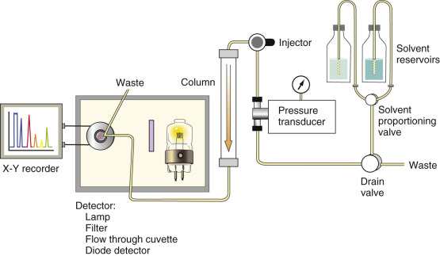

Figure 4-20 

Components of a high-performance liquid chromatograph. 

A widely used clinical application of HPLC is the separation and quantitation of various hemoglobins associated with specific diseases (e.g., thalassemia). Whole blood measurement of glycosylated hemoglobin (HbA  1c  ) can be accomplished using HPLC with complete analysis within 5 minutes. 

 

##  Mass Spectrometry 

Mass spectrometry (MS) is based on fragmentation and ionization of molecules using a suitable source of energy. The resulting fragment masses and their relative abundance yield a characteristic mass spectrum of the parent molecule. Before a compound can be detected and quantified by mass spectrometry, it must be isolated by another method: GC or HPLC. Mass spectrometry typically involves the following major steps: (1) conversion of the parent molecule into a stream of ions (usually singly charged positive ions); (2) separation of the ions by mass/charge ratio ( _m_ / _z_ ), where _m_ is the mass of the ion in atomic mass units and _z_ is its charge; and (3) counting of the number of ions of each type or measurement of current produced when the ions strike a transducer. Because most of the ions formed are singly charged, the _m_ / _z_ is usually simply the mass of the ion. MS is also described in [ Chapter 23 ](<##!/content/3-s2.0-B9780323295680000231?scrollTo=%23c00023>) (see especially [ Figs. 23-5 ](<##!/content/3-s2.0-B9780323295680000231?scrollTo=%23f0030>) and [ 23-6 ](<##!/content/3-s2.0-B9780323295680000231?scrollTo=%23f0035>) ) as a technique for drug-of-abuse testing. MS techniques are available for proteomics, which is discussed in [ Chapter 77 ](<##!/content/3-s2.0-B9780323295680000772?scrollTo=%23c00077>) . 

 

##  Atomic Weights (amu and Da) 

Atomic and molecular weight are generally expressed in terms of atomic mass units (amu) or daltons (Da). The amu or Da is based upon a relative scale in which the reference is the carbon isotope  12  6  C, which is assigned a mass of exactly 12 amu. Therefore, the amu or Da is defined as  of the mass of one neutral  12  6  C atom. From this definition, we derive the following equality: 

 1  amu  =  1  Da  =  1.66054  × 10  − 27  kg  /  atom  12  C 

Also, 1 mole of  12  6  C weight 12.0000 g ( [ Box 4-5 ](<#b0030>) ). 

Box 4-5 

Example 

Atomic Weights 

What are the masses in Da for  12  C  1  H  4  and  13  C  1  H  4  ? 

 

##  Solution 

12  C  1  H  4 

m = 12.000 × 1 + 1.007825 × 4 = 16.031 Da 

13  C  1  H  4 

m = 13.00335 × 1 + 1.007825 × 4 = 17.035 Da 

 

##  Mass/Charge Ratio 

Mass/charge ratio ( _m_ / _z_ ) is obtained by dividing the atomic or molecular mass of anion _m_ by the number of charges _z_ that the ion bears ( [ Box 4-6 ](<#b0035>) ). Many ions produced in mass spectrometers are singly charged; thus the term _mass/charge ratio_ is often shortened to the more convenient term _mass_ . Strictly speaking, this abbreviation is incorrect, but it is widely used in mass spectrometry literature. This term also represents the _x_ -axis for MS spectrums of molecules plotted against their relative abundance ( _y_ -axis). 

Box 4-6 

Example 

Mass/Charge Ratio 

12  C  1  H  4  \+ 

_m_ / _z_ = 16.035/1 = 16.035 

13  C  1  H  4  2+ 

_m_ / _z_ = 17.035/2 = 8.518 

 

##  Basic Components 

All mass spectrometers have three basic components: an ion source, a mass analyzer, and an ion detector. The inlet unit admits samples to the mass spectrometer. When the instrument is part of a GC/MS arrangement, the inlet unit must be heated to maintain the volatile compounds in the vapor state upon coming into the ion source unit. It must also strip away most of the carrier gas to adapt to the high-vacuum condition required for mass spectrometry operation. 

 

##  Ion Source Unit 

The ion source unit is maintained at high temperature and vacuum to provide adequate conditions for ionizing the vaporized sample molecules. Several types of energy sources are available to ionize the sample molecules in mass spectrometry. One commonly used source is a beam of electrons produced by a heated filament. The process of bombarding the sample with electrons is called _electron-impact ionization_ . Other processes of ionization include _chemical ionization,_ in which the sample molecules are ionized by a reagent gas that has been ionized by an electron beam, and _fast atom bombardment,_ in which a solid sample is ionized by a beam of atoms such as argon. 

Most laboratorians are familiar with the use of mass spectrometers for drug and other low-molecular-weight-compound analysis. Two examples are confirmation of positive drug screens (see [ Chapter 23 ](<##!/content/3-s2.0-B9780323295680000231?scrollTo=%23c00023>) ) and amino acid analysis. These techniques conventionally couple a gas chromatograph and a mass spectrometer (GC/MS). This conventional approach had several limiting factors, including the need to separate analyte from specimen matrix and the need to make stable volatile derivatives, amenable to ionization by electron impact (EI) or chemical ionization (CI). Although these conventional techniques produced highly specific and sensitive analyses, they were also technically demanding and lacked the ruggedness required for the clinical laboratory. However, the increased focus on protein analysis, molecular diagnostics, and genetic-related testing has ushered in a new wave of mass spectrometers possessing the capabilities of evaluating complex compounds such as proteins. 

The _matrix-assisted laser desorption ionization (MALDI)_ source consists of a solid mixture of analyte and matrix (including organic chromophore) on a sample plate, along with a laser light and ion optics ( [ Fig. 4-21, _A_ ](<#f0110>) ). (This technique is further described in [ Chapter 76 ](<##!/content/3-s2.0-B9780323295680000760?scrollTo=%23c00076>) .) When the chromophore absorbs the laser light, it vaporizes and lifts the analyte ions from the surface into a gas phase directly above the target plate and into the analyzer. The MALDI technique is considered an offline ionization technique because the sample is purified, deposited, and dried on the sample plate before analysis (  Skoog et al, 1998  ). Surface-enhanced laser desorption ionization (SELDI) is a technique that measures proteins from complex biologic specimens such as serum, plasma, intestinal fluids, urine, cell lysates, and cellular secretion products (see also [ Chapter 76 ](<##!/content/3-s2.0-B9780323295680000760?scrollTo=%23c00076>) ). Proteins are captured by adsorption, partition, electrostatic interaction, or affinity chromatography on a solid-phase protein chip surface. A laser ionizes samples that have been co-crystallized with a matrix on a target surface. The protein chip chromatographic surfaces in SELDI are uniquely designed to retain proteins from complex mixtures according to their specific properties. After the addition of a matrix solution, proteins can be ionized with a nitrogen laser and their molecular masses measured by time-of-flight (TOF) MS ( [ Fig. 4-21, _B_ ](<#f0110>) ) (see also [ Fig. 23-5 ](<##!/content/3-s2.0-B9780323295680000231?scrollTo=%23f0030>) ). The protein chip arrays are the heart of the SELDI-TOF MS technology and distinguish it from other MS-based systems. Each array is composed of different chromatographic surfaces that, unlike HPLC or GC, are designed to retain, not elute, proteins of interest. The protein chip arrays have an aluminum base with several spots composed of a chemical (anionic, cationic, hydrophobic, hydrophilic, or metal ion) or biochemical (immobilized antibody, receptor, DNA, enzymes, etc.) active surface. Each surface is designed to retain proteins according to a general or specific physicochemical property of the proteins. Chemically active surfaces retain whole classes of proteins, and surfaces to which a biochemical agent, such as an antibody or other type of affinity reagent, is coupled are designed to interact specifically with a single target protein (  Skoog et al, 1998  ). 

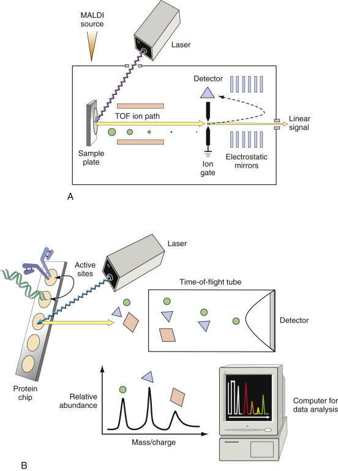

Figure 4-21 

Diagrams of two systems widely used for proteomic research. 

**A,** Matrix-assisted laser desorption ionization (MALDI) time-of-flight mass spectrometer. **B,** Surface-enhanced laser desorption ionization (SELDI) time-of-flight mass spectrometer. 

 

##  Mass Spectrometer Analyzer Unit 

The output of the ion source is a stream of positive or negative gaseous ions that are then accelerated into the mass analyzer, which sorts the parent molecular ions and their fragment ions according to their mass/charge ratio. This is accomplished in several different ways. A _time-of-flight_ ( _TOF_ ) analyzer consists of a metal flight tube, and the _m_ / _z_ ratios of the ions are determined by accurately and precisely measuring the time it takes the ions to travel from the MALDI or SELDI sources to the detector. Given that all ions of different _m_ / _z_ receive the same kinetic energy, low- _m_ / _z_ ions will reach the detector sooner than high- _m_ / _z_ ions. In the _quadrupole mass spectrometer_ ( [ Fig. 4-22, _A_ ](<#f0115>) , and [ Fig. 23-5 ](<##!/content/3-s2.0-B9780323295680000231?scrollTo=%23f0030>) ), direct electrical current and radiofrequency voltages of selected magnitudes are applied to two pairs of metallic rods. Only ions of specific mass/charge ratio can pass undeflected to the end of the rods, where they are detected. All other ions have unstable trajectories along the path and are deflected toward the rods, never reaching the detector. An advantage of this design is that this system can perform tandem mass spectrometry scan modes in the same analyzer. The _ion-trap mass spectrometer_ ( [ Fig. 4-22, _B_ ](<#f0115>) ) functions as a mass analyzer and as an ion source unit. Three electrodes, in a ring shape and two end caps, produce ions in the cavity until selectively ejected to the ion detector as the scanning radiofrequency voltage on the ring electrode varies. A major advantage of the ion-trap analyzer is its ability to get full mass spectra at very low sample concentrations (  Karasek & Clement, 1988  ). In the _magnetic sector mass spectrometer_ , a very high voltage accelerates the ions out of the ion source unit onto a magnetic field. The exiting path curvature of an ion depends on its mass/charge ratio, magnetic field strength, and applied voltage. The magnetic field or the voltage can be varied to allow selective ions to exit the magnetic field. 

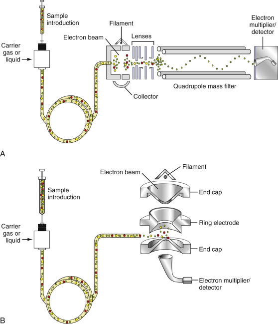

Figure 4-22 

Mass spectrometer. 

**A,** Quadrupole type. **B,** Ion-trap type. 

(Redrawn from  Schoeff LE, Williams RH  : _Principles of laboratory instruments._ St. Louis, 1993, Mosby; with permission.) 

 

##  Ion Detector 

The ion detector in a mass spectrometer is usually an electron multiplier or an ion–photon conversion detector. In an _electron multiplier,_ the ions strike the detector's first dynode, which triggers the release of secondary electrons. A cascade of electrons occurs similarly to that in a photomultiplier tube, resulting in amplification of about a millionfold. In an _ion_ – _photon conversion detector,_ the ions strike a phosphor that emits a photon for each corresponding ion. A conventional photomultiplier tube then amplifies the signal in the usual fashion. The computerized data unit controls the multiple operating parameters of the instrument components and stores and analyzes a vast quantity of acquired data. The built-in libraries of reference mass spectra for known compounds can be searched by computer and compared with the sample spectrum for identification. As emphasized in [ Chapter 23 ](<##!/content/3-s2.0-B9780323295680000231?scrollTo=%23c00023>) , each compound or macromolecule has a unique mass spectrum—a “fingerprint” of the molecule. A typical mass spectrum is shown in [ Figure 23-6 ](<##!/content/3-s2.0-B9780323295680000231?scrollTo=%23f0035>) . 

Modern mass spectrometers are extremely powerful and versatile instruments that can be interfaced to liquid chromatographs (LC) (eliminating the need to make volatile derivatives) and can perform separations in tandem (i.e., a gentle ionization step allows separation of parent ions, which can then be identified by their individual fragmentation patterns). Such LC/MS/MS techniques are finding increased application in the clinical laboratory, although mainly in reference laboratories. 

 

##  Scintillation Counter 

Scintillations are flashes of light that occur when gamma rays or charged particles interact with matter. Chemicals used to convert their energy into light energy are called scintillators. If gamma rays or ionizing particles are absorbed in a scintillator, some energy absorbed by the scintillator is emitted as a pulse of visible light or near-UV radiation. A photomultiplier tube detects light directly or through an internally reflecting optic fiber. A scintillation counter is an instrument that detects scintillations using a photomultiplier tube and counts the electrical impulses produced by the scintillations. An application for scintillation counting is radioimmunoassay (RIA). Two types of scintillation methods exist: crystal scintillation and liquid scintillation. 

_Crystal scintillation_ generally is used to detect gamma radiation. When a gamma ray penetrates the sodium iodide (NaI) crystal, which contains 1% thallium, it excites the electrons of iodide atoms and raises them to higher energy states. When the electrons return to ground state, energy is emitted as UV radiation. The UV radiation is promptly absorbed by the thallium atoms and emitted as photons in the visible or near-UV range. The photons pass through the crystal and are detected by a photomultiplier tube. A pulse-height analyzer sorts out the pulse signals from the photomultiplier tube according to their pulse height and allows only those within a restricted range to reach the rate meter for counting. 

_Liquid scintillation_ is primarily used to count radionuclides that emit beta particles. A sample is suspended in a solution or “cocktail” consisting of a solvent such as toluene, a primary scintillator such as 2,5-diphenyloxazole (PPO), and a secondary scintillator such as 2,2′-p-phenylenebis (5-phenyloxazole) (POPOP). Beta particles from the radioactive sample ionize the primary scintillator of the solvent. A secondary scintillator absorbs the photons emitted by the primary scintillator and reemits them at a longer wavelength. The secondary scintillator facilitates more effective energy transmission from the beta particles, especially when a large amount of quenching is present. Quenching is a process that results in a reduction of the photon output from the sample. This phenomenon may be due to chemical quenching, in which impurities in the sample compete with the scintillators for energy transfer, or color quenching, in which colored substances such as hemoglobin absorb the light photons produced by scintillation. The light photons produced in the sample are detected and amplified by the photomultiplier tubes in the same manner as for the crystal scintillation counter. 

 

##  Capillary Electrophoresis 

Capillary electrophoresis (CE) represents another alternative in separation techniques. A typical capillary electrophoresis system, as shown in [ Figure 4-23 ](<#f0120>) , consists of a fused silica capillary, two electrolyte buffer reservoirs, a high-voltage power supply, and a detector linked to a data acquisition unit. The sample is introduced into the capillary inlet. When a high voltage is applied across the capillary ends, the sample molecules are separated by electro-osmotic flow, a bulk flow resulting from excess positive ions at the inner capillary surface moving toward the cathode. The positive ions in the specimen emerge early at the capillary outlet because the electro-osmotic flow and the ion movement are in the same direction. Negative ions in the specimen also move toward the capillary outlet but at a slower rate. As the sample ions migrate toward the capillary outlet, different types of detectors, including optical, conductivity, electrochemical, mass spectroscopy, or radioactivity detectors, are used to detect and measure them. Advantages of CE over conventional electrophoresis and HPLC are its short analytic time, improved resolving power, and microsample volumes (  Love & Ward, 1994  ). Using nanoliter quantities of specimen, complex mixtures of molecules can be separated with a theoretical plate number approaching 1 million. Separations may be completed in less than 10 minutes by applying very high voltage. The application of high voltage is made possible by the capillary's high surface/volume ratio, which allows for efficient heat transfer through the capillary wall. Applications of capillary electrophoresis include separation of serum proteins and hemoglobin variants. 

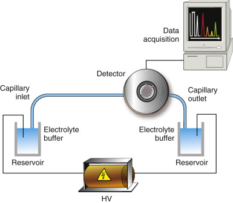

Figure 4-23 

Capillary electrophoresis system. 

_HV,_ High-voltage source. 

(Redrawn from Ward KM, Lehmann CA, Leiken AM: _Clinical laboratory instrumentation and automation: Principles, applications, and selection_ . Philadelphia, 1994, WB Saunders; with permission.) 

 

##  Nuclear Magnetic Resonance Spectroscopy 

Nuclear magnetic resonance spectroscopy (NMR) is a technique for determining the structure of organic compounds. Unlike mass spectroscopy (MS), NMR is nondestructive, although it does require a larger sample volume than MS. Although NMR is widely used as a diagnostic imaging technique, it has been adapted for only a limited number of clinical laboratory analyses, the most popular being lipoprotein particle measurements (see [ Chapter 17 ](<##!/content/3-s2.0-B9780323295680000176?scrollTo=%23c00017>) ). It also has the unique capability of performing chemical analysis in vivo. 

Nuclear magnetic resonance is a phenomenon that occurs when the nuclei of certain atoms are immersed in a static magnetic field and are exposed to a second oscillating magnetic field (i.e., the magnetic component of electromagnetic radiation [EMR]). Some nuclei experience this phenomenon and others do not, depending on whether they possess a property called spin. A single proton, or hydrogen nucleus, possesses spin, and because hydrogen atoms occur very frequently, they are useful in determining structure. 

When EMR is used to bombard molecules, the hydrogen atoms present will absorb photons of different energies, depending on the location of the hydrogen atom. For example, in compounds containing hydrogen and chloride, the proton near two chloride atoms produces a different NMR signal than the proton located near a single chloride and a single hydrogen. The energy absorbed by the spinning nuclei can be plotted versus the frequency of the applied EMR to obtain an NMR spectrum of the molecule. 

In lipoprotein subclass measurements, the NMR signal originates in the protons of the terminal methyl groups of the lipid carried in the particles (primarily the cholesterol ester and triglyceride of the particle core, and the phospholipids of the particle shell). Signals from these different lipids combine to produce one signal with a characteristic frequency and shape related to particle size (i.e., the diameter of the phospholipid shell), excluding the influence of the apolipoprotein attached to the particle. 

Basic components of an automated NMR spectrometer designed to provide fast, simultaneous subclass quantitative analysis of VLDL, LDL, and HDL are presented in [ Figure 4-24 ](<#f0125>) . The automated sampler provides a micro-sample probe that aspirates an aliquot of serum or plasma from a tray and transfers it to the NMR probe in a flow injection mode. Each sample passes through the 400-MHz magnet. The magnetic property of lipoproteins that gives them a characteristic resonance is a difference in their magnetic behavior induced by the degree of orientation of phospholipids in the shell surrounding the neutral lipid core. The equation describing this effect reveals that all lipoprotein particles of different diameters should have a different lipid NMR signature. This is displayed on the NMR processor. 

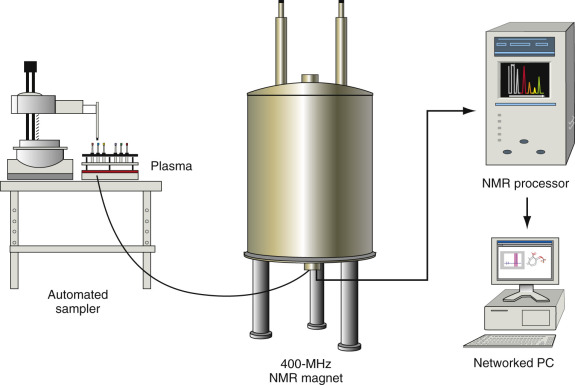

Figure 4-24 

Schematic of an automated nuclear magnetic resonance (NMR) system using an automated flow-injector sampler. 

The signature patterns are relayed to a networked PC, which provides access to high-quality spectral data from isolated subclasses of lipoproteins incorporated into proprietary analysis software. The information is contained in a reference library that is accessible with permission from the vendor. 

,  

##  General Analytic Methods and Issues 

Perhaps the most fundamental aspect of the analytic process is the preparation of high-quality reagents that will be used in the analytic procedure. In this process, the quality of water, the purity of the chemical, the selection of correct glassware or plasticware, and the correct preparations of reagents are all important for the proper operation of laboratory equipment and the performance of testing procedures. In this section, several topics will be presented that relate to analytic process and will ultimately have an impact on the results of a test performed on a patient's specimen. 

 

##  Chemicals 

The chemicals used to prepare reagents for chemical testing exist in varying degrees of purity. Proper selection of chemicals is important so the desired results may be attained. Chemicals acquired for reagent preparation are characterized by a grading system. The grading of any chemical is greatly influenced by its purity. The types and quantities of impurities are usually stated on the label affixed to the chemical container. Less pure grades of chemicals include practical grade, technical grade, and commercial grade. These grades of chemicals are unsuitable for use in most quantitative assays performed in a clinical laboratory. 

Most qualitative and quantitative procedures performed in the clinical laboratory require the use of chemicals that meet the specifications of the American Chemical Society (ACS). These chemicals are classified as analytic grade or reagent grade. Examples of other designations of chemicals that meet high standards of purity include spectrograde, nanograde, and HPLC grade. These are often referred to as ultrapure chemicals. 

Pharmaceutical chemicals are produced to meet the specifications defined in _The United States Pharmacopeia_ (USP), _The National Formulary,_ and _The Food Chemical Index_ . These specifications define impurity tolerances that are not injurious to health. 

The International Union for Pure and Applied Chemistry (IUPAC) has developed standards and purity levels for certain chemicals. These include atomic weight standard (grade A), ultimate standard (grade B), primary standard (grade C), working standard (grade D), and secondary substances (grade E). 

A very good source of highly purified chemicals, especially reference materials, is the National Institute of Standards and Testing (NIST) (Gaithersburg, Md.). NIST defines its chemical and physical properties for each compound and provides a certificate documenting their measurements. NIST also provides Standard Reference Materials (SRMs) in solid, liquid, or gaseous form. The solids may be crystalline, powder, or lyophilized. 

Two professional organizations can provide laboratory staff with guidelines for proper chemical selection and reagent preparation. They are the College of American Pathologists (CAP; Northfield, Ill.) and the  Clinical and Laboratory Standards Institute (CLSI), formerly the National Committee for Clinical Laboratory Standards (NCCLS) (Wayne, Pa.)  . 

 

##  Water 

Water has numerous uses in the clinical laboratory. Water is used to prepare reagents, as diluent for controls and calibrators, to flush and clean internal components of analyzers, to serve as a heating bath for cuvets, and to wash and rinse laboratory glassware. For most of these uses, the water must be of the highest purity, whereas the water required for rinsing glassware may be of a lesser purity. 

 

##  Types of Water Purity 

CLSI and CAP have defined three grades of water purity: types I, II, and III. The criteria for each type are outlined in the CLSI guidelines (  CLSI, 2006  ). When selecting a water purification system, the purchaser must pay strict attention to these criteria so that all of the appropriate filters and components necessary to produce type I water are included. Also, special attention must be given to the “feed-water,” which is usually the laboratory tap water. The feed-water may contain unique contaminants or may have a high mineral content (hardness), which will often require the inclusion of additional components in the water processing system. 

 

##  Purification 

Many laboratories produce or purify their own water. Several means are available by which to produce reagent-grade water. Most water filtration systems use a prefilter to begin the process. This prefilter has feed-water running through it to trap any particulates before sending it on to the next component. At this point in the water filtration process, water may be distilled or passed through a reverse osmosis filter. Distillation is the process by which a liquid is vaporized and condensed and is used to purify or concentrate a substance or separate a volatile substance from a less volatile substance. Water that has been distilled does not meet the specific resistivity requirements of CAP type I water. Reverse osmosis (RO) is a process by which water is forced through a semipermeable membrane that acts as a molecular filter. The RO filter removes 95% to 99% of organic compounds, bacteria, and other particulate matter, and about 95% of all ionized and dissolved minerals, but not as many gaseous impurities. Reverse osmosis alone does not produce type I water, but, like distillation, if additional filters such as ion-exchange and carbon particulate filters are added to the system, type I water may be produced. 

Ion-exchange filters remove ions to produce mineral-free deionized water. Deionization is accomplished by passing water through insoluble resin polymers that contain anion- or cation-exchange resins. These exchange resins replace H  \+  and OH  – ions for impurities present in ionized form in the water. Another type of material used is a mixed bed resin that contains both anion and cation-exchange materials. Deionizers are capable of producing water that has specific resistance exceeding 1 to 10 Mohm⋅cm (MΩ⋅ccm). 

Carbon filters containing activated charcoal may be added to the water purification system to help remove several types of organic compounds that may still be in the water. When these filters are used, CLSI/CAP considers the end product to contain minimal organic material. 

A particulate filter may be added to the end of the system. This filter with a mean pore size down to about 0.22 µm will serve to trap any remaining particulates as large as or larger than the pore size. 

 

##  Monitoring Water Purity 

Because water is such an integral part of laboratory analysis, its purity must be monitored on a consistent basis. The frequency of water testing is dependent on many factors, including the composition of the feed-water, the availability of staff to perform water testing, and the amount of water the laboratory uses during a given period of time. At the very least, resistivity and bacterial content of the water should be monitored on a regular basis. In addition, pH, silica content, and organic contaminants may be determined. Depending on the laboratory's resources, some or all of these parameters should be checked on a periodic basis. 

Most water filtration systems will have an in-line resistivity meter available. Resistivity measurements are used to assess the ionic content of purified water. The higher the ion concentration in water, the lower the resistivity value will be. CLSI/CAP requires that type I water have a resistivity greater than 10 MΩ⋅cm. 

Bacterial contamination can be monitored easily. The water should be allowed to run for at least 1 minute to flush the system. Next, an aliquot of water is taken, depending on the procedure used, and is plated on appropriate media. After an appropriate incubation time, the number of colony-forming units on the agar plate is determined. The most commonly found organisms in water after the purification process is complete are gram-negative rods. 

 

##  Once Your System Has Been Installed 

Most water purification systems are designed for easy access to end-product type I water. Therefore, it is advisable to use only type I water for most applications in the laboratory. Type II or III water could be used for rinsing glassware and cleaning exterior surfaces. If a procedure—for example, heavy metal testing or HPLC—requires the use of specially prepared water, then type I water should not be used. Ultra-pure water can be purchased from NERL Diagnostics Corporation (East Providence, R.I.). 

 

##  Measurement of Mass 

Mass is the quantity of matter contained within an object. The weight of a body is the gravitational acceleration exerted on it, and unlike mass, it varies with altitude. The weight is equal to mass times gravity. In the laboratory, we are measuring the mass of an object. 

 

##  Types of Balances 

Several different types of balances are available, depending on what needs to be weighed. For example, to weigh a fecal fat specimen, an appropriate balance to use would be a top-loading precision balance capable of accurately weighing kilogram amounts. Preparation of standards for toxicology assays requires microgram quantities, so a single-pan microbalance would be appropriate. 

 

##  Unequal-Arm Substitution Balances 

Unequal-arm substitution balances are typically single-pan types and are commonly used in laboratories, although almost all of these balances are being replaced by electronic-type balances. The single-pan, mechanical, unequal-arm balance operates on the principle of removing weights rather than adding them. A fixed mass counterweight is used to balance the combined mass of the pan and the removable weights across two arms of unequal weight. When a sample is placed on the weighing pan, internal weights in 1-g or 10-g increments are moved one at a time by the operator turning a set of knobs. This is continued until the system returns to equilibrium, at which time the sum of the weights removed is equal to the weight of the object. 

 

##  Magnetic Force Restoration Balance 

Another widely used balance is the single-pan balance that relies on magnetic force restoration. The restoring force is the force required to put the balance back into equilibrium. The unknown mass is placed on the pan, and this system goes out of equilibrium. The operator who adjusts the internal weights restores partial equilibrium. The null detector optics circuit senses when equilibrium is near and provides a signal to the sensor motor to generate a restoring current until equilibrium is reached. At this time, the unknown mass is equal to the mass of the weights removed plus the value of the restoring current. 

 

##  Top-Loading Balances 

Single-pan top-loading balances operate on the same principle as single-pan analytic balances (i.e., weighing by substitution). Damping is accomplished by magnetic rather than an air-release mechanism. These balances are especially suitable for rapidly weighing larger masses (up to 10,000 g) that do not require as much analytic precision, such as large-volume reagent preparation. 

 

##  Electronic Balances 

Several electronic balance designs are available. One design uses a strain gauge load cell. This is a small, thin device that changes electrical resistance when it is stretched or compressed. Typically, several strain gauges are used in a Wheatstone bridge arrangement, and they are glued onto the load cell in a protected location. A load cell is usually in the shape of a beam or plate. When the beam or plate is displaced, it bends a tiny amount, and this tiny bending is detected by the strain gauges. The amount of bending might be only a thousandth of an inch, but that is enough for a strain gauge to measure. 

Another electronic balance design operates on the principle of electromagnetic force (EMF) compensation. A coil, placed between the poles of a cylindrical electromagnet, is mechanically connected to a weighing pan. Mass placed on the pan produces a force that displaces the coil within the magnetic field. A regulator generates a compensation current just sufficient to return the coil to its original position. The more mass that is placed on the pan, the larger the deflecting force, and the stronger the current required to correct the deflection of the coil. The measuring principle is based on a strict linear relationship between compensation current and force produced by the load placed on the pan. 

Several additional features may be available on some models of electronic balances. For example, some electronic balances include an electronic vibration damper. Any excess vibration can be detected when variation of the pointer or oscillation of the number in the last decimal place of the digital display is observed. Another feature available in some models is built-in taring. This allows the weight of the weighing container to be “zeroed.” Also, electronic balances can be interfaced with computers to provide calculations such as weight averaging and statistical analysis of multiple weighing. The fundamental design of electronic balances allows for faster weighing, which is advantageous when doing multiple readings (e.g., pipet calibrations). 

 

##  Calibration 

Laboratory balances require calibration at regular intervals. The NIST states that there is no fixed calibration interval for scientific applications. Calibration intervals should coincide with the requirements of the laboratory's licensing and accrediting organizations. 

The mass standard and test weight accuracy classes for weights used in calibrating balances have been updated and replace the older requirements specified by National Bureau of Standards (NBS) class S and class S1 weights. The new mass standards and test weight accuracy classes appropriate for laboratory balances include the American Society for Testing and Materials (ASTM) classes 1 and 2. Reference should also be made to  ASTM E617-13  for specific information regarding range, readability, and best uncertainty applicable to these classes. 

NIST class 1 weights (extra-fine accuracy) are available up to 250 mg and may be used for high-precision (e.g., single-pan and electronic) balances that are precise to four decimal places. The range of weight for class 2 balances may be in excess of 1000 g. 

 

##  Handling Weights Used for Testing Accuracy 

Meticulous care must be used when handling class 1 or 2 weights. The operator must avoid direct contact with the weights by using clean gloves or special lifting tools (e.g., forceps). Hand contact with the weights can cause corrosion. The weights should not be dragged across any surface, including the stainless steel weighing pan. Usually the weights are sent in a covered box and should always be stored in that box. 

 

##  Environmental Concerns for Best Weighing Accuracy 

Several aspects of the environment may have an impact on the performance of a laboratory balance. They include temperature, air drafts, floor vibrations, table instability, and static electricity. The effects of the environment on your weighing procedures can often be minimized easily. For example, if air drafts are present in the room, a shroud or enclosure can be placed around the balance. A marble table can be used to reduce table vibrations or instability. 

 

##  Balance Specifications 

An operator should be knowledgeable about several important specifications related to balances. They include the following: 

  * •

Capacity—which represents the maximum load one can weigh 

  * •

Accuracy—which is dependent on the smallest mass one will be weighing 

  * •

Linearity—the ability of a balance to provide accurate output over its full range 

  * •

Resolution (readability)—the smallest increment of weight that may be discernible 

Laboratory accrediting agencies require verification of accuracy of balances at various time intervals. Several sources are available to guide the laboratory through this requirement. 

 

##  Laboratory Glassware and Plasticware 

 

##  Types of Glassware 

The most common type of glassware encountered in volume measurements is borosilicate glass. This glass is characterized by a high degree of thermal resistance, has low alkali content, and is free from the magnesium-lime-zinc group of elements, heavy metals, arsenic, and antimony. Commercial brands are known as Pyrex (Corning, Corning, N.Y.) and Kimax (Kimble, Vineland, N.J.). The caustic conditions involved in storing concentrated alkaline solutions in borosilicate glass will etch or dissolve the glass and destroy the calibration. Borosilicate glassware with heavy walls, such as bottles, jars, and even larger beakers, should not be heated with a direct flame or hotplate. Glass should not be heated above its strain point (for Pyrex, 515° C) because rapid cooling strains and cracks glass easily when it is heated again. In the case of volumetric glassware, heating can destroy the calibration. 

Corex (Corning, N.Y.) brand glassware is a special alumina-silicate glass strengthened chemically rather than thermally. Corex is six times stronger than borosilicate glass (e.g., Corex pipets have a typical strength of 30,000 psi, compared with 2000 to 5000 psi for borosilicate pipets) and will outlast conventional glassware by tenfold. Corex also resists clouding and scratching better. 

Low-actinic glassware is a glass of high thermal resistance with an amber or red color added as an integral part of the glass. The density of the red color is adjusted to permit adequate visibility of the contents, yet give maximum protection to light-sensitive materials, such as bilirubin standards. Low-actinic glass is commonly used in containers used to store control material and reagents. 

 

##  Types of Plasticware 

Several types of plasticware are used in clinical laboratories—for example, pipet tips, beakers, flasks, cylinders, and cuvets. Polypropylene, polyethylene, Teflon, polycarbonate, and polystyrene are all examples of types of plastics used for laboratory plasticware. 

Plastic pipet tips are made primarily of polypropylene. This type of plastic may be flexible or rigid, is chemically resistant, and can be autoclaved. These pipet tips are translucent and come in a variety of sizes. Polypropylene is also used in several tube designs, including specimen tubes and test tubes. Specially formulated polypropylene is used for cryogenic procedures and can withstand temperatures down to –190° C. 

Polyethylene is widely used in plasticware, too, including test tubes, bottles, graduated tubes, stoppers, disposable transfer pipets, volumetric pipets, and test tube racks. Polyethylene may bind or absorb proteins, dyes, stains, and picric acid. 

Polycarbonate is used in tubes for centrifugation, graduated cylinders, and flasks. The usable temperature range is broad: –100° C to +160° C. It is a very strong plastic but is not suitable for use with strong acids, bases, and oxidizing agents. Polycarbonate may be autoclaved but with limitations (refer to furnished instructions). 

Polystyrene is a rigid, clear type of plastic that should not be autoclaved. It is used in an assortment of tubes, including capped graduated tubes and test tubes. Polystyrene tubes will crack and splinter when crushed. This type of plastic is not resistant to most hydrocarbons, ketones, and alcohols. 

Teflon is widely used for manufacturing stirring bars, tubing, cryogenic vials, and bottle cap liners. Teflon is almost chemically inert and is suitable for use at temperatures ranging from –270° C to +255° C. This type of plastic is resistant to a wide range of chemical classes, including acids, bases, alcohol, and hydrocarbons. 

 

##  Volumetric Laboratoryware 

 

##  Pipets 

Many kinds of pipets are available for use in a clinical laboratory, each intended to serve a specific function. They are used for reconstituting controls and calibrators, preparing serum or plasma dilutions, and aliquoting specimens. Thus a high degree of accuracy and precision is required. Manual pipets fall into two general categories: transfer (volumetric) and measuring. Three subclassifications include to contain (TC), to deliver (TD), and to deliver/blow-out (TD/blow-out). 

 

##  Class A Designation 

Volumetric glassware designated as Class A has been manufactured to Class A tolerances as established by the American Society for Testing and Materials  (ASTM) E694  (West Conshohocken, Pa.) for volumetric apparatus. Other standards include  ASTME 542  for calibration of volumetric apparatus and  ASTME 288  for volumetric flasks. 

 

##  Types of Pipets 

Pipets designed to contain (TC) are often referred to as _rinse-out pipets_ because they must be refilled or rinsed out with the appropriate solvent after the initial liquid has been drained from the pipet. TC pipets contain an exact amount of liquid that must be completely transferred for accurate measurement. Examples of TC pipets are Sahli hemoglobin and Long-Levy pipets. These pipets do not meet Class A certification criteria. 

To deliver (TD) pipets are designed to drain by gravity. TD pipets must be held vertically and the tip placed against the side of the container and must not touch the liquid in it. The stated volume is obtained when draining stops. This type of pipet should not be blown out. Examples of TD pipets include Mohr, serological, and volumetric transfer pipets. These pipets are designed to meet the requirements of Class A–type pipets. 

Volumetric TD pipets have an open-ended bulb that holds the bulk of the liquid. On one side of the pipet is a long glass tube with a line indicating the extent to which the pipet is to be filled. The other end is tapered for smooth delivery of liquid. These pipets should be allowed to drain freely and not be shaken or hit against the container. Any disruption of the free-flowing liquid may result in an inaccurate delivery of the liquid. 

Some TD pipets are designed so that most of the contents are allowed to drain freely, after which the remaining fluid in the tip is blown out. These pipets are not rinsed out. Examples of pipets designed to be blow-out–type pipets include Ostwald-Folin and serological pipets. TD/blow-out pipets are identified by the presence of one or two frosted bands near the mouthpiece of the pipet. It is vital to remember that one should never pipet or blow out solutions by mouth. It is always necessary to use an appropriate pipetting aid—for example, a bulb. 

Serologic glass or plastic pipets are long tubes with uniform diameters. They have volume graduations extending to the delivery tip of the pipet. The last volume of liquid blown out is included in the delivery volume. The design of the Mohr TD pipet is different from that of the serological pipet. Mohr pipets are not graduated to the tip. The accuracy of the Mohr pipets is valid only when the pipet is filled. If smaller volumes are dispensed, the accuracy decreases proportionally. 

 

##  Micropipets 

The two most widely used types of micropipets are the air displacement and positive displacement. These pipets are capable of delivering liquid volumes from 1 to 1000 µL. Some micropipets are designed to deliver a fixed volume, while others can deliver variable amounts of sample. 

Air-displacement pipets are piston-operated devices. A disposable, one-time use polypropylene tip is attached to the pipet barrel. The pipet tip is placed into the liquid to be aspirated and drawn into and dispensed from this tip. 

Positive-displacement pipets use a capillary tip that may be siliconized glass, glass, or plastic. This type of pipet is useful if a reagent reacts to plastics. Positive-displacement pipets use a Teflon-tipped plunger that fits tightly inside the capillary. These capillary tips are reusable and carryover is negligible if the pipet is properly maintained. Some procedures require a washing or flushing step in between samples. 

 

##  Pipet Calibration 

Monitoring the performance of pipetting devices is not only mandatory in most states that issue licenses to laboratories that perform diagnostic testing, but it is also very wise. Micropipets should be verified for accuracy and precision before they are put into use and monitored during the course of the year. The frequency of verification depends in part on the amount of use and requirements by the licensing and/or accrediting agency. Proper maintenance of air-displacement pipets is very important. This type of pipet has a fixed stroke length that must be maintained. These pipets also have seals to prevent air from leaking into the pipet when the piston is moved. These seals require periodic greasing to maintain their integrity. 

Positive-displacement micropipets need to have their spring checked and the Teflon tip replaced periodically. A slide wire is used to quickly check the plunger setting. This check does not replace the scheduled precision and accuracy checks. 

There are several procedures used by laboratories to verify precision and accuracy of micropipets. Most of these procedures are time-consuming, especially the procedures that require the weighing of water. At any rate, this verification procedure must be done to ensure proper performance of the laboratory micropipets. 

CLSI has provided an acceptable procedure for determining pipet accuracy and precision (  I8-P, NCCLS, 1984  ). This gravimetric procedure is labor intensive but does provide a low-cost means of complying with the regulations set forth by the various accrediting agencies. 

More expensive procedures for calibrating micropipets include the following: 

  * •

Commercial photometric pipet calibration products 

  * •

Calibration services providers 

  * •

Pipet Tracker™ (Labtronics Inc., Canada) 

One of the major concerns when considering the cost attributed to pipet calibration procedures is technologist time. The technologist time required for the photometric procedures is often 50% to 60% less than the inexpensive manual weighing techniques. 

 

##  Volumetric Flasks 

Volumetric flasks represent a special type of glassware in the laboratory. These flasks are often used to prepare standards for quantitative procedures. Therefore, the accuracy must be optimal. Volumetric flasks used for the preparation of standards and other solutions requiring optimal accuracy must meet Class A specifications as defined by NIST. These specifications are imprinted on the flasks. Volumetric flasks are used to contain (TC) an exact volume when the flask is filled to the mark. A Teflon or ground-glass stopper should be used to seal the flask. Volumetric flasks should not be used for reagent storage. 

 

##  Calibration of Volumetric Glassware 

According to the strictest of standards, every piece of volumetric glassware in the clinical laboratory should be coded and a record kept of its calibration. Any piece of glassware that does not meet Class A tolerance should be rejected. To prepare a piece of glassware for calibration, thoroughly wash and dry it using appropriate cleaning procedures. CLSI can provide the laboratory with an appropriate procedure to calibrate volumetric flasks. 

 

##  Thermometry 

Thermometers and other types of temperature-sensing devices are used in the laboratory to monitor the temperatures in refrigerators, freezers, water baths, heating blocks, and incubators. Special applications of thermometry include osmometry, refrigerated centrifuges, refrigerated reagent compartments of automated analyzers, warming compartments of automated analyzers, and circulating waters baths for cuvet compartments in automated analyzers. All of these temperature-monitoring applications have the same requirements, which are accurate measurements and a constant temperature. 

Appropriate quality control procedures must be carried out and documented routinely for all of these temperature-monitoring devices. Any temperature-sensitive device that fails to perform within established tolerances must be replaced. Because many assays performed in the laboratory are enzymatic in nature, even the slightest deviation from the optimal temperature required to perform the assay may yield an erroneous result. 

 

##  Types of Thermometers 

The two types of liquid-in-glass thermometers most widely used are total immersion and partial immersion. A total immersion thermometer requires that the bulb and entire column of liquid be immersed into the medium measured. These thermometers are used to monitor freezers and refrigerators. Partial immersion thermometers must have the bulb and stem immersed to the immersion line or defined depth on the thermometer. This type of thermometer is often used for water baths and heating blocks. 

 

##  Special Applications of Temperature-Sensing Devices 

Thermistors are used in several types of instruments found in the laboratory, including freezing-point depression osmometers. A thermistor is a transducer that converts changes in temperature (heat) to resistance. It consists of a small bead constructed of a fused mixture of metal oxides, attached to two leads and encapsulated in glass. The metal oxide mixture has a large negative temperature coefficient of resistance. Thus a small decrease in temperature causes a relatively large increase in the resistance of the thermistor. 

A thermocouple is a sensor that consists of two dissimilar metals joined together at one end. When the junction of the two metals is heated or cooled, a voltage is produced that can be correlated back to the temperature. Thermocouples come in several designs, including beaded wire, probes, and surface probes. An important feature of most thermocouples used in laboratory analyzers is their fast response times. The response time of a thermocouple is defined as the time required by a sensor to reach 63.2% of a step change in temperature under a specified set of conditions. Five time constants are required for the sensor to approach 100% of the step change value. 

Laboratory applications for thermocouple use include gas and liquid chromatography, surface temperature measurements in heating compartments in automated analyzers, thermo-cuvets, and circulating water baths in chemistry analyzers 

 

##  Mercury-Free Laboratories 

There are initiatives nationwide to make laboratories mercury-free. For example, in June 1998, a landmark agreement was put together between the American Hospital Association (AHA) and the U.S. Environmental Protection Agency (EPA) (  JCAHO, 2002  ). A memo of understanding was signed between the two organizations in an effort to decrease and eventually eliminate hospital pollution practices over a 5- to 10-year period. One of the goals is to eliminate mercury waste. 

Mercury is contained in numerous chemical reagents used by the laboratory and, of course, in mercury thermometers. The cost associated with proper disposal of mercury and the impact of mercury in the environment make replacing mercury thermometers a sound idea. Several alternatives exist for replacement thermometers that provide the necessary accuracy for laboratories procedures, including the following: 

  * •

Thermometers containing an organic red-spirit and pressurized with nitrogen gas 

  * •

Thermometers containing blue biodegradable liquid (isoamyl benzoate and dye) 

  * •

A red liquid thermometer filled with kerosene 

  * •

Bimetal digital thermometers 

  * •

Digital thermometers with stainless-steel stems 

 

##  Thermometer Calibration 

Monitoring the temperature accuracy of thermometers is necessary to ensure the reliability of procedures requiring temperature regulation. Thermometers may be purchased with a certificate to indicate traceability to standards provided by NIST. Also, many commercially available thermometers meet or exceed NIST and American National Standards Institute (United States)/Scientific Apparatus Makers Association (United Kingdom) (ANSI/SAMA) tolerance for accuracy. 

Noncertified thermometers can be calibrated by using a NIST SRM  ® 934 thermometer or a NIST SRM  ® 1968 gallium melting point cell. The SRM  ® 934 clinical laboratory thermometer is calibrated per specifications by International Temperature Scale 1990 (ITS-90) at 0° C, 25° C, 30° C, and 37° C. A gallium melting point cell consists of about 25g of very pure (99.99999%) gallium metal that has a single fixed melting point at 29.7646° C (as defined by ITS-90). The gallium is sealed in an inert plastic crucible and surrounded in a stainless-steel envelope (  Strouse et al, 1997  ). 

Temperature monitoring devices should be verified for accuracy at 6- or 12-month intervals. Guidelines and procedures for proper monitoring and tolerances are available (NCCLS approved standard I2-A2, 1990). 

 

##  Water Baths 

For general clinical laboratory use, constant temperature water baths must offer variable temperature control from +5° C above ambient temperature to 100° C, with accurate control to ±0.2° C. Water baths can be circulating or noncirculating. The circulating water baths provide the best temperature control. Another important consideration in the selection of a constant temperature bath is that the model be large enough to accommodate the desired working volume. 

 

##  Maintenance 

Maintenance of a constant temperature water bath is improved by filling it with type II (or type I) water. This prevents the accumulation of mineral deposits from regular tap water, which can affect the temperature-sensing elements and generally lead to poor heat transfer. However, if an accumulation of these minerals does occur, a weak hydrochloric acid solution will dissolve the deposits. Frequent cleaning and fresh water will prevent overgrowth of bacteria and algae. Also a 1 : 1000 dilution of thimerosal (Merthiolate) can be added to help prevent bacterial growth. Overheating and subsequent damage can occur if the bath goes dry. At higher temperatures, the bath should be covered, both to maintain proper temperature control and to prevent rapid evaporation to dryness. 

 

##  Quality Control 

A thermometer calibrated against another certified by NIST must be a component of any water bath. The temperature should be noted and recorded for each assay. This function by the operator ensures that indeed the temperature of the bath is the same as the reading of the thermometer. 

 

##  Heating Blocks, Dry-Bath Incubators, and Ovens 

Heating blocks and dry-bath incubators are commonly used for incubating liquids at higher temperatures. Most incubators are constructed of an aluminum alloy that is capable of distributing the heat in a uniform manner. Their heating efficiency is less than a circulating water bath but will maintain a constant temperature within ±0.5° C. A certified thermometer or NIST-calibrated thermometer must be present in the heating block to monitor the temperature. 

Heating ovens are used in chromatography procedures, to dry chemicals, to assist in extraction, and to dry membrane or gels in electrophoresis. Several different designs are available, depending on the desired temperature and purpose. Oven designs include programmable, vacuum, or standard laboratory types. Temperature control is usually within ±1° C. The oven must have a certified thermometer or NIST-calibrated thermometer available to monitor the interior temperature. 

 

##  Mixing 

Mixing is an operation intended to form a homogeneous mass or create a uniform heterogeneous system. Mixing is used to bring solids into solution; to bring phases into intimate contact—for instance, in extraction procedures; to wash suspended solids; to homogenize liquid phases; and to perform many other operations. A serious consequence of inadequate mixing can be failure to completely resuspend protein that settles out under long-term frozen storage of serum controls, resulting in invalid data. In some instances, excessive mixing may cause denaturation of protein or hemolysis. A phase separation occurs when serum (or plasma) specimens stand for a period of time and must be thoroughly mixed before analysis. The concentration of even small molecules in such a system will be heterogeneous as proteins settle and become more concentrated, so effective water concentration decreases in this layer. This produces a water concentration gradient throughout the system and, consequently, a concentration gradient of all components. 

 

##  Single-Tube Mixers 

A vortex mixer is capable of a variable-speed oscillation that results in a swirling motion to liquid contents of a test tube or other container. The angle of contact and degree of pressure can be regulated for optimal mixing action. A very effective mixing action is created by a multiple touch sequence (i.e., touching and withdrawing the tube from the neoprene oscillating cup of the mixer). The operator must be careful not to fill the container too full or to mix the liquid contents too fast, because spillage can occur. 

 

##  Multiple-Tube Mixers 

Various mixers are available that handle a number of tubes and tube sizes and have different types of mixing motions. A Thermolyne Maxi-Mix (Sybron Corporation, Dubuque, Iowa) can conveniently be used for vortex mixing one tube or several tubes at one time. Changing the pressure of the container against the replaceable foam rubber top varies mixing action. Circular motion on a tilted disk provides continuous inversion of contents in tubes, which are clip-mounted at the circumference of the rotating disk. Rotational speed can be varied to provide gentle or more vigorous mixing. Control sera are conveniently reconstituted on this type of mixer. Tube shakers that operate by tilting back and forth at variable speeds provide thorough mixing of whole blood samples. 

 

##  Aqueous Solution 

The concentration of a solution may be expressed as molarity (M), normality (N), and, less frequently, molality (m). Accurate preparation of reagents requires fundamental knowledge of solution chemistry, basic mathematics, and techniques. 

 

##  Molarity 

Molarity (M) is equal to the number of moles of solute per liter of solution. A _mole_ of a substance is the number of grams equal to the atomic or molecular weight of the substance. The atomic or molecular weight of a substance is the actual mass of the chemical particle (atom or molecule) relative to the mass of the carbon atom. One mole of any substance will contain approximately 6.02 × 10  23  particles (Avogadro's number). Thus a 1 molar solution contains 1 mole of solute per liter of solution ( [ Box 4-7 ](<#b0040>) ). Therefore, the procedure is to weigh out 29.25g of NaCl, transfer it to a 1-L volumetric flask, and then add water to the 1-L mark on the flask. 

Box 4-7 

Example 

Molarity 

How many grams of NaCl are required to prepare 1 liter of a 0.5-M solution? The gram molecular weight (GMW) of NaCl is 58.5. 

 

##  Solution 

GMW × M = g/L 

58.5 × 0.5 = 29.25 g/L 

 

##  Millimoles 

When small concentrations are used, they are frequently expressed in millimoles per liter (1000 mmol = 1 mol). For example, to prepare 10 mL of a 10-mmol (0.01 moles) NaOH solution, 4 mg NaOH is diluted to 10 mL. 

 

##  Normality 

Normality (N) is equal to the number of gram equivalents of solute per liter of solution and is dependent on the type of reaction involved (e.g., acid-base, oxidation). One-gram equivalent weight of an element or compound equals the gram molecular weight divided by the number of replaceable hydrogens or hydroxyls (also valence; [ Boxes 4-8 through 4-10 ](<#b0045>) ): 

 Gram equivalent weight  =  GMW  /  Number of replaceable hydrogens  ,  hydroxyls  ,  or valence 

 1  N  =  Number of gram equivalents of solute  /  L of solution 

Box 4-8 

Example 1 

Normality 

What is the gram equivalent weight of Ca(OH)  2  (GMW = 74)? 

 

##  Solution 

Gram equivalent weight = 74/2 = 37 

1 mole = 2 equivalents 

Box 4-9 

Example 2 

Normality 

What is the gram equivalent weight of H  2  SO  4  (GMW = 98)? 

 

##  Solution 

Gram equivalent weight = 98/2 = 49 

1 mole = 2 equivalents 

Box 4-10 

Example 3 

Normality 

How many milliliters of concentrated H  2  SO  4  (specific gravity, 1.84; percent purity, 96.2%) are required to prepare 1 liter of a 1 normal solution? 

 

##  Solution 

  * Step 1: Compute GEW H  2  SO  4  = 98/2 = 49. 

  * Step 2: Compute the number of grams of H  2  SO  4  in 1 liter = 98 g/L. 

  * Step 3: Compute the number of grams of H  2  SO  4  per milliliter of solution = SG × % assay = 1.84 × 96.2 = 1.77. 

  * Step 4: Compute the number of milliliters of concentrated H  2  SO  4  required when preparing 1 liter of a 1 normal solution: 

  * 

 

##  Molal 

In the laboratory, the physical properties of solutions are sometimes measured—for example, when the osmolality of serum or urine is measured. The molality of the solution is determined instead of the molarity. A molal solution is 1 mole of solute in 1 kilogram of solvent. Molal solutions are based on weight, not volume. Because the density of water at room temperature is approximately 1 gram per milliliter, 1000 grams of water occupies about 1 liter. Therefore, a 1-molal aqueous solution is approximately the same as a 1-molar solution ( [ Box 4-11 ](<#b0060>) ). 

Box 4-11 

Example 

Molal Solutions 

How many grams of NaOH are needed to make a 2.00 molal solution? 

 

##  Solution 

  * Step 1: Determine the GMW of NaOH = 40 g. 

  * Step 2: Compute the number of grams of NaOH required to prepare the solution by using the following formula: 

  *   *   * _X_ = 80 g of NaOH 

 

##  Dilutions 

Dilution procedures are not performed as frequently as in the past, owing to improvements in computers and instruments whereby the system performs the dilution automatically. But, on occasion, a dilution has to be prepared. A brief review follows. 

A laboratory procedure may involve the addition of one substance to another to reduce the concentration of one of the substances. This mixture is called a _dilution_ . Laboratory staff often confuse the terminology associated with dilutions and ratios. The term _ratio_ is more general and refers to an amount of one thing relative to an amount of something else with no other implications. _Dilution_ , as the term is used in laboratories, is more specific. It refers to the number of parts of a substance in the total number of parts of mixture containing the substance. The implication is how the mixture was made or how it is going to be made. The following are examples of ratios followed by dilutions ( [ Box 4-12 ](<#b0065>) ): 

  * **Ratios**

    * 1.

The serum/saline ratio is 1 : 9\. 

    * 2.

The saline/serum ratio is 9 : 1\. 

    * 3.

The serum/total volume ratio is 1 : 10\. 

Note that a colon is used as the ratio symbol. 
  * **Dilutions**

    * 1.

Make a 1 : 10 dilution of serum in saline. 

    * 2.

Make a 1 : 10 dilution of serum in saline. 

    * 3.

Make a 1 : 10 dilution of serum with saline. 

Box 4-12 

Example 

Dilutions 

Prepare a 1 mL/10 mL dilution of a serum sample. 

 

##  Solution 

Pipet 1.0 mL of serum and add 9.0 mL of saline for a total volume of 10 mL. 

A clinical application may involve the dilution of a patient serum sample because the bilirubin result exceeds the upper limit of linearity. The technologist decides to make a 1 : 2 dilution of the sample and assay the diluted sample. To prepare the dilution, the technologist pipets 100 µL of patient serum and adds 100 µL of water, for a total volume of 200 µL. The sample is assayed for bilirubin, and the analyzer prints out a value of 12 mg/dL. Before reporting the patient's bilirubin result, the technologist must multiply the analyzer value times 2 (the dilution factor) and then report the value of 24 mg/dL. 

 

##  Acids, Alkalis, and pH 

An acid molecule yields hydrogen ions (protons) in aqueous solutions; an alkali accepts these. At room temperature in pure water: 

 [  H  \+  ]  =  [  OH  − ]  =  1  × 10  − 7  molar 

In all aqueous solutions, both acid and alkaline: 

 K  w  =  [  H  \+  ]  × [  OH  − ]  =  10  − 14 

In an acid solution, [H  \+  ] is greater than 1010  −7  mol. In an alkaline solution, [H  \+  ] is less than 1010  −7  mol. pH is the exponent that must be applied to 10 to give the value of 1/H  \+  —that is: 

 pH  =  log  10  1  /  H  \+ 

When pH is  |  1  |  H  \+  is  |  10  –1  |  and OH  – is  |  10  –13   
---|---|---|---|---|---  
|  2  |  |  10  –2  |  |  10  –12   
|  4  |  |  10  –4  |  |  10  –10   
|  6  |  |  10  –6  |  |  10  –8   
|  10  |  |  10  –10  |  |  10  –4   
|  13  |  |  10  –13  |  |  10  –1   
  
A change of one pH unit indicates a tenfold change in H  \+  concentration. 

**Buffer Solution.** The theory of buffers and their preparation can be found in [ Appendix 1 ](<##!/content/3-s2.0-B9780323295680000875?scrollTo=%23app00087>) . For most commonly used buffers, the quantities of salts of the acids and bases have been predetermined and may be found in reference books (e.g.,  Bates, 1973  , which contains a very good discussion of the theoretical aspects of buffers and extensive information on how to prepare several buffer solutions). 

,,
