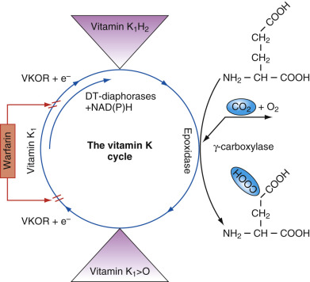
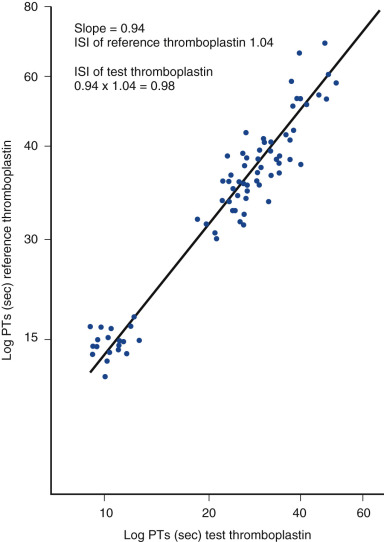
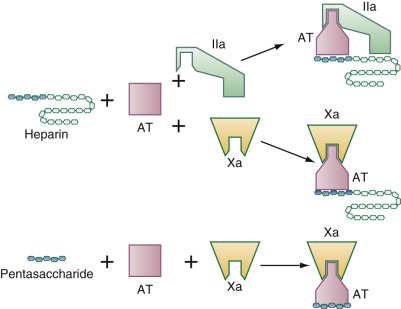
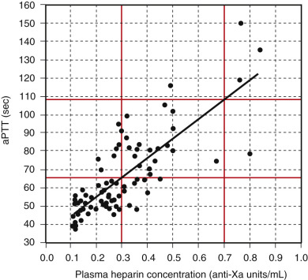
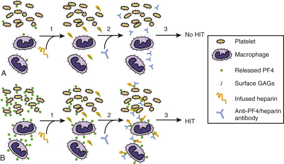
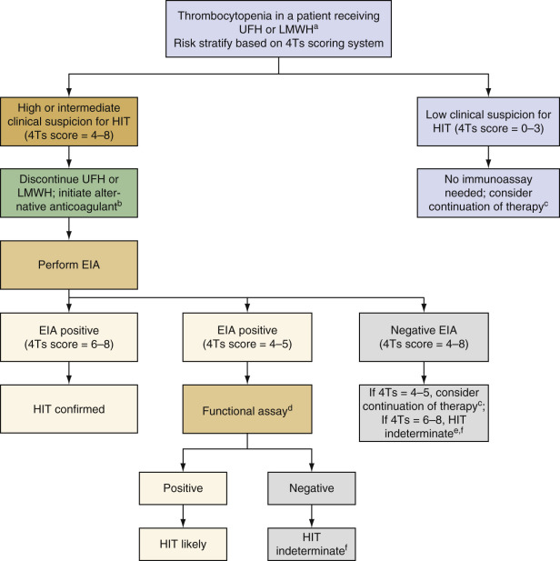
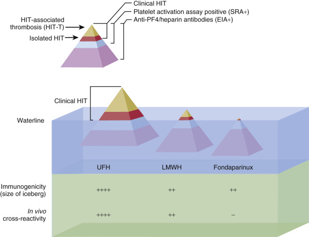
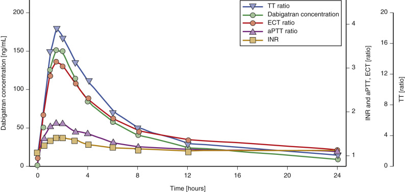
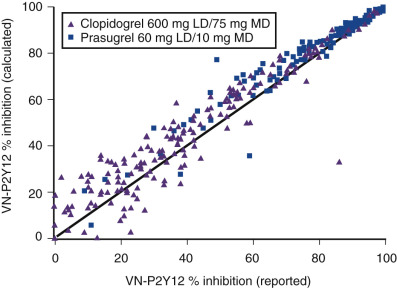

## Key Points

  * •

Warfarin has historically been the most commonly used oral anticoagulant. It is a vitamin K antagonist and blocks γ-carboxylation of a series of glutamic acid residues during the synthesis of factors II, VII, IX, and X, and proteins C and S. The resulting decreased functionality of the coagulation factors leads to prolongation of the prothrombin time, which is monitored as the international normalized ratio, and the partial thromboplastin time. 

  * •

Heparin binds to antithrombin and increases its ability to inhibit thrombin, factor Xa, and, to a lesser extent, other serine protease coagulation factors. Heparin is thus considered to be an “indirect” thrombin inhibitor. The anticoagulant effect of heparin is commonly monitored by prolongation of the partial thromboplastin time, with actual quantitation of heparin anticoagulant activity being assayed as anti–factor Xa activity. Where necessary to monitor low molecular weight heparin or fondaparinux, this is done by measuring its anti–factor Xa activity. 

  * •

Heparin-induced thrombocytopenia (HIT) is a complication of heparin therapy in which antibodies develop against complexes of heparin and platelet factor 4 (PF4). The antibody/PF4/heparin complexes bind to platelets through the Fcγ receptor and cause platelet activation, leading to arterial and/or venous thrombosis. Both immunologic and functional assays are employed in the evaluation of possible HIT. 

  * •

Target-specific oral anticoagulants directly inhibit either thrombin or factor Xa. These anticoagulant agents do not typically need to be monitored, but they have variable effects on the PT and aPTT. The oral thrombin inhibitor dabigatran etexilate can be monitored by a dilute thrombin time or an ecarin clot time, and the factor Xa inhibitors rivaroxaban, apixaban, and edoxaban can be monitored by anti–factor Xa assays. 

  * •

Antiplatelet therapy is used primarily for the prevention of recurrent stroke or myocardial infarction. The laboratory can monitor the resulting reactivity of platelets from treated patients and, in some instances, can detect apparent resistance to aspirin or other therapeutic agents. 

I gratefully acknowledge the contribution of Louis M. Fink, Richard A. Marlar, and Jonathan L. Miller, who authored this chapter in previous editions. 

Antithrombotic therapy, which includes therapies targeting platelets as well as the coagulation system, is used to prevent and treat thromboembolic disease. Antiplatelet agents are most frequently used to prevent stroke and myocardial infarction, but they are also used in patients with peripheral arterial disease and may have some benefit in preventing recurrent venous thromboembolism (VTE). Anticoagulant agents are most frequently used to prevent and treat VTE, to prevent stroke and peripheral arterial embolism in patients with atrial fibrillation, and to prevent thromboembolic complications in patients with prosthetic heart valves. The clinical laboratory plays a critical role in the evaluation and management of patients on these therapies. 

,  

##  Vitamin K Antagonists 

Warfarin is the most commonly prescribed of the oral vitamin K antagonists. It is a racemic mixture of the stereoisomers S-warfarin and R-warfarin, with S-warfarin being the more potent in producing an anticoagulant effect. Warfarin inhibits vitamin K reductase (vitamin K 2,3-epoxide reductase, or VKOR) and blocks regeneration of the active form of vitamin K, which is necessary for γ-carboxylation of specific glutamate residues within the amino-terminal Gla domains of factors II, VII, IX, and X and proteins C and S ( [ Fig. 42-1 ](<#f0010>) ). With the decreasing extent of γ-carboxylation of glutamic acid within these domains, the affected proteins are unable to bind into the highly ordered protein/Ca  ++  /phospholipid membrane complexes that are essential for normal hemostatic activity (  Ageno et al, 2012  ). Consequently, those laboratory tests that are dependent on the proper function of these factors become more abnormal with increasing antagonism of vitamin K. 

Figure 42-1 

The vitamin K–dependent γ-carboxylation system. 

The γ-carboxylase converts vitamin K–dependent proteins to γ-carboxyglutamic acid (Gla) containing proteins by adding carbon dioxide (CO  2  ) to glutamic acid (Glu) residues in newly synthesized proteins. The γ-carboxylase requires reduced vitamin K  1  (vitamin K  1  H  2  ) as a cofactor for this posttranslational modification reaction. Concomitant with γ-carboxylation, vitamin K  1  H  2  is converted to vitamin K  1  2,3-epoxide (vitamin K  1  >O). The epoxide is reduced by the warfarin-sensitive enzyme vitamin K  1  2,3-epoxide reductase (VKOR) to the vitamin K  1  H  2  cofactor. This cyclic interconversion of vitamin K metabolites constitutes the vitamin K cycle. At high tissue concentrations, vitamin K  1  quinone (vitamin K  1  ) can be reduced to vitamin K  1  H  2  by the alternative pathway of the cycle. This pathway is catalyzed by NAD(P)H dehydrogenases (DT-diaphorases), which are not inhibited by warfarin. 

(From Wallin R, Hutson SM: Warfarin and the vitamin K-dependent gamma-carboxylation system, _Trends Mol Med_ 10:299–302, 2004.) 

The degree of anticoagulation with warfarin is typically assessed by measuring the prothrombin time (PT), although the activated partial thromboplastin time (aPTT) is also typically prolonged. The thrombin time (TT) is unaffected by warfarin therapy, because fibrinogen synthesis is not vitamin K–dependent. Prolongation of the PT is determined by decreases in the activity of three of the vitamin K–dependent coagulation factors, specifically factors VII, X, and II. Initial prolongation of the PT will primarily be due to the effect on factor VII, which has the shortest half-life (4-6 hours). Therapeutic efficacy depends on decreased levels of factors X and II, however, which have longer half-lives (24-48 hours and 48-72 hours, respectively). The different half-lives of the vitamin K–dependent factors is why 4 to 6 days of therapy with warfarin is generally recommended before assuming that laboratory monitoring actually reflects a steady-state level of anticoagulation. For clinical situations that require a more rapid onset of effective anticoagulation (e.g., treatment of acute VTE), heparin or low molecular weight heparin (LMWH) is administered concomitantly with the warfarin until steady-state efficacy of the warfarin is confirmed by laboratory testing. Because warfarin also interferes with the γ-carboxylation of proteins C and S, which are part of the natural anticoagulant system, there are certain clinical settings where initiation of warfarin can be associated with a paradoxical prothrombotic state, such as in patients with protein C deficiency (  McGehee et al, 1984  ), protein S deficiency (  Berkompas, 1991  ), or acute heparin-induced thrombocytopenia (HIT) (  Warkentin et al, 1997  ). 

The PT is performed by adding a source of phospholipid and tissue factor (referred to as thromboplastin), and calcium, to citrated plasma, and the time to clot formation is then measured by mechanical or optical methods. Individual thromboplastin reagents can vary substantially in their sensitivity to the decreased levels of the vitamin K–dependent factors, however, and this variable sensitivity is also affected by the instrument system used to measure the PT (  D'Angelo et al, 1989  ). To correct for these differences, the international normalized ratio (INR) was developed in order to improve standardization of PT reporting worldwide (  Kirkwood, 1983  ). To calculate an INR, the logarithms of PT results obtained on normal individuals and patients on warfarin using a primary international reference thromboplastin are plotted against the logarithms of PT results obtained using the testing laboratory's thromboplastin reagent ( [ Fig. 42-2 ](<#f0015>) ). The resulting slope of this plot is the international sensitivity index (ISI) for that particular thromboplastin reagent and instrumentation combination (  Kitchen & Preston, 1999  ;  Adcock & Johnston, 2002  ;  Poller, 2004  ;  Van den Besselaar et al, 2004  ;  Favaloro & Adcock, 2008  ). The PT ratio is determined by dividing the patient PT result by the geometric mean normal PT for the local laboratory (determined by using a population of normal individuals with the same reagent/instrumentation), and this PT ratio is then raised to the power of the ISI to determine the INR, according to the following equation: 

 INR  =  (  patient PT in seconds  /  mean normal PT in seconds  )  ISI 

The INR seeks to represent the PT ratio that would be obtained if the international reference thromboplastin had actually been used to test the patient. Although the concept of generating the INR sounds straightforward, actually obtaining an accurate INR result can be difficult in practice (  Cunningham et al, 1994  ;  Favaloro et al, 2010  ). 

Figure 42-2 

An example of a thromboplastin calibration using the World Health Organization (WHO) international sensitivity index (ISI) model. 

Prothrombin times were performed on a series of normal subjects and patients on stable warfarin anticoagulation with a reference thromboplastin ( _y_ -axis) and a test thromboplastin ( _x_ -axis) under calibration. 

(From Kitchen S, Preston FE: Standardization of prothrombin time for laboratory control of oral anticoagulant therapy, _Semin Thromb Hemost_ 25:17–25, 1999.) 

Because of the importance of accurate monitoring of anticoagulant therapy with the vitamin K antagonists, several additional points regarding the ISI and the INR need to be taken into consideration. First, the ISI must be correctly specified not only for each type of PT reagent but also for each new _lot_ of thromboplastin, in addition to specifying the coagulation instrument model being used in a given laboratory. Second, in plasma samples from patients being treated with warfarin and a second anticoagulant (for example, heparin in the acute management of venous thromboembolism), the prolonged PT will reflect the combined effect of both anticoagulant agents. Heparin can either be removed or neutralized to more specifically assess the anticoagulant contribution of the warfarin alone, as described below. An analogous strategy does not exist for the removal or neutralization of the parenteral direct thrombin inhibitors argatroban and bivalirudin, which are used in the treatment of patients with heparin-induced thrombocytopenia (see later). Transitioning the patient to warfarin can be difficult because of the effect the parenteral direct thrombin inhibitors have on the PT and the INR (  Hursting et al, 1999  ;  Kelton et al, 2013  ). Third, although most lupus anticoagulants exert a more pronounced effect upon the aPTT than the PT, the presence of a lupus anticoagulant in some patients may render the PT inaccurate as a means of monitoring warfarin therapy. This may depend on the reagents used (  Moll & Ortel, 1997  ). In such instances, a direct chromogenic assay for factor X (rather than a clotting assay) may aid in monitoring of anticoagulant intensity (  Rosborough & Shepherd, 2004  ). Finally, thromboplastins are prepared from a variety of sources, spanning recombinant human tissue factor as well as nonhuman-derived materials. In some cases, a thromboplastin originating from a nonhuman source may contribute to an abnormally prolonged PT (and thus an increased INR) that would not have been obtained had a human thromboplastin been used instead. This phenomenon has been reported in patients with factor VII Padua, who have a nonpathogenic polymorphism in their factor VII molecule that supports normal hemostatic interactions with human tissue factor but diminished interaction with tissue factor of various animal origins, notably rabbit (  Pollak et al, 2006  ;  Kirkel et al, 2010  ). 

The plasma half-life of warfarin is 20 to 60 hours, with a mean of 40 hours. The maximum effect of a dose lasts for up to 48 hours after administration. S-warfarin is metabolized by CYP2C9, and R-warfarin is metabolized by the CYP1A2 and CYP3A4 enzymes. Genetic polymorphisms in CYP2C9 lead to an alteration in the pharmacokinetics of warfarin (  Aithal et al, 1999  ;  Taube et al, 2000  ). In addition, mutations in genes encoding for VKORC1, which generates the reduced form of vitamin K necessary for γ-carboxylation, have been identified to lead to variable sensitivity to inhibition by warfarin, affecting pharmacokinetics and dosing (  Rieder et al, 2005  ). Specific allelic combinations of CYP2C9 and VKORC1 are associated with a wide range of warfarin sensitivities ( [ Table 42-1 ](<#t0010>) ). Allelic frequencies and their relationships to race and therapeutic warfarin dose are shown in [ Table 42-2 ](<#t0015>) . Although observational studies suggested potential benefits from genotype-guided dosing of vitamin K antagonists (  Epstein et al, 2010  ;  Anderson et al, 2012  ), three large, prospective, randomized clinical trials demonstrated that pharmacogenetic-based dosing resulted in either no (  Kimmel et al, 2013  ;  Verhoef et al, 2013  ) or minimal (  Pirmohamed et al, 2013  ) improvement in the time that the INR was in the therapeutic range for the first 4 to 12 weeks of therapy. Whether CYP2C9 or VKORC1 genotype data will be beneficial in other aspects of warfarin management needs to be determined. 

TABLE 42-1 

Phenotype Characteristics of Warfarin Metabolism Genotype Combinations [ * ](<#hl0000217>)

|  GENOTYPE COMBINATION  |  |   
---|---|---|---  
Warfarin Sensitivity  |  VKORC1  |  CYP2C9  |  Prevalence N (%)  |  Clinical Considerations   
Very high  |  A/A   
G/A  |  [ * ](<#hl0000217>) 1/ [ * ](<#hl0000217>) 3, [ * ](<#hl0000217>) 2/ [ * ](<#hl0000217>) 2, [ * ](<#hl0000217>) 2/ [ * ](<#hl0000217>) 3, [ * ](<#hl0000217>) 3/ [ * ](<#hl0000217>) 3   
[ * ](<#hl0000217>) 3/ [ * ](<#hl0000217>) 3  |  23 (2.6%)  |  May need a lower dose and more frequent INR monitoring   
High  |  A/A   
G/A   
G/G  |  [ * ](<#hl0000217>) 1/ [ * ](<#hl0000217>) 2   
[ * ](<#hl0000217>) 2/ [ * ](<#hl0000217>) 3   
[ * ](<#hl0000217>) 3/ [ * ](<#hl0000217>) 3  |  36 (4.0%)  |  Lower dose and frequent INR monitoring   
Moderate  |  A/A   
G/A   
G/G  |  [ * ](<#hl0000217>) 1/ [ * ](<#hl0000217>) 1   
[ * ](<#hl0000217>) 1/ [ * ](<#hl0000217>) 2, [ * ](<#hl0000217>) 1/ [ * ](<#hl0000217>) 3, [ * ](<#hl0000217>) 2/ [ * ](<#hl0000217>) 2   
[ * ](<#hl0000217>) 2/ [ * ](<#hl0000217>) 3  |  238 (26.6%)  |  Lower dose and frequent INR monitoring   
Mild  |  G/G  |  [ * ](<#hl0000217>) 1/ [ * ](<#hl0000217>) 2, [ * ](<#hl0000217>) 1/ [ * ](<#hl0000217>) 3, [ * ](<#hl0000217>) 2/ [ * ](<#hl0000217>) 2  |  109 (12.2%)  |  Frequent INR monitoring   
Normal  |  G/A  |  [ * ](<#hl0000217>) 1/ [ * ](<#hl0000217>) 1  |  262 (29.2%)  |  Standard INR monitoring   
Less than normal  |  G/G  |  [ * ](<#hl0000217>) 1/ [ * ](<#hl0000217>) 1  |  228 (25.4%)  |  May require higher dose to maintain optimal INR   
  
From  Epstein et al, 2010  . 

 * Genotype is defined by the combination of measured allelic variations in CYP2C9 and VKORC1. Phenotype is the expected warfarin sensitivity based on the genotype. 

TABLE 42-2 

Allele Frequencies in Derivation Cohort (N = 1015) and Relationship to Race and Therapeutic Warfarin Dose [ * ](<#hl0000314>)

SNP Alleles  |  Gene Location  |  White (N = 838)  |  African American (N = 153)  |  Other or Mixed Race (N = 24)  |  Univariate Association with Dose in Total Population, Per Allele (95% CI)   
---|---|---|---|---|---  
CYP2C9 [ * ](<#hl0000314>) 2 (C > T)  |  3608C > T  |  13.1%  |  5.2%  |  10.4%  |  –17% (–22% to –12%)   
CYP2C9 [ * ](<#hl0000314>) 3 (A > C)  |  42614A > C  |  6.0%  |  1.0%  |  4.2%  |  –30% (–36% to –24%)   
CYP2C9 [ * ](<#hl0000314>) 5 (C > G)  |  42619C > G  |  0%  |  1.3%  |  2.1%  |  NS   
VKORC1 861 C > A  |  –4451C > A  |  36.0%  |  8.8%  |  26.1%  |  14% (9% to 18%)   
VKORC1 3673 G > A  |  –1639G > A  |  36.6%  |  9.5%  |  41.7%  |  –29% (–31% to 26%)   
VKORC1 5808 T > G  |  IVS1 + 324T > G  |  25.1%  |  4.6%  |  8.3%  |  25% (29% to 22%)   
VKORC1 6853 G > C  |  IVS2 + 124G > C  |  37.2%  |  24.3%  |  41.7%  |  –37% (–42% to –32%)   
VKORC1 9041 G > A  |  626 G > A  |  39.4%  |  51.3%  |  41.7%  |  18% (14% to 23%)   
F2 Thr165Met  |  494 C > T  |  13.3%  |  1.3%  |  30.0%  |  –5.8% (–11.4% to 0.0%)   
  
_CI,_ Confidence interval; _NS,_ not significant; _SNP,_ single-nucleotide polymorphism. 

From  Gage et al, 2008  . 

 * Frequency values are reported for the variant allele at each SNP. CYP2C9 gene locations are taken from [ http://www.cypalleles.ki.se/cyp2c9.htm ](<http://www.cypalleles.ki.se/cyp2c9.htm>) . 

True genetic resistance to warfarin therapy, characterized by exceptionally high doses of warfarin (e.g., >100 mg/day) to achieve a target therapeutic range, is uncommon (  O'Reilly et al, 1964  ). In instances where inappropriate responses to warfarin are marked and persistent, the metabolites can be measured using high-performance liquid chromatography (  Lombardi et al, 2003  ). These measurements can also be used to confirm medication compliance. More commonly, drugs that affect S-warfarin metabolism may markedly alter the potency of warfarin treatment ( [ Box 42-1 ](<#b0010>) ). Some drugs or herbal medications induce CYP2C9 and cause warfarin to be metabolized faster, thus necessitating an increased dose to achieve the same anticoagulant effect. Other drugs interfere with the metabolism of warfarin and thus enhance the anticoagulant effect. In fact, several hundred compounds are known to alter the metabolism of warfarin (  Ansell et al, 2008  ). Antibiotics may interfere with the metabolism of warfarin, or they may suppress the gut flora, which supplies a significant amount of vitamin K in humans. Rifampin, for example, may dramatically increase the metabolism of warfarin, thereby necessitating very high doses of warfarin to achieve anticoagulation (  Krajewski, 2010  ). Foods, particularly green leafy vegetables rich in vitamin K, may make anticoagulation with warfarin more difficult. Different warfarin products may vary in potency, so that switching to, or between, different generic formulations may require more frequent monitoring and dosage adjustments (  Bongiorno & Nutescu, 2004  ). 

Box 42-1 

Drug and Supplement Interactions with Warfarin 

  * Increased clearance of warfarin (decreased INR) 

    * Barbiturates 

    * Rifampin 

    * Hyperforin (present in St. John's wort) 

  * Decreased clearance of warfarin (increased INR) 

    * Amiodarone 

    * Fluconazole 

    * Miconazole 

    * Phenylbutazone 

    * Sulfamethoxazole 

Warfarin is considered an agent with a narrow therapeutic index, and a target INR has been established for most clinical indications in which it is used. For patients with atrial fibrillation, and for the prevention and treatment of VTE, a target INR of 2.5 (range, 2-3) is recommended (  Kearon et al, 2012  ;  You et al, 2012  ). For patients with mechanical aortic valves (bileaflet and newer-generation tilting disk), the recommended target INR is also 2.5 (range, 2-3). The recommended target INR for patients with mechanical mitral valves, or patients with older mechanical aortic valves (for example, the caged-ball valve), is higher, at 3.0 (range, 2.5-3.5) (  Whitlock et al, 2012  ). The INR is regularly monitored to keep patients on warfarin therapy within the target range to prevent thrombotic complications but minimize the risk for potential hemorrhagic complications. The most important factor influencing the risk of bleeding is the intensity of anticoagulant therapy, represented by the target INR (  Ageno et al, 2012  ). Other variables include a prior history of bleeding, advanced age, serious comorbid conditions such as renal insufficiency or liver disease, and the use of concomitant therapies, particularly antiplatelet agents (  Ageno et al, 2012  ). 

Efforts to improve the control of warfarin therapy have led to several advances, including the formation of anticoagulation clinics dedicated to the management of warfarin therapy and the development of point-of-care monitors that use capillary blood obtained by a fingerstick to provide immediate feedback with the INR result. These monitors measure a thromboplastin-mediated clotting time using a capillary whole blood or a nonanticoagulated venous whole blood sample, converting the result to a PT and/or an INR (  Leaning & Ansell, 1996  ). Results obtained with different point-of-care PT instruments and laboratory-based instruments may not be comparable (  Nutescu, 2004  ). Indeed, even the patient specimen itself will vary in terms of being whole blood directly sampled by the point-of-care monitor, as opposed to a citrated plasma sample routinely used in the clinical laboratory setting. Quality assurance and quality control plans should be in place to oversee point-of-care INR testing (  Van Cott, 2009  ). In general, markedly out-of-range INR measurements obtained with a point-of-care monitor should be confirmed by analyzing a sample of citrated plasma in the clinical laboratory (  Sunderji et al, 2005  ). 

,  

##  Antithrombin-Dependent Parenteral Anticoagulants 

 

##  Unfractionated Heparin 

Heparin is a natural polymer of sulfated glycosaminoglycans with a wide range of molecular weights that is prepared from porcine intestinal mucosa. Heparin is cleared through a combination of a rapid saturable mechanism and a much slower first-order mechanism, resulting in a nonlinear response to an increasing dose. The apparent biologic half-life of heparin increases from approximately 30 minutes after an IV bolus of 25 units/kg to approximately 60 minutes after a bolus of 100 units/kg (  Garcia et al, 2012  ). Heparin exerts its anticoagulant effect by binding to the plasma protein antithrombin, a circulating natural anticoagulant. The antithrombotic effect is derived from the accelerated inhibition of the serine proteinase coagulation factors, with the most critical inhibition being that of thrombin (factor IIa) and factor Xa ( [ Fig. 42-3 ](<#f0020>) ). Additional effects of heparin include the release of tissue factor pathway inhibitor, an increase in tissue plasminogen activator and thereby fibrinolysis, and impairment of platelet function (  Salzman et al, 1980  ). Unfractionated heparin (UFH) can be given subcutaneously or intravenously, with a rapid onset of action (  Garcia et al, 2012  ), and may be used prophylactically or therapeutically for the treatment of venous as well as arterial thromboembolism. The rapid anticoagulant effect of heparin is particularly important in the acute management of patients with VTE, because inadequate anticoagulation early in treatment can lead to an increased risk for subsequent thrombotic complications (  Kearon et al, 2012  ). 

Figure 42-3 

Hypothetical mechanisms for heparin/heparan sulfate regulation of protein–protein interactions. 

Binding of a specific pentasaccharide sequence of heparin present in unfractionated heparin (UFH) and low molecular weight heparin (LMWH) or in isolated form (fondaparinux) to antithrombin (AT) produces a conformational change in AT sufficient for inhibition of the serine protease factor Xa. Effective inhibition of thrombin (factor IIa) additionally requires direct interaction with a region of the heparin molecule distinct from the pentasaccharide sequence, necessitating a longer glycosaminoglycan sequence. Such thrombin-binding regions are characteristically more available in UFH than in the LMWH products. 

(Modified from Nugent MA: Heparin sequencing brings structure to the function of complex oligosaccharides, _Proc Natl Acad Sci U S A_ 97:10301–10303, 2000.) 

A variety of laboratory methods can be used to measure UFH. These include the aPTT, the thrombin time, anti–factor Xa activity, the activated clotting time (ACT), and protamine reversal. For patients receiving heparin for the treatment of VTE, as well as for most other nonsurgical indications for therapy with UFH, the aPTT is the most commonly used assay. In contrast to the case of warfarin monitoring, for which the international community has established the INR to minimize performance variations in reagent/instrument combinations, comparable standardization has not been developed for the aPTT when used for monitoring heparin. Historically, many clinicians targeted a 1.5- to 2.5-fold increase in the aPTT over an individual patient's baseline aPTT, or the midpoint of the laboratory's normal reference interval for the aPTT, for the treatment of patients with VTE. This target was based on a study from the 1970s that reported that maintaining the aPTT in this range was associated with a reduced risk of recurrent VTE (  Basu et al, 1972  ). However, subsequent studies demonstrated that aPTT results could vary markedly for samples containing the same amount of UFH, depending on the reagent and the laboratory instrumentation (  Shapiro et al, 1977  ;  Kitchen et al, 1996  ). For example, with heparin levels of 0.3 to 0.7 units/mL, determined by an anti–factor Xa assay standardized with UFH, aPTT ratios have been reported to range from 1.6 to 2.7 to 3.7 to 6.2 times the control value (  Garcia et al, 2012  ). Consequently, the therapeutic aPTT range at an individual institution needs to be determined based on the responsiveness of the reagent and the instrumentation in use (  Garcia et al, 2012  ). 

Establishing a therapeutic aPTT range for heparin therapy requires performing a linear regression analysis of the aPTT plotted against anti–factor Xa heparin levels for patients undergoing therapeutic heparin anticoagulation. An example of such an analysis is shown in [ Figure 42-4 ](<#f0025>) . This relationship must be reevaluated each time a change in reagent lot (or instrumentation) occurs for either of these tests. Furthermore, it is recommended that the relationship between the aPTT and anti–factor Xa levels should be determined using plasma samples obtained from patients actually undergoing heparin therapy and not by using normal plasma samples spiked with exogenous heparin (  Olson et al, 1998  ). This approach would incorporate the heterogeneity encountered with individual patient samples, which exhibit variability in the levels of factor VIII, fibrinogen, antithrombin, the contact factors (factor XII, high molecular weight kininogen, and prekallikrein), as well as the possible presence of a lupus anticoagulant. 

Figure 42-4 

Linear regression analysis of relationship between activated partial thromboplastin time (aPTT) and anti–factor Xa (Xa) heparin level performed on plasma samples from patients undergoing heparin therapy. 

With this particular reagent/instrument combination, the regression analysis yields an aPTT range of 66 to 108 seconds that would correspond to an anti–factor Xa range of 0.3 to 0.7 U/mL. 

In addition to the heterogeneity encountered in different patient samples, there is also variability observed among the different anti–factor Xa assays performed with the various available reagent/instrument combinations. One contributor to such variability is whether or not the particular assay system includes the addition of exogenous antithrombin (  Lehman et al, 2006  ). Providing an excess of antithrombin may produce a higher heparin level for the patient who is deficient in endogenous antithrombin. In a sense, this yields the more accurate measurement of the amount of heparin present in the circulation. Viewed from a different perspective, however, the more appropriate measurement to guide dosing may be the one that reflects the actual inhibitory ability of infused heparin—that is, the method that remains dependent on the patient's own antithrombin level. Regardless of the approach taken, using the anti–factor Xa assay to define specific aPTT ranges did not improve interlaboratory assessment of 44 inpatients receiving heparin therapy in a cross-validation study (  Cuker et al, 2009  ). Although debate continues regarding the optimal approach to monitor heparin therapy, it is generally recommended that for patients who have a prolonged baseline aPTT before initiation of heparin therapy, a more specific method such as the anti–factor Xa assay should be employed. 

Heparin is also used extensively to prevent clot formation during cardiac bypass surgery, as well as during a number of interventional vascular procedures. In these settings, the concentration of heparin (e.g., 2-4 anti–factor Xa U/mL) is typically higher than that used in the treatment of VTE. At these levels of UFH, the aPTT is prolonged into a range where it does not perform optimally. The ACT, which uses glass beads, kaolin, or diatomaceous earth to activate whole blood samples obtained from the patient, is frequently used to guide heparin therapy during such procedures. As for all of the coagulation assays used to monitor an anticoagulant effect, the importance of establishing local reference intervals using normal controls for ACT testing cannot be overemphasized. It is vital to obtain a baseline ACT value before heparin therapy is instituted and to realize that for occasional patients with a markedly prolonged baseline ACT (such as one who may have a lupus anticoagulant or a severe contact factor deficiency), an alternative approach to monitoring should be considered—typically, an anti–factor Xa heparin assay. 

 

##  Heparin Resistance 

Heparin resistance refers to a clinical situation in which a patient appears to require unusually high doses of heparin in order to achieve a target aPTT (e.g., >35,000 units/day in a patient receiving heparin for the treatment of venous thromboembolism) (  Garcia et al, 2012  ). Heparin resistance is also occasionally encountered during cardiac bypass procedures, defined as an inability to achieve a target ACT prior to, or during, the procedure (  Finley & Greenberg, 2013  ). Causes of heparin resistance include massive thrombosis with release of heparin-binding proteins (e.g., platelet factor 4, fibronectin); elevated factor VIII levels (often evidenced by short aPTT prior to starting UFH); treatment with nitroglycerin; severe obesity; antithrombin deficiency (<30% activity); heparin-induced thrombocytopenia (HIT); and cancer (  Edson et al, 1967  ;  Bharadwaj et al, 2003  ;  Francis & Groce, 2004  ). In some instances of apparent heparin resistance as measured by the aPTT, such as in the case of elevated factor VIII levels, simply changing to anti–factor Xa assays will provide a more accurate measure of the circulating heparin level (  Garcia et al, 2012  ). As noted above, whether a measured heparin level within the target range represents an accurate anticoagulant effect in a patient with a subtherapeutic aPTT remains unclear. Race has also been shown to be a variable, contributing to differences in sensitivity to the anticoagulant effect of heparin (  Shimada et al, 2010  ). 

 

##  Low Molecular Weight Heparin 

Low molecular weight heparins (LMWHs) are derived from UFH by chemical or enzymatic depolymerization, resulting in shorter fragments that exhibit reduced binding to proteins and cells and a more predictable pharmacokinetic profile (  Garcia et al, 2012  ). The elimination half-life of the LMWHs is dose independent and approximately 3 to 6 hours following a subcutaneous injection (  Garcia et al, 2012  ). The LMWHs have a mean molecular weight of approximately 4000 to 5000, which corresponds to about 15 saccharide units. This chain length is sufficient to promote the inactivation of factor Xa by antithrombin, but it is insufficient to promote the inactivation of thrombin by antithrombin, which requires a slightly longer chain length (  Gray et al, 2008  ). Consequently, the LMWHs primarily inhibit factor Xa, with less inhibitory activity directed against thrombin. Anti–factor Xa assays, rather than the aPTT, should be used when measurement of an LMWH is needed (  Boneu & de Moerloose, 2001  ). Monitoring plasma levels of LMWH is typically not required, but it may be helpful in certain patient populations, including children and newborns, pregnant women, morbidly obese patients, and patients with renal failure (because these agents are primarily cleared by the kidney). When monitoring is performed, blood should be drawn approximately 4 hours after the last administered dose because this is when the peak level is anticipated to occur (  Bounameaux & de Moerloose, 2004  ;  Harenberg, 2004  ). Target peak anti–factor Xa levels for selected low molecular weight heparins are provided in [ Table 42-3 ](<#t0020>) . In some situations, measurement of the anti–factor Xa level at a trough (i.e., immediately prior to a dose) may be useful in determining whether the drug is accumulating in an individual patient, but levels at this time point have not been established. 

TABLE 42-3 

Target Peak Anti–Factor Xa Results for Therapeutic Low Molecular Weight Heparins and Fondaparinux 

Agent and Frequency of Administration  |  Target Range [ * ](<#hl0000356>) (Anti–Factor Xa units/mL, Except Where Indicated)   
---|---  
Enoxaparin, twice daily  |  0.6-1.0   
Enoxaparin, once daily  |  >2.0   
Dalteparin, once daily  |  1.05   
Tinzaparin, once daily  |  0.85   
Nadroparin, twice daily  |  0.6-1.0   
Nadroparin, once daily  |  1.3   
Fondaparinux, once daily  |  1.20-1.26 mg/L [ † ](<#hl0000359>)  
  
Adapted from  Garcia et al, 2012  . 

 * Measured 4 hours after drug administration. 

 † Measured 3 hours after drug administration. 

 

##  Fondaparinux 

Fondaparinux is a small synthetic pentasaccharide that represents the minimal glycosaminoglycan sequence needed for binding to antithrombin. This binding is sufficient to enhance the reactive site of antithrombin binding to factor Xa, neutralizing the enzyme (see [ Fig. 42-3 ](<#f0020>) ). Fondaparinux exhibits essentially no antithrombin activity because of its short length. It has a longer half-life than heparin or LMWH (terminal half-life of 17 hours in young subjects, and 21 hours in older individuals) and can be given subcutaneously once daily; dose is based on weight and does not ordinarily require measurement of blood levels (  Garcia et al, 2012  ). It will cause a modest prolongation of the PT as well as the aPTT, but this is typically only by a few seconds at most (  Smogorzewska et al, 2006  ). If necessary, the level can be measured by an anti–factor Xa assay, but this should be done with fondaparinux as the agent used to generate the standard curves (  Smogorzewska et al, 2006  ). Fondaparinux is cleared by the kidneys, and the dose must be reduced in patients with compromised renal function (  Nagler et al, 2012  ). 

 

##  Heparin-Induced Thrombocytopenia 

Thrombocytopenia arising in the setting of heparin therapy is not infrequent. A transient mild drop in the platelet count early after the initiation of heparin therapy is common and reflects a nonimmune process. This drop is not associated with any clinical manifestations and characteristically resolves with continued administration of UFH. In contrast, a platelet count drop that begins within 5 to 10 days of starting heparin therapy is consistent with an immune-mediated disorder referred to as heparin-induced thrombocytopenia (HIT) (  Arepally & Ortel, 2010  ;  Greinacher, 2015  ). Paradoxically, the dropping platelet count in HIT is associated with an increased risk for venous and/or arterial thromboembolism, which is referred to as heparin-induced thrombocytopenia and thrombosis (HITT). HIT is mediated by antibodies that bind macromolecular complexes formed by a platelet factor 4 (PF4), a protein found in platelet alpha granules and free in plasma, in complex with heparin (  Greinacher et al, 1994  ). When multiple IgG molecules bind to the resultant PF4/heparin complexes, the Fc regions of these antibodies can bind to the FcγRIIA receptors on platelet surfaces, causing platelet activation and release of highly procoagulant microparticles (  Arepally & Ortel, 2010  ). The relationship between the amount of released PF4 and circulating platelets and monocytes contributes to the development of the syndrome ( [ Fig. 42-5 ](<#f0030>) ). Rarely, antibodies to other chemokines that have shared sequence structures with PF4 (the CXC family of chemokines), such as interleukin-8 (IL-8) and neutrophil-activating protein-2, may also cause HIT (  Amiral et al, 1996  ). The development of this immune response is associated with substantial morbidity and mortality, necessitating early diagnosis and initiation of appropriate therapeutic measures, described later. 

Figure 42-5 

Mechanistic basis of heparin-induced thrombocytopenia (HIT). 

**A,** Platelets and monocytes from a patient with little released platelet factor 4 (PF4) on the left. Following heparinization (1), the small amount of surface-bound PF4 becomes complexed to the higher-affinity circulating heparin and induces anti–PF4/heparin antibody production (2). Because there are not many surface PF4/GAG complexes for the antibodies to bind, they largely remain unattached to cells and do not activate the platelets or the monocytes (3). The patient does not develop HIT. **B,** Same as ( **A** ), but with a great deal of released PF4 bound to the GAGs on the surface of both platelets and monocytes. After heparinization (1), some PF4/surface GAG complexes remain. Circulating free PF4/heparin induces antibody production (2), and because there remain antigenic targets on platelets and monocytes, the antibodies bind to these cells and activate them (3), resulting in both thrombocytopenia and the prothrombotic state seen in HIT. 

(Modified from Kowalska MA, Rauova L, Poncz M: Role of the platelet chemokine platelet factor 4 [PF4] in hemostasis and thrombosis, _Thromb Res_ 125:292–296, 2010.) 

A presumptive diagnosis of HIT is made on clinical grounds, particularly in cases where the time course and the extent of the drop in platelet count fit together convincingly with the patient's history of heparin therapy. Treatment decisions will frequently need to be made prior to obtaining the results of confirmatory laboratory testing (  Linkins et al, 2012  ). Several algorithmic approaches have been developed that attempt to assess the pretest likelihood of true HIT in the individual patient, most notably the 4T system ( [ Table 42-4 ](<#t0025>) ). Patients with a low 4T score have a very low probability of having HIT (0% to 3%), and testing for antibodies to PF4/heparin in this situation is generally not indicated (  Arepally & Ortel, 2010  ). This is important, because the frequency of positive laboratory results can be quite high in certain patient populations, even though the syndrome itself is relatively infrequent (e.g., following cardiac bypass surgery; medical or surgical ICU patients) (  Arepally & Ortel, 2006  ). Although a low 4T score is a very robust means to exclude a diagnosis of HIT, an intermediate or high 4T score is less useful for the identification of patients who do have HIT. In a systematic review and meta-analysis, the positive predictive value of the 4T score for patients with intermediate or high 4T scores was 0.14 (0.09-0.24) and 0.64 (0.40-0.82), respectively (  Cuker et al, 2014  ). 

TABLE 42-4 

Pretest Scoring System for Heparin-Induced Thrombocytopenia: the 4T's Score [ * ](<#hl0000411>)

Clinical Feature  |  2  |  1  |  0   
---|---|---|---  
**T** hrombocytopenia  |  >50% fall and platelet nadir 20-100 × 10  9  L  −1  |  30% to 50% fall or platelet nadir 10-19 × 10  9  L  −1  |  Fall <30% or platelet nadir <10 × 10  9  L  −1   
**T** iming of fall in platelet count or other sequelae  |  Clear onset between days 5 and 10; or ≤1 day (if heparin exposure within past 30 days)  |  Consistent with days 5-10 fall, but not clear (e.g., missing platelet counts); or onset after day 10; or fall ≤1 day (prior heparin exposure 30-100 days ago)  |  Fall in platelet count <4 days without recent heparin exposure   
**T** hrombosis or other sequelae (e.g., skin lesions)  |  New thrombosis; skin necrosis; postheparin bolus acute systemic reaction  |  Progressive or recurrent thrombosis; erythematous skin lesions; suspected thrombosis not yet proven  |  None   
O **t** her cause for thrombocytopenia not evident  |  None apparent  |  Possible  |  Definite   
  
Adapted from  Lo et al, 2006  . 

 * MA score (2, 1, or 0) is assigned for each clinical feature. Cumulative scores are then used to assign pretest probability scores of high (6-8 points), intermediate (4-5 points), or low (≤3 points) likelihood of disease. Clinical laboratory testing is typically not necessary for a 4T score of 3 points or less. 

Greinacher and colleagues (2011)  have postulated that a background level of antibody directed against PF4 bound to glycosaminoglycans may routinely arise as part of the body's antibacterial response to infectious organisms whose glycosaminoglycans also bind PF4. This hypothesis not only would account for a number of apparent biologic false-positive results observed in HIT testing, but it also would provide an explanation for what otherwise would appear to be an unusually short minimal time (about 5 days) to the appearance of antibodies following exposure to heparin (  Greinacher et al, 2009  ). Rarely, patients may spontaneously develop an autoimmune form of HIT in the absence of heparin exposure, most often after major surgery (especially knee replacement) or recent infection (  Warkentin et al, 2014  ). 

A clinical diagnosis of HIT needs to be confirmed with a laboratory test demonstrating heparin-dependent antibodies. Immunoassays detect antibodies that bind to platelet factor 4/heparin complexes, whereas functional assays detect antibodies capable of activating platelets. A test that has perfect sensitivity and specificity and could be performed rapidly in a cost-effective fashion would be ideal. Many laboratories use a testing strategy in which the initial (and, in most cases, the only) test is a readily performed PF4–enzyme-linked immunosorbent assay (ELISA) that has high sensitivity but lower specificity. Sensitivity has been reported to be as high as 98.1% for the polyspecific ELISA (detects IgG, IgM, and IgA isotypes), but specificity is lower—only 89.4% in one analysis (  Cuker & Ortel, 2009  ). Several strategies have been studied in an effort to improve the diagnostic specificity of the ELISA assay. Higher absorbance values in the ELISA are associated with an improved ability to identify patients more likely to have HIT and a thromboembolic complication (  Zwicker et al, 2004  ) and are more likely to be associated with a positive functional assay (  Warkentin et al, 2008  ). The ability to block antibody binding with excess heparin added to the patient plasma sample has also been shown to improve the specificity of the assay (  Whitlatch et al, 2010  ;  McFarland et al, 2012  ), although this approach appears to be most beneficial in patients with weakly positive ELISA results (  Althaus et al, 2011  ). The IgG-specific ELISA has also been shown to improve assay specificity (  McFarland et al, 2012  ), although with a slight loss in sensitivity (  Cuker & Ortel, 2009  ). Anti-PF4/heparin antibodies of the IgM and IgA classes appear to have only a minor role in the development of HIT (  Greinacher et al, 2007  ), although rare cases have been reported. Regardless of the laboratory strategy used to optimize sensitivity and specificity, however, the most important variable to improve diagnostic specificity is careful assessment of the clinical likelihood of HIT prior to requesting laboratory testing. A diagnostic strategy that combines the 4T scoring system with laboratory testing is shown in [ Figure 42-6 ](<#f0035>) . 

Figure 42-6 

Diagnostic algorithm for heparin-induced thrombocytopenia (HIT). 

_UFH,_ Unfractionated heparin; _LMWH,_ low molecular weight heparin; _EIA,_ enzyme-linked immunoassay.  a  Thrombocytopenia can be absolute (<150,000/µL) or relative (>30% decrease in platelet counts from the highest platelet count prior to initiation of heparin therapy).  b  Decision to initiate alternative anticoagulant therapy should be guided by assessment of patient's bleeding risk and comorbidities.  c  Decision to continue UFH or LMWH should be individualized.  d  Functional assay recommended, if clinically available.  e  Antibodies with non-PF4/heparin specificity may be causative of disease.  f  Decision to continue alternative anticoagulant therapy should be individualized. 

(Illustration from Arepally GM, Ortel TL: Heparin-induced thrombocytopenia, _Annu Rev Med_ 61:77–90, 2010.) 

Once a positive ELISA test has been obtained, a functional test can be helpful to provide further laboratory support for the presence, or absence, of HIT. Functional tests typically are much more demanding to perform but provide higher specificity, in addition to high sensitivity. In North America, the gold standard of functional testing for HIT has been the serotonin release assay, in which washed platelets that have taken up exogenous  14  C-labeled serotonin are challenged with patient plasma in the presence of different heparin concentrations, and the amount of released serotonin is measured as the endpoint. Although relatively few laboratories in North America offer this test, it is available through several reference laboratory services. Alternative functional assays include a heparin-induced platelet activation assay that has a comparable sensitivity and specificity as the serotonin-release assay (  Eichler et al, 1999  ) and flow cytometric methods that detect the formation of platelet microparticles (  Mullier et al, 2010  ) or expression of phosphatidylserine on platelet surfaces using a fluorescein-labeled annexin A5 (  Poley & Mempel, 2001  ). Important considerations in all of these assays include appropriate use of positive and negative control samples (  Warkentin et al, 2011a  ), as well as selection of appropriate platelet donors for these assays. 

The complex relationship between the clinical syndrome of HIT and the presence of anti-PF4/heparin antibodies detected by a functional assay or by ELISA is shown in [ Figure 42-7 ](<#f0040>) . Patients receiving treatment with LMWH can also develop HIT, although less frequently than patients being treated with UFH. Anti-PF4/heparin antibodies that develop in a patient receiving UFH will cross-react with LMWHs, so these agents should not be administered to a patient with known HIT. Fondaparinux is the least immunogenic of the glycosaminoglycans and does not appear to cross-react with circulating anti-PF4/heparin antibodies in vivo, and fondaparinux has been safely used as an anticoagulant in patients with HIT (  Warkentin et al, 2011b  ;  Kang et al, 2015  ). Several patients with what appears to be fondaparinux-induced thrombocytopenia have been described (  Warkentin et al, 2007  ), but this event is extremely rare. 

Figure 42-7 

The relationship between the clinical manifestations of HIT (with or without thrombosis), the type of heparin administered, and the antibodies that cause HIT. 

This can be conceptualized as an “iceberg.” The visible component of the iceberg (the portion above the waterline) represents clinically evident features of HIT, such as thrombocytopenia and/or thrombosis. The mass of the iceberg corresponds to the entire spectrum of anti–platelet factor 4 (PF4)/heparin antibodies generated. Some of these antibodies will be biologically active (platelet activating), and others will be non-platelet-activating, which may make them unlikely to cause clinical consequences. The type of heparin given to the patient determines the overall size of the iceberg, with unfractionated heparin (UFH) being the largest (most immunogenic), and low molecular weight heparin (LMWH) and fondaparinux having lesser immunogenicity. Also illustrated in this figure is in vivo cross-reactivity. UFH forms antigens that are readily recognized by HIT antibodies. In contrast, fondaparinux forms poorly recognized antigens. LMWH is intermediate. 

(Illustration by Chen AY, from Kelton JG, Warkentin TE: Heparin-induced thrombocytopenia: A historical perspective, _Blood_ 112:2607–2616, 2008.) 

The laboratory sometimes will be called upon to perform testing for HIT on individuals who have been positive for HIT at some time in the past but are currently not thrombocytopenic. Given variability among patients in the rate of disappearance of detectable antibodies, together with variability in the manifestation of an anamnestic response upon reexposure to heparin, testing may be required before reexposure to heparin is considered, as well as subsequent to the initiation of such therapy if instituted. Although it has been demonstrated that HIT-associated antibodies frequently do not recur if the patient is rechallenged with heparin more than 6 months following loss of detectable antibody (  Warkentin & Sheppard, 2014  ), close laboratory monitoring of such rechallenged patients is critical. In the event that an anamnestic response does develop, the reemergence of antibody can be dramatic, necessitating rapid detection of falling platelet counts, as well as repeat testing for anti-PF4/heparin antibodies. 

,  

##  Target-Specific Anticoagulants 

 

##  Parenteral Agents 

The parenteral direct thrombin inhibitors are primarily used for the management of patients with HIT. Lepirudin, a recombinant form of the leech protein hirudin, was approved by the Food and Drug Administration (FDA) in the United States in 1998 for the treatment of patients with HIT, but production was halted in Europe in 2011 and North America in 2012 for business reasons (  Kelton et al, 2013  ). Argatroban, a short-acting reversible direct thrombin inhibitor (half-life, 40-50 minutes), is approved in the United States for the treatment of HIT (  Kelton et al, 2013  ). A therapeutic target of 1.5 to 3.0 times the baseline aPTT has been suggested as the effective anticoagulant range of argatroban (  Kelton et al, 2013  ). Argatroban is metabolized in the liver and can be used in patients with impaired renal function, but it should be used with caution in patients with significant hepatic insufficiency (e.g., if the baseline PT is prolonged). Bivalirudin, a hirudin-analogue that binds to both the active and fibrin-binding sites of circulating and clot-bound thrombin (half-life, 24 minutes), is approved for use in the United States for percutaneous coronary intervention in patients who have or are at risk for HIT. When used in patients with HIT, the bivalirudin dose is adjusted to achieve a target aPTT similar to the strategy with argatroban. In addition to prolonging the aPTT, each of these agents also has an effect on the PT, most notably argatroban. The thrombin time will be markedly prolonged with each of these agents, but a dilute thrombin time (1 : 4 dilution of patient plasma with normal plasma) can be used to monitor these agents (  Love et al, 2007  ). 

 

##  Oral Agents 

Dabigatran etexilate, an oral prodrug of the direct thrombin inhibitor dabigatran, was approved by the FDA for the prevention of thromboembolic complications in patients with atrial fibrillation and for the treatment of patients with venous thromboembolism. Rivaroxaban, apixaban, and edoxaban are three factor Xa–specific inhibitors that are also approved for the treatment of patients with atrial fibrillation and venous thromboembolism. Rivaroxaban and apixaban have also received approval for thromboprophylaxis following major orthopedic surgery. Unlike the oral vitamin K antagonists, these agents are administered in fixed doses and do not require routine laboratory monitoring (  Connolly et al, 2009  ;  Granger et al, 2011  ;  Patel et al, 2011  ). Measurement of the anticoagulant activity may be desirable in selected clinical settings, however, including hemorrhage, prior to surgical procedures, recurrent thromboembolism, and in certain high-risk populations, including those at the extremes of body weight, the elderly, and those with renal insufficiency. The characteristics of these target-specific oral anticoagulants are summarized in [ Table 42-5 ](<#t0030>) . 

TABLE 42-5 

Oral Target-Specific Oral Anticoagulants 

|  Dabigatran Etexilate  |  Rivaroxaban  |  Apixaban  |  Edoxaban   
---|---|---|---|---  
Target  |  Thrombin  |  Factor Xa  |  Factor Xa  |  Factor Xa   
Bioavailability  |  6.5%  |  80%  |  ~66%  |  ~50%   
Time-to-peak effect  |  2 hr  |  2-3 hr  |  1-2 hr  |  1-2 hr   
Half-life  |  12-14 hr  |  7-13 hr  |  8-13 hr  |  5-11 hr   
Elimination  |  80% renal, 20% hepatobiliary  |  67% renal (30% inactive), 33% hepatobiliary  |  25% renal, 75% hepatobiliary  |  35% renal, 65% hepatobiliary   
Interactions  |  Potent P-gp inhibitors/inducers  |  Strong dual CYP 3A4 and P-gp inhibitors/inducers  |  Strong dual CYP 3A4 and P-gp inhibitors/inducers  |  P-gp   
Antidote  |  No  |  No  |  No  |  No   
  
_gp,_ Glycoprotein. 

Data from  Yeh et al, 2012  ;  Bauer, 2013  ;  Graff & Harder, 2013  . 

The target-specific oral anticoagulants differ in their effects on the commonly used screening hemostasis tests, and different test reagents exhibit variable sensitivities to the individual drugs. Individual laboratories should perform dose-response studies using calibration standards to determine the sensitivity of their particular reagents to these agents. In addition, given the relatively short half-life of these drugs, interpretation of the data obtained from an individual patient needs to be considered in the context of when the most recent dose was administered. Given the unique characteristics of each agent, we will review them separately. 

**Dabigatran etexilate.** Dabigatran has relatively little effect on the PT/INR at clinically relevant plasma concentrations, with only modest increases observed at the higher concentrations (  Lindahl et al, 2011  ). However, considerable variability in sensitivity exists between the different thromboplastin reagents (  Cuker et al, 2014  ). In addition, two studies have found that PT/INR results are more prolonged when performed using a point-of-care INR meter compared to results obtained using a laboratory, plasma-based PT (  Van Ryn et al, 2012  ;  Hawes et al, 2013  ). The aPTT is more sensitive to dabigatran than the PT, but the response is curvilinear and exhibits a varying relationship between drug level and anticoagulant effect (  Van Ryn et al, 2010  ;  Lindahl et al, 2011  ). The thrombin time is exquisitely sensitive to the presence of dabigatran, and a normal thrombin time can be used to effectively exclude the presence of drug anticoagulant effect. A modification of this assay, which dilutes the patient sample, has been developed as an assay that can be used to assess the anticoagulant effect of dabigatran (  Van Ryn et al, 2010  ). The ecarin clotting time has also been shown to provide a linear response to dabigatran over a broad range (  Hawes et al, 2013  ), but it is limited by lack of standardization, variable sensitivity of different lots of ecarin, and limited availability (  Cuker et al, 2014  ). The importance of considering the time elapsed between when the last dose of dabigatran was taken and when the blood sample for testing was obtained is shown in [ Figure 42-8 ](<#f0045>) . 

Figure 42-8 

Effect of time following a single dose of dabigatran on coagulation test results. 

Geometric means of aPTTs, INRs, thrombin time results, ecarin clotting time results, and plasma concentrations of dabigatran are graphed against time following a single oral dose of 200 mg dabigatran etexilate (N = 6). The aPTT, thrombin time, and ecarin clotting time results are depicted as a ratio compared to the baseline value. 

(Illustration from van Ryn J, et al: Dabigatran etexilate—a novel, reversible, oral direct thrombin inhibitor: Interpretation of coagulation assays and reversal of anticoagulant activity, _Thromb Haemost_ 103:1116–1127, 2010.) 

Dabigatran also has an effect on several other coagulation assays that might be obtained in these patients. The ACT is prolonged with higher concentrations of dabigatran, but this test is relatively insensitive at concentrations that would be encountered in patients taking approved therapeutic doses of the drug (  Douxfils et al, 2012  ;  Hawes et al, 2013  ). Thromboelastography has been reported to display a prolonged R-value in the presence of therapeutic levels of dabigatran (  Davis et al, 2012  ), but the sensitivity of this assay to lower concentrations has not been determined. Fibrinogen levels can be significantly underestimated at higher concentrations of dabigatran with assays that use a lower amount of thrombin (  Lindahl et al, 2011  ). 

**Rivaroxaban.** Rivaroxaban prolongs the PT in a concentration-dependent, linear fashion, but assay sensitivity varies considerably among thromboplastin reagents (  Cuker et al, 2014  ). At peak levels, most PT values are prolonged regardless of the reagent (  Francart et al, 2014  ). At trough levels, however, the PT is relatively insensitive (  Francart et al, 2014  ). The aPTT is also prolonged in a dose-dependent manner, but the relationship between rivaroxaban concentration and aPTT prolongation is nonlinear (  Cuker et al, 2014  ). As with the PT, considerable variability exists between reagents. Neither the thrombin time nor the ecarin clot time is affected by rivaroxaban, because it has no inhibitory activity against thrombin. Several studies have demonstrated that a linear, concentration-dependent relationship can be obtained between rivaroxaban concentration and anti–factor Xa activity over a wide range of concentrations (  Asmis et al, 2012  ). Standard curves for the anti–factor Xa assays should be generated with rivaroxaban calibrators and controls. 

**Apixaban.** Apixaban prolongs the PT in a concentration-dependent manner, but it is relatively insensitive to the presence of apixaban at therapeutic concentrations (  Douxfils et al, 2013  ). The aPTT is also prolonged in a concentration-dependent manner, but the response reaches a plateau at higher concentrations (  Douxfils et al, 2013  ). As with rivaroxaban, there is no effect on the thrombin time or ecarin clotting time, and there is a linear, concentration-dependent response in an anti–factor Xa assay (  Barrett et al, 2010  ;  Douxfils et al, 2013  ). 

**Edoxaban.** Edoxaban prolongs the PT in a dose-dependent, linear fashion, but there is variability in the magnitude of PT prolongation with different thromboplastin reagents (  Morishima & Kamisato, 2015  ), and there is insufficient sensitivity at low drug levels (  Cuker & Husseinzadeh, 2015  ). Edoxaban also prolongs the aPTT, although it is relatively insensitive to on-therapy levels of the drug (  Cuker & Husseinzadeh, 2015  ). Anti–factor Xa activity correlates linearly with edoxaban over a broad range of concentrations from typical trough to peak levels (  Cuker & Husseinzadeh, 2015  ). 

Although the target-specific oral anticoagulants have different effects on the individual coagulation assays, which vary depending on the individual reagents and instruments being used, there are certain approaches that can be suggested when the laboratory is asked to evaluate a particular patient sample. Important information that would help with interpretation of the data would include the specific drug administered, the time since the last dose, and clinical objectives for which the data are needed. A suggested approach is provided in [ Table 42-6 ](<#t0035>) . 

TABLE 42-6 

Suggested Approach to Laboratory Assessment of the Target-Specific Oral Anticoagulants 

|  DETERMINE PRESENCE OF DRUG _BELOW_ REPORTED ON-THERAPY DRUG LEVELS  |  ESTIMATE DRUG LEVELS WITHIN ON-THERAPY RANGE  |  ESTIMATE DRUG LEVELS _ABOVE_ REPORTED ON-THERAPY DRUG LEVELS   
---|---|---|---  
Drug  |  Suggested Tests  |  Interpretation  |  Suggested Tests  |  Interpretation  |  Suggested Tests  |  Interpretation   
Dabigatran  |  TCT  |  Normal TCT likely excludes clinically relevant drug levels  |  Dilute TCT, ECT  |  May help to assess compliance  |  Dilute TCT, ECT  |  Provides best approach to quantitate excess drug levels   
Rivaroxaban, apixaban, and edoxaban  |  Anti–factor Xa  |  Normal anti–factor Xa likely excludes clinically relevant drug levels  |  Anti–factor Xa  |  May help to assess compliance  |  Anti–factor Xa  |  Provides best approach to quantitate excess drug levels   
  
_ECT,_ Ecarin clotting time; _TCT,_ thrombin clotting time. 

Adapted from  Cuker et al, 2014  . 

,  

##  Antiplatelet Therapy 

Several classes of compounds are currently used to diminish or block platelet activity (  Michelson, 2010  ). These include the cyclooxygenase inhibitor aspirin, adenosine diphosphate (ADP) receptor antagonists, the phosphodiesterase inhibitor dipyridamole, and platelet surface glycoprotein (GP) IIb/IIIa receptor antagonists. In contrast to treatment with warfarin or heparin, antiplatelet therapy traditionally has not been as closely monitored in the clinical laboratory. Increasingly, however, the laboratory, including point-of-care strategies, is coming to play a greater role. Questions that can potentially be answered by laboratory testing include the following: (1) whether or not a patient's platelets are resistant to inhibition by a particular agent; (2) what dose of agent is required to achieve a desired intensity of inhibition; (3) when, following termination of therapy, platelet function has returned to an adequate level to withstand significant hemostatic challenges such as surgery; and (4) whether thrombocytopenia observed following antiplatelet therapy may reasonably be attributed to the specific therapy itself. 

 

##  Aspirin 

No currently used drug has a longer and more eventful history than aspirin (  Rosendaal & Reitsma, 2014  ). Aspirin is rapidly absorbed but has a short half-life (~15-20 minutes) due to hepatic clearance. It irreversibly acetylates cyclooxygenase-1 and -2. In the case of the anucleate platelet, this effectively means that recovery from aspirin inhibition occurs only as platelets newly released from megakaryocytes enter the circulation. Although human platelets circulate in the blood for an average of 10 days, substantial normalization of platelet functional responsiveness occurs within 5 to 7 days following termination of aspirin therapy. This phenomenon may be due to the ability of thromboxane A2, the active product from the platelet cyclooxygenase pathway, released by newly released platelets unaffected by aspirin, to stimulate nearby platelets whose cyclooxygenase has been acetylated by aspirin. However, individual patient responses to therapeutic aspirin administration vary (  Sanderson et al, 2005  ). Because relative resistance to the platelet inhibitory effects of aspirin may imply the need for additional or alternative antiplatelet treatment in some clinical settings, the laboratory may play a useful role in measuring such resistance. 

Two main approaches have been used to assess platelet resistance to aspirin. First, because platelets are the principal cell type to produce thromboxane, assay of this substance provides a measure of the activity of platelet cyclooxygenase. Thromboxane A2 undergoes conversion to thromboxane B2 and thence to the more stable 11-dehydro-thromboxane B2, and measurement of this metabolite has been used as an indirect measure of platelet cyclooxygenase activity (  Catella et al, 1986  ). Assay of urinary 11-dehydro-thromboxane B2 has been employed for this purpose (  Eikelboom et al, 2002  ). 

A second approach that more directly assesses actual platelet function is the measurement of platelet aggregation following stimulation of platelets in vitro by an agonist entirely dependent on an intact cyclooxygenase pathway. Arachidonic acid is typically employed as an agonist using platelet-rich plasma and light transmittance aggregometry. Of great importance for the validation of such functional assays, however, is rigorous standardization of the testing procedure and inclusion of appropriate controls. Alternative methods have been developed to provide comparable information directly on anticoagulated whole blood. For example, the VerifyNow (Accumetrics, San Diego, Calif.) instrument permits optical platelet aggregation studies to be performed using whole blood. In this approach, fibrinogen-coated plastic beads impregnated with an infrared dye are added to citrated whole blood. Following the addition of arachidonic acid, the fibrinogen-coated beads coaggregate with the platelets, presumably through fibrinogen binding to the stimulated platelets through the conformationally active forms of platelet surface glycoprotein IIb/IIIa (GPIIb/IIIa). Whereas erythrocytes had previously precluded optical aggregometry with whole blood, the introduction of infrared techniques has permitted rapid quantitation of platelet aggregation (as increasing infrared light transmittance) and of its inhibition by aspirin or other antiplatelet agents (  Smith et al, 1999  ;  Wang et al, 2003  ). 

In addition to aggregometry, other methods may be employed to detect activation of the platelet by agonists, and, consequently, inhibition of that activation by antiplatelet therapies. Flow cytometry may be used for this purpose through the detection of markers of platelet activation. Translocation of P-selectin from the intracellular α-granule of the resting platelet to the extracellular membrane following sufficient platelet stimulation provides one such marker, although the relatively small number of P-selectin molecules detectable even on the fully activated platelet limits the dynamic range of this marker (  Michelson et al, 2001  ). Antibodies sensitive to conformational change in the GPIIb/IIIa molecule associated with platelet activation (e.g., PAC-1) potentially offer a greater dynamic range of signal, extending from resting to fully activated platelets (  Michelson, 2009  ). 

 

##  P2Y12 Inhibitors 

Several drugs that interfere with ADP signaling through the P2Y12 receptor are available ( [ Table 42-7 ](<#t0040>) ). Clopidogrel and prasugrel are thienopyridines that are metabolized by the cytochrome P450 system in the liver to active agents that irreversibly inhibit platelet function. In contrast, ticagrelor is a direct-acting, reversible P2Y12 antagonist that exhibits a rapid onset and offset of antiplatelet effect (  Michelson, 2010  ). Efforts to detect residual ADP purinergic P2Y12 receptors on the platelet surface following treatment by P2Y12 receptor antagonists have been difficult. The reasons for this are several-fold. First, the presence on the platelet surface of the additional P2Y1 class of ADP receptors that remains responsive to ADP following P2Y12 receptor antagonism complicates interpretation of residual responsiveness to ADP challenge in treated patients. Second, analysis of P2Y12 receptor antagonist therapy is almost universally undertaken in the setting of patients who are taking aspirin as well as a P2Y12 antagonist. Third, it has become increasingly common for patients to be started on combined P2Y12 receptor antagonist and aspirin therapy very early in the course of their evaluation for possible acute coronary syndrome or other potentially catastrophic thrombotic disorders. Accordingly, there is no opportunity in such instances to establish a baseline platelet function study that might be used to assess reduction in responsiveness following initiation of P2Y12 receptor antagonist therapy. Rather than identifying a true reduction in responsiveness that can reliably be attributed to antiplatelet therapy, the laboratory will be able to provide only a snapshot of platelet responsiveness for the patient already under treatment. 

TABLE 42-7 

P2Y12 ADP Receptor Antagonists 

Name  |  Mechanism of Action  |  Time to Maximum Level  |  Elimination Half-Life  |  Notes   
---|---|---|---|---  
Clopidogrel  |  Irreversible inhibition  |  1 hour for circulating drug; 3-7 days for maximal antiplatelet effect  |  8 hours for circulating drug  |  More rapid inhibition of platelet function can be achieved with a loading dose; antiplatelet effect lasts up to 10 days   
Prasugrel  |  Irreversible inhibition  |  30 minutes  |  7 hours  |  Antiplatelet effect lasts 5-7 days   
Ticagrelor  |  Reversible inhibition  |  1.5 hours  |  7 hours  |  Residual antiplatelet effect decreased to 30% after ~2.5 days   
  
Data from  Eikelboom et al, 2012  ;  Ortel, 2012  . 

Through comparison of response to ADP by the patient's platelets versus their responsiveness to other platelet agonists, derived estimates of the inhibition attributable to P2Y12 receptor antagonism have been proposed. As recently demonstrated, for levels of derived percent inhibition greater than approximately 20%, the correspondence of these values to true percent reduction of posttreatment responses compared with pretreatment responses using the VerifyNow whole blood device appears reasonably good ( [ Fig. 42-9 ](<#f0050>) ) (  Varenhorst et al, 2009  ). In addition to whole blood aggregation, assessments of responsiveness to ADP receptor antagonists may be made by traditional light transmittance aggregometry of patient platelet-rich plasma, arguably a gold standard for assessment of platelet function. Flow cytometric approaches have also been introduced that assess the phosphorylation of intracellular vasodilator-stimulated phosphoprotein—the degree of which reflects with some measure of specificity the downstream signaling following the binding of ADP to platelet P2Y12 receptors (  Harrison, 2012  ). 

Figure 42-9 

Association of “percent inhibition” reported by VerifyNow P2Y12 ( _x_ -axis) based solely on posttreatment measurement and calculated percent inhibition ( _y_ -axis) based on decrease in PRU (P2Y12 reaction units) posttreatment compared with pretreatment baseline PRU. 

Correlation coefficient (r) was calculated using Lin's concordance method. ▪, Prasugrel; ▴, clopidogrel; filled line, unity line. 

(From Varenhorst C, James S, Erlinge D, et al: Assessment of P2Y(12) inhibition with the point-of-care device VerifyNow P2Y12 in patients treated with prasugrel or clopidogrel coadministered with aspirin, _Am Heart J_ 157:562.e1–9, 2009.) 

Efforts to sort out the relative merits of these different methods have been described in a number of recent publications (  Alstrom et al, 2009  ;  Gremmel et al, 2009  ;  Varenhorst et al, 2009  ;  Bidet et al, 2010  ;  Bouman et al, 2010  ;  Cuisset et al, 2010  ). Nevertheless, caution is still in order with respect to how much reliance can be placed upon current assays of platelet function to guide therapy (  Chan et al, 2014  ).  Lordkipanidze and colleagues (2008)  , at the conclusion of a double-blind study assessing four different methodologic approaches in 116 patients with coronary artery disease, remarked, “The assessment of platelet function inhibition by clopidogrel is highly test-specific. Decision to increase clopidogrel dosage may vary on the basis of the assay used, thus highlighting the need for unambiguous guidelines with respect to assay selection, as platelet function assays are not interchangeable. At present, platelet function testing evaluating clopidogrel efficacy cannot be recommended in routine clinical practice.” Similarly, based on a study of 1069 patients on clopidogrel undergoing elective coronary stent implantation, caution was expressed by the authors, who concluded, “None of the tests provided accurate prognostic information to identify low-risk patients at higher risk of bleeding following stent implantation” (  Breet et al, 2010  ). These conclusions were confirmed by the GRAVITAS investigators (  Price et al, 2011  ), who found that using a high-dose clopidogrel regimen in patients with high on-treatment platelet reactivity defined by the VerifyNow assay did not reduce the incidence of death from cardiovascular causes, nonfatal myocardial infarction, or stent thrombosis compared to a standard-dose regimen of clopidogrel. Accordingly, it appears fair to say that the clinical usefulness of platelet function testing related to P2Y12 receptor inhibition to date has been modest at best. 

Analogous to the use of pharmacogenetics to guide oral anticoagulant therapy with warfarin (reviewed earlier), significant effort has been devoted to developing a role for assessing genotypic variations affecting the metabolism of P2Y12 inhibitors. In particular, clopidogrel is a prodrug that acquires its ability to antagonize P2Y12 receptors only after it has been transformed in vivo to active metabolite. Cytochrome (CYP) 2C19 plays an important role in the in vivo bioactivation of clopidogrel (  Kazui et al, 2010  ), and certain polymorphisms have been found to be associated with a lower clopidogrel responsiveness (  Hulot et al, 2006  ;  Brandt et al, 2007  ) and a higher risk of adverse cardiac events (  Sibbing et al, 2009  ;  Simon et al, 2009  ). The potential significance of this was spotlighted by a warning label mandated for Plavix (clopidogrel) by the FDA in March 2010, accompanied by the following announcement on the FDA website ( [ http://www.fda.gov/Drugs/DrugSafety/PostmarketDrugSafetyInformationforPatientsandProviders/ucm203888.htm ](<http://www.fda.gov/Drugs/DrugSafety/PostmarketDrugSafetyInformationforPatientsandProviders/ucm203888.htm>) ): 

> The liver enzyme CYP2C19 is primarily responsible for the formation of the active metabolite of Plavix. Pharmacokinetic and antiplatelet tests of the active metabolite of Plavix show that the drug levels and antiplatelet effects differ depending on the genotype of the CYP2C19 enzyme. The following represent the different alleles of CYP2C19 that make up a patient's genotype: 
> 
>   * ●
> 
> The CYP2C19*1 allele has fully functional metabolism of Plavix. 
> 
>   * ●
> 
> The CYP2C19*2 and *3 alleles have no functional metabolism of Plavix. These two alleles account for most of the reduced function alleles in patients of Caucasian (85%) and Asian (99%) descent classified as poor metabolizers. 
> 
>   * ●
> 
> The CYP2C19*4, *5, *6, *7, and *8 and other alleles may be associated with absent or reduced metabolism of Plavix but are less frequent than the CYP2C19*2 and *3 alleles. 
> 
> 

> A patient with two loss-of-function alleles (as defined above) will have poor metabolizer status. 

Shortly after the appearance of this boxed warning, the American College of Cardiology Foundation (ACCF) and the American Heart Association (AHA) published a consensus document providing guidance on this issue (  Holmes et al, 2010  ). These groups recommended that “adherence to existing ACCF/AHA guidelines for the use of antiplatelet therapy should remain the foundation for therapy” and “the evidence base is insufficient to recommend either routine genetic or platelet function testing at the present time” (  Holmes et al, 2010  ). It was also noted that there was no information that routine testing improved the outcome in subgroups of patients with specific genotypes. Nevertheless, the extent to which genotyping of individual patients actually contributes to their clinical management continues to be a subject of investigation (  Shuldiner et al, 2009  ;  Sibbing et al, 2010  ;  Tresukosol et al, 2014  ). 

 

##  Glycoprotein IIb/IIIa Inhibitors 

Therapeutic agents that interfere with the platelet surface receptor GPIIb/IIIa include abciximab, eptifibatide, and tirofiban (  Eikelboom et al, 2012  ). These agents are primarily used in the acute setting, and generally laboratory assessment of residual platelet function is not necessary. In those situations where this might be needed, platelet aggregation studies using whole blood as well as platelet-rich plasma have proven helpful in defined clinical settings such as percutaneous transluminal coronary angioplasty (PTCA) for assessing the degree of residual platelet reactivity following inhibition of platelets by abciximab, eptifibatide, and other antagonists of the platelet GPIIb/IIIa complex (  Hezard et al, 2000  ;  Matzdorff et al, 2001  ). Flow cytometric approaches have also been used to monitor residual functionality of the GPIIb/IIIa complex following treatment of patients with GPIIb/IIIa inhibitors (  Hezard et al, 2000  ;  Matzdorff et al, 2001  ), as well as to quantify platelet microparticles as an indicator of platelet activation (  Craft et al, 2004  ). 

Following the introduction of GPIIb/IIIa antagonists in PTCA and other invasive procedures, recognition that thrombocytopenia can complicate administration of this drug has been increasing (  Abrams & Cines, 2004  ;  Aster et al, 2009  ). In some instances, this fall in the platelet count appears to be due to an immediate interaction between drug and platelet, possibly caused by preformed drug-dependent antibodies (  Aster et al, 2004  ). This thrombocytopenia with all of the currently available agents is driven by naturally occurring antibodies and may occur in patients not previously exposed to the drug. In other instances, the time course of the thrombocytopenia suggests the development of antibodies to the drug itself or to a neo-epitope formed by binding of the drug to its platelet target (  Curtis et al  2002  ;  Nurden et al, 2004  ). Although definitively establishing such a drug-dependent cause by laboratory methods is difficult and at times may simply prove elusive, available methods currently employed for evaluation of such acquired thrombocytopenia include flow cytometry, monoclonal antibody-specific immobilization of platelet antigens, and related techniques. 

,,
