## Key Points

  * •

Identification of chromosomal abnormalities often correlates to disease and phenotypic abnormalities and thus will aid in clinical diagnosis and treatment. 

  * •

Identification of a cytogenetically abnormal clone in a cancer can provide information on diagnosis, prognosis, treatment, and disease progression. 

  * •

Standard morphology and a specific banding pattern have been established for all human chromosomes. A variety of different technologies, including karyotype analysis, fluorescence in situ hybridization (FISH), microarray analysis, and DNA sequencing, are used to uniquely identify chromosomes and determine if anomalies exist. 

  * •

The two basic categories of cytogenetic abnormality are numerical and structural. 

  * •

Many syndromes have been specifically linked to particular chromosomal anomalies—for example, trisomy 21 in Down syndrome; 45,X in Turner syndrome; and deletion of 22q11.2 in velocardiofacial syndrome. 

  * •

Cytogenetic abnormalities may be either de novo or inherited. Detection may occur at any stage of a person's life from prenatal to adulthood. 

  * •

Fluorescence in situ hybridization (FISH), a targeted assay that combines technologies from both cytogenetics and molecular genetics, can provide important diagnostic information about specific genes. 

  * •

Cytogenetic analysis can be used in nearly every medical specialty and is an important element in clinical laboratory medicine. 

  * •

Microarray analysis and DNA sequencing have identified new genetic syndromes. These technologies will be key to optimizing genetic testing in the future. 

_Genetics_ is broadly defined as the scientific study of heredity, but in clinical laboratory medicine, interest is focused on two subspecialties of this field: human genetics, the study of heredity in man, and medical genetics, the study of human genetic variation of medical significance. Medical genetics can be further subdivided into five groups, two primarily clinical fields—clinical genetics and genetic counseling—and three laboratory sciences—cytogenetics, molecular genetics, and biochemical genetics. 

Groundbreaking discoveries in the field of medicine can be attributed to genetics. Research and the development of new techniques in molecular genetics and cytogenetics have identified new genes and mutations directly related to disease. Knowing the underlying cause of a disease aids in diagnosis, provides new options for therapy, and allows the possibility of curing some genetic diseases in the future. This chapter focuses on cytogenetics; discussion of molecular diagnostics is found in [ Chapter 71 ](<##!/content/3-s2.0-B9780323295680000711?scrollTo=%23c00071>) . 

,  

##  Definitions 

As in all areas of medicine, genetics relies on the proper use of specific terms for communication. The following definitions provide a basic vocabulary for this field: 

  * _Gene:_ a sequence of nucleotides that represents a functional unit of inheritance; a region of DNA that codes for a product, either RNA or protein. 

  * _Chromosome:_ a highly ordered structure composed of DNA and proteins that carries the genetic information. In humans, there are 46 chromosomes ordered in pairs. 

  * _Autosome:_ all chromosomes other than the X and Y chromosomes, which are designated the _sex chromosomes_ . 

  * _Homologous chromosomes or homologs:_ sister chromosomes, the members of a pair of chromosomes in which one is inherited from the mother and the other from the father. 

  * _Locus:_ the position of a gene on a chromosome. 

  * _Allele:_ an alternative form of a gene occupying the same locus. An allele may be the result of a mutation. There is a maximum of two alleles per diploid chromosome complement (one allele per chromosome), but multiple alleles may exist within a population. 

  * _Mutation:_ a permanent heritable change in the sequence of genomic DNA. This may manifest at both the molecular and cytogenetic levels. Not all mutations are negative events. Many are benign (e.g., blue eye color), and some have positive effects (e.g., sickle cell trait in countries with a significant risk of malaria). Individuals with a _constitutional mutation_ (i.e., a mutation present in every cell of the body) may pass that mutation on to their progeny by germline transmission. In some cases, notably cancer, an _acquired mutation_ may arise in a single somatic cell, which then divides mitotically, giving rise to a new clone of cells. The mutation will be limited to this clone and will not be transmitted to progeny of the individual. In rare instances of _gonadal mosaicism_ , a de novo acquired mutation may arise in the gonads, resulting in a mixed population of normal and mutant gametes. Progeny receiving the new mutation may display a phenotype not present in either parent. 

  * _Karyotype:_ the chromosome constitution of an individual. 

  * _Karyogram:_ a figure showing the paired chromosomes from a cell arrayed in a standard sequence. 

  * _Diploid:_ the presence of two copies of each unique chromosome per cell. In humans, the chromosomes occur in pairs and the diploid (2 _N_ ) number is 46. 

  * _Haploid:_ one copy of each unique chromosome. In humans, the gametes are haploid ( _N_ = 23). 

  * _Homozygous:_ both alleles at a locus are the same. (In the ABO system, an AA complement represents homozygosity.) 

  * _Heterozygous:_ the two alleles at a locus are different. (In the ABO system, an AO complement represents heterozygosity.) 

  * _Hemizygous:_ the presence of only one chromosome or chromosome segment rather than the usual two—for example, males with a single X chromosome. 

  * _Genotype:_ the genetic constitution of an individual or organism (i.e., what alleles are present). (In the ABO system, AA, AO, BB, BO, AB, and OO are genotypes.) 

  * _Phenotype:_ the appearance of an individual that results from the interaction of environment and genotype. (In the ABO system, A, B, and O blood types represent the phenotypic expression of the alleles for a given individual.) 

  * _Dominant allele:_ an allele that is expressed when present in only a single dose (i.e., it “dominates” over the other allele present). (In the ABO system, A is dominant over O such that an AO genotype results in an A blood type phenotype. Similarly, the presence of pigment (T) is dominant to the absence of pigment (t) (i.e., albinism), such that Tt results in pigmentation.) 

  * _Recessive allele:_ in a diploid organism, an allele that is only expressed when homozygous. (In the ABO system, the O blood group is only seen with a OO genotype; O is recessive to A and B. Similarly, t is recessive to T, and an albino phenotype only occurs with a tt genotype.) 

  * _Codominant alleles:_ in a diploid organism, alleles that show no dominance or recessivity to each other, but when present together, they are both fully expressed. (In the ABO system, A and B are codominant such that an AB genotype expresses both A and B antigens.) 

  * _Independent assortment:_ random assortment of chromosomes (paternal and maternal) in the gametes; 50 : 50 chance of inheriting a given chromosome from one parent. 

  * _Linkage:_ the presence of two or more genes on the same chromosome that tend to be inherited together. 

  * _Crossing over:_ the physical exchange of genetic material between homologous chromosomes. 

  * _Recombination:_ the generation of new allelic combinations on chromosomes, usually by crossing over. 

  * _Mitosis:_ somatic cell division in which the DNA replicates and is evenly distributed to two equal daughter cells. 

  * _Meiosis:_ cell division in the gonads that produces the gametes. A single DNA replication is followed by two cell divisions that reduce the total DNA content of a cell from 2N to N. Recombination occurs to increase genetic diversity within a population. 

  * _Nondisjunction:_ failure of chromosomes or chromatids to separate to opposite poles in cell division. Usually results in one too many or one too few chromosomes in a cell. 

,  

##  Cytogenetics 

_Cytogenetics_ is defined as the science that combines the methods and findings of cytology and genetics, allowing the investigation of heredity at the cellular level. This involves careful evaluation of the chromosomes, structures composed of double-stranded DNA complexed with histone and nonhistone proteins. Chromosomes were first observed in tumor cells by Walther Fleming in 1882, only 16 years after Mendel established genetics as a new field of science. Thus cytogenetics is one of the oldest fields of genetics. Just after the turn of the century, the importance of the sex chromosomes was established, and in 1959, cytogenetic studies were first used in clinical laboratory studies. The ability to detect changes in chromosome structure and directly correlate them to disease and phenotypic anomalies in individuals proved a major advancement in clinical diagnosis. Over the years, the number and types of studies have grown, and many of the tests performed have become the gold standard for diagnosis. As more and more genes are being identified and linked to particular diseases, molecular testing, including direct mutation analysis, microarray, and sequencing, are becoming increasingly prevalent (see [ Chapters 68 ](<##!/content/3-s2.0-B9780323295680000681?scrollTo=%23c00068>) and [ 71 ](<##!/content/3-s2.0-B9780323295680000711?scrollTo=%23c00071>) ). However, cytogenetics continues to be the most cost-effective and straightforward test to detect chromosomal numerical and structural rearrangements. Consequently, clinical applications for cytogenetic analysis can be found in all age groups and genetic specialties, ranging from prenatal diagnosis to cancer evaluation. 

 

##  Chromosomes 

In order to recognize abnormalities, it is important to first understand what makes up a “normal” chromosome set. The human chromosome complement includes 46 chromosomes ordered in 23 pairs ( [ Fig. 69-1 ](<#f0010>) ). One member of each pair is inherited from an individual's mother and the other comes from the father. Twenty-two pairs are known as _autosomes_ and appear as homologs of each other (i.e., they are indistinguishable from each other). The twenty-third pair includes the sex chromosomes, which are homologous in a female, who has two X chromosomes, and are nonhomologous (structurally different) in a male, with one X and one Y chromosome (see [ Fig. 69-1 ](<#f0010>) ). Genes are encoded in the DNA and are arrayed along the length of the chromosomes. During the cell cycle, the absolute lengths of the chromosomes vary, with the most condensed form reached in metaphase. This is the point when chromosomes can most easily be observed, so metaphase chromosomes are the basis for most cytogenetic studies. Complete evaluation of a set of chromosomes is known as _karyoytpe analysis_ and an ordered image of the chromosomes from a cell is called a _karyogram_ . 

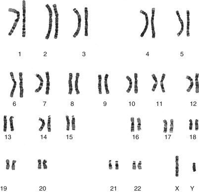

Figure 69-1 

Karyogram of male human chromosome complement, with 46 total chromosomes ordered in pairs. 

Note the nonhomologous pair of sex chromosomes with one X and one Y chromosome _(lower right)_ . 

 

##  Chromosome Structure 

A single metaphase chromosome is composed of two DNA double helices associated with proteins. Each double helix is termed a _chromatid,_ and the two chromatids are held together by an as yet unreplicated region of DNA known as the _centromere,_ or primary constriction. In addition to its function in cell division, the centromere acts as a landmark and divides the chromosome into two distinct regions known as _arms_ ( [ Fig. 69-2, _A_ ](<#f0015>) ). The shorter of the two arms is designated the _p arm,_ and the longer arm is known as the _q arm_ . When the centromere is approximately equidistant from both ends, the chromosome is said to be metacentric, but if it is closer to one end than the other, the chromosome is submetacentric ( [ Fig. 69-2, _B_ ](<#f0015>) ). Five pairs of acrocentric chromosomes have modified short arms with stalks containing only multiple copies of rRNA genes that are capped by a modified telomere termed a _satellite_ (see [ Fig. 69-2, _A_ ](<#f0015>) ). 

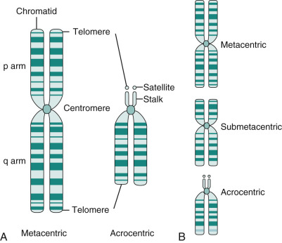

Figure 69-2 

Chromosome structure. 

**A,** Schematic of metaphase chromosome anatomy showing major landmarks. Each chromosome is composed of two chromatids held together by the centromere. The telomere is the end structure of the chromosome. A typical metacentric form is contrasted with an acrocentric having a modified short arm structure composed of stalks and satellites. In all cases, the shorter, or p, arm is oriented up and the longer, or q, arm is oriented down. **B,** The relative position of the centromere can vary, resulting in metacentric (centromere near the middle), submetacentric (centromere closer to one end), and acrocentric (modified short arm) chromosomes. 

The end of a chromosome is the _telomere_ . These regions are known to be composed of tandemly repeated DNA with the sequence (TTAGGG) _ n  _ that functions to stabilize the chromosomes. The mechanics of DNA replication are such that not all of the telomere DNA can be replicated at each division, so there is a shortening of the telomeres over time. It has been postulated that total loss of the telomeres leads to an increase in chromosomal aberrations that may, in part, be responsible for carcinogenesis and the human aging process (  Harley et al, 1990  ;  Wright & Shay, 1992  ;  De Lange, 1998  ;  Raynaud et al, 2008  ). 

 

##  Cell Culture 

To obtain metaphase cells for a chromosome analysis, cells from a patient must be cultured in vitro. The average human cell divides once every 24 hours, so only about 1% of the cell population is dividing at any given time. However, some cells, such as lymphocytes in a normal healthy individual, do not divide at all. Special culture techniques have therefore been developed to stimulate the cells to divide and increase the yield of metaphase cells. 

 

##  Specimens 

Virtually any viable, nucleated cell sample can be used for cytogenetic analysis. However, certain types of cells are easier to obtain and culture and are therefore favored for chromosomal preparations. For routine cytogenetic studies of adults and children, heparinized peripheral blood is the preferred specimen. Obtaining a sample via standard phlebotomy is usually easy to arrange and relatively painless for the patient. In hematologic disorders, the best results are obtained from bone marrow samples, because this is the origin of the disease. Fibroblast cultures from skin biopsies or skin punches provide an adequate source of metaphase cells. Tissues such as liver, kidney, lung, and muscle are not routinely used because of the invasive nature of acquiring such specimens; however, these tissues can be useful to evaluate a fetal loss or an autopsy. Products-of-conception samples may contain a mix of maternal and fetal tissue and so require extra care in establishing a culture (  De Martinville et al, 1984  ). 

The most common specimen for prenatal analysis is amniotic fluid collected by amniocentesis. Under ultrasound guidance, the physician passes a needle through the mother's abdomen and uterus into the amniotic sac. This is typically done between 16 and 18 weeks of gestation, at which time 20 to 30 mL of amniotic fluid (fetal urine) can be withdrawn without endangering the fetus. Cells present in the sample are derived from the fetus and provide a source of material for cytogenetic, molecular genetic, and biochemical assays. The fluid itself contains alpha fetoprotein (AFP), as well as other proteins and enzymes, and forms the substrate for other prenatal assays. The risk of fetal loss due to amniocentesis is approximately 0.2% to 0.3%. 

Another prenatal procedure is chorionic villus sampling, which provides tissue from the developing placenta (chorionic villi) (  Blakemore, 1988  ;  Rhoads et al, 1989  ). The transabdominal or transvaginal procedure is performed at 10 to 14 weeks' gestation and has a risk of fetal loss of approximately 1%. Because no amniotic fluid is collected, no AFP or related testing can be done, although standard cytogenetic, biochemical, and molecular analyses are possible. 

Cordocentesis, or percutaneous umbilical blood sampling (PUBS), results in a fetal blood specimen that can be used for rapid karyotyping or molecular studies. This procedure is done at later gestational ages (≥20 weeks) and carries a higher risk of fetal loss (2% to 5%). 

All clinical samples for cytogenetic analysis must be collected in a sterile manner. The presence of bacteria or fungi severely compromises the study because prokaryotic cells usually outcompete and overgrow any human cells that are present. To maximize the number of viable cells, specimens should be transported to the laboratory as soon as possible after collection. Blood, bone marrow, amniotic fluid, and chorionic villi should be maintained at room temperature, whereas solid tissue is transported on wet ice. The difference in temperature of transport is due to the native conditions of the sample. Blood, bone marrow, and amniotic fluid cells exist as individual cells in a fluid substrate, and the integrity of the sample will not be compromised as long as its temperature is maintained close to body temperature. However, collection of tissues such as skin requires cells to be excised from the body, leaving broken and dying cells at the periphery of the sample. The resultant release of lysosomal enzymes facilitates degradation of the dead cells, but the enzymes will also attack and destroy adjacent living cells. If the temperature is dropped to near 4° C, enzyme activity will be inhibited, and the viability of the sample is maintained. 

 

##  Cell Culture Technique 

Depending on the cell type, either a suspension (floating) or monolayer (fixed to a surface) culture technique may be employed. Blood and bone marrow cells are grown in suspension, so cells from the sample can be aliquoted directly into an appropriate culture medium. Bone marrow is typically cultured for 24 to 48 hours, whereas lymphocytes require 3 to 4 days in culture for maximum yield. Furthermore, because lymphocytes do not normally divide in culture, they must be induced using a mitogen, usually phytohemagglutinin. The resultant metaphase cells can then be collected by the use of a mitotic inhibitor, such as colcemid. Amniotic fluid cells, chorionic villi, and solid tissue are all grown as a monolayer in situ. Tissue and chorionic villi are first disaggregated using a mild collagenase treatment, and the individual cells are then seeded onto glass coverslips and covered with culture medium. In an amniotic fluid sample, the cells must first be separated from the fluid by centrifugation before being plated in dishes and allowed to form in situ colonies. Typical culture times are 5 to 7 days for chorionic villi and amniocytes and up to 2 weeks for solid tissue culture. 

Once maximum growth has been achieved, all cell types are harvested using similar techniques. The cells are swelled hypotonically (to the point that the cell membrane is stretched but not broken) and are then fixed, typically using a methanol : acetic acid fixative. Gentle blowing on the coverslip containing the fixed cells from in situ cultures results in the rupture of the cell membrane and a spreading of the metaphase chromosomes. For suspension cultures, the fixed cells must be dropped on to a clean microscope slide, which mechanically breaks the membranes and leaves the chromosomes separated slightly from each other but in a discrete region occupied by a single cell ( [ Fig. 69-3 ](<#f0020>) ). After air drying, the slides are suitable for staining. In some cases, artificial aging of the cells at 65° C for 30 to 60 minutes improves the quality of the staining. Although most laboratories still perform these steps manually, an automated robotic harvester has been developed that can process large numbers of cultures quite efficiently. 

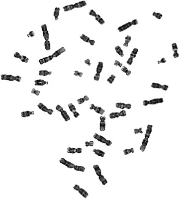

Figure 69-3 

Metaphase chromosome spread. 

Chromosomes from a single cell as seen on a microscope slide. 

 

##  Staining 

Chromosomes are routinely stained using Giemsa or Wright's stain, positively charged dyes that bind to the negatively charged DNA molecule. Mild trypsinization of the chromosomes before staining apparently weakens the DNA–protein interactions, yielding a defined pattern of alternating light and dark regions after the stain is applied. This is called the _banding pattern_ (G-banding for Giemsa banding) (  Yunis & Sanchez, 1973  ;  Burkholder & Weaver, 1977  ;  Holmquist et al, 1982  ). Each pair of chromosomes has a unique band pattern that is schematically represented as an ideogram (  ISCN, 2013  ) ( [ Fig. 69-4 ](<#f0025>) ), and this is used to identify each chromosome and the chromosomal subregions. 

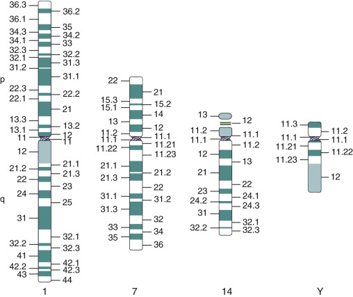

Figure 69-4 

Examples of ideograms for chromosomes 1, 7, 14, and Y showing the expected pattern of alternating light and dark bands. 

Although standard G-banding is adequate for most situations, additional information about chromosome structure can be obtained with other special staining technologies. The most common special stains include Q-banding, C-banding, and R-banding. _Q-banding_ , or quinacrine fluorescence staining, was originally used in routine chromosome analysis (  Comings et al, 1975  ). However, because the fluorescence is transient, it has been replaced by G-banding, which allows a permanently stained preparation (  Sumner et al, 1973  ). The current major application of Q-banding is for rapid identification of the Y chromosome. The distal end of the long arm of the Y chromosome is composed of heterochromatin and is the most brightly fluorescent region in a human metaphase ( [ Fig. 69-5, _A_ ](<#f0030>) ). In cases of ambiguous genitalia, a quick Q-banded preparation can usually answer the question of the presence or absence of a Y chromosome in the patient. _C-banding_ , constitutive or centromere banding, is used to evaluate constitutive heterochromatin or to determine whether a chromosome has two centromeres (dicentric). Normally, a centromere appears as a single dark spot on an overall pale-staining chromosome (  Holmquist, 1979  ). In the case of a dicentric chromosome, the presence of two dark regions clearly identifies the two centromeres ( [ Fig. 69-5, _B_ ](<#f0030>) ). _R-banding_ , or reverse banding, results in chromosomes with the same banding pattern as that seen in G-banding, but the light and dark bands are reversed, hence the name. Because the telomeres of the chromosomes tend to be small, light-staining bands, a deletion may not be easily detected using standard G-banding. In R-banding, however, the telomeres should appear as dark bands, and their absence as the result of a deletion is more obvious. 

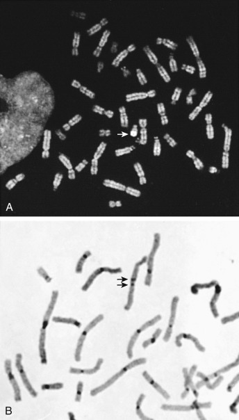

Figure 69-5 

**A,** Q-banded metaphase showing bright fluorescence of the Y chromosome _(arrow)_ . **B,** C-banded chromosomes showing the dark staining centromeres. A dicentric chromosome was detected with two dark bands ( _arrows_ ). 

 

##  Karyotype Analysis 

To perform a cytogenetic (karyotype) analysis, it is essential to be able to rapidly and accurately identify each chromosome and determine when chromosome abnormalities are present. The first step is to count the number of chromosomes present in the cell being evaluated. The number of active centromeres defines the total number of chromosomes and will total 46 in a normal human diploid cell. Too many or too few chromosomes indicate a potential numerical abnormality. In vitro culture can result in culture artifacts, so no single cell is used to define an individual's chromosome complement. A typical clinical study requires analysis of 15 to 20 cells. Single cells with abnormalities are considered artifacts. Three or more cells with the same chromosome loss or two or more cells with the same additional chromosome define a true abnormality. In cases of mosaicism or for other special situations, 10 to 30 additional cells may be evaluated. 

Individual chromosomes are identified based on the overall size of each chromosome, the position of its centromere, and the banding pattern. Any variation in chromosome structure should be detected at this time. In most circumstances, routine G-banding of metaphase chromosomes is sufficient for clinical diagnostic purposes. However, some disorders are associated with very small deletions of chromosomal material that may not be resolved at this level, so high-resolution analysis is used. Special culture conditions are employed, and the cells are harvested at prometaphase, a slightly earlier stage of cell division. At this point in the cell cycle, the chromosomes are less condensed and physically longer, making the presence of small abnormalities easier to detect. Please note that even at high resolution, the ability to detect very small chromosome abnormalities is limited. A duplication or deletion of about 3 MB is the smallest that can be seen using conventional karyotype analysis. 

The analysis is performed by a technologist viewing the cells at the microscope, and once the study is complete, a determination is made as to whether the chromosome complement is normal or abnormal. For documentation, representative metaphase cells are captured, and karyograms (illustrations of the chromosomes of a given cell; see [ Fig. 69-1 ](<#f0010>) ) are prepared. The homologous pairs are arrayed from large to small, with special placement for the pair of sex chromosomes. By convention, the shorter arm, the p arm, is oriented up, and the longer q arm is oriented down. 

 

##  Computer-Assisted Imaging 

To capture the images, cytogenetics laboratories now use computer-assisted imaging. A CCD (charge-coupled device) video camera is used in combination with specially designed software to capture an image of a metaphase cell, which is digitized and displayed on the computer monitor. The image can be modified by lightening, darkening, or changing the contrast, and a variety of manipulations of the chromosomes are possible, including straightening and importing chromosomes from other fields. A karyogram can then be generated using a pattern-recognition subroutine that will automatically identify the chromosomes and place them in their proper places on a karyogram form. Depending on the software and the quality of the image, the accuracy of this process can vary from 10% to 85%. After the computer has taken its “best guess,” a trained cytogenetic technologist must make the appropriate corrections, and the final version of the karyogram can be printed out by a high-resolution printer and then archived. A routine karyogram from capture to printing should take a trained technologist on average 15 to 20 minutes. 

 

##  Fluorescence in Situ Hybridization 

FISH, a combination of molecular and cytogenetic technologies, has expanded the ability to investigate chromosome anomalies. This technique requires a molecular probe (i.e., a fragment of DNA) that is labeled with a fluorescent dye. To create a probe, a target DNA of interest is chosen, the relevant DNA is isolated, and a single stranded copy of that DNA is labeled with a fluorescent dye. This probe can be hybridized to denatured metaphase or interphase cells and should bind to the homologous region of the chromosome from whence it was derived. The presence or absence of the signal can be seen using a fluorescence microscope (  Ledbetter & Cavenee, 1989  ). 

In clinical applications of FISH, the most common goal is to determine whether a gene, a specific mutation, or a particular chromosomal rearrangement is present, so the molecular probes used must be well characterized and specific to the locus in question. There are three basic types of probes. _Chromosome painting_ probes are actually a cocktail of many unique DNA fragments from along the entire length of a chromosome, so that, following hybridization, the entire chromosome fluoresces ( [ Fig. 69-6, _A_ ](<#f0035>) ). _Repeat sequence_ probes are usually used in chromosome enumeration (i.e., to detect the gain or loss of specific chromosomes) (  Lichter et al, 1990  ). Chromosome-specific pericentromeric and subtelomeric probes are typically used for this purpose ( [ Figs. 69-6, _C_ and _D_ ](<#f0035>) ). A _unique sequence_ probe is usually isolated from cloned DNA of a disease-causing gene or a fragment of DNA of known location associated with a particular gene. This type of probe is used to identify the presence or absence of a gene, gene region, or chromosomal rearrangement of interest (  Cherif et al, 1989  ;  Lindsay et al, 1993  ). _Subtelomere_ probes are a subset of this category, and chromosome-specific subtelomere probes have been used to characterize cryptic subtelomeric deletions or rearrangements that have been associated with unexplained mental retardation ( [ Fig. 69-6, _B_ ](<#f0035>) ) (  Flint et al, 1995  ;  Flint & Knight, 2003  ; National Institutes of Health and Institute of Molecular Medicine Collaboration, 1996;  Rosenberg et al, 2001  ;  Irons, 2003  ). Although accurate and useful, the subtelomere FISH assay has now been largely replaced by chromosome microarray studies. 

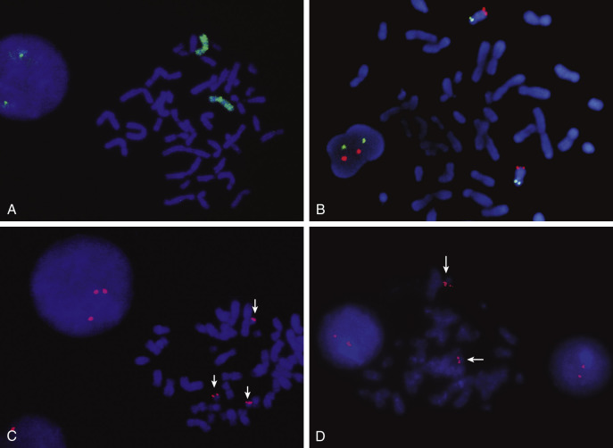

Figure 69-6 

Fluorescence in situ hybridization. 

**A,** Whole chromosome paint probe highlighting the two X chromosomes in a female cell. **B,** Chromosomes showing hybridization with subtelomere probes. The p arm subtelomere is indicated by the green signals, and the q arm subtelomere is indicated by the red signals. Paired red and green signals are seen in the interphase nucleus to the _left_ . **C** and **D,** Repeat sequence centromere probe for chromosome 21. **C,** Trisomy 21 seen at _left_ in an interphase nucleus and at _right_ in a metaphase ( _arrows_ ). **D,** Normal complement of two copies of chromosome 21 ( _arrows_ ) seen in interphase ( _left_ and _right_ ) and in a metaphase ( _center_ ). 

 

##  Technique 

FISH can be performed on either metaphase or interphase cells. For metaphase FISH, cells are cultured and harvested as for a routine karyotype analysis, but no culture is required for interphase FISH. Fixed cells are collected, and slides are made as described for karyotyping. The DNA on the slides is then denatured, and a fluorescently labeled single-stranded molecular probe is allowed to hybridize to the chromosomal DNA using an annealing temperature that favors hybridization of homologous regions of DNA ( [ Fig. 69-7, _A_ ](<#f0040>) _)_ . After an appropriate period of hybridization, excess probe is washed away and the nonhybridized DNA is counterstained with another fluorochrome to allow visualization of the entire chromosome complement. A fluorescent microscope with light from a 100-watt mercury bulb in combination with appropriate sets of exciter filters allows evaluation of the cells. Due to the optical limitations of the glass filters, a maximum of three colors can be visualized on a typical fluorescent microscope. For documentation, images are captured using a computer-assisted system. 

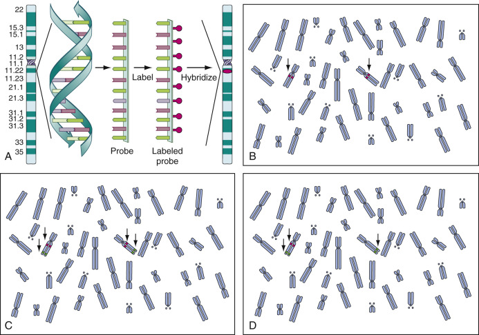

Figure 69-7 

**A,** Schematic of fluorescence in situ hybridization (FISH) technology. DNA derived from a known gene is rendered single stranded, labeled with a fluorescent tag, and then hybridized back to the chromosomes of a metaphase cell. **B** to **D,** Depiction of a metaphase cell with 46 chromosomes that has been processed using FISH technology. The labeled probes hybridized to targets are indicated with _arrows_ . **B,** Dual signals indicating hybridization to both alleles of target gene. **C,** Target gene indicated by _red_ signal and a control probe indicated in _green_ . Complete hybridization to all alleles. **D,** Hybridization of both controls ( _green_ ) but presence of only a single target gene, indicating deletion of one allele. 

One of the most critical elements in FISH is the selection of a specific probe or probes that will help to answer a clinical question. For example, one of the most useful clinical applications of FISH is the detection of microdeletions too small to be seen using classical cytogenetics ( [ Fig. 69-7, _B_ to _D_ ](<#f0040>) ). The gene must be known, and the probe used must be homologous to the critical region of the gene that is usually deleted. Hybridization with the probe should result in a fluorescent signal only at the target locus. If a signal is present, DNA complementary to the probe is present, so there is no deletion (see [ Fig. 69-7, _B_ ](<#f0040>) ). However, the absence of signal indicates that a deletion exists (i.e., there is no DNA sequence present on the chromosome that is complementary to the probe, so no hybridization can occur) (see [ Fig. 69-7, _D_ ](<#f0040>) ). A control probe to a different region of the chromosome being tested is usually used as a hybridization control (see [ Fig. 69-7, _C_ ](<#f0040>) ). Therefore, when evaluating a disease-related probe, an unaffected individual should have two signals per cell for each autosomal gene: one signal for each chromosome of the pair ( [ Fig. 69-8, _A_ ](<#f0045>) ). An affected individual with a deletion should have a single signal per cell, showing one normal and one deleted chromosome ( [ Fig. 69-8, _B_ ](<#f0045>) ). For both affected and unaffected individuals, the control probe should show two signals per cell in all cells that are scored. In a metaphase cell, the chromosomes may be short and condensed, with each chromatid individually visible, resulting in a discrete FISH signal on each chromatid. In these cells, there may appear to be two signals per chromosome, for a total of four signals, but in actual scoring, only complete chromosomes are considered, so a signal on one or both chromatids would be counted as just one positive signal. 

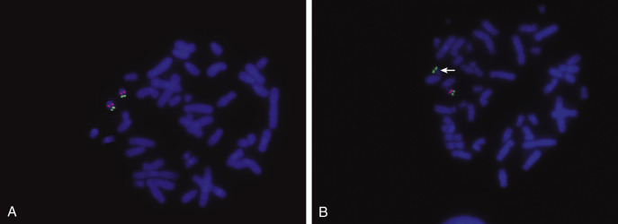

Figure 69-8 

Fluorescence in situ hybridization detection of a microdeletion of chromosome 22 associated with velocardiofacial syndrome. 

**A,** An individual with no deletion showing the presence of one _red_ (gene locus) and one _green_ (control locus) signal for each chromosome 22. **B,** Patient with a deletion seen as a chromosome with only a single _green_ (control) signal. The homologous chromosome 22 is “normal” with one _red_ and one _green_ signal. 

One of the problems with this detection system is that the lack of signal is the positive indication of a deletion. Technical failure of hybridization may also result in absence of a signal. To eliminate this as a source of error, a minimum of 20 cells must be evaluated, and all cells must agree in signal count. If mosaicism is suspected, additional cells may be surveyed. In addition, unique sequence probes are currently used in combination with a second probe—a control probe—that is localized to a different locus on the same arm of the target chromosome (see [ Fig. 69-7, _C_ ](<#f0040>) ). The two probes are usually labeled with fluorochromes of different colors. In all cells evaluated, two clear control signals must be seen, and then the corresponding signals for the disease locus can be recorded. This provides a hybridization control as well as a marker for the chromosome of interest (see [ Fig. 69-7, _D_ ](<#f0040>) ). If a dual-color system is used, results may be obtained in interphase as well as metaphase cells. 

Chromosome painting probes are most useful in identifying complex rearrangements or marker chromosomes. If an individual has an abnormal chromosome with extra material of unknown origin, it may be possible to use chromosome painting to identify the source of the extra DNA. This may help in either diagnosis or prognosis of the individual. For example, in the case of a patient with only one identifiable X chromosome and a small, unidentified marker chromosome, it will be important to determine if the origin of the marker is an X or a Y chromosome. This can be accomplished using chromosome paints for the X and Y chromosomes labeled with different fluorochromes. 

FISH is a targeted assay. The probes will only provide information about the locus from which they are derived. Thus when interpreting results, it is critical to know which probe was used. When using metaphase cells, the necessary data can usually be obtained from viewing about 20 cells. A larger sample of interphase cells (200-500) can yield statistically significant data about the frequencies of disease clones. 

 

##  Multicolor Fluorescence in Situ Hybridization 

Another advantage of FISH is the ability to hybridize multiple probes to a single slide to obtain a better understanding of chromosome rearrangements (  Schrock et al, 1996  ;  Speicher et al, 1996  ). For most fluorescent microscopes, the maximum number of FISH probe colors is three (one target sequence, one control sequence, and one counterstain). If more than three colors are needed, a computer-assisted imaging system is required. This is because a fluorescent image is the result of the light from the mercury bulb passing through an exciter filter, hitting the fluorochrome on the slide, and transmitting an image of the appropriate color to the eyepiece for viewing. Each fluorochrome requires its own filter, so for each additional color desired, the light must pass through additional thicknesses of glass. The optical properties of glass and light limit the total number of viewable colors to three. However, with a computer-assisted system, detection of multiple colors becomes possible. The computer does not actually “see” more colors, but it can detect subtle differences in shades better than the human eye. In a relatively simple example, two fluorochromes are used and mixed in varying proportions to give a range of colors. In the example in [ Figure 69-9, _A_ ](<#f0050>) , a red fluorochrome is mixed with a yellow fluorochrome, generating intermediate colors from red to yellow. Eight signals are seen, but as viewed through the microscope, it is impossible to be absolutely sure which signal corresponds to a particular chromosome. Although difficult to distinguish by the human eye, the computer can register each color as a different shade of gray, and then the software assigns a unique color to that shade for display on the computer monitor. [ Figure 69-9, _B_ ](<#f0050>) , shows the final multicolor version using many different colors now easily distinguishable but very different from the original presentation (see [ Fig. 69-9, _A_ ](<#f0050>) ). Using the key to the left, the following chromosomes are detected: two each for chromosomes 13, 21, and X; three chromosomes 18; and one Y chromosome. This cell is therefore trisomic for chromosome 18 with an XXY sex chromosome complement. This is an example from prenatal genetic diagnosis (PGD). In PGD, a single blastomere is removed from an embryo at the 8 cell stage. With one cell, limited testing is possible, but using a multicolor FISH approach, it is possible to do a single hybridization that will detect common abnormalities such as aneuploidies for chromosomes 13, 18, 21, and the sex chromosomes. In cancer studies, combinations of fluorochromes have been developed that allow detection of each of the 24 different chromosomes, followed by a unique color assignment by the computer (  Reid et al  1992a  ;  Divane et al, 1994  ). 

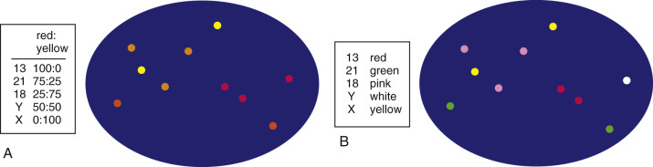

Figure 69-9 

Multicolor fluorescence in situ hybridization. 

**A,** Diagram of the staining pattern for five probes (chromosomes 13, 18, 21, X, and Y) in an interphase cell. Table at the left shows relative proportions of the red and yellow fluorochromes used for each probe. **B,** The same cell depicted in **A,** now showing the computer-derived artificial color assignments (key shown in box to left). This cell can now be interpreted as having two copies each for chromosomes 13, 21, and X; three copies of chromosome 18; and one Y chromosome. 

 

##  Microarray Technology 

FISH greatly increased the detection rate of chromosomal abnormalities, but some individuals who present with findings suggestive of a chromosome defect have an apparently normal karyotype or FISH assay. To obtain even more detailed information on the chromosomes of these problematic patients, use of microarray analysis has proven to be very valuable in genetic diagnosis. In 2010, a consensus paper was published that supported chromosome microarray analysis as a “first-tier clinical diagnostic test for individuals with developmental disabilities or congenital anomalies” (  Miller et al, 2010  ). This was quickly followed by additional publications showing the relevance of microarray for the detection of genetic abnormalities in both prenatal and oncology cases (  Kolquist et al, 2011  ;  Morrissette et al, 2011  ;  Shaffer et al, 2012  ;  Wapner et al, 2012  ). 

A cytogenetic microarray is a genome-wide screening test to detect copy number variations (CNVs) in the DNA sequence. (See [ Chapter 68 ](<##!/content/3-s2.0-B9780323295680000681?scrollTo=%23c00068>) for a discussion of the technology behind microarray analysis.) Current applications utilize either an oligonucleotide array or a single nucleotide polymorphism (SNP) array. Oligonucleotide arrays generally target known disease genes but add in background sequences, for an overall coverage of the genome with probes spaced 50 to 100 KB. SNP arrays provide significantly more detailed coverage with probes on average every 100 to 1000 base pairs. When performed correctly, a microarray assay will detect deletions, duplications, aneuploidies, and unbalanced translocations with a gain or loss of sequences ( [ Fig. 69-10 ](<#f0055>) ). SNP arrays can also identify methylation patterns and so are useful in evaluating cases of uniparental disomy and identity by descent (IBD; consanguinity, incest, inbreeding). Using microarray analysis has allowed the identification of genomic lesions too small or too cryptic to be detected by other types of assays, leading to a diagnosis for many patients for whom the cause of their anomalies had previously been unknown (  Pickering et al, 2008  ;  Saam et al, 2008  ). In addition, many new genetic syndromes have been recognized and added to the known catalog of genetic disorders. 

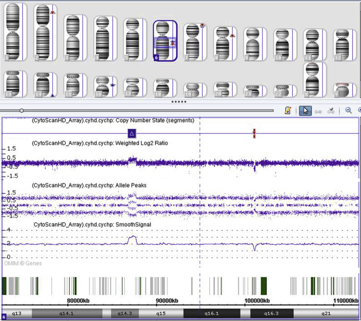

Figure 69-10 

Example of data from a microarray analysis. 

The upper panel shows the set of chromosomes from which chromosome 6 was chosen for examination in detail. The bands for that chromosome are showed horizontally at the bottom. In this case, the proximal long arm of chromosome 6 shows two anomalies: a duplication and a deletion. The duplication is identified by the blue box just below the chromosome panel, and the red bar denotes the smaller deletion. These are confirmed by the thick line at the top (weighted log2 ratio), series of three midweight lines in the middle (allele peaks), and the single line below that (smooth signal). For the duplication, the smooth signal deflects upward, showing three copies in that region and four copies for the allele peaks. For the deletion, the smooth signal deflects downward, indicating the presence of a single copy at that locus. These data were collected using the Affymetrix CytoScanHD system. 

However, as with all technologies, microarray is not a perfect solution for all situations. Microarrays will not detect balanced chromosome rearrangements, including translocations and inversions. Some CNVs found will be polymorphic variants for which the clinical significance is unknown. Thus it may not be possible to state for certain that the anomaly found is related to the patient's clinical problem. To collect as much data as possible and to share the information among practicing geneticists, international databases have been set up, and clinical laboratories performing microarray analyses are encouraged to report their findings. These searchable databases will aid in better interpretation of CNVs. 

 

##  Chromosome Abnormalities 

Clinical cytogenetic testing is an integral part of clinical medicine. Finding a particular chromosome anomaly may be directly associated with a disease diagnosis, or it might explain a physical problem or phenotypic abnormality in the patient. It is therefore critical to determine whether an affected individual has a chromosome complement that differs from the standard pattern of 23 pairs of chromosomes with known morphology. There are two basic categories of cytogenetically detectable variation: numerical and structural change. 

 

##  Numerical Abnormalities 

In humans and other mammals, the chromosomes occur in pairs. Of the 46 human chromosomes per cell, there are only 24 uniquely different chromosomes. A set of 23 comprises the haploid ( _N_ ) number of chromosomes, which is the number of chromosomes in a gamete. At fertilization, two haploid complements join to form a zygote with 46 chromosomes, the diploid (2 _N_ ) complement. Errors in division can give rise to chromosome complements that have more or less than 46 chromosomes. Exact multiples of the haploid set of chromosomes is called _euploidy_ . Gain or loss of one or a few chromosomes is known as _aneuploidy_ . 

 

##  Euploidy 

Diploidy, the normal state of human cells, is a form of euploidy. Abnormal euploidies include triploidy (3 _N_ = 69 chromosomes) and tetraploidy (4 _N_ = 92 chromosomes), but in humans, these are not compatible with life and are detected primarily in neoplasia or spontaneous abortus tissues. Triploidy ( [ Fig. 69-11, _A_ ](<#f0060>) ) may be due to the failure in gametogenesis of one of the meiotic divisions, giving rise to a 2 _N_ gamete that, when combined with a haploid gamete from the other parent, produces a triploid zygote. Alternatively, a 3 _N_ complement may be derived from dispermy, the fertilization of a haploid egg by two sperm, and this generally results in a nonviable partial hydatidiform mole. Tetraploidy, on the other hand, is usually a postmeiotic event and presents as a duplication of a diploid complement (XXXX or XXYY), probably due to failure of an early mitotic cleavage division in the zygote. Triploidy and tetraploidy seen in neoplasia usually result from a somatic division error. 

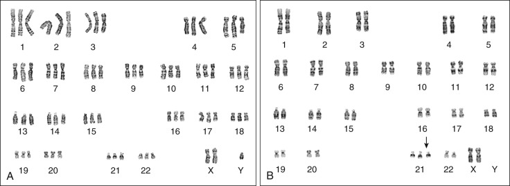

Figure 69-11 

Numerical chromosome abnormalities. 

**A,** Triploid (3N) chromosome complement with three copies of each chromosome (69,XXY). **B,** Trisomy 21 (47,XX,+21) with one extra chromosome 21 ( _arrow_ ). 

 

##  Aneuploidy 

More common are nondisjunctional errors resulting in aneuploidy. Here, a single pair of chromosomes fails to disjoin properly in division, giving rise to one extra chromosome or one missing chromosome per cell. Occasionally, more than one pair of chromosomes may be involved, but these cases are extremely rare in normal somatic tissues. Nondisjunction errors may occur in either meiosis or mitosis. Early mitotic nondisjunction in a zygote may result in an individual with the aberrant chromosome complement in all cells of the body, but a latter division error usually produces a _mosaic_ , an individual with two cell lines that differ only by a single chromosome. Mitotic division errors in neoplasia can lead to aneuploidy for multiple chromosomes. 

In normal meiosis, one DNA replication is followed by two cell divisions, resulting in four haploid ( _N_ ) gametes (one copy of each chromosome) ( [ Fig. 69-12, _A_ ](<#f0065>) ). The first meiotic division is the reduction division, in which the total number of chromosomes per cell is reduced by half. The second meiotic division is a simple mitotic type of division with a separation of the centromeres and distribution of the chromosomes to daughter cells. Meiotic errors may result in gametes with either an extra or missing chromosome (  Angell et al, 1994  ). A nondisjunction error in the first meiotic division ( [ Fig. 69-12, _B_ ](<#f0065>) ) leads to two gametes that are disomic for one chromosome and two gametes that are missing that chromosome (nullosomic). When fertilized, the former will give a trisomic conception for the nondisjoined chromosome (for example, trisomy 21 in [ Fig. 69-11, _B_ ](<#f0060>) ), and the latter will result in a monosomy. Similarly, [ Figure 69-12, _C_ ](<#f0065>) _,_ shows an error in the second meiotic division, resulting in two normal haploid gametes, one disomic gamete, and one nullosomic gamete. 

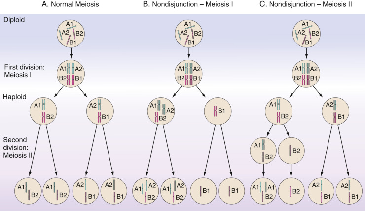

Figure 69-12 

Meiosis and meiotic nondisjunction errors, resulting in aneuploid gametes. 

**A,** Normal meiosis generating four gametes with a haploid chromosome set. **B,** Nondisjunction in meiosis I, leading to an extra copy of chromosome A (heterodisomy) in two gametes ( _left_ ) but the lack of any A chromosome (nullosomy) in the remaining two gametes ( _right_ ). **C,** Nondisjunction in meiosis II results in two gametes with a normal chromosome complement ( _right_ ), one gamete missing an A chromosome ( _left center_ ), and one gamete with an extra duplicated chromosome (two copies of A1), resulting in isodisomy for chromosome A1 ( _left_ ). 

Trisomy or monosomy may occur for any chromosome, but most of these occurrences are incompatible with life and will terminate spontaneously. Trisomy 16, for example, is the most commonly detected trisomy in spontaneous abortus tissue but is not reported in liveborn individuals. Liveborn autosomal trisomies include chromosomes 13, 18, and 21. Infrequently, patients with a mosaic chromosome complement for trisomies 8, 9, or 22 are identified. Sex chromosome trisomies are viable and well documented (see later). The only viable monosomy is of the X chromosome (45,X). Examples of clinically significant aneuploidies are discussed later in this chapter. 

Because trisomies and monosomies are largely incompatible with life, it had been assumed that these would always result in fetal wastage. However, molecular analyses have shown that a small fraction of these aneuploid conceptions are “rescued” and go on to produce liveborn children. In the case of a monosomy, the rescue is accomplished by duplication of the single existing chromosome, resulting in a chromosome complement with _uniparental isodisomy_ for that chromosome (two copies of the same chromosome inherited from one parent) ( [ Fig. 69-13 ](<#f0070>) , _right_ ) (  Ledbetter & Engel, 1995  ). This is exemplified by several reported cases in the literature in which a child affected with cystic fibrosis was shown to be homozygous for the ΔF508 mutation, although molecular tests on both parents revealed that only one was a carrier of ΔF508 (  Spence et al, 1988  ;  Voss et al, 1989  ). The interpretation is that the conception was a nonviable monosomy 7 rescued by duplication of the existing chromosome 7 that happened to be carrying the mutation for cystic fibrosis. A similar situation is possible in the case of a trisomy. Again, most trisomies are nonviable, but if one of the three chromosomes is lost, a disomy for that chromosome pair is reinstated ( [ Fig. 69-13 ](<#f0070>) , _left_ ). In a set of three chromosomes, loss of a single chromosome results in a complement with one maternal and one paternal chromosome ( _biparental heterodisomy_ ) two out of three times. One-third of the time, the two remaining chromosomes are from a single parent (i.e., uniparental disomy). In this situation, it makes a difference in which meiotic division the error occurred. A first-division nondisjunction results in heterodisomy, which is two homologous but heterozygous chromosomes (one grandmaternal and one grandpaternal); however, a second division error results in duplicate copies of a single chromosome: isodisomy (see [ Fig. 69-12, _B_ and _C_ ](<#f0065>) , and [ Fig. 69-14 ](<#f0075>) ). 

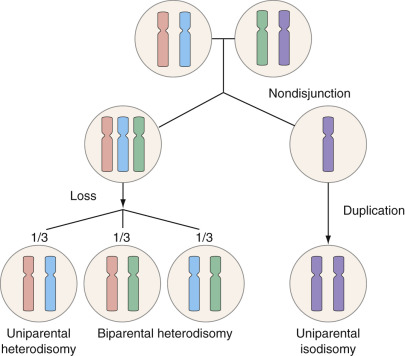

Figure 69-13 

Generation of uniparental disomy from nondisjunction errors. 

On the _left_ , heterodisomy resulting from reduction of a trisomy to a disomy is illustrated. On the _right_ , isodisomy as the result of monosomy rescue (duplication of a single existing chromosome) is seen. 

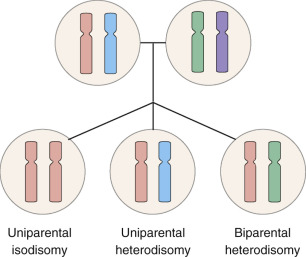

Figure 69-14 

Isodisomy versus heterodisomy. 

The expected conformation of a cell is biparental heterodisomy ( _right_ )—that is, one chromosome from each parent. Division errors can result in an aberrant distribution of parental chromosomes such that two copies of one chromosome from one parent (uniparental isodisomy) ( _left_ ) or two different chromosomes from the same parent (uniparental heterodisomy) ( _center_ ) occur. 

In the past, it was thought that having two chromosomes per pair was sufficient, but it has been shown that in some cases, it is essential for the pairs to consist of one maternal and one paternal chromosome. This issue, including the problems of uniparental versus biparental disomy and isodisomy versus heterodisomy, is of major importance in under­standing issues of _imprinting_ , a topic discussed in detail in [ Chapter 71 ](<##!/content/3-s2.0-B9780323295680000711?scrollTo=%23c00071>) (  Nicholls et al, 1998  ;  Hall, 1990  ;  Cassidy et al, 1992  ;  Petersen et al, 1992  ;  Lobo, 2008  ). 

 

##  Structural Chromosome Abnormalities 

Chromosomes are not static structures but undergo recombination in both meiosis and mitosis. This is a natural process that is critical in generating variation in the species so a highly developed regulatory system is in place to prevent error from occurring. Nevertheless, errors do occur, sometimes resulting in chromosome rearrangements that change the structure of one or more chromosomes. Such abnormalities are quite varied and are often patient specific. Rearrangements may be _balanced_ , if all the chromosomal material is present and functional but simply arranged in a different conformation, or _unbalanced_ , if there is loss and/or duplication of some chromosomal material. Constitutional balanced rearrangements are usually clinically benign and tend to be stably transmitted, but they may increase the risk of errors in meiosis, resulting in chromosomal imbalances in fetuses or liveborn children. Unbalanced chromosome complements are generally associated with an abnormal clinical phenotype that often includes developmental delay and mental retardation. In cancer, chromosome instability may give rise to apparently balanced and unbalanced rearrangements. These anomalies may be an indirect or direct cause of the disease if important structural genes are damaged, duplicated, or inactivated by the rearrangement. 

A _deletion_ is the loss of a part of a chromosome that leads to partial monosomy of the chromosome involved ( [ Fig. 69-15, _B_ ](<#f0080>) ). Deletions vary in size from quite large to very small and may be _terminal_ , which is loss of a portion of one end of the chromosome, or _interstitial_ , which is loss of an internal piece of chromosome. Chromosome breakage, unequal crossing over, or nondisjunction errors involving chromosome rearrangements may result in a deletion. In general, larger deletions result in more severe clinical abnormalities because of the greater number of gene loci that are missing. 

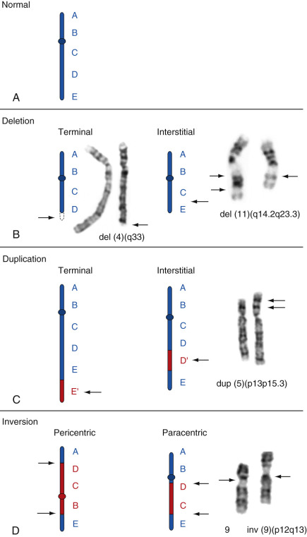

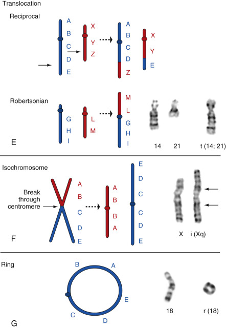

Figure 69-15 

Schematic representations of different structural chromosome anomalies described in the text associated with examples of each anomaly. 

**A,** The normal configuration of a generalized chromosome, where A to E represent different gene loci, and the centromere is represented by a dot located between the B and C loci. **B,** Deletion: Chromosome deletion showing terminal (loss of E locus) and interstitial (loss of D locus) configurations. Examples: Terminal deletion of the long arm of chromosome 4 and an interstitial deletion of the long arm of chromosome 11. **C,** Duplication: Chromosome duplication showing terminal (gain of E′) and interstitial (gain of D′) configurations. Example: Terminal duplication of the short arm of chromosome 5 ( _double arrows_ indicate duplicated band). **D,** Inversion: Chromosome inversion showing pericentric and paracentric forms. Example: Pericentric inversion of chromosome 9 ( _arrows_ indicate centromeres). **E,** Translocation: Reciprocal translocation, where the E and Z loci exchange places. Below is a Robertsonian translocation shown by the fusion of two acrocentric chromosomes at the centromere. Example: Chromosomes 14 and 21 followed by the 14;21 Robertsonian translocation. **F,** Isochromosome: Results from a misdivision of the centromere, generating inverted duplications of the long and short arms of the original chromosome. Example: Isochromosome of the long arm of the X chromosome. **G,** Ring chromosome. Example: Chromosome 18 and ring 18. 

A _duplication_ is the presence of an additional copy of a chromosome segment and leads to partial trisomy for that chromosome ( [ Fig. 69-15, _C_ ](<#f0080>) ). Duplications may be _terminal_ or _interstitial_ and are generated by the same mechanisms as deletions. In fact, many duplications have been shown to be the reciprocal product of a deletion event (i.e., DNA sequences lost on one chromosome may be transferred to the homolog as a duplication) (see [ Fig. 69-25 ](<#f0130>) ). As is true of deletions, the larger the duplicated piece of chromosome, the greater the genomic imbalance, and the more severe the clinical abnormalities tend to be. With the advent of microarray testing, the frequency of detectable duplications in clinically abnormal patients has increased significantly. 

An _inversion_ is a reversal of a chromosomal segment with respect to the normal gene arrangement and requires a minimum of two breaks in one chromosome ( [ Fig. 69-15, _D_ ](<#f0080>) ). Inversions are classified as either _paracentric_ , where the two breaks occur on the same side of the centromere (i.e., in the same arm), or _pericentric_ , where the breaks occur on opposite sides of the centromere and the inversion involves both arms ( [ Fig. 69-15, _D_ ](<#f0080>) _,_ and [ Fig. 69-16, _A_ ](<#f0085>) ). The majority of inversions are balanced, but if the chromosome breaks within a gene and disrupts normal production of a required gene product, clinical abnormalities may be detected. During reproduction, there is an increased risk of meiotic error for inversion carriers who may exhibit infertility or early spontaneous fetal loss due to unbalanced chromosome products. 

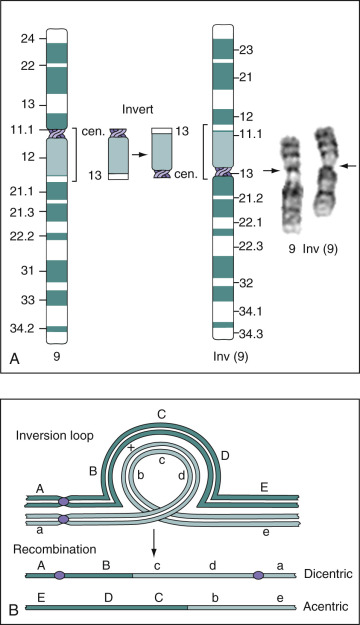

Figure 69-16 

Chromosome inversion. 

**A,** Diagram of a pericentric inversion of chromosome 9 using ideograms to illustrate the mechanism of inversion. Banded chromosomes demonstrating this inversion are shown to the _right_ . **B,** Inversion loop showing the pairing of homologs in meiosis for one normal chromosome ( _dark green_ ) and one with a paracentric inversion ( _light green_ ). If recombination occurs at the point indicated by the X in the loop, recombinant chromosomes would be generated as shown at the bottom. In the case of a paracentric inversion, the recombined chromosomes produced would be either dicentric or acentric. 

For a paracentric inversion carrier, meiosis begins with the pairing of the homologous chromosomes and loci, forming a structure known as an _inversion loop_ ( [ Fig. 69-16, _B_ ](<#f0085>) ). If no recombination occurs within the loop, the chromosomes separate, producing normal gametes. However, crossing over within the inversion loop can lead to acentric and dicentric chromosomes that are nonviable, unbalanced meiotic products. Thus there is an apparent suppression of recombination because the only viable gametes produced are from nonrecombined chromosomes (see [ Fig. 69-16, _B_ ](<#f0085>) ). For pericentric inversions, if recombination occurs within the inversion loop, gametes with a chromosome duplication and/or deletion may be derived. In general, larger pericentric inversions result in smaller duplications/deficiencies and increase the likelihood that a child will be liveborn with a chromosome imbalance and phenotypic abnormalities. Once an inversion carrier has been identified, prenatal diagnosis can be used to assess the chromosomes for each future conception. 

_Translocations_ are rearrangements involving two or more nonho­mologous chromosomes. Each chromosome breaks once, and the pieces exchange places, establishing two (or more) derivative chromosomes ( [ Fig. 69-15, _E_ ](<#f0080>) ). As with inversions, a majority of translocations are balanced, and only when one or more important structural genes are disrupted does the translocation have clinical ramifications. 

The primary danger of a balanced translocation is that carriers are at increased risk for chromosomally abnormal liveborn children. In the first meiotic division, translocated chromosomes assume a cross-shaped structure in order for all alleles to pair properly ( [ Fig. 69-17 ](<#f0090>) ). At anaphase, the alternate chromosomes must segregate together to generate balanced gametes. Up to one third of the time, the chromosomes will not segregate in this manner and the resulting gametes will be unbalanced. The most common errors are termed adjacent-1 and adjacent-2 segregation. Although both of these patterns result in duplication/deficiency of chromosomal material in the gametes, adjacent-2 is more deleterious because it is characterized by the unnatural occurrence of homologous centromeres in a single cell. Viability of a fetus receiving an unbalanced gamete is dependent on the chromosomes and genes involved in the translocation and the size of the duplication and/or deletion. Chromosomes may also follow a 3 : 1 segregation pattern (see [ Fig. 69-17 ](<#f0090>) , _right_ ), in which three chromosomes separate to one cell, with the remaining chromosome in the second cell. This results in gross imbalances of chromosomal material and is usually lethal in utero. Once a translocation carrier has been identified, prenatal diagnosis for future pregnancies is possible. 

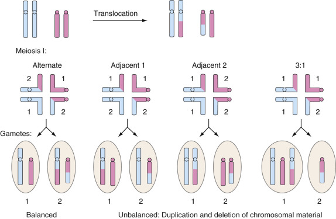

Figure 69-17 

Chromosome translocation. 

Generation of gametes from a hypothetical translocation in meiosis is diagrammed. The chromosomes pair in a cross-shaped configuration in meiosis I. Alternate segregation will result in balanced gametes. Adjacent 1, adjacent 2, or 3 : 1 segregation will produce unbalanced gametes, which may give rise to an abnormal liveborn child. (Only one of several possible 3 : 1 segregations is shown.) 

_Robertsonian translocations_ are a variation of the classic translocation. They occur only between two acrocentric chromosomes and appear to be a fusion of the long arms at the centromere, with the resulting loss of both short arms (see [ Fig. 69-15, _E_ ](<#f0080>) ). An individual who is a Robertsonian translocation carrier has a chromosome count of 45 because two chromosomes have functionally become one and share one centromere. Loss of the acrocentric short arms is not deleterious, because multiple copies of the rRNA genes present there are also located on the remaining acrocentric chromosomes. However, Robertsonian translocation carriers are at increased risk for meiotic nondisjunction errors, resulting in children who are trisomic for one of the rearranged chromosomes. The most common example of this is an individual with a Robertsonian translocation involving chromosomes 13 and 14 who has liveborn children with trisomy 13 ( [ Fig. 69-18 ](<#f0095>) ). The affected child will have 46 chromosomes, including two free copies of chromosomes 13 plus the Robertsonian translocation that includes the third chromosome 13. Another common rearrangement is a Robertsonian 14;21 translocation (see [ Fig. 69-15, _E_ ](<#f0080>) ), which could give rise to trisomy 21 progeny. 

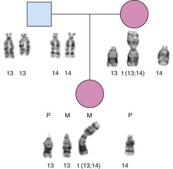

Figure 69-18 

Pedigree and banded chromosomes showing inheritance of a Robertsonian translocation of chromosomes 13 and 14. 

The mother carries the 13;14 translocation in a balanced form, but a meiotic error results in the transmission of both the Robertsonian translocation chromosome and the chromosome 13 from the mother to the child. The child has trisomy 13 and the Robertsonian translocation. Note: The second copy of chromosome 14 is not missing, but it is present as part of the Robertsonian rearrangement. _M,_ Maternal chromosomes; _P,_ paternal chromosomes. 

Although the most common Robertsonian translocations occur between nonhomologous acrocentric chromosomes, it is possible to have such a rearrangement between homologous chromosomes. For example, an individual with a Robertsonian 21;21 translocation would have a total of 45 chromosomes, including the translocation in which the two 21s are joined at the centromere. This type of rearrangement is virtually always de novo, because carriers of the abnormality are unlikely to have normal progeny. Possible gametes include a cell with the Robertsonian translocation (two copies of chromosome 21), which, if fertilized, will give rise to a Down syndrome child, or a cell with no copies of chromosome 21, which, if ferti­lized, will result in a monosomy 21, which is not compatible with life. 

An _isochromosome_ results from misdivision of the centromere during cell division, generating two copies of one chromosome arm but missing the other arm ( [ Fig. 69-15, _F_ ](<#f0080>) ). This mechanism can result in two derivative chromosomes: one with an inverted duplication of the short arm and one with an inverted duplication of the long arm. If both derivative chromosomes are retained in the cell, it would be trisomic for that chromosome, a condition that is usually lethal. In a living individual, therefore, it is most common that one of the two derivative chromosomes is lost, resulting in a carrier who is trisomic for only one duplicated arm and monosomic for the other arm. The best-known example is the isochromosome of the long arm of the X. A patient with Turner syndrome (see later under Sex Chromosome Aneuploidies) may have one intact X chromosome and one isochromosome Xq (trisomy for the long arm but a monosomy for the short arm of the X). Because two functional copies of the X short arm are required for normal female development, this chromosome arrangement results in abnormal development. Acrocentric chromosomes may also form isochromosomes (inverted duplication of the long arm), but the resulting homozygosity of all loci present could lead to expression of recessive disorders that would otherwise not have been evident. 

A _ring chromosome_ occurs when both telomeres of a chromosome are lost and the remaining portion of the chromosome circularizes to reestablish chromosome stability ( [ Fig. 69-15, _G_ ](<#f0080>) ). Unfortunately, these constructs are usually unstable because replication can result in interlinked circles that lead to chromosome breakage and loss when the homologs attempt to separate at anaphase. Under certain circumstances, however, rings can be stably transmitted in cell lines. This usually occurs when the ring contains genetic material that is essential for normal cell function. 

A _marker_ chromosome is a chromosome with a centromere that is stably transmitted to daughter cells but cannot be clearly identified because it is either too small or the banding pattern is too ambiguous. In a constitutional karyotype, a marker is often a benign finding, though it could represent a partial trisomy and thus result in an abnormal clinical phenotype. In cancer, marker chromosomes may be generated as a result of chromosome instability. 

 

##  Conclusions 

Chromosome abnormalities, either numerical or structural, that result in an unbalanced chromosome complement are usually associated with some type of abnormal clinical finding, and the size of the imbalance tends to be proportional to the severity of the problem. Most individuals with a constitutional chromosome abnormality have only a single chromosome defect. However, there are rare instances in which one person may have two or more chromosomal errors. Acquired chromosome abnormalities (seen in cancer cells) may be more complex and may have multiple numerical and structural changes in a single cell line. 

 

##  Nomenclature 

With such a broad range of chromosome variation, it was necessary to develop a system of classification that would allow each individual's chromosome complement to be succinctly described and understood worldwide. The first cytogenetic nomenclature provided a framework, and the “language” has been evolving ever since. Currently, the International System of Cytogenetic Nomenclature is recognized as the standard (  ISCN, 2013  ). 

The nomenclature describing a chromosome complement can be broken down into three basic parts: the total number of chromosomes, the sex chromosome complement, and any chromosome abnormalities. These units are listed in order, separated by commas. So an apparently normal female would be coded as 46,XX, and a male would be 46,XY. If two or more cell lines are present, they are listed sequentially, separated by a slash, with a normal diploid clone, if present, always listed last (45,X/46,XX). Other clones are ordered by size, with the largest clone placed first. The number of cells in each clone is indicated by a number enclosed in brackets (45,X[15]/47,XXX[3]/46,XX[12]). For numerical anomalies, the total number of chromosomes would be increased or decreased to indicate the overall change, and the specific chromosome gained or lost would be noted at the end. For example, trisomy 13 in a female would be written as 47,XX,+13, and monosomy 8 in a male would be written 45,XY,–8\. However, for a sex chromosome variation that is known to be constitutional, it is not necessary to use a + or – sign, because the change in chromosome complement can be noted directly. Monosomy X becomes 45,X, and gain of a sex chromosome would be 47,XXY, 47,XXX, or 47,XYY. On the other hand, if the sex chromosome change is acquired, as in some cancer cell lines, a + or – indicating this would be required (e.g., 45,X,–Y for a male whose Y chromosome has been lost as a result of his disease). 

Balanced structural changes in the chromosomes usually do not affect the total number of chromosomes present but should be noted at the end of the nomenclature to clarify the status of the rearranged chromosomes. In order to streamline the nomenclature, a series of abbreviations for the common structural anomalies has been generated that shortens the overall nomenclature ( [ Table 69-1 ](<#t0010>) ). A structural abnormality is indicated by the abbreviation of the abnormality, followed by the chromosome involved and breakpoints on the chromosome. For rearrangements in which two chromosomes are involved, a first set of parentheses gives the chromosomes (lowest numbered or sex chromosome first), followed by the breakpoints of the rearrangement in the same relative order—that is, t(4;9)(q21.2;p22) is a translocation between chromosomes 4 and 9 with breakpoints 4q21.2 and 9p22. 

TABLE 69-1 

Common Abbreviations for Chromosome Abnormalities 

Abbreviation  |  Meaning   
---|---  
cen  |  Centromere   
del  |  Deletion   
dup  |  Duplication   
ins  |  Insertion   
inv  |  Inversion   
i  |  Isochromosome   
mar  |  Marker   
r  |  Ring   
rob  |  Robertsonian translocation   
t  |  Translocation   
  
Examples include the following: 

Deletion:  |  46,XX,del(4)(p15)  |  Terminal deletion of the short arm of 4 at band 15   
---|---|---  
Duplication:  |  46,XX,dup(11)(q13q23)  |  Interstitial duplication of the long arm of 11 involving the region from q13 to q23   
Translocation:  |  46,XY,t(4;9)(q21.2;p22)  |  Translocation between 4q21.2 and 9p22   
Inversion:  |  46,XY,inv(9)(p11q21.1)  |  Pericentric inversion in 9 between bands p11 and q21.1   
  
,  

##  Clinical Applications 

 

##  Constitutional Cytogenics 

Cytogenetic abnormalities may be found in apparently normal individuals, patients with phenotypic anomalies and/or a diagnosed genetic disorder, and individuals with other diseases such as cancer. Diagnosis may occur at any stage of life. When the same set of features is seen in several unrelated individuals, it may be possible to establish a syndrome. The characteristics associated with a syndrome are assumed to have a common basis, which can often be shown to be a specific chromosome abnormality. However, although a syndrome is defined by a certain set of characters, not all affected individuals have all of the known abnormalities, so there is variability in phenotype within a population of affected individuals. 

 

##  Prenatal 

Studies have shown that 1 in 13 conceptuses has a chromosomal abnormality, but, of these, only 6 in 1000 are liveborn, indicating that most errors are biologically recognized and eliminated. For example, of all 45,X conceptions, 95% will spontaneously terminate. Similar frequencies of termination are recorded for the liveborn trisomies (90% of trisomy 13 conceptions, 80% of trisomy 18 conceptions, and 65% of trisomy 21 conceptions terminate). On average, 15% of all recognized pregnancies end in a spontaneous fetal loss, with 80% of these occurring in the first trimester. Of all spontaneous abortions, 60% are chromosomally abnormal ( [ Table 69-2 ](<#t0020>) ), and of these, 52% are autosomal trisomies. The most common trisomy seen in abortus material is trisomy 16, but the most frequent class of chromosome error in spontaneous losses is 45,X. 

TABLE 69-2 

Chromosome Abnormalities in Spontaneous Fetal Losses and in Liveborn Infants 

Abnormality  |  Chromosome  |  Spontaneous Fetal Losses (%)  |  Incidence in Live Births   
---|---|---|---  
45,X  |  |  18.0  |  1/4000   
Triploidy  |  |  17.0  |  1/60000   
Tetraploid  |  |  6.0  |  0   
Trisomy  |  16  |  16.4  |  0   
|  22  |  5.7  |  0   
|  21  |  4.7  |  1/830   
|  15  |  4.2  |  0   
|  14  |  3.7  |  0   
|  18  |  3.0  |  1/7500   
|  13  |  2.0  |  1/5000   
|  Other  |  12.3  |  1/10000   
Unbalanced rearrangement  |  |  3.0  |  1/2000   
Balanced rearrangement  |  |  4.0  |  3/1000   
  
Data from  Hook & Hamerton, 1977  ;  Jacobs et al, 1992  ; Nussbaum et al, 2007; Turnpenny & Ellard, 2011. 

There is a direct correlation between advanced maternal age and births with chromosomal abnormalities. Population studies have shown that women older than age 35 years have an increased risk for a chromosomally abnormal conception (  Hassold & Chiu, 1985  ), with the most common abnormality being Down syndrome (trisomy 21) (see [ Fig. 69-11, _B_ ](<#f0060>) , and [ Fig. 69-19 ](<#f0100>) ). This becomes important in a society in which women are delaying childbearing until later in life, and prenatal diagnosis has become a major area of clinical cytogenetic study. In addition to screening for an age-related risk, other common reasons for referral include a family history of or previous child with a chromosome abnormality, abnormal levels of alpha fetoprotein (AFP) in a screening test, or an abnormality detected by ultrasound. 

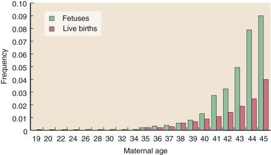

Figure 69-19 

Increased risk of a Down syndrome conception with increased maternal age. 

The number of live births is lower at older ages due to the intervention of prenatal diagnosis followed by termination of abnormal pregnancies. 

The most common chromosome abnormalities detected in prenatal testing are the liveborn trisomies and the sex chromosome aneuploidies. Because these are usually the result of a meiotic nondisjunction error, there is a very low risk of recurrence. Occasionally, a child with a balanced or unbalanced structural chromosome abnormality will be identified. In these circumstances, karyotype analysis for both biologic parents is used to differentiate between an inherited rearrangement and a de novo anomaly in the child. For example, a child with an inherited balanced translocation has a less than 1% risk that the chromosome rearrangement will pose any problem. However, if the apparently balanced translocation seen in the fetus is not detected in either biologic parent, it must have arisen de novo in the child, and there is a 5% to 10% risk of related impairment for the infant. Unfortunately, finding an _unbalanced_ translocation in a fetus, regardless of the carrier status of the parents, is a serious situation and almost always results in some type of genetic defect for the child. Follow-up to determine whether one of the parents is a balanced translocation carrier will provide information about recurrence risk for future pregnancies. 

In addition to karyotype analysis, FISH studies may be used to identify chromosomal abnormalities in prenatal samples. FISH to detect the common aneuploidies (chromosomes 13, 18, 21, X, and Y) has been a primary tool in prenatal diagnosis for many years, and in 1997, the FDA cleared one version of this assay for general use (Aneuvysion by Abbott Molecular, Des Plaines, Ill.). In addition, certain ultrasound findings may suggest particular genetic syndromes, such as cardiac abnormalities associated with velocardiofacial syndrome (VCFS; see [ Fig 69-8 ](<#f0045>) ), and FISH may be used to confirm or rule out the diagnosis. 

Since 2012, FISH for aneuploidy detection has largely been replaced by a new assay known as noninvasive prenatal screening (NIPS). It is noninvasive because the study is performed on a sample of the mother's blood collected at 10 to 22 weeks' gestation (  Wright & Burton, 2009  ). From this, cell-free placental DNA (cfpDNA: free-floating DNA, not the DNA in cells) is isolated. About 10% to 15% of the total DNA is placental/fetal in origin, and the remainder is maternal DNA. DNA sequencing is then used to identify each individual fragment of cfpDNA, determine the chromosome of origin, and tally the total number of fragments per chromosome. The algorithms that have been developed establish the expected frequencies of fragments from each chromosome for each contributor (maternal and fetal DNAs). Any increase or decrease in the total expected value for a particular chromosome would suggest an aneuploidy in the fetus. This is not a diagnostic study. It is a screening test that provides a risk estimate for a chromosomal abnormality. For example, detection of trisomies 18 and 21 are highly significant, being approximately 99% accurate, with only a 0.2% false-positive rate, but detection of trisomy 13 is more problematic and, depending on the assay, can be only 72% accurate with a 1% false-positive rate (  Chiu et al, 2011  ;  Norton et al, 2012  ). Therefore, any abnormal findings must be confirmed by an appropriate diagnostic test such as karyotype analysis and/or FISH, which is performed on amniotic fluid following amniocentesis. 

 

##  Postnatal 

Approximately 0.6% of newborns have a chromosome abnormality. If an infant presents with signs or symptoms of a defined syndrome, karyotype and/or FISH analysis may confirm a diagnosis. If the newborn has clinical anomalies unrelated to a specific disorder, karyotype or microarray analysis may provide information on a chromosome abnormality related to the clinical findings. Ambiguous genitalia may be related to an abnormal sex chromosome complement, but if the chromosomes are shown to be normal, the physician knows that another cause for the patient's abnormality must be sought. If the child dies shortly after birth, cytogenetic analysis may provide information critical in understanding the demise, and these data should be correlated with autopsy results to substantiate a diagnosis. If a chromosome abnormality is found in the child, testing of both bio­logical parents should be considered to determine if the anomaly was inherited. 

 

##  Childhood and Adult 

A common misconception about genetic disorders is that because they are inherited, the diagnosis will be obvious at birth. In fact, the full clinical presentation of many disorders takes time to develop and may not be fully expressed until later in life. Consequently, some of the most difficult diagnostic problems occur in children and adults. In addition to considering the full range of cytogenetic possibilities, molecular and biochemical options must also be taken into account. 

 

##  Cancer Genetics 

Another area of medicine in which cytogenetics is increasingly important is oncology (  Heim & Mitelman, 2009  ). Although most solid tumors are difficult to culture and analyze cytogenetically, excellent clinical data exist for leukemias and lymphomas, including specific chromosome rearrangements that are directly associated with tumorigenesis ( [ Table 69-3 ](<#t0025>) ) (  Block, 1999  ) (see also [ Chapter 75 ](<##!/content/3-s2.0-B9780323295680000759?scrollTo=%23c00075>) ). The majority of these studies are performed on bone marrow or peripheral blood. Karyotype findings were originally used primarily as confirmation of a clinical diagnosis, but the role of genetics in patient management changed dramatically in 2001 when the World Health Organization (WHO) published a revised classification for leukemias and lymphomas (  Swerdlow et al, 2008  ). The data collected had shown a direct correlation between disease causing mutations, the presence of specific chromosomal abnormalities, and response to therapy. Thus in the revised classification system, the importance of the genetic findings, either cytogenetic or molecular, became a key element for final diagnosis in most hematologic disorders. Cytogenetics had suddenly been pushed to the forefront of testing for oncology patients. 

TABLE 69-3 

Common Cytogenetic Rearrangements in Leukemia and Lymphoma 

Disorder  |  Chromosome Rearrangement(s)  |  Genes Involved  |  FAB Classification (If Different)   
---|---|---|---  
**Chronic Myeloproliferative Disease**  
Chronic myelogenous leukemia  |  t(9;22)(q34.1;q11.2)  |  _BCR;ABL1_ |   
Chronic myelogenous leukemia (accelerated or blast phase)  |  +8, i(17q), +19, +Ph′ |  |   
Polycythemia vera  |  +8, +9, del(20q), del(13q)  |  |   
Chronic idiopathic myelofibrosis  |  +8, –7 del(7q), del(11q), del(13q), del(20q)  |  |   
Essential thrombocythemia  |  +8, del(13q)  |  |   
**Myelodysplastic Syndromes**  
Myelodysplastic syndrome with isolated del(5q)  |  del(5)(q13q33), del(5)(q22q33)  |  |  5q- syndrome   
Chronic myelomonocytic leukemia  |  –7, del(7q),+8, abnormalities of 12p  |  |   
Refractory anemia, refractory anemia with ringed sideroblasts, refractory anemia with excess blasts  |  –5, del(5q), –7, del(7q), +8, del(20q)  |  |   
**Acute Myeloid Leukemia (AML) with Recurrent Cytogenetic Abnormalities**  
AML with t(8;21)  |  t(8;21)(q22;q22)  |  _RUNX1; RUNX1T1_ |  AML-M2   
AML with inversion or translocation 16  |  inv(16)(p12q22), t(16;16)(p13;q22)  |  _CBF β _ ; _MYH11_ |  AML-M4Eo   
Acute promyelocytic leukemia  |  t(15;17)(q22;q12)  |  _PML; RAR α _ |  AML-M3   
AML with 11q23 ( _MLL_ ) abnormalities  |  t(9;11)(p21;q23), t(11;19)(q23;p13.1), t(11;19)(q23;p13.3),  |  _AF9; MLL_   
_MLL; ENL_ |  AML-M5   
AML with multilineage dysplasia  |  –5, del(5q), –7, del(7q), +8, del(11q), del(20q), +21, translocations involving 3q21 and 3q26, t(9;22)(q34.1;q11.2)  |  |  _AML-M1, AML-M6_  
Precursor B-lymphoblastic leukemia/lymphoma  |  t(1;19)(q23;p13.3)  |  _PBX1; TCF3_ |  ALL-L1/L2   
|  t(9;22)(q34;q11.2)  |  _ABL1; BCR_ |   
|  11q23 rearrangements, including:  |  _MLL_ |   
|  t(1;11)(p32;q23)  |  _AF1P; MLL_ |   
|  t(4;11)(q21;q23)  |  _AF4; MLL_ |   
|  t(11;19)(q23;p13)  |  _MLL; ENL_ |   
|  t(12;21)(p13q22)  |  _ETV6; RUNX1_ |   
|  Hyperdiploidy (modal number 50-56)  |  |   
Precursor T-lymphoblastic leukemia/lymphoma  |  Rearrangements at 14q11.2, 7q35, and 7p14-15  |  T-cell receptor loci  |  ALL-L1/L2   
|  del(9p)  |  _CDKN2A_ |   
|  Translocations at 1p32  |  _TAL1_ |   
**Mature B Cell Neoplasms** |  |  |   
Chronic lymphocytic leukemia/small lymphocytic leukemia  |  +12, del13q, del11q23-24, 14q+, del17p13  |  |   
Lymphoplasmacytic lymphoma/Waldenström's macroglobulinemia  |  t(9;14)(p13;q32)  |  _PAX5; IGH_ |   
Multiple myeloma  |  t(11;14)(q13;q32)  |  _CCND1;IGH_ |   
Marginal zone B cell lymphoma (MALT)  |  t(11;18)(q21;q21), +3  |  _BIRC3;MALT1_ |   
Follicular lymphoma,   
Diffuse large B cell lymphoma  |  t(14;18)(q32;q21), +7, +18, t(18;22)(q21;q11.2), del(6q), del/t(3)(q27)  |  _IGH; BCL2 BCL2;IGL_   
_BCL6_ |   
Mantle cell lymphoma  |  t(11;14)(q13;q32)  |  _CCND1; IGH_ |   
Burkitt's lymphoma  |  (8;14)(q24;q32)  |  _MYC; IGH_ |   
|  t(2;8) (p12;q24)  |  _IGK; MYC_ |   
|  t(8;22)(q24;q11.2)  |  _MYC; IGL_ |   
  
In addition to diagnosis, karyotype analysis can provide other valuable information regarding a cancer patient's disease. In general, prognosis and severity of disease are directly correlated to the number and type of chromosome abnormalities seen. Furthermore, once a chromosome abnormality has been detected, the progress of the disease can be monitored. If treatment is successful, most chromosome abnormalities are no longer evident in the bone marrow, and as long as the karyotype appears to be “normal,” the patient is said to be in cytogenetic remission. However, if the treatment does not eliminate the aberrant cell line completely, remission may be merely an interlude in which the disease-causing cells are suppressed to such low levels that they are not detectable by routine analysis. Then at relapse, the same chromosome anomalies will reappear and may be accompanied by additional abnormalities and/or more complex cell lines, findings consistent with disease progression. An increase in complexity over time is known as _karyotype evolution._

FISH has become a valuable tool in clinical oncology studies, with many probes commercially available (  Cremer et al, 1988  ;  Anastasi, 1991  ; Abbott Molecular, Inc. [ [ www.abbottmolecular.com ](<http://www.abbottmolecular.com>) ]; Cytocell, Ltd. [ [ www.cytocell.com ](<http://www.cytocell.com>) ]). Studies can be done on either interphase or metaphase cells, with the choice resting on the type of data desired. Using interphase cells is often preferred because it provides a much larger sample that can be quickly assayed, giving results with a higher level of statistical significance (  Werner et al, 1997  ). 

For translocations, combination FISH probes have been developed that hybridize to the opposite sides of the translocation breakpoints. There are two common strategies employed to detect a translocation. Splitting of the signals may occur if the translocation separates two probes, generating two different-colored signals in place of the original single-color signal. Alternatively, fusion may occur if the translocation results in relocation of the probes, bringing two different probes into proximity and generating a two-color fusion that creates a new color. 

A primary example of the FISH fusion technology is the 9;22 translocation in leukemia. This rearrangement is characterized by a translocation between the _ABL1_ proto-oncogene on chromosome 9 (9q34.1) and the _BCR_ gene on chromosome 22 (22q11.2) ( [ Fig. 69-20, _A_ ](<#f0105>) ), which produces a disease-associated chimeric gene on the derivative chromosome 22, also known as the _Philadelphia chromosome_ (Ph′) (see also [ Chapter 76 ](<##!/content/3-s2.0-B9780323295680000760?scrollTo=%23c00076>) ). The translocation is seen in chronic myelogenous leukemia (CML), acute myeloid leukemia (AML), and acute lymphoblastic leukemia (ALL) (see [ Table 69-3 ](<#t0025>) ). Cytogenetically, the translocation appears to be the same in all diseases, but at the molecular level, it can be separated into two classes: the major breakpoint ( _M-BCR_ ) rearrangement that results in a chimeric protein of 210 kD (most common in CML), and the minor breakpoint ( _m-BCR_ ) rearrangement that results in a chimeric protein of 190 kD (seen in some adults and about 50% of childhood ALL). A FISH assay has been engineered to detect both rearrangements (Abbott Molecular). A pair of probes is used: red, which is localized to the _ABL1_ locus on chromosome 9, and green, which is located at the _BCR_ locus (chromosome 22) encompassing the m-BCR breakpoint but proximal to the M-BCR breakpoint. When no translocation is present, two green signals (detecting each _ABL1_ allele) and two red signals (detecting each _BCR_ allele) should be present in each cell ( [ Fig. 69-20, _B_ and _C_ ](<#f0105>) ). When the M-BCR rearrangement occurs, the translocation breaks chromosome 22 distal to the probe recognition site such that the entire green signal remains on chromosome 22. On chromosome 9, the translocation splits the red _ABL1_ signal such that a small red signal is left on the derivative chromosome 9 and the remainder of the red signal moves to chromosome 22. This brings one green and one red signal adjacent to each other on the derivative chromosome 22 (Ph′), and, with the resolution of the light microscope, the two signals merge, giving a single yellow fusion signal. Therefore, a cell with an M-BCR translocation will have four signals: one green (chromosome 22), one large red (chromosome 9), one small red (the rearranged chromosome 9), and one yellow fusion signal detecting the Ph′ chromosome ( [ Fig. 69-20, _B_ and _D_ ](<#f0105>) ). The m-BCR rearrangement is slightly different. Chromosome 22 is broken within the green probe recognition site, such that one portion of the green signal will stay on chromosome 22, but the distal section will move to the derivative chromosome 9. The red probe site on chromosome 9 is split as described earlier, with one portion remaining on chromosome 9 and the distal section moving to chromosome 22. This reciprocal translocation thus results in two yellow fusion signals (derivative 9 is red fused to green, and derivative 22 is green fused to red). The net result of the m-BCR FISH assay is four probe signals: one green (chromosome 22), one red (chromosome 9), and two yellow fusion signals detecting the 9;22 translocation ( [ Figs. 69-20, _B_ and _E_ ](<#f0105>) ). Being able to determine which of the two rearrangements is present in a patient sample is the key to making the correct diagnosis and leads to the most appropriate treatment methodology for the individual. Other FISH detection assays using other disease gene–specific probes can be designed to evaluate for a wide array of different cancer-related chromosome rearrangements. 

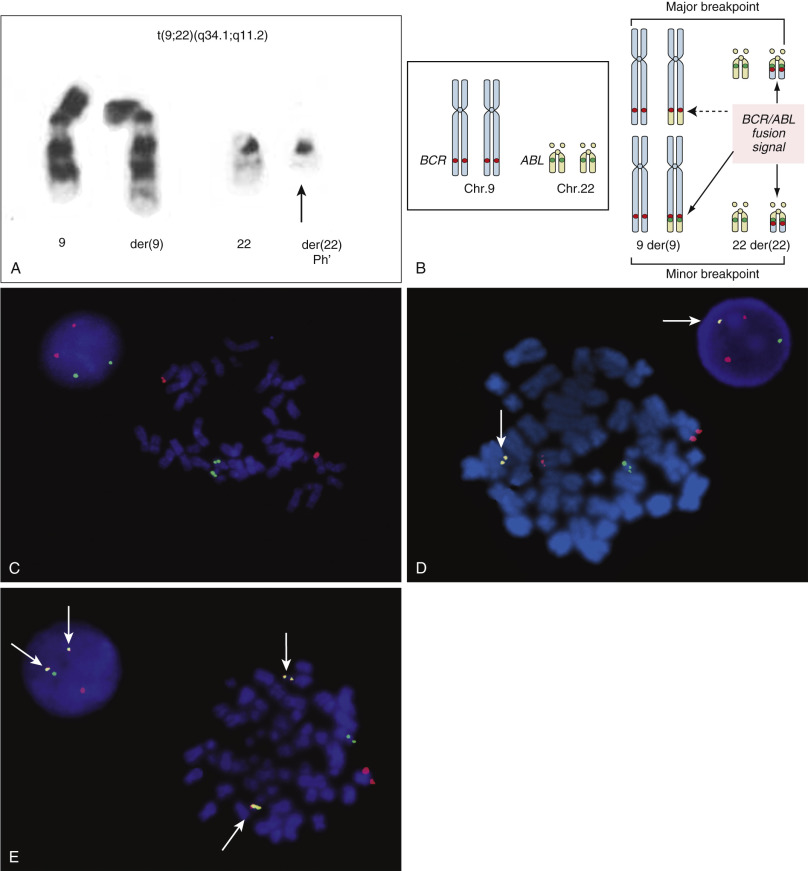

Figure 69-20 

Fluorescence in situ hybridization (FISH) detection of the 9;22 translocation in CML. 

**A,** Banded chromosomes showing the 9;22 translocation. The derivative chromosome 22 is known as the _Ph_ ′ _,_ or _Philadelphia chromosome_ . **B,** Diagram showing FISH detection for a normal cell with no translocation ( _left_ ) and for both the major (M-BCR) and minor (m-BCR) breakpoint rearrangements. Upper right shows the signal pattern for the M-BCR translocation: chr. 9—red signal, der(9)—partial red signal with chromosome 22 material below (yellow) ( _dashed arrow_ ), chr. 22—green signal, and the der(22), the Ph′ chromosome with a green-red BCR-ABL fusion signal and chromosome 9 material below. The lower right shows the m-BCR signal pattern: chr. 9—red signal, der(9)—red-green fusion signal and chromosome 22 material below, chr. 22—green signal, and the der(22)—green-red fusion signal with chromosome 9 material below. **C** and **D,** Actual FISH images. **C,** No translocation is present, as seen by two copies each of the chromosome 9 (red) and chromosome 22 (green) probes in both interphase ( _left_ ) and metaphase ( _right_ ) cells. **D,** Cells with an M-BCR translocation as detected by the single yellow fusion signal ( _arrow_ ) plus one green, one large red, and one small red signal (metaphase on the _left_ and interphase on the _right_ ). **E,** Cells with an m-BCR translocation as detected by two yellow fusion signals ( _arrows_ ) plus one green and one red signal (metaphase on the _right_ and interphase on the _left_ ). _CML,_ Chronic myeloid leukemia. 

In addition, chromosomal aneuploidies in cancer cells can be easily detected—for example, use of a chromosome 12–specific centromere probe to screen an interphase cell population for trisomy 12 cells indicative of CLL; use of a chromosome 7 probe to detect monosomy 7 in myelodysplastic syndrome and AML; and use of a chromosome 8 probe to identify trisomy 8 in both chronic and acute disorders. The use of different-colored X and Y probes in evaluating the success of a bone marrow transplant when the donor and recipient are of opposite sexes has also been highly successful. Following transplantation, a male who has received female donor cells should have an XX complement. Failure of the engraftment may be signaled by the presence of a high frequency of XY cells. The FISH can be repeated at regular intervals to monitor the progress and provide an early warning if the patient's leukemic cell population begins to proliferate. 

Initially, clinicians were concerned about apparently discrepant results from karyotype analysis and FISH on the same patient sample. For example, by karyotype, a patient with CML may show all cells with a t(9;22), but only 30% of cells will be positive for the translocation by interphase FISH. These data are actually consistent. Karyotype can only be performed on dividing cells, and because cancer cells tend to divide frequently, a karyotype analysis could show 100% leukemic cells. FISH, on the other hand, detects all nucleated cells, but not all cells in a bone marrow sample are necessarily from the same clone because an affected individual usually has both a disease and a normal cell population. Interphase FISH can quantify the relative numbers of normal and disease cells, thus providing a more accurate estimate of disease involvement within the total population. This can be used advantageously to monitor a patient's response to treatment. Testing sequential samples over time can show a reduction in the disease cell population, and relapse will be reflected by a rise in the leukemic cell population. Thus it is important to perform both karyotype analysis and FISH on a diagnosis specimen. The karyotype will define the chromosomal abnormalities present, and the FISH will establish the baseline frequency of the leukemic clone(s). These data can then be used as a reference point for all future testing for the patient. 

Multicolor FISH has also been used to evaluate leukemic cell lines, and the data have suggested that cancer cells actually undergo a significantly greater degree of chromosome rearrangement than was previously appreciated (  Veldman et al, 1997  ). Microarray analysis is now being employed to better understand the complexity of disease clones and aid in the diagnosis of different neoplasia (  Kolquist et al, 2011  ;  Morrissette & Bagg, 2011  ). 

 

##  Cytogenetic Disorders 

 

##  Chromosomal Aneuploidy Syndromes 

 

##  Autosomal Aneuploidies 

The most common cause of mental retardation is trisomy 21, or Down syndrome. This disorder has a birth incidence of 1 in 700 and is characterized by hypotonia, flat facies, slanted palpebral fissures, small ears, protruding tongue, transverse palmar crease, heart defects, hypogonadism, and probable infertility. Down syndrome individuals also have in increased susceptibility to infectious diseases and increased risks for cancer and early onset Alzheimer disease. Approximately 92.5% of all Down syndrome individuals have 47 chromosomes, including three copies of chromosome 21 resulting from a nondisjunction error in parental meiosis. Just under 3% of patients tend to express a milder phenotype and have been shown to be mosaics with two cell lines (47,XX,+21/46,XX or 47,XY,+21/46,XY), and about 5% of Down syndrome patients have only 46 chromosomes, because the extra 21 is part of a Robertsonian or other translocation. A child with a translocation is often indicative of the presence of a translocation carrier parent, so in these cases, karyotype analysis of both parents is appropriate to determine whether the couple is at increased risk of having additional Down syndrome children in future pregnancies. Although it is most common for a Down syndrome patient to have three complete copies of chromosome 21, molecular studies of individuals with chromosome 21 rearrangements have clearly shown that it is only necessary to have three copies of the region of chromosome 21 encompassing bands 21q22.12 to 21q22.3, the Down syndrome–critical region ( [ Fig. 69-21 ](<#f0110>) ) (  Korenberg et al, 1990  ;  Delabar et al, 1993  ). 

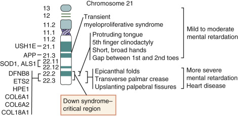

Figure 69-21 

Map of chromosome 21 showing the Down syndrome–critical region and relative positions of loci associated with various clinical features to the right. 

On the left, other mapped loci are shown. _ALS1_ , Amyotrophic lateral sclerosis; _APP,_ amyloid β-precursor protein (associated with Alzheimer disease); _COL6A1/COL6A2/COL18A1,_ collagen genes; _DFNB8_ , deafness 8; _ETS2,_ oncogene ETS-2; _HPE1,_ alobar holoprosencephaly-1; _SOD1,_ superoxide dismutase-1; _USH1E,_ Usher syndrome. 

(Data from  Korenberg et al, 1990  ;  Delabar et al, 1993  ; OMIM, website.) 

The other two liveborn trisomies are trisomy 13 and trisomy 18. _Trisomy 13_ , or Patau syndrome, with a birth incidence of 1 in 4000 to 1 in 10,000, is characterized by a small head, cleft lip and/or cleft palate, cyclopia, transverse palmar crease, polydactyly of the hands and/or feet, prominent heel, ventricular septal defect, and punched-out scalp. _Trisomy 18_ , or Edwards syndrome ( [ Fig. 69-22, _A_ ](<#f0115>) ), is seen in approximately 1 in 8000 newborns, with features including a low birthweight, small mouth and jaw, ventricular septal defect, hypoplasia of the muscles, a prominent occiput, low-set malformed ears, rocker-bottom feet, and crossed fingers. 

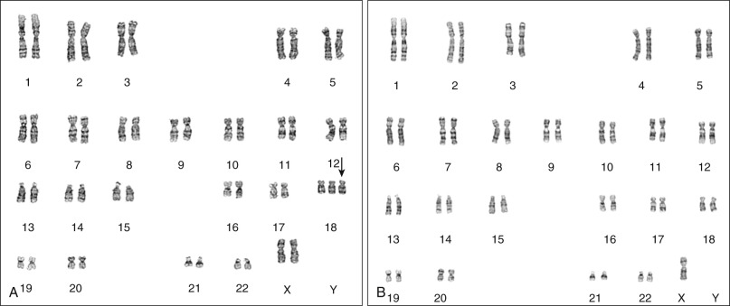

Figure 69-22 

Karyotypes from numerical chromosome syndromes. 

**A,** Edwards syndrome (trisomy 18): 47,XX,+18. **B,** Turner syndrome (monosomy X): 45,X. 

Despite its often severe clinical consequences, Down syndrome is usually manageable, and patients live into the second or third decade of life. Trisomy 13 and trisomy 18 are considerably less compatible with life, and patients usually die within the first month of life. If an individual survives the first year, the outlook is bleak, because patients do not learn to talk, walk, or care for themselves. Because of this, counseling for prenatally diagnosed cases of trisomy 13 and 18 includes the option of termination of pregnancy. 

 

##  Sex Chromosome Aneuploidies 

Sex chromosome aneuploidies are relatively common (overall frequency of 1 in 500 births) and are phenotypically milder than autosomal aneuploidies because of the effect of X inactivation and the limited number of genes present on the Y chromosome. Four disorders, including three trisomies and one monosomy, account for a majority of cases. All are the result of nondisjunction errors in meiosis, and, except for XYY, which is exclusively paternal, the other disorders may result from either maternal or paternal error. 

The aberrant karyotypes of individuals with three X chromosomes (47,XXX females) or with one X and two Y chromosomes (47,XYY males) often go undetected throughout life. The birth incidence is relatively high—1 in 1000, but other than being somewhat taller than average, there are no striking features that would indicate a chromosomal abnormality. Some individuals have generalized learning difficulties and so may be identified by school screening programs. XXX females and XYY males may also be identified during infertility testing, though the cytogenetic abnormality is not usually related to the reason for referral. XYY males do have an increased risk of behavioral problems, and early studies suggested that they also had criminal tendencies because there was a higher than expected incidence of XYY in inmates of penal institutions (  Jacobs et al, 1968  ;  Price & Jacobs, 1970  ). However, subsequent work has shown that (1) the conclusions of the original study were biased because of a sampling error, (2) criminality is most probably due to a combination of multiple causes, and (3) XYY males are no more prone to criminal behavior than any other male (  Witkin et al, 1976  ;  Pitcher, 1982  ;  Theilgaard, 1984  ). 

_Klinefelter syndrome_ (47,XXY) males tend to be tall and thin with relatively long legs, although early in life these findings seldom set them apart from their peers. Some individuals are identified in school because of their learning difficulties, but the most common reason for referral is postpubertal hypogonadism, female-like breast development, and infertility due to small testicles, hyalinized testicular tubules, and azoospermia. A milder form of Klinefelter syndrome with the potential for fertility due to normal testicular development is seen in individuals with a mosaic chromosome complement, including a 46,XY cell line (47,XXY/46,XY). The relative proportion of XY and XXY cells during sex determination in the early zygote and in the testes is the key for fertility. An excess of XXY cells will push the individual toward a true Klinefelter presentation, whereas higher numbers of XY cells should moderate the phenotype and increase the likelihood of fertility. 

The most commonly recognized sex chromosome aneuploidy presenting with a female phenotype is 45,X: _Turner syndrome_ ( [ Fig. 69-22, _B_ ](<#f0115>) ). This is also the only human viable liveborn monosomy. In sex determination, normal female development is dependent on the presence of two active X chromosomes. The critical region for female differentiation has been narrowed to a region of the short arm of the X just proximal to the centromere. If that region is missing or inactive, an individual with Turner syndrome will result. About half of all Turner syndrome patients have the classic 45,X chromosome complement, and the single X chromosome is usually maternal in origin, indicating that a paternal meiotic nondisjunction is the most common source of error. In addition to 45,X, more complex karyotypes are also possible ( [ Table 69-4 ](<#t0030>) ) (  Palmer & Reichmann, 1976  ). The greatest concern is for individuals who possess a complete or partial Y chromosome in at least one cell line, because these patients are at increased risk for gonadoblastoma. 

TABLE 69-4 

Distribution of Different Chromosome Complements That Give Rise to Turner Syndrome 

Occurrence (%)  |  Chromosome Anomaly   
---|---  
50  |  45,X   
20  |  46,X,i(Xq)   
15  |  X chromosome deletions or rings, or the presence of a Y chromosome   
10  |  Mosaics: 45,X/46,XX; 45,X/46,XY   
  
The phenotype for Turner syndrome is highly variable. Affected individuals are typically short (<150 cm), with gonadal dysgenesis and learning difficulties. Other common features include webbed neck resulting from cystic hygroma in utero, low posterior hairline, heart and renal anomalies, cubitus valgus (increased carrying angle of the elbow), and shield chest. At birth, patients may present with edema of the hands and feet. Turner syndrome patients are usually of normal intelligence, although some individuals do have learning disabilities. Furthermore, although infertility used to be accepted as the standard in Turner syndrome, it is now known that some patients, usually those with mosaic karyotypes, can reproduce successfully. Furthermore, the reproductive problem is primarily related to nonfunctioning ovaries. Because the uterus is capable of normal function, using donor egg technologies, a Turner syndrome patient can complete a full pregnancy and deliver a normal child. Due to the variability of phenotypes, prenatal counseling for a couple with an identified Turner syndrome fetus is extremely difficult. In general, however, most liveborn Turner syndrome patients can live productive lives, and mildly affected individuals may not know that they are affected with the disorder until puberty. 

 

##  Other Sex Chromosome Abnormalities 

Sex determination in humans is the result of a complex biochemical pathway involving the interaction of proteins produced by genes present on the autosomes and the X and Y chromosomes. The default sex in humans is female, so in the absence of any male-determining stimuli, a female individual will develop. The primary trigger for male development is a gene located on the short arm of the Y chromosome designated _TDF_ , the testes determining factor, which is located in the sex-determining region of the Y chromosome ( _SRY_ ) ( [ Fig. 69-23 ](<#f0120>) ). 

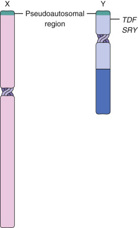

Figure 69-23 

Diagram of relative locations of TDF, SRY, and the pseudoautosomal regions of the X and Y chromosomes. 

_TDF_ , Testes determining factor; _SRY,_ sex-determining region of the Y chromosome. 

The protein produced by _TDF_ initiates the male developmental pathway. A number of disorders associated with mutations in different genes within this pathway have been identified and can result in ambiguous genitalia or genotype/phenotype mismatch (phenotypic male with an XX sex chromosome complement or a phenotypic female with an XY complement). 

An XX male can usually be attributed to one of two causes. The more common of the two is virilization of a female fetus as a result of the autosomal recessive disorder congenital adrenal hyperplasia (CAH). The defect in CAH is the lack of the enzyme 21-hydroxylase. Without this enzyme, the normal biosynthetic pathway is blocked, and androgens accumulate in the body. Excessive levels of male hormones in the female circulation may result in a male-appearing infant despite a female chromosome complement. Furthermore, because androgens are capable of crossing the placenta, a normal female fetus may develop ambiguous genitalia due to exposure to excess hormones from a CAH-affected mother. 

A phenotypic male with an XX sex chromosome complement may also result from a cryptic translocation between the X and Y chromosomes. The distal ends of the short arms of the X and Y chromosomes are homologous and comprise what is termed the _pseudoautosomal regions_ (see [ Fig. 69-23 ](<#f0120>) ). This is the primary site of X and Y chromosome pairing during meiosis, and recombination may occur between X and Y alleles. Rarely, a recombination event outside the boundaries of the pseudoautosomal region takes place, resulting in the transfer of unique Y loci, including _SRY_ , to the tip of the X chromosome. The amount of chromosome material involved in such an exchange is extremely small and cannot be cytogenetically detected. In a male with such a balanced translocation, there would be no clinical abnormalities, because the genes are all present, although in alternate locations. However, if this male transmits his rearranged X chromosome to an offspring who has received an X from the mother, the resultant child will have an apparent XX chromosome complement but a phenotype that is male or Klinefelter male due to the presence of the TDF protein that triggers the male developmental pathway. 

The reciprocal of the aforementioned translocation may result in a Turner female with an apparent XY complement. If the rearranged Y chromosome is transmitted to a child, the male developmental pathway will not be initiated in that individual because there is no _TDF_ / _SRY_ , and sex determination will default to female. Unfortunately, these individuals also lack two intact copies of the proximal X short arm, and this will prevent normal female development, giving rise to a Turner syndrome individual. This situation is quite rare. The more common finding for an XY female is androgen insensitivity, also known as _testicular feminization._ In these individuals, the Y chromosome is intact, and _TDF_ is present and functional. The problem is a mutation of the androgen receptor gene located on the long arm of the X chromosome (Xq21.3) that results in no androgen receptor protein being produced. The TDF protein will initiate male development, but the pathway will be blocked at the point where the androgen receptor protein is required to form a complex between testosterone and dihydrotestosterone. Without this critical step, further male differentiation is not possible, and the phenotype will default back to female. However, these individuals are infertile because of the lack of any functional internal genitalia, and they commonly present with a blind vagina and testes in the abdomen or inguinal canal. 

 

##  Structural Chromosome Anomalies 

A reasonable number of syndromes directly related to a structural chromosome abnormality have been described. Most of these are quite rare. The following is a discussion of some of the more common syndromes (see also  Jones & Jones, 2013  ). The abnormalities can be detected by karyotype analysis, FISH, or microarray analysis. 

_Wolf-Hirschhorn syndrome_ , also known as _4p – syndrome _ , is due to a terminal deletion of the short arm of chromosome 4, del(4)(p16). Clinical findings include microcephaly, micrognathia, hypotonia, epicanthal folds, and developmental delay. The characteristic facial appearance has been likened to a Greek warrior's helmet because of the arched eyebrows and long nose. Individuals with this disorder require special education and are at increased risk of seizures. 

_Cri-du-chat,_ or 5p _ – _ syndrome, del(5)(p15), is characterized by a distinctive high-pitched, cat-like cry in infancy. Other features include low birthweight and subsequent slow growth, hypotonia, microcephaly, hypertelorism, epicanthal folds, cardiac anomalies, and mental retardation. Affected children have delayed development and may reach the cognitive and social level of a 5- or 6-year-old. 

 

##  Microdeletion Syndromes and Contiguous Gene Syndromes 

By definition, a _microdeletion_ is a very small deletion, usually only a fraction of a single chromosome band. Cytogenetic microdeletions can be confused with molecular deletions, so it is important to recognize that although cytogenetic microdeletions are small, they are significantly larger (>500 kb) than the typical molecular deletion (1 base pair [bp] to several hundred bp), which can only be resolved by molecular technology (see [ Chapter 71 ](<##!/content/3-s2.0-B9780323295680000711?scrollTo=%23c00071>) ). Although some chromosome microdeletions are large enough to identify by karyotype analysis, most will require FISH or microarray analysis for detection. Although originally thought to be deletions within single genes, it has now been shown that certain syndromes are actually due to deletions that encompass portions of several adjacent, unrelated genes. The clinical presentation may therefore be a combination of features due to the absence of several different gene products. The size of the deletion and number of genes affected may vary, such that the phenotype expressed may differ significantly between individuals. Collectively, these are called _contiguous gene syndromes_ . Included in this group are many of the microdeletion syndromes ( [ Table 69-5 ](<#t0035>) ), as well as the larger, classic deletion syndromes such as Wolf-Hirschhorn and cri-du-chat. 

TABLE 69-5 

Microdeletion and Contiguous Gene Syndromes 

Disorder  |  Location  |  Genes  |  Clinical Findings   
---|---|---|---  
Angelman syndrome  |  15q11.2  |  _UBE3A_ |  Severe MR, developmental delay, large mouth, prognathia, ataxia, seizures, DiGeorge syndrome   
DiGeorge syndrome  |  22q11.2, 10p  |  _DGS1, DGS2_ |  Characteristic facies, cleft palate, heart defect, hypoplasia of the thymus and parathyroids, severe hypocalcemia, seizures   
Ichthyosis  |  Xp22.32  |  _STS_ |  Scaly skin, short stature, hypogonadism, MR   
Kallmann syndrome  |  Xp22.3  |  _KAL1_ |  Hypogonadism, inability to smell   
Langer-Giedion syndrome  |  8q24.11-q24.13  |  _TRPSI_   
_EXT1_ |  Craniofacial dysmorphism, skeletal abnormalities, mild to severe mental deficiency   
Lissencephaly  |  17p13.3  |  _LIS1_ |  Smooth brain, profound retardation, seizures   
Miller-Dieker syndrome  |  17p13.3  |  _LIS1_ and others  |  Lissencephaly, microcephaly, high forehead, small nose, micrognathia, low-set ears   
Prader-Willi syndrome  |  15q11.2  |  _SNRPN_   
_NDN_ and others  |  Hypotonia at birth, almond-shaped eyes, moderate to severe MR, absent sense of satiation leading to overeating, small hands and feet, hypogonadism   
Retinoblastoma  |  13q14.1-q14.2  |  _RB1_ |  Tumors of the retinoblast cells of the eye   
Rubinstein-Taybi syndrome  |  16p13.3  |  _CREBBP_ |  Beaked nose, prominent columella, hypoplastic maxilla, downslanted palpebral fissures, broad thumbs and first toes, MR, speech delay   
Smith-Magenis syndrome  |  17p11.2  |  _RAI1_ |  Brachycephaly, midface hypoplasia, broad nasal bridge, prominent jaw, short broad hands, hyperactivity, delayed speech, self-destructive behavior, MR   
Velocardiofacial syndrome  |  22q11.2  |  _TBX1_ and others  |  Palatal defects, hypoplastic alae nasi with long nose, learning disability, congenital heart disease   
WAGR  |  11p13.3  |  _WT1, PAX6_ |  Wilms tumor, aniridia, genitourinary defects, and mental retardation   
Williams syndrome  |  7q11.2  |  _ELN_ |  Low IQ, hypersensitivity to sound, blue eyes with stellate pattern in the iris, prominent lips, hoarse voice, supravalvular aortic stenosis or other cardiac defect, hypercalcemia, premature aging of the skin   
  
_MR_ , Mental retardation. 

_Miller-Dieker syndrome_ clearly illustrates the overlap between microdeletion and contiguous gene syndromes. The disorder has been associated with a microdeletion of the distal short arm of chromosome 17 (17p13.3), and the cardinal clinical features are lissencephaly (smooth brain) and craniofacial anomalies. Isolated lissencephaly has also been recognized as an independent entity, so Miller-Dieker syndrome is a more complex presentation that couples the brain defect with characteristic facial features. Molecular analysis has shown there are at least two genes involved in Miller-Dieker syndrome, so it is a true contiguous gene syndrome resulting from a microdeletion. A smaller deletion of the _LIS1_ gene only would result in isolated lissencephaly (  Ledbetter et al, 1992  ). 

_Prader-Willi syndrome_ and _Angelman syndrome_ are the best-known microdeletion syndromes. The same interstitial deletion of the proximal long arm of chromosome 15, del(15)(q11.2q11.2), can be found in both disorders, but the clinical presentations are significantly different. Prader-Willi patients are small and hypotonic at birth but change within the first year of life and begin to gain weight rapidly. If not placed on a controlled diet, they can become quite obese through overeating. Other characteristics include small hands and feet, hypogonadism, and a bad temper. Although they are developmentally delayed, most do well in special education classes. Because of their temper and difficulty in controlling their diet, Prader-Willi patients may be placed in special group homes that provide the proper environment. Angelman syndrome patients, on the other hand, are severely mentally handicapped. Although they are friendly, they usually cannot carry on a normal conversation, and discourse is often punctuated by bursts of inappropriate laughter. The disorder is also characterized by hyperactivity, short stature, microcephaly, seizures, and ataxia. 

By routine or high-resolution cytogenetic analysis, the 15q deletion can be detected in about 60% of Prader-Willi individuals but only 10% to 20% of Angelman syndrome patients. Use of FISH has provided a much better diagnostic tool, and for both syndromes, deletions can now be established in 80% to 85% of cases. Although it was accepted that not all deletions would be visible at the cytogenetic level, it was considered odd that FISH was unable to detect a deletion in 100% of cases. This, in addition to the fact that Prader-Willi syndrome and Angelman syndrome appear to share the same deletion but have such entirely different phenotypes, suggested that there might be another cause for the disorders. It is now known that Prader-Willi syndrome and Angelman syndrome are examples of genetic imprinting and that the mutational processes resulting in the diseases are much more complex than a simple deletion of DNA (  Nicholls et al, 1989  ;  Robinson et al, 1991  ) (see [ Chapter 71 ](<##!/content/3-s2.0-B9780323295680000711?scrollTo=%23c00071>) for a discussion of imprinting and molecular detection of imprinted genes). 

_Williams syndrome_ has been associated with a deletion of the elastin gene ( _ELN_ ) on the proximal long arm of chromosome 7 (7q11.23). The disorder is characterized by cardiac abnormalities, hypertension, hoarse voice, premature aging of the skin, and behavioral anomalies. Because elastin is known to be an important protein lending elasticity to tissues such as the heart, blood vessels, skin, and vocal cords, its absence explains many of the physical anomalies associated with this syndrome. The behavioral problems, however, could not be attributed to the lack of elastin, and further investigations have shown that Williams syndrome is actually a contiguous gene syndrome and that the variability of the phenotype is related to the number of adjacent genes deleted in combination with _ELN_ . 

A very-well-characterized contiguous gene syndrome is located on the short arm of chromosome 11 (11p13) and is known as _WAGR_ ( _W_ ilms tumor, _a_ niridia, _g_ enitourinary defects, and mental _r_ etardation). Except for the genitourinary defects, which appear to be due to a variant mutation in the Wilms tumor locus, each of the other three anomalies has been associated with a particular gene, and these are arranged in tandem on the short arm of chromosome 11 ( [ Fig. 69-24 ](<#f0125>) ). The phenotype of an affected individual will vary, depending on the size of the deletion. Statistically, about one in three children diagnosed with aniridia will also develop Wilms tumor. Conversely, only 1 in 50 Wilms patients has aniridia. With larger deletions, mental retardation and genitourinary defects may also be seen. 

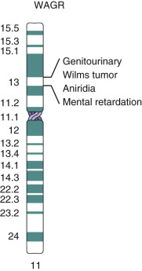

Figure 69-24 

Diagram of the contiguous gene syndrome WAGR showing relative positions of the different genes on the short arm of chromosome 11. 

_WAGR, W_ ilms tumor, _a_ niridia, _g_ enitourinary defects, and mental _r_ etardation. 

_Velocardiofacial syndrome_ is possibly the most common microdeletion syndrome in humans, but it is often not recognized because it has a broad spectrum of clinical features and a presentation that can be mild. The disorder is usually diagnosed in the newborn period because of feeding difficulties, cardiac defects, and characteristic facial dysmorphologies. Learning disabilities, short stature, and conductive hearing loss are noted as the individual ages. Interestingly, 10% to 15% of patients will have a much more mildly affected parent with the same deletion. The 1.5- to 3-Mb deletion on the proximal long arm of chromosome 22 (22q11.2q11.2) is thought to be due to recombination errors between direct repeats that flank the common deletion region. The similarity in the repeats can result in slippage and mispairing between the chromosomes ( [ Fig. 69-25 ](<#f0130>) ). If recombination occurs between the misaligned chromosomes, two recombinant products are possible: a chromosome missing the region associated with a diagnosis of velocardiofacial syndrome, or a chromosome with a duplication of the 1.5- to 3-Mb region, which is associated with the microduplication 22q11.2 syndrome that has a completely different clinical presentation (  McDermid & Morrow, 2002  ). 

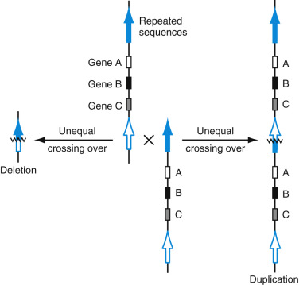

Figure 69-25 

Diagram of the possible outcomes of mispairing and recombination at the velocardiofacial syndrome locus on chromosome 22 (22q11.2). 

Two chromosomes that have mispaired by association of repeat sequences are seen in the middle of the figure. Recombination may or may not occur. If it does occur, one outcome is a deletion (seen on the _left_ ) resulting from the complete loss of both gene sequences from both original chromosomes (indicated as genes A–C). The reciprocal event would be a tandem repeat of both gene sequences, one derived from each of the original chromosomes (seen on the _right_ ). 

A similar mechanism resulting in the classic Williams syndrome deletion has also been reported (  Bayes et al, 2003  ). Recombination following mispairing of the chromosomes is a recognized mutation strategy that explains deletion and duplication formation in a variety of other diseases. 

 

##  Other Cytogenetic Phenomena 

 

##  Fragile X Syndrome 

Fragile X syndrome is the second leading cause of mental retardation and is the primary cause of inherited mental retardation. The disorder was first described by Herbert Lubs in 1969, when he noted the correlation between retardation and a “marker X” in affected family members (  Lubs, 1969  ). The marker X has subsequently become known as the _fragile X,_ characterized by a break or gap in the structure of the X chromosome that can be detected cytogenetically ( [ Fig. 69-26 ](<#f0135>) ) by culturing cells in the appropriate induction medium. However, not all affected individuals express the fragile X cytogenetically, so clinical diagnosis was significantly improved when the fragile X gene ( _FMR1_ ) was cloned in 1991 and the causative mutation was identified as an amplification of a trinucleotide repeat sequence. This mutation is detectable at the molecular level, so cytogenetic analysis has been replaced by direct mutation analysis for fragile X syndrome (  Rousseau et al, 1991  ;  Verkerk et al, 1991  ) (see [ Chapter 71 ](<##!/content/3-s2.0-B9780323295680000711?scrollTo=%23c00071>) ). 

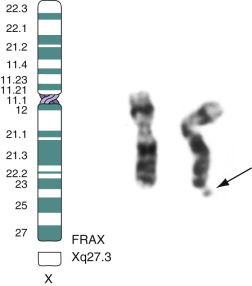

Figure 69-26 

Fragile X. 

Ideogram of the fragile X ( _left_ ) and a representative pair of G-banded chromosomes showing the fragile X on the _right_ . 

 

##  Breakage Syndromes 

Chromosomal breakage syndromes ( [ Table 69-6 ](<#t0040>) ) are a set of autosomal recessive disorders that were originally grouped together because of the common finding of chromosome instability or fragility (  Arlett & Lehmann, 1978  ). Consequently, cytogenetic testing was possible as an aid in diagnosis. Molecular studies have shown an additional commonality among the disorders in that the primary mutation in each is a defect in a DNA repair gene. This helped explain the other features of the syndromes, because inability to repair the DNA can lead to chromosome breakage or increased recombination, and widespread mutation and defects in DNA sequences that can lead to cancer. 

TABLE 69-6 

Chromosome Breakage Syndromes 

Disorder  |  Clinical Features  |  Gene Locus  |  Cytogenetic Manifestation  |  Type of Cancer  |  DNA Repair Defect  |  Miscellaneous   
---|---|---|---|---|---|---  
Fanconi anemia  |  Pancytopenia, prenatal or postnatal growth retardation, hypoplastic or missing thumbs, possible arm deformation, brownish pigmentation of skin  | 

  * 1. Group A: 16q24.3 
  * 2. Group C: 9q22.3 
  * 3. Group D: -3p22-p26 
  * 4. Group E—6p21-p22 
  * 5. Groups B, F, H unmapped 

|  Increased chromosome breakage detected by treatment with mitomycin C and diepoxybutane  |  Increased risk of AML, and progressive bone marrow failure  |  |  Current therapy: Bone marrow transplantation   
Bloom syndrome  |  Growth retardation, butterfly rash on face, possible malignancy  |  15q26.1  |  Increased SCE in response to UV light or BrdU incorporation  |  |  Abnormal DNA ligase I activity  |  High frequency in Ashkenazi Jewish population: 1/110 carrier frequency   
Ataxia telangiectasia  |  Ataxia with degeneration of central nervous system, telangiectasia on face, deficiency in cellular immunity, degenerative, growth retardation  |  11q22.3  |  Increased spontaneous breakage, increased rings, triradials, and translocations, particularly with 7 and 14, induced with bleomycin or ionizing radiation  |  Various leukemias and solid tumors  |  |   
Xeroderma pigmentosum  |  Sensitivity to sun, neurologic abnormalities, ataxia and spasticity  |  Incidence: 1 in 250,000   

  * 1. A: 9q22.3 
  * 2. C: 653p25 
  * 3. D: 19q13.2-q13.3 
  * 4. E: 11p11–p12 
  * 5. F: 16p13.1-13.2, 16p13.13-p13.3 
  * 6. G: 13q33 

|  Increase in SCE and chromosome rearrangement in response to UV light  |  Increased incidence of skin cancer  | 

  * 1. Lack of excision of thymine dimers 
  * 2. Postreplication repair defect 

|   
Cockayne syndrome  |  Dwarfism, premature aging, microcephaly, neurologic deficit, pigmentary degeneration, deafness, sensitivity to sunlight, MR  |  Chr. 5  |  UV sensitivity  |  Increased incidence of skin cancer  |  Possible DNA ligase deficiency or defect of transcription coupled repair  |   
  
_AML,_ Acute myeloid leukemia; _MR,_ mental retardation; _SCE,_ sister chromatid exchange; _UV,_ ultraviolet. 

,  

##  Summary 

Cytogenetics is one of the oldest clinical laboratory sciences still in active use. It has grown and changed over time, keeping pace with the changes in the field of genetics. FISH and microarray technology have bridged the gap between cytogenetics and molecular diagnostics such that the two areas provide complementary information in many cases. Although cytogenetics is no longer the only clinical assay that can provide a quick overview of the entire human genome, karyotype analysis continues to be a clinically important tool in assessing numerical and structural chromosome anomalies and is still the gold standard for diagnosis of many neoplasia and inherited disorders. 

,, 

## Further Reading

* Borgaonkar D: Chromosomal variation in man: A catalog of chromosomal variants and anomalies. ed 5 1989. Wiley-Liss New York 
* De Grouchy J, Turleau C: Clinical atlas of human chromosomes. ed 2 1984. John Wiley & Sons New York 
* Gelehrter T, Collins FC, Ginsburg D: Principles of medical genetics. ed 2 1998. Williams & Wilkins Baltimore 
* McKusick V: Mendelian inheritance in man: A catalog of human genes and genetic disorders. ed 12 1998. Johns Hopkins Press Baltimore 
* Mitelman F: Catalog of chromosome aberrations in cancer. ed 5 1994. Wiley-Liss New York 
* Rooney DE, Czepulkowski BH: Human cytogenetics—a practical approach. 1992. IRL Press Oxford 
* Verma R, Babu A: Human chromosomes—Principles and techniques. ed 2 1995. McGraw-Hill New York 
,
