## Key Points

  * •

Assessment of erythrocyte, leukocyte, and platelet counts from manual and automated particle counters is central to the diagnosis and management of hematologic disease. 

  * •

With few exceptions, manual methods have been replaced by automated hematology analyzers. The selection of analyzers is varied and voluminous enough to meet the needs of any hematology laboratory setting. 

  * •

Hematology automation combined with sophisticated algorithms for data interpretation has led to dramatic improvement in the utility of automated analyzers in patient care. Newer instrumentation has progressed far beyond the screening tool of the past. 

  * •

Examination of peripheral blood with bone marrow smear/biopsy represents the cornerstone of hematologic diagnosis. The bone marrow examination provides a semiquantitative and qualitative assessment of the state of hematopoiesis, and aids in the diagnosis of several hereditary and acquired benign and malignant diseases. 

Hematology includes the study of blood cells and coagulation. It encompasses analyses of the concentration, structure, and function of cells in blood; their precursors in the bone marrow; the chemical constituents of plasma or serum intimately linked with blood cell structure and function; and the function of platelets and proteins involved in blood coagulation. Advancement of molecular biological techniques and their increased use in hematology have led to the detection of several genetic mutations underlying the altered structure and function of cells and proteins that may result in hematologic disease. 

,  

##  Hematology Principles and Procedures 

 

##  Hemoglobin 

Hemoglobin (Hb), the main component of the red blood cell (RBC), is a conjugated protein that serves as the vehicle for the transportation of oxygen (O  2  ) and carbon dioxide (CO  2  ). When fully saturated, each gram of Hb holds 1.34 mL of O  2  . The red cell mass of the adult contains approximately 600 g of Hb, capable of carrying 800 mL of O  2  . A molecule of Hb consists of two pairs of polypeptide chains (“globins”) and four prosthetic heme groups, each containing one atom of ferrous iron. Each heme group is precisely located in a pocket or fold of one of the polypeptide chains. Located near the surface of the molecule, the heme reversibly combines with one molecule of O  2  or CO  2  . The main function of Hb is to transport O  2  from the lungs, where O  2  tension is high, to the tissues, where it is low. At an O  2  tension of 100 mm Hg in the pulmonary capillaries, 95% to 98% of the Hb is combined with O  2  . In the tissues, where O  2  tension may be as low as 20 mm Hg, the O  2  readily dissociates from Hb; in this instance, less than 30% of the O  2  would remain combined with Hb. 

Reduced Hb is Hb with iron unassociated with O  2  . When each heme group is associated with one molecule of O  2  , the Hb is referred to as _oxyhemoglobin (HbO 2  ). _ In both Hb and HbO  2  , iron remains in the ferrous state. When iron is oxidized to the ferric state, methemoglobin (hemiglobin; Hi) is formed, and the molecule loses its capacity to carry O  2  or CO  2  . 

Anemia is a decrease to below normal Hb concentration, erythrocyte count, or hematocrit (Hct). It is a very common condition and is frequently a complication of other diseases. Clinical diagnosis of anemia or of high Hb based on estimation of the color of the skin and of visible mucous membranes is highly unreliable. The correct estimation of Hb is important and is one of the routine tests performed on practically every patient. 

 

##  Hemoglobin Derivatives 

 

##  Hemiglobin (Methemoglobin) 

Methemoglobin (Hi) is a derivative of Hb in which the ferrous iron is oxidized to the ferric state, resulting in the inability of Hi to combine reversibly with O  2  . The polypeptide chains are not altered. A normal individual has up to 1.5% methemoglobin. Methemoglobinemia will cause chocolate brown discoloration of blood, cyanosis, and functional “anemia” if present in high enough concentrations. Cyanosis becomes obvious at a concentration of about 1.5 g Hi/dL (i.e., 10% of Hb). Comparable degrees of cyanosis will be caused by 5 g Hb per deciliter of blood, 1.5 g Hi per deciliter of blood, and 0.5 g sulfhemoglobin (SHb) per deciliter of blood. The degree of cyanosis, however, is not necessarily correlated with the concentration of Hi. A small amount of Hi is always being formed but is reduced by enzyme systems within the erythrocyte. The most important is the NADH (reducing agent derived from nicotinamide adenine dinucleotide)-dependent methemoglobin reductase system (NADH-cytochrome- _b_ 5  reductase). Others, which may function mainly as reserve systems, are ascorbic acid, reduced glutathione, and reduced nicotinamide adenine dinucleotide phosphate (NADPH)–methemoglobin reductase. The latter requires a natural cofactor or an auto-oxidizable dye such as methylene blue for activity. 

Methemoglobinemia, an increased amount of Hi in the erythrocytes, may result from increased production of Hi or decreased NADH-cytochrome- _b_ 5  reductase activity, and may be hereditary or acquired (  Jaffé & Hultquist, 1989  ). The hereditary form is divided into two major categories. In the first, methemoglobinemia is due to a decrease in the capacity of the erythrocyte to reduce the Hi that is constantly being formed back to Hb. This is most often due to _NADH-cytochrome-b 5  reductase deficiency _ , which is inherited as an autosomal recessive characteristic. The homozygote has methemoglobin levels of 10% to 50% and is cyanotic. Only occasionally is polycythemia present as a compensating mechanism. Hi concentrations of 10% to 25% may give no apparent symptoms; levels of 35% to 50% result in mild symptoms, such as exertional dyspnea and headaches; and levels exceeding 70% are probably lethal. Therapy with ascorbic acid or methylthioninium chloride (methylene blue) in this form of hereditary methemoglobinemia will reduce the level of Hi, the latter apparently by activation of the NADPH–methemoglobin reductase system. Heterozygotes have intermediate levels of NADH-cytochrome- _b_ 5  reductase activity and normal blood levels of Hi. They may become cyanotic because of methemoglobinemia after exposure to oxidizing chemicals or drugs in amounts that will not affect normal individuals. 

In the second major category of hereditary methemoglobinemia, the reducing systems within the erythrocyte are intact, but the structure of the Hb molecule itself is abnormal. A genetically determined alteration in the amino acid composition of α\- or β-globin chains may form a Hb molecule that has an enhanced tendency toward oxidation and a decreased propensity of the methemoglobin formed to be reduced back to Hb. Their principal consequence is asymptomatic cyanosis as a result of methemoglobinemia; they are designated as various forms of _hemoglobin M (Hb M)_ . In six of the seven Hb M variants, tyrosine is substituted for histidine in the heme pocket of the proximal or distal globin chain.  Nagai & Mawatari (1995)  showed by spectroscopy that a considerable proportion of the mutant subunits of Hb M Saskatoon and Hb M Boston stay in the fully reduced form under circulation conditions. They are inherited as autosomal dominant traits (  Lukens, 2004  ). Methylthioninium chloride therapy in these individuals is without effect, and treatment is not necessary. 

Most cases of methemoglobinemia are classified as secondary or acquired, due mainly to exposure to drugs and chemicals that cause increased formation of Hi. Chemicals or drugs that directly oxidize HbO  2  to Hi include nitrites, nitrates, chlorates, and quinones. Other substances, which are aromatic amino and nitro compounds, probably act indirectly through a metabolite because they do not cause Hi formation in vitro. These include acetanilid, phenacetin, sulfonamides, and aniline dyes. Ferrous sulfate may produce methemoglobinemia after ingestion of very large doses. Levels of drugs or chemicals that would not cause significant methemoglobinemia in a normal individual may do so in someone with a mild reduction in NADH-cytochrome- _b_ 5  reductase activity that, under ordinary circumstances, is not cyanotic. Such individuals are newborn infants and persons heterozygous for NADH-cytochrome- _b_ 5  reductase deficiency (  Bunn & Forget, 1986  ). Hi is reduced back to Hb by the erythrocyte enzyme systems. It can also be reduced (slowly) by the administration of reducing agents, such as ascorbic acid or sulfhydryl compounds (glutathione, cysteine); these, as well as methylthioninium chloride, are of value in cases of hereditary NADH-cytochrome- _b_ 5  reductase deficiency. In cases of acquired or toxic methemoglobinemia, methylthioninium chloride is of great value; its rapid action is based not on its own reduction capacity but on its acceleration of the normally slow NADPH–methemoglobin reductase pathway. Hi can combine reversibly with various chemicals (e.g., cyanides, sulfides, peroxides, fluorides, azides). Because of the strong affinity of Hi for cyanide, the therapy of cyanide poisoning is to administer nitrites to form Hi, which then combines with the cyanide. Thus, the free cyanide (which is extremely poisonous to the cellular respiratory enzymes) becomes less toxic when changed to HiCN. 

Hi is quantitated by spectrophotometry. If Hi is elevated, drugs or toxic substances must first be eliminated as a cause. Congenital methemoglobinemia due to NADH-cytochrome- _b_ 5  reductase deficiency is determined by assay of the enzyme. An abnormal hemoglobin (Hb M) may also be responsible for methemoglobinemia noted at birth or in the first few months of life. 

 

##  Sulfhemoglobin 

SHb is a mixture of oxidized, partially denatured forms of Hb that form during oxidative hemolysis (  Jandl, 1996  ). During oxidation of Hb, sulfur (from some source, which may vary) is incorporated into heme rings of Hb, resulting in a green hemochrome. Further oxidation usually results in the denaturation and precipitation of Hb as Heinz bodies ( [ Fig. 30-1 ](<#f0010>) ). SHb cannot transport O  2  , but it can combine with carbon monoxide (CO) to form carboxysulfhemoglobin. Unlike methemoglobin, SHb cannot be reduced back to Hb, and it remains in the cells until they break down. The blood is mauve-lavender in sulfhemoglobinemia. SHb has been reported in patients receiving treatment with sulfonamides or aromatic amine drugs (phenacetin, acetanilid), as well as in patients with severe constipation, in cases of bacteremia due to _Clostridium perfringens,_ and in a condition known as _enterogenous cyanosis._ The concentration of SHb in vivo normally is less than 1%, and in these conditions it seldom exceeds 10% of the total Hb. It results in cyanosis and is usually asymptomatic. The reason why some patients develop methemoglobinemia, some sulfhemoglobinemia, and others Heinz bodies and hemolysis is not well understood. SHb is quantitated by spectrophotometry. 

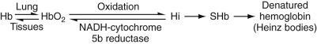

Figure 30-1 

Simplified concept of oxidation of hemoglobin (Hb) to methemoglobin (Hi), as proposed by  Jandl (1996)  . 

Reversible binding and release of oxygen occur in lungs and tissues; oxidation of ferrous ions and formation of Hb are reversible in the red cell to a limited extent; continued oxidation leads to irreversible conformational changes and sulfhemoglobin; still further oxidation results in denaturation of the Hb and precipitation within the erythrocyte as Heinz bodies. _HbO 2  , _ Oxyhemoglobin; _NADH,_ reduced nicotinamide adenine dinucleotide; _SHb,_ sulfhemoglobin. 

 

##  Carboxyhemoglobin 

Endogenous CO produced in the degradation of heme to bilirubin normally accounts for about 0.5% of carboxyhemoglobin (HbCO) in the blood, and is increased in hemolytic anemia. Hb has the capacity to combine with CO with an affinity 210 times greater than for O  2  . CO will bind with Hb even if its concentration in the air is extremely low (e.g., 0.02% to 0.04%). In those cases, HbCO will build up until typical symptoms of poisoning appear. HbCO cannot bind and carry O  2  . Furthermore, increasing concentrations of HbCO shift the Hb-O  2  dissociation curve increasingly to the left, thus adding to the anoxia. If a patient poisoned with CO receives pure O  2  , the conversion of HbCO to HbO  2  is greatly enhanced. HbCO is light sensitive and has a typical, brilliant, cherry red color. 

Acute CO poisoning is well known. It produces tissue hypoxia as a result of decreased O  2  transport. Chronic poisoning, a result of prolonged exposure to small amounts of CO, is less well recognized but is of increasing importance. The chief sources of the gas are gasoline motors, illuminating gas, gas heaters, defective stoves, and the smoking of tobacco. Exposure to CO is thus one of the hazards of modern civilization. The gas has even been found in the air of busy streets of large cities in sufficient concentration to cause mild symptoms in persons such as traffic police officers, who are exposed to it over long periods of time. Chronic exposure through tobacco smoking may lead to chronic elevation of HbCO and an associated left shift in the Hb-O  2  dissociation curve; smokers tend to have higher Hcts than nonsmokers and may have polycythemia. Healthy persons exposed to various concentrations of the gas for 1 hour do not experience definite symptoms (headache, dizziness, muscular weakness, and nausea) unless the concentration of gas in the blood reaches 20% to 30% of saturation; however, it appears that in chronic poisoning, especially in children, serious symptoms may occur with lower concentrations. HbCO may be quantitated by differential spectrophotometry or by gas chromatography. 

 

##  Measurement of Hb Concentration (Manual Technique of Hemoglobinometry) 

The cyanmethemoglobin (hemiglobincyanide; HiCN) method has the advantages of convenience and a readily available, stable standard solution. 

 

##  Hemiglobincyanide Method 

 

##  Principle. 

Blood is diluted in a solution of potassium ferricyanide and potassium cyanide. The potassium ferricyanide oxidizes Hb to Hi (methemoglobin), and potassium cyanide provides cyanide ions (CN  – ) to form HiCN, which has a broad absorption maximum at a wavelength of 540 nm ( [ Fig. 30-2 ](<#f0015>) ; [ Table 30-1 ](<#t0010>) ). The absorbance of the solution is measured in a spectrophotometer at 540 nm and is compared with that of a standard HiCN solution. 

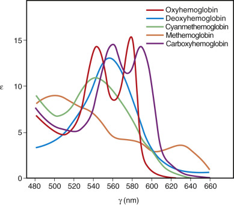

Figure 30-2 

Absorption spectra of oxyhemoglobin (HbO  2  ), deoxyhemoglobin (Hb), methemoglobin (hemiglobin [Hi]), and cyanmethemoglobin (hemiglobincyanide [HiCN]). 

(From  Morris MW, Skrodzki Z, Nelson DA  : Zeta sedimentation ratio [ZSR], a replacement for the erythrocyte sedimentation rate [ESR], _Am J Clin Pathol_ 64:254–256, 1975. © 1975 American Society for Clinical Pathology.) 

TABLE 30-1 

Nomenclature and Absorption Maxima of Hemoglobins 

Term  |  Symbol  |  ABSORPTION PEAK 1  |  ABSORPTION PEAK 2  |  ABSORPTION PEAK 3   
---|---|---|---|---  
λ |  ε |  λ |  ε |  λ |  ε  
Hemoglobin  |  Hb  |  431  |  (140)  |  555  |  (13.04)  |  |   
Oxyhemoglobin  |  HbO  2  |  415  |  (131)  |  542  |  (14.37)  |  577  |  (15.37)   
Carboxyhemoglobin  |  HbCO  |  420  |  (192)  |  539  |  (14.36)  |  568.5  |  (14.31)   
Hemiglobin (methemoglobin)  |  Hi  |  406  |  (162)  |  500  |  (9.04)  |  630  |  (3.70)   
Hemiglobincyanide (cyanmet Hb)  |  HiCN  |  421  |  (122.5)  |  540  |  (10.99)  |  |   
  
Data from van  Assendelft OW (1970)  .The wavelength (λ) in nanometers for each maximum is followed by the extinction coefficient (ε) placed in parentheses. 

 

##  Reagent. 

The diluent is detergent-modified Drabkin reagent: 

  * 0.20 g Potassium ferricyanide (K  3  Fe[CN]  6  ) 

  * 0.05 g Potassium cyanide (KCN) 

  * 0.14 g Dihydrogen potassium phosphate (anhydrous) (KH  2  PO  4  ) Nonionic detergent, for example, 

  * 0.5 mL Sterox S.E. (Harleco), _or_

  * 1.0 mL Triton X-100 (Rohm and Haas) 

  * Distilled water to 1000 mL 

The solution should be clear and pale yellow, have a pH of 7.0 to 7.4, and give a reading of zero when measured in the photometer at 540 nm against a water blank. 

Substituting dihydrogen potassium phosphate (KHP  2  PO  4  ) in this reagent for sodium bicarbonate (NaHCO  3  ) in the original Drabkin reagent shortens the time needed for complete conversion of Hb to HiCN from 10 minutes to 3 minutes. The detergent enhances lysis of erythrocytes and decreases turbidity from protein precipitation. 

Care must be taken with KCN in the preparation of the Drabkin solution, as salts or solutions of cyanide are poisonous. The diluent itself contains only 50 mg KCN per liter—less than the lethal dose for a 70-kg person. However, because hydrogen cyanide (HCN) is released by acidification, exposure of the diluent to acid must be avoided. Disposal of reagents and samples in running water in the sink is advised. The diluent keeps well in a dark bottle at room temperature but should be prepared fresh periodically. 

 

##  Method. 

Twenty microliters of blood are added to 5.0 mL of diluent (1 : 251), mixed well, and allowed to stand at room temperature for at least 3 minutes (  Dacie & Lewis, 1991  ). The absorbance is measured against the reagent blank in the photoelectric colorimeter at 540 nm or with an appropriate filter. A vial of HiCN standard is then opened and the absorbance measured, at room temperature, in the same instrument in a similar fashion. The test sample must be analyzed within a few hours of dilution. The standard must be kept in the dark when not in use and discarded at the end of the day. 

 Hb  (  g/dL  )  =  [  A  540  test sample/A  540  standard  ]  × [  Concentration of standard  (  mg/dL  )  /  100  mg/g  ]  × 251 

It is usually convenient to calibrate the photometer to be used for hemoglobinometry by preparing a standard curve or table that will relate absorbance to Hb concentration in grams per deciliter. The absorbance of fresh HiCN standard is measured against a reagent blank. Absorbance readings are made of fresh HiCN standard and of dilutions of this standard in the reagent (1 in 2, 1 in 3, and 1 in 4) against a reagent blank. Hb values in grams per deciliter are calculated for each solution as described previously. When the absorbance readings are plotted on linear graph paper as the ordinates against Hb concentration as the abscissa, the points should describe a straight line that passes through the origin. An advantage of the HiCN method is that most forms of hemoglobin (Hb, HbO  2  , Hi, and HbCO, but not SHb) are measured. 

The test sample can be directly compared with the HiCN standard, and the readings can be made at the convenience of the operator because of the stability of the diluted samples. Increased absorbance not due to Hb may be caused by turbidity due to abnormal plasma proteins, hyperlipemia, large numbers of leukocytes (counts >30 × 10  9  /L), or fatty droplets, any of which may lead to increased light scattering and apparent absorbance. 

 

##  Errors in Hemoglobinometry 

Sources of error may be those of the sample, the method, the equipment, or the operator. 

 

##  Errors Inherent in the Sample. 

Improper venipuncture technique may introduce hemoconcentration, which will make Hb concentration and cell counts too high. Improper technique in fingerstick or capillary sampling can produce errors in either direction. 

 

##  Errors Inherent in the Method. 

The HiCN method is the method of choice. Use of the HiCN standard for calibration of the instrument and for the test itself eliminates a major source of error. The broad absorption band of HiCN in the region of 540 nm makes it convenient to use both in filter-type photometers and in narrow-band spectrophotometers. With the exception of SHb, all other varieties of hemoglobin are converted to HiCN. 

 

##  Errors Inherent in the Equipment. 

The accuracy of equipment is not uniform. A good grade of pipet with a guaranteed accuracy of greater than 99% is desirable. Calibration of pipets will lessen errors. Significant error can be introduced by the use of unmatched cuvets; therefore, flow-through cuvets are preferred. The wavelength settings, the filters, and the meter readings require checking. The photometer must be calibrated in the laboratory before its initial use and must be rechecked frequently to reduce the method's error to 2% (±CV). 

Automated equipment is now widely used and eliminates most errors associated with manual techniques of hemoglobinometry. 

 

##  Spectrophotometric Identification of Hemoglobins 

The various Hbs have characteristic absorption spectra, which can be determined easily with a spectrophotometer. Useful absorbance maxima are given in [ Table 30-1 ](<#t0010>) . The maxima for Hi vary considerably with pH. The maxima given in the two right-hand columns are useful for distinguishing among these forms of Hb. Absorbance between 405 and 435 nm (the Soret band) is considerably greater and may be used when small concentrations of Hb are to be measured. 

 

##  Hematocrit (Packed Cell Volume) 

The Hct of a sample of blood is the ratio of the volume of erythrocytes to that of the whole blood. It may be expressed as a percentage (conventional) or as a decimal fraction (SI units). The units L/L are implied. Dried heparin and ethylenediaminetetraacetic acid (EDTA) are satisfactory anticoagulants. Before taking a sample from a tube of venous blood for a hematologic determination, it is important to mix the blood thoroughly. If the tube has been standing, this requires at least 60 inversions of the tube, or 2 minutes on a mechanical rotator; less than this leads to unacceptable deterioration in precision (  Fairbanks et al, 1971  ). The number of inversions required to achieve homogeneity of a specimen depends on the dimensions of the container. Standard 10 to 14 × 75-mm tubes, containing 5 mL of blood and an air bubble that constitutes at least 20% of the tube volume, require at least eight inversions (  National Committee for Clinical Laboratory Standards [NCCLS], 1993  ). The venous Hct agrees closely with the Hct obtained from a skin puncture; both are greater than the total body Hct. The Hct may be measured directly by centrifugation with macromethods or micromethods, or indirectly as the product of the mean corpuscular volume (MCV) times RBC count in automated instruments. In blood kept at room temperature, swelling of erythrocytes between 6 and 24 hours raises Hct and MCV. Cell counts and indices are stable for 24 hours at 4° C (  Brittin et al, 1969  ). 

 

##  Gross Examination 

Hct determination is performed by centrifugation. Inspection of the specimen after spinning may furnish valuable information. The relative heights of the red cell column, buffy coat, and plasma column should be noted. The buffy coat is the red-gray layer between the red cells and the plasma; it includes platelets and leukocytes. 

An orange or green color of the plasma suggests increased bilirubin, and pink or red suggests hemoglobinemia. Poor technique in collecting the blood specimen is the most frequent cause of hemolysis. If specimens are not obtained within 1 or 2 hours after a fat-rich meal, cloudy plasma may point to nephrosis or certain abnormal hyperglobulinemias, especially cryoglobulinemia. 

 

##  Hematocrit Measurement by Micromethod 

 

##  Equipment 

A capillary Hct tube about 7 cm long with a uniform bore of about 1 mm is used. For blood collection directly from a skin puncture, heparinized capillary tubes are available. 

 

##  Procedure 

The microhematocrit tube is filled by capillary attraction from a free-flowing puncture wound or a well-mixed venous sample. The capillary tube should be filled to at least 5 cm. The empty end is sealed with modeling clay. The filled tube is placed in the radial grooves of the microhematocrit centrifuge head with the sealed end away from the center. Place the bottom of the tube against the rubber gasket to prevent breakage. Centrifugation for 5 minutes at 10,000 to 12,000 g is satisfactory unless the Hct exceeds 50%; in that case, an additional 5 minutes of centrifugation should be employed to ensure minimal plasma trapping. The capillary tubes are not graduated. The length of the blood column, including the plasma, and of the red cell column alone must be measured in each case with a millimeter rule and a magnifying lens, or with one of several commercially available measuring devices. The manufacturer's instructions must be followed. 

 

##  Interpretation of Results 

Typical reference values for adult males are 0.41 to 0.51, and for females, 0.36 to 0.45. A value below an individual's normal value or below the reference interval for age and sex indicates anemia, and a higher value, polycythemia. The Hct reflects the concentration of red cells—not the total red cell mass. The Hct is low in hydremia of pregnancy, but the total number of circulating red cells is not reduced. The Hct may be normal or even high in shock accompanied by hemoconcentration, although the total red cell mass may be decreased considerably owing to blood loss. The Hct is unreliable as an estimate of anemia immediately after loss of blood or immediately following transfusions. 

 

##  Sources of Error 

 

##  Centrifugation. 

Adequate duration and speed of centrifugation are essential for a correct Hct. The red cells must be packed so that additional centrifugation does not further reduce the packed cell volume. In the course of centrifugation, small proportions of the leukocytes, platelets, and plasma are trapped between the red cells. The error resulting from the former is, as a rule, quite insignificant. The amount of trapped plasma is larger in high Hcts than in low Hcts. Trapped plasma accounts for about 1% to 3% of the red cell column in normal blood (about 0.014 in a Hct of 0.47) and slightly more in macrocytic anemia, spherocytosis, and hypochromic anemia (  Dacie & Lewis, 1991  ). Even greater amounts of trapped plasma are noted in the Hcts of patients with sickle cell anemia; these vary depending on the degree of sickling and consequent rigidity of the cells. In using the microhematocrit as a reference method for calibrating automated instruments, correction for trapped plasma is recommended (  International Committee for Standardization in Hematology [ICSH], 1980  ). 

 

##  Sample. 

Posture, muscular activity, and prolonged tourniquet-stasis can cause the same order of changes in Hct and cell concentrations as they do in nonfilterable soluble constituents. Unique to the Hct is error due to excess EDTA (inadequate blood for a fixed amount of EDTA): The Hct will be falsely low as a result of cell shrinkage, but the Hb and cell counts will not be affected. There is no uniformity as to which EDTA salt is used for anticoagulation (  O'Broin et al, 1997  ). The tripotassium (K  3  -EDTA) salt shrinks red cells about 2% and lowers packed cell volume compared with the dipotassium salt (K  2  -EDTA) (  Koepke et al, 1989  ). Also, because K  3  -EDTA is a liquid, measured Hb and red and white cell counts are decreased by 1% to 2%. Although the ICSH and the Clinical Laboratory Standards Institute recommend the K  2  -EDTA salt (powder), the K  3  -EDTA is more often used, perhaps because of its increased miscibility and fewer instances of specimen clotting (  Geller, 1996  ). 

 

##  Other Errors. 

Technical errors include failure to mix the blood adequately before sampling, improper reading of the levels of cells and plasma, and inclusion of the buffy coat as part of the erythrocyte volume. With good technique, the precision of the Hct, expressed as ±2 CV (coefficient of variation), is ±1%. With low Hct values, the CV is greater because of reading error. 

 

##  Erythrocyte Indices 

Wintrobe introduced calculations for determining the size, content, and Hb concentration of red cells; these erythrocyte indices have been useful in the morphologic characterization of anemias. They may be calculated from the red cell count, Hb concentration, and Hct. 

 

##  Mean Cell Volume 

The MCV, the average volume of red cells, is calculated from the Hct and the red cell count. MCV = Hct × 1000/RBC (in millions per µL), expressed in femtoliters or cubic micrometers. If the Hct = 0.45 and the red cell count = 5 × 10  12  /L, 1 L will contain 5 × 10  12  red cells, which occupy a volume of 0.45 L. 

 MCV  =  0.45  L/  5  × 10  12  =  90  × 10  − 15  L 

 One femtoliter  (  fL  )  =  10  − 15  L  =  1  cubic micrometer  (  μ m  3  )  . 

 

##  Mean Cell Hemoglobin 

The MCH is the content (weight) of Hb of the average red cell; it is calculated from the Hb concentration and the red cell count. 

 MCH  =  Hb  (  in g/L  )  /RBC  (  in millions/  μ L  ) 

The value is expressed in picograms. If the Hb = 15 g/dL and the red cell count is 5 × 10  12  /L, 1 L contains 150 g of Hb distributed in 5 × 10  12  cells. 

 MCH  =  150  /  (  5  × 10  12  )  =  30  × 10  12  (  pg  ) 

 One picogram  (  pg  )  =  10  − 12  g 

 

##  Mean Cell Hemoglobin Concentration 

The mean cell hemoglobin concentration (MCHC) is the average concentration of Hb in a given volume of packed red cells. It is calculated from the Hb concentration and the Hct. 

 MCHC  =  Hb  (  in g/dL  )  /Hct  ,  expressed in g/dL  (  SI units are g/L  ) 

If the Hb = 15 g/dL and the Hct = 0.45, 

 MCHC  =  15  g/dL/  0.45  =  33.3  g/dL 

Indices are determined in the electrical impedance instruments somewhat differently. The MCV is derived from the mean height of the voltage pulses formed during the red cell count, and the Hb is measured by optical density of HiCN. The other three values are calculated as follows: 

 Hct  =  MCV  × RBC  ;  MCH  =  Hb/RBC  ;  MCHC  =  (  Hb/Hct  )  × 100 

The reference values for the indices will depend on whether they are determined from the centrifuged Hct or the cell counters. The values in normal individuals will be similar if both are corrected for trapped plasma. However, because of increased trapped plasma in hypochromic anemias and sickle cell anemia, the MCHC calculated from the microhematocrit will be significantly lower than the MCHC derived from the electrical impedance counters. 

The 95% reference intervals for normal adults are as follows: MCV = 80 to 96 fL; MCH = 27 to 33 pg; and MCHC = 33 to 36 g/dL (  Ryan, 2001  ). In a healthy person, there is very little variation—no more than ±1 unit in any of the indices. Deviations from the reference value for an individual or outside the reference intervals for normal persons are useful, particularly in characterizing morphologic types of anemia. 

In _microcytic anemias,_ the indices may be as low as an MCV of 50 fL, an MCH of 15 pg, and an MCHC of 22 g/dL; rarely do any become lower. 

In _macrocytic anemias,_ the values may be as high as an MCV of 150 fL and an MCH of 50 pg, but the MCHC is normal or decreased (  Dacie & Lewis, 1991  ). The MCHC typically increases only in spherocytosis, and rarely is over 38 g/dL. 

 

##  Manual Blood Cell Counts 

Except for some platelet counts and low leukocyte counts, the hemocytometer is no longer used for routine blood cell counting. Yet it is still necessary for the technologist to be able to use this method effectively and to know its limitations. Any cell counting procedure includes three steps: dilution of the blood; sampling of the diluted suspension into a measured volume; and counting of the cells in that volume. Counts of erythrocytes, leukocytes, and platelets are each expressed as concentrations, that is, cells per unit volume of blood. The unit of volume was expressed as cubic millimeters (mm  3  ) because of the linear dimensions of the hemocytometer (cell counting) chamber. 

 1  mm  3  =  1.00003  μ L 

Although there is no consistency in the literature in the use of traditional/conventional units versus Système International d'Unites (SI) units, the ICSH recommends that the unit of volume be the liter (SI units), as on the right in the following examples: 

 Erythrocytes  :  5.00  × 10  6  /mm  3  =  5.00  × 10  6  /  μ L  (  conventional  )  =  5.00  × 10  12  /L  (  SI units  ) 

 Leukocytes  :  7.0  × 10  3  /mm  3  =  7.0  × 10  3  /  μ L  (  conventional  )  =  7.0  × 10  9  /L  (  SI units  ) 

 Platelets  :  300  × 10  3  /mm  3  =  300  × 10  3  /  μ L  (  conventional  )  =  300  × 10  9  /L  (  SI units  ) 

 

##  Erythrocyte Counts: Manual 

Systems for manual dilutions combine a microcapillary tube with a plastic vial containing a premeasured volume of diluent. After the capillary tube is filled, it is pushed into the container, and the sample is washed out by squeezing the soft plastic vial. This system is especially convenient for microsampling. Unopettes are available with diluents for counts of RBCs, white blood cells (WBCs), platelets, eosinophils, and reticulocytes. 

 

##  Semiautomated Methods 

Instruments are available for precise and convenient diluting that both aspirate the sample and wash it out with the diluent. The dilutor should perform a 1 : 250 or a 1 : 500 dilution with a coefficient of variation of less than 1%. 

 

##  Reticulocyte Count: Manual 

 

##  Principle 

Reticulocytes are immature nonnucleated red cells that contain ribonucleic acid (RNA) and continue to synthesize Hb after loss of the nucleus. When blood is briefly incubated in a solution of new methylene blue or brilliant cresyl blue, the RNA is precipitated as a dye-ribonucleoprotein complex. Microscopically, the complex appears as a dark blue network (reticulum or filamentous strand) or at least two dark blue granules that allow reticulocytes to be identified and enumerated (  ICSH, 1998  ). A proposed reference method for reticulocyte counting based on determination of the reticulocyte/red cell ratio has been published (  ICSH, 1998  ), expanding on the 1994 ICSH red cell count reference method. 

 

##  Reagent. 

One percent new methylene blue in a diluent of citrate/saline (1 part 30 g/L sodium citrate plus 4 parts 9 g/L sodium chloride). 

 

##  Controls. 

Although commercial controls are available,  Ebrahim and Ryan (1996)  describe a method requiring about 2 hours that produces a multilevel control that is stable for several months. Hypotonic dialysis of RBCs in the presence of RNA followed by a short period of hypertonic dialysis to reseal the pores of the RBC membrane results in about 20% of the RBCs as “synthetic reticulocytes” with various amounts of encapsulated RNA. 

 

##  Procedure 

Three drops each of reagent and blood are mixed in a test tube, incubated 15 minutes at room temperature, and remixed. Two wedge films are made on glass slides and air dried. 

Viewed microscopically with an oil immersion lens, reticulocytes are pale blue and contain dark blue reticular or granular material, and red cells stain pale blue or blue-green. The percentage of reticulocytes is determined in at least 1000 red cells. A Miller disk inserted into the eyepiece allows rapid estimation of large numbers of red cells by imposing two squares (one square is nine times the area of the other) onto the field of view (  Brecher & Schneiderman, 1950  ). Reticulocytes are counted in the large square and red cells in the small square in successive microscopic fields until at least 300 red cells are counted. This provides an estimate of reticulocytes among at least 2700 red cells, as follows: 

 Reticulocytes  (  percent  )  =  [  No  .  reticulocytes in large squares/  (  No  .  red cells in small squares  × 9  )  ]  × 100 

The absolute reticulocyte count is determined by multiplying the reticulocyte percentage by the red cell count. 

 

##  Reference Values 

Normal adults have a reticulocyte count of 0.5% to 1.5%, or 24 to 84 × 10  9  /L. In newborn infants, the percentage is 2.5% to 6.5%; this falls to the adult range by the end of the second week of life. 

 

##  Interpretation 

Because reticulocytes are immature red cells that lose their RNA a day or so after reaching the blood from the marrow, a reticulocyte count provides an estimate of the rate of red cell production. An absolute reticulocyte count or reticulocyte production index is more helpful than the percentage (see [ Chapter 31 ](<##!/content/3-s2.0-B9780323295680000310?scrollTo=%23c00031>) ). 

 

##  Sources of Variation 

Because such a small number of actual reticulocytes are counted, the sampling error in the manual reticulocyte count is relatively large. The 95% confidence limits may be expressed as follows: 

 R  ± 2  [  R  (  100  − R  )  /N  ] 

where _R_ is the reticulocyte count in percent, and _N_ is the number of erythrocytes examined. This means that if only 1000 erythrocytes are evaluated, the 95% confidence limits for a 1% count are 0.4% to 1.6%; for a 5% count, 3.6% to 6.4%; and for a 10% count, 8.1% to 11.9%. 

 

##  Physiologic Variation in Erythrocytes 

Changes in red cell values are greatest during the first few weeks of life ( [ Fig. 30-3 ](<#f0020>) ). At the time of birth, as much as 100 to 125 mL of placental blood may be added to the newborn if tying the cord is postponed until its pulsation ceases. In a study of newborns whose cords had been clamped late, average capillary red cell counts were 0.4 × 10  12  /L higher 1 hour after and 0.8 × 10  12  /L higher 24 hours after birth compared with newborns whose cords had been clamped early. Capillary blood (obtained by skin puncture) gives higher RBC and Hb values than venous blood (cord). The differences may amount to about 0.5 × 10  12  RBC/L and 3 g Hb/dL. Slowing of capillary circulation and the resulting loss of fluid may be the responsible factors. Examination of venous blood furnishes more consistent results than are obtained by examination of capillary blood. 

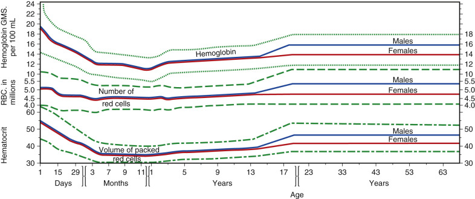

Figure 30-3 

Values for hemoglobin (Hb), hematocrit (Hct; volume of packed red cells), and red cell count from birth to old age. 

Mean values are heavy lines. Reference interval for Hb is indicated by dotted lines, for red cell counts by dashed lines, and for Hct by dotted and dashed lines. The scales on the ordinate are similar, so that relative changes in Hb, red cell count, and Hct are apparent on inspection. The scale for age, however, is progressively altered (  Wintrobe, 1974  ). 

In the full-term infant, nucleated red cells average about 0.5 × 10  9  /L. The normoblast count declines to about 200/µL at 24 hours, 25/µL at 48 hours, and less than 5/µL at 72 hours. By 7 days, it is rare to find circulating normoblasts (  Barone, 1999  ). 

The normal reticulocyte count at birth ranges from 3% to 7% during the first 48 hours, during which time it rises slightly. After the second day, it falls rather rapidly to 1% to 3% by the seventh day of life. Hb concentration in capillary blood during the first day of life averages 19.0 g/dL, with 95% of normal values falling to between 14.6 and 23.4 g/dL. In cord blood the average is 16.8 g/dL, with 95% of normal between 13.5 and 20 g/dL. Frequently, an initial increase in the Hb level of venous blood is seen at the end of 24 hours compared with that of cord blood. At the end of the first week, the level is about the same as in cord blood, and it does not begin to fall until after the second week. During the first 2 weeks, the lower limit of normal is 14.5 g/dL for capillary blood and 13.0 g/dL for venous blood. The Hct in capillary blood on the first day of life averages 0.61, with 95% of normal values between 0.46 and 0.76. In cord blood, the average is 0.53. Changes during the first few weeks parallel the Hb concentration. The Hb and Hct are highest at birth but fall rather steeply in the first days and weeks of life to a minimum at 2 months of age, at which time the lower limit of the 95% reference values and the mean value for the Hb are 9.4 and 11.2 g/dL, and for the Hct are 0.28 and 0.35, respectively. After 4 months of age, the lower limit for the Hb is 11.2 g/dL and for the Hct is 0.32; these values rise gradually until about 5 years of age, and somewhat more steeply in boys than in girls thereafter (  Shannon & Pearson, 2002  ). The normal MCV at birth ranges from 104 to 118 fL, compared with the adult reference interval of 80 to 96 fL. Because the RBC does not fall to the degree that the Hb and Hct do, the MCV decreases abruptly, then gradually, during the first few months of life. The lowest value is reached at about 1 year. In studies in which iron deficiency and thalassemia are excluded, the lower reference limit (95% reference values) for the MCV gradually rises between 1 year and 15 years of age—from 70 to 76 fL in boys, and from 70 to 78 fL in girls (  Shannon & Graef, 1996  ). Reference intervals for RBC values in sexually mature adults are given in [ Table 30-2 ](<#t0015>) . The indices are similar in males and females, but the Hb is 1 to 2 g/dL higher in males, with commensurate increments in Hct and RBCs (see [ Fig. 30-3 ](<#f0020>) ). This is believed to be mainly the effect of androgen in stimulating erythropoietin production and its effect on the marrow. In older men, the Hb tends to fall, and in older women, the Hb tends to fall to a lesser degree (in some studies) or even rise slightly (in other studies). In older individuals, therefore, the sex difference is less than 1 g Hb/dL (  Dacie & Lewis, 1991  ). Posture and muscular activity change the concentration of the formed elements. The Hb, Hct, and RBC increase by several percent when the change from recumbency to standing is made, and strenuous muscular activity causes a further increase, presumably owing primarily to loss of plasma water. Diurnal variation that is not related to exercise or to analytic variation also occurs. The Hb is highest in the morning, falls during the day, and is lowest in the evening, with a mean difference of 8% to 9% (  Dacie & Lewis, 1991  ). In persons living at a higher altitude, the Hb, Hct, and RBC are elevated over what they would be at sea level. The difference is about 1 g Hb/dL at 2 km altitude and 2 g Hb/dL at 3 km. Increased erythropoiesis is secondary to anoxic stimulation of erythropoietin production. People who are smokers also tend to have a mild erythrocytosis. 

TABLE 30-2 

Typical Blood Cell Values in a Normal Population of Young Adults 

|  Men  |  |  Women   
---|---|---|---  
White cell count (×10  9  /L blood)  |  |  7.8 (4.4-11.3)  |   
Red cell count (×10  12  /L blood)  |  5.21 (4.52-5.90)  |  |  4.60 (4.10-5.10)   
Hemoglobin (g/dL blood)  |  15.7 (14.0-17.5)1  |  |  3.8 (12.3-15.3)   
Hematocrit (percent)  |  46 (41.5-50.4)  |  |  40.2 (35.9-44.6)   
Mean cell volume (fL/red cell)  |  |  88.0 (80.0-96.1)  |   
Mean cell hemoglobin (pg/red cell)  |  |  30.4 (27.5-33.2)  |   
Mean cell hemoglobin concentration (g/dL RBC)  |  |  34.4 (33.4-35.5)  |   
Red cell distribution width (CV, percent)  |  |  13.1 (11.6-14.6)  |   
Platelet count (×10  9  /L blood)  |  |  311 (172-450)  |   
  
The mean and reference intervals (normal range) are given. Because the distribution curves may be nongaussian, the reference interval is the nonparametric central 95% confidence interval. Results are based on 426 normal adult men and 212 normal adult women. Studies were performed on the Coulter model S-Plus IV. 

_CV,_ Cell values; _RBC,_ bed blood cell. 

From Morris MW, Skrodzki Z, Nelson DA: Zeta sedimentation ratio (ZSR), a replacement for the erythrocyte sedimentation rate (ESR), _Am J Clin Pathol_ 164:254–256, 1975. 

 

##  Leukocyte Counts: Manual 

 

##  Specimen Collection 

EDTA should be used; heparin is unsatisfactory as an anticoagulant. 

 

##  Hemocytometer Method 

Although this method is used only occasionally in leukocyte counting, the technologist should be able to perform it 

  * 1.

As a check on the validity of electronic methods for calibration purposes 

  * 2.

As a check on the validity of electronic counts in patients with profound leukopenia or thrombocytopenia 

  * 3.

For blood specimens with platelet counting interference (i.e., very microcytic RBCs) 

  * 4.

As a backup method 

It is also commonly used as a method for counting cells in cerebrospinal fluid (CSF). 

 

##  Counting Chamber. 

The hemocytometer is a thick glass slide with inscribed platforms of known area and precisely controlled depth under the coverslip. Counting chambers and cover glasses should be rinsed in lukewarm water immediately after use; wiped with a clean, lint-free cloth; and allowed to air dry. The surfaces must not be touched with gauze or linen because these materials may scratch the ruled areas. 

 

##  Diluting Fluid. 

The diluting fluid lyses the erythrocytes so that they will not obscure the leukocytes. The fluid must be refrigerated and filtered frequently to remove yeasts and molds. 

 

##  Procedure 

  * 1.

Well-mixed blood is diluted 1 : 20 in diluting fluid and the vial rotated for about 5 minutes. The chamber is loaded with just enough fluid to fill the space beneath the cover glass. 

  * 2.

The cells are permitted to settle for several minutes, and the chamber is surveyed with the low-power objective to verify uniform cell distribution. 

  * 3.

Counting is performed. The condenser diaphragm of the microscope is partially closed to make the leukocytes stand out clearly under a low-power (10×) objective lens. The leukocytes are counted in each of the four large (1 mm  2  ) corner squares (A, B, C, and D in [ Fig. 30-4 ](<#f0025>) ). A total of eight large corner squares from two sides of a chamber are counted. 

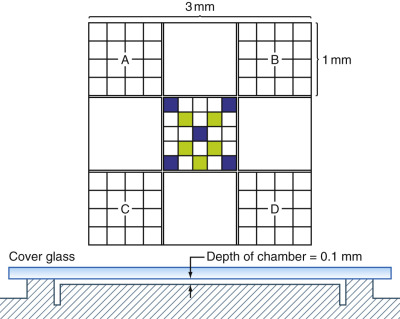

Figure 30-4 

The upper figure is a diagram of the improved Neubauer ruling; this is etched on the surface of each side of the hemocytometer. 

The large corner squares, A, B, C, and D, are used for leukocyte counts. The five blue squares in the center are used for red cell counts or for platelet counts, and the 10 green plus blue squares for platelet counts. Actually, each of the 25 squares within the central sq mm has within it 16 smaller squares for convenience in counting. The lower figure is a side view of the chamber with the cover glass in place. 

  * 4.

Each large square encloses a volume of 1/10 mm  3  , and the dilution is 1 : 20\. A general formula is as follows: 

 Leukocyte count  (  cells/mm  3  )  =  (  c  c  /  l  s  c  )  × d  × 10 

where _cc_ is the total number of cells counted, _d_ is the dilution factor, 10 is the factor transforming value over one large square (1/10 mm  3  ) to the volume in mm  3  , and _lsc_ is the number of large squares counted. 

In leukopenia, with a total count below 2500, the blood is diluted 1 : 10\. In leukocytosis, the dilution may be 1 : 100 or even 1 : 200\. 

 

##  Sources of Error. 

Errors may be due to the nature of the sample, to the operator's technique, and to inaccurate equipment. Errors that are inherent in the distribution of cells in the counting volume are called “field” errors and can be minimized only by counting more cells. 

Hemocytometer leukocyte counts show a CV of about 6.5% for normal and increased counts, and about 15% in leukopenic blood. Utilizing electronic counters, on the other hand, results in CVs of approximately 1% to 3%. 

 

##  Errors due to the nature of the sample. 

Partial coagulation of the venous blood causes changes in the distribution of the cells and/or decreases their number. Failure to mix the blood thoroughly and immediately before dilution introduces an error, which depends on the degree of sedimentation. 

 

##  Operator's errors. 

Errors caused by faulty technique may occur during dilution, when the chamber is loaded, and when the cells are counted. 

 

##  Errors due to equipment. 

Equipment errors can be diminished by using pipets and hemocytometers certified by the U.S. Bureau of Standards. 

 

##  Inherent or field errors. 

Even in a perfectly mixed sample, variation occurs in the number of suspended cells that are distributed in a given volume (i.e., come to rest over a given square). This “error of the field” is the minimal error. Another error is the “error of the chamber,” which includes variations in separate fillings of a given chamber and in sizes of different chambers. Still another is the “error of the pipet,” which includes variations in filling a given pipet and in the sizes of different pipets. In performing a WBC count, if 200 cells are counted using two chambers and one pipet, the CV = 9.1%, corresponding to 95% confidence limits of ±18.2% (twice the CV). Using four chambers and two pipets and counting twice as many cells reduces the 95% confidence limits to ±12.8%. This relatively large percentage error is of little practical consequence because of the physiologic variation of the leukocyte count. 

 

##  Nucleated red blood cells. 

Nucleated red blood cells (NRBCs) will be counted and cannot be distinguished from leukocytes with the magnification used. If their number is high, as seen on the stained smear, a correction should be made according to the following formula: 

 True leukocyte count  =  (  Total count  × 100  )  /  (  100  \+  No  .  of NRBCs  ) 

where the _No. of NRBCs_ is the number of nucleated red cells that are counted during the enumeration of 100 leukocytes in the differential count. 

Example 

The blood smear shows 25 NRBCs per 100 leukocytes. The total nucleated cell count is 10,000. 

True leukocyte count = 10,000 × 100/125 = 8000/µL (8.0 × 10  9  /L) 

 

##  Reference Value. 

In the total leukocyte count, no distinction is made among the six normal cell types (neutrophils and bands, lymphocytes, monocytes, eosinophils, and basophils). The reference interval for adults is 4.5 to 11.0 × 10  9  /L. 

 

##  Physiologic Variation in Leukocytes 

The total white cell count at birth and during the first 24 hours varies within wide limits. Neutrophils are the predominant cell, varying from 6 to 28 × 10  9  /L; about 15% of these are band forms (  Altman & Dittmer, 1974  ), and a few myelocytes are present. Neutrophils drop to about 5 × 10  9  /L during the first week of life and remain at about the same level thereafter. Lymphocytes are about 5.5 × 10  9  /L at birth and change little during the first week. They become the predominant cell, on average, after the first week of life and remain so until about 7 years of age, when neutrophils again predominate. The upper limit of the 95% reference interval for lymphocytes at 6 months of age is 13.5, at 1 year of age 10.5, at 2 years of age 9.5, at 6 years of age 7.0, and at 12 years of age 6.0 × 10  9  /L. For neutrophils at the same ages, the values are 8.5, 8.5, 8.5, 8.0, and 8.0 × 10  9  /L, respectively—all somewhat higher than those for adults ( [ Table 30-3 ](<#t0020>) ). 

TABLE 30-3 

Normal Leukocyte Count, Differential Count, and Hemoglobin Concentration at Various Ages 

Age  |  LEUKOCYTES [ * ](<#hl0000705>)  
---|---  
Total Leukocytes  |  Total Neutrophils  |  Band Neutrophils  |  Segmented Neutrophils  |  Eosinophils  |  Basophils  |  Lymphocytes  |  Monocytes  |  Hemoglobin (g/dL Blood)   
12 months  |  11.4   
(6.0-17.5)  |  3.5 (1.5-8.5)   
_31_ |  0.35   
_3.1_ |  3.2 (1.0-8.5)   
_28_ |  0.30   
(0.05-0.70)   
_2.6_ |  0.05   
(0-0.20)   
_0.4_ |  7.0 (4.0-10.5)   
_61_ |  0.55   
(0.05-1.1)   
_4.8_ |  12.6   
(11.1-14.1)   
4 years  |  9.1   
(5.5-15.5)  |  3.8 (1.5-8.5)   
_42_ |  0.27 (0-1.0)   
_3.0_ |  3.5 (1.5-7.5)   
_39_ |  0.25   
(0.02-0.65)   
_2.8_ |  0.05   
(0-0.2)   
_0.6_ |  4.5 (2.0-8.0)   
_50_ |  0.45 (0-0.8)   
_5.0_ |  12.7   
(11.2-14.3)   
6 years  |  8.5   
(5.0-14.5)  |  4.3 (1.5-8.0)   
_51_ |  0.25 (0-1.0)   
_3.0_ |  4.0 (1.5-7.0)   
_48_ |  0.23 (0-0.65)   
_2.7_ |  0.05   
(0-0.2)   
_0.6_ |  3.5 (1.50-7.0)   
_42_ |  0.40 (0-0.8)   
_4.7_ |  13.0   
(11.4-14.5)   
10 years  |  8.1   
(4.5-13.5)  |  4.4 (1.8-8.0)   
_54_ |  0.24 (0-1.0)   
_3.0_ |  4.2 (1.8-7.0)   
_51_ |  0.20 (0-0.60)   
_2.4_ |  0.04   
(0-0.2)   
_0.5_ |  3.1 (1.5-6.5)   
_38_ |  0.35 (0-0.8)   
_4.3_ |  13.4   
(11.8-15.0)   
21 years  |  7.4 (4.5-11.0)  |  4.4 (1.8-7.7)   
_59_ |  0.22 (0-0.7)   
_3.0_ |  4.2 (1.8-7.0)   
_56_ |  0.20 (0-0.45)   
_2.7_ |  0.04   
(0-0.2)   
_0.5_ |  2.5 (1.0-4.8)   
_34_ |  0.30 (0-0.8)   
_4.0_ |  15.5   
(13.5-17.5)   
13.8   
(12.0-15.6)   
  
From:  Altman PL, Dittmer DS  , editors: _Blood and other body fluids,_ Washington, DC, 1961, Federation of American Societies for Experimental Biology (for leukocyte and differential count);  Dalman PR  : Developmental changes in red blood cell production and function. In: Rudolph AM, Hoffman JIE, editors: _Pediatrics,_ ed 18, Norwalk, Conn., 1987, Appleton & Lange, pp 1011–1012 (for hemoglobin concentrations). 

 * Values are expressed as mean (95% reference) values. For leukocytes and differential count cell types, the units are cells × 10  9  /µL; the numbers in italic type are mean percentages. 

Diurnal variation has been recognized in the neutrophil count, with highest levels in the afternoon and lowest levels in the morning at rest. Exercise produces leukocytosis, which includes an increased neutrophil concentration as a result of a shift of cells from the marginal to the circulating granulocyte pool. Increased lymphocyte drainage into the blood also appears to contribute to the total increase. Both average and lower reference values for neutrophil concentration in the black population are lower than in the Caucasian population; this difference must be taken into account in assessing neutropenia. Cigarette smokers have higher average leukocyte counts than nonsmokers. The increase is greatest (about 30%) in heavy smokers who inhale and affects neutrophils, lymphocytes, and monocytes. 

Mild changes occur during the menstrual cycle. Neutrophils and monocytes fall and eosinophils tend to rise during menstruation. Basophils have been reported to fall during ovulation. 

 

##  Platelet Counts 

Platelets are thin disks, 2 to 4 µm in diameter and 5 to 7 fL in volume (in citrated blood). They function in hemostasis, in maintenance of vascular integrity, and in the process of blood coagulation. 

In EDTA-blood, the mean platelet volume (MPV) increases with time up to 1 hour in vitro, is relatively stable between 1 and 3 hours, and then increases further with time. Change from a discoid to a spherical shape accounts for this increase in apparent volume in EDTA compared with citrate (  Rowan & Fraser, 1982  ). For reproducible results, platelet volume measurements obtained with multichannel instruments should be made between 1 and 3 hours after the blood is drawn. The frequency distribution of platelet volumes in an individual is log normal. However, a nonlinear inverse relationship has been noted between the MPV and the platelet count within normal individuals ( [ Fig. 30-5 ](<#f0030>) ). Therefore, reference values for the MPV appear to vary with the platelet count (  Bessman et al, 1981  ). The MPV is generally increased in hyperthyroidism (  Ford et al, 1988  ) and myeloproliferative disease (  Small & Bettigole, 1981  ). Platelets are more difficult to count because they are small (must be distinguished from debris) and have a tendency to adhere to glass, any foreign body, and particularly to one another. It is often possible to recognize a significant decrease in the number of platelets by careful inspection of stained films. With capillary blood, films must be made evenly and very quickly after the blood is obtained to avoid clumping and to minimize the decrease due to adhesion of platelets to the margins of the injured vessels. A better estimate is possible by examining stained films made from venous blood with EDTA as an anticoagulant (EDTA-blood), in which platelets are evenly distributed and where clumping normally does not occur. The visual method of choice employs the phase-contrast microscope. Once considered the “gold standard,” it has been largely replaced as the reference method by the RBC/platelet ratio. This method employs monoclonal antibodies to platelet-specific targets on the glycoprotein IIb/IIa complex (CD41 and Cd61) to enumerate platelets using flow cytometry. This method helps to differentiate platelets from interfering substances such as microcytic red blood cells, white blood cell fragments, microorganisms, and debris ( [ Table 30-4 ](<#t0025>) ) (  ICSH, 2001  ). 

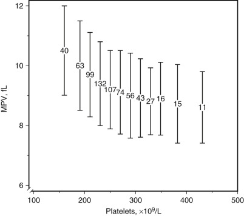

Figure 30-5 

Mean platelet volume (MPV) related to platelet count in 683 normal subjects. 

Each group is shown as mean (number) ±2 SD (bar) of subjects grouped by platelet counts of 128 to 179, 180 to 199, 200 to 219, 220 to 239, 240 to 259, 260 to 279, 280 to 309, 310 to 319, 320 to 339, 340 to 359, 360 to 403, 404 to 462 × 10  9  /L. The number of the mean position is the number of subjects in the group (  Bessman et al, 1981  ). 

TABLE 30-4 

Potential Causes of Erroneous Results with Automated Cell Counters 

Parameter  |  Causes of Spurious Increase  |  Causes of Spurious Decrease   
---|---|---  
WBC  |  Cryoglobulin, cryofibrinogen  |  Clotting   
Heparin  |  Smudge cells   
Monoclonal proteins  |  Uremia plus immunosuppressants   
Nucleated red cells  |   
Platelet clumping  |   
Unlysed red cells  |   
RBC  |  Cryoglobulin, cryofibrinogen  |  Autoagglutination   
Giant platelets  |  Clotting   
High WBC (>50,000/mL)  |  Hemolysis (in vitro)   
|  Microcytic red cells   
Hb  |  Carboxyhemoglobin (>10%)  |  Clotting   
Cryoglobulin, cryofibrinogen  |  Sulfhemoglobin   
Hemolysis (in vitro)  |   
Heparin  |   
High WBC (>50,000/µL)  |   
Hyperbilirubinemia  |   
Lipemia  |   
Monoclonal proteins  |   
Hct (automated)  |  Cryoglobulin, cryofibrinogen  |  Autoagglutination   
Giant platelets  |  Clotting   
High WBC (>50,000/µL)  |  Hemolysis (in vitro)   
Hyperglycemia (>600 mg/dL)  |  Microcytic red cells   
Hct (microhematocrit)  |  Hyponatremia  |  Excess EDTA   
Plasma trapping  |  Hemolysis (in vitro)   
|  Hypernatremia   
MCV  |  Autoagglutination  |  Cryoglobulin   
High WBC (>50,000/µL)  |  Cryofibrinogen   
Hyperglycemia  |  Giant platelets   
Reduced red cell deformability  |  Hemolysis (in vitro)   
|  Microcytic red cells   
|  Swollen red cells   
MCH  |  High WBC (>50,000/µL)  |  Spuriously low Hb   
Spuriously high Hb  |  Spuriously high RBC   
Spuriously low RBC  |   
MCHC  |  Autoagglutination  |  High WBC (>50,000/µL)   
Clotting  |  Spuriously low Hb   
Hemolysis (in vitro)  |  Spuriously low Hct   
Hemolysis (in vivo)  |   
Spuriously high Hb  |   
Spuriously high Hct  |   
Platelets  |  Cryoglobulin, cryofibrinogen  |  Clotting   
Hemolysis (in vitro and in vivo)  |  Giant platelets   
Microcytic red cells  |  Heparin   
Red cell inclusions  |  Platelet clumping   
White cell fragments  |  Platelet satellitosis   
  
_EDTA,_ Ethylenediaminetetraacetic acid; _Hb,_ hemoglobin; _Hct,_ hematocrit; _MCH,_ mean cell hemoglobin; _MCHC,_ mean cell hemoglobin concentration; _MCV,_ mean corpuscular volume; _RBC,_ red blood cell; _WBC,_ white blood cell. 

From  Cornbleet J  : Spurious results from automated hematology cell analyzers, _Lab Med_ 14:509, 1983. 

 

##  Hemocytometer Method—Phase-Contrast Microscope 

 

##  Specimen. 

Venous blood is collected with EDTA as the anticoagulant. Blood from skin puncture wounds gives more variable results but is satisfactory if the blood is flowing freely and if only the first few drops are used. 

 

##  Diluent Solution. 

One percent ammonium oxalate is mixed in distilled water. The stock bottle is kept in the refrigerator. The amount needed for the day is filtered before use, and the unused portion is discarded at the end of the day. 

 

##  Procedure 

  * 1.

Well-mixed blood is diluted 1 : 100 in diluting fluid, and the vial containing the suspension is rotated on a mechanical mixer for 10 to 15 minutes. 

  * 2.

The hemocytometer is filled in the usual fashion, using a separate capillary tube for each side. 

  * 3.

The chamber is covered with a Petri dish for 15 minutes to allow settling of the platelets in one optical plane. A piece of wet cotton or filter paper is left beneath the dish to prevent evaporation. 

  * 4.

The platelets appear round or oval and frequently have one or more dendritic processes. Their internal granular structure and a purple sheen allow the platelets to be distinguished from debris, which is often refractile. Ghosts of red cells that have been lysed by the ammonium oxalate are seen in the background. 

  * 5.

Platelets are counted in 10 small squares (the black squares in [ Fig. 30-4 ](<#f0025>) ), five on each side of the chamber. If the total number of platelets counted is less than 100, more small squares are counted until at least 100 platelets have been recorded—10 squares per side (black plus shaded squares; see [ Fig. 30-4 ](<#f0025>) ) or all 25 squares in the large central square on each side of the hemocytometer, if necessary. If the total number of platelets in all 50 of these small squares is less than 50, the count should be repeated with a 1 : 20 or a 1 : 10 dilution of blood. 

 

##  Calculation. 

Each of the 25 small squares defines a volume of 1/250 µL (1/25 mm  2  area × 1/10 mm depth): Platelet count (per µL) = (Number of cells counted/Number of squares counted) × Dilution × 250\. 

By adjusting the number of squares so that at least 100 platelets are counted, the field error (the statistical error caused by counting a limited number of platelets in the chamber) can be kept in the same range for low platelet counts as for high platelet counts. It has been shown that the CV due to combined field, pipet, and chamber errors is about 11% when at least 100 platelets are counted, and 15% when 40 platelets are counted. 

Platelet counts tend to be the least reproducible of the blood cell counts, and the technologist must be vigilant to ensure their accuracy. This includes the readiness to confirm suspicious or abnormal results with a freshly drawn sample. Whenever the platelet count is in question, such as with an instrument flag, the blood film (prepared from EDTA-blood) must be checked to corroborate the count and to detect abnormalities in platelets or other blood elements that may give a false value. Further, because of the low number of platelets counted in the manual method and the high degree of imprecision with severe thrombocytopenia (CV >15%), 7 × 10  9  platelets/L is the lowest count that should be reported from manual quantitation (  Hanseler et al, 1996  ). 

 

##  Sources of Error. 

Blood in EDTA is satisfactory for 5 hours after collection at 20° C and for 24 hours at 4° C, provided that no difficulty was encountered in collection. Platelet clumps present in the chamber imply a maldistribution and negate the reliability of the count; a new sample of blood must be collected. The causes of platelet clumping are likely to be initiation of platelet aggregation and clotting before the blood reaches the anticoagulant; imperfect venipuncture; delay in the anticoagulant contacting the blood; or, in skin puncture technique, delay in sampling. Capillary blood gives similar mean values, but errors are about twice those with venous blood, probably because the platelet level varies in successive drops of blood from the skin puncture wound. 

 

##  Falsely elevated counts. 

Fragments of leukocyte cytoplasm that are sometimes numerous in leukemias may falsely elevate the count. The phase-contrast hemocytometer method must be employed in these cases with a correction made based on the ratio of fragments to platelets determined from the blood film. 

 

##  Falsely low counts. 

These can occur if platelets adhere to neutrophils (platelet satellitism) or if there is platelet clumping due to agglutinins (  Lombarts & deKieviet, 1988  ), spontaneous aggregation, or incipient clotting due to faulty blood collection. The first two of these phenomena appear to depend on EDTA (  Dacie & Lewis, 1991  ). The reported incidence of EDTA-induced in vitro platelet clumping and pseudothrombocytopenia has ranged from 0.1% (  Bartels et al, 1997  ) to 2% (  Lippi et al, 1990  ). Alterations in platelet histograms or in quantitative cutoff measures derived from them should be used to screen for pseudothrombocytopenia (  Bartels et al, 1997  ). 

 

##  Reticulated Platelets 

Reticulated platelets are those newly released circulating platelets that have residual RNA. Reticulated platelet counts are an estimate of thrombopoiesis (  Rapi et al, 1998  ), analogous to the use of reticulocyte count as an estimate of erythropoiesis.  Matic and colleagues (1998)  describe an optimized flow-cytometric analysis method after incubating whole blood with thiazole orange, which has a 3000-fold increase in fluorescence after binding to RNA. Phycoerythrin-labeled antibodies directed against GPIb on the surface of the platelet are also in the incubation mixture to distinguish platelets from other cells or debris. Recombinant human erythropoietin seems to improve platelet function in uremia not only by correcting the anemia, but also by increasing young platelets, detected as reticulated platelets (  Tassies et al, 1998  ). Significantly lower median levels of reticulated platelets in frequent plateletpheresis donors than in new donors suggest that repeat platelet donation might lead to relative exhaustion of thrombopoiesis (  Stohlawetz et al, 1998  ). Depending on the conditions of the measurement, published normal values for reticulated platelets vary tremendously from 3% to 20% (  Matic et al, 1998  ). 

_Increased_ reticulated platelet values have been reported in idiopathic thrombocytopenic purpura (  Koike et al, 1998  ;  Saxton et al, 1998  ), and hyperthyroidism (  Stiegler et al, 1998  ). In neonates younger than 30 weeks' gestation, the reticulated platelet count was about twice that seen in full-term infants (  Peterec et al, 1996  ). Bone marrow recovery after chemotherapy for acute myeloid leukemia (AML) showed an increase in reticulated platelets after about day 20 (  Stohlawetz et al, 1999  ). _Decreased_ reticulated platelet values have been reported in association with aplasia and liver cirrhosis (  Koike et al, 1998  ;  Saxton et al, 1998  ). Sysmex 9 (Lincolnshire, Ill.) has developed an automated method to quantify reticulated platelets using a nucleic acid– specific dye. The immature platelet fraction (IPF) is useful in demonstrating thrombocytopenia due to increased platelet destruction (  Briggs et al, 2004  ). 

Reference values for platelet counts are 150 to 450 × 10  9  /L. Reference values for MPV are approximately 6.5 to 12 fL in adults. 

 

##  Physiologic Variation in Platelets 

The average platelet count is slightly lower at birth than in older children and adults, and may vary from 84 to 478 × 10  9  /L (  Barone, 1999  ). After the first week of life, the reference intervals are those of the adult. In women, the platelet count may fall at the time of menstruation. Women have higher platelet (and WBC and neutrophil) counts than men, and Africans (and less so Afro-Caribbeans) have lower platelet, WBC, and neutrophil counts than Caucasians (  Bain, 1996  ). Reported means (95% reference ranges) for platelet counts were 218 (143 to 332) for Caucasian men and 183 (115 to 290) for African men versus 246 (169 to 358) for Caucasian women and 207 (125 to 342) for African women. Among Australians west of Sydney and 49 years of age or older,  Tsang and colleagues (1998)  list 247 (128 to 365) for mean platelet counts for men and 275 (147 to 403) for women. 

 

##  Instrument Technology 

Because of the relatively low cost, reduced time (for labor and results), and increased accuracy of the automated analyzers, semiautomated instruments are rarely used in clinical practice these days. Speed of performance, elimination of visual fatigue of the technician, and improved precision are decisive advantages of the electronic cell counter over the hemocytometer/manual methods of performing blood cell counts. Electronic counting instruments are discussed in the following section. 

 

##  Hematology Analyzers 

The multichannel instruments used in the modern laboratory for performing cell counts are based on the principles of electrical impedance, light scattering, radiofrequency conductivity, and/or cytochemistry (  Ward, 2000  ). The principles of these techniques are discussed in the following section. Combining hematology instrumentation with laboratory automation allows for reduction in preanalytic and postanalytic variables and positive identification of samples for processing and analysis, storage, and retrieval. 

 

##  Electrical Impedance 

Cells passing through an aperture through which a current is flowing cause changes in electrical resistance, which is counted as voltage pulses. This principle, illustrated in [ Figure 30-6 ](<#f0035>) , is used in instruments marketed by Coulter (e.g., LH series, GEN-S, HmX, A-T; Beckman Coulter Inc., Brea, Calif.), Sysmex (e.g., XE and XT series; Sysmex America Inc., Mundelein, Ill.), Abbott (e.g., Cell-Dyn, 3700, Ruby, Sapphire; Abbott Diagnostics, Santa Clara, Calif.), ABX (e.g., Micros 60, Pentra series; ABX Diagnostics Inc., Irvine, Calif.), and others. An accurately diluted suspension of blood (CS) is made in an isotonic conductive solution that preserves the cell shape. The instrument has a glass cylinder (GC) that can be filled with the conducting fluid and has within it an electrode (E2) and an aperture (A) of 100 µm diameter in its wall. Just outside the glass cylinder is another electrode (E1). The cylinder is connected to a U-shaped glass tube that is partially filled with mercury (M), and that has two electrical contacts (EC1 and EC2). The glass cylinder is immersed in the suspension of cells to be counted (CS) and is filled with conductive solution and closed by a valve (V). A current now flows through the aperture between E1 and E2. As mercury moves up the tube, the cell suspension is drawn through the aperture into the cylinder. Each cell that passes through the aperture displaces an equal volume of conductive fluid, increasing the electrical resistance and creating a voltage pulse, because its resistance is much greater than that of the conductive solution. The pulses, which are proportional in height to the volume of the cells, are counted. This is the Coulter principle. 

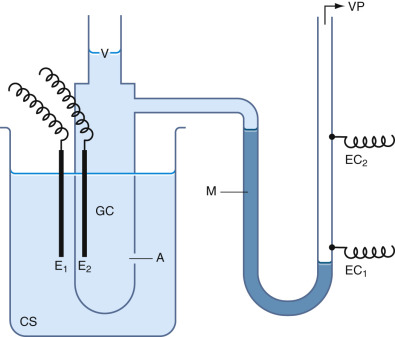

Figure 30-6 

Schematic diagram of particle counter in which changes in electrical resistance are counted as voltage pulses. 

_A,_ Aperture; _CS,_ cell suspension; _E 1  _ and _E 2  , _ platinum electrodes; _EC 1  _ and _EC 2  , _ electrical contacts; _GC,_ glass cylinder; _M,_ mercury column; _V,_ valve; _VP,_ vacuum pump. 

(Adapted from  Ackerman P  : _Electronic instrumentation in the clinical laboratory,_ Boston, 1972, Little, Brown, p 140.) 

In the simplest system, the counting mechanism is started when the mercury contacts EC1 and stopped when it contacts EC2; during this time, the cells are counted in a volume of suspension exactly equal to the volume of the glass tubing between contact wires EC1 and EC2. If two or more cells enter the aperture simultaneously, they will be counted as one pulse; this produces a coincidence error for which corrections are now automatically made by analyzers. A threshold setting or pulse discriminator allows the exclusion of pulses below an adjustable height on certain counters. On others, a second threshold also excludes the counting of pulses above a certain height. One therefore counts only the cells in the “window” between the two settings. By systematically changing each threshold by given increments, one can determine a frequency distribution of relative cell volumes. Such cell size distributions can be automatically plotted and are valuable in the study of red cells, white cells, or platelets when two or more changing populations of cells are present. This is the basis for determination of the blood cell histograms, which are now routinely produced by the multichannel hematology analyzers. 

 

##  Radiofrequency Conductivity 

Conductivity is determined using a high-frequency electromagnetic probe that provides information on the cells' internal constituents (chemical composition, nuclear characteristics, and granular constituents) by permeating the lipid layer of a cell's membrane. Conductivity is especially helpful in differentiating between cells of like size such as small lymphocytes and basophils (  Burns et al, 1992  ;  Bentley et al, 1993  ). This principle is utilized in instruments marketed by Coulter (e.g., LH series, GENfi-S, HmX, A-T; Beckman Coulter Inc., Brea, Calif.) and Sysmex (XE-2100, XT 2000i, HST-N; Sysmex America Inc., Mundelein, Ill.). 

 

##  Light Scattering 

In the electro-optical analyzers ( [ Fig. 30-7 ](<#f0040>) ), a light-sensitive detector measures light scattering. All major multichannel analyzers now employ optical methods, at least to some extent. The size of the pulse detected is proportional to the size of the particle (WBC, RBC, or platelet). Although the precision of the instruments employing optical methods is equivalent to that of systems utilizing electrical impedance, some systems use a combination of the two methods to supply an internal comparison. Forward angle scatter of a laser-generated monochromatic light determines cell surface characteristics, morphology, and granulation. Measurement of light scatter at multiple angles allows enhanced differentiation of cell types. For example, in the Abbott Cell Dyn, four simultaneous light-scattering measurements are made on each white cell. Zero-degree forward angle is primarily affected by and thus determines cell size. Ten-degree light scatter is an indicator of cell structure or complexity and is especially helpful in resolving basophils and separating all cell populations. Ninety-degree light scatter separates granulated cells and is termed **lobularity.** Depolarized 90-degree light scattering resolves eosinophils because of their large crystalline granularity. Abnormal cells can have distinctive locations in the size-versus-complexity scatterplot and help to determine WBC suspect flags (  Cornbleet et al, 1992  ), such as for blasts, variant lymphs, bands, and immature granulocytes. Fluorescent deoxyribonucleic acid (DNA) dyes are used in the Abbott automated hematology systems to enumerate nucleated RBCs and identify populations of atypical lymphocytes and nonviable WBCs. Adaptive gating technology permits better separation of overlapping clusters of cell types. Suspect flags are generated when the distinction cannot be clearly delineated, as is often the case in the presence of abnormal WBC populations or interfering substances. 

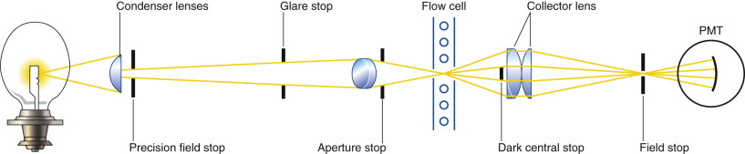

Figure 30-7 

Schematic diagram of the electro-optical cell counter. 

Light is focused on the flow cell. Only light scattered by a cell reaches the photomultiplier tube (PMT), which converts to an electrical pulse. 

(From Mansberg HP: Optical techniques of particle counting. In _Advances in automated analysis_ , vol 1, Technicon International Congress, New York, 1970, Mediad, with permission. Reprinted courtesy of Technicon Instrument Corporation, Tarrytown, N.Y.) 

 

##  Cytochemistry 

A method unique to the Siemens automated hematology series (Siemens Healthcare Diagnostics, Deerfield, Ill.) is the use of a cytochemical reaction to determine the peroxidase activity of white blood cells. The mean peroxidase index (MPXI), a measure of neutrophil-staining intensity, is determined for each specimen. The relative positivity seen in neutrophils, eosinophils, and monocytes is used in conjunction with data derived from light scatter to determine the WBC differential (  Simson, 1986  ). ABX Diagnostics utilizes a cytochemical reagent that fixes the WBCs in their native state and subsequently stains their intracellular and plasmic membranes with chlorazol black E (Clinical Case Studies: Interpretation Guide for ABX 5-Part Diff Hematology Analyzers, ABX Horiba Diagnostics, Montpelier, France). 

 

##  Reporting/Flagging 

Each instrumentation system combines the data generated by these methods in their own configuration to provide a five- or six-part WBC differential along with RBC morphology and platelet parameters ( [ Fig. 30-8 ](<#f0045>) ). The principles of measurement specific to selected systems are detailed in [ Table 30-5 ](<#t0030>) . Data generated by the instrument that are not acceptable based on instrument- or user-defined criteria are flagged to alert the technologist that reporting the sample requires further investigation. Data management systems now include sophisticated programs that utilize user-defined criteria to determine reflex and repeat testing, including automated slide making and staining. Extreme care must be taken when defining these criteria, as the addition of each lessens the advantage provided by automating the process. The best configurations are developed with the patient population in mind. In addition, follow-up should be tailored to minimize the extended time necessary to derive the correct result. 

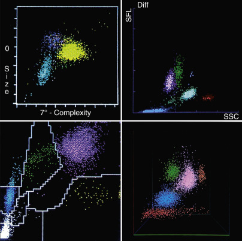

Figure 30-8 

White blood cell (WBC) scattergrams/cytograms. 

_Top left,_ Abbott CELL-DYN 4000 WBC scatterplot, light scatter vs. volume. _Top right,_ Sysmex XT 2000i, WBC scattergram, side-scattered light vs. side fluorescence. _Bottom left,_ Siemens Advia 120, WBC peroxidase cytogram. _Bottom right,_ Coulter LH 750, WBC scattergram, light scatter vs. volume. 

TABLE 30-5 

Principles Used by Various Multichannel Instruments in the Clinical Laboratory 

METHOD   
---  
Instrument  |  Impedance  |  Conductivity  |  Light Scatter  |  Cytochemistry   
Abbott  |  x  |  x  |  x  |   
ABX  |  x  |  |  x  |  x   
Siemensx  |  |  |  x  |  x   
Coulter  |  x  |  x  |  x  |   
Sysmex  |  x  |  x  |  x  |   
  
 

##  Sources of Error 

[ Table 30-4 ](<#t0025>) lists various causes of erroneous results obtained from automated cell counters. 

 

##  Automated Differential Leukocyte Counting 

Because the differential leukocyte count is nonspecific, nonprecise, error-prone, usually labor intensive, expensive to perform, and of limited clinical significance as a screening test, some investigators have suggested that it may be prudent to discontinue use of the differential count as an inpatient screening test for adults (  Connelly et al, 1982  ). Automation of the differential count eliminates some of the detractions. Ideally, requirements for the automated differential leukocyte counting system should include the following: 

  * 1.

The distribution of cells analyzed should be identical to that in the blood. 

  * 2.

All leukocytes usually found in blood diseases should be accurately identified, or detected and “flagged” in some way. 

  * 3.

The speed of the process should enable a large number of cells to be counted to minimize statistical error. 

  * 4.

The instrument should be cost-effective (  Bentley & Lewis, 1977  ). 

Impedance counters and flow cytometer systems and their differential counts are discussed in the Instrument Technology section earlier in the chapter. 

The automated systems have the advantage of rapidly analyzing larger numbers of cells and significantly reducing the statistical error of counting. 

Disadvantages include that the categories of cells are not completely consonant with those with which we are familiar on Romanowsky's-stained films. An “unclassified” category is difficult to interpret. When an abnormal result occurs, a film must be made and examined. Because of concern regarding the instrument flags, each laboratory should devise a policy for blood film examination and visual counting when indicated.  Camden (1993)  provides guiding questions to be asked in selecting a new hematology analyzer for your laboratory. The  ICSH (1984b)  also published a protocol for evaluation of automated blood cell counters. 

 

##  Digital Image Processing 

A uniformly made and stained blood film is placed on a motor-driven microscope stage. A computer controls scanning the slide and stopping it when leukocyte(s) are in the field. The optical details (e.g., nuclear and cytoplasmic size, density, shape, color) are recorded by a camera in digital form; these characteristics are compared with a memory bank of such characteristics for the different cell types. If the pattern fits that of a normal cell type, it is identified as such; otherwise, the cell is classified as other or unknown. The coordinates of the unknown cells are kept by the instrument and re-located at the end of the count, so that the technologist can classify them (  Lapen, 1982  ;  Parthenis & Metaxaki-Kossionides C, 1992  ;  Mukherjee et al, 2004  ). 

 

##  Automated Reticulocyte Counting 

Many of the same principles applied in determination of the WBC differential may be utilized to determine reticulocyte counts, resulting in enhanced precision and increased accuracy in routine practice (  Metzger & Charache, 1987  ). Depending on the specific model of analyzer, this process may be semiautomated or fully automated. All methods rely on the addition of a stain or dye to detect the RNA content of the RBC. Such stains include new methylene blue (NMB), oxazine, auramine O, polymethine, and thiazole orange. Methods of detection include impedance, light scatter, absorption, and fluorescence intensity. Reticulocyte fractions are separated based on RNA content, with the more immature cells containing the highest amount of reticulum. The immature reticulocyte fraction (IRF) quantitatively describes the youngest reticulocytes with the greatest staining intensity. This parameter allows early detection of an increased erythropoietic response, important in determining the response of the bone marrow recovering from chemotherapy or transplant or the response to erythropoietin therapy. It may also be used in conjunction with the absolute reticulocyte count to classify anemias (  Davis & Biegelow, 1994  ;  Davis, 1996  ;  d'Onofrio et al, 1996  ). The reticulocyte Hb content (CHr) provides a sensitive index by which to identify hypochromic RBCs. The reticulocyte hemoglobin content, CHr and RET-He, reported by Siemens (Tarrytown, NY) and Sysmex (Lincolnshire, Ill.) provides a sensitive index by which to identify hypochromic RBCs. It has also been shown to be useful in evaluating iron deficiency in cancer patients (  Peerschke et al, 2014  ). 

,  

##  Blood Film Examination 

Microscopic examination of the blood spread on a glass slide or coverslip yields useful information regarding all formed elements of the blood. The process of making thin blood film causes mechanical trauma to the cells. Also the cells flatten on the glass during drying, and fixation and staining involve exposure to methanol and water. Some artifacts are inevitably introduced, but these can be minimized by good technique. 

 

##  Examination of Wet Preparations 

It is sometimes advantageous to examine fresh blood under the microscope to avoid artifacts of fixation or staining. This is readily accomplished by sealing a small drop of blood diluted with isotonic sodium chloride beneath a coverslip on a glass slide. Buffered glutaraldehyde will preserve the cells for reexamination at a later time. Petroleum jelly or xipamide (Aquaphor) may be used to seal the edges of the coverslip to the slide. Wet preparations are used to detect sickling, and spherocytes may be readily detected in this manner. Wet preparations may be examined to ensure that the erythrocyte abnormalities seen on fixed films are not artifacts of drying or staining. 

 

##  Making and Staining Blood Films 

Examination of the blood film is an important part of the hematologic evaluation. The reliability of the information obtained depends heavily on well-made and well-stained films that are systematically examined. Blood films should be prepared immediately if possible. Three methods of making films are described: the two-slide or wedge method, the cover glass method, and the spinner method. 

 

##  Wedge Method 

Place a drop of blood 2 to 3 mm in diameter about 1 cm from the end of a clean, dust-free slide that is on a flat surface. With the thumb and forefinger of the right hand, hold the end of a second (spreader) slide against the surface of the first slide at an angle of 30 to 45 degrees, and draw it back to contact the drop of blood. Allow the blood to spread and form the angle between the two slides. Push the “spreader slide” at a moderate speed forward until all the blood has been spread into a moderately thin film. The spreader slide should be clean, dry, and slightly narrower than the first slide, so that the edges can be easily examined with the microscope. 

The slides should be rapidly air dried by waving the slides or using an electrical fan. The thickness of the film can be adjusted by changing the angle of the spreader slide or the speed of spreading, or by using a smaller or larger drop of blood. At a given speed, increasing the angle of the spreader slide will increase the thickness of the film. At a given angle, increasing the speed with which the spreader slide is pushed will also increase the thickness of the film. The film should not cover the entire surface of the slide. A good film includes a thick portion and a thin portion and a gradual transition from one to the other. The film should have a smooth, even appearance and be free from ridges, waves, or holes. The edge of the spreader must be absolutely smooth. If it is rough, the film has ragged tails containing many leukocytes. In films of optimal thickness, some overlap of red cells is seen in much of the film, but with even distribution and separation of red cells toward the thin tail. The faster the film is air dried, the better is the spreading of individual cells on the slide. Slow drying (e.g., in humid weather) results in contraction artifacts of the cells. The slide may be labeled with a lead pencil on the frosted end or directly on the thicker end of the blood film. 

 

##  Cover Glass Method 

No. 1 or  cover glasses 22 mm square are recommended. Touch a cover glass to the top of a small drop of blood without touching the skin, and place it, blood side down, crosswise on another cover glass, so that the corners appear as an eight-point star. If the drop is not too large and the cover glasses are perfectly clean, the blood will spread out evenly and quickly in a thin layer between the two surfaces. Just as it stops spreading, pull the cover glasses quickly but firmly apart on a plane parallel to their surfaces. The blood usually is much more evenly spread on one of the cover glasses than it is on the other. Cover glasses should be placed film side up on clean paper and allowed to dry in the air, or they may be inserted back to back in slits made in a cardboard box. Films from venous blood may be prepared similarly by placing a drop of blood on a coverslip and proceeding as described. 

 

##  Spinner Method 

Blood films that combine the advantages of easy handling of the wedge slide and uniform distribution of cells of the cover glass preparation may be made with special types of centrifuges known as **spinners** (  Rogers, 1973  ). The spinner slide produces a uniform blood film, in which all cells are separated (a monolayer) and randomly distributed. White cells can be easily identified at any spot in the film. On a wedge smear, disproportions (1) of monocytes occur at the tip of the feather edge, (2) of neutrophils are seen just in from the feather edge, and (3) of both occur at the lateral edges of the film (  Rogers, 1973  ). This has little practical and perhaps some historic significance. 

Most manufacturers of automated hematology analyzers now offer slide maker-stainers. Details are available from the vendors. 

 

##  Blood Stains 

The aniline dyes used in blood work are of two general classes: basic dyes, such as methylene blue; and acid dyes, such as eosin. Nuclei and certain other structures in the blood are stained by the basic dyes and, hence, are called **basophilic.** Structures that take up only acid dyes are called **acidophilic,** or **eosinophilic.** Other structures stained by a combination of the two are called **neutrophilic.**

**Polychrome methylene blue** and **eosin stains** are the outgrowth of the original time-consuming Romanowsky's method and are widely used. They stain differentially most normal and abnormal structures in the blood. The basic components of thiazine include methylene blue (tetramethylthionine) and, in varying proportions, its analogs produced by oxidative demethylation: azure B (trimethylthionine); azure A (asymmetrical dimethylthionine); symmetrical dimethylthionine; and azure C (monomethylthionine) (  Lillie, 1977  ). The acidic component eosin is derived from a xanthene skeleton. Most Romanowsky's stains are dissolved in methyl alcohol and combine fixation with staining. Among the best known methods are Giemsa and Wright's stains. 

 

##  Wright's Stain 

This is a methyl alcoholic solution of eosin and a complex mixture of thiazines, including methylene blue (usually 50% to 75%), azure B (10% to 25%), and other derivatives (  Lubrano et al, 1977  ). Wright's stain certified by the Biological Stain Commission is commercially available as a solution ready for use or as a powder. The buffer solution (pH 6.4) contains primary (monobasic) potassium phosphate (KH  2  PO  4  ), anhydrous 6.63 g; secondary (dibasic) sodium phosphate (Na  2  HPO  4  ), anhydrous 2.56 g; and distilled water to make 1 L. A more alkaline buffer (pH 6.7) may be prepared by using 5.13 g of the potassium salt and 4.12 g of the sodium salt. 

 

##  Procedure 

  * 1.

To prevent the plasma background of the film from staining blue, blood films should be stained within a few hours of preparation or fixed if they must be kept without staining. 

  * 2.

Fixation and staining may be accomplished by immersing the slides in reagent-filled jars or by covering horizontally supported slides or coverslips with the reagents. With the latter method, covering the film with copious stain avoids evaporation, which leads to precipitation. 

  * 3.

Fixation is provided for 1 to 2 minutes with absolute methanol. 

  * 4.

The slide is next exposed to undiluted stain solution for 2 minutes. Then, without removing the stain from the horizontal slide, an equal amount of buffer is carefully added and is mixed by blowing gently. 

  * 5.

The stain is flushed from the horizontal slide with water. Washing for longer than 30 seconds reduces the blue staining. The back of the slide is cleaned with gauze. 

  * 6

The slide is allowed to air dry in a tilted position. 

  * 7.

Cover glasses are mounted film side down on a slide with Canada balsam or other mounting medium. 

Films stained well with Wright's stain have a pink color when viewed with the naked eye. Under low power, the cells should be evenly distributed. The red cells are pink, not lemon yellow or red. There should be a minimum of precipitate. The color of the film should be uniform. The blood cells should be free from artifacts, such as vacuoles. The nuclei of leukocytes are purple, the chromatin and parachromatin clearly differentiated, and the cytoplasmic neutrophilic granules tan in color. The eosinophilic granules are red-orange, and each is distinctly discernible. The basophil has dark purple granules. Platelets have dark lilac granules. Bacteria (if present) are blue. The cytoplasm of lymphocytes is generally light blue; that of monocytes has a faint blue-gray tinge. Malarial parasites have sky-blue cytoplasm and red-purple chromatin. The colors are prone to fade if the preparation is mounted in balsam of poor quality or is exposed to the light. 

 

##  Staining Problems 

 

##  Excessively blue stain. 

Thick films, prolonged staining time, inadequate washing, or too high an alkalinity of stain or diluent tends to cause excessive basophilia. In such films, the erythrocytes appear blue or green, the nuclear chromatin is deep blue to black, and the granules of the neutrophils are deeply overstained and appear large and prominent. The granules of the eosinophils are blue or gray. Staining for a shorter time or using less stain and more diluent may correct the problem. If these steps are ineffective, the buffer may be too alkaline, and a new one with a lower pH should be prepared. 

 

##  Excessively pink stain. 

Insufficient staining, prolonged washing time, mounting the coverslips before they are dry, or too high an acidity of the stain or buffer may cause excessive acidophilia. In such films, the erythrocytes are bright red or orange, the nuclear chromatin is pale blue, and the granules of the eosinophils are sparkling brilliant red. One of the causes of the increased acidity is exposure of the stain or buffer to acid fumes. The problem may be a low pH of the buffer, or it may be the methyl alcohol, which is prone to develop formic acid as a result of oxidation on standing. 

 

##  Other staining problems. 

Inadequately stained red cells, nuclei, or eosinophilic granules may be due to understaining or excessive washing. Prolonging the staining or reducing the washing may solve the problem. 

_Precipitate on the film_ may be due to unclean slides; drying during the period of staining; inadequate washing of the slide at the end of the staining period, especially failure to hold the slide horizontally during the initial washing; inadequate filtration of the stain; or permitting dust to settle on the slide or smear. 

 

##  Other Stains 

Besides Wright's stain, Romanowsky-type stains include a number of others: Giemsa, Leishman's, Jenner's, May-Grünwald, MacNeal's, and various combinations. Some have been particularly recommended for certain purposes, such as Giemsa stain for excellence in staining malarial parasites and protozoa. 

 

##  Reference Method 

Studies have demonstrated the ability of the combination of just two dyes—azure B and eosin Y—to give the full range of colors provided by ideal Romanowsky's staining of blood and marrow cells. This is the reference method for Romanowsky's staining (  ICSH, 1984a  ). 

 

##  Automated Slide Stainer 

Automated slide stainers are being used in several laboratories for routine hematology and microbiology slides. The stainer is a compact instrument with microprocessor control for flexibility in staining applications. Several slides can be stained uniformly in minutes. Typically, any automated stainer has several user-definable programs to choose from. Staining problems are encountered even with the use of automatic stainers and must be dealt with on an individual basis. 

 

##  Review of Peripheral Smear 

The practicing pathologist may be called upon to review peripheral blood smears, to confirm or compare his or her assessment with that of the technologist, and to review the findings with clinical colleagues at the multihead microscope. Although this is a daily task for the hematopathologist, the general pathologist examines the peripheral smear less frequently and the bone marrow preparation even less so. Following is a summary of the main features that he or she should evaluate. 

 

##  Erythrocytes 

In the blood from a healthy person, the erythrocytes, when not crowded together, appear as circular, homogeneous disks of nearly uniform size, ranging from 6 to 8 µm in diameter ( [ Fig. 30-9 ](<#f0050>) ). However, even in normal blood, individual cells may be as small as 5.5 µm and as large as 9.5 µm. The center of each is somewhat paler than the periphery. In disease, erythrocytes vary in their Hb content, size, shape, staining properties, and structure. 

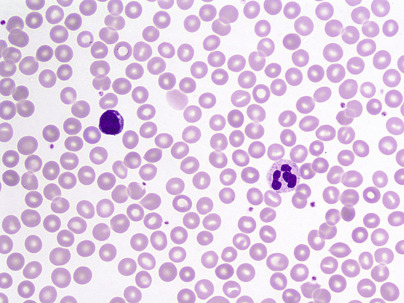

Figure 30-9 

Normal peripheral smear. 

Erythrocytes appear as circular, homogeneous disks of nearly uniform size, ranging from 6 to 8 µm in diameter, with central pallor not exceeding more than one third of the cell. On average, the red cells are approximately the same size as the nucleus of a small lymphocyte (500×). 

 

##  Color 

 

##  Hemoglobin Content 

The depth of staining furnishes a rough guide to the amount of Hb in red cells, and the terms **normochromic, hypochromic,** and **hyperchromic** are used to describe this feature of red cells. Normochromic refers to normal intensity of staining (see [ Fig. 30-9 ](<#f0050>) ). When the amount of Hb is diminished, the central pale area becomes larger and paler. This is known as **hypochromia.** The MCH and MCHC are usually decreased ( [ Fig. 30-10 ](<#f0055>) ). In megaloblastic anemia, because the red cells are larger and hence thicker, many stain deeply and have less central pallor ( [ Fig. 30-11 ](<#f0060>) ). These cells are hyperchromic because they have an increased MCH, but the MCHC is normal. In hereditary spherocytosis ( [ Fig. 30-12 ](<#f0065>) ), the cells are also hyperchromic; although the MCH is normal, the MCHC is usually increased because of a reduced surface/volume ratio. The presence of hypochromic cells and normochromic cells in the same film is called **anisochromia** or, sometimes, a **dimorphic anemia** ( [ Fig. 30-13 ](<#f0070>) ). This is characteristic of sideroblastic anemias but also is found some weeks after iron therapy for iron deficiency anemia, or in a hypochromic anemia after transfusion with normal cells. 

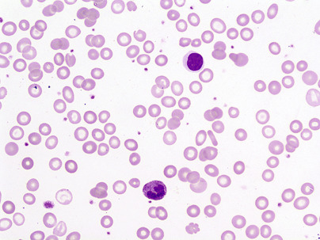

Figure 30-10 

Microcytic hypochromic red cells in iron deficiency anemia. 

Red cells are hypochromic—the amount of hemoglobin per cell is decreased, and the central pale area becomes larger (more than one third) (500×). 

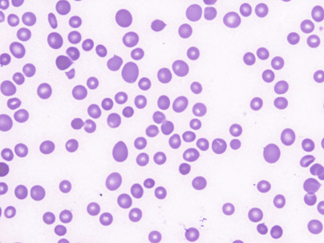

Figure 30-11 

Macrocytes. 

Red cells are larger and thicker, stain deeply, and lack central pallor (500×). 

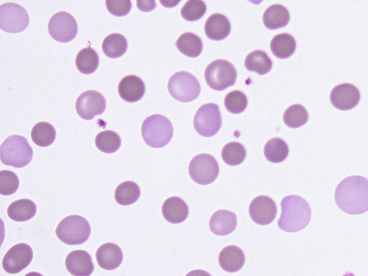

Figure 30-12 

Hereditary spherocytosis. 

Spherocytes are nearly perfectly round in shape, smaller than normal red cells, and lack central pallor (hyperchromic) (1000×). 

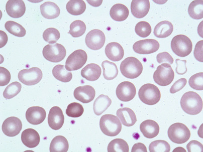

Figure 30-13 

Dimorphic anemia. 

Anisocytosis and anisochromia characterized by the presence of microcytic hypochromic cells, normocytic cells, and few macrocytes (1000×). 

 

##  Polychromatophilia 

A blue-gray tint to the red cells (polychromatophilia or polychromasia) is a combination of the affinity of Hb for acid stains and the affinity of RNA for basic stains. The presence of residual RNA in the red cell indicates that it is a young red cell that has been in the blood for 1 to 2 days. These cells are larger than mature red cells and may lack central pallor ( [ Fig. 30-14 ](<#f0075>) ). Young cells with residual RNA are polychromatophilic red cells on air-dried films stained with Wright's stain but are reticulocytes when stained supravitally with brilliant cresyl blue. Therefore, increased polychromasia implies reticulocytosis; it is most marked in hemolysis and in acute blood loss. 

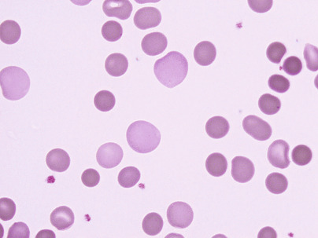

Figure 30-14 

Polychromatophilia. 

Polychromatophilic red cells are young red cells, larger than mature red cells; they lack central pallor and appear slightly basophilic on Wright's stain. They are called _reticulocytes_ when stained supravitally with brilliant cresyl blue (1000×). 

 

##  Size 

The red cells may be abnormally small, or microcytes (see [ Fig. 30-10 ](<#f0055>) ), or abnormally large, or macrocytes (see [ Fig. 30-11 ](<#f0060>) ), or they may show abnormal variation in size (anisocytosis) (see [ Fig. 30-13 ](<#f0070>) ). Anisocytosis is a feature of most anemias; when it is marked in degree, both macrocytes and microcytes are usually present. In analyzing causes of anemia, the terms **microcytic** and **macrocytic** have greatest meaning when considered as cell volume rather than cell diameter. The mean cell volume is measured directly on a multichannel analyzer. We perceive the diameter directly from the blood film and infer volume (and the Hb content) from it. Thus, the red cells in [ Figure 30-10 ](<#f0055>) are microcytic; because they are hypochromic, they are thinner than normal and the diameter is not decreased proportionately to the volume. Also, the mean cell volume in the blood of the patient with spherocytosis (see [ Fig. 30-12 ](<#f0065>) ) is in the normal range; although many of the cells have a small diameter, their volume is not decreased because they are thicker than normal. 

 

##  Shape 

Variation in shape is called **poikilocytosis.** Any abnormally shaped cell is a poikilocyte. Oval, pear-shaped, teardrop-shaped, saddle-shaped, helmet-shaped, and irregularly shaped cells may be seen in a single case of anemia such as megaloblastic anemia ( [ Fig. 30-15 ](<#f0080>) ). 

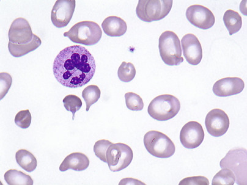

Figure 30-15 

Poikilocytosis. 

Variation in shape of red cells. Abnormally shaped cells include oval, pear-shaped, and other irregularly shaped cells (1000×). 

Elliptocytes are most abundant in hereditary elliptocytosis ( [ Fig. 30-16 ](<#f0085>) ), in which most cells are elliptical; this is a dominant condition that is only occasionally associated with hemolytic anemia. Elliptocytes are seen in normal persons' blood but account for less than 10% of the cells. They are more common, however, in iron deficiency anemia (see [ Fig. 30-10 ](<#f0055>) ), myelofibrosis with myeloid metaplasia, megaloblastic anemia, and sickle cell anemia. 

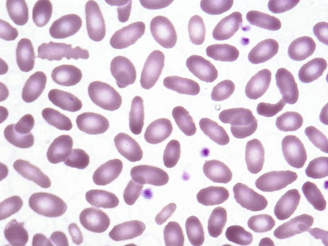

Figure 30-16 

Hereditary elliptocytosis. 

Most cells are elliptocytes. They are seen in a normal person's blood, but usually account for less than 10% of cells. They are also common in iron deficiency anemia, myelofibrosis, megaloblastic anemia, and sickle cell anemia (1000×). 

Spherocytes are nearly spherical erythrocytes, in contradistinction to normal biconcave disks. Their diameter is smaller than normal. They lack the central pale area or have a smaller, often eccentric, pale area (because the cell is thicker and can come to rest somewhat tilted instead of perfectly flattened on the slide). They are found in hereditary spherocytosis (HS) (see [ Fig. 30-12 ](<#f0065>) ), in some cases of autoimmune hemolytic anemia (AHA), and in some conditions in which a direct physical or chemical injury has occurred to the cells, such as from heat ( [ Fig. 30-17 ](<#f0090>) ). In each of these three instances, tiny bits of membrane (in excess of Hb) are removed from the adult red cells, leaving the cells with a decreased surface/volume ratio. In HS and AHA, this occurs in the reticuloendothelial system; in other instances (e.g., in the patient with body burns), this may occur intravascularly. 

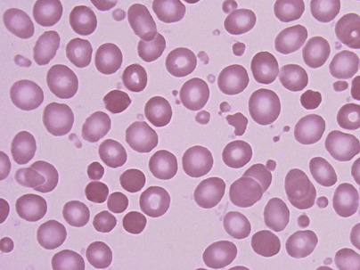

Figure 30-17 

Thermal injury. 

Tiny bits of membrane (in excess of hemoglobin) are removed from the red cell surface, leading to formation of spherocytes (1000×). 

Target cells are erythrocytes that are thinner than normal (leptocytes) and when stained show a peripheral rim of Hb with a dark, central, Hb-containing area. They are found in obstructive jaundice ( [ Fig. 30-18 ](<#f0095>) ), in which there appears to be an augmentation of the cell surface membrane; in the postsplenectomy state, in which there is a lack of normal reduction of surface membrane as the cell ages; in any hypochromic anemia, especially thalassemia; and in Hb C disease. 

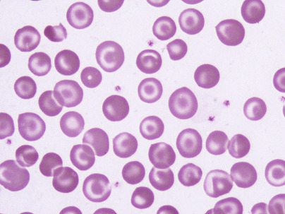

Figure 30-18 

Target cells. 

Red cells with a thin membrane, peripheral rim of hemoglobin (Hb), and dark, central, Hb-containing area. They are frequently seen in Hb C disease, in hypochromic anemia, and in liver disease (1000×). 

Schistocytes (cell fragments) indicate the presence of hemolysis, whether in megaloblastic anemia, severe burns (see [ Fig. 30-17 ](<#f0090>) ), or microangiopathic hemolytic anemia ( [ Fig. 30-19 ](<#f0100>) ). The latter process may be associated with small blood vessel disease or with fibrin in small blood vessels and results in intravascular fragmentation; particularly characteristic are helmet cells and triangular cells. 

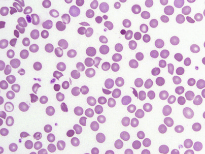

Figure 30-19 

Schistocytes. 

Presence of cell fragments is indicative of hemolysis. Schistocytes can be seen in several conditions, including microangiopathic hemolytic anemia, megaloblastic anemia, burns, and disseminated intravascular coagulation (500×). 

Acanthocytes are irregularly spiculated red cells in which the ends of the spicules are bulbous and rounded ( [ Fig. 30-20 ](<#f0105>) ); they are seen in abetalipoproteinemia, hereditary or acquired, and in certain cases of liver disease. Burr cells or echinocytes ( [ Fig. 30-21 ](<#f0110>) ) are regularly contracted cells that may commonly occur as an artifact during preparation of films, or they may be due to hyperosmolarity, or to the discocyte-echinocyte transformation. In vivo, the latter may be associated with decreased red cell adenosine triphosphate (ATP) resulting from any of several causes. Artifacts resembling crenated cells consisting of tiny pits or bubbles indenting the red cells ( [ Fig. 30-22 ](<#f0115>) ) may be caused by a small amount of water contaminating the Wright's stain (or absolute methanol, if this is used first as a fixative). 

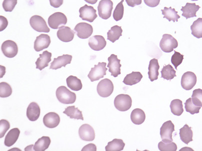

Figure 30-20 

Acanthocytes. 

Irregularly spiculated cells with bulbous and rounded ends, frequently seen in abetalipoproteinemia or certain cases of liver disease (1000×). 

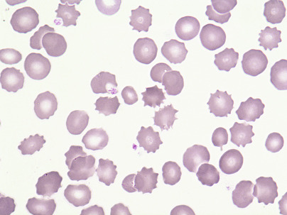

Figure 30-21 

Echinocytes. 

Regularly contracted cells with sharp ends; may occur as an artifact during film preparation or as the result of hyperosmolarity or decreased adenosine triphosphate due to several causes (1000×). 

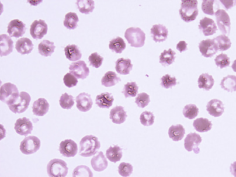

Figure 30-22 

Artifact. 

Tiny pits or bubbles in the red cells. They can be caused by a small amount of water contaminating the Wright's stain or by insufficient slide drying (500×). 

 

##  Structure 

 

##  Basophilic Stippling (Punctate Basophilia) 

This is characterized by the presence, within the erythrocyte, of irregular basophilic granules, which vary from fine to coarse ( [ Fig. 30-23 ](<#f0120>) ). They stain deep blue with Wright's stain. The erythrocyte containing them may stain normally in other respects, or it may exhibit polychromatophilia. Fine stippling is commonly seen when there is increased polychromatophilia and, therefore, with increased production of red cells. Coarse stippling may be seen in lead poisoning or other diseases with impaired Hb synthesis, in megaloblastic anemia, and in other forms of severe anemia; it is attributed to an abnormal instability of the RNA in the young cell. Red cells with inorganic iron-containing granules (as demonstrated by stains for iron) are called **siderocytes.** Sometimes these granules stain with Wright's stain; if so, they are called **Pappenheimer bodies.** 

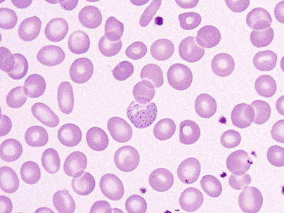

Figure 30-23 

Basophilic stippling. 

Presence of irregular basophilic granules, either fine or coarse; commonly seen in increased red cell production. Coarse stippling is usually seen in lead poisoning, or other anemias due to impaired hemoglobin synthesis, such as megaloblastic anemia (1000×). 

In contrast to basophilic stippling, Pappenheimer bodies are few in number in a given red cell and are rarely seen in the peripheral blood except after splenectomy. 

 

##  Howell-Jolly Bodies 

These particles are smooth, round remnants of nuclear chromatin. Single Howell-Jolly bodies may be seen in megaloblastic anemia ( [ Fig. 30-24 ](<#f0125>) ), in hemolytic anemia, and after splenectomy. Multiple Howell-Jolly bodies in a single cell usually indicate megaloblastic anemia or some other form of abnormal erythropoiesis. 

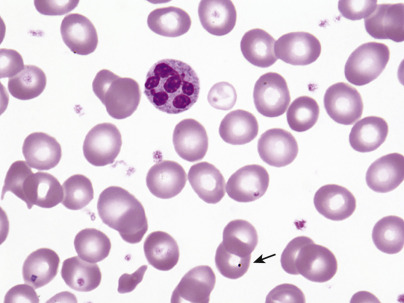

Figure 30-24 

Howell-Jolly bodies. 

Smooth round remnants of nuclear chromatin. Seen in postsplenectomy states and hemolytic and megaloblastic anemias (a hypersegmented neutrophil is also seen) (1000×). 

 

##  Cabot Rings 

These are ring-shaped, figure-of-eight, or loop-shaped structures. Occasionally, they are formed by double or several concentric lines. They are observed rarely in erythrocytes in pernicious anemia, lead poisoning, and certain other disorders of erythropoiesis. They stain red or reddish purple with Wright's stain and have no internal structure. The rings are probably microtubules remaining from a mitotic spindle (  Bessis, 1977  ). They are interpreted as evidence of abnormal erythropoiesis. 

 

##  Malarial Stippling 

Fine granules may appear in erythrocytes that harbor _Plasmodium vivax_ . With Wright's stain, the minute granules, “Schüffner's granules,” stain purplish red. They are sometimes so numerous that they almost hide the parasites. These red cells are, as a rule, larger than normal. 

 

##  Rouleaux Formation 

This is the alignment of red cells one upon another so that they resemble stacks of coins. On air-dried films, rouleaux appear as in [ Figure 30-25 ](<#f0130>) . Elevated plasma fibrinogen or globulins cause rouleaux to form and also promote an increase in the erythrocyte sedimentation rate. Rouleaux formation is especially marked in paraproteinemia (monoclonal gammopathy). **Agglutination,** or clumping, of red cells is more surely separated from rouleaux in wet preparations, and on air-dried films tends to show more irregular and round clumps than linear rouleaux. Cold agglutinins are responsible for this appearance ( [ Fig. 30-26 ](<#f0135>) ). 

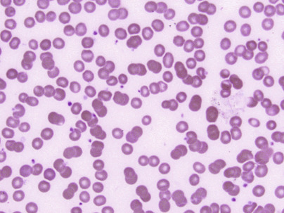

Figure 30-25 

Rouleaux formation. 

Alignment of red cells one upon another, so that they resemble a stack of coins. It is usually caused by elevated plasma fibrinogen or globulins (500×). 

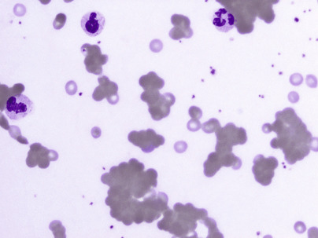

Figure 30-26 

Agglutination. 

Clumping of red cells, which is more irregular than linear rouleaux formation. It is caused by cold agglutinins (500×). 

 

##  Nucleated Red Cells 

In contrast to erythrocytes of lower vertebrates and to most mammalian cells, the mammalian erythrocyte lacks a nucleus. Nucleated red cells (normoblasts; [ Fig. 30-27 ](<#f0140>) ; see [ Fig. 30-48 ](<#f0245>) ) are precursors of nonnucleated mature red cells in the blood. In the human, normoblasts are normally present only in the bone marrow. Stages in their production (see [ Chapter 31 ](<##!/content/3-s2.0-B9780323295680000310?scrollTo=%23c00031>) ) from the earliest to the latest include pronormoblast, basophilic normoblast, polychromatophilic normoblast, and orthochromatic normoblast. In general, nucleated red cells that might appear in the blood in disease are polychromatic normoblasts. In some, however, the cytoplasm is so basophilic that it is difficult to recognize the cell as erythroid except by the character of the nucleus, intensely staining chromatin, and sharp separation of chromatin from parachromatin. Such erythroid cells are often mistaken for lymphocytes—an error that usually can be prevented by careful observation of the nucleus. The megaloblast ( [ Fig. 30-28 ](<#f0145>) ) is a distinct, nucleated erythroid cell—not merely a larger normoblast. It is characterized by large size and an abnormal “open” nuclear chromatin pattern. Cells of this series are not found in normal marrow but are characteristically present in the marrow and sometimes in the blood of patients with pernicious anemia or other megaloblastic anemias. 

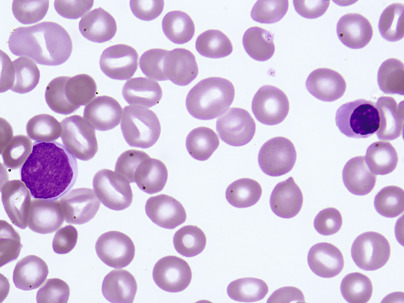

Figure 30-27 

Nucleated red cell/normoblasts. 

Precursors of mature red cells, normoblasts are usually present only in the bone marrow. Their presence in blood is usually associated with increased red cell production or infiltrative bone marrow disorders (1000×). 

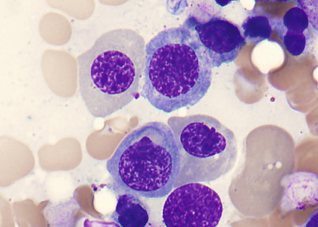

Figure 30-28 

Megaloblast. 

Large nucleated red cell with abnormal “open” nuclear chromatin. They are frequently seen in the bone marrow in myelodysplastic syndrome or other megaloblastic anemia. Occasionally, these can also be seen in the peripheral blood (1000×). 

 

##  Significance of Nucleated Red Cells 

Normoblasts are present normally only in the blood of the fetus and of very young infants. In the healthy adult, they are confined to the bone marrow and appear in the circulating blood only in disease, in which their presence usually denotes an extreme demand made on the marrow, extramedullary hematopoiesis, or marrow replacement. Large numbers of circulating nucleated red cells are found particularly in hemolytic disease of the newborn (erythroblastosis fetalis) and thalassemia major. 

 

##  Leukoerythroblastic Reaction 

The presence of normoblasts and immature cells of the neutrophilic series in the blood is known as a **leukoerythroblastic reaction** ( [ Fig. 30-29 ](<#f0150>) ). This often indicates space-occupying disturbances of the marrow, such as myelofibrosis with myeloid metaplasia, metastatic tumor, leukemias, multiple myeloma, Gaucher's disease, and others. Nonetheless, in the study of  Weick and colleagues (1974)  , more than one third of patients with a leukoerythroblastotic reaction did not have malignant or potentially malignant disease ( [ Table 30-6 ](<#t0035>) ). 

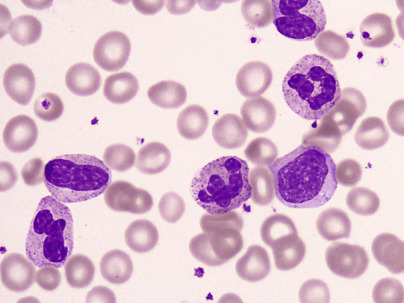

Figure 30-29 

Leukemoid reaction. 

Left-shifted neutrophilic series with neutrophils, bands, and myelocytes. The neutrophils also show coarse toxic granulation (1000×). 

TABLE 30-6 

Conditions Associated with Leukoerythroblastosis 

0.63  |  0.26  |  Solid tumors and lymphomas   
---|---|---  
0.24  |  Myeloproliferative disorders, including chronic myeloid leukemia (CML)   
0.13  |  Acute leukemias   
0.37  |  0.03  |  Benign hematologic conditions   
0.08  |  Hemolysis   
0.26  |  Miscellaneous, including blood loss   
  
Proportions are based on a series of 215 cases discovered in a study of 50,277 blood film examinations in a 6-month period—a proportion of 0.004. 

Data from  Weick JK, Hagedorn AB, Linman JW  : Leukoerythroblastosis: diagnostic and prognostic significance, _Mayo Clin Proc_ 49:110, 1974. 

 

##  Leukocytes on Peripheral Blood Smear Examination 

Before evaluating leukocytes on the Romanowsky's-stained blood film, one should first determine that the film is well made, the distribution of the cells is uniform, and the staining of the cells is satisfactory. One first scans the counting area of the slide and, in wedge films, the lateral and feather edges, where monocytes, neutrophils, and large abnormal cells (if present) tend to be disproportionately represented. With coverslip preparations, this uneven distribution is less likely to occur. Suspicious cells are detected at 10× magnification and are confirmed at high power. Because nucleated red cells, macrophages, immature granulocytes, immature lymphoid cells, megakaryocytes, and abnormal cells are not normally found in blood, they should be recorded if present. 

While scanning under low power, it is advisable to estimate the leukocyte count from the film. Even though it is a crude approximation, it sometimes enables one to detect errors in total count. One then proceeds to determine the percentage distribution of the different types of leukocytes, which is known as the differential leukocyte count. In patients with leukopenia, it may be necessary to concentrate the leukocytes by centrifuging blood anticoagulated with EDTA and preparing films from the top layer of the packed cells. This buffy coat contains primarily leukocytes and platelets. In the crenellation technique of counting, the field of view is moved from side to side across the width of the slide in the **counting area,** just behind the feather edge, where the red cells are separated from one another and are free of artifacts. As each leukocyte is encountered, it is classified, until 100, 200, 500, or 1000 leukocytes have been counted. The greater the number of cells counted, the greater is the precision, but for practical reasons, 100-cell counts are usually made. A record of the count may be kept by using a mechanical or electronic tabulator. Leukocytes that cannot be classified should be placed together in an unidentified group. In some conditions, notably leukemia, many of these unidentified leukocytes may be present. During the differential leukocyte counting procedure, the morphology of erythrocytes and platelets is examined, and the number of platelets is estimated. The absolute concentration of each variety of leukocyte is its percentage times the total leukocyte count. An increase in absolute concentration is an absolute increase; an increase in percentage only is a relative increase. Reference intervals are more useful if given as absolute concentrations rather than percentages (see [ Table 30-3 ](<#t0020>) ). 

 

##  Leukocytes Normally Present in Blood 

 

##  Neutrophil (Polymorphonuclear Neutrophilic Leukocyte; Segmented Neutrophilic Granulocyte) 

Neutrophils average 12 µm in diameter; they are smaller than monocytes and eosinophils and slightly larger than basophils. The nucleus stains deeply; it is irregular and often assumes shapes comparable to such letters as E, Z, and S. What appear to be separate nuclei normally are segments of nuclear material connected by delicate filaments. 

A filament has length but no breadth as one focuses up and down. A **segmented neutrophil** ( [ Fig. 30-30 ](<#f0155>) ; see [ Fig. 30-49 ](<#f0250>) ) has at least two of its lobes separated by a filament. A **band neutrophil** (see [ Figs. 30-30 ](<#f0155>) and [ 30-49 ](<#f0250>) ) has either a strand of nuclear material thicker than a filament connecting the lobes, or a U-shaped nucleus of uniform thickness. The nucleus in both types of neutrophils has coarse blocks of chromatin and rather sharply defined parachromatin spaces. If, because of overlapping of nuclear material, it is not possible to be certain whether a filament is present, the cell should be placed in the segmented category (  Mathy & Koepke, 1974  ). The number of lobes in normal neutrophils ranges from two to five, with a median of three. The cytoplasm itself is colorless and has tiny granules (0.2 to 0.3 µm) that stain tan to pink with Wright's stain. About two thirds of these are specific granules, and one third azurophil granules. With light microscopy, the two types of granules often cannot be distinguished in the mature cell ( [ Fig. 30-31 ](<#f0160>) ). Segmented neutrophils average 56% of leukocytes; reference intervals are 1.8 to 7.0 × 10  9  /L in Caucasian adults but have a lower limit of about 1.1 × 10  9  /L in black adults. Band neutrophils average 3% of leukocytes; the upper reference value is about 0.7 × 10  9  /L in Caucasian people and slightly lower in black people (using the preceding definition and counting 100 cells in the differential) (see [ Table 30-3 ](<#t0020>) ). 

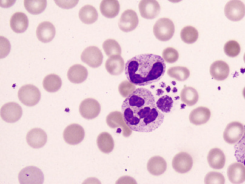

Figure 30-30 

Neutrophil and band form. 

Neutrophil and band form depicting separation of nuclear lobes in the mature neutrophil vs. horseshoe-shaped nucleus in the band form. A giant platelet is also seen (1000×). 

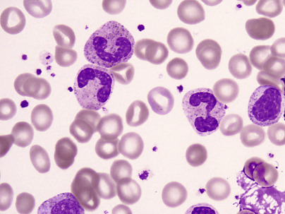

Figure 30-31 

Neutrophilic granules. 

Cytoplasmic granules in myelocytes and mature neutrophils (1000×). 

Normally, about 10% to 30% of segmented neutrophils have two lobes, 40% to 50% have three lobes, and 10% to 20% four; no more than 5% have five lobes. A “shift to the left” occurs when increased bands and less mature neutrophils are present in the blood, along with a lower average number of lobes in segmented cells (see [ Figs. 30-29 ](<#f0150>) and [ 30-31 ](<#f0160>) ). 

Neutrophilia or neutrophilic leukocytosis is an increase in the absolute count, and neutropenia is a decrease. 

 

##  Eosinophil (Eosinophilic Granulocyte) 

Eosinophils average 13 µm in diameter. The structure of these cells is similar to that of polymorphonuclear neutrophils, with the striking difference that, instead of neutrophilic granules, their cytoplasm contains larger round or oval granules that have a strong affinity for acid stains ( [ Fig. 30-32 ](<#f0165>) ). They are easily recognized by the size and color of the granules, which stain bright red with eosin. The cytoplasm is colorless. The nucleus stains somewhat less deeply than that of the neutrophils and usually has two connected segments (lobes), rarely more than three. Eosinophils average 3% of the leukocytes in adults, and the upper reference value is 0.6 × 10  9  /L when calculated from the differential count. If allergic individuals are excluded, the upper limit is probably 0.35 × 10  9  /L or 350/µL. The lower reference value is probably 40/µL; a decrease in eosinophils (eosinopenia) can be detected only by counting large numbers of cells as in direct hemocytometer counts (  Dacie & Lewis, 1991  ), or with a flow cytometer–automated differential counter. 

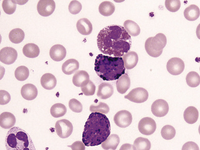

Figure 30-32 

Basophil _(below)_ and eosinophil _(above)._

Eosinophilic granules are coarser and bigger and often do not overlie the nucleus, unlike the basophil, which has large, deeply basophilic granules, often obscuring nuclear details (1000×). 

 

##  Basophil (Basophilic Granulocyte) 

In general, basophils resemble neutrophils, except that the nucleus is less segmented (usually merely indented or partially lobulated), and granules are larger and have a strong affinity for basic stains ( [ Figs. 30-32 ](<#f0165>) and [ 30-33 ](<#f0170>) ). In some basophils, most of the granules may be missing because they are soluble in water, leaving vacuoles or openings in the cytoplasm. The granules then are a mauve color. In a well-stained film, the granules are deep purple and the nucleus is somewhat paler and is often nearly hidden by the granules, so that its form is difficult to distinguish. Unevenly stained granules of basophils may be ring shaped and resemble _Histoplasma capsulatum_ or protozoa. 

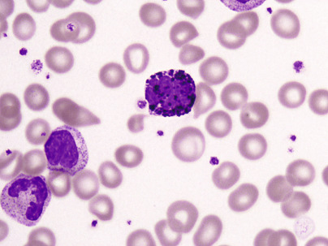

Figure 30-33 

Basophil _(center)_ and neutrophilic myelocyte and band _(left)._

The granules in the basophil are much bigger and coarser compared with the fine azurophilic granules of the neutrophil and precursors (1000×). 

Basophils are the least numerous of the leukocytes in normal blood and average 0.5%. The 95% reference values for adults are 0 to 0.2 to 10  9  /L when derived from the differential count. 

 

##  Monocyte 

The monocyte is the largest cell of normal blood ( [ Fig. 30-34 ](<#f0175>) ). It generally has about two to three times the diameter of an erythrocyte (14 to 20 µm), although smaller monocytes sometimes are encountered. It contains a single nucleus, which is partially lobulated, deeply indented, or horseshoe shaped. Occasionally, the nucleus of a monocyte may appear round or oval. The cytoplasm is abundant. The nuclear chromatin often appears to be in fine, parallel strands separated by sharply defined parachromatin. The nucleus stains less densely than that of other leukocytes. The cytoplasm is blue-gray and has a ground-glass appearance and often contains fine red to purple granules that are less distinct and smaller than the granules of neutrophils. Occasionally, blue granules may be seen. When the monocyte transforms into a macrophage, it becomes larger (20 to 40 µm); the nucleus may become oval and the chromatin more reticular or dispersed, so that nucleoli may be visible. A perinuclear clear zone (Golgi) may be evident. The fine red or azurophil granules are variable in number or may have disappeared. The more abundant cytoplasm tends to be irregular at the cell margins and to contain vacuoles. These are phagocytic vacuoles, which may contain ingested red cells, debris, pigment, or bacteria. Evidence of phagocytosis in monocytes or the presence of macrophages in directly made blood films is pathologic and often indicates the presence of active infection. 

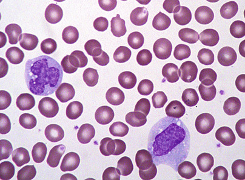

Figure 30-34 

Monocyte. 

Among the normal blood cells, the monocyte is the largest and has the most delicate nuclear chromatin pattern. A moderate amount of light gray cytoplasm with fine granularity and vacuolation is noted (500×). 

Monocytes average 4% of leukocytes, and the reference interval for adults is approximately 0 to 0.8 × 10  9  /L, depending on the method used to perform the differential count (see [ Table 30-3 ](<#t0020>) ). 

 

##  Lymphocyte 

Lymphocytes are mononuclear cells without specific cytoplasmic granules. Small lymphocytes are about the size of an erythrocyte or slightly larger (6 to 10 µm) (see [ Fig. 30-9 ](<#f0050>) ). The typical lymphocyte has a single, sharply defined nucleus containing heavy blocks of chromatin. The chromatin stains dark blue with Wright's stain, whereas the parachromatin stands out as lighter-stained streaks; at the periphery of the nucleus, the chromatin is condensed. Characteristically, a gradual transition or smudging is seen between the chromatin and the parachromatin. The nucleus is generally round but is sometimes indented at one side. The cytoplasm stains pale blue except for a clear perinuclear zone. Larger lymphocytes ( [ Figs. 30-35 ](<#f0180>) and [ 30-36 ](<#f0185>) ), 12 to 15 µm in diameter, with less densely staining nuclei and more abundant cytoplasm, are frequently found, especially in the blood of children, and may be difficult to distinguish from monocytes. The misshapen, indented cytoplasmic margins of lymphocytes are due to pressure of neighboring cells. In the cytoplasm of about one third of large lymphocytes, a few round, red-purple granules are present. They are larger than the granules of neutrophilic leukocytes. There is a continuous spectrum of sizes between small and large lymphocytes and, indeed, there can be a transition from small to large to blast forms, as well as the reverse. It is not meaningful to classify small lymphocytes and large lymphocytes separately. The presence of significant proportions of atypical lymphocytes must be noted; these indicate transformation of lymphoid cells as a response to antigenic stimulation. Plasma cells have abundant blue cytoplasm, often with light streaks or vacuoles, an eccentric round nucleus, and a well-defined clear (Golgi) zone adjacent to the nucleus ( [ Fig. 30-37 ](<#f0190>) ). The nucleus of the plasma cell has heavily clumped chromatin, which is sharply defined from the parachromatin and is often arranged in a radial or wheel-like pattern. Plasma cells are not present normally in blood. 

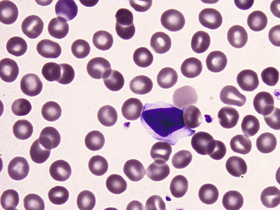

Figure 30-35 

Lymphocyte. 

This is a benign reactive lymphocyte with moderately abundant pale gray cytoplasm hugging the surrounding red cells and distinct separation of chromatin/parachromatin (1000×). 

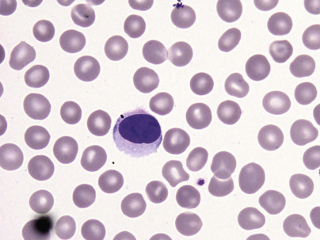

Figure 30-36 

Reactive large lymphocyte with moderately abundant gray-blue cytoplasm (1000×). 

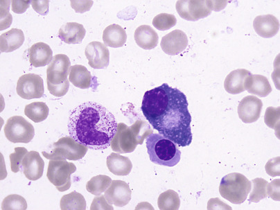

Figure 30-37 

Plasma cell. 

Eccentric round nucleus with clumped nuclear chromatin and moderate amount of basophilic cytoplasm with prominent nuclear hof, or clear zone (1000×). 

Lymphocytes average 34% of all leukocytes and range from 1.5 to 4 × 10  9  /L in adults. The lymphocytes and their derivatives, the plasma cells, operate in the immune defenses of the body. 

 

##  Artifacts 

 

##  Broken Cells 

Damaged or broken leukocytes ( [ Figs. 30-38 ](<#f0195>) and [ 30-39 ](<#f0200>) ) constitute a small proportion of the nucleated cells in normal blood. Bare nuclei from ruptured cells ( [ Figs. 30-40 ](<#f0205>) and [ 30-41 ](<#f0210>) ) vary from fairly well-preserved nuclei without cytoplasm to smudged nuclear material, sometimes with strands arranged in a coarse network, the so-called _basket cells._ They probably represent fragile cells, usually lymphocytes that have been broken in preparing the film. They are numerous, in chronic lymphocytic leukemia, and in acute leukemias. 

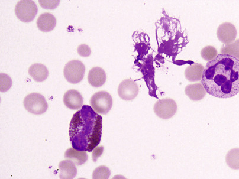

Figure 30-38 

Broken cell. 

A broken cell of the myeloid series with ruptured cell membrane and disintegration of cytoplasmic contents (1000×). 

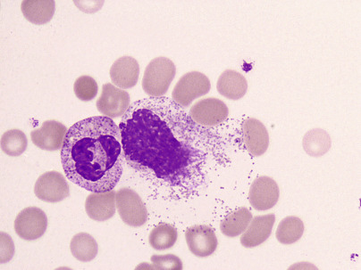

Figure 30-39 

Ruptured cell. 

Ruptured/disintegrating leukocyte (1000×). 

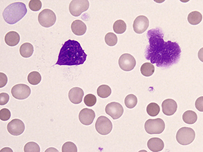

Figure 30-40 

Smudge cell. 

Nuclear remnant from a damaged/broken white cell (1000×). 

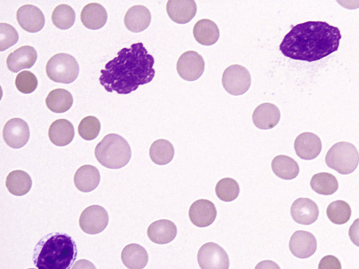

Figure 30-41 

Basket cells (1000×). 

 

##  Degenerative Changes 

As EDTA-blood ages in the test tube, changes in leukocyte morphology begin to take place (  Sacker, 1975  ). The degree of change varies among cells and in different individuals. Within a half hour, the nuclei of neutrophils may begin to swell, with some loss of chromatin structure. Cytoplasmic vacuoles appear, especially in monocytes and neutrophils. Nuclear lobulation appears in mononuclear cells; deep clefts may cause the nucleus to resemble a cloverleaf (radial segmentation of the nuclei; Rieder cells). Finally, loss of the cytoplasm and a smudged nucleus may be all that remains of the cell (see [ Fig. 30-40 ](<#f0205>) ). Degenerative changes occur more rapidly in oxalated blood than in EDTA blood. They arise more rapidly with increasing concentrations of EDTA, such as occur when evacuated blood collection tubes are incompletely filled. 

 

##  Contracted Cells 

In the thicker part of wedge films, drying is slow. Obvious changes in the film include rouleaux of the erythrocytes and shrinkage of the leukocytes. Because the leukocytes are contracted and heavily stained, mononuclear cells are difficult to distinguish. Optimal cell identification is usually impossible in these areas. 

 

##  Endothelial Cells 

Endothelial cells from the lining of the blood vessel may appear in the first drop of blood from a fingerstick specimen or, rarely, in venous blood. They have an immature reticular chromatin pattern and may be mistaken for histiocytes or for tumor cells. 

 

##  Radial Segmentation of the Nuclei 

Use of oxalated blood results in the appearance of abnormal segmentation of the nuclei of leukocytes on the blood film. This segmentation differs from that of the granulocytes in that the lobes appear to radiate from a single point, giving a cloverleaf or a cartwheel picture. Extensive changes can occur within 1 or 2 hours in oxalated blood. Less extensive changes occur with other anticoagulants, including EDTA. 

 

##  Vacuolation 

Vacuoles may develop in the nucleus and cytoplasm of leukocytes, especially monocytes and neutrophils from blood anticoagulated with EDTA. Vacuoles may be associated with swelling of the nuclei and loss of granules from the cytoplasm. 

 

##  “Pseudophagocytosis”

Occasionally, a small lymphocyte, or more often an erythrocyte, will lie atop a granulocyte or a monocyte and thus will appear to have been ingested. The true positions of such cells can be suspected because they will come into sharp focus in a plane above that of the larger cell. 

 

##  Sources of Error in the Differential Leukocyte Count 

Even in perfectly made blood films, the differential count is subject to the same errors of random distribution. For interpretation of day-to-day or slide-to-slide differences in the same patient, it is helpful to know how much of the variation is ascribable to chance alone. [ Table 30-7 ](<#t0040>) gives 95% confidence limits for different percentages of cells in differential counts performed, classifying a total of 100 to 10,000 leukocytes. In comparing the percentages from two separate counts, if one number lies outside the confidence limits of the other, it is probable that the difference is significant (i.e., not due to chance). Thus, on the basis of a 100-cell differential count, if the monocytes were 5% one day and 10% the next, it is probable that the difference is due solely to sampling error. Although the difference could be real, one cannot be sure of this because of the small number of cells counted. If, on the other hand, the differential count totaled 500 cells, the difference between 5% and 10% is significant; one can be reasonably certain (with a 5% chance of being wrong) that the difference is a real one and is not due to chance alone. Of course, this is a minimal estimate of the error involved in differential counts because it does not include mechanical errors (due to variations in collecting blood samples, inadequate mixing, irregularities in distribution depending on the type and quality of the blood films, and poor staining) or errors in cell identification, which depend on the judgment and experience of the observer. Meticulous technique, as well as accurate and consistent cell classification, is therefore required. The physician who interprets the results must be aware of possible sources of error, especially error due to chance in the distribution of cells. [ Table 30-3 ](<#t0020>) shows the distribution of the various types of leukocytes in the blood of normal persons. Absolute concentrations are given, as these have considerably greater significance than percentages alone. 

TABLE 30-7 

Ninety-Five Percent Confidence Limits for Various Percentages of Blood Cells of a Given Type as Determined by Differential Counts [ * ](<#hl0001247>)

a  |  n = 100  |  n = 200  |  n = 500  |  n = 1000  |  n = 10,000   
---|---|---|---|---|---  
0  |  0.0-3.6  |  0.0-1.8  |  0.0-0.7  |  0.0-0.4  |  0.0-0.1   
1  |  0.0-5.4  |  0.1-3.6  |  0.3-2.3  |  0.5-1.8  |  0.8-1.3   
2  |  0.0-7.0  |  0.6-5.0  |  1.0-3.6  |  1.2-3.1  |  1.7-2.3   
3  |  0.6-8.5  |  1.1-6.4  |  1.7-4.9  |  2.0-4.3  |  2.6-3.4   
4  |  1.1-9.9  |  1.7-7.7  |  2.5-6.1  |  2.9-5.4  |  3.6-4.5   
5  |  1.6-11.3  |  2.4-9.0  |  3.3-7.3  |  3.7-6.5  |  4.5-5.5   
6  |  2.2-12.6  |  3.1-10.2  |  4.1-8.5  |  4.6-7.7  |  5.5-6.5   
7  |  2.9-13.9  |  3.9-11.5  |  4.9-9.6  |  5.5-8.8  |  6.5-7.6   
8  |  3.5-15.2  |  4.6-12.7  |  5.8-10.7  |  6.4-9.9  |  7.4-8.6   
9  |  4.2-16.4  |  5.4-13.9  |  6.6-11.9  |  7.3-10.9  |  8.4-9.6   
10  |  4.9-17.6  |  6.2-15.0  |  7.5-13.0  |  8.2-12.0  |  9.4-10.7   
15  |  8.6-23.5  |  10.4-20.7  |  12.0-18.4  |  12.8-17.4  |  14.3-15.8   
20  |  12.7-29.2  |  14.7-26.2  |  16.6-23.8  |  17.6-22.6  |  19.2-20.8   
25  |  16.9-34.7  |  19.2-31.6  |  21.3-29.0  |  22.3-27.8  |  24.1-25.9   
30  |  21.2-40.0  |  23.7-36.9  |  26.0-34.2  |  27.2-32.9  |  29.1-31.0   
35  |  25.7-45.2  |  28.4-42.0  |  30.8-39.4  |  32.0-38.0  |  34.0-36.0   
40  |  30.3-50.3  |  33.2-47.1  |  35.7-44.4  |  36.9-43.1  |  39.0-41.0   
45  |  35.0-55.3  |  38.0-52.2  |  40.6-49.5  |  41.9-48.1  |  44.0-46.0   
50  |  39.8-60.2  |  42.9-57.1  |  45.5-54.5  |  46.9-53.1  |  49.0-51.0   
55  |  44.7-65.0  |  47.8-62.0  |  50.5-59.4  |  51.9-58.1  |  54.0-56.0   
60  |  49.7-69.7  |  52.9-66.8  |  55.6-64.3  |  56.9-63.1  |  59.0-61.0   
65  |  54.8-74.3  |  58.0-71.6  |  60.6-69.2  |  62.0-68.0  |  64.0-66.0   
70  |  60.0-78.8  |  63.1-76.3  |  65.8-74.0  |  67.1-72.8  |  69.0-70.9   
75  |  65.3-83.1  |  68.4-80.8  |  71.0-78.7  |  72.2-77.7  |  74.1-75.9   
80  |  70.8-87.3  |  73.8-85.3  |  76.2-83.4  |  77.4-82.4  |  79.2-80.8   
85  |  76.5-91.4  |  79.3-89.6  |  81.6-88.0  |  82.6-87.2  |  84.2-85.7   
90  |  82.4-95.1  |  85.0-93.8  |  87.0-92.5  |  88.0-91.8  |  89.3-90.6   
91  |  83.6-95.8  |  86.1-94.6  |  88.1-93.4  |  89.1-92.7  |  90.4-91.6   
92  |  84.8-96.5  |  87.3-95.4  |  89.3-94.2  |  90.1-93.6  |  91.4-92.6   
93  |  86.1-97.1  |  88.5-96.1  |  90.4-95.1  |  91.2-94.5  |  92.4-93.5   
94  |  87.4-97.8  |  89.8-96.9  |  91.5-95.9  |  92.3-95.4  |  93.5-94.5   
95  |  88.7-98.4  |  91.0-97.6  |  92.7-96.7  |  93.5-96.3  |  94.5-95.5   
96  |  90.1-98.9  |  92.3-98.3  |  93.9-97.5  |  94.6-97.1  |  95.5-96.4   
97  |  91.5-99.4  |  93.6-98.9  |  95.1-98.3  |  95.7-98.0  |  96.6-97.4   
98  |  93.0-99.9  |  95.0-99.4  |  96.4-99.0  |  96.9-98.8  |  97.7-98.3   
99  |  94.6-99.9  |  96.4-99.9  |  97.7-99.7  |  98.2-99.5  |  98.7-99.2   
100  |  96.4-100.0  |  98.2-100.0  |  99.3-100.0  |  99.6-100.0  |  99.9-100.0   
  
Courtesy of  Rümke CL  : The imprecision of the ratio of two percentages observed in differential white blood cell counts: a warning, _Blood Cells_ 11:137–140, 1985. 

 * _n_ is the number of cells counted; a, the observed percentage of cells of the given type. The limits for n = 100, 200, 500, and 1000 are exact; for n = 10,000, they have been determined with Freeman and Tukey's approximation, as described in the Geigy tables. 

 

##  Platelets on Peripheral Blood Smear Examination 

In films made from EDTA-blood and stained with Romanowsky's stains, platelets are round or oval, 2 to 4 µm in diameter, and separated from one another ( [ Fig. 30-42 ](<#f0215>) ). The platelet count may be estimated from such films. On average, if the platelet count is normal, about one platelet is found per 10 to 30 red cells. At 1000× magnification, this is equivalent to about 7 to 20 platelets per oil immersion field in the areas where red cell morphology is optimal ( [ Fig. 30-43 ](<#f0220>) ). Platelets contain fine purple granules that usually fill the cytoplasm. Occasionally, granules are concentrated in the center (the “granulomere”) and surrounded by a pale cytoplasm (the “hyalomere”); these are probably activated platelets, the appearance resulting from contraction of the microtubular band. A few platelets may have decreased concentrations of granules (hypogranular platelets). In EDTA-blood from normal individuals, the fraction of platelets that exceed 3 µm in diameter and the fraction of platelets that are hypogranular are both less than 5% if the films are made at 10 minutes or 60 minutes after the blood is drawn. If films are made immediately or at 3 hours after blood drawing, the fraction of large platelets and the fraction of hypogranular or activated platelets are increased (  Zeigler et al, 1978  ). These artifacts make it necessary to standardize time of film preparation when evaluating platelet size from films. In patients with immune thrombocytopenia, large platelets/giant platelets (see [ Fig. 30-30 ](<#f0155>) ) are increased in number. They are also increased in patients with the rare Bernard-Soulier syndrome and in those with myelophthisis or myeloproliferative syndrome; in the latter, the platelets are frequently hypogranular or have a distinct granulomere and hyalomere. In blood films made from skin puncture wounds, platelets assume irregular shapes with sharp projections and tend to clump together. 

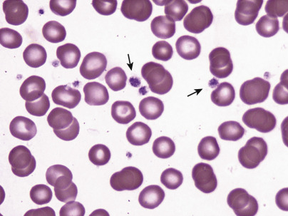

Figure 30-42 

Platelet. 

Platelets are round to oval, 2 to 4 µm in diameter, and separated from one another (1000×). 

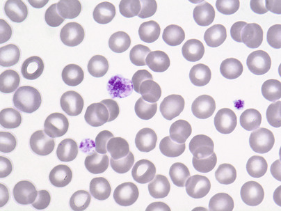

Figure 30-43 

Platelet/giant platelet. 

Platelets show fine granularity; an occasional larger (giant) form is noted (1000×). 

 

##  Erythrocyte Sedimentation Rate 

Erythrocyte sedimentation rate (ESR) is a useful but nonspecific marker of underlying inflammation. Recently, high-sensitivity C-reactive protein and other inflammatory markers have been used to detect or monitor disease, particularly cardiovascular disease and metabolic syndrome (  Pearson et al, 2003  ;  Rifai, 2005  ). When well-mixed venous blood is placed in a vertical tube, erythrocytes will tend to fall toward the bottom. The length of fall of the top of the column of erythrocytes over a given interval of time is called the ESR. Several factors are involved. 

 

##  Plasma Factors 

An accelerated ESR is favored by elevated levels of fibrinogen and, to a lesser extent, α 2  -, β-, and γ-globulins. These asymmetric protein molecules have a greater effect than other proteins in decreasing the negative charge of erythrocytes (zeta potential) that tends to keep them apart. The decreased zeta potential promotes the formation of rouleaux, which sediment more rapidly than single cells. Removal of fibrinogen by defibrination lowers the ESR. No absolute correlation has been noted between the ESR and any of the plasma protein fractions. Albumin and lecithin retard sedimentation, and cholesterol accelerates the ESR. 

 

##  Red Cell Factors 

Anemia increases the ESR because the change in the erythrocyte/plasma ratio favors rouleaux formation, independently of changes in the concentrations of plasma proteins. By any method of measurement, ESR is most sensitive to altered plasma proteins in the Hct range of 0.30 to 0.40 (  Bull, 1975  ). The sedimentation rate is directly proportional to the weight of the cell aggregate and inversely proportional to the surface area. Microcytes sediment slower than macrocytes, which have decreased surface area/volume ratios. Rouleaux also have a decreased surface area/volume ratio and accelerate the ESR. Red cells with an abnormal or irregular shape, such as sickle cells or spherocytes, hinder rouleaux formation and lower the ESR. 

 

##  Stages in the ESR 

Three stages can be observed: (1) In the initial 10 minutes, little sedimentation occurs as rouleaux forms; (2) for about 40 minutes, settling occurs at a constant rate; and (3) sedimentation slows in the final 10 minutes as cells pack at the bottom of the tube. 

 

##  Methods 

 

##  Westergren Method 

The Westergren method is widely used, as the method is very simple. The  ICSH (1993)  has recommended it as the reference method when undiluted whole blood is used. The ICSH states that the patient's Hct should not exceed 35% because reproducibility of sedimentation may be poorer in narrow tubes. A formula to convert between diluted and undiluted blood ESR is as follows: 

 Diluted blood ESR  =  (  Undiluted ESR  × 0.86  )  − 12 

 

##  Equipment. 

The Westergren tube is a straight pipet 30 cm long, 2.55 mm in internal diameter, and calibrated in millimeters from 0 to 200. It holds about 1 mL. The Westergren rack is also used, with levelers as needed for a vertical tube position. 

 

##  Reagent. 

A 0.105 molar solution (range, 0.10 to 0.136) of sodium citrate is used as the anticoagulant-diluent solution (31 g of Na  3  C  6  H  5  O  7  ⋅ H  2  O added to 1 L of distilled water in a sterile glass bottle). This is filtered and is kept refrigerated without preservatives. 

 

##  Procedure 

  * 1.

Two milliliters of whole blood are added to 0.5 mL of sodium citrate and mixed by inversion. 

  * 2.

A Westergren pipet is filled to the 0 mark and is placed exactly vertical in the rack at room temperature without vibration or exposure to direct sunlight. 

  * 3.

After exactly 60 minutes, the distance from the 0 mark to the top of the column of red cells is recorded in millimeters as the ESR value. If the demarcation between plasma and the red cell column is hazy, the level is taken where the full density is first apparent. 

 

##  Modified Westergren Method 

A modification of the Westergren method produces the same results but employs blood anticoagulated with EDTA rather than with citrate. This is more convenient because it allows the ESR to be performed from the same tube of blood as is used for other hematologic studies. Two milliliters of well-mixed EDTA-blood is diluted with 0.5 mL of 3.8% sodium citrate or with 0.5 mL of 0.85% sodium chloride. Undiluted blood anticoagulated with EDTA gives poor precision (  ICSH, 1977  ). The ESR gradually increases with age. Westergren's original upper limits of normal (10 mm/hour for men and 20 mm/hour for women) appear to be too low. According to studies of  Böttiger and Svedberg (1967)  and  Zauber and Zauber (1987)  , upper limits of reference values for the Westergren method should be as follows: 

|  Men  |  Women   
---|---|---  
Below 50 years of age  |  15 mm/hour  |  20 mm/hour   
Above 50 years of age  |  20 mm/hour  |  30 mm/hour   
Above 85 years of age  |  30 mm/hour  |  42 mm/hour   
  
Smith and Samadian (1994)  state that the rise in ESR with age likely reflects higher disease prevalence in older adults; therefore for practical purposes, it may be advisable to use the standard normal range in older adult patients. 

 

##  Sources of Error 

If the concentration of the anticoagulant is higher than recommended, the ESR may be elevated. Sodium citrate or EDTA does not affect the rate of sedimentation if used in the proper concentration. Heparin, however, alters the membrane zeta potential and cannot be used as an anticoagulant. It can also increase the ESR when used as a medication in vivo (  Penchas, 1978  ). Bubbles left in the tube when it is filled will affect the ESR. Hemolysis may modify the sedimentation. The cleanliness of the tube is important. Tilting the tube accelerates the ESR. The red cells aggregate along the lower side, while the plasma rises along the upper side. Consequently, the retarding influence of the rising plasma is less effective. An angle of even 3 degrees from the vertical may accelerate the ESR by as much as 30%. Plastic ESR pipets have slightly higher (1 to 2 mm/hour) values than glass pipets (  Schneiderka et al, 1997  ). 

Temperature should be within the range of 20° to 25° C. Lower or higher temperatures in some cases alter the ESR. If the blood has been kept refrigerated, it should be permitted to reach room temperature and be mixed by inversion a minimum of eight times before the test is performed. The test should be set up within 2 hours after the blood sample is obtained (or within 12 hours if EDTA is used as the anticoagulant and the blood is kept at 4° C); otherwise, some samples with elevated ESRs will be falsely low (  Morris et al, 1975  ). On standing, erythrocytes tend to become spherical and less readily form rouleaux. 

No effective method is known for correcting for anemia in the Westergren method, although this can be done with the Wintrobe method. 

 

##  Alternative Methods and Technologies to Measure ESR 

The **VES-MATIC 20** instrument is a bench top analyzer designed to measure the ESR in 20 blood samples (  Plebani et al, 1998  ;  Caswell & Stuart, 1991  ). It is completely automated. The blood is collected in special cuvets and is carefully mixed by the instrument; the samples are then left to sediment for a certain period. The 18-degree slant of the tubes with respect to the vertical axis causes acceleration of the sedimentation, allowing results comparable with those of Westergren at the first hour to be obtained in only 25 minutes; those comparable with Westergren at the second hour require only 45 minutes. The optoelectrical sensors automatically read the erythrocyte sedimentation level. The data are elaborated and then are printed or visualized on the display. 

The **Micro-ESR method** has greater utility in pediatric patients.  Barrett and Hill (1980)  described a micro-ESR method using 0.2 mL blood to fill a plastic disposable tube 230 mm long with a 1-mm internal bore. Capillary blood values correlated well with venous blood micro-ESR and Westergren ESR values.  Kumar and Singhi (1994)  refer to a micro-ESR (mESR) that utilizes whole blood to completely fill a 75-mm heparinized microhematocrit capillary tube. 

Another instrument used to measure ESR is ESR STAT PLUS, which is a centrifugation-based method. The sample is placed in the centrifuge, and an infrared laser tracks the erythrocyte-plasma interface and makes multiple measurements, from which the linear portion of the sedimentation curve is identified and is used by the software algorithm to determine the ESR result. This method requires smaller volumes of specimen than the Westergren method and is faster. The pitfall is correlation with the reference Westergren method, especially in the 0 to 20 mm/hour range. It can be also prone to human error because it requires a minimum of 15 mixing intervals, followed by a 5-minute limit before drawing into the capillary tube (  Shelat, 2008  ). 

 

##  Application 

The ESR is one of the oldest laboratory tests still in use. Although some of its usefulness has decreased as more specific methods of evaluating disease (such as C-reactive protein [CRP]) have been developed (  Zlonis, 1993  ), new clinical applications are being reported (  Saadeh, 1998  ). Recently, the ESR has been reported to be of clinical significance in sickle cell disease (low value in the absence of painful crisis, moderately increased 1 week into the crisis), osteomyelitis (elevated, helpful in following therapy), stroke (ESR ≥28 mm/hour has a poorer prognosis), prostate cancer (ESR ≥37 mm/hour has a higher incidence of disease progression and death), and coronary artery disease (ESR >22 mm/hour in white men had a high risk for coronary artery disease [CAD]) (  Saadeh, 1998  ). In pregnancy, the ESR increases moderately, beginning at the 10th to the 12th week, and returns to normal about 1 month postpartum. The ESR tends to be markedly elevated in monoclonal blood protein disorders such as multiple myeloma or macroglobulinemia, in severe polyclonal hyperglobulinemia due to inflammatory disease, and in hyperfibrinogenemia. 

Moderate elevations are common in active inflammatory disease such as rheumatoid arthritis, chronic infection, collagen disease, and neoplastic disease. The ESR has little diagnostic value in these disorders but can be useful in monitoring disease activity. It is simpler than measurement of serum proteins, which has tended to replace ESR. Because the test is often normal in patients with neoplasm, connective tissue disease, and infection, a normal ESR cannot be used to exclude these diagnostic possibilities. In patients with known cancer, however, when the value exceeds 100 mm/hour, metastases are usually present (  Sox & Liang, 1986  ). The ESR is of little value in screening asymptomatic patients for disease; history and physical examination will usually disclose the cause of an elevated ESR (  Sox & Liang, 1986  ). The ESR is useful and is indicated in establishing the diagnosis and in monitoring polymyalgia rheumatica and temporal arteritis, where the rate typically exceeds 90 mm/hour (  Zlonis, 1993  ). Emergency physicians continue to use the ESR in evaluating temporal arteritis, septic arthritis, pelvic inflammatory disease, and appendicitis (  Olshaker & Jerrard, 1997  ).  Freeman (1997)  urges immediate quick ESR estimation if giant cell arteritis is clinically indicated, as a delay of even a few hours in starting steroid therapy may result in irreversible visual failure.  Harrow and colleagues (1999)  conclude that an ESR of 5 mm or less at 30 minutes correctly identifies most patients with normal ESR without misclassifying elevated ESRs. 

In Hodgkin's disease, the ESR may be a very useful prognostic blood measurement in the absence of systemic (“B”) symptoms (fever, weight loss, night sweats). In one study (  Vaughan Hudson et al, 1987  ), one third of asymptomatic patients had both an ESR of less than 10 mm/hour and an excellent survival rate, regardless of age, stage, or histopathology. Asymptomatic patients with an ESR of 60 mm/hour or greater had a survival rate as poor as those with systemic symptoms. 

Iversen and colleagues (1996)  reported that 70% of renal cell carcinoma patients had an increased ESR, which had been significantly rising for up to 6 years before diagnosis. They argued for a systematic graphing and baseline determination of the ESR over time, which showed a marked elevation in ESR 1 year before diagnosis. Such a trend of increasing ESR should lead to further investigation, as with renal ultrasound, which may then lead to curative nephrectomy before metastases occur. 

,  

##  Bone Marrow Examination 

The bone marrow examination provides a semiquantitative and qualitative assessment of the state of hematopoiesis and aids in the diagnosis of several hereditary and acquired benign and malignant diseases. Marrow aspiration and biopsy can be carried out as an office procedure on ambulatory patients with minimal risk (  Ryan, 2006  ). It compares favorably with ordinary venipuncture and is less traumatizing than a lumbar puncture. Recently, a new battery powered device was developed to capture bone marrow biopsy. Bone marrow biopsies performed were significantly faster and superior in quality (  Reed et al, 2011  ). As for any other special procedure, however, the clinical indications for marrow examination should be clear. In each instance, the physician should have in mind some reasonable prediction of its result and consequent benefit to the patient. Without exception, the peripheral blood should be examined carefully first. It is a relatively uncommon circumstance to find hematologic disease in the bone marrow without evidence of it in the peripheral blood. It is estimated that the weight of the marrow in the adult is 1300 to 1500 g. The marrow can undergo complete transformation in a few days and occasionally even in a few hours. As a rule, this rapid transformation involves the whole organ, as evidenced by the fact that a small sample represented by a biopsy or aspiration is usually fairly representative of the whole marrow. This conclusion is in accord with results of studies of biopsy samples simultaneously removed from several sites. According to these observations, the various sites chosen for removal of marrow for studies are in most instances equally good. Consequently, the difficulty of access, the risks involved, the ease of obtaining a good biopsy specimen, and discomfort to the patient are the main reasons for selection of a site in the particular patient. Within a given site, the cellular distribution may vary in apparently hyperplastic or hypoplastic areas. This is particularly the case immediately below the cortex. Occasionally, failure to obtain quantitatively or qualitatively adequate material in one site may be followed by success in another location. Also, the need for repeated aspirations or biopsies may indicate the use of several different sites. We regard the posterior iliac crest as the preferred site. The large marrow space allows both aspiration and biopsy to be performed with ease at one time. The techniques of marrow aspiration and biopsy have been adequately reviewed (  Hyun et al, 1988  ). Both operator techniques and specimen processing play a vital role in improving the quality of bone marrow assessment (  Odejide et al, 2013  ). 

 

##  Indications for Marrow Study 

Bone marrow biopsy and aspiration should be performed only when there is a clear clinical indication (  Bain  2001a  ). While widely accepted criteria assessing adequacy of bone marrow samples for establishing a diagnosis do not exist at this time, there are some disease-specific guidelines (  Merizanu et al, 2014  ;  National Comprehensive Cancer Network [NCCN], 2014  ). Both bone marrow aspiration and biopsy are performed routinely together. Besides increasing the yield of diagnostic tissue, each specimen also provides unique information (  Kaur et al, 2014  ). Biopsy provides information about the bone marrow architecture, whereas cellular details are much better appreciated on the aspirate smears. 

In microcytic anemia, evaluation of iron stores and sideroblasts allows categorization of the anemia (i.e., iron deficiency, anemia of chronic disease, sideroblastic). 

In macrocytic anemia, marrow examination will confirm whether the process is megaloblastic or not; in some cases, changes in the blood are minimal, yet the marrow is megaloblastic. In normocytic anemia (or macrocytic anemia) without an increased reticulocyte production index, the marrow is evaluated for quantitative or qualitative abnormalities in erythropoiesis (e.g., pure red cell aplasia, myelodysplasia). 

In neutropenia, thrombocytopenia, or pancytopenia, marrow study is helpful in assessing the presence and normality of the precursor cells in each series. This enables one to assess the probability of decreased production, impaired maturation, or increased destruction as the mechanism of the disorder. In cytopenias, marrow examination sometimes will reveal the presence of leukemia or another hematologic neoplasia. 

In immunoglobulin abnormalities, the diagnosis of plasma cell myeloma or macroglobulinemia may be confirmed if infiltrations of abnormal plasma cells or lymphocytes are present. Marrow examination is essential for the diagnosis and classification of acute leukemia. It is frequently performed to assist in the diagnosis and staging of other neoplasms, including lymphomas (  Cheson et al, 2014  ) and metastatic tumors, and to assess response to therapy for hematologic disorders. If the marrow cannot be aspirated (“dry tap”), biopsy is essential. Marrow biopsy should also be performed if blood changes suggest myelofibrosis with myeloid metaplasia, or if granulomatous disease or metastatic tumor is suspected. 

 

##  Preparation of the Aspirate and Biopsy Section 

 

##  Marrow Films 

Delay, no matter how brief, is undesirable. Films can be made in a manner similar to that used for ordinary blood counts. Gray particles of marrow are visible with the naked eye. They are the best material for the preparation of good films and serve as landmarks for the microscopic examination of stained smears. 

 

##  Direct Films 

A drop of marrow is placed on a slide a short distance away from one end. A film 3 to 5 cm long is made with a spreader, not wider than 2 cm, dragging the particles behind but not squashing them. A trail of cells is left behind each particle. 

 

##  Imprints 

Marrow particles can also be used for preparation of imprints. One or more visible particles are picked up with a capillary pipet, the broken end of a wooden applicator, or a toothpick, and are transferred immediately to a slide and made to stick to it by a gentle smearing motion. The slide is air dried rapidly by waving, and then it is stained. 

 

##  Crush Preparations 

Marrow particles in a small drop of aspirate may be placed on a slide near one end. Another slide is carefully placed over the first. Slight pressure is exerted to crush the particles, and the slides are separated by pulling them apart in a direction parallel to their surfaces. All films should be dried rapidly by whipping them through the air. As the aspirated material is being spread, the appearance of fat as irregular holes in the films gives assurance that marrow and not just blood has been obtained. 

 

##  Special Studies 

It is recommended that for evaluation of most hematological diseases an additional bone marrow aspirate specimen should be collected for ancillary testing including flow cytometry analysis, karyotype, and FISH (fluorescent in situ hybridization) assays and molecular studies. Flow cytometry is best performed on a heparin or an EDTA anticoagulated aspirate specimen, which is stable for at least 24 hours at room temperature. For cytogenetic or cell culture analysis, anticoagulated marrow should be added to tissue culture medium and analyzed as soon as possible to maintain optimal cell viability. Cytogenetic specimens are generally not adversely affected by overnight incubation. DNA is relatively stable and can be extracted and analyzed from paraffin-embedded tissue sections. However, decalcification of the biopsy specimens during processing results in some degree of DNA denaturation and precludes optimum molecular testing. Further, reverse transcriptase polymerase chain reaction (RT-PCR) assays, involving amplification of complementary DNA (cDNA) prepared from cellular messenger RNA (mRNA), are often needed for molecular diagnosis of translocations associated with leukemia and lymphoma. Messenger RNA has a variable half-life in an intact cell and is degraded rapidly (on the order of seconds to minutes) in a cell lysate by ubiquitous RNAses. For maximal mRNA recovery, cell suspensions, mostly buffy coat or mononuclear cell preparations, should be lysed in an appropriate RNAse inhibitor–containing buffer as soon as possible after sampling. Molecular assays are best performed on an EDTA anticoagulated bone marrow specimen, as heparin can interfere with some PCR-based assays (  Ryan & Cohen, 2000  ). 

 

##  Histologic Sections 

The needle biopsy and clotted marrow particles (fragments) are fixed in Zenker's acetic solution (5% glacial acetic acid; 95% Zenker's) for 6 to 18 hours, or in B-5 fixative for 1 to 2 hours (  Hyun et al, 1988  ). Excessive time in either fixative makes the tissue brittle. Although these fixatives, particularly B-5, provide the best histology, they contain toxic mercuric chloride and are gradually being replaced by fixatives such as zinc formalin and other preparations. The tissue is processed routinely for embedding in paraffin, cut at 4 µm, and stained routinely with hematoxylin and eosin (H&E). Giemsa and periodic acid–Schiff (PAS) stains are frequently useful. Embedding the tissue in plastic material allows thinner sections to be examined and better survival of protein structure, so that enzyme histochemistry and immunocytochemistry are practical for identification of cell lineages. 

Sections provide the best estimate of cellularity and a picture of marrow architecture but are somewhat inferior for the study of cytologic details. Another disadvantage is that particles adequate for histologic sections are not always obtained, especially in conditions in which the diagnosis depends on marrow evidence (e.g., myelofibrosis, metastatic cancer). 

 

##  Staining Marrow Preparations 

 

##  Romanowsky's Stain 

Marrow films should be stained with Romanowsky's stain (e.g., Wright-Giemsa) in a manner similar to that used for blood films. A longer staining time may be necessary for marrows with greater cellularity. Several special stains may be performed on peripheral blood smears, bone marrow aspirate, and touch imprint smears and bone marrow biopsy sections, besides the usual Romanowsky's and H&E stains. These include cytochemical stains (myeloperoxidase, Sudan black B, naphthol As-D chloroacetate esterase, nonspecific esterases, acid phosphatases, leukocyte alkaline phosphatase, periodic acid–Schiff stain, toluidine blue, and iron stain) and immunocytochemical stains, depending on the disease and the preliminary morphologic examination of the smear and/or section (  Perkins, 2004  ). 

 

##  Perls' Test for Iron 

 

##  Procedure 

One film containing marrow particles is fixed for 10 minutes in formalin vapor, immersed for 10 minutes in a freshly prepared solution that contains 0.5% potassium ferrocyanide and 0.75% hydrochloric acid, rinsed, dried, and counterstained with Nuclear Fast Red. 

 

##  Interpretation 

The Prussian blue reaction is produced when hemosiderin or ferritin is present; iron in Hb is not stained. It is reported as negative or 1+ to 5+. Storage iron, which is contained in macrophages, can be evaluated only in marrow particles on the film. In adults, 2+ is normal, 3+ is slightly increased, 4+ is moderately increased, and 5+ is markedly increased ( [ Fig. 30-44 ](<#f0225>) ). Storage iron in the marrow is located in macrophages. Normally, a small number of blue granules are seen. In iron deficiency, blue-staining granules are absent or extremely rare. Storage iron is increased in most other anemias, infections, hemochromatosis, hemosiderosis, hepatic cirrhosis, uremia, and cancer, and after repeated transfusions. Sideroblasts ( [ Fig. 30-45 ](<#f0230>) ) are normoblasts that contain one or more particles of stainable iron. Normally, from 20% to 60% of late normoblasts are sideroblasts; in the remainder, no blue granules can be detected. The percentage of sideroblasts is decreased in iron deficiency anemia (in which storage iron is decreased) and also in the common anemias associated with infection, rheumatoid arthritis, and neoplastic disease (anemia of chronic disease/anemia of inflammation in which storage iron is normal or increased). The number of sideroblasts is increased when erythropoiesis is impaired for other reasons (sideroblastic anemia, myelodysplastic syndrome); it is roughly proportional to the degree of saturation of transferrin. The Prussian blue reaction can also be performed on slides previously stained with a Romanowsky's stain to identify sideroblasts or to determine whether iron is present in other cells of interest. Iron stain is used to evaluate for the presence of abnormal sideroblasts and ring sideroblasts ( [ Fig. 30-46 ](<#f0235>) ), as seen in various hematologic diseases. 

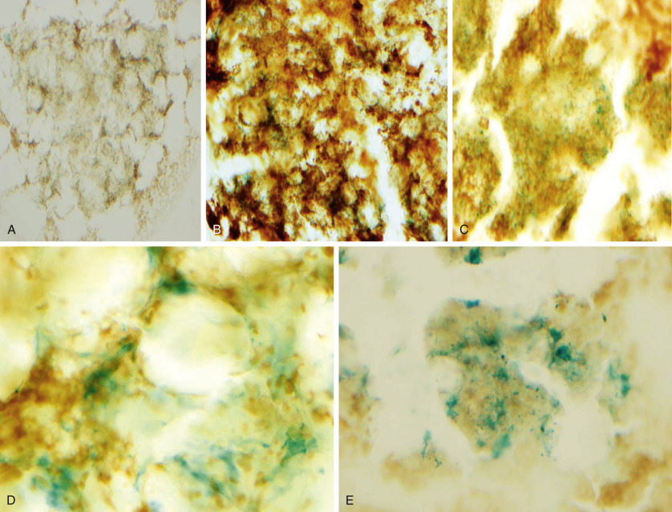

Figure 30-44 

Bone marrow storage iron located in macrophages. 

**A,** Iron stores 1+ (1000×). **B,** Iron stores 2+ (1000×). **C,** Iron stores 3+ (1000×). **D,** Iron stores 4+ (1000×). **E,** Iron stores 5+ (500×). 

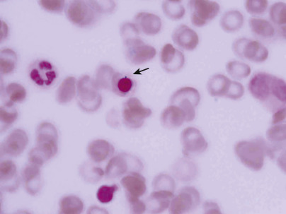

Figure 30-45 

Normal sideroblast. 

Single iron granule seen in the cytoplasm of a maturing normoblast. Identification requires high magnification and bright illumination, while focusing up and down (1000×). 

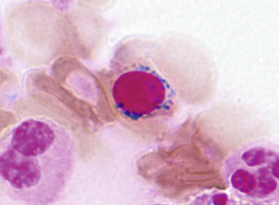

Figure 30-46 

Ring sideroblast. 

Siderotic granules form a perinuclear ring spanning more than half of the nuclear diameter (Prussian blue stain, 1000×). 

 

##  Sections 

Routine H&E stains are satisfactory for most purposes. Romanowsky's stains can be used to good advantage with fixed material. Iron stains are best performed on films that contain particulate marrow tissue. They are less sensitive in sections of marrow because some iron is lost in processing, and a lesser thickness of tissue is examined in sections. 

 

##  Examination of Marrow 

It is desirable to establish a routine procedure to obtain maximum information from examination of the marrow. 

 

##  Peripheral Blood 

The complete blood cell count, including platelet count and reticulocyte count, should be performed on the day of the marrow study, and the results incorporated in the report. The pathologist or hematologist who examines the marrow should also carefully examine the blood film as previously described and should incorporate the observations in the marrow report. 

 

##  Cellularity of the Marrow 

Marrow cellularity is expressed as the ratio of the volume of hematopoietic cells to the total volume of the marrow space (cells plus fat and other stromal elements). Cellularity varies with the age of the subject and the site. For example, at 50 years of age, the average cellularity in the vertebrae is 75%; sternum, 60%; iliac crest, 50%; and rib, 30%. Normal cellularity of the iliac bone at different ages has been well defined by  Hartsock and colleagues (1965)  , as summarized in [ Figure 30-47 ](<#f0240>) . If the percentage is increased for the patient's age, the marrow is hypercellular, or hyperplastic; if decreased, the marrow is hypocellular, or hypoplastic. Marrow cellularity is best judged by histologic sections of biopsy or aspirated particles ( [ Fig. 30-48 ](<#f0245>) ) but should also be estimated from the particles present in marrow films. This is done by comparing the areas occupied by fat spaces and by nucleated cells in the particles, as well as the density of nucleated cells in the “tail” or fallout of the particles. Comparison of films and sections on each marrow specimen will enable the observer to estimate cellularity reasonably well from films—a skill that is useful when sectioned material is unavailable. 

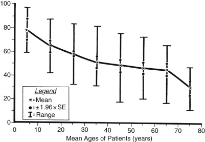

Figure 30-47 

Marrow cellularity in hematologically normal individuals. 

Percent cellularity on the ordinate versus age, grouped by decade, on the abscissa. 

(From  Hartsock RJ, Smith EB, Petty CS  : _Am J Clin Pathol_ 43:326, 1965, with permission.) 

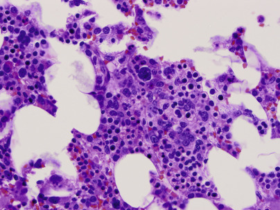

Figure 30-48 

Marrow biopsy (500×). 

Cellularity here is between 50 % and 60%, which is normal for an adult. Megakaryocytes, myeloid and erythroid precursors are present. (Normoblasts have intensely staining nuclei and tend to occur in clusters.) 

 

##  Distribution of Cells 

Distribution of various cell types can be ascertained in two ways. First, one scans several slides under low, then high, magnification; on the basis of previous experience, one then estimates the number and distribution of cells. Second, one actually makes a differential count of 300 to 500 cells and calculates the percentage of each type of cell. A combination of both methods is preferred. The second of these methods, careful differential counting, is an essential part of training in this work, without which accuracy in the first method may be difficult to achieve. The differential count also affords an objective record from which future changes may be measured. 

One first scans the marrow film under low power (100× or 200× magnification) while looking for irregularities in cell distribution, numbers of megakaryocytes, and the presence of abnormal cells. Then one selects areas on the film where marrow cells are both undiluted with blood cells and separated and spread out sufficiently to allow optimal identification. These areas are usually just behind marrow particles on direct films, or near the particles on crushed films. The differential count is performed at 400× or 1000× magnification. Examples of reference intervals for differential counts of marrow at selected different ages are given in [ Table 30-8 ](<#t0050>) . 

TABLE 30-8 

Differential Cell Counts of Bone Marrow in Percent of Total Nucleated Cells 

Cell Types  |  ROSSE ET AL (1977)  |  MAUER (1969)  |  JANDL (1987)   
---|---|---|---  
Birth   
(Mean, SD)  |  1 Month   
(Mean, SD)  |  18 Months   
(Mean, SD)  |  Childhood   
(Mean, Range)  |  Adult   
(Mean, Range)   
Normoblasts, total  |  4.48 ± 7.24  |  8.04 ± 5.00  |  8.21 ± 3.71  |  23.1  |  21.5 (14.2-30.4)   
Pronormoblasts  |  0.02 ± 0.06  |  0.10 ± 0.14  |  0.08 ± 0.13  |  0.5 (0.0-1.5)  |  0.6 (0.2-1.4)   
Basophilic n.  |  0.24 ± 0.25  |  0.34 ± 0.33  |  0.50 ± 0.34  |  1.7 (0.2-4.8)  |  2.0 (0.7-3.7)   
polychromatophilic n.  |  13.06 ± 6.78  |  6.90 ± 4.45  |  6.97 ± 3.56  |  18.2 (4.8-34.0)  |  12.4 (12.2-24.2)   
Orthochromatic n.  |  0.69 ± 0.73  |  0.54 ± 1.88  |  0.44 ± 0.49  |  2.7 (0.0-7.8)  |  6.5 (2.0-22.7)   
Neutrophils, total  |  60.37 ± 8.66  |  32.35 ± 7.68  |  36.06 ± 7.40  |  57.1  |  56.0 (45.1-66.5)   
Myeloblasts  |  0.31 ± 0.3  |  10.62 ± 0.50  |  0.06 ± 0.08  |  1.2 (0.0-3.2)  |  1.0 (0.5-1.8)   
Promyelocytes  |  0.79 ± 0.9  |  10.76 ± 0.6  |  50.64 ± 0.59  |  1.4 (0.0-4.0)  |  3.4 (2.6-4.6)   
Myelocytes  |  3.95 ± 2.93  |  2.50 ± 1.48  |  2.49 ± 1.39  |  18.3 (8.5-29.7)  |  11.9 (8.1-16.9)   
Metamyelocytes  |  19.37 ± 4.8  |  411.30 ± 3.59  |  12.42 ± 4.15  |  23.3 (14.0-34.2)  |  18.0 (9.8-25.3)   
Bands  |  28.89 ± 7.56  |  14.10 ± 4.63  |  14.20 ± 5.23  |  |  11.0 (8.5-20.8)   
Segmented  |  7.37 ± 4.64  |  3.64 ± 2.97  |  6.31 ± 3.91  |  12.9 (4.5-29.0)  |  10.7 (8.0-16.0)   
Eosinophils  |  2.70 ± 1.27  |  2.61 ± 1.40  |  2.70 ± 2.16  |  3.6 (1.0-9.0)  |  3.2 (1.2-6.2)   
Basophils  |  0.12 ± 0.20  |  0.07 ± 0.16  |  0.10 ± 0.12  |  0.06 (0.0-0.8)  |  <0.1 (0.0-0.2)   
Lymphocytes, total  |  15.6  |  49.0  |  45.5  |  16.0 (4.8-35.8)  |  15.8 (10.8-22.7)   
Transitional  |  1.18 ± 1.13  |  1.95 ± 0.94  |  1.99 ± 1.00  |  |   
Small  |  14.42 ± 5.54  |  47.05 ± 9.24  |  43.55 ± 8.56  |  |   
Plasma cells  |  0.00 ± 0.02  |  0.02 ± 0.06  |  0.06 ± 0.08  |  0.4 (0.2-0.6)  |  1.8 (0.2-2.2)   
Monocytes  |  0.88 ± 0.85  |  1.01 ± 0.89  |  2.12 ± 1.59  |  |  1.8 (0.2-2.8)   
Megakaryocytes  |  0.06 ± 0.15  |  0.05 ± 0.09  |  0.07 ± 0.12  |  |  <1.0 (0.0-0.2)   
Reticulum cells  |  |  |  |  |  0.3 (0.0-0.5)   
M/E ratio  |  4.2  |  4.0  |  4.4  |  2.9 (1.2-5.2)  |  2.5 (1.2-5.0)   
  
_M/E,_ Myeloid/erythroid ratio. 

Data from  Rosse C, Kraemer MJ, Dillon TL, et al  : Bone marrow cell populations of normal infants: the predominance of lymphocytes, _J Lab Clin Med_ 89:1225–1240, 1977;  Mauer AM  : _Pediatric hematology,_ New York, 1969, McGraw-Hill; Jandl JH: _Blood: textbook of hematology,_ Boston, 1987, Little, Brown. 

Changes in the marrow cell distribution are most dramatic in the first month of life, during which a predominance of granulocytic cells at birth changes to a predominance of lymphocytes. This predominance of lymphocytes characterizes the bone marrow during infancy. A small proportion of “immature” or transitional lymphoid cells (fine nuclear chromatin, high nuclear/cytoplasmic ratio, small to intermediate cell size) is normally present; it may be that these cells include stem cells and progenitor cells. These cells probably include cells designated as “hematogones”; they may be increased in iron deficiency anemia, immune thrombocytopenic purpura, and other disorders, especially in infancy. Normoblasts fall after birth, rise to a maximum at 2 months, then fall to a stable, relatively low level by 4 months, and remain there during most of infancy. The myeloid/erythroid (M/E) ratio is the ratio of total granulocytes to total normoblasts. In newborns and infants, it is somewhat higher than in older children or adults (see [ Table 30-8 ](<#t0050>) ). In adults, the range is broad, varying from about 1.2 : 1 to 5 : 1\. Both the differential count and the M/E ratio are relative values and must be interpreted with respect to cellularity, or with respect to other evidence that one of the systems is normal. An **increased** M/E ratio (e.g., 6 : 1) may be found in infection, chronic myelogenous leukemia, or erythroid hypoplasia. A **decreased** M/E ratio (i.e., <1.2 : 1) may mean a depression of leukopoiesis or a normoblastic hyperplasia, depending on the marrow cellularity. The number of megakaryocytes is estimated more reliably in sections than in marrow films. In scanning areas of films with good cellularity under low power (100×), an average of one to three megakaryocytes should be found in each field in normal marrow. 

 

##  Maturation 

While examining cells during the differential count, one should evaluate whether maturation is normal ( [ Figs. 30-49 ](<#f0250>) and [ 30-50 ](<#f0255>) ), that is, whether nuclear and cytoplasmic development is in balance. Impaired cytoplasmic maturation in normoblasts, for example, occurs when Hb synthesis is impaired; impaired nuclear maturation occurs in megaloblastic anemias. Bizarre or dysplastic maturation occurs as a result of certain drugs, in some leukemias, and in dysmyelopoietic syndromes. 

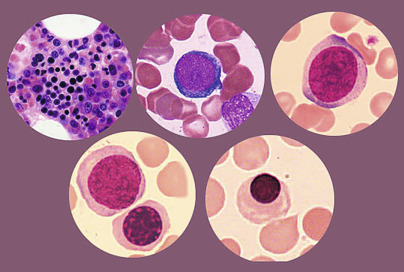

Figure 30-49 

Normal erythroid maturation. 

Various stages of normoblastic erythroid maturation (1000×). 

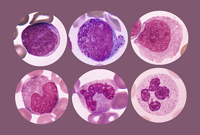

Figure 30-50 

Normal myeloid (neutrophilic) maturation. 

Various stages of normal myeloid maturation from the blast to the mature neutrophil. 

 

##  Presence of Rare Cell Types or Abnormal Cells 

In scanning the marrow, one looks for the presence of rare or unexpected cell types. 

**Tissue mast cells** ( [ Fig. 30-51 ](<#f0260>) ) are normally very infrequent. They are increased in number in aplastic or refractory anemias and in lymphoproliferative disorders. 

Figure 30-51 

Tissue mast cell. 

Mast cells contain numerous dense dark-purple cytoplasmic granules that can completely cover the round nucleus (1000×). 

**Osteoblasts** ( [ Fig. 30-52 ](<#f0265>) ) are cells that synthesize the collagen matrix of bone. **Osteoclasts** are cells that resorb bone and are thought to result from the fusion of histiocytes. Both cell types are normally present in small numbers in the aspirates of infants and children. They are uncommonly seen in adult marrow, except when bone destruction or repair is occurring, as in hyperparathyroidism, Paget's disease, metastatic tumor, or a recent biopsy at the same site. 

Figure 30-52 

Osteoblast. 

Frequently found in pediatric patients, osteoblasts line the bone trabeculae. In smears, they appear as cells with eccentrically placed nuclei, resembling plasma cells, but the cytoplasmic clearing is more centrally located and is not found in the Golgi area, as in plasma cells (1000×). 

Osteoblasts are large cells with a single eccentric nucleus that has reticular chromatin and a prominent nucleolus. The cytoplasm is moderately basophilic; a large, pale Golgi zone is separated from the nucleus, rather than abutting it as in plasma cells. Osteoblasts are often present in clusters and may be confused with immature plasma cells or myeloma cells. Osteoclasts ( [ Fig. 30-53 ](<#f0270>) ) are large, multinucleated cells up to 100 µm diameter that may be mistaken for megakaryocytes. They have multiple nuclei that are separate (not joined as in megakaryocytes). The chromatin is reticular, and a prominent nucleolus is usually present. The cytoplasm may be basophilic but usually has pink-purple granules that resemble megakaryocyte granules. Coarse fragments of purple-staining material are often present. Clusters of **metastatic neoplastic cells** ( [ Fig. 30-54 ](<#f0275>) ) may be found in one or more marrow films of patients with metastatic tumor in the bone sampled; they may be found in biopsy sections and not in films, in both, or, less commonly, in one or more films and not in the biopsy. Some metastatic neoplastic cells resemble myeloblasts or other primitive blasts. The clue to recognizing them is that they almost always appear in clusters or clumps of cells; this is not true of hematopoietic blast cells. 

Figure 30-53 

Osteoclast. 

Osteoclasts resorb bone and participate in bone remodeling (1000×) 

Figure 30-54 

Metastatic tumor. 

Bone marrow biopsy with islands of metastatic gastric adenocarcinoma (1000×). 

 

##  Evaluation of the Biopsy Specimen 

Histologic sections allow better estimates of marrow cellularity and of the number of megakaryocytes than do marrow films (see [ Fig. 30-48 ](<#f0245>) ). Normally, immature myeloid precursors lie along bone trabeculae, erythroid precursors are in discrete interstitial islands, and megakaryocytes are scattered in the interstitium. In good histologic preparations, cell distribution and maturation abnormalities can be quite reliably determined. In addition to more reliable detection of the presence of lymphomas or metastatic tumor, the histologic pattern can often be diagnostic of the type of neoplasm. Other focal lesions not found in films include granulomas, abscesses, and vascular lesions. In some conditions, such as myelofibrosis and hairy cell leukemia, the bone marrow cannot be aspirated, and biopsy is necessary to establish a diagnosis. Trabeculae should always be examined to detect bone abnormalities. Osteosclerosis with thickened bone trabeculae may accompany myelofibrosis or may be congenital. In osteoporosis, the bone trabeculae are thin. Osteomalacia is characterized by a recognizable osteoid seam. Osteitis fibrosa occurs in hyperparathyroidism and is characterized by irregular osteoclastic bone resorption, endosteal fibrosis, and some osteoblastic activity in areas of bone regeneration. Irregularly widened trabeculae with a “mosaic” pattern are typical findings in Paget's disease of bone. 

 

##  Interpretation 

The summary of the marrow report includes an estimate of cellularity, an estimate of the number of megakaryocytes, the M/E ratio, statements about any cytologic or maturation abnormalities, an estimate of the storage iron and proportion of sideroblasts, and statements about any other abnormal findings present (see [ Fig. 30-46 ](<#f0235>) ). Abnormalities in blood cell counts and morphology are also summarized. An interpretation of observed findings is made, which of course includes a diagnosis if this is possible. In making such an **interpretation,** one should include an integration of marrow and blood observations with clinical findings and other laboratory data. Alterations in blood and marrow cells are discussed, with reference to the diseases and disorders considered in subsequent chapters. 

,,
