## Key Points

  * •

Many different diseases can display abnormalities in the urine. Therefore, examination of the urine is an important laboratory function. 

  * •

Basic urinalysis consists of gross examination of the urine, as well as a dipstick analysis for blood, white blood cells, sugar, and other substances. The dipstick may be read manually or by an automated instrument. 

  * •

A microscopic analysis of urine may be necessary in many cases. This is done to detect cellular elements, casts, and crystals. Each of these items can be caused by several different disease states. 

  * •

Although microscopic examination of the urine is usually performed manually, several automated instruments can perform this analysis. 

  * •

Red blood cells within the urine can come from any point along the urinary tract. Dysmorphic red blood cells are often a sign of glomerular disease. 

  * •

The first voided morning urine, because it is the most concentrated, is often the best specimen for analysis. Some procedures may require a 12- or 24-hour urine sample. 

  * •

Specific gravity and osmolality measurements reflect the concentrating ability of the kidneys. After a period of dehydration, the osmolality should be three to four times that of plasma. 

  * •

Proteinuria greater than 4 g/day is seen in nephrotic syndrome. Although nephrotic syndrome is usually seen in primary renal disease, it is occasionally seen in a systemic disease that affects the kidneys. 

  * •

Ketonuria can be seen in diabetic individuals. It can also be seen in other states, such as febrile illness and cachexia. 

  * •

The dipstick nitrite and leukocyte esterase tests are used to help diagnose urinary tract infection. Positive results should be confirmed by microscopic analysis of the urine. 

  * •

Urinary calculi are most commonly formed from calcium. Workup of habitual stone formers should include analysis of both the urine and the stone. 

A significant amount of information can be obtained through the examination of urine. Careful examination enables the detection of disease processes intrinsic to the urinary system, both functional (physiologic) and structural (anatomic), and sometimes unsuspected (  Haber, 1988  ;  Takemura et al, 2000  ;  Echeverry et al, 2010  ). The progression or regression of various lesions can be monitored with only minimal distress to the patient. Furthermore, systemic disease processes, such as endocrine or metabolic abnormalities, can be detected through the recognition of abnormal quantities of disease-specific metabolites excreted in the urine. Laboratory urine tests will continue to play an essential role in clinical medicine. 

The purpose of this chapter is to highlight the pertinent information that can be provided by the most common urine tests. Two main types of urinalysis are currently performed. These include (1) the dipstick (reagent strip) urinalysis, which is commonly performed in screening laboratories, in physician offices, and as patient home testing; and (2) the basic (routine) urinalysis, which adds a microscopic examination of urine sediment to the reagent strip urinalysis. These examinations utilize various laboratory disciplines, particularly chemistry and microscopy. In addition to these front-line diagnostic procedures, new technologies including immunocytochemistry, molecular diagnostics, DNA ploidy, and cell cycle analysis are constantly evolving to provide additional diagnostic and prognostic information. Urine microbiology studies, crucial to the diagnosis of infectious pathogens of the urinary tract, are addressed elsewhere in this textbook. It is important to remember that each of these modalities has a certain clinical utility. [ Table 28-1 ](<#t0010>) lists the benefits of commonly ordered urine laboratory examinations. 

TABLE 28-1 

Benefits of Common Urine Laboratory Tests 

|  |  CLINICAL UTILITY   
---|---|---  
Type of test  |  Aims  |  Screen  |  Diagnosis  |  Monitor  |  Prognosis   
Urine chemistry (reagent strip)  |  Glucosuria   
Proteinuria   
Hematuria   
Leukocyturia   
Infection  |  +++  |  \+  |  \+  |  \+   
Wet urinalysis (routine)  |  Diabetes   
Proteinuria   
Hematuria   
Leukocyturia   
Infections   
Cylindruria   
Crystalluria  |  ++++  |  ++  |  ++  |  \+   
Urine microbiology  |  Infections  |  ++  |  ++++  |  ++  |  \+   
Urine cytology (conventional)  |  Cancer   
Inflammation   
Viral infections  |  \+  |  ++  |  \+  |  –  
Cytodiagnostic urinalysis  |  Glomerular and renal tubular disorders   
LUT disorders   
Nonbacterial infections   
Lithiasis  |  \+  |  ++++  |  +++  |  ++   
Image cytometry and DNA analysis  |  Urothelial cancer  |  – |  ++  |  +++  |  +++   
Flow cytometry  |  Urothelial cancer  |  – |  \+  |  +++  |  ++   
  
_LUT,_ Lower urinary tract; _ –, _ negative; + _,_ low positive; ++++ _,_ strongly positive. 

From Schumann GB, Schumann JL, Marcussen N: _Cytodiagnostic urinalysis of renal and lower urinary tract disorders_ , New York, 1995, Igaku-Shoin Medical Publishers, with permission. 

The routine urinalysis consists of two major components: (1) physicochemical determinations (appearance, specific gravity, and reagent strip measurements), and (2) a bright-field or phase-contrast microscopic examination of urine sediment for evidence of hematuria, pyuria, casts (cylindruria), and crystalluria. Dipstick urinalysis provides information about multiple physicochemical properties of urine. Used predominantly in screening, dipstick testing requires less sophisticated training of personnel, and results are obtainable in only a few minutes. It has been shown that in certain situations, particularly when evaluating patients with signs or symptoms that prompt a urinalysis for the detection of blood or infection, urinalysis dipsticks can be substituted for a full routine urinalysis, with urine microscopy reserved for patients with discordance between clinical presentation and dipstick results (  Jou & Powers, 1998  ). Urine sediment examination is typically more time-consuming and necessitates expertise in microscopy for an accurate interpretation; however, instrumentation is now available that automates routine urinalysis partially or completely. Cytopathologic urine sediment examination also requires special training and is the mainstay for diagnosis and follow-up of urinary tract neoplasms, as well as some nonneoplastic conditions, particularly renal allograft rejection. 

We present in detail the pertinent components of the routine urinalysis. Various methods, including sample preparation, reagent strip reactions, confirmatory testing, and microscopic methods, are briefly reviewed. Major emphasis is given to clinicopathologic correlations related to the laboratory findings obtained from these urine tests. 

,  

##  Urine Formation 

In the normal adult, approximately 1200 mL of blood perfuses the kidneys each minute, which accounts for about 25% of the cardiac output. The glomeruli (normally numbering at least 1 million per kidney) receive blood through afferent arterioles, and an ultrafiltrate of the plasma passes through each glomerulus into Bowman's space. From here, the filtrate is passed through the tubules and collecting ducts, where reabsorption or secretion of various substances and the concentration of urine can occur. Ultimately, the original glomerular filtrate volume of about 180 L in 24 hours is reduced to about 1 to 2 L, depending on the status of hydration. This urine formed in the kidneys passes from the collecting ducts into the renal pelvis, ureters, bladder, and urethra to be voided. 

The kidneys take part in several regulatory functions. Through glomerular filtration and tubular secretion, numerous waste products, including nitrogenous products of protein catabolism, and both organic and inorganic acids and bases, are eliminated from the body. Fluid, electrolytes (including sodium, potassium, calcium, and magnesium), and acid-base status are regulated in homeostasis. Furthermore, the kidneys provide important hormonal regulation with erythropoietin and renin production, as well as vitamin D activation. Any derangement of these functions by renal or systemic disease can be reflected as chemically or cytologically altered urine. 

,  

##  Components of Basic (Routine) Urinalysis 

The basic (routine) urinalysis consists of four parts: specimen evaluation, gross/physical examination, chemical screening, and sediment examination. 

 

##  Specimen Evaluation 

Before one proceeds with any examination, the urine specimen must be evaluated in terms of its acceptability. Considerations include proper labeling, proper specimen for the requested examination, proper preservative, visible signs of contamination, and whether any transportation delays may have caused significant deterioration. Each laboratory should have written and enforced guidelines for the acceptance or rejection of specimens. A properly labeled specimen must have the patient's full name and the date and time of collection. Additional information may be required by the institution, but these three essentials constitute minimum labeling requirements. 

The first voided morning urine, which is the most concentrated, is best for routine urinalysis. At times, a catheterized specimen or suprapubic collected urine specimen is received. If a single specimen is submitted for multiple measurements, bacteriologic examination should be done first, provided that the urine has been properly collected. With pediatric patients and persons in acute renal failure, only a small volume of urine may be available for processing, and in such cases, a notation should be made and the measurements most pertinent to the diagnosis should be performed first. For quantitative measurements, timed (12- or 24-hour) urinary collection is preferred to random specimens. 

 

##  Gross/Physical Examination 

 

##  Appearance 

Some of the more important changes in the gross appearance of urine are described in this section. A comprehensive list is provided in [ Table 28-2 ](<#t0015>) . 

TABLE 28-2 

Appearance and Color of Urine 

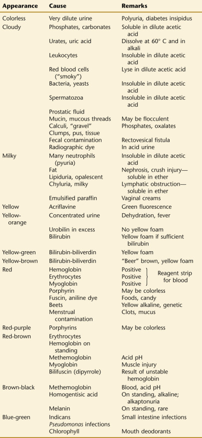

 

##  Color 

The yellow color of urine is due largely to the pigment urochrome, excretion of which is generally proportional to the metabolic rate. It is increased during fever, thyrotoxicosis, and starvation. Small quantities of urobilins and uroerythrin (pink pigment) also contribute to urine coloration. In normal individuals, both pale and dark yellow urine can be produced, and these differences are rough indicators of hydration and urine concentration. Pale urine, typically of low specific gravity, is excreted following high fluid intake; darker urine is seen when fluids are withheld. Note that pale urine of high specific gravity may be found in diabetes mellitus. An abnormal color to the urine is usually due to an ingested food or medication, but may also be a clue to a specific disease state (  Aycock & Kass, 2012  ). [ Table 28-3 ](<#t0020>) lists the urine color changes associated with commonly used drugs. 

TABLE 28-3 

Urine Color Changes with Commonly Used Drugs [ * ](<#hl0000498>)

Drug  |  Color   
---|---  
Alcohol, ethyl  |  Pale, diuresis   
Anthraquinone laxatives (senna, cascara)  |  Reddish, alkaline; yellow-brown, acid   
Chlorzoxazone (Paraflex) (muscle relaxant)  |  Red   
Deferoxamine mesylate (Desferal) (chelates iron)  |  Red   
Ethoxazene (Serenium) (urinary analgesic)  |  Orange, red   
Fluorescein sodium (given IV)  |  Yellow   
Furazolidone (Furoxone) (Tricofuron) (an antibacterial, antiprotozoal nitrofuran)  |  Brown   
Indigo carmine dye (renal function, cytoscopy)  |  Blue   
Iron sorbitol (Jectofer) (possibly other iron compounds forming iron sulfide in urine)  |  Brown on standing   
Levodopa (  l  -dopa) (for parkinsonism)  |  Red then brown, alkaline   
Mepacrine (Atabrine) (antimalarial) (intestinal worms, _Giardia)_ |  Yellow   
Methocarbamol (Robaxin) (muscle relaxant)  |  Green-brown   
Methyldopa (Aldomet) (antihypertensive)  |  Darkens; if oxidizing agents present, red to brown   
Methylene blue (used to delineate fistulas)  |  Blue, blue-green   
Metronidazole (Flagyl) (for _Trichomonas_ infection, amebiasis, _Giardia_ )  |  Darkening, reddish brown   
Nitrofurantoin (Furadantin) (antibacterial)  |  Brown-yellow   
Phenazopyridine (Pyridium) (urinary analgesic), also compounded with sulfonamides (e.g., Azo Gantrisin)  |  Orange-red, acid pH   
Phenindione (Hedulin) (anticoagulant) (important to distinguish from hematuria)  |  Orange, alkaline; color disappears on acidifying   
Phenol poisoning  |  Brown; oxidized to quinones (green)   
Phenolphthalein (purgative)  |  Red-purple, alkaline pH   
Phenolsulfonphthalein (also sulfobromophthalein)  |  Pink-red, alkaline pH   
Rifampin (Rifadin, Rimactane) (tuberculosis therapy)  |  Bright orange-red   
Riboflavin (multivitamins)  |  Bright yellow   
Sulfasalazine (Azulfidine) (for ulcerative colitis)  |  Orange-yellow, alkaline pH   
  
 * Other commonly used drugs have been noted to produce color change once or occasionally: amitriptyline (Elavil)—blue-green; phenothiazines—red; triamterene (Dyrenium)—pale blue (blue fluorescence in acid urine). 

 

##  Red Urine. 

The most common abnormal color is red or red-brown. When seen in females, menstrual flow contamination should be considered. Hematuria (presence of red blood cells [RBCs]), hemoglobinuria, and myoglobinuria may produce pink, red, or red-brown coloration. All three of these conditions are easily detectable on reagent strip testing; however, further evaluation is necessary for absolute differentiation (see the [ Blood, Hemoglobin, Hemosiderin, and Myoglobin in Urine ](<#s0520>) section later in the chapter). 

In the porphyrias, urine coloration is variable. It is usually red in congenital erythropoietic porphyria and porphyria cutanea tarda, but in lead porphyrinuria, the urine color is generally normal. In acute intermittent hepatic porphyria, it is normal but darkens on standing. Red urine also may be associated with the use of drugs and dyes in diagnostic tests, for example, phenolsulfonphthalein, which is sometimes used in assessing renal function, will cause a red color in alkaline urine. Patients with an unstable hemoglobin may produce urine with red-brown color that does not give a positive indication of hemoglobin or bilirubin. The pigment is probably a dipyrrole or bilifuscin. An innocuous red urine associated with ingestion of beets is seen in genetically susceptible persons. 

 

##  Yellow-Brown or Green-Brown Urine. 

Yellow-brown or green-brown urine is generally associated with bile pigments, chiefly bilirubin. On shaking the urine specimen, a yellow foam may be seen, which distinguishes bilirubin from a normal, dark, concentrated urine, which will have white foam. In severe obstructive jaundice, the urine may be dark green. 

 

##  Orange-Red or Orange-Brown Urine. 

Excreted urobilinogen is colorless but is converted in the presence of light and low pH to urobilin, which is dark yellow to orange. Urobilin will not color the foam on shaking, and in this way may be confused with a concentrated normal urine; reagent strip testing would be confirmatory in this situation. 

 

##  Dark Brown or Black Urine. 

Acid urine containing hemoglobin will darken on standing because of the formation of methemoglobin. “Cola-colored” urine may be seen with rhabdomyolysis (  Keverline, 1998  ) and in some patients taking  l  -dopa. Rarer causes of dark brown urine are homogentisic acid (alkaptonuria) and melanin. Urine-containing homogentisic acid will darken more rapidly when alkaline. 

 

##  Blue, Green, or Blue-Green Urine. 

A blue, green, or blue-green discoloration of the urine is most commonly due to food dyes or additives, some foods, or medications including, amitriptyline, doxorubicin, cimetidine, flutamide, indomethacin, methocarbamol, mitoxantrone, phenylbutazone, phenergan, propofol, promethazine, triamterene, rinsapin, and sildenafil (  Aycock & Kass, 2012  ;  Brunzel, 2012  ;  Strasinger et al, 2014  ). Rare causes of blue or green urine include pseudomonas infection and some inherited diseases, such as Hartnup disease, indicanemia, indicanuria, and familial hypercalcemia. In cancer patients receiving chemotherapy, the methylene blue included in several dysuria medications, including Prosed DS, Trac Tabs, Urised, and Uroblue, may cause green or bluish-green urine discoloration (  Cotten & McCudden, 2011  ;  Meng et al, 2013b  ). 

 

##  Clarity (Character) 

Urine is normally clear, and the presence of particulate material in an unspun specimen warrants further investigation. The differential diagnosis for cloudy urine is broad and includes several nonpathologic entities. Turbidity may simply be due to the precipitation of crystals or nonpathologic salts referred to as _amorphous._ Phosphate, ammonium urate, and carbonate can precipitate in alkaline urine; these redissolve when acetic acid is added. Uric acid and urates cause a white, pink, or orange cloud in acid urine and redissolve on warming to 60° C. 

Cloudy urine can be attributed to the presence of various cellular elements. Leukocytes may form a white cloud similar to that caused by phosphates, but the cloud remains after acidification. Likewise, bacterial growth may cause a uniform opalescence that is not removed by acidification or by filtration, and it has been suggested that turbidimetric assessment using a double-beam turbidimeter may be useful for urine infection screening (  Livsey, 1995  ). Turbidity may also be due to RBCs, epithelial cells, spermatozoa, or prostatic fluid. Prostatic fluid normally contains a few leukocytes and other formed elements. 

Miscellaneous causes for cloudy urine include mucus from the lower urinary tract or genital tract, blood clots, menstrual discharge, and other particulate material such as pieces of tissue, small calculi, clumps of pus, and fecal material. Fecal material in urine may occur with a fistulous connection between the colon or rectum and bladder. Contamination with powders or with antiseptics that become opaque with water (phenols) will also cause a turbid urine. 

 

##  Chyluria. 

This is a rare condition in which the urine contains lymph. It is associated with obstruction to lymph flow and rupture of lymphatic vessels into the renal pelvis, ureters, bladder, or urethra. Although parasitic infection with _Wuchereria bancrofti_ (filariasis) is the prevailing cause (  Cortvriend et al, 1998  ), abdominal lymph node enlargement and tumors have also been associated with chyluria. Even with filariasis, this condition is rare. 

The appearance of the urine varies with the amount of lymph present, ranging from clear to opalescent or milky. Clots may form, and if sufficient lymph is present, the urine may layer with the chylomicrons on top, and fibrin and cells beneath. Chylomicrons may not be apparent microscopically unless they have coalesced as microglobules. This fatty material can be extracted from urine using an equal volume of ether or chloroform. Urine phosphates, in contradistinction, will not clear with this method. Pseudochyluria occurs with the use of paraffin-based vaginal creams for the treatment of _Candida_ infection. 

 

##  Lipiduria. 

Fat globules appear in the urine most often with nephrotic syndrome; these consist of neutral fats (triglycerides) and cholesterol. Lipiduria can also be present in patients who have sustained skeletal trauma with fractures to major long bones or the pelvis. Presumably, the source of lipid is exposed fatty marrow. Keep in mind that in addition to these endogenous lipids, oily contaminants such as paraffin may float on the urine surface. Microscopic examination of the urine may be required to classify fatty materials as Oil Red O positive droplets or cholesterol esters with polarization. 

 

##  Odor 

Urine normally will have a faint, aromatic odor of undetermined source. Specimens with extensive bacterial overgrowth can be recognized by an ammoniacal, fetid odor. Additionally, ingestion of asparagus or thymol produces distinctive odors in urine. 

Characteristic urine odors associated with amino acid disorders include the following: 

Cystinuria  |  Rotten eggs   
---|---  
Hawkinsinuria  |  Swimming pool   
Ketoacidosis  |  Sweet, fruity   
Isovaleric acidemia and glutaric acidemia  |  Sweaty feet   
Maple syrup urine disease (MSUD)  |  Maple syrup   
Methionine malabsorption  |  Cabbage, hops   
Phenylketonuria  |  Mousy, musty   
Trimethylaminuria  |  Rotting fish   
Tyrosinemia  |  Rancid   
  
Lack of odor in urine from patients with acute renal failure suggests acute tubular necrosis rather than prerenal failure. 

 

##  Urine Volume 

Under ordinary conditions, the main determinant of urine volume is water intake. The average adult produces from 600 to 2000 mL of urine per day, with night urine generally not in excess of 400 mL. In pregnancy, the usual diurnal variation may be reversed. Young children, compared with adults, may excrete about three to four times as much urine per kilogram of body weight. Measurement of urine output during timed intervals may be valuable in clinical diagnosis. 

 

##  Increases in Urine Volume 

Production of more than 2000 mL of urine in 24 hours is termed **polyuria; nocturia** is excretion of more than 500 mL of urine at night with a specific gravity of less than 1.018. In general, high volumes of urine tend to result in a low specific gravity. 

Excessive intake of water (polydipsia) will result in polyuria, as will consumption of certain drugs with a diuretic effect, such as caffeine, alcohol, thiazides, and other diuretics. Intravenous solutions may increase the urine output. Increased salt intake and high-protein diets will require more water for excretion. 

Pathologic states that result in excess renal fluid loss/urine excretion can be divided into three groups. 

 

##  Defective Hormonal Regulation of Volume Homeostasis. 

Diabetes insipidus can be due to a deficiency (central/pituitary variety) of, or renal unresponsiveness (nephrogenic) to, antidiuretic hormone. In either situation, excessive thirst and water intake occur, together with marked polyuria and nocturia. Up to 15 L of urine per day may be produced. 

 

##  Defective Renal Salt/Water Absorption. 

This can be due to the administration of diuretic agents, or an abnormality of the renal tubules, resulting in sodium wasting or impairment of the countercurrent mechanism. In progressive chronic renal failure, functioning renal tissue is diminished, and the ability to concentrate urine is gradually lost. To excrete the daily renal water and solute load, an increase in urine volume per residual nephron results, and the urine eventually becomes isoosmotic with the plasma ultrafiltrate. 

 

##  Osmotic Diuresis. 

In diabetes mellitus with hyperglycemia, an excessive amount of glucose is excreted, causing a solute diuresis. 

 

##  Decreases in Urine Volume 

Oliguria is the excretion of less than 500 mL of urine per 24 hours, and anuria is the near-complete suppression of urine formation. Water deprivation will cause a decrease in urine volume even before signs of dehydration appear. Oliguria can be rather abrupt in onset, as can acute renal failure, or it may be due to a chronic progressive renal disease. In either case, retention of nitrogenous waste products (azotemia) can occur (see [ Chapter 14 ](<##!/content/3-s2.0-B9780323295680000140?scrollTo=%23c00014>) ). 

The causes of acute renal failure are classically categorized as follows. 

 

##  Prerenal. 

Loss of intravascular volume may result from hemorrhage, or from dehydration associated with prolonged diarrhea, vomiting, excess sweating, or severe burns. So-called **third spacing** is the shifting of intravascular fluids to extracellular spaces. Additionally, conditions such as congestive heart failure, sepsis, anaphylaxis, or renal artery embolic occlusion may result in a decrease in renal blood flow. 

 

##  Postrenal. 

Bilateral hydronephrosis, resulting from high-grade or long-standing obstruction of the urinary tract, may be associated with a marked decrease in urine flow and even anuria. This can occur with prostatic hyperplasia and carcinoma. Bilateral ureteral obstruction due to stones, clots, and sloughed tissue, and urethral obstruction due to stricture or valves, are other forms of obstruction. The anuria associated with sulfonamide therapy and dehydration is due to obstruction caused by the precipitation of crystals in the renal tubules when the urinary pH is acidic. 

 

##  Renal Parenchymal Disease. 

This should be considered after other prerenal and postrenal causes of oliguria have been ruled out. The list of conditions is extensive and includes various vascular disorders, glomerulonephritis, interstitial nephritis, and acute tubular necrosis (ATN). A common cause of ATN is renal ischemia due to heart failure or hypotension. Numerous nephrotoxic agents may produce ATN, including several antibiotics, mercury, cadmium, carbon tetrachloride, and glycerol. Other causes include hemoglobinuria and myoglobinuria, associated with hemolysis and muscle damage, respectively, as well as excessive quantities of intratubular proteins or crystals. 

Chronic renal failure, a progressive and irreversible loss of renal function, results from several disease entities. These include hypertensive and diabetes-associated nephrosclerosis, chronic glomerulonephritis, polycystic kidney disease, and other urologic disorders. Urinary specific gravity is low, and proteinuria, casts, and renal cells may be evident. Pyelonephritis or interstitial nephritis will cause predominantly tubular dysfunction with polyuria early in the disease, but later oliguria of chronic renal failure supervenes. 

 

##  Specific Gravity and Osmolality 

The volume of excreted urine and the concentrations of its solutes are varied by the kidney to maintain the homeostasis of body fluid and electrolytes. Specific gravity and osmolality measurements reflect the relative degree of concentration or dilution of a urine specimen. This in turn aids in evaluating the concentrating and diluting abilities of the kidneys. Both of these indices, as well as urine color, have been found to be reliable indicators of hydration status (  Armstrong et al, 1998  ). 

The specific gravity of a specimen indicates the relative proportions of dissolved solid components to total volume of the specimen; in other words, it reflects the density of the specimen. Osmolality, on the other hand, indicates the number of particles of solute per unit of solution. Larger particles, such as proteins and sugars, tend to elevate the specific gravity more than smaller electrolytes. In critical circumstances, the measurement of osmolality of urine (and plasma) is preferred to the measurement of specific gravity (  Voinescu et al, 2002  ;  Imran et al, 2010  ). 

 

##  Specific Gravity 

Urea (20%), sodium chloride (25%), sulfate, and phosphate contribute most of the specific gravity of normal urine. Normal adults with adequate fluid intake will produce urine of specific gravity 1.016 to 1.022 over a 24-hour period; however, normal kidneys have the ability to produce urine with a specific gravity that ranges from 1.003 to 1.035. If a random specimen of urine has a specific gravity of 1.023 or more, the concentrating ability can be considered normal. Minimum specific gravity after a standard water load should be less than 1.007. 

Urines of low specific gravity are called _hyposthenuric_ , with the specific gravity less than 1.007. In diabetes insipidus, loss of concentrating ability (as described earlier) results in production of large volumes of urine with a specific gravity as low as 1.001 (specific gravity of water is 1.000). Prolonged excretion of urine with low specific gravity can also be seen with various renal abnormalities, including pyelonephritis and glomerulonephritis. High specific gravity can be seen after excess water loss/dehydration, adrenal insufficiency, hepatic disease, or congestive heart failure. When little or no variability is noted between several specimens from a patient, and the specific gravity is fixed at about 1.010, this is known as **isothenuria** . This finding is indicative of severe renal damage with disruption of both concentrating and diluting abilities. 

 

##  Methods. 

Several methods are available to measure specific gravity—reagent strip, refractometer, urinometer, and the falling drop method. 

 

##  Reagent strip. 

This is an indirect method for measuring specific gravity. The reagent area has three main ingredients present: polyelectrolyte, indicator substance, and buffer. The principle of this method is based on the pKa change of pretreated polyelectrolytes in relation to the ionic concentration of the urine. When the ionic concentration is high, the pKa (acid dissociation constant) is decreased, as is the pH. The indicator substance then changes color relative to ionic concentration, and this is translated to specific gravity values. The results obtained by this method should be used with caution, since it is not affected by high amounts of glucose, protein, or radiographic contrast material, all of which tend to elevate the specific gravity readings obtained from refractometers and urinometers, described in the following sections. The reagent strip assay for urine pH must be performed carefully to avoid run-over from adjacent test areas, which can cause false readings. 

 

##  Refractometer. 

This is also an indirect method. The refractive index of a solution is related to the content of dissolved solids present. The index is the ratio of the velocity of light in air to the velocity of light in a solution. It varies directly with the proportion of particles in solution and, therefore, with the specific gravity. 

The optical analogue handheld clinical refractometer is a device that requires only a few drops of urine (unlike the 15 mL of urine necessary with the urinometer). Although the refractometer measures the refractive index of a solution, the scale used is valid only for urine and cannot be used to indicate the specific gravity of salt or sugar solutions. This should be kept in mind if salt solutions are to be used for calibration. Special graphs or tables are required to convert refractive index scale numbers to solute concentrations in aqueous solutions if this should be required (American Optical Catalog Number 10403). The specific gravity reading on the refractometer is generally slightly lower than a urinometer reading on the same urine specimen by about 0.002. Digital refractometers are now available for human clinical applications. 

 

##  Procedure. 

A temperature-compensated hand model is widely used. The instrument is temperature compensated between 60° and 100° F (15° to 38° C). It is damaged by heat above 150° F (66° C) and by immersion of the eyepiece and focusing ring in water. It should read zero with distilled water; the zero reading can be reset if necessary by breaking the seal over the setscrew, turning it with a small screwdriver, and resealing. Check calibration daily. Copper sulfate solutions can be adjusted to monitor a high specific gravity level as an additional check. 

To make a specific gravity determination of urine, clean the surfaces of the cover and prism with a drop of distilled water and a damp cloth, and allow them to dry. Close the cover. Hold horizontally, and apply a drop of urine at the notched bottom of the cover, so that it flows over the prism surface by capillary action. Point the instrument toward a light source at an angle that gives optimal contrast. Rotate the eyepiece until the scale is in focus. Read directly on the specific gravity scale the sharp dividing line between light and dark contrast. The entire procedure should be repeated with a second drop of urine from the same sample. 

 

##  Urinometer. 

This is a hydrometer that is adapted to directly measure the specific gravity of urine at room temperature. It should be checked each day by measuring the specific gravity of distilled water. If the urinometer does not give a reading of 1.000, an appropriate correction must be applied to all readings taken with that urinometer. The accuracy of a urinometer may be further checked with solutions of known specific gravity. 

Because temperature influences the specific gravity, urine samples should be allowed to come to room temperature before a reading is made, or a correction of 0.001 should be made for each 3° C above or below the calibration temperature indicated on the urinometer. Corrections must also be made for protein or glucose present; subtract 0.003 for every 1 g/dL of protein, and 0.004 for every 1 g/dL of glucose. 

 

##  Procedure. 

The urinometer vessel is filled three-fourths full with urine (minimum volume required is about 15 mL). The urinometer is inserted with a spinning motion to make sure that it is floating freely. (When reading the urinometer, be sure that it is not touching the sides or the bottom of the cylinder. Avoid surface bubbles, which obscure the meniscus.) Read the bottom of the meniscus. 

 

##  Falling drop method. 

This is a direct method for measuring specific gravity. It is more accurate than the refractometer, and is more precise than the urinometer. This method utilizes a specially designed column filled with water-immiscible oil. A measured drop of urine is introduced into the column, and as this drop falls, it encounters two beams of light; breaking the first beam starts a timer, and breaking the second turns it off. The falling time is measured electronically and is expressed as a specific gravity (  Free, 1996  ). Despite its accuracy and use of small specimen volume, this method is not widely practiced. 

 

##  Osmolality 

The normal adult with a normal fluid intake will produce urine of about 500 to 850 mOsm/kg water. The normal kidney is able to produce a urine osmolality in the range of 800 to 1400 mOsm/kg water in dehydration, and a minimal osmolality of 40 to 80 mOsm/kg water during water diuresis. After a period of dehydration, the osmolality of the urine should be three to four times that of the plasma (e.g., with a plasma osmolality of 285 mOsm/kg water, the urine osmolality should be at least 855 mOsm/kg water). 

  

##  Methods. 

The freezing-point depression method is commonly employed. A solution containing 1osmol or 1000 mOsm/kg water depresses the freezing point 1.86° C below the freezing point of water. For methods, see [ Chapter 4 ](<##!/content/3-s2.0-B9780323295680000048?scrollTo=%23c00004>) . 

 

##  Chemical Screening 

Reagent strips are the primary method used for the chemical examination of urine. Although easily used, they represent multiple complex, state-of-the-art chemical reactions. [ Box 28-1 ](<#b0010>) lists recommendations for both storage and use of reagent strips. Although reading of the strips has traditionally been done manually, automated instruments, such as the Bayer Atlas (Siemens Medical Solutions Diagnostics, Tarrytown, N.Y.), are now available that will aspirate a precise amount of urine, deposit it on the dipstick, and read the chemical reactions on the reagent strip by reflectance (  Penders et al, 2002  ;  Lyon et al, 2003  ;  Wu, 2010  ). These systems provide excellent reproducibility of results and are not prone to some of the inconsistencies that occur when human hands try to time the reactions, and when human eyes attempt to discriminate different shades of color reactions. 

Box 28-1 

Recommendations for Reagent Strips 

 

##  Storage 

  * Protect from moisture and excessive heat. 

  * Store in cool, dry area but not in a refrigerator. 

  * Check for discoloration with each use; discoloration may indicate loss of reactivity. 

  * Do not use discolored strips or tablets. 

  * Keep container tightly stoppered. 

  * Check manufacturer's directions with each new lot number for changes in procedure. 

 

##  Testing 

  * Test urine as soon as possible after receipt. 

  * Remove only enough strips for immediate use; recap tightly. 

  * Test a well-mixed, unspun urine sample. 

  * Urine samples must be at room temperature before testing. 

  * Do not touch the test area with fingers. 

  * Do not use reagent strips in the presence of volatile acids or alkaline fumes. 

  * Dip reagent strip into urine briefly—no longer than 1 second. 

  * Drain excess urine off—run edge of strip along rim of tube, or blot edge on absorbent paper. 

  * Do not allow reagents to run together. 

  * Do not lay reagent strip directly on workbench surface. 

  * Follow exact timing recommendations for each chemical test. 

  * Hold reagent strip close to the color chart, and read under good lighting. 

  * Know sources of error, sensitivity, and specificity of each test on the reagent strip. 

  * Think! Make correlations between patient history and individual test, and then follow through. 

It should be noted that reagent strip methods are changed periodically, sensitivities and color reactions altered, and new measurements added. Manufacturers supply tables of common interfering substances, and these should be consulted. Interference with ascorbic acid and drugs producing colored urine such as phenazopyridine (Pyridium) and other azo compounds, as well as methylthioninium chloride (methylene blue), may be encountered. 

The chemical measures most commonly found on reagent strips will be discussed first, with less commonly measured chemical parameters following. A discussion on the clinical application of each analyte will precede reagent strip and other methods. Confirmatory methods will be included when available and necessary. 

 

##  Urine pH 

The kidneys and lungs normally work in concert to maintain acid-base equilibrium. The lung excretes carbon dioxide, whereas the renal contribution is that of reclaiming and generating bicarbonate and secreting ammonium ions. The proximal renal tubule is responsible for the bulk of the bicarbonate reabsorption/generation, and the distal tubule provides the remaining function. 

The tubular cells exchange hydrogen ions for sodium of the glomerular filtrate. The metabolic activity of the body produces nonvolatile acids, principally sulfuric, phosphoric, and hydrochloric acids, but also small amounts of pyruvic, lactic, and citric acids and ketone bodies. These are excreted by the glomerulus as salts (sodium, potassium, calcium, and ammonium salts) and, together with ammonia produced by the proximal tubules, can then go on to trap secreted hydrogen ions for elimination in the urine (see [ Chapter 14 ](<##!/content/3-s2.0-B9780323295680000140?scrollTo=%23c00014>) ). 

 

##  Normal pH 

The average adult on a normal diet excretes about 50 to 100 mEq of hydrogen ions in 24 hours to produce urine of about pH 6. In healthy individuals, urine pH may vary from 4.6 to 8. 

 

##  Acid Urine 

Acid urine may be produced by a diet high in meat protein and with some fruits such as cranberries. During the mild respiratory acidosis of sleep, a more acid urine may be formed. Also, therapeutic acidification of the urine by various pharmacologic agents, including ammonium chloride, methionine, and methenamine mandelate, is used in the treatment of some calculi. This would include phosphate and calcium carbonate stones, which tend to develop in alkaline urine. 

In acid-base disturbances, the pH of the urine reflects attempts at compensation by the kidneys. Patients with metabolic or respiratory acidosis should produce acid urine with increased titratable acidity and ammonium ion concentration. In diabetic ketoacidosis, large quantities of hydrogen ions are excreted, much as ammonium ion. In potassium depletion, such as in hypokalemic alkalosis of prolonged vomiting or in hypercorticism, or with prolonged use of diuretics, paradoxical aciduria with slightly acid urine may occur in the presence of a metabolic alkalosis. Low urine pH is associated with metabolic syndrome, chronic kidney disease, and an increased incidence of nephrolithiasis (  Nakanishi et al, 2012  ). 

 

##  Alkaline Urine 

Alkaline urine may be induced by a diet high in certain fruits and vegetables, especially citrus fruits (  Welch et al, 2008  ). The urine tends to become less acid following a meal (the so-called **alkaline tide** ). This was long believed to be a urinary compensation for gastric acid secretion; however, recent studies do not support this view (  Johnson et al, 1995  ). Sodium bicarbonate, potassium citrate, and acetazolamide may be used to induce alkaline urine in the treatment of some calculi, particularly those composed of uric acid, cystine, or calcium oxalate. These agents may also be used in some urinary tract infections (the antibiotics neomycin, kanamycin, and streptomycin are more active in alkaline urine), in sulfonamide therapy, and in the treatment of salicylate poisoning. 

The capacity to exchange hydrogen ion for cation and the formation of ammonia are decreased when tubular function is impaired. In classic renal tubular acidosis, glomerular filtration is normal, but the distal tubular ability to form ammonia and exchange hydrogen ions for cations is defective. Systemic acidosis results. The urine is relatively alkaline, and the pH cannot be lowered below 6 to 6.5, even with administration of an acid-loading substance. Additionally, titratable acidity and the concentration of ammonium are decreased (  Singh et al, 1995  ). In proximal renal tubular acidosis, bicarbonate wasting occurs. This can also be seen in Fanconi's syndrome. 

In metabolic alkalosis, an alkaline urine with higher levels of urinary bicarbonate is produced, and ammonia production is decreased. The kidney may produce urine with a pH as high as 7.8. In respiratory alkalosis, an alkaline urine is produced that is associated with increased excretion of bicarbonate. 

 

##  Methods 

 

##  Reagent Strip. 

Indicators methyl red and bromothymol blue give a range of orange, green, and blue colors as the pH rises, permitting estimation of pH values to within half a unit within the range of 5 to 9. It should be read immediately, but time is not critical. Care should be taken not to have excessively wet strips where acid buffer from the protein patch runs into the pH patch, causing it to become orange. 

Measurement of urine pH and acidity must always be made on freshly voided specimens. If precise measurements are required, the container should be filled to minimize the amount of dead space, and the urine covered tightly. The container should be kept cold, preferably on ice, but not frozen (  Cook et al, 2007  ). On standing, the pH tends to rise because of loss of carbon dioxide and because bacterial growth produces ammonia from urea. 

 

##  pH Electrode. 

Although the estimate of the pH obtainable by indicator strip is usually sufficient, more accurate measurement with a pH meter and glass electrode may be indicated in some clinical circumstances, such as the diagnosis and treatment of patients with disturbances of acid-base balance or monitoring urine alkalinization in patients receiving high-dose methotrexate therapy or undergoing treatment for nephrolithiasis (  Kwong et al, 2013  ;  Wockenfus et al, 2013  ). 

Because the pH meter may tend to drift, it must be standardized with three buffers of known pH immediately before use. After standardization, spray the electrodes with distilled water, clean, and dry with a tissue. Immerse the electrode in the urine sample, and report the pH of urine at the temperature of measurement. 

 

##  Titratable Acidity of Urine. 

The pH of the urine is largely dependent on the amounts of monobasic and dibasic phosphate present. Titratable acidity is measured by titrating an aliquot of 24-hour urine (collected on ice) with 0.1N NaOH, with pH 7.4 as an endpoint. Measurement may be used, together with urinary ammonia determination, in patients with chronic acidosis of obscure origin. Normal titratable acidity is in the range of 200 to 500 mL 0.1N NaOH (or 6 mL 0.1N NaOH per kg of body weight) or 20 to 40 mEq/24 hours. This procedure is described in previous editions of this textbook (  Henry, 1996  ). 

 

##  Protein in Urine 

Normally, up to 150 mg of protein is excreted in the urine daily, with the average urine protein concentration varying from 2 to 10 mg/dL, depending on urine volume. Anderson has demonstrated more than 200 urinary proteins, derived from both plasma and the urinary tract (  Anderson et al, 1979  ). About one third is albumin, and the remaining plasma proteins include small globulins, such as α-, β-, and γ-globulins. Plasma proteins with a molecular weight less than 50,000 to 60,000 pass through the glomerular basement membrane and are normally reabsorbed by proximal tubular cells. Albumin (molecular weight 69,000) is apparently filtered, but only in very small amounts. Retinol binding, β 2  -microglobulin, immunoglobulin light chains, and lysozyme are excreted in small amounts. Tamm-Horsfall glycoprotein (uromucoid), secreted by distal tubular cells and cells of the ascending loop of Henle, constitutes one third or more of the total normal protein loss. Immunoglobulin A (IgA) in secretions of the urinary tract, enzymes, and proteins from tubular epithelial cells, other desquamated cells, and leukocytes also contribute to urine protein. 

Detection of an abnormal amount of protein in urine is an important indicator of renal disease because protein has a very low maximal tubular rate of reabsorption; increased filtration of protein quickly saturates the reabsorptive mechanism. Screening methods are routinely used to differentiate normal protein excretion from abnormal, and therefore should not detect less than about 8 to 10 mg/dL in a normal adult with a normal rate of urine flow. The reagent strip method is sensitive to albumin while acid precipitation methods detect all proteins and therefore will indicate the presence of globulins, as well as albumin. It should be noted that a very dilute random urine specimen may have a falsely low protein value. Because a positive result for protein is significant, it should be confirmed by a second method and on repeated specimens. Depending on the history and examination, confirmatory measurements for elevated protein should be accompanied by the evaluation of renal function, examination of the urine sediment, and urine culture. 

Functional proteinuria is usually less than 0.5 g/day and can be seen in various situations in which dehydration contributes to the level of protein measured in urine. With strenuous exercise, a mixture of high and low molecular weight proteins appears in the urine, and many casts, both hyaline and granular, can be seen. Functional proteinuria may also accompany congestive heart failure, cold exposure, and fever. In any event, the proteinuria resolves with appropriate treatment or rest within 2 to 3 days. 

Intermittent, transient proteinuria can occasionally be seen in patients with a normal history, normal physical examination findings, and otherwise normal renal function. Except for the occasional proteinuria, urinalysis is also normal. These patients are typically followed every 6 months to check for hypertension or other abnormalities, and the overall prognosis is good. A transient proteinuria may also occur in normal pregnancy, but any proteinuria in pregnancy is an important finding and requires investigation. Persistent proteinuria of 1 to 2 g/day in an asymptomatic person, or when accompanied by hematuria, has a poorer prognosis than intermittent (transient) or postural proteinuria. 

Recent interest has focused on the importance of proteinuria in determining risk for adverse outcomes in chronic kidney disease (CKD) (  Levey et al, 2003  ;  Sarnak & Astor, 2011  ). Current guidelines for classifying stages of CKD are based on estimated glomerular filtration rate; however, heavy proteinuria was found to be independently associated with a twofold or greater increase in all-cause mortality, myocardial infarction, and progression to renal failure (  Hemmelgarn et al, 2010  ). A systematic review and meta-analysis of 26 cohort studies involving 169,949 individuals showed a strong and continuous association between proteinuria and risk for coronary artery disease, leading those authors to suggest the routine incorporation of testing for proteinuria into assessment of cardiovascular risk (  Perkovic et al, 2008  ). 

Hereditary proteinuria syndromes are rare and have heterogeneous forms ranging from congenital nephrotic syndrome with severe proteinuria to focal segmental glomerulosclerosis with moderate proteinuria (  Benoit et al, 2010  ;  Caridi et al, 2010  ). Progression to end-stage renal disease is a common outcome. Specific diagnosis is possible with genetic testing for mutations in the genes for various structural proteins of the glomerulus (  Tryggvason et al, 2006  ;  Machuca et al, 2009  ;  Joshi et al, 2013  ). 

 

##  Postural Proteinuria 

Postural proteinuria (orthostatic) occurs in 3% to 5% of apparently healthy young adults. In this condition, proteinuria is found during the day but not at night when a recumbent position is assumed. Persistent proteinuria may develop in some of these healthy subjects at a later date, and renal biopsies have shown abnormalities of the glomerulus in a few cases (  Robinson et al, 1961  ). Proteinuria is apparently related to an exaggerated lordotic position and may result from renal congestion or ischemia. The total daily excretion of protein rarely exceeds 1 g, and in most instances, no other evidence of renal disease develops is apparent. 

To evaluate the possibility of postural proteinuria, the patient is instructed to empty his or her bladder upon going to bed in the evening. Immediately upon arising in the morning, the patient voids and saves this specimen. After 2 hours of standing and walking about, the patient voids again and saves the specimen. The two urine specimens are assessed for protein, and if the first is negative and the second positive, the patient may have postural proteinuria. Frequent examination of the patient should be made to reevaluate this condition. 

 

##  Proteinuria in Older Adults 

The incidence of significant proteinuria found on urinalysis in the older adult population is substantially increased when compared with patients younger than 60 years of age (  Verma et al, 2012  ). It has been estimated that the older adult population in general has a threefold to fourfold greater incidence of glomerulonephritis, and approximately one quarter of those affected have a minimal change–like disorder that may respond to steroid therapy. Occult malignancies in this population may also give rise to membranous glomerulonephritis, with resultant proteinuria (  Threatte, 1986  ). 

 

##  Proteinuria Quantification 

More useful information for the diagnosis of kidney disease and for following the response to treatment is obtained by quantitatively analyzing the amount of protein excreted over a 24-hour period. It should be noted that the accuracy of measurements of any quantitative urine determination depends on the adequacy and completeness of the timed urine collection. Erroneous results are often related to collection problems. Repeat measurements may be needed to decide whether the proteinuria is intermittent or persistent. In the event that a 24-hour urine collection cannot be obtained, the protein-to-creatinine ratio on a random, untimed urine specimen can be used to monitor kidney damage in patients with overt proteinuria. To determine the protein-to-creatinine ratio, the urine protein (mg/dL) reading from the dipstick is divided by the urine creatinine (mg/mL) (  Ginsberg et al, 1983  ). The ratio is normally less than 0.2 grams protein per gram creatinine in adults and children over 2 years of age, and less than 0.5 grams protein per gram creatinine in children under 2 years of age. Since the creatinine excretion rate is proportional to the patient's age, sex, and weight, and can be predicted from the serum creatinine (  Cockcroft & Gault, 1976  ), an estimated 24-hour protein excretion rate can be obtained by multiplying the protein-to-creatine ratio by the creatinine excretion rate. The result is usually normalized for body surface area and expressed as the 24-hour protein excretion in g/day per 1.73 m  2  body surface area. The albumin-to-creatinine ratio is recommended by some authorities as an alternative to the protein-to-creatinine ratio in untimed urine specimens, with an albumin-to-creatinine ratio greater than 30 mg albumin/g creatinine considered abnormal (  Lamb et al, 2013  ). 

 

##  Heavy Proteinuria (>4 g/day). 

Heavy protein loss is characteristically seen with nephrotic syndrome. Classically, a low serum albumin level, generalized edema, and increased serum lipids (cholesterol, triglycerides, and phosphatides) accompany this disorder. Lipoproteins, low-density and very-low-density, are increased in serum, whereas high-density lipoprotein, a smaller molecule, has been demonstrated in the urine (de  Mendoza et al, 1976  ). It has been suggested that loss of lipoprotein lipase in urine contributes to the rise in serum lipid levels. γ-Globulin is also lost in the urine, and this may contribute to susceptibility to bacterial infections commonly found in nephrotic patients. When lipid is lost in urine, many granular casts, fatty casts, and fat-filled renal tubular epithelial cells (oval fat bodies) are found in the sediment. Cholesterol ester droplets may be demonstrable by polarization. 

Nephrotic syndrome is principally associated with glomerular dysfunction/damage due to (1) primary renal diseases, including idiopathic disease, and (2) systemic diseases with renal involvement (  Certikova-Chabova & Tesar, 2013  ). Transient or mechanical causes include severe congestive heart failure, constrictive pericarditis, and renal vein thrombosis. The last can be a consequence of nephrotic syndrome because of losses of anticlotting factors in urine and elevation of serum fibrinogen. In children, a common cause of nephrotic syndrome is minimal change disease (also known as _nil lesion_ ), a steroid-responsive glomerular disorder. Acute, rapidly progressive, and chronic types of glomerulonephritis are causes of heavy proteinuria and may be accompanied by urinary erythrocytes or erythrocyte casts. Diabetes mellitus and lupus erythematosus are systemic diseases that frequently cause glomerular injury and heavy proteinuria. Urine sediment may be “telescoped,” that is, may display all types of cells and casts in lupus nephritis or with a hypersensitivity reaction. Malaria, malignant hypertension, toxemia of pregnancy, heavy metals (gold, mercury), drugs (penicillamine), neoplasia in general, amyloidosis, sickle cell disease, renal transplant rejection, and rarely primary antiphospholipid syndrome (  Levy et al, 1998  ) are additional causes of heavy proteinuria. 

 

##  Moderate Proteinuria (1.0 to 4.0 g/day). 

Moderate proteinuria may be found in the vast majority of renal diseases, including those mentioned previously, as well as nephrosclerosis, multiple myeloma, and toxic nephropathies. Also included are degenerative, malignant, and inflammatory conditions of the lower urinary tract, including irritative conditions such as the presence of calculi. 

 

##  Minimal Proteinuria (<1.0 g/day). 

Minimal proteinuria may be noted in chronic pyelonephritis, in which case it may be intermittent, and in relatively inactive phases of glomerular diseases. It is also seen with nephrosclerosis, chronic interstitial nephritis, congenital diseases such as polycystic disease and medullary cystic disease, and renal tubular diseases. In tubular diseases, the urinary sediment usually is not abnormal, but erythrocytes, leukocytes, and tubular cells may be seen with interstitial nephritis. However, significant sediment findings may sometimes accompany trace protein results. Minimal proteinuria is also present in postural proteinurias and transient proteinuria. 

 

##  Qualitative Categories of Proteinuria 

Detection of the types of protein present in urine requires electrophoretic separation of urine proteins. Based on these and on clinical findings, proteinuria may be separated into a glomerular pattern and a tubular pattern, indicating which part of the nephron is primarily involved. However, these anatomic entities tend to merge as disease progresses. 

 

##  Glomerular Pattern. 

Glomerular disease causes proteinuria, which may be heavy (>3 to 4 g/day). Loss or reduction of the fixed negative charge on the glomerular basement membrane allows albumin to permeate into Bowman's space in large quantities, more than can be reabsorbed by the proximal tubular cells. When serum albumin is lost in urine, other proteins of similar size or charge are also lost (e.g., antithrombin, transferrin, prealbumin, α 1  -acid glycoprotein, α 1  -antitrypsin). Because tubular function may still be normal, very small plasma proteins are largely reabsorbed. Large proteins, in contradistinction, are not seen in urine while the glomerulus is still selective (e.g., α 2  -macroglobulin, β-lipoprotein). As larger proteins appear, the proteinuria is less selective, indicating greater damage to the glomerulus (e.g., with membranous nephropathy and proliferative glomerulonephritis). 

Mechanisms of proteinuria in diabetic kidney disease with specific attention to glomerular damage were recently reviewed, with special recognition that chronic kidney disease is actually a combination of both glomerular and tubulointerstitial scarring (  Jefferson et al, 2008  ;  Baines & Brunskill, 2011  ;  Garg & Rabelink, 2011  ;  Erkan, 2013  ). 

 

##  Tubular Pattern. 

This is associated with loss of a small amount of urinary protein that would otherwise be largely reabsorbed. These proteins most often are of low molecular weight (e.g., α 1  -microglobulin, β-globulins such as β 2  -microglobulin, light chain immunoglobulins, cystatin C, and lysozyme), usually without a clear predilection for albumin-sized molecules. By radioimmunoassay, β 2  -microglobulin excretion has been measured in microgram amounts in urine as an indication of tubular damage; its normal excretion is about 100 µg/day. A tubular pattern proteinuria occurs with renal tubular diseases such as Fanconi's syndrome, cystinosis, Wilson's disease, and pyelonephritis, and with renal transplantation rejection. The amount of proteinuria is typically lower than that seen with glomerular disease, at about 1 to 2 g/day. Tubular proteinuria may be missed by the reagent strip test because of the absence or very low amounts of albumin, but it may be detected by an acid precipitation method. There is present interest in the utilization of specific molecules released into the urine during tubular injury as monitors of renal insufficiency in patients with diabetic nephropathy. The biomarkers under study include neutrophil-gelatinase–associated lipocalin (N-gal), kidney injury molecule 1 (KIM-1), liver–fatty-acid–binding protein (L-FABP), inflammatory cytokines, and others (  Tramonti and Kanwar, 2013  ). 

 

##  Overflow Proteinuria. 

Overflow proteinuria is due to the overflow of excess levels of a protein in the circulation, and can be seen with hemoglobin, myoglobin, or immunoglobulin loss into the urine. These proteins are not initially associated with glomerular or tubular diseases, but may themselves cause renal damage. Myoglobin may cause acute tubular necrosis (see the Blood, Hemoglobin, Hemosiderin, and Myoglobin in Urine section). Hemoglobin in low amounts is not thought to be toxic unless hypovolemia is present. 

 

##  Bence Jones Proteinuria. 

Bence Jones proteinuria is associated with multiple myeloma, macroglobulinemia, and malignant lymphomas. The incidence of Bence Jones proteinuria in multiple myeloma has been estimated as 50% to 80%; however, its demonstration depends greatly on the technique used. Bence Jones protein may be missed altogether if only a reagent strip test for protein is used. Electrophoresis and immunofixation electrophoresis methods are the best detection and quantification methods, along with the immunoassay measurement of free light chains (  Olivieri and Rai, 2010  ) (see [ Chapter 46 ](<##!/content/3-s2.0-B9780323295680000462?scrollTo=%23c00046>) ). 

Excretion of Bence Jones protein in large amounts, sometimes several grams in 24 hours, causes the tubular cells to deteriorate because of the high levels of protein reabsorbed. Inclusions may form in the cells, and desquamated cells may form casts in the tubular lumen. Casts also form from immunoglobulin and Tamm-Horsfall protein mixtures. With renal failure, less protein is reabsorbed and more Bence Jones protein and other proteins appear in the urine. The damaged kidney is sometimes called a _myeloma kidney,_ and the nephrotic syndrome may follow. 

 

##  Microalbuminuria. 

Microalbuminuria is the presence of albumin in urine above the normal level but below the detectable range of conventional urine dipstick methods. Several authors have suggested that these lower urine albumin levels ranging from 20 to 200 mg/L (or an approximate rate of excretion of 20 to 200 µg/min) are an indicator of early and possibly reversible glomerular damage (  Viberti et al, 1982  ;  Mogensen, 1984  ). In diabetic patients, microalbuminuria is associated with a fourfold to sixfold increase in cardiovascular mortality, and is an independent risk factor for renal mortality (  Bakris, 1996  ;  Zelmanovitz et al, 1998  ;  Roshan & Stanton, 2013  ). It is also more prevalent in hypertensive subjects (  Gerber et al, 1998  ). Various methods have been introduced, including immunologic test systems and dye-binding chemical test strips, both of which are discussed in the next section. 

 

##  Methods 

Several screening methods and quantitative methods are available for the analysis of protein in urine (  Viswanathan & Upadhyay, 2011  ). Because a positive screening test may have serious implications, it is important to be able to confirm results by a second, different method. Common screening tests include the qualitative/semiquantitative colorimetric reagent strip test and precipitation-based testing ( [ Table 28-4 ](<#t0030>) ). 

TABLE 28-4 

Screening Test for Detection of Proteinuria 

Urine Constituents or Condition  |  Reagent Strip  |  Acid Precipitation   
---|---|---  
Highly buffered alkaline urine  |  May cause FP  |  May cause FN   
Drug metabolites  |  No effect  |  May cause FP   
Radiocontrast media  |  No effect  |  May cause FP   
Turbidity  |  No effect  |  May cause FP   
Quarternary ammonium groups or chlorhexidine  |  May cause FP  |  No effect   
  
_FN,_ False negative; _FP,_ false positive. 

Accurate results are obtained with reagent strips only when albumin is increased (  White et al, 2011  ). Because of the lack of sensitivity of the reagent strip to globulins, it may be necessary to use an acid precipitation method for screening purposes. This will depend on the patient population and the diseases being screened. Reagent strips do have the advantage of avoiding false-positive reactions with organic iodides, such as those used for radiograph contrast, and tolbutamides or other drugs. 

Most other qualitative screening methods rely on protein precipitation (e.g., with heat and acetic acid, with nitric acid, with sulfosalicylic [SSA] and trichloroacetic acids). These methods will precipitate globulins, as well as albumin. In practice, negative reagent strips with positive SSA methods in urine specimens are attributable to radiograph dye, to penicillins, and, rarely, to an isolated increase in globulins. Sulfosalicylic and trichloroacetic acids are used to precipitate protein in the cold and are used as a convenient screening method. The sensitivity may be as low as 0.25 mg/dL, depending on the technique used. 

With the intense interest in utilizing proteinuria as a risk stratifier for both diabetic and nondiabetic nephropathy, as well as other conditions such as preeclampsia and coronary artery disease, recommendations for measurement have centered on methods for urine albumin quantification rather than total protein (  Lamb et al, 2009  ;  Lamb et al, 2013  ). Urine albumin measurements are considered much more standardized and reliable than total protein at low concentrations, where assessment of risk for progression in chronic kidney disease is important for diagnosis and planning therapy. 

 

##  Reagent Strip. 

This method takes advantage of the protein error of pH indicators. Because proteins carry a charge at physiologic pH, their presence will elicit a pH change. The reagent strip is impregnated with tetrabromphenol blue buffered to an acid pH of 3, or tetrachlorophenol-tetrabromosulfophthalein. In the absence of protein, the strip is yellow; 30 to 60 seconds following urine application, variable shades of green develop, depending on the type and concentration of protein present. Results may be read in a “plus” system as negative, trace, and 1+ to 4+. Most methods will detect 5 to 20 mg of albumin per deciliter. 

As stated previously, reagent strips tend to be more sensitive to albumin than to globulins, Bence Jones protein, or mucoprotein. “Trace” results may be seen with physiologic normal excretion of protein in concentrated urine specimens from healthy individuals. High salt levels will lower results. Exceptionally alkaline and/or highly buffered urine samples may give positive results in the absence of significant proteinuria (e.g., with a patient on alkaline medication or with bacterial contamination). False-positive results can occur with highly pigmented urine, quaternary ammonium compounds, amidoamines in fabric softeners, chlorhexidine, and excessive leaching of the acid buffer of the test strip by excessive wetting. The method is unaffected by urine turbidity, radiographic media, and most drugs or their metabolites. 

 

##  Sulfosalicylic Acid Method—Qualitative. 

This method depends on formation of a precipitate for determination of the presence of protein. 

 

##  Procedure. 

Specimens should be centrifuged, and a clear supernatant used. To approximately 3 mL of supernatant urine in a clean test tube, aliquot an equal amount of 3% SSA. Invert to mix. Let stand exactly 10 minutes. Invert again twice. Using ordinary room light (not a lamp), observe the degree of turbidity and/or precipitation, and grade the results according to the following descriptions: 

  * Negative—no turbidity (≈5 mg/dL or less) 

  * Trace—perceptible turbidity (≈20 mg/dL) 

  * 1+ —Distinct turbidity, but no discrete granulation (≈50 mg/dL) 

  * 2+ —Turbidity with granulation, but no flocculation (≈200 mg/dL) 

  * 3+ —Turbidity with granulation and flocculation (≈500 mg/dL) 

  * 4+ —Clumps of precipitated protein, or solid precipitate (≈1.0 g/dL or more). 

This method will detect about 5 to 10 mg/dL. Albumin, globulins, glycoproteins, and Bence Jones proteins are all detected. High levels of detergents may decrease the result. When radiographic dye is present, SSA precipitate will increase on standing, and typical crystals are seen on microscopic examination of the precipitate. In this situation, another urine specimen from the patient should be assayed. However, the effects of the radiographic media may persist for up to 3 days. A reagent strip test may be substituted, or heat and the acetic acid method may be used. In the acetic acid method, radiographic contrast media will clear with heat, whereas protein will increase turbidity. 

 

##  Quantitative Protein Determinations and Confirmatory Methods. 

Quantitative measurements of urine protein are typically adaptations of one of the various precipitation methods, or are colorimetric in nature. SSA and trichloroacetic acid (TCA) are commonly used as precipitants; the resultant turbidity can be measured by a photometer or a nephelometer. If a visual interpretation is performed, a set of gelled commercial standards that correspond to 10, 20, 30, 40, 50, 75, and 100 mg/dL may be used, with results reported in milligrams per deciliter as opposed to the “plus” method of screening precipitation tests. With SSA, the turbidity produced with albumin is 2.4 times that produced with globulin; polypeptides, glycoproteins, and Bence Jones proteins are also precipitated with this method. Of historic note, Exton's reagent contains SSA, sodium sulfate, and an indicator—bromphenol blue. TCA, in contradistinction, will cause γ-globulin to be precipitated with greater turbidity than albumin; however, the difference is not marked. 

More precise measurements suitable for smaller amounts of protein are available, and in these methods a TCA precipitate is dissolved in sodium hydroxide and measured by use of the biuret reaction. The quantitative TCA-biuret method is tedious but gives good precision. A color correction blank is used. For a comparison of biuret methods with the SSA turbidity method, see  Lizana and colleagues (1977)  . 

Several dye-binding colorimetric methods are available to quantitate urine protein. These include Coomassie blue, Ponceau S, and benzethonium chloride turbidity methods (  McElderry et al, 1982  ). Pyrogallol Red-Molybdate will also react with protein to form a bluish purple complex that absorbs at 600 nm. 

Methods used to quantitate urinary protein have not been satisfactory. Participants in the College of American Pathologists proficiency testing surveys will be aware that the mean values reported vary twofold between methods, with the SSA method producing high values. Precision is poor, with the SSA turbidimetric method showing the poorest coefficient of variation. The TCA-biuret, Coomassie blue, and TCA turbidity methods show closer agreement and about half the coefficient of variation of the SSA method. Problems arise from nonstandardized methods. With turbidity methods, these include different acid concentrations and timing, along with variation in the protein standard. 

 

##  Microalbuminuria Determination Methods. 

Very small amounts of proteins, such as albumin and β 2  -microglobulin, are measured by immunologic means using antibodies to the proteins, nephelometric methods, radioimmunoassay, protein strip electrophoresis, high-performance liquid chromatography (HPLC), or other means. The Micral II test strip (Boehringer Mannheim, Indianapolis, Ind.) is an immunologic test system that gives an almost immediate, reliable semiquantitative determination of low urine albumin concentrations (  Kutter, 1998  ). Oxytetracycline may interfere with this method, causing higher readings. There is no interference with pH. A newer method, the Clinitek microalbumin (Bayer Diagnostics, Tarrytown, N.Y.), is a highly sensitive dye-binding method. It has the further advantage of an additional test pad for simultaneous measurement of creatinine concentration. This method is not absolutely specific for albumin, for the dye compound also reacts with Tamm-Horsfall mucoprotein. HPLC is a highly sensitive method for the early detection of microalbuminuria, but is not widely utilized at this time (  Horikoshi et al, 2013  ). 

 

##  Bence Jones Proteinuria Determination Methods. 

Methods for detection of Bence Jones protein in urine include protein electrophoresis, immunofixation electrophoresis, capillary zone electrophoresis, and immunoassay for free light chains (see [ Chapter 46 ](<##!/content/3-s2.0-B9780323295680000462?scrollTo=%23c00046>) ). The traditional electrophoretic procedure employs the Amido black stain on a 200-fold concentrated urine. Newer methods, performed on less concentrated urine, including a modified Coomassie brilliant blue stain, are comparably sensitive and specific (  Wong et al, 1997  ;  Graziani et al, 2003  ). The presence of Bence Jones globulin or clonal production of immunoglobulin is indicated by a single sharp peak in the globulin region on protein electrophoresis. Bence Jones globulin represents either the κ or the λ immunoglobulin light chain. 

Bence Jones protein precipitates at temperatures between 40° and 60° C, and redissolves at near 100° C. Other methods depend on precipitation in the cold with salts, ammonium sulfate, and acids. In the presence of marked Bence Jones proteinuria, most methods yield positive results. When only a small amount of Bence Jones protein is present, or when other globulins are present, results may be doubtful. False-positive reactions are seen when other globulins are precipitated by acetic acid in the heat precipitation method. A false-negative reaction may occur if the Bence Jones protein is too concentrated and the precipitate does not redissolve on boiling. 

 

##  Glucose and Other Sugars in Urine 

Various sugars may be found in the urine under certain circumstances, both pathologic and physiologic. These include glucose, fructose, galactose, lactose, maltose, pentose, and sucrose. Glucose is by far the most common and will be discussed in the next section. 

 

##  Glucose 

The presence of detectable amounts of glucose in urine is termed **glycosuria;** this condition occurs whenever the glucose level in the blood surpasses the renal tubule capacity for reabsorption. Glucose may appear in the urine at different blood glucose levels, and there is not always a concomitant hyperglycemia. Glomerular blood flow, tubular reabsorption rate, and urine flow also will influence its appearance. When hyperglycemia is present, however, glycosuria usually occurs when the blood level is greater than 180 to 200 mg/dL. Glycosuria may be seen in several different conditions described in the following sections. 

 

##  Diabetes Mellitus. 

Although hyperglycemia alone is not necessarily indicative of diabetes mellitus, the appearance of glucose in the urine necessitates further workup. When glycosuria is present, it is typically accompanied by polyuria and thirst. Inadequate carbohydrate utilization in these patients results in elevated ketone levels in the blood and urine due to increased fat metabolism. 

For diabetic individuals, the advantage of a urine method over a blood test for glucose is that it is painless and inexpensive. Urine glucose measurements are most useful for well-controlled diabetic individuals who do not have to make frequent adjustments in their insulin/hypoglycemic agents. In insulin-dependent diabetes, a negative urine measurement could correspond to a wide range of serum glucose levels; this is attributed to the great variation in renal threshold for glucose in diabetic patients. Therefore, urine measurements may be misleading, and home blood glucose monitoring is preferred. 

Monitoring for glycosuria in diabetic patients is not without problems. Reagent strips may be difficult to interpret at the 1-g/dL (1%) and 2-g/dL (2%) glucose levels; copper reduction tests or newer, more sensitive reagent strips may be more efficacious. With the Clinitest tablet method, diabetic patients are able to estimate reducing substance levels in urine to about 10 g/dL, using one drop of specimen rather than two or five drops. In some clinics, the 24-hour urine glucose measurement is found to be useful for monitoring patients. It represents a defined longer time period, and, with blood levels of glycated hemoglobin, it contributes to the regular overall long-term management of the disease. 

Several studies have looked at the usefulness of urine dipstick testing for glycosuria as a screening method for diabetes, and the results have been mixed.  Bullimore and Keyworth (1997)  concentrated on patients over 50 years of age in a general practice setting and found this method to be practical and effective, whereas  Friderichsen and Maunsbach (1997)  came to an opposing conclusion. He suggests that if diabetes screening is carried out in general practice, blood glucose measurements should be utilized for patients in selected risk groups. The primary role of blood glucose and Hb A  1c  measurements in the diagnosis and management of diabetes mellitus was later endorsed by the American Association for Clinical Chemistry and other organizations (  Sacks et al, 2011  ). However,  Dallosso and colleagues (2015)  found that both blood glucose and urine glucose self-monitoring resulted in improved Hb  A1c  levels at 18 months in newly diagnosed patients with type 2 diabetes if structured education was provided. Routine dipstick glucose analysis can identify gravidas at increased risk for gestational diabetes (  Gribble et al, 1995  ). 

 

##  Other Causes of Glycosuria. 

Glycosuria with concomitant hyperglycemia is seen in several endocrine disorders (see [ Table 16-3 ](<##!/content/3-s2.0-B9780323295680000164?scrollTo=%23t0020>) ). These include pituitary and adrenal disorders such as acromegaly, Cushing's syndrome, hyperadrenocorticism, functioning α\- or β-cell pancreatic tumors, hyperthyroidism, and pheochromocytoma. Pancreatic disease with loss of functioning islet cells is also associated with glycosuria—for example, carcinoma, pancreatitis, and cystic fibrosis. 

Numerous other causes of glycosuria with hyperglycemia have been recognized. These include central nervous system disorders, including brain tumor or hemorrhage, hypothalamic disease, and asphyxia. Disturbances of metabolism associated with burns, infection, fractures, myocardial infarction, and uremia, as well as liver disease, glycogen storage disease, obesity, and feeding after starvation, may all be associated with glycosuria, as are certain drugs (e.g., thiazides, corticosteroids and adrenocorticotropic hormone, birth control pills). 

In pregnancy, an increase in glomerular filtration rate occurs, and all of the filtered glucose may not be reabsorbed. In this situation, glycosuria may appear at relatively low blood glucose levels. Persistent or greater than trace amounts of glycosuria should be investigated. In some patients, diabetes occurs only during pregnancy. Glycosuria after a glucose challenge has been used during pregnancy, but its predictive value for gestational diabetes, preeclampsia, and low birth weight has been questioned (  Coolen & Verhaeghe, 2010  ). Glucose tolerance may also be decreased in older adults, especially when patients have a poor intake of carbohydrates, but this is not necessarily accompanied by glycosuria. 

Glycosuria without hyperglycemia is usually associated with renal tubular dysfunction. True inherited renal glycosuria is uncommon and is associated with reduced glucose reabsorption. In renal tubular transport diseases, glycosuria may be accompanied by impaired reabsorption of water, amino acid, bicarbonate, phosphate, and sodium—a pattern seen in Fanconi's syndrome. Galactosemia, cystinosis, lead poisoning, and myeloma are additional examples of conditions associated with renal tubular dysfunction and possible glycosuria. 

 

##  Other Sugars in Urine 

Small quantities of disaccharides are normally excreted in the urine—about 50 mg in 24 hours. With intestinal diseases such as severe sprue or acute enteritis, the level may rise to 250 mg or more. Fructose, galactose, lactose, maltose, and  l  -xylulose are found in urine in patients with inherited metabolic disorders (  Scriver et al, 1989  ). If an inherited disorder is suspected, the sugar may be identified by thin-layer chromatography. Qualitative confirmatory tests generally are not satisfactory for sugars. 

 

##  Fructose. 

Fructose appears in urine in association with inherited enzyme deficiencies that cause benign essential fructosuria and serious fructose intolerance associated with severe vomiting and liver and kidney disease. Fructosuria may also be seen with parenteral feedings that include fructose. Urinary fructose has been used as a marker of sucrose intake in dietary intervention studies (  Luceri et al, 1996  ). 

 

##  Galactose. 

Galactose is found in the urine in genetic disorders of galactose metabolism associated with a deficiency of galactose-1-phosphate uridyl transferase or galactokinase. In these diseases, galactose derived from dietary lactose is not converted to glucose, and early detection followed by dietary restriction may control the disease. 

 

##  Lactose. 

Lactose may appear in the urine late in normal pregnancy or during lactation. In lactose intolerance, high levels of sugars accumulate in the gut, and lactose will be absorbed and excreted unchanged in the urine. 

 

##  Pentose. 

Pentosuria may follow the ingestion of large amounts of fruit, causing the excretion of  l  -xylulose and  l  -arabinose in amounts up to 0.1 g/day. It may also be seen with certain drug therapies and with benign essential pentosuria. 

 

##  Sucrose. 

Sucrose may appear in the urine after the ingestion of very large amounts of sucrose. Sucrase deficiency is associated with intestinal diseases such as sprue in the same manner as lactase deficiency. Sucrose intolerance is an inherited disorder associated with sucrase and α-dextrinase (isomaltase) deficiencies. Symptoms are similar to those seen with lactase deficiency and occur in the first few weeks of life when sweetened food is ingested. Tolerance may develop, but sucrose may have to be avoided permanently. Factitious sucrosuria may create a high specific-gravity urine with negative glucose oxidase and negative copper reduction tests. 

 

##  Methods 

 

##  Reagent Strip. 

This method is based on a specific glucose oxidase and peroxidase method, a double sequential enzyme reaction; reagent strips differ only in the chromogen used. The method is specific for glucose, and no reaction is seen with lactose, galactose, fructose, or reducing metabolites of drugs. The reagent strips may be used for semiquantitative results, and results should be reported as approximate grams per deciliter. Combination glucose and ketone reagent strips detect not only ketonuria, but also suppression of the glucose reaction by ketones seen with some reagent strips. 

False-positive readings may be produced by strongly oxidizing cleaning agents in the urine container. Low specific gravity may falsely elevate results. Sodium fluoride used as a preservative will cause false-negative readings, as can high specific gravity and occasionally ascorbic acid. Glycolytic enzymes from cells and bacteria will reduce glucose levels in urine on standing; prompt refrigeration or testing is essential. 

 

##  Chemistry 

 Glucose  \+  O  2  → Glucose oxidase  Gluconic acid  \+  H  2  O  2 

 H  2  O  2  \+  Chromogen  → peroxidase  Oxidized chromogen  \+  H  2  O 

Chromogens utilized in some common dipstick tests include the following: 

  * _**Clinistix —o-toluidine chromogen. ** _ Color changes from pink to purple. This formulation detects 100 mg/dL of glucose and is more sensitive to interfering substances such as ascorbic acid than the following. 

  * _**Multistix —potassium iodide chromogen. ** _ Color changes from blue to brown at 30 seconds. 

  * _**Chemstrip —an aminopropyl-carbazol chromogen. ** _ Color changes from yellow to orange-brown at 60 seconds. 

 

##  Copper Reduction Tests. 

As a screening test, the glucose oxidase method will not detect increased levels of galactose or other sugars in urine. It is therefore important that a copper reduction method be used, especially for young pediatric patients. A policy to screen for reducing sugars should be made by the individual laboratory, after consultation with its clinical staff. In many instances, policies related to performing this screening were instituted in the 1960s, before the widespread mandatory screening of newborns for inborn errors of metabolism became routine. With this state-mandated newborn screening, detection of an unsuspected reducing substance in the urine is rare, and the routine performance of this test, without a specific request by the patient's physician, may have outlived its usefulness (  Naumova et al, 2006  ). 

The copper reduction method will detect sufficient quantities of any reducing substances in the urine, including reducing sugars such as lactose, fructose, galactose, maltose, and the pentoses. In those instances in which the copper method is positive and the glucose oxidase method is negative, glycosuria is ruled out; however, before investigation for other sugars is begun, the clinical findings and drug history should be evaluated. Although the copper reduction method will detect nonglucose reducing sugars, the yield for these sugars is extremely low. 

Normal neonatal infants during the first 10 to 14 days of life may excrete urine that yields a positive reaction because of glucose, galactose, fructose, and lactose. Normal pregnant and postpartum women may also have positive reactions because of the presence of lactose. 

Of the copper reduction methods used for screening purposes, the qualitative Benedict method is more sensitive to reducing substances in urine than is the single-tablet (Clinitest) copper reduction method. Many substances in urine, metabolites, and drug-related metabolites will influence urinary sugar methods ( [ Table 28-5 ](<#t0035>) ). Strong reducing substances such as ascorbic acid, gentisic acid, or homogentisic acid may inhibit the enzyme method while contributing to the positivity of the copper reduction method. The tablet method is not affected as much as the Benedict method. Very large doses of ascorbic acid do not affect the two-drop copper reduction method. Drugs, especially the cephalosporins, and radiographic media will give false-positive or unusual colors with Clinitest. Although large doses of ascorbic acid do not affect the two-drop Clinitest for sugars (i.e., do not cause false-positive results), delays in color development may be noted with the glucose oxidase method. 

TABLE 28-5 

Reactions of Substances to Test for Glucosuria 

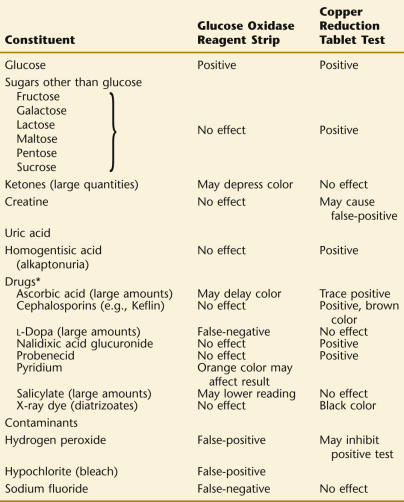

*Other drugs implicated in copper reduction are amino acids, caronamide, chloral, chloroform, chloramphenicol, formaldehyde, hippuric acid, isoniazid, thiazides, oxytetracycline, _p_ -aminosalicylic acid, penicillin, phenols, streptomycin, phenothiazine, and sulfonamides. 

 

##  Chemistry. 

Copper sulfate, sodium hydroxide, sodium carbonate, and citric acid are incorporated into each Clinitest tablet. Copper sulfate reacts with reducing substances in the urine, converting cupric sulfate to cuprous oxide. Based on Benedict's copper reduction reaction, 

 Cu  2  \+  → Hot alkaline solution  Cu  \+  Cu  \+  \+  OH  − → CuOH  (  yellow  )  2  CuOH  → Heat  Cu  2  O  (  red  )  \+  H  2  O 

Heat is caused by the reaction of sodium hydroxide with water and citric acid. 

 

##  Procedure. 

Clinitest reagent tablets will detect 250 mg of reducing substance per deciliter of urine. Both five-drop and two-drop Clinitest methods can be used, and corresponding color charts are available (  Belmonte et al, 1967  ). The two-drop method was developed in response to a so-called **pass-through phenomenon** that may occur if more than 2 g/dL of sugar is present in the urine. In the pass-through phenomenon, the solution that results after addition of the Clinitest tablet goes through the entire range of colors and back to a dark greenish brown. This final color does not compare with any section of the color chart; however, it corresponds most closely to a significantly lower result. It is important to observe the entire reaction and to continue to observe for 15 seconds after boiling inside the tube has stopped, so that reversion to a different color is not missed and a falsely low result reported. 

 

##  Five-drop method. 

Place five drops of urine in a dry test tube and add 10 drops of water. Add one Clinitest tablet by easing it into the tube without touching it—it contains strong alkali. Watch while boiling takes place, but do not shake or touch the bottom of the tube—it is hot. Wait for 15 seconds after boiling stops, then shake the tube gently, and immediately compare the color of the solution with the color scale. Results correspond to the following approximate concentrations: Negative; 0.25 g/dL; 0.5 g/dL; 0.75 g/dL; 1.0 g/dL; 2.0 g/dL; and pass-through. It is important to watch the solution carefully while it is boiling. If the solution passes through orange to a dark shade of greenish brown, this indicates that more than 2 g/dL sugar is present; this should be recorded as greater than 2 g/dL without reference to the color scale. Urine samples showing this pass-through phenomenon should be retested with the two-drop method. 

 

##  Two-drop method. 

Place two drops of urine in a test tube, and add 10 drops of water. Add one Clinitest tablet. Watch while boiling takes place, but do not shake. Wait 15 seconds after the boiling stops, then shake the tube gently; compare the color of the solution with the color scale supplied for the two-drop method. The pass-through phenomenon may also occur with the two-drop method with large concentrations of sugar—over 5 g/dL. Report results as 1 g/dL, 2 g/dL, 3 g/dL, 5 g/dL, and more than 5 g/dL if a pass-through reaction occurs. With negative or low-level results, the five-drop method should be performed. 

 

##  Precautions. 

Observe the precautions in the literature supplied with the Clinitest tablets. The bottle must be kept tightly closed at all times to prevent absorption of moisture and kept away from direct heat and sunlight in a cool, dry place. The tablets normally have a spotted bluish white color. If not stored properly, they will absorb moisture or deteriorate from heat, turning dark blue or brown. In this condition, they will not give reliable results. They are also available individually packaged in aluminum foil to help prevent this absorption of moisture. Although more expensive, such packaging is useful when a limited number of measurements are performed. 

 

##  Additional Tests for Sugars. 

As stated above, the copper reduction method will detect the majority of nonglucose sugars that might be present in urine, apart from sucrose, which is not a reducing sugar. It does not, however, differentiate between these sugars, therefore necessitating more complicated testing. Additional confirmatory testing will be discussed here. 

 

##  Fructose. 

Fructose is identified by thin-layer chromatography. A qualitative measurement, a resorcinol test, is useful. Fructose will also reduce Benedict's reagent at low temperatures. 

 

##  Galactose. 

Thin-layer chromatography is used to identify galactose in urine. However, the disease is usually identified by erythrocyte enzyme assay when suspected. 

 

##  Lactose. 

Lactose is identified by thin-layer chromatography or a qualitative lactose test, such as described later. 

 

##  Procedure. 

To 15 mL urine in a test tube, add 3 g lead acetate. Shake and filter. Boil filtrate, add 2 mL concentrated NH  4  OH (ammonium hydroxide), and boil. Lactose will cause the formation of a brick-red solution and then a red precipitate with clear supernatant. 

 

##  Pentose. 

At concentrations of 250 to 300 mg/dL,  l  -xylulose will reduce Benedict's qualitative reagent at 50° C (water bath) within 10 minutes or at room temperature in several hours. Generally, the pentoses are identified by thin-layer chromatography. 

 

##  Sucrose. 

Sucrose will ferment yeast and can be separated by chromatography but needs to be stained with a substance not dependent on reducing properties. 

 

##  Ketones in Urine 

Whenever a defect in carbohydrate metabolism or absorption or an inadequate amount of carbohydrate is present in the diet, the body compensates by metabolizing increasing amounts of fatty acids. When this increase is large, ketone bodies, the products of incomplete fat metabolism, begin to appear in the blood and are consequently excreted in the urine. In ketonuria, the three ketone bodies present in the urine are acetoacetic (diacetic) acid (20%), acetone (2%), and 3-hydroxybutyrate (about 78%). Acetone is formed nonreversibly from acetoacetic acid; β-hydroxybutyric acid (3-hydroxybutyrate) forms reversibly from acetoacetic acid. 

 Acetoacetic acid  → − CO  2  Acetone  Acetoacetic acid  ⇌ − 2  H  \+  2  H  3  -Hydroxybutyrate 

Depending on the methods used, total ketone bodies (as acetone) can range as high as 17 to 42 mg/dL. According to  Killander and colleagues (1962)  , up to 2 mg acetoacetic acid per deciliter is normal. Ketonemia and ketonuria are commonly seen in uncontrolled diabetes mellitus, as well as several other conditions to be discussed here. 

 

##  Diabetic Ketonuria 

Ketonuria implies the presence of ketoacidosis (ketosis) and may provide a warning of impending coma. Up to 50 mg of acetoacetic acid per deciliter may be present without clinical evidence of ketosis. Type 1 diabetic patients are more prone to episodes of ketosis, often associated with infection, stress, or other problems in management. Whereas large amounts of ketones and glucose are present in urine in diabetic ketoacidosis, ketonuria is not found with the hyperosmolar hyperglycemic coma that sometimes occurs in type 2 diabetes. 

 

##  Nondiabetic Ketonuria 

In infants and children, ketonuria commonly occurs in a variety of conditions, such as acute febrile diseases and toxic states accompanied by vomiting or diarrhea. Inherited metabolic disease should be suspected when there is severe persistent neonatal ketosis. Ketonuria may be present in hyperemesis of pregnancy, in cachexia, and following anesthesia. In these cases, ketonuria is likely related to increased tissue (especially fat) catabolism in the face of limited food intake. In pregnancy, a normal patient may have a low fasting blood glucose level and mild ketonuria. Occasionally, ketonuria is seen following exposure to cold or severe exercise, or with a low-carbohydrate diet for weight reduction. 

 

##  Lactic Acidosis 

Lactic acidosis may coexist with many conditions, including shock, diabetes mellitus, renal failure, liver disease, and infection, and in response to certain drugs, especially phenformin and salicylate poisoning (  Kraut & Madias, 2014  ). Acetoacetate and 3-hydroxybutyrate may both be highly elevated, although usually the butyrate is high and acetoacetate low. Under these circumstances, ketonuria may not be detected by the usual nitroprusside test. 

 

##  Methods. 

Because acetone, acetoacetic acid, and 3-hydroxybutyrate are all present in the urine with ketonuria, methods that indicate the presence of any one of these three ketone bodies are generally satisfactory to detect this condition. Commonly used nitroprusside strip and tablet tests based on the Rothera method detect acetoacetic acid and acetone (  Misra & Oliver, 2015  ). Different methods measure acetoacetic acid alone, or both acetone and acetoacetic acid. Ferric chloride (Gerhardt's test) detects acetoacetic acid. These methods do not measure 3-hydroxybutyrate, the predominant ketone body. 

In urine and plasma, reagent strips and tablets react to 10 mg of acetoacetic acid per deciliter and are less sensitive to acetone. The blood level of ketone bodies may be estimated by the urine ketone dipstick at the bedside. This is especially helpful in determining the severity of ketosis for the treatment of diabetic acidosis. 

When a patient is being followed with qualitative determinations of acetone and acetoacetic acid, repeated reports of marked elevations would not reflect the change that is actually taking place. In such an instance, semiquantitative results can be obtained with either the reagent strip or Rothera's tablet test by measuring several dilutions of each specimen. 

Problems can occur with false-negative results because of unstable reagents and labile ketones. Bacterial action will cause loss of acetoacetic acid, which can happen _in vivo_ as well as in vitro. Acetone is lost at room temperature but not if kept in a closed container in a refrigerator. Refrigerated samples should be brought to room temperature for testing. Preservatives do not prevent decay of ketones. If results are unexpected, fresh reagents, checked against known positive and negative controls, should be used. 

 

##  Reagent Strip. 

This method is based on a nitroprusside (sodium nitroferricyanide) reaction for ketones. Different formulations are available. Reagent strips without alkali react to acetoacetic acid and not to acetone. With large (3+) results, urine may be diluted and remeasured, reporting a “moderate” result and the dilution factor. 

Chemstrip reagent strips contain sodium nitroferricyanide and glycine, which react with acetoacetic acid and acetone in an alkaline medium to form a violet dye. A positive result is indicated by a color change from beige to violet, which is read at 60 seconds. The method detects about 10 mg/dL of acetoacetic acid and 70 mg/dL of acetone, and the sensitivity and reaction of the reagent strip are similar to those of the tablet (Acetest), described later. 

Multistix contains buffers and sodium nitroferricyanide, which react with acetoacetic acid, producing a pink-maroon color in 15 seconds. The reagent area detects 5 to 10 mg acetoacetic acid per deciliter of urine. It does not react with acetone. 

Reagent strips correlate only moderately well with quantitative acetoacetate in plasma and poorly with total blood ketones. Color reactions (false-positives) occur after the use of phthaleins (sulfobromophthalein [BSP] or phenolsulfonphthalein [PSP] dye) or in the presence of extremely large quantities of phenylketones and the preservative 8-hydroxyquinoline, or  l  -dopa metabolites. Acetylcysteine (aerosol) produces a strong red color. The antihypertensive drugs methyldopa and captopril give positive results, as well as the chemotherapy adjuvant mercaptoethane sulfonate sodium (MESNA). False-negative results occur because of loss of reagent reactivity. 

 

##  Nitroprusside Tablet Test. 

A tablet test method may be useful if the urine has an interfering color. However, the routine utilization of the nitroprusside tablet test to confirm a positive dipstick result for ketones is unnecessary (  Meng et al, 2013a  ). These tablets are very sensitive to humidity and will deteriorate if not stored properly. The Acetest tablet contains sodium nitroprusside, glycine, and a strongly alkaline buffer. It can be used to assay whole blood, plasma, serum, or urine. 

Acetest will detect 5 to 10 mg of acetoacetic acid per deciliter of urine and 20 to 25 mg of acetone per deciliter of urine. Like the reagent strips, it does not react with 3-hydroxybutyrate. It will give positive results with  l  -dopa and large amounts of phenylketones and with BSP and PSP dyes, which react with the alkali in the tablets. 

 

##  Procedure. 

Place the tablet on a clean surface, preferably a piece of white paper. Place one drop of urine, serum, plasma, or whole blood on the tablet. For urine measurements, compare the color of the tablet with a color chart at 30 seconds. For serum or plasma measurements, compare the color of the tablet with the color chart at 2 minutes. For whole blood measurements, remove clotted blood from the tablet and compare the color of the tablet with the color chart, 10 minutes after application of the specimen. 

If acetone and acetoacetic acid are present, the tablet will show a color varying from lavender to deep purple. Report the results as negative, small, moderate, or large. If large, a dilution may be made. Report these analyses in a form such as this: undiluted “large,” 1 : 2 dilution “large,” 1 : 4 dilution “moderate,” and so forth. 

 

##  Other Tests for Ketones. 

The Gerhardt ferric chloride test has been used for many years as a measurement for acetoacetic acid. However, ferric chloride methods are not very specific and the sensitivity is low, at about 25 to 50 mg/dL. The ferric chloride method gives positive results with salicylate and  l  -dopa. The test tube nitroprusside method of Rothera is sensitive to acetoacetic acid, at about 1 to 5 mg/dL, and to acetone with a sensitivity of 10 to 25 mg/dL. 

 

##  Blood, Hemoglobin, Hemosiderin, and Myoglobin in Urine 

The presence of an abnormal number of blood cells in urine is known as **hematuria,** whereas the term **hemoglobinuria** refers to the presence of free hemoglobin in solution in urine. Hematuria is relatively common, hemoglobinuria uncommon, and **myoglobinuria** rare. 

 

##  Hematuria 

Gross hematuria is the presence of an increased number of red blood cells in a properly collected urine specimen visible to the naked eye, while microscopic hematuria is defined by the presence of three or greater red blood cells per high-powered field. Although asymptomatic microscopic hematuria may be detected by dipstick testing in up to 16% of screening populations (  Rockall et al, 1997  ), many serious diseases of the urinary tract release red blood cells into the urine (  Kazi & Benz, 2014  ). A retrospective investigation of microscopic hematuria by renal biopsy disclosed several histopathologic findings, including membranous nephropathy, IgA nephropathy, non-IgA mesangioproliferative glomerulonephritis, focal glomerulosclerosis, and mild glomerular abnormalities. More than 15% of patients in this study showed normal histology (  McGregor et al, 1998  ). Hematuria can occur with disease (neoplastic and nonneoplastic) or trauma (including calculi) anywhere in the kidneys or urinary tract, as well as with bleeding disorders and anticoagulant usage, and with the use of other drugs such as cyclophosphamide (  Sharp et al, 2013  ). Hematuria may also be seen in healthy persons undertaking excessive exercise (marathon runners), in whom bleeding originates from the bladder mucosa. 

Because of the diagnostic importance of small amounts of hematuria and because of the tendency of erythrocytes to undergo lysis in urine, a screening test for hemoglobin is a useful adjunct to microscopic examination of the sediment. In fact, some studies suggest that reagent strip hemoglobin screening may be more sensitive than urine microscopy in detecting hematuria (  Ooi et al, 1998  ). However, a common problem with the method is the inhibition of the hemoglobin reagent strip by interfering substances, commonly ascorbic acid, and this problem emphasizes the need for a routine microscopic examination to screen for hematuria and confirm the presence of hematuria in patients with a positive reagent strip hemoglobin test (  Margulis & Sagalowsky, 2011  ;  Davis et al, 2012  ). A positive test for hemoglobin with a normal urinary sediment suggests that a fresh urine sample should be examined for erythrocytes, because an alkaline pH or urine specific gravity of less than 1.010 may cause lysis of erythrocytes. Genetic testing has been advocated to assist in the diagnosis of children with isolated microscopic hematuria (  Gale, 2013  ). 

 

##  Hemoglobinuria 

Any cause of hemolysis has the potential of causing hemoglobinuria, but the presence of hemoglobinuria indicates significant intravascular hemolysis as opposed to extravascular hemolysis. Hemoglobin binds to plasma haptoglobin, and free hemoglobin will pass through the glomerulus as αβ dimers (molecular weight [MW], 32,000), once this binding capacity is saturated. Some hemoglobin is reabsorbed by proximal tubular cells, and the remaining hemoglobin is excreted. 

Hemoglobinuria may follow severe exertion in which there is direct trauma to small blood vessels; many other causes of acute erythrocyte lysis are summarized in [ Table 28-6 ](<#t0040>) . Plasma appears pink at levels of about 50 mg/dL of hemoglobin, and with marked hemolysis, plasma levels may reach 1 g/dL. The plasma hemoglobin level is more often increased in severe acquired hemolytic anemias than in hereditary hemolytic anemias. However, moderately elevated levels occur with sickle cell disease and homozygous thalassemias. Note that unstable hemoglobins can cause a brown-pigmented urine; this is thought to be due to a dipyrrole or bilifuscin, and no reaction occurs with the reagent strip test for heme. A comparison of expected urine and plasma findings with moderate and marked hemolysis is shown in [ Table 28-7 ](<#t0045>) . 

TABLE 28-6 

Some Causes of Hemolysis and Hemoglobinuria 

Erythrocyte trauma  |  Prosthetic cardiac valves (especially aortic)   
---|---  
|  Ostium primum repair with patch causing turbulence   
|  Extensive burns   
|  Severe exercise   
|  Marching   
|  Severe trauma to muscle and other vascular tissues   
Organisms  |  Malaria   
|  _Bartonella_  
|  _Clostridium welchii_ toxin   
|  Brown recluse spider bite   
Erythrocyte enzyme deficiencies  |  Glucose-6-phosphate dehydrogenase subjects in the following situations: Exposure to oxidant drugs (acetanilid, sulfamethoxazole, nitrofurantoin), antimalarials (e.g., primaquine), fava beans _(Vicia fava)_ in susceptible groups, with diabetic acidosis, and with infection   
Unstable hemoglobin diseases  |  With exposure to oxidant drugs   
Immune-mediated (see [ Chapters 32 ](<##!/content/3-s2.0-B9780323295680000322?scrollTo=%23c00032>) and [ 33 ](<##!/content/3-s2.0-B9780323295680000334?scrollTo=%23c00033>) |  Hemolytic-uremic syndrome   
|  Thrombotic thrombocytopenic purpura   
|  Incompatible blood transfusions   
|  Warm antibodies (autoimmune—transient after   
|  infection, drug-induced)   
|  Cold antibodies   
|  IgM—viral anti-i mycoplasma anti-I   
|  IgG—paroxysmal, Donath–Landsteiner anti-P   
|  Membrane sensitivity, complement-mediated (paroxysmal nocturnal hemoglobinuria)   
|  Drugs   
|  Acting as haptens (penicillins)   
|  Immune complex (quinidine, phenacetin)   
|  α-Methyldopa   
Normal subjects  |  Oxidative hemolysis due to drugs, large doses or exposure to naphthalene (mothballs), some sulfonamides, sulfones, nitrofurantoin   
  

TABLE 28-7 

Urine and Plasma Findings with Intravascular Hemolysis 

Test  |  Moderate Hemolysis  |  Marked Hemolysis   
---|---|---  
Urine  |  |   
Bilirubin (conjugated)  |  Absent  |  Absent   
Urobilinogen  |  Normal or elevated  |  Elevated   
Hemoglobin  |  Absent  |  Present   
Hemosiderin  |  Absent  |  Present (late)   
Plasma  |  |   
Bilirubin (unconjugated)  |  Elevated  |  Elevated   
Haptoglobin  |  Decreased  |  Absent   
Hemoglobin  |  Elevated  |  Elevated (marked)   
  
 

##  Hemosiderin in Urine 

Free hemoglobin is readily filtered by the glomeruli and can be subsequently reabsorbed by proximal tubular cells, where it can be catabolized into ferritin and hemosiderin. Hemosiderin will be present 2 to 3 days after an acute hemolytic episode that caused hemoglobinuria. At this time, the reagent strip method for hemoglobin is often negative; however, hemosiderin can be found as yellow-brown granules that are free or in epithelial cells and occasionally in casts ( [ Fig. 28-1 ](<#f0010>) ). Hemosiderin also appears in the urine sediment in diseases with a true siderosis of kidney parenchyma (hemochromatosis). Although the existence of hemosiderinuria indicates a chronic hemolytic state, its presence is rarely needed to make the diagnosis of hemolysis; other tests, such as serum bilirubin, lactate dehydrogenase, and haptoglobin levels, will usually point to the correct diagnosis. 

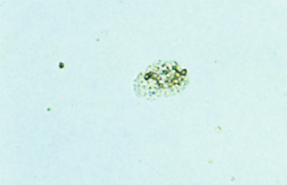

Figure 28-1 

Renal tubular epithelial cell (unstained) containing brown pigment, iron (×260). 

Because of the intermittent presence of hemosiderinuria, urinary iron levels may be quantitated to establish the presence of chronic intravascular hemolysis. Normal urinary iron excretion is about 0.1 mg/day, and this is increased with hemochromatosis and in association with erythrocytes traumatized by prosthetic heart valves. Urinary iron levels are normal with pernicious anemia and in hereditary spherocytosis. 

 

##  Myoglobinuria 

When acute destruction of muscle fibers (rhabdomyolysis) occurs, as with trauma, myoglobin is released, rapidly cleared from the blood, and excreted in the urine as a red-brown pigment (  Cervellin et al, 2010  ). Free myoglobin, a monomer with a MW of 17,000, is excreted quickly, whereas the hemoglobin-haptoglobin complex is more slowly removed. Myoglobinuria has been seen following a number of strenuous exercises, such as marathon running and karate. Other less common conditions associated with sustained or recurrent myoglobinuria include dermatomyositis (  Rose et al, 1996  ), defects of muscle phosphofructokinase and adenosine monophosphate deaminase (  Bruno et al, 1998  ), mitochondrial trifunctional protein deficiency (  Miyajima et al, 1997  ), and the metabolic myopathies (  Sharp & Haller, 2014  ;  Angelini, 2015  ). 

The diagnosis of rhabdomyolysis and myoglobinuria is usually made from the history and other laboratory findings as follows. Typically, the patient with rhabdomyolysis has muscle tenderness or cramps and voids red-brown urine within 1 or 2 days after exertion (  Zimmerman & Shen, 2013  ;  Zutt et al, 2014  ). The reagent strip urine test for hemoglobin is markedly positive, and protein and a few red blood cells are present. Serum is clear and has a markedly elevated creatine kinase (CK), aldolase, and a normal haptoglobin level. Serum creatinine may be increased. The urine usually clears in 2 to 3 days, and the serum CK level declines. The serum measurements and history help to distinguish myoglobinuria from hemoglobinuria. 

The distinction between hematuria, hemoglobinuria, and myoglobinuria may be difficult to make on examination of the urine. In all three cases, the urine can be dark red to brown, and some erythrocytes are seen in the sediment (to a much greater degree with hematuria). The reagent strip test for blood is also positive in all three cases. If serum can be examined, it will often be pink with hemoglobinemia but a normal color with myoglobinemia because this pigment is cleared so rapidly. Accurate quantitative measurement of urine myoglobin can also be performed by immunoassay; although some slight interference by hemoglobin may occur, this is an excellent way to detect and quantify the presence of myoglobinuria (  Loun et al, 1996  ). See [ Table 28-8 ](<#t0050>) , which compares hematuria, hemoglobinuria, and myoglobinuria. 

TABLE 28-8 

Differentiation of Hematuria, Hemoglobinuria, and Myoglobinuria 

Condition  |  Plasma Findings  |  Urine Findings   
---|---|---  
Hematuria  |  Color—normal  |  Color—normal, smoky, pink, red, brown   
|  |  Erythrocytes—many   
|  |  Renal—red blood cell casts   
|  |  Protein—marked increase   
|  |  Lower urinary tract—no casts   
|  |  Protein—present or absent   
Hemoglobinuria  |  Color—pink (early)  |  Color—pink, red, brown   
|  Haptoglobin—low  |  Erythrocytes—occasional   
|  |  Pigment casts—occasional   
|  |  Protein—present or absent   
|  |  Hemosiderin—late   
Myoglobinuria  |  Color—normal  |  Color—red, brown   
|  Haptoglobin—normal  |  Erythrocytes—occasional   
|  Creatine kinase—marked increase  |  Dense brown casts—occasional   
|  Aldolase—increased  |  Protein—present or absent   
  
 

##  Methods 

 

##  Reagent Strip for Heme Compounds (Hemoglobin, Myoglobin). 

This method is based on the liberation of oxygen from peroxide in the reagent strip by the peroxidase-like activity of heme in free hemoglobin, lysed erythrocytes, or myoglobin. Intact erythrocytes are lysed on the strip, causing the hemoglobin to react. Therefore, well-mixed urine must be tested, as intact erythrocytes may be missed if only supernatant urine is used. The reagent area is impregnated with a buffered mixture of an organic peroxide and the chromogen tetramethylbenzidine. 

 H  2  O  2  \+  Chromogen  → Heme peroxidase activity  Oxidized chromogen  (  color change  )  \+  H  2  O 

Heme catalyzes the oxidation of tetramethylbenzidine to produce a green color. The strip is read at 60 seconds following sample application. 

Multistix and Chemstrip detect 0.05 to 0.3 mg of hemoglobin per deciliter urine. Note that 0.3 mg of hemoglobin per deciliter is equivalent to that from 10 lysed erythrocytes per microliter. Normal erythrocytes contain approximately 30 pg of hemoglobin per cell. 

Sensitivity is reduced in urine specimens with high specific gravity, in which erythrocyte lysis may not occur, and also when protein levels are high. Ascorbic acid in large concentrations may cause a false-negative result, as can formalin when used as a urine preservative, and the antihypertensive drug captopril. The presence of nitrite in large amounts will delay the reaction. Oxidizing contaminants such as hypochlorites (bleach) or iodine from skin-cleansing preparations may produce false-positive results. Microbial peroxidase, associated with urinary tract infection, potentially causes a false-positive reading. 

 

##  Other Tests for Hemoglobin and Myoglobin. 

Qualitative tests have been generally unsatisfactory in separating myoglobin and hemoglobin, and both conditions may be present following crush injuries. Hemoglobin and myoglobin can be bound to proteins in urine, and this contributes to the difficulty of separating them by salt precipitation or electrophoresis. The salt precipitation method of  Blondheim and colleagues (1958  ) is described below. 

 

##  Qualitative Test for Myoglobin 

  * 1.

Use a fresh urine specimen. Observe the color. Characteristically, urine with myoglobinuria is red when fresh and turns brown on standing, but some myoglobin may be present without color change. Myoglobin is less stable at an acid pH. Neutralize and refrigerate specimen pending testing. 

  * 2.

Mix 1 mL of urine and 3 mL of 3% sulfosalicylic acid to assay for protein. If the pigment is precipitated, it is a protein. Filter. If the filtrate is a normal color, no abnormal nonprotein pigment is present. (Note: The heat and acetic acid test does not precipitate myoglobin or hemoglobin.) 

  * 3.

To 5 mL of urine in a test tube, add 2.8 g of ammonium sulfate. Dissolve by mixing. The urine is now 80% saturated with ammonium sulfate. This is optimal for precipitation of hemoglobin. Filter or centrifuge. If the supernatant shows a normal color, the precipitated pigment is hemoglobin. If the supernatant fluid is colored, this is presumptive evidence of myoglobin. 

This precipitation test has been largely replaced with specific immunoassays for myoglobin. 

Capillary electrophoresis has been shown to successfully separate urinary hemoglobin from myoglobin based on differing electrophoretic mobility (  Shihabi, 1995  ). 

 

##  Detection of Hemosiderin in Urine. 

The Prussian blue reaction is used to demonstrate iron in hemosiderin ( [ Fig. 28-2 ](<#f0015>) ). A dry smear and an alternative wet preparation are described next. 

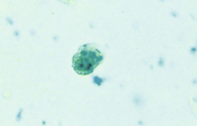

Figure 28-2 

Renal tubular epithelial cell positive with Prussian blue stain, hemosiderin (×260). 

 

##  Dry procedure. 

When stained with Prussian blue reagent, hemosiderin appears as blue granules, 1 to 3 µm, singly or in groups, in renal tubular epithelial cells, as amorphous sediment, or as blue granules in casts. An iron stain used for the detection of siderocytes in blood or bone marrow is also suitable. Urine is collected in an iron-free glass container, overnight. Let stand for 2 hours. Decant three fourths of it, and centrifuge the remainder. Make a smear(s) of the sediment and allow to air dry. (Note: All glassware, slides, coverslips, and so on, should be iron free. Water should be demineralized.) 

 

##  Reagents 

  * The Prussian blue reagent is made fresh. 

  * Prussian blue stain: Add concentrated hydrochloric acid (HCl) to an aliquot of the potassium ferrocyanide solution (20% in demineralized water) until a white precipitate forms that remains stable on shaking. Filter through No. 5 filter paper. 

  * Working counterstain: Dilute 1 mL safranin O stain (0.5 g in 100 mL distilled water) to 50 mL with phosphate buffer (pH, 6.4 to 4.7). 

 

##  Procedure 

  * 1.

Fix the smear in methyl alcohol for 10 minutes. 

  * 2.

Rinse with iron-free water (demineralized) and air dry. 

  * 3.

Stain with Prussian blue reagent for 30 minutes. 

  * 4.

Wash gently for at least 4 minutes with iron-free water and air dry. 

  * 5.

Counterstain with safranin O for 1 to 5 minutes. 

  * 6.

Rinse with iron-free water. Air dry. 

  * 7.

Mount coverslip. 

 

##  Wet procedure 

  * 1.

Centrifuge a complete morning specimen or random urine sample for 5 minutes, and pool the sediment. Examine several drops of sediment microscopically, searching for coarse yellow-brown granules, especially within renal tubular epithelial cells or casts. 

  * 2.

If such granules are seen, suspend the rest of the sediment in a fresh mixture of 5 mL of 2% potassium ferrocyanide solution and 5 mL of 1% HCl, and allow to stand for 10 minutes. 

  * 3.

Centrifuge, and discard the supernatant. Examine the sediment microscopically. Coarse granules of hemosiderin appear blue in this preparation in cells, casts, and amorphous material. If granules do not stain, reexamine after 30 minutes (occasionally the reaction is delayed). 

 

##  Bilirubin in Urine 

Bilirubin is a breakdown product of hemoglobin that is formed in the reticuloendothelial cells of the spleen, liver, and bone marrow (  Andrews, 1999  ,  2005  ;  Levitt & Levitt, 2014  ;  Waldvogel-Abramowski et al, 2014  ). It is initially carried in the blood linked to albumin; this unconjugated bilirubin (or indirect bilirubin) is water insoluble and therefore is unable to pass through the glomerular barrier of the kidney. Unconjugated bilirubin is transported to the liver, where it is conjugated with glucuronic acid to form bilirubin glucuronide. This conjugated form of bilirubin (direct bilirubin) is water soluble and is able to pass through the glomerulus of the kidney into the urine. Conjugated bilirubin is normally excreted in the bile into the duodenum, and normal adult urine contains only 0.02 mg of bilirubin per deciliter. This small amount is not detected by the usual testing methods. Excretion of bilirubin is enhanced by alkalosis. 

Conjugated bilirubin appearing in urine generally indicates that there is excess conjugated bilirubin in the bloodstream. This can occur when there is either (1) obstruction to bile outflow from the liver (intrahepatic or extrahepatic), or (2) hepatocellular disease with resultant inability of hepatocytes to sufficiently excrete conjugated bilirubin into the bile. For example, bilirubinuria may be present when intracanalicular pressure rises secondary to periportal inflammation, fibrosis, or hepatocyte swelling. Gallstones in the common bile duct and carcinoma of the head of the pancreas are possible sources of extrahepatic biliary obstruction leading to bilirubinuria. Bilirubinuria is often seen with acute viral hepatitis or drug-induced cholestasis before the appearance of jaundice; it typically accompanies jaundice of acute alcoholic hepatitis. In persons exposed to potentially hepatotoxic drugs or toxins, a positive test for bilirubinuria may be an early indication of cholestasis or liver damage. In congenital hyperbilirubinemias, bilirubin will appear in the urine in the Dubin-Johnson and Rotor types, and is not present with Gilbert's disease or Crigler-Najjar disease (  Erlinger et al, 2014  ;  Levitt & Levitt, 2014  ). 

Bilirubinuria is associated with yellow-brown to greenish brown urine that may have a yellow foam, elevated serum bilirubin (conjugated), jaundice, and pale-colored feces. These acholic stools are so called because of the absence of bilirubin-derived pigment. A positive test for urinary bilirubin with a negative test for urobilinogen in urine is indicative of intrahepatic or extrahepatic biliary obstruction. This test is valuable in the differential diagnosis of jaundice, because bilirubinuria is not found with hemolytic jaundice. [ Table 28-9 ](<#t0055>) summarizes typical urine and fecal findings in jaundice of various causes. 

TABLE 28-9 

Urine and Fecal Findings in Jaundice 

Finding  |  Normal  |  Obstruction to Bile Flow  |  Hemolysis, Hemolytic Anemia  |  Liver Damage, Hepatitis, Cholestasis   
---|---|---|---|---  
Urinary bilirubin  |  Absent  |  Increased, dark urine  |  Absent  |  Increased early   
Urinary urobilinogen  |  Present  |  Neoplasm—low or absent; gallstones—variable  |  Increased  |  Decreased early; increased late   
Fecal color  |  Dark  |  Pale; intermittent with gallstones in common bile duct; persistent with neoplasm in duct or pancreas  |  Dark  |  Pale early and dark late in hepatitis; pale with cholestasis   
  
 

##  Methods 

 

##  Reagent Strip. 

This test is based on the coupling reaction of bilirubin with a diazonium salt in acid medium. When this method is used, normal urine contains no detectable bilirubin. Specific tests differ in the diazonium salt utilized. Multistix uses diazotized 2,4-dichloroaniline as the diazo salt, with a color change from cream-buff to tan at 20 seconds. This system will detect 0.8 mg per deciliter of urine; however, the color change may be difficult to read. Chemstrip uses 2,6-dichlorobenzene-diazonium tetrafluoroborate, and the color changes from pink to violet at 30 to 60 seconds. This test detects 0.5 mg per deciliter urine. 

Urine must be fresh because bilirubin glucuronide in urine quickly hydrolyzes to less reactive free bilirubin. Oxidation of bilirubin in specimens that have stood too long, especially when exposed to light, will result in false-negative findings. Large amounts of ascorbic acid and nitrite can also lower bilirubin results. Metabolites of drugs such as phenazopyridine give a reddish color at the low pH of the strip and mask the result. Rifampin, indican, lodine, and large amounts of chlorpromazine metabolites may cause false-positives, whereas salicylates do not interfere. Urobilinogen does not affect the result. 

 

##  Confirmatory Bilirubin Tests. 

The diazo test method, in which bilirubin is coupled to _p_ -nitrobenzene diazonium _p_ -toluene sulfonate to form a blue or purple color (in the form of a tablet or reagent strip), is commonly used. The reagent strip test is much less reactive to free bilirubin than is the tablet test, so that a difference in results becomes more apparent as the urine ages. Another test employs a ferric chloride reagent to oxidize bilirubin to a green biliverdin. The diazo tablet method is described next. 

 

##  Diazo tablet method. 

Tablets contain _p_ -nitrobenzene diazonium _p_ -toluene, as well as sulfosalicylic acid and sodium bicarbonate. The latter substances provide an acid medium for the reaction and an effervescent mixture that will ensure the solution of a portion of the tablet when water is added. (Ictotest kit, including absorbent mats and reagent tablets, is available through Siemens Healthcare Diagnostics Inc. Deerfield, Ill). 

Note: Reagent tablets are hygroscopic, and they should be protected from moisture or high humidity. The tablets are packed in a brown bottle because prolonged direct exposure to strong light results in decomposition of the stabilized diazonium compound. Prolonged exposure over several weeks to temperatures of 100° F or more may also result in deterioration of the tablets. A brown discoloration indicates deterioration, and when each new bottle is opened, tablets should be checked for positive and negative reactions. 

 

##  Procedure 

  * 1.

Place 10 drops of specimen on an asbestos-cellulose mat provided with the kit. Bilirubin, if present, will be adsorbed onto the mat surface. 

  * 2.

Place a reagent tablet on the moistened area of the mat. 

  * 3.

Place one drop of water onto the tablet. Wait 5 seconds, and then place a second drop so that the water runs off the tablet onto the mat. If bilirubin is present, there will be a coupling of bilirubin with _p_ -nitrobenzene diazonium _p_ -toluene sulfonate from the tablet, as shown by the formation of a blue to purple color within 30 seconds. The tablet should be moved to reveal the purple color. A pink or red color is negative. 

The diazo test reacts positively to bilirubin in amounts as low as 0.05 to 0.1 mg per deciliter. No purple reaction is seen with urobilin or other pigments, although high levels of urobilin or indican give a red color. Azo compounds (e.g., phenazopyridine) cause an atypical color. Rifampin may also interfere. Chlorpromazine metabolites in large amounts produce a purple color, and the metabolites of the anti-inflammatory drugs mefenamic and flufenamic acid cause false-positive results. 

 

##  Wash-through tablet method. 

When false-positive reactions are suspected (e.g., with chlorpromazine), the contaminant can be diluted out with water in the mat. 

 

##  Procedure. 

Prepare duplicate mats with 10 drops of urine on each. Add 10 drops of water to one mat. Place a reagent tablet on each mat and then two drops of water onto each tablet. Bilirubin, if present, is adsorbed into the mat fibers and will appear the same on each mat; an interfering substance produces a light color or no color on the mat with the extra water. 

 

##  Urobilinogen in Urine 

Conjugated bilirubin from the liver eventually reaches the duodenum, complexed with cholesterol, bile salts, and phospholipids within the bile (  Andrews, 1999  ,  2005  ). The conjugated bilirubin is not absorbed from the small intestine but instead passes on into the colon, where resident bacteria hydrolyze the conjugate. The free bilirubin is then reduced to urobilinogen, mesobilirubinogen, and stercobilinogen. Up to 50% of the urobilinogen is reabsorbed into the portal circulation and is reexcreted, unconjugated, into the bile. The vast majority of remaining urobilinogen is excreted in feces as colored urobilins or stercobilin, which are formed after further removal of hydrogen. A small amount is excreted in the urine. 

Urobilinogen represents a group of closely related tetrapyrrole compounds, and because a mixture of substances is actually measured, the term **units** is frequently used instead of the more precise milligrams-per-deciliter terminology. These are roughly equivalent. Normal output of urobilinogen in the urine is 0.5 to 2.5 mg or units/24 hours. These substances are colorless and labile, as opposed to the urobilins, the oxidation products of urobilinogen that impart a yellow-orange color to normal urine. Output of urobilinogen is increased in alkaline urine; the level is decreased in acid urine. 

Whenever the liver is unable to efficiently remove the reabsorbed urobilinogen from the portal circulation, more urobilinogen than normal is routed through the kidney and hence is excreted in the urine. This can occur when there is hepatocellular damage due to viral hepatitis, drugs, or toxic substances, or in some cases of cirrhosis. With congestive heart failure, liver congestion prevents effective urobilinogen handling, and reexcretion into the bile is impaired. If an infection is present, such as cholangitis associated with obstruction, large amounts of urobilinogen are excreted in urine, together with bilirubin. 

In contradistinction, an excess of urobilinogen in urine together with absent bilirubin is typically associated with hemolysis. This can be seen following acute lysis of erythrocytes, as well as with destruction of erythrocyte precursors in the bone marrow with megaloblastic anemias. Increased urobilinogen also accompanies bleeding into tissues and the subsequent formation of excess bilirubin. These jaundiced patients have dark-colored stools because excess urobilinogen is also excreted into the feces. Urinary urobilinogen may be increased when fever is associated with dehydration and concentrated urine. 

Persistent absence of urinary urobilinogen occurs with complete obstruction of the outflow of bile into the intestine, accompanied by pale stools. Broad-spectrum antibiotics, which suppress the normal intestinal flora, may prevent the conversion of bilirubin to urobilinogen, and therefore may reduce its excretion in feces and urine. 

The brown pigment mesobilifuscin is a dipyrrole that normally contributes to fecal and urine color. It does not react with tests for blood or bilirubin. Although it is not derived from bilirubin, as is urobilinogen, it is a likely byproduct of heme synthesis. Its excess causes a dark brown urine that can be seen with homozygous β-thalassemia, or whenever Heinz bodies form in erythrocytes (e.g., with the unstable hemoglobins). 

 

##  Methods 

 

##  Reagent Strip. 

Testing is based on the Ehrlich aldehyde reaction or on the formation of a red azo dye from a diazonium compound. 

Multistix utilizes the former method; its test area is impregnated with an acid buffer solution and _p_ -dimethylaminobenzaldehyde, which produces a reddish brown color with urobilinogen. Color varies from light yellow to shades of red-brown, and values from 0.2 to 1 mg per deciliter are considered normal. This test method is not specific for urobilinogen and will detect substances known to react with the Ehrlich reagent, including porphobilinogen, _p_ -aminosalicylic acid metabolites, sulfonamides, procaine, 5-hydroxyindoleacetic acid, indole, and methyldopa (Aldomet). It is not a reliable method for the detection of porphobilinogen. 

The Chemstrip urobilinogen test area is impregnated with 4-methoxybenzene-diazonium-tetrafluoroborate, which couples with urobilinogen in an acid medium to form a red azo dye. Results are read at 10 to 30 seconds, and the test can detect approximately 0.4 mg/dL. This test, unlike the Ehrlich reagent-based methods, is specific for urobilinogen. 

A freshly voided sample is best for testing, given that urobilinogen is quite labile and will potentially form nonreactive urobilin in acid urine. Both reagent strips are affected by the metabolites of drugs such as phenazopyridine, which colors the urine orange-red in an acid medium, and other compounds such as Azo-Gantrisin. These may mask the reaction with urobilinogen or give a false-positive result. Bilirubin and blood do not usually affect the test, but bilirubin may occasionally cause a green color. 

 

##  Other Urobilinogen and Porphobilinogen Tests. 

Qualitative testing for urobilinogen and porphobilinogen may be performed when reagent strip testing indicates more than 1 mg/dL of Ehrlich-reacting substance present in the urine (see the [ Porphyrins ](<#s0720>) section later in the chapter for more information on these testing modalities). 

Quantitative tests for urobilinogen in urine are seldom performed. Consult  Henry (1979)  for a 2-hour quantitative urobilinogen method, and  Davidsohn and Henry (1974)  or  Schwartz and colleagues (1944)  for 24-hour quantitation. For quantitative comparative purposes in the same patient, a 2-hour test is used in which urine is collected from 2  pm  to 4  pm  after lunch. This period after the meal coincides with heightened excretion of urobilinogen, as the pH of the urine is more nearly neutral. Other 2-hour periods may be tested for comparison. 

 

##  Indirect Tests for Urinary Tract Infection 

It is not uncommon for significant urinary tract infections to be present in patients who do not experience typical symptoms. Given that these infections if untreated can cause severe renal damage, many physicians are finding it prudent to request tests for bacteriuria in high-risk individuals (  Foxman, 2014  ;  Nicolle, 2014  ). These would include patients who are older adults, pregnant, or diabetic, and those with a previous history of urinary tract infections. The two most commonly utilized testing modalities for indirect assessment of bacteriuria and leukocyturia are the reagent strip nitrite and leukocyte esterase, respectively. These tests are best used to rule out urinary tract infections (  St John et al, 2006  ;  Wright & Safranek, 2006  ) and are discussed in the next sections. An immunochromatographic test strip for the measurement of urinary lactoferrin released from leukocytes may also prove useful for the rapid diagnosis of urinary tract infection (  Arao et al, 1999  ). Microscopic urinalysis serves as a rapid confirmatory test for the presence of leukocytes and bacteria, with bacteriologic culture remaining the “gold standard” for detecting bacteriuria. 

 

##  Nitrite 

Many bacteria that are urinary tract pathogens are able to reduce nitrate to nitrite, and thus will generate a positive urine nitrite test when present in significant numbers (>10  5  to 10  6  /mL bladder urine). Common organisms include _Escherichia coli, Klebsiella, Enterobacter, Proteus, Staphylococcus,_ and _Pseudomonas_ species; _Enterococcus_ , yeasts, and some gram-positive bacteria are unable to reduce nitrate to nitrite. If the nitrite test is positive, a culture should be considered, provided that the specimen was properly collected and stored prior to testing. A first morning clean-voided midstream specimen is best. 

According to  Kunin and DeGroot (1975)  , self-administered repeated nitrite tests (three tests) in a small group of patients revealed about 70% overall positive results when compared with cultures. When only _E. coli_ was present, bacteriuria detected by a positive nitrite test in any of the three first morning specimens showed 93% agreement with culture results. No significant false-positive nitrite results were reported in this large test group. Other authors report more disappointing results with nitrite dipstick screening for urinary tract infection, particularly in hospital inpatients (  Zaman & Borremans, 1998  ). In children with urinary tract infections, nitrite-negativity has been reported to predict potential resistance to cephalosporin treatment (  Weisz et al, 2010  ). 

 

##  Methods. 

The test depends on the conversion of nitrate to nitrite by bacterial action in the urine. Because overnight (minimum of 4 hours) bladder incubation is typically required for the infecting bacterial population to convert urinary nitrate to nitrite, a first morning specimen is best. A positive result is an indication for culture, unless the specimen has been improperly stored after collection, allowing contaminant bacterial growth. 

 

##  Reagent strip. 

The nitrite testing area of Multistix is impregnated with _p_ -arsanilic acid, which forms a diazonium salt when it reacts with nitrite present in the urine. This compound is then able to couple with benzoquinoline to form a pink azo dye. This method detects 0.075 mg of nitrite per deciliter in solution and is read at 40 seconds. Chemstrip contains a benzoquinoline and sulfanilamide, which produce a pink azo dye with nitrite at 30 seconds, and is able to detect 0.05 mg of nitrite per deciliter. Note that pink spots or edges are interpreted as negative. 

False-positive results most commonly occur with poorly collected/stored specimens as the result of contaminants and postcollection bacterial proliferation. False-positives may also be produced by medications that color the urine red or turn red in an acid medium (e.g., phenazopyridine). 

False-negative nitrite results may be due to ascorbic acid, urobilinogen, or low pH (<6). Random specimens collected during the day and urine from patients with draining catheters do not show good correlation between the nitrite test and significant bacteriuria, presumably because of the time required for the chemical reduction to nitrite in the bladder urine. Additionally, some false-negative results occur because some nitrate-reducing organisms form compounds other than nitrite, such as ammonia, nitric and nitrous oxide, hydroxylamine, and nitrogen, and therefore give a negative nitrite test result. Lack of dietary nitrate may also produce false-negative results, even when a significant number of organisms are present. 

 

##  Leukocyte Esterase 

Extracts of human neutrophil azurophilic (primary) granules contain up to 10 proteins showing esterolytic activity, and this esterase activity is commonly used as a marker for these cells. Because neutrophils and other cells are labile in urine, leukocyte esterase activity can be indicative of remnants of cells that are not visible microscopically. 

The presence of significant numbers of neutrophils in the urine suggests urinary tract infection; however, difficulty has arisen in determining suitable cutoff points for normal and abnormal numbers of these cells. Because quantitative counts are so low, precision is poor. Positive leukocyte esterase results correlate with “significant” numbers of neutrophils, either intact or lysed; with the use of a chamber count of about 10 neutrophils/µL of fresh urine as a cutoff point, the numbers of false-negative and false-positive results are low. Likewise, when a concentrated (10 : 1) urine sediment and a cytocentrifuged stained preparation are used, a negative reagent strip test is associated with fewer than 100 neutrophils in 10 high-power fields (hpf) (450×). Multiple clinical studies have also confirmed the high negative predictive value of simultaneously negative reagent strip nitrite and leukocyte esterase assays for the presence of a urinary tract infection in both older children and adults (  Mori et al, 2010  ;  Kayalp et al, 2013  ;  Mody & Juthani-Mehta, 2014  ). The leukocyte esterase test may also be useful in the workup of suspected urethritis in male patients; it has a high negative predictive value in this diagnostic setting (  Bowden, 1998  ). 

 

##  Methods 

 

##  Reagent strip. 

This test is similar in principle to the naphthol chloroacetate reaction used for granulocyte esterase detection in hematology. Neutrophilic esterases catalyze the hydrolysis of esters to produce their respective alcohols and acids. For example, Multistix utilizes 3-hydroxy-5-phenyl-pyyrole- _N_ -tosyl-  l  -alanine ester as a substrate, which reacts in the presence of leukocyte esterase to form pyrrole alcohol. The alcohol then reacts with a diazonium salt to produce a purple color. The intensity of the color produced is proportional to the amount of enzyme present, which is related to the number of neutrophils present. 

Cells originating from the urinary tract (i.e., urothelium) and erythrocytes do not contribute to the esterase level. Elevated urine specific gravity, protein, and glucose may all decrease test results, as can the presence of boric acid and certain antibiotics such as tetracycline, cephalexin, and cephalothin. Very large amounts of ascorbic acid may inhibit the reaction. 

Contamination of urine with vaginal fluid may give positive results, and large numbers of squamous epithelial cells and bacteria would be seen on microscopic evaluation. Also, _Trichomonas_ and eosinophils may represent alternative cellular sources of esterases, causing false-positive results. Oxidizing agents and formalin may give false-positive colors, and nitrofurantoin and other strong colors may affect color interpretation. High concentrations of protein, glucose, oxalic acid, and ascorbic acid may produce false negative results (  Strasinger et al, 2014  ). 

 

##  Miscellaneous Chemical Screening Tests 

 

##  Ascorbic Acid 

Large quantities of ascorbic acid may occasionally be found in the urine of individuals taking therapeutic doses of vitamin C or other preparations containing abundant ascorbic acid. Because of its reducing properties, ascorbic acid may inhibit several reagent strip reactions (i.e., glucose, blood, bilirubin, nitrite, and leukocyte esterase). Reagent strips from various manufacturers differ in their susceptibility to this substance, and suspicious results should be investigated. For example, when the microscopic examination of urine sediment shows more than two erythrocytes per high-power field, but heme is not detected by the reagent strip method, it may be useful to check for the presence of ascorbic acid. 

Urine tests for ascorbic acid have also been used as an indication of adequate ascorbic acid therapy. With the usual Western diet, 2 to 10 mg/dL is excreted daily, but after ingestion of large amounts of ascorbic acid, levels in urine may rise to 200 mg/dL. Oxalate and sulfate are the metabolites of ascorbic acid, and with ingestion of large quantities (1 g or more per day), oxalate stones may form in susceptible persons. 

 

##  Methods. 

Several manufacturers have developed reagent strip methods for detecting ascorbic acid, discussed next. Gas chromatographic/mass spectrometric measurement is a more accurate quantitative method (  Deutsch, 1997  ). 

 

##  Reagent strip. 

The ascorbic acid testing area of C-Stix reagent strips is impregnated with phosphomolybdates buffered in an acid medium. The phosphomolybdates are reduced by ascorbic acid to molybdenum blue, and this test detects 5 mg/dL of ascorbic acid in urine after 10 seconds. Gentisic acid and  l  -dopa may cause false-positive results. 

Stix reagent strips are not as sensitive as C-Stix; they can detect about 25 mg/dL of ascorbic acid at 60 seconds. The reagent in Stix is methylene green, which is reduced to its colorless form with ascorbic acid. Neutral red provides a background color, and the overall color changes from blue to purple at levels of 150 mg/dL. This same testing method is also incorporated into Multistix multiple reagent strips. Large amounts of bilirubin and pH greater than 7.5 interfere with the color. False-positive results are not seen with urates, salicylates, gentisic acid, or creatinine. 

 

##  5-Hydroxyindoleacetic Acid 

Serotonin (5-hydroxytryptamine) is produced by the argentaffin cells of the intestines from tryptophan, and is carried in the blood by platelets. Carcinoid tumors (argentaffinoma) can produce excessive amounts of serotonin, especially when metastatic. Characteristic symptoms include intestinal and vasomotor disturbances and bronchoconstriction; edema, right-sided valvular heart disease, and neurologic symptoms may also be present. 

Although serotonin in the urine can be analyzed directly by high-performance liquid chromatographic methods (  Panholzer et al, 1999  ), screening tests that detect the serotonin metabolite 5-hydroxyindoleacetic acid in the urine are more commonly used. The quantitative method is more sensitive because it eliminates the interfering keto acids and indoleacetic acid. The normal excretion of 5-hydroxyindoleacetic acid in 24 hours is 1 to 5 mg. 

 

##  Screening Test. 

A random urine specimen is usually sufficient for screening purposes; if a 24-hour collection is made, it should be acidified with HCl. Boric acid may also be used as a preservative. Patients should be instructed not to take any drugs for 72 hours before the test; phenothiazines, acetanilid drugs, and mephenesin, a muscle relaxant, will interfere with this test. 

The principle of the test is based on the development of a purple color specific for 5-hydroxyindoles with nitrous acid and 1-nitroso-2-naphthol. Ethylene dichloride is used to remove interfering chromogens. For the procedure, see  Henry (1984)  . 

 

##  Melanin 

Normal melanocytes convert tyrosine to dihydroxyphenylalanine (DOPA), then to dopaquinone, and by oxidative steps to melanin. The enzyme tyrosinase is required for the first conversion step and is found in specific organelles in melanocytes called **melanosomes.** Its formation is increased by melanin-stimulating hormone. Melanosomes with pigment are normally transferred from melanocytes to skin and mucous membrane cells. Enlarged melanosomes are found in some neoplastic cells (e.g., nevus, melanoma). 

Increased urinary excretion of melanin metabolites occurs as malignant melanoma metastasizes, although it is unusual to find dark-colored urine in these patients, even when the specimen stands at room temperature for 24 hours. These urinary melanogens include indoles, catechols, and catecholamines. DOPA does not appear in large amounts in urine from melanotic patients. 

No simple specific test is available for melanuria. Screening tests for melanin should be made on fresh specimens of urine and include tests based on nonspecific color reactions produced with ferric chloride, Ehrlich's aldehyde reagent, and nitroferricyanide. Procedures for the ferric chloride and nitroferricyanide tests for melanin can be found in  Henry (1984)  . 

A column cation-exchange chromatographic method allows detection of melanin metabolites in urine. Another approach is to measure DOPA oxidase levels in urine. The enzyme is increased in the urine of patients with melanoma and is markedly increased with liver metastases. 

Rarely, cells containing melanin pigment are seen in urine sediment when melanuria with pigment uptake by renal tubular cells or metastatic melanoma to the bladder is present. A ferrous ion uptake stain can be used to color the melanin in cells dark blue. 

 

##  Porphyrins 

The porphyrias are a group of diseases resulting from defects in the synthesis of heme (  Balwani & Desnick, 2012  ;  Besur et al, 2014  ). These are inherited enzyme deficiencies in which the enzyme substrate is usually excreted in excess in urine and/or feces. During the acute porphyric attack, high levels of porphobilinogen are excreted, but between attacks, levels of porphobilinogen may be increased or normal. The patterns of excretion of the various porphyrins vary with the different diseases, and together with the clinical findings help to establish the diagnosis. In addition, genetic testing is increasingly being used in the diagnosis of the porphyrias (  Whatley & Badminton, 2013  ). 

The porphyrins are excreted in most of the porphyrias and in lead poisoning. Additionally, porphyrin metabolism may be abnormal in patients with established human immunodeficiency virus infection, particularly when there is a concomitant hepatitis C virus infection (  O'Connor et al, 1996  ;  Ryan Caballes et al, 2012  ). 

Skin photosensitivity and cutaneous lesions frequently accompany high levels of porphyrins. The one entity without skin lesions is acute intermittent porphyria. In patients presenting with neurologic disease and acute abdominal pain—the hepatic group—production and excretion of δ-aminolevulinic acid (ALA) and porphobilinogen are increased during the acute porphyric attack. This is likely due to increased activity of ALA synthase and subsequent increased production of the precursors. Exacerbations of the hepatic diseases are precipitated by drugs known to induce liver enzyme activity (e.g., barbiturates, certain steroids). 

 

##  Methods. 

In patients suspected of having an acute porphyric attack, porphobilinogen is sought in urine specimens. The Watson-Schwartz test is used to separate causes of a positive Ehrlich-reacting test and to give an indication of large amounts of urobilinogen or the presence of porphobilinogen. A positive result for porphobilinogen in the Watson-Schwartz test can be further confirmed by the Hoesch test, because the former may show false-positive results for porphobilinogen as a result of drugs such as methyldopa. When a qualitative porphobilinogen test is specifically requested or a known porphyric patient is being followed, the simpler Hoesch test may be used instead of the Watson-Schwartz test. 

Urine specimens for urobilinogen or porphobilinogen must be fresh. If testing will be delayed, the pH should be adjusted to near neutral (pH 7) and the specimen stored in a refrigerator, where it is stable for about 1 week. Urine may darken if the patient has porphyria, especially if left at room temperature. 

 

##  Watson-schwartz test. 

Ehrlich's aldehyde reaction and Watson-Schwartz tests are based on solubility differences between urobilinogen and porphobilinogen. Urobilinogen can be extracted by chloroform and/or butanol, whereas porphobilinogen will remain in an aqueous phase. 

 

##  Procedure 

  * 1.

To 2.5 mL fresh urine, add 2.5 mL Ehrlich's reagent and mix. 

  * 2.

Add 5 mL saturated sodium acetate and mix. Check with pH paper to confirm that the solution is in the pH range of 4 to 5. Adjust pH if necessary. 

  * 3.

Add 5 mL chloroform; insert a stopper and shake vigorously for 1 minute. Permit the phases to separate. 

  * 4.

Examine the upper (aqueous) phase. If the color is absent, consider the result of the screening test to be negative and stop. 

  * 5.

If color is present, separate the upper (aqueous) phase and add 5 mL of butanol. Insert a stopper and shake vigorously for 1 minute. Allow phases to separate. 

  * 6.

A “pink to rose red” color in the lower aqueous layer indicates a positive result and suggests a concentration of porphobilinogen that is several times normal. A color in the upper butanol layer indicates an increase in urobilinogen concentration ( [ Fig. 28-3 ](<#f0020>) ). 

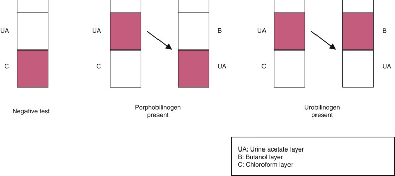

Figure 28-3 

Watson-Schwartz test. 

Interpretation of screening method for urine urobilinogen and porphobilinogen. 

 

##  Hoesch test. 

The Hoesch test is based on the inverse Ehrlich's reaction (i.e., of maintaining an acid solution by adding a small urine volume to a relatively large reagent volume), eliminating the problem of urobilinogen reactivity. The sensitivity is similar to that of the Watson-Schwartz test, but the reaction is for porphobilinogen. This test will detect about 20 to 100 mg/L of porphobilinogen; urobilinogen in amounts up to 200 mg/L does not give a positive result (red color). A yellow color may be caused by urea. 

The urorosein urinary pigment related to indoleacetic acid will produce a positive Hoesch test (in response to strong HCl), and the rose color may be confused with a positive porphobilinogen result. Some of the false-positive problems may be excluded by testing the specimen with concentrated HCl (6 mol/L) separately in conjunction with the Hoesch test. Urine from a patient having an acute porphyric attack may be dark red in color, necessitating a 1 : 10 dilution with water before testing. 

The Watson-Schwartz test detects greater than 6 mg/L and the Hoesch test greater than 11 mg/L of porphobilinogen. The Watson-Schwartz test is more sensitive than the Hoesch test for porphobilinogen and may yield a positive result between attacks of acute intermittent porphyria. Large doses of methyldopa (Aldomet) gave positive results, as did indoles in some patients with intestinal ileus and the drug phenazopyridine, which becomes orange with HCl. A quantitative porphobilinogen test is necessary if the Watson-Schwartz test or the Hoesch test result is questionable; this situation may arise because of the instability of porphobilinogen. 

Alternative urine screening tests for porphobilinogen have been described. These include a micellar electrokinetic capillary chromatographic method (  Luo et al, 1996  ), as well as a semiquantitative kit in which urine is pretreated with ion-exchange resin, and the color of the Ehrlich-porphobilinogen adduct is compared to a set of standards (  Deacon & Peters, 1998  ;  Vogeser & Stauch, 2011  ). 

Uroporphyrin and coproporphyrin can be detected by fluorescence. An orange-red fluorescence is seen if a positive specimen is placed near an ultraviolet light source. 

 

##  Fluorescence screening procedure for porphyrin. 

In this method, the urine is acidified and the extracted porphyrin exposed to ultraviolet light. 

  * 1.

Place 5 mL urine in a stoppered glass centrifuge tube. Add 3 mL of a mixture of one part glacial acetic acid with four parts ethyl acetate. 

  * 2.

Shake and allow to separate. Centrifuging will accelerate the separation. 

  * 3.

Using a Wood's lamp, observe the upper layer for fluorescence. Inspect the tube in a dark room with ultraviolet reflected light. A lavender to violet color indicates the presence of porphyrins; pink to red fluorescence indicates higher levels of porphyrin. Pale blue with no pink color is negative. Normal urine may fluoresce blue. 

To increase the sensitivity of the test and remove interfering drug metabolites, transfer the upper layer to a glass tube and acidify with 0.5 mL of 3 M HCl (25 mL concentrated HCl diluted to 100 mL with water). Shake. Porphyrins are extracted into the lower aqueous layer and will produce a red-orange fluorescence. 

An alternative screening method utilizes an anion-exchange resin column. Porphyrins are adsorbed, eluted, and exposed to fluorescent light. This method removes interfering substances and is similar in principle to the quantitative method for total porphyrins and for coproporphyrin and uroporphyrin. 

Screening tests together with the clinical findings will indicate whether quantitative tests should be done. The latter are usually performed by reference or research laboratories. 

Urine specimens for quantitative porphobilinogen should be kept at a near neutral pH (between 6 and 7) and protected from light. Frozen specimens are fairly stable, although ALA is more stable if the urine is acidic. If the urine is to be tested for both substances, the near neutral pH is preferred and the urine aliquot is frozen. These substances are quantitated by eluting from different columns and reacting with Ehrlich's reagent. A micellar electrokinetic capillary chromatographic method has been described that allows separation of ALA and porphobilinogen (  Luo et al, 1996  ). 

Urine specimens for quantitative porphyrins must be collected in a dark container containing 5 g sodium carbonate for a 24-hour specimen to give a concentration of 0.1% sodium carbonate or to produce urine of neutral pH. Coproporphyrin and uroporphyrin can be separated by thin-layer chromatography or by extraction and fluorometry and quantitated using ion-exchange columns. Additional methods include the Bio-Rad (porphyrin) column test, spectrophotometry (  Zuijderhoudt & Dorresteijn-de Bok, 1998  ), capillary electrophoresis (  Chiang & Li, 1997  ), fast atom bombardment mass spectrometry (  Luo et al, 1997  ), and laser desorption/ionization time-of-flight mass spectrometry (  Jones et al, 1995  ). 

Fecal porphyrins can be qualitatively estimated using extraction and ultraviolet (UV) light, or quantitated. In some porphyrias, erythrocytes may show fluorescence when an unstained blood smear is examined microscopically. The nucleated bone marrow erythrocytes give greater fluorescence. 

 

##  Examination of Urine Sediment 

Microscopic examination of urine, in conjunction with dipstick chemical analysis, aids in the detection of renal and urinary tract disease processes. With microscopy, one can detect those cellular and noncellular elements of urine that do not give distinct chemical reactions. Microscopy can also serve as a confirmatory test in some circumstances (e.g., erythrocytes, leukocytes, bacteria) and yields new information 66% of the time (  Tworek et al, 2008  ). In the routine laboratory, examination of the urine sediment is best reserved and most useful for those samples with abnormal dipstick results (  European Confederation of Laboratory Medicine, 2000  ). 

To perform a microscopic evaluation of urine with competence, one must be knowledgeable of numerous morphologic entities (e.g., organisms, hematopoietic and epithelial cells, crystals, casts). Also, microscopists must be aware of the clinical relevance of urine findings, as well as the common chemical abnormalities associated with microscopic interpretations. Discrepancies should be investigated before a report is issued. The quality of the manual microscopic analysis of urine is dependent on the expertise and experience of the examiner (  Tsai et al, 2005  ). 

Centrifuged urine sediment should contain all the insoluble materials (commonly referred to as _formed elements_ ) that have accumulated in the urine following glomerular filtration and during passage of fluid through the renal tubules and lower urinary tract. Cellular elements are derived from two sources: (1) desquamated/spontaneously exfoliated epithelial lining cells of the kidney and lower urinary tract, and (2) cells of hematogenous origin (leukocytes and erythrocytes). Cellular and noncellular casts may be seen; these are formed in the renal tubules and collecting ducts. Crystals of variable clinicopathologic significance may also be present. Organisms (bacteria, fungi, viral inclusion cells, parasites) and neoplastic cells represent elements that are typically foreign to urine; when detected, further investigation is required. 

“Normal” or reference values for formed elements will vary from one laboratory to another because of (1) the variation in concentration of random urine specimens, and (2) the different methods used to concentrate the sediment by centrifugation. No specific standardized procedure is used. Individual laboratories have established their own reference values, often in conjunction with nephrologists and nephropathologists. 

 

##  Methods for Examining Urine Sediment 

In general, randomly collected urine specimens are satisfactory for microscopic evaluation; however, it is recommended that examination take place when the sample is fresh, particularly if no preservative has been added. Cells and casts begin to lyse within 2 hours of collection. Refrigeration (2° to 8° C) helps prevent the lysis of pathologic entities; however, this may increase the precipitation of various amorphous and crystalline materials. Midstream collection is recommended for females to reduce contamination from vaginal elements. 

 

##  Bright-Field Microscopy 

Although bright-field microscopy can be performed to a limited extent on unstained urine preparations, identification of leukocytes, histiocytes, epithelial cells, and cellular casts may be difficult. Subdued light is more effective in delineating translucent structures of the urine, such as hyaline casts, crystals, and mucous threads. A crystal-violet safranin stain is commonly used to aid in delineation of formed elements in urine. 

 

##  Supravital Stain Reagents 

Solution I:  |  Crystal violet  |  3.0 g   
---|---|---  
|  Ethyl alcohol (95%)  |  20.0 mL   
|  Ammonium oxalate  |  0.8 g   
Solution II:  |  Safranin O  |  1.0 g   
|  Ethyl alcohol (95%)  |  40.0 mL   
|  Distilled water  |  400.0 mL   
  
Three parts of solution I and 97 parts of solution II are mixed and filtered. The mixture should be clarified by filtering every 2 weeks and discarded after 3 months. Separately, solutions I and II can be kept indefinitely at room temperature. 

Several commercially available staining reagents are available. A 2% solution of methylene blue and toluidine blue may be used as a simple, quick supravital stain. 

 

##  Procedure. 

Add one or two drops of stain to approximately 1 mL of concentrated urine sediment. Mix with a pipet, and place a drop of this suspension on a slide and coverslip. 

 

##  Phase-Contrast Microscopy 

Phase-contrast microscopy is beneficial for the detection of more translucent formed elements of the urinary sediment, notably casts that may escape detection under ordinary bright-field microscopy. Phase-contrast microscopy has the advantage of hardening the outlines of even the most transparent formed elements, making detection simple ( [ Fig. 28-4, _A_ and _B_ ](<#f0025>) ). Scanning time is decreased, and the yield increased. Several microscopes have been designed to allow the operator to perform bright-field or phase-contrast examinations, depending on which objectives or condensors are utilized. 

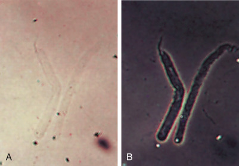

Figure 28-4 

**A,** Hyaline casts. Bright-field (×100). **B,** Hyaline casts. Phase-contrast microscopy (×100). 

 

##  Polarized Microscopy 

This is used to distinguish crystals and fibers from cellular or protein cast material. Lipid droplets or spherocrystals containing cholesterol esters are anisotropic in polarized light, show up brightly against a dark field, and form Maltese crosses with crossed polars. Visible evidence of anisotropy depends on the orientation of the crystal in the field; not all will be seen. If a red retardation plate is inserted, the cholesterol droplet will show typical blue and yellow quadrants against a red background. Starch granules will have a similar appearance when polarized but are much larger. Crystals, hair, and clothing fibers also show up brightly but do not exhibit Maltese cross forms. Fatty acids and triglycerides do not form liquid spherocrystals and do not show anisotropy, but glycosphingolipids in Fabry's disease are birefringent and may be seen in urinary sediments. 

 

##  Quantitative Counts 

The hemocytometer is used in many laboratories to quantify the elements of urine sediment. Cells and casts from undiluted well-mixed urine are counted and reported as the number of cells per microliter. Normal values for neutrophils vary from 5 to 30/µL according to different workers; upper limits for erythrocytes range from 3 to 20/µL and for casts as few as 1 to 2/µL. Counting cells from an unspun sample of urine in a hemocytometer has advantages over the examination of cytocentrifuged spun urine. These include decreased variability caused by centrifugation and suspension, a fixed volume of urine for examination, and a marked visual field for accurate counting.  Kesson and colleagues (1978)  provided evidence that chamber counts on centrifuged urine sediments are more reliable in predicting renal functional abnormalities than is a conventional method using cells per high-power field. Recovery of cells may vary depending on centrifuge speed, specific gravity, and pH. 

 

##  Microscopic Components in Urine Sediment 

 

##  Cells 

 

##  Erythrocytes. 

Under high power, unstained erythrocytes (RBCs) appear as pale biconcave disks that may vary somewhat in size but are usually about 7 µm in diameter. If the specimen is not fresh when it is examined, erythrocytes may appear as faint, colorless circles or “shadow cells,” because the hemoglobin may dissolve out. They may become crenated in hypertonic urine and appear as small, rough cells with crinkled edges. In dilute urine, the cells will swell and rapidly lyse, releasing hemoglobin and leaving only empty cell membranes, referred to as **ghost cells.**

On occasion, erythrocytes may be confused with oil droplets or yeast cells. Oil droplets, however, exhibit greater variation in size and are highly refractile, and yeast cells usually show budding. If identification is difficult, two preparations may be made and a few drops of acetic acid added to one. Erythrocytes are lysed in the acidified preparation. 

Erythrocytes are found in small numbers (0 to 2 cells/hpf) in normal urine; more than 3 cells/hpf is considered abnormal. The presence of increased numbers of erythrocytes in the urine may indicate a variety of urinary tract and systemic conditions. These include (1) renal disease—glomerulonephritis, lupus nephritis, interstitial nephritis associated with drug reactions, calculus, tumor, acute infection, tuberculosis, infarction, renal vein thrombosis, trauma (including renal biopsy), hydronephrosis, polycystic kidney, and occasionally acute tubular necrosis and malignant nephrosclerosis; (2) lower urinary tract disease—acute and chronic infection, calculus, tumor, stricture, and hemorrhagic cystitis following cyclophosphamide therapy; (3) extrarenal disease—acute appendicitis, salpingitis, diverticulitis, acute febrile episodes, malaria, subacute bacterial endocarditis, polyarteritis nodosa, malignant hypertension, blood dyscrasias, scurvy, and tumors of the colon, rectum, and pelvis; (4) toxic reactions due to drugs, such as sulfonamides, salicylates, methenamine, and anticoagulant therapy; and (5) physiologic causes, including exercise. When increased numbers of erythrocytes are found in the urine in conjunction with erythrocyte casts, bleeding may be assumed to be renal in origin. 

 

##  Dysmorphic erythrocytes. 

Numerous studies have concentrated on the variable morphology of urinary erythrocytes, attempting to localize the site of origin of hematuria. Red blood cells with cellular protrusions or fragmentation are termed _dysmorphic_ ( [ Fig. 28-5 ](<#f0030>) ), and some authors have suggested that their presence in urine samples is strongly suggestive of renal glomerular bleeding (  Fracchia et al, 1995  ;  Fogazzi et al, 2008  ). Others have not found dysmorphic morphology reliable in predicting primary renal hematuria (  Favaro et al, 1997  ;  Ward et al, 1998  ;  Zaman & Proesmans, 2000  ). The so-called _G1 cell,_ which has a doughnut shape with one or more membrane blebs, may be more specific than dysmorphic cells for diagnosing glomerular hematuria (  Dinda et al, 1997  ;  Nguyen, 2003  ;  Nagahama et al, 2005  ). Another study describes immunocytochemical staining of urinary erythrocytes with Tamm-Horsfall protein in renal hematuria; this appears to be even more reliable than cellular morphology in terms of separating renal from nonrenal sources of erythrocytes (  Fukuzaki et al, 1996  ). Normal persons may also have a mixture of distorted and undistorted (isomorphic) erythrocytes in urine. 

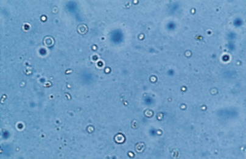

Figure 28-5 

Dysmorphic erythrocytes (×160). 

 

##  Leukocytes 

 

##  Neutrophils. 

The polymorphonuclear leukocyte (neutrophil) is the predominant type of leukocyte (white blood cell [WBC]) that appears in the urine. Under high power, these cells appear as granular spheres about 12 µm in diameter with multilobated nuclei. Nuclear segments may sometimes appear as small, round, discrete nuclei. When cellular degeneration has begun, nuclear detail may be lost, and neutrophils may then become difficult to distinguish from renal tubular epithelial cells. Dilute acetic acid may enhance nuclear detail so that definition may still be possible ( [ Fig. 28-6 ](<#f0035>) ). Ultimately, however, with continued degeneration, neutrophilic nuclear segments fuse, making distinction from mononuclear cells difficult or impossible. Supravital staining may also be helpful in emphasizing nuclear detail. With crystal-violet safranin, neutrophilic nuclei appear reddish purple and cytoplasmic granules violet. The peroxidase cytochemical reaction is also useful in distinguishing neutrophils from tubular cells. 

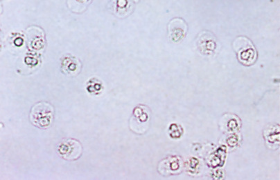

Figure 28-6 

Neutrophils with dilute acetic acid (×100). 

In dilute or hypotonic urine, neutrophils swell and their cytoplasmic granules exhibit brownian movement. Because of the refractility of the moving granules, neutrophils in this setting are known as **glitter cells.** These cells stain poorly with supravital stains and will show loss of nuclear segmentation. The leukocyte esterase reagent strip is valuable in the confirmation of pyuria in hypotonic urine specimens. 

Additionally, leukocytes are rapidly lysed in hypotonic or alkaline urine. Approximately 50% are lost following 2 to 3 hours of standing at room temperature. This necessitates prompt examination of the urinary sediment following collection. 

 

##  Pyuria. 

Typically, fewer than 5 leukocytes/hpf are seen in normal urine, although females not uncommonly will have somewhat higher quantities present. Increased numbers of leukocytes (principally neutrophils) in the urine constitute pyuria and indicate the presence of infection or inflammation in the urinary tract. When accompanied by leukocyte casts or mixed leukocyte–epithelial cell casts, increased urinary leukocytes are considered to be renal in origin. 

Infection, either bacterial or nonbacterial, may be centered in the renal parenchyma (pyelonephritis) or may be localized as cystitis, prostatitis, urethritis, or balanitis. In women, the acute urethral syndrome (dysuria-pyuria syndrome) is regularly associated with greater than 8 neutrophils/µL in clean-catch urine specimens; however, bacterial colony counts are lower than expected. _Chlamydia trachomatis,_ staphylococci, and coliforms are causative agents. Urinary neutrophil counts greater than 30 cells/hpf suggest acute infection, and repeated sterile cultures in this setting may indicate tuberculosis or a nephritis. Gross pyuria may reflect rupture of a renal or urinary tract abscess. It should be noted that the common finding of leukocytes in urine is not as reliable an indication of urinary tract infection as the detection of bacteriuria by Gram stain or culture of a fresh midstream specimen. 

Increased leukocytes may be found in a variety of other urinary tract diseases, including glomerulonephritis, systemic lupus erythematosus (SLE), and interstitial nephritis. Calculous disease at any level may give rise to increased numbers of urinary leukocytes caused by stasis-induced ascending infection or localized mucosal inflammatory response. Bladder tumors, as well as a variety of acute or chronic localized inflammatory processes, may also cause leukocytes to be increased in the urine. Urine leukocytes may be transiently increased during fevers and following strenuous exercise. 

 

##  Eosinophils. 

These cells are not normally seen in urine, and the finding of more than 1% eosinophils among the leukocyte population present is considered significant ( [ Fig. 28-7 ](<#f0040>) ). Evaluation of a concentrated stained urine is necessary for proper evaluation of urine for the presence of eosinophils. A cytocentrifuge preparation with Wright's, Diff-Quik, or Papanicolaou stain is commonly used, and the Hansel secretion stain (methylene blue and eosin-Y in methanol, Libe Labs, Florissant, MO) has been shown to be an excellent stain for recognition of eosinophiluria. Appropriately stained, bilobed eosinophils may be noted in patients with tubulointerstitial disease associated with hypersensitivity to drugs such as penicillin and its analogs, although some studies have questioned the diagnostic significance of this finding (  Muriithi et al, 2013  ). The cellular pattern in allergic interstitial nephritis typically includes many erythrocytes and some renal tubular epithelial cells. Eosinophiluria is also seen in other acute disorders of the genitourinary tract, with small numbers seen in urinary tract infections and renal transplant rejections. 

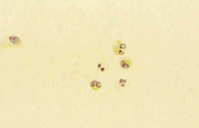

Figure 28-7 

Eosinophils (×500). 

 

##  Lymphocytes and mononuclear leukocytes. 

Small lymphocytes are normally present in urine and, along with histiocytes, are easily differentiated in stained smears. When mononuclear cells (histiocytes, lymphocytes, or plasma cells) constitute 30% or more of a differential count, chronic inflammation is indicated. Many small lymphocytes may be found in urine during renal transplant rejection. Plasma cells and atypical lymphocytes should be noted when present, and further investigation is warranted. 

 

##  Epithelial Cells 

 

##  Squamous epithelial cells. 

These cells are the most frequent epithelial cells seen in normal urine and the least significant. The distal one third of the urethra is lined by squamous epithelial cells, and in the urine, these cells are large and flat, with abundant cytoplasm and small round central nuclei ( [ Fig. 28-8 ](<#f0045>) ). Their margins are often folded. When stained with crystal-violet safranin, nuclei are purple and cytoplasm pink to violet. Many of the squamous cells present in female urine may be derived from the vagina or vulva. 

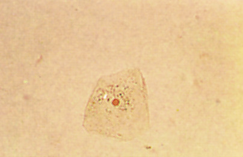

Figure 28-8 

Squamous epithelial cell. 

Pyridium stained (×200). 

 

##  Transitional (urothelial) epithelial cells. 

Transitional epithelial cells line the urinary tract from the renal pelvis to the lower third of the urethra. These cells are smaller than squamous cells, their size ranging from 40 to 200 µm. They are round or pear shaped, with a round, centrally located nucleus. Occasional binucleate forms may be seen. When stained, transitional cells have dark blue nuclei with variable amounts of pale blue cytoplasm ( [ Fig. 28-9 ](<#f0050>) ). Another helpful clue to the proper identification of transitional cells is a characteristic **endo-ecto cytoplasmic rim.** 

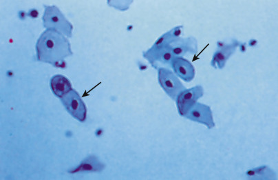

Figure 28-9 

Transitional epithelial cells. 

Papanicolaou stained (×430). 

A few urothelial cells are present in normal urine, reflecting normal desquamation; similar to squamous cells, they are rarely of pathologic significance. The exception is the presence of large clumps or sheets of transitional cells in the absence of instrumentation (i.e., catheterization). This situation necessitates cytologic examination with the Papanicolaou stain to evaluate for possible transitional cell carcinoma (  Fogazzi et al, 2015  ). 

 

##  Renal tubular epithelial cells. 

These are the most significant types of epithelial cells found in urine because the finding of an increased number indicates tubular damage ( [ Figs. 28-10 ](<#f0055>) and [ 28-11 ](<#f0060>) ). Small numbers of tubular cells may be seen in normal urine, reflecting the normal sloughing of aging cells. They may be present in somewhat larger numbers in the urine of normal newborns. 

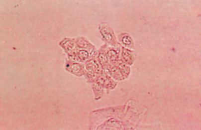

Figure 28-10 

Renal tubular epithelial cells (×200). 

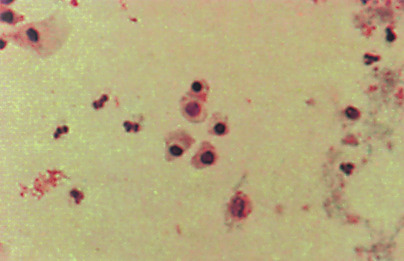

Figure 28-11 

Renal tubular epithelial cells and neutrophils. 

Papanicolaou stained (×430). 

The Papanicolaou stain has been shown to be especially useful in distinguishing renal tubular cells from other mononuclear cells in urine (  Barkan & Wojcik, 2014  ). Renal epithelial cells from the proximal and distal convoluted tubules occur singly and are large (14 to 60 µm), oblong cells with characteristic coarsely granular eosinophilic cytoplasm. Nuclei may be multiple but are small with dense chromatin and rare nucleoli. Increased numbers of proximal and distal convoluted renal epithelial cells are seen in cases of acute tubular necrosis and with certain drug or heavy metal toxicities. 

Epithelial cells from the collecting ducts measure 12 to 20 µm and are identified by their characteristic cuboidal or polygonal shape and large, usually slightly eccentric nucleus. Cytoplasmic properties include a basophilic endo-ecto cytoplasmic rim commonly found in transitional epithelial cells. Increased numbers of collecting duct epithelial cells are found in renal transplant rejection, acute tubular necrosis (diuretic phase), and other ischemic injuries to the kidney. They may also be found in increased numbers in malignant nephrosclerosis, as well as in cases of acute glomerulonephritis accompanied by tubular damage. Ingestion of various drugs and chemicals may cause significant tubular desquamation. Collecting duct tubular cells are easily found in the urine following salicylate intoxication. 

Renal epithelial fragments of collecting duct origin have been described. Three or more renal cells of collecting duct origin constitute a renal epithelial fragment and indicate a more severe form of renal tubular injury with basement membrane disruption. Renal epithelial fragments are indicative of ischemic necrosis and are usually found accompanying varying degrees of renal tubular injury and pathologic casts. Proximal and distal convoluted tubular cells are not found in fragment form. Proper identification of renal epithelial fragments is essential, not only in diagnosing a more severe form of renal tubular injury, but also in avoiding a false-positive diagnosis of low-grade transitional cell carcinoma. 

 

##  Lipids in renal tubular epithelial cells. 

Oval fat bodies are tubular cells that have absorbed lipoproteins with cholesterol and triglycerides leaked from nephrotic glomeruli ( [ Fig. 28-12 ](<#f0065>) ). Oval fat bodies therefore constitute one form of lipiduria. Lipids may also appear in the urine as free fatty droplets, or within histiocytes as ingested material. The presence of any or all of these lipid forms accompanied by marked proteinuria is characteristic of nephrotic syndrome. 

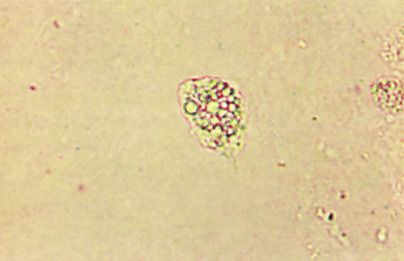

Figure 28-12 

Oval fat body (×160). 

Positive identification of lipid is required before lipiduria is reported. When free or incorporated droplets contain large amounts of cholesterol, they exhibit a Maltese cross formation under polarized light ( [ Figs. 28-13 ](<#f0070>) and [ 28-14 ](<#f0075>) ). When they contain large quantities of triglycerides, fat stains (Oil Red O or Sudan III) are required for positive lipid identification. 

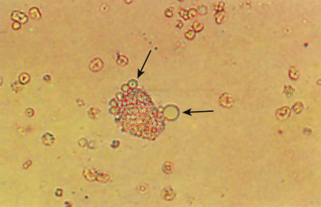

Figure 28-13 

Oval fat body with attached fat droplets. 

Bright-field (×160). 

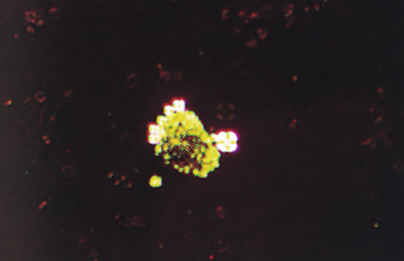

Figure 28-14 

Oval fat body with attached fat droplets. 

Polarized (×160). 

 

##  Pigment in renal tubular epithelial cells. 

With hemoglobinuria or myoglobinuria, heme pigment is absorbed into the cells and is converted to hemosiderin. The iron-laden cells are desquamated and found in the urine sediment. The cytoplasmic granules appear yellow-brown and stain for iron with Prussian blue. These cells may also be incorporated into casts (see [ Figs. 28-1 ](<#f0010>) and [ 28-2 ](<#f0015>) ). 

Melanin granules are absorbed into the tubular cells in rare cases of melanuria. The desquamated pigmented cells may be demonstrated in the sediment. Pigmented tumor cells are also found in cases of melanoma metastasis to the bladder. 

Bilirubin pigment colors all of the elements of the sediment, including renal tubular epithelial cells and casts. Note that urobilin does not color cells and casts. 

 

##  Casts 

Casts are the only formed elements of urine that have the kidney as their sole site of origin. Tamm-Horsfall protein is the glycoprotein secreted by the thick part of the ascending loop of Henle (and possibly the distal tubule), which constitutes about one third of the total urinary protein in normal individuals (  Rampoldi et al, 2011  ;  El-Achkar & Wu, 2012  ). It is generally held that Tamm-Horsfall protein forms the matrix of all casts. The protein forms a meshwork of fibrils that can potentially trap any elements present in the tubular filtrate, including cells, cell fragments, or granular material. 

Casts can be quite variable in their appearance, size, shape, and stability. Perhaps this variability is one factor in the apparent low precision of cast identification in some laboratories (  Yoo et al, 1995  ;  Rasoulpour et al, 1996  ). The width of a cast depends on the size of the tubule in which it was formed. Broad casts are seen in dilated tubules or with stasis in collecting ducts. Thin casts occur in tubules compressed by swollen interstitial tissue or as the result of disintegration. Casts may be short and stubby, or long and convoluted. The latter variety appears when diuresis occurs after urinary stasis. Casts typically have parallel sides and blunt ends, but with age they may begin to disintegrate and show thinning and irregularities. Fibrils may separate, causing a frayed appearance. Tails and tapering ends can be seen, and these disintegrating forms are referred to as **cylindroids.**

In the normal person, very few casts are seen in the urinary sediment. In kidney diseases, they may appear in large numbers and in many forms. Increased numbers of casts usually indicate that kidney disease is widespread and that many nephrons are involved. Large numbers of casts may also be seen in healthy persons after strenuous exercise accompanied by proteinuria. 

Cast formation increases with lower pH or increased ionic concentration and with stasis or obstruction of the nephron by cells or cell debris. It is increased when larger than normal quantities of plasma proteins enter the tubules. Usually the protein in excess is albumin, but globulins such as the Bence Jones immunoglobulin cause cast formation, as do hemoglobin and myoglobin. The plasma proteins possibly react or combine with Tamm-Horsfall protein to form less translucent casts and granular casts. 

Casts may be classified according to their matrix, inclusions, pigments, and cells present, as shown in [ Box 28-2 ](<#b0015>) . A detailed discussion, including clinical significance, follows. 

Box 28-2 

Classification of Casts 

 

##  Matrix 

  * Hyaline—variable size 

  * Waxy—often broad in use 

 

##  Inclusions 

  * Granules—proteins, cell debris 

  * Fat globules—triglycerides, cholesterol esters 

  * Hemosiderin granules 

  * Crystals—uncommon 

  * Melanin granules—rare 

 

##  Pigments 

  * Hemoglobin, myoglobin, bilirubin, drugs 

 

##  Cells 

  * Erythrocytes and red blood cell remnants 

  * Leukocytes—neutrophils, lymphocytes, monocytes, and histiocytes 

  * Renal tubular epithelial cells 

  * Mixed cells—erythrocytes, neutrophils, and renal tubular cells 

**Bacteria**

 

##  Cast Matrix 

 

##  Hyaline casts. 

These are the most frequently observed casts, consisting almost entirely of Tamm-Horsfall protein; zero to two hyaline casts per low-power field (lpf) is considered normal. Hyaline casts are translucent with bright-field microscopy and pink with supravital staining, and are more easily visualized with phase-contrast microscopy (see [ Fig. 28-4, _A_ and _B_ ](<#f0025>) ). Increased numbers are seen with renal diseases and transiently with exercise, heat exposure, dehydration, fever, congestive heart failure, and diuretic therapy. 

 

##  Waxy casts. 

With chronic renal diseases, some casts become denser in appearance and are known as waxy. These differ from hyaline casts in that they are easily visualized because of their high refractive index. Waxy casts are uncommon in glomerular diseases, with the reported exception of postinfectious glomerulonephritis and renal amyloidosis (  Spinelli et al, 2013  ). With bright-field microscopy, waxy casts are homogeneously smooth in appearance with sharp margins, blunted ends, and cracks or convolutions frequently seen along the lateral margins, indicating a measure of brittleness ( [ Fig. 28-15 ](<#f0080>) ). 

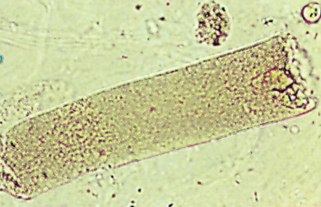

Figure 28-15 

Waxy cast (×200). 

Waxy casts are commonly associated with tubular inflammation and degeneration. They are observed most frequently in patients with chronic renal failure and are found during acute and chronic renal allograft rejection. Early waxy casts are believed by some investigators to reflect the final phase of dissolution of the fine granules of granular casts ( [ Fig. 28-16 ](<#f0085>) ). Because time is required for granules to undergo lysis, waxy casts imply localized nephron obstruction and oliguria. When waxy casts are unusually broad, they are known as **renal failure casts.** These casts imply advanced tubular atrophy and/or dilation, in turn reflecting end-stage renal disease and extreme stasis of urine flow. 

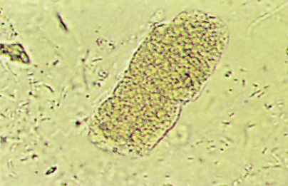

Figure 28-16 

Fine granular cast becoming waxy (×200). 

 

##  Cellular Casts 

 

##  Erythrocyte (red blood cell) casts. 

Finding these casts in the urine is significant because they are an indication of bleeding within the nephron. Glomerular damage allows erythrocytes to escape into the tubule; if there is concomitant proteinuria, and if conditions are optimal for cast formation, red blood cell casts form in the distal nephron. In urine, these casts appear yellow under low-power objectives. A prerequisite for the identification of an erythrocyte cast is that red blood cell outlines should be sharply defined in at least part of the cast ( [ Fig. 28-17 ](<#f0090>) ). The amount of matrix material that may be visible ranges from scant to a prominent delicate hyaline matrix with only one or two visible red blood cells. These casts are better visualized with phase-contrast microscopy or with supravital staining, in which case the erythrocytes are colorless or lavender in a pink matrix. With prolonged stasis, red cell casts may degenerate and appear in the urine as reddish brown, coarsely granular hemoglobin (blood) casts. 

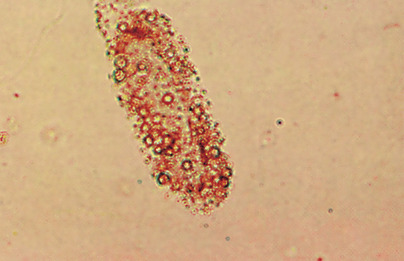

Figure 28-17 

Erythrocyte cast (×200). 

Pathologic disorders in which erythrocyte casts appear in the sediment include many acute glomerulonephritides, IgA nephropathy, lupus nephritis, subacute bacterial endocarditis, and renal infarction. Rarely, tubulointerstitial disease may allow transtubular entry of erythrocytes with subsequent incorporation into a cast. This may occur in severe pyelonephritis. Additionally, the appearance of erythrocyte and leukocyte casts has been found to coincide with renal relapse in patients with SLE (  Hebert et al, 1995  ). 

 

##  Leukocyte (WBC) casts. 

WBC casts are refractile and exhibit granules; frequently, multilobated nuclei will be visible ( [ Fig. 28-18 ](<#f0095>) ), unless disintegration has begun. Phase-contrast microscopy may be helpful in delineating nuclear segmentation. Supravital stains also enhance visualization. 

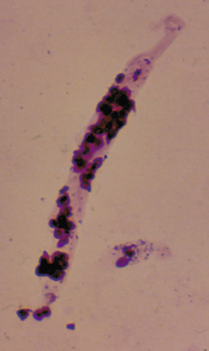

Figure 28-18 

Leukocyte cast. IRIS urinalysis stain (×200). 

Leukocytes usually enter tubular lumina from the interstitium, and for the most part, leukocyte casts ( [ Fig. 28-19 ](<#f0100>) ) reflect tubulointerstitial disease with neutrophilic exudates and interstitial inflammation. The most common disease of this category is pyelonephritis. Leukocyte casts may be present in glomerular disease owing to the chemotactic effect of complement. They are also seen in interstitial nephritis, lupus nephritis, and even the nephrotic syndrome. 

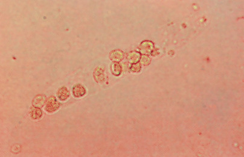

Figure 28-19 

Cellular cast (×200). 

 

##  Renal tubular epithelial cell casts. 

Renal tubular epithelial cell casts may be difficult to distinguish from leukocyte casts, particularly in unstained preparations viewed with bright-field microscopy. Supravital staining, phase-contrast microscopy, and Papanicolaou staining (see [ Figs. 28-19 ](<#f0100>) and [ 28-20 ](<#f0105>) ) are helpful in delineating between these two cast types. The most reliable distinguishing characteristic of renal tubular cells is their singular round nuclei. 

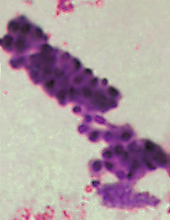

Figure 28-20 

Renal tubular epithelial cell cast. 

Papanicolaou stained (×430). 

Renal tubular epithelial cell casts are seen in urine with acute tubular necrosis, viral disease (e.g., cytomegalovirus disease), or exposure to a variety of drugs. Heavy metal poisoning and ethylene glycol and salicylate intoxication may cause tubular cells and casts to appear in the urine. In transplant units, these cells and casts constitute some of the more reliable criteria for detecting acute allograft rejection after the third postoperative day. 

 

##  Mixed cellular casts. 

Not infrequently, two distinct cell types may be present within a single cast. This has been referred to as a **mixed cast,** and examples might include leukocyte/renal, erythrocyte/leukocyte, and eosinophil/renal ( [ Fig. 28-21 ](<#f0110>) ). When cell types cannot be established with certainty, the resulting cast is known as a **cellular cast** ( [ Fig. 28-22 ](<#f0115>) ). Some inferences as to cell type may be drawn from the dominant population of free cells in the surrounding sediment. 

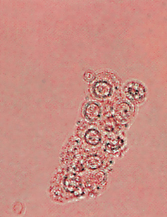

Figure 28-21 

Mixed (leukocyte and renal epithelial tubular cell) cast (×200). 

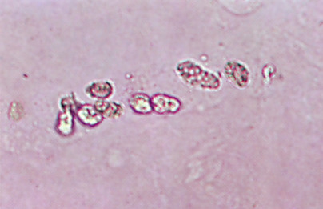

Figure 28-22 

Cellular cast (×200). 

 

##  Inclusion Casts 

 

##  Granular casts. 

Granular casts are fairly common and may appear in both pathologic and nonpathologic conditions ( [ Fig. 28-23 ](<#f0120>) ). Granules may be small or large and may originate from plasma protein aggregates that pass into the tubules from damaged glomeruli, as well as from cellular remnants of leukocytes, erythrocytes, or damaged renal tubular cells. Fine salt precipitates and lysosomes may also be granular components. Protein aggregates include fibrinogen, immune complexes, and globulins. With prolonged stasis, large granules in casts may become smaller, and there appears to be no advantage to separating types of granular casts. 

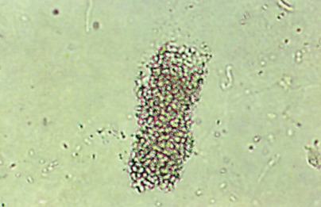

Figure 28-23 

Granular cast (×200). 

Granular casts appear with glomerular and tubular diseases but are also a feature of tubulointerstitial disease and renal allograft rejection. They may accompany pyelonephritis, viral infections, and chronic lead poisoning. Coarsely granular casts occur, with hematuria, in cases of renal papillary necrosis. It is possible that some fine granules represent calcium phosphate precipitants in hyperparathyroidism. Granular casts may also be seen following periods of extreme stress or strenuous exercise. 

 

##  Fatty casts. 

Fatty material is incorporated into the cast matrix from lipid-laden renal tubular cells. These are commonly seen when heavy proteinuria is present and are a feature of nephrotic syndrome and nonproliferative glomerular diseases (  Fogazzi et al, 2005  ) ( [ Figs. 28-24 ](<#f0125>) and [ 28-25 ](<#f0130>) ). 

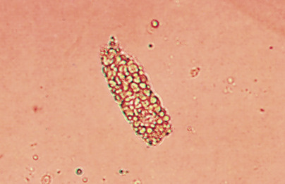

Figure 28-24 

Fatty cast. 

Bright-field, nonpolarized (×160). 

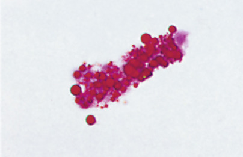

Figure 28-25 

Fatty cast. 

Positive Oil Red O (×200). 

 

##  Crystal casts. 

Casts containing urates, calcium oxalate, and sulfonamides (sulfamethoxazole) are occasionally seen. A matrix is visible in a true crystal cast, and the crystals may polarize. These casts indicate deposition of crystals in the tubule or collecting duct. Hematuria, possibly related to tubular damage, regularly accompanies crystal casts. These casts should be carefully distinguished from clumps of crystals forming at room or refrigerator temperatures. 

 

##  Pigmented Casts 

 

##  Hemoglobin (blood) casts. 

Hemoglobin casts typically appear yellow to red, although sometimes the color is pale ( [ Fig. 28-26 ](<#f0135>) ). Most often, hemoglobin casts, also known as _blood casts,_ are seen with erythrocyte casts and glomerular disease. Less commonly, they are seen with tubular bleeding and rarely with hemoglobinuria. 

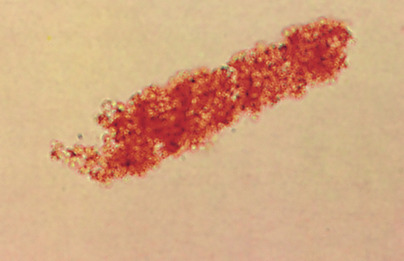

Figure 28-26 

Hemoglobin cast (×200). 

 

##  Hemosiderin casts. 

Hemosiderin granules in casts derive from pigment-laden renal tubular cells. 

 

##  Myoglobin casts. 

These casts are red-brown in color and occur with myoglobinuria following acute muscle damage. They may be associated with acute renal failure. 

 

##  Bilirubin and other drug casts. 

Bilirubin is seen in urine when obstructive jaundice is present, and will color casts a deep yellow brown. Drugs such as phenazopyridine cause a bright yellow to orange color in acid urine and color casts and cells as well. 

 

##  Broad Casts. 

Broad casts are defined as those with a diameter two to six times that of normal casts. They indicate tubular dilation and/or stasis in the distal collecting duct. All types of casts may occur in broad forms, and they are typically seen in individuals with chronic renal failure. They portend a poor prognosis. 

 

##  Other Miscellaneous Casts or Castlike Structures. 

Bacteria may become embedded in cast matrices; on supravital staining, they appear dark purple with a pale pink matrix. Mucous threads are commonly confused with casts. However, these are larger, long, and ribbonlike, with poorly defined edges and pointed or split ends, in contradistinction to casts, which tend to have well-defined edges and blunt ends. 

 

##  Telescoped Sediment 

This term is used to describe the simultaneous occurrence of elements of glomerulonephritis and those of nephrotic syndrome in the same urine specimen. A telescoped sediment might therefore include red blood cells, red blood cell casts, cellular casts, broad waxy casts, lipid droplets, oval fat bodies, and fatty casts. Such sediment may be found in collagen vascular disease (notably lupus nephritis) and subacute bacterial endocarditis. 

 

##  Crystals 

Crystals form by the precipitation of urinary salts when alterations in multiple factors affect their solubilities (  Verdesca et al, 2011  ). These include changes in pH, temperature, and concentration. Precipitates can appear in the urine in the form of true crystals or amorphous material. Most crystal formation takes place in refrigerated specimens and those allowed to sit at room temperature for several hours. Increased solute concentration is typically responsible for crystal formation. 

Although most crystals in the urine are of limited clinical significance, proper identification is essential, so as not to miss the relatively few abnormal crystals that are associated with various pathologic conditions. Knowledge of urine pH is a valuable aid in crystal identification because it is the pH that determines which chemical will precipitate. Many of the commonly seen crystals have characteristic morphologies; however, variability does exist, sometimes leading to confusion between pathologic and nonpathologic crystal structures. For the purpose of separating abnormal from more commonly occurring **nuisance crystals,** a summary of crystal morphology is presented ( [ Table 28-10 ](<#t0065>) ). 

TABLE 28-10 

Characteristics of Amorphous and Crystalline Urinary Sediments 

|  |  URINE pH WHERE FOUND  |  Solubility Characteristics and Comments   
---|---|---|---  
Substance  |  Description  |  Acid  |  Neutral  |  Alkaline   
Ampicillin  |  Uncommon—from high dose; colorless; long prisms that form clusters, sheaves  |  \+  |  – |  – |   
Bilirubin  |  Reddish brown; amorphous needles, rhombic plates, or cubes; may color uric acid crystals  |  \+  |  – |  – |  Soluble in alkali, acid, acetone, and chloroform   
Cholesterol  |  Rare; colorless; flat plate with corner notch; accompanies fatty casts and oval fat bodies  |  \+  |  \+  |  – |  Very soluble in chloroform, ether, and hot alcohol   
Calcium carbonate  |  Colorless; small granules in pairs, fours; spheres; rarely needles  |  – |  \+  |  \+  |  Soluble in acetic acid with effervescence   
Calcium oxalate  |  Dihydrate—common; colorless; small refractile octahedron   
Monohydrate—uncommon; dumbbell and ovoid rectangle  |  \+  |  \+  |  – |  Soluble in dilute HCl   
Cystine  |  Colorless; hexagonal plates, often laminated; rapidly destroyed by bacteria; may be confused with uric acid, but cystine is soluble in dilute hydrochloric acid  |  \+  |  – |  – |  Soluble in alkali (especially ammonia) and dilute HCl; insoluble in boiling water, acetic acid, alcohol, ether; apply cyanide-nitroprusside reaction   
Hematin  |  Small, biconvex “whetstone” seen with hemoglobinuria  |  \+  |  – |  – |   
Hemosiderin  |  Golden brown; granules in clumps, in cells, casts  |  \+  |  \+  |  – |  Blue with Prussian blue   
Hippuric acid  |  Rare; colorless, needles, rhombic plates and four-sided prisms; distinguish from phosphates  |  \+  |  \+  |  \+  |  Soluble with hot water and alkali; insoluble in acetic acid   
Indigotin  |  Rare; blue; amorphous or small crystals; colors other crystals  |  \+  |  \+  |  \+  |  Very soluble in chloroform; soluble in ether; insoluble in acetone   
**Phosphates**  
Amorphous phosphate (magnesium, calcium)  |  Colorless; fine, granular precipitate  |  – |  \+  |  \+  |  Insoluble with heat; soluble with acetic acid, dilute HCl   
Calcium hydrogen phosphate  |  Less common; colorless, star-shaped or long, thin prisms or needles; form rosettes  |  sl  |  \+  |  sl  |  Slightly soluble in dilute acetic acid, soluble in dilute HCl   
Triple phosphate (ammonium, magnesium)  |  Common form: colorless; three- to six-sided prisms, “coffin lids”   
Less often: Flat, fern leaf form, sheets, flakes  |  – |  \+  |  \+  |  Soluble in dilute acetic acid   
Radiographic media (meglumine diatrizoate)  |  Intravenous: Colorless; thin, rhombic plates, some with notch, resemble cholesterol plates; elongated crystals   
Retrograde: Colorless; long, pointed crystals  |  \+  |  – |  – |  Soluble in 10% NaOH: Insoluble in ether and chloroform; high specific gravity in urine: polarizes with interference colors   
**Sulfonamides**  
Acetylsulfadiazine  |  Wheat sheaves with eccentric binding  |  \+  |  – |  – |   
Acetylsulfamethoxazole  |  Brown; dense spheres or irregular divided spheres  |  \+  |  – |  – |   
Sulfadiazine  |  Brown; dense globules  |  \+  |  – |  – |  Soluble in acetone   
Tyrosine  |  Rare; colorless or yellow, appears black with focusing; fine silky needles in sheaves or rosettes  |  \+  |  – |  – |  Soluble in alkali, dilute mineral acid, relatively heat soluble; insoluble in alcohol, ether   
**Urates**  
Amorphous (calcium, magnesium, sodium, potassium)  |  Common; colorless to yellow-brown; amorphous, granular precipitate  |  \+  |  \+  |  – |  Soluble in dilute alkali; soluble at 60° C or lower; change to uric acid crystal with concentrated HCl or acetic acid   
Monosodium urate  |  Colorless; needles or amorphous precipitate  |  \+  |  – |  – |   
Urates (sodium, potassium, ammonium)  |  Brown; small, spherical; clusters resemble biurates  |  sl  |  \+  |  – |  Soluble at 60° C; change to uric acid with glacial acetic acid   
Ammonium biurate  |  Common in “old” urine; dark yellow or brown; spheres or “thorn apples” (spheres with horns)  |  – |  \+  |  \+  |  Soluble at 60° C with acetic acid; soluble strong alkali; change to uric acid with concentrated hydrochloric or acetic acid   
Uric acid  |  Common; yellow, red-brown, brown; large variety of shapes—rhombic, four-sided plates, rosettes, “whetstones” lemon shapes; rarely, colorless hexagonals  |  \+  |  – |  – |  Soluble in alkali: Insoluble in alcohol and acids; polarizes with interference colors   
Xanthine  |  Rare; colorless; small, rhombic plates  |  \+  |  \+  |  – |  Soluble in alkali; soluble with heat; insoluble in acetic acid   
  
_sl,_ Slight. 

 

##  Crystals Found in Normal Acid Urine 

 

##  Amorphous urates (calcium, magnesium, sodium, and potassium urates). 

Amorphous urates will precipitate upon standing in concentrated urine of a slightly acid pH. When large quantities are present, the urine sediment may appear pink-orange to reddish brown on macroscopic examination; this appearance has been referred to as **brick dust.** Microscopically, this amorphous material appears as yellow-brown small granules that can form clumps and adhere to fibers and mucous threads. Amorphous urates will convert to uric acid crystals with acidification with acetic acid, and will dissolve with heat (60° C) and with dilute alkali. 

 

##  Crystalline urates (sodium, potassium, and ammonium). 

These biurates and acid urates form small brown spheres ( [ Fig. 28-27 ](<#f0140>) ) or colorless needles in slightly acid urine. The spheres may cluster in pairs and triplets. Similar to amorphous urates, these crystalline forms will slowly revert to uric acid plates on acidification with acetic acid. 

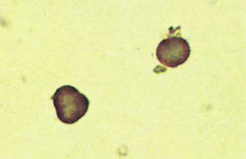

Figure 28-27 

Acid urates (×160). 

 

##  Crystalline uric acid. 

Uric acid crystals occur at low pH (5 to 5.5) and are seen in a variety of shapes, including rhombic or four-sided flat plates, prisms, oval forms with pointed ends (lemon-shaped), wedges, rosettes, and irregular plates ( [ Figs. 28-28 ](<#f0145>) and [ 28-29 ](<#f0150>) ). Most are colored, typically yellow or reddish brown. Rarely, they are colorless and hexagonal, resembling cystine ( [ Fig. 28-30 ](<#f0155>) ). Unlike cystine, they show birefringence with polarized light ( [ Fig. 28-31 ](<#f0160>) ). 

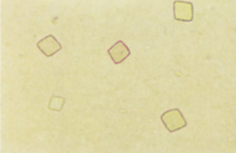

Figure 28-28 

Uric acid crystals (×160). 

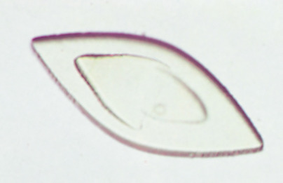

Figure 28-29 

Large uric acid plate, laminated (×160). 

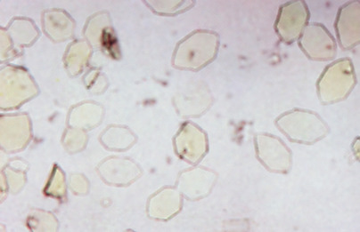

Figure 28-30 

Hexagonal uric acid crystals. 

Bright-field (×50). 

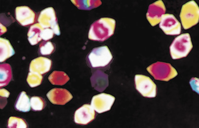

Figure 28-31 

Hexagonal uric acid crystals. 

Polarized (×50). 

Large numbers of uric acid crystals and urates may reflect increased nucleoprotein turnover, especially during chemotherapy of leukemia or lymphoma. Increased quantities may be seen with Lesch-Nyhan syndrome and may provide circumstantial evidence of the nature of small stones lodged in the ureters, especially when radiolucent and found in conjunction with raised serum uric acid levels. They may also herald the urate nephropathy of gout. 

 

##  Calcium oxalates. 

Dihydrates may appear at pH 6 or in neutral urine. Their classic form is that of a small, colorless octahedron that resembles an envelope ( [ Fig. 28-32 ](<#f0165>) ). Dumbbell shapes and ovoid forms may occur ( [ Fig. 28-33 ](<#f0170>) ). Longer forms occur in calcium oxalate monohydrate. Oxalate crystals are insoluble in acetic acid. 

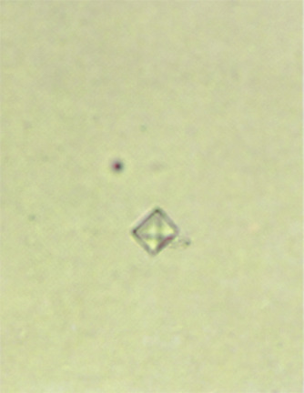

Figure 28-32 

Calcium oxalate crystals (×200). 

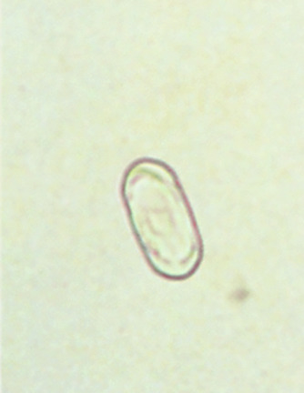

Figure 28-33 

Calcium oxalate. 

Unusual oval form (×200). 

Oxalate crystals in large numbers may reflect severe chronic renal disease or ethylene glycol or methoxyflurane toxicity. Oxaluria has come into prominence as a reflection of the increased absorption of oxalates from food following small bowel disease and resection, notably for Crohn's disease. Oxaluria may also be present in genetically susceptible persons following large doses of ascorbic acid. 

 

##  Crystals Found in Normal Alkaline Urine 

 

##  Amorphous phosphates (calcium and magnesium). 

Similar to amorphous urates, amorphous phosphates have a granular appearance microscopically; unlike the former, they tend to be colorless and will produce a fine or lacy white precipitate macroscopically. Clumps or masses can often be seen by light microscopy ( [ Fig. 28-34 ](<#f0175>) ). Large amounts of this material may precipitate out upon prolonged standing at room temperature or in a refrigerator. 

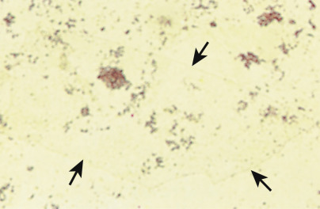

Figure 28-34 

Calcium phosphate (large clear plate). 

Almost amorphous phosphates (×64). 

Calcium and magnesium monohydrogen phosphates are the least soluble in alkaline urine, although the dihydrogen phosphates may be soluble at a similar pH. Phosphates, in general, will dissolve in acids such as dilute hydrochloric and nitric acids and vary in solubility in acetic acid. They do not dissolve in dilute sodium hydroxide solutions or alcohol. 

 

##  Crystalline phosphates. 

Triple phosphate (ammonium magnesium phosphate) crystals are one of the most easily identified urine crystals, although they commonly show variation in size. They are colorless, three- to six-sided prisms with oblique ends referred to as **coffin lids** ( [ Fig. 28-35 ](<#f0180>) ). They may form colorless sheets or flakes ( [ Fig. 28-36 ](<#f0185>) ). Magnesium phosphate forms colorless rhomboids, some with notched ends or corners. These are seldom recognized. Dicalcium hydrogen phosphate crystals, on the other hand, may be seen in neutral or slightly acidic urine, and are long, three-sided prisms with pointed ends. They may form clusters or rosettes. Overall, phosphate crystals have little if any clinical significance. They are often seen in infected urine of alkaline pH. 

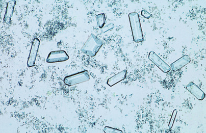

Figure 28-35 

Triple phosphate (×50). 

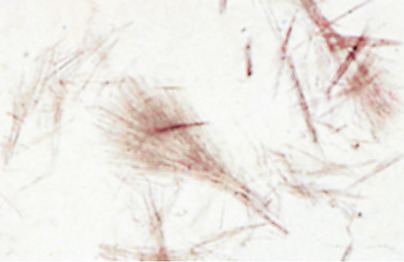

Figure 28-36 

Calcium phosphate (fine sheaves) (×160). 

 

##  Calcium carbonate. 

These uncommon crystals are small and colorless, with dumbbell or spherical shapes. They may form pairs, fours, or clumps. They are distinguished from other crystals/amorphous material by their production of carbon dioxide in the presence of acetic acid. 

 

##  Ammonium biurate. 

Similar to typical urate crystals, ammonium biurate crystals have a yellow-brown color and appear as spheres with radial or concentric striations and irregular projections or thorns ( [ Fig. 28-37 ](<#f0190>) ). Referred to as **thorn apples,** they may also be seen in neutral and occasionally in slightly acid urine. They dissolve with heat at 60° C and with acetic acid, reappearing as typical uric acid crystals after about 20 minutes. 

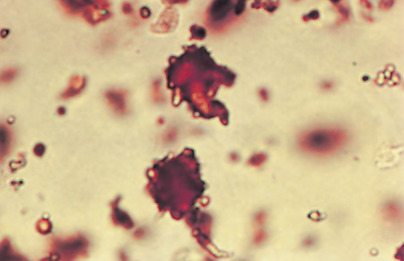

Figure 28-37 

Ammonium biurate (×160). 

 

##  Crystals Found in Abnormal Urine 

 

##  Cystine. 

Cystine crystals are colorless, refractile, hexagonal plates ( [ Fig. 28-38 ](<#f0195>) ), which appear in acid urine. They are soluble in water at pH less than 2 or greater than 8, and they may be confused with hexagonal forms of uric acid (see [ Fig. 28-30 ](<#f0155>) ). Whereas uric acid crystals polarize (see [ Fig. 28-31 ](<#f0160>) ), thin cystine crystals do not, although thick laminated forms may polarize. Furthermore, both cystine and uric acid are soluble in ammonia water, but cystine will also dissolve in dilute hydrochloric acid, and uric acid will not. 

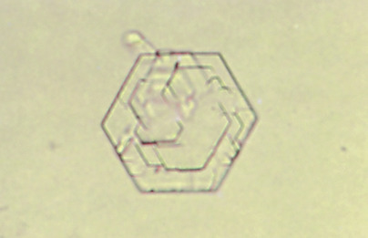

Figure 28-38 

Cystine (hexagonal, laminated) (×200). 

Cystine crystals are among the most important crystals identified in urine sediment. They occur in patients with cystinuria and may be associated with cystine calculi (  Saravakos et al, 2014  ;  Thomas et al, 2014  ). Confirmatory testing consists of the cyanide-nitroprusside reaction (see the [ Cystinuria ](<#s1255>) section later in the chapter). 

 

##  Tyrosine. 

In acidic urine, tyrosine forms fine silky needles that may be arranged in sheaves or clumps, especially after refrigeration. These may be colorless or yellow, appearing black as the microscope is focused ( [ Fig. 28-39 ](<#f0200>) ). They are soluble in alkali (ammonia and potassium hydroxide) and in dilute hydrochloric acid; they are not soluble in alcohol or ether. 

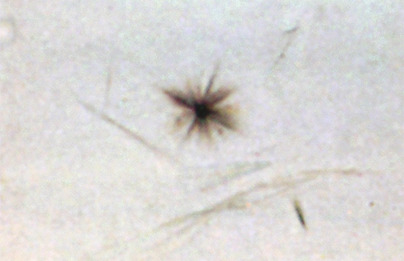

Figure 28-39 

Tyrosine crystals (×160). 

These crystals, which are uncommon, are less soluble than leucine, and therefore are more often precipitated in urine (see the [ Tyrosinuria ](<#s1230>) section later in the chapter). Tyrosine and leucine crystals are occasionally seen in the urine of patients with severe liver disease (see the [ Urinary Screening for Inherited Metabolic Diseases ](<#s1200>) section later in the chapter). 

 

##  Leucine. 

These crystals are also rare, occurring as yellow, oily-appearing spheres with radial and concentric striations ( [ Fig. 28-40 ](<#f0205>) ). They are soluble in both acids and alkalis. Leucine and tyrosine crystals may occur together; leucine may be precipitated with tyrosine crystals if alcohol is added to the urine. 

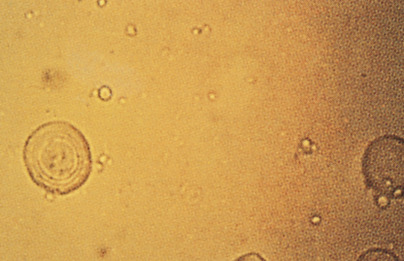

Figure 28-40 

Leucine crystals (×160). 

 

##  Sulfonamide (sulfadiazine) crystals. 

These crystals may be seen in urine of acid pH and may take on various morphologies, depending on the form of drug involved. They may be seen as yellow-brown sheaves of wheat with central bindings, striated sheaves with eccentric bindings ( [ Fig. 28-41 ](<#f0210>) ), rosettes, arrowheads, petals, needles, and round forms with radial striations. They are occasionally colorless. Confirmatory testing is by the diazo reaction. High-performance liquid chromatographic and colorimetric methods have also been described (  Simo-Alfonso et al, 1995  ;  Mount et al, 1996  ). 

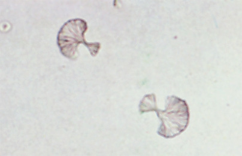

Figure 28-41 

Sulfadiazine (×160). 

With the advent of soluble sulfonamides, sulfa crystals are not as frequently found in urine, especially when urine is examined at 37° C. Before this development, these crystals could be seen in the urine of patients on sulfonamide therapy who were inadequately hydrated. This could result in renal tubular damage if crystal formation occurred within the nephron. Currently, sulfamethoxazole (Bactrim, Septra) is seen with some regularity. 

 

##  Ampicillin (high dosage). 

Ampicillin may crystallize in the urine under conditions of high dosage. These crystals appear in urine of acid pH as long, fine, colorless structures ( [ Fig. 28-42 ](<#f0215>) ). They may form coarse sheaves after refrigeration. 

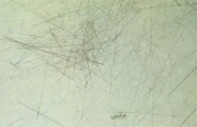

Figure 28-42 

Ampicillin (×160). 

 

##  Radiographic media (meglumine diatrizoate). 

Urinary crystals form after radiographic examinations using diatrizoate dyes. They may be found in urine of acid pH shortly after intravenous radiographic studies (particularly if the patient has not been well hydrated), appearing as flat, clear, colorless, notched rhombic plates, or longer, slender rectangles. They are easily polarized, showing interference colors ( [ Figs. 28-43 ](<#f0220>) and [ 28-44 ](<#f0225>) ). They may also be seen after retrograde cystograms as long, colorless needles, forming clusters after refrigeration. The presence of radiographic crystals should correlate with a high specific gravity (>1.040). 

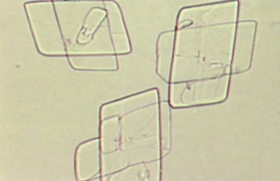

Figure 28-43 

Renografin (meglumine diatrizoate). 

Bright-field (×160). 

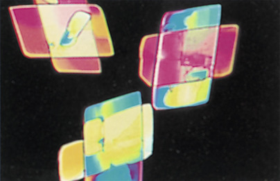

Figure 28-44 

Renografin (meglumine diatrizoate). 

Polarized (×160). 

 

##  Other drugs. 

One must always remember to check the patient's drug therapy when unusual crystals are found in the urine. Several drugs have been reported to cause crystalluria when administered in high-dosage schedules or following overdose. Examples include high-dosage 6-mercaptopurine therapy, primidone overdosage, and dihydroxyadenine from massive blood transfusion. 

 

##  Abnormal Cells and Other Formed Elements 

 

##  Tumor Cells. 

Malignant tumor cells exfoliated from the renal pelvis, ureter, bladder wall, and urethra are best identified using cytologic techniques. Myeloma cells have also been noted in urine, both with and without apparent renal involvement. For a comprehensive discussion of disease types and cytologic morphologies, the reader is directed to standard urinary cytology references (  Ali et al, 2009  ;  Brimo et al, 2009  ;  Koss & Hoda, 2012  ). 

 

##  Viral Inclusion Cells. 

Epithelial cells containing inclusion bodies may be found in the urine sediment in various viral infections involving the urinary tract. Syncytial giant cells containing eosinophilic, intranuclear inclusions are seen in patients during herpetic infections. In children or immunosuppressed patients with cytomegalovirus infection, affected cells are enlarged and contain basophilic intranuclear inclusions and/or cytoplasmic bodies. Polyomavirus (e.g., BK virus)-infected cells contain dense, basophilic, homogeneous intranuclear inclusions that often completely fill the nucleus. Cytologic techniques are far more sensitive in detecting all of the aforementioned viral cytopathic effects. 

 

##  Platelets. 

These have been demonstrated in urine. Up to 30,000/µL have been demonstrated by phase-contrast microscopy and confirmed by electron microscopy in the urine of patients with hemolytic-uremic syndrome. 

 

##  Bacteria. 

Finding bacteria in urine may or may not be significant, depending on the method of urine collection and how soon after collection of the specimen the examination takes place. If bacteria are identified with Gram stain in an uncentrifuged urine specimen under an oil-immersion lens, this suggests that more than 100,000 organisms/mL are present (i.e., significant bacteriuria). Most commonly, rod-shaped bacteria are seen because the enteric organisms are the causative agents in the majority of urinary tract infections ( [ Fig. 28-45 ](<#f0230>) ). Leukocytes will usually be seen in the sediment as well. 

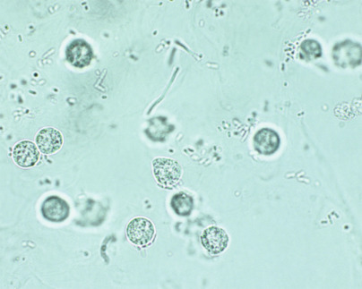

Figure 28-45 

Bacteria and leukocytes (×600). 

Acid-fast bacilli may be seen in urine sediment, but because the urethral flora may contain nonpathogenic acid-fast organisms, the presence of tuberculosis in urine must be substantiated by culture and/or polymerase chain reaction methods. 

 

##  Fungi. 

Yeasts (most commonly _Candida_ species) may be causative agents in urinary tract infection (e.g., in diabetes mellitus), but yeasts are also common contaminants from the skin, the female genital tract, and the air. On microscopic examination, they may be confused with erythrocytes; the presence of budding helps to identify them as yeast cells ( [ Fig. 28-46 ](<#f0235>) ). Pseudohyphae of _Candida_ are occasionally found ( [ Fig. 28-47 ](<#f0240>) ). 

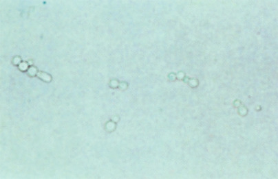

Figure 28-46 

Candida. 

Budding yeasts (×200). 

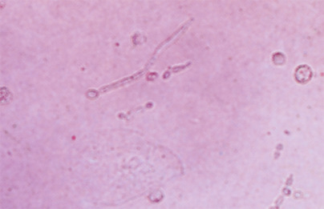

Figure 28-47 

Candida. 

Pseudohyphae (×160). 

 

##  Parasites. 

Parasites and parasitic ova may be seen in urine sediments as a result of fecal or vaginal contamination. When noted, repeat examination should be performed on a fresh, clean-voided urine specimen. Although _Trichomonas vaginalis_ may be present in urine as a result of vaginal contamination, urethral or bladder infection can occur; when suspected, the protozoa should be searched for immediately in a wet preparation of the sediment. Motility of the organism is helpful in making the appropriate identification. In patients with schistosomiasis due to _Schistosoma haematobium,_ typical ova are shed directly into the urine accompanied by erythrocytes from the urinary bladder. Amebas are rarely seen in the urine; they may reach the bladder from lymphatics or more likely from fecal contamination of the urethra. The pathogenic _Entamoeba histolytica_ is usually accompanied by erythrocytes and leukocytes. 

 

##  Contaminants and Artifacts 

Partially digested muscle fibers or vegetable cells may be found when fecal contamination occurs ( [ Fig. 28-48 ](<#f0245>) ). Spermatozoa are occasionally present, and pollen grains contaminate specimens seasonally ( [ Fig. 28-49 ](<#f0250>) ). Fibers from many different sources may be seen, including cotton, hair, wood fibers from applicator sticks, and synthetic fibers from disposable diapers. Unlike casts, these fibers polarize brightly. 

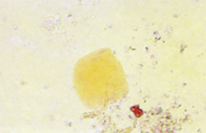

Figure 28-48 

Muscle fiber (×200). 

Figure 28-49 

Pollen grain (×160). 

Starch granules from surgical gloves are the most common contaminants of urine and other body fluids. Microscopically, they appear bright and faintly striated with an irregular outline and a central depression ( [ Fig. 28-50 ](<#f0255>) ). With crossed polarizing filters, starch granules exhibit a typical Maltese cross pattern, and because of their large size (several times larger than an erythrocyte), they are not likely to be confused with cholesterol droplets. Oil droplets from catheter lubricants may be confused with cells, especially red blood cells. Lipid material from vaginal creams also forms droplets in urine and may form large amorphous aggregates. 

Figure 28-50 

Starch granule (×160). 

,  

##  Methods for Urinalysis 

 

##  Basic (Routine) Urinalysis Procedure 

  * 1.

Pour 10 to 15 mL of a well-mixed urine specimen into a graduated disposable centrifuge tube. Perform physical examination and reagent strip chemical evaluations. Centrifuge at 450 g for 5 minutes. 

  * 2.

Carefully remove and save the supernatant. The final volume used to resuspend the sediment may vary with the standardized system used but should remain constant within any given laboratory. Use a disposable pipet, specialized tube, or pipet system to concentrate the sediment. 

  * 3.

Gently resuspend the sediment in the remaining supernatant, and add one drop of supravital stain if desired. Using an appropriate pipet, load/charge the examination chamber of a standardized slide. Allow the urine to settle for 30 to 60 seconds. 

  * 4.

Examine with low- and high-power objectives. Subdued light or phase-contrast illumination will be required to detect sediment entities with a low refractive index. The fine focus should be varied continuously while scanning. Systematically progress around the entire examination chamber, being careful to examine along the edges for casts. 

  * 5.

Count the number of casts in at least 10 lpf, average, and report the number of casts per lpf. A reasonable range may be used in reporting (e.g., 0 to 2, 2 to 5, 5 to 10). Use high power to identify casts by type. Casts will not be missed if phase-contrast microscopy is used (see [ Fig. 28-4, _A_ and _B_ ](<#f0025>) ). 

  * 6.

Identify and count erythrocytes, leukocytes, and renal epithelial cells using the high-power objective. Count at least 10 hpf, average, and report as cells/hpf. A reasonable range may be used for reporting. 

  * 7.

Comment on the following: 

    * a.

Squamous and transitional cells if present in large numbers or as fragments (transitional cells). 

    * b.

Bacteria, yeast, and microorganisms. Bacteriuria detectable on low power should be reported as at least 2+. 

    * c.

Crystals (quantitated under low power). The presence of abnormal crystals should be confirmed chemically and correlated with the patient history. 

    * d.

Large amounts of mucus. 

  * 8.

The authors recommend confirming the following results with cytopathologic examination or specific chemical tests (crystals): 

    * a.

More than two renal epithelial cells/hpf 

    * b.

Pathologic casts 

    * c.

Atypical mononuclear cells, particularly urothelial cells 

    * d.

Tissue fragments 

    * e.

Pathologic crystals 

Review the entire report, including physical, chemical, and microscopic data, and correlate with available clinical information. Discrepancies should be resolved before the report is released. Normal values for the procedure include the following: 0 to 10 RBCs/hpf, 0 to 10 WBCs/hpf, and 0 to 2 hyaline casts/lpf. Values will vary, depending on the standardized system used. 

Routine urinalysis is a helpful diagnostic tool in the workup and follow-up of various urinary system disorders. [ Table 28-11 ](<#t0070>) summarizes the macroscopic, reagent strip, and microscopic findings typical for the most commonly encountered entities. 

TABLE 28-11 

Various Urinary System Diseases and Corresponding Urinalysis Abnormalities 

Diseases  |  Macroscopic Urinalysis  |  Microscopic Urinalysis   
---|---|---  
Acute glomerulonephritis  |  Gross hematuria   
“Smoky” turbidity   
Proteinuria  |  Erythrocyte and blood casts   
Epithelial casts   
Hyaline and granular casts   
|  |  Waxy casts   
|  |  Neutrophils   
|  |  Erythrocytes   
Chronic glomerulonephritis  |  Hematuria   
Proteinuria  |  Granular and waxy casts   
Occasional blood casts   
|  |  Erythrocytes   
|  |  Leukocytes   
|  |  Epithelial casts   
|  |  Lipid droplets   
Acute pyelonephritis  |  Turbid   
Occasional odor   
Occasional proteinuria  |  Numerous neutrophils (many in clumps)   
Few lymphocytes and histiocytes   
Leukocyte casts   
|  |  Epithelial casts   
|  |  Renal epithelial cells   
|  |  Erythrocytes   
|  |  Granular and waxy casts   
|  |  Bacteria   
Chronic pyelonephritis  |  Occasional proteinuria  |  Leukocytes   
|  |  Broad waxy casts   
|  |  Granular and epithelial casts   
|  |  Occasional leukocyte casts   
|  |  Bacteria   
|  |  Erythrocytes   
Nephrotic syndrome  |  Proteinuria   
Fat droplets  |  Fatty and waxy casts   
Cellular and granular casts   
Oval fat bodies and/or vacuolated renal epithelial cells occurring singly or as cellular clusters   
Acute tubular necrosis  |  Hematuria   
Occasional proteinuria  |  Necrotic or degenerated renal epithelial cells   
Neutrophils and erythrocytes   
Granular and epithelial casts   
Waxy casts   
Broad casts   
Epithelial tissue fragments   
|   
|   
|   
|   
Cystitis  |  Hematuria  |  Numerous leukocytes   
|  |  Erythrocytes   
|  |  Transitional epithelial cells occurring singly or as fragments   
|  |  Histiocytes and giant cells   
|  |  Bacteria   
|  |  Absence of casts   
Dysuria-pyuria syndrome  |  Slightly turbid  |  Numerous leukocytes, bacteria   
Erythrocytes   
No casts   
Acute renal allograft rejection (lower nephrosis)  |  Hematuria   
Occasional proteinuria  |  Renal epithelial cells   
Lymphocytes and plasma cells   
Neutrophils   
|  |  Renal epithelial casts   
|  |  Renal epithelial fragments   
|  |  Granular, bloody, and waxy casts   
Urinary tract neoplasia  |  Hematuria  |  Atypical mononuclear cells with enlarged, irregular hyperchromatic nuclei and sometimes containing prominent nucleoli that occur singly or as tissue fragments   
|  |  Neutrophils   
|  |  Erythrocytes   
|  |  Transitional epithelial cells   
Viral infection  |  Hematuria   
Occasional proteinuria  |  Enlarged mononuclear cells and/or multinucleated cells with prominent intranuclear and/or cytoplasmic inclusions   
|  |  Neutrophils   
|  |  Lymphocytes and plasma cells   
|  |  Erythrocytes   
  
 

##  Automated Urinalysis 

Several instruments have been developed to partially or completely automate routine urinalysis. In addition to enhancing workflow, automation can standardize some aspects of manual urinalysis. Most of these instruments can be interfaced with laboratory information systems, facilitating reporting and result retrieval. 

Several instruments are available to automate the macroscopic/chemical analysis or the microscopic portions of the routine urinalysis. For example, fully automated urine chemistry reagent strip analyzers from several manufacturers are equipped to perform automatic pipetting or test strip dipping, as well as carry out photometric measurements of the reagent strip fields. 

The IRIS Urinalysis workstations (now iRICELL Automated Urinalysis System, Iris Diagnostics, Chatsworth, Calif.) (van den  Broek et al, 2008  ) combine several automated subsystems to perform a complete urinalysis through a combination of dipstick chemical analysis and imaging technology. Specific gravity is measured by a mass gravity meter, urine chemistries are measured by a standard reflectance spectrophotometer, and microscopic analysis is facilitated with an automated intelligent microscopy system. No centrifugation is involved, and handling of the specimen is minimal. A touch-sensitive video screen eliminates keyboard entry. In the analysis, the urine specimen is poured into the instrument's entry port over a urine chemistry reagent strip. This reagent strip is then placed in the reflectance photometer reader platform. The urine chemistries are automatically timed, read, and collated by the internal computer. A portion of the specimen is diverted to the harmonic oscillator mass gravity meter for specific gravity determination; the rest of the specimen is then stained and passed into a laminar flow chamber, where the formed elements are detected and imaged by a video camera mounted to a microscope and a stroboscopic lamp that allows stop-motion images. Images of cells, casts, crystals, yeast, and bacteria found in the sediment are then sorted by size and presented to the operator on the touch-sensitive screen for identification. Because the volume of the laminar flow chamber is known, the images can be counted and related to a volume of urine with a precision that exceeds that which can be obtained with a centrifuged specimen, glass slide, and coverslip. The system can remove the need for microscopic analysis in most cases (  Hughes & Roebuck, 2003  ). The computer then consolidates the report for printing or transmission to the laboratory information system ( [ Fig. 28-51 ](<#f0260>) ). Body fluids other than urine can also be analyzed by the system. 

Figure 28-51 

Operator screens of IRIS iRICELL 2000 iQ200ELITE microscopy module. 

**A,** Red blood cell panel showing images of erythrocytes identified in the specimen. **B,** White blood cell panel demonstrating images of leukocytes in the specimen. 

The IRIS microscopy system bases its analysis on cell image analysis. Another way to analyze urinary cells and casts is by flow cytometry. These analyzers typically stain the DNA and membranes of the formed elements in native urine, pass the sample as a laminar flow through a laser beam, and measure the light scatter, fluorescence, and impedance (see [ Fig. 28-51 ](<#f0260>) ). The UF-100 (Sysmex Corporation, Kobe, Japan) analyzes urine by flow cytometry and gives quantitative results for red blood cells and white blood cells, epithelial cells, casts, and bacteria ( [ Fig. 28-52 ](<#f0265>) ). It can detect yeast, crystals, dysmorphic red blood cells, and pathologic casts ( [ Fig. 28-53 ](<#f0270>) ) in the urine (  Ben-Ezra et al, 1998  ;  Ottiger & Huber, 2003  ). This technology may be useful in decreasing the number of urine specimens requiring routine microscopy (  Fenili & Pirovano, 1998  ). Normal values are fewer than 20 RBCs/µL, fewer than 25 WBCs/µL, and fewer than 2000 bacteria/µL. Similar to the microscopic examination of urine on unspun specimens, the automated systems are not prone to the artifacts that characterize examination of spun urine sediment. A second generation of this machine, the UF-1000i, provided better enumeration of bacteria with fewer artifacts due to interfering debris, while a third generation, the UX-2000, combines urine chemistry and sediment analysis into a single compact system, and provides enhanced detection of bacteria and other benefits (  Manoni et al, 2010  ;  Jiang et al, 2011  ;  Kadkhoda et al, 2011  ;  Khejonnit et al, 2015  ). The Sysmex instruments also have a body fluid counting mode (  Fleming et al, 2014  ). Other automated urinalysis systems include the FUS Series urine sediment analyzers and H Series urine chemistry analyzers (DIRUI Industrial Co., Ltd, Changchun, China) and the LabUMat 2 urine chemistry analyzer and UriSed 2 urine sediment analyzer (77 Elektronika Kft, Budapest, Hungry) (  Akin et al, 2009  ;  Martinez et al, 2013  ;  Yuksel et al, 2013  ). 

Figure 28-52 

Printout from UF-100 automated urine analyzer, showing normal urine. 

Note the lack of RBCs, WBCs, bacteria, and casts. _RBCs,_ Red blood cells; _WBCs,_ white blood cells. 

Figure 28-53 

Printout from UF-100 automated urine analyzer, showing abnormal urine. 

Compare with [ Figure 28-52 ](<#f0265>) . Note the sizable numbers of RBCs, WBCs, bacteria, and casts. _ECs,_ Squamous epithelial cells; _NIT,_ nitrite; _PRO,_ protein; _RBCs,_ red blood cells; _SRC,_ small round cells; _WBCs,_ white blood cells; _X 'TAL, _ crystals; _YLC,_ yeast-like cells. 

Although these automated sediment analysis machines are very useful in standardizing workflow and eliminating the need to perform a manual examination of the urine sediment in the routine clinical laboratory, they may not be that useful in a population with a high incidence of renal pathology (e.g., patients in a nephrology clinic) (  Gai et al, 2003  ). In addition, there are few published guidelines for the validation and quality assurance of automated urine sediment analyzers (  Khejonnit et al, 2015  ). 

Automated urine sediment analyzers have the potential to add more quantitative information to the monitoring of abnormalities such as urinary tract infections by providing very exact counts of bacteria and cells in serial specimens while patients are under treatment. The clinical utility of this accurate information is yet to be determined. Its application would require a more comprehensive understanding of such counts by practicing physicians as opposed to the semiquantitative estimates now commonly in use. 

,  

##  Special Testing and Monitoring Techniques 

 

##  Urinary Calculi 

Nephrolithiasis is a common condition, affecting nearly 1 in 11 individuals in the United States (  Scales et al, 2012  ). It is a heterogeneous disorder, with stones developing from a wide variety of metabolic or environmental disturbances. Although most studies have concentrated on nonorganic components, many stones have been found to be associated with an organic matrix containing lipids and protein, suggesting the involvement of cellular membranes in the nucleation and growth of crystals (  Khan et al, 1996  ;  Bagga et al, 2013  ;  Baumann & Affolter, 2014  ). Many substances act as promoters or inhibitors of this process (  Aggarwal et al, 2013  ). 

Upper (renal) stones are common in Western industrialized countries, whereas bladder stones are uncommon. The passage of stones down the ureter produces renal colic, which is characterized by severe pain in the flank radiating to the groin. Hematuria frequently accompanies stone passage. If stones obstruct the pelvis of the kidney or ureter, hydronephrosis can result, and infection is a common consequence. Recurrences are frequent, but with appropriate identification of the stones and the risk factors associated with them, stone formation may be greatly reduced. 

Calcium oxalate or a mixture of oxalate and calcium phosphate is often found in stones (≈80%). Mixed calcium phosphate, magnesium ammonium phosphate, and uric acid are the next most common constituents (3% to 10% each), and these are followed by cystine stones (1% to 2%). Carbonate, which is frequently detected in chemical analysis, probably results from adsorption of carbon dioxide to the calcium phosphate crystal. Males are more often affected with calcium stones than females, and children are not often affected with calcium stones. 

Calcium oxalate precipitates at an acid or neutral pH, and calcium phosphate—hydroxyapatite Ca  10  (PO)  6  (OH)  2  —forms calculi at the normal urinary pH of 6.0 to 6.5. Uric acid, which is not very soluble, will crystallize at a low pH (5.3) and form stones. Magnesium ammonium phosphate (struvite) forms stones at alkaline pH, where the ammonium level is high. These tend to form in the pelvis of the kidney but apparently are not attached to papillae, as are the calcium stones. They may, however, develop on preexisting nuclei when infection from organisms such as _Proteus_ causes alkalization of the urine (  Flannigan et al, 2014  ). Struvite stones may become large, forming casts of the kidney pelvis and showing staghorns. Mixed stones may form when calcium or uric acid crystals (or stones) cause obstruction followed by infection and the subsequent deposition of ammonium salts. 

 

##  Hypercalciuria and Calcium Stones 

Calcium homeostasis is maintained by parathyroid hormone (PTH) and 1,25-dihydroxycholecalciferol (1,25[OH]  2  D). Both affect bone resorption by osteoclasts. PTH causes a diminution of phosphorus reabsorption and an increase in calcium reabsorption by renal tubular cells. It also causes increased synthesis of 1,25(OH)  2  D, which acts upon the small intestinal mucosa, causing increased absorption of calcium and phosphorus. Low serum ionized calcium levels cause increased PTH secretion, and low serum phosphorus stimulates 1,25(OH)  2  D synthesis. 

About 40% of patients with calcium stones will have hypercalciuria, defined as a daily urinary excretion of calcium in excess of 0.1 mmol/kg (  Houillier & Boulanger, 1998  ). Increased calcium in urine may result from an increase in intestinal calcium absorption, lack of appropriate renal tubular reabsorption of calcium, resorption or loss of calcium from bone, or a combination of these factors. In a few instances of hypercalciuria, an underlying disease process can be identified. In most cases, however, it is primary, or idiopathic hypercalciuria (IH). Although the exact mechanism of hypercalciuria is still unknown in this disorder, it most likely includes a combination of factors, including those listed previously. Three hypotheses to account for IH pathophysiology have been proposed. These include possible defects in the fatty acid content of cell membranes, increased expression of the vitamin D or calcium receptors of the 25-hydroxyvitamin D  1  α-hydroxylase, or a disease of monocytes (  Bataille et al, 1998  ). Recent studies have revealed that polymorphisms in genes for proteins regulating tubular phosphate and calcium reabsorption, preventing calcium salt precipitation, and coding a proximal tubule water channel are associated with calcium nephrolithiasis (  Arcidiacono et al, 2014  ). 

Excess loss of calcium in urine and the possibility of stone formation may occur secondary to a variety of other conditions. For instance, hypercalciuria may result from increased absorption of calcium from the gut. This may occur following excessive loss of phosphorus from the kidney and low serum phosphorus levels, or when increased serum 1,25(OH)  2  D is seen with normal serum phosphorus levels. Increased resorption of bone may occur with immobilization of the skeleton, rapidly progressive bone disease, thyrotoxicosis, and Cushing's disease, leading to hypercalciuria. Calcium may be lost from bone as a result of osteolytic tumors, as well as in the presence of renal disease such as distal renal tubular acidosis and medullary sponge kidney. Sarcoidosis, vitamin D excess, and furosemide may also cause renal hypercalciuria. 

About 5% to 10% of calcium stones are associated with primary hyperparathyroidism. In this disorder, increased mineral turnover in bone and hypercalcemia are important causes of hypercalciuria. Affected patients often present with stone symptoms, and calcium phosphate deposits may be found in the renal tissue, cornea, and other organs. 

Dietary hypercalciuria is an uncommon cause of calcium stones; it is associated with a large calcium intake, on the order of 3 to 4 g/day, together with a high protein intake. About 800 mg/day is the normal recommended adult intake. 

As stated previously, calcium oxalate stones are the most common. They may form with excess oxalate and uric acid in the urine, the latter sometimes providing a nidus for stone formation. Newly formed calcium oxalate aggregates are about 20 to 25 µm in diameter, much smaller than the outlet of the collecting ducts. Adherence to the epithelial surface apparently allows stones to continue growth rather than be excreted. Calcium phosphate stone formation is favored by a less acid urine, as is seen in renal tubular acidosis, with infection, and in persons consuming large amounts of alkali. These stones are also seen in primary hyperparathyroidism, although the urine is in the normal pH range. In a patient exposed to heat and dehydration, these may contribute to a rise in urinary solute levels, followed by crystallization and stone formation. 

 

##  Hyperoxaluria 

A majority of calcium stones (70% to 80%) contain oxalate. Some of the oxalate in urine is dietary in origin from beverages (tea, cocoa, coffee, cola), vegetables (beans, rhubarb, spinach), nuts, berries, and citrus fruits. Oxalate is also derived from ascorbic acid. 

The gastrointestinal system plays an important role in oxalate homeostasis. Oxalate absorption increases when calcium and magnesium intake decreases. Disorders of the small bowel such as Crohn's disease, ileal resection, and intestinal bypass surgery may result in excessive oxalate absorption, with subsequent excretion in the urine. Malabsorption with steatorrhea causes loss of calcium due to soap formation of calcium with fatty acids, and malabsorption with increased bile salts remaining in the gut is thought to promote oxalate absorption in the colon. Additionally, absence of _Oxalobacter formigenes_ from the intestinal tract of patients with cystic fibrosis appears to lead to increased absorption of oxalate, thereby increasing the risk for hyperoxaluria (  Sidhu et al, 1998  ). 

Other causes of hyperoxaluria include pyridoxine deficiency and primary hyperoxaluria. The latter is a rare inherited autosomal recessive disease with oxoglutarate carboligase deficiency (  Cochat & Rumsby, 2013  ). Systemic oxalosis and renal failure may be seen in young adulthood. Renal transplantation and large doses of pyridoxine or nicotinamide have been tried for the treatment of these patients. 

 

##  Hyperuricuria 

Excessive excretion of uric acid may be due to excessive dietary intake of purines (liver, dried beans, some fish, meat) or various disease processes. Endogenous uric acid production is increased in gout, glycogen storage diseases, Lesch-Nyhan syndrome, many leukemias, and treated tumors with associated cell necrosis. Chemotherapy and irradiation can lead to increased breakdown of tumor cells (nucleotide/purine forms uric acid), which may cause acute renal failure secondary to tubular and ureteral obstruction by masses of uric acid crystals. 

In gout, about 20% of patients form stones, most of which are pure uric acid or mixed uric acid and calcium. Heat, dehydration, and unusually acid urine contribute to stone formation. Gouty nephropathy occurs with sodium urate deposits in the medulla, even when stones are not present, and masses of crystals may cause obstruction of terminal collecting ducts in the kidney. Uricosuric drugs cause potential problems with massive uric acid output in the first 3 to 4 days of treatment. 

Normally, about one third of the uric acid formed is degraded by bacteria in the colon. Absence of bacteria or intestinal diversion may cause increased absorption of uric acid from the gut. Because ileostomy patients lose large amounts of alkaline fluid from the intestine, they excrete concentrated acidic urine and are likely to produce uric acid stones. 

The average uric acid excretion by adults is 500 to 600 mg/24 hours. Solute concentration as well as pH appears to be important in the solubility of uric acid and urate (  Shekarriz & Stoller, 2002  ). Uric acid, a weak acid, forms free, insoluble, undissociated uric acid and a urate (which is more soluble with some sodium and potassium present) at pH 5.5. The amount of free uric acid present in urine will decrease as the pH rises, and at pH 7, uric acid is more soluble as urate. With high salt concentrations, the urate becomes less soluble. If urine volume is low, the solubility of uric acid at acid pH will be exceeded. 

Whereas large quantities of uric acid crystals are regularly seen in urinary sediment, uric acid stone formation is not common. Uric acid crystals form a sludge that may obstruct the nephron without forming a stone. On the other hand, uric acid and sodium acid urate crystals are found as nuclei for calcium stones. Most normal persons with a pH of 6 have urine saturated with uric acid but do not form stones. Further acidity or dehydration is apparently required to engender stone formation. 

 

##  Cystine Stones 

Cystine stones form in patients with an inherited amino acid transport disorder (see the [ Cystinuria ](<#s1255>) section later in the chapter). Cystine, ornithine, lysine, and arginine are subsequently excreted in large amounts in the urine. Of these, only cystine forms crystals and stones. Cystine does not become soluble until the urine pH is 7.4, and stones form over a range of normal urinary pH values. Heterozygous carriers for the disease will have increased amounts of cystine in urine but do not form stones; homozygotes are stone formers. A 24-hour quantitative urine cystine measurement is needed to detect potential stone formers; this should always be done when cystine crystals are found in random specimens. 

 

##  Rare Calculi 

Calculi containing sulfonamides have been described, and silica calculi have been reported in patients ingesting silica gel over a long period of time. Triamterene (Dyazide, Dyrenium), a relatively insoluble diuretic, may contribute to stone formation. It can form 1- to 2-mm mustard-colored stones, giving a bright blue fluorescence when dissolved in butanol and with exposure to ultraviolet light. Rare adenine stones have been described in children with an inherited enzyme deficiency disorder and hyperuricemia. Xanthine stones are uncommon and may be associated with a genetic disorder with an absence of xanthine oxidase. 

 

##  Laboratory Tests Used to Investigate Stone Formers 

 

##  Urine Examinations 

  * 1.

Routine urinalysis, qualitative test for cystine, and urine culture. Hematuria is a constant finding when stones are present, even when they are asymptomatic. Proteinuria is usually not a feature of calculous disease, but with renal tubular damage, excretion of low molecular weight plasma proteins such as β 2  -microglobulin, and some albumin, may be increased. Erythrocyte casts usually are not found, and other casts are unusual. Leukocytes are increased when infection is present, and the reagent strip nitrite and leukocyte esterase may be elevated. Multiple clusters of nonmalignant transitional cells may be found in urine of patients with calculous disease and may be helpful in the diagnosis of unsuspected calculi. 

  * 2.

Twenty-four–hour urine specimen: Sodium, calcium, phosphorus, uric acid, oxalate, and creatinine clearance. Supersaturation values from 24-hour urine collections have been shown to accurately reflect stone composition (  Asplin et al, 1998  ). Some authors suggest that spot urine samples are sufficient for the metabolic evaluation of stone formers, although because of day-to-day variation, three samples should be obtained to overcome the doubtful significance of a single result (  Strohmaier et al, 1997  ). 

  * 3.

Urine pH determination on a fresh specimen is important in determining the types of crystals likely to be precipitated, for example, uric acid with low pH (5 to 5.5), and triple phosphate with alkaline urine. 

 

##  Serum Chemistry 

Appropriate tests include calcium, phosphorus, uric acid, and electrolytes. 

 

##  Stone Analysis 

Calculi may be of various sizes, commonly described as sand, gravel, or stone. The physical characteristics of the various calculi rarely will suffice for their identification, but a few points are worth noting. Uric acid and urate stones are typically yellow to brownish red and are moderately hard. Phosphate stones are usually pale and friable. Calcium oxalate stones are very hard, often of a dark color, and typically have a rough surface. Cystine stones are yellow-brown and feel somewhat greasy. 

Several methods are available for the analysis of calculi, such as optical crystallography, radiograph diffraction, and infrared spectroscopy. Electron beam analysis and mass spectroscopy are also used. A simplified method for analysis of renal calculi is presented by  Farrington and colleagues (1980)  . A quantitative method for five of eight frequently measured substances using available clinical chemistry methods has been described: calcium, phosphorus, magnesium, ammonium, and uric acid. Cystine, oxalate, and carbonate are detected by qualitative means and are interpreted with the quantitative results to characterize the stones. Most laboratories refer calculi specimens to more specialized laboratories for chemical analysis, where both chemical and specialized tests should be used to determine the composition of the stones. 

  * Method for Gross Examination of Calculi 

  * 1.

Wash the stone(s) free of blood, mucus, preservation solution, and so forth. Place stones in a beaker, cover with several thicknesses of gauze held firmly in place with rubber bands, and wash under cold running water. Drain, remove gauze carefully, and dry beaker and stones in an oven. Rinse tiny stones with water from a squeeze bottle (not running water). 

  * 2.

Record the dimension of the stone. 

  * 3.

Describe briefly the color and texture of the stone's exterior surface. The stone may be photographed for record purposes. 

  * 4.

Cut, saw, or break the stone so as to examine the interior. Note whether a foreign body may have acted as a nucleus for its formation. Describe the color and texture of the interior and layers, if present. 

  * 5.

Reduce small stones to a fine powder by pulverizing with a mortar and pestle. 

  * 6.

If possible, when a stone is very large, it may be advisable to make separate analyses of layers that appear to have different constituents. 

Because most small calculi consist of calcium oxalate, the best way to analyze them is to put all available powder in one test tube. (If the stone is very tiny, it may be placed directly in the test tube and crushed with a spatula.) Reagents used for the chemical determination of rare stones may be found in an earlier edition of this textbook (  Henry, 1996  ). It is important to have known positive material to test the reagents. 

 

##  Radiologic Examination 

Asymptomatic stones are sometimes found. Most stones are radiopaque, except for pure uric acid and the rare xanthine; cystine stones are opaque because of their sulfur content. 

 

##  Urinary Screening for Inherited Metabolic Diseases 

Urine has been used for many years to screen for metabolic diseases, particularly those resulting from a genetic predisposition. In many of these diseases, an abnormal metabolite or a larger than normal amount of a normal metabolite is excreted in the urine. Because these conditions are uncommon and their symptoms often nonspecific, and because some may be treatable if early diagnosis is confirmed, blood and urine should be analyzed using techniques that are highly selective and sensitive. Numerous inborn errors of metabolism have been identified, and this section will describe some of the more common disease entities. 

 

##  Aminoacidurias 

Excretion of one or more amino acids in the urine may be due to a block in a major metabolic pathway (overflow type) or a deficiency in renal tubular function (renal type). Phenylketonuria is an example of overflow aminoaciduria in which an enzyme substrate and other metabolites in the pathway accumulate, causing increased body fluid levels and increased substrate excretion in urine. Unlike the overflow-type diseases, renal-type aminoacidurias do not have high levels of the amino acid in the blood because the primary defect is in the renal tubular reabsorption mechanism. An example of renal transport aminoaciduria is cystinuria. 

 

##  Phenylketonuria 

Phenylketonuria is an autosomal recessive inherited disorder in which there is absence of the enzyme phenylalanine hydroxylase. Both sexes are affected equally, with an incidence of about 1 in 11,000. Allelic heterogeneity can be extensive, particularly in the United States (  Guldberg et al, 1996  ). Mental retardation is the major clinical finding, and dietary restriction of phenylalanine has proven efficacious in these patients. 

Because they are not converted to tyrosine in this disorder, phenylalanine and other normal metabolites accumulate in abnormal amounts. Plasma phenylalanine and phenylpyruvic acid levels are elevated; urinary phenylpyruvic acid (highest), phenylacetic acid, and phenylalanine are increased. Urinary indoleacetic acid and other indoles arising from altered tryptophan metabolism and indican (an indole) are also increased. The excretion of 5-hydroxyindoleacetic acid is diminished, paralleling the low level of serum 5-hydroxytryptamine. The urine and sweat of these patients have a characteristic mousy/musty odor due to phenylacetic acid. 

 

##  Methods. 

Phenistix reagent strips contain ferric ammonium sulfate, magnesium sulfate, and cyclohexylsulfamic acid. At 30 seconds following immersion into urine, the color of the test area is compared with the color chart provided. A positive test result shows a gray to gray-green color. The test detects 5 to 10 mg/dL. Salicylates and metabolites of phenothiazine derivatives may cause a pink to purple color. Ion-exchange high-performance liquid chromatography has been found suitable for quantitative confirmatory testing of abnormal specimens (  Reilly et al, 1998  ). 

 

##  Alkaptonuria 

Normally, phenylalanine and tyrosine are metabolized to homogentisic acid (dihydroxyphenylacetic acid), which is then oxidized to maleylacetoacetic acid. In alkaptonuria, the enzyme homogentisic acid oxidase is deficient, and homogentisic acid is excreted in urine in large quantities. The urine characteristically turns brown-black on standing or with alkaline pH. Patients with alkaptonuria develop dark blue to black pigmentation in cartilage and connective tissue; frequently, the disease is not diagnosed until arthritis has already developed. 

 

##  Methods. 

Screening methods include ferric chloride and silver nitrate tests. A transient, dark blue color appears as two drops of 10% ferric chloride solution are added to about 2 mL of urine containing homogentisic acid. The silver nitrate test involves adding 4 mL of 3% silver nitrate to 0.5 mL urine, mixing, and then adding several drops of 10% NH  4  OH. Homogentisic acid will cause a black color to develop. Confirmatory methods include paper or thin-layer chromatography, as well as capillary electrophoresis. These methods should distinguish homogentisic acid from gentisic acid, an aspirin metabolite. 

 

##  Tyrosinuria 

Tyrosinemia with tyrosinuria occurs when the metabolism of tyrosine derived from the diet or from phenylalanine is abnormal. This may be part of a generalized amino acid disorder associated with liver disease, or it may represent one of the various genetic disorders involving tyrosine metabolism. Tyrosine crystals may appear in the urine as fine, silky crystals scattered singly or aggregated to form sheaves. They appear brown to black, precipitate at an acid pH, and are soluble in alkali. Small quantities of tyrosine may appear in the urine of normal individuals. 

Transitory hypertyrosinemia may occur in low-birthweight and premature infants as a benign condition. Typically, these infants are asymptomatic, and no liver or renal disease is present. The elevated tyrosine levels may on occasion be accompanied by transiently elevated phenylalanine levels. Tyrosine and the phenolic acids _p_ -hydroxyphenyllactic and _p_ -hydroxyphenylpyruvic acids are excreted in larger than normal amounts in the urine. The nature of the enzymatic defect has not been well characterized, and the tyrosine level of these patients usually returns to normal within a few weeks to months. 

Type I hereditary tyrosinemia (tyrosinosis) is an autosomal recessive disorder characterized by defects in fumarylacetoacetate hydrolase and maleylacetoacetate hydrolase. Succinylacetoacetone and succinylacetone accumulate and inhibit renal function, various hepatic enzymes, and porphobilinogen synthetase. Patients may experience liver failure, renal dysfunction, rickets, and acute intermittent porphyria–like symptoms. Hepatoma is a late complication. Generalized aminoaciduria, phosphaturia, glycosuria, and uricosuria may occur. A low-tyrosine/phenylalanine diet is the mainstay of therapy. 

Type II tyrosinemia (Richner-Hanhart syndrome) is an autosomal recessive inherited deficiency of tyrosine aminotransferase. Patients will have tyrosinemia, tyrosinuria, and increased urinary phenolic acids. The metabolism of other amino acids, renal function, and hepatic function are otherwise normal. Erosions of the cornea, soles, and palms are common, and mental retardation sometimes occurs. Therapy centers on a low-tyrosine/phenlyalanine diet. 

 

##  Methods. 

The nitrosonaphthol test for tyrosine is a nonspecific screening method and should be confirmed by chromatography or quantitative serum assay of tyrosine. Tyrosine and tyramine form soluble red complexes with nitrosonaphthol. 

 

##  Maple Syrup Urine Disease 

MSUD is one of a group of diseases associated with abnormal branched-chain amino acid metabolism. These include hypervalinemia, isovaleric acidemia causing “sweaty feet” odor, and other rare diseases. Several different clinical forms of MSUD have been described, together with various sites of biochemical derangement. The classic type of MSUD, inherited as an autosomal recessive trait, is marked by severe neonatal vomiting, seizures, stupor, irregular respirations, and often hypoglycemia. Left untreated, patients become rapidly comatose and die. Leucine, isoleucine, valine, and their corresponding keto acids are elevated in the plasma and excreted in the urine. Deficient decarboxylases and other enzymes are thought to prevent the conversion of keto acids to fatty acids. Intermittent, intermediate, thiamine-responsive, and dihydrolipoyl dehydrogenase (E3) deficiency forms of MSUD have been described (  Holmes et al, 1997  ). 

The urine of patients with MSUD has an odor resembling maple syrup, caramelized sugar, or curry, the source of which is not certain. The urinary keto acids are demonstrable by the first week of life. 

 

##  Methods. 

The dinitrophenylhydrazine screening test indicates the presence of α-keto acids in the urine. Insoluble hydrazones are formed from the reaction of carbonyl groups with dinitrophenylhydrazine. A positive result is seen with MSUD and possibly in phenylketonuria (phenylpyruvic acid), histidinemia (imidazole pyruvic acid), and methionine malabsorption (oasthouse syndrome). The test is positive with ketonuria due to other inherited diseases and other causes. A preliminary screening test for ketones should be performed. 

 

##  Procedure 

  * 1.

Reagent and control (ketoglutaric acid, 25 mg in 100 mL of normal urine) should be at room temperature. 

  * 2.

Add 10 drops of reagent (100 mg of 2,4-dinitrophenylhydrazine in 100 mL of 2N HCl) to 1 mL of clear urine. 

  * 3.

Within 10 minutes, a yellow or chalky white precipitate indicates a positive reaction. It should be the same as or greater than the control precipitate. 

Gas or thin-layer chromatographic analysis and nuclear magnetic resonance spectroscopy of the urine may be used as confirmatory methods (  Holmes et al, 1997  ). 

 

##  Cystinuria 

Cystinuria is a common amino acid disorder that occurs equally in both sexes, with an incidence estimated at about 1 per 10,000 (homozygous) (larger numbers for heterozygotes). In mass screening programs for infants, the homozygous form is detected at about the same rate as phenylketonuria. Defective transport of cystine by the epithelial cells of the renal tubules and gut is transmitted as an autosomal recessive trait. The basic defect is not known. Although large amounts of the dibasic acids ornithine, lysine, and arginine are also excreted in this disease, cystine is the only one that crystallizes out, with stone formation as a clinical manifestation. 

Cystinosis is a rare, recessively inherited disorder caused by a mutation in the _CTNS_ gene encoding the integral transmembrane protein cystinosin, which functions in the transport of cystine from the lysosome. A deficiency of cystonosin leads to cystine crystal deposition within lysosomes throughout the body, including the kidney, eye, bone marrow, and spleen (  Ivanova et al, 2014  ). The severe form of this disorder is characterized by photophobia, renal failure, rickets, and growth failure. With renal tubular involvement, Fanconi's syndrome develops with generalized aminoaciduria and glucosuria. Benign and intermediate varieties of cystinosis have been described. Unlike in cystinuria, the cystine loss in cystinosis parallels the loss of other amino acids in the urine. 

Urinary cystine is sometimes detected in patients with various renal tubular diseases. Cystine is excreted with other amino acids in Wilson's disease, in Lowe's disease, and with the aminoaciduria of Hartnup's disease. 

 

##  Methods. 

Examine a first morning urine specimen for colorless, hexagonal crystals of cystine. Cystine may not always crystallize in a concentrated urine, although it may be present in large amounts. 

The cyanide-nitroprusside test used for the qualitative determination of urine cystine is Brand's modification of the Legal nitroprusside reaction. Cystine is reduced to cysteine by sodium cyanide, and the free sulfhydryl groups then react with nitroprusside to produce a red-purple color. Cysteine, cystine, homocystine, and ketones (dark red) all will give positive reactions. The qualitative test separates normal, heterozygote, and homozygote ranges of excretion. The lower limit of the test was 35 to 60 µmol of cystine per mole of creatinine, and this corresponded to the heterozygote range. Homozygous stone formers usually excrete more than 300 mg/g of creatinine and are also detected by this test. 

 

##  Procedure 

  * 1.

Place 3 to 5 mL of urine in a test tube and add 2.0 mL of sodium cyanide solution (5 g/dL water); allow to stand for 10 minutes. Timing is important. Treat a control solution in the same way. For a positive control, use 5 mg of cystine dissolved in 10 mL of 0.1N HCl, diluted to 100 mL with normal urine. 

  * 2.

Add fresh, aqueous sodium nitroprusside solution (5 g/dL) dropwise (about five drops), and mix. 

  * 3.

Read immediately as positive or negative. A stable red-purple color will develop with cystine. “Trace” results may also be reported. A concentrated normal specimen could give a weakly positive “trace” result. 

Further identification and quantification of cystine may be accomplished by thin-layer or quantitative ion-exchange chromatography, or high-voltage electrophoresis. 

 

##  Homocystinuria 

The classic form of homocystinuria is due to deficiency of cystathionine β-synthase, which catalyzes the formation of cystathionine from homocystine and serine in the methionine pathway (  Mudd, 2011  ). Homocysteine is rapidly oxidized to homocystine, which accumulates along with methionine and is excreted in the urine. Children with this disease may have seizures, thromboses, mental retardation, arachnodactyly, and kyphoscoliosis. Connective tissue manifestations are thought to result from accumulation of the intermediate homocysteine, which interferes with collagen cross-linking. 

Urine for testing must be fresh because homocystine is labile. The cyanide-nitroprusside test, described earlier, is positive. Quantitative chemical analysis reveals high levels of homocystine, methionine, and cysteine-homocysteine disulfide. Urine levels are monitored to follow the effects of the methionine-restricted diet used to treat this disease. 

 

##  Additional Urine Testing Modalities 

A latex agglutination nephelometric immunoassay has been developed to measure urinary basic fetoprotein (BFP). Levels of this substance may be elevated with ureter stones, infection, and prostate and bladder cancers, making BFP a nonspecific marker of inflammation or tumor (  Itoh et al, 1998  ). 

The urine Trinder spot test, performed by emergency department physicians, is a sensitive screen for salicylates. 

Rendl and colleagues (1998)  described a semiquantitative rapid urinary iodide test, suitable for epidemiologic surveys of iodine deficiency, particularly in developing countries. 

Lastly, a monoclonal antibody assay for the detection of free urinary pyridinium cross-links can help to identify bone resorption in patients with osteoporosis, hyperthyroidism, hyperparathyroidism, and Paget's disease of bone (  Gomez et al, 1996  ). 

Cytopathologic examination of the urine is commonly performed to detect malignancies. Enzyme-linked immunosorbent assay and fluorescence in situ hybridization tests can be used to detect carcinoma of the urinary bladder. These tests are discussed in greater detail in [ Chapter 75 ](<##!/content/3-s2.0-B9780323295680000759?scrollTo=%23c00075>) . 

,, 

## Selected References

* Aggarwal KP, Narula S, Kakkar M, et. al.: Nephrolithiasis: molecular mechanism of renal stone formation and the critical role played by modulators. Biomed Res Int 2013; 2013: pp. 292953.
* _Comprehensive review of renal stone formation, emphasizing the role of inhibitors/promoters in calcium oxalate crystallisation_ .
* Arcidiacono T, Mingione A, Macrina L, et. al.: Idiopathic Calcium Nephrolithiasis: A review of pathogenic mechanisms in the light of genetic studies. Am J Nephrol 2014; 40: pp. 499-506.
* _A review of potential contribution of genetic polymorphisms to nephrolithiasis, including genes coding for proteins regulating tubular phosphate and calcium reabsorption, preventing calcium salt precipitation, and coding for a water channel in the proximal tubule_ .
* Besur S, Hou W, Schmeltzer P, et. al.: Clinically important features of porphyrin and heme metabolism and the porphyrias. Metabolites 2014; 4: pp. 977-1006.
* _A comprehensive review of the genetic, clinical, and laboratory features of the porphyrias_ .
* Ben-Ezra J, Bork L, McPherson RA: Evaluation of the Sysmex UF-100 automated urinalysis analyzer. Clin Chem 1998; 44: pp. 92-95.
* _In this study, the authors compare the Sysmex UF-100 automated urinalysis analyzer with manual microscopy. The UF-100 showed good correlation with microscopy for detection of cellular elements and casts in the urine_ .
* Davis R, Jones JS, Barocas DA, et. al.: Diagnosis, evaluation and follow-up of asymptomatic microhematuria (AMH) in adults: AUA guideline. J Urol 2012; 188: pp. 2473-2481.
* _The authors present a systematic approach to the diagnostic evaluation and monitoring of patients with asymptomatic microhematuria_ .
* Dinda AK, Saxena S, Guleria S, et. al.: Diagnosis of glomerular haematuria: role of dysmorphic red cell, G1 cell, and bright-field microscopy. Scand J Clin Lab Invest 1997; 57: pp. 203-208.
* _This study shows that the presence of dysmorphic red blood cells in the urine has excellent sensitivity (82%) and specificity (100%) in the diagnosis of glomerular disease_ .
* Echeverry G, Hortin GL, Rai AJ: Introduction to urinalysis: historical perspectives and clinical application. Methods Mol Biol 2010; 641: pp. 1-12.
* _A review of the process and clinical significance of urinalysis from a historical perspective_ .
* Gerber LM, Johnson K, Alderman MH: Assessment of a new dipstick test in the screening for microalbuminuria in patients with hypertension. Am J Hypertens 1998; 11: pp. 1321-1327.
* _The authors examine the applicability of a urine dipstick method in detecting microalbuminuria. Specificity with this test was 90%, with a negative predictive value of 93% to 97%. Comparison between random and 24-hour urines showed good correlation_ .
* Hemmelgarn BR, Manns BJ, Lloyd A, et. al.: Relation between kidney function, proteinuria, and adverse outcomes. J Am Med Assoc 2010; 303: pp. 423-429.
* _This article shows a strong association between proteinuria and the adverse outcomes of mortality, myocardial infarction, and progression to kidney failure independent of the commonly used estimated glomerular filtration rate_ .
* Fogazzi GB, Pallotti F, Garigali G: Atypical/malignant urothelial cells in routine urinary sediment: Worth knowing and reporting. Clin Chim Acta 2015; 439: pp. 107-111.
* _The authors demonstrate the feasibility of identifying bladder carcinoma by routine urine sediment examination and review the criteria for the identification of neoplastic cells_ .
* Foxman B: Urinary tract infection syndromes: occurrence, recurrence, bacteriology, risk factors, and disease burden. Infect Dis Clin North Am 2014; 28: pp. 1-13.
* _A comprehensive review of the pathogenesis and clinical features of urinary tract infections_ .
* Gale DP: How benign is hematuria? Using genetics to predict prognosis. Pediatr Nephrol 2013; 28: pp. 1183-1193.
* _A review of microscopic hematuria in children, emphasizing the importance of genetic testing in the identification of patients with Alport syndrome and other diseases_ .
* Garg P, Rabelink T: Glomerular proteinuria: a complex interplay between unique players. Adv Chronic Kidney Dis 2011; 18: pp. 233-242.
* _A review of the pathophysiology of proteinuria in light of new discoveries regarding genetic changes that affect the structure and function of the components of the glomerular filtration barrier_ .
* Jefferson JA, Shankland SJ, Pichler RH: Proteinuria in diabetic kidney disease: a mechanistic viewpoint. Kidney Int 2008; 74: pp. 22-36.
* _This comprehensive review describes the pathophysiology of proteinuria through damage to the glomerulus with emphasis on the glomerular filtration barrier at the cellular level_ .
* Lamb EJ, MacKenzie F, Stevens PE: How should proteinuria be detected and measured?. Ann Clin Biochem 2009; 46: pp. 205-217.
* _This review covers current guidelines for measurement of protein in urine, emphasizing the merits of assays for albumin over total protein to assess glomerular protein loss in chronic kidney disease but with consideration for loss of other proteins in tubular proteinuria_ .
* Lamb EJ, McTaggart MP, Stevens PE: Why albumin to creatinine ratio should replace protein to creatinine ratio: it is not just about nephrologists. Ann Clin Biochem 2013; 50: pp. 301-305.
* _A review of the diagnostic advantages of the albumin-to-creatinine ratio in comparison to the protein-to-creatinine ratio of the diagnosis of microalbuminuria_ .
* Nicolle LE: Urinary tract infections in special populations: diabetes, renal transplant, HIV infection, and spinal cord injury. Infect Dis Clin North Am 2014; 28: pp. 91-104.
* _A review of the unique problems of diagnosing and treating urinary tract infections in immunosuppressed patients and other special patient populations_ .
* Perkovic V, Verdon C, Ninomiya T, et. al.: The relationship between proteinuria and coronary risk: a systematic review and meta-analysis. PLoS Med 2008; 5: pp. e207.
* _This meta-analysis of 26 cohort studies demonstrated a strong and continuous association between proteinuria and risk for coronary artery disease, suggesting that proteinuria should be used in the risk assessment of cardiovascular disease_ .
* Rockall AG, Newman-Sanders AP, al-Kutoubi MA, et. al.: Haematuria. Postgrad Med J 1997; 73: pp. 129-136.
* _This is a review article on hematuria from a clinical perspective. It proposes a rational algorithm for the laboratory and clinical workup of patients with hematuria_ .
* Strohmaier WL, Hoelz KJ, Bichler KH: Spot urine samples for the metabolic evaluation of urolithiasis patients. Eur Urol 1997; 32: pp. 294-300.
* _This study describes the clinical and laboratory workup of urolithiasis patients. Spot urines were equally as informative as 24-hour urines in the evaluation of these patients_ .
* Yoo YM, Tatsumi N, Kirihigashi K, et. al.: Inaccuracy and inefficiency of urinary sediment analysis. Osaka City Med J 1995; 41: pp. 41-48.
* _In this study, the authors examined the laboratory characteristics of manual urine microscopy. Counts of cellular elements, but not casts, showed good reproducibility, even by inexperienced technologists. Most of the casts found were nonpathologic hyaline casts_ .
,
