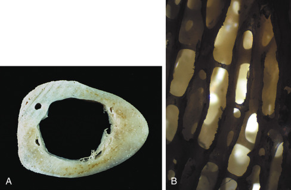
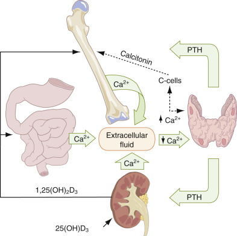
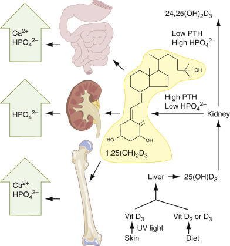
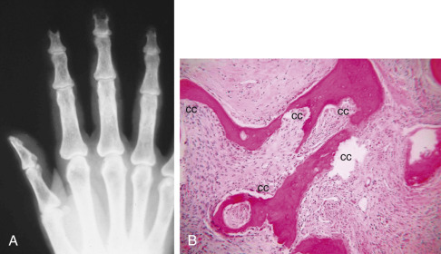
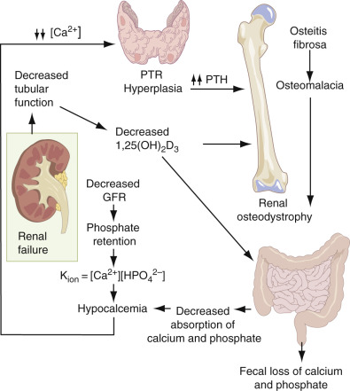
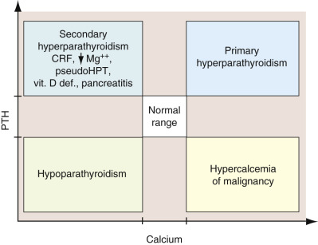
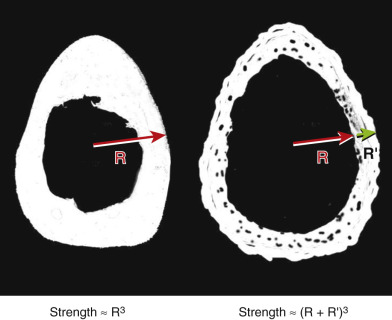
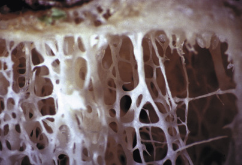
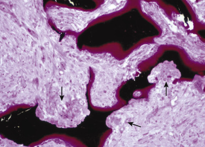
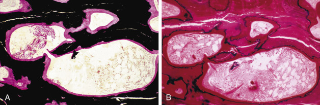

## Key Points

  * •

The plasma concentration of calcium, phosphate, and magnesium is dependent on the net balance of bone mineral deposition and resorption, intestinal absorption, and renal excretion. The principal hormones regulating these processes are parathyroid hormone (PTH), calcitonin, 1,25-dihydroxyvitamin D, and FGF-23. 

  * •

The most common causes of hypercalcemia are primary hyperparathyroidism (elevated PTH) and malignant neoplasms (decreased PTH and usually elevated PTH-related peptide). They account for 80% to 90% of all patients with hypercalcemia. 

  * •

The most common causes of hypocalcemia are chronic renal failure, hypomagnesemia, hypoparathyroidism, pseudohypoparathyroidism, vitamin D deficiency, and acute pancreatitis. 

  * •

Bio-intact PTH measures biologically active PTH; it is useful in patients with impaired renal function when various metabolites accumulate and interfere with traditional PTH assays. 

  * •

In patients undergoing surgery for primary hyperparathyroidism, intraoperative PTH measurements are useful in identifying whether the abnormal tissue is completely removed. 

  * •

Osteoporosis is the most common metabolic disease of bone and is characterized by decreased organic bone matrix. Serial bone resorption marker measurements can predict early response to therapy. 

  * •

Osteomalacia is failure to mineralize newly formed organic matrix (osteoid) in the mature skeleton. 

  * •

Phosphatonins comprise a newly described cascade of hormones, enzymes, and proteins related to phosphate metabolism. 

,  

##  Mineral and Bone Metabolism 

The skeleton is a metabolically active organ that undergoes continuous remodeling throughout life. This remodeling is necessary both to maintain the structural integrity of the skeleton and to fulfill its metabolic functions as a storehouse of calcium and phosphorus. Skeletal remodeling can be triggered by changes in mechanical forces or microdamage and by hormonal response to changes in circulating calcium and phosphorus levels. The skeleton also serves as the second line of defense against acidosis, and it is able to liberate buffers in the form of inorganic phosphates (  Raisz, 1999  ). 

Bone can be classified into two types: cortical or compact bone, and cancellous or trabecular bone ( [ Fig. 15-1, _A_ and _B_ ](<#f0010>) ). Cortical bone plays an important role in the supportive, protective, and mechanical functions of the skeleton; it comprises the shafts of long bones and the outer envelope of all bones. It constitutes approximately 80% of skeletal mass, and it is 90% bone and 10% space (vascular canals, osteocyte lacunae, and canaliculi) by volume. Cancellous bone, which constitutes the remaining 20% of skeletal mass, is 25% bone and 75% space by volume. It is present at the ends of long and short tubular bones, within carpal and tarsal bones, and in the medullary cavities of vertebral bodies and flat bones. It is arranged in highly perforated vertical plates interconnected by horizontal struts and has a honeycombed appearance. It serves as a repository for hematopoietic cells and provides a large surface area for short-term mineral exchange (  Watts, 1999  ). Even though cancellous bone represents only 20% of the total skeletal mass, it provides such a large surface area—one that equals that of cortical bone because of its honeycombed structure—that it accounts for 50% of active bone turnover at any given time (  Erikson et al, 1994  ). Both compact and cancellous bones are composed primarily of inorganic minerals (calcium and phosphorus) and an organic matrix. Approximately 90% to 95% of this organic matrix is type I collagen, and the remaining 5% to 10% consists of noncollagenous proteins, including osteocalcin, osteopontin, osteonectin, thrombospondin, sialoproteins, and other less well–characterized proteins. Osteoclasts actively resorb bone by producing hydrogen ions to mobilize the minerals and proteolytic enzymes to hydrolyze the organic matrix. Osteoblasts synthesize the organic matrix and control the mineralization of the newly synthesized matrix (  Endres & Rude, 1999  ). 

Figure 15-1 

**A,** Compact bone, long bone, cross section. The compact bone of the cortex of the femur in this 30-year-old male is continuous and solid, and the vascular spaces are not grossly visible. The hollow medullary cavity is filled with fatty marrow in vivo. **B,** Cancellous bone, longitudinal section. The cancellous bone is arranged in highly perforated vertical plates interconnected by delicate horizontal struts (braces). Most of its volume appears to be empty space once the marrow has been removed. 

The plasma concentration of calcium, phosphate, and magnesium is dependent on the net balance of bone mineral deposition and resorption, intestinal absorption, and renal excretion. The principal hormones regulating these processes are PTH, calcitonin, and 1,25-dihydroxyvitamin D. Much of bone metabolism reflects the body's effort to maintain serum calcium and phosphorus levels. 

 

##  Calcium 

 

##  Physiology 

 

##  Distribution 

Calcium is the fifth most common element and is the most prevalent cation in the human body. A healthy adult contains approximately 1 to 1.3 kg of calcium, and 99% of this is in the form of hydroxyapatite in the skeleton. The remaining 1% is contained in the extracellular fluid (ECF) and soft tissues. Additionally, less than 1% of the skeletal content of calcium is in bone fluid and exchanges freely with the ECF (  Mundy & Guise, 1999  ). 

Serum (plasma) calcium exists in three distinct forms: free or ionized calcium, which is the physiologically active form, accounting for approximately 50% of the total serum calcium; complexed calcium, which is bound tightly to a variety of anions, including bicarbonate, lactate, phosphate, and citrate, accounting for approximately 10%; and plasma protein-bound calcium, accounting for approximately 40%. Both ionized calcium and the calcium complexes are freely dialyzable. Approximately 80% of the protein-bound calcium fraction is associated with albumin. 

Because ionized calcium binds to negatively charged sites on the protein molecules, there is competition with hydrogen ions for binding sites on albumin and other calcium-binding proteins, and its binding is pH dependent. Although total serum calcium levels may remain unchanged, the relative distribution of the three forms is altered as a result of pH changes in ECF. Alkalosis promotes increased protein binding, with a subsequent decrease in free calcium, whereas acidosis decreases protein binding, causing an increase in free calcium levels. Because calcium is bound to proteins, total calcium levels are also altered by plasma protein concentration. 

 

##  Function 

In addition to its obvious importance in skeletal mineralization, calcium plays a vital role in such basic physiologic processes as blood coagulation, neural transmission, plasma buffering capacity and enzyme activity, and in the maintenance of normal muscle tone and excitability of skeletal and cardiac muscle. It is an activator of intracellular signal transduction proc­esses and is essential for DNA and RNA biosynthesis. Calcium is also involved in glandular synthesis and in regulation of exocrine and endocrine glands, as well as in the preservation of cell membrane integrity and per­me­ability, particularly in terms of sodium and potassium exchange. 

The average dietary intake of calcium for most adults in the United States is approximately 15 to 20 mmol/day (600 to 800 mg/day), most of which is derived from milk or other dairy products. The National Osteoporosis Foundation recommends that all adults have a daily intake of at least 1200 mg of elemental calcium with diet plus supplements. Lactating females and postmenopausal females not given exogenous estrogen therapy should probably have at least 1500 mg/day (  Lewiecki, 2004  ). 

Calcium is absorbed in the duodenum and upper jejunum via an active transport process. Less than half of dietary calcium is absorbed in adults. However, calcium absorption increases during periods of rapid growth in children, in pregnancy, and during lactation. It decreases with advancing age. The major stimulus to calcium absorption is vitamin D (see later). Calcium absorption is also enhanced by growth hormone, an acid medium in the intestines, and by increased dietary protein. The ratio of calcium to phosphorus in the intestinal contents is also important, because a ratio greater than 2 : 1 results in the formation of insoluble calcium phosphates and tends to inhibit calcium absorption. Phytic acid, derived from various cereal grains, can also form insoluble calcium compounds, as can dietary oxalate and fatty acids. Cortisol and excessive alkalinity of the intestinal contents are both inhibitory to calcium absorption. 

Estimates of daily calcium excretion in sweat vary widely—from 15 mg to more than 100 mg. The loss can greatly exceed this range during extreme environmental conditions. The major net loss of calcium occurs via urinary excretion and varies between 2.5 and 10 mmol/day (100 and 200 mg/day). In normal individuals, wide variations in dietary calcium intake have little effect on urinary calcium. Urinary calcium excretion is enhanced by hypercalcemia, phosphate deprivation, acidosis, and glucocorticoids. PTH, certain diuretics, and probably vitamin D diminish urinary calcium excretion. The physiology of calcium, its regulating hormones, and alterations of calcium homeostasis in disease have been extensively reviewed (  Boden & Kaplan, 1990  ). 

 

##  Calcium Homeostasis 

Ionized calcium concentration of the ECF is kept constant within a narrow range of approximately 1.25 mmol/L ( [ Fig. 15-2 ](<#f0015>) ). It is the ionized calcium concentration of the ECF that is the primary determinant of the hormonal influences that exert effects on ECF calcium levels. These effects are sometimes achieved at the expense of bone integrity. Adjustment of the ionized calcium concentration of the ECF is achieved mainly by the actions of PTH and active 1,25-dihydroxyvitamin D  3  (1,25[OH]  2  D  3  ), and calcitonin plays a smaller, yet significant, role. The principal target organs of these hormones are bone, kidney, and intestine. When plasma-ionized calcium concentration decreases, the parathyroid glands sense the change via a membrane-bound calcium sensor protein and secrete PTH immediately. Although parathyroid hormone has no direct effect on osteoclasts, it stimulates osteoblasts and their precursors to produce RANKL (the receptor activator of nuclear factor κB ligand). This substance, a member of the tumor necrosis factor superfamily, activates its receptor, RANK, which is expressed on osteoclasts and their precursors. This, in turn, promotes osteoclast formation and activity and prolongs osteoclast survival by suppressing apoptosis (  Hsu et al, 1999  ). This explains why bone formation and bone resorption are coupled in normal bone physiology. The resorption of bone matrix releases calcium and phosphate into the ECF. At the same time, PTH also acts on the kidney to stimulate increased urine phosphate excretion and some calcium reabsorption in the distal nephron, returning the ionized calcium concentration to normal. It has been suggested that sufficient action of 1,25(OH)  2  D  3  is mandatory for these steps to work appropriately. The kidney is almost exclusively responsible for this vitamin D activation (  Kurokawa & Fukagawa, 1999  ). Calcitonin may play a role in the regulating process, although its significance in humans is controversial. Other hormones that affect calcium metabolism but whose secretions are not primarily affected by changes in plasma calcium and phosphate include thyroid hormone, growth hormone, adrenal glucocorticoids, and gonadal steroids. 

Figure 15-2 

Calcium homeostasis. 

_Solid arrows_ and _block arrows_ indicate effects that increase serum calcium levels; _dashed arrows_ indicate negative effects that decrease serum calcium. 

 

##  Analytic Techniques 

Total calcium measurements include protein-bound calcium and ionized calcium; alternatively, ionized calcium alone can be measured. The total calcium measurement is easier to perform in the laboratory, but this result must be interpreted in clinical context. For example, patients with malignancies often exhibit hypoalbuminemia, a condition that may result in misleadingly low total calcium levels. When this occurs, the total calcium level (expressed in mg/dL) can be corrected with the following equation: 

 Total calcium  (  mg  /  dL  )  corrected for hypoalbuminemia  =  Total calcium  (  measured  )  \+  [  (  Normal albumin  − Patient  ' s albumin  )  × 0.8  ] 

An albumin of about 4.4 is typically used as the normal value in the previous formula. This corrected value is a more accurate assessment of the patient's calcium status. Because albumin is the primary protein that binds calcium, variations in this protein are clinically significant. Only a small percentage of calcium binds to other proteins such as γ-globulins. Therefore, clinical states such as hypogammaglobulinemia are unlikely to drastically alter the total calcium levels. 

 

##  Total and Ionized Calcium 

Although many total calcium procedures have been reported, only three methods are commonly used: colorimetric analysis with metallochromic indicators, atomic absorption spectrometry (AAS), and indirect potentiometry. Total calcium is most widely measured by spectrophotometric determination of the colored complex when various metallochromic indicators or dyes bind calcium. Orthocresolphthalein complexone (O-CPC) and arsenazo III are the most widely used indicators. The structures of both of these dyes are shown in [ Chapter 27 ](<##!/content/3-s2.0-B9780323295680000279?scrollTo=%23c00027>) . O-CPC reacts with calcium to form a red color in alkaline solution, which is measured at near 580 nm. Interference by magnesium ions is reduced by the addition of 8-hydroxyquinoline. Arsenazo III reacts with calcium to form a calcium-indicator complex, usually measured at near 650 nm. The stable reagent exhibits high specificity for calcium at slightly acidic pH. These reactions are also discussed in [ Chapter 27 ](<##!/content/3-s2.0-B9780323295680000279?scrollTo=%23c00027>) . 

Atomic absorption spectrophotometry is the reference method for determining calcium in serum. Despite its greater accuracy and precision compared with other methods, very few laboratories continue to use AAS for routine determination of total calcium. This may be because laboratories performing large numbers of sample determinations rely on automated methods that are not widely available for this technique. In addition, the level of equipment maintenance required in this technique is difficult for high-volume laboratories. 

In indirect potentiometry, an electrode selective for calcium measures a sample that is also measured against a sodium-selective electrode, and calcium concentrations are proportional to the difference in potential between the electrodes. 

Instruments with calcium-selective electrodes (see [ Chapter 27 ](<##!/content/3-s2.0-B9780323295680000279?scrollTo=%23c00027>) ) provide accurate, precise, and automatic determinations of free (ionized) calcium. Calcium ion-selective electrodes (ISEs) consist of a calcium-selective membrane enclosing an inner reference solution of CaCl  2  , AgCl, and other ions, as well as a reference electrode. Ion-selective electrodes are discussed in [ Chapters 4 ](<##!/content/3-s2.0-B9780323295680000048?scrollTo=%23c00004>) and [ 27 ](<##!/content/3-s2.0-B9780323295680000279?scrollTo=%23c00027>) . In [ Chapter 27 ](<##!/content/3-s2.0-B9780323295680000279?scrollTo=%23c00027>) , use of ISEs to measure total calcium is also discussed. 

 

##  Reference Interval 

The reference interval for total calcium in normal adults ranges between 8.8 and 10.3 mg/dL (2.20 and 2.58 mmol/L). Serum is the preferred specimen for total calcium determination, although heparinized plasma is also acceptable. Citrate, oxalate, and ethylenediaminetetraacetic acid (EDTA) interfere with commonly used methods. Other factors that have been reported to interfere with the colorimetric methods include hemolysis, icterus, lipemia, paraproteins, and magnesium. 

The reference interval for _ionized (free) calcium_ in normal adults is 4.6 to 5.3 mg/dL (1.16 to 1.32 mmol/L). Whole blood, heparinized plasma, or serum may be used. Specimens should be collected anaerobically, transported on ice, and stored at 4° C to prevent loss of carbon dioxide (CO  2  ) and glycolysis and to stabilize pH (because pH changes alter the ionized calcium fraction). Proper collection technique is important to ensure accurate ionized calcium results; a tourniquet left on too long can lower pH at the site of collection and falsely elevate levels. 

The reference interval for _urinary calcium_ varies with diet. Individuals on an average diet excrete up to 300 mg/day (7.49 mmol/day). Urine specimens should be collected with appropriate acidification to prevent calcium salt precipitation. 

 

##  Phosphorus 

 

##  Physiology 

 

##  Distribution 

The total body phosphorus content in normal adults is around 700 to 800 grams. Approximately 80% to 85% is present in the skeleton; the remaining 15% is present in the ECF in the form of inorganic phosphate, and intracellularly in the soft tissues as organic phosphates such as phospholipids, nucleic acids, and adenosine triphosphate (ATP). The skeleton contains primarily inorganic phosphate, predominantly as hydroxyapatite and calcium phosphate. 

In blood, organic phosphate is located primarily in erythrocytes, with the plasma containing mostly inorganic phosphate. Approximately two thirds of blood phosphorus is organic, while only about 3 to 4 mg/dL of the total of 12 mg/dL represents the inorganic form. Inorganic phosphate in serum exists as both divalent (HPO  4  2− ) and monovalent (H  2  PO  4  − ) phosphate anions, both of which represent important buffers. The ratio of H  2  PO  4  − : HPO  4  2− is pH dependent and varies between 1 : 1 in acidosis, 1 : 4 at pH of 7.4, and 1 : 9 in alkalosis. Approximately 10% of the serum phosphorus is bound to proteins; 35% is complexed with sodium, calcium, and magnesium; and the remaining 55% is free. Only inorganic phosphorus is measured in routine clinical settings. 

 

##  Function. 

In addition to its role in the skeleton, phosphate has important intracellular and extracellular functions. Phosphate is an important constituent of nucleic acids in that both RNA and DNA represent complex phosphodiesters. In addition, phosphorus is contained in phospholipids and phosphoproteins. It forms high-energy compounds (ATP) and cofactors (nicotinamide adenine dinucleotide phosphate [NADPH]) and is involved in intermediary metabolism and various enzyme systems (adenylate cyclase). Phosphorus is essential for normal muscle contractility, neurologic function, electrolyte transport, and oxygen carrying by hemoglobin (2,3-diphosphoglycerate). 

 

##  Phosphorus Homeostasis 

Most blood phosphate is derived from diet, but some is derived from bone metabolism. Phosphorus is present in virtually all foods. The average dietary intake for adults is about 800 to 1400 mg, most of which is derived from dairy products, cereals, eggs, and meat. About 60% to 80% of ingested phosphate is absorbed in the gut, mainly by passive transport. However, there is also an active energy-dependent process, which is stimulated by 1,25(OH)  2  D  3  . Serum calcium and phosphorus generally maintain a reciprocal relationship. Phosphorus is freely filtered in the glomerulus. More than 80% of the filtered phosphorus is reabsorbed in the proximal tubule, and a small amount is reabsorbed in the distal tubule. Proximal reabsorption occurs by passive transport coupled to sodium (Na–P cotransport). Phosphorus intake and PTH mainly regulate this cotransport. Phosphorus restriction increases reabsorption, and intake decreases it. PTH induces phosphaturia by inhibition of Na–P cotransport. The effect is exerted mainly in the proximal tubule. The hormone binds to specific receptors in the basolateral membrane, resulting in the activation of two pathways—the adenylate cyclase/cyclic adenosine monophosphate/protein kinase A and the phospholipase C/calcium/protein kinase C systems—both of which are involved in inhibition of Na–P cotransport (  Bellorin-Font et al, 1990  ). 

Although PTH lowers serum phosphate, serum levels of phosphate are increased by administration of vitamin D and growth hormone. Vitamin D increases intestinal absorption and renal reabsorption of phosphorus. Growth hormone is a main regulator of skeletal growth. Its presence in the bloodstream reduces renal excretion of phosphates, thereby increasing serum levels. 

Recently, a regulation cascade comprising a hormone, fibroblast growth factor 23 (FGF-23), an enzyme termed PHEX (phosphate-regulating gene with homologies to endopeptidases) thought to be involved in the metabolism of FGF-23, and a protein (matrix extracellular glycoprotein [MEPE]) has been elucidated (  Quarles, 2003  ). This cascade is thought to be involved in phosphate homeostasis but remains only partially understood. FGF-23 is normally produced by osteocytes and osteoblasts, as well as in marrow pericytes, thymus, and lymph nodes; however, current data support that most of FGF-23 is derived from bone in response to phosphate levels (  Lu & Quarles, 2007  ) and provide the first evidence of an independent hormonal regulation of phosphate levels. Elevated levels of FGF-23 result in hyperphosphaturia, primarily by inhibiting sodium-dependent phosphate resorption channels; FGF-23 also inhibits intestinal phosphorus absorption by inhibiting 25OH-vitamin D 1-α-hydroxylase in the renal proximal tubules (  Lu & Quarles, 2007  ). Mutations involving FGF-23, PHEX, and MEPE have been implicated in phosphate wasting by the kidneys and have been associated with various mineralization abnormalities, including hereditary hypophospatemic rickets and hyperphosphatemic familial tumoral calcinosis (  Quarles  2003  ). 

 

##  Analytic Techniques 

Most commonly used methods for determination of inorganic phosphate are based on the reaction of phosphate with ammonium molybdate to form phosphomolybdate complex (see [ Chapter 44 ](<##!/content/3-s2.0-B9780323295680000449?scrollTo=%23c00044>) ). Direct ultraviolet (UV) measurement of the colorless unreduced complex by absorption at 340 nm, as originally described by Daly and Ertinghausen in 1972, has been adapted for use on most of the automated analyzers. Alternatively, the phosphomolybdate complex can be reduced by a wide variety of agents (e.g., aminonaphtholsulfonic acid, ascorbic acid, methyl- _p_ -aminophenol sulfate, ferrous sulfate) to produce molybdenum blue, which can be measured at 600 to 700 nm. The formation of phosphomolybdate complex is pH dependent, and the rate of its formation is influenced by protein concentration. Measurements of unreduced complexes have the advantages of being simple, fast, and stable. An enzymatic method has also been described whereby phosphorus undergoes successive enzymatic reactions catalyzed by glycogen phosphorylase, phosphoglucomutase, and glucose-6-phosphate dehydrogenase. The NADPH produced can be quantitated fluorometrically or spectrophotometrically. The reaction takes place at neutral pH, thus permitting the measurement of inorganic phosphorus in the presence of unstable organic phosphate. 

Serum is preferred because most anticoagulants, except heparin, interfere with results and yield falsely low values. Phosphorus levels are increased by prolonged storage with cells at room temperature. Hemolyzed specimens are unacceptable because erythrocytes contain high levels of organic esters, which are hydrolyzed to inorganic phosphate during storage and thus yield elevated levels. 

 

##  Reference Interval 

In normal adults, serum phosphorus varies between 2.8 and 4.5 mg/dL (0.89 and 1.44 mmol/L). Higher phosphorus levels occur in growing children (between 4.0 and 7.0 mg/dL, or 1.29 and 2.26 mmol/L). Serum phosphate is best measured in fasting morning specimens because of diurnal variation, with higher levels in the afternoon and evening, as well as a reduction in serum phosphate after meals. Levels are influenced by dietary intake, meals, and exercise. 

 

##  Magnesium 

 

##  Physiology 

 

##  Distribution 

Magnesium is the fourth most abundant cation in the body after calcium, sodium, and potassium; it is the second most prevalent intracellular cation. The normal body magnesium content in an adult is approximately 1000 mmol, or 22.66 g, of which 50% to 60% is in bone, and the remaining 40% to 50% is in the soft tissues. One third of skeletal magnesium is exchangeable and probably serves as a reservoir for maintaining a normal extracellular magnesium concentration. 

Only 1% of the total body magnesium (TBMg) is in extracellular fluid. In serum, about 55% of magnesium is ionized or free magnesium (Mg  ++  ), 30% is associated with proteins (primarily albumin), and 15% is complexed with phosphate, citrate, and other anions. The interstitial fluid concentration is approximately 0.5 mmol/L. In cerebrospinal fluid (CSF), 55% of the magnesium is free or ionized, and the remaining 45% is complexed with other compounds (  Elin, 1988  ). 

Approximately 99% of the TBMg is in bone matrix or is intracellular. About 60% of this total is within bone matrix, and the other 40% is within skeletal muscle, within blood cells, or in the cells of other tissues. Intracellular magnesium concentration is approximately 1 to 3 mmol/L (2.4 to 7.3 mg/dL). Within the cell, magnesium is compartmentalized, and most of it is bound to proteins and negatively charged molecules; approximately 80% of cytosolic magnesium is bound to ATP. Significant amounts of magnesium are found in the nucleus, mitochondria, and endoplasmic reticulum. Free magnesium accounts for 0.5% to 5.0% of the total cellular magnesium, and it is the fraction that is probably important as a cofactor supporting enzyme activity. 

 

##  Function 

Magnesium is essential for the function of more than 300 cellular enzymes, including those related to the transfer of phosphate groups, all reactions that require ATP, and every step related to the replication and transcription of DNA and the translation of mRNA. This cation is also required for cellular energy metabolism and has an important role in membrane stabilization, nerve conduction, ion transport, and calcium channel activity. In addition, magnesium plays a critical role in the maintenance of intracellular potassium concentration by regulating potassium movement through the membranes of the myocardial cells. Thus, magnesium deficiency can result in a variety of metabolic abnormalities and clinical consequences, including refractory plasma electrolyte abnormalities (especially depressed potassium) and cardiac arrhythmias, most often observed after stress such as cardiac surgery (  Weisinger & Bellorin-Font, 1998  ). 

 

##  Magnesium Homeostasis 

Total body magnesium depends mainly on gastrointestinal absorption and renal excretion. The average dietary intake of magnesium fluctuates between 300 and 350 mg/day, and intestinal absorption is inversely proportional to the ingested amount. The factors controlling the intestinal absorption of magnesium remain poorly understood. 

The kidney is the principal organ involved in magnesium regulation. Renal excretion is about 120 to 140 mg/24 hours for a person on a normal diet. Approximately 70% to 80% of the plasma magnesium is filtered through the glomerular membrane. Tubular reabsorption of Mg  ++  is different from that for other ions because the proximal tubule has a limited role, and 60% to 70% of the reabsorption of Mg  ++  takes place within the thick ascending loop of Henle (  Quamme, 1989  ). Even though the distal tubules reabsorb only 10% of the filtered Mg  ++  , they are the major sites of magnesium regulation. Many factors, both hormonal and nonhormonal (e.g., parathyroid hormone, calcitonin, glucagon, vasopressin, magnesium restriction, acid-base changes, potassium depletion), influence both Henle's loop and distal tubule reabsorption. However, the major regulator of reabsorption is the plasma concentration of Mg  ++  itself. Increased Mg  ++  concentration inhibits loop transport, whereas decreased concentration stimulates transport, regardless of whether or not there is magnesium depletion. The mechanisms appear to be regulated by the Ca  ++  /Mg  ++  -sensing receptor, located on the capillary side of the thick-ascending-limb cells, which senses the changes in Mg  ++  (  Quamme, 1997  ). Other factors that may play a role in magnesium regulation include calcium concentration and rate of sodium chloride reabsorption. 

In magnesium deficiency, serum levels decrease, and this leads to reduced urinary excretion. Later, bone stores of magnesium are affected as the process of equilibration with bone stores takes place over several weeks. 

Because serum contains only about 1% of total body magnesium, it may not accurately reflect total stores. In general, a low serum level indicates deficiency, and a high level indicates adequate stores. However, the most common result—a normal level—should be interpreted with caution because it does not exclude an underlying deficiency. The most accurate assessment of magnesium status is generally considered to be the loading test, wherein magnesium is given intravenously. Magnesium-deficient individuals retain a greater proportion of the load and excrete less in the urine than normal individuals (  Papazachariou et al, 2000  ). However, the test is not commonly used because it is difficult to administer. 

 

##  Analytic Techniques 

 

##  Total Magnesium 

Serum is preferred over plasma for magnesium determination because anticoagulant interferes with most procedures. Serum magnesium is usually measured by photometry. The reference method for total magnesium is atomic absorption spectrophotometry. Most clinical laboratories use a photometric method on an automated analyzer. These methods use metallochromic indicators or dyes that change color upon selectively binding magnesium from the sample. Some of the chromophores used include calmagite, methylthymol blue, formazan dye, and magon (see [ Chapter 27 ](<##!/content/3-s2.0-B9780323295680000279?scrollTo=%23c00027>) ). In the calmagite photometric method, which is the one most commonly used, calmagite, whose structure is shown in [ Chapter 27 ](<##!/content/3-s2.0-B9780323295680000279?scrollTo=%23c00027>) (see Fig. 27-8), forms a colored complex with magnesium in alkaline solution. This complex is stable for over 30 minutes, and its absorbance at 520 nm is directly proportional to the magnesium concentration in the specimen aliquot. Some of these measurements are affected by increased serum bilirubin levels, which can result in a significant underestimation of Mg in the sample. 

 

##  Ionized (Free) Magnesium. 

Ionized magnesium can be measured with magnesium ISEs that have been incorporated into several commercial clinical analyzers (  Huijgen et al, 1999  ). These ISEs employ neutral carrier ionophores that are selective for Mg  ++  . However, in addition to Mg  ++  , these ISEs measure Ca  ++  , thus requiring a chemometric correction to calculate the true free magnesium levels in the sample. Studies have shown significant differences in the measured ionized magnesium on different analyzers that were attributed to interference from free calcium in the sample, as well as to insufficient specificity and lack of standardization of the calibrators (  Hristova et al, 1995  ;  Cecco et al, 1997  ). Further improvements in the method for ISEs for ionized magnesium will improve the performance and increase the availability of Mg  ++  determination in the clinical laboratory. 

As with ionized calcium determinations, ionized magnesium measurements are affected by pH. The rate of change of ionized magnesium measurements is not as significant as that seen in ionized calcium determinations. Changes in magnesium in relation to alterations of pH are similar to those in ionized calcium, although less well characterized. With an increase in pH, ionized magnesium is decreased, and with a decrease in pH, it is increased (  Wang et al, 2002  ). 

 

##  Reference Interval 

The reference interval for serum total magnesium in normal adults ranges between 0.75 and 0.95 mmol/L (1.7 and 2.2 mg/dL, or 1.5 and 1.9 mEq/L). There appear to be no significant sex or age differences. Erythrocyte magnesium is about three times that of serum. The magnesium concentration in CSF is 2.0 to 2.7 mg/dL (1.0 to 1.4 mmol/L). The reference interval for ionized magnesium depends on the analyzer used for its measurement and varies from 0.44 to 0.60 mmol/L (  Hristova et al, 1995  ). 

 

##  Hormones Regulating Mineral Metabolism 

The three principal hormones regulating mineral and bone metabolism are parathyroid hormone (PTH), 1,25-dihydroxyvitamin D  3  (1,25[OH]  2  D  3  ), and calcitonin. PTH and 1,25(OH)  2  D  3  are the primary hormones that exert an effect, whereas calcitonin is less prominent in the cycle that maintains mineral metabolism. In addition, the metabolic effects of calcitonin are less well understood. 

 

##  Parathyroid Hormone 

 

##  Physiology 

 

##  Synthesis. 

PTH is synthesized and secreted by the chief cells of the parathyroid gland. Intact PTH is a single-chain polypeptide consisting of 84 amino acids with a molecular mass of 9500 Da. It is derived from a larger precursor, pre-pro-PTH, of 115 amino acids, which undergoes two successive cleavages, both at the amino-terminal sequences. This yields, first, an intermediate precursor, pro-PTH, and then the hormone itself. Any pro-PTH that reaches the circulation is immediately converted to PTH and other products. 

 

##  Secretion. 

Multiple factors control the release of PTH from the parathyroid glands, but only a small number are known to be physiologically important. PTH secretion is regulated on a time scale of seconds by extracellular ionized calcium and represents a simple negative-feedback loop. Extracellular signals are detected by a calcium-sensing receptor, located on the plasma membrane of the parathyroid chief cell. Stimulation of this receptor leads to suppression of the rate of PTH secretion via intracellular signals (inositol triphosphate and diacylglycerol) generated by the active receptor. The receptor is present in parathyroid glands, the calcitonin-secreting cells of the thyroid, brain, and kidney. This G-protein–linked receptor is mutated in the disorders of familial hypocalciuric hypercalcemia, neonatal severe hyperparathyroidism, and autosomal dominant hypocalcemia (  Mundy & Guise, 1999  ). 

Ionized magnesium has also been shown to influence the secretion of PTH. Hypocalcemic patients with low serum magnesium concentration often require administration of magnesium to increase serum PTH levels before the serum calcium concentration can be restored to the desired interval. Chronic severe hypomagnesemia such as that seen in alcoholism has been associated with impaired PTH secretion, whereas an acute decrease in the serum magnesium concentration can lead to an increased PTH. 

Other levels of PTH control include regulation of PTH gene transcription and parathyroid chief cell mass by vitamin D and extracellular calcium. 1,25-Dihydroxyvitamin D  3  chronically suppresses the synthesis of PTH by interacting with vitamin D receptors in the parathyroid gland. 

 

##  Function. 

The primary physiologic function of PTH is to maintain the concentration of ionized calcium in the ECF, which is achieved by the following mechanisms: (1) stimulation of osteoclastic bone resorption and release of calcium and phosphate from bone; (2) stimulation of calcium reabsorption and inhibition of phosphate reabsorption from the renal tubules; and (3) stimulation of renal production of 1,25-(OH)  2  D  3  , which increases intestinal absorption of calcium and phosphate. The amino-terminal end of the PTH molecule binds to the PTH receptor, which modulates adenylate cyclase and phospholipase C. Activating mutations in this receptor may cause the hypercalcemia and epiphyseal disorganization seen in Jansen's chondrodysplasia (  Bastepe et al, 2004  ). 

The net effects of PTH actions on bone, kidney, and indirectly on intestine include increased serum total and ionized calcium concentrations and decreased serum phosphate. Its immediate effects on the kidney are to increase renal plasma flow and cause a diuresis. At the level of the distal convoluted tubule, it causes increased reabsorption of calcium and chloride with the exchange of phosphate into the urine. These effects are mediated through its activation of renal adenyl cyclase. As a result, urinary cyclic adenosine monophosphate (cAMP) and urinary phosphate are increased with a mild secondary hyperchloremic acidosis. In the absence of disease, the increase in serum calcium reduces PTH secretion through a negative-feedback loop, thus maintaining calcium homeostasis. If this negative-feedback loop is sufficiently interrupted by an autonomously functioning parathyroid gland to increase resting calcium to abnormally high levels, the capacity of the distal tubules to reabsorb calcium is exceeded, and hypercalciuria results. 

 

##  Heterogeneity. 

PTH metabolism is complex and produces several fragments of varying biologic and immunologic reactivity. The intact PTH is the biologically active form and has a half-life in the circulation of less than 4 minutes. The kidney and liver clear intact PTH rapidly. In the liver, intact PTH is cleaved into discrete fragments and smaller peptides that are released into the circulation. The released inactive carboxy-terminal fragments circulate considerably longer than the intact hormone, mainly because they are cleared exclusively by glomerular filtration (  Mundy & Guise, 1999  ). 

 

##  Analytic Techniques 

Historically, PTH immunoassays were developed to measure midregion, N-terminal, and C-terminal regions. However, these assays cross-reacted with amino acid sequences present in both midregion and carboxyl fragments of the intact hormone and measured mostly inactive fragments because they are present in greater concentration than the intact molecule. Because the kidney clears inactive PTH fragments, results from these assays were difficult to interpret, especially in patients with impaired renal function. PTH intact is measured by noncompetitive immunometric (sandwich) assays (see [ Chapter 44 ](<##!/content/3-s2.0-B9780323295680000449?scrollTo=%23c00044>) ), which, depending on the type of detection system used, are divided into immunoradiometric assay (IRMA), when radiolabeled, and immunochemiluminometric assay, when labeled with a chemiluminescent compound. Most automated systems use immunochemiluminometric assays. These immunometric assays have several advantages over earlier assays: increased sensitivity and specificity through the use of sequence-specific and affinity-purified antibodies, extended assay concentration range, and decreased incubation time; also, they do not utilize radioactive compounds. 

 

##  Reference Interval 

The reference interval for intact PTH in normal adults is 10 to 65 pg/mL (ng/L) when a two-site immunometric method is used. Studies have demonstrated that intact PTH is secreted in episodic or pulsatile fashion, with an overall circadian rhythm characterized by a nocturnal rise in intact PTH. Serum is the preferred specimen for measurement of PTH. Prolonged storage of the specimen aliquot causes falsely decreased levels. 

 

##  Bio-Intact PTH 

 

##  Physiology 

Traditional tests for intact PTH detect and measure both the biologically intact 84 amino acid PTH molecule (1-84) and its minimally active to inactive metabolites. Recall that the intact, biologically active molecule is cleaved within minutes to the many metabolites that have a longer half-life, and of which there is a much higher concentration in the circulation at any given time. One of these cleavage products, the 7-84 PTH breakdown fragment, is a weak antagonist to PTH activity and may actually lower patient serum calcium levels. It is therefore important to distinguish between intact PTH and breakdown products in the setting of patients with chronic renal failure (  Brossard et al, 2000  ). In uremic patients, the metabolites, including the 7-84 breakdown fragment, accumulate as the result of decreased renal clearance and can therefore give the impression of an elevated PTH (  Quarles et al, 1992  ). 

Recent advances have made available a test for only the biologically active, intact PTH. This third-generation test eliminates interference by the metabolites and is of great clinical utility in patients with impaired renal function. The bio-intact PTH test specifically measures the (1-84) molecule via a two-site chemiluminescent assay. This assay yields a higher specificity than second-generation tests for the biologically active intact PTH, but cost and availability considerations make this a second-line test that is used primarily in following metabolic bone status in patients with renal insufficiency. 

Normal ranges for this test show seasonal variation, in part because of lower serum 25(OH)D during the wintertime in the healthy population. Normal values for this test range from 8 to 50 pg/mL (  Nichols Advantage, 2004  ). 

 

##  Intraoperative PTH 

Historically, parathyroid surgery has consisted of bilateral neck exploration in an attempt to identify enlarged parathyroid glands. In recent years, clinical practice has moved away from this costly and invasive procedure, which often requires an overnight hospital stay, to minimally invasive parathyroidectomy with or without the use of a handheld gamma probe. This procedure consists of preoperative administration of technetium-99m sestamibi 2 hours preoperatively followed by performance of a parathyroid scan. The parathyroid adenoma, with its increased numbers of cytoplasmic mitochondria, selectively absorbs large amounts of this radioactive substance, which then allows identification of the adenoma(s) with a handheld gamma probe. This method of identifying the enlarged gland allows for removal of only the hyperfunctional parathyroid gland in cases of parathyroid adenoma. Cases of parathyroid hyperplasia still require bilateral neck exploration. Depending on the size of these enlarged glands, they may or may not be identified on the preoperative parathyroid scan (  Sofferman et al, 1998  ;  Goldstein et al, 2000  ;  Sokoll et al, 2000  ). 

Once the hyperfunctioning parathyroid gland is identified via sestamibi scan, and only a single parathyroid gland has been shown to be involved, patients are taken to surgery for minimally invasive parathyroidectomy. This approach has reduced surgical and hospital costs, as well as admission time (  Goldstein et al, 1991  ). 

Before surgery, a baseline PTH value is obtained. Following incision, dissection to the radioactive parathyroid gland is guided by the use of a gamma probe. Once identified, the parathyroid gland is removed. After removal, the surgeon waits about 10 to 20 minutes and then obtains a postremoval PTH value. This postremoval PTH value should decrease to at least 50% to 75% below the preoperative level or should have a “significant” trend toward normal in patients with markedly elevated preoperative PTH levels. The decrease in PTH levels reassures the surgeon that the adenomatous gland has been removed. If no or minimal decrease is noted in the intraoperative PTH level, the surgeon is obligated to resume neck exploration for additional abnormal glands, and multiple adenomas or hyperplasia is suggested as the underlying process. Intraoperative PTH testing is recommended for patients undergoing surgery for primary hyperparathyroidism, reoperative hyperparathyroidism, and venous/tumor localization presurgery in the angiography suite (  Sokoll et al, 2004  ). 

 

##  Analytic Techniques 

The intraoperative technique for intact PTH customarily requires blood collected in an EDTA tube (plasma) or a red-top tube (serum). The sample is maintained at a cold temperature to minimize breakdown, and it is then submitted for rapid PTH testing. These immunochemiluminometric assays provide rapid results by modifying certain test parameters on the standard assay. Specifically, increased incubation temperature, continuous shaking of the reaction contents, and alterations in sample and reagent volumes are used to expedite antibody–antigen reactions. The end result is a more rapid assay, albeit one that is more costly, less sensitive, and more imprecise than the standard assay. These assays correlate well with standard assays and are totally acceptable for measuring large drops in PTH concentration during surgery. 

 

##  Parathyroid Hormone–Related Peptide 

 

##  Physiology 

Parathyroid hormone–related peptide (PTH-rP) was first discovered in tumors derived from lung, breast, kidney, and other solid tissues. It has since been described as a hormone with paracrine and autocrine functions. PTH-rP is composed of 141 amino acids and shows significant homology with PTH in the first 13 amino acids. It is the product of a large gene on chromosome 12 that is syngeneic to the PTH gene on chromosome 11. This peptide shares the same receptor as PTH. Its actions include binding to and activating the PTH receptor, thus simulating the PTH biologic effects on bone, kidney, and intestine. Similar to PTH, PTH-rP increases bone resorption by stimulating osteoclasts and promotes renal tubular reabsorption of calcium. The net effect is elevated serum calcium concentration. It is now known that PTH-rP is produced by approximately 50% of primary breast cancers, and its production may be enhanced by bone-derived factors such as transforming growth factor-β (  Yin et al, 1999  ; see [ Chapter 74 ](<##!/content/3-s2.0-B9780323295680000747?scrollTo=%23c00074>) for a description of this growth factor). Other malignant tumors also elaborate this peptide. PTH-rP has been implicated as the agent responsible for humoral hypercalcemia in patients with malignancy. 

Elevation of PTH-rP has been observed in approximately 50% to 90% of patients with malignancy-associated hypercalcemia. Increased PTH-rP is seen in squamous cell carcinomas of the lung, esophagus, cervix, and skin, as well as in other malignancies (e.g., islet cell carcinomas, T-cell and B-cell lymphomas, multiple myeloma). PTH-rP levels are normal in patients with primary hyperparathyroidism, hypoparathyroidism, chronic renal failure, and other conditions with hypercalcemia. 

Some benign hyperplasias, including massive mammary hypertrophy, vasoactive intestinal peptide-secreting tumors, pheochromocytomas, and lactational changes of the breast, may elaborate this peptide (  Strewler, 1997  ). 

A more recent study demonstrated that PTH-rP has therapeutic potential in the treatment of postmenopausal osteoporosis; PTH-rP increased bone mineral density by nearly 5%—a rate that exceeds those of current therapeutic approaches (  Horwitz et al, 2003  ). 

 

##  Analytic Technique and Reference Interval 

PTH-rP is measured by immunometric assay (usually IRMA), in which antibodies to different sequences of the PTH-rP molecule are used as capture antibodies and radiolabeled signal antibodies. The limit of detection of these assays is between 0.1 and 1.0 pmol/L (  Endres et al, 1999  ). The reference interval for PTH-rP is method dependent. In normal individuals, PTH-rP levels range from undetectable to around 2 pmol/L, whereas the mean concentration of PTH-rP in patients with humoral hypercalcemia of malignancy has been reported to be 22.2 pmol/L. Recent studies have shown that most patients (95%) with a PTH level over 26 ng/mL had no increased PTH-rP, a number that increased to 100% when only patients with hypercalcemia were evaluated. This study suggests that testing for PTH-rP in patients with low or low normal PTH may not be of clinical utility (  Fritchie et al, 2009  ). 

 

##  Calcitonin 

 

##  Physiology 

 

##  Synthesis and Metabolism. 

Calcitonin is synthesized and secreted by specialized C cells (parafollicular cells) of the thyroid gland and acts on the bones, kidneys, and gastrointestinal tract. Circulating immunoreactive calcitonin is derived from a larger precursor, and the monomeric form is the only biologically active entity. Calcitonin monomer is a 32 amino acid peptide with a molecular mass of 3500 Da. The ionized calcium concentration is the most important regulator of calcitonin secretion. Increases in ionized calcium lead to an increase in calcitonin secretion. Other potent calcitonin secretagogues include the gastrointestinal peptide hormones and gastrin in particular (  Care et al, 1971  ). The latter could explain the presence of a mild postprandial increase in calcitonin concentration. 

The calcitonin receptor is structurally similar to PTH/PTH-rP and secretin receptors; it exists in several isoforms, and its expression seems to be influenced by ambient concentrations of calcitonin itself (  Mundy & Guise, 1999  ). Calcitonin is metabolized within minutes of secretion, primarily by the kidney. 

 

##  Physiologic Role and Clinical Use. 

Although calcitonin has been viewed as a major calcium-regulating factor because of its calcium-lowering and phosphorus-lowering properties, its precise physiologic role is still unclear. Calcitonin directly inhibits osteoclastic bone resorption by directly binding to osteoclasts. The effect of this binding action is observed within minutes after calcitonin administration. This inhibition is transient and likely has little role in overall calcium homeostasis, although it may be important in the short-term control of calcium loads. Calcitonin also inhibits the action of PTH and vitamin D. Although some clinical studies suggest that serum calcium does not appear to be affected in patients with total thyroidectomy, other studies suggest that medullary thyroid carcinoma and an excess of calcitonin can give rise to marked hypocalcemia. In the kidney, calcitonin causes increased clearance of calcium and phosphate. The mechanisms of its action on the GI tract have not been elucidated entirely. 

In addition to evaluation of calcitonin in the setting of bony abnormalities, testing for calcitonin is an important adjunct in the evaluation of the patient with nodular thyroid disease and is often performed in the hope of identifying the patient with early medullary thyroid carcinoma, which may be seen in the setting of type II multiple endocrine adenomatosis (MEN II), as described in [ Chapter 24 ](<##!/content/3-s2.0-B9780323295680000243?scrollTo=%23c00024>) . Therapeutic success in medullary thyroid carcinoma hinges on its early identification, and slight elevations of calcitonin with subsequent surgical exploration of the thyroid may identify this lesion in its early, nonpalpable stage of development. It is well known that the therapeutic efficacy is poor in cases that are identified as well-developed palpable tumors because many such patients already have metastatic disease (  Rieu et al, 1995  ;  Horvit & Gagel, 1997  ). Until recently, routine testing for calcitonin in patients with nodular thyroid disease was not considered cost-effective in the United States. Studies in Europe, however, have shown this to be cost-effective. A recent cost-effectiveness analysis performed in the United States concluded that routine calcitonin testing in patients with nodular thyroid disease is, in fact, of comparable cost-effectiveness as other screening tests, such as those for thyroid-stimulating hormone, breast cancer (mammography), and colon cancer (colonoscopy) (  Cheung et al, 2008  ). Diagnostic sensitivity for medullary thyroid carcinoma is increased by pentagastrin stimulation before calcitonin level testing. A high index of suspicion for this aggressive neoplasm should exist in patients with plasma or serum calcitonin levels over 100 pg/nL (  Vierhapper et al, 1997  ). 

Therapeutic applications of calcitonin have been explored and include its use in the treatment of osteoporosis and in the treatment of Paget's disease, the early stages of which are characterized by increased bone resorption. 

 

##  Analytic Technique and Reference Interval 

In the past, serum calcitonin was measured primarily by radioimmunoassay (RIA). However, differences in assay specificity and sensitivity, matrix and nonspecific serum effects, and heterogeneity of the circulating calcitonin have contributed to contradicting results and discrepancies in reference values for the hormone. At present, a number of highly sensitive (limit of detection as low as 2 pg/mL), two-site immunometric methods (electroimmunoassays and IRMAs) for serum calcitonin are available. These tests are now regarded as the most reliable methods of testing for serum calcitonin. 

The reference interval for serum calcitonin in normal adults is less than 25 pg/mL for males and less than 20 pg/mL for females. Gender, age, growth, pregnancy, lactation, and ingestion of food have been reported to affect the levels of calcitonin. 

 

##  Vitamin D and Metabolites 

 

##  Physiology 

 

##  Synthesis and Metabolism. 

(See also [ Chapters 8 ](<##!/content/3-s2.0-B9780323295680000085?scrollTo=%23c00008>) and [ 26 ](<##!/content/3-s2.0-B9780323295680000267?scrollTo=%23c00026>) .) 

The steroid hormone 1,25(OH)  2  D  3  is the major biologically active metabolite of the vitamin D sterol family. The vitamin D precursor (cholecalciferol or vitamin D  3  ) may be ingested in the diet or synthesized in the skin from 7-dehydrocholesterol (provitamin D  3  ) through exposure to sunlight. The plant-derived form of vitamin D is called vitamin D  2  or ergosterol. Neither form of vitamin D has any significant biologic activity; both must be metabolized to hormonally active forms. This activation occurs in two steps, the first of which takes place in the liver and the second of which takes place in the kidney. Cholecalciferol is transported to the liver bound to a specific α 1  -globulin. In the liver, vitamin D undergoes hydroxylation to produce 25-hydroxyvitamin D (calcidiol), a metabolite with limited biologic activity. Because the liver only loosely regulates this step, circulating levels of 25-hydroxyvitamin D mirror the amounts of vitamin D that may be ingested or synthesized by the skin. The 25-hydroxyvitamin D is then bound by the vitamin D–binding protein and is transported to the kidney, where it undergoes further hydroxylation by 1-α-hydroxylase in the proximal tubular mitochondria to form the more potent metabolite 1,25(OH)  2  D  3  (calcitriol). Renal hydroxylation of 25-hydroxyvitamin D is the major controlling point in vitamin D metabolism—a step that is regulated by serum phosphate, calcium, and circulating PTH concentrations. PTH and phosphate depletion act independently to increase 1,25(OH)  2  D  3  production by inducing 1-α-hydroxylase activity, with PTH being the more potent stimulus. Decreased blood calcium stimulates the parathyroid glands to secrete PTH, which in turn increases production of 1,25(OH)  2  D  3  in the renal proximal tubules. Conversely, a rise in blood calcium suppresses PTH secretion, which lowers the production of 1,25(OH)  2  D  3  . The only other known important extrarenal sites of 1,25(OH)  2  D  3  production are the placenta and the granulomatous tissue. In humans, the half-life of 1,25(OH)  2  D  3  in the circulation is approximately 5 hours. It is excreted as urinary and fecal metabolites (  Mundy & Guise, 1999  ). Several other vitamin D metabolites are produced in the kidney; most of these have been shown to be biologically inert. The most notable of these is 24,25-dihydroxyvitamin D  3  , produced by the action of 24-α-hydroxylase in the kidney; it is activated when PTH levels are low or when inorganic phosphate levels are elevated ( [ Fig. 15-3 ](<#f0020>) ). 

Figure 15-3 

Pathways of vitamin D synthesis and their end-organ effects. 

The _large green arrows_ indicate increases in calcium and phosphate induced by vitamin D (dihydroxycholecalciferol). 

 

##  Physiologic Role. 

1,25(OH)  2  D  3  bound to a vitamin D–binding protein is delivered to the intestine, where the free form is taken up by the cells and transported to a specific nuclear receptor protein. Although the receptor binds several forms of vitamin D, its affinity for 1,25-dihydroxyvitamin D  3  is about 1000 times that of 25-hydroxyvitamin D  3  , thus accounting for why the former is so much more biologically active than the latter. As a result of this interaction in the intestine, calcium-binding protein is synthesized. In bone, osteocalcin, osteopontin, and alkaline phosphatase are produced. In the intestine, the net effect of 1,25(OH)  2  D  3  is to transport calcium and phosphate from the lumen of the small intestine into the circulation by stimulating the expression of calcium-carrying proteins, thus increasing plasma calcium and phosphate concentrations. It also increases bone resorption and enhances the effects of PTH in the nephron to promote renal tubular calcium reabsorption. 1,25(OH)  2  D  3  is a powerful differentiating agent for committed osteoclast precursors, causing their maturation to form multinucleated cells that are capable of resorbing bone. These pathways enable 1,25(OH)  2  D  3  to provide a supply of calcium and phosphate available at bone surfaces for the formation of normal mineralized bone (  Mundy & Guise, 1999  ). 

The demonstration that the sites of action of 1,25(OH)  2  D  3  are not limited to its target tissues—namely, the intestine, bone, and kidney—has expanded the therapeutic function of vitamin D. Administration of vitamin D hormone has been shown to be effective in the therapeutic management and prevention of postmenopausal and age-related osteoporosis. A recent study showed that higher-than-recommended (700 to 800 vs. the recommended 600 IU) doses of vitamin D in nursing home residents reduced the number of patients with falls and the total number of falls in nursing home residents (  Kerry et al, 2007  ). Another study showed that a similar dose acts to prevent fracture in a comparable population (  Bischoff-Ferrari et al, 2005  ). Evidence suggests that, besides exhibiting calciotropic properties, vitamin D may be a developmental hormone. As discussed in [ Chapters 8 ](<##!/content/3-s2.0-B9780323295680000085?scrollTo=%23c00008>) and [ 26 ](<##!/content/3-s2.0-B9780323295680000267?scrollTo=%23c00026>) , vitamin D has been found to exhibit antitumor growth activity. 

 

##  Analytic Techniques 

Of the more than 35 metabolites of vitamin D  2  and vitamin D  3  , only 25(OH)D and 1,25(OH)  2  D measurements are clinically important. 25(OH)D is a better marker than vitamin D for evaluation of vitamin D status because of its longer half-life (2 to 3 weeks vs. 5 to 8 hours) (  Papapoulos et al, 1982  ), more limited fluctuation with exposure to sunlight and dietary intake, larger concentration, and ease of measurement. Measurement of 1,25(OH)  2  D  3  is useful in detecting certain states of inadequate or excessive hormone production in the evaluation of hypercalcemia, hypercalciuria, and hypocalcemia, as well as in bone and mineral disorders. Because both vitamin D  2  and vitamin D  3  are metabolized to compounds of similar if not equal biologic activity, for clinical purposes the assays should measure 25(OH)D  2  and 25(OH)D  3  or 1,25(OH)  2  D  2  and 1,25(OH)  2  D  3  , respectively. At present, the reference method for the assay of 25(OH)D  2  and 25(OH)D  3  is dual mass spectrometry. Most other assays for vitamin D metabolites are measured by RIA or chemiluminescent immunoassay. 

 

##  Reference Interval 

The reference interval for 25(OH)D in serum is approximately 10 to 50 ng/mL (25 to 125 nmol/L), and for 1,25(OH)  2  D is 15 to 60 pg/mL (36 to 144 pmol/L) (  Endres & Rude, 1999  ). Levels for 25(OH)D are influenced by sunlight exposure, latitude, skin pigmentation, sunscreen use, and hepatic function. 25(OH)D levels also exhibit seasonal variation. Winter values may be 40% to 50% lower than summer values because of reduced UV radiation exposure. Concentrations of vitamin D metabolites vary with age and are increased in pregnancy. 

 

##  Phosphatonins 

Phosphatonins represent a new group of phosphate-regulating factors that remain incompletely understood, yet have thus far shed much light on the many disorders of phosphate and calcium metabolism. These factors include FGF-23, MEPE, and frizzled related protein 4 (sFRP4). These substances act to reduce renal inorganic phosphate reabsorption both directly by their action on the renal tubules and indirectly through the inhibition of 25-hydroxyvitamin D  1  α-hydroxylase, causing a reduction in 1α25(OH)  2  D formation that results in decreased inorganic phosphate absorption and reduced calcium absorption. Both mechanisms produce decreased serum inorganic phosphate levels, resulting in rickets in children and osteomalacia in adults. Increased levels of these factors, as well as the previously discussed PHEX, have been causally implicated in tumor-induced osteomalacia, X-linked hypophosphatemic rickets, and autosomal dominant hypophosphatemic rickets (ADHR). X-linked hypophosphatemic rickets is associated with varied mutations of the _PHEX_ gene, and ADHR is due to activating mutations of FGF-23 (  Schiavi & Kumar, 2004  ;  Roetzer et al, 2007  ;  Ichikawa et al, 2008  ;  Pettifor, 2008  ;  Gaucher et al, 2009  ). All of these entities are clinically characterized by reduced serum phosphate, increased urinary phosphate levels, and aberrant bone mineralization. In addition, these entities are customarily seen in the setting of normal serum calcium. 

Although the previous entities result largely from increased FGF-23, mutations in FGF-23 resulting in a net reduced level of effective FGF-23 have also been described at multiple loci. They produce disease through a common mechanism of reduced phosphaturic activity, creating the clinical picture of hyperphosphatemic tumoral calcinosis (  Araya et al, 2005  ;  Larsson et al, 2005  ;  Masi et al, 2009  ). Another factor implicated in the hyperphosphatemic form of this disease is UDP- _N_ -acetyl-α\-  d  galactosamine/polypeptide _N_ -acetylgalactosaminyltransferase 3. Inactivating mutations of this gene result in accelerated degradation of FGF-23 into inactive metabolites (  Jueppner, 2007  ). FGF23 is of interest to nephrologists and endocrinologists alike for its predictive abilities for adverse events in chronic renal disease and as a measurable substance useful in identifying tumors associated with oncogenic osteomalacia. 

 

##  Analytic Techniques 

These growth factors have been evaluated experimentally via polymerase chain reaction (PCR) and more recently by enzyme-linked immunosorbent assay for intact FGF-23 and the processed fragments (18 and 12 kDa). In addition, reverse transcriptase-PCR (RT-PCR) for FGF-23 has been performed on formalin-fixed, paraffin-embedded tissue in the setting of phosphaturic mesenchymal tumors of the mixed connective tissue type with high sensitivity and specificity (  Bahrami et al, 2009  ). More recently, an immunometric sandwich enzyme assay was developed that is now being utilized for testing commercially. The results of these tests for FGF23 must be interpreted in the context of serum calcium, phosphate, magnesium, PTH, 1,25(OH)  2  D, and 25(OH)D (  Fukumoto 2014  ). Tumor-induced osteomalacia may be suspected in patients with normal serum calcium, magnesium, and PTH; with low to very low serum phosphorus; and increased urine phosphorus and magnesium. 1,25(OH)  2  D will be low to low normal in these patients, while 25(OH)D is usually normal to low normal. In this clinical setting, serum FGF23 measurements are indicated and may be of assistance in identifying oncogenic osteomalacia (  Fukumoto & Yamashita, 2003  ). This test may also assist in follow-up for patients who have had tumors removed. The half-life of FGF23 is very short, requiring rapid turnaround. This feature may also be of assistance in identifying small or occult tumors via systemic venous sampling, whereby the location of a tumor is established by venous sampling from different areas of the body and comparing the levels of FGF23. 

 

##  Reference Interval 

FGF23 values can be markedly increased (>900 RU/mL) in infants less than 3 months of age. Thereafter, the values are reduced to 230 RU/mL or less in patients 3 months to 17 years of age, and 180 RU/mL or less in those 18 years of age and older. While values in patients with oncogenic osteomalacia are often at least twice the normal upper limit of the reference interval, making this a useful test in that setting, there is some concern about the use of FGF23 testing in patients with chronic kidney disease, where it is utilized to predict the development of secondary hyperparathyroidism and adverse outcomes, because there is some variation as to test analytes and lack of reproducible cutoff points (  Wesseling-Perry, 2011  ). 

,  

##  Disorders of Mineral Metabolism 

 

##  Hypercalcemia 

Increased serum calcium is associated with anorexia, nausea, vomiting, constipation, hypotonia, depression, high-voltage T waves on electrocardiography, and occasionally lethargy and coma. Persistent hypercalcemia or persistently elevated calcium–phosphorus ionic activity product may cause ectopic depositions of calcium in tissues throughout the body. This may take the form of ectopically calcified blood vessel walls associated with necrotic skin lesions in calciphylaxis. It may also lead to calcifications in viable tissues (metastatic calcification/tumoral calcinosis), particularly those developing pH gradients with localized relative alkalosis (e.g., pulmonary alveolar walls, renal medullary pyramids, deep gastric mucosa). The most common causes of hypercalcemia are primary hyperparathyroidism and malignant neoplasms, which account for 80% to 90% of all patients with hypercalcemia. Less frequent causes include renal failure, diuretics, vitamins A and D intoxication, lithium therapy, milk–alkali syndrome, immobilization, hyperthyroidism and other nonparathyroid endocrinopathies, and familial hypercalciuric hypercalcemia ( [ Box 15-1 ](<#b0010>) ). Recently, mutations in _FGF-23_ and in another gene encoding the so-called N-terminal sterile α motif protein ( _SAMD9_ gene) have also been implicated in tumoral calcinosis. Mutations in _FGF-23_ characteristically cause hyperphosphatemic tumoral calcinosis, while mutations in _SAMD9_ cause normophosphatemic tumoral calcinosis. The tumoral calcinosis caused by both is familial (  Araya et al, 2005  ;  Larsson et al, 2005  ;  Chefetz et al, 2005;  2008  ;  Topaz et al, 2006  ;  Masi et al, 2009  ). Disease due to _SAMD9_ mutations appears to affect Yemenite Jews predominantly. _Primary hyperparathyroidism_ (PHPT) is characterized by excessive secretion of PTH in the absence of an appropriate physiologic stimulus and with no response to the physiologic negative-feedback loop of hypercalcemia. This results in a generalized disorder of calcium, phosphate, and bone metabolism. Approximately 100,000 cases of PHPT occur each year in the United States, and the incidence increases with age. The disease affects women twice as frequently as it affects men. Most cases are caused by solitary parathyroid adenomas. Other causes include multiple parathyroid adenomas, hyperplasia, and, rarely, parathyroid carcinoma. Hypercalcemia in PHPT is characteristically associated with decreased serum phosphate due to PTH-induced phosphate diuresis and is frequently accompanied by mild acidosis from decreased renal reabsorption of bicarbonate. The hypercalcemia is attributed to the direct action of PTH on bone, causing increased resorption; PTH-activated renal tubular reabsorption; and PTH-stimulated increased renal biosynthesis of 1,25(OH)  2  D  3  , which increases intestinal absorption of calcium (  Boden & Kaplan, 1990  ). Half or more of patients with PHPT are asymptomatic. Symptomatic patients usually present with recurrent nephrolithiasis, chronic constipation, mental depression, neuromuscular dysfunction, recurrent chronic pancreatitis, or peptic ulcer, and less frequently with unexplained or premature osteopenia (  Deftos et al, 1993  ). 

Box 15-1 

Causes of Hypercalcemia 

 

##  Parathyroid Hormone (PTH)-Mediated 

  * Primary hyperparathyroidism (most common) 

  * Sporadic 

  * Multiple endocrine neoplasia (types 1 and 2) 

  * Familial hypocalciuric hypercalcemia 

  * Ectopic secretion of PTH by neoplasms (rare)? 

 

##  Non–PTH-Mediated 

  * Malignancy associated (most common) 

  * Vitamin D mediated 

  * Vitamin D intoxication 

  * Increased generation of 1,25(OH)  2  D 

  * Other endocrinopathies 

  * Thyrotoxicosis 

  * Hypoadrenalism 

  * Immobilization with increased bone turnover 

  * Milk–alkali syndrome 

  * Sarcoidosis 

  * Multiple myeloma 

The unique bone manifestation of PHPT is osteitis fibrosa cystica generalizata. This is characterized by diffuse skeletal radiolucency with focal cystic bone lesions, subperiosteal bone resorption most pronounced in the digits, and osseous deformities on routine radiographs. Histologically, paratrabecular fibrosis and marrow hypervascularity are accompanied by increased numbers of osteoclasts, causing trabecular scalloping (Howship's lacunae) as a result of accelerated bone resorption ( [ Fig. 15-4, _A_ and _B_ ](<#f0025>) ). As the disease progresses, the marrow cavity is gradually replaced by fibrous tissue. The process is even more pronounced in compact bone, where large aggregates of osteoclasts demonstrate wedge-shaped “tunneling” resorption that enlarges Haversian canals (cutting cones). Tunneling resorption is also seen in cancellous bone, and its presence is almost always indicative of hyperparathyroidism. When these changes are widespread and chronic, they result in radiographic alterations including the so-called “salt and pepper” appearance of the skull and subperiosteal resorption pattern of the fingers. Fractures that develop through this altered bone tend to heal poorly and result in space-occupying lesions filled with fibrous tissue, multinucleated giant cells, hemorrhage, and hemosiderin; these are sometimes referred to as “brown tumors” even though they are not neoplastic. Generalized osteitis fibrosa cystica is now very uncommon because serum calcium and phosphate screening usually reveal early parathyroid hyperfunction long before signs or symptoms develop. However, even in advanced cases, bony changes are often reversible with successful removal of the tumor. 

Figure 15-4 

Hyperparathyroid bone disease (osteitis fibrosa cystica). 

**A,** The hand radiograph demonstrates scalloped cortical resorption on the radial _(left)_ side of the phalanges and radiolucency of the terminal phalangeal tufts. **B,** Biopsy of compact bone with advanced hyperparathyroid disease demonstrates conversion of compact to cancellous bone with internal resorption of Haversian systems by osteoclastic cutting cones (CC) and paratrabecular fibrosis (100 ×). 

PHPT may be inherited as an autosomal dominant trait and may present as a part of MEN. MEN 1 consists of hyperparathyroidism and tumors of the pituitary gland and pancreas. It is often associated with Zollinger-Ellison syndrome, characterized by islet cell tumors with gastrin hypersecretion and peptic ulcer disease. MEN 2A consists of hyperparathyroidism, pheochromocytoma, and medullary carcinoma of the thyroid. Studies have identified the molecular defects in hyperparathyroidism. A gene locus on chromosome 11 has been associated with MEN 1. The same locus appears to be lost in approximately 25% of solitary parathyroid adenomas, implying that the defect responsible for MEN 1 can also cause the sporadic disease. 

Secondary hyperparathyroidism is present when there is resistance to the metabolic actions of PTH, as occurs in patients with renal failure, vitamin D deficiency (osteomalacia), and pseudohypoparathyroidism. This leads to parathyroid gland hyperplasia and excessive production of PTH. The pathogenesis varies somewhat, depending on the nature and severity of renal disease. However, decreased renal excretion of phosphate as a consequence of impaired glomerular filtration is paramount. In such patients, there is an initial tendency toward hypocalcemia because as phosphate levels rise, calcium levels decrease, because their ionic activity product constant makes their serum concentrations inversely related (see [ Chapter 8 ](<##!/content/3-s2.0-B9780323295680000085?scrollTo=%23c00008>) for a discussion of the solubility product constant). In addition, chronic renal failure includes reduced production of 1,25(OH)  2  D by the kidney. Decreased 1,25(OH)  2  D causes a reduced response of the skeleton to PTH and decreased calcium absorption from the intestine, contributing to hypocalcemia. Because of the decreased serum ionic calcium, there is positive feedback to increase parathyroid hormone secretion; this causes parathyroid gland hyperplasia. Initial clinical manifestations include low to normal serum calcium and hyperphosphatemia. Later, in cases with severe secondary hyperparathyroidism, both hypercalcemia and hyperphosphatemia develop. In addition, bone pain, ectopic calcifications, and pruritus may be seen. The complex bone disease occurring in secondary hyperparathyroidism and renal failure is usually termed renal osteodystrophy ( [ Fig. 15-5 ](<#f0030>) ) and is discussed in greater detail later. Autonomous hyperparathyroidism may sometimes supervene in the setting of chronic parathyroid stimulation. Typical patients are those with chronic renal failure or with some other disease that chronically lowers serum ionized calcium levels and stimulates long-term parathyroid hormone secretion. This chronic parathyroid stimulation results in increased parathyroid mass and diffuse parathyroid hyperplasia. If increased levels of parathyroid hormone are not diminished by hypercalcemia, whether it occurs in the setting of continued calcium wasting or if the calcium level is corrected (e.g., after renal transplantation), the clinical syndrome is sometimes referred to as _tertiary hyperparathyroidism_ . Patients with this syndrome may have parathyroid adenomas, parathyroid hyperplasia, and even parathyroid carcinomas. There is also a tendency for these patients to develop metastatic calcifications in soft tissues, blood vessels, and organs because their transiently increased calcium and phosphate levels may exceed the ionic activity product for these ions and cause precipitation of the excess. 

Figure 15-5 

Relationships leading to renal osteodystrophy in chronic renal failure. 

Malignant tumors are the most frequent cause of hypercalcemia in the hospital inpatient population. _Malignancy-associated hypercalcemia_ can be divided into cases with or without bony metastases. Radiolucent bone lesions indicative of metastatic disease are frequently seen in patients with hematologic malignancies (multiple myeloma, lymphomas, and leukemias), lung carcinoma, renal cell carcinoma, and thyroid carcinoma. Several possible mechanisms have been implicated in the development of malignancy-associated hypercalcemia, including direct tumor lysis, secretion of osteoclast-activating factor by tumor cells, and secretion of lymphokines with osteoclast potentiating activity such as interleukin-1 and tumor necrosis factor. Conventional bone radiographs and bone scanning can detect most bony metastases. Hypercalcemia without bony metastases is also known as _humoral hypercalcemia of malignancy_ (HHM). Diagnosis in these cases, in general, is more difficult because the primary tumor may be occult. A variety of tumor types have been associated with this syndrome, including renal carcinoma, hepatocellular carcinoma, carcinomas of the head and neck, lung carcinomas, and islet cell tumors of the pancreas. The most common cause of HHM is secretion of PTH-rP by the tumor. The diagnosis is highly suggestive when urinary cAMP excretion (typically seen in hyperparathyroidism) is increased in the setting of reduced or normal PTH. 

_Vitamin D intoxication_ is another cause of hypercalcemia and is usually the result of excessive intake of vitamin supplements over a prolonged period of time. Excess vitamin D causes increased calcium absorption by the intestines, enhanced bone resorption, and hypercalciuria. PTH is suppressed, but the frequent development of renal failure may make it difficult to exclude hyperparathyroidism; 25(OH)D has been implicated as the major metabolite responsible for the syndrome. The diagnosis is supported by careful history taking, measurements of 25(OH)D, and a prompt response following steroid administration. Clinically, vitamin D intoxication is manifest by weakness, irritability, nausea, vomiting, and diarrhea. Soft tissue calcification is a common feature because serum phosphorus tends to be elevated. Intoxication may persist for months because of storage of vitamin D in adipose tissue. 

Hypercalcemia associated with _granulomatous disorders_ is seen commonly in patients with sarcoidosis and less frequently in patients with tuberculosis, silicone-induced granulomas, and fungal diseases such as coccidioidomycosis and candidiasis. Renal failure, soft tissue calcification, nephrolithiasis, and severe hypercalcemia are potential manifestations. Different mechanisms in the development of hypercalcemia have been implicated, including enhanced sensitivity to vitamin D, increased concentration of vitamin D metabolites, and unregulated generation of 1,25(OH)  2  D by macrophages in granulomatous tissue. 

_Milk –alkali syndrome _ was first reported in patients with peptic ulcer disease taking large amounts of milk and absorbable alkali (e.g., calcium carbonate). Recently, a rise in the incidence of the syndrome has been reported; this may be due to the widespread use of calcium carbonate preparations in the treatment and prophylaxis of osteoporosis. The syndrome is manifest by hypercalcemia, hypocalciuria, alkalosis, azotemia, and soft tissue calcifications. 

Laboratory testing in the differential diagnosis of hypercalcemia includes measurements of serum total and ionized calcium, urine calcium, serum and urine phosphorus, alkaline phosphatase, albumin, intact PTH, PTH-rP, and urine cAMP. Determination of various other analytes (e.g., growth hormone, cortisol, cortisone suppression test, selective venous catheterization with measurement of local PTH concentration, measurements of vitamin D metabolites) can provide valuable information in selected cases. Meaningful interpretation of relevant laboratory data often requires various special studies in addition to a complete history and physical examination. Renal function tests and studies of acid-base balance may be indicated. Histopathologic examination of bone biopsy specimens from appropriate sites can be of unique value in selected cases. 

 

##  Hypocalcemia 

Chronic hypocalcemia presents with neuromuscular and neurologic manifestations, including muscle spasms, carpopedal spasm, peripheral and perioral paresthesias, cardiac arrhythmias, lengthening of the QT interval and low-voltage T waves on the electrocardiogram, and, in severe cases, laryngeal spasm and convulsions. Respiratory arrest may occur. Severe hypocalcemia will eventually result in tetany. Hypocalcemia has many causes, which can be divided into several major categories: deficiencies in PTH production or secretion, resistance to PTH action, deficiency of vitamin D or vitamin D metabolites, and deficiencies in bone mineralization with normal metabolism of PTH and vitamin D ( [ Box 15-2 ](<#b0015>) ). The most common causes of hypocalcemia are chronic renal failure, hypomagnesemia, hypoparathyroidism, pseudohypoparathyroidism, vitamin D deficiency, and acute pancreatitis. Less frequently, low plasma calcium may be seen in critically ill patients with sepsis, burns, and acute renal failure. Transient hypocalcemia can be observed after administration of a number of drugs, including heparin, glucagon, and protamine, as well as after massive transfusions of citrated blood products. 

Box 15-2 

Causes of Hypocalcemia 

 

##  Parathyroid Hormone (PTH)-Mediated 

  * PTH deficiency 

  * Permanent 

  * Acquired 

  * Postsurgical 

  * Hereditary 

  * Idiopathic hypoparathyroidism 

  * DiGeorge syndrome (branchial dysgenesis) 

  * Polyglandular autoimmune syndromes 

  * Reversible 

  * Severe hypomagnesemia 

  * Long-standing hypercalcemia 

  * PTH resistance 

  * Pseudohypoparathyroidism 

 

##  Vitamin D–Mediated 

  * Vitamin D deficiency 

  * 25(OH)D deficiency 

  * 1,25(OH)  2  deficiency 

  * Reversible inhibition of 1-hydroxylase 

  * Intrinsic renal defects (chronic renal failure, tubulopathies, Fanconi's syndrome) 

  * Defective response to 1,25(OH)  2  D 

  * Mutations of vitamin D receptor 

_Hypoparathyroidism_ , hereditary or acquired, is characterized by diminished or absent PTH production by the parathyroid glands, which leads to a fall in plasma calcium and corresponding hyperphosphatemia. In addition, these patients have absent or low levels of 1,25(OH)  2  D. In the past, acquired hypoparathyroidism secondary to neck surgeries and thyroidectomies, in particular, was more common than hereditary hypoparathyroidism. With improvement in surgical techniques, however, its incidence has diminished dramatically. Hereditary hypoparathyroidism can occur as an isolated entity with a variable pattern of inheritance (idiopathic hypoparathyroidism), in association with defective development of both the thymus and the parathyroid glands (DiGeorge syndrome or branchial dysgenesis), or as part of a complex hereditary autoimmune syndrome involving failure of the adrenals, ovaries, and parathyroids, usually referred to as autoimmune polyglandular deficiency. Hereditary hypoparathyroidism is often manifested within the first decade of life. In addition to low or absent PTH and hypocalcemia, certain skin manifestations, such as alopecia and candidiasis, occur frequently. 

_Pseudohypoparathyroidism_ (PHP), also known as Albright's hereditary osteodystrophy, is a rare genetic disorder characterized by ineffective PTH action rather than failure of parathyroid gland hormone production. Clinically, PHP presents with some of the features of hypoparathyroidism, such as extraosseous calcifications, extrapyramidal symptoms and signs such as choreoathetotic movements and dystonia, chronic changes in fingernails and hair, lenticular cataracts, and increased intracranial pressure with papilledema. Serum calcium is depressed despite an increased concentration of PTH, suggesting resistance to PTH. Moreover, whereas infusion of PTH in patients with hypoparathyroidism generally results in a marked increase in both urinary cAMP and phosphaturia, patients with PHP usually respond with subnormal urinary phosphate excretion and cAMP production. This is due to a defect in the stimulatory G-protein of adenylate cyclase that is necessary for the action of PTH. 

Hypocalcemia associated with hypomagnesemia may be the result of deficient PTH release from the parathyroid glands or impaired responsiveness to the hormone. Hypocalcemia associated with hypovitaminosis D may occur as a result of inadequate production of vitamin D  3  in the skin, insufficient dietary supplementation, inability of the small intestine to absorb adequate amounts of the vitamin from the diet, and resistance to the effects of vitamin D. The latter may be due to deficient or defective receptors for 1,25(OH)  2  D or to the use of drugs that antagonize vitamin D action. Hypovitaminosis D is associated with disturbances in mineral metabolism and secretion of PTH and mineralization defects in the skeleton such as rickets in children and osteomalacia in adults (see later). Decreased levels of vitamin D lead to insufficient intestinal absorption of calcium and hypocalcemia, followed by increased secretion of PTH (secondary hyperparathyroidism). Increased PTH stimulates calcium release from bone and decreases calcium clearance by the kidney, thus increasing calcium levels in the circulation. If hypovitaminosis D persists, severe hypocalcemia may occur. 

An inherited disorder, characterized by defective production of 1,25(OH)  2  D in the kidney, has been described. In this syndrome, known as pseudovitamin D–deficient rickets or vitamin D–dependent rickets type I, there is a deficiency in renal 25(OH)D-1α-hydroxylase activity, which results in low production of 1,25(OH)  2  D and decreased levels in the circulation, but with a normal response to physiologic doses of calcitriol. In vitamin D _ – _ dependent rickets type II, mutations impair the function of the 1,25(OH)  2  D receptor by altering the binding of the hormone to the receptor, causing elevated levels of circulating 1,25(OH)  2  D. Although administration of high doses of calcitriol produces further increases in the levels of 1,25(OH)  2  D, no physiologic response occurs. Another inherited disease associated with impaired vitamin D metabolism is X-linked hypophosphatemic rickets. This condition is characterized by a functional defect in 25(OH)D-1α-hydroxylase, hypophosphatemia, and normal or low serum levels of 1,25(OH)  2  D. [ Figure 15-6 ](<#f0035>) summarizes the more common causes of abnormal calcium levels, along with their differential diagnoses. [ Tables 15-1 ](<#t0010>) and [ 15-2 ](<#t0015>) summarize serum calcium, phosphate, vitamin D levels, and other laboratory values in altered metabolic states. 

Figure 15-6 

Graph correlating alterations in serum calcium levels and parathyroid hormone levels with the diseases most frequently causing these alterations. 

TABLE 15-1 

Serum Calcium, Phosphate, and Vitamin D Levels in Various Disorders 

Disorder  |  Calcium  |  25(OH)D  |  1,25(OH)D  |  Phosphate   
---|---|---|---|---  
25(OH)D intoxication  |  High  |  High  |  Low, normal  |  Normal, high   
Primary hyperparathyroidism  |  High  |  Normal  |  Normal, high  |  Low   
Secondary hyperparathyroidism  |  Low  |  Low, normal, high  |  Low, normal, high  |  Low, normal, high   
Tertiary hyperparathyroidism  |  Normal, high [ * ](<#hl0000179>) |  Low, normal, high  |  Low, normal, high  |  Low, normal, high   
Malignancy  |  High  |  Normal  |  Low, normal  |  Low   
Vitamin D deficiency  |  Low  |  Low  |  Low, normal, high  |  Low   
Renal failure  |  Low  |  Normal  |  Low  |  High   
Hyperphosphatemia  |  Low  |  Normal  |  Low  |  High   
Vitamin D rickets type I, II  |  Low  |  Normal, high  |  Low, normal, high  |  Low   
Granulomatous diseases (sarcoid/TB)  |  High  |  Low, normal, high  |  High  |  Normal, high   
Postmenopausal osteoporosis  |  Normal  |  Normal  |  Normal  |  Normal   
Senile osteoporosis  |  Normal  |  Normal  |  Normal  |  Normal   
Osteomalacia  |  Low, normal  |  Low, normal  |  Low  |  Low, normal, high   
  
 * Calcium may be normal in the setting of concurrent 1,25(OH)  2  D  3  deficiency. 

TABLE 15-2 

Laboratory Values in Various Altered States of Calcium Metabolism 

|  Primary Hyperparathyroidism  |  Humoral Hypercalcemia of Malignancy  |  Secondary Hyperparathyroidism  |  Tertiary Hyperparathyroidism  |  Familial Hypocalciuric Hypercalcemia   
---|---|---|---|---|---  
Urine calcium  |  High  |  High  |  Normal, high  |  Normal, high  |  Low   
Serum phosphate  |  Low  |  Low  |  Low, normal, high  |  Low, normal, high  |  Low   
Urine phosphate  |  High  |  High  |  High  |  High  |  High   
1,25(OH)D  |  Normal, high  |  Low, normal  |  Low, normal, high  |  Low, normal, high  |  Normal, high   
PTH intact  |  High  |  Low  |  High  |  High  |  High   
PTH-r protein  |  Normal  |  High  |  Normal  |  Normal  |  Normal   
  
_PTH,_ Parathyroid hormone; _PTH-r,_ parathyroid hormone related. 

 

##  Hyperphosphatemia 

Hyperphosphatemia is usually caused by decreased renal excretion in acute and chronic renal failure; increased intake with excessive oral, rectal, or intravenous administration; or an increased extracellular load due to a transcellular shift in acidosis. Less common causes include increased tubular reabsorption in hypoparathyroidism; pseudohypoparathyroidism; and increased extracellular load due to cell lysis in rhabdomyolysis, intravascular hemolysis, leukemia, lymphoma, and cytotoxic therapy. In addition, hyperphosphatemia may be seen secondary to overmedication with vitamin D and production of vitamin D by granulomatous diseases such as sarcoidosis and tuberculosis. 

No direct symptoms result from hyperphosphatemia. When high levels are maintained for long periods, however, mineralization is enhanced, and calcium phosphate may be deposited in abnormal sites. Ectopic calcification is a frequent complication in patients with chronic renal failure receiving supplements of vitamin D when correction of hyperphosphatemia is inadequate (  Weisinger & Bellorin-Font, 1998  ). 

 

##  Hypophosphatemia 

Hypophosphatemia is observed in 0.25% to 2.15% of general hospital admissions. Alcohol abuse is the most common cause of severe hypophosphatemia, probably as the result of poor food intake, vomiting, antacid use, and marked phosphaturia. It is also caused by ingestion of large amounts of nonabsorbable antacids that bind phosphate. Hypophosphatemia is induced by several mechanisms, including internal redistribution, increased urinary excretion, decreased intestinal absorption, or a combination of these abnormalities. The most common cause is a shift of phosphorus from extracellular fluid into cells, which can be observed in acute respiratory alkalosis associated with sepsis, salicylate poisoning, alcohol withdrawal, heatstroke, hepatic coma, increased insulin during glucose administration, recovery from diabetic ketoacidosis, and refeeding of malnourished patients. Increased urinary excretion is usually secondary to hyperparathyroidism; renal tubular defects, as in Fanconi's syndrome and familial hypophosphatemia; X-linked vitamin D–resistant rickets; aldosteronism; glucocorticoid and mineralocorticoid administration; and diuretic therapy. Hypophosphatemia due to urinary losses is observed in osmotic diuresis, acute volume expansion, and up to 30% of patients with malignant neoplasms such as certain leukemias and lymphomas. In oncogenic hypophosphatemia with osteomalacia, also referred to as tumor-induced osteomalacia, mesenchymal tumors, which are more often benign than malignant, produce hyperphosphaturia by a mechanism in which overproduction of FGF-23 has been implicated (  Nelson et al, 2003  ;  Folpe et al, 2004  ). Increased intestinal loss is due to vomiting, diarrhea, and use of phosphate-binding antacids. Decreased intestinal absorption is observed in malabsorption, vitamin D deficiency, and steatorrhea ( [ Box 15-3 ](<#b0020>) ). 

Box 15-3 

Causes of Abnormal Phosphate Levels 

 

##  Elevated 

  * Hypoparathyroidism and pseudohypoparathyroidism 

  * Renal failure 

  * Hypervitaminosis D 

  * Cytolysis 

  * Pyloric obstruction 

 

##  Decreased 

  * Alcohol abuse 

  * Primary hyperparathyroidism 

  * Acute respiratory alkalosis 

  * Myxedema 

  * Exogenous/endogenous steroids 

  * Diuretic therapy 

  * Renal tubular defects 

  * Oncogenic phosphaturia 

  * Diabetic coma 

Symptomatic hypophosphatemia is usually observed when plasma phosphorus falls below 0.32 mmol/L. Clinical manifestations include proximal weakness, anorexia, dizziness, myopathy, dysphagia, ileus, respiratory failure due to weakness of the respiratory muscles, impairment of cardiac contractility due to depletion of ATP in myocardial cells, and metabolic encephalopathy. 

 

##  Hypermagnesemia 

Hypermagnesemia (i.e., plasma Mg  ++  concentration >0.9 mmol/L) is rare and usually iatrogenic. Those most at risk are the elderly and patients with bowel disorders or renal insufficiency. Clinical manifestations of hyper­magnesemia include hypotension, bradycardia, respiratory depression, depressed mental status, and electrocardiographic abnormalities (  Weisinger & Bellorin-Font, 1998  ). 

 

##  Hypomagnesemia 

Magnesium deficiency is found in approximately 11% of hospitalized patients. The usual reason is loss of magnesium from the gastrointestinal (GI) tract or the kidney. Depletion by GI tract occurs during acute and chronic diarrhea, malabsorption, and steatorrhea after extensive bowel resection, and in patients with the rare inborn error of metabolism, primary intestinal hypomagnesemia. Na  \+  resorption may serve as the basis for magnesium depletion in the kidney because of a sodium-dependent magnesium efflux pathway in the same tubular segment (  Ikari et al, 2003  ) or because of a primary defect in renal tubular reabsorption of Mg  ++  . Factors that can cause Mg  ++  losses from the urine include thiazide and loop diuretics, increased sodium excretion and volume expansion (parenteral fluid therapy), hypercalcemia and hypercalciuria (hyperthyroidism or malignancy), and nephrotoxic drugs (aminoglycoside antibiotics, cisplatin, amphotericin B, cyclosporine). Diabetes mellitus is a common cause of hypomagnesemia, probably secondary to glycosuria and osmotic diuresis. Another important and very common cause of magnesium deficiency is alcohol; this is found in approximately 30% of alcoholic patients admitted to the hospital. Sustained and extensive stress, including that seen with varied surgical procedures and acute illnesses, may be associated with depressed serum magnesium levels ( [ Box 15-4 ](<#b0025>) ). 

Box 15-4 

Causes of Hypomagnesemia 

 

##  Decreased Intake/Absorption 

  * Protein-calorie malnutrition 

  * Starvation 

  * Alcoholism 

  * Prolonged intravenous therapy 

  * Inadequate parenteral supplementation 

  * Malabsorption (e.g., celiac sprue) 

  * Neonatal gut immaturity 

  * Excessive GI losses 

  * Prolonged gastric suction 

  * Laxatives 

  * Intestinal or biliary fistula 

  * Severe diarrhea 

 

##  Excessive Renal Losses 

  * Diuretics 

  * Acute tubular necrosis—diuretic phase 

  * Acute renal failure—diuresis 

  * Primary aldosteronism 

  * Hypercalcemia 

  * Renal tubular acidosis 

  * Idiopathic renal wasting 

  * Chronic renal failure with wasting 

 

##  Miscellaneous 

  * Idiopathic 

  * Acute pancreatitis 

  * Porphyria with syndrome of inappropriate antidiuretic hormone (SIADH) 

  * Multiple transfusions with citrated blood 

  * Endocrine 

  * Hyperthyroidism 

  * Hyperparathyroidism 

  * Diabetes mellitus with diabetic ketoacidosis 

  * Hyperaldosteronism 

  * Medications (e.g., cisplatin, cyclosporine, gentamicin, ticarcillin) 

Signs and symptoms of magnesium depletion do not usually appear until extracellular levels have fallen to 0.5 mmol/L or less. Manifestations of significant magnesium depletion are largely due to the associated hypocalcemia and include neuromuscular hyperexcitability characterized by carpopedal spasm, seizures, muscular weakness, depression, and psychosis; metabolic abnormalities (carbohydrate intolerance, hyperinsulinism); and cardiac arrhythmias. 

,  

##  Biochemical Markers of Bone Remodeling 

The skeleton constantly undergoes a process of remodeling that is essential for bone health. Bone remodeling is a coupled process that begins with resorption of old bone by osteoclasts, a process that takes approximately 50 days, followed by formation of new bone by osteoblasts, which takes another 150 days, for a total turnover cycle lasting approximately 200 days (  Erikson et al, 1994  ). Beginning at middle age or earlier, net bone loss occurs because resorption exceeds formation, a fact that was identified more than 60 years ago by Fuller Albright, the father of metabolic bone disease. He noted that postmenopausal women had elevated urinary calcium levels and deduced that this reflects a negative calcium balance that can result in osteoporotic fractures. Estrogen deficiency and many other diseases and conditions accentuate bone resorption (  Watts, 1999  ). 

Three major diagnostic procedures are available to monitor bone turnover and evaluate metabolic bone disease: bone imaging techniques, bone biopsy, and biochemical markers of bone turnover. Although bone density measurement is an important diagnostic tool in osteoporosis, it is difficult for the test to detect increased bone turnover in its early stages or to monitor acute changes. Also, bone densitometry gives a summated measure of mineralized bone matrix; it does not define abnormal distribution of bone loss. Bone biopsy can define the distribution of bone mass and can answer questions about bone mineralization that cannot be answered with bone densitometry. However, bone biopsy is invasive, and, in the absence of mineralization defects, it provides a relatively static glimpse into long and slowly developing processes; thus, it is not useful in routine clinical management of osteoporosis. In osteoporosis, net bone loss is caused by only a slight imbalance of bone resorption over formation, so conventional markers, such as calcium and PTH, are usually normal. In contrast, bone turnover markers are more sensitive to subtle change and can be used to noninvasively detect and monitor the progression of metabolic bone disease. Laboratory assessment of these markers has been the focus of much attention in recent years (  Ju et al, 1997  ;  Souberbielle et al, 1999  ). 

 

##  Bone Resorption Markers 

Bone tissue has three components: an organic matrix (called osteoid), bone mineral, and bone cells. Bone resorption markers have included constituents of bone matrix such as calcium and collagen degradation products such as hydroxyproline, pyridinium cross-links, and telopeptides, as well as cellular products involved with degradation of the mineralized matrix such as tartrate-resistant acid phosphatase (TRAP). Urinary calcium is affected by diet and renal function; thus, it is not sensitive or specific for assessment of bone remodeling (  Watts, 1999  ). Tartrate-resistant acid phosphatase, a lysosomal enzyme found in osteoclasts, is not considered a useful test. Measurement of the amino acids hydroxyproline and glycosylated (galactosyl and glucosyl-galactosyl) hydroxylysine is not specific for skeletal collagen and has been found to correlate poorly with bone resorption, as determined by bone histomorphometry and calcium kinetics. The most useful tests measure pyridinium cross-links and cross-linked telopeptides. Bone resorption markers have a diurnal rhythm, making the timing of sample collection critical, and serial samples that are to be utilized for monitoring response to antiresorptive medications should be collected at the same time of day. Values are highest in the mornings, thus collection of the sample during this time is indicated. 

Recently, serum cathepsin K, the primary enzyme involved in proteolysis of bone type I collagen by osteoclasts, has been implicated as a possible valuable marker of bone resorption. However, the data are incomplete with respect to its efficacy as a useful clinical marker. Several other bone metabolism regulators, such as RANK, RANKL, and even osteoprotegerin, a decoy receptor of nuclear factor kappa, may be of interest. None of these have been evaluated to the extent where they have proven efficacy in following bone metabolism clinically. In fact, conflicting reports have described the utility of determining an osteoprotegerin/RANKL ratio, with some suggesting that this ratio in patients beginning therapy for rheumatoid arthritis was the single most important predictor of joint erosion measured 11 years later (van  Tuyl et al, 2010  ). Another study with shorter follow-up did not show that this ratio predicted disease progression. 

 

##  Pyridinium Cross-Links (Pyridinoline and Deoxypyridinoline) 

Collagen fibrils consist of many cross-linked amino acids that effectively stabilize the mature collagen molecule. These include pyridinoline (Pyr), a cross-linked polymer formed from three hydroxylysine residues, and deoxypyridinoline (DPyr), which is formed from two hydroxylysine residues and one lysine residue. These cross-links are found in collagen types I, II, and III. Although these cross-links are not unique to bone, they are found in a unique ratio in the bone, a fact that makes these substances ideal candidates as markers for bone breakdown. In the collagen of most other tissues, the ratio of Pyr/DPyr is 10 : 1, while in bone it is 3 to 3.5 : 1\. This difference means that DPyr is more pronounced in bone and metabolic bone disease. DPyr is essentially specific for bone, in that it is found in relatively significant amounts only in bone and has been shown to correlate well with bone turnover (  Robins, 1995  ). An additional characteristic that makes evaluation of pyridinium cross-links ideal is that they are neither metabolized upon their release nor absorbed from the diet. They are excreted in urine in free form (40%) and in peptide-bound form (60%). Because cross-link molecules are found only in mature collagen, their excretion in the urine reflects breakdown of mature collagen and is not an expression of newly synthesized bone collagen (  Watts, 1999  ). Thus, their presence in urine suggests active bone resorption. Excretion of Pyr and DPyr is increased after menopause and can be utilized to study the effects of hormone replacement therapy on bone turnover (  Fledelius et al, 1994  ). The clinical applications of measuring these substances include identification of individuals at risk for bone loss and fracture, assessment of metabolic bone disease, prediction of bone metastases, subsequent skeletal complications, and even outcome in cancer patients afflicted by solid tumors (prostate, breast, and lung most commonly) and primary bone tumors, as well as management of antiresorptive therapy. Pyr and DPyr are measured in urine by high-pressure liquid chromatography (HPLC) (see [ Chapter 23 ](<##!/content/3-s2.0-B9780323295680000231?scrollTo=%23c00023>) for a discussion of HPLC) or immunoassays. Care must be taken to account for the marked diurnal variation that is seen with urinary pyridinolines, with a peak late at night and early in the morning. Although a 24-hour urine collection avoids this issue and does not require correction for the creatinine concentration, an early-morning fasting sample corrected for creatinine concentration is a more sensitive marker of bone turnover (  Bettica et al, 1992  ). 

 

##  Cross-Linked Telopeptides 

During bone resorption, only 40% of cross-links are released as free pyridinium cross-links; the remaining 60% are peptide-attached cross-links (  Risteli & Risteli, 1993  ). Type I collagen has two sites with attached cross-links. These are called telopeptides, and they occur in the amino-terminal and carboxy-terminal regions of the collagen molecule. These telopeptides are released into the circulation as collagen is degraded; they are then excreted into the urine. Amino-telopeptides (NTx) and carboxy-telopeptides (CTx) are excreted in the urine and can be measured by immunoassay. Testing for these cross-links is widely available. 

Cross-linked telopeptides have been utilized in estimating relative risks of hip fracture in postmenopausal women and show promise in predicting such complications of osteoporosis (  Chapurlat et al, 2000  ;  Swaminathan, 2001  ). 

Although baseline levels of cross-linked telopeptides do not necessarily correlate with baseline bone mineral density, their serial measurement has shown the capacity to predict early response to therapy (  Fink et al, 2000  ). Studies have shown reductions of urinary CTx and NTx in the range of 50% to 60% with 3 to 6 months of antiresorptive therapy (  Eastell et al, 2003  ) and correlation of these reductions with the prediction of long-term bone mass response (  Ravn et al, 2003  ). 

 

##  Bone Formation Markers 

Bone formation markers include alkaline phosphatase and three by products of bone matrix synthesis, including osteocalcin and amino- and carboxy-terminal procollagen I extension peptides. 

 

##  Alkaline Phosphatase 

(See [ Chapter 20 ](<##!/content/3-s2.0-B9780323295680000206?scrollTo=%23c00020>) .) 

Bone alkaline phosphatase (ALP-B), an osteoblast membrane-bound enzyme, is released into the circulation by phosphatidylinositol glycanase activity and formation of membrane vesicles. Studies have shown that the amount of ALP-B activity in osteoblasts and in bone is proportional to collagen formation; thus, it can provide an index of the rate of bone formation. Human serum contains a variable mixture of ALP isoenzymes from liver, intestine, kidney, and bone. During pregnancy, alkaline phosphatase may be derived from the placenta (  Farley et al, 1994  ). Certain malignant tumors may also produce a heat-stable ALP isoenzyme. The function of ALP is unknown; however, it has been postulated that ALP probably has a role in the mineralization of newly formed bone. Measurements of total serum ALP are useful to follow disease activity when the amount of bone isoenzyme is exceptionally high, as in Paget's disease or osteosarcoma. 

The two major circulating ALP isoenzymes, bone and liver, are difficult to distinguish because they are the products of a single gene and differ only by posttranslational glycosylation. Separation of the skeletal ALP can be achieved by heat inactivation, wheat germ agglutinin precipitation, electrophoresis, isoelectric focusing, and two-site immunoradiometric assays. At present, immunoassay is the method of choice because of high specificity and satisfactory precision. 

 

##  Osteocalcin 

Osteocalcin is the major noncollagenous protein of the bone matrix and is produced by osteoblasts, odontoblasts, and even chondrocytes. It is a 49 amino acid polypeptide that is rich in glutamic acid. Its function is incompletely understood, but it may serve as a site of deposition for hydroxyapatite crystals. In addition, recent studies suggest that osteocalcin has effects on energy metabolism by affecting the production and even the action of insulin (  Lee et al, 2007  ). During bone matrix synthesis, some osteocalcin is released into the circulation and is rapidly cleared by the kidneys. Osteocalcin can be measured by immunoassay in plasma or serum. However, assays for osteocalcin are not yet standardized because different antibodies recognize different fragments. Antibodies that recognize both the intact molecule and the large amino-terminal midmolecule fragment appear to provide the best clinical information (  Watts, 1999  ). Recent studies have shown that although vitamin K does not affect the amount of osteocalcin concentration, it does affect the amount of carboxylation. Undercarboxylated osteocalcin has been suggested to be a better predictor of certain outcomes such as fracture (  Vergnaud et al, 1997  ). Osteocalcin is metabolized mainly in the kidneys and, to a lesser extent, in the liver; the half-life in the circulation is about 5 minutes. Osteocalcin is increased when there is high bone turnover, as occurs in hyperparathyroidism, acromegaly, and Paget's disease. It is decreased in hypoparathyroidism and hypothyroidism and in patients on glucocorticoid therapy. Osteocalcin reference intervals are approximately 1.1 to 11 ng/mL (adult male) and 0.7 to 6.5 ng/mL (adult female), and testing is not routinely available. 

 

##  Procollagen Type I N-Terminal and C-Terminal Peptides 

Procollagen type I N-terminal peptide and procollagen type I C-terminal peptide are the precursor peptides that are removed from procollagen type I to produce type I collagen. Upon cleavage, these peptides are released into the circulation, where they can be measured, thus serving as markers of collagen type I synthesis. Of the two markers, procollagen type I N-terminus is more stable and thus is a more reliable marker. Incidentally, the procollagen type I C-terminal peptide has also been implicated as a potentially useful marker in predicting the extent and severity of disease in systemic sclerosis (  Kikuchi et al, 1994  ). 

,  

##  Metabolic Bone Disease 

Metabolic bone disease may be defined as a general disease of metabolism that affects the entire skeleton. Because the disease is generalized, by definition every bone is involved. Consequently, a biopsy of any bone in the body should reflect these metabolic alterations to some extent. Although a very few metabolic disorders (e.g., fluorosis, vitamin A toxicity) may increase bone density, a vast majority of metabolic bone diseases are clinical problems resulting in decreased bone density. The result may be bones with decreased organic matrix with normal mineralization (e.g., osteoporosis), bones with decreased mineral content without a significant decrease in organic matrix (e.g., osteomalacia), or bones with both diminished organic matrix and decreased mineral content (e.g., renal osteodystrophy). 

 

##  Osteoporosis 

Osteoporosis is the most common metabolic disease of bone ( [ Box 15-5 ](<#b0030>) ). It is a systemic skeletal disorder characterized by decreased organic bone matrix and microarchitectural deterioration of bone tissue, with a subsequent increase in bone fragility and susceptibility to fracture (  Ferrari et al, 1999  ). Although this may be expressed as low bone mineral density as measured by dual-energy x-ray absorptiometry (DEXA), the abnormality in no way reflects abnormal mineralization in that the mineral is normal in both structure and content. Rather, total bone mass is decreased in osteoporosis primarily because of a decrease in bone collagen. 

Box 15-5 

Deficiencies in Organic Bone Matrix 

 

##  Primary Osteoporosis 

  * Idiopathic (children and young adults) 

  * Postmenopausal 

  * Senile 

 

##  Secondary Osteoporosis 

  * Hyperparathyroidism 

  * Hyperadrenocorticism 

  * Hypogonadism 

  * Thyrotoxicosis 

  * Immobilization 

  * Calcium deficiency 

  * Prolonged heparin administration 

  * Miscellaneous (alcoholism, malnutrition, liver disease, rheumatoid arthritis, malabsorption) 

 

##  Disorders of Connective Tissue 

  * Osteogenesis imperfecta 

  * Ehlers-Danlos syndrome 

  * Marfan syndrome 

Bone mass and strength are related to volumetric density, bone size, microarchitecture, and intrinsic tissue quality. These factors are likely to change during bone growth and bone loss, with selective modifications according to the skeletal site. Postmenopausal white and Asian women who are thin or small and have a positive family history are at greatest risk. Other risk factors include cigarette smoking, alcohol abuse, a sedentary lifestyle, and consumption of too little calcium. Strong evidence indicates that genetic and lifestyle factors are important determinants of peak bone mass. 

As bone becomes less dense, it becomes more radiolucent; this appearance may be due to decreased collagen and/or decreased mineral. Collectively, this state is called _osteopenia,_ a radiographic term that does not discriminate between the various sorts of metabolic bone disease. This term should not be confused with its use in bone densitometry studies, wherein osteopenia refers to a significant loss of bone density that is about one standard deviation less than is defined as osteoporosis. Radiologic loss of bone mass is due to loss of compact and cancellous bone, but the most common skeletal problems associated with osteoporosis arise from the loss of cancellous bone. This is as much due to the arrangement of each bone type as it is to actual decreased bone mass. 

As long as the bony cortex forms a continuous ring, the strength of the shaft of a long bone is proportional to the distance from the center of the medullary cavity to the outside of the cortex raised to the third power; its stiffness is proportional to this distance raised to the fourth power. Because resorption of compact bone is primarily an endosteal event caused by osteoclasts, this means that as compact bones become more osteoporotic, their shafts become more hollow. Hollowing of the shafts is somewhat compensated for by intramembranous ossification on the cortical surface. Consequently, when the medullary cavity enlarges by endosteal osteoclasis, the diameter of the cortex also enlarges. This enlargement means that the radius from medullary midpoint to outer cortex increases. Because the strength of the intact bone is proportional to this distance raised to the third power, a small increase in appositional bone can biomechanically compensate for a relatively large loss of endosteal bone ( [ Fig. 15-7 ](<#f0040>) ). 

Figure 15-7 

Schematic comparison of femoral cortex in a 30-year-old male _(left)_ and a 75-year-old male _(right)._ Note that the proportionate strength of the bone shaft on the right is greater than that on the left. 

Cancellous (trabecular) bone, on the other hand, is affected earlier by osteoporosis not only because it has less mass but because of its architecture. Cancellous bone is arranged in thin, highly perforated, vertically oriented parallel plates braced laterally by even thinner horizontal struts. Only 25% of the cancellous bone compartment is bone by volume; the remaining intertrabecular spaces are filled with fat and marrow (see [ Fig. 15-1, _B_ ](<#f0010>) ). Compared with the cortex, the surface/volume ratio in the cancellous bone is very high, giving all bone cells free access to the delicate surfaces of the trabeculae; so cancellous bone is resorbed more rapidly than cortical bone. Furthermore, if osteoclastic resorption progresses at an equal rate in all parts of cancellous bone, the horizontal struts that serve to brace and reinforce the vertical plates are lost earlier because they began with significantly less bone mass than the vertical plates. Resorption of these horizontal braces contributes proportionately more to the morbidity of osteoporosis than the diffuse loss of bone mass. As these struts disappear, the vertical trabeculae form longer and longer vertical line segments that are subject to progressively increased bending forces ( [ Fig. 15-8 ](<#f0045>) ). Increasing the length of each of these vertical trabecular line segments increases their susceptibility to fatigue fracture by a factor of the incremental length squared. So if the unprotected length of a vertical plate is doubled, it is four times more likely to fracture. It is not surprising that pain, skeletal deformities, and fractures are common sequelae. 

Figure 15-8 

Osteoporosis of lumbar vertebra. 

There is generalized loss of bone. The vertical plates have become more perforated and the number of horizontal cross-braces is decreased markedly in proportion to the vertical plates (compare to [ Fig. 15-1, B ](<#f0010>) ). 

Osteoporosis may be divided etiologically into primary and secondary types. In primary osteoporosis, there are typical complex associations and patient ages, but the exact cause of bone loss is not known. The most common type of primary osteoporosis is postmenopausal osteoporosis, which occurs in the setting of hormonal decrease, has its maximal loss of bone mass in the first menopausal decade, and seems to be associated with increased osteoclastic activity. It is manifest mainly as a loss of cancellous bone. So-called senile osteoporosis manifests a decade or more later than the postmenopausal variety and is associated with a decline in osteoblast number proportionate to the demand for their activity; it affects mainly compact bone (  Manolagas & Jilka, 1995  ). Idiopathic juvenile osteoporosis occurs in the peripubertal period and is associated with increased osteoclastic activity. Unlike the postmenopausal and senile varieties, it is usually self-limited, and the skeleton may regain much of its bone mass. 

In secondary osteoporosis, there is a known reason for the loss of bone mass, which may sometimes be preventable or even reversed. Etiologies include hyperparathyroidism and other endocrinopathies, space-occupying marrow lesions causing increased pressure in the marrow cavity, calcium deficiency, malabsorption, administration of steroids or heparin, and immobilization. Certain connective tissue disorders such as osteogenesis imperfecta, Marfan syndrome, and Ehlers-Danlos syndrome also result in structural or functional osteoporosis. 

Current treatment efforts are aimed at preventing resorption or stimulating new bone production. Current antiresorptive treatments include estrogens, selective estrogen receptor modulators (SERMs), vitamin D, calcitonin, and bisphosphonates, and the only anabolic agent is parathyroid hormone. Of these modalities, a more rapid effect is noted with antiresorptive medications; anabolic medications require a longer time to produce a measurable effect. 

 

##  Osteomalacia and Rickets 

Osteomalacia and rickets are disorders of calcification. Osteomalacia is a failure to mineralize newly formed organic matrix (osteoid) in the mature skeleton. Osteoid formation continues, but the bones gradually become softer as the ratio of osteoid to mineralized bone increases over time. Weakness, skeletal pain and deformities, and fractures can occur as the disease progresses. Roentgenographic examination reveals a generalized decrease in skeletal radiodensity. Although the skeleton becomes less radiodense, this does not discriminate between absolute loss of mineralization and loss of mineralized organic matrix (osteoporosis). 

Rickets, a disease of children, is the designation for osteomalacia that occurs before cessation of growth—that is, before closure of the epiphyseal plates of long bones. The skeletal deformities in rickets are accentuated as a consequence of compensatory overgrowth of epiphyseal cartilage, wide bands of which remain unmineralized and unresorbed. In severe cases of rickets, decreased growth can be associated with such evident deformities as swelling of the costochondral junctions of the ribs (rachitic rosary), a protuberant sternum, costodiaphragmatic depression (Harrison's sulcus), delayed closure of the anterior fontanelle with frontal bossing, and visibly widened metaphyses of the long bones. 

Optimal mineralization requires (1) an adequate supply of calcium and phosphate ions from the extracellular fluid, (2) an appropriate pH (≈7.6), (3) bone matrix of normal chemical composition and rate of synthesis, and (4) control of inhibitors of mineralization. The major categories of diseases that produce osteomalacia or rickets are vitamin D deficiency states, phosphate depletion, systemic acidosis, and inhibitors of mineralization. 

Vitamin D deficiency is particularly important in childhood and may be caused by inadequate dietary intake, intestinal malabsorption, diminished synthesis of active metabolites, increased catabolism, or peripheral resistance to vitamin D action. Dietary deficiency is very uncommon in the United States because of the widespread use of fortified milk and bread and vitamin supplements. When vitamin D deficiency occurs in adults, it is usually a consequence of malabsorption. Because vitamin D is a fat-soluble vitamin, its absorption is impaired in celiac disease (nontropical sprue), biliary and pancreatic disease, or steatorrhea from other causes. Systemic resistance to vitamin D can be of major importance in the osteomalacia that accompanies chronic renal disease. On the other hand, hereditary resistance to 1,25(OH)  2  D  3  , often called vitamin D–dependent rickets type II, is a rare disorder caused by a variety of defects in the vitamin D receptor. 

 

##  Renal Osteodystrophy 

Renal osteodystrophy refers to the spectrum of bone abnormalities that occur in patients with end-stage renal disease (ESRD), predominantly osteitis fibrosa cystica, osteomalacia, or a combination of the two (see [ Fig. 15-5 ](<#f0030>) ). Osteitis fibrosa cystica is characterized by increased bone turnover due to secondary hyperparathyroidism, a consequence of decreased levels of 1,25(OH)  2  D  3  and ionized calcium. (In general, bone dissolution is accelerated and bone formation decreased.) Osteomalacia is characterized by poor mineralization of bone resulting in the accumulation of surface osteoid (unmineralized bone). Osteoclasts cannot penetrate (resorb) these osteoid surfaces because they are attracted only to mineralized surfaces. Thus, osteoclasts dig cutting cones through the few remaining mineralized surfaces into the mineralized cores of old trabeculae. This phenomenon is histologically referred to as tunneling resorption because of the manner in which osteoclasts gain access to mineralized bone ( [ Fig. 15-9 ](<#f0050>) ). 

Figure 15-9 

Renal osteodystrophy with hyperparathyroidism and osteomalacia. 

This undecalcified section is stained by the Von Kossa method, which stains mineralized bone black and osteoid with Alizarin red. The _thick red areas_ represent seams of newly formed osteoid resulting from renal failure (see [ Fig. 15-10, _A_ ](<#f0055>) ). The _solid black arrows_ point to the cutting cones of osteoclasts tunneling into the mineralized substance of the bone trabeculae. Note that these scalloped resorption surfaces occur only in the black areas. The red areas are devoid of osteoclasts and are smooth (250 ×). 

The defective mineralization process in osteomalacia of ESRD patients can be attributed to low serum calcium levels, the accumulation of aluminum in bone, or other as yet unexplained factors. Renal failure patients who are treated orally with aluminum-containing phosphate binders to control hyperphosphatemia, or who undergo hemodialysis using aluminum-containing dialysates, can experience osteomalacia because aluminum ion can interfere with normal hydroxyapatite lattice formation. Undecalcified bone biopsies stained for aluminum can distinguish between this and the more usual types of osteomalacia ( [ Fig. 15-10, _A_ and _B_ ](<#f0055>) ). 

Figure 15-10 

Osteomalacia in renal osteodystrophy. 

**A,** Von Kossa stain shows previously formed bone in black; newly synthesized, unmineralized osteoid stains magenta. Note that all surfaces are covered with thick magenta osteoid seams (125 ×). **B,** The same field of the same biopsy stained with solochrome azurine to detect aluminum. Note that the lines corresponding to the demarcation between black and magenta in the Von Kossa section are stained with a dark blue line. This corresponds to aluminum derived from dietary phosphate binders that has been incorporated into the hydroxyapatite matrix of the bone and interferes with further mineralization (125 ×). 

 

##  Paget's Disease 

Paget's disease of bone (osteitis deformans) is a chronic disorder of bone that may be unifocal or multifocal. Although it resembles a metabolic disease because involved bones are structurally and functionally abnormal, it is not a true metabolic disease because uninvolved bones are normal. The cause of Paget's disease is currently unknown; however, it has been suspected to be of viral origin because paramyxovirus-like particles have been identified in the nuclei of osteoclasts from affected bone. A family history of the disorder is sometimes identified. Regardless of its origin, the disease displays uncoupling of osteoclast and osteoblast function, with osteoclastic activity predominating early in the disease and osteoblastic activity predominating late in the disease. The osteoclasts are often large and bizarre, with 50 or more nuclei; trabecular scalloping with multiple Howship's lacunae, paratrabecular fibrosis, and marrow hypervascularity may occur. The early histologic picture resembles osteitis fibrosa of hyperparathyroidism. As osteoblastic new bone production takes place, Howship's lacunae are filled in by irregular patches of mature and immature bone; the outlines of the original delimitations of osteoclast resorption are preserved as irregularly disposed reversal cement lines, and the resulting bone comes to resemble a tile mosaic. This results in structurally weak bone that is prone to both deformities and fractures. Patients with extensive bone lesions who have underlying heart disease may develop high-output cardiac failure as a complication. Approximately 1% of patients eventually develop bone sarcomas, usually with osteosarcomatous differentiation. Laboratory findings are of some interest. Although serum calcium and inorganic phosphorus concentrations are typically normal, they may occasionally become elevated. Serum calcium levels may, in fact, become very elevated if an extensive area of Paget's disease is immobilized. Once osteoblast activity begins, serum alkaline phosphatase increases and may be used to follow the activity of the bone-synthesizing phase of the disease. Alkaline phosphatase levels rise further if a patient with Paget's disease develops osteosarcoma. Urinary excretion of calcium and phosphorus is normal or increased, whereas excretion of hydroxyproline is usually significantly increased. Paget's disease frequently responds both clinically and pathologically to therapeutic administration of calcitonin. 

,,
