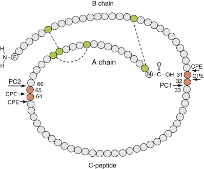
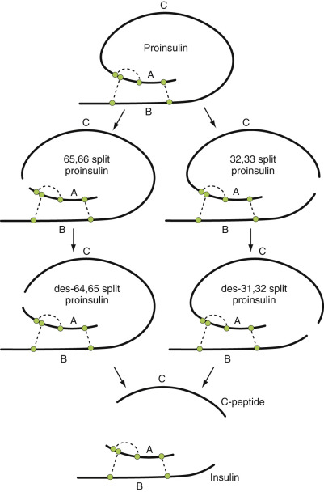
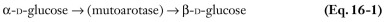
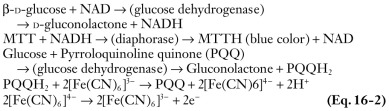
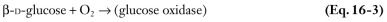
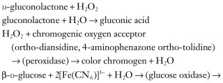
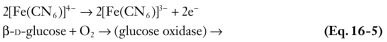
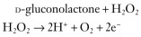
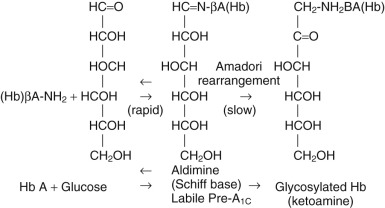

## Key Points

  * •

Normal fasting plasma glucose is less than 100 mg/dL (5.6 mmol/L), and normal glucose levels 2 hours post glucose load are less than 140 mg/dL (7.8 mmol/L). 

  * •

The diagnosis of diabetes requires a fasting plasma glucose of 126 mg/dL (7.0 mmol/L) or greater on at least two occasions or a casual plasma glucose level (or 2 hours post glucose load level) of 200 mg/dL (11.1 mmol/L) or greater. 

  * •

Glycated hemoglobin (HbA  1c  ) of 6.5% or greater on at least two occasions can be used to diagnose diabetes using a method that is National Glycohemoglobin Standardization Program certified and standardized to the DCCT (Diabetes Control and Complications Trial) assay. 

  * •

Impaired fasting glucose (100-125 mg/dL), a 2-hour plasma glucose value of 140 to 199 mg/dL after a 75-g glucose load, or HbA  1c  of 5.7% to 6.4% indicates increased risk for diabetes. 

  * •

Oral glucose tolerance tests, with pregnancy-specific cutoff levels, should be performed to diagnose gestational diabetes. 

  * •

Whole blood capillary glucose values obtained with point-of-care devices and continuous glucose monitoring systems that measure interstitial glucose are useful for the detection of hyperglycemia and hypoglycemia in individuals with diabetes, and help to monitor and direct therapy. They should not be used to diagnose diabetes or hypoglycemic disorders. To establish these diagnoses, confirmation with laboratory measures of plasma glucose is essential because of their greater accuracy. 

  * •

HbA  1c  levels should be performed every 3 to 6 months in individuals with diabetes to monitor glycemic control using a certified method, traceable to the DCCT reference method. Reliability and accuracy are diminished in the presence of shortened red blood cell survival, lower mean blood cell age, or need for transfusions, as seen with certain hemoglobinopathies and hemolytic conditions, as well as with uremia. 

  * •

Direct methods for measuring β-hydroxybutyrate in blood are available in point-of-care devices as well as in the laboratory. These tests are replacing the strips and tablets for urine ketone testing that use sodium nitroprusside, which do not detect β-hydroxybutyrate. Because β-hydroxybutyrate levels are high in diabetic ketoacidosis (DKA) and fall with treatment, whereas acetoacetic acid and acetone levels rise with treatment, these strips are not useful for monitoring therapy. Calculation of the anion gap is also commonly used to monitor recovery from DKA. 

  * •

Circulating pancreatic autoantibodies may be present before and after the onset of autoimmune type 1 diabetes. These include antibodies to glutamic acid decarboxylase (GAD65), insulinoma-associated protein 2 (IA-2 and IA-2 beta), the zinc transporter ZnT8, and insulin. These tests should not be used for routine screening of asymptomatic nondiabetic individuals, except in a research setting. When performed, assays should be used that have been shown by the Diabetes Antibody Standardization Program to have the best performance. 

  * •

Hypoglycemic symptoms with a plasma glucose level of 55 mg/dL (3.0 mmol/L) or less in an individual who is not receiving medications for diabetes warrant further evaluation. A careful drug and medical history and measurements of insulin, C-peptide, proinsulin, insulin autoantibodies, β-hydroxybutyrate, and drug levels (sulfonylureas, repaglinide, nateglinide) during the hypoglycemic episode are recommended to determine the diagnosis. 

  * •

Glycogen storage diseases that primarily affect the liver usually manifest with hypoglycemia and hepatomegaly, whereas those affecting muscle commonly cause muscle cramps, weakness, fatigue, and exercise intolerance. 

Carbohydrates are major constituents of physiologic systems. They are organic compounds composed of carbon, hydrogen, and oxygen [C  x  (H  2  O)  y  ], which, along with lipids and proteins, provide energy and contribute to the structure of organisms. Complex carbohydrates are digested into simple sugars, principally glucose, which are used primarily as energy sources or are stored as glycogen. The most important dietary hexoses (six carbon-containing carbohydrates) are  d  -glucose,  d  -galactose, and  d  -fructose, but the principal sugar circulating in the bloodstream is glucose. Lactose (glucose and galactose) and sucrose (glucose and fructose) are important disaccharides. Carbohydrates are needed for specific cellular functions (such as ribose in nucleic acids) and can modify proteins and their function by glycosylation. Carbohydrates are measured in whole blood, serum, or plasma. In addition, measurements of glucose in urine, cerebrospinal fluid, and other body fluids are important clinically. 

The concentration of glucose in blood is normally controlled within narrow limits by many hormones, the most significant of which, insulin, is produced by the endocrine pancreas. Diabetes mellitus is the most common disease of carbohydrate metabolism. Most individuals with diabetes have either type 1 (beta cell destruction with absolute insulin deficiency) or type 2 (insulin resistance and defective insulin secretion). Measurements of glycemic control are increasingly important in diabetes, because the development and progression of microvascular and macrovascular complications are associated with hyperglycemia. This chapter reviews the aspects of carbohydrate metabolism most critical to the practice of medicine. 

,  

##  Function of the Endocrine Pancreas 

The pancreas functions as both an endocrine and an exocrine organ in the control of carbohydrate metabolism. As an exocrine gland, it produces and secretes amylase responsible for the breakdown of ingested complex carbohydrates. Further digestion leads to the production of monosaccharides. Once absorbed, the monosaccharides signal the endocrine pancreas, which regulates hormones involved in energy homeostasis. Enteroendocrine cells in the gastrointestinal tract are also stimulated by nutrients to secrete incretins, peptide hormones that affect pancreatic function, gastric emptying, appetite, and intestinal motility. 

The endocrine pancreas secretes four hormones from different cells residing in the islets of Langerhans. Insulin is produced by the beta cells, glucagon by the alpha cells, somatostatin by the delta cells, and pancreatic polypeptide (PP) by the PP cells. In insulin-sensitive tissues such as skeletal muscle, fat, and liver, insulin stimulates glucose uptake and the formation of glycogen and inhibits glucose production. Glucagon acts primarily in the liver, where it stimulates glucose production and, over time, ketogenesis. Somatostatin, on the other hand, inhibits insulin and glucagon secretion, as well as the secretion of several other hormones. Nutrient ingestion, through vagal-cholinergic stimulation, increases PP secretion. The PP family also includes peptide YY and neuropeptide Y, which are found in the gastrointestinal tract and nervous system and affect gastrointestinal function, food intake, and satiety. In the rare reported cases of islet cell tumors producing excess PP, or in PP hyperplasia, some patients are asymptomatic, whereas other cases are associated with watery diarrhea syndrome (  Tomita et al, 1980  ;  Bellows et al, 1998  ;  Pasieka & Hershfield, 1999  ). 

The ratio of insulin to glucagon is important in the regulation of carbohydrate metabolism. Anabolism is favored when there is a relative increase in the insulin-to-glucagon ratio as in the postprandial state; catabolism is favored with a relative decrease in this ratio as in the fasting state. The ratio of insulin to glucagon is influenced by somatostatin, neural input, intestinal peptides, and the concentrations of glucose and other metabolites. The ratio of insulin to glucagon is tightly regulated to keep blood glucose concentrations within the normal range. 

In addition to the hormones mentioned above, the pancreatic beta cell secretes a 37 amino acid protein called islet amyloid polypeptide (IAPP), or amylin. First discovered in 1987, amylin is colocalized and cosecreted with insulin in response to stimulation with nutrients. Amylin slows gastric emptying and inhibits postprandial glucagon secretion. The overall result is a lowering of postprandial hyperglycemia. Oligomeric forms are associated with an increase in beta cell apoptosis. Amylin is first synthesized as a larger precursor peptide that is processed within the beta cell. High levels of amylin have been observed in hyperinsulinemic, insulin-resistant states, such as impaired glucose tolerance and early type 2 diabetes, and low levels are seen in type 1 diabetes and insulin-requiring type 2 diabetes. Amyloid deposits, fibroid material derived from IAPP, are observed in islets in type 2 diabetes. Amylin levels can also be elevated in pancreatic cancer. Amylin assays are not used in clinical practice, but amylin analogs may be helpful in diabetes management by limiting postprandial glucose excursions and promoting satiety. A synthetic analog of amylin, pramlintide acetate, is available for use by injection before major meals in patients with insulin-requiring diabetes. 

 

##  Insulin 

Insulin is a peptide hormone with a mass of approximately 5800 daltons (Da), secreted by the beta cells in the islets of Langerhans in the pancreas. It has a 21 amino acid A chain and a 30 amino acid B chain that are linked by two disulfide bonds. Insulin is synthesized initially as a longer single-chain peptide precursor hormone, preproinsulin. Proinsulin (≈9000 Da), the immediate precursor of insulin, is processed into insulin in the secretory granules of the beta cells by enzymatic removal of the 31 amino acid peptide segment that connects the A and B chains, known as C-peptide ( [ Figs. 16-1 ](<#f0010>) and [ 16-2 ](<#f0015>) ). This proteolytic processing is catalyzed by proprotein convertases PC2 and PC1/PC3, which first convert proinsulin into the intermediate metabolites 32,33 split proinsulin and 65,66 split proinsulin, and then, after cleavage by carboxypeptidase H, to des-31,32 split proinsulin and des-64,65 split proinsulin. In adults, small amounts of intact proinsulin and these metabolically active conversion intermediates, especially des-31,32 split proinsulin, are cosecreted with insulin. Healthy infants and preterm neonates have higher proinsulin and 32,33 split proinsulin levels than adults. Proinsulin and its metabolites may cross-react with insulin in some insulin radioimmunoassays. This can be significant, especially because the half-life of proinsulin is at least three times as long as that of insulin. In vivo studies of proinsulin have shown that it has 10% to 15% of the biologic activity of insulin. 

Figure 16-1 

Human proinsulin, with cleavage sites for the proprotein convertases PC1 and PC2 and for carboxypeptidase H (CPE). 

_Orange circles_ represent the two pairs of basic amino acids used for proteolytic processing, and _green circles_ represent cysteine residues that participate in disulfide bonding. 

(Diagnosis and classification of diabetes mellitus. Copyright © 2004 American Diabetes Association. From  Mackin RB  . Proinsulin: Recent observations and controversies. _Cell Mol Life Sci_ 54:696–702, 1998, with permission.) 

Figure 16-2 

Processing of proinsulin to insulin. 

_Green circles_ represent cysteine residues that participate in disulfide bonding. 

(Copyright John Wiley and Sons Ltd; reproduced with permission from Temple R, Clark PM, Hales CN. Measurement of insulin secretion in type 2 diabetes: Problems and pitfalls. _Diabetic Med_ 9:503–512, 1992.) 

Elevated proinsulin levels (intact and partially processed proinsulin) and high proinsulin : insulin ratios have been found in type 2 diabetes. This is associated with reduced PC1/PC3 activity and decreased ability of the beta cells to secrete insulin (  Roder et al, 1998  ;  Ozawa et al, 2014  ). An increase in proinsulin : insulin levels has also been observed in recent-onset type 1 diabetes, and after partial pancreatectomy (  Seaquist et al, 1996  ), where there are reductions in beta cell function and increases in secretory demand. Less common conditions associated with high proinsulin levels include insulinomas. Familial hyperproinsulinemia is a rare condition caused by mutations in the proinsulin gene. In affected families, these genetic abnormalities can be associated with impaired glucose tolerance or type 2 diabetes (  Nishi & Nanjo, 2011  ). C-peptide and insulin are secreted in equimolar amounts into the portal vein, but the ratio in serum is about 5:1 (fasting) to 15 : 1\. The molar concentration of C-peptide in blood is higher than that of insulin, primarily because of the hepatic clearance of insulin. Approximately 50% of insulin is rapidly removed by its initial passage through the liver, but hepatic extraction of C-peptide is negligible. In cirrhosis, hyperinsulinemia is observed as the result of decreased hepatic insulin clearance. In healthy individuals, the half-life of both C-peptide and proinsulin is approximately 30 minutes, whereas it is only 4 to 9 minutes for insulin. There is evidence that C-peptide has significant biologic activity (  Pietropaolo, 2013  ). 

Disease states occur when insulin concentrations are inappropriate for given blood glucose levels. Insulin deficiency, either absolute or relative, leads to diabetes mellitus. Serum insulin levels should be measured with a concomitant glucose level because insulin secretion is regulated primarily by glucose. Whereas a high insulin level in the presence of a low glucose level suggests inappropriate secretion or administration of insulin, high insulin levels can be observed in insulin-resistant individuals who need to secrete additional insulin to keep blood glucose levels normal. 

Unregulated excess insulin secretion causes hypoglycemia. This is seen in insulin-secreting tumors, especially insulinomas, where patients have low serum glucose levels (<50 mg/dL), and elevated insulin and proinsulin levels with hypoglycemic symptoms (e.g., shakiness, palpitations, diaphoresis, confusion). C-peptide levels are measured in hypoglycemic states to help identify the cause of the hypoglycemia. Sera from insulinoma patients have high insulin and C-peptide levels, whereas hypoglycemia from injected or exogenous insulin is characterized by high insulin levels and low C-peptide levels. Commercially available insulin preparations are free of C-peptide and proinsulin. Because C-peptide is less stable than insulin, serum samples should be separated quickly and frozen. 

In people with diabetes mellitus, C-peptide and glucose can be measured after an overnight 8-hour fast and after stimulation by an oral mixed meal or after glucagon stimulation to provide information concerning beta cell secretory capacity. Urine C-peptide:creatinine has also been used to assess beta cell function (  Besser et al, 2011  ). Low C-peptide levels are characteristic of the absolute insulin deficiency of type 1 diabetes. C-peptide measurements during the mixed meal tolerance test are commonly used in clinical trials of type 1 diabetes for the evaluation of preservation of beta cell function (  Greenbaum et al, 2008  ). C-peptide measurement can also be useful in follow-up evaluations after pancreatectomy and postpancreatic transplantation. Unlike insulin, both C-peptide and proinsulin are primarily degraded in the kidneys, so levels are elevated in renal failure. 

Many commercial immunoassays for insulin, C-peptide, and proinsulin are available. Progress has been made concerning the standardization of these assays, and ultrasensitive immunoassays are available (  Miller et al, 2009  ;  Wang et al, 2012  ). It is recommended that all assays be standardized to one reference method. Manufacturers are encouraged to publish data concerning the performance of their assays, including accuracy, recovery, precision, specificity, linearity, and lowest measurable concentration statistically different from zero/limits of quantitation. Laboratory certification is also encouraged. In the United States, an external quality assessment program for insulin and C-peptide measurements is available through the College of American Pathologists (Northfield, Ill.). 

Serum insulin measurements may be falsely low in the presence of hemolysis. An insulin-degrading enzyme found in red blood cells, as well as in other tissues, is responsible for this problem. C-peptide and proinsulin measurements appear to be less affected by hemolysis. Insulin antibodies will also interfere with insulin immunoassays, with both falsely elevated and suppressed levels reported. 

 

##  Glucagon 

Proglucagon is synthesized in the pancreatic alpha cells and the L cells of the distal small bowel. Through differential processing, the glucagon family of gene products is formed. This includes the production of glucagon in the pancreatic alpha cells and the incretin glucagon-like peptide 1 (GLP-1) in the L cells of the intestines. 

Fasting plasma glucagon concentrations are normally 25 to 50 pg/mL. Pancreatic glucagon stimulates glucose production. It is an important regulator of hepatic glycogenolysis, gluconeogenesis, and ketogenesis. In type 1 diabetes, over time, progressive glucagon deficiency develops. This deficiency of glucagon results in increased glycemic fluctuations and difficulty recovering from hypoglycemia. In type 2 diabetes, inappropriately elevated postprandial levels of glucagon are observed. 

Serum glucagon concentrations are rarely measured in clinical practice. Glucagonomas are rare islet cell tumors that produce excessive glucagon. Clinically, glucagonomas present with a characteristic necrotizing migratory erythematous rash, stomatitis, glossitis, weight loss, anemia, and mild diabetes mellitus. These tumors are usually associated with fasting glucagon levels greater than 120 pg/mL, but levels can range from 900 to 7800 pg/mL. The processing of proglucagon is impaired, and large molecular weight forms can be seen. Mild elevations in blood glucagon levels are seen in patients with multifunctional neuroendocrine tumors. Glucagon levels can also be mildly elevated in cirrhosis, Cushing's syndrome, pancreatitis, acromegaly, and renal insufficiency. In familial hyperglucagonemia, an autosomal dominant disorder, glucagon levels are high in the absence of tumor. Family history is helpful in making this diagnosis. 

 

##  Incretins 

Oral nutrients stimulate the release of incretins from the intestines. The incretin effect refers to the greater and earlier insulin response to the oral administration of glucose compared with intravenous glucose. The most important incretins in the regulation of insulin secretion are GLP-1 and glucose-dependent insulinotropic peptide (gastric inhibitory polypeptide; GIP), both of which are members of the glucagon superfamily (  Drucker, 2013  ). GLP-1 (7-37), the most common active form, has a half-life of only 2 to 3 minutes. It is rapidly cleaved by circulating aminopeptidases to the inactive GLP-1 (9-37). This inactive form represents 80% of the circulating GLP-1. Both forms of GLP-1 are short-lived and cleared by the kidneys. Dipeptidyl peptidase-4 (DPP-4), a serine peptidase present on the surface of endothelial cells, inactivates GLP-1 by removing two N-terminal amino acids. 

GLP-1 rapidly stimulates insulin secretion, suppresses glucagon secretion, and slows gastric emptying in response to a meal. GLP-1 may also reduce appetite and promote weight loss. In vitro and animal studies indicate that GLP-1 can inhibit beta cell apoptosis, stimulate beta cell proliferation and neogenesis from precursor duct cells, and decrease alpha cell mass (  Drucker, 2013  ). C-cell hyperplasia and medullary cancer of the thyroid have been observed in rodents after prolonged administration of GLP-1 receptor agonists, but increased tumor formation has not been observed in human trials. 

Plasma meal-stimulated GLP-1 levels are decreased in type 2 diabetes mellitus (  Toft-Nielsen et al, 2001  ). Oral inhibitors of DPP-4 are used for the treatment of type 2 diabetes. Long-acting GLP-1 receptor agonists are available for use by injection in patients with type 2 diabetes. 

 

##  Somatostatin 

Somatostatin, a tetradecapeptide with a disulfide bond, was originally discovered as a hypothalamic hormone that inhibited growth hormone secretion, but the discovery of somatostatin in the islets of Langerhans prompted further investigation of its function in the endocrine pancreas. Subsequently, somatostatin was found in the gastrointestinal tract and nervous system. It inhibits pituitary (growth hormone and thyrotropin) and pancreatic (insulin, glucagon, PP) hormones, as well as GIP, gastrin, secretin, vasoactive intestinal peptide, cholecystokinin, motilin, arginine vasopressin, acetylcholine, epidermal growth hormone, neurotensin, and serotonin. Nonendocrine functions include inhibition of gastric acid secretion; gastrointestinal motility, including gastric emptying time; gallbladder contractions; and pancreatic enzyme release. The first isolated somatostatin peptide had 14 amino acids and is called somatostatin-14. Subsequently, somatostatin-28, which contains an N-terminal extension, was isolated and is a more potent inhibitor of islet hormones. 

In the pancreatic islets, somatostatin is produced in the delta cells, which are 5% to 10% of the islet cells. Rare islet cell tumors, somatostatinomas, secrete high levels of somatostatin, causing diabetes mellitus, diarrhea, and gallstones. Elevated somatostatin levels can also be seen in small cell lung cancer, medullary thyroid cancer, and pheochromocytoma. Somatostatin has a very short half-life and is rarely measured in clinical practice. Long-acting somatostatin analogs, octreotide and lanreotide, which bind primarily to the somatostatin receptor subtype 2 (SSTR2), are used to treat pituitary tumors (acromegaly, ACTH and TSH-producing tumors), as well as carcinoid syndrome, VIPomas, glucagonomas, insulinomas, pancreatic fistulas, Zollinger-Ellison syndrome, HIV-associated diarrhea, and other disorders of the gastrointestinal tract (the only labeled indications are for acromegaly, VIPomas, and metastatic carcinoid tumors). Octreotide scintigraphy has also been used for the diagnosis, localization, detection of metastatic disease, and prediction for success of treatment with somato­statin analogs for gastroenteropancreatic neuroendocrine tumors. 

,  

##  Glucose Measurements 

 

##  Specimen Considerations 

Measurements of glucose are critical to the diagnosis and management of diseases affecting carbohydrate metabolism. Glucose is measured in whole blood, plasma, serum, cerebrospinal fluid, pleural fluid, and urine for a variety of diagnostic and management purposes. In addition, devices can measure glucose from interstitial fluid for continuous monitoring of glucose levels in people with diabetes. How and when specimens are collected and handled and the sites of collection affect the clinical interpretation of the analytic result. 

The standard clinical laboratory analysis of glucose is performed on plasma or serum derived from a phlebotomy specimen. Glycolysis causes plasma glucose to decline over time while the plasma is in contact with cells. The decline can be several milligrams per deciliter per hour, depending on cell counts and other factors. A specimen is appropriate for glucose analysis if serum or plasma is separated from the cells within 30 minutes. If plasma is in contact with cells for much longer than 30 minutes, a preservative such as sodium fluoride that inhibits glycolysis should be added (  Weissman & Klein, 1958  ;  Chan et al, 1989  ). However, even with the use of fluoride, plasma glucose will decline in the first hour after blood collection. 

 

##  Glucose Measurement Methods 

Most measurements of glucose employ enzymatic methods. These methods provide specificity and can be packaged to furnish point-of-care determinations. Enzyme systems that have been commonly used to measure glucose are glucose dehydrogenase, glucose oxidase, and hexokinase. These reactions produce an electrical current that is proportional to the initial glucose concentration, or a product that measured spectrophotometrically is proportional to the initial glucose concentration. The assays can be initial rate-of-change assays, where the velocity of the reaction is dependent on the initial glucose, or end-point assays. 

The most accurate method is isotope dilution gas chromatography/mass spectrometry. The YSI glucose analyzer, which measures glucose in plasma, serum, or blood using an immobilized enzyme electrode, produces more accurate results than the point-of-care home blood glucose monitoring devices. In the United States, three point-of-care devices use cartridges instead of strips, but they are more costly, use higher sample volume, have longer analysis times, and have not been proven to be more accurate. 

When glucose is measured using a glucose dehydrogenase method, glucose is reduced to produce a chromophore that is measured spectrophotometrically ( [ Equation 16-1 ](<#f0020>) ) or an electrical current ( [ Equation 16-2 ](<#f0025>) ) (  Kost et al, 1998  ). 

Glucose oxidase, a flavoenzyme, catalyzes the reactions shown in [ Equation 16-3 ](<#f0030>) . The peroxidase reaction can be measured spectrophotometrically and can be inhibited by high concentrations of uric acid, ascorbic acid, bilirubin, glutathione, creatinine,  l  -cysteine,  l  -dopa, dopamine, methyldopa, and citric acid (  Zaloga, 1997  ). In addition, the glucose oxidase reaction can be coupled to the ferricyanide/ferricyanide couple to produce an electrical current, as shown in [ Equation 16-4 ](<#f0035>) . This system is dependent on the partial pressure of O  2  because oxygen will compete in the reaction to form hydrogen peroxide, so the higher the partial pressure of O  2  , the lower the electrically measured glucose (  Kurahashi et al, 1997  ). Glucose oxidase can be used in another electrical system, as shown in [ Equation 16-5 ](<#f0040>) . 

In the hexokinase system assay, the glucose concentration is proportional to the rate of production of reduced nicotinamide adenine dinucleotide phosphate (NADPH), which is followed spectrophotometrically ( [ Equation 16-6 ](<#e0010>) ). Depending on the source of the glucose-6-phosphate dehydrogenase, the enzyme can require specificity for NADP, or from some sources, it can use NAD as well. Hemolyzed samples can be problematic in that contents released from the erythrocytes may interfere with the stoichiometric relationship between glucose and NAD(P)H accumulation. 

 Glucose  \+  MgATP  → (  hexokinase  )  → glucose-  6  -phosphate  (  G-  6  -P  )  \+  MgADP 

 G-  6  -P  \+  NA  (  P  )  \+  → (  glucose-  6  -phosphate dehydrogenase  )  → 6  -phosphogluconolactone  \+  NADPH  \+  H  \+ 

 

##  Whole Blood Glucose 

**Whole blood glucose** specimens, analyzed with point-of-care monitoring devices, are used in the home, in the physician's office, or at the bedside in the hospital to monitor for hypoglycemia and hyperglycemia. Most of these devices have been calibrated to give results similar to plasma levels and can report plasma or whole blood readings. Whole blood tends to give approximately 10% to 15% lower glucose readings than plasma, but the percentage varies on the basis of hematocrit, analysis technique, and sample timing (fasting vs. postglucose load). Capillary blood is the source for most of these whole blood glucose measuring devices. Capillary blood glucose is similar to arterial glucose but can vary markedly from venous samples, depending on timing relative to food ingestion. For example, a postprandial specimen is higher in the capillary sample than in the venous sample. Capillary glucose tests, using point-of-care devices, should not be used to diagnose diabetes or hypoglycemic disorders. To establish these diagnoses, confirmation with laboratory measurements of plasma glucose is essential because of their greater accuracy. 

Home blood glucose monitoring devices help people with diabetes to better self-manage their disease. A wide variety of devices are available for home measurements. Proper training of patients in the use of individual meters is critical in avoiding operator errors, which, in one study, were reported in 12% of users (  Schrot et al, 1999  ). Errors that may contribute to inaccurate readings in certain devices include the application of an insufficient volume of blood, milking the finger to acquire sufficient blood, use of outdated test strips, use of alternative sites, environmental factors (humidity, heat, altitude), use of a malfunctioning meter, use of a dirty meter, hypertriglyceridemia, hypotension, measurements outside of the hematocrit or temperature range, and other factors (  Schmid et al, 2013  ). Some blood glucose monitoring devices are influenced by high levels of salicylate, acetaminophen, levodopa, vitamin C, uric acid, bilirubin, lipids, or low oxygen levels, and others are altered by touching the reaction area. These devices are commonly used in the hospital; this use is considered “off-label” due to concerns about accuracy. Results can be misleading when samples are obtained from critically ill patients with poor perfusion and edema. Oxygen pressure can also affect accuracy in systems that use glucose oxidase. 

The accuracy of point-of-care home blood glucose monitoring devices varies, especially at very high and low glucose concentrations. Accuracy is critical, because patients, caregivers, and providers use results to direct therapy and avoid serious hypoglycemia and hyperglycemia. The International Organization for Standardization (ISO) 1197 accuracy standards changed in 2013. Under the old standards (2003), 95% of glucose values were expected to be ±15 mg/dL when reference glucose was less than 75 mg/dL and within 20% when glucose levels were greater than 75 mg/dL. Testing on only one lot of strips was required. The 2013 standards require that 95% or more of glucose levels must be ±15 mg/dL when reference glucose is less than 100 mg/dL, within 15% for glucose of 100 mg/dL or higher, and 99% within zone A or B (little or no effect on clinical outcome) of Parkes Consensus Error Grid for type 1 diabetes. Testing on three lots of strips is now required. Compliance with these standards is not mandatory, and many devices do not meet these standards (  Freckmann et al, 2012  ). 

Desirable features of home blood glucose monitoring devices, aside from performance characteristics (precision and accuracy), include ease of use, requirement of a small volume of blood, low maintenance, large print readout, rapid testing, appropriate alarms, minimal interfering substances, and memory storage and download capabilities. Some meters permit alternative site testing (such as forearm, upper arm, thigh), but results from alternative sites may be less accurate when rapid changes in glucose levels occur. Others incorporate insulin dose calculators and electronic logbooks for recording events, insulin doses, and carbohydrate intake. This information can be downloaded to a computer or smart phone to present the data in several displays such as logbooks, graphs, charts, and summary statistics. Wireless communication between home blood glucose monitoring devices and insulin pumps is also available. 

 

##  Interstitial Glucose 

**Interstitial glucose measuring devices** have been developed for continuous monitoring of glucose levels in people with diabetes. Most of these devices use electrochemical methods to automatically and frequently measure glucose levels in the interstitial fluid of dermis or subcutaneous fat tissue and require repeated calibration to plasma or whole blood glucose levels. Currently available continuous glucose monitoring systems use a subcutaneous tissue sensor that provides glucose measurements every 1 to 5 minutes. They are used independently or connected to insulin pumps. The sensor is changed every 6 days. Interstitial glucose is in slow (5-30 min) equilibrium with capillary blood glucose and therefore is not equal to blood glucose, except in stable systems (  Zierler, 1999  ;  Cheyne et al, 2002  ). Particularly during times when glucose levels are rapidly changing, such as after meal ingestion or recovery from hypoglycemia, interstitial fluid readings will lag behind fingerstick glucose levels. Although the precision and accuracy of currently available portable continuous glucose monitors are improving, they are not as high as for home blood glucose monitoring devices. They are therefore recommended to supplement but not replace conventional home blood glucose monitoring. Technologies currently under development for noninvasive glucose monitoring include impedance spectroscopy, thermal emission spectroscopy, near infrared spectroscopy, far infrared spectroscopy, ellipsometry, magnetic resonance imaging, and methods using electromagnetic waves. 

Examination of data from continuous glucose monitoring systems provides information about glucose patterns over hours to days. This glucose “trend analysis” can reveal useful findings, such as unsuspected nocturnal hypoglycemia or postprandial hyperglycemia, which are used for modifying treatment. Hypoglycemia can occur at low or high HbA  1c  levels and can be discovered through continuous glucose monitoring. 

Devices also “alarm,” warning the patient of hypoglycemia and hyperglycemia. Communication between insulin pumps and accurate continuous glucose monitoring systems is essential for the development of an artificial pancreas. There is currently an FDA-approved insulin pump/continuous glucose monitoring system that has incorporated a low–glucose threshold suspend feature. Insulin infusion is temporarily stopped when glucose levels fall below the threshold suspend level, reducing time in hypoglycemia (  Bergenstal et al, 2013  ). Early studies of a bionic pancreas (an automated wearable insulin and glucagon subcutaneous infusion system that communicates with a continuous glucose monitor and uses an automated adaptive algorithm) are promising (  Russell et al, 2014  ). 

,  

##  Diabetes Mellitus 

Diabetes mellitus is a group of diseases in which blood glucose levels are elevated. Diabetes is the most common set of disorders of carbohydrate metabolism, affecting approximately 29.1 million Americans in 2012, 9.3% of the total population and 25.9% of those 65 years of age and older (  CDC, 2014  ). This is projected to increase to 44 million in 2034 (  Huang et al, 2009  ), with the prediction of an estimated 33% of males and 39% females born in 2000 in the United States being diagnosed with diabetes during their lifetime (  Narayan et al, 2003  ). This chronic disease is responsible for significant morbidity, mortality, and cost. Diabetes is the leading cause of treated end-stage renal disease, the most common cause of nontraumatic amputations, and the foremost cause of new blindness in adults ages 20 to 74 years. Nerve damage, known as diabetic neuropathy, occurs in 60% to 70% of people with diabetes. Most diabetes-related deaths, however, are related to the increased risk of developing atherosclerotic disease. People with diabetes are at least two to four times more likely to have heart disease and cerebrovascular disease than those without diabetes. In 2012, it was estimated that diabetes in the United States cost $245 billion (  CDC, 2014  ). Fortunately, in recent years, associated with better glycemic and blood pressure control, use of angiotensin converting enzymes inhibitors or angiotensin receptor blockers for renoprotection, use of statin drugs to lower LDL-cholesterol, and better foot care, complication rates have been falling (  Gregg et al, 2014  ). 

The Expert Committee on the Diagnosis and Classification of Diabetes Mellitus revised the criteria for the diagnosis of diabetes in 1997, with later modifications by the  American Diabetes Association (ADA, 2010  ). A fasting plasma glucose level of 126 mg/dL (7.0 mmol/L) or higher on at least two occasions is diagnostic of diabetes ( [ Table 16-1 ](<#t0010>) ). The fasting glucose level should be obtained after an 8-hour fast. Symptoms of hyperglycemia (e.g., polyuria, polydipsia, polyphagia, unexplained weight loss) with a casual plasma glucose level of 200 mg/dL (11.1 mmol/L) or higher or hemoglobin A  1c  (HbA  1c  ) of 6.5% or higher on two different days is sufficient to diagnose diabetes. If the patient has discordant results from two different tests, then the test for which the result is above the diagnostic cut point should be repeated. 

TABLE 16-1 

Diagnosis of Prediabetes and Diabetes Mellitus 

|  Fasting Plasma Glucose  |  2-Hour Plasma Glucose Level (After 75 g Glucose Load)  |  HbA  1c   
---|---|---|---  
mg/dL  |  mmol/L  |  mg/dL  |  mmol/L  |  %   
Normal  |  <100  |  <5.6  |  <140  |  <7.8  |   
Prediabetes  |  |  |  |  |  5.7-6.4   
Impaired fasting glucose  |  100-125  |  5.6-6.9  |  |  |   
Impaired glucose tolerance  |  |  |  140-199  |  7.8-11.0  |   
Diabetes mellitus  |  ≥126  |  ≥7.0  |  ≥200  |  ≥11.1  |  ≥6.5   
  
_HbA 1c  , _ Hemoglobin A  1c  . 

From  American Diabetes Association (2010)  . 

Prediabetes designates conditions in which glucose homeostasis is abnormal, but serum glucose levels are not high enough to be classified as diabetes. This group includes individuals with impaired fasting glucose and impaired glucose tolerance (see [ Table 16-1 ](<#t0010>) ). They are also at increased risk for cardiovascular and cerebrovascular diseases. 

Formal oral glucose tolerance tests are not generally recommended for routine clinical use in the diagnosis of diabetes. If used, the procedure described by the  World Health Organization (1985)  utilizing a 75-gram glucose load should be followed. For children, 1.75 grams glucose/kg up to 75 grams is recommended. The exception is for the diagnosis of diabetes during pregnancy. Pregnant women with risk factors for type 2 diabetes should be screened using an oral glucose tolerance test at their initial prenatal visit. Other women should be screened between 24 and 28 weeks' gestation. 

There is ongoing debate concerning the optimal screening method for diagnosing gestational diabetes (  ADA, 2014  ). The “one-step” method, based on the International Association of Diabetes and Pregnancy Study Groups [IADPSG] consensus meeting, uses a 75-gram oral glucose tolerance test, measuring glucose levels after fasting and at 1 and 2 hours ( [ Table 16-2 ](<#t0015>) ). Cutoff glucose concentrations are based on those values associated with a 1.75-fold increase in the risk of neonatal complications in the Hyperglycaemia and Adverse Pregnancy Outcomes (HAPO) study. The other method (National Institutes of Health consensus) uses the “two-step” protocol shown in [ Table 16-2 ](<#t0015>) . The use of this protocol avoids a large increase in the prevalence of gestational diabetes without clear benefit. A third, compromise alternative has recently been proposed (  Cosson et al, 2014  ) and is based on glucose values associated with a twofold increase in the risk of neonatal complications (fasting glucose of 95 mg/dL or higher, or a 1-hour glucose value after a 75-gram oral glucose tolerance test of 191 mg/dL or higher, or a 2-hour glucose value of 162 mg/dL or higher). 

TABLE 16-2 

Diagnosis of Gestational Diabetes Mellitus 

** “One-Step” (IADPSG Consensus) **  
---  
  
  * Perform a 75-g OGTT, with plasma glucose measurement fasting and at 1 and 2 h, at 24-28 weeks of gestation in women not previously diagnosed with overt diabetes. 
  * The OGTT should be performed in the morning after an overnight fast of at least 8 h. 
  * The diagnosis of GDM is made when any of the following plasma glucose values are exceeded: 
    * • Fasting: ≥92 mg/dL (5.1 mmol/L) 
    * • 1 h: ≥180 mg/dL (10.0 mmol/L) 
    * • 2 h: ≥ 153 mg/dL (8.5 mmol/L) 

  
** “Two-Step” (NIH Consensus) **  
  
  * Perform a 50-g GLT (nonfasting), with plasma glucose measurement at 1 h (Step 1), at 24-28 weeks of gestation in women not previously diagnosed with overt diabetes. 
  * If the plasma glucose level measured 1 h after the load is ≥140 mg/dL  *  (7.8 mmol/L), proceed to 100-g OGTT (Step 2). The 100-g OGTT should be performed when the patient is fasting. 
  * The diagnosis of GDM is made when at least two of the following four plasma glucose levels (measured fasting, 1 h, 2 h, 3 h after the OGTT) are met or exceeded: 

  
|  **Carpenter/Coustan** |  **NDDG**  
Fasting  |  95 mg/dL (5.3 mmol/L)  |  105 mg/dL (5.8 mmol/L)   
1 h  |  180 mg/dL (10.0 mmol/L)  |  190 mg/dL (10.6 mmol/L)   
2 h  |  155 mg/dL (8.6 mmol/L)  |  165 mg/dL (9.2 mmol/L)   
3 h  |  140 mg/dL (7.8 mmol/L)  |  145 mg/dL (8.0 mmol/L)   
  
_NDDG,_ National Diabetes Data Group. 

From American Diabetes Association. Standards of medical care in diabetes—2014\. _Diabetes Care_ 2014 Jan; 37 Suppl 1: S14–S80. 

 * The American College of Obstetricians and Gynecologists (ACOG) recommends a lower threshold of 135 mg/dL (7.5 mmol/L) in high-risk ethnic minorities with higher prevalence of GDM; some experts also recommend 130 mg/dL (7.2 mmol/L) 

Before an oral glucose tolerance test is performed, individuals should ingest at least 150 g/day of carbohydrates for the 3 days preceding the test without limitation in physical activity, and the test should be performed after an overnight 8- to 14-hour fast. The individual should not eat food; drink tea, coffee, or alcohol; or smoke cigarettes during the test, and he or she should be seated. Venous glucose samples are preferably collected in gray-top tubes containing fluoride and an anticoagulant. 

Metabolic syndrome is highly prevalent in the United States, present in 34.3% of all adults (  Ford et al, 2010  ). Of great concern is the increasing prevalence of the metabolic syndrome in U.S. adolescents, affecting 9.5% of eighth-grade students in 2008 (  STOPP-T2D, 2008  ). The metabolic syndrome is associated with increased risk of cardiovascular disease and of developing diabetes. Criteria defining the metabolic syndrome according to the Third Report of the National Cholesterol Education Program Expert Panel on Detection, Evaluation, and Treatment of High Blood Cholesterol in Adults include the presence of three or more of the following: impaired fasting glucose or diabetes; blood pressure of 130/85 mm Hg or higher, or taking medication for hypertension; waist circumference of more than 102 cm in men and more than 88 cm in women; serum triglycerides of 150 mg/dL (1.7 mmol/L) or higher, or taking lipid-lowering medication; and high-density lipoprotein (HDL) cholesterol of lower than 40 mg/dL (1.0 mmol/L) in men and lower than 50 mg/dL (1.3 mmol/L) in women. Most commonly, these individuals are insulin resistant and have smaller, denser, more atherogenic low-density lipoprotein (LDL) cholesterol particles. 

The classification of diabetes is shown in [ Box 16-1 ](<#b0010>) (  ADA, 2010  ). The most common forms of diabetes are type 1 and type 2 ( [ Table 16-3 ](<#t0020>) ). Type 1 diabetes, characterized by absolute insulin deficiency and beta cell destruction, used to be called juvenile-onset diabetes or insulin-dependent diabetes. Although this disease is most commonly diagnosed in young people, its onset can occur at any age. Because people with other forms of diabetes also use insulin therapy, the term _insulin-dependent_ is confusing and should not be used. Type 2 diabetes, characterized by insulin resistance and insulin secretory defects, has been referred to in the past as adult-onset or non-insulin-dependent diabetes. These terms also should no longer be used. Although the onset of type 2 diabetes is most common in older adults, it can occur at any age, including childhood. Many patients with type 2 diabetes use insulin therapy, so it should not be referred to as non-insulin-dependent diabetes. Uncommon causes of diabetes include genetic defects involving beta cell function or insulin action, pancreatic diseases, endocrinopathies such as Cushing's syndrome, acromegaly and pheochromocytoma, and certain drugs, chemicals, and infections (see [ Box 16-1 ](<#b0010>) ). 

Box 16-1 

Classification of Diabetes Mellitus 

  * I.

Type 1 diabetes (beta cell destruction, usually leading to absolute insulin deficiency) 

    * A.

Immune mediated 

    * B.

Idiopathic 

  * II.

Type 2 diabetes (may range from predominantly insulin resistance with relative insulin deficiency to a predominantly secretory defect with insulin resistance) 

  * III.

Other specific types 

    * A.

Genetic defects of beta cell function 

      * 1.

Chromosome 12, HNF-1α (MODY3) 

      * 2.

Chromosome 7, glucokinase (MODY2) 

      * 3.

Chromosome 20, HNF-4α (MODY1) 

      * 4.

Chromosome 13, insulin promoter factor-1 (IPF-1; MODY4) 

      * 5.

Chromosome 17, HNF-1β (MODY5) 

      * 6.

Chromosome 2, NeuroD1 (MODY6) 

      * 7.

Mitochondrial DNA 

      * 8.

Others 

    * B.

Genetic defects in insulin action 

      * 1.

Type A insulin resistance 

      * 2.

Leprechaunism 

      * 3.

Rabson-Mendenhall syndrome 

      * 4.

Lipoatrophic diabetes 

      * 5.

Others 

    * C.

Diseases of the exocrine pancreas 

      * 1.

Pancreatitis 

      * 2.

Trauma/pancreatectomy 

      * 3.

Neoplasia 

      * 4.

Cystic fibrosis 

      * 5.

Hemochromatosis 

      * 6.

Fibrocalculous pancreatopathy 

      * 7.

Others 

    * D.

Endocrinopathies 

      * 1.

Acromegaly 

      * 2.

Cushing's syndrome 

      * 3.

Glucagonoma 

      * 4.

Pheochromocytoma 

      * 5.

Hyperthyroidism 

      * 6.

Somatostatinoma 

      * 7.

Aldosteronoma 

      * 8.

Others 

    * E.

Drug or chemical induced 

      * 1.

Vacor 

      * 2.

Pentamidine 

      * 3.

Nicotinic acid 

      * 4.

Glucocorticoids 

      * 5.

Thyroid hormone 

      * 6.

Diazoxide 

      * 7.

β-Adrenergic agonists 

      * 8.

Thiazides 

      * 9.

Dilantin 

      * 10.

γ-Interferon 

      * 11.

Others 

    * F.

Infections 

      * 1.

Congenital rubella 

      * 2.

Cytomegalovirus 

      * 3.

Others 

    * G.

Uncommon forms of immune-mediated diabetes 

      * 1.

“Stiff-man” syndrome 

      * 2.

Anti-insulin receptor antibodies 

      * 3.

Others 

    * H.

Other genetic syndromes sometimes associated with diabetes 

      * 1.

Down syndrome 

      * 2.

Klinefelter's syndrome 

      * 3.

Turner's syndrome 

      * 4.

Wolfram's syndrome 

      * 5.

Friedreich's ataxia 

      * 6.

Huntington's chorea 

      * 7.

Laurence-Moon-Biedl syndrome 

      * 8.

Myotonic dystrophy 

      * 9.

Porphyria 

      * 10.

Prader-Willi syndrome 

      * 11.

Others 

  * IV.

Gestational diabetes mellitus 

TABLE 16-3 

Characteristics of Type 1 and Type 2 Diabetes Mellitus 

|  Type 1 Diabetes  |  Type 2 Diabetes   
---|---|---  
Frequency  |  5% to 10%  |  90% to 95%   
Age of onset  |  Any, but most common in children and young adults  |  More common with advancing age, but can occur in children and adolescents   
Risk factors  |  Genetic, autoimmune, environmental  |  Genetic, obesity, sedentary lifestyle, race/ethnicity, hypertension, dyslipidemia, polycystic ovarian syndrome   
Pathogenesis  |  Destruction of pancreatic beta cells, usually autoimmune  |  No autoimmunity   
Insulin resistance and progressive insulin deficiency   
C-peptide levels  |  Very low or undetectable  |  Detectable   
Prediabetes  |  Autoantibodies (GAD65, IA-2, IAA, ZnT8) may be present.  |  Autoantibodies absent   
Medication therapy  |  Insulin absolutely necessary; multiple daily injections or insulin pump  |  Oral agents and/or noninsulin injectable hypoglycemic drugs   
Insulin commonly needed   
Therapy to prevent or delay onset of diabetes  |  None known   
Clinical trials in progress  |  Lifestyle (weight loss and increased physical activity)   
Oral medications (metformin, acarbose) may be helpful.   
  
 

##  Type 1 Diabetes 

Type 1 diabetes mellitus represents approximately 10% of all cases of diabetes. There usually is an autoimmune destruction of insulin-producing beta cells in the islets of the pancreas, causing an absolute deficiency in insulin production. The genetic susceptibility to develop type 1 diabetes is related, at least in part, to the inheritance of specific immune response genes associated with HLA-DR/DQ on chromosome 6, as well as other genes and genetic markers. It is then hypothesized that a precipitating event occurs, such as a viral infection, toxin exposure, or other environmental influence, which triggers the autoimmune destruction of the beta cells. It is only after most of the beta cells are destroyed that hyperglycemia develops. 

Antibody markers of beta cell destruction are commonly present before and at the time of onset of diabetes and can be useful for prediction and diagnosis and for research on the treatment and prevention of type 1 diabetes. These include antibodies to antigens for which recombinant autoantibody assays are available: antibodies to the 65 kDa isoform of glutamic acid decarboxylase (GAD65), insulin autoantibodies (IAAs), autoantibodies to insulinoma-associated protein 2 (IA-2), and autoantibodies to zinc transporter 8 (ZnT8). IA-2 is a tyrosine phosphatase–related protein. The tyrosine phosphatase IA-2β (phogrin) is a separate but partially homologous antigen to IA-2. Older assays measured islet cell antigen 512 autoantibodies (ICA512), which were autoantibodies to parts of the IA-2 antigen. IA-2 autoantibody assays are used more frequently than assays for IA-2β autoantibodies; IA-2β antibodies generally react with IA-2. The ZnT8 is found in the membrane of pancreatic islet beta cell secretory granules. Although the presence of antibodies may help in the differentiation of type 1 diabetes from other types of diabetes early in the course of the disease, the absence of antibodies does not exclude this diagnosis. 

Those individuals at greatest risk of developing type 1 diabetes have high titers of multiple autoantibodies. In family as well as in population studies, the detection of at least two autoantibodies is associated with increased risk of developing type 1 diabetes. Composite levels from assays for autoantibodies to GAD, IA-2, insulin, and ZnT8 increase prediction (Sosenko, 2013). GAD65 has the highest sensitivity (91%) as a single screening marker for detecting multiple antibody-positive individuals (  Krischer et al, 2003  ). IAAs are more common in young children who develop type 1 diabetes, whereas GAD65 is more common in adults. Prediction for the development of type 1 diabetes is enhanced by use of the Diabetes Prevention Trial-Type 1 risk score that includes parameters related to glycemia, age, body mass index (BMI) and C-peptide levels (  Sosenko et al, 2014  ). 

In the past, the autoantibody assays have not been well standardized, and the cutoff values for these assays were not firmly established. Quality control programs are important, in that almost 50% of blinded samples that are considered “low positive” were found to be negative on repeat testing of a blinded duplicate aliquot (  Eisenbarth, 2003  ). The Diabetes Antibody Standardization Program, a collaboration between the Immunology of Diabetes Society and the Centers for Disease Control and Prevention, has established a Proficiency Testing Service, with the goal of evaluation and improvement of assays for type 1 diabetes–associated autoantibodies, the provision of standard reference samples, and validation of novel candidate autoantibody antigens. Proficiency evaluations have been reported for different assays of GAD65, IA-2, IAA, and ZnT8 autoantibodies (  Bingley et al, 2003  ;  Torn et al, 2008  ). The “prediabetes” period of gradual and progressive beta cell destruction can last for months, years, or decades. During this period, the acute insulin response to intravenous glucose, called the first-phase insulin release, becomes depressed or absent. The absence of first-phase insulin response is also found in other forms of diabetes. Eventually, in most people with type 1 diabetes, most or all of the beta cells are destroyed, resulting in inadequate or absent insulin secretion. C-peptide levels and endogenous insulin levels therefore are very low or undetectable. People with untreated type 1 diabetes develop diabetic ketoacidosis. Insulin therapy is required for all patients with type 1 diabetes. 

 

##  Type 2 Diabetes 

Type 2 diabetes is the most common type of diabetes, affecting approximately 90% of Americans with diabetes. This disease is familial, but the underlying genetic defects for most of those affected have yet to be determined. Risk factors include overweight (BMI ≥25 kg/m  2  ), sedentary lifestyle, family history of diabetes, advanced age (≥45 years), ethnicity (African Americans, Latinos, Native Americans, Asian Americans, and Pacific Islanders), and polycystic ovary disease, as well as history of gestational diabetes or delivery before diabetes of a baby weighing more than 9 pounds, hypertension, vascular disease or dyslipidemia (HDL-cholesterol ≤35 mg/dL [0.90 mmol/L] and/or triglyceride level ≥250 mg/dL [2.82 mmol/L]), HbA  1c  of 5.7% or greater, impaired fasting glucose or impaired glucose tolerance, and other conditions associated with insulin resistance (i.e., acanthosis nigricans). This is not an autoimmune disease, so antibody testing is not worthwhile. C-peptide levels are measurable in type 2 diabetes, with a reduction in beta cell mass over time. Unlike undiagnosed type 1 diabetes, in which patients are usually symptomatic, people with new-onset type 2 diabetes can be free of symptoms. It is not unusual to diagnose type 2 diabetes after the onset of complications. Routine screening for high-risk individuals is therefore recommended. 

The  American Diabetes Association (ADA, 2010  ) recommends screening for type 2 diabetes by the individual's health care provider if one or more risk factors are present. Testing for diabetes should be considered in any overweight or obese adult. In general, it is recommended that adults ages 45 and older be screened for diabetes every 3 years, but screening should be performed earlier and more frequently if the individual is at high risk. The preferred test is a fasting plasma glucose or HbA  1c  level. If a random plasma glucose level is 160 mg/dL (8.9 mmol/L) or higher, a fasting plasma glucose, HbA  1c  , or 2-hour 75-g OGTT should be performed (see [ Table 16-1 ](<#t0010>) ). It should be remembered that whole blood glucose values, which are measured on some home blood glucose monitoring devices, are 10% to 15% lower than plasma glucose values. These devices should not be used to diagnose diabetes. If, however, an individual does have a capillary glucose test on one of these machines that reads 140 mg/dL (7.8 mmol/L) or higher, he or she should be rescreened with a fasting plasma glucose, HbA  1c  , or OGTT, using venous samples (see [ Table 16-1 ](<#t0010>) ). Point-of-care HbA  1c  assays are not recommended for use for diagnosis. 

In recent years, type 2 diabetes has been diagnosed in younger individuals, including children. The  American Diabetes Association (ADA, 2010  ) recommends screening children and adolescents, beginning at age 10 or at onset of puberty, who are overweight (BMI >85th percentile or weight >120% of ideal) with two of the following risk factors: family history (type 2 diabetes in first- and second-degree relatives), high-risk race/ethnicity (Native Americans, African Americans, Hispanic Americans, Asians/South Pacific Islanders), signs of insulin resistance (acanthosis nigricans, hypertension, dyslipidemia, polycystic ovary syndrome, or small for gestational age birth weight), or maternal history of diabetes or gestational diabetes during the child's gestation. 

Most people with type 2 diabetes are insulin resistant, obese, and have a relative or absolute deficiency in insulin secretion. Inappropriately high hepatic glucose production occurs, along with impaired glucose utilization peripherally. Decreased glucose transport can be demonstrated in muscle and adipose tissue. For glucose tolerance to remain normal, the pancreas must secrete enough insulin. If the pancreas is unable to secrete sufficient insulin, impaired glucose tolerance or type 2 diabetes results. Hyperglycemia is toxic to beta cell function and further impairs insulin secretion. Over time, beta cell failure is usually progressive, and the beta cells produce lesser amounts of insulin, contributing to increasing insulin deficiency. Although many people with type 2 diabetes can be effectively treated with diet, exercise, and oral glycemic control agents, others require insulin therapy. 

 

##  Measures of Glycemic Control 

It has been established that improved glycemic control is associated with preventing or delaying the progression of microvascular complications in diabetes. The Diabetes Control and Complications Trial (DCCT) demonstrated that lowering glucose levels in patients with type 1 diabetes slows or prevents the development of retinopathy, neuropathy, and nephropathy (  DCCT Research Group, 1993  ). A 50% to 75% decrease in complications was observed in the intensively treated group, in which an HbA  1c  of 7.2% was achieved (compared with 9.0% in the conventionally treated group). In the DCCT follow-up Epidemiology of Diabetes Interventions and Complications study, reduction in cardiovascular disease was also found in the groups that had been intensively treated (  Nathan et al, 2005  ). Reduction in microvascular complications in type 2 diabetes was reported in the United Kingdom Prospective Diabetes Study (UKPDS), as well as in a smaller Japanese study (  Ohkubo et al, 1995  ;  United Kingdom Prospective Diabetes Study Group, 1998a;  1998b  ). In the UKPDS, microvascular complications were decreased by 25% in intensively treated patients by lowering the HbA  1c  from 7.9% to 7.0%. In the UKPDS follow-up study, macrovascular disease was reduced as well. The standard of care is to measure HbA  1c  levels every 3 to 6 months to monitor glycemic control (  American Association of Clinical Endocrinologists, 2007  ;  ADA, 2014  ). Glycemic goals are shown in [ Table 16-4 ](<#t0025>) . 

TABLE 16-4 

Glycemic Goals in Adults [ * ](<#hl0000310>)

|  Hemoglobin A  1c  (%)  |  Preprandial Glucose  |  Postprandial Glucose [ ** ](<#hl0000314>)  
---|---|---|---  
mg/dL  |  mmol/L  |  mg/dL  |  mmol/L   
ADA [ † ](<#hl0000317>) : Adults  |  <7.0 [ ‡ ](<#hl0000322>) |  80-130  |  4.4-7.2  |  <180  |  <10.0   
Pregnant adults  |  <6.0  |  60-99  |  3.3-5.5  |  100-129  |  5.6-7.2   
Older adults:  |  |  |  |  |   
Healthy  |  <7.5  |  90-130  |  5.0-7.2  |  90-150  |  5.0-8.3   
Intermediate  |  <8.0  |  90-150  |  5.0-8.3  |  100-180  |  5.6-10.0   
Poor health  |  <8.5  |  100-180  |  5.6-10.0  |  110-200  |  6.1-11.1   
AACE [ § ](<#hl0000325>) ,  [ ¶ ](<#hl0000329>) |  ≤6.5  |  ≤110  |  ≤6.1  |  ≤140  |  <7.8   
  
 * Youth <18 years of age: goal hemoglobin A  1c  <7.5%. 

 ** 1 to 2 hours after beginning a meal for adults, except bedtime for older adults. 

 † American Diabetes Association (2015)  ;  Chiang et al (2014)  . 

 ‡ Lower goals may be appropriate for selected individuals if this can be accomplished safely (without significant hypoglycemia). Higher goals may be appropriate in some individuals (e.g., with a history of severe hypoglycemia, limited life expectancy, advanced complications, extensive comorbid conditions, or long-standing diabetes in whom the goal is difficult to achieve with appropriate education, monitoring, and therapies, including insulin). 

 § AACE,  American Association of Clinical Endocrinologists, 2015  . 

 ¶ For patients without concurrent serious illness and at low hypoglycemia risk. 

Glycosylated hemoglobin (GHb) is formed nonenzymatically by the two-step reaction shown in [ Figure 16-3 ](<#f0055>) . The first reaction is rapid, reversible, and dependent on the ambient glucose concentration, and it produces a labile aldimine or Schiff base. Over time, the aldimine slowly undergoes Amadori rearrangement and is converted to a stable ketoamine, glycosylated hemoglobin. Most HbA  1c  assays measure this stable ketoamine, not the labile product, which is more prone to be influenced by recent dietary intake. 

Figure 16-3 

Formation of glycosylated hemoglobin (GHb). 

HbA  1c  is defined by the International Federation of Clinical Chemistry Working Group on HbA  1c  as the hemoglobin A that is irreversibly glycosylated at one or both N-terminal valines of the β-chains of the tetrameric hemoglobin molecule, including hemoglobin that may also (but not solely) be glycosylated on lysine residues. HbA  1c  testing provides an index of average blood glucose levels over the past 2 to 4 months. Although the life span of red blood cells is approximately 120 days, HbA  1c  levels represent a “weighted” average of glucose levels, with the youngest erythrocytes contributing to a greater extent than older ones. Approximately 50% of the HbA  1c  level is determined by plasma glucose levels over the previous month and 75% during the previous 2 months (  Tahara & Shima, 1993  ). Testing methods have been standardized to the HbA  1c  assay, which is now the preferred test to use to assess glycemic control. To avoid confusion for the general public, the American Diabetes Association, the American College of Endocrinology, and the National Diabetes Education Program recommend using the term _A 1c  _ testing when referring to HbA  1c  equivalent (GHb) or HbA  1c  results. 

The National Glycohemoglobin Standardization Program (NGSP) began in 1996, with the goal of standardizing GHb tests to the high-performance liquid chromatography (HPLC) method reported as HbA  1c  or HbA  1c  equivalent, as used in the DCCT. Several types of certified methods are available for measuring hemoglobin A  1c  : immunoassay, ion-exchange HPLC, electrophoresis, boronate affinity HPLC, and enzyme methods. Reliable benchtop point-of-care analyzers, such as the one that uses a cassette-based immunoassay method, also are available. Most U.S. laboratories use a certified method and the College of American Pathologists' proficiency testing program, which utilizes whole blood and lyophilized samples (  Little et al, 2011  ). 

To obtain and retain a “Certificate of Traceability to the DCCT Reference Method” in the NGSP, the laboratory must annually satisfy precision criteria (CV ≤5%; ≤3% for Level 1 laboratories), bias criteria (95% confidence interval [CI] of differences between test method and Secondary Reference Laboratories [SRL] must fall within ±1% GHb of the SRL [±0.70% GHb for Level 1 laboratories]), and outlier criteria (greater than mean +3 standard deviation of absolute differences between pairs). Level 1 laboratories are usually large and involved in research studies. The NGSP website contains certification criteria and information on how to obtain certification and on assay interferences and hemoglobin variants ( [ http://www.ngsp.org/prog/index3.html ](<http://www.ngsp.org/prog/index3.html>) ). 

HbA  1c  assays vary in reliability in the presence of a variety of factors. Interference by carbamylated hemoglobin can occur with uremia, hypertriglyceridemia, and hyperbilirubinemia, and salicylates can cause interference by acetylated species. Hemoglobinopathies (HbSS, HbSC, HbCC) associated with high red blood cell turnover and the need for transfusions will adversely affect accuracy, as will chronic alcohol or opiate use, iron deficiency, and lead poisoning (  Hoberman & Chiodo, 1982  ;  Tarim et al, 1999  ). Vitamins C and E can falsely lower levels by inhibiting glycosylation, but vitamin C can also increase levels for some assays (  Ceriello et al, 1991  ;  Davie et al, 1992  ). Sample storage effects may occur. Conditions associated with shortened red blood cell survival or lower mean red blood cell age, such as hemolysis, recovery from acute blood loss, transfusions, or splenectomy, will lower the HbA  1c  level as the result of reduced exposure to plasma glucose. Hyperglycemia has been associated with a decrease in erythrocyte survival, suggesting that HbA  1c  levels in poorly controlled patients may underestimate their mean plasma glucose concentration (  Virtue et al, 2004  ). In 2007, a consensus statement on the international standardization of HbA  1c  assays was issued by the American Diabetes Association, the European Association for the Study of Diabetes, the International Federation of Clinical Chemistry and Laboratory Medicine (IFCC), and the International Diabetes Federation (  Consensus Committee, 2007  ). HbA  1c  assays should be calibrated using the reference measurement system developed by the IFCC that measures only HbA  1c  (not non-A  1c  components). The Consensus Committee also recommended that results be reported in a standardized manner (A  1c  [%]; A  1c  [mmol/mol], and estimated average glucose [eAG]). The United States reports NGSP numbers (% HbA  1c  and eAG) but not IFCC numbers (mmol/mol). IFCC units can be converted to NGSP units as follows: NGSP = (0.915 × IFCC) + 2.15 (  Little et al, 2011  ;  Hoelzel et al, 2004  ). 

The correlation between HbA  1c  and estimated average plasma glucose levels is shown in [ Table 16-5 ](<#t0030>) (  Nathan et al, 2008  ). This is based on data from the International A1c Derived Average Glucose trial, but there is uncertainty about the accuracy of this correlation in children and African Americans. There is evidence that the relationship between A1c and mean blood glucose may vary in different racial and ethnic groups due to differences in hemoglobin glycation and/or other factors that are not well understood (  Herman & Cohen, 2012  ). 

TABLE 16-5 

Correlation between Hemoglobin A  1c  and Plasma Glucose Levels 

Hemoglobin A  1c  (%)  |  APPROXIMATE MEAN PLASMA GLUCOSE   
---|---  
mg/dL  |  mmol/L   
5  |  97  |  5.4   
6  |  126  |  7.0   
7  |  154  |  8.6   
8  |  183  |  10.2   
9  |  212  |  11.8   
10  |  240  |  13.4   
11  |  269  |  14.9   
12  |  298  |  16.5   
  
See [ http://professional.diabetes.org/eAG ](<http://professional.diabetes.org/eAG>) for a calculator to convert hemoglobin A1c (%) to estimated mean glucose level. 

From  Nathan et al (2008)  . 

For patients in whom A1c/eAG and measured blood glucose appears to be discordant, clinicians should consider the possibility of interfering factors discussed above. In the presence of abnormal red cell turnover, such as with pregnancy, recent blood loss, or transfusions, only blood glucose criteria should be used to diagnose diabetes. For patients with an abnormal hemoglobin but normal red cell turnover, such as sickle cell trait, an HbA  1c  assay without interference from abnormal hemoglobin should be used. An updated list is available at [ www.ngsp.org/interf.asp ](<http://www.ngsp.org/interf.asp>) . 

The turnover time of serum proteins, primarily albumin, is much shorter than that of erythrocytes (14-20 days), so their glycosylation reflects glycemic control over narrower periods of time. The nonenzymatic glycation of these serum proteins occurs similarly to that of hemoglobin, with the formation of ketoamine-linked glucose protein. Several methods are available for measuring glycosylated proteins or glycosylated albumin, including affinity chromatography, immunoassays, and enzymatic methods. Fructosamine and glycated albumin assays may be useful in patients for whom HbA  1c  assays are inaccurate, such as those with hemoglobinopathies, advanced chronic kidney disease, and hemolytic anemias, but unlike HbA  1c  levels, their clinical utility has not been firmly established. 

**Fructosamine assays** are the most widely used to assess short-term (3- to 6-week) glycemic control because the average half-life of the proteins is 2 to 3 weeks. These assays have the advantage of using serum samples and automated equipment, so they are simple to perform and low in cost. They are more reliable than other glycosylated protein assays but can be affected by alterations in serum protein levels that are present during acute illnesses and liver disease. Whether fructosamine values should be corrected for serum protein or albumin concentrations is controversial. The assay should not be performed if the serum albumin level is 3.0 mg/dL or lower. High uric acid, triglyceride, and bilirubin levels and the presence of heparin or hemolysis can also affect the assay. Another approach under investigation for the assessment of glycemic status is the measurement of glycated protein in saliva. If successful, this may provide a truly noninvasive test with vast clinical implications. Neither HbA  1c  nor fructosamine values capture the magnitude of glycemic exursions. There is evidence that wide glycemic fluctuations contribute to vascular damage independent of mean glucose concentrations. Tests providing information about glycemic excursions may be useful for risk stratification. One such test is 1,5-anhydroglucitol (1,5-AG), the results of which reflect postprandial glycemia and short-term (1- to 2-week) hyperglycemia. 1,5-anhydroglucitol, a dietary monosaccharide, is filtered in the glomerulus and competes with glucose for reabsorption in the renal tubules. Hyperglycemia decreases 1,5-AG blood concentrations. Several small studies have suggested an association between 1,5-AG and microvascular complications. Abnormal renal function will interfere with the accuracy of this test (  Lawler & Mora, 2014  ). 

 

##  Ketone Testing 

The ketone bodies β-hydroxybutyric acid, acetoacetic acid, and acetone are products of fatty acid degradation. β-hydroxybutyric acid and acetoacetic acid are normally present in a 1 : 1 ratio at concentrations of 0.5 to 1.0 mmol/L each. Ketone testing, using urine or blood, is particularly important for individuals with type 1 diabetes mellitus to detect ketosis. Diabetic ketoacidosis (DKA) is a serious and potentially fatal hyperglycemic condition requiring urgent treatment. It is frequently associated with nausea, vomiting, abdominal pain, electrolyte disturbances, and severe dehydration. Type 2 diabetes patients who are poorly controlled, particularly in the presence of extreme stress or severe acute illness, can also develop DKA. Ketone testing may be useful in pregnancy and in determining the cause of hypoglycemic disorders. 

The ratio of β-hydroxybutyric acid to acetoacetic acid is greatly increased in DKA as a result of the altered redox state and elevated levels of NADH in the hepatic mitochondria. The most commonly used strips and tablets use sodium nitroprusside (sodium nitroferricyanide) and turn purple in the presence of elevated levels of acetoacetic acid. Acetone is detected in the presence of glycine. False-negative results can occur with old strips and with strips that have had excessive contact with air and after ingestion of large amounts of vitamin C. False-positive results have been observed with the use of sulfhydryl-containing medications such as captopril (but not other angiotensin-converting enzyme inhibitors not containing the sulfhydryl group), acetylcysteine, penicillamine, and mesna. β-hydroxybutyric acid is not detected by these methods. Because β-hydroxybutyric acid levels fall and acetoacetic acid and acetone levels rise during the treatment of DKA, these tests are not useful for the monitoring of therapy. Because of these shortcomings and the availability of direct measurement of β-hydroxybutyrate in serum (by laboratories by and ambulatory patients and caregivers using point-of-care devices), direct measurement of β-hydroxybutyrate is replacing older nitroprusside-based tests. 

β-hydroxybutyric acid can be measured in serum by enzymatic, electrochemical, chromatographic, electrophoretic, and colorimetric methods. Reference intervals of β-hydroxybutyrate vary among assay methods, but concentrations in healthy individuals who have fasted overnight are generally less than 0.5 mmol/L. Patients with well-documented DKA (i.e., HCO  3  <17, arterial pH <7.3, plasma glucose >250 mg/dl) generally have β-hydroxybutyrate of over 2.0 mmol/L (  ADA, 2011  ). 

For the monitoring of recovery from DKA in the hospital setting, serial measurements of serum electrolytes, including bicarbonate with calcu­lation of the anion gap, are used commonly. Serial measurement of β-hydroxybutyric acid provides an additional tool to monitor improvement in DKA. This can be especially useful in patients with DKA in the presence of a concomitant additional acid-base abnormality interfering with proper interpretation of bicarbonate concentrations and the anion gap, such as seen in renal failure. Assessment of ketone levels by breath testing is also under investigation (  Blaikie et al, 2014  ). 

,  

##  Hypoglycemia 

Hypoglycemia results from an imbalance between glucose utilization (by brain, erythrocytes, muscle tissue, and kidneys) and production (endogenous glucose production by liver and kidneys and from ingestion of carbohydrates) in such a manner that the rate of glucose utilization exceeds the rate at which glucose is being produced (  Guettier & Gordon, 2006  ). The symptoms of hypoglycemia can be divided into two categories: neurogenic and neuroglycopenic. Neurogenic symptoms are triggered by the autonomic nervous system. Tremulousness, palpitations, and anxiety are catecholamine mediated, and diaphoresis, hunger, and paresthesias are related to acetylcholine release. The neuroglycopenic symptoms are due to diminished glucose supply to the central nervous system and include dizziness, tingling, difficulty concentrating, blurred vision, confusion, behavioral changes, seizure, and coma (  Schwartz et al, 1987  ;  Mitrakou et al, 1991  ;  Towler et al, 1993  ). Severe hypoglycemia if not corrected in a timely fashion can be fatal (  Cryer, 2007  ). 

Treatment of diabetes mellitus with insulin or agents that increase insulin secretion (insulin secretagogue drugs) such as sulfonylureas is the major cause of hypoglycemia. A number of drugs and medical conditions can also cause hypoglycemia ( [ Box 16-2 ](<#b0015>) ). Pancreatic hyperinsulinemic hypoglycemia can be diagnosed by demonstrating that insulin secretion is not suppressed normally when the individual develops hypoglycemia. Measurements of insulin, C-peptide, proinsulin, insulin and insulin receptor autoantibodies, β-hydroxybutyrate, and drugs (i.e., sulfonylurea/meglitinide levels) are recommended to determine the correct diagnosis. Insulin and proinsulin autoantibodies may interfere with the immunoassays for insulin, proinsulin, and C-peptide. 

Box 16-2 

Clinical Classification of Hypoglycemia 

 

##  Drugs 

  * Insulin 

  * Sulfonylureas 

  * Benzoic acid derivatives (repaglinide) 

  * Nateglinide 

  * Alcohol 

  * Pentamidine 

  * Beta-blockers 

  * Quinine 

  * Salicylates 

  * Sulfonamides 

  * Haloperidol 

  * Propoxyphene 

  * Paraaminobenzoic acid 

  * Cibenzoline 

  * Gatifloxacin 

  * Indomethacin 

  * Lithium 

  * Clinafloxacin 

  * Glucagon 

  * Artesunate 

  * Artemisin 

  * Artemether 

  * Chloroquineoxaline sulfonamide 

  * Insulin-like growth factor-1 (IGF-1) 

 

##  Critical Illnesses 

  * Hepatic failure 

  * Renal failure 

  * Cardiac failure 

  * Sepsis 

  * Malnutrition 

 

##  Hormonal Deficiencies 

  * Glucagon 

  * Epinephrine 

  * Cortisol 

  * Growth hormone 

 

##  Endogenous Hyperinsulinism 

  * Pancreatic beta cell disorders 

  * Tumor (insulinoma) 

  * Nontumor (nesidioblastosis or diffuse hyperplasia of the islets) 

 

##  Autoimmune Hypoglycemia 

  * Insulin antibodies 

  * Insulin receptor antibodies 

 

##  Non–Beta Cell Tumors 

  * Mesenchymal: Fibrosarcoma, mesothelioma, rhabdomyosarcoma, leiomyosarcoma, liposarcoma, lymphosarcoma, hemangiopericytoma 

  * Carcinomas: Hepatomas, adrenocortical tumors, hypernephroma, Wilms' tumor 

  * Neurologic and neuroendocrine tumors: Pheochromocytoma, carcinoid tumor, neurofibroma 

  * Hematologic: Leukemias, lymphoma, myeloma 

 

##  Hypoglycemia of Infancy and Childhood 

  * Hyperinsulinism 

  * Transient: Erythroblastosis fetalis, Beckwith-Wiedemann syndrome, uncontrolled diabetes (mother) 

  * Persistent: Hyperinsulinemic hypoglycemia of infancy 

  * Glycogen storage diseases 

  * Hereditary fructose intolerance 

  * Galactosemia 

  * Defects in gluconeogenesis 

  * Reye's syndrome 

  * Deficiency of glucose transporters 

  * Impaired ketogenesis 

  * Carnitine deficiency 

  * Defects in mitochondrial function 

 

##  Alimentary Hypoglycemia 

  * Postgastric bypass surgery 

Idiopathic (Functional) Postprandial Hypoglycemia 

Adapted from  Lteif & Schwenk (1999)  ;  Cryer et al (2009)  ;  Murad et al (2009)  . 

“Whipple's triad,” initially proposed by Whipple for the diagnosis of hypoglycemic disorders, continues to be an important tool in assessing patients with episodes suggestive of low plasma glucose levels. Whipple's triad refers to symptoms consistent with hypoglycemia associated with a documented low plasma glucose level and relief of symptoms with correction of hypoglycemia (  Whipple, 1938  ). Further evaluation is indicated if a person who is in good health presents with symptoms of hypoglycemia and a laboratory plasma glucose level of 55 mg/dL (3.0 mmol/L) or lower in the absence of treatment of diabetes mellitus (  Cryer et al, 2009  ). A blood glucose level of 50 mg/dL (2.8 mmol/L) or less in infants is considered abnormal and warrants diagnostic assessment (  Haymond, 1989  ;  Sperling & Menon, 2004  ). 

 

##  Drug-Induced Hypoglycemia 

Several drugs can cause hypoglycemia that may manifest as altered mental status. Most cases of drug-induced hypoglycemia have been described in patients with diabetes mellitus who are on glucose-lowering medications such as insulin and insulin secretagogue drugs (sulfonylureas, repaglinide, and nateglinide). Elevated insulin with low C-peptide values is observed when exogenous insulin has been administered. High insulin and C-peptide levels with a positive drug screen for an insulin secretagogue would be expected when these oral agents have been used surreptitiously. It is important that these blood tests be drawn during the hypoglycemic episode. The assays for sulfonylureas and meglitinides should be sent to a laboratory that has the capability to measure very low levels of these drugs, because assays using higher detection limits can lead to an inaccurate diagnosis (  Manning et al, 2003  ). 

Pentamidine used for the treatment of _Pneumocystis_ pneumonia causes hypoglycemia by damaging pancreatic beta cells. Hypoglycemia can occur within a few hours to days of administration of pentamidine. Plasma insulin levels are high despite low glucose concentrations, indicating excessive insulin leakage (  Bouchard et al, 1982  ;  Assan et al, 1995  ). Sulfonamide-induced hypoglycemia is also associated with increased insulin and C-peptide levels in susceptible individuals (  Hekimsoy et al, 1997  ). Salicylate-induced hypoglycemia may be due to increased peripheral glucose utilization secondary to uncoupling of oxidative phosphorylation, decreased hepatic glyconeogenesis, and increased insulin release (  Marks & Teale, 1999  ). Beta blockers such as propranolol can cause hypoglycemia by antagonizing catecholamine-mediated glycogenolysis (  Chavez et al, 1999  ). 

Adenosine triphosphate (ATP)–sensitive potassium (K  ATP  ) channels play a major role in the regulation of insulin secretion from pancreatic beta cells. Blockage of these channels causes depolarization of the beta cell membrane, opening of voltage-dependent calcium channels, and increased influx of calcium that causes release of insulin from the beta cell and lowering of blood glucose. Gatifloxacin, a fluoroquinolone, causes hypoglycemia by blocking the ATP-sensitive potassium channels of pancreatic islet cells, leading to increased insulin release. The K  ATP  channel consists of eight subunits (four Kir6.0 and four SUR).  Saraya and colleagues (2004)  showed that the Kir6.2 subunit of the pancreatic beta cell is blocked by gatifloxacin and to a lesser extent by levofloxacin and temafloxacin (  Park-Wyllie et al, 2006  ). Gatifloxacin has been withdrawn. 

Alcohol consumption can inhibit hepatic gluconeogenesis and increase glycogen phosphorylase activity, depleting hepatic glycogen stores and resulting in hypoglycemia. Alcohol-induced hypoglycemia is usually seen in the setting of a history of alcohol intake of 50 to 300 grams without food intake for the preceding 6 to greater than 36 hours. Alcohol can be detected in the blood or breath. Plasma β-hydroxybutyrate levels are elevated, and plasma insulin and C-peptide levels are low during the hypoglycemic episode (  Arky, 1989  ;  Marks & Teale, 1999  ). 

 

##  Severe Medical Illnesses 

Widespread hepatic disease and severe cardiac failure can result in hypoglycemia. Pathogenic mechanisms can include impaired gluconeogenesis, hepatic congestion with decreased oxygen delivery to hepatocytes, impaired insulin degradation, and shunting of portal blood into the systemic circulation (  Khoury et al, 1998  ). A decrease in glycogen reserves coupled with failure of gluconeogenesis and enhanced glucose utilization may be the cause of hypoglycemia in patients with severe sepsis (  Miller et al, 1980  ). In addition, patients with very low muscle mass, such as those with spinal muscular atrophy and congenital myopathy, are at risk for hypoglycemia during prolonged fasting (23 hours), presumably related to poor availability of the gluconeogenic substrate alanine. Low plasma insulin and high plasma glucagon levels are observed during the hypoglycemia (  Orngreen et al, 2003  ). 

Hypoglycemia in end-stage renal disease (ESRD) can be related to defective gluconeogenesis, as well as impaired hepatic glycogenolysis due to poor nutritional status (  Arem, 1989  ). Alcohol use, use of insulin or sulfonylurea drugs, sepsis, malnutrition, liver disease, and cardiac failure can increase the likelihood of hypoglycemic events in a patient with renal failure (  Haviv et al, 2000  ). Gabapentin has been associated with hypoglycemia in a patient with ESRD on peritoneal dialysis. Plasma insulin and C-peptide levels were elevated during the hypoglycemic episode (  Penumalee et al, 2003  ). 

 

##  Hormone Deficiencies 

Glucose counterregulation, mediated by glucagon, catecholamines, cortisol, and growth hormone, is important in preventing hypoglycemia. Glucagon initially stimulates glycogenolysis and later gluconeogenesis to increase plasma glucose levels. Catecholamines increase glycogenolysis, gluconeogenesis, and lipolysis; decrease insulin-mediated glucose uptake; and inhibit insulin release. Both growth hormone and cortisol decrease insulin-mediated tissue glucose uptake and increase release of glucose into the circulation. A deficiency in the secretion of these counterregulatory hormones can contribute to low blood glucose levels. Hypoglycemia in adults is rarely attributable to deficiencies of glucagon or catecholamines, but poor glucagon and epinephrine responses to hypoglycemia are common in patients with long-standing diabetes mellitus and are associated with prolonged hypoglycemic episodes. Infants and children with a deficiency of cortisol and growth hormone are prone to develop hypoglycemia, especially during an acute illness. Adults with glucocorticoid or growth hormone deficiency can also develop hypoglycemia, usually after a prolonged fast (  Smallridge et al, 1980  ;  Zuker et al, 1995  ;  Bunch et al, 2002  ). 

 

##  Non–Beta Cell Tumors 

Non–islet cell tumor hypoglycemia (NICTH) originates from non–beta cell tumors, which cause hypoglycemia without producing insulin. Tumors of mesenchymal origin (mesothelioma, hemangiopericytoma, solitary fibrous tumors) and epithelial origin (hepatocellular, gastrointestinal stromal tumor) are commonly associated with NICTH. These tumors are associated with increased paraneoplastic production of insulin-like growth factor-II (IGF-II). Normally, IGF-II is produced by the liver and is relatively independent of growth hormone (GH) action. The primary transcription product is pre-proIGF-II. Posttranslational processing of pre-proIGF-II leads to the formation of proIGF-II that is cleaved to form IGF-II. The intermediate product proIGF-II may be secreted. Non–islet cell tumor hypoglycemia is associated with aberrant paraneoplastic production of proIGF-II, also known as “big” IGF-II (  Fukuda et al, 2006  ; de  Groot et al, 2007  ). It is believed that elevated levels of IGF-II increase glucose utilization and suppress endogenous glucose production (  Chung & Henry, 1996  ;  Daughaday, 1989  ). The diagnosis of NICTH can usually be made by the presence of fasting hypoglycemia, low insulin, proinsulin, and C-peptide levels; an elevated IGF-II–to–IGF-I ratio; and low growth hormone and β-hydroxybutyrate levels. The glucagon level is usually within the normal range despite hypoglycemia because of the suppressive effect of “big” IGF-II on glucagon secretion. Hypokalemia is frequently associated with hypoglycemia due to insulin-like activity of big IGF-II. Levels of “big” IGF-II and IGF-BP 2 (IGF binding protein 2) can be determined by immunometric assays and are usually elevated (van  Doorn et al, 2002  ). Size-exclusion acid chromatography is considered the gold standard method for detecting “big” IGF-II in NICTH. However, this is a time-consuming procedure. Determination of “big” IGF-II by immunoblot analysis after 16.5% tricine sodium dodecyl sulfate-polyacrylamide gels is a rapid, reproducible, and sensitive method (  Miraki-Moud et al, 2005  ). The tumor is usually detected on physical examination and is confirmed by radiologic diagnostic studies. 

 

##  Endogenous Hyperinsulinism 

Hypoglycemia from endogenous insulin secretion can be due to (1) insulin-secreting beta cell tumors (insulinomas), (2) congenital hyperinsulinism (also called nesidioblastosis/islet hypertrophy or noninsulinoma pancreatogenous hypoglycemia syndrome), and (3) autoantibodies to insulin in patients who have never been treated with insulin (  Hirata & Uchigata, 1994  ). A supervised 72-hour fast is recommended for the diagnosis of insulinoma with frequent clinical and biochemical monitoring for signs of hypoglycemia. During the hypoglycemic episode, blood is drawn for glucose, insulin, proinsulin, C-peptide, and β-hydroxybutyrate levels. Blood or urine screening tests for sulfonylurea/meglitinide drugs are also performed. 

Insulinomas are the most common tumors of islet cells, with an incidence of two to four patients per million of the population per year (  Oberg & Eriksson, 2005  ). The diagnostic criteria for an insulinoma are the presence of signs and symptoms of hypoglycemia, with plasma glucose level of 55 mg/dL (3.0 mmol/L) or less; insulin level of 3 µU/mL (18 pmol/L) or greater by immunochemiluminometric assay; C-peptide concentration of 0.6 ng/mL (0.2 nmol/L) or greater; proinsulin concentration of 5.0 pmol/L or greater; β-hydroxybutyrate of 2.7 mmol/L or less; an increase in the plasma glucose concentration of at least 25 mg/dL (1.4 mmol/L) in response to a 1-mg glucagon injection given intravenously; and a negative sulfonylurea/meglitinide blood/urine screen (  Cryer et al, 2009  ). Those patients who are found to have endogenous hyperinsulinemic hypoglycemia with negative screening for oral antihyperglycemic agents and no evidence of insulin antibodies need further diagnostic tests to localize the insulinoma. These tests may include computed tomography (CT) or magnetic resonance imaging (MRI), as well as transabdominal and endoscopic ultrasonography (USG). Selective pancreatic arterial calcium injections with measurement of hepatic venous insulin levels can be used when conventional noninvasive means (CT, MRI, USG) have failed to localize the insulin-producing islet cell tumors (  Guettier et al, 2009  ). 

 

##  Autoimmune-Related Hypoglycemia 

Hypoglycemia can be due to antibodies directed against endogenous insulin or the insulin receptor. Hypoglycemia associated with autoantibodies to insulin in patients who have not received insulin injections is a rare condition called the autoimmune insulin syndrome (AIS). Individuals with autoimmune diseases or recent ingestion of sulfhydryl-containing medications (i.e., methimazole, penicillamine, captopril, imipenem, hydralazine, procainamide, isoniazid, penicillin G) are at increased risk for AIS. These patients commonly experience episodes of postprandial hypoglycemia. In some patients, fasting hypoglycemia, as well as hypoglycemia precipitated by increased physical activity, has been reported. Excessive amounts of insulin secreted after a meal are bound to antibodies, and as a result, insulin becomes unavailable to target tissues. Hours later, insulin dissociates from the antibodies, resulting in hyperinsulinemia and hypoglycemia. Insulin levels are extremely elevated and distinctly higher than in insulinoma. C-peptide levels are incompletely suppressed, and a high insulin–to–C-peptide molar ratio is present. Serum insulin antibodies are elevated (  Hirata & Uchigata, 1994  ;  Dozio et al, 1998  ;  Lidar et al, 1999  ;  Cavaco et al, 2001  ;  Vogeser et al, 2001  ;  Yaturu et al, 2004  ;  Lupsa et al, 2009  ). 

Antibodies directed against the insulin receptor can cause hypoglycemia or hyperglycemia with extreme insulin resistance (type B insulin resistance). Type B insulin resistance is a rare condition that occurs in the third to fifth decades of life. It is more common in women and in persons of African heritage. Hyperglycemia may be the initial metabolic derangement in 80% of these patients; however, 20% may present with hypoglycemia. Hypoglycemia may develop some time later in 14% of patients who initially present with hyperglycemia (  Fareau et al, 2007  ). Other autoimmune diseases, such as systemic lupus erythematosus and Hashimoto's thyroiditis, may also be present in these patients (  Bao et al, 2007  ;  Kato et al, 2008  ;  Qing et al, 2009  ). In this condition, insulin receptor antibodies block insulin from attaching to the insulin receptor. In some patients, hyperglycemia is due to receptor degradation or downregulation, leading to insulin resistance. Hyperglycemia and hypoglycemia sometimes can be seen in the same patient. Plasma glucose, β-hydroxybutyrate, and proinsulin levels are low, and insulin and the insulin–to–C-peptide ratio are inappropriately high. Insulin receptor antibodies can be detected by immunoprecipitation assays (  Taylor et al, 1989  ;  Redmon & Nuttall, 1999  ). Mutations in the insulin receptor gene are another rare cause of hypoglycemia. 

 

##  Hypoglycemia in Infancy and Childhood 

Endocrine adaptive responses at birth help ensure neonatal nutrition. These include a decrease in insulin levels and an increase in glucagon and catecholamine levels. Glycogenolysis, gluconeogenesis, lipolysis, and beta-oxidation of fatty acids occur during this period of metabolic transition in early neonates. Blood glucose concentrations are usually lower than those observed in older infants and children. However, because of increased production and use of alternative fuels such as lactate and ketone bodies and differences in functional and metabolic requirements of the neonatal brain, this “transitional hypoglycemia” is not associated with adverse effects. Hypoglycemia can be detrimental during the neonatal phase if the production of alternate fuels is impaired. Neonatal hyperinsulinism seen in infants of women with poorly controlled diabetes mellitus increases the risk of hypoglycemia during the few days after birth. A blunted glucagon surge (possibly mediated by intravenous glucose or formula feeds) or insufficient catecholamine release (due to maternal beta-blocker medication use) can lead to hypoglycemia, requiring treatment (  Hawdon, 2008  ). Other possible causes of hypoglycemia in infants include pituitary and adrenal disorders. Ketogenic hypoglycemia can be seen in children between 18 months and 5 years of age. Alanine, a gluconeogenic substrate, is found to be low in these patients. Usually, an episode of illness or prolonged fasting is associated with the hypoglycemia (  Haymond & Pagliara, 1983  ). 

 

##  Congenital Hyperinsulinism 

Congenital hyperinsulinism (CHI) is associated with inappropriate secretion of insulin in relation to blood glucose concentration, leading to hyperinsulinemic hypoglycemia (HH). Genetic mutations in beta cells have been identified that result in dysregulated insulin release. Mutations in ATP-binding cassette, subfamily C, member 8; potassium inwardly rectifying channel, subfamily J, member 11; glutamate dehydrogenase; glucokinase; hydroxyacyl–coenzyme A dehydrogenase; solute carrier family 16, member 1; and hepatocyte nuclear factor 4 alpha have been linked to HH seen in CHI. Hyperinsulinemic hypoglycemia is characterized by a low blood glucose level with inappropriate insulin and C-peptide concentrations (  Hussain, 2008  ;  Kapoor et al, 2009  ). 

The enzyme glucokinase (GCK) functions as a glucose sensor in the pancreatic beta cell and mediates glucose-stimulated insulin secretion. Activating mutations of GCK are inherited in an autosomal dominant manner and have been associated with familial hyperinsulinemic hypoglycemia. The hypoglycemia is usually mild (as compared with the autosomal recessive form) and is not limited to infancy. De novo mutations in the GCK gene resulting in hypoglycemia have also been described. In the hyperinsulinism hyperammonia syndrome, hypoglycemia is caused by an activating mutation of the glutamate dehydrogenase gene _(GLUD1)_ located on chromosome 10. It is an autosomal dominant disorder characterized by hypoglycemia and elevated ammonia levels (three to eight times normal). Less severe hypoglycemia has been reported in sporadic cases (  Stanley et al, 1998  ;  Straub et al, 2001  ;  Sunehag & Haymond, 2002  ;  Cuesta-Munoz et al, 2004  ). Hypoglycemia and lactic acidosis have been described in a child with mutation in a subunit of the mitochondrial respiratory chain complex III (  Haut et al, 2003  ). In addition, mutations in enzymes involved in mitochondrial fatty acid oxidation can cause hyperinsulinemic hypoglycemia (  Molven et al, 2004  ). Elevated plasma levels of hydroxybutyrylcarnitine and urinary 3-hydroxyglutarate are seen in hydroxyacyl–coenzyme A dehydrogenase (HADH) deficiency (  Clayton et al, 2001  ). 

The noninsulinoma pancreatogenous hypoglycemia syndrome reported in adults is not associated with mutations in the _SUR1_ or _Kir6.2_ gene. These patients usually present with postprandial hypoglycemia. Serum insulin and C-peptide levels are elevated, and the drug screen for sulfonylureas and meglitinides is negative (  Service et al, 1999  ). 

 

##  Alimentary Hypoglycemia 

Alimentary (reactive) hypoglycemia occurs usually within 4 hours after eating a meal. The oral glucose tolerance test is unreliable in diagnosing this condition. Individuals who have had gastric surgery are at risk. The dumping syndrome is characterized by vasomotor symptoms such as sweating, dizziness, and weakness, which usually occur less than an hour after ingestion of a meal. Hypoglycemia is not a characteristic of early dumping syndrome. 

Hypoglycemia has been reported in patients who have undergone bariatric surgery for obesity (  Service et al, 2005  ). Hypoglycemia in the setting of gastric bypass surgery may be caused by elevations in peptides such as GLP-1 that can cause endogenous hyperinsulinemia (  Gebhard et al, 2001  ). These patients usually have a history of “spells” of postprandial hypoglycemia that fulfill Whipple's triad. An insulin level of greater than 3.0 µU/mL (18 pmol/L), with C-peptide of greater than 0.6 ng/mL (0.2 nmol/L) in the presence of plasma glucose of less than 55 mg/dL (3.0 mmol/L) and negative sulfonylurea/meglinitide screen with normal adrenal, pituitary, and thyroid functions is important for diagnosis. Imaging studies are negative for pancreatic tumor. 

Some individuals without gastrointestinal pathology report spontaneous symptoms suggestive of hypoglycemia 1 to 4 hours after intake of carbohydrate-rich meals but have a normal laboratory evaluation. These patients are believed to have idiopathic reactive hypoglycemia. The oral glucose tolerance test is also not useful for the diagnosis of this condition (  Lefebvre et al, 1988  ). Increased insulin sensitivity has been seen in some patients exhibiting features of postprandial hypoglycemia (  Tamburrano et al, 1989  ). Contributing factors may also include delayed release of insulin in response to a meal and concomitant alcohol ingestion (  Flanagan et al, 1998  ). 

,  

##  Inborn Errors of Carbohydrate Metabolism 

Normal plasma glucose levels are maintained by absorption of glucose from the diet, synthesis of glucose during gluconeogenesis, and the release of glucose from glycogen, the principal storage form of glucose. Glycogen storage diseases or glycogenoses result from defects in glycogen metabolism. These diseases are the consequence of inherited deficiencies of enzymes that control the synthesis or breakdown of glycogen. Abnormal quality or quantity of glycogen is found in these disorders. Liver and muscle are most commonly affected by defects in glycogen metabolism, because these tissues have abundant quantities of glycogen. Glycogen storage diseases that primarily affect the liver (hepatic glycogenoses) usually manifest with hypoglycemia and hepatomegaly. Muscle cramps, exercise intolerance, fatigue, and weakness are common complaints in glycogen storage diseases affecting muscles (muscle glycogenoses). Glycogen storage disease types I (glucose-6-phosphatase deficiency), III (de­brancher deficiency), IV (brancher deficiency), VI (liver phosphorylase deficiency), IX (phosphorylase kinase deficiency), and 0 (glycogen synthase deficiency) and glucose transporter-2 (GLUT-2) deficiency mainly affect the liver. Diagnostic testing can include examination of liver and/or muscle biopsies and genetic testing. [ Table 16-6 ](<#t0035>) shows the various characteristics of hepatic glycogenoses (  Wolfsdorf et al, 1999  ;  Chen, 2001  ). Muscle glycogenoses or glycogen storage diseases affecting the muscles ( [ Table 16-7 ](<#t0040>) ) include type V (muscle phosphorylase deficiency), type VII (muscle phosphofructokinase deficiency), and glycogen storage diseases secondary to defects in phosphoglycerate kinase, phosphoglycerate mutase, lactate dehydrogenase, fructose 1,6-biphosphate aldolase A, pyruvate kinase, muscle phosphorylase kinase, lysosomal acid alpha-glucosidase (type II, Pompe disease), and cardiac-specific phosphorylase kinase (  Tsujino et al, 2000  ;  Chen, 2001  ;  Weinstein & Wolfsdorf, 2002  ). 

TABLE 16-6 

Hepatic Glycogenoses 

Type (GSD)  |  Defect  |  Clinical Features  |  Laboratory Findings  |  Treatment  |  Genetics   
---|---|---|---|---|---  
Ia/von Gierke disease  |  Glucose-6-phosphatase  | 

  * • Thin extremities, short stature, protuberant abdomen, skin xanthomas, retinal changes, hepatomegaly, hypoglycemic seizures, growth retardation 

| 

  * • Hypoglycemia, lactic acidosis, hyperuricemia, dyslipidemia 

| 

  * • High complex carbohydrate feeds during the day, total parenteral nutrition, nocturnal nasogastric or gastrostomy tube infusion of glucose at night, uncooked starch 

|  Autosomal recessive   
|  | 

  * • Long-term complications: Growth failure, pulmonary hypertension, osteoporosis, renal disease, hepatic adenomas that can result in hepatocellular carcinoma (  Franco et al, 2005  ) 

| 

  * • Diagnosis: Liver biopsy to demonstrate glucose-6-phosphatase activity in both intact and fully disrupted microsomes 
  * • Targeted gene-based mutation analysis: Noninvasive method of diagnosis for most patients 

| 

  * • Restrict fructose and galactose 
  * • Treatment of other manifestations as and when indicated (e.g., gout, dyslipidemia) 

|   
  
  * • Liver transplantation may be considered in patients who do not respond to dietary therapy or in those who develop hepatic adenomas (  Faivre et al, 1999  ). 

  
Ib  |  Glucose-6-phosphatase translocase  | 

  * • As for Ia, plus recurrent bacterial infections 

| 

  * • As for Ia, plus neutropenia and inflammatory bowel disease 

| 

  * • As for Ia, plus granulocyte and granulocyte/macrophage colony-stimulating factor for neutropenia 

|  Autosomal recessive   
IIIa (also called “Cori” or Forbes' disease)  |  Glycogen debranching enzyme (in both liver and muscle)  | 

  * • Childhood: Hepatomegaly, hypoglycemia, growth retardation 
  * • Adult: Muscle atrophy, weakness, cardiomyopathy 

| 

  * • Childhood: Dyslipidemia, hypoglycemia, ↑ hepatic transaminases, fasting ketosis, normal lactate, and uric acid 
  * • Adult: EMG shows myopathy 
  * • Diagnosis: Demonstration of abnormal glycogen and abnormal enzyme activity on liver and muscle biopsy 
  * • Gene-based mutation analysis is a noninvasive method of diagnosis. 

| 

  * • Childhood: Same as Ia, plus high-protein diet. No dietary restriction of fructose and galactose 
  * • Adult: No effective treatment of myopathy 

|  Autosomal recessive   
IIIb  |  Glycogen debranching enzyme in liver (normal muscle debranching enzyme)  | 

  * • Same as in IIIa, with no muscle symptoms 

| 

  * • Same as in IIIa, with no muscle findings 

| 

  * • Same as in IIIa 

|  Autosomal recessive   
IV (also called Anderson's disease, amylopectinosis)  |  Glycogen branching enzyme  | 

  * • Hepatosplenomegaly, failure to thrive, liver cirrhosis, portal hypertension, ascites, esophageal varices, and fatal by 5 years of age Hypoglycemia rare but may occur in liver cirrhosis 
  * • Neuromuscular form: 
    * • Neonate: Hypotonia, muscle atrophy 
    * • Childhood: Myopathy or cardiomyopathy 
    * • Adulthood: Diffuse central and peripheral nervous system dysfunction (adult polyglucosan body disease) 

| 

  * • Tissue deposition of amylopectin-like material 
  * • Deficiency of branching enzyme in liver 
  * • Adult polyglucosan body disease: Deficient branching enzyme in leukocytes or nerve biopsy 

| 

  * • No specific treatment 
  * • Maintenance of normoglycemia 
  * • Liver transplantation in selected cases 

|  Autosomal recessive   
VI (also called Hers disease)  |  Glycogen phosphorylase (in liver)  | 

  * • Hepatomegaly, growth retardation in early childhood, benign course 
  * • Hepatomegaly improves with age. 

| 

  * • Mild hypoglycemia, dyslipidemia, ketosis 
  * • Normal uric acid and lactic acid 
  * • Diagnosis: Abnormal enzyme activity in biopsy of affected tissues 
  * • Molecular genetic testing: _PYGL_ is the only gene associated with GSD VI and can be detected by sequence analysis. 

| 

  * • High-carbohydrate diet, frequent feedings 
  * • No specific treatment in most patients 

|  Autosomal recessive   
IXa  |  Phosphorylase kinase (in liver)  | 

  * • Hepatomegaly, protuberant abdomen, growth retardation, delay in motor development 

| 

  * • Mild dyslipidemia, mildly elevated liver transaminases, fasting ketosis, mild hypoglycemia 
  * • Diagnosis: Abnormal enzyme activity in biopsy of affected tissues 

| 

  * • High-carbohydrate diet, frequent feeds 
  * • Course usually benign 

|  X-linked   
IXb  |  Phosphorylase deficiency (in liver and muscle)  | 

  * • Hepatomegaly, growth retardation, muscle hypotonia (in some patients) 

|  Same as in IXa  |  Same as in IXa  |  Autosomal recessive   
0  |  Glycogen synthase  | 

  * • Hypoglycemic symptoms in morning; no hepatomegaly 
  * • Mild growth delay (in few cases) 

| 

  * • Fasting hypoglycemia, hyperketonemia 
  * • Hyperglycemia and elevated lactate level after meals 
  * • Diagnosis: Mutation analysis of the hepatic glycogen synthase gene 

| 

  * • Uncooked starch feeding during night 
  * • Frequent feedings during day with high protein content 

|  Autosomal recessive   
XI (also called Fanconi-Bickel syndrome)  |  GLUT 2  | 

  * • Protuberant abdomen due to hepatomegaly and renomegaly, rickets, failure to thrive 

| 

  * • Glucosuria, phosphaturia, aminoaciduria, bicarbonate wasting, hypophosphatemia, elevated alkaline phosphatase level 
  * • Mild fasting hypoglycemia and dyslipidemia 
  * • Rickets on radiologic studies 

| 

  * • No specific therapy 
  * • Symptomatic replacement of water, electrolytes, vitamin D 
  * • Restriction of galactose 
  * • Frequent small meals with corn starch supplement 

|  Autosomal recessive   
  
_GSD,_ Glycogen storage disease. 

Adapted from  Wolfsdorf et al (1999)  ;  Chen (2001)  ;  Weinstein & Wolfsdorf (2002)  . 

TABLE 16-7 

Muscle Glycogenoses 

Type  |  Defect  |  Clinical Features  |  Laboratory Findings  |  Treatment   
---|---|---|---|---  
V (McArdle disease)  |  Muscle phosphorylase  | 

  * • Exercise intolerance, muscle cramps 
  * • Dark red urine after intense exercise 
  * • Usually presents in 2nd or 3rd decade 

| 

  * • Myoglobinuria, ↑ creatinine kinase at rest and increases after exercise, ↑ ammonia and ↑ uric acid with exercise 
  * • Diagnosis: enzymatic evaluation of muscle or mutation analysis 

| 

  * • ↑ Exercise tolerance by aerobic training, or by ingestion of sucrose, glucose, or fructose immediately prior to exercise. Low-dose creatine supplementation (  Quinlivan et al, 2008  ) 

  
VII (Tarui disease)  |  Phosphofructokinase  | 

  * • Same as in type V plus: 
  * • Severe exercise intolerance or myopathy in childhood, compensated hemolytic anemia, more hyperuricemia than type V, acute exercise intolerance post carbohydrate-rich meals 

| 

  * • ↑ Creatine kinase and ↑ bilirubin, reticulocytosis, hyperuricemia 
  * • Diagnosis: biochemical or histochemical demonstration of enzyme defect 

| 

  * • Avoid strenuous exercise for prevention of muscle cramps and myoglobinuria. 

  
Phosphoglycerate kinase deficiency  |  Phosphoglycerate kinase  | 

  * • Same as in type V plus hemolytic anemia, CNS dysfunction, and/or myopathy 

| 

  * • ↑ Creatine kinase (not always) 
  * • Abnormal enzyme assays in muscles 

|  Same as in type VII   
Phosphoglycerate mutase deficiency  |  Phosphoglycerate mutase M subunit  |  Same as in type V  |  ↑ Serum creatine kinase level  |  Same as type VII   
LD deficiency  |  Lactic acid dehydrogenase M subunit  |  Same as in type V plus erythematous rash, difficulties in childbirth (uterine stiffness)  |  ↑ Creatine kinase level (not always)  |  Same as type VII   
Fructose-1,6-biphosphate aldolase A deficiency  |  Fructose-1,6-biphosphate aldolase A  |  Same as type V plus muscle weakness, hemolytic anemia  |  ↑ Creatine kinase (not always)  |  Same as type VII   
Pyruvate kinase deficiency  |  Pyruvate kinase muscle isozyme  |  Muscle cramps, fixed muscle weakness  |  ↑ Creatine kinase (not always)  |  Same as type VII   
Muscle phosphorylase kinase deficiency  |  Muscle phosphorylase kinase (muscle specific)  |  Same as type V plus muscle weakness and atrophy  |  ↑ Creatine kinase (not always)  |  Same as type VII   
II/Pompe disease  |  Lysosomal acid alpha glucosidase (GAA) (acid maltase)  | 

  * • Infant: Muscle weakness, feeding problems, macroglossia, hepatomegaly, cardiomyopathy 
  * • Late childhood: Proximal muscle weakness, swallowing difficulties, respiratory muscle weakness 
  * • Adult: Proximal muscle weakness with pelvic girdle, paraspinal and diaphragm muscles affected seriously 

| 

  * • ↑ Creatine kinase, ↑ aspartate transaminase, LD 
  * • Diagnosis: decreased or absent acid alpha-glucosidase (GAA) activity in muscle or cultured skin fibroblasts 
  * • Molecular genetic testing: GAA is the only gene associated with GSD11 and can be detected by sequence analysis or deletion/duplication analysis (  Montalvo et al, 2006  ;  Pittis et al, 2008  ). 

| 

  * • Infant: Enzyme replacement therapy with Myozyme (alglucosidase alfa) by slow intravenous infusion every 2 weeks should be initiated as soon as the diagnosis is established (  Kishnani et al, 2007  ). 
  * • Late childhood and adult: High-protein diet 
  * • Ventilatory support 

  
  
_LD,_ Lactate dehydrogenase. 

Adapted from  Tsujino et al (2000)  ;  Chen (2001)  . 

 

##  Defects in Galactose Metabolism 

Galactose is a monosaccharide constituent, together with glucose, of the disaccharide lactose. Milk and milk products are the main sources of galactose. Enzymatic defects of galactokinase, galactose-1-phosphate uridyl transferase, and uridine diphosphate galactose-4-epimerase result in the defective metabolism and accumulation of galactose and its metabolites, causing galactosemia (  Holton et al, 2001  ). 

 

##  Galactosemia with Uridyl Transferase Deficiency 

Galactose-1-phosphate uridyl transferase (GALT) deficiency (classic galactosemia) has an autosomal recessive mode of inheritance. The most common mutation of the _GALT_ gene is the _Q188R_ mutation on chromosome 9. GALT deficiency presents early in infancy with symptoms of hypoglycemia, vomiting, diarrhea, irritability, feeding difficulties, and failure to thrive. These infants may have jaundice, hepatomegaly, and easy bruisability. Initial diagnostic tests may reveal hyperbilirubinemia, elevated liver transaminases, metabolic acidosis, galactosuria, glycosuria, hypoglycemia, and abnormal clotting measurements. These patients are at risk of developing cerebral edema. Vitreous hemorrhage and _Escherichia coli_ sepsis have also been reported in affected individuals. Long-term complications in GALT deficiency include impaired cognition, ovarian failure in females, and ataxic neurologic disease. Microbiologic and fluorometric assays are used in the screening of the newborn to detect galactosemia. A fluorescent spot screening test for GALT activity (Beutler test) is available. An abnormal test is followed by biochemical or molecular confirmation of the diagnosis. The quantitative assays can give false-negative results after blood transfusion. A milder form of galactosemia known as the “Duarte variant” is also caused by a mutation within the _GALT_ gene and is characterized by decreased red cell enzyme activity, which generally is of no clinical significance. Treatment of GALT deficiency consists of restriction of galactose in the diet (  Holton et al, 2001  ;  Leslie, 2003  ). 

 

##  Galactokinase Deficiency 

In galactokinase (GALK) deficiency, galactose cannot be converted into galactose-1-phosphate, and this leads to cataract formation. Pseudotumor cerebri is another rare complication observed in this disorder. The diagnosis is made by demonstrating an elevated blood galactose level with normal uridyl transferase activity and absence of galactokinase activity in erythrocytes. A galactose-free diet can reverse cataracts if started in early infancy (  Holton et al, 2001  ;  Bosch et al, 2002  ). 

 

##  Uridine Diphosphate Galactose-4-Epimerase Deficiency 

The benign form is associated with enzyme deficiency limited to erythrocytes and leukocytes. These affected individuals are healthy, and no treatment is required. In the severe form, clinical findings are similar to those seen in GALT deficiency, with additional findings of hypotonia and sensorineural deafness. Treatment consists of dietary restriction of galactose (  Walter et al, 1999  ;  Holton et al, 2001  ). 

 

##  Defects in Fructose Metabolism 

Essential fructosuria, hereditary fructose intolerance, and fructose-1,6-diphosphatase deficiency are the clinical conditions resulting from defects in fructose metabolism. 

 

##  Essential Fructosuria 

This autosomal recessive disorder results from fructokinase deficiency. Fructokinase catalyzes the conversion of fructose to fructose-1-phosphate. The condition is asymptomatic and usually is diagnosed incidentally by the detection of fructose in urine as a reducing substance. No treatment is necessary. 

 

##  Hereditary Fructose Intolerance 

A defect of fructose-1,6-biphosphate aldolase B activity in the liver, kidney, and intestine results in failure of conversion of fructose-1-phosphate and fructose-1,6-biphosphate into dihydroxyacetone phosphate, glyceraldehyde-3-phosphate, and glyceraldehydes. Fructose intake leads to accumulation of fructose-1-phosphate and causes symptoms of hypoglycemia and nausea, followed by vomiting. Symptoms occur only when fructose-containing foods are ingested. Prolonged exposure to fructose-containing foods can cause frequent hypoglycemic episodes, hepatomegaly, irritability, lethargy, seizures, and proximal tubular dysfunction. Hepatic dysfunction can result in prolonged clotting time, elevated transaminases with elevated bilirubin levels, and hypoalbuminemia. The diagnosis is supported by clinical suspicion followed by an intravenous fructose tolerance test. Definitive diagnosis can be made by assay of aldolase B activity in a liver biopsy specimen. 

 

##  Fructose-1,6-Biphosphatase Deficiency 

This autosomal recessive defect in fructose-1,6-biphosphatase results in failure of hepatic glucose generation by gluconeogenic precursors such as lactate, glycerol, and alanine. Life-threatening episodes of hypoglycemia, hyperventilation, lactic acidosis, convulsions, and coma can be seen in affected patients. The diagnosis is established by demonstrating enzyme deficiency in a liver or intestinal biopsy specimen. Correction of hypoglycemia and acidosis by intravenous fluids is the treatment of choice during acute attacks. Prolonged fasting can cause symptoms in affected individuals if glycogen stores are depleted. Fructose and sucrose need to be limited in the diet (  Steinman et al, 2001  ). 

,  

##  Lactic Acidosis 

Lactic acid is a product of pyruvic acid metabolism. Approximately 1400 mmol of lactic acid is produced daily in healthy individuals, most of which is derived from glucose via the glycolytic pathway and deamination of alanine (  Kreisberg, 1980  ;  Marko et al, 2004  ). This enormous amount of lactic acid is eliminated by several mechanisms, including buffering by extracellular buffers and removal by the liver and kidneys. Under normal circumstances, the rates of lactate entry and exit from the blood are in equilibrium, and net lactate accumulation is zero. Excessive accumulation of  l  -lactic acid is caused by overproduction and/or underutilization of  l  -lactate (the levorotary form of lactic acid). 

Selected causes of lactic acidosis are shown in [ Box 16-3 ](<#b0020>) . Lactic acid production increases during ischemia, seizures, vigorous exercise, and some leukemic conditions. High levels of lactic acid produced during strenuous exercise are rapidly cleared by both renal and hepatic mechanisms, as well as by aerobic metabolism in muscle (half-life approximately 60 minutes). A decrease in lactic acid utilization can also lead to accumulation of lactic acid. This is generally seen in diseases of the liver and kidneys. Defects in the removal of lactic acid have been associated with hepatic insufficiency, specific enzymatic defects, and severe acidosis. Metformin, which is widely prescribed for the treatment of type 2 diabetes, rarely causes lactic acidosis. Risk factors for metformin-related lactic acidosis include congestive heart failure, tissue hypoxia, renal insufficiency, and sepsis (  Salpeter et al, 2003  ;  Misbin, 2004  ). Nucleoside reverse transcriptase inhibitors used in the treatment of human immunodeficiency virus infection can also induce lactic acidosis (  John & Mallal, 2002  ;  Ogedegbe et al, 2003  ). 

Box 16-3 

Selected Causes of L-Lactic Acidosis 

 

##  Tissue Hypoxia 

  * Septic shock 

  * Cardiogenic shock 

  * Hemorrhagic shock 

  * Acute hypoxemia 

  * Carbon monoxide poisoning 

 

##  Metabolic/Medical Conditions 

  * Uncontrolled diabetes mellitus 

  * Hepatic insufficiency 

  * Renal insufficiency 

 

##  Tumors 

  * Leukemia 

  * Lymphoma 

 

##  Drugs/Toxic Substances 

  * Zidovudine 

  * Metformin 

  * Ethanol 

  * Salicylates 

  * Isoniazid 

  * Cyanide 

  * Methanol 

  * Ethylene glycol 

 

##  Inborn Errors of Metabolism 

  * Type 1a glycogen storage disease (von Gierke disease) 

  * Fructose-1,6-biphosphatase deficiency 

  * Pyruvate dehydrogenase deficiency 

  * Organic acidurias: Propionic acidemia, methylmalonic acidemia 

 

##  Mitochondrial Diseases 

  * KSS (Kearns-Sayre syndrome) 

  * PEO (progressive external ophthalmoplegia) 

  * PS (Pearson's syndrome) 

  * MERRF (myoclonic epilepsy with ragged-red fibers) 

  * MELAS (mitochondrial encephalopathy, lactic acidosis, and stroke-like episodes) 

  * MILS (maternally inherited Leigh's syndrome) 

Lactic acidosis is diagnosed by the presence of high blood lactate levels (>45 mg/dL or >5.0 mmol/L), an elevated anion gap, and a low blood pH (<7.35). For accurate measurements of lactate, tourniquet use should be minimal, and the patient should not clench his or her fist at the time of the blood draw. A gray-top tube containing fluoride oxalate should be used for sample collection, because it blocks further glycolysis. 

Treatment of lactic acidosis consists of correction of underlying conditions that initiated the disruption in normal lactate metabolism. Tissue oxygenation, improved fluid status, amplification of cardiac status, and treatment of sepsis play important roles in the treatment of lactic acidosis. Dialysis is sometimes necessary for removal of lactate.  d  -Lactic acidosis results from excessive accumulation of  d  -lactic acid (the dextrorotary form of lactic acid). It has been described in patients with jejunoileal bypass or small bowel resection. In these conditions, glucose and other carbohydrates are converted into  d  -lactic acid in the colon by bacteria. The  d  -lactic acid is absorbed into the systemic circulation and is slowly metabolized. Affected patients present with episodes of metabolic acidosis and encephalopathy.  d  -Lactate levels can be measured using  d  -lactate dehydrogenase enzymatic assays (  Luft & Schwenk, 2001  ;  Zhang et al, 2003  ). 

,,
