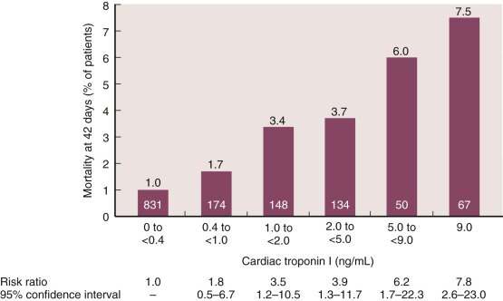
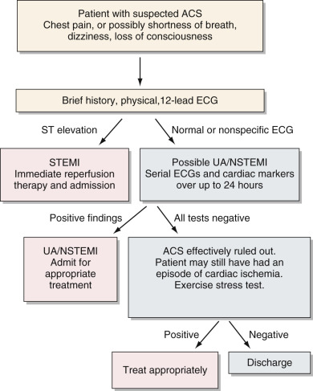
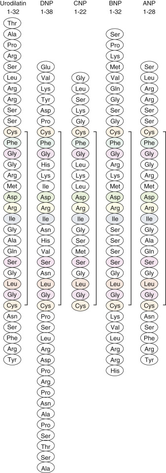
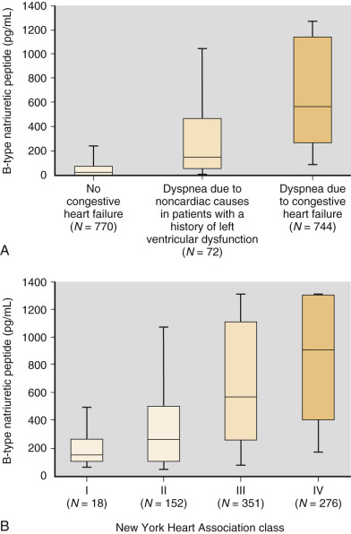

## Key Points

  * •

The most important disease affecting the heart is coronary heart disease (CHD), which is atherosclerosis affecting the coronary arteries. CHD can lead to thrombotic occlusion of coronary blood flow, causing an acute coronary syndrome (ACS). ACS with frank necrosis of any amount of myocardium is known as myocardial infarction (MI). 

  * •

The primary tests for diagnosing ACS are electrocardiography and laboratory measurement of cardiac markers. Cardiac markers are proteins released into the circulation from damaged heart muscle. The most important cardiac marker today is cardiac troponin (cTn), which derives only from heart muscle. 

  * •

Troponin is a complex of three proteins, two of which are suitable as specific cardiac marker tests: cTnI and cTnT. These two proteins have different properties, but their clinical applications are similar. Clinically, MI is now essentially defined as an ACS that causes release of troponin. 

  * •

There is a delay of a few hours following MI before cTn is detected in the circulation; it peaks in about 24 hours and then declines over several days. 

  * •

Patients presenting to an emergency department with symptoms suggesting ACS must be processed rapidly and precisely to provide life-saving interventions as needed, yet avoid wasting resources. Rapid measurements of cTn, and possibly other laboratory markers, play a critical role. 

  * •

The clinical laboratory also measures risk factors associated with the development and progression of CHD. Significant laboratory markers of risk include lipids (cholesterol, triglycerides, and specific lipoprotein fractions—see [ Chapter 17 ](<##!/content/3-s2.0-B9780323295680000176?scrollTo=%23c00017>) ), homocysteine (Hcy), and C-reactive protein (CRP). Hcy is an amino acid that exacerbates thrombosis. CRP is an inflammatory marker that appears to reflect the severity of CHD and may contribute to its pathogenesis. 

  * •

CHD and other heart diseases can impair the heart's ability to pump blood, causing the clinical syndrome of heart failure (HF). B-type natriuretic peptide (BNP), a 32 amino acid peptide secreted by the cardiac ventricles in response to wall-stretch stimuli, is a marker of the presence and severity of HF. BNP testing is particularly useful for aiding the differential diagnosis of patients who present to an emergency department with shortness of breath. 

  * •

Atherosclerosis affecting the carotid arteries or brain vasculature can lead to ischemic or hemorrhagic stroke. Some biomarkers show promise for the diagnosis or evaluation of stroke, but none are sufficiently discriminatory for routine use at present. 

  * •

Measurement of D-dimer, a degradation product of fibrin, has good sensitivity but poor specificity for the diagnosis of pulmonary embolism and venous thrombotic disease in general. 

,  

##  Overview 

Heart disease is an affliction intimately tied to high technology. Technology has had a causal role, in part by allowing people to live longer and in part by enabling a sedentary and overly consumptive lifestyle. During the twentieth century, heart disease rose from obscurity to become the leading cause of morbidity and mortality in developed nations ( [ Box 18-1 ](<#b0010>) ). Diagnosis and treatment of heart disease also depend heavily on advanced technology, including electrophysiologic, imaging, catheterization, surgical, and clinical laboratory modalities. The following major laboratory applications are the subject of this chapter: 

  * 1.

Measurement of proteins present in cardiac myocytes indicates recent damage to cardiac muscle. These tests are used mainly for the diagnosis and management of ischemic events (acute coronary syndromes). Although many different markers of ischemic damage have been used in the past, at the time of this writing the most important markers by far are _cardiac troponin I_ and _cardiac troponin T._

  * 2.

Measurement of substances that are damaging to the coronary arteries, or at least have proven association with coronary heart disease, is used to assess risk and select appropriate preventive measures. The most important laboratory risk factors are lipids, which are discussed in [ Chapter 17 ](<##!/content/3-s2.0-B9780323295680000176?scrollTo=%23c00017>) . Of the many other substances that could be discussed, this chapter focuses on two: homocysteine (Hcy) and C-reactive protein (CRP). 

  * 3.

Measurement of natriuretic peptides released from myocardium, particularly _B-type natriuretic peptide_ (BNP) and the related inactive fragment, _NT-pro-BNP,_ reflects the presence and severity of heart failure. 

  * 4.

Laboratory testing has been less applicable to cerebrovascular disease, but some new biomarkers may be considered promising. Measurement of D-dimer is useful in ruling out pulmonary embolus. 

BOX 18-1 

Heart Disease Statistics for the United States 

  * •

An estimated 83.6 million American adults (over 1 in 3) have some form of cardiovascular disease (including hypertension). 

  * •

15.4 million Americans have a history of CHD; of these, 7.6 million have had an MI, and 7.8 million have had angina pectoris. 

  * •

5.1 million Americans have HF. 

  * •

6.8 million Americans have experienced a stroke. 

  * •

The estimated annual direct and indirect cost of cardiovascular disease in 2010 was $315.4 billion. 

  * •

Although some trends in cardiovascular disease are favorable, other factors, including an alarming increase in the prevalence of obesity and type 2 diabetes, will fuel the epidemic for many years to come. 

_CHD,_ Coronary heart disease; _HF,_ heart failure; _MI,_ myocardial infarction. 

From Go AS, Mozaffarian D, Roger VL, et al: Heart disease and stroke statistics—2014 update: A report from the American Heart Association, _Circulation_ 129:e28–e292, 2014. 

,  

##  Background 

It is ironic that for the heart, an organ that pumps several liters of blood each minute, the most important disease process is ischemia—the lack of an adequate blood supply ( [ Table 18-1 ](<#t0010>) ). This is so because heart muscle depends on constant nutrition through a system of coronary arteries, which are highly vulnerable to the process of atherosclerosis. Atherosclerosis is a chronic process involving damage to endothelium and the buildup of vessel-occluding lesions called plaque. In the early stages of atherosclerosis, as coronary blood flow is gradually reduced, there are typically no symptoms or laboratory evidence of cardiac injury. Once the diameter of a coronary artery is reduced to less than 10% to 20% of its original size, chest pain (angina pectoris) often develops when demand for oxygen increases, particularly during exercise (exertional angina). More rapid reduction in blood flow can occur when plaque stimulates formation of a thrombus in a coronary artery, leading to an acute coronary syndrome (ACS). When a thrombus completely cuts off blood flow, the supplied muscle will develop irreversible ischemic damage, and the syndrome is a myocardial infarction (MI). When the blockage is not complete, irreversible muscle damage may be avoided, but the patient will experience severe angina, even at rest, and this syndrome is known as unstable angina (UA). The broad spectrum of heart disease resulting from impaired coronary blood flow is referred to as coronary heart disease (CHD). 

TABLE 18-1 

Clinical Abbreviations 

ACS  |  Acute coronary syndrome   
---|---  
CHD  |  Coronary heart disease (also referred to as ischemic heart disease [IHD], atherosclerotic heart disease [ASHD])   
HF  |  (Congestive) heart failure   
MI  |  (Acute) myocardial infarction   
NSTEMI  |  Non–ST-elevation myocardial infarction   
STEMI  |  ST-elevation myocardial infarction   
UA  |  Unstable angina   
  
MIs can be categorized by whether they are accompanied by characteristic changes on the electrocardiogram (ECG). More severe MIs, generally involving transmural damage to the myocardium, typically cause the rapid appearance of ST-segment elevations and the later appearance of Q-waves. These are categorized as ST-elevation MIs (STEMIs). MIs without these changes (non–Q-wave MIs, or non-ST elevation MIs [NSTEMIs]) typically involve lesser degrees of muscle damage, possibly only to the subendocardium, but any ACS event carries serious risk for possibly lethal arrhythmias and for future events. Damage to a sizable quantity of cardiac muscle carries the additional risk of compromising the heart's ability to pump blood, leading to the clinical syndrome of heart failure (HF), which is discussed later. 

Cardiac muscle is relatively resistant to ischemia, compared with other cells such as neurons and renal tubular epithelial cells, in which even short duration of ischemia can lead to cell death. In experimental animals, complete blockage of blood flow to an area of the heart does not cause cell death (MI) until after at least 20 to 30 minutes of ischemia; if blood flow had been previously restricted, cell death often is delayed for up to an hour. With complete coronary artery occlusion, there is typically a gradient of ischemia, with oxygen deprivation worst in areas receiving blood flow last (the subendocardial portions of the ventricular wall). Cells near the border between ischemic myocardium and normally perfused myocardium may receive some oxygen supply and thus may remain viable for several hours. The longer the duration of ischemia, the higher the percentage of cells at risk that will die; 3 hours of ischemia increases cell death to 80% of cells at risk, and 6 hours of ischemia causes the death of almost 100% of cells at risk. For this reason, early recognition of persistent ischemia and intervention to restore blood flow are needed to minimize cell death. Blood flow is most commonly restored by manipulating the plaque (usually by inflating a balloon) via a catheter inserted into a peripheral vein and then threaded into the coronary circulation (percutaneous coronary intervention). A mesh tube, or stent, may be inserted at the same time to maintain the patency of the coronary artery. When flow is blocked at multiple sites, it may be necessary to perform a coronary artery bypass graft. 

The pathobiology of atherosclerosis and ACS remains incompletely understood. Formation of obstructive plaques probably begins with nonobstructive lesions known as fatty streaks, which have been observed in the coronary arteries of young individuals dying in combat or in accidents (  Enos et al, 1953  ;  Berenson et al, 1992  ;  Strong et al, 1999  ). The lesions are likely triggered by uptake of oxidized low-density lipoprotein (LDL) particles by macrophages, which then invade the coronary endothelium (  Ross, 1993  ;  Witztum, 1994  ;  Adams et al, 2000  ;  Zaman et al, 2000  ). Inflammatory cells and mediators play a role in the evolution of the lesion, which eventually becomes a structure containing a lipid core (mainly cholesterol esters) surrounded by numerous macrophages and other inflammatory cells, and covered with a cap of endothelialized connective tissue (  Davies, 2000  ;  Weissberg, 2000  ;  Hansson, 2005  ). Advanced lesions also contain new blood vessels and calcium deposits. Plaques in coronary arteries were formerly regarded as passive, physiologically irreversible barriers to blood flow. In recent years, their more dynamic role in ACS has been appreciated. A balance of inflammatory mediators, shear forces, and other factors can cause the fibrous cap of the plaque to strengthen or weaken. Erosion of the cap can expose thrombogenic material, leading to deposition of platelets and eventually enlargement of the lesion. More ominous is actual rupture of the plaque, causing thrombosis with sufficient occlusion to result in ACS. A major contributor to this concept of plaque vulnerability has been the finding that cholesterol-lowering statin drugs can diminish the risk of ACS substantially without causing appreciable diminution of the degree of stenosis caused by atherosclerotic lesions (see [ Chapter 17 ](<##!/content/3-s2.0-B9780323295680000176?scrollTo=%23c00017>) ). Modalities for examining plaque are improving, but unfortunately, no routine test is available at present to assess plaque vulnerability. 

The severity of coronary atherosclerotic disease has traditionally been evaluated by coronary angiography, which uses a radiopaque “dye” to image blood flow through the coronary arteries. Besides being invasive, this test has the limitation that it can only identify restrictions to coronary blood flow; it says nothing about the biology of the plaque lesions, nor does it indicate whether symptoms experienced by the patient are caused by those lesions. Electron beam computed tomography can noninvasively image the accumulation of calcium in atherosclerotic lesions, but the ability to predict the future behavior of lesions is still limited (  Fuseini et al, 2003  ). Blood tests that reflect the actual extent of atherosclerotic disease may be available in the future—for example, measurement of microparticles shed by plaque has been proposed (  Heloire et al, 2003  ). At present, however, risk of CHD in individuals is mainly assessed indirectly through the measurement of risk factors, each of which appears to play a contributory but not necessarily definitive role (  Stampfer et al, 2004  ;  Akhabue et al, 2014  ). Several clinical parameters, summarized in [ Box 18-2 ](<#b0015>) , have been established as important risk factors. Additionally, hundreds of laboratory tests have been studied in relation to CHD risk. Of these, several lipid tests, as discussed in [ Chapter 17 ](<##!/content/3-s2.0-B9780323295680000176?scrollTo=%23c00017>) , have the best established role in risk assessment. Two newer markers, homocysteine and C-reactive protein, are discussed later. 

Box 18-2 

Clinical (Nonlaboratory) Risk Factors for CHD 

  * •

Age 

  * •

Gender (males at higher risk) 

  * •

Race (blacks at higher risk) 

  * •

Cigarette smoking 

  * •

Hypertension 

  * •

Family history of premature CHD 

  * •

Obesity 

  * •

Diabetes mellitus 

  * •

Sedentary lifestyle 

Earlier guidelines from the National Cholesterol Education Program applied arbitrary criteria to establish a “count” of risk factors, which were then used to recommend goals for blood cholesterol (for example, being a male age 45 or greater counted as one risk factor, having a systolic blood pressure greater than 140 mmHg counted as one risk factor, etc.) (National Cholesterol Education Panel, 2002). The most recent guideline from the American College of Cardiology/American Heart Association recommends a numerical risk calculation that includes the following parameters: age, gender, race (black or nonblack), systolic blood pressure, current smoking (yes or no), hypertensive treatment (yes or no), and diabetes mellitus (yes or no), along with total and HDL cholesterol, as a basis for deciding on lipid-lowering therapy (  Goff et al, 2013  ). (See [ Chapter 17 ](<##!/content/3-s2.0-B9780323295680000176?scrollTo=%23c00017>) .) 

_CHD,_ Coronary heart disease; _HDL,_ high-density lipoprotein; _LDL,_ low-density lipoprotein. 

Next to CHD, and often as a direct consequence of it, the most important heart disease is HF. HF is a clinical syndrome with prominent symptoms, including fatigue, shortness of breath, and pulmonary edema, resulting from impairment in the heart's pumping ability. It is most commonly caused by damage to the myocardium, as results from CHD. Because of the high incidence of CHD and the improving survival of people who suffer from it, HF is a rapidly increasing problem, especially in the elderly. HF can also be caused by mechanical problems, such as valvular disease, which interfere with the pump function of the heart. When the problem is related to filling of the left ventricle during diastole, it is often referred to as diastolic HF. 

Diagnosing HF and monitoring its progression can be difficult. A defining parameter for systolic HF is the left ventricular ejection fraction (LVEF), which is the fraction of the left ventricle's blood volume that is ejected during systole. It can be measured by echocardiography or by radionuclide ventriculography. Symptomatic HF is usually associated with LVEF less than 40%, but correlation between LVEF and subjective symptoms is poor. Until recently, no clinical laboratory test had specific utility in disclosing the presence or severity of HF. This situation has changed with the introduction of testing for cardiac natriuretic peptides, which is discussed later. 

Of the myriad other diseases that can affect the heart, brief mention should be made of genetic diseases that, although relatively uncommon, have disproportionate importance because of their potentially life-threatening consequences. The syndrome of hypertrophic cardiomyopathy, described more than a century ago, occurs in 1 in 500 individuals and is the most common cause of sudden death in the young (  Taylor et al, 2004  ). More than 1400 mutations have been tied to this disorder (  Maron & Maron, 2013  ); they affect various proteins of the contractile apparatus, including the troponins, actin, and myosin, and generally are inherited in autosomal dominant fashion. The long-QT syndrome, an abnormality in ventricular repolarization that can cause sudden death, has several distinct variants caused by both autosomal dominant and recessive mutations in ion channels and other proteins. Genetic testing can help guide management of these disorders (  Priori et al, 2013  ;  Zhang et al, 2014  ). 

,  

##  Markers of Myocardial Damage 

 

##  Historical Development 

Biochemical markers of myocardial damage were essentially a serendipitous discovery in the early 1950s, when LaDue and coworkers were investigating the transaminase enzymes then known as glutamate-oxaloacetate transaminase (now aspartate transaminase) and glutamate-pyruvate transaminase (now alanine transaminase) (  LaDue et al, 1954  ). A rapid spectrophotometric measurement of these enzyme activities, based on the absorbance of NADH, was developed (  Karmen, 1955  ). While surveying various hospital patients, investigators noted that serum transaminase levels rose sharply after an MI, and thus was born the era of “cardiac enzymes.” The simple underlying principle, as with other organ markers, is that cell death will cause release of cellular proteins into the circulation. (A more difficult question, still not fully resolved, is the extent to which _reversible_ cell damage can cause protein leakage.) In these early years, measurement of enzyme activity was essentially the only practical means to quantify trace proteins in plasma. 

Transaminases have not endured as cardiac markers because of their abundance in liver, skeletal muscle, and other tissues. They were soon superseded for cardiac diagnosis by two other enzymes: lactate dehydrogenase (LD) and creatine kinase (CK) (  Hess & MacDonald, 1963  ;  Roe, 1977  ). LD is a zinc-containing enzyme that is part of the glycolytic pathway and is found in virtually all cells in the body, whereas CK transfers high-energy phosphate mainly in muscle cells but is also found in brain and other tissues. With both of these enzymes, improved cardiac specificity was achieved through separation of isoenzymes. LD is a tetramer of two active subunits, H (for heart) and M (for muscle), with a molecular weight of 134 kDa. Combinations of subunits produce five isoenzymes ranging from LD  1  (HHHH) to LD  5  (MMMM); the intermediate isoenzymes contain differing combinations of H and M subunits (LD  2  , HHHM; LD  3  , HHMM; LD  4  , HMMM). As the subunit names imply, LD  1  is relatively abundant in cardiac muscle, whereas LD  5  is more abundant in skeletal muscle. Patients with MI exhibit a characteristic pattern of “flipped” LD, where the normal finding of LD  2  being greater than LD  1  is reversed. 

CK is predominantly found as a dimer of catalytic subunits, each with a molecular weight of about 40 kDa; the two subunits are termed M (for muscle) and B (for brain). The three resulting isoenzymes are CK  1  (BB), CK  2  (MB), and CK  3  (MM). CK is found in small amounts throughout the body, but it is found in high concentrations only in muscle and brain, although CK from brain virtually never crosses the blood-brain barrier to reach plasma. In skeletal muscle, creatine kinase-MB fraction (CK-MB) accounts for 0% to 1% of the total CK in type 1 fibers and 2% to 6% of CK in type 2 fibers. During regeneration of skeletal muscle, increased amounts of CK-MB are produced relative to CK-MM, similar to the pattern seen in fetal muscle (  Tzvetanova, 1971  ). In the normal heart, an average of 15% to 20% of the CK is CK-MB; its distribution is not uniform, with CK-MB percentage greater in the right heart than in the left heart (  Marmor et al, 1980  ). A single study, however, suggests that CK-MB is not found in normal myocardium but appears only when the muscle becomes diseased (  Ingwall et al, 1985  ). CK-BB is the dominant isoenzyme of CK found in brain, intestine, and smooth muscle. The drawback of isoenzyme analysis was that it required a relatively lengthy and tedious chromatographic or electrophoretic separation of the individual isoenzymes. 

The next major advance in cardiac markers was the development of sensitive immunometric assays for proteins using monoclonal antibody technology (see [ Chapter 44 ](<##!/content/3-s2.0-B9780323295680000449?scrollTo=%23c00044>) ). With this technology, it was possible to develop a CK-MB “mass assay” that did not depend on the protein's enzymatic activity (el  Allaf et al, 1986  ;  Mair et al, 1991  ). More important, it provided the opportunity to develop organ markers that were not traditional enzymes. A systematic search for proteins that were specific to myocardium led to the current era of troponin testing. 

 

##  Cardiac Troponin 

Troponin (Tn) is a regulatory complex of three proteins that resides at regular intervals in the thin filament of striated muscle. The three individual proteins are tropomyosin-binding subunit (TnT, 37 kDa), inhibitory subunit (TnI, 24 kDa), and calcium-binding subunit (TnC, 18 kDa). The Ca  ++  trigger for muscle contraction is transmitted via the Tn complex, which causes a conformational change in another thin-filament component, tropomyosin, allowing interaction between actin and myosin to proceed. In contrast to nearly all other muscle proteins, the forms of Tn found in skeletal and cardiac muscle differ. For TnC, the forms found in type 2 fibers and cardiac muscle are identical, obviating its use as a differential marker. TnI has a cardiospecific form (cTnI), as well as distinct forms in types 1 and 2 skeletal muscle fibers, each coded by a separate gene. The presence of the cardiospecific form in tissue other than cardiac muscle has never been documented (  Bodor, 1995  ). TnT also has distinct forms in myocardium (cTnT) and in fast-twitch and slow-twitch skeletal muscle, but here the situation is more complicated, because cTnT has been detected in fetal skeletal muscle and diseased skeletal muscle. However, posttranslational modifications cause detectable differences between cTnT produced in myocardium and cTnT produced in diseased skeletal muscle (  Apple et al, 1998  ;  Apple, 1999  ). Hence an immunochemical test for cTnT with carefully chosen antibodies, such as the current generation (but not earlier generations) of commercial cTnT assays, should have myocardial specificity approaching 100%. Nevertheless, small increases in circulating cTnT, even with newer assays, have been reported in patients with muscular dystrophy and renal failure who have no other evidence of cardiac disease (  Muller-Bardorff et al, 1997  ;  Hammerer-Lercher et al, 2001a  ). 

Within the cardiac myocytes, cTnT and cTnI are bound predominantly to muscle fibers, as described earlier, and this bound form is released slowly over the course of 1 to 2 weeks following myocardial infarction. Thus, although cTnI and cTnT are relatively small proteins that are rapidly cleared, their plasma levels fall slowly after cardiac injury. A small fraction of cTn in the myocardial cell is free within the cytoplasm; this averages 6% for cTnT and slightly lower (2% to 5%) for cTnI. The free fraction allows early leakage from injured myocardial cells and detection in a time frame similar to that of CK-MB, with cTn reaching a peak at about 24 hours after MI. Because of the slow release of fiber-bound cTn, the rapid decline in circulating cTn right after its peak is typically followed by a plateau or even a small secondary increase. It is important that such an increase _not_ be interpreted as evidence of reinfarction. Circulating cTn declines to baseline levels in about 5 to 10 days, depending on infarct size (  Mair, 1997  ). 

In contrast to other cardiac markers, cTnT and cTnI are nearly absent from normal serum. With the most sensitive assays in wide use at present, which have detection limits of a few nanograms per liter, many healthy individuals have undetectable levels, so the normal range is not well defined. The 99th percentile of the healthy population is around 40 ng/L, depending on the assay. Levels above this threshold are almost certainly indicative of myocyte damage but possibly reveal a much lesser amount of damage than was detectable with earlier cardiac markers such as CK-MB. With the advent of cTn testing, it has become clear that myocyte damage can occur in many circumstances other than coronary artery obstruction: cTn elevations are observed in pericarditis, myocarditis, pulmonary embolism, renal failure, sepsis, and other critical illness (  Roongsritong et al, 2004  ). Prolonged intense exercise, such as running a marathon, can cause small elevations (  Mingels et al, 2009  ). Healthy newborns were found to have levels as high as 3000 ng/L (  Araújo et al, 2004  ). Small measured elevations in cTn may also be analytic artifacts (see Assay Procedures later). 

 

##  Other Markers 

Other protein biomarkers that have been proposed for cardiac diagnosis include myoglobin, carbonic anhydrase III, glycogen phosphorylase, heart fatty acid binding protein, myosin, ischemia-modified albumin, creatine kinase isoforms (which are CK isoenzymes that have been modified by the action of a peptidase in plasma), and copeptin (which is derived from the precursor of the hormone vasopressin and is released early in the course of an MI). At present, and especially with the advent of high-sensitivity troponin assays, these have much less practical application than troponin and so are not discussed further in this chapter (  Mair, 1997  ;  Collinson & Gaze, 2007  ;  Lackner, 2013  ). 

 

##  Assay Procedures 

At the present time, cTn and other organ-specific protein markers are almost universally measured by sensitive immunometric assays, typically employing monoclonal antibodies. These can be automated for high-volume with around-the-clock availability or alternatively adapted to point-of-care testing. 

Despite the impressively high sensitivity and specificity of modern immunometric assays, they have intrinsic limitations that must be well recognized in the case of cTn. All proteins, because of posttranslational modifications, are heterogeneous analytes, but cTn, which originates in a protein complex that degrades as it is released into the circulation, is especially so. Circulating forms that have been identified include a ternary cTnT-I-C complex, binary cTnI-C, free cTnT (but not free cTnI), oxidized forms (cTnI but not cTnT contains cysteine residues that can be oxidized to form an intramolecular disulfide bond), phosphorylated forms, and degraded forms (  Gao et al, 1997  ;  Katrukha et al, 1998  ;  Morjana, 1998  ;  Wu et al, 1998b  ;  Shi et al, 1999  ;  Bunk et al, 2000  ;  Labugger et al, 2000  ). Evidently, certain epitopes are blocked or modified in some of these forms, because differences greater than twentyfold have been observed in their reactivity with different commercial assays for cTnI (  Wu & Feng, 1998a  ;  Datta et al, 1999  ;  Newman et al, 1999  ;  Shi et al, 1999  ;  Tate et al, 1999  ;  Kao et al, 2001  ). The problem does not arise in the same way for cTnT because assays are at this time marketed by only one manufacturer. A certified reference material for cTnI has been prepared (  Bunk & Welch, 2006  ), but it has demonstrated commutability only with plasma cTn specimens for half of the commercial assays (  Christenson et al, 2006  ). cTnI results will always demonstrate some inconsistency among methods, unless manufacturers adopt the use of very similar antibodies. 

Another problem is that because the normal level of plasma cTn is very low, even a minuscule degree of assay interference can elevate a result to the abnormal range, suggesting a strong possibility of ischemic disease to the caregiver. This may lead to unnecessary invasive procedures such as coronary angiography. Various cTnI assays have in fact been found susceptible to interferences from heterophilic antibodies, fibrin, and other substances (  Roberts et al, 1997  ;  Fitzmaurice et al, 1998  ;  Dasgupta et al, 1999  ;  Nosanchuk et al, 1999  ;  Parry et al, 1999  ;  Galambos et al, 2000  ;  Lippi et al, 2013  ). Negative interference due to autoantibodies has also been reported (  Eriksson et al, 2005  ). 

Reference ranges and decision points have been a matter of some discussion (  Jaffe & Katus, 2004  ), but in keeping with recent guidelines, there has been a general trend toward the use of the 99th percentile of the healthy population as the cutpoint for elevated cTn. It is desirable that the precision of the assay be within a 10% coefficient of variation at this cutpoint, and this is achievable with the newest assays. As the low-end accuracy of cTn assays improves, it is becoming increasingly apparent that the 99th percentile can vary, depending on the reference population chosen, and that levels below the 99th percentile may have clinical significance (  Latini et al, 2007  ;  Eggers et al, 2009  ). It is also important to emphasize that cTn above the 99th percentile or other arbitrary cutpoint does not point to any specific etiology of damage to cardiac myocytes. The new definitions of MI emphasize that a change over time in cTn levels is an important criterion for that diagnosis; however, a uniform criterion for a change over time has not been established. 

 

##  Clinical Protocols 

 

##  Diagnosis of ACS 

Approximately 8 million ED visits in the United States each year are related to chest pain or other symptoms, including shortness of breath, dizziness, or loss of consciousness, which may suggest ACS (  Storrow & Gibler, 2000  ; [ Fig. 18-1 ](<#f0010>) ). Although diagnosis is often straightforward, the challenge is to achieve a very high level of accuracy. Missed diagnosis of ACS, which may occur in about 2% of cases, carries an increased risk of mortality and is the leading cause of malpractice payouts for emergency physicians (  Karcz et al, 1996  ;  Pope et al, 2000  ). On the other hand, the conservative practice of hospital admission for most patients with suspected ACS costs billions of dollars unnecessarily, because two-thirds of these patients turn out not to have ACS. 

Figure 18-1 

Mortality rates of acute coronary syndrome patients as a function of cardiospecific troponin (cTnI) level. 

The 1441 patients in the TIMI IIIB study were from 21 to 76 years of age, had episodes of pain at rest that were presumed to be ischemic in origin and had lasted for at least 5 minutes (but less than 6 hours) within the preceding 24 hours, and had documented evidence of coronary heart disease. Patients were excluded from the study if a left bundle-branch block was noted on presentation, a documented myocardial infarction had occurred within the previous 21 days, a treatable cause of angina was present, thrombolytic therapy had been administered within the previous 72 hours, or angioplasty had been performed in the previous 6 months. Mortality rates at 42 days are shown for ranges of cTnI measured at enrollment. The numbers at the bottom of each bar are the numbers of patients with cTnI in each range, and the numbers above the bars are percentages. _p_ < 0.001 for the increase in mortality rate (and the risk ratio for mortality) with increasing levels of cTnI at enrollment. 

(From Antman EM, Tanasijevic MJ, Thompson B, et al: Cardiac-specific troponin I levels to predict the risk of mortality in patients with acute coronary syndromes, _N Engl J Med_ 335:1342–1349, 1996, with permission.) 

Biochemical markers play a secondary role in the initial management of patients with suspected ACS. The earliest decision making, which ideally should take place within 10 minutes of the patient's arrival in the ED, is based on history, physical examination, and 12-lead ECG (  Anderson et al, 2007  ; [ Fig. 18-2 ](<#f0015>) ). The ECG may establish the diagnosis of STEMI, at which point the patient is a candidate for immediate intervention to restore coronary blood flow (  Antman et al, 2008  ). Biochemical marker results are not necessary before these interventions are provided, and in fact are likely to be negative at this early time. 

Figure 18-2 

Outline of a clinical algorithm for treating patients presenting to an emergency department with symptoms suggesting acute coronary syndrome (ACS). 

The protocol is general and has to be customized to particular institutions and used with proper clinical judgment. _ECG,_ Electrocardiogram; _NSTEMI,_ non-ST elevation MI; _STEMI,_ ST elevation MI; _UA,_ unstable angina. 

(Adapted from Pearson TA, Mensah GA, Alexander RW, et al: Markers of inflammation and cardiovascular disease: Application to clinical and public health practice. A statement for healthcare professionals from the Centers for Disease Control and Prevention and the American Heart Association, _Circulation_ 107:499–511, 2003.) 

If the initial ECG is negative for STEMI, biochemical markers assume increasing importance. Choice of markers and time points for testing has varied among institutions, but it is now generally agreed that cTn is the preferred marker, with little to choose between I and T (  Anderson et al, 2007  ;  Morrow et al, 2007  ). cTn does not rise until some hours after the onset of myocyte necrosis, so a specimen obtained at the time of presentation is likely to be negative, necessitating repeat testing at a later time. As the sensitivity of troponin tests has improved, elevations can be seen at an earlier time, and there is no universal standard for repeat sampling. Whereas traditionally testing three specimens, at approximately 0-4-8 or 0-3-6 hours after presentation, was standard for “rule-out MI,” more rapid protocols—for example, testing at only 0 and 2 hours—have recently been proposed (  Than et al, 2012  ). When a modest elevation of troponin is observed, the repeat testing is important to establish that the levels are changing, which is a criterion in the universal definition of MI. Again, however, there is no universal definition of what constitutes a change. Repeatedly negative, or unchanging, cTn results could rule out NSTEMI, but ECG changes (ST depression or T-wave inversions) or other evidence of ischemia may establish the diagnosis of UA. These two diagnoses are managed similarly, possibly with invasive artery-opening therapy (  Anderson et al, 2007  ). 

If, after several hours, the patient's presenting symptoms have resolved, and ECG and biochemical findings have been consistently negative, then an ACS has been effectively ruled out. For increased safety, before such a patient is discharged, a provocative test for CHD is commonly performed, such as a simple exercise ECG test or a more elaborate nuclear imaging or echocardiography stress test (  Farkouh et al, 1998  ;  Lindsay et al, 1998  ;  Storrow & Gibler, 2000  ). These tests must be rapidly and continuously available if the ED is to achieve the desired rapid discharge of low-risk patients. They have the drawbacks of expense and significant numbers of false-positive and false-negative results, depending on the test modality chosen. 

Because both clinical care and patient flow through the ED require rapid risk assessment, cardiac marker test results must be available quickly. It is commonly advocated that point-of-care testing be considered when the central laboratory cannot reliably provide results within about 1 hour. Both qualitative and quantitative tests for cardiac markers that are suitable for point-of-care testing are now available and have demonstrated effectiveness (  Antman et al, 1997  ;  Brogan & Bock, 1998  ;  Bock et al, 2008  ). 

 

##  Other Applications 

Besides ruling in or ruling out the diagnosis of MI, cTn testing can be useful in determining prognosis and adjusting treatment. Higher cTn levels indicate a larger volume of infarcted muscle and a worse prognosis (  Bøhmer et al, 2009  ;  Kurz et al, 2009  ). A single specimen obtained 72 to 96 hours after the event appears to be most useful for assessment of infarct size (  Younger et al, 2007  ;  Giannitsis et al, 2008  ). Although more experience has been acquired in testing for reinfarction using CK-MB, which declines more rapidly after an uncomplicated MI than cTn, it appears that the latter can be equally effective in diagnosing reinfarction (  Apple & Murakami, 2005  ). When reinfarction is clinically suspected, a blood specimen should be drawn immediately and again 3 and 6 hours later. An increase in cTn of over 20%, with an absolute value exceeding the 99th percentile, confirms the diagnosis (  Thygesen et al, 2012  ). 

cTn measurements can usefully suggest adverse outcomes after procedures such as percutaneous coronary intervention (PCI) and cardiac surgery. Because these procedures may be intrinsically associated with some degree of myocyte damage, it is difficult to justify firm guidelines for defining periprocedural MI. Criteria have been advanced, based on a combination of cTn measurements and clinical evidence, that define a periprocedural MI (  Thygesen et al, 2012  ). Cardioversion, whether external or internal, causes minimal to no elevation in cTn (  Allan et al, 1997  ;  Greaves & Crake, 1998  ;  Rao et al, 1998  ;  Gorenek et al, 2004  ). 

Transaminases, LD, and LD isoenzymes are no longer recommended as cardiac markers (  Apple et al, 2007  ). CK-MB testing has persisted to some degree in the troponin era, but because there are few if any situations where it clearly provides additional information, it generally is not regarded as a cost-effective addition to cTn testing (  Saenger & Jaffe, 2008  ). 

,  

##  Markers of Coronary Risk 

CHD is a chronic disease of aging, and obviously, the most desirable approach to management is to prevent or minimize its development. As summarized earlier in the Background section, our understanding of the causation of CHD is still incomplete, so definitive preventive measures are not foreseeable at this time. However, many lines of evidence, the most important being large epidemiology studies, have identified several risk factors associated with CHD. Most of these risk factors pertain not just to the heart but to the general processes of atherosclerosis and/or thrombosis. Hence they have important implications for stroke and peripheral vascular disease as well. 

The major clinical risk factors for CHD (not related to laboratory tests) are summarized in [ Box 18-2 ](<#b0015>) . Of risk factors that can be identified by the clinical laboratory, the earliest identified, and still one of the most important, is serum cholesterol. It is actually the LDL fraction of cholesterol, which generally contains about 70% of the total circulating cholesterol, that is directly associated with risk; the high-density lipoprotein fraction is in fact a negative risk factor. The other major lipid class commonly measured in plasma, triglyceride, has been an issue of controversy but now is generally accepted as a significant risk factor. Lipid testing and its relationship to CHD risk assessment are discussed in [ Chapter 17 ](<##!/content/3-s2.0-B9780323295680000176?scrollTo=%23c00017>) . 

Aside from the lipids, a wide array of plasma constituents have been related to CHD risk. These include various nutrients, hormones, clotting factors, drugs, toxins, oxidants, antioxidants, and markers of inflammation or infection. In this chapter, only two markers that appear to be relatively important are discussed: CRP and Hcy. 

 

##  C-Reactive Protein 

First isolated in 1930 from the plasma of patients with pneumococcal pneumonia, CRP was so named because it binds to the C-polysaccharide of the pneumococcus. It was later found that the protein appeared in plasma during many infectious or inflammatory conditions, and CRP was the original acute phase reactant. CRP has now been characterized as a member of the pentraxin family of proteins. It comprises five protomers, each of 206 amino acids and molecular weight 23 kDa, arranged in cyclic symmetry. With the participation of Ca  ++  ions, it binds various proteins and phospholipids, particularly phosphocholine. It opsonizes particles and activates complement via the classical pathway, but its actual biologic function is unknown (  Szalai et al, 1999  ;  Black et al, 2004  ). 

In plasma from normal individuals, the median CRP concentration is about 1 mg/L, and the 99th percentile is about 10 mg/L. In individuals with acute illness, cytokines, chiefly interleukin-6, stimulate hepatic production of CRP, and plasma levels increase to 300 mg/L or more. Plasma CRP is increased in a variety of disorders, including most bacterial (but usually not viral) infections. MI is among the acute illnesses associated with elevation of plasma CRP (de  Beer et al, 1982  ). 

Epidemiologic studies have established that individuals with higher baseline levels of plasma CRP are at increased risk for CHD and stroke. In the relatively early Physicians Health Study, which enrolled 22,000 male U.S. physicians to examine the cardioprotective effects of aspirin and beta-carotene, plasma CRP averaged 1.51 mg/L in participants who developed MI, 1.38 mg/L in those who developed stroke, and 1.13 mg/L in controls who did not suffer vascular events (  Ridker et al, 1997  ). In the larger and more recent Reykjavik study, the average baseline CRP was 1.75 mg/L in participants who developed MI versus 1.25 in those without vascular events (  Danesh et al, 2004  ). Similar findings, as summarized in a 2004 meta-analysis, have been reported from some 20 other epidemiology studies, although the degree of independent risk associated with CRP has varied (  Danesh et al, 2004  ). A report on the Women's Health Study suggested that CRP was actually more predictive than LDL cholesterol (  Ridker et al, 2002  ), whereas investigators for the Reykjavik study reported that CRP is less predictive than total cholesterol, cigarette smoking, or systolic blood pressure. Differences may relate to the nature of the population studied and the means of correction used for traditional risk factors. 

Elevation of plasma CRP (as indicated earlier) that confers excess coronary risk is minute compared with the hundred- to thousandfold increases that occur with overt inflammatory or infectious diseases. For this reason, testing of CRP related to cardiac risk has been given the somewhat misleading name of high-sensitivity CRP (hs-CRP). Actually, even at concentrations around 1 mg/L or less, CRP is a relatively abundant plasma protein, which does not require the most sensitive (or expensive) techniques for accurate measurement. Methods such as nephelometry, which had been established for measuring CRP as an inflammatory marker, have been readily adapted to hs-CRP assays; the main differences involve degree of dilution and calibration. Commercial hs-CRP assays have adequate precision, and the long-term stability of hs-CRP in individual patients appears to be comparable with that of other risk factors, such as blood pressure and cholesterol (  Danesh et al, 2004  ). 

Although diverse evidence points to a role of inflammation in CHD, a precise mechanism for the relationship of plasma CRP to CHD risk is lacking at this point (  Paoletti et al, 2004  ;  Hansson, 2005  ;  Yousuf et al, 2013  ;  Strang & Schunkert, 2014  ). A key question still unresolved is whether the elevation in CRP is a cause or a consequence of the disease (or possibly both) (  Hingorani et al, 2009  ). The inflammatory response associated with atheromatous lesions may trigger enough cytokine production to be associated with a measurable rise in plasma CRP. CRP may, in turn, through its proinflammatory effects, increase plaque vulnerability or have other effects that worsen the severity of CHD. The presence of CRP in human atheromatous lesions has been demonstrated (  Reynolds & Vance, 1987  ), and in rats it has been shown that injection of human CRP after ligation of the coronary artery enhances infarct size (  Griselli et al, 1999  ). Another intriguing possibility is that the risk associated with CRP relates to cytokine production by adipocytes and that CRP is essentially a biochemical marker of the recently recognized metabolic syndrome (  Yudkin et al, 1999  ;  Ridker et al, 2004  ). 

Given the variations in quantitative risk estimates, the unclear role of CRP in the pathogenesis of vascular disease, and the lack of specific treatment for high CRP, the usefulness of the hs-CRP test in individual patients has been controversial. A joint committee of the Centers for Disease Control and Prevention and the American Heart Association issued recommendations in 2003, some of which are listed in [ Box 18-3 ](<#b0020>) . Following a recent trial in which benefits of statin therapy were demonstrated in individuals with relatively low LDL cholesterol but high hs-CRP, it has been suggested that asymptomatic men older than 50 years and asymptomatic women older than 60 years be screened by hs-CRP when LDL cholesterol is not elevated and a decision to treat with statins is not otherwise clear (  Ridker et al, 2008  ;  Mora et al, 2009  ). 

Box 18-3 

Recommendations of a Joint Committee of the American Heart Association and the Centers for Disease Control and Prevention on CRP Testing to Assess CHD Risk 

  * •

If inflammatory markers are to be used in assessment of CHD risk, hs-CRP is the current analyte of choice. 

  * •

Optimally, hs-CRP results should be averaged from two specimens drawn about 2 weeks apart. If a level greater than 10 mg/L is identified, there should be a search for an obvious cause of infection or inflammation; this result should then be discarded and another test done 2 weeks later. 

  * •

Decision intervals are as follows: less than 1 mg/L, low risk; 1 to 3 mg/L, intermediate risk; greater than 3 mg/L, high risk (approximately corresponding to tertiles in the adult population). 

  * •

Patients most likely to benefit from an hs-CRP test would be those in whom the risk estimate from established factors is moderate (i.e., approximately 10% to 20% risk of CHD in the next 10 years), and the physician desires additional information to guide preventive therapy. 

  * •

The role of hs-CRP in secondary prevention (i.e., prevention of disease progression in patients with established CHD) is limited, because it is not likely to alter management (which needs to be aggressive, regardless of additional information provided by CRP or other markers). 

  * •

Universal hs-CRP screening of the adult population is _not_ warranted. 

_CHD,_ Coronary heart disease; _CRP,_ C-reactive protein; _hs-CRP,_ high-sensitivity C-reactive protein. 

From  Pearson et al (2003)  . 

 

##  Homocysteine 

Hcy ( [ Fig. 18-3 ](<#f0020>) ) is a sulfur-containing amino acid that is not incorporated into protein but is a metabolic intermediate; it can be methylated to form methionine, or it can be converted through the transsulfuration pathway to cystathionine and then to cysteine. Hcy can exist in plasma as the species with a free sulfhydryl group, as a disulfide (homocystine), or as a mixed disulfide, linked to a plasma protein via one of its cysteine residues. It is the sum of these, which may be referred to as “total homocysteine,” “homocyst(e)ine,” or simply “homocysteine” that is generally measured. 

Figure 18-3 

Chemical structure of homocysteine and related compounds. 

Excessive levels of circulating Hcy generally reflect a diminished activity of one of the enzymes involved in its metabolism. The classic syndrome of homocystinuria, first described in 1962 (  Carson & Neill, 1962  ;  Gerritsen et al, 1962  ), is due to a homozygous defect in the enzyme cystathionine-β-synthase (CBS). It results in very high circulating levels of the various forms of Hcy and methionine. Clinical manifestations include dislocation of the optical lens, osteoporosis with associated skeletal abnormalities, mental retardation, psychiatric disturbance, and thromboembolic disease, such as CHD (  Yap, 2003  ). 

The basis of the damaging effects of Hcy is uncertain. At a biochemical level, oxidant stress and inhibition of transmethylation reactions are likely possibilities. Cellular effects that have been documented in experimental systems include endothelial injury, alteration of nitric oxide metabolism, platelet activation, and smooth muscle proliferation (  Thambyrajah & Townsend, 2000  ). Some of the toxicity of Hcy may derive from its enzymatic conversion to Hcy thiolactone (see [ Fig. 18-3 ](<#f0020>) ), which can modify LDL and enhance its uptake by macrophages (  McCully, 1993  ;  Vignini et al, 2004  ). 

The development of Hcy as a CHD risk marker in some ways parallels that of cholesterol: The regular occurrence of atherosclerosis in persons with massive elevation, due to an inborn error of metabolism, led to the hypothesis of increased risk in individuals with more moderate elevations. Experimentally induced hyperhomocysteinemia in animals lent support to the hypothesis (  McCully, 1993  ). In humans, mild to moderate elevations in Hcy can have many causes. Genetic causes include a heterozygous defect in CBS, a defect in methionine synthase (rare), or a defect in 5,10-methylenetetrahydrofolate reductase (generally rare, except for a temperature-sensitive form that is relatively common). Nutritional causes include a deficiency of any of the vitamin cofactors involved in metabolism of Hcy: folate, B  12  , or pyridoxine (B  6  ). 

Many of the earlier epidemiology studies seemed to confirm a correlation between moderate Hcy levels and CHD. For example, in the Physicians Health Study, it was initially reported that having a Hcy level in the upper 5% of the population conferred a three- to fourfold higher risk (  Stampfer et al, 1992  ). However, other studies, including a longer-term follow-up in the Physicians Health Study (  Chasan-Taber et al, 1996  ), have shown little or no association between moderate elevations of Hcy and CHD risk. Some recent studies have supported a moderate association between Hcy and risk of CHD and/or peripheral artery disease (  Humphrey et al, 2008  ;  Bertoia et al, 2014  ;  Schaffer et al, 2014  ;  Esteghamati et al, 2014  ). Widespread folate supplementation of food has probably tended to diminish average circulating Hcy in the U.S. population, and sparse data support the cardioprotective effects of Hcy-lowering therapy. For these reasons, no general advice regarding widespread Hcy screening is available (  Kaul et al, 2006  ). However, measurement of Hcy may be warranted in individuals who develop CHD despite being at relatively low risk according to traditional risk factors. 

Hcy has traditionally been measured by chromatographic techniques (  Vester & Rasmussen, 1991  ;  Ubbink et al, 1999  ;  Frick et al, 2003  ;  Arndt et al, 2004  ). A method using enzymatic adenosylation followed by immunoassay has been automated on the Abbott IMx analyzer (  Shipchandler & Moore, 1995  ), and purely enzymatic methods suitable for automation have also been introduced (  Tan et al, 2000  ;  Huijgen et al, 2004  ;  Roberts & Roberts, 2004  ). Attention must be paid to proper sample collection and storage to prevent an artifactual increase in measured Hcy (  Willems et al, 2004  ). 

,  

##  Markers of Congestive Heart Failure 

 

##  Cardiac Natriuretic Peptides 

The heretical concept that the heart could be an endocrine organ was enforced by two reports in 1956: that inflating a balloon inside the left atrium of a dog caused an increase in urine flow (  Henry & Pearce, 1956  ) and that structures resembling secretory granules were visible on electron micrographs of guinea pig atrial cells (  Kisch, 1956  ). In 1981, extracts of rat heart atria (but not ventricles) were found to have a natriuretic effect (  de Bold, 1981  ), and in 1984, a peptide named atrial natriuretic peptide (ANP) was isolated from human heart (  Kangawa & Matsuo, 1984  ) A short time later, a similar peptide named brain natriuretic peptide (BNP) was isolated from porcine brain (  Sudoh et al, 1988  ). It turns out that in humans, BNP is produced mainly in the cardiac ventricle (  Mukoyama et al, 1991  ), so the hormone now is commonly referred to as B-type natriuretic peptide. 

Members of the natriuretic peptide family are illustrated in [ Figure 18-4 ](<#f0025>) . Their notable common feature is a 17 amino acid ring structure, closed by a cystine bridge, with substantial homology among the family members. C-type natriuretic peptide (CNP), described in 1990, is produced not in the heart but rather in endothelial cells (  Sudoh et al, 1990  ). D-type natriuretic peptide (DNP) was isolated in 1992 from the green mamba snake, _Dendroaspis angusticeps_ (  Schweitz et al, 1992  ). DNP immunoreactivity was later reported in human plasma (  Schirger et al, 1999  ), but this peptide has not been definitively demonstrated in humans (  Richards et al, 2002  ). Finally, urodilatin is a form of ANP with four additional amino acids at the N-terminus; it is likely produced in the kidney by alternative splicing of the same gene product (  Schulz-Knappe et al, 1988  ). Both ANP and BNP have been investigated regarding testing for HF; the latter has proved more useful, so further discussion is confined to the BNP system. 

Figure 18-4 

Amino acid sequences of the natriuretic peptides. 

Amino acids preserved through the family are indicated in color. _ANP,_ Atrial natriuretic peptide; _BNP,_ B-type natriuretic peptide; _CNP,_ C-type natriuretic peptide; _DNP,_ D-type natriuretic peptide. 

Circulating BNP derives from a 108 amino acid prohormone, proBNP, which is cleaved within the cardiac myocyte by the endoprotease furin to a 32 amino acid C-terminal fragment, the active BNP, and an inactive N-terminal fragment, N-BNP or NT-proBNP (  Sawada et al, 1997  ). Secretion of both fragments is enhanced by ventricular wall stretch and volume overload, as occur in HF (  Tabbibizar & Maisel, 2002  ). BNP is removed from the circulation by binding to a clearance receptor and also through the action of endopeptidases; its circulating half-life is approximately 22 minutes. The circulating half-life of N-BNP is considerably longer (60 to 120 min), and its mechanism of clearance is not well understood. 

BNP and the other natriuretic peptides exert their effects through two types of G-protein–coupled receptors, resulting in the release of the second messenger cyclic guanosine monophosphate. They downregulate the renin-angiotensin-aldosterone system, decrease sympathetic nerve activity in the heart and kidney, increase renal blood flow, and increase sodium excretion via a direct effect on the renal collecting duct (  Beltowski & Wojcicka, 2002  ;  Spevack & Schwartzbard, 2004  ). 

Plasma levels of BNP are less than 100 pg/mL in most healthy individuals; reference ranges depend on age and gender. The best-established application of BNP measurement is for diagnosing acutely ill patients presenting to emergency service with shortness of breath. Distinguishing HF from lung disease, such as emphysema, in these patients is occasionally difficult, and until now no laboratory test has been specifically applicable. The multinational Breathing Not Properly study enrolled patients who presented to emergency centers with dyspnea and used a point-of-care method for measurement of BNP. At a decision point of 100 pg/mL, the BNP test had the following characteristics for diagnosis of HF: sensitivity 90%, specificity 76%, positive predictive value 79%, and negative predictive value 89% (  Maisel et al, 2002  ). Among patients with a history of ventricular dysfunction, BNP was higher in those whose current symptoms were thought to be caused by HF; it was also higher in patients with more severe failure ( [ Fig. 18-5 ](<#f0030>) ). 

Figure 18-5 

Box plots showing median levels of B-type natriuretic peptide in patients presenting to an emergency department with dyspnea, in the Breathing Not Properly study. 

**A,** Patients in different diagnostic categories. **B,** Patients with heart failure, classified according to the New York Heart Association criteria. A higher class indicates more severe disease, as evidenced by a lesser amount of activity needed to provoke symptoms. Boxes show interquartile ranges, and I bars represent highest and lowest values. 

(From Maisel AS, Krishnaswamy P, Nowak RM, et al: Rapid measurement of B-type natriuretic peptide in the emergency diagnosis of heart failure, _N Engl J Med_ 347:161–167, 2002, with permission.) 

BNP levels decline when effective therapy for HF is instituted, so the test may be used to monitor the course of treatment (  Cheng et al, 2001  ;  Faggiano et al, 2009  ;  Novo et al, 2009  ). Other proposed applications include risk stratification of patients with ACS (de  Lemos et al, 2001  ;  Omland et al, 2002  ;  Jernberg et al, 2004  ;  Wiviott et al, 2004  ); monitoring disease severity in patients with stable CHD (  Weber et al, 2004  ); screening for ventricular dysfunction in selected populations (  Bay et al, 2003  ;  Nielsen et al, 2003  ); and testing for drug cardiotoxicity (  Okumura et al, 2000  ). However, the test is relatively expensive, and HF is a chronic condition, so the appropriateness of repetitive natriuretic peptide testing in established HF patients needs to be carefully considered. Evidence to support patient benefit from routine monitoring of BNP is generally weak (  Yancy et al, 2013  ;  Balion et al, 2014  ). Some medical centers have introduced restrictions to limit the use of BNP for monitoring inpatients (  Lum, 2006  ;  Levick et al, 2013  ). 

A major limitation of BNP is that a wide range of values is observed in patients with and without HF, and all of the determinants of the circulating BNP level have not yet been well established. BNP is increased in conditions of fluid imbalance other than HF, particularly renal insufficiency, which commonly coexists with HF (  McCullough et al, 2004  ). In individuals without HF, higher levels are associated with female gender, advanced age, and lower body mass index (  Chiong et al, 2010  ). Also, patients with symptomatic HF, especially when it is chronic and stable, can have “normal” levels (  Tang et al, 2003  ). Intraindividual variability is relatively high; in a group of patients with stable, chronic HF, week-to-week variability for BNP and N-BNP was 30% to 40% (  Bruins et al, 2004  ). At this time, it appears that the most appropriate use of the BNP test is as an adjunctive test to rule out HF in the acute setting; it must _not_ be used as a sole criterion for establishing the diagnosis of HF (  Jessup et al, 2009  ). In other contexts, it should be used judiciously as more information becomes available. 

Similar to cardiac troponins, both BNP and N-BNP are measured by sensitive immunoassays, on either large automated analyzers or devices suitable for point-of-care application. A clear advantage of one biomarker over the other for any particular application has not been established (  Hammerer-Lercher et al, 2001b  ). 

Besides being a biomarker for HF, BNP has natriuretic, vasodilatory, and other effects that are ameliorative for the syndrome and in fact is available as the drug nesiritide (Natrecor), although this drug has not been recommended for routine use in treatment of HF (  O'Connor et al, 2011  ). Because of the short half-life of BNP, measured levels several hours after its administration would reflect endogenous secretion. However, the utility of BNP measurement in the context of its therapeutic administration has not been established at this time. 

,  

##  Other Conditions Associated with Atherosclerosis or Thrombosis 

A cerebrovascular accident, or stroke, is another dreaded complication of atherosclerotic disease. About 795,000 Americans suffer a stroke each year, versus about 1,200,000 who suffer an ACS (  Go et al, 2014  ). Many strokes are presumably caused by a mechanism similar to the usual ACS, where atherosclerotic plaque eventually becomes unstable and ruptures, resulting in thrombotic occlusion. However, additional mechanisms can cause ischemic stroke, and 20% of strokes result from hemorrhage rather than from vascular occlusion. Considerable effort has been directed at finding biomarkers for stroke that might rival the utility of troponin and other markers for cardiac disease. Candidate markers have included neurotransmitters; proteins produced in neurons or glia such as tau, S100b, and neuron-specific enolase; inflammatory mediators such as CRP, interleukins, and matrix metalloproteinases; and others. At the time of this writing, none has been shown to have sufficient sensitivity and specificity for incorporation into routine practice (  Whiteley et al, 2009  ). Possibly a multiple marker approach will eventually be successful, but at present, the diagnosis and management of stroke rests on clinical findings and imaging studies. 

Thrombosis in peripheral veins can result in dislodging of part of the thrombus—embolization—which, after passing through the right side of the heart, will lodge in the lung, causing the syndrome of a pulmonary embolus (PE). Depending on the size of the PE, consequences can range from minimal to sudden death. PE can cause chest pain, ECG abnormalities, and increased cTn levels, and thus may be confused with an ACS. Measurement of D-dimer, a specific degradation product of fibrin (see [ Chapter 39 ](<##!/content/3-s2.0-B9780323295680000395?scrollTo=%23c00039>) ), has become a useful laboratory test for ruling out PE and venous thrombotic disease in general. Almost any activation of the coagulation cascade, anywhere in the body, leads to production of D-dimer; hence elevated levels are widespread, especially in hospitalized patients, and have little meaning. When pretest probability of thrombotic disease is low, however, low levels of D-dimer have high negative predictive value in excluding the diagnosis of PE (as well as any venous thrombosis). Sensitive immunoassay measurements of D-dimer for this purpose are now available (  Adam et al, 2009  ). 

,,
