## Key Points

  * •

Determining the etiologic cause of fluid accumulation in various body cavities (i.e., joints, chest, abdomen) is critical for proper treatment of these disorders. 

  * •

Appropriate laboratory examination of these fluids is therefore critical for the diagnosis of numerous diseases (i.e., bacterial, viral, and fungal infections; distinction between various arthritides; primary [i.e., mesothelioma] and metastatic malignancies; among others). 

  * •

Accurate test interpretation depends on appropriate specimen collection, physician/laboratory communication, analytically sound laboratory methods, and reliable reference values. 

,  

##  Cerebrospinal Fluid 

In adults, approximately 500 mL of cerebrospinal fluid (CSF) is produced each day (0.3 to 0.4 mL/min). The total adult volume varies from 90 to 150 mL, about 25 mL of which is in the ventricles and the remainder in the subarachnoid space. In neonates, the volume varies from 10 to 60 mL. Thus, the total CSF volume is replaced every 5 to 7 hours (  Wood, 1980  ). An estimated 70% of CSF is derived by ultrafiltration and secretion through the choroid plexuses. The ventricular ependymal lining and the cerebral subarachnoid space account for the remainder. CSF leaves the ventricular system through the medial and lateral foramina, flowing over the brain and spinal cord surfaces within the subarachnoid space. CSF resorption occurs at the arachnoid villi, predominantly along the superior sagittal sinus. 

The CSF has several major functions: (1) It provides physical support because a 1500-g brain weighs about 50 g when suspended in CSF; (2) it confers a protective effect against sudden changes in acute venous (respiratory and postural) and arterial blood pressure or impact pressure; (3) it provides an excretory waste function because the brain has no lymphatic system; (4) it is the pathway whereby hypothalamus releasing factors are transported to the cells of the median eminence; and (5) it maintains central nervous system ionic homeostasis. 

The concept of the blood-brain barrier (BBB) is derived from dye-exclusion (tryphan blue) studies. It consists of two morphologically distinct components: A unique capillary endothelium held together by intercellular tight junctions; and the choroid plexus, where a single layer of specialized choroidal ependymal cells connected by tight junctions overlies fenestrated capillaries. The CSF ionic components (e.g., H  \+  , K  \+  , Ca  ++  , Mg  ++  , bicarbonate) are tightly regulated by specific transport systems, whereas glucose, urea, and creatinine diffuse freely but require 2 hours or longer to equilibrate. Proteins cross by passive diffusion at a rate dependent on the plasma-to-CSF concentration gradient and inversely proportional to their molecular weight and hydrodynamic volume (  Fishman, 1992  ). Thus, the BBB maintains the relative homeostasis of the central nervous system environment during acute perturbations of plasma components. 

 

##  Specimen Collection and Opening Pressure 

Cerebrospinal fluid may be obtained by lumbar, cisternal, or lateral cervical puncture or through ventricular cannulas or shunts. Details of the performance of lumbar puncture are described elsewhere (  Herndon & Brumback, 1989  ;  Ward & Gushurst, 1992  ). Respiratory compromise may occur in infants if the head is flexed (  Ward & Gushurst, 1992  ). 

A manometer should be attached before fluid removal to record the opening pressure. CSF pressure varies with postural changes, blood pressure, venous return, Valsalva maneuvers, and factors that alter cerebral blood flow. The normal opening adult pressure is 90 to 180 mm of water in the lateral decubitus position with the legs and neck in a neutral position. It may be slightly higher if the patient is sitting up and varies up to 10 mm with respiration. However, the pressure may be as high as 250 mm of water in obese patients. In infants and young children, the normal range is 10 to 100 mm of water, with the adult range attained by 6 to 8 years of age (  Fishman, 1992  ). Opening pressures above 250 mm H  2  O are diagnostic of intracranial hypertension, which may be due to meningitis, intracranial hemorrhage, and tumors (  Seehusen et al, 2003  ). If the opening pressure is greater than 200 mm H  2  O in a relaxed patient, no more than 2.0 mL should be withdrawn. 

Idiopathic intracranial hypertension is most commonly seen in obese women during their childbearing years. When an elevated opening pressure is noted, CSF must be removed slowly and the pressure carefully monitored. Additional CSF should not be removed if the pressure reaches 50% of the opening pressure (  Conly & Ronald, 1983  ). 

Elevated pressures may be present in patients who are tense or straining and in those with congestive heart failure, meningitis, superior vena cava syndrome, thrombosis of the venous sinuses, cerebral edema, mass lesions, hypoosmolality, or conditions inhibiting CSF absorption. Opening pressure elevation may be the only abnormality in cryptococcal meningitis and pseudotumor cerebri (  Hayward et al, 1987  ). Decreased CSF pressure may be present in spinal-subarachnoid block, dehydration, circulatory collapse, and CSF leakage. A significant pressure drop after removal of 1 to 2 mL suggests herniation or spinal block above the puncture site, and no further fluid should be withdrawn. 

Up to 20 mL of CSF may normally be removed. Prior to collecting the sample, the clinician should be aware of the quantity of CSF required for the requested tests to ensure that a sufficient sample is submitted. In addition, the clinician should always provide an appropriate clinical history to the laboratory. The sample site (e.g., lumbar, cisternal) should be noted because cytologic and chemical parameters vary at different sites. The necessity for a simultaneous serum glucose should also be considered. This is best obtained 2 to 4 hours before lumbar puncture because of the delay in serum-CSF equilibrium. 

The CSF specimen is usually divided into three serially collected sterile tubes: Tube 1 for chemistry and immunology studies; tube 2 for microbiological examination; and tube 3 for cell count and differential. An additional tube may be inserted in the No. 3 position for cytology if a malignancy is suspected. However, under certain conditions, some variations are critical. For example, if tube 1 is hemorrhagic because of a traumatic puncture, it should not be used when protein studies are the most important aspect of the analysis (i.e., suspected multiple sclerosis). Indeed, tube 3 should be examined for the major purpose of CSF collection. Perhaps the only definite statement one can make is that tube 1 should never be used for microbiology because it may be contaminated with skin bacteria. If questions arise, communication between the laboratory and the clinician before CSF analysis is critical. 

Glass tubes should be avoided because cell adhesion to glass affects the cell count and differential. Specimens should be delivered to the laboratory and processed quickly to minimize cellular degradation, which begins within 1 hour of collection. Refrigeration is contraindicated for culture specimens because fastidious organisms (e.g., _Haemophilus influenza, Neisseria meningitidis_ ) will not survive, and for samples in which flow cytometry is likely to be needed for detection of leukemia or lymphoma cells, as refrigeration may affect expression and/or detection of certain surface antigens on these cells. 

 

##  Indications and Recommended Tests 

Indications for lumbar puncture can be divided into four major disease categories: meningeal infection, subarachnoid hemorrhage, primary or metastatic malignancy, and demyelinating diseases (  American College of Physicians, 1986  ). Identification of infectious meningitis, particularly bacterial, is the most important indication for CSF examination ( [ Box 29-1 ](<#b0010>) ). Recommended laboratory tests are directed toward identification of these disorders ( [ Box 29-2 ](<#b0015>) ). CSF examination for other diseases is generally less helpful but often provides supportive evidence of a clinical diagnosis or helps to rule out other diseases (  Irani, 2009  ). Limited routine studies followed by reflexive ordering of more focused tests (as needed) on the stored specimen have been advocated as a way of improving test efficiency (  Albright et al, 1988  ). 

Box 29-1 

Diseases Detected by Laboratory Examination of CSF 

 

##  High Sensitivity, High Specificity* 

  * Bacterial, tuberculous, and fungal meningitis 

 

##  High Sensitivity, Moderate Specificity 

  * Viral meningitis 

  * Subarachnoid hemorrhage 

  * Multiple sclerosis 

  * Central nervous system syphilis 

  * Infectious polyneuritis 

  * Paraspinal abscess 

 

##  Moderate Sensitivity, High Specificity 

  * Meningeal malignancy 

 

##  Moderate Sensitivity, Moderate Specificity 

  * Intracranial hemorrhage 

  * Viral encephalitis 

  * Subdural hematoma 

_CSF,_ Cerebrospinal fluid. 

*Sensitivity is the ability of a test to detect disease when it is present; specificity is the ability of a test to exclude disease when it is not present. 

From American College of Physicians, Health and Public Policy Committee: The diagnostic spinal tap, _Ann Intern Med_ 104:880, 1986, with permission. 

Box 29-2 

Recommended CSF Laboratory Tests 

 

##  Routine 

  * Opening CSF pressure 

  * Total cell count (WBC and RBC) 

  * Differential cell count (stained smear) 

  * Glucose (CSF/plasma ratio) 

  * Total protein 

 

##  Useful Under Certain Conditions 

  * Cultures (bacteria, fungi, viruses, _Mycobacterium tuberculosis_ ) 

  * Gram stain, acid-fast stain 

  * Fungal and bacterial antigens 

  * Enzymes (LD, ADA, CK-BB) 

  * Lactate 

  * Polymerase chain reaction (TB, viruses) 

  * Cytology 

  * Electrophoresis (protein, immunofixation) 

  * Proteins (C-reactive, 14-3-3, τ, β-amyloid, transferrin) 

  * VDRL test for syphilis 

  * Fibrin-derivative  d  -dimer 

  * Tuberculostearic acid 

_ADA,_ Adenosine deaminase; _CK-BB,_ creatine kinase-BB; _CSF,_ cerebrospinal fluid; _LD,_ lactate dehydrogenase; _RBC,_ red blood cell; _TB,_ tuberculosis; _VDRL,_ Venereal Disease Research Laboratories; _WBC,_ white blood cell. 

Modified from Kjeldsberg CR, Knight JA: _Body fluids: laboratory examination of amniotic, cerebrospinal, seminal, serous, and synovial fluids,_ ed 3, Chicago, 1993, © American Society for Clinical Pathology, with permission. 

 

##  Gross Examination 

Normal CSF is crystal clear and colorless and has a viscosity similar to that of water. Abnormal CSF may appear cloudy, frankly purulent, or pigment tinged. Turbidity or cloudiness begins to appear with leukocyte (white blood cell [WBC]) counts over 200 cells/µL or red blood cell (RBC) counts of 400/µL. However, grossly bloody fluids have RBC counts greater than 6000/µL. Microorganisms (bacteria, fungi, amebas), radiographic contrast material, aspirated epidural fat, and a protein level greater than 150 mg/dL (1.5 g/L) may also produce varying degrees of cloudiness. Experienced observers may be able to detect cell counts of less than 50 cells/µL with the unaided eye by observing for Tyndall's effect (  Simon & Abele, 1978  ). Here, direct sunlight directed on the tube at a 90-degree angle from the observer will impart a “sparkling” or “snowy” appearance as suspended particles scatter the light. 

**Clot formation** may be present in patients with traumatic taps, complete spinal block (Froin's syndrome), or suppurative or tuberculous meningitis. It is not usually seen in patients with subarachnoid hemorrhage. Fine surface pellicles may be observed after refrigeration for 12 to 24 hours. Clots may interfere with cell count accuracy by entrapping inflammatory cells and/or by interfering with automated instrument counting. 

**Viscous CSF** may be encountered in patients with metastatic mucin-producing adenocarcinomas, cryptococcal meningitis due to capsular polysaccharide, or liquid nucleus pulposus resulting from needle injury to the annulus fibrosus. 

**Pink-red CSF** usually indicates the presence of blood and is grossly bloody when the RBC count exceeds 6000/µL. It may originate from a subarachnoid hemorrhage, intracerebral hemorrhage, or cerebral infarct, or from a traumatic spinal tap. 

 

##  Xanthochromia 

Xanthochromia commonly refers to a pale pink to yellow color in the supernatant of centrifuged CSF, although other colors may be present ( [ Table 29-1 ](<#t0010>) ). To detect xanthochromia, the CSF should be centrifuged and the supernatant fluid compared with a tube of distilled water. Xanthochromic CSF is pink, orange, or yellow owing to RBC lysis and hemoglobin breakdown. Pale pink to orange xanthochromia from released oxyhemoglobin is usually detected by lumbar puncture performed 2 to 4 hours after the onset of subarachnoid hemorrhage, although it may take as long as 12 hours. Peak intensity occurs in about 24 to 36 hours and then gradually disappears over the next 4 to 8 days. Yellow xanthochromia is derived from bilirubin. It develops about 12 hours after a subarachnoid bleed and peaks at 2 to 4 days, but may persist for 2 to 4 weeks. 

TABLE 29-1 

Xanthochromia and Associated Diseases/Disorders 

CSF Supernatant Color  |  Associated Diseases/Disorders   
---|---  
Pink  |  RBC lysis/hemoglobin breakdown products   
Yellow  |  RBC lysis/hemoglobin breakdown products   
Hyperbilirubinemia   
CSF protein >150 mg/dL (1.5 g/L)   
Orange  |  RBC lysis/hemoglobin breakdown products   
Hypervitaminosis A (carotenoids)   
Yellow-green  |  Hyperbilirubinemia (biliverdin)   
Brown  |  Meningeal metastatic melanoma   
  
_CSF,_ Cerebrospinal fluid; _RBC,_ red blood cell. 

Visible CSF xanthochromia may also be due to the following: (1) oxyhemoglobin resulting from artifactual red blood cell lysis caused by detergent contamination of the needle or collecting tube, or a delay of longer than 1 hour without refrigeration before examination; (2) bilirubin (bilirhachia) in jaundiced patients; (3) CSF protein levels over 150 mg/dL, which are also present in bloody traumatic taps (>100,000 RBCs/µL) or in pathologic states such as complete spinal block, polyneuritis, and meningitis; (4) disinfectant contamination; (5) carotenoids (orange) in people with dietary hypercarotenemia (i.e., hypervitaminosis A); (6) melanin (brownish) from meningeal metastatic melanoma; and (7) rifampin therapy (red-orange). 

Although spectral absorbance scans provide an objective record of xanthochromia, careful gross CSF inspection has comparable sensitivity (  Britton et al, 1983  ). Spectrophotometry can also help to differentiate hemoglobin-derived substances from other xanthochromic pigments with different maximal absorption peaks. 

 

##  Differential Diagnosis of Bloody CSF 

A traumatic tap occurs in about 20% of lumbar punctures. Distinction of a traumatic puncture from a pathologic hemorrhage is, therefore, of vital importance. Although the presence of crenated RBCs is not useful, the following observations may be helpful in distinguishing the two forms of bleeding. 

  * 1.

In a traumatic tap, the hemorrhagic fluid usually clears between the first and third collected tubes but remains relatively uniform in subarachnoid hemorrhage. 

  * 2.

Xanthochromia, microscopic evidence of erythrophagocytosis, or hemosiderin-laden macrophages indicate a subarachnoid bleed in the absence of a prior traumatic tap. RBC lysis begins as early as 1 to 2 hours after a traumatic tap. Thus, rapid evaluation is necessary to avoid false-positive results. 

  * 3.

A commercially available latex agglutination immunoassay test for cross-linked fibrin derivative  d  -dimer is specific for fibrin degradation and is negative in traumatic taps (  Lang et al, 1990  ). However, false-positive results might be expected in disseminated intravascular coagulation, fibrinolysis, or trauma from repeated lumbar punctures. 

 

##  Microscopic Examination 

 

##  Total Cell Count 

Although the traditional manual method for cell counting in CSF samples, using undiluted CSF in a manual counting chamber, continues to be a useful approach, because of the low cell counts frequently encountered in CSF, the precision of manual counting in these samples is inherently limited (  Barnes et al, 2004  ). For example, using 18 large squares (1 mm  2  each) in a Fuchs-Rosenthal–type chamber with a depth of 0.2 mm, a total volume of 3.6 µL (18 × 0.2 µL/square) is examined. With 5 cells/µL, a total of 18 cells is counted. The coefficient of variation (CV), is 24%; ±2 CV is about 48%. A Neubauer hemocytometer with nine 1-mm  2  squares with a depth of 0.1 mm has a CV of 45% (+90% for 2 CV) with the same cell concentration. Improvements in the hardware and software in flow cytometers now allow reliable use of these instruments in performing automated total WBC counts and WBC differential counts (  Hoffman & Janssen, 2002  ;  Aune et al, 2004  ), and even in detecting bacteria (  Nanos & Delanghe, 2008  ) in CSF samples. Although these instruments are increasingly used clinically to perform these counts on CSF samples, the low clinical decision levels for total WBC count in CSF and persistent technical limitations of flow cytometers at low WBC levels and with certain WBC types continue to be cause for concern (  Hoffman & Janssen, 2002  ;  Andrews et al, 2005  ;  Glasser et al, 2009  ;  Kleine et al, 2009  ). When issues of turnaround time and cost are considered, however, automated total WBC and WBC differential counts in CSF samples may be reasonable alternatives to manual counting (  Zimmerman et al, 2011  ;  Li et al, 2014  ), with added manual examination of the sample to avoid missing pathologic cell types as a useful cross-check (  Strik et al, 2005  ). When considering use of automated cell counters with CSF samples, laboratories should carefully follow manufacturer and Clinical and Laboratory Standards Institute guidelines (  CLSI Approved Guideline H56-A, 2006  ) when implementing these automated methods. 

The normal leukocyte cell count in adults is 0 to 5 cells/µL. It is higher in neonates, ranging from 0 to 30 cells/µL, with the upper limit of normal decreasing to adult values by adolescence. No RBCs should be present in normal CSF. If numerous (except with a traumatic tap), a pathologic process is probable (e.g., trauma, malignancy, infarct, hemorrhage). Although RBC counts have limited diagnostic value, they may give a useful approximation of the true CSF WBC or total protein in the presence of a traumatic puncture by correcting for leukocytes or protein introduced by the traumatic puncture. To be valid, all measurements (WBC, RBC, protein) must be performed on the same tube. This procedure also assumes that the blood is derived exclusively from the traumatic tap. The corrected WBC count is as follows: 

 WBC  corr  =  WBC  obs  − WBC  added 

where 

 WBC  added  =  WBC  BLD  × RBC  CSF  /  RBC  BLD 

and 

 WBC  obs  =  CSF leukocyte count 

 WBC  added  =  leukocytes added to CSF by traumatic tap 

 WBC  BLD  =  peripheral blood leukocyte count 

 RBC  CSF  =  CSF erythrocyte count 

 RBC  BLD  =  peripheral blood erythrocyte count 

An analogous formula may be used to correct for **added total protein** (TP): 

 TP  added  =  [  TP  serum  × (  1  − HCT  )  ]  × RBC  CSF  /  RBC  BLD 

In the presence of a normal peripheral blood RBC count and serum protein, these corrections amount to about 1 WBC for every 700 RBCs and 8 mg/dL protein for every 10,000 RBCs/µL. This latter RBC correction factor is reasonably accurate as long as the peripheral WBC count is not extremely high or low. 

An observed/expected (added) WBC count ratio greater than 10 has a sensitivity of 88% and a specificity of 90% for bacterial meningitis. When the predicted WBC is below the observed count, the probability of bacterial meningitis appears to be low (  Mayefsky & Roughmann, 1987  ;  Bonadio et al, 1990  ). 

 

##  Differential Cell Count 

Suggested differential count reference ranges are presented in [ Table 29-2 ](<#t0015>) . A differential performed in a counting chamber is unsatisfactory because the low cell numbers give rise to poor precision, and identifying the cell type beyond granulocytes and “mononuclears” is difficult in a wet preparation. Direct smears of the centrifuged CSF sediment are also subject to significant error from cellular distortion and fragmentation. 

TABLE 29-2 

CSF Reference Values for Differential Cytocentrifuge Counts 

Cell type  |  Adults, %  |  Neonates, %   
---|---|---  
Lymphocytes  |  62 ± 34  |  20 ± 18   
Monocytes  |  36 ± 20  |  72 ± 22   
Neutrophils  |  2 ± 5  |  3 ± 5   
Histiocytes  |  Rare  |  5 ± 4   
Ependymal cells  |  Rare  |  Rare   
Eosinophils  |  Rare  |  Rare   
  
_CSF,_ Cerebrospinal fluid. 

The **cytocentrifuge method** is rapid, requires minimal training, and allows Wright's staining of air-dried cytospins. It is the recommended method for differential cell counts in all body fluids (  Rabinovitch & Cornbleet, 1994  ). Cell yield and preservation are better than with simple centrifugation. From 30 to 50 cells can be concentrated from 0.5 mL of “normal” CSF. Variable artifactual distortions may be seen, but they are minimized when the specimen is fresh, albumin is added to the specimen (2 drops of 22% bovine serum albumin), and the cell concentration is adjusted to about 300 WBCs/L prior to centrifugation (  Kjeldsberg & Knight, 1993  ). Manual differential cell counting on a cytocentrifuge preparation of CSF continues to be the most reliable method, even with low cell numbers. Although automated differential counts may be safely performed on CSF samples using flow cytometers (  Hoffman & Janssen, 2002  ;  Aulesa et al, 2003  ;  Li et al, 2014  ), confirmation of the automated differential count by manual examination of a cytocentrifuged smear is recommended with some instruments (  Aune et al, 2004  ;  Strik et al, 2005  ) and is a requirement with specimens at risk for containing neoplastic cells. Effective detection of neoplastic cells, such as leukemic cells, using the cytocentrifuge method on CSF appears to be highly instrument-dependent (  Huppmann et al, 2012  ). 

Filtration and sedimentation methods are too cumbersome for routine use. Filtration does, however, allow concentration of large volumes of CSF for cytologic examination or culture, while retaining the fluid filtrate for additional studies. 

In adults, normal CSF contains small numbers of **lymphocytes** and **monocytes** in an approximate 70 : 30 ratio ( [ Fig. 29-1 ](<#f0010>) ). A higher proportion of monocytes is present in young children, in whom up to 80% may be normal (  Pappu et al, 1982  ). Erythrocytes due to minor traumatic bleeding are commonly seen, especially in infants. Small numbers of neutrophils (PMNs) may also be seen in “normal” CSF specimens, most likely as a result of minor hemorrhage (  Hayward & Oye, 1988  ) and improved cell concentration methods. No general consensus regarding an upper limit of normal for PMNs has been established. Many laboratories accept up to 7% neutrophils with a normal WBC count. Over 60% neutrophils has been reported in high-risk neonates without meningitis (  Rodriguez et al, 1990  ). The number of PMNs may be decreased by as much as 68% within the first 2 hours after lumbar puncture owing to cell lysis (  Steele et al, 1986  ). 

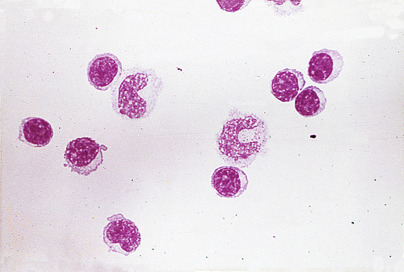

Figure 29-1 

Cerebrospinal fluid cytology (lymphocyte to monocyte distribution ratio 70 : 30). 

Traumatic puncture may result in the presence of bone marrow cells, cartilage cells, squamous cells, ganglion cells, and soft tissue elements. In addition, ependymal and choroid plexus cells may rarely be seen ( [ Fig. 29-2 ](<#f0015>) ). Moreover, blastlike primitive cell clusters, most likely of germinal matrix origin, are sometimes found in premature infants with intraventricular hemorrhage ( [ Fig. 29-3 ](<#f0020>) ). 

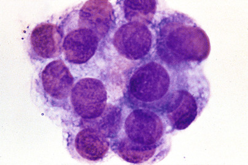

Figure 29-2 

Choroid plexus cells in cerebrospinal fluid. 

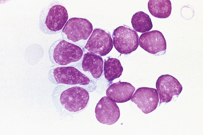

Figure 29-3 

Cluster of blastlike cells in cerebrospinal fluid from a premature newborn. 

(From Kjeldsberg CR, Knight JA: _Body fluids: laboratory examination of amniotic, cerebrospinal, seminal, serous and synovial fluids,_ ed 3, Chicago, 1993, © American Society for Clinical Pathology, with permission.) 

Increased CSF **neutrophils** occur in numerous conditions ( [ Box 29-3 ](<#b0020>) ). In early bacterial meningitis, the proportion of PMNs usually exceeds 60%. However, in about one quarter of cases of early viral meningitis, the proportion of PMNs also exceeds 60%. Viral-induced neutrophilia usually changes to a lymphocytic pleocytosis within 2 to 3 days. A total PMN count of over 1180 cells/µL (or more than 2000 WBCs/µL) has a 99% predictive value for bacterial meningitis (  Spanos et al, 1989  ). Persistent neutrophilic meningitis (over 1 week) may be noninfectious or due to less common pathogens such as _Nocardia, Actinomyces, Aspergillus,_ and the zygomycetes (  Peacock et al, 1984  ). 

Box 29-3 

Causes of Increased CSF Neutrophils 

  * Meningitis 

    * Bacterial meningitis 

    * Early viral meningoencephalitis 

    * Early tuberculous meningitis 

    * Early mycotic meningitis 

    * Amebic encephalomyelitis 

  * Other infections 

    * Cerebral abscess 

    * Subdural empyema 

    * AIDS-related CMV radiculopathy 

  * Following seizures 

  * Following CNS hemorrhage 

    * Subarachnoid 

    * Intracerebral 

  * Following CNS infarct 

  * Reaction to repeated lumbar punctures 

  * Injection of foreign material in subarachnoid space (e.g., methotrexate, contrast media) 

  * Metastatic tumor in contact with CSF 

_AIDS,_ Acquired immunodeficiency syndrome; _CMV,_ cytomegalovirus _; CNS,_ central nervous system _; CSF,_ cerebrospinal fluid. 

Increased CSF **lymphocytes** have been reported in various diseases/disorders ( [ Box 29-4 ](<#b0025>) ). Lymphocytosis (>50%) may occur in early acute bacterial meningitis when the CSF leukocyte count is under 1000/µL (  Powers, 1985  ). Reactive lymphoplasmacytoid and immunoblastic variants may be present, particularly with viral meningoencephalitis. Blastlike lymphocytes may be seen admixed with small and large lymphocytes in the CSF of neonates. 

Box 29-4 

Causes of CSF Lymphocytosis 

 

##  Meningitis 

  * Viral meningitis 

  * Tuberculous meningitis 

  * Fungal meningitis 

  * Syphilitic meningoencephalitis 

  * Leptospiral meningitis 

  * Bacterial due to uncommon organisms 

  * Early bacterial meningitis where leukocyte counts are relatively low 

  * Parasitic infestations (e.g., cysticercosis, trichinosis, toxoplasmosis) 

  * Aseptic meningitis due to septic focus adjacent to meninges 

 

##  Degenerative Disorders 

  * Subacute sclerosing panencephalitis 

  * Multiple sclerosis 

  * Drug abuse encephalopathy 

  * Guillain-Barré syndrome 

  * Acute disseminated encephalomyelitis 

 

##  Other Inflammatory Disorders 

  * Handl syndrome (headache with neurologic deficits and CSF lymphocytosis) 

  * Sarcoidosis 

  * Polyneuritis 

  * CNS periarteritis 

_CNS,_ Central nervous system _; CSF,_ cerebrospinal fluid. 

**Plasma cells,** not normally present in CSF, may appear in a variety of inflammatory and infectious conditions ( [ Box 29-5 ](<#b0030>) ), along with large and small lymphocytes, and in association with malignant brain tumors (  Fishman, 1992  ). Multiple myeloma may also rarely involve the meninges (  Oda et al, 1991  ). 

Box 29-5 

Inflammatory and Infectious Causes of CSF Plasmacytosis 

  * Acute viral infections 

  * Guillain-Barré syndrome 

  * Multiple sclerosis 

  * Parasitic CNS infestations 

  * Sarcoidosis 

  * Subacute sclerosing panencephalitis 

  * Syphilitic meningoencephalitis 

  * Tuberculous meningitis 

_CNS,_ Central nervous system; _CSF,_ cerebrospinal fluid. 

Although **eosinophils** are rarely present in normal CSF, they may be increased in a variety of central nervous system (CNS) conditions ( [ Box 29-6 ](<#b0035>) ). For example, eosinophilia is frequently mild (1% to 4%) in a general inflammatory response, but in children with malfunctioning ventricular shunts, it may be marked ( [ Fig. 29-4 ](<#f0025>) ). A suggested criterion for eosinophilic meningitis is 10% eosinophils (  Kuberski, 1981  ); parasitic invasion of the CNS is the most common cause worldwide. _Coccidioides immitis_ is a significant cause of CSF eosinophilia in endemic regions of the United States (  Ragland et al, 1993  ). 

Box 29-6 

Causes of CSF Eosinophilic Pleocytosis 

 

##  Commonly associated with: 

  * Acute polyneuritis 

  * CNS reaction to foreign material (drugs, shunts) 

  * Fungal infections 

  * Idiopathic eosinophilic meningitis 

  * Idiopathic hypereosinophilic syndrome 

  * Parasitic infections 

 

##  Infrequently associated with: 

  * Bacterial meningitis 

  * Leukemia/lymphoma 

  * Myeloproliferative disorders 

  * Neurosarcoidosis 

  * Primary brain tumors 

  * Tuberculous meningoencephalitis 

  * Viral meningitis 

_CNS,_ Central nervous system; _CSF,_ cerebrospinal fluid. 

Modified from Kjeldsberg CR, Knight JA: _Body fluids: laboratory examination of amniotic, cerebrospinal, seminal, serous and synovial fluids_ , ed 3, Chicago, 1993, © American Society for Clinical Pathology, with permission. 

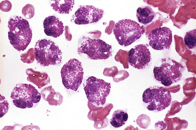

Figure 29-4 

Eosinophils in cerebrospinal fluid from a child with malfunctioning ventricular shunt. 

Increased CSF **monocytes** lack diagnostic specificity and are usually part of a “mixed cell reaction” that includes neutrophils, lymphocytes, and plasma cells. This pattern is seen in tuberculous and fungal meningitis, chronic bacterial meningitis (i.e., _Listeria monocytogenes_ and others), leptospiral meningitis, ruptured brain abscess, _Toxoplasma_ meningitis, and amebic encephalomeningitis. A mixed cell pattern without neutrophils is characteristic of viral and syphilitic meningoencephalitis. **Macrophages** with phagocytosed erythrocytes **(erythrophages)** appear from 12 to 48 hours following a subarachnoid hemorrhage or traumatic tap. Hemosiderin-laden macrophages **(siderophages)** appear after about 48 hours and may persist for weeks ( [ Fig. 29-5 ](<#f0030>) ). Brownish yellow or red hematoidin crystals may form after a few days. 

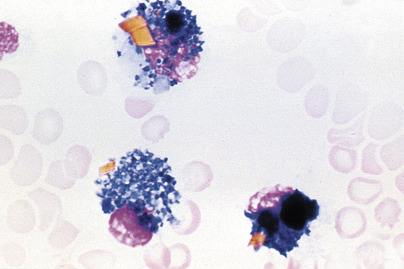

Figure 29-5 

Hemosiderin-laden macrophages (siderophages) from the cerebrospinal fluid of a patient with subarachnoid hemorrhage. 

Hemosiderin crystals (golden-yellow) are also present. 

(From Kjeldsberg CR, Knight JA: _Body fluids: laboratory examination of amniotic, cerebrospinal, seminal, serous and synovial fluids,_ ed 3, Chicago, 1993, © American Society for Clinical Pathology, with permission.) 

Morphologic cerebrospinal fluid examination for tumor cells has moderate sensitivity and high specificity (97% to 98%) (  Marton & Gean, 1986  ). Sensitivity depends on the type of neoplasm. CSF examination of leukemic patients has the highest sensitivity (about 70%), followed by metastatic carcinoma (20% to 60%) and primary CNS malignancies (30%). Sensitivity may be optimized by using filtration methods with larger fluid volumes or by performing serial punctures in patients in whom a neoplasm is strongly suspected. Processing of CSF samples using liquid-based thin-layer methods also increases sensitivity in the detection of neoplastic cells and enhances preservation of these cells for potential immunocytochemical analysis (  Sioutopoulou et al, 2008  ). These liquid-based methods are now commonly used for cytopathologic examination of CSF and other body cavity fluid specimens. 

Leukemic involvement of the meninges is more frequent in patients with acute lymphoblastic leukemia ( [ Fig. 29-6 ](<#f0035>) ) than in those with acute myeloid leukemia ( [ Fig. 29-7 ](<#f0040>) ); both are significantly more common than CNS involvement in the chronic leukemias. A leukocyte count over 5 cells/µL with unequivocal lymphoblasts in cytocentrifuged preparations is commonly accepted as evidence of CSF involvement. The incidence of CNS relapse in children with lymphoblasts but cell counts lower than 6 cells/µL appears to be low and is not significantly different from cases in which no blasts are identified (  Odom et al, 1990  ;  Gilchrist et al, 1994  ;  Tubergen et al, 1994  ). As noted previously, the ability to detect leukemic cells in CSF using the cytocentrifuge method is highly instrument-dependent, and low levels of these cells may be missed with certain instruments (  Huppmann et al, 2012  ). 

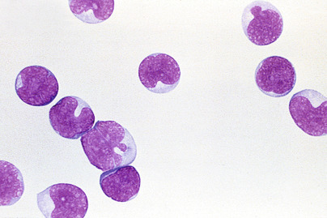

Figure 29-6 

Acute lymphoblastic leukemia in cerebrospinal fluid. Note uniformity of the blast cells. 

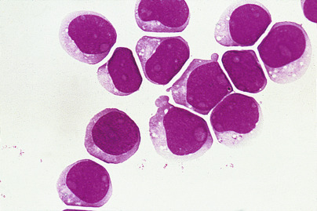

Figure 29-7 

Acute myeloid leukemia in cerebrospinal fluid. 

Non-Hodgkin's lymphomas involving the leptomeninges are usually high-grade tumors (lymphoblastic, large cell immunoblastic, and Burkitt's lymphomas) ( [ Fig. 29-8 ](<#f0045>) ); low-grade lymphomas and Hodgkin's lymphoma are significantly less common (  Bigner, 1992  ;  Walts, 1992  ). T cells predominate in normal and inflammatory conditions, whereas most lymphomas, especially those occurring in immunocompromised hosts, are of B cell lineage. Lymphoblastic lymphoma, the most common T-cell lymphoma to involve the CSF, can be detected by terminal deoxynucleotidyl transferase stain. 

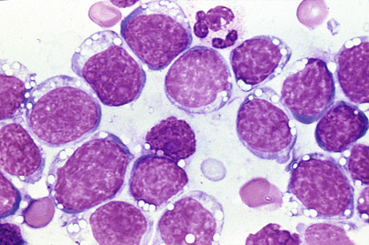

Figure 29-8 

Burkitt's lymphoma in cerebrospinal fluid. 

The cells are characterized by blue cytoplasm with vacuoles and a slightly clumped chromatin pattern. 

(From Kjeldsberg CR, Knight JA: _Body fluids: laboratory examination of amniotic, cerebrospinal, seminal, serous and synovial fluids_ , ed 3, Chicago, 1993, © American Society for Clinical Pathology, with permission.) 

Multiparameter flow cytometric immunophenotypic studies, DNA analysis by polymerase chain reaction (PCR), and more recently DNA sequence analysis have been shown to significantly improve diagnostic sensitivity and specificity in CSF samples involved by leukemic or lymphoma cells (  Rhodes et al, 1996  ;  Finn et al, 1998  ;  Scrideli & Queiroz, 2004  ;  Bromberg et al, 2007  ;  Quijano et al, 2009  ;  Martinez-Laperche et al, 2013  ;  Lacayo et al, 2013  ). Considering their greater sensitivity in detecting leukemia or lymphoma cells in CSF samples, whenever available these advanced technologies should be part of the complete evaluation in patients being worked up for these conditions. 

Amebas, fungi (especially _Cryptococcus neoformans_ ), and _Toxoplasma gondii_ organisms may be present on cytocentrifuge specimens but may be difficult to recognize without confirmatory stains. 

 

##  Chemical Analysis 

Reference values for lumbar cerebrospinal fluid in adults are listed in [ Table 29-3 ](<#t0020>) . 

TABLE 29-3 

Adult Lumbar CSF Reference Values 

Analyte  |  Conventional Units  |  SI Units   
---|---|---  
Protein  |  15-60 mg/dL  |  0.15-0.60 g/L   
Prealbumin  |  2%-7%  |   
Albumin  |  56%-76%  |   
α 1  -Globulin  |  2%-7%  |   
α 2  -Globulin  |  4%-12%  |   
β-Globulin  |  8%-18%  |   
γ-Globulin  |  3%-12%  |   
**Electrolytes**  
Osmolality  |  280-300 mOsm/L  |  280-300 mmol/L   
Sodium  |  135-150 mEq/L  |  135-150 mmol/L   
Potassium  |  2.6-3.0 mEq/L  |  2.6-3.0 mmol/L   
Chloride  |  115-130 mEq/L  |  115-130 mmol/L   
Carbon dioxide  |  20-25 mEq/L  |  20-25 mmol/L   
Calcium  |  2.0-2.8 mEq/L  |  1.0-1.4 mmol/L   
Magnesium  |  2.4-3.0 mEq/L  |  1.2-1.5 mmol/L   
Lactate  |  10-22 mg/dL  |  1.1-2.4 mmol/L   
**pH**  
Lumbar fluid  |  7.28-7.32  |   
Cisternal fluid  |  7.32-7.34  |   
**pCO 2  **  
Lumbar fluid  |  44-50 mm Hg  |   
Cisternal fluid  |  40-46 mm Hg  |   
pO  2  |  40-44 mm Hg  |   
**Other Constituents**  
Ammonia  |  10-35 µg/dL  |  6-20 µmol/L   
Glutamine  |  5-20 mg/dL  |  0.3-1.4 mmol/L   
Creatinine  |  0.6-1.2 mg/dL  |  45-92 µmol/L   
Glucose  |  50-80 mg/dL  |  2.8-4.4 mmol/L   
Iron  |  1-2 µg/dL  |  0.2-0.4 µmol/L   
Phosphorus  |  1.2-2.0 mg/dL  |  0.4-0.7 mmol/L   
Total lipid  |  1-2 mg/dL  |  0.01-0.02 g/L   
Urea  |  6-16 mg/dL  |  2.0-5.7 mmol/L   
Urate  |  0.5-3.0 mg/dL  |  30-180 µmol/L   
Zinc  |  2-6 µg/dL  |  0.3-0.9 µmol/L   
  
_CSF_ , Cerebrospinal fluid; _pCO 2  _ , partial pressure of carbon dioxide; _pO 2  _ , partial pressure of oxygen. 

 

##  Proteins 

 

##  Total Protein 

More than 80% of the CSF protein content is derived from blood plasma, in concentrations of less than 1% of the plasma level ( [ Table 29-4 ](<#t0025>) ). 

TABLE 29-4 

Mean Concentrations of Plasma and CSF Proteins 

Protein  |  CSF, mg/L  |  Plasma/CSF Ratio   
---|---|---  
Prealbumin  |  17.3  |  14   
Albumin  |  155.0  |  236   
Transferrin  |  14.4  |  142   
Ceruloplasmin  |  1.0  |  366   
Immunoglobulin (Ig)G  |  12.3  |  802   
IgA  |  1.3  |  1346   
α 2  -Microglobulin  |  2.0  |  1111   
Fibrinogen  |  0.6  |  4940   
IgM  |  0.6  |  1167   
β-Lipoprotein  |  0.6  |  6213   
  
_CSF_ , Cerebrospinal fluid. 

Adapted from Felgenhauer K: Protein size and cerebrospinal fluid composition, _Klin Wochenschr_ 52:1158, 1974, with permission. 

Prealbumin (transthyretin), transferrin, and small quantities of nerve tissue–specific proteins are the major qualitative differences that normally exist between CSF and plasma proteins. Although some authors have argued against routine measurement of total protein (  American College of Physicians, 1986  ), it is the most common abnormality found in CSF. Thus, an increased CSF protein serves as a useful, albeit nonspecific, indicator of meningeal or CNS disease. 

 

##  Reference Values. 

CSF total protein reference values vary considerably among laboratories owing to differences in methods, instrumentation, and type of reference standard used. CSF protein levels of 15 to 45 mg/dL have long been accepted as the “normal” reference range (  Silverman & Christenson, 1994  ). Other studies using different methods have shown generally higher reference ranges, approximately 15 to 60 mg/dL (  Lott & Warren, 1989  ). 

Although discrepancies in gender and in those older than 60 years of age have been reported, the differences are probably not significant. However, infants have significantly higher CSF protein levels than older children and adults. Thus, mean levels of 90 mg/dL for term infants and 115 mg/dL for preterm infants were reported; the upper levels were 150 mg/dL and 170 mg/dL, respectively (  Sarff et al, 1976  ). Others have noted that the CSF protein concentration falls rapidly from birth to 6 months of age (mean levels, 108 mg/dL to 40 mg/dL), plateaus between 3 and 10 years of age (mean, 32 mg/dL), and then rises slightly from 10 to 16 years of age (mean, 41 mg/dL) (  Biou et al, 2000  ). 

Elevated CSF protein levels may be caused by increased permeability of the blood-brain barrier, decreased resorption at the arachnoid villi, mechanical obstruction of CSF flow due to spinal block above the puncture site, or an increase in intrathecal immunoglobulin (Ig) synthesis. Common conditions associated with elevated lumbar CSF protein values (>65 mg/dL) are summarized in [ Box 29-7 ](<#b0040>) . 

Box 29-7 

Conditions Associated with Increased CSF Total Protein 

 

##  Traumatic Spinal Puncture 

**Increased Blood-CSF Permeability**

  * Arachnoiditis (e.g., following methotrexate therapy) 

  * Meningitis (bacterial, viral, fungal, tuberculous) 

  * Hemorrhage (subarachnoid, intracerebral) 

  * Endocrine/metabolic disorders 

    * Milk-alkali syndrome with hypercalcemia 

    * Diabetic neuropathy 

    * Hereditary neuropathies and myelopathies 

    * Decreased endocrine function (thyroid, parathyroid) 

    * Other disorders (uremia, dehydration) 

 

##  Drug Toxicity 

  * Ethanol, phenothiazines, phenytoin 

 

##  CSF Circulation Defects 

  * Mechanical obstruction (tumor, abscess, herniated disk) 

  * Loculated CSF effusion 

 

##  Increased Immunoglobulin (Ig)G Synthesis 

  * Multiple sclerosis 

 

##  Neurosyphilis 

  * Subacute sclerosing panencephalitis 

 

##  Increased IgG Synthesis and Blood-CSF Permeability 

  * Guillain-Barré syndrome 

  * Collagen vascular diseases (e.g., lupus, periarteritis) 

  * Chronic inflammatory demyelinating polyradiculopathy 

_CSF,_ Cerebrospinal fluid. 

Low lumbar CSF total protein levels (<20 mg/dL) normally occur in some young children between 6 months and 2 years of age and in patients with conditions associated with increased CSF turnover. These include the following: (1) Removal of large CSF volumes; (2) CSF leaks induced by trauma or lumbar puncture; (3) increased intracranial pressure, probably due to an increased rate of protein resorption by the arachnoid villi; and (4) hyperthyroidism (  Fishman, 1992  ). 

Protein electrophoresis of concentrated normal CSF reveals two distinct differences from serum: a prominent transthyretin (prealbumin) band and two transferrin bands. Transthyretin is relatively high because of its dual synthesis by the liver and the choroid plexus. The second transferrin band, referred to as β 2  -transferrin, migrates more slowly than its serum equivalent owing to cerebral neuraminidase digestion of sialic acid residues. 

 

##  Methods. 

Turbidimetric methods, commonly based on trichloroacetic acid (TCA) or sulfosalicylic acid and sodium sulfate for protein precipitation, are popular because they are simple and rapid, and require no special instrumentation. However, they are temperature sensitive and require much larger specimen volumes (about 0.5 mL). A false protein elevation may be observed using TCA methods in the presence of methotrexate (  Kasper et al, 1988  ). Benzethonium chloride and benzalkonium chloride have been used as precipitating agents in automated methods and micromethods (  Luxton et al, 1989  ;  Shephard & Whiting, 1992  ). 

Colorimetric methods include the Lowry method, dye-binding, methods using Coomassie brilliant blue (CBB) or Ponceau S, and the modified Biuret method. The CBB method is rapid and highly sensitive, and can be used with small sample sizes. Immunochemical methods measure specific proteins, require only 25 to 50 µL of CSF, and are relatively simple to perform once conditions and reagents have been standardized. Automated methods are now commonly used and usually show good correlation with traditional standard methods (  Lott & Warren, 1989  ). 

 

##  Albumin and IgG Measurements 

The permeability of the blood-brain barrier may be assessed by immunochemical quantification of the CSF albumin/serum albumin ratio in grams per deciliter (g/dL). The normal ratio of 1 : 230 (  Tourtellotte et al, 1985  ) yields an unwieldy decimal of 0.004, which prompted the use of the **CSF/serum albumin index,** which is arbitrarily calculated as follows: 

 CSF  /  Serum albumin index  =  CSF albumin  (  mg  /  dL  )  Serum albumin  (  g  /  dL  ) 

An index value less than 9 is consistent with an intact barrier. Slight impairment is considered with index values of 9 to 14, moderate impairment with values of 14 to 30, and severe impairment with values greater than 30 (  Silverman & Christenson, 1994  ). The index is slightly elevated in infants up to 6 months of age, reflecting the immaturity of the blood-brain barrier, and increases gradually after 40 years of age. A traumatic tap invalidates the index calculation. 

Increased intrathecal IgG synthesis is reflected by an increase in the CSF/serum IgG ratio: 

 CSF  /  Serum IgG ratio  =  CSF IgG  (  mg  /  dL  )  Serum IgG  (  g  /  dL  ) 

The normal ratio is 1/390 or 0.003 (  Tourtellotte et al, 1985  ). Similar to the albumin index, the CSF/serum IgG index may be obtained by using milligrams per deciliter for the CSF IgG value. The CSF/serum IgG index normal range is 3.0 to 8.7. 

The **CSF/serum IgG index** can be elevated by intrathecal IgG synthesis or increased plasma IgG crossover from breakdown of the blood-brain barrier. Ig derived from plasma crossover may be corrected by dividing the CSF/serum IgG index by the CSF/albumin index to yield the CSF IgG index. 

 CSF IgG index  =  CSF IgG  (  mg  /  dL  )  /  Serum IgG  (  g  /  dL  )  CSF albumin  (  mg  /  dL  )  /  Serum albumin  (  g  /  dL  ) 

or 

 CSF IgG index  =  CSF IgG  (  mg  /  dL  )  × Serum albumin  (  g  /  dL  )  Serum IgG  (  g  /  dL  )  × CSF albumin  (  mg  /  dL  ) 

The reference range for the IgG index varies, reflecting variations in determination of the four index components. A reasonable normal upper limit is 0.8 (  Souverijn et al, 1989  ). However, each laboratory should determine its own critical ratio. 

The **IgG synthesis rate** is calculated by an empirical formula (  Tourtellotte et al, 1985  ): 

 IgG synthesis rate  (  mg  /  day  )  =  [  (  CSF IgG  − Serum IgG  /  369  )  − (  CSF albumin  − Serum albumin  /  230  )  × (  Serum IgG  /  Serum albumin  )  × 0.43  × 5  dL  /  day  ] 

All protein concentrations are expressed in milligrams per deciliter. The first bracketed term represents the difference between measured CSF IgG and the IgG expected from diffusion across a normal blood-brain barrier; 369 is the normal serum/CSF ratio. The second bracketed term represents the difference between measured CSF albumin and expected albumin if the blood-brain barrier is intact; 230 is the normal serum/CSF albumin ratio. The CSF albumin excess is multiplied by the IgG/albumin ratio and the molecular weight ratio of IgG to albumin (0.43) to correct for changes in CSF IgG due to increased barrier permeability. The number 5 converts the result from a concentration to a daily amount, assuming an average daily CSF production of 500 mL (i.e., 5 dL). The formula does not consider variations in CSF production or Ig consumption. It assumes that the IgG/albumin ratio remains constant over various degrees of blood-brain barrier impairment—a concept that may lead to variable error (  Lefvert & Link, 1985  ). The reference interval for the synthesis rate is –9.9 to +3.3 mg/day. Values greater than 8.0 mg/day indicate an increased rate (  Silverman & Christenson, 1994  ). 

CSF IgG is normally 3% to 5% of total CSF protein, but in multiple sclerosis (MS), the concentration approaches that of plasma (15% to 18%) (  Hersey & Trotter, 1980  ). The CSF IgG index and the IgG synthesis rate have a sensitivity of 90% in patients with definite MS, but the sensitivity is lower in patients with possible MS, in whom accuracy is most needed (  Marton & Gean, 1986  ). In addition, the specificity for MS is only moderate because increased intrathecal IgG synthesis occurs in many other inflammatory neurologic diseases. 

The Ig index and synthesis rate calculations may also be applied to IgM, IgA, Ig light chains, and specific antibodies to infectious microorganisms. For example, increased synthesis of IgM and free κ light chains have been suggested as markers for MS (  Rudick et al, 1989  ;  Lolli et al, 1991  ). 

 

##  Electrophoretic Techniques. 

Although the diagnosis of MS is ultimately a clinical one, significant advances have been made in laboratory testing for this disorder. CSF total protein is increased in less than 50% of patients with MS. Indeed, if the CSF protein exceeds 100 mg/dL, the patient probably does not have MS. However, the γ-globulin fraction, as determined by CSF electrophoresis, is often increased in MS. Thus, the CSF total protein/γ-globulin ratio exceeds 0.12 in about 65% of cases (  Johnson & Nelson, 1977  ). Using **electroimmunodiffusion,** a CSF IgG/albumin ratio greater than 0.25 is present in about 75% of cases (  Tourtellotte et al, 1971  ). Levels greater than the mean CSF IgG index + 3SD are present in 80% to 85% of MS cases, although the upper reference level varies significantly among laboratories. 

**High-resolution agarose gel electrophoresis** of concentrated CSF from patients with MS often shows discrete populations of IgG, the **oligoclonal bands.** Although these discrete IgG populations are normally absent, two or more bands are necessary to support the diagnosis of MS; a single band is not considered a positive result. Using this technique, oligoclonal bands have been reported in 83% to 94% of patients with definite MS, 40% to 60% of those with probable MS, and 20% to 30% of possible MS cases. However, they are also frequently present in patients with subacute sclerosing panencephalitis, various viral CNS infections, neurosyphilis, neuroborreliosis, cryptococcal meningitis, Guillain-Barré syndrome, transverse myelitis, meningeal carcinomatosis, glioblastoma multiforme, Burkitt's lymphoma, chronic relapsing polyneuropathy, Behçet's disease, cysticercosis, and trypanosomiasis, among others (  Trotter & Rust, 1989  ;  Chalmers et al, 1990  ;  Fishman 1992  ;  Hall & Snyder, 1992  ). Subsequent studies have shown that agarose gel electrophoresis sensitivity for MS is less than previously reported (see later). 

Oligoclonal light chains (both κ and λ) are present in about 90% of MS patients (  Gallo et al, 1989  ;  Sindie & Laterte, 1991  ). They have also occasionally been identified in the CSF of those who are negative for IgG oligoclonal bands. Detection of free light chains in CSF and comparison to serum has been shown to be a sensitive marker for intrathecal immunoglobulin synthesis (  Fischer et al, 2004  ). 

**Coomassie brilliant blue** or paragon violet stains can resolve oligoclonal bands in only 5 µg of IgG (  Silverman & Christenson, 1994  ). However, **silver staining** is 20 to 50 times more sensitive than CBB and can be used on unconcentrated CSF. It is important to note that these electrophoretic techniques must be simultaneously carried out on the patient's serum to be certain that a polyclonal gammopathy is not present (e.g., liver disease, systemic lupus, rheumatoid arthritis, chronic granulomatous disease) because these disorders may be accompanied by Ig diffusion into the CSF, yielding false-positive results. 

**Immunofixation electrophoresis** (IFE) is more sensitive than agarose gel electrophoresis and does not require CSF concentration (  Cawley et al, 1976  ). Another study reported a sensitivity of 74% using this technique compared with 57% for agarose gel electrophoresis (  Cavuoti et al, 1998  ). More recently, using a semiautomated immunofixation-peroxidase technique, the sensitivity was 83% and the specificity was 79% in patients with clinically definite MS (  Richard et al, 2002  ). 

**Isoelectric focusing and IgG immunoblotting** (IgG-IEF) performed on paired CSF and serum samples is the most sensitive and now the recommended method for the detection of oligoclonal bands (  Andersson et al, 1994  ;  Fortini et al, 2003  ;  Keren, 2003  ). One study showed that IgG-IEF detected 100% of definite MS, but only about 50% were positive by agarose electrophoresis (  Lunding et al, 2000  ). Others detected 91% of MS cases but only 68% with agarose (  Seres et al, 1998  ). Similarly, a semiautomated IgG-IEF technique identified 90% of MS cases compared with 60% for agarose electrophoresis (  Fortini et al, 2003  ). In 2005, an international consensus standard for the diagnosis of MS established IgG-IEF as the method of choice for qualitative detection of oligoclonal IgG bands as evidence of intrathecal synthesis of IgG (  Freedman et al, 2005  ). This method is more sensitive and specific than quantitative methods. 

In summary, the diagnosis of MS, as with many other neurologic disorders, is ultimately a clinical one based on neurologic history and physical examination. Nevertheless, advanced laboratory results in CSF, such as elevated IgG indices and particularly the detection of oligoclonal IgG bands, as well as neuroimaging techniques, have proved invaluable in the diagnosis of MS. 

 

##  Other CSF Proteins 

Approximately 300 different proteins have been identified in CSF using two-dimensional electrophoresis, the first dimension being isoelectric focusing and the second polyacrylamide gel in the presence of sodium dodecyl sulfate (  Harrington et al, 1986  ). Using this technique, four abnormal proteins were identified in patients with Creutzfeldt-Jakob disease (CJD). Two of these proteins (molecular mass about 40 kilodaltons [kDa] each) were present in some, but not all, patients with herpes simplex encephalitis, Parkinson's disease, Guillain-Barré syndrome, and schizophrenia. They were not present in various other neurologic disorders, nor in 100 normal CSF control specimens. However, these and two other proteins (molecular masses about 26 and 29 kDa) were present in all cases of CJD and in 5 of 10 cases of herpes simplex encephalitis. Neither of these latter proteins was present in any other neurologic disease or in controls. 

Increased concentrations of various specific CSF proteins have been associated with several CNS diseases ( [ Table 29-5 ](<#t0030>) ). 

TABLE 29-5 

CSF Proteins and Central Nervous System Diseases 

Protein  |  Major Diseases/Disorders   
---|---  
α 2  -Macroglobulin  |  Subdural hemorrhage, bacterial meningitis   
β-Amyloid and τ proteins  |  Alzheimer's disease   
β 2  -Microglobulin  |  Leukemia/lymphoma, Behçet's syndrome   
C-reactive protein  |  Bacterial and viral meningitis   
Fibronectin  |  Lymphoblastic leukemia, AIDS, meningitis   
Methemoglobin  |  Mild subarachnoid/subdural hemorrhage   
Myelin basic protein  |  Multiple sclerosis, tumors, others   
Protein 14-3-3  |  Creutzfeldt-Jakob disease   
Transferrin  |  CSF leakage (otorrhea, rhinorrhea)   
  
_AIDS_ , Acquired immunodeficiency syndrome; _CSF_ , cerebrospinal fluid. 

 

##  Myelin Basic Protein. 

Myelin basic protein (MBP), a component of the myelin nerve sheath, is released during demyelination as a result of various neurologic disorders, especially MS. Thus, MBP has been shown to positively correlate with CSF leukocyte count, intrathecal IgG synthesis, and the CSF/serum albumin concentration quotient (  Sellebjerg et al, 1998  ). These results supported the use of MBP in CSF as a surrogate disease marker during acute MS exacerbations. Others have found that analysis of antibody against MBP in patients with a clinically isolated syndrome is a rapid and precise method for predicting early conversion to clinically definite MS (  Berger et al, 2003  ). However, increased CSF levels have also been reported in Guillain-Barré syndrome, lupus erythematosus, subacute sclerosing panencephalitis, and various brain tumors, and following CNS irradiation and chemotherapy (  Mahoney et al, 1984  ;  Brooks, 1989  ). Measurement of CSF MBP levels has also been proposed as a prognostic marker in patients with serious head injury (  Noseworthy et al, 1985  ). Recently, the clinical utility of MBP measurement in patients with MS has been questioned, based on similarity of abnormal results to other established laboratory methods, such as presence of oligoclonal bands on protein electrophoresis, for diagnosing MS (  Greene et al, 2012  ). 

 

##  α 2  -Macroglobulin. 

Except for a small amount transported across the BBB in pinocytic vesicles, α 2  -macroglobulin (A2M) is normally excluded from the CSF because of its large size. The number of these vesicles is increased in certain polyneuropathies, resulting in an increased CSF A2M level. Significant elevation reflects subdural hemorrhage or breakdown of the BBB, as occurs in bacterial meningitis. A2M measurement alone, or in relationship to albumin and IgG, may assist in the evaluation of neurologic disorders and increased CSF protein, and in the rapid differentiation between bacterial and aseptic meningitis (  Meucci et al, 1993  ;  Kanoh & Ohtani, 1997  ). 

 

##  β 2  -Microglobulin. 

This protein is part of the human leukocyte antigen class I molecule on the surfaces of all nucleated cells. CSF levels above 1.8 mg/L are associated with leptomeningeal leukemia and lymphoma but are not highly specific (  Weller et al, 1992  ), in that they have a maximal positive predictive value of 78% in cases with a positive cytology (  Jeffrey et al, 1990  ). β 2  -microglobulin (B2M) has also been shown to be a marker for neuro-Behçet's syndrome (  Kawai & Hirohata, 2000  ). Viral infections, including human immunodeficiency virus (HIV)-1, other inflammatory conditions, and various malignancies have also been associated with elevated levels. The measurement of B2M remains primarily investigational. 

 

##  C-Reactive Protein. 

Early studies indicated that CSF C-reactive protein (CRP) is useful in differentiating viral (aseptic) meningitis from bacterial meningitis (  Corral et al, 1981  ;  Abramson et al, 1985  ;  Stearman & Southgate, 1994  ). Others reported that CSF CRP is a more useful screening test for viral versus bacterial meningitis, especially in children (  Sormunen et al, 1999  ). A meta-analysis of CRP studies since 1980 suggested that a normal CSF or serum CRP has a high probability of ruling out bacterial meningitis (i.e., negative predictive value about 97%) (  Gerdes et al, 1998  ). Another study found not only that CSF CRP levels were increased in bacterial meningitis, but that these levels were significantly higher in patients with gram-negative bacterial meningitis than in those with gram-positive bacterial meningitis (  Rajs et al, 2002  ). This assay has been found to be more specific than blood CRP levels in the laboratory diagnosis of meningitis in children (  Malla et al, 2013  ). 

 

##  Fibronectin. 

This large glycoprotein (molecular mass about 420 kDa) is normally present in essentially all tissues and body fluids. Its primary function is its role in cell adhesion and phagocytosis (  Ruoslahti et al, 1981  ). Thus, cell adhesion allows leukocytes to adhere to and pass through the vascular endothelia and migrate to the inflammatory site. 

In children with acute lymphoblastic leukemia, elevated CSF fibronectin levels are associated with a poor prognosis, presumably due to leukemic involvement of the CNS (  Rautonen et al, 1989  ). Significant CSF elevations have also been reported in Burkitt's lymphoma (  Rajantie et al, 1989  ), some metastatic solid tumors, astrocytomas, and bacterial meningitis (  Weller et al, 1990  ;  Torre et al, 1991  ). Decreased levels have been reported in viral meningitis and in the acquired immunodeficiency syndrome (AIDS)–dementia complex (  Torre et al, 1991;  1993  ). Detection of fibronectin with alternatively spliced extra domain A is found in lower amounts in CSF from children with bacterial meningitis as opposed to viral meningitis or without meningitis (  Pupek et al, 2013  ). 

 

##  β-Amyloid Protein 42 and τ Protein. 

The diagnosis of Alzheimer's disease (AD) is based on the presence of dementia and a specific clinical profile (i.e., from medical history, clinical examination) suggestive of AD, together with the exclusion of other causes of dementia. Pathologically, the disease is characterized by the presence of neurofibrillary tangles and amyloid plaques. 

Studies indicate that measurement of biochemical markers increases diagnostic accuracy, especially early in the course of the disease, when clinical symptoms are mild and vague and overlap with cognitive changes that accompany aging and ischemic dementia. Thus, increased CSF levels of microtubule-associated τ protein and decreased levels of β-amyloid protein ending at amino acid 42 have been shown to significantly increase the accuracy of AD diagnosis (  Andreasen et al, 2001  ;  Riemenschneider et al, 2002  ;  Sunderland et al, 2003  ). The positive predictive value for early AD is greater than 90% (  Andreasen et al, 2001  ). Others have found that the calculated ratio of phosphorylated τ protein to β-amyloid peptide is superior to either measure alone (  Maddalena et al, 2003  ). The results were as follows: Distinguishing patients with AD from healthy controls—sensitivity 96%, specificity 97%; patients with AD from those with non-AD dementia—sensitivity 80%, specificity 73%; and patients with AD from those with other neurologic disorders—sensitivity 80%, specificity 89%. These assays all appear to have a place in the biochemical diagnosis of early AD (  Blennow & Zetterrberg, 2009  ). 

 

##  Protein 14-3-3. 

The transmissible spongiform encephalopathies constitute a group of uniformly fatal neurodegenerative diseases. Of these, CJD is the major spongiform disease in humans. Two proteins, designated 130 and 131, have been detected in low concentrations in CSF from CJD patients. These proteins have the same amino acid sequence as protein 14-3-3 (  Hsich et al, 1996  ). In patients with dementia, a positive immunoassay for the 14-3-3 protein in CSF strongly supports a diagnosis of CJD. In a subsequent study of patients with suspected CJD, the sensitivity of the 14-3-3 protein determined by immunoassay was 97%, and the specificity was 87% (  Lemstra et al, 2000  ). False-positive results were seen primarily in patients with stroke and meningoencephalitis. 

Others, using a modified Western blot technique, reported a 94.7% positive predictive value and a 92.4% negative predictive value for CJD (  Zerr et al, 1998  ). False-positive results were seen in patients with herpes simplex encephalitis, atypical encephalitis, metastatic lung cancer, and hypoxic brain damage. 

Detecting elevation of protein 14-3-3, in combination with elevation of other brain-derived proteins, such as τ protein, in CSF appears to be useful in the diagnosis of CJD (  Sanchez-Juan et al, 2006  ). 

 

##  Transferrin and CSF Leakage. 

Cerebrospinal fluid leakage usually presents as otorrhea or rhinorrhea following head trauma, in some cases beginning months to years after the injury. Recurrent meningitis is a serious complication, making accurate identification of the leaking fluid very important. In this regard, protein and glucose measurements are too nonspecific to be of value. Transferrin, an iron-binding glycoprotein with a molecular mass of about 77 kDa, is synthesized primarily in the liver. However, two transferrin isoforms are present in the CSF; the major isoform (β 1  -transferrin) is present in all body fluids. The second isoform (β 2  -transferrin), present only in the central nervous system, is produced in the central nervous system by the catalytic conversion of β-1-transferrin by neuraminidase. Immunofixation electrophoresis readily identifies both isoforms. 

Detection of β 2  -transferrin in CSF by protein electrophoresis with transferrin immunofixation is a noninvasive, rapid, and inexpensive test of high sensitivity and specificity that requires as little as 0.1 mL of fluid (  Ryall et al, 1992  ;  Normansell et al, 1994  ). Several reports have demonstrated the value of this technique in the diagnosis of CSF otorrhea and rhinorrhea—conditions in which both isoforms are readily identified (  Irjala et al, 1979  ;  Rouah et al, 1987  ;  Zaret et al, 1992  ). Others have stressed the importance of β 2  -transferrin identification in both CSF and inner ear perilymphatic leakage, as well as possible sources of error due to the presence of a transferrin allelic variant (  Skedros et al  1993a  ;  Sloman & Kelly, 1993  ). β 2  -transferrin is sufficiently stable in CSF stored at room temperature and/or when mixed with nasal mucus that a negative result in a patient-collected nasal fluid specimen up to 1 week old is a reliable negative finding for CSF leakage (  Bleier et al, 2011  ). 

 

##  Methemoglobin and Bilirubin. 

Although most cases of subarachnoid and intracerebral hemorrhage are readily identified by computed tomography (CT), patients with mild subarachnoid hemorrhage, small subdural or cerebral hematomas, and blood seepage from an aneurysm or neoplasm and from small cerebral infarcts often are not identified by this technique. In these cases, CSF spectrophotometric analysis has been shown to detect methemoglobin in colorless CSF (<0.3 µmol/L) (  Trbojevic-Cepe et al, 1992  ). An increase in CSF bilirubin is also recognized as a key finding supporting the diagnosis of subarachnoid hemorrhage (  UK National External Quality Assessment Scheme for Immunochemistry Working Group, 2003  ). A single net bilirubin absorbance cutoff point of >0.007 absorbance units is recommended in the decision tree for interpretation and reporting of results. 

 

##  Glucose 

Derived from blood glucose, fasting CSF glucose levels are normally 50 to 80 mg/dL (2.8 to 4.4 mmol/L)—about 60% of plasma values. Rigorous evaluation of CSF and serum glucose levels in a large number of children confirmed that the CSF glucose level is normally approximately 60% of the serum glucose level during childhood (  Nigrovic et al, 2012  ). Results should be compared with plasma levels, ideally following a 4-hour fast, for adequate clinical interpretation. The normal CSF/plasma glucose ratio varies from 0.3 to 0.9, with fluctuations in blood levels caused by the lag in CSF glucose equilibration time. 

CSF values below 40 mg/dL (2.2 mmol/L) or ratios below 0.3 are considered to be abnormal. Hypoglycorrhachia is a characteristic finding of bacterial, tuberculous, and fungal meningitis. However, sensitivity can be as low as 55% for bacterial meningitis (  Hayward et al, 1987  ), so a normal level does not exclude these conditions. Some cases of viral meningoencephalitis also have low glucose levels, but generally not to the degree seen in bacterial meningitis. Meningeal involvement by a malignant tumor, sarcoidosis, cysticercosis, trichinosis, ameba _(Naegleria),_ acute syphilitic meningitis, intrathecal administration of radioiodinated serum albumin, subarachnoid hemorrhage, symptomatic hypoglycemia, and rheumatoid meningitis may also produce low CSF glucose levels (  Fishman, 1992  ). 

Decreased CSF glucose results from increased anaerobic glycolysis in brain tissue and leukocytes and from impaired transport into the CSF. Bacteria are usually present in insufficient quantities to be a major contributor to the use of glucose in CSF. CSF glucose levels normalize before protein levels and cell counts during recovery from meningitis, making it a useful parameter in assessing response to treatment. 

**Increased CSF glucose** is of no clinical significance, reflecting increased blood glucose levels within 2 hours of lumbar puncture. A traumatic tap may also cause a spurious increase in CSF glucose. 

 

##  Lactate 

CSF and blood lactate levels are largely independent of each other. The reference interval for older children and adults is 9.0 to 26 mg/dL (1.0 to 2.9 mmol/L) (  Knight et al, 1981  ). Newborns have higher levels, ranging from about 10 to 60 mg/dL (1.1 to 6.7 mmol/L) for the first 2 days, and from 10 to 40 mg/dL (1.1 to 4.4 mmol/L) for days 3 to 10 (  McGuinness et al, 1983  ). Elevated CSF lactate levels reflect CNS anaerobic metabolism due to tissue hypoxia. 

Lactate measurement has been used as an adjunctive test in differentiating viral meningitis from bacterial, partially-treated bacterial, mycoplasma, fungal, and tuberculous meningitis, in which routine parameters yield equivocal results (  Cunha, 2012  ). In patients with viral meningitis, lactate levels are usually below 25 mg/dL (2.8 mmol/L) and are almost always less than 35 mg/dL (3.9 mmol/L), whereas bacterial meningitis typically has levels above 35 mg/dL (  Bailey et al, 1990  ;  Cameron et al, 1993  ). Using 30 to 36 mg/dL as the cutoff value for bacterial meningitis, the sensitivity and specificity are about 80% and 90%, respectively. Viral meningitis, partially treated bacterial meningitis, and tuberculous meningitis often have intermediate lactate levels that overlap each other, limiting the use of lactate measurements in this differential diagnosis. 

Persistently elevated ventricular CSF lactate levels are associated with a poor prognosis in patients with severe head injury (  DeSalles et al, 1986  ). 

 

##  F2-Isoprostanes 

F2-isoprostanes are increased in diseased regions of the brain in patients with Alzheimer's disease (AD) (  Pratico et al, 1998  ) and are markers of free radical brain injury associated with advanced age and latent AD (  Montine et al, 2011  ). Compared with age-matched controls, CSF F2-isoprostanes are elevated in patients with probable AD (  Montine et al, 1999  ). Therefore, in conjunction with CSF τ and β-amyloid protein, the measurement of CSF F2-isoprostanes appears to enhance the accuracy of the laboratory diagnosis of AD (  Montine et al, 2001  ) and by itself appears to correlate with the degree of cognitive decline in some AD patients (  Duits et al, 2013  ). 

 

##  Enzymes 

A wide variety of enzymes derived from brain tissue, blood, or cellular elements have been described in the CSF. Although CSF enzyme assays are not commonly used in the diagnosis of CNS diseases, there are diseases/disorders in which they may prove useful. 

  

##  Adenosine Deaminase 

Adenosine deaminase (ADA) catalyzes the irreversible hydrolytic deamination of adenosine to produce inosine. Because ADA is particularly abundant in T lymphocytes, which are increased in tuberculosis, its measurement has been recommended in the diagnosis of pleural, peritoneal, and meningeal tuberculosis. Higher ADA levels are present in tuberculous infections than in viral, bacterial, and malignant diseases (  Blake & Berman, 1982  ;  Mann et al, 1982  ,  Choi et al, 2002  ), and measuring ADA in CSF appears to be a sensitive and specific assay in diagnosing tuberculous meningitis (  Xu et al, 2010  ). ADA appears to have limited utility in HIV-associated neurologic disorders (  Corral et al, 2004  ). 

 

##  Creatine Kinase 

Brain tissue is rich in creatine kinase (CK) because it participates in maintaining an adequate supply of adenosine triphosphate. Increased CSF CK activity has been reported in numerous CNS disorders, including hydrocephalus, cerebral infarction, various primary brain tumors, and subarachnoid hemorrhage, among others (  Savory & Brody, 1979  ). In patients with head trauma, CSF CK levels correlate directly with the severity of the concussion (  Florez et al, 1976  ). 

CSF CK-MM and CK-MB are not normally present; when identified, they are due to blood contamination (CK-MM) and an equilibrium between CK-BB and CK-MM to produce CK-MB. Because the CK-BB isoenzyme accounts for about 90% of brain CK activity and mitochondrial CK (CKmt) the other 10%, CK isoenzyme measurements are more specific than total CK for CNS disorders (  Chandler et al, 1984  ). 

CSF CK-BB is increased about 6 hours following an ischemic or anoxic insult. Global brain ischemia following respiratory or cardiac arrest results in diffuse cerebral injury with peak CK-BB levels in about 48 hours (  Chandler et al, 1986  ). Here, CSF CK-BB activity less than 5 U/L (upper normal level) indicates minimal neurologic damage; 5 to 20 U/L indicates mild to moderate CNS injury; and levels between 21 and 50 U/L are commonly correlated with death. Death occurs in essentially all patients with levels above 50 U/L. 

Increased CSF CK-BB levels also correlate with the outcome following a subarachnoid hemorrhage (  Coplin et al, 1999  ). A CK-BB level greater than 40 U/L increases the chance of an unfavorable early or late outcome to 100%. 

 

##  Lactate Dehydrogenase 

Lactate dehydrogenase (LD) activity is high in brain tissue, with a predominance of the electrophoretically fast-moving isoenzyme fractions LD  1  and LD  2  . Total LD activity of 40 U/L is a reasonable upper limit of normal for adults and 70 U/L for neonates (  Donald & Malan, 1986  ;  Engelke et al, 1986  ). LD is useful in differentiating a traumatic tap from intracranial hemorrhage because a current traumatic tap with intact RBCs does not significantly elevate the LD level (  Engelke et al, 1986  ). Sensitivity and specificity are about 70% to 85% depending on the cutoff value. As with lactate, LD activity is significantly higher in bacterial meningitis than in aseptic meningitis (  Donald & Malan, 1986  ;  Engelke et al, 1986  ). Using a cutoff of 40 U/L, the sensitivity is about 86% and the specificity about 93%. 

Total CSF LD levels are also increased in patients with CNS leukemia, lymphoma, metastatic carcinoma, bacterial meningitis, and subarachnoid hemorrhage (Kjeldsberg, 1993). CSF LD isoenzymes have been shown to add considerable specificity in the evaluation of various metastatic brain tumors (  Fleisher et al, 1981  ). The LD  5  /total LD ratio is increased (i.e., above 10% to 15%) in patients with leptomeningeal metastases from carcinoma of the breast and lung and malignant melanoma. LD isoenzyme analysis is also useful in detecting CNS involvement by leukemias and lymphomas (  Lossos et al, 2000  ). Isoenzyme analysis shows a distinct pattern in young children with infantile spasms (  Nussinovitch et al, 2003a  ) and febrile convulsions (  Nussinovitch et al, 2003b  ). Compared with controls, both disorders are characterized by decreased LD  1  , increased LD  2  and LD  3  , and no changes in LD  4  and LD  5  . 

CT is of limited value in estimating recovery potential and neurologic outcome during the early stages of ischemic brain injury. However, compared with controls (mean LD, 11.2 U/L), patients with an early stroke had a mean level of 40.9 U/L, and those with a transient ischemic attack (TIA) had a mean value of 11.8 U/L (  Lampl et al, 1990  ). In patients with hypoxic brain injury, an increased LD level 72 hours following resuscitation indicates a poor prognosis (  Karkela et al, 1992  ). 

 

##  Lysozyme 

Lysozyme (muramidase) catalyzes the depolymerization of mucopolysaccharides. Because the enzyme is particularly rich in neutrophil and macrophage lysosomes, its activity is very low in normal CSF. However, CSF lysozyme activity is significantly increased in patients with both bacterial and tuberculous meningitis. Thus, discriminant analysis demonstrated that 97% of patients with bacterial meningitis had increased lysozyme levels (  Ribeiro et al, 1992  ). Others found that patients with tuberculous meningitis had significantly higher CSF lysozyme levels than those with bacterial meningitis, partially treated bacterial meningitis, and controls (  Mishra et al, 2003  ). The diagnostic sensitivity and specificity for tuberculous meningitis were 93.7% and 84.1%, respectively. Increased levels are also present in cerebral atrophy, various CNS tumors, multiple sclerosis, intracranial hemorrhage, and epilepsy (Kjeldsberg, 1993). 

 

##  Ammonia, Amines, and Amino Acids 

CSF ammonia levels vary from 30% to 50% of blood values. Elevated levels are generally proportional to the degree of existing hepatic encephalopathy but are difficult to quantify. Moreover, because hepatic encephalopathy generally correlates with blood ammonia levels, the measurement of CSF ammonia has little, if any, clinical value. However, cerebral glutamine, synthesized from ammonia and glutamic acid, serves as the means for CNS ammonia removal. Thus, CSF glutamine levels reflect the concentration of brain ammonia. Glutamine reference intervals are method dependent; the upper reference level is about 20 mg/dL. Values over 35 mg/dL are usually associated with hepatic encephalopathy (  Fishman, 1992  ). Elevated CSF glutamine levels have also been reported in patients with depression (  Levine et al, 2000  ) and encephalopathy secondary to hypercapnia and sepsis (  Mizock et al, 1989  ). 

A major etiologic theory of schizophrenia involves dopamine. The cornerstone for this theory is the fact that neuroleptic drugs that block dopamine receptors are effective in the treatment of this disorder. Thus, it has been reported that CSF levels of homovanillic acid (HVA), a metabolite of the biogenic amines, are related to the severity of schizophrenic psychosis (  Maas et al, 1997  ). However, HVA concentration varied as a function of psychosis rather than being related to the diagnosis of schizophrenia per se. Others have reported decreased CSF levels of 5-hydroxyindoleacetic acid, a metabolite of serotonin, in schizophrenic patients with suicidal behavior (  Cooper et al, 1992  ). This report adds support for a possible relationship between suicide and CNS serotonin metabolism. 

Although free CSF amino acids are relatively high in infants younger than 30 days of age, their concentration is further increased in those with febrile convulsions and bacterial meningitis. γ-Aminobutyric acid (GABA), a major inhibitory brain transmitter, is significantly decreased in basal ganglia neurons, and is very low or undetectable in the CSF of patients with Alzheimer's disease and Huntington's disease (  Achar et al, 1976  ;  Dubowitz et al, 1992  ). CSF GABA was detected in all patients with migraine attacks, but not in those with tension headaches or in the control group without headaches (  Welch et al, 1975  ). Infants with startle disease, a rare inherited autosomal dominant disorder characterized by seizures or the so-called **stiff baby syndrome,** have significantly decreased CSF GABA levels (  Dubowitz et al, 1992  ;  Berthier et al, 1994  ). 

 

##  Electrolytes and Acid-Base Balance 

There are no clinically useful indications for the measurement of CSF sodium, potassium, chloride, calcium, or magnesium. Measurements of CSF pH, partial pressure of carbon dioxide (pCO  2  ), and bicarbonate are also not practical for patient care (  Fishman, 1992  ). 

 

##  Tumor Markers 

Numerous studies have shown that various tumor markers are increased in the CSF of patients with both primary and metastatic tumors. 

 

##  Carcinoembryonic Antigen 

Carcinoembryonic antigen (CEA) is an oncofetal protein produced by a variety of carcinomas. An early study found increased CEA levels in 44% of patients with metastatic brain tumors (  Suzuki & Tanaka, 1980  ). Others reported that CSF levels of CEA have a sensitivity of only about 31%, although the specificity is about 90% for detecting metastatic carcinoma of the leptomeninges (  Klee et al, 1986  ;  Twijnstra et al, 1986  ). CSF levels of CEA in patients with benign, primary malignant, and metastatic brain tumors are approximately 0.31 ng/mL, 0.92 ng/mL, and 6.3 ng/mL, respectively (  Batabyal et al, 2003  ). CSF CEA levels are particularly sensitive in detecting leptomeningeal carcinoma metastasis (  Kang et al, 2010  ). 

Other oncofetal proteins include **human chorionic gonadotropin** (hCG), produced by choriocarcinoma and malignant germ cell tumors with a trophoblastic component, and ** α-fetoprotein, ** a glycoprotein produced by yolk sac elements of germ cell tumors. Both β-hCG and α-fetoprotein may be useful in the diagnosis and monitoring of the response to therapy in patients with CNS germ cell tumors (  Seregni et al, 2002  ;  Ferguson et al, 2008  ). 

Elevation of CSF **ferritin** is a sensitive indicator of CNS malignancy but has very low specificity because it is also increased in patients with inflammatory neurologic diseases (  Zandman-Goddard et al, 1986  ). This assay has greater diagnostic utility in detecting subarachnoid hemorrhage in patients presenting late (  Petzold et al, 2011  ). 

 

##  Microbiological Examination 

A thorough and prompt examination of cerebrospinal fluid is essential for the diagnosis of CNS infection because an inaccurate or delayed report may result in significant mortality or morbidity. Although changes in opening pressure, total cell and differential counts, total protein, and glucose suggest an infectious origin ( [ Table 29-6 ](<#t0035>) ), Gram stain, culture and other relevant studies are critical for a definitive diagnosis. 

TABLE 29-6 

Typical Lumbar CSF Findings in Meningitis 

Test  |  Bacterial  |  Viral  |  Fungal  |  Tuberculous   
---|---|---|---|---  
Opening pressure  |  Elevated  |  Usually normal  |  Variable  |  Variable   
Leukocyte count  |  ≥1000/µL  |  <100/µL  |  Variable  |  Variable   
Cell differential  |  Mainly neutrophils [ * ](<#hl0000542>) |  Mainly lymphocytes [ † ](<#hl0000545>) |  Mainly lymphocytes  |  Mainly lymphocytes   
Protein  |  Mild to marked increase  |  Normal to mild increase  |  Increased  |  Increased   
Glucose  |  Usually ≤40 mg/dL  |  Normal  |  Decreased  |  Decreased: may be <45 mg/dL   
CSF/serum glucose ratio  |  Normal to marked decrease  |  Usually normal  |  Low  |  Low   
Lactic acid  |  Mild to marked increase  |  Normal to mild increase  |  Mild to moderate increase  |  Mild to moderate increase   
  
_CSF_ , Cerebrospinal fluid. 

Data from  Body BA, Oneson RH, Herold DA  : Use of cerebrospinal fluid lactic acid concentration in the diagnosis of fungal meningitis, _Ann Clin Lab Sci_ 17:429, 1987;  Tang LM  : Serial lactate determinations in tuberculous meningitis, _Scand J Infect Dis_ 20:81, 1988;  Arevalo CE, Barnes PF, Duda M, Leedom JM  : Cerebrospinal fluid cell counts and chemistries in bacterial meningitis, _South Med J_ 82:1122, 1989; Fishman RA: _Cerebrospinal fluid in diseases of the nervous system,_ ed 2, Philadelphia, 1992, Saunders;  Wubbel L, McCracken GH Jr  : Management of bacterial meningitis, _Pediatr Rev_ 19:78, 1998;  Zunt JR, Marra CM  : Cerebrospinal fluid testing for the diagnosis of central nervous system infection, _Neurol Clin_ 17:675, 1999. 

 * Lymphocytosis present in about 10% of cases. 

 † Neutrophils may predominate early in disease. 

 

##  Bacterial Meningitis 

The most common agents of bacterial meningitis are group B streptococcus (neonates), _Neisseria meningitidis_ (3 months and older) ( [ Fig. 29-9 ](<#f0050>) ), _Streptococcus pneumoniae_ (3 months and older), _Escherichia coli_ and other gram-negative bacilli (newborn to 1 month), _Haemophilus influenzae_ (3 months to 18 years), and _Listeria monocytogenes_ (neonates, older adults, alcoholics, and immunosuppressed) (  Graves, 1989  ;  Wenger et al, 1990  ). _H. influenzae_ , once the most common bacterial cause of meningitis in young children, has decreased dramatically from widespread use of _H. influenzae_ type b vaccine. Cerebrospinal fluid shunts, head trauma, and neurosurgery place patients at risk for CNS infections from _Staphylococcus_ species, gram-negative bacilli, and _Propionibacterium_ species. 

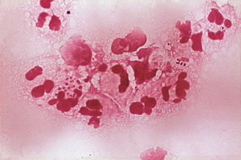

Figure 29-9 

Cerebrospinal fluid Gram stain showing gram-negative diplococci characteristic of _N. meningitidis_ . 

The Gram stain remains an accurate, rapid method by which to diagnose CNS infection. All specimens should be concentrated by centrifugation before Gram stain and culture. Depending upon the type of infecting microorganism and its concentration in the cerebrospinal fluid, Gram stain sensitivity ranges from 60% to 90%, with the greatest sensitivity corresponding to higher concentrations of bacteria (about 10  5  colony-forming units/mL). For example, the sensitivity of the Gram stain for detecting _Listeria monocytogenes_ and gram-negative bacilli is 50% or less (  Greenlee, 1990  ). For patients with many polymorphonuclear leukocytes but no organisms seen on Gram stain, the more sensitive acridine orange stain may be helpful. Cultures have a sensitivity of 80% to 90%, but are about 30% less sensitive in partially treated cases (  Greenlee, 1990  ). 

Although standard culture-based methods remain the mainstay for diagnosis, the BinaxNOW _Streptococcus pneumoniae_ antigen test, an immunochromatographic membrane assay that detects the presence of the C polysaccharide cell wall antigen common to all pneumococcal serotypes, has been proven to be a valuable tool for the rapid diagnosis of pneumococcal meningitis from CSF. Latex agglutination bacterial antigen tests performed on CSF to detect _H. influenzae_ , _N. meningitidis_ , _S. pneumoniae_ , and β-hemolytic group B streptococci historically are used as adjuncts to Gram stain and culture; however, the sensitivity is approximately the same as the Gram stain, and a negative test does not rule out the diagnosis of bacterial meningitis. Perhaps the best application of latex agglutination antigen tests is seen in partially treated, community-acquired meningitis that is negative for microorganisms by Gram stain (  Perkins et al, 1995  ;  Wilson, 1997  ). 

The polymerase chain reaction (PCR) and sequencing of 16S ribosomal RNA in CSF have been shown to be very useful in the diagnosis of bacterial meningitis (  Schuurman et al, 2004  ). Compared with bacterial culture, the assay shows a sensitivity of 86%, a specificity of 97%, a positive predictive value of 80%, and a negative predictive value of 98%. Nucleic acid amplification tests may also be helpful in patients already receiving antimicrobial therapy and in detecting more fastidious pathogens such as _N. meningitidis_ (  Porritt et al, 2000  ;  Seward & Towner, 2000  ;  Baethgen et al, 2003  ). 

 

##  Spirochetal Meningitis 

The incidence of neurosyphilis has increased in recent years, primarily in patients with HIV infection. In one report, 44% of patients with neurosyphilis had AIDS (  Flood et al, 1998  ). Unfortunately, the remaining patients, who may have had HIV infection without AIDS, were not studied. The diagnosis of CNS infection in patients with syphilis relies primarily on CSF parameters and serologic testing, although molecular DNA testing may now represent another approach. Abnormalities in CSF protein and cell counts are common in syphilitic meningitis, but are nonspecific. CSF serologic testing to diagnose neurosyphilis is difficult. The standard nontreponemal test performed on CSF is the Venereal Disease Research Laboratory (VDRL). If few erythrocytes are contaminating the CSF, the VDRL specificity is high, but its sensitivity is only 50% to 60% (  Davis & Schmitt, 1989  ). Treponemal tests, such as the treponemal antibody absorption (FTA-ABS), are both sensitive and specific for syphilis; however, their use in CSF for neurosyphilis is controversial. The CSF FTA-ABS is highly sensitive, but false-positive results may occur. In the absence of CSF abnormalities or clinical suspicion, it should not be used as a screening test. Thus, the following generalizations have been proposed (  Davis & Schmitt, 1989  ): (1) A nonreactive serum FTA-ABS test rules out neurosyphilis; (2) a reactive serum FTA-ABS test with a nonreactive CSF FTA-ABS test essentially rules out neurosyphilis; (3) a reactive CSF VDRL test makes a diagnosis of neurosyphilis likely; and (4) a reactive CSF FTA-ABS test may indicate active neurosyphilis, asymptomatic neurosyphilis, treated neurosyphilis, or a false-positive reaction. Other studies have demonstrated the utility of a PCR-based assay as a sensitive and specific means of diagnosing neurosyphilis (  Leslie et al, 2007  ). 

Diagnosis of Lyme meningitis represents another challenge for the laboratory. The mainstay of diagnosis remains serologic analysis performed on a serum specimen, using an enzyme-linked immunosorbent assay (ELISA)-based screening assay followed by confirmation with Western blot. PCR-based analysis may be performed on CSF specimens; however, the sensitivity of this approach may be low, particularly in patients with chronic neuroborreliosis (  Steere, 2010  ). 

Rapid diagnosis of leptospiral and other bacterial infections is now possible using genomic methods, including next-generation DNA sequencing analysis. In a recent study, a patient with neuroleptospirosis in whom a diagnosis could not be established by conventional methods was successfully diagnosed using next-generation sequencing analysis of CSF (  Wilson et al, 2014  ). This methodology offers the hope of increasingly rapid diagnosis of a range of infections, as well as a way to rapidly track infection outbreaks (  Sherry et al, 2013  ). 

 

##  Viral Meningitis 

Enteroviruses (echoviruses, coxsackieviruses, polioviruses) and arboviruses are responsible for the majority of meningitis cases; a seasonal peak in spring to autumn has been noted for these agents. As an example, echoviruses 9 (E9) and 30 (E30) were found to be mainly responsible for an increase in cases of aseptic meningitis (  Morbidity and Mortality Weekly Report, 2003  ). Most patients present with a CSF pleocytosis, and although neutrophils may be observed early in the infection, patients soon develop a predominance of lymphocytes. 

Before molecular diagnostic testing, viral meningitis was a diagnosis of exclusion because the sensitivity of viral cultures can be low. Thus, in an early study, a specific etiologic diagnosis by viral cultures varied from 72% for enteroviruses to 5% for herpes simplex virus (HSV) (  Marton & Gean, 1986  ). 

Reverse transcriptase polymerase chain reaction (RT-PCR) is significantly more sensitive than cell culture (  Dumler & Valsamakis, 1999  ;  Hausfater et al, 2004  ). Arguably, it has evolved as the “gold standard” for the diagnosis of viral meningitis secondary to enterovirus, herpes simplex virus, cytomegalovirus, varicella zoster, and JC virus. The use of RT-PCR may result in significant cost savings by shortening hospital stays and eliminating unnecessary diagnostic and therapeutic interventions (  Ramers et al, 2000  ). For patients with arbovirus-associated meningitis, acute and convalescent serologic testing in serum remains the cornerstone for diagnosis, with CSF testing a possible adjunct. Presumptive diagnosis of West Nile viral meningitis may be made on a CSF specimen using an IgM antibody-capture ELISA assay. PCR testing for West Nile virus and other arboviruses may also be done on CSF specimens; however, these assays have low sensitivity because of the short-lived nature of the viremia in these diseases and are not recommended for routine use (  Vaughn et al, 2010  ). 

PCR amplification of HSV DNA has revolutionized the testing for HSV infection in CSF and has replaced brain biopsy as the primary method used in the early diagnosis of HSV meningoencephalitis (  Tunkel, 2008  ). False negatives might occur in very early infections and with bloody taps, necessitating analysis of a second CSF specimen (  Tyler, 2004  ). 

 

##  Human Immunodeficiency Virus 

A wide variety of CSF abnormalities may be found in HIV-positive patients with or without neurologic disease, including lymphocytic pleocytosis, elevated IgG indexes, and oligoclonal bands (  Chalmers et al, 1990  ;  Hall & Snyder, 1992  ). Identifying opportunistic infection is the most important indication for examining the CSF. Serious fungal infections may exist in the presence of few or no CSF parameter abnormalities. 

 

##  Fungal Meningitis 

_Cryptococcus neoformans_ is the most frequently isolated fungal pathogen from CSF. India ink or nigrosin stains for cryptococcus capsular halos have a sensitivity of about 25%, increasing to 53% with multiple lumbar punctures, and to greater than 90% in untreated HIV-infected patients (  Marton & Gean, 1986  ). Detection of cryptococcal antigen from sera or CSF using latex agglutination has higher sensitivity, ranging from 60% to 95%. False-negatives due to a prozone effect or low concentration of polysaccharide antigen may occur. Early disease, intraparenchymal infection, infection with nonencapsulated _C. neoformans_ variants, and immune complexes (corrected with pronase treatment) may also produce false-negatives. Conversely, sera or CSF from patients with rheumatoid factor or _Trichosporon asahii_ infection may be falsely positive. If clinical suspicion for dimorphic or filamentous fungi is high, large volumes of CSF (approximately 15 to 20 mL) are optimal for culture to improve the recovery of fungal organisms. 

 

##  Tuberculous Meningitis 

Abnormal CSF with elevated protein and lymphocytic predominance are the hallmark features of tuberculous meningitis. The sensitivity of CSF acid-fast stains for the diagnosis of tuberculous meningitis is highly variable, ranging from 10% to 12% (  Greenlee, 1990  ) to greater than 50% (  Thwaites et al, 2004  ). Large volumes of CSF, often obtained from multiple lumbar punctures with the use of concentration techniques, are recommended to improve the sensitivity of both acid-fast stain and culture (  Marton & Gean, 1986  ). 

PCR nucleic acid amplification for detecting _Mycobacterium tuberculosis_ DNA-specific sequences have shown great promise in the rapid and accurate diagnosis of tuberculous meningitis (  Lin et al, 1995  ;  Desai & Pal, 2002  ), but PCR methods using a single primer are associated with relatively low sensitivity (  Pai et al, 2003  ). Multiplex PCR analysis, using primers to multiple relevant tubercular genes, appears to be a significantly more sensitive method in the rapid diagnosis of tuberculous meningitis (  Kusum et al, 2011  ). 

DOT ELISA has been standardized to detect tuberculosis antigens and antibodies against _M. tuberculosis_ in CSF. Using this technique, a positive reaction was present in 86% of cases with suspected tuberculous meningitis (  Kashyap et al, 2003  ). Only 5% of patients with other disorders, mainly pyogenic meningitis, were positive. 

Other tests have been shown to be useful in some cases of tuberculous meningitis. ADA levels are significantly higher in tuberculous meningitis than in other types of meningitis and CNS disorders (  Pettersson et al, 1991  ;  Choi et al, 2002  ;  Solari et al, 2013  ), although the degree of increase indicative of tuberculous infection varies depending on the specific assay used. 

 

##  Primary Amebic Meningoencephalitis 

This rare disease is caused by the free-living ameba _Naegleria fowleri_ , _Acanthamoeba_ species, and _Balamuthia mandrillaris_ . _Naegleria_ and _Balamuthia_ are more likely to cause an acute inflammatory response with a neutrophilic pleocytosis, a decreased glucose level, an elevated protein concentration, and the presence of erythrocytes. Gram stain is always negative. _Acanthamoeba_ more often produces a granulomatous meningitis. Motile _Naegleria_ trophozoites may be visualized by light or phase-contrast microscopy in direct wet mounts, allowing rapid diagnosis. Intact and degenerating organisms may be identified on Wright's- or Giemsa-stained cytospins but must be distinguished from macrophages (dos  Santos, 1970  ;  Benson et al, 1985  ). Acridine orange stain is useful in differentiating amebas (brick red) from leukocytes (bright green). Immunocytochemical staining of CSF specimens using an antibody to _Naegleria fowleri_ has been shown to improve microscopic detection of this organism (  Visvesvara, 2010  ). Multiplex PCR-based methods are an even more sensitive modality for detecting multiple amebic organisms in CSF (  Qvarnstrom et al, 2006  ). 

,  

##  Synovial Fluid 

_Synovium_ refers to the tissue lining synovial tendon sheaths, bursae, and diarthrodial joints, except for the articular surface. It is composed of one to three cell layers that form a discontinuous surface overlying fatty, fibrous, or periosteal joint tissue. 

**Synovial fluid** (SF) is an imperfect ultrafiltrate of blood plasma combined with hyaluronic acid produced by the synovial cells. Small ions and molecules (e.g., Na  \+  , K  \+  , glucose, urea) readily pass into the joint space and therefore are similar in concentration to plasma; large molecules are absent or present in trace amounts. Resorption of synovial molecules is by lymphatics and is not size dependent. SF acts as a lubricant and adhesive and provides nutrients for the avascular articular cartilage. 

Examination of the SF is essential to distinguish infectious from noninfectious arthritis. Results from gross and microscopic examination of SF have traditionally been divided into “reaction types,” as depicted in [ Table 29-7 ](<#t0040>) . These groupings are largely descriptive, and considerable overlap among them is evident. Except for Gram stain, culture, and crystal examination, SF parameters can be nonspecific and must be integrated into the clinical context. 

TABLE 29-7 

Synovial Fluid Findings by Disease Category 

|  |  CATEGORY   
---|---|---  
Finding  |  Normal  |  Group I Noninflammatory  |  Group II Inflammatory  |  Group III Infectious  |  Group IV Hemorrhagic   
Clarity  |  Transparent  |  Transparent  |  Transparent/opaque  |  Opaque  |  Opaque   
Color  |  Clear to pale yellow  |  Xanthochromic  |  Xanthochromic to white/bloody  |  White  |  Red-brown or xanthochromic   
WBCs/mL  |  0-150  |  <3000  |  3000-75,000  |  50,000-200,000  |  50-10,000   
PMNs, %  |  <25  |  <30  |  >50  |  >90  |  <50   
RBCs  |  No  |  No  |  No  |  Yes  |  Yes   
Glucose (blood/SF difference, mg/dL)  |  0-10   
(0-0.56 mmol/L)  |  0-10   
(0-0.56 mmol/L)  |  0-40   
(0-2.2 mmol/L)  |  20-100   
(1.11-5.5 mmol/L)  |  0-20   
(0-1.11 mmol/L)   
  
_PMNs,_ Polymorphonuclear cells, neutrophils; _RBCs,_ red blood cells; _SF,_ synovial fluid; _WBCs_ , white blood cells. 

Modified from Kjeldsberg CR, Knight JA: _Body fluids: laboratory examination of amniotic, cerebrospinal, seminal, serous and synovial fluids,_ ed 3, Chicago, 1993, © American Society for Clinical Pathology, with permission. 

**Noninflammatory effusions** (Group I) typically have leukocyte counts less than 3000/µL, with a minority of neutrophils. Osteoarthritis, traumatic arthritis, neuropathic osteoarthropathy, pigmented villonodular synovitis, and early rheumatic fever usually present with little inflammatory response. Early rheumatoid arthritis, early bacterial infection, and viral arthritis may also present as noninflammatory effusions. 

**Inflammatory effusions** (Group II) have leukocyte counts between 3000 and 75,000/µL, with neutrophils accounting for more than 50% of the population. Rheumatoid arthritis, systemic lupus erythematosus (SLE), Reiter's syndrome, rheumatic fever, acute crystal-induced arthritis, arthritis associated with inflammatory bowel disease, psoriatic arthritis, and fat droplet synovitis are examples of this reaction group. 

**Purulent (infectious) effusions** (Group III) typically have leukocyte counts greater than 50,000/µL, of which 90% or more are neutrophils. Bacterial, fungal, and tuberculous joint infections constitute this group. 

**Hemorrhagic effusions** (Group IV) may be seen in association with traumatic arthritis, pigmented villonodular synovitis, synovial hemangioma, neuropathic osteoarthropathy, joint prostheses, and hematologic disorders (hemophilia, thrombocytopenia, anticoagulant therapy, sickle cell disease or trait, myeloproliferative syndrome). 

 

##  Specimen Collection 

Joint fluid aspiration (arthrocentesis) should be confined to patients with an undiagnosed effusion or a significant clinical change related to a known effusion. It should be performed by an experienced operator using good sterile technique. Caution is necessary to avoid aspirating a sterile joint in someone with bacteremia or through a cutaneous or periarticular soft tissue infection into a sterile joint. Large joints such as the knee normally contain no more than 4.0 mL of SF, so small sample size is common unless an effusion is present. 

Synovial fluid must be collected with sterile, disposable needles and plastic syringes to avoid contamination by birefringent particulates. The syringe may be heparinized with 25 U of sodium heparin/mL of SF in routine arthrocentesis. Oxalate, lithium heparin, and powdered ethylenediaminetetraacetic acid (EDTA) anticoagulants should be avoided because they form crystal artifacts that may be misleading during the microscopic examination. Before aspiration, the joint should be turned or otherwise manipulated to ensure mixing of its contents. 

Ideally, the specimen should be separated into three parts: 3 to 10 mL into a sterile heparinized tube or syringe for microbiological studies; 2 to 5 mL in an anticoagulant tube (sodium heparin or liquid EDTA) for microscopic examination; and about 5 mL into a plain (no anticoagulant) tube for chemical analysis (normal SF does not clot because fibrinogen is absent). Heparin concentrations greater than 125 U/mL have an inhibitory effect on some pathogenic bacteria (  Rosett & Hodges, 1980  ). Specimens for culture, therefore, should be at least 1 to 2 mL in volume if they are submitted in green-top heparin tubes (Becton Dickinson, Rutherford, N.J.) containing 143 U/tube of heparin, or submitted in recapped syringes after removal of the needle and excess air. 

**Dry taps** may still have fluid within the needle, which may be sufficient for the most critical tests. Such specimens should be submitted with the needle still on the syringe and its tip stuck into a sterile cork. Good communication with the laboratory is crucial to the appropriate processing of such specimens. 

 

##  Recommended Tests 

Laboratory examination of SF is of major importance in the differential diagnosis of joint disease, especially in crystal-induced and infectious arthritis. When either is suspected, arthrocentesis and a systematic examination of the SF are imperative, and when examination is carried out properly, it is usually diagnostic. In other joint diseases, a specific diagnosis may not be possible. Nevertheless, fluid examination is still important, if only to rule out infectious arthritis, which is a critical diagnosis to make in that a joint may be irreversibly damaged within 2 to 3 days if not properly treated. This is especially true when _Staphylococcus aureus_ is the infectious organism. Therefore, routine tests should be directed toward the diagnosis of these two disorders ( [ Box 29-8 ](<#b0045>) ). Although other tests are not of practical value for routine use, they may provide important diagnostic information under certain circumstances. 

Box 29-8 

Recommended Synovial Fluid Tests 

  * Routine tests 

  * Gross examination (color, clarity) 

  * Total and differential leukocyte counts 

  * Gram stain and bacterial culture (aerobic and anaerobic) 

  * Crystal examination with polarizing microscope and compensator 

  * Useful tests in certain circumstances 

  * Fungal and acid-fast stains and cultures 

  * PCR for bacterial and mycobacterial DNA 

  * Serum–synovial fluid glucose differential 

  * Lactate and other organic acids 

  * Complement 

  * Enzymes 

  * Uric acid 

_DNA_ , Deoxyribonucleic acid; _PCR,_ polymerase chain reaction. 

Modified from Kjeldsberg CR, Knight JA: _Body fluids: laboratory examination of amniotic, cerebrospinal, seminal, serous and synovial fluids,_ ed 3, Chicago, 1993, © American Society for Clinical Pathology, with permission. 

It is critical that these tests be performed well because they can provide highly specific diagnostic information. Quality performance may be compromised in smaller laboratories that examine only a small number of SF specimens (  Hasselbacher, 1987  ;  Rabinovitch & Cornbleet, 1994  ). 

 

##  Gross Examination 

**Total volume** should be recorded at the bedside, especially if the sample is to be divided for submission to different laboratory sections. 

**Color** should be evaluated in a clear glass tube against a white background. Normal SF is colorless but is often pale yellow because of diapedesis of a few RBCs associated with even mild trauma. Noninflammatory and inflammatory disorders impart a straw to yellow color (xanthochromia). Septic fluid may be yellow, brown, or green depending on the chromogens produced by the offending organism and the host response, including the presence of WBCs and RBCs. 

A **traumatic tap** produces an uneven distribution of blood during arthrocentesis or streaking in the syringe. Although pale yellow xanthochromia is difficult to distinguish from normal, a red-brown color following centrifugation is good evidence of pathologic hemarthrosis. 

**Clarity** relates to the number and type of particles within the SF. Because normal SF is transparent, newsprint is easily read through the tube. Although translucent fluid obscures details, black and white areas can be distinguished, but opaque fluid completely obscures the background. 

Leukocytes are most commonly responsible for changes in clarity. However, very large numbers of crystals may produce an opaque, milky, opalescent fluid without leukocytes. A shimmering, oily-appearing specimen suggests an abundance of cholesterol crystals, which may grossly resemble pus. 

Increased turbidity is less often due to concentrations of fibrin, free-floating **rice bodies** (fragments of degenerating proliferative synovial cells or microinfarcted synovium), metal and plastic particles from patients with joint prostheses, or cartilage fragments in osteoarthritis. A **ground pepper** appearance from pigmented cartilage fragments may be the result of a metabolic disorder (i.e., ochronosis). 

 

##  Microscopic Examination 

 

##  Total Cell Count 

Total leukocyte counts should be performed promptly to avoid degenerative cell loss, which begins as soon as 1 hour following arthrocentesis. Cell counts are usually performed in a standard hemocytometer. A wet-prep slide count of 0 to 2 leukocytes per high-power field (hpf) (averaged over 10 fields) predicts fewer than 1300 WBCs by cell count (  Clayburne et al, 1992  ). Leukocyte counts over 50,000/µL require dilution, which should be done with saline, not acetic acid, to avoid mucin clot formation and cell clumping. Automated cell counters may be used, but their use risks clogging the machine aperture or obtaining spuriously high cell counts from non-WBC particles (e.g., crystals, fat globules), especially in multichannel and flow cell–based machines. Pretreatment of highly viscous SF samples with hyaluronidase improves automated cell counting using these instruments (  Aulesa et al, 2003  ). Automated cell counting in SF samples using digital image-based technology avoids the clogging and spurious count problems and now offers a reliable method for these counts (  Walker et al, 2009  ;  Scott, 2014  ). 

Leukocyte counts greater than 10,000/µL, and often greater than 50,000/µL, are characteristic of crystal-induced arthritis (e.g., gout, pseudogout), chronic inflammatory arthritis (e.g., rheumatoid arthritis, systemic lupus erythematosus, ankylosing spondylitis), and septic arthritis (Kjeldsberg, 1993). Osteoarthritis, osteochondritis dissicans, trauma, and synovioma usually have total WBC counts less than 10,000/µL. 

Erythrocytes should be routinely counted unless it is an obvious traumatic tap. If a large number of RBCs interferes with the leukocyte count, they may be lysed by dilution with 0.3 normal saline or 1% saponin in saline. 

The upper reference level for SF leukocytes is 150 to 200/µL (Kjeldsberg, 1993). Elevated cell counts are used to help divide findings into different disease categories but are nonspecific for any particular disease because of extensive overlap. 

 

##  Differential Leukocyte Count 

Cytospin preparations are preferred over smears from centrifuged SF because the cell morphology is significantly better preserved. Treatment with hyaluronidase may be necessary to produce thin smears in viscous specimens. Liquid-based thin-layer processing instruments may also be used effectively to produce good-quality preparations of SF for microscopic examination (  Policarpio-Nicolas & Valente, 2013  ). Automated leukocyte differential counts utilizing flow cytometers may be reliably performed on SF samples (  Aulesa et al, 2003  ), with even better performance, including detection of crystals, using digital image-based instruments (  Walker et al, 2009  ;  Scott, 2014  ). 

**Neutrophils** normally account for about 20% of SF leukocytes. Neutrophils generally exceed 50% in urate gout, pseudogout, and rheumatoid arthritis (RA); they most often exceed 75% in acute bacterial arthritis. When 75% is used as a cutoff, the sensitivity for an inflammatory process is about 75%, and the specificity is 92% (  Shmerling et al, 1990  ). These cells frequently exhibit degenerative changes and may contain bacteria, crystals, lipid droplets, vacuoles, or dark blue to black granular inclusions thought to consist of immune complexes (ragocytes, RA cells). The presence of ragocytes in patients with RA may indicate a poorer outcome (  Davis et al, 1988  ). 

**Lupus erythematosus (LE) cells,** sometimes present in patients with lupus arthritis, are most often neutrophils that have phagocytosed the nuclei of degenerating cells ( [ Fig. 29-10 ](<#f0055>) ). However, LE cells are not pathognomonic for SLE because they have also been identified in the SF of RA patients (  Hunder & Pierre, 1970  ). 

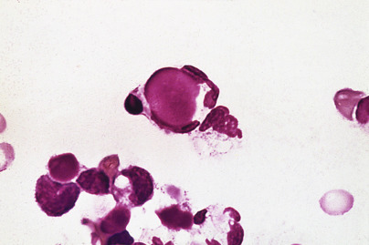

Figure 29-10 

Lupus erythematosus cell in the synovial fluid from a patient with systemic lupus erythematosus. 

**Lymphocytes,** normally constituting about 15% of SF cells, are prominent in early RA and other autoimmune disorders, as well as in chronic infections. Reactive forms, including immunoblasts, are occasionally present. 

**Monocytes** and **macrophages** are the most common cells present in normal SF, accounting for approximately 65% of the cell count. Monocytosis may be self-limited in viral arthritis or serum sickness, or more chronic in SLE or undifferentiated connective tissue disorders. Reiter's cells, originally believed to be specific for Reiter's syndrome, are macrophages containing degenerating neutrophils ( [ Fig. 29-11 ](<#f0060>) ). 

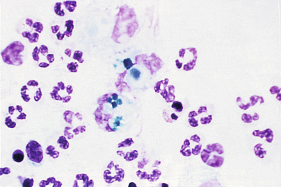

Figure 29-11 

Reiter's cells in the synovial fluid from a patient with Reiter's syndrome. 

**Eosinophilia,** defined as more than 2% of the leukocyte count, has been reported in Lyme disease, rheumatoid arthritis, rheumatic fever, metastatic carcinoma, parasitic infection, chronic urticaria, and angioedema, and following arthrography (allergic reaction to dye) and irradiation (  Podell et al, 1980  ;  Kay et al, 1988  ). 

**Synovial cells** have no pathologic significance. They appear similar to mesothelial cells and may be difficult to distinguish from monocytes and macrophages. 

**Lipid bodies** are associated with trauma, aseptic necrosis, and RA. These droplets often form Maltese crosses under polarized light, can be associated with a leukocyte response, and may cause spurious elevations of the automated WBC count (  Wise et al, 1987  ). 

 

##  Crystal Examination 

Crystals in SF lead to acute inflammation with increased WBC counts and a neutrophil-predominant infiltrate. Crystal identification, especially if intracellularly in neutrophils or macrophages, is pathognomonic for a crystal-induced arthritis (  Judkins & Cornbleet, 1997  ). 

**Gout** refers to the process of crystal deposition in articular tissue. Common usage typically implies urate gout, and an inflammatory response to crystal deposition is referred to as _gouty arthritis._ The most common types of endogenous crystals responsible for gouty arthritis are **monosodium urate monohydrate** (urate gout), **calcium pyrophosphate dihydrate** (pyrophosphate gout, chondrocalcinosis, or “pseudogout”), apatite and other **basic calcium phosphates** (BCP; apatite gout), **calcium oxalate** (oxalate gout), and **lipids** (lipid gout). 

Except for BCP, all of the above crystals can be detected by polarized light microscopy. A high-quality polarizing microscope with a first-order red plate compensator should be used. The **polarizer** filter is placed directly above the light source. The **analyzer** (another polarizing filter) is placed between the specimen slide and the microscope oculars, oriented 90 degrees from the polarizer to produce a dark background. The **compensator** is placed between the polarizer and the analyzer, usually oriented 45 degrees (halfway) between the planes of the two polarizing filters. 

Initial examination should be performed on a wet preparation using polarized light. Phase-contrast microscopy enhances crystal detection. The slide and coverslip must be cleaned and carefully dried immediately before use to avoid birefringent dust particulate artifacts. The coverslip edges are sealed with nail polish or other sealant, which retards but does not prevent evaporation. The coverslip edge is used to find the proper plane of focus; however, crystals in this location should be ignored because they are most likely artifacts. Most crystals are scanned with a 10× objective and are evaluated with at least a 40× objective, concentrating especially on cellular areas. Complete examination requires 100× oil immersion, however, because apparently negative fluids on scanning may contain a large population of small crystals (  Gatter & Schumacher, 1991  ). Aligning the crystals' orientation to the compensator by rotating the microscope stage or the compensator facilitates recognition and identification. Crystal morphology, the extinction angle, strength, and signs of any birefringence (i.e., the ability to refract light and split the incident light into two rays: a fast ray and a slow ray) are noted. The sensitivity and specificity of polarized microscopy for crystals are 78% and 79%, respectively, for monosodium urate (  Hasselbacher, 1987  ), and 12% and 67% for calcium pyrophosphate dihydrate (  McGill & York, 1991  ). Repeat examination following 24 hours of refrigeration at 4° C may result in a significant increase in the number of crystal-positive fluids (  Yuan et al, 2003  ). Cytospin preparations are also used effectively in the detection of crystals in SF samples (  Theiler et al, 2014  ). 

The Diff-Quik staining method may be a reliable alternative to polarized microscopy. Overall specificity, sensitivity, and accuracy are 87.5%, 94.4%, and 91.9%, respectively. The overall positive predictive value is 92.7%; the negative predictive value is 90.3% (  Selvi et al, 2001  ). Other more sophisticated and reliable methods, such as X-ray crystallography and Fourier transform infrared spectroscopy, have been described for identifying and characterizing crystals in biological specimens (  Rosenthal & Mandel, 2001  ). 

**Monosodium urate** (MSU) crystals appear as needle-shaped rods 5 to 20 µm long, but they may be only 1 to 2 µm in length or, rarely, may appear as rounded spherolites. They are strongly birefringent ( [ Fig. 29-12 ](<#f0065>) ): yellow when oriented parallel to the compensator and blue with perpendicular orientation (negative birefringence or elongation) ( [ Fig. 29-13 ](<#f0070>) ). A control slide of MSU crystals should always be used for comparison. Alternatively, betamethasone, a steroid that appears as a strongly negative birefringent rod, can be used to prepare a reference slide for the polarizing microscope (  Judkins & Cornbleet, 1997  ). 

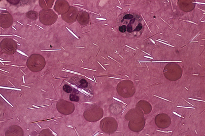

Figure 29-12 

Monosodium urate crystals under polarized light from a patient with urate gout. 

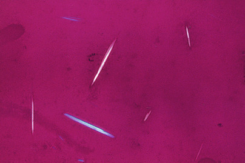

Figure 29-13 

Monosodium urate crystals in synovial fluid. 

Compensated polarized light. 

(From Kjeldsberg CR, Knight JA: _Body fluids: laboratory examination of amniotic, cerebrospinal, seminal, serous and synovial fluids,_ ed 3, Chicago, 1993, © American Society for Clinical Pathology, with permission.) 

MSU crystals are found in 90% of acute urate gout and in about 75% of patients between attacks. Intracellular MSU crystals are characteristic of acute urate gout. They may also occasionally be observed as a result of inflammation in septic arthritis (  McCarty, 1988  ). 

**Calcium pyrophosphate dihydrate** (CPPD) crystals are found in a group of conditions collectively known as _CPPD crystal deposition disease._ These crystals appear as rhomboids, rods, or rectangles 1 to 20 µm in length. CPPD crystals are weakly birefringent with positive elongation (blue when aligned with the compensator axis; [ Fig. 29-14 ](<#f0075>) ). Many are too small to polarize the light, making them difficult to detect without phase-contrast microscopy. Extinction is incomplete and occurs between 20 and 30 degrees from the angle of the polarizer and analyzer (oblique or inclined extinction). 

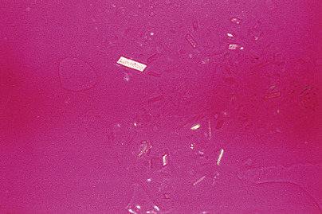

Figure 29-14 

Calcium pyrophosphate dihydrate crystals in synovial fluid from a patient with pseudogout. 

Compensated polarized light. 

(From Kjeldsberg CR, Knight JA: _Body fluids: laboratory examination of amniotic, cerebrospinal, seminal, serous and synovial fluids,_ ed 3, Chicago: © American Society for Clinical Pathology; 1993, with permission.) 

CPPD crystals are associated with degenerative arthritis and are seen in arthritides associated with hypomagnesemia, hemochromatosis, hyperparathyroidism, and hypothyroidism (  Jones et al, 1992  ). 

**Calcium hydroxyapatite** and the other basic calcium phosphate (BCP) crystals are typically too small and nonbirefringent (isotropic) to see with light microscopy, unless they are clumped into 1- to 50-µm spherical microaggregates. **Alizarin red S dye** may be used to stain these and other calcium-containing crystals (  Lazcano et al, 1993  ). At present, identification of BCP crystals is not important for diagnosis or prognosis, or as a guide in treatment. 

**Calcium oxalate dihydrate** crystals are 5- to 30-µm bipyramidal octahedral “envelopes” with variable birefringence and positive elongation. They are seen in arthropathy associated with chronic renal dialysis and primary oxalosis, a rare inborn error of metabolism. The monohydrate form is birefringent but nondescript in shape. 

**Lipid crystals** are 1- to 20-µm spheres with a Maltese cross appearance and positive birefringence under compensated polarized light. They have been implicated as a cause of acute arthritis (  McCarty, 1988  ). 

**Crystalline corticosteroids** from intraarticular injection may have an appearance similar to MSU or CPPD crystals and persist up to 1 month following injection. Most often, they have blunt, jagged edges without clear crystal structure because they are prepared by grinding up larger crystalline forms. Triamcinolone hexacetonide is negatively birefringent, but most others show positive birefringence. 

**Cholesterol crystals** typically appear as irregular birefringent plates, often with notched corners ( [ Fig. 29-15 ](<#f0080>) ). In chronic effusions (e.g., tuberculous arthritis, RA, SLE), needle- or rhomboid-shaped crystals similar to MSU or CPPD may be present (  Ettlinger & Hunder, 1979  ). Very small (1 to 5 microns) irregular, rod- and needle-shaped cholesterol crystals have been identified by X-ray diffraction analysis and by ultrastructural studies in osteoarthritis effusions (  Fam et al, 1981  ). Cholesterol crystals are ethanol and ether soluble and are not phagocytosed by leukocytes. If cholesterol crystals are detected, quantitative analysis should show that the SF cholesterol level exceeds the plasma level. 

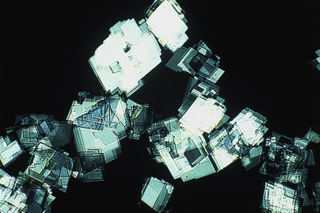

Figure 29-15 

Cholesterol crystals in synovial fluid. Polarized light. 

**Glove powder (modified cornstarch)** introduced during joint surgery appears as round, strongly birefringent particles 5 to 30 µm in diameter, with a central notch and a Maltese cross appearance when polarized. 

A variety of other crystals or particulates may be present in SF. These include monoclonal Ig crystals or cryoglobulins, Charcot-Leyden crystals, amyloid fragments, cartilage fragments, collagen fibrils and fibrin strands, hematoidin crystals from prior hemorrhage, crystals from certain anticoagulants, nail polish, prosthetic fragments, and dust particles (  Gatter & Schumacher, 1991  ). 

 

##  Chemical Analysis 

Chemical analyses of SF generally offer only supportive information to the routine tests. High viscosity may be remedied by dilution with normal saline, sonication, or hyaluronidase treatment. Reference intervals for the more important chemical analytes are shown in [ Table 29-8 ](<#t0045>) . 

TABLE 29-8 

Reference Intervals for Synovial Fluid Constituents 

Constituent  |  Synovial Fluid  |  Plasma   
---|---|---  
Total protein  |  1-3 g/dL  |  6-8 g/dL   
Albumin  |  55%-70%  |  50%-65%   
α 1  -Globulin  |  6%-8%  |  3%-5%   
α 2  -Globulin  |  5%-7%  |  7%-13%   
β-Globulin  |  8%-10%  |  8%-14%   
γ-Globulin  |  10%-14%  |  12%-22%   
Hyaluronic acid  |  0.3-0.4 g/dL  |   
Glucose  |  70-110 mg/dL  |  70-110 mg/dL   
Uric acid  |  2-8 mg/dL  |  2-8 mg/dL   
Lactate  |  9-29 mg/dL  |  9-29 mg/dL   
  
Modified from Kjeldsberg CR, Knight JA: _Body fluids: laboratory examination of amniotic, cerebrospinal, seminal, serous and synovial fluids,_ ed 3, Chicago, 1993, © American Society for Clinical Pathology, with permission. 

 

##  Mucin Clot Test 

Addition of acetic acid to SF precipitates hyaluronate into a mucin clot, which may be graded as good, fair, or poor. A fair to poor mucin clot test reflects dilution and depolymerization of hyaluronic acid—a nonspecific finding of several inflammatory arthritides. Although of historic interest, the mucin clot test has minimal clinical utility today (  Baker, 1991  ). 

 

##  Glucose 

Proper interpretation of SF glucose values requires comparison with serum levels, ideally preceded by a fast of 8 hours to allow glucose to equilibrate across the synovial membrane. The serum-synovial differential is less than 10 mg/dL in normal and many noninflammatory conditions. In septic arthritis, this difference ranges from 20 to 60 mg/dL but overlaps significantly with other inflammatory conditions, thereby limiting its clinical usefulness. When a cutoff value of 75 mg/dL is used, the sensitivity of low glucose for detecting an inflammatory joint disease is only 20%; the specificity is 84% (  Shmerling et al, 1990  ). 

In vitro glycolysis by large numbers of leukocytes may falsely reduce SF glucose values unless testing is performed within 1 hour of collection. Tubes containing sodium fluoride, an inhibitor of glycolysis, prevent the loss of glucose. 

 

##  Protein 

The mean normal protein concentration is 1.38 g/dL in living volunteers (  Weinburger & Simkin, 1989  ). A reliable reference interval is 1.0 to 3.0 g/dL. With increasing inflammation, larger proteins (e.g., fibrinogen) enter the synovial space. Spontaneous clot formation may be detected in non-anticoagulated specimen tubes (fibrin clot test). Although elevation of the SF protein level may be associated with inflammatory and infectious conditions, measurement of SF protein is highly nonspecific; the sensitivity is about 52% and the specificity 56% for inflammatory disorders (  Shmerling et al, 1990  ). 

 

##  Enzymes 

Numerous enzymes have been studied in SF, including lactate dehydrogenase, aspartate aminotransferase, adenosine deaminase, acid and alkaline phosphatase, and lysozyme, among others (Kjeldsberg, 1993). **Lactate dehydrogenase** is elevated in RA, gout, failed arthroplasties, and infectious arthritis. This increase most likely reflects the neutrophil infiltrate. Elevated **acid phosphatase** may have negative prognostic value in RA but is not specific (  Luukkainen et al, 1989  ). Although enzyme analysis of SF is currently not clinically relevant, the measurement of various hydrolases may have significant predictive value in joint prognosis, especially RA. 

 

##  Organic Acids 

When compared with nonseptic monoarticular arthritis, SF **lactic acid** levels are usually increased in patients with septic arthritis (Kjeldsberg, 1993). Levels significantly greater than 30 mg/dL (3.7 mmol/L) are commonly associated with septic arthritis due to gram-positive cocci and gram-negative bacilli. Measurement of D-lactate levels in SF appears to be a useful method for rapid diagnosis of bacterial synovitis (  Gratacos et al, 1995  ). In other studies, however, normal or intermediate lactate levels neither rule in nor rule out infection. Moreover, gonococcal arthritis is notorious for having normal SF lactate levels (  Curtis et al, 1983  ). 

When gas-liquid chromatography is used, the presence of other organic acids not normally present in SF (e.g., **n-valeric, n-hexanoic,** and **succinic acids** ) may be very helpful in differentiating septic from nonseptic arthritis (  Borenstein et al, 1982  ). 

 

##  Uric Acid 

Synovial fluid uric acid levels generally, although not always, parallel serum levels in gout and noninflammatory arthropathies. This assay provides little clinical value in SF analysis except in some cases where gout is suspected but crystals are not identified (  Reeves, 1965  ). Increased SF uric acid levels in these cases support a diagnosis of gout. 

 

##  Lipids 

In contrast to plasma, normal SF contains extremely low concentrations of lipids. Synovial fluid lipid abnormalities include (1) rare cholesterol-rich pseudochylous effusions typically associated with chronic RA; (2) lipid droplets, usually the result of trauma; and (3) extremely rare chylous effusions seen in association with RA, SLE, filariasis, pancreatitis, and trauma (  Wise et al, 1987  ). These diseases can usually be differentiated clinically and by gross and microscopic examination; quantification of lipids currently has no clinical value in joint fluid analysis, except in cases in which cholesterol crystals may resemble MSU or CPPD. In these cases, a cholesterol level that exceeds the plasma level supports the presence of cholesterol crystals. 

 

##  Immunologic Studies 

**Rheumatoid factor** (RF) is found in the SF of about 60% of RA patients, usually at a titer equal to or slightly lower than the serum titer. **Antinuclear antibodies** (ANA) are found in the SF of about 70% of patients with SLE and 20% of patients with RA. Neither is specific enough for practical use. SF **complement** levels, normally about 10% of serum levels, increase to 40% to 70% of serum activity with inflammation, proportional to the increase in protein exudation. Complement consumption in SLE and RA, in particular, results in levels less than 30% of serum complement. Complement is also decreased in some cases of bacterial and crystal-induced arthritis, so measurement is impractical for routine diagnosis. 

 

##  Microbiological Examination 

Immediate transportation of joint fluid and good communication of clinical suspicions to the laboratory are extremely important in the rapid identification of an infectious agent. 

Septic arthritis may be acute or chronic, and Gram stain and culture should be performed as part of the routine SF evaluation. Gram stain sensitivity varies from about 75% for staphylococcal infections and 50% for most gram-negative organisms, to less than 25% for gonococcal infections (  Goldenberg & Reed, 1985  ). Concentration methods, including cytocentrifugation, may increase the sensitivity of the Gram stain. 

Culture sensitivity ranges from 75% to 95% for nongonococcal joint infections in patients who have not received antibiotics. For patients with gonorrhea, the sensitivity is only 10% to 50% (  Shmerling, 1994  ). In partially treated patients, the use of resin-containing blood culture bottles for culturing SF may improve isolation and identification of the responsible organism. 

Although not yet in routine practice, the use of polymerase chain reaction (PCR) with primers to detect bacterial DNA is helpful, particularly for the more fastidious, uncultivable pathogens (e.g., _Borrelia burgdorferi_ , _Chlamydia_ spp., _Mycoplasma_ spp.) (  Nocton et al, 1994  ;  Li et al, 1996  ;  Jalava et al, 2001  ). Viruses are often associated with acute infectious arthritis, and, depending on the putative virus, serology, viral culture, and detection of viral DNA by nucleic acid amplification should be performed. 

Depending on the clinical history, infectious arthritis may be associated with particular exposures and their associated pathogens. Arthritis develops in approximately 60% of patients with Lyme disease resulting from exposure to ticks infected with _Borrelia burgdorferi_ (  Golightly, 1993  ). The PCR test for detecting _B. burgdorferi_ DNA in SF is positive in 96% of untreated cases (  Nocton et al, 1994  ;  Exner & Lewinski, 2003  ). 

In patients with a travel history or outdoor occupations, SF/tissue should be examined for fungal pathogens by KOH/calcofluor white stain and cultured on selective fungal media. For example, a patient with a recent travel history to Arizona may present with a monoarticular arthritis secondary to _Coccidioides immitis_ . 

Patients with chronic arthritis and risk factors for _Mycobacterium tuberculosis_ or nontuberculous infections should undergo a synovial biopsy (  Verettas et al, 2003  ;  Titov et al, 2004  ). Ziehl-Neelsen or Kinyoun stains for acid-fast organisms have a sensitivity of about 20%. Cultures for _M. tuberculosis_ are positive in about 80% of proven cases. Because conventional culture methods for _M. tuberculosis_ are often very time-consuming, applying PCR in SF for the detection of _M. tuberculosis_ is a useful technique for more rapid diagnosis (  Fujimoto et al, 2010  ). 

,  

##  Pleural Fluid 

The pleural cavity is a potential space lined by mesothelium of the visceral and parietal pleurae. The pleural cavity normally contains a small amount of fluid that facilitates movement of the two membranes against each other. This fluid is a plasma filtrate derived from capillaries of the parietal pleura. It is produced continuously at a rate dependent on capillary hydrostatic pressure, plasma oncotic pressure, and capillary permeability. Pleural fluid is reabsorbed through the lymphatics and venules of the visceral pleura. 

An accumulation of fluid, called an **effusion,** results from an imbal­ance of fluid production and reabsorption. This fluid accumulation in the pleural, pericardial, and peritoneal cavities is known as a **serous effusion.**

 

##  Specimen Collection 

Thoracentesis is indicated for any undiagnosed pleural effusion or for therapeutic purposes in patients with massive symptomatic effusions. Pleural fluid samples are frequently collected, handled, and/or analyzed in a less than satisfactory manner. Indeed, improper collection/handling and undertesting or inappropriate testing are more common than with other body fluids. The laboratory often receives a large syringe or vacuum bottle, which must be circulated through the various laboratory sections. Moreover, a large blood or fibrin clot may be present as the result of inadequate anticoagulation or mixing. 

Except for an EDTA tube for total and differential cell counts, the specimen should be collected in heparinized tubes to avoid clotting. Aliquots for aerobic and anaerobic bacterial cultures are best inoculated into blood culture media at the bedside. If malignancy, fungal infection, or mycobacterial infection is suspected, all remaining fluid (≥100 mL) should be submitted to maximize the yield of stains and culture. Because serous effusions are more forgiving than CSF in maintaining cellular integrity, fresh specimens for cytology may be stored for up to 48 hours in the refrigerator with satisfactory results. For pH measurements, the fluid should be collected anaerobically in a heparinized syringe and submitted to the laboratory on ice. Grossly purulent specimens do not require pH measurement and may clog the analyzer. 

 

##  Transudates and Exudates 

It has long been recognized that the initial classification of a pleural fluid as a **transudate** or an **exudate** greatly simplifies the process of arriving at a correct final diagnosis. Moreover, it determines whether further testing is needed. 

Transudates are usually bilateral owing to systemic conditions leading to increased capillary hydrostatic pressure or decreased plasma oncotic pressure ( [ Box 29-9 ](<#b0050>) ). Malignant effusions may infrequently be transudative as the result of a simultaneous confounding clinical condition such as congestive heart failure (  Ashchi et al, 1998  ). Exudates are more often unilateral, associated with localized disorders that increase vascular permeability or interfere with lymphatic resorption (see [ Box 29-9 ](<#b0050>) ). 

Box 29-9 

Classification of Pleural Effusions 

 

##  Transudates: Increased Hydrostatic Pressure or Decreased Plasma Oncotic Pressure 

  * Congestive heart failure 

  * Hepatic cirrhosis 

  * Hypoproteinemia (e.g., nephrotic syndrome) 

 

##  Exudates: Increased Capillary Permeability or Decreased Lymphatic Resorption 

  * Infections 

    * Bacterial pneumonia 

    * Tuberculosis, other granulomatous diseases (e.g., sarcoidosis, histoplasmosis) 

    * Viral or mycoplasma pneumonia 

  * Neoplasms 

    * Bronchogenic carcinoma 

    * Metastatic carcinoma 

    * Lymphoma 

    * Mesothelioma (increased hyaluronate content of effusion fluid) 

  * Noninfectious inflammatory disease involving pleura 

    * Rheumatoid disease (low pleural fluid glucose in most cases) 

    * Systemic lupus erythematosus (LE cells are occasionally present) 

  * Pulmonary infarct (may be associated with hemorrhagic effusion) 

 

##  Fluid from Extrapleural Sources 

  * Pancreatitis (elevated amylase activity in effusion fluid) 

  * Ruptured esophagus (elevated amylase activity and low pH) 

  * Urinothorax (elevated creatinine and low pH) 

_LE,_ Lupus erythematosus. 

 

##  Recommended Tests 

The evaluation of serous body fluids (pleural, pericardial, peritoneal) is directed first toward differentiating transudative from exudative effusions. Transudates generally require no further workup. However, the fluid should be retained for 7 to 10 days in case further testing is needed. To separate the two, several chemical parameters have been proposed, although none is 100% accurate ( [ Table 29-9 ](<#t0050>) ). 

TABLE 29-9 

Laboratory Criteria for Pleural Fluid Exudate 

Pleural fluid/serum protein ratio  |  ≥0.50   
---|---  
Pleural fluid/serum LD ratio  |  ≥0.60   
Pleural fluid LD  |  ≥ upper limit of normal serum LD   
Pleural fluid cholesterol  |  >45 mg/dL   
Pleural fluid/serum cholesterol ratio  |  ≥0.30   
Serum–pleural fluid albumin gradient  |  ≤1.2 g/dL   
Pleural fluid/serum bilirubin ratio  |  ≥0.60   
  
_LD,_ Lactate dehydrogenase. 

Classical teaching stressed that exudates and transudates can be distinguished on the basis of total protein concentrations above (exudates) or below (transudates) 3.0 g/dL. However, using total protein alone misclassifies both exudates and transudates by about 30% (  Melsom, 1979  ). It is now well accepted that test combinations increase sensitivity, improve accuracy, and serve as the basis for the well-established Light criteria (  Light et al, 1972  ). An exudate meets one or more of the following criteria: (1) Pleural fluid/serum protein ratio greater than 0.5; (2) pleural fluid/serum LD ratio greater than 0.6; and (3) pleural fluid LD level greater than two thirds of the serum upper limit of normal. Using these criteria, the sensitivity and specificity are about 98% and 80%, respectively. 

Several alternative measurements have been proposed to differentiate exudates from transudates. Testing for total cholesterol, the albumin gradient, or a combination of LD and total cholesterol may discriminate effusions with equivocal Light's criteria results. For example, the albumin gradient is recommended to confirm a clinical transudate misclassified as an exudate by Light's criteria (  Light, 1997  ), that is, a serum albumin level greater than 1.2 g/dL higher than the pleural fluid level indicates that the fluid is a transudate (  Burgess et al, 1995  ). In many such cases, the patient is being diuresed. Other test combinations have equaled but not surpassed the performance of Light's criteria. In most cases, the same categorization of pleural fluids as exudates or transudates may be achieved using measurements of protein and LD alone without comparison with a blood sample, as was accomplished with application of Light's criteria (  Murphy & Jenkinson, 2008  ). 

Some tests, such as the combination of pleural fluid LD and cholesterol, may be more convenient and cost-effective by avoiding the need for simultaneous blood tests (  Costa et al, 1995  ). Bilirubin measurement is not a strong discriminator of effusions (  Heffner et al, 1997  ). 

Further analysis of exudates is directed toward ruling out malignancy and infection. Cytology and appropriate bacterial stains and cultures are the most useful tests in this regard. Moreover, given that pleural fluid DNA levels are significantly increased in exudates, quantitative analysis may be an effective method to evaluate the causes of serous effusion (  Chan et al, 2003  ). Recommended tests for the evaluation of pleural effusions are summarized in [ Box 29-10 ](<#b0055>) . The types of tests ordered and the interpretation of test results should always be correlated with clinical findings and differential diagnosis. Total leukocyte, differential, and RBC counts are of limited use in the evaluation of serous effusions. 

Box 29-10 

Pleural Effusion 

Recommended Tests 

 

##  Routine Tests 

  * Gross examination 

  * Pleural fluid/serum protein ratio 

  * Pleural fluid/serum LD ratio 

  * Examination of Romanowski-stained smear (malignant cells, LE cells) 

 

##  Useful Tests in Most Patients 

  * Stains and cultures for microorganisms 

  * Cytology 

 

##  Useful Tests in Selected Cases 

  * Pleural fluid cholesterol 

  * Pleural fluid/serum cholesterol ratio 

  * Albumin gradient 

  * pH 

  * Lactate 

  * Enzymes (ADA, amylase, LD) 

  * Interferon-γ

  * C-reactive protein 

  * Lipid analysis 

  * Tumor markers 

  * Immunologic studies 

  * Tuberculostearic acid 

  * Pleural biopsy 

_ADA,_ Adenosine deaminase; _LD,_ lactate dehydrogenase; _LE,_ lupus erythematosus. 

Modified from Kjeldsberg CR, Knight JA: _Body fluids: laboratory examination of amniotic, cerebrospinal, seminal, serous and synovial fluids,_ ed 3, Chicago, 1993, © American Society for Clinical Pathology, with permission. 

 

##  Gross Examination 

Transudates are typically clear, pale yellow to straw-colored, and odorless, and do not clot. Approximately 15% of transudates are blood tinged. A bloody pleural effusion (hematocrit >1%) suggests trauma, malignancy, or pulmonary infarction (  Jay, 1986  ). A traumatic tap is suggested by uneven blood distribution, fluid clearing with continued aspiration, or formation of small blood clots. A pleural fluid hematocrit greater than 50% of the blood hematocrit is good evidence for a hemothorax (  Light, 1995  ). 

Exudates may grossly resemble transudates, but most show variable degrees of cloudiness or turbidity, and they often clot if not heparinized. A feculent odor may be detected in anaerobic infections. Turbid, milky, and/or bloody specimens should be centrifuged and the supernatant examined. If the supernatant is clear, the turbidity is most likely due to cellular elements or debris. If the turbidity persists after centrifugation, a chylous or pseudochylous effusion is likely. 

True chylous effusions are produced by leakage from the thoracic duct resulting from obstruction by lymphoma, carcinoma, or traumatic disruption. A creamy top layer of chylomicrons may form in the specimen on standing. Idiopathic congenital chylothorax is the most common form of pleural effusion in the newborn. 

Pseudochylous or chyliform effusions may have a milky, greenish, or “gold paint” appearance. They accumulate gradually through the breakdown of cellular lipids in long-standing effusions such as rheumatoid pleuritis, tuberculosis, or myxedema. Features that distinguish true chylous from pseudochylous effusions are summarized in [ Table 29-10 ](<#t0055>) . 

TABLE 29-10 

Characteristic Features of Chylous and Pseudochylous Effusions 

Feature  |  Chylous  |  Pseudochylous   
---|---|---  
Onset  |  Sudden  |  Gradual   
Appearance  |  Milky-white, or yellow to bloody  |  Milky or greenish, metallic sheen   
Microscopic examination  |  Lymphocytosis  |  Mixed cellular reaction, cholesterol crystals   
Triglycerides [ * ](<#hl0000758>) [ † ](<#hl0000761>) |  ≥110 mg/dL (≥1.24 mmol/L)  |  <50 mg/dL (<0.56 mol/L)   
Lipoprotein electrophoresis  |  Chylomicrons present  |  Chylomicrons absent   
  
Modified from Kjeldsberg CR, Knight JA: _Body fluids: laboratory examination of amniotic, cerebrospinal, seminal, serous and synovial fluids,_ ed 3, Chicago, 1993, © American Society for Clinical Pathology, with permission. 

 * Values in parentheses are SI units. 

 † Triglyceride levels between 50 mg/dL and 110 mg/dL are equivocal and require electrophoresis to confirm chylothorax. 

 

##  Microscopic Examination 

 

##  Cell Counts 

Total cell counts may be performed using manual hemocytometer methods; however, automated cell counts are increasingly used with pleural and other serous fluid specimens (  Aulesa et al, 2003  ;  Conner et al, 2003  ;  Yang et al, 2013  ). Leukocyte counts have limited utility in separating transudates (<1000/µL) from exudates (>1000/µL). Although RBC counts above 100,000/µL are highly suggestive of malignancy, trauma, or pulmonary infarction, they are not specific for these conditions. 

 

##  Differential Leukocyte Count and Cytology 

Examination is commonly performed on a stained smear, preferably prepared by cytocentrifugation and with the air-dried smear stained with a Romanowski stain. Indeed, examination by the hematology laboratory can be highly effective in the detection of malignant cells, especially hematologic malignancies (  Kendall et al, 1997  ). Filtration or automated concentration methods with Papanicolaou stain may also be used, especially if cell loss is a matter of concern. Automated WBC differential counts may be done on pleural fluid samples; however, some variation in results from those of manual methods may be seen (  Conner et al, 2003  ). Liquid-based thin-layer methods are often used to prepare pleural and other serous fluid specimens for cytopathologic examination and show good performance in the detection of malignant cells (  Moriarity et al, 2008  ). 

Cytologic analysis will establish the diagnosis of metastatic carcinoma in 70% or more of cases when both smears and cell blocks are examined (  Light, 2002  ). The sensitivity is significantly lower if the patient has mesothelioma (10%), squamous cell carcinoma (20%), lymphoma (25% to 50%), or sarcoma (25%). Preparation of cell blocks is unnecessary, except for effusions in which malignancy is an important consideration (  Jonasson et al, 1990  ). 

**Mesothelial cells** are common in pleural fluids from inflammatory processes ( [ Fig. 29-16 ](<#f0085>) ). They are, however, conspicuously scarce in patients with tuberculous pleurisy and rheumatoid pleuritis, and in patients who have had pleurodesis. Fibrin deposition and fibrosis occurring in these conditions prevent mesothelial cell exfoliation. Well-differentiated carcinoma cells may be easily recognized ( [ Fig. 29-17 ](<#f0090>) ) or may be highly undifferentiated ( [ Fig. 29-18 ](<#f0095>) ). A panel of immunocytochemical stains may be necessary for confirmation, and these studies are enhanced by the use of liquid-based preparation methods (  Sioutopoulou et al, 2008  ). 

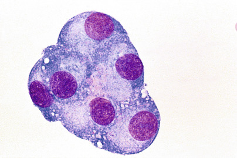

Figure 29-16 

Mesothelial cells in pleural fluid. 

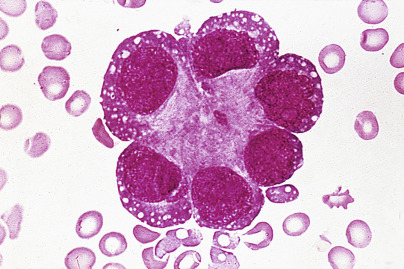

Figure 29-17 

Well-differentiated breast carcinoma cells in pleural fluid. 

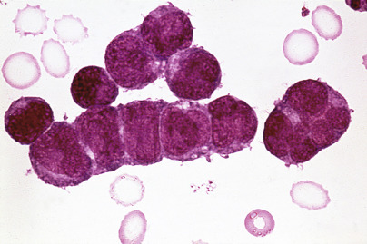

Figure 29-18 

Small cell carcinoma of the lung showing typical molding of nuclei. 

**Neutrophils** predominate in pleural fluid from patients with pleural inflammation ( [ Box 29-11 ](<#b0060>) ). More than 10% of transudates will also have a predominance of neutrophils, but this has limited clinical significance. 

Box 29-11 

Cellular Differential of Pleural Effusions 

 

##  Neutrophilia (>50%) 

  * Bacterial pneumonia (parapneumonic effusion) 

  * Pulmonary infarction 

  * Pancreatitis 

  * Subphrenic abscess 

  * Early tuberculosis 

  * Transudates (>10%) 

 

##  Lymphocytosis (>50%) 

  * Tuberculosis 

  * Viral infection 

  * Malignancy (lymphoma, other neoplasms) 

  * True chylothorax 

  * Rheumatoid pleuritis 

  * Systemic lupus erythematosus 

  * Uremic effusions 

  * Transudates (≈30%) 

 

##  Eosinophilia (>10%) 

  * Pneumothorax (air in pleural space) 

  * Trauma 

  * Pulmonary infarction 

  * Congestive heart failure 

  * Infection (especially parasitic, fungal) 

  * Hypersensitivity syndromes 

  * Drug reaction 

  * Rheumatologic diseases 

  * Hodgkin's disease 

  * Idiopathic 

**Lymphocytes** predominate in the disorders summarized in [ Box 29-11 ](<#b0060>) . Most are small, but medium, large, and reactive (transformed) variants may be seen. Nucleoli and nuclear cleaving are more prominent in effusions than in the peripheral blood, and these features may be particularly prominent in cytocentrifuge preparations. **Plasma cells** may also be observed. Lymphocytosis associated with transudates is of limited clinical significance. 

Low-grade non-Hodgkin's lymphoma and chronic lymphocytic leukemia (CLL) may be difficult to distinguish from benign lymphocyte-rich serous effusion ( [ Fig. 29-19 ](<#f0100>) ). Immunophenotyping by flow cytometry or immunocytochemistry, in conjunction with cellular morphology, is usually helpful in making a correct diagnosis. The relative proportions of T and B cells are, by themselves, not definitive for separating benign from malignant exudates (  Ibrahim et al, 1989  ); however, the pattern of expression of Ig light chains and/or other distinctive cell marker combinations may allow specific diagnosis of lymphoproliferative disorders. Molecular DNA analysis may be another useful adjunct to morphologic analysis. An unusual form of high-grade B-cell non-Hodgkin's lymphoma, called **primary effusion lymphoma,** may be seen in pleural, peritoneal, and/or pericardial fluid specimens, typically from immunocompromised patients, with a characteristic highly anaplastic and immunoblastic morphologic appearance and without expression of most B cell–associated antigens (  Karcher & Alkan, 1997  ). The diagnosis is usually confirmed by demonstrating in the neoplastic cells the presence of human herpesvirus-8 (HHV-8)–associated antigens and/or DNA by immunophenotypic and/or molecular analysis. 

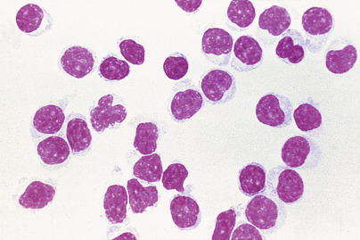

Figure 29-19 

Pleural effusion in patient with non-Hodgkin's lymphoma, small lymphocytic type. 

The cells are small round forms, difficult to distinguish from benign lymphocytes. 

(From Kjeldsberg CR, Knight JA: _Body fluids: Laboratory examination of amniotic, cerebrospinal, seminal, serous and synovial fluids,_ ed 3, Chicago, 1993, © American Society for Clinical Pathology, with permission.) 

An eosinophilic effusion is one that has 10% or more **eosinophils.** The most common causes are related to the presence of air or blood in the pleural cavity (see [ Box 29-11 ](<#b0060>) ). Most of these are exudates; however, in about 35% of patients, the cause is unknown (  Adelman et al, 1984  ). Although not of much assistance in diagnosing the cause of an effusion, eosinophilia appears to be independently associated with longer survival (  Rubins & Rubins, 1996  ). A small number of **mast cells** or **basophils** often accompany eosinophils. Eosinophil-derived **Charcot-Leyden crystals** may also be seen. 

 

##  Chemical Analysis 

 

##  Protein 

The measurement of pleural fluid total protein or albumin has little clinical value except when combined with other parameters to differentiate exudates from transudates. Protein electrophoresis shows a pattern similar to serum, except for a higher proportion of albumin; it has little value for differential diagnosis (  Light, 1995  ). 

 

##  Glucose 

The glucose level of normal pleural fluid, transudates, and most exudates is similar to serum levels. Decreased pleural fluid glucose, accepted as a level below 60 mg/dL (3.33 mmol/L) or a pleural fluid/serum glucose ratio less than 0.5, is most consistent and dramatic in rheumatoid pleuritis and grossly purulent parapneumonic exudates (  Sahn, 1982  ). Low pleural fluid glucose may also be present in malignancy, tuberculosis, nonpurulent bacterial infection, lupus pleuritis, and esophageal rupture. 

 

##  Lactate 

Pleural fluid lactate levels can be a useful adjunct in the rapid diagnosis of infectious pleuritis. Levels are significantly higher in bacterial and tuberculous pleural infections than in other pleural effusions. Values greater than 90 mg/dL (10 mmol/L) have a positive predictive value for infectious pleuritis of 94% and a negative predictive value of 100% (  Gastrin & Lovestad, 1988  ). 

 

##  Enzymes 

**Amylase** elevations above the serum level (usually 1.5 to 2.0 or more times greater) indicate the presence of pancreatitis, esophageal rupture, or malignant effusion (  Light & Ball, 1973  ). Elevated amylase derived from esophageal rupture or malignancy is the salivary isoform, which differentiates it from pancreatic amylase (  Kramer et al, 1989  ). 

Pleural fluid lactate dehydrogenase (LD) levels rise in proportion to the degree of inflammation. In addition to their use in separating exudates from transudates, declining LD levels during the course of an effusion indicate that the inflammatory process is resolving. Conversely, increasing levels indicate a worsening condition requiring aggressive workup or treatment. 

ADA, which is particularly rich in T lymphocytes, is significantly increased in tuberculous pleuritis. At a level of 50 U/L, the sensitivity, specificity, positive predictive value, negative predictive value, and efficiency for tuberculosis are 91%, 81%, 84%, 89%, and 86%, respectively (  Burgess et al, 1996  ). When the lymphocyte/neutrophil ratio is 0.75 or greater, the percentages are 88%, 95%, 95%, 88%, and 92%, respectively. ADA levels of 40 U/L or greater are present in about 99.6% of patients with verified tuberculous pleuritis (  Lee et al, 2001  ); however, in patients with lymphocyte-rich pleural fluids from nontuberculous causes, ADA levels less than 40 U/L are present in 97.1% of cases. 

 

##  Interferon-γ

Pleural fluid interferon (IFN)-γ levels are significantly increased in the pleural fluid of patients with tuberculous pleuritis. The sensitivity of levels of 3.7 IU/L or greater is 99%, and the specificity is 98% (  Villena et al, 1996a  ). Test sensitivity does not differ in HIV-positive and HIV-negative patients. Only about 20% of patients with effusions due to hematologic malignancies have IFN-γ levels slightly above 3.7 IU/L (  Villena et al, 2003a  ). 

 

##  pH 

Pleural fluid pH measurement has the highest diagnostic accuracy in assessing the prognosis of parapneumonic (pneumonia-related) effusions (  Heffner et al, 1995  ). A parapneumonic exudate with a pH greater than 7.30 generally resolves with medical therapy alone. A pH less than 7.20 indicates a complicated parapneumonic effusion (loculated or associated with empyema), requiring surgical drainage. 

Patients with borderline complicated exudates (pH 7.20 to 7.30) may be closely watched with repeat measurements. A concomitant pleural glucose level below 60 mg/dL (3.33 mmol/L), however, strongly suggests impending empyema. Rheumatoid pleuritis and malignant effusions with a poor response to pleurodesis also have pH values below 7.20 and a low glucose level (  Rodriquez-Panadero & Mejias, 1989  ). A pH below 6.0 is characteristic of **esophageal rupture,** although the pH in severe empyema may be 6.0 or less (  Good et al, 1980  ). 

**Urinothorax,** a collection of urine presumably produced by lymphatic drainage of perirenal accumulations into the pleural cavity, is also associated with a pleural fluid pH less than 7.30. These effusions are transudative, because of their low protein content, and smell of urine. They have a creatinine level greater than in simultaneously drawn serum (  Miller et al, 1988  ). 

 

##  Lipids 

Some serous effusions appear to be chylous (i.e., a milky appearance) but are not (pseudochylous), whereas others may not look chylous but are (  Maldonado et al, 2009  ). Although pseudochylous fluids may be partially due to increased leukocytes and necrotic debris, they are primarily due to the presence of increased lecithin-globulin complexes. A true chylous effusion has chylomicrons on lipoprotein electrophoresis. Lipid measurements are also helpful in identifying chylous effusions (  Staats et al, 1980  ). Thus, pleural fluid triglyceride levels above 110 mg/dL indicate a chylous effusion; values from 60 to 110 mg/dL (0.68 to 1.24 mmol/L) are less certain and require lipoprotein electrophoresis to confirm a chylothorax, particularly in fasting and postoperative patients (  Maldonado et al, 2009  ). Nonchylous and pseudochylous effusions generally have triglyceride levels below 50 mg/dL (0.56 mmol/L) and no chylomicrons on electrophoresis (see [ Table 29-10 ](<#t0055>) ). 

**Cholesterol** measurements may be useful in separating transudates from exudates, especially when there is a question regarding Light's criteria. A total cholesterol value of 54 mg/dL or more and a pleural fluid/serum cholesterol ratio of 0.32 or higher have sensitivity and specificity values similar to Light's criteria (  Suay et al, 1995  ). Elevated levels and the presence of cholesterol crystals may be seen with pleural effusions that have been present for several years. 

 

##  C-Reactive Protein 

Pleural fluid CRP is a clinically useful screening test for organ disease, index of disease activity, and measure of response to therapy (  Castano & Amores, 1992  ). Pleural fluid CRP levels >30 mg/L reportedly have a sensitivity of 93.7%, a specificity of 76.5%, and a positive predictive value of 98.4% in parapneumonic infections (  Turay et al, 2000  ). Mean CRP values are about 90 mg/L in parapneumonic infections compared with 26 mg/L and 23 mg/L for tuberculous and malignant effusions, respectively. Measurement of pleural fluid CRP contributes to both the diagnosis and assessment of severity of parapneumonic effusions (  Porcel et al, 2012  ). 

 

##  Tuberculostearic Acid (10-Methyloctadecanoic Acid) 

Tuberculostearic acid (TSA) was first isolated from the bacillus _Mycobacterium tuberculosis_ . This fatty acid is a structural component of mycobacteria and is not normally present in human tissue. Using gas chromatography–mass spectroscopy, TSA was measured in sputum, bronchial washings, and pleural fluid from patients with pulmonary tuberculosis (  Muranishi et al, 1990  ). Here, pleural fluid TSA was identified in 24 of 32 (75%) patients with active tuberculosis; bronchial washings were positive for TSA in 15 of 22 cases. In patients with other pulmonary disorders, only 4 of 46 pleural fluids and 3 of 69 bronchial washings had detectable levels. A later smaller study reported the following for pleural fluid TSA: Sensitivity 54%, specificity 80%, positive predictive value 75%, negative predictive value 61%, and efficacy 66% (  Yorgancioglu et al, 1996  ). Combining TSA and adenosine deaminase (ADA) analysis in pleural fluid samples appears to increase the diagnostic sensitivity for tuberculous pleuritis (  Muranishi et al, 1992  ). 

 

##  Tumor Markers 

Although not recommended as a routine test, various tumor markers are often a useful adjunct in enigmatic noninflammatory exudates with negative cytology. Several tumor markers, especially CEA, CA 15-3, CA 549, CA 72-4, and CYFRA 21-1, among others, have been studied in pleural fluids. CEA is probably the most useful single marker for adenocarcinomas, but reported cutoff values vary considerably. The sensitivity of CEA for malignant effusions varies depending on tumor origin and is about 50% overall. Although complicated parapneumonic effusions may result in elevated CEA levels (  Garcia-Pachon et al, 1997  ), they are usually not a problem to distinguish clinically. 

A combination of tumor markers increases the accuracy of diagnosis of malignant effusions. Thus, a combination of CEA, CA 15-3, and CA 72-4 had an accuracy of 90% with 78% sensitivity, 95% specificity, 88% positive predictive value, and 91% negative predictive value (  Villena et al, 1996b  ). Similarly, CA 15-3 and CEA combined had an accuracy of 87% (  Romero et al, 1996  ); a combination of CA 549, CEA, and CA 15-3 had a sensitivity of 65%, specificity 99%, and accuracy 85% (  Villena et al, 2003b  ). The use of the cytokeratin 19 fragment (CYFRA 21-1) may also be useful in combination with other tumor markers. Complicating the use of these tests, different tumor markers may be positive in both malignant and inflammatory pleural effusions (  Topolcan et al, 2007  ). 

Other tumor markers may also be useful in the diagnosis of unexplained effusions. For example, a marked increase in pleural fluid prostate-specific antigen (PSA) can lead to the correct diagnosis of metastatic prostate cancer in pleural and pericardial effusions, even when negative by cytologic examination (  Chin et al, 1999  ). 

 

##  Immunologic Studies 

Approximately 5% of patients with RA and 50% with SLE develop pleural effusions sometime during the course of their disease. 

RF is commonly present in pleural effusions associated with seropositive RA. Although a pleural fluid titer of 1 : 320 or greater in a patient with known RA is reasonable evidence of rheumatic pleuritis (  Halla et al, 1980  ), elevated RF titers up to 1 : 1280 have been identified in 41% of patients with bacterial pneumonia, 20% of patients with malignant effusions, and 14% of patients with tuberculosis, making this test of little value (  Levine et al, 1968  ). 

ANA titers once appeared to be useful in the diagnosis of effusion due to lupus pleuritis; (  Good et al, 1983  ); however, later studies have indicated no benefit of this testing in pleural fluid specimens over and above serum testing (  Porcel et al, 2007  ). 

Decreased **complement** levels (CH50 <10 U/mL or C4 level below 10 × 10  –5  U/g protein) are present in most patients with rheumatoid or lupus pleuritis (  Hunder et al, 1972  ;  Halla et al, 1980  ); however, decreased complement is not highly specific for these diseases and is of little value for routine diagnosis, although it may be helpful in the diagnosis of otherwise enigmatic effusions. 

 

##  Microbiological Examination 

Bacteria most commonly associated with parapneumonic effusions are _Staphylococcus aureus_ , _Streptococcus pneumoniae_ , β-hemolytic group A streptococci, enterococci, and some gram-negative bacilli. Anaerobic bacteria are isolated in a significant proportion of cases, so both anaerobic and aerobic cultures should be performed. The sensitivity of the Gram stain is approximately 50% (  Ferrer et al, 1999  ), and concentration methods, such as cytocentrifugation, may increase the sensitivity. Use of resin-containing blood culture bottles may improve the isolation of certain bacteria in partially treated patients. 

For patients with suspected _M. tuberculosis_ , direct staining of tuberculous effusions for acid-fast bacteria has a sensitivity of 20% to 30%, and positive cultures are found in 50% to 70% of cases (  Baer & Smith, 2001  ). Pleural biopsy yields the highest culture sensitivity (50% to 75%) and may provide a rapid presumptive diagnosis of tuberculosis by histopathologic demonstration of granulomas or acid-fast bacteria. Combining culture and acid-fast stains with pleural biopsy increases the sensitivity to about 95% (  Jay, 1986  ). Real-time PCR analysis of pleural fluid specimens shows good sensitivity and specificity for the diagnosis of _M. tuberculosis_ and may provide an effective less invasive alternative method for rapid diagnosis (  Rosso et al, 2011  ). 

ADA can provide rapid chemical evidence for tuberculous effusions independent of HIV status (  Burgess et al, 1996  ;  Riantawan et al, 1999  ;  Lee et al, 2001  ). Although the ADA-2 isoenzyme form is elaborated by activated lymphocytes in tuberculosis, only mild elevations occur in lymphocyte-rich pleural effusions from nontuberculous causes. However, the relatively low prevalence of tuberculous pleurisy in North America anticipates a lower positive predictive value rate compared with the excellent results reported in the Asian and European literature, where tuberculosis is more common. 

Pleural fluid interferon-γ is significantly increased in tuberculous pleuritis and may be helpful in some cases because it is independent of HIV status and is only modestly increased in about 20% of hematologic malignancies (  Villena et al, 2003a  ). 

,  

##  Pericardial Fluid 

From 10 to 50 mL of fluid is normally present in the pericardial space, produced by a transudative process similar to pleural fluid. Pericardial effusions are most often caused by viral infection, and enterovirus is the most common etiologic agent. They may also develop as a result of bacterial, tuberculous, or fungal infection, or in association with autoimmune disorders, renal failure, myocardial infarction, mediastinal injury, or the effects of various drugs, or they may be idiopathic ( [ Box 29-12 ](<#b0065>) ). HIV-infected patients commonly have asymptomatic pericardial effusions, which may ecome large in more advanced disease (  Silva-Cardosa et al, 1999  ), or they may be associated with primary effusion lymphoma (  Karcher & Alkan, 1997  ). Many of the recommended laboratory tests described for pleural fluid also pertain to pericardial effusions (see [ Box 29-10 ](<#b0055>) ). 

Box 29-12 

Causes of Pericardial Effusions 

  * Idiopathic (most often viral) 

  * Infection 

  * Bacteria 

  * Tuberculosis 

  * Fungi 

  * Viruses 

  * AIDS-related (usually viral) 

  * Neoplasm 

  * Metastatic carcinoma 

  * Lymphoma 

  * Drugs 

  * Hydralazine 

  * Procainamide 

  * Phenytoin 

  * Renal failure 

  * Hemorrhage 

  * Trauma 

  * Anticoagulant therapy 

  * Leakage of aortic aneurysm 

  * Autoimmune disorders 

  * Hypothyroidism 

  * Rheumatoid arthritis 

  * Systemic lupus erythematosus 

  * Inflammatory bowel disease 

  * Wegener's granulomatosis 

  * Acute myocardial infarction 

  * Radiation therapy 

_AIDS_ , Acquired immunodeficiency syndrome. 

The **postpericardiotomy syndrome** is a fairly common but nonspecific complication of cardiac surgery (or other cardiac damage) that develops days to weeks following the initial injury. It is hallmarked by the development of fever, pleuritic chest pain, and other signs of pleural, pericardial, and, less often, lung inflammation. Exudative pleural effusions develop in more than 80% of cases. These are often serosanguineous to hemorrhagic and typically have a pH greater than 7.4 and a normal glucose level (  Stelzner et al, 1983  ). No specific tests are available for diagnosing this syndrome. Diagnosis, therefore, remains one of clinical exclusion. Although the cause is uncertain, the time course, presence of antimyocardial antibodies, and response to antiinflammatory therapy suggest an immune-mediated process. Increased levels of antimyocardial antibodies relative to serum, decreased complement levels, and immune complexes have been documented in pleural fluid from a single patient with the syndrome (  Kim & Sahn, 1996  ). 

 

##  Specimen Collection 

Pericardial effusions of unknown origin or large effusions with signs of cardiac tamponade are generally submitted for laboratory examination. Fluid may be obtained by pericardiotomy following limited thoracotomy, or by pericardiocentesis (sterile needle aspiration). 

 

##  Gross Examination 

Normal pericardial fluid is pale yellow and clear. Large effusions (>350 mL) are most often caused by malignancy or uremia, or they may be idiopathic. In HIV-associated cardiac tamponade, 45% of cases are idiopathic, and tuberculous and bacterial effusions each account for about 20% of cases (  Chen et al, 1999  ). Infection or malignancy typically produces turbid effusions, whereas effusions due to uremia are usually clear and straw-colored. These and several other disorders may produce hemorrhagic effusions. 

Blood-like fluid obtained by pericardiocentesis might represent a hemorrhagic effusion or inadvertent aspiration of blood from the heart. Blood obtained from the heart chamber will have a hematocrit comparable with that of peripheral blood, and blood gas analysis yields results similar to venous or arterial blood. In contrast, the hematocrit of a hemorrhagic effusion is usually lower than that of peripheral blood. Blood from a cardiac puncture clots, but a hemorrhagic effusion usually does not. 

A milky appearance suggests the presence of a chylous or pseudochylous effusion. Identification and differentiation of these effusions are discussed in the Pleural Fluid section earlier in the chapter. 

 

##  Exudates and Transudates 

According to Light's criteria, a pleural exudate has one or more of the following: pleural fluid/serum protein ratio >0.5; pleural fluid/serum LD ratio >0.6; and pleural fluid LD level >200 U/L. Light's criteria have also been shown to be the most reliable diagnostic tool for identifying pericardial exudates and transudates (  Burgess et al, 2002a  ). 

Routine testing of pericardial effusions should probably be limited to cell count, glucose, total protein, LD, bacterial culture, and cytology (  Meyers et al, 1997  ). Other, more specific tests are appropriate only when there is a high clinical suspicion of unusual causes of pericardial effusion. 

 

##  Microscopic Examination 

The hematocrit and RBC count document the presence of a hemorrhagic effusion, but are of limited value for differential diagnosis. Total leukocyte counts over 10,000/µL suggest bacterial, tuberculous, or malignant pericarditis; however, low counts may be encountered in these conditions, limiting the value of this measurement (  Agner & Gallis, 1979  ). Leukocyte differential counts may be helpful in determining the cause of certain pericardial effusions, particularly when combined with other pericardial fluid findings (  Reuter et al, 2006  ). Even when the differential count isn't helpful, examination of a stained smear should always be performed to evaluate for atypical or malignant cells. 

Cytologic identification of malignant cells is usually not difficult. Metastatic carcinomas of the lung and breast are most frequently observed in malignant pericardial effusion. Cytology has a sensitivity of 95% and a specificity of 100% (  Meyers et al, 1997  ). 

 

##  Chemical Analysis 

Chemical parameters for the diagnosis of pericardial effusions have not been studied to the same extent as in other body fluids. Although pericardial effusions are very similar to pleural fluids, routine application of these tests requires additional studies to fully appreciate their diagnostic importance. 

 

##  Protein 

A value greater than 3.0 g/dL has a sensitivity of 97% for exudative effusions, but a specificity of only 22%, which significantly limits its usefulness. Thus, total protein has no discriminating power in pericardial diagnosis (  Meyers et al, 1997  ). 

 

##  Glucose 

Pericardial glucose levels less than 60 mg/dL have a diagnostic accuracy of only 36% in identifying pericardial exudates (  Meyers et al, 1997  ). Values less than 40 mg/dL (<2.22 mmol/L) are common in bacterial, tuberculous, rheumatic, or malignant effusions. 

 

##  pH 

Pericardial fluid pH may be markedly decreased (<7.10) in rheumatic or purulent pericarditis. Malignancy, uremia, tuberculosis, and idiopathic disorders may have moderate decreases in the range of 7.20 to 7.30 (  Kindig & Goodman, 1983  ). 

 

##  Lipids 

Separation of true chylous from pseudochylous effusions may be facilitated by triglyceride and cholesterol measurements, as well as by lipoprotein electrophoresis for chylomicrons (see [ Table 29-10 ](<#t0055>) ). See Lipids in the Pleural Fluid section earlier in the chapter for further details on the diagnosis of chylous effusions. 

 

##  Enzymes 

A pericardial fluid LD level greater than 200 U/L has been suggested as a cutoff for pericardial exudates (  Burgess et al, 2002a  ). Moreover, the measurement of LD and creatine kinase in postmortem pericardial fluid within 48 hours of death may be useful in establishing acute myocardial injury when such injury is suspected but cannot be established by the usual histologic methods (  Luna et al, 1982  ;  Stewart et al, 1984  ). Pericardial fluid levels of CK-MB, myoglobin, and troponin I in postmortem pericardial fluid are significantly increased in patients with myocardial injury (  Perez-Carceles et al, 2004  ). 

ADA activity is a useful adjunctive test for tuberculous pericarditis in suspicious cases with negative acid-fast stains. The median ADA level in tuberculous pericarditis is significantly higher than in other pathologic effusions (  Burgess et al, 2002b  ). Using a cutoff of 30 U/L, the sensitivity is 94%, specificity 68%, and positive predictive value 80%. Using a cutoff of 40 U/L, the sensitivity and specificity are 93% and 97%, respectively (  Koh et al, 1994  ). Combining pericardial ADA levels with other findings adds to the diagnostic utility of measuring this analyte (  Reuter et al, 2006  ). 

 

##  Interferon-γ

Increased IFN-γ levels have been reported in tuberculous serous effusions, including tuberculous pericarditis (  Burgess et al, 2002b  ). Here, the IFN-γ level was greater than 1000 pg/L, which was significantly higher than in effusions from other pathologic conditions. A cutoff value of 200 pg/L results in a sensitivity and specificity of 100% for the diagnosis of tuberculous pericarditis. As with ADA, combining IFN-γ levels with other pericardial fluid findings improves the diagnostic utility of this assay (  Reuter et al, 2006  ). 

 

##  Polymerase Chain Reaction 

PCR is a sensitive technique and may be more specific than adenosine deaminase in the diagnosis of tuberculous pericarditis (  Lee et al, 2002  ); however, a negative test does not rule out tuberculous pericarditis because some pericardial fluids from patients with large tuberculous effusions may not contain _M. tuberculosis_ . 

 

##  Immunologic Studies 

A negative ANA test makes the diagnosis of lupus serositis highly unlikely. Conversely, high ANA titers in pericardial effusions lack specificity, even when they are as high as 1 : 5120 (  Leventhal et al, 1990  ;  Wang et al, 2000  ). If a high ANA titer is unexplained, malignancy should be considered. 

 

##  Microbiological Examination 

The sensitivity of the Gram stain and culture for bacterial pericarditis is similar to other serous body fluids (i.e., about 50% and 80%, respectively). Important aerobic bacteria include _S. aureus_ , _S. pneumoniae_ , _S. pyogenes,_ and gram-negative bacilli. Although infectious pericarditis due to anaerobic bacteria may be encountered rarely, the bacteria are sometimes not recognized because of inconsistent methods used for their isolation and identification (  Brook, 2002  ). For this reason, proper laboratory technique is of particular importance when infection with an anaerobic organism is suspected. The major anaerobic organisms are the _Bacteroides fragilis_ group, anaerobic streptococci, _Clostridium_ species, _Fusobacterium_ species, and _Bifidobacterium_ species. 

Identification of a specific etiologic agent in viral pericarditis is difficult because the viruses (e.g., coxsackieviruses, influenza virus, mumps) are rarely isolated from pericardial fluid. Obtaining acute and convalescent sera for antibody response to suspected viral pathogens may help support the diagnosis (  Bellinger & Vacek, 1987  ). Viral infection probably accounts for most idiopathic HIV-associated pericardial effusions. 

The sensitivity of acid-fast stains and culture for tuberculous pericarditis is about 50% (  Agner & Gallis, 1979  ). PCR is a sensitive technique and may be more specific than the use of adenosine deaminase in the diagnosis of tuberculous pericarditis (  Lee et al, 2002  ). However, a negative test does not exclude the diagnosis of tuberculous pericarditis. 

PCR-based assays may aid in the rapid diagnosis of a variety of bacterial and other infections in the pericardial space (  Tenenbaum et al, 2005  ;  Levy et al, 2006  ). 

,  

##  Peritoneal Fluid 

**Ascites** is the pathologic accumulation of excess fluid in the peritoneal cavity. Up to 50 mL of fluid is normally present in this mesothelial-lined space. As with pleural and pericardial fluids, it is produced as an ultrafiltrate of plasma dependent on vascular permeability and on hydrostatic and oncotic Starling forces. 

 

##  Transudates and Exudates 

Common causes of peritoneal effusions are listed in [ Box 29-13 ](<#b0070>) . The laboratory criteria for classifying ascitic fluid as a transudate or an exudate are not as well defined as they are for pleural and pericardial fluids. For example, infected or malignancy-related samples are not uncommonly reported with protein concentrations in the transudative range (i.e., <3.0 g/dL), and many patients with cirrhotic or heart failure ascites have protein values in the exudative range (>3.0 g/dL) (  Runyon et al, 1992  ). 

Box 29-13 

Causes of Peritoneal Effusions 

 

##  Transudates: Increased Hydrostatic Pressure or Decreased Plasma Oncotic Pressure 

  * Congestive heart failure 

  * Hepatic cirrhosis 

  * Hypoproteinemia (e.g., nephrotic syndrome) 

 

##  Exudates: Increased Capillary Permeability or Decreased Lymphatic Resorption 

  * Infections 

    * Primary bacterial peritonitis 

    * Secondary bacterial peritonitis (e.g., appendicitis, bowel rupture) 

    * Tuberculosis 

  * Neoplasms 

    * Hepatoma 

    * Lymphoma 

    * Mesothelioma 

    * Metastatic carcinoma 

    * Ovarian carcinoma 

    * Prostate cancer 

  * Trauma 

  * Pancreatitis 

  * Bile peritonitis (e.g., ruptured gallbladder) 

 

##  Chylous Effusion 

  * Damage to or obstruction of thoracic duct (e.g., trauma, lymphoma, carcinoma, tuberculosis and other granulomas [e.g., sarcoidosis, histoplasmosis], parasitic infestation) 

The **serum-ascites albumin gradient,** defined as the serum albumin concentration minus the ascitic fluid albumin concentration, is widely considered as the most reliable method to differentiate peritoneal transudates from exudates (  Runyon et al, 1992  ). Ascites caused by portal hypertension has a gradient of at least 1.1 g/dL (>11 g/L; transudate), whereas ascites produced by other causes has a gradient less than 1.1 g/dL (exudate) (  Runyon et al, 1992  ). The diagnostic accuracy is 98% for the serum-ascites albumin gradient compared with only 52% to 80% for four other markers: Ascitic fluid total protein; ascites/serum total protein ratio; ascitic fluid LD concentration; and ascites/serum LD ratio (  Akriviadis et al, 1996  ). 

An ascitic fluid/serum bilirubin ratio of 0.6 or greater is also significantly associated with exudates (  Elis et al, 1998  ). Indeed, the accuracies of the bilirubin ratio, the serum-ascites albumin gradient, and Light's criteria were 81.5%, 84%, and 80.2%, respectively. Others have suggested that if the ascitic fluid LD is >130 U/L and the ascitic fluid/serum total protein ratio is >0.4, the fluid should be regarded as an exudate (  Paramothayan & Barron, 2002  ). 

Although the serum-ascites albumin gradient is probably the best single method to differentiate an ascitic exudate from a transudate, other methods compare favorably. Nevertheless, no ideal biochemical markers allow complete discrimination between ascitic fluid exudates and transudates. 

 

##  Specimen Collection 

 

##  Paracentesis 

Diagnostic paracentesis is performed in most patients with new ascites, or if there is a change in the clinical picture of a patient with ascites, such as rapid fluid accumulation or fever development. A minimum of 30 mL is needed for complete evaluation. If possible, at least 100 mL should be provided for cytologic examination. Samples for cell counts should be placed in an EDTA-anticoagulated venipuncture tube. Culture specimens should include blood culture bottles that have been inoculated at the bedside with ascitic fluid (10 mL per culture bottle). 

 

##  Diagnostic Peritoneal Lavage 

This procedure is no longer recommended as a routine technique for the evaluation of abdominal trauma. Concerns of oversensitivity and nonspecificity, and improvements in noninvasive diagnostic procedures such as computed tomography and ultrasound have limited its common use to (1) rapid screening for significant abdominal hemorrhage in hemodynamically unstable patients, and (2) evaluation of hollow viscous injuries. 

A catheter is placed through a small incision into the abdominal cavity. If less than 15 mL of gross blood can be aspirated, diagnostic peritoneal lavage (DPL) is performed by infusing 1.0 L of saline or Ringer's solution (20 mg/kg in children) and retrieving the fluid by gravity drainage. At least 600 mL should be recovered to avoid falsely low counts (  Sullivan et al, 1997  ). The catheter is sometimes left in place so that DPL may be repeated in 2 to 3 hours if initial results are negative or indeterminate. 

Commonly accepted criteria for DPL interpretation after trauma are shown in [ Box 29-14 ](<#b0075>) . The positive predictive value is only 23% for an isolated (no other abnormal criteria) leukocyte count of 500/µL or greater (  Soyka et al, 1990  ). 

Box 29-14 

Criteria for Evaluation of Peritoneal Lavage 

 

##  Positive Result 

  * Aspiration of >15 mL gross blood on catheter placement 

  * Grossly bloody lavage fluid 

  * RBC >100,000/µL after blunt trauma 

  * RBC >50,000/µL after penetrating trauma 

  * WBC >500/µL 

  * Amylase >110 U/dL 

 

##  Indeterminate Result 

  * Small amount of gross blood on catheter placement 

  * RBC 50,000-100,000/µL after blunt trauma 

  * RBC 1000-50,000/µL after penetrating trauma 

  * WBC 100-500/µL 

 

##  Negative Result 

  * RBC <50,000/µL after blunt trauma 

  * RBC <1000/µL after penetrating trauma 

  * WBC <100/µL 

_RBC,_ Red blood cells; _WBC,_ white blood cells. 

Modified from Feied CF: Diagnostic peritoneal lavage, _Postgrad Med_ 85:40, 1989, with permission. 

The conventional DPL criteria may be unreliable in detecting hollow viscous injury when blood is present from a simultaneous solid organ injury not requiring surgical repair, resulting in unnecessary exploratory laparotomies. Suggested modifications of DPL criteria to adjust for this source of bleeding include either of the following: (1) WBC count greater than or equal to RBC count divided by 150, where RBC is 10 × 10  4  /mm  3  or greater (  Otomo et al, 1998  ); or (2) cell count ratio greater than 1.0 (  Fang et al, 1998  ). The cell count ratio is defined as the ratio between WBC and RBC counts in the lavage fluid divided by the WBC/RBC ratio in the peripheral blood. These criteria have a reported specificity of 97% for hollow organ injury, especially if DPL is performed at least 3 hours following injury. 

Other applications of DPL include the evaluation of patients with suspected acute peritonitis or pancreatitis. A WBC count in the lavage fluid of 200 cells/mm  3  is associated with a 99% probability of acute peritonitis (  Larson et al, 1992  ). 

 

##  Peritoneal Dialysis 

Dialysate fluid from renal patients undergoing chronic ambulatory peritoneal dialysis should be submitted to the laboratory to check for infection. 

 

##  Peritoneal Washings 

This procedure is performed intraoperatively to document early intraabdominal spread of gynecologic and gastric carcinomas. Samples are generally sent for cytologic examination only. 

 

##  Recommended Tests 

The most important tests for the evaluation of ascitic fluid are listed in [ Box 29-15 ](<#b0080>) . Relative importance varies depending on the type of sample and the clinical findings. For example, RBC and WBC counts are more important than cytology or the serum-ascites albumin gradient in the evaluation of abdominal effects of trauma. Gross examination may provide immediate information in the clinical and laboratory triage. 

Box 29-15 

Recommended Tests in Peritoneal Effusions 

 

##  Useful in Most Patients 

  * Gross examination 

  * Cytology 

  * Stains and culture for microorganisms 

  * Serum-ascites albumin concentration gradient 

 

##  Useful in Selected Disorders 

  * Total leukocyte and differential cell counts 

  * RBC count (lavage) 

  * Bilirubin 

  * Creatinine/urea nitrogen 

  * Enzymes (ADA, ALP, amylase, LD, telomerase) 

  * Lactate 

  * Cholesterol (malignant ascites) 

  * Fibronectin 

  * Tumor markers (CEA, PSA, CA 19-9, CA 15-3, CA-125) 

  * Immunocytology/flow cytometry 

  * Tuberculostearic acid 

_ADA,_ Adenosine deaminase; _ALP,_ alkaline phosphatase; _CEA,_ carcinoembryonic antigen; _LD,_ lactate dehydrogenase; _PSA,_ prostate-specific antigen; _RBC,_ red blood cell. 

Modified from Kjeldsberg CR, Knight JA: _Body fluids: Laboratory examination of amniotic, cerebrospinal, seminal, serous and synovial fluids_ , ed 3, Chicago, 1993, © American Society for Clinical Pathology, with permission. 

 

##  Gross Examination 

Whereas transudates are generally pale yellow and clear, exudates are cloudy or turbid because of the presence of leukocytes, tumor cells, or increased protein levels. The presence of food particles, foreign material, or green-yellow bile staining in a DPL specimen suggests perforation of the gastrointestinal or biliary tract. Acute pancreatitis and cholecystitis may also cause greenish discoloration. 

Blood-tinged or grossly bloody fluid must be distinguished from a traumatic tap in which the blood usually clears with continued paracentesis. As little as 15 mL of blood per liter of fluid produces a bright red opaque color such that newsprint cannot be read through the lavage tubing. In most cases, the ability to read newsprint through the tubing results in a negative DPL. Opaque specimens require cell counts because newsprint readability is lost well below the 100,000 RBCs/µL criterion for a positive DPL (  Bellows et al, 1998  ). Bloody ascites is also seen in malignancy and tuberculosis. 

Milky fluid that does not clear with centrifugation suggests a chylous or pseudochylous effusion. True chylous peritoneal effusions are significantly less common than chylous pleural effusions. They are caused by disruption or blockage of lymphatic flow by trauma, lymphoma, carcinoma, tuberculosis, other granulomatous diseases (e.g., sarcoidosis), hepatic cirrhosis, adhesions, or parasitic infestation. Differentiation of true chylous and pseudochylous effusions is discussed in the Gross Examination section in the Pleural Fluid section later in the chapter. 

 

##  Microscopic Examination 

The total leukocyte count is useful in distinguishing ascites due to uncomplicated cirrhosis from spontaneous bacterial peritonitis (SBP), which is caused by migration of bacteria from the intestine into the ascitic fluid. Approximately 90% of patients with SBP will have leukocyte counts greater than 500/µL, more than 50% of which are neutrophils ( [ Fig. 29-20 ](<#f0105>) ) (  Runyon & Hoefs, 1984  ;  Stewart et al, 1986  ). 

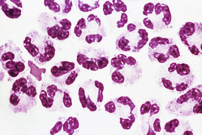

Figure 29-20 

Neutrophils in a patient with bacterial peritonitis. 

The ascitic fluid total neutrophil count is the preferred method for the diagnosis of SBP. Cutoff values of 250 and 500 neutrophils/µL have been recommended, with a diagnostic accuracy of about 94% for 500 neutrophils/µL and about 90% for 250 neutrophils/µL (  Stassen et al, 1986  ;  Albillos et al, 1990  ). 

Cell counts, total protein, and albumin gradient values vary with fluid shifts associated with ascites formation and resolution. For example, diuresis may cause the WBC count to increase from 300/µL to 1000/µL or more. When obtained by DPL, a leukocyte count of 200/µL or more is reported to be associated with a 99% probability of acute peritonitis (  Alverdy et al, 1988  ;  Larson et al, 1992  ). 

**Eosinophilia** (>10%) is most commonly associated with the chronic inflammatory process associated with chronic peritoneal dialysis. It has also been reported in congestive heart failure, vasculitis, lymphoma, and ruptured hydatid cyst. 

Cytology has an overall sensitivity of 40% to 65% for malignant ascites. Peritoneal carcinomatosis accounts for about two thirds of malignant effusions, and cytology has a sensitivity of over 95% when confined to these cases (  Runyon et al, 1988  ). Liquid-based thin-layer preparations of peritoneal effusions and pelvic washings have been shown to be superior to standard cytologic preparations in the detection of carcinoma (  Moriarity et al, 2008  ). Immunocytochemical stains are useful in characterizing atypical cells in equivocal cases. 

 

##  Chemical Analysis 

 

##  Protein 

The serum-ascites albumin gradient is superior to total protein content in differentiating cirrhosis from other causes of peritoneal effusions (  Runyon et al, 1992  ). Spontaneous bacterial peritonitis (SBP) is commonly associated with low total protein (<3.0 g/dL) and a high serum-ascites albumin gradient (>1.1 g/dL), making total protein measurements of little value in this disorder. Extracellular fluid shifts associated with ascites formation and resorption also cause variations in protein content. 

 

##  Glucose 

Early reports indicated that peritoneal fluid glucose levels of 50 mg/dL or less are present in 30% to 60% of cases of tuberculous peritonitis and in about 50% of patients with abdominal carcinomatosis (  Polak & Torres da Costa, 1973  ;  Brown & An, 1976  ). Another study found decreased glucose levels in most cases of tuberculous ascites (  Bansal et al, 1998  ). Still, glucose measurements are of little value because the sensitivity and specificity are generally too low to be of practical value. 

 

##  Enzymes 

**Amylase** activity in normal peritoneal fluid is similar to plasma levels. A level greater than three times the plasma value is good evidence of pancreas-related ascites, including acute pancreatitis and pancreatic pseudocyst (  Runyon, 1987a  ). Amylase is not recommended in the routine evaluation of ascites, however, because the prevalence of pancreatic ascites is low. Retrospective amylase measurement on a stored specimen is indicated if initial studies are not diagnostic. Amylase levels in peritoneal lavage fluid may be valuable in patients following blunt and penetrating abdominal trauma (  McAnena et al, 1991  ). Here, amylase levels greater than or equal to 20 U/L have a sensitivity of 87%, a specificity of 75%, and a positive predictive value of 46% for significant intraabdominal injury. In these cases, laparotomy should be considered. Gastroduodenal perforation, acute mesenteric vein thrombosis, intestinal strangulation, or necrosis may also produce elevated amylase levels. Although various nonpancreatic malignancies may rarely produce amylase elevations, isoenzyme evaluation usually identifies the salivary isoform in these latter cases (  Kosches et al, 1989  ). 

Elevated **alkaline phosphatase** (ALP) levels greater than 10 U/L in diagnostic peritoneal lavage fluid are useful in predicting hollow visceral injury in patients who would otherwise not undergo laparotomy (specificity 99.8%, sensitivity 94.7%) (  Jaffin et al, 1993  ). Ascitic fluid ALP measurements may also be helpful in the differentiation of primary bacterial peritonitis from secondary bacterial peritonitis due to bowel perforation. Secondary peritonitis has significantly higher mean ALP levels than spontaneous bacterial peritonitis (SBP). ALP levels >240 U/L were present in 92% of patients with secondary peritonitis versus 12% with SBP (  Wu et al, 2001  ). The sensitivity and specificity for differentiating secondary peritonitis from SBP were 92% and 88%, respectively. 

LD activity is often increased in malignant effusions (  Gerbes et al, 1991  ). An ascitic fluid/serum LD ratio greater than 0.6 has a reported sensitivity of 80% (  Boyer et al, 1978  ). Combined measurement of ascitic fluid LD and cholesterol totally discriminated peritoneal carcinomatosis from cirrhosis and hepatocarcinoma-related ascites (  Castaldo et al, 1994  ;  Halperin et al, 1999  ). Although both serum and peritoneal fluid LD levels are significantly higher in patients with ovarian cancer than in those with benign ovarian tumors or other gynecologic malignancies, peritoneal fluid LD has higher diagnostic sensitivity (87%) and diagnostic accuracy (90%) than serum LD (60% and 77%, respectively) (  Schneider et al, 1997  ). LD has also been used for the early diagnosis of spontaneous bacterial peritonitis (SBP), in which it has a diagnostic accuracy of about 74% using an ascitic fluid/serum ratio cutoff of 0.4 (  Lee et al, 1987  ). 

The presence of **telomerase** is a specific discriminatory marker in malignant ascites (  Tangkijvanich et al, 1999  ). Telomerase activity was detected in 81% of malignant peritoneal effusions with a sensitivity of 76% and a specificity of 95.7%. 

ADA is commonly used in endemic areas to identify patients with tuberculous peritonitis (  Burgess et al, 2001  ). Using receiver operating characteristic curves and a cutoff value of 30 U/L, the sensitivity and specificity were 94% and 92%, respectively. Using a cutoff value of 33 U/L, the sensitivity, specificity, positive and negative predictive values, and overall diagnostic accuracy for diagnosing tuberculous peritonitis were 100%, 96.6%, 95%, 100%, and 98%, respectively (  Dwivedi et al, 1990  ). 

 

##  Fibronectin 

Using a cutoff value of 85 µg/mL (85 mg/L), fibronectin was more reliable in differentiating malignant from sterile ascites (diagnostic accuracy, 79%) than were total protein, LD, γ-glutamyltransferase, pH, amylase, triglycerides, leukocyte count, and cytologic examination (  Colli et al, 1986  ). In a subsequent study using a cutoff of 94.6 µg/mL, the sensitivity, specificity, positive accuracy, negative accuracy, and overall diagnostic accuracy in the diagnosis of malignant ascites were 100%, 95%, 93.8%, 100%, and 97.1%, respectively (  Sood et al, 1997  ). Further studies have confirmed the utility of fibronectin measurement in the diagnosis of malignant ascites (  Lee et al, 2006  ). 

 

##  Lactate 

Ascitic fluid lactate has been used with pH measurements to differentiate spontaneous bacterial peritonitis (SBP) from uncomplicated ascites. Sensitivity and specificity for lactate levels are approximately 90% using a cutoff of 40 mg/dL (4.44 mmol/L), with a positive predictive value of 62% (  Stassen et al, 1986  ). Although not as accurate as leukocyte counts, the high specificity of lactate in hepatic ascites suggests that it has some value in the diagnosis of SBP in otherwise equivocal cases. Malignant and tuberculous ascites are also associated with elevated lactate levels. 

Patients with hollow viscous perforation, gangrenous intestine, peritonitis, or intraabdominal abscess have a peritoneal fluid minus plasma lactate level of at least 13.5 mg/dL (1.5 mmol/L), which reportedly separates these patients completely from those with other conditions producing acute abdominal problems (  DeLaurier et al, 1994  ). Still, the clinical utility of measuring ascitic fluid lactate in surgical decision making remains unclear. 

 

##  Creatinine and Urea 

Measurement of creatinine and urea nitrogen is useful to differentiate between peritoneal fluid and urine. Elevated peritoneal fluid urea nitrogen and creatinine, in association with elevated serum urea but normal serum creatinine (due to back-diffusion of urea), suggest urinary bladder rupture. 

 

##  Bilirubin 

The mean (±SD) ascitic fluid bilirubin concentration in various types of ascites has been reported as 0.7 ± 0.8 mg/dL, and the mean ascitic fluid/serum bilirubin ratio as 0.38 ± 0.44 (  Runyon, 1987b  ). An ascitic fluid bilirubin greater than 6.0 mg/dL and an ascitic fluid/serum bilirubin ratio over 1.0 suggest choleperitoneum from a ruptured gallbladder. A ratio of 0.6 or greater has been advocated as an additional marker for an exudative process, although its accuracy is not as high as that of the serum-ascites albumin gradient (  Elis et al, 1998  ). 

 

##  pH 

Ascitic fluid pH may be helpful in the diagnosis of spontaneous bacterial peritonitis (SBP) in patients with cirrhotic ascites, especially if it is used in conjunction with the leukocyte count (  Attali et al, 1986  ;  Stassen et al, 1986  ). A pH less than 7.32 or a blood–ascitic fluid pH difference of more than 0.1 has a reported sensitivity and specificity of about 90% for SBP, with the pH differential being slightly more accurate. Peritoneal fluid pH appears useless in detecting SBP, however, in the absence of neutrophils (  Runyon & Antillon, 1991  ). Patients with an ascitic fluid pH of less than 7.15 have a poor prognosis (  Attali et al, 1986  ). Low pH is also found in patients with malignant and pancreatic ascites and tuberculous peritonitis. 

 

##  Cholesterol 

The ascitic fluid cholesterol level is a moderately useful index in separating malignant ascites (>45 to 48 mg/dL) from cirrhotic ascites (  Mortensen et al, 1988  ;  Castaldo et al, 1994  ). The sensitivity and specificity average just over 90% using a cutoff value of 45 to 48 mg/dL (1.2 mmol/L). Thus, using a cutoff value of 48 mg/dL, the sensitivity, specificity, positive and negative predictive value, and overall diagnostic accuracy for differentiating malignant from nonmalignant ascites were reported as 96.5%, 96.6%, 93.3%, 98.3%, and 96.6%, respectively (  Garg et al, 1993  ). 

 

##  Interleukin-8 

Interleukin-8, a cytokine produced by a variety of cells in response to stimuli such as bacterial lipopolysaccharide, is significantly higher in spontaneous bacterial peritonitis (SBP) compared with sterile ascites (  Martinez-Bru et al, 1999  ). Using a cutoff value of 100 ng/L, the sensitivity and specificity were both 100% in cirrhotic patients. 

 

##  Tuberculostearic Acid (10-Methyloctadecanoic Acid) 

As noted in the Pleural Fluid section, TSA was detected in pleural fluid in 75% of patients with pulmonary tuberculosis using gas chromatography–mass spectroscopy (  Muranishi et al, 1990  ). Using quantitative chemical ionization gas chromatography–mass spectrometry, the measurement of TSA is a valuable technique to identify tuberculous peritonitis, as well as tuberculous meningitis (spinal fluid) and pneumonia (pleural fluid) (  Brooks et al, 1998  ). 

 

##  Tumor Markers 

Because of their reportedly low sensitivity and specificity, the measurement of tumor markers in peritoneal fluid is generally considered to be of little value. They are often useful, however, in selected cases, such as in following a patient's response to therapy and in the early detection of tumor recurrence. They may also be very useful in cases in which cytology is negative but suspicion of malignant ascites is high. In one study, cytologic examination was positive in only 40% (35 of 89 patients) of malignant cases, while tumor markers were positive in 80% (  Cascinu et al, 1997  ). Moreover, excluding small cell lung and renal cancers, for which specific tumor markers are lacking, tumor markers (i.e., CEA, CA 19-9, CA 15-3, PSA) in ascitic fluid for other carcinomas were positive in 97% of cases. These tumor markers, as well as α-fetoprotein, were also found to be highly specific (over 90%) for serous fluid malignancies, although their sensitivities were low (19% to 38%) (  Sari et al, 2001  ). The measurement of **PSA** may also be a valuable marker for the diagnosis of malignant effusions due to prostate cancer (  Appalaneni et al, 2004  ). 

**CEA** has a sensitivity of 40% to 50% and a specificity of about 90% for malignant effusions, using a cutoff value of 3.0 ng/mL (  Mezger et al, 1988  ). In a similar study using a 5-mg/mL cutoff, the specificity was about 97% (  Gulyas et al, 2001  ). Elevated CEA levels in peritoneal washings suggest a poor prognosis in gastric carcinoma (  Irinoda et al, 1998  ). 

Ascitic fluid **CA-125** is elevated to some degree in a variety of nonmalignant conditions. Indeed, cardiovascular and chronic liver disease may be the most frequent diagnoses in patients with increased CA-125 levels (  Miralles et al, 2003  ), thereby supporting the general opinion that CA-125 in ascitic fluid lacks adequate specificity as a marker for malignancy. Extremely high levels are likely to be caused by epithelial carcinomas of the ovary, fallopian tubes, or endometrium. The sensitivity for ovarian carcinoma depends on the tumor's stage (range, 40% to 95%) and histologic subtype (mucinous adenocarcinomas have lower values) (  Molina et al, 1998  ). 

**DNA ploidy** analysis by flow cytometry or image analysis may provide useful complementary diagnostic information in cases with equivocal cytology results when the malignant cells carry an aneuploid karyotype, although the added value of DNA ploidy analysis over cytology is small (  Bisht et al, 2014  ). Image analysis appears to be more practical than flow cytometry when the tumor cells are scarce (  Rijken et al, 1991  ). 

 

##  Microbiological Examination 

Primary peritonitis occurs at any age and is seen in children with nephrotic syndrome and in adults with cirrhotic liver disease. Spontaneous bacterial peritonitis (SBP) occurs in patients with ascites in the absence of recognized secondary causes such as bowel perforation or intraabdominal abscess. The bacteria in SBP are most often normal intestinal flora, and more than 92% are monomicrobial. Aerobic gram-negative bacilli (e.g., _E. coli, Klebsiella pneumoniae_ ) are responsible for two thirds or more of all cases (  Gilbert & Kamath, 1995  ), followed by _S. pneumoniae_ , _Enterococcus_ spp., and, rarely, anaerobes. The Gram stain has a sensitivity of 25% in SBP (  Lee et al, 1987  ), and routine cultures are positive in only about 50% of cases (  Castellote et al, 1990  ). Inoculation of blood culture bottles at the bedside and concentration of large volumes of fluid can improve sensitivity, but up to 35% of infected patients may still have negative ascitic fluid cultures (  Marshall, 1988  ). Use of resin-containing blood culture bottles may improve the isolation of certain bacteria in partially treated patients. 

Ascitic fluid total neutrophil count is the preferred method for the diagnosis of SBP (see the Microscopic Examination section earlier in the chapter). As noted earlier, in difficult cases, several analytes may be useful in differentiating SBP from secondary bacterial or tuberculous peritonitis. Because of the low number of bacteria in many cases of SBP, sensitive methods for detection of bacteria in these specimens are often needed. PCR has been successfully used in the detection of bacterial DNA in culture-negative ascitic fluid (  Such et al, 2002  ;  Soriano et al, 2011  ), and more recently in situ hybridization performed on leukocytes suspended in peritoneal fluid has been used to detect bacteria in SBP (  Enomoto et al, 2014  ). 

The sensitivity of acid-fast stains for _M. tuberculosis_ is no more than 20% to 30%, and cultures have a sensitivity of only 50% to 70% (  Reimer, 1985  ). Application of PCR to detect _M. tuberculosis_ DNA may be used, but a negative result does not exclude the diagnosis (  Schwake et al, 2003  ). In a patient with a high clinical suspicion for tuberculous peritonitis, laparoscopic examination with biopsy may be indicated. 

,  

##  Alternative Specimens 

 

##  Saliva 

Saliva is generally easily collected by noninvasive means, and so its acquisition is well accepted by patients. Because it is a filtrate of plasma, saliva has concentrations of some small molecules that are in equilibrium with the free (unbound) active fractions of those substances in plasma. This property has been especially useful for measuring free cortisol, which is the physiologically important fraction that reflects the secretion rate of cortisol and so is important for diagnosis. Salivary cortisol measurements have been used to assess adrenal function in critically ill subjects (  Arafah et al, 2007  ) and in those with Cushing's syndrome and adrenal insufficiency (  Raff, 2009  ), with late-night (or midnight) salivary cortisol being an effective screening test for Cushing's syndrome (  Raff et al, 1998  ). Unfortunately, salivary concentrations of several other steroid hormones are not reliable measures of plasma free levels because of rapid fluctuations in their salivary concentrations (e.g., estradiol, progesterone, testosterone, dehydroepiandrosterone, aldosterone) (  Wood, 2009  ). 

Saliva also contains some antibody molecules that apparently derive from plasma. Thus measurements are sometimes performed on saliva to detect antibodies against infectious agents in circumstances when collection of saliva is much more convenient or acceptable to patients. Testing of saliva for antibodies against human immunodeficiency virus has been practiced widely in sexually transmitted disease clinics, although episodes of false-positive results have diminished confidence in these point-of-care tests (  Cummiskey et al, 2008  ). 

Genetic testing requires DNA from the patient that can be obtained conveniently from leukocytes in blood specimens, or even more conveniently from buccal cells in saliva or from swabs of the interior of the mouth. 

Drug testing has also been performed in saliva to provide evidence of ingestion of illicit substances. Although drugs such as amphetamines, cocaine, and opioids are present in oral fluid at concentrations similar to those in plasma, local absorption of these drugs in the mouth can increase their concentration in saliva after use (  Drummer, 2006  ). 

 

##  Meconium 

The analysis of body fluids can provide unique information based on anatomic location (often remote or not readily accessible) or sequences of metabolic processes and normal clearance of chemical constituents from the body. An example of this clinical utility is the examination of meconium from newborns for the detection of illicit drugs such as cocaine and amphetamines that the mother might have abused while pregnant; the drugs cross the placenta from maternal circulation into that of the fetus, which excretes the drug or its metabolites in bile that remains in the meconium until birth (  Concheiro et al, 2013  ). This window of drug detection in meconium is much broader than that for testing of urine or blood by several weeks and covers second and third trimesters of pregnancy. Such testing is considered more reliable than self-reporting by mothers due to fear of reprisal and possible loss of custody. These results can be used both for medical management of the mother and the baby as well as for medical-legal purposes. Recently, measurement of ethyl glucuronide in meconium was found to be an objective measure of maternal alcohol use (  Himes et al, 2015  ). 

 

##  Hair and Nails 

Drug testing has time limitations of detection in blood for periods of minutes to hours after ingestion. The need to detect illicit drug use over longer periods of time has prompted analysis of other body sources. Concentrations of drugs in saliva follow the same time course as blood of minutes to hours after ingestion. Detection in urine can be as soon as minutes up to many days after drug use. Sweat concentrations also rise in minutes but may persist for weeks. True long-term detection is possible in hair and nails, where drugs of abuse can be detected days to even years after ingestion. Although numerous companies offer drug testing of hair or nail specimens, there has not been official adoption of this strategy by government agencies, largely because of issues of uncertainty as to whether the substances detected from hair or nail specimens were actually “in” the hair following ingestion and incorporation into that tissue, or whether the detected drug was simply “on” the surface of the specimen because of incidental contact that did not involve ingestion (  Curtis & Greenberg, 2008  ). 

 

##  Breath Testing 

 

##  Exhaled Nitric Oxide and Exhaled Breath Condensate 

Inflammatory disorders of the lungs, including asthma, chronic obstructive pulmonary disease, and chronic cough, have largely been evaluated in the past by bronchoscopy, lavage, biopsy, and analysis of induced sputum. Noninvasive techniques for monitoring these disorders are now available as detection of chemical constituents in exhaled breath. **Exhaled nitric oxide** (NO) is an inflammatory mediator that is unstable in tissues but is much more stable in the gas phase, where it can be measured in single breath exhalations by specialized devices where NO content is expressed in parts per billion. This use is currently considered investigational but theoretically has great potential for monitoring pulmonary inflammation by noninvasive means with much greater frequency than by invasive procedures (  Dweik et al, 2011  ). 

A second approach to monitoring pulmonary disease is to measure nonvolatile inflammatory markers in **exhaled breath condensate** (EBC) that is collected from exhaled breath that is condensed by passage through a cooling device. Such specimens of respiratory fluid are scant, but they contain a rich assortment of substances such as cytokines, leukotrienes, oxidants, antioxidants, and so on that can reveal inflammatory activity by noninvasive means (  Horvath et al, 2005  ). Even pH of EBC has been found useful in assessing lung disease; EBC tends to be slightly alkaline (mean pH 7.7 ± 0.49) in health, but it becomes more acidic with disease changes in the lower airways (  Vaughan et al, 2003  ). EBC analysis is currently considered investigational. 

 

##  Carbon-13-Urea Breath Test 

Diagnosis of infection with _Helicobacter pylori_ may be aided by the carbon-13-urea breath test in which the patient drinks a solution of  13  C-urea. _H. pylori_ has the enzyme urease, which breaks down urea releasing  13  CO  2  into the patient's breath. Samples of breath taken in a balloon or other specialized collection devices are analyzed by mass spectrometry (  Patel et al, 2014  ) (see [ Chapters 4 ](<##!/content/3-s2.0-B9780323295680000048?scrollTo=%23c00004>) and [ 23 ](<##!/content/3-s2.0-B9780323295680000231?scrollTo=%23c00023>) ). Detection of  13  CO  2  indicates infection with _H. pylori_ . An alternative procedure utilizes  14  C in place of  13  C, although  14  C detection is based on low-level radioactivity.  13  C has the advantage of not being radioactive but the disadvantage of not being measured in most local laboratory facilities. The  13  C-urea breath test has special utility for pediatric patients (  Frenck et al, 2006  ). 

Opportunities for analysis of additional body fluid types will increase as collection methodologies expand, particularly in collaboration with invasive radiologic approaches. Some problems expected with these new unique specimens include scant specimen volumes, unknown protein and other chemical composition that might adversely affect measurements, and lack of reference ranges to distinguish normal healthy results from those in disease. 

 

##  Tissue Aspirates 

Breast nipple aspirate fluid can be obtained by noninvasive means such as massage or with automated collection devices to yield material suitable for cytologic examination for early detection of breast cancer. This new collection approach may lead to other effective applications of cancer detection using modalities such as proteomics or still to be discovered biomarkers (  Alexander et al, 2004  ). 

Fine-needle aspiration for cytologic examination is frequently used to evaluate head and neck masses. Rapid identification of a mass of parathyroid tissue has been done by measuring parathyroid hormone (PTH) in saline, into which the needle aspirate is flushed (  Conrad et al, 2006  ). This method was shown to be 99% accurate for diagnosis of parathyroid tissue because the measured values of PTH are orders of magnitude higher in parathyroid aspirates than in those from other tissues such as thyroid, adipose, or lymphatic. This type of specimen is truly unusual and would not likely be included in any manufacturer's claims for assay performance; however, this practice is well recognized by endocrine surgeons who now consider it a standard of practice. 

Another diagnostic application of tumor markers is for aspirates collected from pancreatic cysts during surgery, although such fluids might also be collected by direct aspiration with a needle guided through ultrasound. High levels of CA19-9 in pancreatic cyst fluid suggest malignancy, whereas low levels are more consistent with benign processes (  Khalid & Brugge, 2007  ). CA19-9 measurement in pancreatic cyst fluid is an aid to diagnosing malignancy in conjunction with cytology and other studies; the advantage of CA19-9 in this context is its relatively fast turnaround time by immunoassay that might be completed during the time period of surgical procedure. CEA has also been used for this purpose (  Rockacy & Khalid, 2013  ). 

 

##  Billing for Tests in Nonstandard Specimens 

Although considerations of medical necessity provide strong motivation for performing tests in unusual specimen types to provide unique information that could not be obtained by other means, reporting of the results and subsequent billing may lead to confusion. Most laboratory computer systems have strictly defined specimen types, such as blood, serum, urine, and CSF. When dealing with an unusual specimen type that is not individually coded or recognized in a computer system, laboratories should take care not to enter these results as though they were serum or other commonly tested fluid. For both medical needs and reimbursement, some disclaimer should be included to indicate the specimen type, so that it is not confused with serum or other conventional fluid. 

,  

##  Chemical Measurements in Body Fluids 

Plasma, serum, cerebrospinal fluid, and urine are standard fluids that are often submitted for chemical analysis. Manufacturers generally provide product claims for their assays in one or more of these body fluids, but they have not established assay behavior in other specimen types such as pleural fluid, peritoneal fluid, SF, and other accumulations of abnormal fluids such as drainage or lavage fluids. These types of fluids are not normally present in health but rather can form as the result of various pathologic processes, such as hemodynamic imbalance, infection, inflammation, malignancy, or other organ dysfunction. Consequently, the composition of these fluids can range widely, thereby leading to unpredictable effects on laboratory measurements. Matrix effects from variations in protein concentration can alter fluid surface tension, viscosity, and miscibility in a reaction mixture. All of these variations potentially might cause differences in measurements because of errors in pipetting fixed volumes or in speed and completeness of mixing with reagents in an assay. Other constituents present in these pathologic fluids (e.g., hyaluronic acid in SF) but not in serum also have the potential to alter measurements in assays intended for use in serum. This potential for erroneous measurements in body fluids due to matrix effects should be recognized when such requests for analysis are received. 

A second issue concerning chemical measurements in pathologic fluids is what reference range to use for comparison in an interpretive report. Because abnormal fluid accumulations do not exist in a state of health, they cannot, of course, be collected from a normal healthy population to establish reference ranges. 

These two issues of potential interferences and lack of reference ranges for analysis of body fluids fly in the face of Clinical Laboratory Improvement Act requirements for assay validation. In fact, the lack of manufacturers' claims for body fluid testing might actually place a greater burden on a laboratory to validate these assays than for use in serum for which manufacturer claims are typically cleared by the U.S. Food and Drug Administration. Without such validation, measuring chemical constituents in body fluids could be considered an off-label use of commercial assays. 

In recognition of these difficulties faced by laboratories, the Clinical and Laboratory Standards Institute (CLSI) has developed the document C49A, Analysis of Body Fluids in Clinical Chemistry, to provide guidance in this situation (  CLSI, 2007  ). The specific recommendations from CLSI are as follows: 

  * 1.

Review performance claims of the manufacturer for the possibility of extending a commercial assay to body fluids with special attention to accuracy, precision, analytic measurement range, reference interval (usually in comparison with simultaneous measurement in serum, in addition to the patient's body fluid), and interferences from substances in the body fluid. 

  * 2.

Existing methods may be suitably modified for body fluid analysis when necessary to obtain medically relevant information. Matrix effects that could alter the accuracy of measurement must be recognized. Furthermore, lack of a reference range for the analyte in body fluids should be compensated for by interpretation of results in comparison with a simultaneously collected serum specimen. 

  * 3.

The preconditions for using a routine assay for an alternate body fluid are that the measurement system in another specimen type (serum plasma, urine) 

    * a.

Has acceptable test characteristics. 

    * b.

Has a reference method by which to ascertain bias. 

    * c.

Has calibrators and controls. 

    * d.

External proficiency testing should be done whenever available. 

  * 4.

Specimen collection of body fluid and its handling, processing, and storage should follow guidelines for specimens of plasma or serum collected for that measurement. Special attention should be directed to the possibility of interference from anticoagulants into which a body fluid might be collected (e.g., heparin, EDTA, citrate). 

  * 5.

Unusual properties of a body fluid such as high viscosity should be given consideration if they have the potential to alter the analyte concentration in the final solution of the reaction mixture (e.g., inaccurate pipetting, inadequate mixing). 

  * 6.

The presence of an interferent in a body fluid can be assessed by testing the fluid neat and at 1 : 2 and 1 : 4 dilutions. Recovery of similar concentrations suggests lack of interference. Low concentrations can be checked for interference by mixing with a routine (serum) sample with a high measurable value to measure recoverability. 

  * 7.

Result reporting should include the measured value and the type of fluid analyzed plus a statement that accuracy might be affected by sample type, and that results should be interpreted in the clinical context. The laboratory is urged to contact ordering physicians to explain these limitations. 

A key point is that to be useful clinically, measurements in body fluids need not necessarily be highly accurate but instead must be within a clinically acceptable range of the true value. This CLSI document provides an extensive list of applications of many different chemical analytes that may provide medically unique information about the source of a body fluid (e.g., creatinine in peritoneal fluid to evaluate urinary tract injury; amylase in peritoneal fluid to evaluate for pancreatitis; triglycerides in pleural fluid as an indicator of chylous effusion from lymphatic damage). 

,,
