## Key Points

  * •

The clinical chemistry metabolic profile gives important quantitative information for over 25 serum analytes often facilitating diagnosis of disease. 

  * •

Serum electrolyte concentrations for sodium, potassium, chloride, and sometimes calcium are most commonly assayed using ion-selective electrodes. 

  * •

Assays for other analytes, including total protein, albumin, bilirubin, creatinine, calcium, iron and iron-binding capacity, magnesium, and phosphate, are performed using spectrophotometry on complexes that each analyte forms with simple reagents. These complexes absorb light at wavelengths at which there is minimal absorbance by both the analyte itself and by the reagent. The concentration of the analyte is determined using Beer's Law. 

  * •

Assays for a number of serum analytes, including ammonia, bicarbonate, cholesterol, glucose, lactate, triglycerides, urea, and uric acid, utilize enzymes that catalyze reactions in which the analytes are converted into products whose concentrations can be measured conveniently. 

  * •

Spectrophotometric assays can be performed by waiting for the point at which the increase or decrease in absorbance of a complex at a particular wavelength ceases to change (end-point method) or by the initial rates of complex formation (rate method). 

  * •

Assays for specific enzymes are performed using substrates that are specific for these enzymes. The concentrations of the products of the enzyme-catalyzed reactions are determined spectrophotometrically as described in [ Chapter 20 ](<##!/content/3-s2.0-B9780323295680000206?scrollTo=%23c00020>) , allowing for direct determination of enzyme activity. 

  * •

Often the products of enzyme-catalyzed reactions are measured in coupled reactions in which the product of the enzyme-catalyzed reaction is the substrate for another enzyme added at high concentration, allowing for the rapid conversion of the product of the first reaction to another product whose concentration can be easily determined. 

,  

##  Introduction 

In many of the preceding chapters, we have discussed the chemical bases for the assays employed for the diagnosis of specific diseases. In this chapter, we present a consolidation of the methods that are used in the typical so-called “metabolic panel” in Clinical Chemistry, a panoply of chemical assays that are often requested for patients undergoing outpatient annual checkups or who are being admitted to the hospital. We summarize and discuss the chemical bases for these assays in a hopefully concise manner so that the reader can refer to these methods conveniently and understand the assays and their limitations. Understanding of the assays further enables an understanding of why certain substances interfere with particular assays and can give rise to misleading results. It should be kept in mind that, for many of the assays described here, more than one method can be used. Since it is impossible to cover all variations of methods used to quantitate each analyte, we describe the principles that underlie commonly employed methods and refer, where possible, to alternate approaches. 

Metabolic panels consist of serum electrolytes (sodium, potassium, and chloride), bicarbonate, calcium, phosphate, magnesium, BUN, creatinine, glucose, uric acid, total protein, albumin, total and direct bilirubin, cholesterol, high-density lipoprotein (HDL) and low-density lipoprotein (LDL), triglycerides, ammonia, iron and iron-binding capacity, and the enzymes: creatine kinase (CK), aspartate amino transferase (AST), alanine amino transferase (ALT), alkaline phosphatase (ALP), lactate dehydrogenase (LDH), gamma-glutamyl transferase (GGT), amylase, and lipase. The reader may recognize various panels that measure the functioning of specific tissues including the kidney, such as the renal “profile,” (i.e., BUN, creatinine, calcium, and phosphate). These panels are of great use in diagnosing disease states, as discussed in [ Chapter 8 ](<##!/content/3-s2.0-B9780323295680000085?scrollTo=%23c00008>) . 

We divide the basic assays for these analytes functionally into four method-based groups: 

  * 1.

Ion-selective electrodes. 

  * 2.

Spectrophotometric assays based on color complexes for specific molecules; for example, the color noncovalent complex of albumin with bromcresol green dye and bilirubin covalently reacted with diazotized sulfanilic acid to give azo-derivatized forms of the indole rings of bilirubin. 

  * 3.

Analyte concentrations using enzymes as reagents. In [ Chapter 20 ](<##!/content/3-s2.0-B9780323295680000206?scrollTo=%23c00020>) , we discussed how small molecule substrates are used to determine serum enzymes concentrations. In a similar manner, this process can be reversed; enzymes can be used to determine the concentrations of small or large molecules (like proteins). If an analyte is a specific substrate for an enzyme and if the formation of product or disappearance of the substrate can be conveniently followed, this method can be used quite effectively. 

  * 4.

Enzyme assays, that is, use of substrates to determine enzyme concentrations as described in [ Chapter 20 ](<##!/content/3-s2.0-B9780323295680000206?scrollTo=%23c00020>) . Almost all of these assays are also based on spectrophotometric measurements. These depend on the substrates employed in the assays and, in many cases, the need for the use of indicator enzymes in so-called coupled reactions. 

,  

##  Ion-Selective Electrodes 

As explained in [ Chapter 4 ](<##!/content/3-s2.0-B9780323295680000048?scrollTo=%23c00004>) , this technique is used to measure the concentrations of specific ions, using an electrochemical method. This method is nonspecific in that it does not discriminate between ions in causing voltage differences between the measuring electrode and the standard electrode. It is the presence of an ion perm-selective membrane barrier on the measuring electrode that allows only a specific ion to pass through and allow contact with the measuring electrode. Each ion requires a different material that will be selectively permeable to this ion and to this ion only. Thus glass is perm-selective to hydrogen ion. A special polymer of the polyamino acid antibiotic, valinomycin, is perm-selective to potassium ions. A polymer resin of polyvinylchloride (PVC) is perm-selective to sodium ions. Recently, an anodized indium tin oxide membrane was found to be even more perm-selective to sodium ions (  Lin & Hsu, 2010  ). Similarly, calcium-chelating organic molecules impregnated into PVC membranes serve as perm-selective membranes for calcium ions. In addition, dioctylphenyl phosphates, as shown in [ Figure 27-1, _C_ ](<#f0025>) (later in the chapter), have been found to chelate calcium ions selectively and to serve as effective ion-selective electrodes. 

There are three basic causes of malfunctions of ion-selective electrodes. The first and most common is defects in the perm-selective membrane itself. This allows the presence of ions other than the one whose concentration is being measured to be present at the measuring electrode. The result is ion concentrations that are falsely elevated. This defect is almost always detected in routine quality control that shows a strong upward drift in the controls despite frequent calibrations. 

The second cause of inaccuracies in ion-selective electrodes is buildup of counter-voltages from liquid junction potentials present at the salt bridge connecting the measuring electrode with the reference electrode. Since these voltages oppose the voltage between the two electrodes, the voltages are diminished, giving lower-than-expected ion concentrations. Buildup of liquid junction potentials occurs over time and affects the lifetime of electrodes. It is therefore vital to change electrodes at the times specified by the manufacturer to avoid erroneous results. 

The third cause of malfunctioning electrodes is buildup of proteins on the electrodes, resulting in alteration of the voltage between the testing and reference electrodes. This phenomenon gives rise to erratic results and the lack of reproducibility of ion concentrations in a single specimen. This problem can be avoided by performing washes of the electrodes at manufacturer-specified times. 

,  

##  Spectrophotometric Determinations Using Simple Reagents 

These are by far the most common types of assays. We discuss each analyte measured by this method. 

 

##  Beer's Law 

We remind the reader that all spectrophotometric determinations are made using the Beer-Lambert Law (see [ Chapter 4 ](<##!/content/3-s2.0-B9780323295680000048?scrollTo=%23c00004>) ), which states that the absorbance, A, of an analyte at a particular wavelength is proportional to its concentration, C, and the length of the light path, L, in the cuvette in which the analyte is dissolved in a solvent (usually water or aqueous buffer), that is, 

 A  =  ε × C  × L 

where ε is the proportionality constant also called the _extinction coefficient._

 

##  End-Point versus Rate Method 

As we now describe, the spectrophotometric determination of the concentration of an analyte requires the addition of another compound or reagent with which the analyte of interest reacts either covalently or noncovalently. The reagent is always added in excess. The resulting complex absorbs light at a wavelength at which neither the free analyte nor the unbound reagent absorbs or at which each species absorbs only minimally. If the reaction is allowed to proceed to completion and the absorbance is then determined, the method is referred to as an _end-point method._ In some cases, the rate of formation of the complex is slow. 

To avoid long waiting periods, the rate of the reaction over a short time period is determined and is used to compute the concentration of the analyte. In [ Chapters 20 ](<##!/content/3-s2.0-B9780323295680000206?scrollTo=%23c00020>) and [ 23 ](<##!/content/3-s2.0-B9780323295680000231?scrollTo=%23c00023>) , we discussed the order of reactions. In the case of formation of colored complexes, the analyte, A, reacts with the reagent, R, to form the measured product, that is, the color complex, or AR. 

 A  \+  R  → AR 

The rate equation describing the rate of formation of AR, that is, d(AR)/dt, is 

 d  (  AR  )  /  dt  =  k  (  A  )  (  R  ) 

This is referred to as a _second-order rate_ process because the rate depends on the concentrations of both A and R. However, since R is added in excess of A, at least initially, the concentration of R does not change appreciably, so that it may be considered constant. The reaction then becomes a _pseudo –first-order _ reaction. In this case, 

 d  (  AR  )  /  dt  =  kR  0  (  A  ) 

where R  0  is the defined added concentration of reagent so that 

 d  (  AR  )  /  dt  =  k  ′ (  A  ) 

where k′ is kR  0  . 

Thus the rate of formation of AR is proportional to the concentration of A. Plots of AR versus time should be linear for the initial time periods (which can range from seconds to minutes). The slope is k′ = kR  0  , whose value is known. Therefore, A must be equal to the slope of the initial straight line divided by k′. This process is quite similar to the one described to compute enzyme concentrations in serum at low substrate concentrations, as described in [ Chapter 20 ](<##!/content/3-s2.0-B9780323295680000206?scrollTo=%23c00020>) . 

In the same manner in which we determine the concentration of enzymes in serum by observing the _initial_ rate of the enzyme-catalyzed reaction in the presence of saturating concentrations of substrate, where the concentration of the substrate is known, we can likewise determine the initial concentration of A by measuring the initial rate at which AR forms. This rate is proportional to the initial concentration of A, the desired quantity. 

 

##  Interferences 

Many color complex absorbances are determined at wavelengths higher than 500 nm, approaching the visible region of the electromagnetic spectrum, where most small molecules such as drugs, cofactors such as NADH, FADH, pyridoxal phosphate, and so on, do not absorb. However, hemoglobin has strong absorbances in this range. Therefore, if hemolysis occurs, appreciable concentrations of hemoglobin may occur in serum, giving falsely elevated absorbances and hence analyte concentrations. In addition, the presence of lipids such as the triglycerides and cholesterol esters in appreciable concentration in serum can also cause falsely elevated concentrations of analytes at virtually any wavelength due to scattering of light, resulting in decreased transmittance and therefore increased absorbance. Although fortunately not common, the presence of certain drugs can interfere with spectrophotometric determination of the levels of some of the analytes. 

 

##  Quantitation of Analytes 

We will now discuss commonly used methods to determine the concentrations of analytes by formation of color complexes. 

 

##  Albumin and Total Protein 

 

##  Albumin 

As noted in [ Chapter 19 ](<##!/content/3-s2.0-B978032329568000019X?scrollTo=%23c00019>) , albumin is the most anionic of the major serum proteins and migrates toward the anode on serum protein electrophoresis. It binds with high affinity to cationic dyes, among which are bromcresol green (BCG), a derivative of triphenyl methane, and bromcresol purple (BCP). The reaction with bromcresol green is shown in [ Equation 27-6 ](<#f9000>) . 

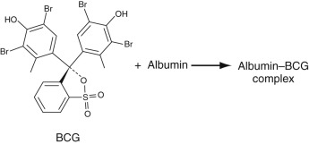

(Eq. 27-6) 

The amount of albumin present in the sample is measured as an end-point reaction at 628 nm. A similar reaction with bromcresol purple gives a color complex whose absorbance is read at 603 nm. BCG reacts also to some extent with alpha-1 and alpha-2 proteins, sometimes tending to overestimate the concentration of albumin. BCP does not react with these proteins and so is considered to be more specific in quantitation of albumin. Interferences are hemolysis and lipemia. 

 

##  Total Protein 

As discussed in [ Chapter 19 ](<##!/content/3-s2.0-B978032329568000019X?scrollTo=%23c00019>) , all proteins are polyamino acids linked together by peptide (CONH) bonds. These peptide bonds form complexes with cupric ions in cupric sulfate to form a color complex in alkaline solution, the so-called _biuret reaction_ as shown in [ Equation 27-7 ](<#f9005>) . 

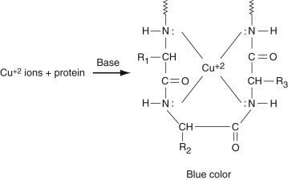

(Eq. 27-7) 

Note that this occurs for every four consecutive peptide units. Since most proteins contain at least 150 to 200 amino acid residues, and many of them more than 300 amino acid residues, many of these complexes are formed for each protein. Since there are large numbers of proteins in serum, this reaction is multiplied many-fold, making the biuret method quite sensitive. The absorbance of the colored complex is determined at 540 nm. The major interferences of this reaction are hemolysis and lipemia. 

 

##  Bilirubin 

As discussed in [ Chapter 21 ](<##!/content/3-s2.0-B9780323295680000218?scrollTo=%23c00021>) , the most common method for measuring serum bilirubin is the Jendrassik-Grof method. In this method, diazotized sulfanilic acid reacts with two pyrole rings of bilirubin to give two phenylazo adducts as shown in [ Equation 27-8 ](<#f9010>) (  Natelson, 1971  ). 

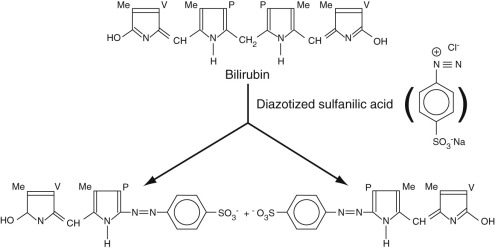

(Eq. 27-8) 

In this equation, Me is the methyl group, V is the vinyl group, and P is the 3-substituted propionic acid moiety. Note that, interestingly, electrophilic aromatic substitution occurs on the pyrole rings such that the central methylene carbon is removed altogether, giving the two sets of phenylazo adducts. 

As discussed in [ Chapter 21 ](<##!/content/3-s2.0-B9780323295680000218?scrollTo=%23c00021>) , bilirubin is conjugated to glucuronic acid at either or both propionic acid (P) moieties. Unconjugated bilirubin is much less soluble than are the conjugated forms. Most of the unconjugated bilirubin is bound tightly to albumin, making it largely unavailable for reaction with the diazotized sulfanilic acid reagent. However, addition of agents like ethanol, methanol, or caffeine-benzoate induces the dissociation of unconjugated bilirubin from albumin, allowing it to react with the reagent. Caffeine-benzoate is the preferable agent since methanol and ethanol can induce protein precipitation and increased turbidity. Interference by hemoglobin resulting from hemolysis can also occur. The soluble bilirubins (mostly conjugated, but see later) that react in the absence of dissociating reagents are termed _direct bilirubin,_ while the bilirubin that reacts in the presence of the dissociating agent is _total bilirubin._ So-called _indirect bilirubin_ (mostly unconjugated bilirubin bound to albumin) is obtained by subtraction of direct bilirubin from total bilirubin (  Tolman & Rej, 1999  ). As noted in [ Chapter 21 ](<##!/content/3-s2.0-B9780323295680000218?scrollTo=%23c00021>) , not all conjugated bilirubin is detected as direct bilirubin, and a small amount of unconjugated bilirubin may be detected as direct bilirubin. 

 

##  Calcium 

Most methods rely on the formation of a color complex of Ca  +2  ions with an appropriate chelating agent with which it forms a color complex. Since approximately half of total calcium is bound to protein, mainly to albumin, lowering the pH of the sample liberates calcium ions. The calcium ions are then reacted with a strong chelating compound with which they form a color complex. The two major calcium chelating compounds that are currently used are ortho-cresolphthalein (forms a red-colored complex) and Arsenazo III (  Rowatt & Williams, 1989  ;  Morgan et al, 1993  ), whose structures are shown in [ Figures 27-1, _A_ and _B_ ](<#f0025>) _,_ respectively. The reaction is shown in the following equation: 

 Dye  \+  Ca  \+  2  → Dye-Ca  \+  2 

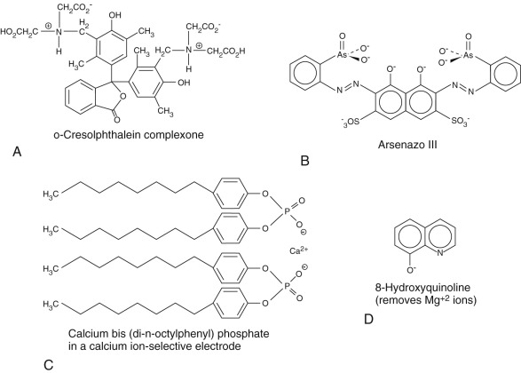

Figure 27-1 

Structures of agents that bind selectively to Ca  +2  ions with the exception of 8-hydroxyquinolone that binds and precipitates Mg  +2  ions. 

where dye is either ortho-cresolphthalein or Arsenazo III. 

Use of ortho-cresolphthalein is often accompanied by a further step in which the reaction solution is treated with the compound 8-hydroxyquinoline, whose structure is also shown in [ Figure 27-1, _D_ ](<#f0025>) _,_ at alkaline pH to prevent any possible complex from forming with magnesium ion. The amount of complex that forms is rather strongly dependent on the temperature, which must therefore be carefully maintained. At low calcium concentrations, a one-to-one complex forms, whereas at higher calcium concentrations, two moles of calcium bind to one mole of dye. Since the extinction coefficients of mono- and di-calcium dye complexes differ, the absorbance is nonlinear with respect to calcium concentration. However, use of a modified Beer's Law equation can be employed to compute concentration from absorbance, or nonlinear methods can likewise be used for this purpose. 

Arsenazo III has a high affinity for calcium ions, but the amount of complex formed is strongly pH-dependent, Usually, imidazole buffers at pH 6.0 are employed for this reaction. Importantly, citrate, which is a tricarboxylic acid that can chelate calcium ions, has been found to interfere with this reaction. It has been found that determination of absorbance at 650 nm is the optimal wavelength for determination of the concentration of calcium ion complex with Arsenazo III at which there is little interference by other analytes, other than in hemolyzed samples. 

 

##  Ion-Selective Electrodes for Calcium Determinations 

Since calcium can be released from its normally bound states by acidification, addition of acid to a serum sample will convert all calcium to readily measurable ionic forms. Thus total calcium can be measured voltametrically. The electrode is a specific calcium ion exchanger of which there are several types, including ETH 1001 and bis-di-(n-octylphenyl) phosphate. The structure of the latter is shown in [ Figure 27-1, _C_ ](<#f0025>) (  Endres & Rude, 1999  ). Ionized calcium (i.e., calcium that is not bound to protein or in complex formation with strong chelators) can be measured directly with ion-selective electrodes without the prior acid treatment step. 

 

##  Creatinine 

Creatinine has been found to form a complex with picric acid (2,4,6-trinitrophenol) under alkaline conditions as shown in [ Equation 27-10 ](<#f9015>) , which illustrates the Jaffe reaction. 

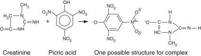

(Eq. 27-10) 

The actual structure of the complex is not completely known. Most studies suggest that it is a noncovalent ionic complex as shown in [ Equation 27-10 ](<#f9015>) (  Vasillades, 1976  ). However, there is some evidence that the carbonyl oxygen (in its enolate form) of creatinine can attack the 1-carbon of picric acid to form a covalent (so-called _Janovsky-like_ ) adduct (  Kroli et al, 1987  ). Irrespective of the structure(s) of this complex, its absorbance is determined between 490 and 500 nm. The reaction is sensitive to temperature. Possibly interferences include ketones, keto acids, and bilirubin. The enolate forms of ketones can react with picric acid much in the same manner as that of creatinine. Reaction of picric acid with bilirubin can be minimized by treatment with ferricyanide or small amounts of surfactant. 

 

##  Iron 

Serum iron levels can be readily determined by a specific reaction of ferrous iron (Fe  +2  ) with the compound, ferrozine, the structure of which is shown in [ Equation 27-11 ](<#f9020>) . The reaction is performed in an acid medium so that ferrous ions can be dissociated from transferrin and maintained in the reduced state. Actually, each ferrous ion complexes with three ferrozine molecules to form a magenta-colored complex, remarkably insensitive to pH, whose absorbance can be determined at 562 nm, although some assays (such as on the Siemens Advia 1650) are performed at 571 nm. As might be expected, hemolysis can cause major interferences with this assay due to red blood cell iron and release of hemoglobin that can compete with ferrozine for binding to serum iron. 

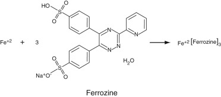

(Eq. 27-11) 

 

##  Total Iron-Binding Capacity 

This is a measure of the total number of functional ferrous ion binding sites in transferrin. As discussed in [ Chapter 23 ](<##!/content/3-s2.0-B9780323295680000231?scrollTo=%23c00023>) , the basic approach is to strip serum transferrin of all bound iron and then to add an excess of iron to the serum sample to determine the concentration of transferrin-bound iron. To accomplish this, the serum sample is added to an acidic buffer, which dissociates all transferrin-bound iron, containing excess ferric chloride and ferrozine. All of the iron is then bound to ferrozine. Then, the pH of the solution is raised into the neutral range where the affinity of iron for transferrin is greatly increased over that for ferrozine. All iron that can bind to available sites on transferrin does so. This results in a decrease in the magenta color at 562 (or 571) nm. This decrease is proportional to the total concentration of functional transferrin binding sites. This set of reactions is summarized in [ Equation 27-12 ](<#f9025>) . 

(Eq. 27-12, A) 

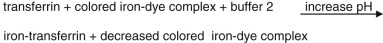

(Eq. 27-12, B) 

 

##  Magnesium 

Several dyes that form specific complexes with Mg  +2  ions are used to determine the serum concentrations of this metal ion. They include calmagite (530 to 550 nm), shown in [ Figure 27-2 ](<#f0045>) , methylthymol blue (600 nm), and xylidyl blue (600 nm). The numbers in parentheses in the preceding sentence indicate the wavelengths at which complex concentration is determined for each dye (  Endres & Rude, 1999  ). In the case of calmagite, the calcium-chelating compound, ethylene glycol tetraacetic acid (EGTA) can be used to remove interference from calcium ions, potassium cyanide can be added to remove interference from heavy metal ions, and polyvinylpyrrolidone can be added to the reaction solution to minimize interference from proteins. 

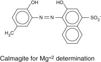

Figure 27-2 

Structure of calmagite, an agent that forms a selective color complex with Mg  +2  ions. 

 

##  Phosphate 

Phosphate occurs as both inorganic, mainly orthophosphate, and organic phosphate such as in glucose-6-phosphate, nucleic acids, phosphoproteins, and so on. Most phosphates in serum are inorganic phosphates; the organic phosphates are mainly intracellular. As discussed in [ Chapter 8 ](<##!/content/3-s2.0-B9780323295680000085?scrollTo=%23c00008>) , there are three forms of inorganic phosphate, the most common ones occurring at a blood pH of H  2  PO  4  –1  and HPO  4  –2  . The most commonly used method to measure total serum inorganic phosphate is the phosphomolybdate method in which ammonium molybdate is reacted with inorganic phosphate to form an ammonium phosphomolybdate complex (  Endres & Rude, 1999  ). The unreduced form of this complex can be determined readily by the increase in absorbance at 340 nm. The pH must be maintained in the acid range because alkaline conditions can result in reduction of the complex. In fact, reduction of this complex gives a blue-colored product whose absorbance can be determined in the 600- to 700-nm range (the Fiske-Subbarow method). Reducing agents used include ascorbic acid, stannous chloride, ferrous ammonium sulfate, 1-amino-2-naphthol-4-sulfonic acid (used originally), and many others. Most methods use the direct 340-nm determination because of its speed and the fact that it involves only one step. 

,  

##  Use of Enzymes as Reagents to Determine Analyte Concentrations 

 

##  General Features 

 

##  Rate versus End-Point Methods 

These are quite similar to the methods discussed in the section on spectrophotometric determinations earlier in the chapter. For rate methods, the total amount of enzyme is added to the serum sample so that, unlike in enzyme assays, total enzyme concentration is known. Note, though, that the substrate concentration is not known (we seek to determine this). It is not known whether or not saturation conditions prevail. Therefore, to compute the substrate concentration for an observed initial rate, the Michaelis-Menton equation is solved for substrate concentration. This is possible since K  m  and V  max  are known for the enzyme reagent used. As with dye-based methods, end-point methods using enzymes are based on the determination of the point at which product concentration remains constant; this concentration is the total substrate or analyte concentration. 

 

##  NADH and NADPH as Quantitative Indicators 

In this section and in the following section, it will be seen that a common approach in determining the serum concentrations of analytes and of enzymes is to follow the reduction of NADH or NADP to NADH or NADPH, respectively. NAD[P]H have strong absorbances at 340 nm, while the oxidized forms (i.e., NAD[P]) have no absorbance. Thus determination of the _increase_ in absorbance at 340 nm for an enzyme-catalyzed reaction in which NAD[P] is converted to NAD[P]H or of the _decrease_ in absorbance at 340 nm for an enzyme-catalyzed reaction in which NAD[P]H is converted to NAD[P] is a very convenient means of measuring analyte concentration. 

In some assays, in which NAD[P]H is an end product, the sensitivity of the level of NAD[P]H produced is enhanced by adding another step wherein a dye reagent, a tetrazolium derivative, is reduced by NAD[P]H to yield a formazan that strongly absorbs at wavelengths around 500 nm. This reaction can be catalyzed by an electron transfer agent including the enzyme diaphorase (lipoamide dehydrogenase, EC 1.6.4.3) or phenazine methosulfate. A prototypical reaction is shown in [ Figure 27-3 ](<#f0050>) . This reaction can, in principle, be used for any reaction in which NAD[P]H is generated. 

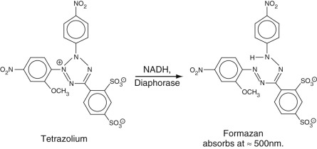

Figure 27-3 

Reduction of a tetrazolium to a formazan in which NADH or NADPH is converted to NAD or NADP, respectively, in the presence of a catalyst, that is, either the enzyme, diaphorase, or phenazine methosulfate. 

The formazan strongly absorbs at 500 nm. This reaction can be used to enhance the sensitivity of reactions in which either NADH or NADPH is generated. 

 

##  Analytes Whose Concentrations are Determined by Enzyme Reactions 

 

##  Ammonia 

Ammonia is measured by use of the versatile enzyme, glutamate dehydrogenase (GLDH). In this reaction, ammonia reacts with alpha-ketoglutarate to form glutamate in a reductive amination reaction. In the first step of this reaction, a Schiff base forms between ammonia and the alpha-keto group of alpha-ketoglutarate. In the second step, the resulting double bond is then reduced by NADPH giving the primary amine in glutamate, plus NADP. The overall reaction is shown in [ Figure 27-4 ](<#f0055>) . Ammonia concentration can therefore be determined by the decrease in absorbance at 340 nm as NADPH is converted to NADP. This enzyme can be used in any reaction is which ammonia is generated. 

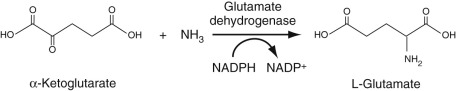

Figure 27-4 

Reductive amination reaction, catalyzed by glutamate dehydrogenase (GLDH), in which ammonia reacts with alpha-ketoglutarate to form the amino acid, glutamic acid. 

In this reaction, NADH is converted to NAD, allowing ammonia concentration to be determined by the total decrease in absorbance of light at 340 nm, the wavelength at which NADH absorbs. 

 

##  Bicarbonate Ions (HCO  3– ) 

One of the glycolytic enzymes, phosphoenolpyruvate carboxy kinase (PEPK), utilizes bicarbonate ion to carboxylate phosphoenol pyruvate to form oxaloacetate (OAA), a Kreb's cycle intermediate, with attendant dephosphorylation [ Equation 27-13 ](<#f9035>) . Thus advantage can be taken of this reaction to consume serum bicarbonate in this reaction, thereby enabling us to determine its concentration. PEPK is added to serum. The resulting OAA is then reduced by added malate dehydrogenase to form malate. In this second reaction, NADH is oxidized to NAD so that the decrease in absorbance of NADH can be monitored at 340 nm. Often, an NAD analogue is used so that the decreased absorbance at 410, rather than 340, nm is monitored. 

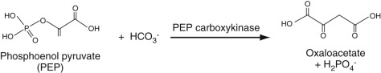

(Eq. 27-13, A) 

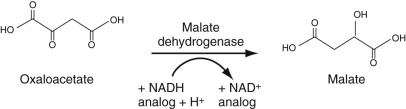

(Eq. 27-13, B) 

 

##  Cholesterol 

As discussed in [ Chapter 17 ](<##!/content/3-s2.0-B9780323295680000176?scrollTo=%23c00017>) , cholesterol circulates as both free (mainly in low-density lipoprotein[LDL] particles) and cholesterol ester (mainly in high-density lipoprotein [HDL] particles). To determine the serum concentration of total cholesterol, therefore, all cholesterol ester is first converted to free cholesterol using cholesterol esterase ( [ Equation 27-14, _A_ ](<#f9045>) ). The resulting total free cholesterol is then oxidized to 7-alpha-hydroxy-cholesten-3-one with cholesterol oxidase, as also shown in [ Equation 27-14, _A_ ](<#f9045>) . As can be seen, hydrogen peroxide, H  2  O  2  , a strong oxidizing agent, is generated in this reaction. Advantage can be taken of this property to generate strongly absorbing chromophores, as we now describe. 

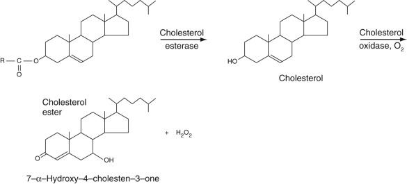

(Eq. 27-14, A) 

 

##  The Quinoneimine Strategy 

H  2  O  2  can be reacted, in the presence of a peroxidase, with a phenazone, mainly 4-aminoantipyrene, which forms a highly colored quinoneamine dye with phenol, as shown in [ Equation 27-14, _B_ ](<#f9050>) . This is a prototypical reaction in which the phenol is oxidized to the quinone and in which the exocyclic –NH  2  group of 4-aminoantipyrene then adds to the quinone to form a strongly absorbing color complex. Phenol is one of many compounds that can be used to form a quinone or an oxidized aromatic ring, known collectively as _Trinder 's reagents. _ Several of these are aniline derivatives and include N-ethyl-N-(2-hydroxy-3-sulphopropyl)m-toluidine (TOOS) (absorbance is determined at 545 nm) and N-(2-hydroxy-3-sulfopropyl)-3,5-dimethoxyaniline (HDAOS) among a number of other, similar compounds. We will have occasion to refer to this set of reactions in the determination of the concentrations of a number of analytes, in addition to cholesterol, as described in the following section. 

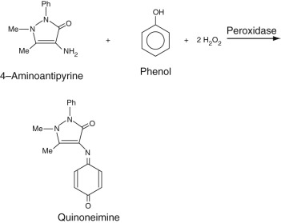

(Eq. 27-14, B) 

For cholesterol determination, H  2  O  2  is generated and is reacted with 4-aminoantipyrine and, generally, _phenol_ in the presence of a peroxidase to yield the quinoneimine, shown in the next section, whose absorbance is determined at 505 nm. 

 

##  HDL Cholesterol (Jensen et al, 2002; Sugiuchi et al, 1995) 

Until relatively recently, methods have been employed in which either LDL or HDL fractions are selectively precipitated, centrifuged, and the cholesterol in the supernatant assayed. For example, to assay HDL cholesterol, fractions containing apo-B proteins as in LDL and VLDL particles (see [ Chapter 17 ](<##!/content/3-s2.0-B9780323295680000176?scrollTo=%23c00017>) ) were precipitated using a polyanion and a divalent cation such as dextran sulfate-MnCl  2  or phosphotungstate-MgCl  2  combinations. The remaining cholesterol in the supernatant, presumably only HDL cholesterol, is then assayed using the method described in the next section. These methods are somewhat time-consuming and, of course, require manual procedures that cannot be automated. 

It was found that the enzymes used in the two assays shown in [ Equation 27-14 ](<#f9045>) could be made relatively specific for reacting with HDL cholesterol by the relatively simple expedient of adding polyethylene glycol (PEG 6000) to the free amino groups of basic amino acids of the polypeptide chains of these enzymes. Also, addition of alpha-cyclodextran sulfate (average of six glucose units with an average of two sulfates per glucose unit) in the presence of Mn  +2  ions greatly reduces the reactivity of the cholesterol in LDL, VLDL, and chylomicron fractions. Thus addition of the two PEGylated enzymes with sulfated cyclodextran and MnCl  2  allows direct determination of HDL cholesterol. The indicator reaction with H  2  O  2  is the same as in [ Equation 27-14, _B_ ](<#f9050>) . The overall method is summarized in [ Equation 27-15, _A_ ](<#f9055>) . 

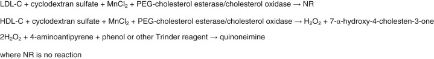

(Eq. 27-15, A) 

 

##  LDL Cholesterol (LDL-C) (  Nauck et al, 2002  ) 

The basic strategy for direct determination of LDL-C is first to add a reagent that protects LDL-C from reacting with the two enzymes, cholesterol esterase and cholesterol oxidase, and then to react cholesterol from all of the other fractions so that it is completely consumed, and finally to add a deprotecting agent that allows LDL-C to undergo reaction with the two enzymes. Charged surfactants have been found to block cholesterol in LDL from reacting with the two enzymes, cholesterol esterase and oxidase. The release agent is also a surfactant that, in contradistinction to the protecting agent, is neutral. 

In practice, two composite reagents are added to serum sequentially. The first contains protective surfactant and polyanions, which block the reaction of LDL-C with cholesterol esterase and oxidase, and catalase, which consumes the H  2  O  2  generated in the reaction of all of the non-LDL-C, summarized in [ Equation 27-15, _B_ ](<#f9060>) . Then a second reagent is added that consists of 4-aminoantipyrene as described above, sodium azide, that blocks catalase, peroxidase, the deprotecting surfactant that releases LDL-C and an appropriate Trinder's agent, i.e., chromophore-producing compound that reacts with the 4-aminoantipyrene to form the color complex. These reactions are summarized in [ Equations 27-15, _B_ ](<#f9060>) , and [ 27-15, _C_ ](<#f9065>) . 

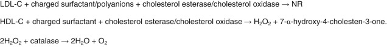

(Eq. 27-15, B) 

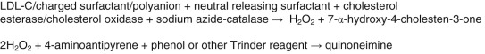

(Eq. 27-15, C) 

There are multiple variations of this set of reactions, but all of them are based on the overall strategy described here. 

 

##  Glucose 

The most commonly used method to determine serum glucose levels is to induce phosphorylation of glucose, by hexokinase and ATP to yield glucose-6-phosphate. By adding glucose-6-phosphate dehydrogenase, glucose-6-phosphate is converted into gluconolactone-6-phosphate (first step in the pentose phosphate pathway). This is an oxidation reaction. NADP is reduced to NADPH, whose absorbance can be determined directly at 340 nm. These reactions are summarized in [ Equation 27-16 ](<#f9070>) . 

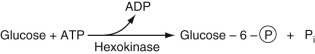

(Eq. 27-16, A) 

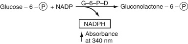

(Eq. 27-16, B) 

In [ Equation 27-16 ](<#f9070>) , the circled P represents the phosphate moiety. This reaction sequence is perhaps the one most commonly used. Other methods for glucose determination are also available and are used most commonly in point-of-care testing (  Yoo & Lee, 2010  ). In these reactions, glucose oxidase is used to convert glucose to gluconolactone. In this reaction, flavine adenine dinucleotide, FAD, is reduced to FADH  2  . In the presence of oxygen, FAD is regenerated and oxygen is reduced to H  2  O  2  . The latter is oxidized in the presence of a platinum electrode to yield 2H  \+  \+ O  2  \+ 2e (electrons). The electrons flow through a circuit giving rise to a current, which is proportional to the glucose concentration. There are several variants of this strategy. In one of these, glucose dehydrogenase bound to the dye, pyrroquinolinequinone (PQQ), oxidizes glucose to gluconolactone plus the reduced form of PQQ, which has an intense red color that can be measured spectrophotometrically. Most commonly, the reduced dye is reoxidized and the released electrons measured as current electrochemically as described earlier. The electrochemical methods for point-of-care testing use whole blood for glucose determination. Thus the hematocrit has an effect on the concentration of glucose that must be included in obtaining the whole blood glucose value (  D'Orazio, 2009  ;  Yoo & Lee, 2010  ). 

 

##  Lactate 

As discussed in [ Chapter 20 ](<##!/content/3-s2.0-B9780323295680000206?scrollTo=%23c00020>) , lactate reacts almost exclusively with lactate dehydrogenase (LDH) as shown in [ Equation 27-17 ](<#f9080>) . 

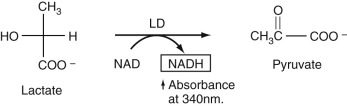

(Eq. 27-17) 

Since NAD is converted to NADH, shown in the box, the increase in absorbance of NADH at 340 nm is followed until it becomes constant. After subtraction of a blank for background absorbance of the serum sample at 340 nm, the total absorbance is used to compute directly the increased concentration of NADH due to lactate oxidation. 

 

##  Triglycerides 

These are a heterogenous group of triesters of fatty acids with glycerol (see [ Chapter 17 ](<##!/content/3-s2.0-B9780323295680000176?scrollTo=%23c00017>) ). The nature of the fatty acid esters can differ widely in chain length, presence, and number of unsaturated bonds in the aliphatic chains, and chain arrangement. The strategy for determining triglyceride concentration is to hydrolyze all of the fatty acid esters of triglycerides to produce glycerol. It is then the resulting total concentration of glycerol that is taken as the total triglyceride concentration. Technically, this requires the use of a serum blank to determine the level of endogenous glycerol, but the level of glycerol in serum has been found to be quite low so that these blank determinations are not usually performed (  Rifai et al, 1999  ). 

In the reference method for determining triglyceride concentration, the triglycerides are first extracted into chloroform; the extract is then treated with silicic acid to extract phospholipids from the chloroform extract. The chloroform extract is then treated with strong potassium hydroxide base to hydrolyze all of the fatty acid esters of glycerol in a process referred to as _saponification_ . The resulting glycerol is treated with sodium periodate, resulting in the formation of 2 moles of formaldehyde and 1 mole of formic acid. The formaldehyde is then treated with chromotropic acid to give a chromogen whose structure has not been proved as yet but that contains two chromotropic acid molecules linked together by a formaldehyde carbon bridge. This adduct absorbs strongly at 580 nm. Of course, this is a time-consuming manual method that serves only as a reference method and cannot be automated. 

In the automated methods performed directly on serum, triglycerides are hydrolyzed to glycerol plus free fatty acids using lipase. Here we point out that lipase cleaves the fatty acid esters of glycerol at positions 1 and 3 of glycerol but not position 2. However, the 2-acid esters of glycerol spontaneously rearrange to form the 1- or 3-fatty acid esters that are then hydrolyzed by lipase. This then allows complete hydrolysis of the fatty acid esters of glycerol. 

To determine the total glycerol concentration, the glycerol is converted by the enzyme alpha-glycerokinase to form 1-phosphoglycerol. This pro­duct is converted, in turn, to dihydroxyacetone by glycerophosphate oxidase in the presence of oxygen. This is an oxidation-reduction reaction that generates H  2  O  2  . This is used to oxidize phenol or m-chlorophenol in the presence of 4-aminoantipyrene to form a conjugated adduct, as described in the cholesterol assay section earlier in the chapter. The absorbance (usually at 505 nm) of this adduct is proportional to the con­centration of generated glycerol. These reactions are summarized in [ Equation 27-18 ](<#f9085>) . 

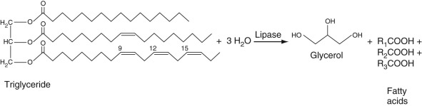

(Eq. 27-18, A) 

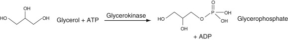

(Eq. 27-18, B) 

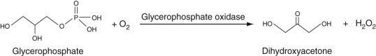

(Eq. 27-18, C) 

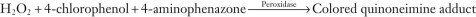

(Eq. 27-18, D) 

Variants of this basic approach include subjecting the glycerophosphate shown in [ Equation 27-18, _B_ ](<#f9090>) to glycerophosphate dehydrogenase to produce dihydroxyacetone phosphate, in a reaction in which NAD is converted into NADH. The NADH can be directly determined at 340 nm. 

 

##  Urea or Blood Urea Nitrogen (BUN) 

The reactions here use ultimately the same GLDH enzyme as used for ammonia determination described the section entitled The Quinoneimine Strategy earlier in the chapter. Here, urea is hydrolyzed into CO  2  and NH  3  in a reaction catalyzed by the enzyme urease. The resulting ammonia is then reacted with alpha-ketoglutarate to give glutamate in the reductive amination reaction shown in [ Equation 27-19 ](<#f9105>) . 

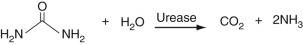

(Eq. 27-19, A) 

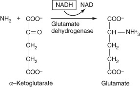

(Eq. 27-19, B) 

The use of hemolyzed samples may cause a significant interference with this method. 

 

##  Uric Acid 

As shown in [ Equation 27-20, _A_ ](<#f9115>) , uric acid is converted into allantoin by the enzyme uricase. 

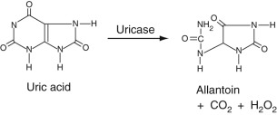

(Eq. 27-20, A) 

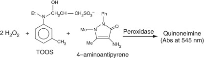

(Eq. 27-20, B) 

In this reaction, H  2  O  2  is generated. As shown in [ Equation 27-20, _B_ ](<#f9120>) , the resulting H  2  O  2  can then be used to oxidize a Trinder reagent, in this case TOOS (see the section entitled The Quinoneimine Strategy earlier in the chapter), that reacts with 4-aminoantipyrene to form a quinoneimine. Another is to use the resulting H  2  O  2  to oxidize a convenient substrate like ethyl alcohol to acetaldehyde by the enzyme catalase. The resulting acetaldehyde can then be further oxidized to acetate by the enzyme, alcohol dehydrogenase. In this reaction, NADP is converted to NADPH, resulting in an increased absorbance at 340 nm. 

 

##  Assays for Enzymes 

Enzyme assays are discussed in [ Chapter 20 ](<##!/content/3-s2.0-B9780323295680000206?scrollTo=%23c00020>) . As discussed in that chapter, most enzyme reactions are carried out under saturating conditions where the substrate concentration is significantly greater than K  M  . This ensures that the initial rate of the reaction is proportional to the total enzyme concentration. Most enzyme assay results are expressed in activities, that is, international units (IU), the slopes of the plots of product formed versus time, as described in [ Chapter 20 ](<##!/content/3-s2.0-B9780323295680000206?scrollTo=%23c00020>) . 

 

##  Alanine Amino Transferase (ALT) and Aspartate Amino Transferase (AST) 

 

##  ALT 

As described in [ Chapter 21 ](<##!/content/3-s2.0-B9780323295680000218?scrollTo=%23c00021>) , this enzyme, which is expressed mainly in liver, reversibly catalyzes the transamination reaction between alanine and alpha ketoglutarate to give pyruvate and glutamate. As discussed in [ Chapter 21 ](<##!/content/3-s2.0-B9780323295680000218?scrollTo=%23c00021>) , it is vital that the cofactor B  6  , pyridoxal phosphate, be present since it is the moiety that is involved in the actual reaction. As shown in [ Equation 27-21 ](<#f9125>) , the pyruvate that is produced is then reacted with lactate dehydrogenase (LDH) in the presence of NADH to produce lactate. Since, in this reaction, NADH is converted to NAD, the decrease in absorbance of NADH at 340 nm is measured. 

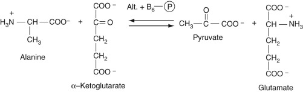

(Eq. 27-21, A) 

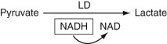

(Eq. 27-21, B) 

The use of icteric and lipemic samples may cause a significant interference with this method. 

 

##  AST 

As is also described in [ Chapter 21 ](<##!/content/3-s2.0-B9780323295680000218?scrollTo=%23c00021>) , this enzyme, which, like ALT, requires co-factor B  6  (pyridoxal phosphate), reversibly catalyzes the reaction of aspartic acid with alpha-ketoglutarate to yield oxaloacetate (OAA) and glutamate. The resulting OAA is then reacted with malate dehydrogenase, which converts the OAA to malate. As in the detection reaction for ALT in the preceding paragraph, NADH is converted to NAD, resulting in a decreased absorbance at 340 nm. These reactions are summarized in [ Equation 27-22 ](<#f9135>) . 

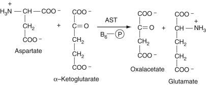

(Eq. 27-22, A) 

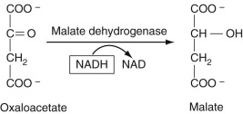

(Eq. 27-22, B) 

 

##  Alkaline Phosphatase (ALP) 

As discussed in [ Chapter 20 ](<##!/content/3-s2.0-B9780323295680000206?scrollTo=%23c00020>) , the quantitative determination of serum alkaline phosphatase is based on colorimetric measurement of the rate of formation of p-nitrophenol (pNP), as the p-nitrophenoxide anion, a yellow compound, at 410 nm, from hydrolysis of para-nitrophenylphosphate (pNPP) by alkaline phosphatase, as shown in [ Equation 27-23 ](<#f9145>) . 

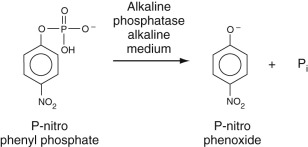

(Eq. 27-23) 

P  i  represents inorganic phosphate cleaved from the substrate. The use of hemolyzed specimens may cause a significant interference with this method. 

 

##  Amylase (  Moss & Henderson, 1999  ) 

This enzyme hydrolyzes poly α-1,4-linked glucose polymers as are found in starch, amylopectin, and glycogen such that hydrolysis occurs at every second glucose residue. There are two types of amylases: alpha and beta. Beta amylase cleaves maltose units (glucosyl(α-1,4)glucose) from the reducing to the nonreducing end, as an exo-amylase, while α-amylase cleaves internally in addition to its cleaving from the reducing end of the alpha-1,4,-linked glucose polymer. Serum amylase is of the alpha type. The two major sources of this enzyme are pancreas and salivary glands. Thus serum amylase levels can be used as markers for pancreatic and salivary gland function. Both strongly homologous isozymes are present in serum. Over 200 methods for assaying for these enzymes have been described. Older methods used starch as the substrate. The glucose polymer forms a well-defined helix in solution. Iodine can bind within this helical structure to form a colored complex. In the presence of amylase, the polymer is degraded, resulting in lower iodine binding and hence less color complex formation. This decrease in color over time can be followed. In addition, as starch is hydrolyzed by amylase, the turbidity of the solution decreases, allowing turbidimetry (see [ Chapter 4 ](<##!/content/3-s2.0-B9780323295680000048?scrollTo=%23c00004>) ) to be used to measure amylase activity. 

Chromogenic substrate polymers of glucose have been synthesized in which a dye is bound covalently to the polymer. In the presence of amylase, the polymer is hydrolyzed, releasing small dye-labeled oligosaccharides. In the Johnson & Johnson slide technology system, the oligosaccharide is bound to an anionic dye, drimarene red Z2B; the dye-labeled oligosaccharides from amylase cleavage diffuse into the reagent layer where they are bound to a cationic polymer, where their concentrations can be determined spectrophotometrically. The parent polysaccharide cannot diffuse into this layer and is thus excluded. On Abbott analyzers, the parent polymer is labeled with a fluorescent probe. Since the structure of the long polymer is rigid (a helical structure), the fluorescence is polarized when the probe is stimulated with polarized light. (See [ Chapter 23 ](<##!/content/3-s2.0-B9780323295680000231?scrollTo=%23c00023>) for a description of fluorescence polarization.) When the polymer is hydrolyzed by amylase, probe-bound fragments are released that are much smaller than the parent polymer and whose “tumbling times” are much faster, resulting in a major decrease in fluorescence polarization. Thus the decreased fluorescence polarization can be followed over time to determine the enzyme activity. 

Digestion of glucose polymers by amylase results in the formation of oligosaccharides like maltose and maltotriose (three glucose units in α-1,4 linkage). Oligosaccharides with three or fewer glucose units can be hydrolyzed to glucose with α-glucosidase. The resulting glucose formed can be assayed as described in the glucose assay section earlier in the chapter. A problem with this approach is the presence of endogenous glucose. This provides a high blank background. Endogenous glucose can be removed with a gel filtration column, although this does not lend the method to automation. 

These methods use natural polymers of starch or amylopectin as substrates. This has the problem of standardization of the substrate material from lot to lot. In addition, the inhomogeneous substrate forms sols in aqueous solution that are easily contaminated. They are also temperature-sensitive and have limited stability. Newer methods involve use of synthetic substrates. 

In one such method, synthetic maltopentaose (5α-1,4-linked glucose residues) is hydrolyzed by amylase to yield maltotriose and maltose. These are directly hydrolyzed to glucose by α-glucosidase. Since there is a high endogenous glucose background, this glucose is removed by a gel filtration column as mentioned earlier. 

To obviate the endogenous glucose problem, synthetic maltotetraose (4α-1,4-linked glucose residues) is used as the substrate. Amylase cleaves this substrate into 2 maltose units. These are then treated with the enzyme maltose phosphorylase and inorganic phosphate to form glucose-1-phosphate + glucose. Glucose-1-phosphate is then converted to glucose-6-phosphate by phosphoglucomutase. The resulting glucose-6-phosphate is then treated with glucose-6-phosphate dehydrogenase as described in the glucose assay section earlier in the chapter, so that the formation of NADPH at 340 nm can be followed over time. It may be noted that, since the glucose-6-phosphate is generated from maltose and not from any endogenous glucose, endogenous glucose does not interfere with this reaction. However, unfortunately, amylase is not completely specific for generating 2 maltose sugars from maltotetraose and also cleaves the substrate, to a more minor extent, to glucose and maltotriose. Thus the assay somewhat underestimates the level of amylase for this reason. 

More recently, chromogenic substrates have been synthesized. These contain oligo-α-1,4-linked glucose units with 4 (or p)-nitrophenol (4-NP) in α-acetal linkage to the reducing sugar of the oligosaccharide. In one assay, maltoheptaose (7 glucose units in α-1,4 linkage) attached to 4-NP at its reducing end, is used as the substrate, as illustrated in [ Figure 27-5 ](<#f0120>) . Amylase hydrolyzes this substrate mainly into (glucose)  4  -NP, (glucose)  3  -NP, and (glucose)  2  -NP plus (glucose)  3  , (glucose)  4  , and (glucose)  5  , respectively. These reactions are summarized in [ Equation 27-24 ](<#f9150>) . 

(Eq. 27-24, A) 

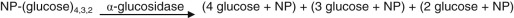

(Eq. 27-24, B) 

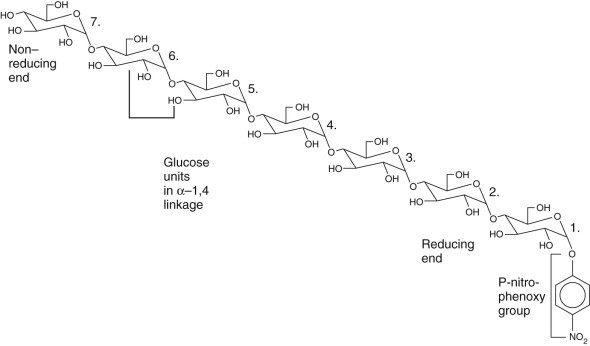

Figure 27-5 

Structure of a synthetic substrate for amylase assays. 

This is the p-nitrophenyl glycoside of maltoheptaose. In practice, to enhance reaction specificity and to assure more efficient cleavage by alpha-glucosidase, a protecting 4,6-ethylidene or benzylidene group is introduced on the seventh glucose unit on the nonreducing end. 

As shown in [ Equation 27-24, _B_ ](<#f9155>) , the –NP-linked fragments are then further degraded with α-glucosidase to yield 4 (or p)-nitrophenol, which, at alkaline pH, forms the p-nitrophenoxide anion that absorbs strongly at 405 to 410 nm, as discussed in the Alkaline Phosphatase section earlier in the chapter. 

Note that [ Equation 27-24 ](<#f9150>) assume that a limit digest occurs for the tetra-, tri-, and disaccharides, always liberating one mole of p-nitrophenoxide anion per mole of each saccharide. In practice, this does not occur. In fact, hydrolysis of (glucose)  4  -NP by alpha-glucosidase is slow, although the rate can be enhanced by blocking OH-groups of the terminal nonreducing glucose unit. Thus 4,6-ethylidene, 4,6-benzylidene, and other blocking groups have been found to enhance alpha-glucosidase activity. 

Other problems with this approach include the consideration that the pKa of nitrophenol is close to the pH of the assay reactions, so that only about half of the released p-nitrophenol will be present as the oxyanion. In addition, the method is sensitive to ionic strength effects and the concentration of protein present in the assay mixture, both of which affect the pKa of the p-nitrophenol. It may also be subjected to interference by hemoglobin. 

It has been found that these problems are largely removed by use of 2-chloro,4-nitrophenol, called _CNP,_ in place of 4-NP. Because of the ortho electron-withdrawing property of the o-Cl group, the pKa of the liberated phenol is lowered so that 100% of it exists as the colored phenoxide anion. It also minimizes the other complications listed earlier (except hemoglobin interference) and, because it is a better leaving group in the mechanism of alpha-glucosidase–induced hydrolysis, higher yields of the smaller saccharides, and thus of CNP, are obtained, allowing for higher yields of the colored final product. 

 

##  Creatine Kinase (CK) 

As discussed in [ Chapter 20 ](<##!/content/3-s2.0-B9780323295680000206?scrollTo=%23c00020>) , creatine kinase reversibly catalyzes the reaction between creatine and ATP to yield creatine phosphate and ADP. This reaction occurs prominently in muscle tissue, allowing for storage of the so-called _high-energy phosphate bond_ as creatine phosphate. For the purposes of the enzyme assay, the reaction is reversed, that is, ADP and creatine phosphate are added to the sample to generate ATP + creatine. The product, ATP, is coupled into hexokinase-glucose-6-phosphate dehydrogenase (G6PD) reactions and generates NADPH as shown in [ Equation 27-25 ](<#f9160>) . The creatine kinase activity is proportional to the absorbance increase of NADPH at 340 nm. 

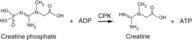

(Eq. 27-25, A) 

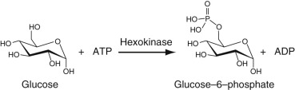

(Eq. 27-25, B) 

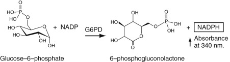

(Eq. 27-25, C) 

The use of hemolyzed samples may cause a significant interference with this method and should be avoided. 

 

##  Gamma-Glutamyl Transferase (GGT) 

As discussed in [ Chapter 21 ](<##!/content/3-s2.0-B9780323295680000218?scrollTo=%23c00021>) , this enzyme occurs on the cannalicular surface of the hepatocyte (see Figure 21-9) and catalyzes the transfer of the gamma-glutamyl residue of glutathione (gamma-glutamyl-cysteinyl-glycine) to another amino acid or to an exogenous agent like a drug. As it happens, GGT transfers the gamma-glutamyl residue from the synthetic substrate L-γ-glutamyl-3-carboxy-4-nitroanilide to glycylglycine to yield gamma-glutamyl-glycylglycine and free 5-amino-2-nitro-benzoate (ANB) as shown in [ Equation 27-26 ](<#f9175>) . Free ANB, which is a substituted aniline, absorbs at 410 nm. The rate of formation of ANB is measured as the increase in absorbance at 410 nm divided by the time interval over which it is measured, directly giving GGT activity. 

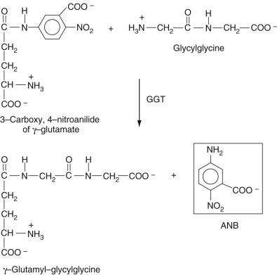

(Eq. 27-26) 

 

##  Lactate Dehydrogenase (LD) 

This enzyme, the reactions that it catalyzes, and assays for this enzyme are discussed in [ Chapter 20 ](<##!/content/3-s2.0-B9780323295680000206?scrollTo=%23c00020>) . Here we note that the reaction scheme shown in [ Equation 27-17 ](<#f9080>) for the assay for lactate is the same scheme as for the assay of LDH. In this case, lactate is added to the serum sample at a concentration above its K  M  , and the activity determined by the rate of increase of NADH absorbance at 340 nm. 

 

##  Lipase 

As discussed above in the triglycerides assay section, lipases cleave fatty esters of glycerol, and, as discussed in [ Chapters 17 ](<##!/content/3-s2.0-B9780323295680000176?scrollTo=%23c00017>) and [ 22 ](<##!/content/3-s2.0-B978032329568000022X?scrollTo=%23c00022>) , there are several isozymes of lipase, including pancreatic lipase, intestinal lipase, lipoprotein lipase, and gastric lipase. The first three of these forms have strong homology to one another and significantly less homology to the gastric isozyme. These lipases hydrolyze triglycerides that are long-chain fatty acid esters of glycerol. In addition, there are aryl and aliesterases that hydrolyze short-chain fatty acid esters and such simple esters as ethylacetate (aliesterase) and phenyl acetate (arylesterase) (  Moss & Henderson, 1999  ). In serum, pancreatic lipase is very much the predominant form. Thus, assays for lipase are for the purpose of evaluating pancreatic function. 

To be active, all lipases require a water-fat emulsion interface, the emulsion containing the substrate triglycerides. To attach to this interface, lipase requires the presence of a detergent, like cholate, and another protein to which it binds, co-lipase. The latter binds both to lipase and to the detergent-emulsion complex, allowing lipase to interact with the triglycerides. Thus, all assay mixtures for lipase must contain both the detergent and co-lipase. 

Assays for lipase can be performed by adding long-chain fatty acid esters to serum and the reaction monitored titrimetrically. In this case, dilute sodium hydroxide solution is added to serum to neutralize the long-chain fatty acids that are released, but the pH of the reaction mixture is maintained constant. The amount of base added over a given time period is a measure of the increased concentration of fatty acids over the time period, giving a rate that should be proportional to the total lipase concentration. The long-chain fatty acids used are contained in olive oil that has been treated to remove contaminating substances. This approach is also used with the pure triglyceride, triolein, as the substrate. 

Although this is a reference method, it is difficult to adapt to continuously used autoanalyzers. Thus other approaches have been devised. In one of these, 1-oleoyl-2,3-diacetyl glycerol is hydrolyzed by lipase to yield oleic acid and diacetylglycerol. The latter is reacted with an enzyme called diacetinase that hydrolyzes the two acetyl esters to yield glycerol and 2 moles of acetate. The glycerol generated in this reaction sequence is then treated with alpha-glycerol kinase + ATP, and the reaction sequences shown in [ Equation 27-18, _B_ to _D_ ](<#f9090>) are then carried out. In a variant of this sequence, a 1,2-diacylglycerol is used as the substrate to yield the 2-acylglycerol that is then hydrolyzed by monoglyceride lipase (to accelerate the reaction) to yield glycerol that is subjected to the reactions described earlier. 

A recently developed assay for lipase that is being used successfully utilizes the artificial substrate for lipase,1,2-O-dilauryl-rac-glycero-3-glutaric acid-(6′-methylresorufin) ester (DGGMR) as shown in [ Figure 27-6 ](<#f0140>) . Lipase cleaves this substrate such that it generates 1,2-O-dilauryl-rac-glycerol and an unstable intermediate, the hemi-glutaric acid-(6′-methylresorufin) ester, which, spontaneously degrades to glutaric acid and methylresorufin. The oxyanion of this dye that forms under basic conditions is red-colored and strongly absorbs at 580 nm. Thus the absorbance increase of the red methylresorufin at 580 or 581 nm is proportional to the lipase activity. The reactions are summarized in [ Figure 27-6 ](<#f0140>) . 

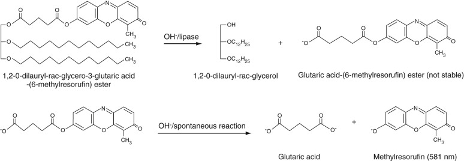

Figure 27-6 

Artificial substrate for serum lipase resulting in liberation of methylresorufin whose absorbance can be determined at 580 nm. 

In order to obtain soluble substrates for lipase, artificial substrates with shorter-chain fatty acids are used. One of these is butyrin, the triester of n-butyric acid with glycerol. The glycerol generated by lipase is subjected to the reactions described earlier. In a variant of this approach, the n-butyric acid ester of 2,3-dimercapto-1-ol, (i.e., a dithioester) is used. The limit digest of this substrate by lipase is 2,3-dimercapto-1-propanol. The two vicinal –SH groups can then be reacted with Ellman's reagent, 5,5′-dithio-bis-(2-nitrobenzoic acid), to form a color complex that absorbs strongly at 412 nm. A problem with the use of these shorter-chain substrates is that they are also substrates for the ali- and arylesterases in serum (  Moss & Henderson, 1999  ). To block the reaction of these enzymes, the covalent inhibitor phenylmethylsulfonylfluoride is added; this compound is a strong esterase (but not lipase) inhibitor. 

,,
