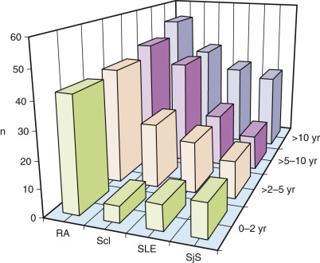
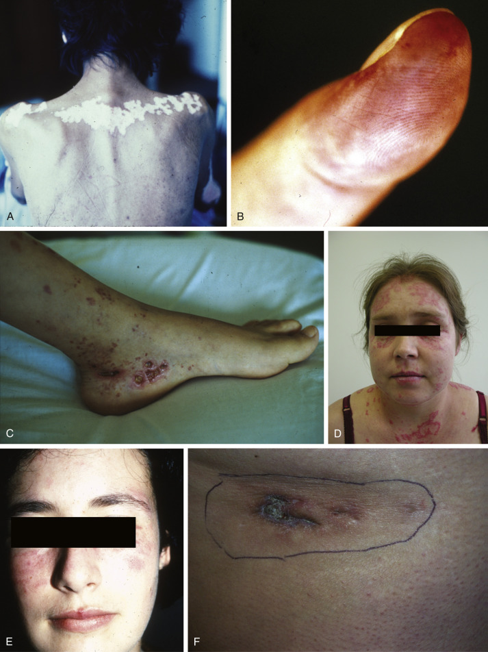
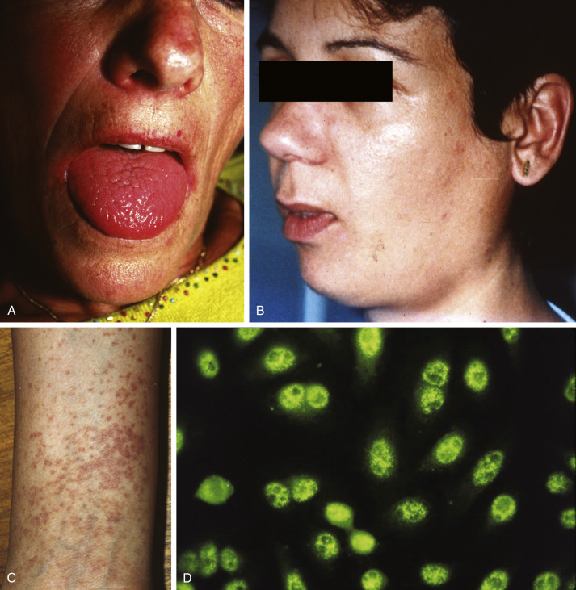
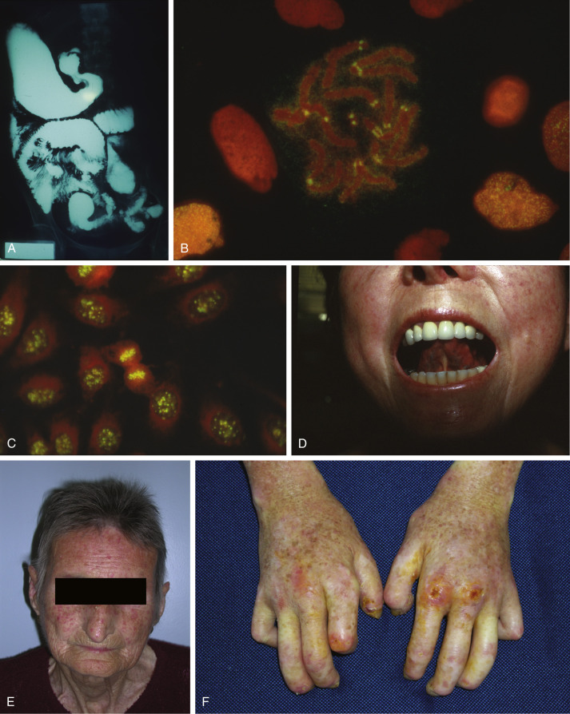
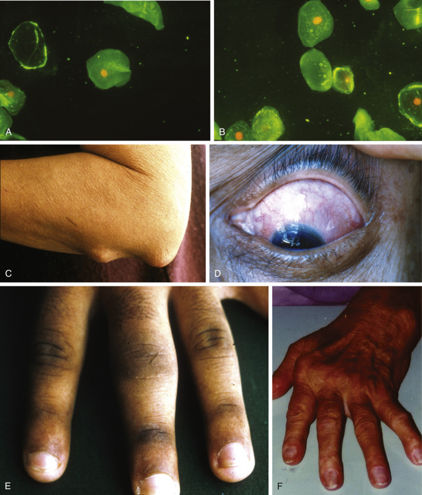
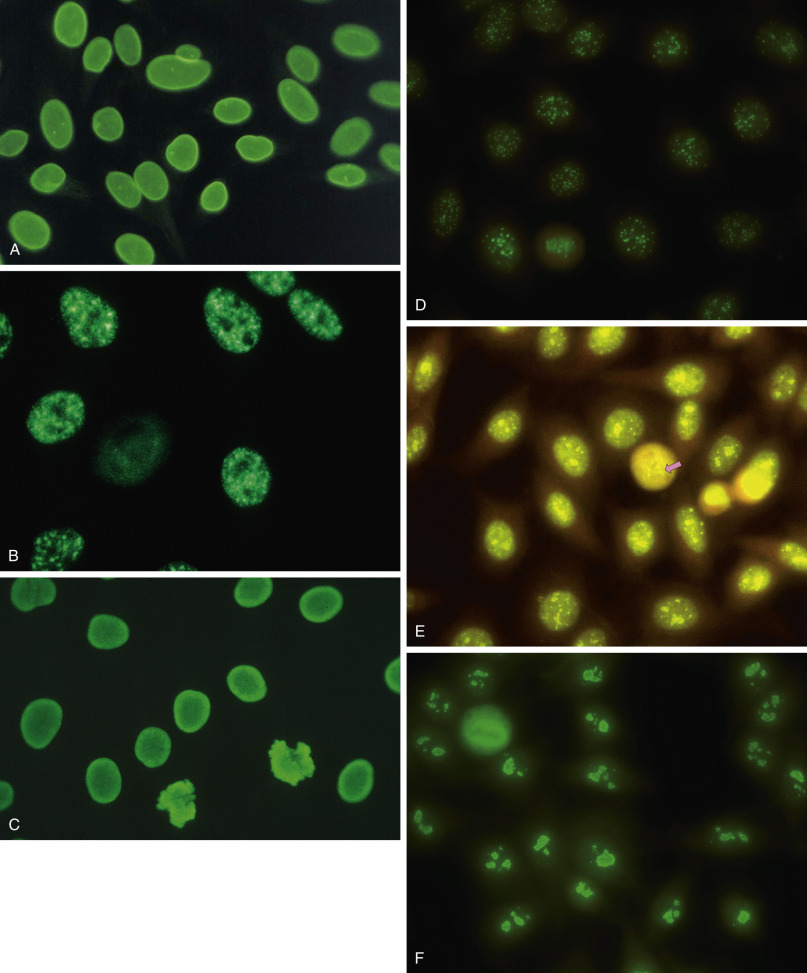
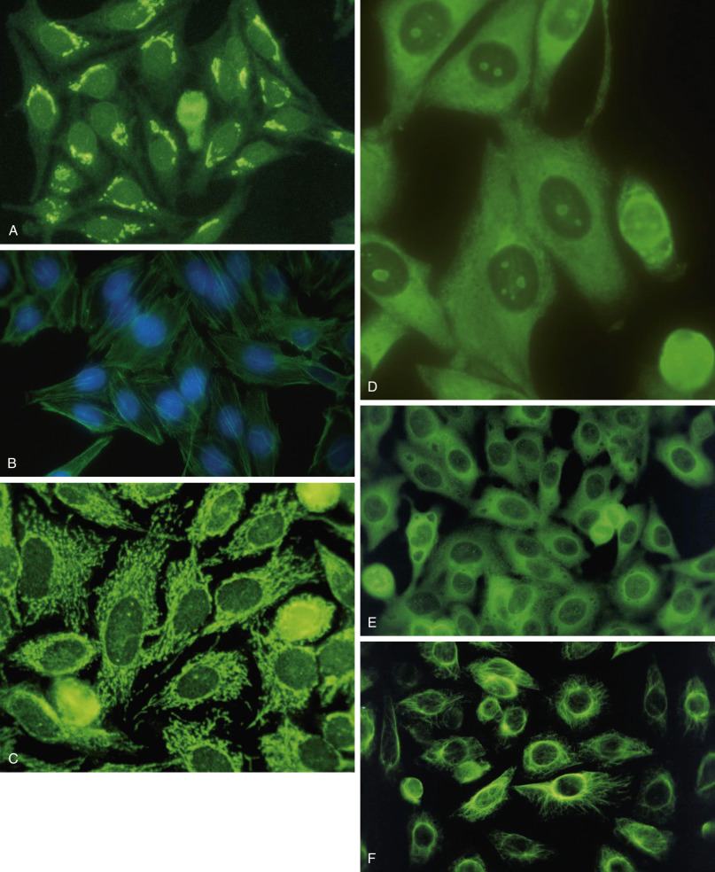
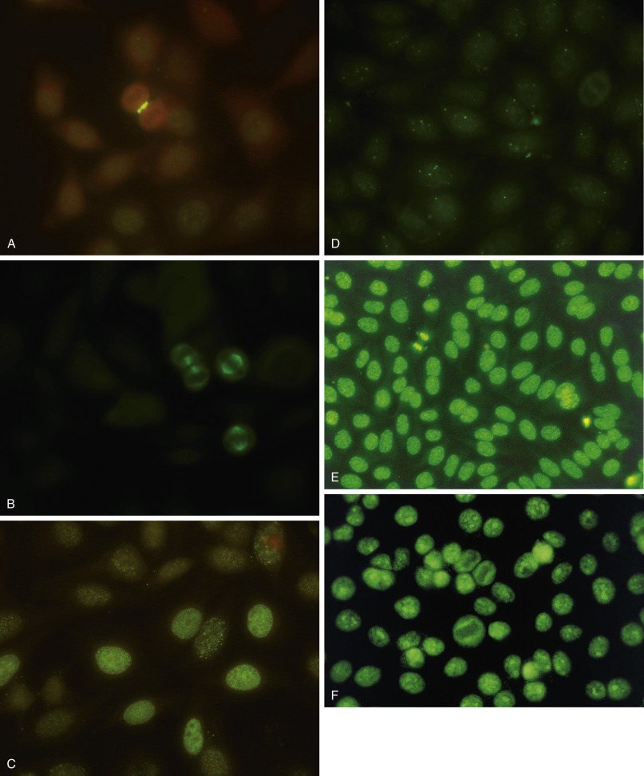
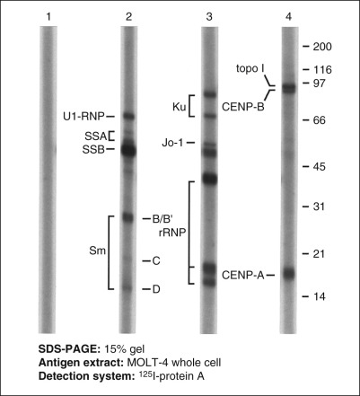

## Key Points

  * •

Many types of autoantibodies to intracellular and nuclear antigens are present in the various systemic rheumatic diseases. Currently it is considered important not only to detect the presence and quantity of intracellular and nuclear autoantibodies in the patient but also to identify its immunologic specificity. 

  * •

Past studies have shown that distinct diagnostic profiles of autoantibodies are observed in many of the rheumatic diseases. Some diseases are characterized by the presence or absence of a specific antibody or by differences in the quantitative level or titer of the autoantibody. 

  * •

Much progress has been made in improvement of sensitivity/specificity and quality control of the many laboratory tests used for the detection of autoantibodies to intracellular and nuclear antigens. 

  * •

Immunofluorescence microscopy using human cellular extracts such as HEp-2 cells allows the sensitive detection of serum antibodies that react very specifically with various cellular proteins and nucleic acids. 

  * •

Widely used tests for screening of intracellular autoantibodies are immunofluorescence microscopy and the immunoenzyme tests. The secondary definitive tests for specific identification of autoantibodies to nuclear antigen are immunodiffusion, immunoprecipitation, particle agglutination, enzyme-linked immunosorbent assay, immunoblotting, and radioimmunoassay methods. 

  * •

Molecular biologists have used many of the autoantibodies as biological probes and have elucidated the biological functions of several of the autoantigens. 

,  

##  Introduction and Classification of Systemic Rheumatic Diseases 

Many systemic rheumatic diseases are characterized by the presence of one or more autoantibodies that may be directed against components of the surface, cytoplasm, nuclear envelope, or nucleus of the cell. Such autoantibodies, collectively known as autoantibodies to nuclear antigens (ANAs), are a hallmark of the systemic rheumatic diseases (  Tan, 1989a  ;  Nakamura & Nakamura, 1992  ; von  Mühlen & Tan, 1994  ;  Satoh et al, 2009a  ). Many of the rheumatic diseases have a distinctive profile of autoantibodies with diagnostic and prognostic implications. Moreover, the biochemical and biological functions of many of the antigens involved in deoxyribonucleic acid (DNA) replication, splicing of ribonucleic acid (RNA) precursor, RNA processing, and other fine biologic processes were elucidated by using monospecific sera from rheumatic patients (  Tan, 1989a  ;  Yao et al, 2013  ). Classification of the various rheumatic diseases has been difficult because of a lack of firm etiologic bases for most of the diseases, besides distinct methodological questions (  Johnson et al, 2007  ). Our abridged classification of the systemic rheumatic diseases and related disorders is shown in [ Box 52-1 ](<#b0010>) . 

Box 52-1 

Systemic Rheumatic Diseases and Related Disorders 

  * 1.

Systemic lupus erythematosus (SLE) 

    * a.

Discoid lupus erythematosus 

    * b.

Drug-induced lupus erythematosus 

  * 2.

Sjögren's syndrome (primary and secondary) 

  * 3.

Scleroderma/CREST syndrome (calcinosis cutis, Raynaud's phenomenon, esophageal dysmotility, sclerodactyly, telangiectasia) 

  * 4.

Rheumatoid arthritis (RA) 

    * a.

Juvenile RA 

    * b.

Still's disease 

  * 5.

Dermatomyositis and polymyositis 

  * 6.

Overlap syndromes 

    * a.

Mixed connective tissue disease (MCTD) 

    * b.

RA and SLE (rupus) 

    * c.

SLE and scleroderma (lupoderma) 

    * d.

Scleroderma and dermatomyositis (sclerodermatomyositis) 

  * 7.

Systemic vasculitis 

    * a.

Takayasu's arteritis 

    * b.

Giant cell arteritis and polymyalgia rheumatica 

    * c.

Wegener's granulomatosis (granulomatosis with polyangiitis) 

    * d.

Churg-Strauss syndrome (eosinophilic granulomatosis with polyangiitis) 

    * e.

Polyarteritis nodosa 

  * 8.

Poorly defined connective tissue disease syndromes 

    * a.

Behçet's disease 

    * b.

Autoimmune syndrome induced by adjuvants (ASIA) 

Data from  Shoenfeld & Agmon-Levin, 2011  ;  Perricone et al, 2013  . 

,  

##  Systemic Lupus Erythematosus and Related Lupus-Like Disorders 

Systemic lupus erythematosus (SLE) is the prototype systemic rheumatic disease and has the following significant features (  Nakamura & Bylund, 1994  ;  Kiriakidou et al, 2013  ;  Kunz, 2013  ;  Cervera et al, 2014  ): 

  * 1.

SLE is a non-organ-specific autoimmune disease in which the tissue injury is mediated primarily by DNA–anti-DNA immune complexes. 

  * 2.

It is a multisystem disease that affects most persons of all ages and both sexes, although it is most prevalent in women during childbearing years. 

  * 3.

The disease demonstrates a hyperactive immune system with multiple abnormalities, displaying genetic associations with immunoregulatory signaling pathways and also involving the interferon pathway, toll-like receptors, and neutrophils (  Kunz, 2013  ). 

  * 4.

Patients with SLE demonstrate a heterogeneous and polyclonal antibody response, with autoantibody formation reaction involving similar mechanisms to those seen in a typical immune response to foreign immunogens (  Fatenejad et al, 1998  ). 

  * 5.

The typical case of SLE has an average of three different circulating antibodies present simultaneously. The prevalence of antibodies varies over a wide range, and more than 100 different types of autoantibodies have been identified in SLE (  Sherer et al, 2004  ). 

 

##  Etiologic Factors in Systemic Lupus Erythematosus 

The etiology is still poorly known. Some of the important etiologic factors in SLE are endocrine–metabolic, environmental, and genetic (  Gulko & Winchester, 1999  ;  Agmon-Levin et al, 2012  ). The strongest risk factor for the development of SLE is female gender. The presence of antinuclear antibodies was determined in female laboratory workers with varying degrees of exposure to blood from patients with SLE. The presence of antinative DNA antibodies was higher in laboratory workers than in an unexposed nonlaboratory group of women ( _p_ < 0.001) (  Zarmbinski et al, 1992  ). These results help support a hypothesis that a transmissible agent causing autoantibody formation may exist in the blood of patients with SLE. However, no transmissible agent has been identified to date related to autoantibody production in lupus pathogenesis. 

Certain chemicals have been implicated in SLE (  Hess & Mongey, 1992  ;  Rubin, 1992  ;  Rubin et al, 1992  ;  Fritzler & Rubin, 1993  ;  Vaz et al, 2013  ). The syndrome of drug-induced lupus with hydralazine, procainamide, and isoniazid has been studied for clues to the pathogenesis of SLE, and lupus-like autoantibodies have been described in anti–TNF-treated rheumatic patients. There have been varying reports that show the acetylation mechanism as a risk factor in SLE. Studies have demonstrated a greater concordance rate of SLE among monozygotic and dizygotic twins (  Arnett & Shulman, 1976  ;  Kaplan, 1984  ;  Grennan et al, 1997  ). The end result of the interaction of multiple etiologic factors is polyclonal activation of B cells in SLE patients with production of a wide spectrum of antibodies (  Mamula et al, 1994  ;  Fatenejad et al, 1998  ;  Dorner et al, 2009  ;  Choi et al, 2012  ;  Sang et al, 2014  ). 

 

##  Diagnostic Criteria for Systemic Lupus Erythematosus 

In 1971, the American College of Rheumatology (ACR; previously the American Rheumatism Association [ARA]), published preliminary criteria for the classification of SLE (  Cohen & Canoso, 1972  ;  Canoso & Cohen, 1979  ). Patients were considered to have SLE if four of the criteria were met sequentially or simultaneously during any interval of observation. In 1982, the Subcommittee for SLE Criteria of the ARA published revised criteria that incorporated new immunologic knowledge and improved the disease classification of SLE (  Tan et al, 1982  ). The 1982 revised criteria for classification of SLE included 11 categories, adding (1) abnormal titer of antinuclear antibody by immunofluorescence or an equivalent assay, and (2) antibody to native DNA and/or Sm antigen. In contrast to the 1971 criteria, the 1982 criteria removed Raynaud's phenomenon and alopecia because of their lack of sensitivity and specificity. 

When the 1982 ARA Criteria for Classification of SLE were compared with the 1971 criteria, there was definite improvement in sensitivity and specificity. The 1982 criteria showed a 97% sensitivity and 96% specificity when evaluated with known SLE and control patients (  Tan et al, 1982  ). In 1997, an update of the criteria was suggested, in which the LE cell test was dropped and anticardiolipin antibodies were added, changes emphasized in the “Guidelines for referral and management of SLE in adults” by the  ACR Ad Hoc Committee on SLE Guidelines (1999)  . 

Recently, the SLICC group (Systemic Lupus International Collaborating Clinics) validated an update of the ACR 1982 SLE criteria (  Petri et al, 2012  ;  Ighe et al, 2015  ;  Ines et al, 2015  ), with improved sensitivity (97% × 83% over the ACR 1982 criteria), although with lower specificity (84% × 96%). The proposal includes at least one clinical and one immunologic criterion satisfied or biopsy-proven lupus nephritis together with positive ANA or anti-DNA autoantibodies ( [ Box 52-2 ](<#b9000>) ). 

Box 52-2 

Criteria for Classification of Systemic Lupus Erythematosus 

 

##  Clinical Criteria 

  * 1.

Acute cutaneous disease (includes malar rash, photosensitivity, subacute cutaneous lupus) 

  * 2.

Chronic cutaneous disease (includes discoid rash, panniculitis) 

  * 3.

Oral or nasal ulcers 

  * 4.

Nonscarring alopecia (in the absence of other causes) 

  * 5.

Synovitis involving two or more joints 

  * 6.

Serositis (pleuritis or pericarditis with rub) 

  * 7.

Renal disorder (persistent proteinuria, cellular casts) 

  * 8.

Neurologic disorder (seizures, psychosis, peripheral/cranial neuropathy) 

  * 9.

Hemolytic anemia 

  * 10.

Leukopenia less than 4000/mm  3  OR lymphopenia less than 1000/mm  3  at least once 

  * 11.

Thrombocytopenia less than 100,000/mm  3  in the absence of offending drug 

 

##  Immunologic Criteria 

  * 1.

ANA+ 

  * 2.

Anti-DNA: antibody to native DNA in abnormal titer 

  * 3.

Anti-Sm: presence of antibody to Sm nuclear antigen 

  * 4.

Antiphospholipid antibodies (anticardiolipin or anti-beta2 GP I antibodies IgA, IgG, or IgM; or a positive test result for lupus anticoagulant; or a false-positive test result for syphilis 

  * 5.

Low complement levels (C3, C4, or CH50) 

  * 6.

Direct Combs+ in the absence of hemolytic anemia 

The proposed classification is based on 11 criteria. The proposed SLICC (Systemic Lupus International Collaborating Clinics) classification rule is as follows: Classify a patient as having SLE if he or she satisfies 4 of the clinical and immunologic criteria used in the SLICC classification criteria, including at least 1 clinical criterion and 1 immunologic criterion, OR if he or she has biopsy-proven nephritis compatible with SLE in the presence of ANAs or anti-dsDNA antibodies (  Tan et al, 1982  ;  Hochberg, 1997  ;  Petri et al, 2012  ). 

 

##  “Lupus-Like” Syndromes and Diseases 

Many diseases and syndromes share certain clinical features with SLE but are not SLE and have different etiologies and pathogeneses. Diseases in this category include vasculitis, cryoglobulinemia, relapsing polychondritis, lymphoproliferative diseases, rheumatic fever, glomerulonephritis, syphilis, lupoid hepatitis, drug-induced lupus, and occult malignancy (  Panush et al, 1993  ;  Panush & Schur, 1997  ). One very broad category of patients demonstrates fewer than four of the 1982 ARA classification criteria for SLE (  Lom-Orta et al, 1980  ;  Lazaro et al, 1989  ;  Schur, 1993  ;  Rua-Figueroa et al, 2015  ) but are considered to have “lupus-like” illnesses. These patients have been classified as undifferentiated rheumatic disease, nonrheumatic disease, overlap syndrome, and incomplete, latent, or incipient lupus. If these patients are followed, some stay with mild symptoms, and as such remain labeled as “undifferentiated connective tissue disease” (UCTD) (  Mosca et al, 2014  ). A few may develop a definite SLE, but many evolve into other diseases with better prognoses. Actually, up to 75% of patients with UCTD never fulfill diagnostic criteria for specific systemic rheumatic diseases (  Mosca et al, 2004  ). In our hands, 99 patients with anti-U1nRNP antibodies followed for 10 years, many diagnosed as UCTD when entering the cohort, developed characteristic signs and symptoms of rheumatoid arthritis, Sjögren's syndrome, systemic lupus, or scleroderma ( [ Fig. 52-1 ](<#f0010>) ), according to their HLA profile and antibody titers (unpublished results). 

Figure 52-1 

Classification criteria fulfilled by 99 patients with anti-U1nRNP antibodies, along more than 10 years of observation. 

Many patients in this cohort were classified as undifferentiated connective tissue disease (UCTD) in the first 2 years of clinical symptoms, while 43 individuals could be classified as having rheumatoid arthritis (RA). The number of RA-classified patients did not grow significantly toward the end of the study, but diagnoses of systemic lupus (SLE) and scleroderma (Scl) were fulfilled ever more often ( _p_ = 0.02 and 0.0008, respectively, chi-square for trend). Patients developing SLE had low titers of anti-U1nRNP antibodies and were HLA-DR2/3. The ones developing Scl had high anti-U1nRNP titers and were HLA-DR4. _SjS,_ Sjögren's syndrome. 

(From von Mühlen et al, unpublished data.) 

 

##  Autoantibody Profile in Systemic Lupus Erythematosus 

Characteristic of SLE is the presence of a broad spectrum of autoantibodies, including antibody to native DNA (dsDNA), chromatin, Sm antigen, U1nRNP, SS-A/Ro, SS-B/La, C1q, ribosomal RNP, and several other nonhistone protein or nonhistone protein-RNA complexes (  Nakamura & Bylund, 1994  ;  Sherer et al, 2004  ). Antinative DNA, anti-Sm, anti-C1q, antiribosomal RNP, and anti-PCNA (proliferating cell nuclear antigen) are generally specific for SLE. The prevalence of autoantibodies varies over a wide range. Antibodies to native DNA and chromatin are detectable in up to 90% of individuals with active disease, and antibodies to PCNA are seen in 3% or less (  Miyachi et al, 1978  ;  Takasaki et al, 1984  ;  Muro & Tan, 1994  ;  Mahler et al, 2012  ) ( [ Table 52-1 ](<#t0010>) ). 

TABLE 52-1 

Major Antigens and Autoantibodies in Systemic Lupus Erythematosus 

Antigen  |  Molecular Structure  |  Prevalence   
---|---|---  
Native DNA  |  Double-strand DNA  |  75%-90%   
Denatured DNA  |  Single-strand DNA  |  70%   
Histones  |  H1, H2A, H2B, H3, H4  |  50%-70%   
Nucleosome (chromatin)  |  DNA-histones complex  |  50%-90%   
Sm  |  Proteins 29 (B'), 28 (B), 16 (D), and 13 (E) kD, complexed with U1, U2, and U4-U6 snRNAs; spliceosome component  |  15%-30%   
Nuclear RNP (U1nRNP)  |  Proteins 70, 33 (A), and 22 (C) kD, complexed with U1 snRNA; spliceosome component  |  5%-40%   
SS-A/Ro60  |  Protein 60, complexed with Y1-Y5 RNAs  |  24%-60%   
SS-B/La  |  Phosphoproteins 48 kD, complexed with Y1 nascent RNA Pol transcripts  |  9%-35%   
Ku  |  Proteins 86 and 66 kD, DNA-binding proteins  |  1%-39%   
Ro52/TRIM21  |  Protein 52 kD, tripartite motif, E3 ubiquitin ligase  |  10%-25%   
hnRNP protein A1  |  Nuclear protein 34 kD  |  31%-37%   
PCNA  |  Protein 36 kD; auxiliary protein of DNA polymerase  |  3%   
Ribosomal RNP  |  Phosphoproteins 38, 16, and 15 kD associated with ribosomes  |  10%-20%   
Hsp-90  |  Heat-shock protein 90 kD  |  5%-50%   
Golgi complex  |  Golgins, giantin  |  Unknown   
HMG-17  |  DNA-associated proteins, 9 to 17 kD  |  34%-70%   
Beta 2 glycoprotein I  |  Anionic phospholipids, cardiolipin  |  25%   
  
Frequencies are mostly related to patients with active disease. 

Data from  Nakamura & Bylund, 1994  ;  Krapf et al, 1996  ;  Sherer et al, 2004  . 

 

##  Antibodies to Native DNA or Double-Stranded DNA 

Anti–double-stranded DNA (ds-DNA) antibodies are rather specific for SLE and are observed at a frequency of 75% to 90% in SLE patients with active disease (  Isenberg & Shoenfeld, 1987  ;  Isenberg et al, 1994  ;  Rekvig & Nossent, 2003  ). There have been many earlier reports of antibodies to ds-DNA in diseases other than SLE. However, current thinking is that the reactive antibodies to DNA in the other diseases were actually anti–single-stranded DNA antibodies. The ds-DNA antibody tests often used ds-DNA preparations contaminated with denatured or single-stranded DNA. One possible exception could appear in primary Sjögren's syndrome, a disease sometimes difficult to differentiate from SLE in older people. Antibody to DNA plays a definite role in the pathogenesis of SLE. In studies of SLE patients, antibody to DNA is followed by the appearance of circulating DNA antigen, a sequence of events that results in the formation of immune complexes. Such DNA–anti-DNA immune complexes, mostly containing complement-activating IgG3, have a special tropism for basement membranes and are readily deposited in the kidney glomeruli. This initiates kidney damage through inflammatory mechanisms that end up with complement activation and cell lysis (van  Bavel et al, 2008  ;  Mortensen & Rekvig, 2009  ;  Radic et al, 2011  ). 

Earlier methods for detection of DNA antibodies were the insensitive precipitation method, complement fixation, and passive hemagglutination. Current methods used are indirect immunofluorescence (IFA) on _Crithidia luciliae_ and enzyme-linked immunosorbent assay (ELISA) (  Kavanaugh & Solomon, 2002  ). These can detect anti-DNA in 75% to 90% of active untreated SLE patients. Transient increases in anti-DNA antibodies were described in RA patients treated with anti-TNF therapy (  Allanore et al, 2004  ;  Bobbio-Pallavicini et al, 2004  ;  Takase et al, 2014  ). Occasional clinical lupus-like cases may occur in this situation (  Swale et al, 2003  ;  Eriksson et al, 2005  ). 

 

##  Antibodies to Sm and Nuclear Ribonucleoprotein 

Precipitating antibodies to Sm antigen have been considered highly specific markers for SLE (  Tan & Kunkel, 1966  ; von  Mühlen & Tan, 1995  ;  Wiik, 2005  ). Antibodies to both Sm and nuclear ribonucleoproteins (nRNP) are found in patients with SLE. The Sm and nRNP antigens were clearly associated because the nRNP could not be biochemically isolated from the Sm antigen.  Lerner and Steitz (1979)  used the tools of molecular biology to show that Sm and nRNP antigens were subcellular particles comprised of small nuclear RNAs complexed with proteins. The particle bound by anti-nRNP is composed of an RNA component designated U1 (U for uridine-rich), complexed to at least seven proteins varying in molecular mass from 12 to 68 kD (  Tan, 1989a  ), found at a frequency of 5% to 40% in active SLE (ter  Borg et al, 1990  ). 

The antigens of Sm consist of several proteins, conventionally called B1 (29 kD), D (16 kD), and E (13 kD) (  Tan, 1989b  ). Purified anti-B1/B antibodies cross-react with the D protein and vice versa. Thus there are at least two epitopes on the B1/B protein recognized by anti-Sm sera. No characteristic clinical features are apparent in SLE patients with anti-Sm antibodies (  Barada et al, 1981  ), although some authors claim these autoantibodies to be associated with renal disease or disorders of the central nervous system (  Yasuma et al, 1990  ;  Ni et al, 2009  ;  Hirohata et al, 2014  ;  Ishizaki et al, 2014  ). Patients who have antibodies to only nRNP have a low frequency of antibodies to DNA and a low frequency of clinically apparent renal disease (ter  Borg et al, 1990  ). Anti-Sm and anti-nRNP antibodies may be detected by immunodiffusion, passive hemagglutination, or counterimmunoelectrophoresis. However, the above-mentioned methods do not accurately distinguish between antibodies against different small nuclear RNA-associated polypeptides. The reactivities with individual RNAs and polypeptides can be best demonstrated by RNA immunoprecipitation and immunoblotting techniques, respectively. Immunoblotting has been found to be more sensitive than conventional methods for the detection of anti-Sm and anti-nRNP (  Nakamura et al, 1994  ). Currently, the most widely used laboratory tests for the detection of anti-Sm and anti-nRNP antibodies are immunodiffusion and ELISA. These tests can differentiate between Sm and nRNP antibodies but cannot define the specific antibody epitopes present in patients' sera. The antibody specificity and epitopes are best determined by Western and Northern blotting methods. 

 

##  Antibodies to SS-A/Ro and SS-B/La 

Patients with SLE can have antibodies to SS-A/Ro alone, or they may have both anti–SS-A/Ro and anti–SS-B/La. Having anti–SS-A/Ro alone is strongly associated with human leukocyte antigen (HLA) DR2 and with being young (<22 years of age at onset). The presence of both anti–SS-A/Ro and anti–SS-B/La in SLE is associated with HLA-DR3 and is seen in older patients (>50 years of age at disease onset) (  Hochberg et al, 1985  ). A study of 55 patients with SLE showed that patients with anti–SS-A/Ro alone had much more serious renal disease (  Hochberg et al, 1985  ). SLE patients with only anti–SS-A/Ro also had a higher incidence of concomitant anti-DNA antibodies than those SLE patients with both the anti–SS-A/Ro and anti–SS-B/La antibodies (  Chan & Tan, 1989  ). Anti–SS-A/Ro autoantibodies have been closely associated with the appearance of nephritis, vasculitis, lymphadenopathy, photosensitivity, and leukopenia in SLE patients. Anti–SS-B/La antibodies, like anti–SS-A/Ro antibodies, are antibodies noteworthy for their strong association with Sjögren's syndrome, occurring in more than two thirds of patients with this disorder. The SS-B/La antigen is a cellular protein bound to a small RNA species, forming a small RNP that may function in processing of RNA polymerase III transcripts (  Chan & Tan, 1989  ). 

More recently, attention has been called to the differentiation between antibodies to SSA/Ro60 in opposition to anti-Ro52/TRIM21 (  Schulte-Pelkum et al, 2009  ). There are different clinical associations for each system, while both anti-SSA/Ro60 and anti-Ro52/TRIM21 are associated with primary Sjögren's syndrome and SLE, and anti-Ro52/TRIM21 alone is associated with scleroderma, myositis, and a number of other autoimmune diseases. Masked reactivities in up to 20% of tested sera were reported when both antigens were present in commercial ELISAs, pointing to the fact that each autoantibody should be tested separately. 

 

##  Clinical Subsets of Systemic Lupus Erythematosus Associated with Antibodies to SS-A/Ro 

Elevated levels of SS-A/Ro antibodies are related to several clinical autoimmune disorders, including subacute cutaneous lupus erythematosus; neonatal lupus erythematosus syndrome with congenital heart block and cutaneous lesions; homozygous C2 and C4 deficiency with SLE-like disease; primary Sjögren's syndrome vasculitis, rheumatoid factor positivity, and severe systemic symptoms; ANA-negative SLE patients; and SLE with interstitial pneumonitis (  Bylund & Nakamura, 1991  ). Precipitating antibodies to SS-A/Ro are seen in 65% to 95% of patients with anti–SS-A/Ro associated subsets, and more than 90% of the patients have anti–SS-A/Ro levels when detected by ELISA methods (  Bylund & Nakamura, 1991  ). 

 

##  Anti-Ku Antibodies 

The Ku-antigen system consists of a pair of proteins called p70/p80 (  Francoeur et al, 1986  ;  Reeves & Sthoeger 1989  ;  Reeves, 1992  ). These proteins have a high affinity for DNA and are known to be DNA-binding proteins, interacting covalently with the ends of native DNA. With the use of both immunoprecipitation and immunoblot assays, the Ku autoantibody was found in 10% of SLE sera and was not detected in 100 scleroderma sera examined. In studies with an enzyme immunoassay, Reeves showed that 39% of SLE, 55% of mixed connective tissue disease (MCTD), and 40% of scleroderma patients had low levels of antibody to Ku protein (  Reeves, 1992  ). 

 

##  Anti-Ki/SL Antibodies 

Anti-Ki antibody was first reported in Japan (  Tojo et al, 1981  ) and was observed in approximately 10% of SLE patients. A relationship was observed between anti-Ki and the clinical features of arthritis, pericarditis, and pulmonary hypertension in SLE patients. The Ki antigen was purified from rabbit thymus and had a molecular weight of 32 kD.  Sakamoto and colleagues (1989)  developed an ELISA and observed anti-Ki antibodies in 21% (30 out of 140) of SLE patients, while 11 of 140 were positive for anti-Ki by double-immunodiffusion tests. 

 

##  Antibodies to Ribosomal P Proteins 

Ten percent to 20% of SLE sera show autoantibodies targeting three ribosomal phosphoproteins of 15, 18 and 38 kD in WB assays. Association of anti-rRNPs with major central nervous system disorders in SLE, mainly psychotic symptoms, was reported in a retrospective study (  Bonfa et al, 1987  ). No association was shown with cognitive impairment or depression in lupus patients. Significant differences in the prevalence of anti-rRNP are found among races. These antibodies occur in a higher frequency together with anti-Sm and anti-U1nRNP antibodies in SLE (  Yalaoui et al, 2002  ). The etiopathogenic role of anti-rRNP in central nervous symptoms of lupus patients has no conclusive findings (  Nakamura, 1997  ;  Isshi & Hirohata, 1998  ). Observations in larger multicentric samples of SLE patients showed association of anti-rRNP antibodies with hemolytic anemia, leukopenia, alopecia, malar rash, proteinuria, and neurologic complications (  Hoffman et al, 2004  ;  Mahler et al, 2006  ). One study found correlation with disease activity (  Haddouk et al, 2009  ). Anti–ribosomal P autoantibodies, due to their high specificity, are proposed to join other criteria for SLE diagnosis and classification. 

 

##  Proliferating Cell Nuclear Antigen Multiprotein Complex 

Antibodies to PCNA proteins are detected in 3% of patients with active SLE but show no other distinctive clinical associations (  Miyachi et al, 1978  ;  Kaneda et al, 2004  ;  Mahler et al, 2012  ). A possible association with central nervous system features, like transverse myelitis, has been seen in our own patients (von Mühlen & Nakamura, unpublished results). The PCNA complex has been characterized as cell-cycle related, and PCNA antibodies have been useful probes in the study of agents regulating DNA replication, cell proliferation, and blast transformation. 

 

##  Antiphospholipid Antibodies in SLE 

The lupus anticoagulant/antiphospholipid antibody syndrome is characterized by the presence of circulating antibodies to phospholipids and clinical features of arterial and venous thrombosis, thrombocytopenia, hemolytic anemia, miscarriages, and several systemic symptoms (  Gomez-Puerta & Cervera, 2014  ). Antiphospholipid antibodies have been found frequently in patients with SLE, and also in other disorders such as infectious diseases (  Alarcón-Segovia et al, 1989  ;  McNeil et al, 1992  ). Antiphospholipid antibodies are found in up to 60% of patients with SLE. This is a very heterogeneous family of antibodies, functionally and immunochemically (  McNeil et al, 1992  ). Cardiolipin (anionic phospholipid) has been widely used for the detection of antiphospholipid antibodies. The majority of anticardiolipin antibodies cross-react with zwitterionic phospholipids. Antibodies to anionic phospholipids may be IgG or IgM, whereas antibodies to zwitterionic phospholipids are more frequently IgM. 

Antibodies to phospholipids are identified in SLE patients in three ways (  Alarcón-Segovia et al, 1992  ;  Cohen et al, 2010  ): serologically false-positive test for syphilis by a positive Venereal Disease Research Laboratory (VDRL) test; the lupus anticoagulant assay, which is a prolongation of the kaolin partial thromboplastin time (KPTT) that is not corrected by normal plasma; and cardiolipin immunoassay with the use of cardiolipin or other negatively charged phospholipids as antigens and beta 2 glycoprotein I as a cofactor. Patients with SLE will usually react with a negatively charged phosphate group present in cardiolipin, phosphatidic acid, phosphatidylserine, or phosphatidylinositol. 

Harris (  Harris et al, 1983  ;  Pierangeli et al, 2001  ;  Pierangeli & Harris  2005  ) convened international workshops to improve the precision and accuracy of antiphospholipid antibody immunoassays. Reference sera were prepared, and standard units (GPL and MPL) were defined. One GPL (MPL) unit is equivalent to 1 mg/mL of an affinity-purified standard IgG (IgM) sample. However, Lopez (  Lopez et al, 1992  ) suggested that an IgA-specific assay for antiphospholipid antibody is important in assessing the antiphospholipid syndrome in patients with SLE (  Andreoli et al, 2013  ;  Murthy et al, 2013  ;  Despierres et al, 2014  ;  Cousins et al, 2015  ). A higher prevalence of the IgA isotype seems to be found in black persons. 

Newly developed assays for beta 2 glycoprotein I autoantibodies seem to bring specificity to the findings, because it was reported that the beta 2 glycoprotein is the specific epitope for antiphospholipid autoantibodies (  Obermoser et al, 2004  ). Furthermore, IgA antibodies targeting beta 2 glycoprotein I, or antibodies recognizing a complex of beta 2 GP I/oxLDL (oxydized low-density lipoprotein), seem to be pathogenic in atherosclerotic vascular disease (  Ranzolin et al, 2004  ;  Staub et al, 2006  ;  Matsuura & Lopez, 2008  ). Domain 4 of the molecule seems to be the target for proatherosclerotic anti–beta 2 GP I autoantibodies, and domain 1 seems to be involved in the antiphospholipid syndrome, as demonstrated by our group in deletion mutants studies (  Iverson et al, 2006  ). 

 

##  Chronic Discoid Lupus and Other Cutaneous Variants 

A benign form of lupus may present as “discoid” (coin- or disc-shaped) cutaneous lesions without symptoms of systemic disease. This disorder is called chronic discoid lupus erythematosus (CDLE) (  Sontheimer & McCauliffe, 1990  ). The skin lesions of CDLE are persistent localized erythema, adherent scales, follicular plugging, telangiectasis, and atrophy (  Wallace et al, 1992  ). Subacute cutaneous lupus erythematosus (SCLE), another similar skin condition, consists of papulosquamous or nonscarring lesions with a major association to SS-A/Ro autoantibodies. Also, additional variants of CDLE, such as lupus panniculitis (also called lupus profundus) and urticarial lupus, have been described (  Sontheimer & McCauliffe, 1990  ;  Al-Attia & Ahmed, 1998  ). 

Wallace and colleagues (1992)  defined CDLE as the fulfillment of the description of CDLE or SCLE, or one of the variants of SLE, in which the 1982 ACR/criteria for SLE are not met. Unfortunately, CDLE is a cutaneous autoimmune disorder that lacks any unifying diagnostic serological abnormality. It is a mild form of lupus erythematosus that uncommonly disseminates to SLE. Otherwise, there is considerable overlap between CDLE and SLE because up to 15% of patients with SLE have cutaneous discoid lesions. About 6% to 12% of patients with SLE had discoid lupus for a varying number of years before the onset of systemic disease (  Wallace et al, 1992  ). Antinuclear antibodies are commonly found, with estimates of prevalence in discoid lupus from 6% to 50%. The sex ratio of discoid lupus (two females/one male) is much less biased toward females than the systemic form. [ Figure 52-2 ](<#f0015>) depicts some clinical aspects of cutaneous disease in SLE. 

Figure 52-2 

Typical cutaneous lesions in SLE. 

**A,** Scarring discoid lesions. **B,** Finger vasculitis. **C,** Vasculitis with ulcers. **D,** Subacute cutaneous geographic lesions. **E,** Typical malar rash. **F,** Lupus panniculitis. 

 

##  Drug-Induced Lupus Erythematosus and Antihistone Antibodies 

Characteristic of drug-induced lupus is the presence of histone autoantibodies. Histones are basic molecular proteins containing high molar ratios of positively charged amino acids, lysine, and arginine. Histones are found in eukaryotic cells closely associated with genomic DNA. The subunit of this histone-DNA complex is called a nucleosome, which has two molecules of each of the “core” histones (H2A, H2B, H3, and H4) and one molecule of H1, along with DNA of about 200 base pairs in length (  Totoritis & Rubin, 1985  ;  Rubin et al  1986  ;  Burlingame & Rubin, 1991;  1996  ;  Rubin  1999  ). 

In the studies of drug-induced lupus, the liver enzyme acetyltransferase appears to play a major function (  Woosley et al, 1978  ). Acetyltransferase is an enzyme that can acetylate drugs such as hydralazine and procainamide, playing an important role in detoxification and excretion of the drug. Patients with low levels of acetyltransferase were more prone to develop ANA and clinical symptoms than patients who were treated with hydralazine and had phenotypically high levels of acetyltransferase. Patients with high levels of enzyme and who were rapid acetylators were not immune to the development of ANA. These patients, however, took a longer and larger cumulative dose of hydralazine before developing disease. These findings concerning acetyltransferase phenotypes have been confirmed in patients treated with procainamide (  Totoritis et al, 1988  ). Procainamide is the most common drug involved in drug-induced autoimmunity. Hydralazine, quinidine, and other drugs have also been implicated as causing drug-induced autoimmunity. 

In drug-induced lupus, antibodies to single-stranded DNA and core histones are present. In SLE, on the other hand, antibodies to double-stranded native DNA, Sm, and U1nRNP antigens are often present, in addition to antibodies to histones. Procainamide is used to treat patients with cardiac arrhythmias, and most patients eventually develop antihistone antibodies. However, only 10% to 20% of procainamide-treated patients develop symptomatic autoimmune disease. Patients with symptomatic disease develop a unique type of IgG antihistone antibody, which, rather than reacting with individual histones, shows specific reactivity with the histone H2A–H2B dimer complex. Thus IgG anti–(H2A-H2B) is a useful diagnostic marker, with high sensitivity and specificity for symptomatic disease, in contrast to the benign form of procainamide-induced autoimmunity, with IgM antibodies to the individual histone. Fifty percent of all patients treated with procainamide developed ANAs after 1 year of treatment (  Tan  1989  ). The slow acetylators developed ANAs more rapidly than the rapid acetylators (  Woosley et al, 1978  ). All patients on prolonged procainamide treatment developed a positive ANA response irrespective of acetylator phenotype. 

 

##  Antinucleosome Antibodies 

Because antihistone antibodies are found in many other conditions, more specific antibodies like antinucleosome (sometimes called antichromatin) are replacing assays for antihistones. Other names for antinucleosome antibodies are antideoxyribonucleoprotein (DNP) and anti–(H2A-H2B-DNA). They are found in 75% of all patients with SLE, in up to 100% of drug-induced lupus patients, and in 20% to 50% of patients with autoimmune hepatitis type I (lupoid hepatitis). In SLE patients, antinucleosome antibodies correlate better with kidney disease than anti-dsDNA (  Massa et al, 1994  ;  Burlingame & Rubin, 1996  ;  Suer et al, 2004  ;  Duzgun et al, 2007  ;  Su et al, 2007  ;  Tikly et al, 2007  ;  Gomez-Puerta et al, 2008  ;  Muller et al, 2008  ;  Sardeto et al, 2012  ;  Mehra & Fritzler, 2014  ), although recent emphasis for strong association with active lupus nephritis is being pushed toward the presence of antibodies to the first component of the classical complement cascade: anti-C1q autoantibodies (  Tsirogianni et al, 2009  ). Nevertheless, there is specificity for lupus diagnosis and a clear association of antinucleosome antibodies with lupus disease activity in many publications (  Su et al, 2007  ;  Gomez-Puerta et al, 2008  ;  Li et al, 2014  ). 

,  

##  Sjögren's Syndrome 

Sjögren's syndrome (SS) is a chronic inflammatory exocrinopathy, an autoimmune disease marked by dryness of the eyes, mouth, and other mucous membranes (  Mavragani & Moutsopoulos, 2014  ). The disease may evolve from localized exocrine gland involvement to a systemic disorder, as well as to B cell lympho­proliferative transformation. It is much more frequently found in women than in men, with an increasing prevalence throughout adult life. Often associated with SS is another rheumatic disease, such as RA, SLE, primary biliary cirrhosis, or systemic sclerosis ( [ Box 52-3 ](<#b0020>) ). The affected salivary or lacrimal glands are infiltrated with aggregates of lymphocytes. Extraglandular manifestations include lymphadenopathy, cutaneous vasculitis, interstitial pneumonitis, and peripheral neuropathy. 

Box 52-3 

Frequent Clinical Associations with Sjögren's Syndrome 

  * 1.

Rheumatoid arthritis 

  * 2.

Systemic lupus erythematosus 

  * 3.

Polydermatomyositis 

  * 4.

Mixed connective tissue disease 

  * 5.

Primary biliary cirrhosis 

  * 6.

Necrotizing systemic vasculitis 

  * 7.

Autoimmune thyroiditis 

  * 8.

Chronic active hepatitis 

  * 9.

Mixed cryoglobulinemia 

  * 10.

Hypergammaglobulinemic purpura 

The disease has been classified into (1) primary SS which is not asso­ciated with another connective tissue disease, with the sicca complex (keratoconjunctivitis sicca and xerostomia) as its hallmark feature, and (2) secondary SS in which RA or some other autoimmune disorder is present. Autoantibodies in SS are normally restricted to SS-A/Ro and SS-B/La antigens (  Tan  1989  ), but we have seen patients with other specificities alone, like anti-Golgi complex or anti-NuMA. The anti–SS-A/Ro and anti–SS-B/La are present in SLE but in lower prevalences than in SS. Clinical and laboratory characteristics of the disease are seen in [ Figure 52-3 ](<#f0020>) . 

Figure 52-3 

Clinical and laboratory characteristics of Sjögren's syndrome. 

**A,** Dry mouth and tongue. **B,** Parotid enlargement. **C,** Hypergammaglobulinemic purpura with photosensitivity (this patient with primary Sjögren's syndrome had a total IgG of 12 g/dL at the time this picture was taken). **D,** Fine speckled nuclear pattern in indirect immunofluorescence assay on HEp-2 cells, characteristic for the presence of anti-SSA/Ro autoantibodies. 

 

##  Anti–SS-A/Ro and Anti–SS-B/La Antibodies 

Anti–SS-A/Ro and anti–SS-B/La are the most clinically important and best-characterized autoantibodies in SS (  Chan & Andrade, 1992  ). The SS-A/Ro autoantigen was first identified as a specific precipitin in the Ouchterlony double-immunodiffusion assay and later shown to be the 60-kDa protein (Ro60) existing as ribonucleoprotein complexes with four small hY (human cytoplasmic) RNA molecules (  Clark et al, 1969  ;  Alspaugh & Tan, 1975  ;  Wolin & Steitz, 1984  ). In antinuclear antibody assay performed in clinical laboratories, anti–SS-B/La and anti–SS-A/Ro are often reported as nuclear speckles and/or nucleolar staining. The cellular function for Y RNAs remains unknown, but Ro60 protein is currently postulated to play roles in small RNA quality control and the enhancement of cell survival following exposure to ultraviolet irradiation. Anti–SS-B/La antibodies were first defined by immunodiffusion in association with SS-A/Ro precipitins. SS-B/La is a distinct 48-kDa protein and associates with a variety of small RNAs derived from RNA polymerase III, including Ro hY RNAs, pre–5S RNA, pre-tRNAs, and many viral RNAs (  Maraia & Bayfield, 2006  ). The SS-B/La protein has multiple functions, including as a transcription termination factor for RNA polymerase and a factor in mediating the correct ribosome translational start sites (  Meerovitch et al, 1993  ). Anti–SS-B/La antibodies are almost invariably accompanied by anti–SS-A/Ro antibodies, reflecting the physical association of these molecules in SS-A/Ro and SS-B/La ribonucleoprotein particle complex, but anti–SS-A/Ro antibodies frequently occur in the absence of anti–SS-B/La antibodies. 

It has been shown that most anti-Ro60 positive sera also react with a structurally unrelated 52-kDa protein (Ro52, also known as TRIM21) (  Chan EKL, 1994  ;  Schulte-Pelkum et al, 2009  ). There has been report of association of Ro60 and Ro52 via direct protein–protein interaction, but the interaction may be weak or transient and was not observed by other investigators. Ro52/TRIM21 is an E3 ubiquitin ligase (  Espinosa et al, 2006  ;  Wada & Kamitani, 2006  ). Thus it is possible that Ro60 and/or SS-B/La are substrates for Ro52-mediated ubiquitinylation and somehow they are stabilized during certain disease states and the complexes contribute to the formation of autoantibodies to these components. 

The reported prevalence of anti–SS-A/Ro and SS-B/La antibodies depends on the method and sensitivity of detection. Overall, anti–SS-A/Ro antibodies occur in approximately 60% to 75% of patients with primary SS and are also observed in secondary SS ( [ Table 52-2 ](<#t0015>) ). Anti–SS-B/La antibodies have been reported to occur in up to 50% of primary SS patients. Locht and colleagues reported that among 321 SS patients, anti–SS-B/La antibodies were strongly correlated to organ involvement and cytopenias, and thus could serve as a prognostic marker in primary SS (  Locht et al, 2008  ). 

TABLE 52-2 

Prevalence of Autoantibodies in Primary Sjögren's Syndrome 

Autoantibodies  |  Prevalence in Primary Sjögren's Syndrome (%)   
---|---  
Anti–SS-A/Ro  |  60-75   
Anti–SS-B/La  |  25-50   
Anti-M3 muscarinic receptor  |  63   
Anti–α-fodrin  |  40-70   
Rheumatoid factor  |  70   
NA14  |  14   
  
Data from  Dawson et al, 2005  ;  Witte, 2005  ;  Witte et al, 2007  ; von  Mühlen & Tan, 1995  ;  Dorner et al, 2004  ;  Nozawa et al, 2009  . 

 

##  Antimuscarinic Type 3 Receptor (M3R) Autoantibodies 

The defective secretion in SS may be associated with the presence of autoantibodies to M3R, which were first described as anti–rat parotid gland M3R in sera of primary SS (  Bacman et al, 1996  ;  Yamamoto et al, 1996  ). Later studies also demonstrated the presence and functional/pathological roles of anti-M3R autoantibodies in human sera, as well as in animal models of SS (  Robinson et al, 1998  ;  Waterman et al, 2000  ;  Cavill et al, 2004  ;  Cha et al, 2006  ;  Kovacs et al, 2008  ). The functional role of anti-M3R could explain why patients who are free of lymphocytic infiltration in the salivary glands still develop severe dryness. 

Some of the controversies regarding anti-M3R autoantibodies lie in their prevalence and specificity. The prevalence of these receptors ranged from 9% to 90%, depending on the sensitivity of assay systems developed and targeted epitopes on M3R (  Gao et al, 2004  ;  Kovacs et al, 2005  ;  Schegg et al, 2008  ). ELISA (or its variants) has been the most common screening method for this antibody, and linear peptides were not suitable for detection or inhibition studies, indicating that M3R epitopes are discontinuous or conformational (  Cavill et al, 2002  ). In fact, the highest prevalence originated from a study utilizing GST-fusion recombinant peptides allowing dimerization of linear peptides, thus maintaining a native tertiary structure found in vivo (  Kovacs et al, 2005  ). More important, it is still questionable whether anti-M3R binding is specific to M3R, as indicated by a study where antipeptide M3R (aa208-228) antibodies strongly bind to M1R (  Schegg et al, 2008  ). Nonetheless, full mapping of M3R epitopes, improvement of sensitivity/specificity of assays, proper and well-defined selection of disease and healthy controls, and large patient-oriented studies will allow more consistent findings and thorough information on prevalence and specificity. 

 

##  Anti–α-Fodrin Antibody 

α-Fodrin is expressed ubiquitously in nonerythroid tissues and is not uniformly distributed along the cell membrane (  Winkelmann & Forget, 1993  ). α-Fodrin is known to associate with membrane ion channels/pumps such as Na+/K+ ATPase in salivary glands. In humans it has also been reported that anti–α-fodrin antibody is predominantly detected in the sera from SS patients, suggesting that anti–α-fodrin autoantibody is valuable for the diagnosis of SS (  Watanabe et al, 1999  ). The frequency of anti–α-fodrin antibodies in SS varies between 40% and 70% (  Witte et al, 2007  ). Although anti–α-fodrin autoantibodies originally were described as SS-specific autoantibodies, subsequent data have shown that anti–α-fodrin autoantibodies are also present in 10% to 30% of patients with active inflammatory diseases, such as RA or SLE, and in 2% of healthy blood donors (  Chen et al, 2007  ;  Witte et al, 2007  ). Although it was concluded that anti–α-fodrin is clearly involved in the pathogenesis of murine models of SS, there were conflicting data regarding the prevalence and significance of anti–α-fodrin in human SS (  Sordet et al, 2005  ;  Witte, 2005  ). The frequency of anti–α-fodrin in SS is lower than previously reported, but there are some anti–α-fodrin positive SS patients who are negative for anti–SS-A/Ro (  Ruiz-Tiscar et al, 2005  ). However, in a 2008 study using 321 primary SS patients, investigators reported that antibodies to α-fodrin were not diagnostically superior to conventional anti–SS-A/Ro and anti–SS-B/La testing (  Locht et al, 2008  ). It is possible that antifodrin autoantibodies in SS may be more specific in Asians, or in specific Japanese populations, than others. 

 

##  Antibodies to Nuclear Protein NA14 

NA14 was originally identified as a novel 14-kDa nuclear autoantigen recognized by an autoimmune serum from a patient with SS (  Ramos-Morales et al, 1998  ). More recent reports showed that NA14 protein also localizes to centrosomes and plays an important role in cell division and proliferation (  Pfannenschmid et al, 2003  ;  Errico et al, 2004  ). Autoantibodies to NA14 were determined in patients with various rheumatic diseases from cohorts in both the United States and Japan (  Nozawa et al, 2009  ). Anti-NA14 autoantibodies were observed most frequently in primary SS (13.6%). Interestingly, none of the secondary SS patients had autoantibodies to NA14. No differences were observed between patient cohorts in Japan and the United States. A few anti-NA14 positive sera were observed in other rheumatic diseases like SLE, Scl, and PM/DM. Our data showed that anti-NA14 antibodies appeared independently of anti–SS-A/Ro and anti–SS-B/La antibodies, and 36.4% (4 out of 11) of anti-NA14 positive sera were negative for anti–SS-A/Ro and anti–SS-B/La antibodies. The detection of anti-NA14 antibodies may provide unique information on primary SS. Future studies will be needed to examine their correlation with clinical activity. 

,  

##  Systemic Sclerosis 

Systemic sclerosis Scl is a multisystem connective tissue disorder of unknown etiology in which vascular lesions and tissue fibrosis are prominent features (  Steen, 2008  ). Scl patients spontaneously produce autoantibodies against nuclear, nucleolar, mitochondrial, and other cytoplasmic antigens, which are predictive (i.e., antedate full features of the disease) and are of diagnostic and prognostic significance (  Harris & Rosen, 2003  ;  Mehra et al, 2013  ). Typically, scleroderma sera have a relatively restricted heterogeneity and limited overlap of autoantibody specificities ( [ Table 52-3 ](<#t0020>) ). 

TABLE 52-3 

Autoantigens and Autoantibodies in Scleroderma 

Autoantigen  |  Molecular Structure  |  Autoantibody Frequency   
---|---|---  
Scl-70  |  100-kD native and 70-kD degradation product; DNA topoisomerase I  |  75% in diffuse scleroderma; 20%-59% in all patients; 13% in CREST   
Centromere  |  Proteins 17, 80, and 140 kD; localized at inner and outer kinetochore plates  |  57%-82% in CREST; 8% in diffuse form   
RNA Pol I  |  RNA Pol I complex of subunit proteins, 210-211 kD  |  4%-30% in scleroderma; 13% in diffuse form   
RNA Pol II  |  Transcripts mRNA  |  4%   
RNA Pol III  |  Transcripts 5S rRNA, tRNA  |  23% in scleroderma; 45% in diffuse form; 6% in CREST   
Fibrillarin  |  Protein 34 kD, component of U3 RNP particle  |  6%-8%; 5% in diffuse form; 10% in CREST   
U1nRNP  |  Spliceosome complex  |  2%-5% in all patients; 24% in PM/scleroderma overlap   
PM-Scl  |  Complex of 11 proteins, 110-120 kD  |  4%-11%; 24% in PM/scleroderma overlap   
Ku  |  DNA-binding protein  |  1%-14% in scleroderma; 26%-55% in PM/scleroderma overlap   
Th/To  |  Protein 40 kD, complexes with 7S and 8S RNAs  |  1%-13% in scleroderma; 1%-11% in diffuse form; 8%-19% in CREST; up to 3% in PM/scleroderma overlap   
NOR-90  |  Protein 90 kD, human upstream binding factor, localized in nucleolus organizer region  |  Rare   
  
As captured in the recently revised classification criteria of Scl (van den  Hoogen et al, 2013  ), Scl can be phenotypically classified into two broad clinical categories: diffuse cutaneous Scl (dcScl) and limited cutaneous Scl (lcScl). Patients with dcScl can have rapidly progressive disease affecting the distal and proximal extremities and the trunk, and are at greater risk for early visceral involvement. Included in the lcScl category are patients with the CREST ( **C** alcinosis cutis, **R** aynaud's phenomenon, **E** sophageal dysmotility, **S** clerodactyly, and **T** elangiectasia) syndrome, a subset that accounts for 20% to 30% of all scleroderma patients (  Mehra et al, 2013  ). Patients with the lcScl and the CREST variant have cutaneous involvement confined to the distal extremities and face and tend to have a better prognosis and clinical course than those with dcScl ( [ Fig. 52-4 ](<#f0025>) ). 

Figure 52-4 

Systemic sclerosis (scleroderma): Clinical and laboratory aspects. 

**A,** Intestinal malabsorption radiologic study showing diffuse dilation and hypoperistaltic waves. **B,** Centromere decoration in rat Indian Muntjac preparation. **C,** Centromeric pattern in indirect immunfluorescence assay on HEp-2 cells. **D,** Collagen deposition brings thickness to the lingual frenulum. **E,** Typical facial appearance in scleroderma: telangiectasias, lack of expression, thin lips and nose. **F,** Advanced sclerodactyly. 

 

##  Centromere Protein Autoantigens 

Autoantibodies to centromere protein (CENP) autoantigens were initially detected by indirect immunofluorescence microscopy using tissue culture cells as substrate where they were localized to the kinetochore region of the condensing metaphase chromosomes (  Fritzler et al, 1980  ;  Moroi et al, 1980  ). In immunoblotting studies, the CENP autoantigens consist of three main 19-kDa (CENP-A), 84-kDa (CENP-B), and 120-kDa (CENP-C) components. Autoantibodies to any of the individual CENPs can be found in Scl sera, but anti–CENP-B is most commonly observed. Autoantibodies to CENPs are the most prevalent in Scl sera seen in up to 40% of unselected Scl cohorts, although they are seen in up to 85% of the lcScl or CREST subsets (  Steen, 2005  ;  Mehra et al, 2013  ). Further, anti-CENP have been shown to predict the onset of Scl being found in up to 25% of patients with idiopathic Raynaud's phenomenon and other individual features of CREST (  Rothfield, 1992  ). In Scl anti-CENP have been associated with lower overall disease severity; increased chronological and older age at disease onset; more commonly women; more likely to have lcScl and lower skin scores; less likely to have finger ulcers, digital tuft resorption, or finger contractures; more likely to have pulmonary hypertension; and less likely to have interstitial lung disease, scleroderma renal crisis, inflammatory arthritis, or inflammatory myositis (  Hudson et al, 2012a  ). 

 

##  Antibodies to Topoisomerase I (Scl-70) 

A second major class of autoantibodies in Scl are directed against the 100-kDa DNA topoisomerase I (topo-I) protein (  Mehra et al, 2013  ). Topo-I was initially reported as a 70-kDa protein referred to as Scl-70, but this was eventually determined to be a degradation product of the native topo-I (  Tan  1989  ). By IIF, topo-I is typically localized in punctate foci in the nucleoplasm and nucleolus of HEp-2 cells. In double immunodiffusion studies, autoantibodies to topo-I were detected in 20% of unselected Scl patients (  Bernstein et al, 1982  ) and in 75% of patients with dcScl (  Jarzabek-Chorzelska et al, 1986  ). More recent studies using advanced and high throughput diagnostic assays have shown that the specificity of anti–topo-I antibodies for Scl is >90% and the frequency ranges from ~10% to 40% in adult Scl (  Mehra et al, 2013  ). 

In general, anti–topo-I autoantibodies have been associated with a poorer prognosis, increased mortality, pulmonary fibrosis (PF), and musculoskeletal and cardiac involvement (  Mehra et al, 2013  ). Analysis of clinical progression in Scl patients with digital ulcers showed that anti–topo-I patients developed Raynaud's phenomenon earlier, were younger at the onset of the first digital ulcer, and had double the rate of lung fibrosis as compared with anti-CENP patients (  Denton et al, 2012  ). The clinical utility of serial anti–topo-I measurements is controversial, although they may have value as a biomarker of disease activity and as an indicator of the presence of flexion contractures and of renal vascular damage, as measured by Doppler ultrasonography (reviewed in  Mehra et al, 2013  ). 

 

##  Antibodies to RNA Polymerases 

Three RNA polymerases (RNAP-I, RNAP-II, RNAP-III) catalyze the transcription of various genes into RNA (  Kuwana et al, 1993  ). The prevalence of anti-RNAP in Scl ranges from 5% to 30%, with wide geographic variation (  Mehra et al, 2013  ). Autoantibodies to RNAP I and RNAP III (anti–RNAP I and III) often coexist in the same Scl patient, a pattern of autoantibody expression that is specific for Scl (  Mehra et al, 2013  ). Although early studies suggested that RNAP autoantibodies might be correlated with a speckled nucleolar pattern of IIF staining, a recent study found that antibodies to RNAP-III were not consistently associated with such an IIF pattern on commercially available HEp-2 cell substrates (  Yamasaki et al, 2006  ). This might be explained when it is appreciated that anti-RNAP can overlap with a variety of other autoantibodies (  Mehra et al, 2013  ). Thus the IIF pattern is not a sensitive marker for anti–RNAP-III, and more sensitive immunoassays such as ELISA or CIA (chemiluminescent immunoassay) may be more desirable. 

Autoantibodies to RNAP II in isolation are uncommon and are not entirely specific for Scl because they are also detected in SLE and overlap syndromes (  Satoh et al, 1994  ;  Parker et al, 2008  ). The presence of both anti–RNAP I and anti–RNAP III is associated with dcScl (  Steen, 2005  ) and, in some Scl cohorts, a higher risk for renal crisis and the development of malignancy (  Mehra et al, 2013  ). Despite their reputed association with renal involvement, the survival rate in patients with anti-RNAP is better than in patients with anti–topo-I or anti-U3RNP (fibrillarin) (  Steen, 2005  ). Other than possible renal disease, absolute levels of anti-RNAP at inception or during the disease course do not predict other organ complications or disease outcome, although there was some correlation with the severity of skin involvement (  Satoh et al, 2009b  ). It has also been observed that the expression of RNAP III is enhanced in tumors from patients with RNAP autoantibodies, suggesting that tumor antigen expression and scleroderma autoantibodies may be associated (  Wenzel, 2002  ;  Wooten, 2008  ;  Shah et al  2010  ;  Honma et al, 2012  ). 

 

##  Th/To Autoantigen 

The Th/To autoantigen is a multiprotein-RNA complex (human RNase MRP complex) consisting of a catalytic RNA and at least 10 protein components (  Mahler et al, 2015  ). RNase MRP is an endoribonuclease that cleaves various RNAs, including ribosomal, messenger, and mitochondrial RNAs (  Van Eenennaam et al, 2002  ). Almost all protein components of the RNase MRP complex have been identified as autoantibody targets in SARD sera. Rpp25 (ribonuclease P protein subunit p25), a 25-kDa protein subunit of RNase P (  Mahler et al, 2013  ) and hPop1 have been described as the primary Th/To autoantigens (  Van Eenennaam et al, 2002  ;  Mahler et al, 2015  ). 

Historically, anti-Th/To antibodies have been detected by immunoprecipitation (IP) (  Ceribelli et al, 2010  ), although a commercial line immunoassay (LIA) (  Bonroy et al, 2012  ;  Villalta et al, 2012  ) and an IP real-time PCR assay have become available and were evaluated (  Ceribelli et al, 2012b  ). A shortcoming of the LIA, which is currently based on the hPop1 autoantigen, is that a number of anti-Th/To antibodies as identified by IP were missed by that immunoassay. While early studies focused on hPop1, it was eventually shown by ELISA, CIA, and other assays that Rpp25 was probably a more important autoantigenic component of the Th/To complex (  Van Eenennaam et al, 2002  ;  Mahler et al, 2013  ;  Muro et al, 2013  ). 

Although described over 20 years ago, the clinical associations of anti-Th/To antibodies are not fully or clearly established. They have a prevalence ranging from 1% to 13% in Scl sera and have been associated with lcScl (  Mahler et al, 2015  ). In a larger cohort of Scl patients preselected by autoantibody reactivity, anti-Th/To and anti-Rpp25 antibodies were associated with interstitial lung disease and abnormal nailfold capillaroscopy (  Mahler et al, 2014d  ). In a study of an Italian Scl cohort that used a sensitive IP assay, the prevalence of anti-Th/To was 3.7% and associated with the development of pericarditis and interstitial lung disease, although impairment of pulmonary function was mild and they did not develop pulmonary arterial hypertension (  Ceribelli et al, 2010  ). This same study also reported that anti-Th/To antibodies were present in 57% of antinucleolar antibody-positive Scl patients and were associated with a better prognosis (  Ceribelli et al, 2010  ). It has also been noted that autoantibodies to Rpp25 are the most common autoantibodies in Scl sera that do not have autoantibodies to other targets as detected by commercially available immunoassays (  Mahler et al, 2014d  ). In addition to Scl a few reports have described anti-Th/To antibodies in a sine Scl subset with pulmonary fibrosis (  Fischer et al, 2006  ), rheumatoid arthritis (RA) and interstitial lung disease (  Mahler et al, 2015  ). Inconsistencies in the association of anti-Th/To with other clinical features include small numbers of anti-Th/To positive patients, differences in the immunoassays employed, differences in ethnicity and environment of the patients, and other recruitment biases (  Mahler et al, 2015  ). Like other Scl-related autoantibodies, in patients with Raynaud's phenomenon anti-Th/To antibodies are risk factors that are predictive of emerging Scl (  Koenig et al, 2008  ). 

In conclusion, autoantibodies to the Th/To autoantigen are most commonly reactive with Rpp25 and then hPop. These autoantibodies are not uniformly associated with a specific ANA IIF pattern but are important in identifying Scl patients who have been considered to be negative for Scl-specific or Scl-associated antibodies by widely available commercial assays. 

 

##  Antibodies to Nucleolar Antigen Fibrillarin (U3-snoRNP) 

The fibrillarin terminology is related to the observation that by IIF on HEp-2 cells, the autoantigen is localized to the dense fibrillar component of nucleoli. Fibrillarin is the 34-kDa major autoantigen of the small nucleolar anti-U3RNP (snoRNP) macromolecular complex (  Smith & Steitz, 1997  ). While antifibrillarin antibodies are usually considered a highly specific marker for Scl, they are found in less than 10% of these patients. Their detection using advanced diagnostic platforms has been challenging. Other immunoassays that utilize immunoprecipitation of radiolabeled native or recombinant proteins are available in only a few research laboratories. While many studies have indicated that antifibrillarin antibodies are independently from anti-CENP, anti–topo-I, and anti-RNAP (  Walker & Fritzler, 2007  ), when a commercially available LIA was used, they were often seen together with other autoantibodies (  Mehra et al, 2013  ). Thus the detection of antifibrillarin antibodies that are based on first identifying the “clumpy” nucleolar IIF pattern (  Reimer et al, 1988  ) may miss a number of sera that contain these autoantibodies. 

Antifibrillarin autoantibodies were more frequently found in African American patients than in Caucasian/Asian Scl patients (  Walker & Fritzler, 2007  ;  Mehra et al, 2013  ) and have been associated with muscle involvement, more severe disease, a poorer prognosis in African Scl subjects than in Caucasian patients (  Aggarwal et al, 2009  ), and an increased risk of pulmonary hypertension (  Tormey et al, 2001  ;  Aggarwal et al, 2009  ). African American Scl patients with antifibrillarin antibodies had a younger age of disease onset and a higher frequency of digital ulcers, pericarditis, and severe lower gastrointestinal involvement (  Sharif et al, 2011  ). 

In animal models, the etiology of antifibrillarin antibodies has been linked to mercury, silver, and other heavy metal exposures (  Pollard et al, 2010  ). A study of a small cohort of antifibrillarin-positive Scl patients found that they had higher levels of urinary mercury, and in one case the affected Scl patient was a dental hygienist, where exposure to mercury may have been an occupational risk factor (  Arnett et al, 2000  ). In addition, fibrillarin was overexpressed in scleroderma fibroblasts, suggesting an autoantigen source to initiate and maintain a B cell response (  Yang et al, 2003  ). 

 

##  Antibodies to PM/Scl 

The PM/Scl autoantigen includes up to 16 proteins, of which the 75- and 100-kDa proteins have been identified as the major autoantibody targets (  Brouwer et al, 2002  ;  Mahler & Raijmakers, 2007  ). IIF staining with anti-PM/Scl often, but not invariably, yields a homogeneous nucleolar pattern accompanied by fine speckling of the nucleoplasm (  Mahler & Raijmakers, 2007  ). A primary target is an epitope in the PM1-alpha peptide (  Mahler et al, 2005  ;  Mahler & Fritzler, 2009  ;  D'Aoust et al, 2014  ). Anti-PM/Scl antibodies are found in 4% to 11% of Scl patients, and the 75-kDa protein is the most common target (  Raijmakers et al, 2004  ;  Mahler et al, 2005  ). Anti-PM/Scl positivity has been associated with an increased risk of pulmonary fibrosis and digital ulceration, although these antibodies may confer relative protection against pulmonary arterial hypertension and lower gastrointestinal involvement (  Mahler & Raijmakers, 2007  ;  Hanke et al, 2009  ). Anti-PM/Scl-75 antibodies were also reported to identify patients with dcScl and overlap syndromes, whereas anti-PM/Scl-100 antibodies were detected mainly in patients with overlap syndromes (  Hanke et al, 2009  ). Accordingly, anti-PM/Scl antibodies are not particularly specific for Scl: Up to 55% of anti-PM/Scl-positive patients reportedly have isolated polymyositis/dermatomyositis associated with features of SLE and/or Sjögren's syndrome (  Hanke et al, 2009  ). 

 

##  Antibodies Targeting the Nucleolar Organizing Region (NOR) 

NOR-90 antibodies recognize the RNA polymerase I transcription factor hUBF (human upstream binding factor) in the fibrillar center of the nucleolus (  Chan et al, 1991  ). NORs are regions where the nucleolus re-forms after mitosis along with clusters of ribosomal RNA genes and sites where Scl-70 U3-RNA/fibrillarin, NOR-90, and RNA polymerase I antigens can be detected (  Fritzler et al, 1995  ; von  Mühlen & Tan, 1995  ;  Dagher et al, 2002  ). Anti-hUBF show no specific clinical associations in some series (  Wielosz et al, 2014  ), although they have been associated with lcScl, mild internal organ involvement, and a favorable prognosis (  Dagher et al, 2002  ). Anti-hUBF are not specific for Scl because they are found in other SARDs such as Raynaud's disease, rheumatoid arthritis, SLE, and Sjögren's syndrome, and also in malignancies (  Fujii et al, 1992  ;  Imai et al, 1994  ;  Fritzler et al, 1995  ). 

,  

##  Rheumatoid Arthritis 

Rheumatoid arthritis (RA) is a systemic autoimmune disorder characterized by chronic, symmetric, and erosive arthritis of the peripheral joints (  Scott et al, 2010  ). A large percentage of patients have elevated titers of serum rheumatoid factors. There may be associated nonarticular manifestations, such as subcutaneous nodules, vasculitis, interstitial fibrosis, and normochromic, normocytic anemia. Sjögren's and Felty's syndromes may occur in RA. The primary cause of the disease is unknown. RA is associated with several autoantibodies, which can serve as diagnostic and prognostic markers (  Aho et al, 1994  ;  Firestein, 2003  ;  Pincus et al, 2014  ) ( [ Fig. 52-5 ](<#f0030>) ). These include the following: 

  * 1.

Rheumatoid factor (RF): IgA, IgG, IgM 

  * 2.

Antifillagrin antibodies (also known as anticitrullinated proteins antibodies, ACPA; [ Table 52-4 ](<#t0025>) ): 

    * a.

Antikeratin antibodies (AKA) 

    * b.

Antiperinuclear factor (APF) 

    * c.

Antibodies to citrullinated peptides (many times referred to as anti-CCP, anticyclic citrullinated peptide) 

    * d.

Anti-Sa antibodies, targeting citrullinated vimentin (  Rodriguez-Mahou et al, 2006  ) 

TABLE 52-4 

Major Autoantibodies in Rheumatoid Arthritis 

|  IgM RF  |  APF IIF  |  Anti-CCP 1st-gen. ELISA  |  Anti-CCP 2nd-gen. ELISA  |  Anti-Sa  |  Anti-carbamylated Proteins   
---|---|---|---|---|---|---  
Year (introduction)  |  1940  |  1964  |  1998  |  2002  |  2006  |  2011   
Sensitivity  |  66%-85%  |  39%-87%  |  68%  |  73%  |  42%  |  45%   
Specificity  |  72%  |  73%-99%  |  90%-98%  |  95%-98%  |  92%-98%  |  unknown   
  
_APF,_ Antiperinuclear factor; _RF,_ rheumatoid factor; _CCP,_ cyclic citrullinated peptide. See text for references. 

  * 3.

Anti-RA33 

  * 4.

Anticarbamylated protein (CarP) antibodies. 

They all may possibly precede the onset of clinical RA (  Klareskog et al, 2004  ;  Bos et al, 2014  ;  Gan et al, 2015  ). 

Figure 52-5 

Rheumatoid arthritis with antiperinuclear factor. 

**A,** Negative preparation for antiperinuclear factor (APF) using oral mucosa cells as substrate in indirect immunofluorescence. **B,** Positive preparation for APF (note dense homogeneous granules around nuclei counterstained with ethidium bromide [orange color]). **C,** Subcutaneous nodules in elbow region, common in seropositive RA. **D,** Episcleritis in RA. **E,** Proximal interphalangeal joint synovitis of the third finger in juvenile RA. **F,** Typical hand appearance in adult RA, with intrinsic muscles atrophy and cubital deviation of fingers. 

 

##  Rheumatoid Factor 

This antibody is directed against the Fc portion of the IgG molecule. Studies of monoclonal and polyclonal RF have shown polyreactive RF with binding specificity for substances other than IgG, such as nuclear components. The polyreactive RF is usually of the IgM class with low affinity, ensuing from an antigen-driven process inside the joints of RA patients (van  Esch et al, 2002  ). RF is not specific for RA and is often seen in cases of chronic infections and other systemic inflammatory conditions. In addition to the common IgM RF, both IgA RF and IgG RF have been detected (  Bharadwaj et al, 1999  ;  Dorner et al, 2004  ). IgA RF has been related to more severe disease with erosions (  Houssien et al, 1997  ). The group of RFs were not proved to be involved in disease pathogenesis (  Smolen & Steiner, 1998  ;  Dorner et al, 2004  ;  Liao et al, 2011  ). The classic Waaler-Rose test (  Rose et al, 1948  ;  Waaler, 2007  ) is not used anymore because it does not add diagnostic value for RA. Around 15% of RA patients do not show serum autoantibodies, the so-called seronegative RA. This subset of disease may also encompass patients with severe joint and systemic symptoms (  Ajeganova & Huizinga, 2015  ). 

 

##  Antikeratin Antibody (AKA) 

The antibody reacts against the stratum corneum of rat esophagus (  Young et al, 1979  ). AKA is a fairly specific but not very sensitive marker for RA. The occurrence of positive reactions is 36% to 59% in RA sera and 0% to 3% in normal, healthy individuals (  Aho et al, 1994  ). Most antikeratin positive sera are also reactive with antiperinuclear factor, suggesting that both antigens share some similarities. Actually, it was demonstrated that AKA react with water-soluble acidic-neutral isoforms of fillagrin in the epidermis, and molecular forms of (pro)fillagrin in the rat esophagus epithelium, instead of cytokeratin (  Girbal et al, 1993  ;  Simon et al, 1993  ;  Sebbag et al, 2004  ). 

 

##  Antiperinuclear Factor (APF) 

This antibody is reactive with perinuclear keratohyalin granules of buccal mucosa cells (  Nienhuis & Mandema, 1964  ). The amino acid citrulline seems to be an essential component in epitopes recognized by these autoantibodies (  Schellekens et al, 1998  ). This immunofluorescence test is sensitive but less specific than AKA in RA patients. APF-positive tests in RA patients have been reported to be from 49% to 87% (  Aho et al, 1994  ;  Janssens et al, 1988  ) and up to 5% in other connective tissue diseases or in normal controls. Both AKA and APF have been described in early seronegative RA, bringing a clear improvement in the diagnosis of the disease. 

 

##  Anticitrullinated Peptides (Anti-CCP/ACPA) 

Antibodies to citrullinated peptides detected by ELISA constitute early, specific markers for RA (  Sebbag et al, 2004  ; van  Venrooij et al, 2006  ;  Zendman et al, 2006  ;  Silveira et al, 2007  ; van  Venrooij et al, 2008  ;  Wiik et al, 2010  ; van  Venrooij et al, 2011  ). The antigen used in most assays is citrullinated fillagrin. The unusual amino acid citrulline is generated by action of the enzyme peptidyl arginine deiminase (PAD, mainly isoform 4), which generates a posttranslational modification on peptides containing arginine. It was recently shown that autoantibodies to citrullinated proteins acquire a proinflammatory Fc glycosylation phenotype before onset of RA (  Rombouts et al, 2015  ). 

A second-generation ELISA is claimed to reach 98% specificity for the diagnosis of RA, with 70% sensitivity, major improvements over the RF test (  Lee & Schur, 2003  ;  Sebbag et al, 2004  ). Furthermore, anti-CCP antibodies can be detected in 50% of patients with early RA, at a time when RF is negative, allowing for improved diagnosis and early specific treatment, with major associations to tobacco smoking and the so-called “shared epitope” genetic marker (  Lee et al  2007  ;  Hensvold et al, 2015  ). Many series in the literature also point to associations with erosive, more severe, and more progressive disease (  Forslind et al, 2004  ;  Kastbom et al, 2004  ;  Sebbag et al, 2004  ;  Soderlin et al, 2004  ;  Alexiou et al, 2008  ), with increased relapse rates (  Haschka et al, 2015  ) and mortality (  Humphreys et al, 2014  ). 

Anti-CCP antibodies are sometimes found in other clinical conditions, such as viral infections (mainly hepatitis C), Lyme disease, Graves' disease, SLE, and Sjögren's syndrome (both with associated erosive articular disease) (  Payet et al, 2014  ). Children with juvenile RA generally do not benefit from this laboratory test because its sensitivity is only 0.2% to 3%. Positive results are seen in the polyarticular, RF positive subset in children that commonly evolve to the erosive, adult form of RA (  Low et al, 2004  ). 

On the other hand, anti-CCP autoantibodies may better discriminate between patients with rheumatoid arthritis and patients with polyarticular manifestations associated with hepatitis C virus infection (  Bombardieri et al, 2004  ). In 2010, the American College of Rheumatology and the European League Against Rheumatism established new classification criteria for RA (  Aletaha et al, 2010  ), in which anticitrullinated protein antibodies (ACPA) are an essential serologic component. 

 

##  Anti-RA33 

Hassfeld and colleagues reported an antinuclear antibody (anti-RA33) that may be specific for RA (  Hassfeld et al, 1989;  1993;  1998  ). From extracts of HeLa cells, an antigen of approximately 33 kD was found to react with 36% of 95 sera from RA patients and with only 1 of 170 control patients. The antigen was termed _RA33,_ and the autoantibody may recognize the A2 component of heterogeneous nuclear ribonucleoprotein (  Steiner et al, 1992  ). Immunoblot analyses with soluble extracts from HeLa cells showed an autoantibody targeting a 33-kD antigen (anti-RA33) in 30% of Austrian RA patients and none in patients with ankylosing spondylitis or psoriatic arthritis (  Aho et al, 1994  ). However, the prevalence of anti-RA33 in Finnish RA was found to be a low 6%. Anti-RA33 autoantibodies may also be found in mixed connective tissue disease and in SLE (  Steiner et al, 1996  ). 

 

##  Anticarbamylated Protein Antibodies (ANTI-CarP) 

Carbamylation is a nonenzymatic process induced by urea or cyanides in tobacco. A homologous citrulline structure, named homocitrulline, is formed from lysine, which could drive autoimmunity in genetically predisposed individuals (  Mydel et al, 2010  ;  Feist & Steiner, 2014  ). Autoantibodies to posttranslationally modified, carbamylated proteins (CarP) were described in 2011 (  Shi et al, 2011  ), with some important discoveries: There was no cross-reactivity with citrullinated peptides; patients who had anti-CarP antibodies but were ACPA negative had severe refractory disease; and a novel physiopathogenic process was described for RA (  Shi et al, 2014  ). Prevalence was 16% anti-CarP IgG-positive and 30% anti-CarP IgA-positive in individuals in ACPA-negative patients (  Shi et al, 2011  ). A recent large cohort did not detect any association of anti-CarP antibodies with smoking (  Jiang et al, 2014  ). There is some evidence that anti-CarP may be a biomarker for RA activity and predicts joint damage (  Yee et al, 2015  ). Anti-CarP derived from fetal calf serum and anti-CarP derived from fibrinogen antibodies may precede the onset of RA (  Gan et al, 2015  ). 

,  

##  Idiopathic Inflammatory Myopathies: Polymyositis and Dermatomyositis 

Autoantibodies have shown increasing clinical value as biomarkers in the diagnosis of polymyositis (PM) and dermatomyositis (DM), collectively referred to as idiopathic inflammatory myopathies (IIM) (  Betteridge et al, 2011  ;  Mammen, 2011  ;  Rider & Miller, 2011  ) ( [ Table 52-5 ](<#t0030>) ). While progress has been made from the outdated Bohan and Peter classification criteria for IIM (  Bohan & Peter, 1975a;  1975b  ), wide international consensus is yet to be achieved (  Mahler et al, 2014b  ). Dermatomyositis (DM) is a major clinical subset of IIM, and both the typical DM rash and the presence of perifascicular muscle atrophy have been traditionally regarded as specific findings for this diagnosis (  Troyanov et al, 2014  ). There is wide geographical variation in the frequency of DM: Central and South American populations have a much higher frequency of DM than North America or Europe, leading to international consensus that PM (juvenile and adult) and DM (juvenile and adult) are regarded as the consensus clinical subsets and that the presence of the DM rash classifies a patient as having DM (  Oddis et al, 2005  ). More recently, this classification has been challenged and a new one proposed based on vascular pathology (or “myovasculopathy”): immune myopathy with perimysial pathology as one subset, the other associated with damage to intermediate-size vessels, capillary loss, membrane attack complex deposition on capillaries, and mitochondrial abnormalities (  Troyanov et al, 2014  ). A third subset of DM is the paradoxical adermatopathic DM or possible DM sine dermatitis (  Hoogendijk et al, 2004  ). 

TABLE 52-5 

Autoantigens and Autoantibodies in Polymyositis and Dermatomyositis 

Autoantigen  |  Molecular Structure  |  Antibody Frequency   
---|---|---  
Jo-1  |  Histidyl tRNA synthetase protein, 52 kD  |  23%-36% in PM; 60%-70% in ILD subset   
PL-7  |  Threonyl tRNA synthetase protein, 80 kD  |  4% in PM   
PL-12  |  Alanyl tRNA synthetase protein, 110 kD  |  3% in PM   
Zo  |  Phenylalanyl-tRNA synthetase  |  <3% in PM   
YRS  |  Tyrosyl-tRNA synthetase  |  <3% in PM   
KS  |  Asparaginyl-tRNA synthetase  |  <3% in PM   
EJ  |  Glycyl-tRNA synthetase  |  <3% in PM   
OJ  |  Isoleucyl-tRNA synthetase  |  <3% in PM   
MDA5/CADM-140  |  IFN-induced melanoma differentiation-associated gene 5  |  20%-30% in Asian amyopathic DM patients and ILD   
Mi-2  |  Nuclear protein complex, proteins 53 and 61 kD  |  15%-35% in PM; 5%-9% in DM   
Signal recognition particle (SRP)  |  54-kD protein complexed with 7 SL RNA  |  4%-8% in PM; does not occur in DM   
PM-Scl  |  Complex of 11 proteins,110-120 KD  |  8%-12% in PM; 25% in PM/scleroderma overlap   
U1nRNP  |  Spliceosome complex  |  4%-17% in PM/DM   
SAE  |  Small ubiquitin-like modifier activating enzyme  |  4% in myositis patients, 8% in DM   
p155/p140 (TIF1 alpha/gamma)  |  p155-TIF1-gama (involved in nuclear transcription and cellular differentiation)  |  21% of myositis patients, 75% in adult DM associated with cancer   
HMGCR  |  200/100 kDa proteins: 3-hydroxy-3-methylglutaryl-coenzyme A reductase  |  Statin-related myopathy   
MJ/NXP2  |  Nuclear matrix protein, NXP2/MORC3  |  25% in juvenile DM   
  
_ILD,_ Interstitial lung disease. 

Data from  Tan, Chan et al. 1988  ;  Nakamura and Tan 1992  ; von  Mühlen and Tan 1995  ;  Targoff 2006  ;  Gunawardena, Betteridge et al. 2008  ;  Gunawardena, Betteridge et al. 2009a  ;  Mammen 2014  . 

Most autoantibodies in IIM sera are directed to intracellular proteins and, based on their specificity, can be grouped into myositis-specific (MSA) and myositis-associated autoantibodies (MAA) (  Ghirardello et al, 2013  ;  Mahler et al, 2014b  ). MSA and MAA are increasingly used for classifying, diagnosing, and defining clinical subsets of IIM. Among the MSAs are autoantibodies against a group of proteins known as aminoacyl-tRNA synthetases (ARS) and others directed against signal recognition particle (SRP), 3-hydroxy-3-methylglutaryl coenzyme (HMGCR), chromodomain helicase DNA binding protein 4 (Mi-2), SAE/small ubiquitin-related modifier (SUMO-1), MJ/ nuclear matrix protein 2 (NXP2), melanoma differentiation-associated gene 5 (MDA5), clinically amyopathic dermatomyositis p140 (CADM-140), and transcription intermediary factor (TIF1-) gamma (p155/140) (  Betteridge et al, 2011  ;  Mammen, 2011  ;  Ghirardello et al, 2013  ). 

 

##  Aminoacyl-tRNA Synthetases (ARS) 

Autoantibodies to ARS components include those directed to Jo-1 (histidyl), PL-7 (threonyl), PL-12 (alanyl), OJ (isoleucyl), EJ (glycyl), KS (asparaginyl), Zo (phenylalanyl), and Ha (tyrosyl) (  Ghirardello et al, 2013  ;  Mahler et al, 2014b  ). This nomenclature is primarily based on the initials or the name of the index IIM patient (  Mahler & Fritzler, 2010  ). ARS catalyze the ATP-dependent binding of a single amino acid to its specific tRNA during protein translation. Anti–Jo-1 (histidyl tRNA synthetase) is the most prevalent of the ARS autoantibodies, found in 15% to 30% of patients with polymyositis (PM), in 60% to 70% of patients with interstitial lung disease (ILD but rarely in DM, including juvenile DM), or other systemic autoimmune rheumatic diseases (SARDs) (  Mahler & Fritzler, 2010  ;  Ghirardello et al, 2013  ). An association of anti–Jo-1 autoantibodies with clinical synovitis was recently reported (  Klein et al, 2014  ). The other ARS autoantibodies have a prevalence of less than 5% in IIM. 

Because the vast majority of studies found anti-ARS autoantibodies only in patients with IIM and not in other SARDs, it was concluded that anti-ARS autoantibodies are myositis specific (  Ghirardello et al, 2013  ;  Mahler et al, 2014b  ). Early on, it was appreciated that anti-ARS were present in the preclinical phase of the disease and predicted clinical outcomes of IIM (  Miller et al, 1990  ). Later, it became evident that anti-ARS autoantibodies characterize a distinct IIM clinical phenotype, which is referred to as the anti-synthetase syndrome (aSS). Hence, anti-ARS autoantibodies are the serological hallmarks of the aSS, which is characterized by inflammatory myopathy and multiple organ involvement, particularly interstitial lung disease. aSS is often accompanied by nonerosive arthritis, Raynaud's phenomenon, “mechanic's hands,” skin rashes, sicca syndrome, and constitutional symptoms, such as fever. Each of the anti-ARS fine-specificities are reported to be associated with heterogeneous disease expression and severity (  Aggarwal et al, 2014  ), in which lung and joint involvement is prominent early in the course of the disease. Disease progression and prognosis are predominantly affected by the extent and progression of lung involvement; myositis may only be present as a subclinical feature in a significant number of the non-Jo-1 subsets (  Ghirardello et al, 2013  ). In idiopathic interstitial lung diseases (ILD), anti-ARS autoantibodies have been reported in about 7% of patients, thus contributing to the definition of “idiopathic” ILD, but the notion that such autoantibodies have predictive value for immune mediated ILD has yet to be more clearly established (  Takato et al, 2013  ). Close to all of anti-ARS-positive patients have ILD, whereas it is estimated that 33% to 66% of patients with PM and ILD are positive for any anti-ARS antibody. 

There are reports that patients with non-anti–Jo-1 antibodies have different and uncertain clinical outcomes (  Kalluri et al, 2009  ;  Burford et al, 2013  ;  Cruellas et al, 2013  ;  Aggarwal et al, 2014  ). Patients with anti–PL-7 and anti–PL-12 autoantibodies frequently develop ILD (  Marie et al, 2012b  ), gastrointestinal manifestations, and, less frequently, myositis, compared to anti–Jo-1 positive patients (  Hervier et al, 2012  ). In distinction from inflammatory muscle disease (e.g., myositis), patients with anti–PL-12 autoantibodies have been reported to develop a noninflammatory necrotizing myopathy, and anti–PL-7 autoantibodies were associated with pericarditis (  Labirua-Iturburu et al, 2012  ;  Mehndiratta et al, 2012  ). 

Serologically, juvenile IIM (JIIM) tends to be rather different from the adult counterpart (  Rider et al, 2013  ). Like adult IIM, JIIM are also characterized by skeletal muscle weakness, characteristic rashes, and other systemic features. In a large multicenter study, 68% had only one myositis autoantibody and 32% had no identifiable MAA or MSA (  Rider et al, 2013  ). Anti-p155/140 autoantibodies were the most frequent serological subgroup, present in 32% of patients with juvenile dermatomyositis (JDM) or overlap myositis with JDM, followed by anti-MJ autoantibodies, which were seen in 20% of JIIM patients, primarily in JDM. And unlike adult IIM, other MSAs, including antisynthetase, antisignal recognition particle (SRP), and anti–Mi-2, were present in only 10% of JIIM. Hence, JIIM is a rather heterogeneous group of illnesses that could be classified on the basis of distinct autoantibody phenotypes that differ from adult IIM. 

It has been noted that a majority of IIM patients, especially those with the aSS, also have anti-Ro52/TRIM21 autoantibodies (  Schulte-Pelkum et al, 2009  ). Ro52/TRIM21 is an E3 ligase that interacts with many proteins (  Schulte-Pelkum et al, 2009  ). Patients with both ARS and Ro52/TRIM21 autoantibodies displayed a different clinical phenotype associated with severe myositis and joint impairment. Moreover, the coexistence of anti-Ro52/TRIM21 autoantibodies seems to be associated with an increased risk of cancer (  Marie et al, 2012a  ) and interstitial lung disease (  Hudson et al, 2012b  ). 

Anti-ARS autoantibodies can be identified by several methods. Initially, these autoantibodies were defined by IP in which the anti-ARS was found to co-IP both the synthetase and the isoaccepting tRNA (  Targoff et al, 1993  ). Although many patients have cytoplasmic staining on IIF of HEp-2 cells, with the availability of newer methods for the detection of anti-ARS, it is recognized that IIF alone lacks sensitivity, making IIF an unreliable screening test for anti-ARS (  Hoffman et al, 2002  ). Although anti–Jo-1 autoantibodies can be detected by a variety of ELISA methods, an addressable laser bead (ALBIA) (  Fritzler & Fritzler, 2006  ), and a chemiluminescent immunoassay (CIA) (  Bentow et al, 2013  ), there is little information about the comparative sensitivity, specificity, and consistency of these assays. Also, autoantibodies to other synthetases are rarely detected by these assays (  Ghirardello et al, 2013  ), so protein and RNA IP remains the only assay that identifies all the anti-ARS and other MSA and MAA. Line immunoassays (LIA) (  Ghirardello et al, 2009  ;  Ronnelid et al, 2009  ;  Ghirardello et al, 2010  ) became a popular tool for detecting many MSA and MAA. Recently, a screening ELISA (research use only) containing Jo-1, PL-7, PL-12, EJ, and KS was developed for the detection of anti-ARS autoantibodies. Because autoantibodies to ARS are seen only in a minority of patients with IIM, which is a rare condition (  Bernatsky et al, 2009  ), the development and application of immunoassays for the detection of these autoantibodies are challenges. 

 

##  Mi-2/NuRD Complex 

Anti–Mi-2 autoantibodies are found in 10% to 30% of IIM patients and are more prevalent in DM than PM (  Ghirardello et al, 2013  ). Variations in prevalence of anti–Mi-2 is attributed to ethnogeographic (i.e., it is the most common MSA in Mesoamerican IIM cohorts) (  Shamim et al, 2002  ;  Hamaguchi et al, 2011  ;  Ikeda et al, 2011  ), environmental exposure to ultraviolet light (  Love et al, 2009  ) and immunoassay variables (  Ghirardello et al, 2013  ). In both adult and pediatric IIM, anti–Mi-2 was shown to be associated with characteristic DM cutaneous features such as Gottron's sign, heliotrope rash, neck and upper back involvement (i.e., “V” and “shawl” rashes), and cuticular hypertrophy. Of note, these patients do not usually develop lung involvement or arthritis and, accordingly, have a good prognosis (  Ghirardello et al, 2013  ). Anti–Mi-2 antibodies are negatively correlated with malignancy-related myositis (  Chinoy et al, 2007  ;  Muro et al, 2012  ) and have occasionally been reported in amyopathic DM (  Ghirardello et al, 2013  ). 

Mi-2 is represented as two closely related molecular species, one called Mi-2α and the other Mi-2β. Anti–Mi-2 autoantibodies bind to a 240-kDa component of a macromolecular enzymatic complex referred to as the Mi-2/nucleosome remodeling and deacetylase (NuRD) complex. This moiety is thought to participate in the regulation of gene expression at the chromatin level via chromatin remodeling ATPase and histone deacetylase (  Ghirardello, 2013  ). 

 

##  Signal Recognition Particle 

The prevalence of autoantibodies to a cytoplasmic ribonucleoprotein (RNP), called a signal recognition particle (SRP), ranges from 4% to 8% in IIM cohorts (  Ghirardello et al, 2013  ). SRP is a highly conserved cytoplasmic macromolecular RNP complex, consisting of 6 polypeptides and 7SL RNA in a macromolecular complex. Anti-SRP antibodies selectively IP the 7SL RNA and bind to a 54-kDa protein moiety. It is widely acknowledged that anti-SRP antibodies are highly specific for IIM and thus are thought to be useful in differentiating IIM from genetic or sporadic degenerative myopathies, such as muscular dystrophy (  Hengstman et al, 2005  ). Akin to the ARS described earlier, anti-SRPs have been the key autoantibody markers in what is referred to as “anti-SRP syndrome.” Characteristics of this syndrome include a severe, rapidly progressing and necrotizing myopathy that is relatively unresponsive to conventional therapies (  Hengstman et al, 2006  ;  Ghirardello et al, 2013  ). Characteristic histopathological features include predominant muscle fiber necrosis and/or regeneration associated with nonspecific myopathic signs and scarce inflammatory cell infiltration (  Hengstman et al, 2006  ;  Ghirardello et al, 2013  ). The clinical course of anti-SRP myopathy appears clinically similar to PM, although patients who did not develop overt myositis after some years of follow-up have been reported (  Ghirardello et al, 2013  ). 

 

##  MDA5 (CADM-140) 

Anti-MDA5 autoantibodies have been primarily reported in 20% to 30% of Asian (Japanese, Korean, Chinese) cohorts (  Ghirardello et al, 2013  ). These autoantibodies were associated with a DM subset characterized by clinically amyopathic DM (CADM), accompanied by acute, rapidly progressive ILD (  Sato et al, 2009  ;  Kang et al, 2010  ;  Nakashima et al, 2010  ;  Cao et al, 2012  ). In this context, it has been suggested that Asian IIM patients who are anti-MDA5-positive are at higher risk of developing rapid progressive ILD than Caucasian patients (  Ghirardello et al, 2013  ). Hence, anti-MDA5 antibodies seem to be primarily associated with ILD-associated DM and may serve as a prognostic biomarker (  Gono et al, 2010  ;  Cao et al, 2012  ). 

The target autoantigen of MDA5 autoantibodies is a cytoplasmic 140-kDa protein initially referred to as clinically amyopathic DM-140 (CADM-140). More recently, the target has been more precisely identified as the IFN-induced melanoma differentiation-associated gene 5 (MDA5) (  Sato et al, 2009  ;  Nakashima et al, 2010  ). Curiously, in the context of a possible etiology of this serologic subset of IIM, MDA5 functions as a viral sensor by recognizing cytoplasmic viral RNA and triggers an innate immune response (  Yoneyama & Fujita, 2010  ). 

 

##  TIF1-γ/TIF1-α (p155/140) 

A novel autoantibody that binds a 155/140-kDa doublet protein was reported in 20% to 30% of adult and juvenile DM (  Targoff et al, 2006  ;  Kaji et al, 2007  ). More recently, the p155/140 target autoantigen was identified as proteins related to the human transcription intermediary factor 1 (TIF-1) family of proteins that include TIF1-alfa, TIF1-gamma, and TIF1-beta (  Fujimoto et al, 2012  ). The main target recognized by anti-p155/140 antibodies is the 155-kDa TIF1-gamma autoantigen, while the 140-kDa antigen is the TIF1-alfa protein (  Ghirardello et al, 2013  ). In addition, some anti-p155/140-positive sera also recognize the TIF1-beta protein. 

TIF1-gamma is the most commonly targeted protein of anti-p155/140 autoantibodies and the most common DM-specific autoantibody in IIM (  Hoshino et al, 2010  ;  Riemekasten et al, 2011  ;  Ghirardello et al, 2013  ). Clinically, it has been associated with life-threatening complications, including malignancy in adult DM (  Selva-O'Callaghan et al, 2010  ;  Trallero-Araguas et al, 2012  ;  Ghirardello et al, 2013  ). An algorithm for the diagnosis of occult malignancy in adult DM that includes testing for anti-p155 antibodies has been proposed (  Selva-O'Callaghan et al, 2010  ). Prospective studies and reliable, standardized immunoassays are needed to confirm the predictive value of anti-p155 as a risk factor for cancer-associated DM (  Ghirardello et al, 2013  ). 

 

##  MJ/NXP2 

Anti-MJ autoantibodies were initially found in approximately 25% of juvenile DM and was associated with calcinosis; severe, rapidly progressive clinical manifestations; and muscle contractures (  Espada et al, 2009  ;  Gunawardena et al, 2009b  ). Anti-MJ autoantibodies bind a nuclear matrix protein, NXP2/MORC3 (  Takahashi et al, 2007  ). No connection between anti-MJ autoantibodies and cancer (  Ichimura et al, 2012  ) has been confirmed in other studies (  Ceribelli et al, 2012a  ). 

 

##  Small Ubiquitin-Like Modifier Activating Enzyme (SAE) 

Autoantibodies to SAE were identified in less than 10% of adult DM patients who presented with severe skin disease and mild myopathic involvement, although over the course of the disease, more profound myositis and systemic features became manifest (  Betteridge et al, 2007  ;  Tarricone et al, 2012  ;  Fujimoto et al, 2013  ). The target autoantigen has been identified as the SUMO-1 activating enzyme heterodimer composed of 40-kDa SAE1 and 90-kDa SAE2 subunits. SUMO is localized to the nucleus and is structurally similar to proteins responsible for a posttranslational modification of proteins referred to as sumoylation (  Ghirardello et al, 2013  ). 

 

##  3-Hydroxy-3-Methylglutaryl-Coenzyme a Reductase 

One of the more intriguing MSAs is directed to 200/100-kDa pro­teins identified as 3-hydroxy-3-methylglutaryl-coenzyme A reductase (HMGCR), an enzyme inhibited by statins and involved in cholesterol biosynthesis (  Mammen et al, 2011  ;  Ghirardello et al, 2013  ;  Albayda & Mammen, 2014  ). Although anti-HMGCR was initially described as a biomarker of statin-associated necrotizing myopathy (  Mammen et al, 2011  ), subsequent studies have not confirmed a direct or causal association (  Mammen et al, 2012b  ). Nevertheless, a link to patient's statin use is still a relatively common clinical correlation (  Mammen, 2014  ). It has been suggested that immunogenetics plays a key role in the B cell response to HMGCR (  Mammen et al, 2012a  ). Clinical parameters include markedly elevated creatine kinase levels, myopathic features on electromyography, and a better prognosis because of a favorable response to immunosuppressive therapy (  Ghirardello et al, 2013  ). In this study, anti-HMGCR antibodies were highly specific (99.3%). Anti-HMGCR sera were negative for all other autoantibodies tested. A number of commercially available immunoassays, including ELISA and CIA, are available (  Musset et al, 2014  ). 

 

##  Myositis-Associated Autoantibodies 

Myositis-associated autoantibodies (MAAs) are not specific for IIM and are commonly found in the setting of overlap syndromes (  Koenig et al, 2007  ;  Vancsa et al, 2010  ;  Ghirardello et al, 2013  ;  Iaccarino et al, 2013  ). The more common MAAs bind to Ro60/SSA, Ro52/TRIM21, 75- and 100-kDa PM/Scl autoantigens, Ku (p70/80) nuclear heterodimers, and components of U1RNP. These autoantibodies are discussed in detail in this chapter. 

,  

##  Concept of Overlap Syndromes 

_Overlap syndrome_ is the term used when patients exhibit symptoms of more than one disease (  Maddison, 1991  ;  Kallenberg, 1993  ;  Zimmermann et al, 1998  ;  Pope, 2002  ;  Vancsa et al, 2010  ;  Iaccarino et al, 2013  ). For example, patients who meet the diagnostic criteria for SLE and also have typical manifestations suggestive of a second diagnosis, such as RA, have been reported (  Lazaro et al, 1989  ). It is uncertain whether overlap syndromes may represent the coexistence of two or more different diseases or whether the syndrome is a distinct entity. 

 

##  Mixed Connective Tissue Disease 

The concept of MCTD was initially proposed by  Sharp and colleagues (1972)  . The 20 patients described in the initial report had a combination of features usually associated with SLE, systemic sclerosis, and polymyositis. Characteristically, a high titer of autoantibody to a nuclear ribonucleoprotein (U1nRNP) was found in all of the patients by hemagglutination (  Sharp et al, 1972  ). The lack of renal and neurologic abnormalities and excellent response of these patients to small doses of oral corticosteroids initially justified the classification apart from SLE and systemic sclerosis. However, the concept of MCTD as a separate group has changed with time. Many feel that MCTD represents an overlap of systemic sclerosis, SLE, and polymyositis. A group of patients originally diagnosed as MCTD was restudied 8 years later and showed a general evolution out of the overlap pattern to one of single disease, and scleroderma was the most prevalent diagnosis (  Nimelstein et al, 1980  ). A large overlap becomes apparent when the above-mentioned criteria are applied to a certain population of patients, but recent studies support the existence of MCTD as an individual clinical entity (  Flam et al, 2015  ;  Tani et al, 2014  ). 

,  

##  Profiles of Autoantibodies in Various Systemic Rheumatic Diseases 

It has been observed that distinct profiles of ANA are seen in different systemic rheumatic diseases, characteristics of which include the presence or absence of certain antibodies and differences in the mean titers of these antibodies (  Nakamura & Tan, 1986  ;  Tan et al, 1988  ;  Bizzaro & Wiik, 2004  ). Nonetheless, one should be aware of the low positive predictive value of the ANA test in settings with low prevalence of systemic rheumatic diseases and in an aging population (  Slater et al, 1996  ;  Satoh et al, 2009a  ;  Abeles & Abeles, 2013  ;  Binder & Ellis, 2013  ). Some noteworthy features are summarized in [ Box 52-4 ](<#b0025>) . 

Box 52-4 

Major Profiles of Autoantibodies in Systemic Rheumatic Diseases 

  * **SLE.** Multiple ANAs frequently seen in SLE, often with high levels of anti-dsDNA and antinucleosome antibodies in active disease, together with low complement fractions and high novel biomarker levels, like SIGLEC-1 (  Rose et al, 2013  ). Distinctiveness of anti-Sm, anti-rRNP, anti-C1q, antinucleosomes, and anti-PCNA. 

  * **Drug-induced lupus.** Restriction of ANAs to antihistone and/or antinucleosome antibodies. 

  * **MCTD.** Restriction of ANA to U1nRNP (by disease definition). 

  * **Sj ögren's syndrome. ** Characterized primarily by the presence of antibodies to SS-A/Ro and SS-B/La. 

  * **Systemic sclerosis.** Profile consisting of antibodies to Scl-70/topo I, the centromere/kinetochore antigens, anti-RNA polymerases, and other nucleolar antigens such as fibrillarin and Th/To. 

  * **RA.** Frequent presence of RF and anticitrullinated proteins (AKA, APF, anti-CCP). 

  * **PM/DM.** Presence of Jo-1, Mi-2, and PM-Scl autoantibodies. 

  * **Undifferentitated connective tissue diseases.** Autoantibodies, such as anticentromeres, anti-CCP, and anti-dsDNA, may antedate overt clinical disease by many years. 

,  

##  Techniques Used to Detect Autoantibodies 

 

##  General Considerations 

It is important to understand that the sensitivity, specificity, and clinical associations of autoantibody determination vary according to the diagnostic techniques or platforms being used. This variation is further compounded by demographic, geographic, environmental, and genetic factors (  Fritzler, 2006  ;  Fritzler & Fritzler, 2009  ). With the emergence of more sensitive immunoassays, such as ELISA, addressable laser bead immunoassays (ALBIA), and chemiluminescence assays (CIA), care must be taken to ensure that cutoffs are based on appropriate population-based normal and disease controls (  Fritzler et al, 2003  ;  Bossuyt et al, 2008  ). In addition, the source and physicochemical characteristics (i.e., recombinant vs. native, peptide vs. full length) of the autoantigen used in these newer assays must also be taken into consideration, because the use of recombinant antigens and short synthetic peptides may give different results than an assay that detects reactivity to native antigens, such as those represented in indirect immunofluorescence (IIF), cell-based assays (CBA), immunoblotting, or immunoprecipitation (IP) (  Okazaki et al, 2006  ;  Kessenbrock et al, 2007  ). 

For the present time, the IIF technique using HEp-2 cells continues to be the preferred screening immunoassay to detect most clinically relevant autoantibodies in systemic rheumatic diseases. However, it is important to appreciate that a negative IIF test does not necessarily exclude the presence of a wide spectrum of autoantibodies, including those directed against Ku, Jo-1, SS-A/Ro60, Ro52/TRIM21, SS-B/La, RNA polymerases, and PM/Scl. It is also important to understand that the IIF can be negative (false negative) even in the face of high titer autoantibodies to native intracellular antigens, like anti-SSA/Ro60 or some rare samples with anti-DNA (  Mahler et al, 2008  ;  Fritzler, 2011a;  2011b  ). Therefore, in the case of high clinical suspicion of SARD and a negative IIF test, the identification of autoantibodies should include highly specific and sensitive immunoassays that include an array of relevant autoantigens. In one study it was found that a positive test employing a connective tissue screen in a solid phase assay containing 17 antigens had a higher likelihood ratio for systemic autoimmune rheumatic diseases (SARD) than the IIF test result (  Op De Beeck et al, 2011  ). 

There is a common perception that immunoprecipitation (IP) is the gold standard for clinical immunoassays, but IP is available in only a few research-based laboratories. In addition, IP has other challenges because many B cell target autoantigens in SARD bind to one or more components of heterogeneous macromolecular complexes through a mechanism referred to as intermolecular epitope spreading (  Harley & James, 1995  ;  Deshmukh et al, 2003  ). Thus a number of protein bands are typically seen in IP assays, but the identity of the actual autoantibody target may require ancillary confirmatory testing. Immunoblotting also has drawbacks because the protocols almost invariably use conditions that denature proteins, and although some protein refolding may occur when they are transferred from polyacrylamide gels to the membranes, conformational epitopes might be underrepresented, while cryptic epitopes, otherwise unavailable for binding in other assays (i.e., IIF), may now be exposed and bound to the cognate autoantibody. 

In summation, no immunoassay is without limitations, and evaluators of the medical literature need to be aware of various limitations. Accordingly, it is likely not realistic to declare that any one assay is the gold standard by which all other assays must be evaluated. Given the technical complexities of immunoassays used to detect autoantibodies, it is understandable that, despite years of activity, standardization of autoantibody assays, their reporting, and clinical correlations continue to be major challenges (  Kessenbrock et al, 2007  ;  Mahler & Fritzler  2010  ;  Agmon-Levin et al, 2014  ). Commonly used methods for autoantibody detection are listed in [ Table 52-6 ](<#t0035>) . 

TABLE 52-6 

Methods for Detection of Autoantibodies to Nuclear and Intracellular Antigens 

Method  |  Antigen Source  |  Sensitivity and Use   
---|---|---  
Immunofluorescence microscopy  |  Tissue sections; cell lines  |  Sensitive assay, often used for screening; may be computerized   
Double immunodiffusion (Ouchterlony)  |  Tissue and cell extracts  |  Requires precipitin reaction, high specificity but not very sensitive, time consuming   
Counterimmunoelectrophoresis  |  Tissue and cell extracts  |  Increased sensitivity and speed as compared with immunodiffusion procedure   
Immunoblotting, Western blot  |  Cell extracts  |  Very sensitive, permits detection of antibodies against soluble and insoluble antigens; conformational epitopes may not be detected   
Dot blot, linear blot (line immunoassays)  |  Purified native or recombinant antigens  |  Qualitative assay, average sensitivity   
ELISA  |  Purified native or recombinant antigens  |  Very sensitive; quantitative, high throughput, can determine antibody class, low cost   
Immunoprecipitation  |  Radiolabeled native or recombinant proteins  |  Very sensitive; identity of the actual autoantibody target may require ancillary confirmatory testing   
Microsphere multiplexed assays (ALBIA, CIA)  |  Purified native or recombinant antigens  |  Very sensitive (comparable to ELISA); rapid, expensive proprietary technology   
  
 

##  Indirect Immunofluorescence in HEp-2 Cells 

Immunofluorescence microscopy using human HEp-2 cells allows for the sensitive detection of serum antibodies that react very specifically with various cellular proteins and nucleic acids ( [ Figs. 52-6 to 52-8 ](<#f0035>) ). Today, this technique is essential in immunology laboratories committed to the routine diagnosis of human autoimmune diseases. Standardization of the indirect immunofluorescence (IF)-ANA has nevertheless been quite difficult. Many factors are involved in the performance of IF-ANA tests, including substrate and fixative variations, microscopic optics, method and quantitation of results, establishment of reference range, interpretation of results, reference sera, and specificity and avidity of the ANA. The ANA Standardization Committee of the World Health Organization (WHO)/International Union of Immunological Societies (IUIS)/Arthritis Foundation (AF)/Centers for Disease Control and Prevention (CDC) recommends that laboratories should report IF-ANA results at both 1 : 40 and 1 : 160 dilutions and should supply information on the percentage of normal individuals who are positive at these dilutions in their own experience (  Tan et al, 1997  ). 

Figure 52-6 

Indirect immunofluorescence with autoantibodies to nuclear and nucleolar antigens in HEp-2 cells, 400×, FITC stain. 

In part **A,** autoantibodies to lamin proteins A, B, and C of the nuclear envelope give a homogeneous nuclear pattern in HEp-2 cells, associated with a continuous nucleoplasmic rim. No rim is seen when the antibodies are specifically directed to histones or dsDNA. Previous reports of a peripheral pattern elicited by anti-dsDNA antibodies were probably due to fixation artifacts. The speckled nucleoplasmic pattern seen in part **B** is characteristic of autoantibodies directed to the so-called “extractable nuclear antigens” like the anti-U1nRNP shown here. The nucleoli and metaphase cells are negative. Part **C** shows anti-dsDNA autoantibodies, with homogeneous pattern in interphase, as well as in metaphase cells. Part **D** is from a preparation with anticentromere autoantibodies, typically found in patients with the limited form of scleroderma (CREST syndrome), but also in primary biliary cirrhosis. Distinct speckles are seen in the interphase nuclei, one for each chromosome pair, which aggregate in the metaphase plates during cell division. Autoantibodies to NOR-90 and RNA-polymerase I elicit the same pattern on HEp-2 cells ( **E** ), with nucleolar speckles and dots along some spindles of metaphase cells. They can be differentiated by other assays, such as immunoblot or immunoprecipitation. Autoantibodies targeting fibrillarin (U3-nRNP) give a clumpy staining of all nucleoli ( **F** ). 

Figure 52-7 

Indirect immunofluorescence of HEp-2 cells with autoantibodies to distinct cytoplasmic antigens, 400×, FITC stain. 

In part **A** , the characteristic pattern of autoantibodies to the Golgi organelle is seen, with granules arranged in clusters at one pole of the cell and sparing the nuclei. Autoantibodies to nonmuscle myosin ( **B** ) decorate the stress fibers of the cytoskeleton (nuclei staining in blue with DAPI). These antibodies are found in patients with myasthenia gravis and chronic liver diseases. Antimitochondrial autoantibodies display a coarse granular pattern involving the whole cytoplasm ( **C** ), mostly seen in primary biliary cirrhosis. Part **D** shows the dense granular, almost homogeneous, cytoplasmic pattern obtained with anti-rRNP antibodies. They target ribosomal phosphoproteins and are clinically associated with the central nervous system manifestations in patients with systemic lupus erythematosus. As can be seen in the picture, not uncommonly, such antibodies also stain the nucleoli in a homogeneous pattern, although weakly. Part **E** shows a homogeneous decoration of the cytoplasm conferred by autoantibodies to PL-7 in polymyositis. Antikeratin antibodies ( **F** ) are seen as filamentar staining of cytoskeletal stress fibers and constitute the major specificity found in alcoholic liver disease (69%), also common in rheumatoid arthritis (36% to 59%), psoriasis, and healthy individuals. 

Figure 52-8 

Some other distinct patterns in indirect immunofluorescence of HEp-2 cells, 400×, FITC stain. 

In part **A,** cells at the end of metaphase show antigens condensing in the midbody, also called the intercellular bridge region. The spindle poles of dividing cells can be decorated, as in part **B,** with antibodies targeting the mitotic apparatus, such as NuMA (nuclear mitotic-associated protein). PCNA autoantibodies give a mosaic of nucleoplasmic patterns ( **C** ), ranging from homogeneous to distinct speckled, according to the phases of cellular division (details in the text). Part **D** shows the pattern obtained with anti–p80-coilin autoantibodies, where one can see from 1 to 8 nucleoplasmic dots. Part **E** shows one of the most common patterns seen in the routine laboratory: dense fine speckled nuclear in interphase, as well as in mitotic cells. This is a nonspecific autoantibody commonly found in systemic connective tissue diseases but also in interstitial cystitis, breast cancer, allergic reactions and even apparently healthy individuals. Nuclear and nucleolar stainings are seen with anti-Ku autoantibodies ( **F** ). Chromosomes in mitotic cells are negative (see clinical associations in text). 

From a positive immunofluorescence, one is able to associate the specific pattern to the presence of a distinct autoantibody in that particular patient's serum. Because distinct autoantibody patterns occur in distinct diseases, as discussed above, the laboratorian offers the clinician the real possibility of narrowing down the diagnostic chase. A decision chart developed with those issues in mind is shown in [ Box 52-5 ](<#b0030>) . During the 12th International Workshop on Autoantibodies and Autoimmunity (Sao Paulo, Brazil, 2014), a consensus was established on the nomenclature of staining patterns observed in the antinuclear antibody test on HEp-2 cells. Specific goals of the International Consensus initiative are to promote harmonization and understanding of autoantibody test nomenclature as well as interpretation guidelines for ANA testing. [ Tables 52-7 ](<#t9000>) and [ Table 52-8 ](<#t9005>) depict their major conclusions, with full text accessible at [ http://journal.frontiersin.org/article/10.3389/fimmu.2015.00412/full ](<http://journal.frontiersin.org/article/10.3389/fimmu.2015.00412/full>) . [ Figures 52-6, 52-7, and 52-8 ](<#f0035>) depict some examples of immunofluorescence patterns as seen in our laboratories. 

Box 52-5 

Decision Chart for the Identification of Some Autoantibodies Using HEp-2 Cells and Their Disease Association 

  * 1.

Nuclear pattern 

  * _Envelope (rim)_

    * •

Punctate mitotic figure negative → PBC 

    * •

Continuous mitotic figure negative → Chronic liver disease 

    * •

Homogeneous mitotic figure positive → SLE, drug-induced SLE 

  * _Speckled_

    * •

Large → hnRNP in SLE 

    * •

Coarse → Sm RNP in SLE MCTD 

    * •

Fine → SS-A/Ro SS-B/La in SLE SS 

    * •

Pleomorphic → PCNA in SLE 

  * _Discrete_

    * •

Mitotic figure positive → Centromere in SCL 

    * •

Mitotic figure negative → p95 (Sp100) in PBC 

  * 2.

Nucleolar pattern 

    * •

Homogeneous → PM-Scl in SCL 

    * •

Clumpy → Fibrillarin in SCL 

    * •

Speckled 

    * •

_Mitotic figure punctate → RNA pol I NOR-90 in SCL _

    * •

_Mitotic figure homogeneous → Scl-70 in SCL _

  * 3.

Cytoplasmic pattern 

    * •

Dense fine speckles → Jo-1 PL-7 PL-12 in PM/DM 

    * •

Homogeneous → rRNP in SLE and juvenile SLE 

    * •

Fibrillar → Actin myosin in MCTD PBC CAH 

    * •

Segmental → α-Actinin vinculin in MG CD UC 

    * •

Reticular → Mitochondria in PBC 

    * •

Polar → Golgi in SS SLE viral infections 

    * •

Spindle apparatus → NuMA in SS SLE; midbody p330  d  in cancer 

    * •

Discrete speckles → GWB bodies EEA1 CLIP 170 

_CAH,_ Chronic autoimmune hepatitis; _CD,_ Crohn's disease; _DM,_ dermatomyositis; _MCTD,_ mixed connective tissue disease; _NuMA,_ nuclear mitotic-associated antigen; _PBC,_ primary biliary cirrhosis; _PCNA,_ proliferating cell nuclear antigen; _PM,_ polymyositis; _RNP,_ ribonucleoprotein; _SCL,_ scleroderma; _SLE,_ systemic lupus erythematosus; _SS,_ Sjögren's syndrome; _UC,_ ulcerative colitis. 

Modified from  Krapf et al, 1996  . 

TABLE 52-7 

Synonyms for Nuclear Patterns and Association with Specific Antigens and Diseases 

|  Synonyms  |  Antigen Associations  |  Disease Association   
---|---|---|---  
**Homogeneous** (AC-1)  |  Diffuse  |  dsDNA, nucleosomes, histones  |  SLE, drug-induced lupus, juvenile idiopathic arthritis   
**Speckled** (AC-2,4,5)  |  Granular  |  hnRNP, U1RNP, Sm, SS-A/Ro (Ro60), SS-B/La, RNA polymerase III, Mi-2, Ku  |  MCTD, SLE, SjS, DM, Scl/PM overlap   
**Dense fine speckled** (AC-2)  |  None  |  DFS70/LEDGF  |  Rare in SLE, SjS, Scl   
Fine speckled (AC-4)  |  Fine granular  |  SS-A/Ro (Ro60), SS-B/La, Mi-2, TIF1γ, TIF1β, Ku, RNA helicase A, replication protein A  |  SjS, SLE, DM, Scl/PM overlap   
Large/coarse speckled (AC-5)  |  Spliceosome/nuclear matrix  |  hnRNP, U1RNP, Sm, RNA polymerase III  |  MCTD, SLE, Scl   
**Discrete nuclear dots**  
Centromere (AC-3)  |  Kinetochore  |  CENP-A/B (C)  |  Limited cutaneous Scl, PBC   
Multiple nuclear dots (AC-6)  |  6-20 nuclear dots, NSpI, PML bodies  |  Sp100, PML proteins, MJ/NXP-2  |  PBC, SARD, PM/DM   
Few nuclear dots (AC-7)  |  1 to 6 nuclear dots, Cajal bodies (coiled body)  |  p80-coilin, SMN  |  SjS, SLE, Scl, PM, asymptomatic individuals   
**Nucleolar** (AC-8,9,10)   
Homogeneous (AC-8)  |  None  |  PM/Scl-75, PM/Scl-100, Th/To, B23/nucleophosmin, nucleolin, No55/SC65  |  Scl, Scl/PM overlap   
Clumpy (AC-9)  |  None  |  U3-snoRNP/fibrillarin  |  Scl   
Punctate (AC-10)  |  Nucleolar speckled  |  RNA polymerase I, hUBF/NOR-90  |  Scl, SjS   
**Nuclear envelope** (AC-11,12)   
Smooth nuclear envelope (AC-11)  |  Nuclear rim, nuclear membrane, membranous  |  Lamins A,B,C, or lamin-associated proteins  |  SLE, SjS, seronegative arthritis   
Punctate nuclear envelope (AC-12)  |  Nuclear membrane pores  |  Nuclear pore complex proteins (i.e. gp210)  |  PBC   
**Pleomorphic** (AC-13,14)   
PCNA-like (AC-13)  |  None  |  PCNA  |  SLE, other conditions   
CENP-F-like (AC-14)  |  MSA-3, NSp-II  |  CENP-F  |  Cancer, other conditions   
  
These disease associations are primarily based on the target antigens recognized by autoantibodies that reveal a particular ANA pattern. 

From Chan EKL, Damoiseaux J, Carballo OG, et al: Report of the first international consensus on standardized nomenclature of antinuclear antibody HEp-2 cell patterns 2014–2015, _Front Immu_ nol 6:412, 2015. © 2015 Chan, Damoiseaux, Carballo, Conrad, de Melo Cruvinel, Francescantonio, Fritzler, Garcia-De La Torre, Herold, Mimori, Satoh, von Mühlen, and Andrade. 

Table 52-8 

Synonyms for Cytoplasmic Patterns and Association with Specific Antigens and Diseases 

|  Synonyms  |  Antigen Associations  |  Disease Association   
---|---|---|---  
**Fibrillar** (AC-15,16,17)   
Linear/actin (AC-15)  |  Actin-like  |  Actin, non-muscle myosin  |  MCTD, chronic active hepatitis, liver cirrhosis, myasthenia gravis, Crohn's disease, PBC, long term hemodialysis, rare in SARD other than MCTD   
Filamentous/microtubules (AC-16)  |  None  |  Vimentin, cytokeratins  |  Infectious or inflammatory conditions, long-term hemodialysis, alcoholic liver disease, SARD, psoriasis, healthy controls   
Segmental (AC-17)  |  None  |  Alpha-actinin, vinculin, tropomyosin  |  Myasthenia gravis, Crohn's disease, ulcerative colitis   
**Speckled** (AC-18 to AC-20)   
Discrete dots (AC-18)  |  GW body, processing body, lysosome [ * ](<#hl0000668>) |  GW182, Su/Ago2, [ * ](<#hl0000668>) no molecular evidence to support this pattern is associated with lysosomal targets  |  PBC, SARD, neurologic and autoimmune conditions   
Dense fine speckled (AC-19)  |  Homogeneous  |  PL-7, PL-12, ribosomal P proteins  |  Anti-synthetase syndrome, PM/DM, SLE, juvenile SLE, neuropsychiatric SLE   
Fine speckled (AC-20)  |  Speckled  |  Jo-1/histidyl-tRNA synthetase  |  Anti-synthetase syndrome, PM/DM, limited Scl idiopathic pleural effusion   
**Reticular/AMA** (AC-21)  |  Mitochondria-like  |  PDC-E2/M2, BCOADC-E2, OGDC-E2, E1α subunit of PDC, E3BP/protein X  |  Common in PBC, Scl rare in other SARD   
**Polar/Golgi-like** (AC-22)  |  None  |  Giantin/macrogolgin, golgin-95/GM130, golgin-160, golgin-97, golgin-245  |  Rare in SjS, SLE, RA, MCTD, GPA, idiopathic cerebellar ataxia, paraneoplastic cerebellar degeneration, viral infections   
**Rods and rings** (AC-23)  |  None  |  IMPDH2, others  |  HCV patients post-IFN/ribavirin therapy, rare in SLE, Hashimoto's, and healthy controls   
  
These disease associations are primarily based on the antigens recognized by antibodies that reveal this particular ANA pattern. 

From Chan EKL, Damoiseaux J, Carballo OG, et al: Report of the first international consensus on standardized nomenclature of antinuclear antibody HEp-2 cell patterns 2014–2015, _Front Immu_ nol 6:412, 2015. © 2015 Chan, Damoiseaux, Carballo, Conrad, de Melo Cruvinel, Francescantonio, Fritzler, Garcia-De La Torre, Herold, Mimori, Satoh, von Mühlen, and Andrade. 

 * No molecular evidence to support this pattern is associated with lysosomal targets. 

 

##  Computer-Assisted ANA IIF Technology 

Computer-assisted ANA pattern recognition was described more than a decade ago (  Perner et al, 2002  ), but integrated hardware and software platforms that provide identification and archiving of IIF patterns obtained on HEp-2 cell substrates have only become available in the last few years (  Mahler et al, 2014a  ). Features of these automated systems include acquisition, analysis, and storage of digital images of stained HEp-2 cells, and local or remote access to the digital images on high-resolution monitors. Difficulties inherent in conventional IIF protocols, such as serial dilutions of the test sera, the need for a darkroom for fluorescence microscopy, reading and real-time interpreting of the IIF patterns, and manual recording of the results by a technologist, make traditional IIF protocols challenging in the setting of modern, high-throughput laboratories (  Mahler et al, 2014a  ;  Roggenbuck et al, 2014  ). The new automated systems effectively circumvent many of these challenges and create a more continuous workflow and the potential to improve the quality, utility, and standardization of the ANA IIF assay (  Mahler et al, 2014c  ). 

At present there are approximately half a dozen automated IIF systems with various user-friendly features (  Mahler et al, 2014a  ). The systems differ from one another with respect to the use of nuclear counterstains, lack of flexibility in the ANA kit to be used in respective systems (e.g., most systems are restricted to using the manufacturer's slides), throughput, number of patterns that can be identified, and software features (  Bonroy et al, 2013  ;  Bossuyt et al, 2013  ;  Maenhout et al, 2014  ;  Mahler et al, 2014a  ;  Schouwers et al, 2014  ). These automated systems include a microscope fitted with an automated stage, a digital camera, an LED light source, and software that controls the moving parts and directs image acquisition and storage. All systems perform fluorescent light intensity measurements with assignment of a preliminary categorization of the test sample as positive or negative and also staining pattern interpretation. The automated software-based reading is followed by human visual interpretation of the digital images displayed on a high-resolution monitor, allowing user confirmation or revision of the preliminary results. By providing high-quality digital images and preliminary classification and pattern interpretation, these automated systems support the operators' decision making and increase the consistency of intertest and interobserver results. The digital images can be stored for training, documentation, follow-up analysis, and sequential changes in reactivity and can be easily transported or uploaded into the patient's electronic medical record (EMR) in much the same way as digital images of radiographic and other visually based investigations. Currently available systems are highly reliable in their ability to discriminate positive from negative reactions and estimate fluorescence intensity, but the accuracy and robustness of pattern recognition have yet to reach the accuracy of human interpretation (  Foggia et al, 2013  ;  Roggenbuck et al, 2013  ;  Schouwers et al, 2014  ). 

Because the final interpretation is made by the operator, subjectivity is not abolished. Moreover, the characteristics of the HEp-2 substrates, conjugates, and complexity of test sera influence the appearance of certain ANA patterns, and the automated pattern identification of the various systems is based on somewhat different software program algorithms. Nevertheless, automated systems for ANA HEp-2 analysis are a significant step forward to reduce variability and offer opportunities to increase harmonization of ANA interpretation. 

 

##  Enzyme-Linked Immunosorbent Assays 

An increasing number of enzyme immunoassays have been developed with the use of standard purified and recombinant antigens (  Saitta & Keene, 1992  ). Many of these enzyme immunoassays have proved to be more sensitive than comparable immunodiffusion methods. Thus because of the high sensitivity of enzyme immunoassays, one needs to determine carefully the reference range of normal patients and the proper cutoff values. Compared with immunodiffusion tests, ELISA tests showed much greater sensitivity but had lower specificity (  Nakamura & Tan, 1992  ). Further, ELISA tests were frequently positive in low titers in sera of patients with rheumatic diseases other than SLE. Increasing sensitivity and decreasing specificity might result in false-positive test results. Furthermore, clinical associations with distinct autoantibodies were mainly determined using double immunodiffusion techniques. 

In earlier studies using ELISAs, many false-positive reactions were noted, which were caused by poor blocking reagents in the procedure. Also, impure antigen preparations were used. The percentage of clinical laboratories using ELISA increased from 25% to 47% over a 4-year period, from 1989 to 1992, as the technology improved, with pure antigen sources. Homburger and colleagues reported a comparison between a commercial ELISA and IF-ANA on HEp-2 cells, concluding that both methods were substantially equivalent for detecting clinically relevant ANA in patients with systemic rheumatic diseases (  Homburger et al, 1998  ). Reaching an opposite conclusion, Emlen and O'Neill tested six commercial ELISA kits and found significant differences in the detection of ANA by immunofluorescence and ELISA (  Emlen & O'Neill, 1997  ). A group of international scientists from the ANA Standardization Committee reported on the performance of many commercial ELISAs, showing that no single manufacturer was clearly superior to others in terms of their products' overall sensitivity, specificity, and precision, and that areas that needed improvement were in kits for the detection of antibodies to dsDNA and to Sm antigens (  Tan et al, 1999  ). Great care should be exercised when selecting ELISA reagents and commercial kits. A good source of quality control data for the best commercial reagents is the periodic review of the College of American Pathologists in Immunology. 

New commercial ELISA kits developed for screening purposes claim to detect a variety of autoantibodies in one single assay, but having “total” fractions of cellular antigens in one ELISA well is not technically feasible nowadays. Those assays are not 100% sensitive for the screening of antinuclear antibodies, because they cannot detect certain autoantibodies like antinucleolar specificities, PCNA, or distinct NuMA types. Reported results using those kits, for the moment, should correctly specify to physicians which types of autoantibodies were tested so as not to imply that a particular sample is “negative for all nuclear antibodies.” Each ELISA test kit in such a situation should be validated for the particular antibody specificities it can detect (  von Mühlen & Nakamura, 2002  ). 

 

##  Immunoblotting 

Immunoblotting is very sensitive and is an important method for characterization of the specific nature of many autoantibodies. One important advantage is that a specific antibody can be identified with the use of crude cell extract antigen preparations ( [ Fig. 52-9 ](<#f0050>) ). The European Consensus Study observed the following with the immunoblotting test (  Nakamura et al, 1994  ): 

  * 1.

Antigen preparation is very important in the immunoblotting procedure. 

  * 2.

Detection of antibodies to nRNP, Sm, and Scl-70 was acceptable. This sensitive method is helpful in the detection of multiple specificities of antibodies in the same specimen. 

  * 3.

The method requires careful controls to monitor molecular weight bands. For example, histone bands can be confused with a centromeric antigen (CENP-A, 19 kD), and Scl-70 (topoisomerase I) can be confused with other 100-kD bands. 

  * 4.

Protein degradation can occur in the antigen cell extract used for immunoblotting, especially Scl-70 and centromere antigens. 

  * 5.

The anti-Sm is distinguished by the presence of anti-D (the D antigen is a 16-kD protein contained in all major nRNP particles). 

  * 6.

Anti–SS-B/La is readily detected by immunoblotting. Anti–SS-A/Ro is poorly detected by immunoblotting and is insensitive because SS-A/Ro60 may not demonstrate the proper structure for recognition by the majority of autoantibodies. 

Figure 52-9 

Immunoblotting analysis of common autoantibodies seen in rheumatic diseases. 

In lane 1 the nitrocellulose strip was probed with a normal human serum (negative control), and no reactivity was seen, as expected. The next 3 lanes show distinct bands obtained by mixing positive control sera containing known specificities. Lane 2 depicts reactivities to the ribonucleoproteins (RNP) SSA (52 and 60 kD), SSB (48 kD), Sm (B/B', 28 kD, and D, 14 kD), and U1nRNP (the 70-kD protein and a faint band around 19 kD, the C antigen). The A protein, with 32 kD and also characteristically recognized by U1nRNP antibodies, is not seen in this experiment. Lane 3 shows the bands obtained by using the human prototype antisera to Jo-1 (52 kD), Ku (2 bands around the 70 and 80 kD regions), and ribosomal RNP (15, 18, and 37 kD). The small band above the 52-kD antigen is not identified. Lane 4 displays the bands most commonly seen using sera from scleroderma patients—for example, anti-DNA topoisomerase I (Scl-70, 95 kD) and anticentromere antibodies (16 kD, CENP-A, and 80 kD, CENP-B). On the left, positions in kilodaltons of the broad-range molecular weight standards can be seen. 

(From von Mühlen CA, Tan EM: Autoantibody specificities in autoimmune rheumatic diseases, _Rev Br Reumatol_ 34:173–194, 1994.) 

 

##  Line Immunoassays 

Line immunoassays (LIAs) are generally considered to be a second-generation dot-blot assay (  Mahler et al, 2014a  ). A broad range of LIAs are commercially available and are most commonly used to confirm autoantibodies previously identified by IIF or other screening immunoassays (  Pottel et al, 2004  ;  Damoiseaux et al. 2005  ). Nevertheless, in some laboratories LIAs have also been used as a primary test for disease-specific autoantibodies that are seen in SLE, systemic sclerosis (Scl), idiopathic inflammatory myopathies (IIM), and rheumatoid arthritis (RA), as well as paraneoplastic conditions and autoimmune liver diseases (  Lopez-Longo et al, 2003  ;  Lee et al, 2012  ;  Mahler et al, 2014a  ;  Yang et al, 2014  ). Recent advances in automating the processing of LIAs make them a more appealing platform for high-volume and high-throughput laboratories (  Lopez-Longo et al, 2003  ). As with any immunoassay, LIAs have some drawbacks, including comparative limitations of sensitivity and specificity for certain autoantibodies (  Almeida Gonzalez et al, 2010  ;  Lee et al, 2012  ). The antigen compositions and other features of line immunoassays are reviewed elsewhere (  Mahler et al, 2014a  ). 

 

##  Multiplex Bead-Based Assays 

Multiplexed immunoassays based on the Luminex technology (Austin, Texas) use purified autoantigens individually covalently coupled to distinct laser-reactive addressable laser beads (referred to as ALBIA) (  Fritzler, 2006  ). The so-called multiplexed fluorescent microsphere immunoassay uses spectral addresses, allowing for the simultaneous determination of several autoantibodies, all in just one incubation and no wash steps. We demonstrated that results for a proprietary multiplexed assay compared favorably with results from established ELISAs (  Martins et al, 2004  ). Agreement, sensitivity, and specificity, respectively, for five nuclear antigens evaluated were as follows: SSA, 99.1%, 100%, and 98.8%; SSB, 98.6%, 88.9%, and 99.5%; Sm, 97.6%, 95.8%, and 97.9%; RNP, 97.2%, 92.7%, and 98.8%; Scl-70, 93.6%, 50%, and 99%. The multiplexed microsphere-based immunoassay seems to be a sensitive and specific method for the detection and semiquantitation of common antibodies in human sera. Clusters of clinically important autoantibodies, such as those in lupus or in systemic vasculitis, may be rapidly tested in one single batch. This is not to imply that the flow cytometry-based assay may be an alternative to screening autoantibodies with HEp-2 immunofluorescence, because there are clear limitations in identifying important autoantibodies in clinical samples by using the current microsphere technology (  Kroshinsky et al, 2009  ). One recent position paper of the American College of Rheumatology clarifies the state of the art in detecting autoantibodies, aspects well touched on in a paper by  Meroni and Schur (2010)  . 

Today, several commercial ALBIA kits are available for the detection of autoantibodies to a variety of autoantigens (reviewed in  Mahler et al, 2014a  ). Similar to LIAs, the number of antigens and the antigen composition of these bead-based arrays significantly vary from manufacturer to manufacturer. Although first-generation ALBIAs showed polyreactivity that was caused by nonspecific binding to the beads, newer ALBIAs showed significantly reduced polyreactivity and thus higher specificity (  Fritzler et al, 2006  ). In one study, when an ALBIA was used for the detection of ANA, 7.4% of healthy donors were positive, a majority of which showed a speckled or nucleolar staining pattern (  Avaniss-Aghajani et al, 2007  ). Another report using ALBIA showed that the prevalence of ANAs was comparable to expected values of the ANA IIF test, while only moderate agreement was found between IIF and ALBIA (  Nifli et al, 2006  ). The majority of ANA IIF positive, multiplex ANA negative sera were also positive by an ANA ELISA utilizing nuclear extracts (  Nifli et al, 2006  ). 

While the experience with ALBIA is not as extensive as ELISA, evidence shows that these assays have shortcomings (  Shovman et al, 2005a  ;  Fritzler & Fritzler, 2009  ;  Hanly et al, 2010  ), especially when comparing the results for specific analytes such as anti-dsDNA. Nevertheless, ALBIA has generally good agreement with several immunoassay platforms (  Shovman et al, 2005b  ;  Avaniss-Aghajani et al, 2007  ;  Caramaschi et al, 2007  ;  Bardin et al, 2009  ;  Albon et al, 2011  ). There is general consensus that, because there is considerable variation in the sensitivity of the various commercial diagnostic kits, the identity of the particular assay used to generate the test result should be made available to the clinician (  Meroni & Schur, 2010  ; [ https://www.rheumatology.org/Practice/Clinical/Position/Position_Statements/ ](<https://www.rheumatology.org/Practice/Clinical/Position/Position_Statements/>) ). In addition, because of the growing trend of using automated immunoassay systems that provide quantitative results, these laboratories should follow standards of chemistry instrumentation, including a requirement to demonstrate analytic measured ranges and periodic calibrations. Clinical laboratories that adopt multiplexed assays (i.e., ALBIA) must establish reference ranges and cutoff values for each analyte, and the sensitivity and specificity must be established with care because the laboratory findings may present a difficult problem for the clinician who has to interpret the results. A summary of the autoantigen composition of the major ALBIA kits has been recently reviewed (  Mahler et al, 2014a  ). 

 

##  Other Immunoassays 

Double immunodiffusion analyses have been used to determine the specificity of several ANAs. Assay specificity in double immunodiffusion is generally dependent on the quality of other control sera used in the procedure, as well as the nature of the antigen preparation. Immunodiffusion tests are not very sensitive, but positive tests have a high degree of specificity. Immunodiffusion commercial kits are available for the detection of antibodies to RNP, Sm, SS-A/Ro, SS-B/La, and Scl-70, as well as other less prevalent markers. 

A number of newer methods and technologies, including fully automated ANA screening assays (see earlier), have been developed for ANA detection. These ANA screening assays have been developed on fully automated closed systems (  Gonzalez et al, 2005  ;  Parker & Bunn, 2011  ) or the CIA BIO-FLASH System (  Bentow et al, 2013  ). One such screening test has been evaluated in several studies (  Parker & Bunn, 2011  ;  Op De Beeck et al, 2012  ) and showed satisfactory results for anti-ribosomal P, anti-PM/Scl, anti–Mi-2, and anti-PCNA antibodies, while the sensitivity for antifibrillarin and anti-RNA Pol III antibodies was rather limited (  Parker & Bunn, 2011  ). Other immunoassays developed for ANA screening are novel methods for quantitative ANA measurement using near-infrared imaging (  Peterson et al, 2009  ), a microbead-based ELISA system using fluorescence-coded immobilized microbeads (  Grossmann et al, 2011  ), nanobarcodes (  Smith et al, 2005  ), and autoantigen and viral protein arrays on solid phase planar surfaces (  Robinson et al, 2002  ;  Utz, 2004  ). Another approach that has not yet achieved wide use because of its complexity is to immunoprecipitate the ribonucleoprotein macromolecular complexes from cell extracts, extract the RNA, and then the corresponding cDNA is reverse transcribed from the RNAs, and the RNA of interest (i.e., U3 RNA, Th/To RNA) detected by quantitative primer chain reaction (qPCR) using custom primers (  Ceribelli et al, 2012b  ). In a study of 22 anti-Th/To, 12 anti-U3RNP, and 88 controls, this qPCR assay had a near perfect correlation with IP (  Ceribelli et al, 2012b  ). 

Last, cell-based assays (CBA) for the detection of anti–SS-A/Ro60 autoantibodies (  Keech et al, 1994  ;  Fritzler et al, 2002  ) have recently become increasingly used for the detection of other autoantibodies, particularly those where conformational epitopes expressed on cell surfaces or in association with other ligands are required for autoantibody binding (  Behnert et al, 2013  ;  Radzimski et al, 2013  ). The general principle of CBA is to employ a selected cell line and transfect them with the cDNA encoding the autoantigen of interest. When the desired autoantigen target is overexpressed, cells are fixed and then used in a conventional IIF assay. Control cells transfected with an unrelated target can assist in the determination of positive results, an especially important feature in autoimmune sera where reactivity to more than one cellular target may be present. 

,, 

## Selected References

* Burlingame RW: Recent advances in understanding the clinical utility and underlying cause of antinucleosome (antichromatin) autoantibodies. Clin Appl Immunol Rev 2004; 4: pp. 351.
* _Antichromatin antibodies are a hallmark of lupus disease; this review covers all important data that justify the assertion._
* Sebbag M, Chapuy-Regaud S, Auger I, et. al.: Clinical and pathophysiological significance of the autoimmune response to citrullinated proteins in rheumatoid arthritis. Joint Bone Spine 2004; 71: pp. 493.
* _Very informative account with historic highlights of this important group of autoantibodies specifically seen in rheumatoid arthritis._
* Sherer Y, Gorstein A, Fritzler MJ, et. al.: Autoantibody explosion in systemic lupus erythematosus: more than 100 different antibodies found in SLE patients. Semin Arthritis Rheum 2004; 34: pp. 501.
* _Most complete account of the prevalence and specificities of autoantibodies in systemic lupus erythematosus, comprising antibodies that target nuclear cytoplasmic phospholipid and cell membranes and other antigens._
* Tan EM: Antinuclear antibodies: diagnostic markers for autoimmune diseases and probes for cell biology. Adv Immunol 1989; 44: pp. 93.
* _This is a classic review paper in the field of autoantibodies that describes their clinical associations and the molecular nature of autoantigens; it was written by a scientist who discovered many of the most important autoantibody markers in rheumatology._
* Tan EM, Smolen JS, McDougal JS, et. al.: A critical evaluation of enzyme immunoassays for detection of antinuclear antibodies of defined specificities. I. Precision sensitivity and specificity. Arthritis Rheum 1999; 42: pp. 455.
* _This paper is the first to try to shed light on the difficult task of standardization of laboratory practices. Many useful recommendations from researchers, technicians, and clinicians enhance understanding of ELISA results._
* von Mühlen CA, Tan EM: Autoantibodies in the diagnosis of systemic rheumatic diseases. Semin Arthritis Rheum 1995; 24: pp. 323.
* _Very thorough description of major autoantibodies in systemic rheumatic disease, with clinical associations and molecular data for autoantigens._
* Vossenaar ER, van Venrooij WJ: Anti-CCP antibodies a highly specific marker for (early) rheumatoid arthritis. Clin Appl Immunol Rev 2004; 4: pp. 239.
* _Historic and clinical discussion of anti-CCP autoantibodies, presenting some evidence for a possible etiologic role of these autoantibodies in rheumatoid arthritis._
,
