## Key Points

  * •

Enzymes are protein catalysts utilized by essentially all mammalian cells in specific biochemical reactions in different organs of the body, which may also be physically located in different organelles and structures within a cell. 

  * •

Enzymes lower the activation energies of the chemical reactions that they catalyze, so as to cause greatly enhanced rates of reaction. They do not become modified in these reactions and do not affect the equilibrium between reactants and products in the reaction. 

  * •

Most enzymes have a practical or trivial name as well as a name based on standardized nomenclature of the International Union of Biochemistry; the latter is based on the type of reaction catalyzed by the enzyme. 

  * •

Along with certain narrow ranges of pH, temperature, and protein and salt concentrations, most enzymes require additional organic molecules and/or inorganic ions for optimal enzyme function. 

  * •

An understanding of enzyme kinetics allows for laboratory measurement of serum and other body fluid enzyme levels, as well as determination of possible enzyme inhibition. 

  * •

Transition state theory of enzyme action has resulted in major breakthroughs in drug design. 

  * •

Damaged or dying cells within organs can release enzymes into the circulation; these plasma enzyme levels can be used clinically to develop a differential diagnosis of a patient with respect to specific organ disease and dysfunction. 

  * •

In addition, many enzymes have isozymes (i.e., polypeptide chains that differ in sequence but have similar enzymatic activity). Some enzymes are composed of two or more different polypeptide chains, such as the M and B chains of creatine phosphokinase, giving rise to isozymes that differ in chain composition (e.g., the MM, MB, and BB forms of creatine phosphokinase). In a number of diseases, specific isozymes become elevated in serum, facilitating diagnosis. 

,  

##  General Properties of Enzymes 

All enzymes are proteins and function as catalysts. This means that they accelerate the rates of chemical reactions in the body but do not become chemically altered themselves in these reactions. Virtually every reaction that occurs in the body, both intracellularly and extracellularly, is catalyzed by an enzyme. The molecule for which a particular enzyme catalyzes a reaction is called the _substrate_ . As explained later, enzymes interact very specifically with their substrates and, with the possible exceptions of closely related molecules, do not interact with any molecules other than their substrates. The concentrations and/or activities of different enzymes in blood give vital information about the functioning of specific tissues. Furthermore, many enzymes exist predominantly in specific tissues and not in other tissues. Thus certain enzymes can serve as biomarkers for diseases in specific tissues. Therefore, a vital focus of the medical laboratory is determination of the concentrations and/or activities of specific enzymes in blood and other body fluids. The fact that an enzyme interacts selectively with only specific substrates facilitates determination of enzyme concentrations. The concentration of an enzyme can be determined simply by adding a specific substrate to serum or other body fluid and observing the rate at which the substrate disappears, or the product of the reaction forms. This chapter is concerned with the principles of how enzyme concentrations are determined. 

 

##  Catalysis 

A catalyst accelerates the rate of a chemical reaction. The acceleration may occur in solution, and the process is called homogeneous catalysis. Catalysis on an insoluble surface is termed heterogeneous catalysis. Biological catalysts are called _enzymes_ and for the most part are proteins that exhibit homogeneous catalysis. However, some enzymes are embedded in membrane structures and should be considered insoluble, heterogeneous catalysts. 

 

##  Enzyme Specificity 

Enzyme specificity defines the capacity of protein catalysts to recognize and bind only one or a few molecules, the substrate(s), excluding all others, a process referred to as _binding specificity._ An enzyme catalyzes a unique chemical process (i.e., a solitary type of covalent bond is broken or formed). This is called _reaction specificity._ Most enzymes exhibit absolute reaction specificity, that is, no minor byproducts are formed. Binding specificity permits many biochemical reactions to occur simultaneously within the same biological space. Absolute reaction specificity saves energy because it reduces the pool of unwanted metabolites. 

Enzymes are stereoselective because of the asymmetry of their active sites. They recognize only one enantiomeric form (i.e., one of a pair of compounds having a mirror image relationship) of a chiral substrate. Hence, proteases exclusively bind polypeptides made up of  l  -amino acids (and not  d  -amino acids) and catalyze their hydrolysis. Enzymes exhibit geometric specificity exemplified by the fumarase reaction, in which the Krebs cycle intermediate, fumarate (the _trans_ isomer), but not maleate (the _cis_ isomer), undergoes hydration. 

 

##  Enzyme Concentration and Activity 

The concentration of enzyme molecules within a given intracellular or extracellular space depends on their rate of synthesis and degradation. Control of enzyme synthesis occurs at both transcriptional and translational levels. In eukaryotes, cells of different organs express different isoforms, called isozymes (discussed later), of the same enzyme, which alters rates and specificity suitable for selective cellular homeostasis. The presence of substrate, or other inducing molecule, can cause a sudden increase in enzyme levels. 

Enzymatic activity is also subject to control through the binding of small molecules that produce conformational changes in the structure of the enzyme. This binding can alter substrate affinity for the enzyme, or change the enzyme's catalytic activity, or both. Generally, enzymes that catalyze rate-determining steps in metabolic pathways are subject to this type of regulation. 

Enzymes do not affect the value of the equilibrium constant between reactants and products. In a reversible reaction, they accelerate forward and reverse reactions by the same relative amount. The equilibrium distribution of reactants and products is unchanged whether the equilibrium state has been achieved in the presence or absence of an enzyme. 

As noted previously, almost all known enzymes are proteins or conjugated proteins. A few enzymes are nucleoproteins, which are ribonucleic acid (RNA) molecules complexed to proteins. Enzymes contain a surface region referred to as the _active site,_ where binding and catalysis occur. It is a cleft or crevice in which are embedded specific groups, suitably oriented, which carry out the roles of binding and bond-making, or bond cleavage. The three-dimensional shape of the active site is a vital determinant in the recognition and specificity process. The enzyme-substrate complex is the adduct formed by the physical adsorption of the substrate to the active site. Enzyme-substrate complex formation requires specific alignment of atoms in the active site with atoms in the substrate molecule. This complementary arrangement is referred to as the _lock-and-key fit_ of the substrate in the active site and is illustrated in [ Figure 20-1 ](<#f0010>) . Sometimes the shape of the substrate molecule does not exactly match the contour of the active site. Yet the substrate binds tightly because of its capacity to reshape the active site to a conformation that binds the substrate with high affinity. This type of substrate adsorption is described as **induced fit.** It is illustrated in [ Figure 20-2 ](<#f0015>) . Active sites of induced-fit enzymes become complementary only after the substrate is bound. Some of the favorable binding energy is used in reorganizing the shape of the active site. 

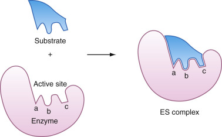

Figure 20-1 

The lock-and-key model of substrate binding to the enzyme active site. 

The enzyme exhibits preformed steric and electronic complementarity to the shape and charge distribution of the substrate. No shape changes or electronic redistributions in the enzyme or the substrate are necessary for optimal binding. 

(By permission of W. H. Freeman and Company, San Francisco; Stryer L: _Biochemistry_ , ed 2. Stanford, Calif., 1981, Stanford University.) 

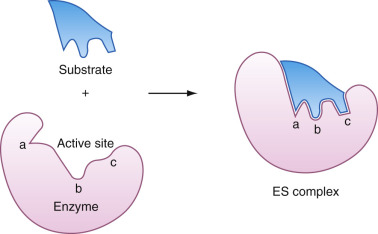

Figure 20-2 

The induced-fit model of substrate binding to the enzyme active site. 

The induced-fit model postulates an initial weak, flexible interaction of the substrate with groups in the enzyme's substrate (ES) binding site. This is sufficient to trigger a conformational rearrangement of the enzyme's surface that exposes additional ligand binding groups that enhance the binding affinity of the substrate for the enzyme. 

(By permission of W. H. Freeman and Company, San Francisco; Stryer L: _Biochemistry_ , ed 2. Stanford, Calif., 1981, Stanford University.) 

 

##  Molecular Basis for Enzyme Catalysis 

The free energy of activation is the energy absorbed by reactant molecules before they have a chance to convert to products. The free energy of activation is a barrier to chemical reactivity. When this barrier is large, the rate of a chemical reaction is very slow. The lower the barrier, the faster is the reaction rate. The barrier exists for almost all chemical reactions because, for bonds to be broken, they must be stretched and sometimes bent away from their equilibrium positions. These deformations require energy. Enzymes lower the free energy of activation. Most metabolic reactions have very high activation barriers, and in the absence of enzymes, reaction rates are imperceptibly slow. Cells can selectively reduce metabolic reaction rates to near zero by abolishing enzyme activity. This feature of metabolism allows cells to “turn on” and “turn off” metabolic pathways during different stages of the cell cycle. Enzymes lower the free energy of activation in various ways. Binding and appropriate orientation of the substrate in the active site increase its proximity to the catalytic groups. Various types of catalysis are used by enzymes. The major types of catalysis are acid-base, electrophilic, nucleophilic, elimination reactions, decarboxylation reactions, and metal ion and electrostatic catalysis. Reductions in the free energy of activation occur through preferential binding of the transition state (or intermediate enzyme-substrate complex) to active site groups. The side chains of different amino acids participate in catalysis. The side chain of histidine is an effective acid-base catalyst, and the side chains of serine, cysteine, lysine, histidine, and aspartic acid participate in covalent catalysis. The side chains of lysine and arginine, as well as metal ions, can act as electrostatic catalysts by stabilizing negative charges that develop during catalysis. Conversely, the side chains of aspartate and glutamate residues can stabilize the positive charges that develop during catalysis. 

The rate of the reaction is proportional to the concentration of molecules that have attained energy equal to the free energy of activation, ΔG‡. This energy is higher for the uncatalyzed reaction. The idea that enzymes accelerate chemical reactions by lowering G‡ is illustrated in [ Figure 20-3 ](<#f0020>) , where the free energy needed for a productive reaction is compared for an uncatalyzed and an enzyme-catalyzed reaction. As shown in this figure, enzymes lower the activation energy. As explained later, an enzyme binds to its substrate to form an enzyme-substrate complex in an initial recognition step. In the subsequent step, the substrate is converted to product. The enzyme-substrate complex is more stable than the two separated species (i.e., has a lower free energy). However, this energy cannot be too low, as in the case of the dotted lines in [ Figure 20-3 ](<#f0020>) , because in this case, the activation energy would be raised, and the reaction rate would be slower. As explained later, an enzyme binds to what is called the _transition state_ on the reaction pathway. This is the reactive form of the substrate that is of relatively high free energy compared with the free energy of the ground state of the substrate. Thus, although the energy of the substrate is raised in the transition state complex, the enzyme provides stabilizing interactions with the transition state that result in overall stabilization of the complex and in an enhanced rate of reaction. 

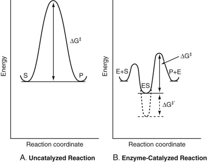

Figure 20-3 

The free energy path of a reactant molecule through its transition state on its way to becoming a product molecule. 

The energy trajectory followed by a molecule undergoing a chemical reaction is the minimum free energy pathway known as the **reaction coordinate.** The transition state, the state of highest free energy, is the point where there is an equal probability that a reaction will take place, or that the **activated complex** will decompose back to the reactant. The free energy change, ΔG‡, is the energy that the substrate molecule must acquire to reach the activated complex, also called the _activation energy barrier._ **A,** The uncatalyzed reaction. The reactant, called _S,_ must acquire the necessary energy, ΔG‡, to become converted into the product, P. This energy is the difference between the energy of the transition state and the ground-state energy of S. **B,** The enzyme-catalyzed reaction. In this case, the enzyme binds noncovalently to the substrate, resulting in a stable enzyme–substrate (ES) complex. In most textbooks, the ES complex is shown as having slightly higher energy than that for free E and S. This is because the energy of the substrate increases when it binds to the enzyme because the enzyme recognizes the transition state of the substrate (discussed later), which is a higher energy form for the substrate. However, overall, the energy of the ES complex is lower than that for the free enzyme and free substrate, as reflected in the favorable affinity constant (usually measured as 1/K  M  ) for the binding of S to E. This is why the energy of ES is shown as lower than for the two isolated species. However, although this complex has a lower free energy than that for the two separated species (S and E), it should not be too much lower, as discussed later. The energy of activation, ΔG‡, now becomes the difference in energy between that of the transition state in the ES complex, and not for S alone, and that of the ground state ES complex. This energy is less than that for the uncatalyzed reaction. A major reason why ΔG‡ for the enzyme-catalyzed reaction is less than for the uncatalyzed reaction in **A** is that the enzyme has a high affinity for the transition state, lowering its energy relative to that for the ground state ES complex. Note in **B** what would happen if the enzyme had a very high affinity for **ground state** ES _(broken line)._ If the same transition state is assumed, the energy barrier to reach this transition state, instead of just being ΔG‡, will now be ΔG‡ \+ ΔG‡′, resulting in a slower rate of reaction. 

Enzymes have developed as extremely efficient catalysts because their active sites have evolved to bind transition states very tightly. It is this tight binding that stabilizes the transition state and lowers the free energy of activation. Enzymes do not alter the ground state energies of reactants and products of a chemical reaction. The equilibrium state is characterized as a state of lowest energy, and the composition of the reactant and product mixture at equilibrium is a reflection of these ground state energies. Enzymes emerge from the catalytic process unaltered, although some undergo transient chemical modification during the reaction. 

 

##  Nomenclature of Enzymes 

The nomenclature of commonly measured enzymes was standardized by the Enzyme Commission (EC) of the  International Union of Biochemistry (1979  1992)  . Each enzyme has two names: a practical or trivial name, and a systematic name. The latter consists of a unique numeric code designation and the nature of the catalytic reaction, as follows: Enzymes are named by citing the name of the substrate molecule and by following that with the suffix, -ase; sometimes the name also includes a designation of the type of reaction catalyzed. Examples are as follows. 

  * 1.

RNA is hydrolyzed by an enzyme called _ribonuclease_ . 

  * 2.

Lactic acid is oxidized to pyruvic acid by an enzyme called _lactic acid dehydrogenase._

Older trivial names persist in the literature. Examples are trypsin, a protein-hydrolyzing enzyme secreted into the gut, and papain, a plant enzyme that also hydrolyzes proteins. A more systematic classification of enzymes has been implemented in the biochemical literature (  International Union of Biochemistry  1979  ). Enzymes have been organized by reaction type into six major classes, as shown in [ Table 20-1 ](<#t0010>) . 

TABLE 20-1 

Enzyme Classification 

Class  |  Type of Reaction Catalyzed   
---|---  
  
  * 1. Oxidoreductases 

|  Oxidation-reduction reactions   
  
  * 2. Transferases 

|  Transfer of functional groups   
  
  * 3. Hydrolases 

|  Hydrolysis reactions   
  
  * 4. Lyases 

|  Group elimination to form double bonds   
  
  * 5. Isomerases 

|  Isomerizations   
  
  * 6. Ligases 

|  Bond formation coupled with ATP hydrolysis   
  
_ATP,_ Adenosine triphosphate. 

 

##  Isozymes 

Many enzymes have isoenzymes, called isozymes, of different forms that catalyze the same reaction. These different forms occur because of differences in the amino acid sequences of enzymes. Despite these differences in sequence, the enzymes fold to the same three-dimensional structures and frequently exhibit similar affinities for and catalytic rates with substrates. Often, isozymes occur as the result of differences in the chain composition of enzymes, as discussed later. Most commonly, different isoenzymes are found in specific organs or tissues; determination of the type of isoenzyme present can then be of use in identifying the damaged tissue and releasing the enzyme. The standard nomenclature of isoenzymes is based on their electrophoretic migration, with the isoenzyme migrating farthest toward the anode designated **isoenzyme 1.** The most widely recognized isoenzymes are those that are composed of varying combinations of subunits; common examples are creatine kinase (CK), a dimer of muscle (M) and brain (B) subunits, and lactate dehydrogenase (LD), a tetramer of heart (H) and M subunits. In other cases, isoenzymes may have the same protein component but may differ based on modifications made by the cell of origin. For example, the bone, renal, and liver isoenzymes of alkaline phosphatase (ALP) have identical amino acid sequences but differ in carbohydrate composition. 

In some cases, isoenzymes may have completely different protein structures. Distinct cytoplasmic and mitochondrial isoenzymes of both CK and aspartate aminotransferase (AST) have markedly differing structures. Placental and intestinal ALP isoenzymes have a different protein structure compared with that of the tissue-nonspecific forms found in liver, bone, and other organs. 

Finally, enzymes can be modified by proteases present in serum to produce forms that differ slightly from each other; these are termed _isoforms_ . As an example, CK-M subunits are partially metabolized by carboxypeptidase N, removing a lysine residue from the carboxy-terminal end of the molecule and converting the tissue isoform to a differently charged plasma isoform. The relative amounts of the tissue and plasma isoforms can be used as a marker of duration of injury to CK-containing cells. The official names and EC numbers of the commonly measured, clinically useful enzymes are given in [ Table 20-2 ](<#t0015>) (  Zollner, 1989  ). 

TABLE 20-2 

Names, Enzyme Numbers, Substrates for Enzymes 

Enzyme (IUB Group, EC Number)  |  Substrate  |  Comments   
---|---|---  
AChE (hydrolase, EC 3.1.1.7)  |  Acetylcholine, acetyl thiocholine; hydrolyzes acetyl-β-methylcholine  |  Choline is HO-CH  2  -CH  2  -N  \+  -(CH  3  )  3  , a quaternary amine; many esters with the OH group are substrates. Critical in regulating acetylcholine neurotransmission   
PChE (hydrolase, EC 3.1.1.8)  |  Many aliphatic esters of choline; unlike AChE, does not hydrolyze acetyl-β-methylcholine but, also unlike AChE, does hydrolyze butyryl- and benzoylcholine  |  Largely unknown function; it is critical in hydrolyzing the muscle relaxant, succinyl choline   
ACP (hydrolase, EC 3.1.3.2)  |  G6P, phenyl-P, 3-glycerophosphate, phenolphthalein-P, thymolphthalein-P, naphthol-P  |  Cleaves phosphate esters like ALP (see next entry) but at pH values around 5.0   
ALP (hydrolase, EC 3.1.3.1)  |  See ACP  |  ALP has unusual pH optimum of about 9. Optimum pH varies with substrate and buffer   
ACE (bradykinin, hydrolase, EC 3.4.15.1)  |  Splits C-terminal His-Leu dipeptide of angiotensin 1 to yield angiotensin 2; also splits hippuryl-His-Leu to hippurate + His-Leu  |  Considered a nonspecific hydrolase; acts on Met- and Leu-enkephalin   
LD (oxido reductase, 1.1.1.27)  |  Pyruvate and other keto acids + NADH   
Also lactate and other 2-hydroxy acids + NAD  \+  |  Moderately specific   
5′-Nucleotidase (hydrolase, EC 3.1.3.5)  |  5′-Monoribonucleotides  |  Wide specificity for 5′-monoribonucleotides   
  
_ACE,_ Angiotensin-converting enzyme; _AChE,_ acetylcholinesterase; _ACP,_ acid phosphatase; _ADP,_ adenosine diphosphate; _ALP,_ alkaline phosphatase; _ATP,_ adenosine triphosphate; _EC,_ Enzyme Commission; _G6P,_ glucose-6-phosphate; _IUB,_ International Union of Biochemistry; _LD,_ lactate dehydrogenase; _NAD \+  , _ nicotinamide-adenine dinucleotide; _NADH,_ the reduced form of NAD  \+  ; _P,_ phosphate; _PChE,_ pseudocholinesterase; _pNPP, p_ -nitrophenylphosphate. 

 

##  Enzyme Cofactors 

Two thirds of all enzymes contain cofactors that are a group of heat-stable substances required for catalysis. They are low molecular weight organic molecules and inorganic ions. The combination of cofactor plus the protein portion, the apoenzyme, forms the complete catalytic entity and is known as the _holoenzyme_ . Organic cofactors are bound covalently or noncovalently to the apoenzyme. Covalently bound cofactors are sometimes referred to as _prosthetic groups._ Cofactors are observed in oxidation-reduction, group transfer, and isomerization reactions, and in reactions that form covalent bonds. Hydrolytic reactions generally do not require cofactors. Organic cofactors are listed in [ Table 20-3 ](<#t0020>) . Inorganic cofactors that include mainly metal ions are listed in [ Box 20-1 ](<#b0010>) . A cosubstrate is an organic cofactor that behaves as a second substrate in an enzyme-catalyzed reaction. Cofactors such as nicotinamide adenine dinucleotide (NAD  \+  ) can serve as cosubstrates for many oxidoreductases. A single molecule of NAD  \+  may act as a cosubstrate many thousands of times. The product, NADH (reducing agent derived from NAD  \+  ), must first be oxidized back to NAD  \+  before it can participate again as an electron and H atom acceptor. The recycling of the NAD-NADH oxidation-reduction couple depends on the ready availability of a chemical system capable of regenerating NAD  \+  from NADH. A substrate molecule is usually irreversibly changed in a reaction. In contrast, cosubstrate molecules are recycled. 

TABLE 20-3 

Enzyme Cofactors 

Coenzyme(s)  |  Reaction Type  |  Deficiency   
---|---|---  
Coenzyme A  |  Acyl transfer  |   
Thiamine pyrophosphate  |  Aldehyde transfer  |  Beriberi   
Folic acid coenzymes  |  One-carbon transfer  |  Megaloblastic anemia   
Cobamide (B  12  ) coenzymes  |  Alkylation  |  Pernicious anemia   
Nicotinamide coenzymes  |  Oxidation-reduction  |  Pellagra   
Flavin coenzymes  |  Oxidation-reduction  |   
Biotin  |  Carboxylation  |   
Lipoic acid  |  Acyl transfer  |   
Pyridoxal phosphate  |  Amino group transfer  |   
Coenzyme Q  |  Electron transfer  |   
  

Box 20-1 

Inorganic Cofactors for Enzymes 

  * Mg  ++ 

  * Fe  ++  /Fe  +++ 

  * Zn  ++ 

  * Cu  \+  /Cu  ++ 

  * Ca  ++ 

  * Mn  ++ 

  * Co  ++ 

 

##  Factors Affecting Plasma Enzyme Activities 

Plasma levels of enzymes may be increased by several mechanisms. Because enzymes are high molecular weight compounds, the most common cause for increased plasma enzymes is death of enzyme-containing cells. As cells die, activation of phospholipases leads to development of holes in the plasma membrane, allowing leakage of cytoplasmic macromolecules such as proteins. Enzymes are also released in the process of normal cell turnover; this is thought to be the source of normal plasma levels of various enzymes. Increased synthesis of enzymes by cells also leads to increased plasma enzyme levels. With increased activity of osteoblasts, plasma levels of the bone isoenzyme of ALP increase. This may be responsible for the increase in muscle-related enzymes seen with increased exercise (  Dickerman et al, 1999  ). Many drugs that stimulate microsomal enzymes, including ethanol and antiepileptic agents, lead to increased plasma γ-glutamyl transferase (GGT). In some cases, release of enzyme from cells occurs without cell death or increased synthesis. 

As discussed in [ Chapter 21 ](<##!/content/3-s2.0-B9780323295680000218?scrollTo=%23c00021>) on liver function, ethanol causes expression of the mitochondrial isoenzyme of AST on the surface of hepatocytes and increased plasma levels. Ischemia of myocardial cells leads to loss of glycogen phosphorylase BB isoenzyme and the MB isozyme of CK into plasma. Ingestion of food leads to release of intestinal ALP into lymphatic fluid, and may transiently increase plasma levels of ALP. A number of liver enzymes (ALP, GGT, leucine aminopeptidase, 5′-nucleotidase [5′-NT]) are bound to the canalicular surface of the hepatocyte. Increased concentrations of bile salts with canalicular obstruction may release fragments of membrane with enzyme attached into the circulation, or may solubilize the membrane-binding domain (  Van Hoof et al, 1997  ). Finally, increased plasma enzyme levels may be due to decreased clearance of enzymes from the circulation. Some smaller enzymes, such as amylase and lipase, are partially cleared by glomerular filtration; renal failure increases their plasma levels. For many enzymes, autoantibodies against one or more isoenzymes may cause the development of enzyme–antibody complexes (often termed _macroenzymes_ ), which result in enzyme half-lives similar to the 3-week half-life of immunoglobulin G (  Remaley & Wilding, 1989  ). Most commonly, no specific clinical feature is associated with such macroenzymes; however, it is common to see antibodies against the intestinal isoenzyme of ALP in persons with bacterial infection (  Mader et al, 1994  ). A similar phenomenon can occur when enzymes are bound to antibodies directed against other antigens, such as LD complexes with antibodies to streptokinase (  Podlasek et al, 1989  ). 

 

##  Factors Affecting the Lifetime of Enzymes in Blood 

The time course of appearance and disappearance of enzymes with cell injury is dependent on a number of factors. With cell death, defects in cellular membranes enlarge gradually over time; thus, smaller cytoplasmic enzymes will leak from damaged cells sooner than larger ones. For example, with myocardial injury, CK and AST are smaller than LD and appear in plasma sooner. Some enzymes are not cytoplasmic, but may be within mitochondria (isoenzymes of CK and AST) or bound to plasma membranes (such as ALP and GGT); cell death typically does not lead to release of such enzymes. If cell death is due to infarction caused by interruption of blood flow to a portion of an organ, enzymes released from damaged cells must diffuse away from the nonperfused region before appearing in the circulation. For example, in myocardial infarction, CK peaks later in persons whose coronary arteries are not successfully reperfused by the use of thrombolytic agents. The degree of elevation of an enzyme is related to the number of cells injured, the gradient in concentration between cell and plasma, and the rates of enzyme entry into and clearance from plasma. In myocardial infarction, the amount of CK released is strongly correlated to size of infarction; thus, enzyme levels with one-time injury are related to the amount of cell injury occurring. If injury is ongoing, plasma enzyme levels will continue to be elevated for a longer time period. For example, in acute hepatic injury, the time course of enzyme changes can be used to differentiate viral hepatitis, in which immunologic damage causes ongoing cell death and prolonged enzyme elevation, from ischemic and toxic injury, in which damage is immediate but short-lived and enzyme elevations rapidly return to normal. 

Other important determinants of the time course of enzyme changes include the relative gradient in enzyme levels between cells and serum and the rate of clearance of enzyme from plasma. For any given amount of cell damage, the enzyme with the higher gradient between cells and serum will show greater elevation of plasma levels. For example, with hepatocyte injury, AST levels in hepatocytes are higher than those of alanine aminotransferase (ALT), and both are many times higher than levels of LD. Immediately after injury, therefore, AST will show a greater degree of elevation than will ALT, and LD will show the least degree of increase. In cardiac tissue, the gradient of CK between myocardial cells and plasma is several times higher than that for LD, leading to higher peak CK than LD levels. Once enzyme reaches plasma, the rate of clearance also becomes important; for example, the half-life of AST is much shorter than that of ALT, and the half-life of CK is shorter than that of the cardiac isoenzymes of LD. With hepatic injury, therefore, plasma ALT often becomes higher than AST within a short time after injury. Following myocardial infarction, CK returns to normal several days earlier than does LD. 

,  

##  Enzyme Kinetics: Determination of Total Enzyme Concentrations in Serum and Other Body Fluids 

The basic objective of clinical enzymology is the determination of the total concentrations of specific enzymes in serum and other body fluids. Qualitatively, detecting the presence of enzymes in body fluids is fortunately quite simple because each enzyme has almost total specificity for one or at most a few substrate(s). By adding the substrate, say, to serum, and observing either its disappearance or the appearance of the product, the presence of the enzyme can be ascertained. As is now explained, the rate at which substrate disappears or product appears can be directly used to determine the concentration of enzyme present (  Cleland  1970  ;  Dixon & Webb, 1979  ;  Cornish-Bowden, 1995  ;  Fersht, 1999  ;  Segel, 2009  ). 

 

##  The Michaelis-Menten Equation Gives the Means to Determine Total Enzyme Concentration in Serum and Other Body Fluids 

Enzymes exhibit saturation, which occurs when the rate becomes unresponsive to further increases in substrate concentration. Ordinary chemical reactions occur with rates proportional to the entire range of reactant concentrations. In an enzyme-catalyzed reaction, at low substrate concentrations rates are proportional to substrate concentration. At higher concentrations, the rate does not increase in direct proportion. At still higher substrate concentrations, the rate becomes constant and unresponsive to any further change in substrate concentration. This led to the proposal that enzyme catalysis is a two-step process that consists of an initial adsorption whereby the substrate combines with the enzyme to form a noncovalent enzyme–substrate (ES) complex, followed by a second step in which the ES complex decomposes into product (P) and free enzyme (E). 

 E  \+  S  ⇄ k  – 1  k  1  ES  → k  2  P  \+  E 

The formation of enzyme–substrate may be regarded as the step in which the enzyme recognizes the substrate. This process involves the formation of specific _noncovalent_ interactions between enzyme and substrate. These interactions include ionic interactions, hydrophobic interactions, hydrogen bonding, and van der Waals interactions. 

The physical explanation for saturation is that binding reduces the number of active sites available to form the enzyme-substrate complex. When all sites are filled, no further binding can occur until an active site discharges its contents. The step that determines the overall rate is the k  2  step. Adding additional substrate molecules under saturating conditions does not change the rate because all unbound substrate molecules must wait until an active site becomes vacant. This kinetic model is now used to derive the Michaelis-Menten equation that enables direct determination of total enzyme concentration or activity. 

 

##  Derivation of the Michaelis-Menten Equation 

The velocity, v, the rate at which product forms, of an enzyme-catalyzed reaction is defined as: 

 v  =  v  0  =  d  [  P  ]  /  dt  =  k  2  [  ES  ] 

where _t_ is time. Note that _v_ is the _initial_ velocity of the reaction, referred to as v  0  , where we know the concentration of the substrate. It is important to measure initial velocities to ensure the absence of product inhibition (when time [t] = 0, [P] = 0) and the loss of enzyme due to proteolysis, denaturation, or time-dependent adsorption onto glass or plastic surfaces. 

The differential rate law, which gives the rate of change of [ES] with time, is the difference between the rate of the k  1  step leading to formation of the complex and the rates of the steps leading to the disappearance of [ES] and k  1  and k  2  steps. 

 d  [  ES  ]  /  dt  =  k  1  [  E  ]  [  S  ]  − k  − 1  [  ES  ]  − k  2  [  ES  ] 

For a wide variety of enzyme-catalyzed reactions, it has been found that, over long periods of time, after an initial transient phase lasting a few milliseconds, the concentration of the ES complex remains constant (i.e., does not change in time), especially when S >> E. This is the steady-state assumption. Therefore, 

 d  [  ES  ]  /  dt  =  0  =  k  1  [  E  ]  [  S  ]  − k  − 1  [  ES  ]  − k  2  [  ES  ]  =  k  1  [  E  ]  [  S  ]  − (  k  1  \+  k  2  )  [  ES  ] 

and 

 [  ES  ]  =  k  1  [  E  ]  [  S  ]  /  (  k  − 1  \+  k  2  )  =  [  E  ]  [  S  ]  /  K  M 

where the ratio of the rate constants k  1  /(k  –1  \+ k  2  ) is defined as 1/K  M  . K  M  is termed the _Michaelis constant,_ whose significance is discussed later. 

If E  T  is the total concentration of enzyme, it is equal to free enzyme plus enzyme bound to substrate, that is, 

 [  E  T  ]  =  [  E  ]  \+  [  ES  ] 

Then, using [ Equation 20-5 ](<#e0030>) , 

 [  E  T  ]  =  [  E  ]  \+  [  E  ]  [  S  ]  /  K  M 

and 

 [  E  ]  =  [  E  T  ]  /  (  1  \+  [  S  ]  /  K  M  ) 

and substituting for [E] in [ Equation 20-5 ](<#e0030>) , 

 [  ES  ]  =  [  E  ]  [  S  ]  /  KM  =  [  ET  ]  /  (  1  \+  [  S  ]  /  KM  )  × [  S  ]  /  KM  =  [  ET  ]  [  S  ]  /  (  KM  \+  [  S  ]  ) 

Combining [ Equation 20-9 ](<#e0050>) with [ Equation 20-2 ](<#e0015>) , we have 

 d  [  P  ]  dt  =  V  0  =  k  2  [  ES  ]  =  k  2  [  E  T  ]  [  S  ]  (  K  M  \+  S  ) 

[ Equation 20-10 ](<#e0055>) , termed the **Michaelis-Menten equation,** accurately describes virtually all single-substrate enzyme-catalyzed reactions and many bisubstrate reactions in which the concentration of one substrate is constant throughout the course of the reaction. 

 

##  Total Enzyme Concentration Can Be Determined from the Initial Rate at Saturation 

A typical plot of v  0  versus initial substrate concentration is shown in [ Figure 20-4 ](<#f0025>) . The curve is a rectangular hyperbola, and the initial rate increases up to a particular substrate concentration beyond which the rate remains constant. This occurs on the curve where [S] > > K  M  . This is referred to as _saturation,_ where all of the enzyme molecules are bound to substrate, making it impossible to increase the rate any further by increasing [S]. Note that, where saturation occurs, that is, where [S] > > K  M  , [ Equation 20-10 ](<#e0055>) reduces to 

 d  [  P  ]  /  dt  =  v  0  =  k  2  [  E  T  ] 

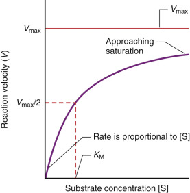

Figure 20-4 

The effect of substrate concentration [S] on the velocity (V) of an enzyme-catalyzed reaction. 

The plot is for an enzyme that obeys Michaelis-Menten kinetics, where the maximal velocity is V  max  and [S] equals K  M  where (v) equals V  max  /2. 

Because the rate is constant at saturation, the rate is zero order with respect to substrate; the rate does not depend on the concentration of reactants. There is a dependence on E  T  , which, however, is not consumed in the reaction. At saturation, the initial velocity of the reaction is referred to as the _maximal velocity,_ or V  max  = k  2  E  T  . Under this saturating condition, the initial rate of the reaction is directly proportional to the total enzyme concentration. If k  2  is known, then E  T  can be directly computed as the observed initial rate divided by k  2  . This equation solves the problem of determining the total enzyme concentration from measurements of the rate of the enzyme-catalyzed reaction where [S] > > K  M  . 

 

##  Knowledge of k  2  and K  M  Allows Determination of [S] Values That Will Saturate the Enzyme 

To fulfill the conditions of [ Equation 20-11 ](<#e0060>) , it is necessary to know both K  M  and k  2  . These can be estimated from plots similar to the one shown in [ Figure 20-4 ](<#f0025>) . To generate these plots, the purified enzyme is dissolved in aqueous solution in a series of tubes at the same concentration. To each of these tubes, a different concentration of substrate is added, and the initial rate of reaction for each tube is determined using a suitable (mostly spectrophotometric) technique. The value of v  0  versus initial substrate concentration [S] can be plotted; the value of S at which the rate levels off (i.e., becomes constant) can be estimated from the plot. 

 

##  The Lineweaver-Burk Plot Gives k  2  and K  M 

The problem with this approach is that, in the v  0  versus [S] plot, the rate approaches V  max  asymptotically. Therefore, V  max  can only be estimated, often inaccurately, from such a plot. A more accurate method by which to accomplish this goal is to linearize the Michaelis-Menten [ equation (20-10) ](<#e0055>) by taking the reciprocal of both sides of the equation and rearranging the terms, that is, 

 1  V  0  =  K  M  V  MAX  · 1  [  S  ]  \+  1  V  MAX 

As can be seen from [ Equation 20-12 ](<#e0065>) , a plot of 1/v  0  versus 1/[S], called the _double reciprocal plot,_ also called the _Lineweaver-Burk plot,_ should be linear; the Y-intercept should be 1/V  max  , and the slope should be K  M  /V  max  . Because 1/V  max  is the intercept, K  M  can be computed as the slope/Y-intercept. Because from [ Equation 20-12 ](<#e0065>) , the X-intercept is –1/K  M  , K  M  can also be computed directly from this relationship. K  M  can be computed directly from the Michaelis-Menten [ equation (20-10) ](<#e0055>) from V  max  . When [S] = K  M  , from [ Equation 20-10 ](<#e0055>) , v  0  = V  max  /2. Thus the K  M  is the substrate concentration necessary to reach V  max  /2. A typical Lineweaver-Burk plot is shown in [ Figure 20-5 ](<#f0030>) . 

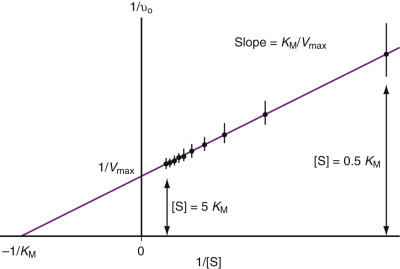

Figure 20-5 

A typical Lineweaver-Burk (1/v  o  vs. 1/[S]) plot, from [ Equation 20-12 ](<#e0065>) , for an enzyme-catalyzed reaction. 

v  0  is the initial velocity of the reaction at time t = 0, where the substrate concentration, [S], is known. The figure shows that [S] must cover a range from where it is significantly less than K  M  (0.5 K  M  ) to where it is significantly greater than K  M  (5 K  M  ) to obtain reliable values for K  M  and V  max  . The Y-intercept is 1/V  max  , and the X-intercept is –1/K  M  . The slope is K  M  /V  max  . 

Practically, after the points are obtained from the double reciprocal plot, the least squares best line is drawn through the points from which the slope and X- and Y-intercepts are directly determined. The correlation coefficient, which is a measure of the closeness-of-fit of the experimental points to the best line, is also calculated and should be greater than 0.9, that is, a high correlation. 

Note in the above procedure and as is illustrated in [ Figure 20-5 ](<#f0030>) that substrate concentrations must span a range that brackets K  M  . Measurements of v  0  at low [S] have relatively large errors, as illustrated in the upper-right portion of the line in [ Figure 20-5 ](<#f0030>) , yet it is these estimates that are critical in determining accurate values of K  M  and V  max  . Modern computer programs provide reasonably accurate values for K  M  and V  max  based on weighted values of the initial velocities. Weights are assigned based on the magnitude of v  0  . In addition, other computer programs use nonlinear regression analysis to fit the weighted data to a hyperbolic v  0  versus [S] curve, as in [ Equation 20-10 ](<#e0055>) , and a Lineweaver-Burk plot is used only for visual display of the kinetic data. 

Once K  M  is known, saturating concentrations of substrate can be used such that [S] > > K  M  . So, for example, if K  M  = 1 × 10  –5  M for a certain enzyme for which an assay is desired, we can use a substrate concentration of 1 × 10  –3  M (1 mM) and be assured that [S] > > K  M  , here by a factor of 100, so that [ Equation 20-11 ](<#e0060>) applies. The substrate at this concentration is added to a patient sample (most often, serum), and the rate is observed and then divided by k  2  to obtain the total concentration of enzyme. As discussed later, because many enzymes exist as different isozymes with different k  2  and K  M  values, division by k  2  is not performed, and the results are reported directly as k  2  E  T  , referred to as _total activity units._

 

##  A Word About K  M 

[ Equation 20-1 ](<#e0010>) shows that the ES complex is in equilibrium with free E and free S. We can write an equilibrium constant for this process as a dissociation constant, K  s  , as k  –1  /k  1  , which is equal to [E][S]/[ES]. The reciprocal of this constant, or the association constant, K  A  , is k  1  /k  –1  = [ES]/[E][S]. From [ Equation 20-5 ](<#e0030>) , K  M  is defined as (k  –1  \+ k  2  )/k  1  . Note that when k  –1  > > k  2  , K  M  is the same as K  S  . This condition actually pertains to most enzyme-catalyzed reactions; k  –1  is the rate of dissociation for the enzyme-substrate complex that almost always involves the breaking of noncovalent bonds, and k  2  is the rate for the breaking and/or making of covalent bonds. Usually, the energy necessary for the former process is much less than for the latter; therefore, the rate of dissociation, k  –1  , of the noncovalent ES complex is higher than the rate, k  2  , for the covalent catalysis step. Thus K  M  is the dissociation constant for the ES complex. The reciprocal of this is K  A  , the association constant, and it is the affinity of the substrate for the enzyme. 

However, in some cases, the rate for the covalent catalytic step is greatly enhanced. Examples include carbonic anhydrase (k  2  = 10  6  sec  –1  ; carbon dioxide is the substrate) and catalase (k  2  = 10  7  sec  –1  ; hydrogen peroxide is the substrate). For these enzymes, because k  2  is large, K  M  is not a dissociation constant, but rather a steady-state constant, equal to k  2  /k  1  . 

 

##  Enzyme Activity 

As noted previously, computation of total enzyme concentration using [ Equation 20-11 ](<#e0060>) is often not performed because many enzymes have multiple isozymes. For example, at least five isozymes of LD are known, each having a different set of values for K  M  and k  2  . In this case, the total enzyme activity of LD is given, that is, k  2  × [E  T  ]. In these cases, enzyme activities are all reported in units called _international units,_ defined originally in 1964 by the International Commission on Enzymes. One international unit (IU) is the amount of enzyme that catalyzes the formation of one micromole of product (or the disappearance of 1 micromole of substrate) in 1 minute. It applies only under specified conditions of pH, temperature, and ionic strength, all factors that influence enzyme activity, as discussed later. 

With development of the Système International d'Unités system and the use of moles and seconds as base units, a second definition for the unit of enzyme activity was developed, the katal: 1 katal is defined as the amount of enzyme that catalyzes the conversion of 1 mol of substrate to product in 1 second, under the conditions used in the assay. One IU is equal to 16.7 nanokatal (nkat), and 1 katal is equal to 6 × 10  7  IU. Both definitions unfortunately omit volume. Generally, 1 IU is reported per liter (L); the right side of [ Equation 20-11 ](<#e0060>) has the units of concentration per time so that IU/L conforms to these units. It is vital that, if total enzyme activity is reported, the substrate used in the assay for the enzyme also be reported because the k  2  value differs for different substrates. 

As discussed later, many factors affect enzymatic activity, including pH, temperature, ionic strength, concentration of cofactors of an enzyme, presence of inhibitors, use of other enzyme reactions as indicators, and whether the forward or backward reaction is used to measure the enzyme concentration. For example, LD measured using the forward reaction has approximately one third the activity of LD measured using the reverse reaction, and lipase measured with colipase present has 5 to 10 times the activity of lipase measured without its cofactor. 

Therefore, even if the same substrate is used by different laboratories, the reference ranges of enzymes may differ dramatically among these laboratories. Furthermore, differences in reference ranges between two different laboratories can still exist even if the above factors are the same for both, because of different assay conditions. 

To attempt to standardize enzyme activities, one approach is to have each laboratory set the upper boundary of the reference range to 100 (  Langdon, 1994  ). Then all other values are expressed as percentages or ratios. A result indicating that an enzyme level was 10 times normal is useful to a physician. If the result is 10X U/L, then the physician must hunt the value of X and calculate the ratio. As long as the assays are performed with internal consistency in a highly reproducible manner, quantitative results are comparable between one laboratory and another if relative activities are reported. More commonly, the results of enzyme assays are now expressed in IU along with the reference ranges for each enzyme, allowing for evaluation of the patient's condition, progression of disease, or efficacy of therapy. 

 

##  Measuring Enzyme Activity 

In principle, in the measurement of enzyme activity, either the rate of disappearance of substrate or the rate of appearance of product can be measured. In general, it is easier to measure small increases in product than to measure small decreases in a relatively high concentration of substrate often needed to achieve saturation. As discussed previously, to measure enzyme activity in a sample, it is most common to use substrates at saturating concentrations where zero-order kinetics with respect to [S] occur. Under these conditions, the reaction rate is directly proportional to the total amount of enzyme present. 

[ Equation 20-11 ](<#e0060>) states that, at saturation, the rate of product formation with time is constant. This implies that the concentration of product increases linearly with time. Experimentally, P is determined at different time points, and a least-squares best-fit line through the points is determined. If the correlation coefficient is high, [P] increases linearly with t, confirming saturation of the enzyme by substrate. The slope of this line is V  max  , which may be reported directly as activity or divided by k  2  to give enzyme concentration. 

The most common cause of a _non_ linear relationship between P and t is the presence of an inhibitor that will be discussed later. In cases such as these, dilution of the serum or other body fluid sample is warranted because this will dilute the concentration of the inhibitor, although it will also dilute the total enzyme concentration. However, as long as [S] is present at saturating conditions, and [P] can be measured, valid total enzyme concentrations or activities can be measured. 

Typically, in enzyme assays, a lag phase follows mixture of the specimen and reagents, when preliminary reactions and mixing of sample occur. The initial absorbance of the sample is based on the absorbance due to the reagents and the sample, and is considered to be zero in terms of making an interpretation of enzyme activity. Once the reaction begins, the graph will follow a straight line for a period of time; at this point, the reaction is zero-order and enzyme activity can be determined. If the reaction is allowed to proceed, substrate is consumed and [S] falls toward K  M  . If [S] falls substantially below K  M  , the reaction will then be first-order, and v  0  will be affected both by the amount of substrate (which is not a constant) and by the enzyme activity. 

 

##  Spectrophotometric Assays 

In most cases, enzyme activity is measured spectrophotometrically. In addition, other detection methods are used as appropriate, depending on the product being measured. For example, lipase acts on emulsions of lipid; these are often turbid, so that measurement of the rate of clearance of turbidity could be used to determine lipase activity. Glucose oxidase, widely used to measure glucose concentration, is a flavoprotein that uses oxygen as an electron acceptor. The change in potential due to alteration in charge on the acceptor can be measured to determine the reaction rate. Urease is widely used to measure urea concentration; urease splits urea into bicarbonate and ammonium ions. The change in conductance of the specimen due to the appearance of the ions in the sample can be used to determine the rate of reaction. 

Because assay methods based on spectrophotometry are the most common, we will focus on these in describing how enzyme assays are performed. In the simplest case, the substrate does not absorb light at a particular wavelength at which the product absorbs strongly. An excellent example of this is LD, which catalyzes reversibly the oxidation of lactate to pyruvate. Because lactate is a unique substrate for LD, it is preferred. Pyruvate can be used as the substrate, except that it is also the substrate for several other enzymes such as pyruvate dehydrogenase and ALT, among others. 

When lactate is oxidized to pyruvate, the cofactor, NAD  \+  , becomes reduced to NADH. For each mole of lactate oxidized to pyruvate, 1 mole of NADH forms. NADH absorbs strongly at 340 nm, and NAD  \+  does not absorb light at this wavelength. Therefore, the addition of saturating concentrations of both lactate and NAD  \+  to a patient's serum will result in a linear increase in absorbance at 340 nm over a given period, from which total enzyme activity is directly determined as described earlier. In this case, the increase in concentration of NADH, ΔP, over the time period, Δt, is proportional to the increase in absorbance, ΔA, at 340 nm, by Beer's law, as described in [ Chapter 4 ](<##!/content/3-s2.0-B9780323295680000048?scrollTo=%23c00004>) , that is, 

 Δ P  /  Δ t  =  ε × (  Δ A  /  Δ t  )  × L 

_L_ in [ Equation 20-13 ](<#e0070>) is the pathlength of the reaction vessel or cuvette, almost always equal to 1 cm. ε is a proportionality constant (most often, the molar extinction coefficient) in Beer's law, which is 6.22 × 10  3  L mol  –1  cm  –1  for NADH at 340 nm. On most current chemistry analyzers, a volume of a patient's serum sample is added to the reaction cuvette containing the reaction components (lactate and NAD  \+  ), and ΔA is observed. This results in dilution of the volume (Vp) of the patient's serum to the total volume of the reaction mixture (Vo), so that 

 Enzyme activity  =  Δ P  /  Δ t  =  ε ⋅ (  Δ A  /  Δ t  )  ⋅ L  ⋅ (  Vo  /  Vp  ) 

One caveat in the previous assay is that LD also catalyzes the reverse reaction (i.e., pyruvate to lactate). Therefore, as pyruvate forms, it can serve as an end-product competitive inhibitor (see the Inhibition of Enzymes section later in the chapter) and can drive the reaction back to lactate. Therefore, it is important to be able to take the measurements in [ Equation 20-14 ](<#e0075>) over a short time before pyruvate builds up to significant levels. 

 

##  Coupled Enzymatic Reactions 

In many instances, however, neither the product nor the substrate of a chemical reaction can be measured conveniently. In such instances, the enzymatic reaction can be “coupled” to another reaction that uses the product of the enzyme-catalyzed reaction to produce an indicator substance. An example of a typical coupled enzymatic reaction is the Oliver-Rosalki method for measurement of CK activity, illustrated in [ Equations 20-15 through 20-17 ](<#e0080>) , later. The reverse reaction of CK is used, producing adenosine triphosphate (ATP), which is used in a second reaction to produce glucose-6-phosphate (G6P) from glucose + ATP. The third reaction in the sequence results in the reduction of nicotinamide adenine dinucleotide phosphate, or NADP  \+  , to NADPH, the indicator of the reaction. In these coupled reactions, it is critical that the rate-limiting step in the overall reaction is the CK-mediated step that generates ATP. This can be achieved by using high concentrations of the indicator enzymes to ensure rapid conversion of the substrates of the subsequent reactions. 

One potential problem with CK measurements when this reaction scheme is used is the presence of other enzymes that can generate ATP. Adenylate kinase, an enzyme found in red blood cells and liver, converts adenosine diphosphate (ADP) to ATP (see [ Equation 20-34 ](<#e0175>) ); specimens with high adenylate kinase activity will have falsely elevated values for CK activity. 

 Creatine phosphate  \+  ADP  → Creatine  \+  ATP  (  catalyzed by CK  ) 

 Glucose  \+  ATP  → G  6  P  \+  ADP  (  catalyzed by hexokinase  ) 

 G  6  P  \+  NADP  \+  → 6  -Phosphogluconate  \+  NADPH  (  catalyzed by  glucose-  6  -phosphate dehydrogenase  ,  or G  6  PD  ) 

Complication: 

 2  ADP  → ATP  \+  AMP  (  catalyzed by adenylate kinase  ) 

The absorbance increase at 340 nm due to NADPH is proportional to the [ATP] generated as the end-product of the CK reaction, as expressed in [ Equation 20-15 ](<#e0080>) . 

In assays of enzyme activity, some methods use **endpoint** measurements, determining the concentration of substrate or product at a specific time after addition of the sample. Endpoint methods are typically used in simple methods, such as bedside glucose testing or dipstick reactions, as for glucose or leukocyte esterase in urine. Endpoint methods may give erroneously low results in situations where enzyme activity is very high. Most enzymatic assays use **kinetic** methods of measurement (as discussed earlier), whereby the rate of change in concentration of substrate or product is determined. (For the sake of simplicity, throughout the rest of this section, only measurement systems that detect appearance of product will be described; the same principles, however, would apply to situations in which rate of disappearance of substrate is being monitored.) Kinetic methods are more accurate and make it easier to detect changes in reaction conditions and samples requiring dilution. In a time-course study, the rate of reaction can be expressed as ΔP/Δt, the change in amount of product per unit time. Because the IU and the katal represent the amount of enzyme producing a specific amount of product in a given time period, this approach allows direct reporting of enzyme activity in either IU or katal, as desired. 

 

##  Enzyme Assays Under Nonsaturating Conditions: First-Order Rate Processes 

As discussed later, there are circumstances under which it may not be possible to perform an enzyme assay under saturating conditions where [ Equation 20-11 ](<#e0060>) applies. In these circumstances, assay conditions may be used in which S < K  M  . The Michaelis-Menten [ equation (20-10) ](<#e0055>) then becomes 

 v  0  =  d  [  P  ]  /  dt  =  k  2  E  T  ⋅ [  S  ]  /  K  M 

Because E  T  is constant, the initial rate of the reaction depends only on the concentration of S. When S decreases, ES and P increase so that –d[S]/dt = d[ES]/dt + d[P]/dt. But, under the reaction condition that [S] > > [E], the steady-state assumption, d[ES]/dt = 0, is valid. Therefore, the rate of product formation equals the rate of substrate depletion, that is, 

 v  0  =  d  [  P  ]  /  dt  =  − d  [  S  ]  /  dt  =  k  2  E  T  ⋅ [  S  ]  /  K  M 

This is the equation for a first-order process, that is, the rate depends only on the concentration of a single species, in this case the substrate. Because the rate also formally depends on E  T  , it is properly called a second-order reaction, but in this case, E  T  is constant and does not change during the reaction. It is therefore referred to as a _pseudo –first-order _ reaction. E  T  can be determined from determination of the initial rate of the reaction where the initial substrate concentration, S  0  , is known. Because K  M  and k  2  are known, 

 E  T  =  (  v  0  /  [  S  0  ]  )  × (  K  M  /  k  2  ) 

If only total enzyme activity is to be reported, then v  0  /S  0  , which is equal to (k  2  /K  M  )[E  T  ], is reported because this quantity is directly proportional to E  T  . Note though that these are not the same activity units as are used under saturating conditions because the total enzyme concentration in that case is multiplied only by k  2  , and in the current circumstance, it is multiplied by k  2  /K  M  because of the fact that saturation has not occurred. 

Another approach to determination of E  T  under nonsaturating conditions is to integrate [ Equation 20-20 ](<#e0105>) for S in terms of t. This results in the following relationship: 

 ln  (  [  S  ]  /  [  S  0  ]  )  =  2.303  log  (  [  S  ]  /  [  S  o  ]  )  =  − (  k  2  E  T  /  K  M  )  ⋅ t 

where ln is the natural logarithm to the base e and [S  0  ] is the initial substrate concentration. If the substrate concentration is determined at specific times, a plot of the log (S/S  0  ) versus time should give a straight line whose slope is –(k  2  E  T  /K  M  )/2.303. Because both k  2  and K  M  are known, E  T  can be directly evaluated. This method eliminates the need to measure initial velocities involving small changes in [S]. This method is advantageous when the substrate solubility does not permit saturating substrate concentrations to be reached. 

The above first-order rate equation is the general equation for all first-order rate processes that abound in biology. Many reactions in the body occur either by first-order processes or by pseudo–first-order processes in which the rate depends only on the concentration of one species. As discussed in [ Chapter 23 ](<##!/content/3-s2.0-B9780323295680000231?scrollTo=%23c00023>) , when drugs are administered to the body, they decay very often by a first-order process, where the rate of disappearance of the drug depends only on the concentration of the drug. One important feature of this process is the so-called **half-time.** Note, from [ Equation 20-22 ](<#e0115>) , that the half-time, or the time required for half of S  0  to be consumed, that is, when [S] = [S  0  ]/2, is a constant that depends only on the rate constant in the equation. The nondependence of  on concentration is a cardinal feature of first-order rate processes. 

Because log (2) = 0.3, the above equation reduces to 

 t  1  2  =  0.69  /  k 

where, in this case, k = K  M  /k  2  E  T  and  is the half-time, that is, the time required for half of the substrate to be consumed. Thus, if the half-time for substrate consumption is known, E  T  can also be directly computed from [ Equation 20-23 ](<#e0120>) , provided that K  M  and k  2  are known. 

 

##  Other Factors Affecting Enzyme Activity 

 

##  Temperature 

Enzyme-catalyzed reaction rates are extremely sensitive to temperature changes; to ensure accuracy, the temperature of the reaction mixture must not deviate by more than ±0.1° C from the assigned temperature. In general, every 10° C increase in temperature leads to an approximate doubling of enzyme activity, although this varies slightly from one enzyme to another. The use of higher temperatures gives faster reaction rates and improves sensitivity—an advantage when enzyme activities are low. Lower temperatures increase the linear limit of an assay, requiring fewer dilutions. The choice of temperature with most modern instruments is governed by the capabilities of the instrument. There is a limit to the amount of temperature increase that can be used; most enzymes start to denature and become inactive as the temperature is increased. For example, CK starts to denature at 37° C, and amylase begins to denature at 45° C. On the other hand, some enzymes remain stable at extremely high temperatures. As an extreme case, the Taq polymerase used in the polymerase chain reaction is stable at 95° C. Taq polymerase and the polymerase chain reaction are discussed in [ Chapter 66 ](<##!/content/3-s2.0-B9780323295680000668?scrollTo=%23c00066>) . 

 

##  pH 

Enzymes have a pH optimum for maximal activity; usually, the pH of the reaction conditions is chosen to be that at which the enzyme exhibits the greatest activity. Selection of pH is not always critical; some enzymes have a very broad pH maximum, so that small changes in pH do not appreciably change activity. For example, ALP has maximum activity at pH values between 9 and 10. In some cases, particularly for enzymes with multiple isoenzymes, selection of pH represents a compromise, as different isoenzymes may have maximum activity at differing pH values. In this situation, the pH for the reaction is selected to allow measurement of the activities of all isozymes. 

 

##  Salt and Protein Concentrations 

The ionic strength of solutions affects enzyme activity; if ionic strength is too high, enzyme activity drops. The activity of many enzymes is also affected by protein concentration. When enzyme activity is over the linear limits of the assay, dilution of plasma typically requires use of **enzyme diluents** containing plasma proteins. Human plasma contains about 70 g protein/L, but normal urine has almost no protein; use of proteins such as albumin increases the activity of urinary amylase and standardizes its measurement. In protein-free solutions, enzymes lose activity rapidly either by denaturation or by adsorption to the walls of the container. 

 

##  Inhibitors and Interferences 

Typically, enzymes are measured in serum samples. Heparinized plasma is generally considered an equivalent sample to serum for most routine analytes, but this may not be the case for enzymes. Heparin may inhibit the activity of some enzymes, notably amylase and AST (using some, but not all, methods). Citrate, used in evacuated collection tubes for coagulation testing and as a preservative in blood products, complexes divalent cations; citrate-containing specimens may cause falsely low results for enzymes such as CK and ALP. Ethylenediaminetetraacetic acid (EDTA) and fluoride inhibit the activity of many enzymes and should almost never be used for specimens for enzyme analysis. An exception is in measurement of renin, where EDTA inhibits the action of enzymes that convert prorenin to the active enzyme renin and prevents artifactual increase in renin activity. 

 

##  Caveats in Enzyme Assays 

Some of the causes of errors in enzyme assays, such as the presence of inhibitors, have been mentioned previously. Here, we summarize the most common problems that can be encountered. 

 

##  K  M  -Type Mutations 

In certain deficiency states, the conditions of the in vitro assay may not mirror the in vivo conditions that give rise to the deficiency state. In cases in which a genetic defect does not alter normal protein levels of enzyme, and the k  cat  value is unchanged, by applying the principle that the assay should be carried out at saturating substrate concentration, it is possible that a K  M  -type mutation may go undetected because the enzyme, inactive at low substrate levels, exhibits full or nearly full activity at the higher [S] used in the assay. For example, a variant erythrocyte hypoxanthine-guanine-phosphoribosyltransferase is inactive in assays at low [S], but full activity is restored by increasing the substrate concentration. To guard against such a false positive, a clinical evaluation should include a determination of the K  M  for the mutant enzyme. 

One technique that can be employed to detect enzyme mutations that affect activity is the use of monoclonal antibodies directed against the enzyme of interest. Immunoassays for enzymes are discussed later. Correspondence between measurement of enzyme activity and the protein (enzyme) concentration from immunoassays will pertain as long as the enzyme antigen is fully active. Such is not always the case when inherited deficiencies associated with point mutations are involved. In these instances, estimates of enzyme concentration based on immunoassays can exceed those based on measurements of enzyme activity, indicating a defect in the enzyme. If the underlying basis of disease is genetic, it is best to estimate enzyme activity from kinetic measurements and compare these with normal values. Some mutations destabilize protein structure, leading to rapid intracellular proteolysis of the enzyme. In this instance, the result derived from immunologic methods and enzyme activity measurements can concur. The presence of inhibitors in the source biological fluid may lead to underestimation of the amount of enzyme present based on activity, but not immunologic measurements. Usually, reversible enzyme inhibitors will not interfere with immunologic estimates of enzyme concentration. 

 

##  Cyclic Enzyme Instability 

In some cases, an enzyme defect may go undetected because the clinical evaluation occurs at an inappropriate time. Administration of the antimalarial primaquine to a G6PD **-** deficient individual carrying the common type **A – ** variant (G6PD **A – ** ) causes transient hemolytic anemia. Patients can recover completely from the anemia despite continued drug treatment. The type **A – ** variant has normal kinetic parameters but reduced thermal stability. The initial episode clears older erythrocytes that have reduced G6PD activity. The older cells are replaced by new cells that have higher amounts of enzyme. The quantity of G6PD molecules in erythrocytes is a function of erythrocyte age, and the rate of loss of enzyme molecules in type **A – ** variant cells exceeds that in normal cells by a significant margin. Levels of G6PD activity following recovery from anemia will be substantially higher than if assays are performed before or during the hemolytic episode, because hemolysis selectively destroys older cells containing smaller amounts of enzyme. Recovery results in the replacement of these older cells with new cells with higher levels of G6PD **A – ** molecules. During and following recovery, the younger set of cells is able to cope with the primaquine treatment because of the presence of higher levels of enzyme activity. 

 

##  Presence of Enzyme Inhibitors 

As discussed later, enzyme inhibitors present in biological fluids may permit underestimation of the amount of enzyme present. It is important to note that if the presence of an inhibitor is suspected, the most effective procedure is to dilute the sample, so that the effect of the inhibitor will be minimal. In case of the possibility of end-product inhibition, initial velocity determinations eliminate this effect because, initially, at t = 0, [P] = 0, where there will be no inhibitory effect. In rare cases, in enzyme-catalyzed reactions in which the product binds to the enzyme with a much higher affinity than the substrate, ΔP/Δt or –ΔS/Δt may be curvilinear, and estimates of the initial velocity are best made from tangents drawn to the substrate or product time-course curves at t = 0. These tangents are best determined from continuous traces of substrate disappearance or product formation. 

 

##  Protease Degradation of Unstable Enzymes 

Proteases in plasma may attack the enzyme while the velocity estimate is being made. This is especially true for enzymes that may have reduced thermal stability as discussed earlier. If the enzymes become unfolded, they are subject to attack by serum proteases, including trypsin and chymotrypsin and a number of other proteases. Enzyme damage through proteolysis and substrate decomposition may be corrected by the use of suitable blanks and preincubation studies. 

 

##  Thermal Instability 

The stability of the enzyme under evaluation must be known, and sample storage conditions must be determined. For example, LD cannot be stored at temperatures <0° C without significant loss of activity. 

 

##  Presence of Inhibitory Compounds in Blood Collection Tubes 

As discussed previously, in many cases serum or plasma and not whole blood must be used for the determination of enzyme activity in whole blood samples collected in anticoagulant-containing tubes. Polyanionic anticoagulants, such as citrate, heparin, and EDTA, inactivate metal-containing enzymes. For example, EDTA inactivates the zinc-containing enzyme ALP, an enzyme that is commonly assayed. 

 

##  Competing Reactions in an Enzyme Assay 

As noted in the preceding section, substrates used to assay specific enzymes may be subject to attack by other enzymes normally present in biologic fluids. Assays for LD using pyruvate as the substrate can be complicated by the presence of other enzymes such as pyruvate dehydrogenase and ALT that react with this substrate. The coupled assay system for CK activity can be complicated by the presence in serum of the enzyme adenylate kinase, which can consume the substrate ADP (see [ Equation 20-18 ](<#e0095>) .) This problem cannot be corrected by using saturating concentrations of ADP because the product of the adenylate kinase reaction is also ATP, and the ATP produced in the CK reaction has to be used to determine the amount of G6P produced to accurately determine the CK level. 

 

##  Time-Dependent Inactivation of Certain Enzymes 

Sample age may be important in determining enzyme activity. Enzymes whose activity depends on active-site sulfhydryl groups may suffer slow inactivation through oxidation and/or disulfide exchange reactions. In many instances, these processes are irreversible and lead to underestimation of the enzyme concentration by activity measurements. 

 

##  Antibody-Based Techniques for Measuring Enzymes 

As mentioned earlier, immunoassays can be used to measure the mass of enzyme protein. These assays are described at length in [ Chapter 23 ](<##!/content/3-s2.0-B9780323295680000231?scrollTo=%23c00023>) and in Part 5. Immunoassays are the method of choice when it is desired to quantitate one or more isoenzymes of an enzyme in a sample because specific antibodies raised against each individual isoenzyme will identify and quantitate each of the variants present in the sample. 

Immunoassays are, in general, less affected by factors that affect enzyme activity and are often more precise. As with enzyme activity, however, the determination of enzyme mass may vary depending on the reagents used; calibrators often lead to different results for mass activity between different methods. Examples include the MB isoenzyme of CK, the pancreatic isoenzymes of amylase, the prostatic and bone isoenzymes of acid phosphatase (ACP), and the bone isoenzyme of ALP. Antibodies can also be used to selectively inhibit or bind particular enzyme subunits. This approach allows the total and isoenzyme measurements to be expressed in the same units. For example, antibodies to CK-M subunits inhibit half of CK-MB isoenzyme and all of CK-MM isoenzyme. Measurement of CK activity of a sample after incubation with an anti-M antibody can be used to determine the activity of non-M subunits of CK. 

Antibodies can also be used as **capture** antibodies to separate a particular isoenzyme from other forms of the same enzyme, followed by measurement of enzymatic activity. Examples of such capture assays include tests for the bone isoenzyme of ALP and the bone and prostate isoenzymes of ACP . Some enzymes circulate bound to antiproteases, such as prostate-specific antigen (PSA) (see [ Chapter 73 ](<##!/content/3-s2.0-B9780323295680000735?scrollTo=%23c00073>) ) and α-1-antichymotrypsin or trypsin and α-1-antitrypsin. Antibodies may differ in their ability to measure free and bound forms. Some enzymes are also bound to β-2-macroglobulin, such as PSA (  Otto et al, 1998  ) and ACP (  Brehme et al, 1999  ); enzyme bound to this antiprotease usually is not enzymatically active and cannot be measured by most immunoassays, because the binding site is hidden from antibody recognition. Finally, in common with other immunoassays, measurement of enzymes by immunoassay can show interferences from substances that bind to reagent antibodies, such as heterophile antibodies (  Sosolik et al, 1997  ) and rheumatoid factor (  Dasgupta et al, 1999  ). 

,  

##  Inhibition of Enzymes 

The inhibition of enzymes may be reversible or irreversible. In irreversible inhibition, a covalent bond is formed between the inhibitor and the enzyme, and enzyme activity cannot be restored by dissociation of the inhibitor. Examples include the inhibition of acetylcholinesterase (AChE) and pseudocholinesterase (PChE) by chemical warfare agents such as sarin and tabun that irreversibly phosphorylate the side chain **OH** group of the active-site serine residue. The first fluorinated anesthetic, fluroxene ( **CF 3  CH  2  OCH ** **CH 2  ** ) proved to be too toxic for use as a general anesthetic because it irreversibly alkylated a heme ring N atom in the cytochrome P450 monooxygenase responsible for its detoxification. This alkylation led to complete loss of enzyme activity. 

Reversible inhibition is one of three types: competitive, uncompetitive, and noncompetitive. As noted earlier, if the presence of an inhibitor is suspected in an enzyme assay of a patient's sample, such as by observation of a nonlinear [P] versus time curve, an effective strategy is to dilute the sample, so that the effect of the inhibitor is reduced. Even if this procedure concurrently dilutes the enzyme, the enzyme assay can still be effectively performed, especially if the substrate is present at saturating conditions. 

 

##  Competitive Inhibition 

Competitive inhibition occurs when the inhibitor binds at the same site as the substrate. The molecular basis for the binding of competitive inhibitors at the active site is that the substrate and the inhibitor are structurally similar, with the result that the enzyme is “deceived” into recognizing and binding the inhibitor. Examples of competitive inhibition include the inhibition of trypsin by α-1-antitrypsin, chymotrypsin by α-1-antichymotrypsin, dihydrofolate reductase by the chemotherapeutic agent methotrexate, and the Krebs cycle enzyme succinic dehydrogenase by malonate. In some reactions, the product of the reaction, which may be structurally similar to the substrate, may competitively inhibit the reaction, a phenomenon known as **end-product inhibition.** A variation of this phenomenon can occur occasionally in which the buildup of the end-product can reverse the forward reaction, regenerating the substrate. Not infrequently, drugs are used as competitive inhibitors of targeted enzymes. For example, as discussed later, a major target of antihypertensive drugs is angiotensin-converting enzyme (ACE). 

 

##  How Competitive Inhibitors Affect the Michaelis-Menten Equation 

The kinetic mechanism for **competitive inhibition** is shown in [ Figure 20-6, _B_ ](<#f0035>) _._ The inhibitor is assumed to be in rapid equilibrium with free **E** and the **EI** complex. Kinetically, the inhibitor reduces the concentration of free **E** available to combine with **S** . The equation of conservation of enzyme now reads 

 [  E  T  ]  =  [  E  ]  \+  [  EI  ]  \+  [  ES  ] 

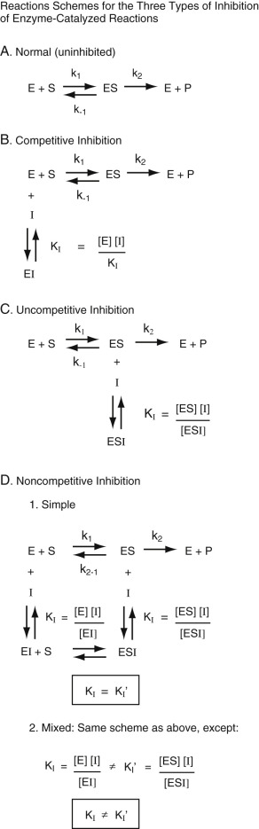

Figure 20-6 

Schemes for all types of inhibition of enzyme activity. 

**A,** The scheme for an uninhibited reaction. **B,** The scheme for competitive inhibition, showing that the inhibitor binds competitively to free enzyme, decreasing the binding of the substrate to the free enzyme. This results in a lower apparent affinity of the substrate for the enzyme, making the apparent K  M  higher than the true K  M  . However, this inhibition does not affect the catalytic rate, V  max  . K  I  is the dissociation constant for the enzyme–inhibitor complex ([EI]). **C,** The scheme for uncompetitive inhibition, showing that the inhibitor binds only to the enzyme-substrate complex such that it blocks catalysis but not the binding of the substrate to the enzyme and therefore affects V  max  but not K  M  . K  I  in this case is the dissociation constant for the enzyme–substrate–inhibitor ternary complex ([ESI]). **D,** The scheme for noncompetitive inhibition, which is of two types: (1) simple and (2) mixed. In both cases, the inhibitor binds both to the free enzyme _and_ to the enzyme-substrate complex, affecting both V  max  and K  M  . In simple noncompetitive inhibition _(1),_ the affinity of the inhibitor both for the free enzyme and for the enzyme-substrate complex is the same, making the two respective dissociation constants, K  I  and K  I  ′, equal. In mixed noncompetitive inhibition (2), K  I  and K  I  ′ are not equal. 

**[EI]** is defined in terms of the equilibrium constant, **K I  ** , for the dissociation of the inhibitor from the **EI** complex, and 

 [  EI  ]  =  [  E  ]  [  I  ]  /  K  I 

Because the steady-state equation for ES ( [ Equations 20-3, 20-4, and 20-5 ](<#e0020>) ) remains the same, [ Equation 20-24 ](<#e0125>) becomes 

 E  T  =  E  \+  [  E  ]  [  S  ]  /  K  M  \+  [  E  ]  [  I  ]  /  K  I 

 [  E  ]  =  [  E  T  ]  (  1  \+  [  S  ]  K  M  \+  [  I  ]  K  I  ) 

Because, as in [ Equation 20-2 ](<#e0015>) , 

 d  [  P  ]  /  dt  =  k  2  [  ES  ]  =  [  E  ]  [  S  ]  /  K  M 

 dP  dt  =  k  2  [  S  ]  K  M  ⋅ [  E  T  ]  (  1  \+  [  S  ]  K  M  \+  [  I  ]  K  I  ) 

and 

 d  [  P  ]  dt  =  k  2  [  ES  ]  =  k  2  [  E  T  ]  [  S  ]  K  M  (  1  \+  [  I  ]  K  I  )  \+  [  S  ] 

Note from this equation that the factor (1 + [I]/K  I  ) multiplies K  M  in the denominator. This means that K  M  is multiplied by a number ≥1\. Thus, if a competitive inhibitor is present at an appreciable concentration so that this factor > > 1, concentrations of S that would have saturated the enzyme will now no longer be able to do so. If a competitive inhibitor is present, its effect can be eliminated by increasing the substrate concentration such that S > > K  M  (1+[I]/K  I  ). 

Inversion of [ Equation 20-30 ](<#e0155>) gives the Lineweaver-Burk linear transform as follows: 

 I  V  0  =  K  M  (  1  \+  [  I  ]  K  1  )  V  MAX  ⋅ 1  [  S  ]  \+  1  V  MAX 

Plots of 1/v  o  versus 1/[S] at different inhibitor concentrations give linear traces in which the slope, but not the intercept, is altered in the presence of a competitive inhibitor. V  max  is unchanged, and only K  M  is altered. K  M  is modified by the coefficient (1 + [I]/K  I  ). The X-intercept of this equation (where 1/v  o  is 0) is –1 **/** [(1 + I/K  I  )K  M  ]. The effect of competitive inhibitors on enzyme-catalyzed reactions is summarized in [ Figure 20-7 ](<#f0040>) . 

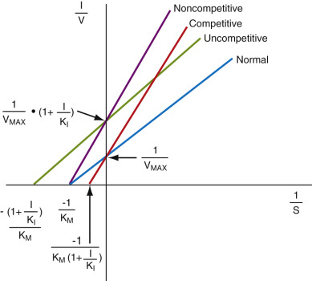

Figure 20-7 

Lineweaver-Burk plots for each type of inhibition shown in [ Figure 20-6 ](<#f0035>) , showing Y- and X-intercepts. 

To avoid cluttering, the slopes are not shown. The slopes of the lines for uninhibited reaction _(blue)_ and uncompetitive inhibition _(green)_ are K  M  /V  max  . The slopes of the lines for competitive _(red)_ and noncompetitive _(purple)_ inhibitions are K  M  (1 + I/K  I  ). 

 

##  Uncompetitive Inhibition 

As shown in [ Figure 20-6, _C_ ](<#f0035>) _,_ **uncompetitive** inhibition occurs when the inhibitor binds only to the ES complex, and not to free E. Therefore, no EI complex forms. Binding of the substrate causes a conformational change, creating a site for binding of the inhibitor. 

 

##  Effect of Uncompetitive Inhibitors on the Michaelis-Menten Equation 

In keeping with a similar procedure that was used for deriving [ Equation 20-30 ](<#e0155>) , we obtain the following expression: 

 V  0  =  V  MAX  [  S  ]  K  M  \+  [  S  ]  (  1  \+  [  I  ]  K  I  ) 

Note here that the same factor, (1 + [I]/K  I  ), now multiplies S, rather than K  M  , in the denominator of the Michaelis-Menten equation, as in the case of competitive inhibition discussed previously. This has the paradoxical effect of causing saturation to be reached at _lower_ values of S than for the normal, uninhibited case (see [ Fig. 20-6 ](<#f0035>) ) because S is multiplied by a factor that is >1\. However, the _rate_ of the uncompetitively inhibited enzyme-catalyzed reaction at saturation is _lower_ than it normally should be; the maximal rate at saturation is V  max  /(1 + I/K  I  ). No matter how high the substrate concentration is in this case, the normal rate at saturation, that is, V  max  , cannot be reached, unlike in the case of competitive inhibition discussed in the preceding section. 

At low **[S]** values, v  o  approaches V  max  /K  M  [S], as for the uninhibited case, and the uncompetitive inhibitor is without effect. This suggests that dilution of the specimen will remove the effect of the inhibitor and will enable the uninhibited rate of the reaction to be determined. Under these conditions, E  T  or activity can be directly computed from the first-order kinetic analysis ( [ Equation 20-19 ](<#e0100>) ) at low substrate concentration. 

The double reciprocal form of [ Equation 20-32 ](<#e0165>) is as follows: 

 1  V  0  =  K  M  V  MAX  ⋅ 1  [  S  ]  \+  (  1  \+  [  I  ]  K  I  )  ⋅ 1  V  MAX 

The Lineweaver-Burk plot of this equation has a slope that is the same as for the uninhibited (normal) reaction, but the intercept, (1/V  max  ) (1 + [I]/K  I  ), will be higher for uncompetitive inhibition than for the normal case, that is, 1/V  max  , as shown in [ Figure 20-6, _C_ ](<#f0035>) _._ The X-intercept (where 1/v  o  = 0) is –(1 + [I]/K  I  )/K  M  . If [I] is known, either intercept can be used to compute K  I  . The effect of uncompetitive inhibitors on enzyme-catalyzed reactions is summarized in [ Figure 20-7 ](<#f0040>) . 

 

##  Simple and Mixed Noncompetitive Inhibition 

Noncompetitive inhibition occurs when the inhibitor, similar to the uncompetitive inhibitor, binds at a site distinct from the substrate-binding site. Both the inhibitor and the substrate are capable of binding the enzyme simultaneously. Binding of the inhibitor to this second site may completely abolish enzyme activity or may only partially reduce it. Hence, noncompetitive inhibition may be **full** or **partial** . Unlike uncompetitive inhibitors, noncompetitive inhibitors bind both to free E and to ES. If the binding of the inhibitor and of the substrate occurs independently of each other, **simple noncompetitive inhibition** exists. If bound substrate alters the affinity of the enzyme for the inhibitor, a condition of **mixed competitive inhibition** exists. Binding of the noncompetitive inhibitor alters the conformation of the substrate-binding site. The substrate can still bind; however, the binding affinity and/or the catalytic activity is/are reduced. 

 

##  Effects of Noncompetitive Inhibitors on the Michaelis-Menten Equation 

The kinetic scheme for this type of inhibition is shown in [ Figure 20-6, _D_ ](<#f0035>) _._ Here, the inhibitor can bind _both_ to the free enzyme _and_ to the enzyme-substrate complex. If the affinity or dissociation constants for each of these processes are the same, as shown in [ Figure 20-6 ](<#f0035>) , then the pattern appears to be a combination of competitive and uncompetitive inhibition and is termed _simple noncompetitive inhibition._ Thus, in this case, the term (1 + [I]/K  I  ) multiplies both terms in the denominator of the Michaelis-Menten equation (see [ Equation 20-10 ](<#e0055>) ), or 

 V  0  =  V  MAX  ⋅ [  S  ]  (  1  \+  [  I  ]  K  I  )  ⋅ K  M  \+  (  1  \+  [  I  ]  K  I  )  ⋅ [  S  ] 

If the two K  I  constants differ, the inhibition is termed _**mixed** noncompetitive inhibition. _ For this latter case, if K  I  is the dissociation constant for the inhibitor when it binds to free enzyme, and if K  I  ′ is the dissociation constant for the inhibitor when it binds to the enzyme-substrate complex, then the Michaelis-Menten rate law for noncompetitive inhibition is 

 V  0  =  V  MAX  [  S  ]  (  1  \+  [  I  ]  K  I  )  ⋅ K  M  \+  (  1  \+  [  I  ]  K  I  )  ⋅ [  S  ] 

The Lineweaver-Burk equation for simple noncompetitive inhibition is 

 1  V  0  =  K  M  V  MAX  ⋅ (  1  \+  [  I  ]  K  I  )  ⋅ 1  [  S  ]  \+  1  V  MAX  ⋅ (  1  \+  [  I  ]  K  I  ) 

And, for mixed inhibition, 

 1  V  0  =  K  M  V  MAX  ⋅ (  1  \+  [  I  ]  K  I  )  ⋅ 1  [  S  ]  \+  1  V  MAX  \+  (  1  \+  [  I  ]  K  ′ I  ) 

As can be seen from [ Equation 20-35 ](<#e0180>) , for simple noncompetitive inhibition, in the presence of inhibitor, both the slope and the intercept increase in value by the factor (1 + [I]/K  I  ). This result is based on the assumption that the substrate does not modify the affinity of the enzyme for the inhibitor, and vice versa. Note that, because the inhibitor binds to the enzyme-substrate complex, thereby inactivating it, the maximal velocity is lowered as was the case for uncompetitive inhibition, as discussed earlier. Therefore, the intercept for this condition is 1/V  max  (1 + [I]/K  I  ), that is, instead of 1/V  max  as in the normal case. Likewise, K  M  is increased by the same factor. However, as discussed previously, K  M  is computed as the **ratio** of the slope of the Lineweaver-Burk plot to the intercept. Because both of these terms contain the factor (1 + [I]/K  I  ), this factor cancels, and the computation yields the value of the actual K  M  . This, of course, does not happen in mixed noncompetitive inhibition where the two constants for inhibitor binding differ from one another. In this case, K  M  app  is K  M  ● (1 + [I]/K  I  )/(1 + [I]/K  I  ′). The X-intercept for simple noncompetitive inhibition from [ Equation 20-36 ](<#e0185>) is –1/K  M  , and for mixed noncompetitive inhibition, it is –(1 + [I]/K  I  ′)/(1 + [I]/K  I  )K  M  . The effect of simple noncompetitive inhibitors (that have the same K  I  value for free enzyme and enzyme-substrate complex) on enzyme-catalyzed reactions is summarized in [ Figure 20-7 ](<#f0040>) . 

[ Table 20-4 ](<#t0025>) summarizes changes in the apparent values of V  max  and K  M  derived from the intercepts and slopes of double reciprocal Lineweaver-Burk plots for competitive, uncompetitive, and simple noncompetitive inhibition. [ Figure 20-7 ](<#f0040>) summarizes the Lineweaver-Burk plots for a normal enzyme-catalyzed reaction and for the three types of inhibition of enzyme-catalyzed reactions and the values of the Y- and X-intercepts in each condition. 

TABLE 20-4 

Slopes and Intercepts from Double Reciprocal Plots and Computed Values of V  max  and K  M  from These Plots for Various Types of Reversible Inhibitors 

Type of Inhibition  |  Slope  |  Y-Intercept  |  X-Intercept  |  V  max  (apparent) [ * ](<#hl0000408>) |  K  M  (Apparent) [ * ](<#hl0000408>)  
---|---|---|---|---|---  
None  |  K  M  /V  max  |  1/V  max  |  –1/K  M  |  V  max  |  K  M   
Competitive  |  (K  M  /V  M  ) (1 + I/K  I  )  |  1/V  max  |  –1/[K  M  (1 + I/K  I  )]  |  V  max  |  K  M  (1 + I/K  I  )   
Uncompetitive  |  K  M  /V  max  |  (1/V  max  ) ● (1 + I/K  I  )  |  –(1 + I/K  I  )/K  M  |  V  max  /(1 + I/K  I  )  |  K  M   
Noncompetitive (simple)  |  K  M  /V  max  ● (1 + I/K  I  )  |  (1/V  max  ) ● (1 + I/K  I  )  |  –1/K  M  |  V  max  /(1 + I/K  I  )  |  K  M   
  
 * The observed value that equals the derived expression from the double reciprocal plots shown for each condition. 

,  

##  Catalytic Efficiency: Transition State Theory and Drug Design 

[ Equation 20-19 ](<#e0100>) applies to circumstances where the substrate concentration is present at concentrations below the value of K  M  for an enzyme. The rate constant for this reaction is k  2  /K  M  , which is formally a second-order rate constant because this reaction depends on the concentrations of both the substrate and the enzyme. (As noted previously, the reaction is actually pseudo–first-order in that the total enzyme concentration, E  T  , is constant, and only the substrate concentration, [S], changes.) Catalytic efficiency is assessed in terms of the rate constants of the catalyzed reaction. The constant k  2  /K  M  , often written as k  cat  /K  M  , is a reflection of the frequency of productive encounters of enzyme and substrate molecules in solution. 

 

##  Enzymes Achieve High Rates of Reaction That Greatly Exceed Those for Uncatalyzed Reactions 

An upper boundary to the frequency of encounters is determined by the temperature and the diffusion coefficients of the substrate and enzyme. This limiting value is on the order of 10  8  to 10  9  M  –1  sec  –1  , called the _diffusion-controlled limit._ If the value of k  cat  /K  M  is at the diffusion-controlled limit, every encounter of the enzyme and substrate leads to product formation, and the enzyme has achieved what may be termed **catalytic perfection.** Some enzymes have actually approached this state. These include superoxide dismutase (k  cat  /K  M  = 2.8 × 10  9  M  –1  sec  –1  ), AChE (k  cat  /K  M  = 1.5 × 10  8  M  –1  sec  –1  ), and catalase (k  cat  /K  M  = 4.0 × 10  8  M  –1  sec  –1  ). Most other enzymes do not have constants of this magnitude but have values that vastly exceed those for the corresponding uncatalyzed reactions, the second-order rate constants that are termed _k uncat  _ ( _uncat_ alyzed). 

The ratio k  cat  /k  uncat  gives the rate enhancement, which is often difficult to obtain because most cellular reactions occur very slowly in the absence of enzymes. For enzymes, rates are in the range of 10  8  to 10  12  , but some are even higher. For example, the rate acceleration for adenosine deaminase, which catalyzes the deamination of adenosine to inosine, is 10  14  , and the rate acceleration of ALP is 10  17  . Both adenosine deaminase and ALP have modest k  cat  values, 10  2  sec  –1  . Their unusually large rate accelerations stem from the stability of their substrates at pH 7.0 and 25° C. For example, the half-time for the deamination of adenosine to inosine at 20° C and pH 7.0 is approximately 20,000 years, and k  uncat  is10  –12  sec  –1  ! The nonenzymatic rate constant for the hydrolysis of phosphate esters under neutral, room temperature conditions is estimated to be on the order of 10  –15  sec  –1  . The question arises as to how enzymes can induce such large rate enhancements and in some instances attain rates that are the highest that can physically be achieved. 

 

##  Enzymes Achieve High Rate Enhancements by Binding to the Transition State on the Reaction Pathway 

From [ Figure 20-3 ](<#f0020>) , it can be seen that when the enzyme binds noncovalently to the substrate, if the energy of the resulting enzyme-substrate complex is lowered significantly relative to the energies of the separated species, this would lead to an increased activation energy. However, if the enzyme rather stabilizes the transition state leading to the formation of products, then the activation energy would be greatly lowered, as indicated in [ Figure 20-3 ](<#f0020>) . Considerable accumulating evidence suggests that enzymes have high affinities for **transition states.** Because, in the transition state, the substrate is somewhat distorted from its ground state structure by the incipient breaking and making of covalent bonds, the resulting increase in energy of the substrate is greater than that compensated by favorable interactions of the distorted substrate with the enzyme. It should be realized that transition states in reactions are not stable structures but rather are inferred from knowledge of the reaction path. However, substrate molecules have been designed that have critical features of inferred transition states, and these modified substrates have been found to bind to the enzymes with enhanced affinities (  Fersht, 1999  ). 

These considerations have direct clinical applicability in two areas: drug design and the advent of so-called catalytic antibodies, that is, antibodies that have been designed to have strong and specific enzyme activity. We give one example of each of these applications to illustrate the importance of transition state theory to practical clinical problems. 

 

##  Transition State Theory in Drug Design 

 

##  HIV Protease Inhibitors in Treating HIV-AIDS 

A host of new drugs have been developed as protease inhibitors that block the protease enzymes of the human immunodeficiency virus (HIV) involved in viral replication of the acquired immunodeficiency syndrome (AIDS) virus (  Vance et al, 1997  ). Proteases catalyze hydrolytic reactions in which peptide or amide bonds are cleaved by water into a carboxylic acid and a primary (or, in the case of proline, a secondary) amine. HIV proteases are vital for cleaving large protein precursors into gag and pol proteins that enable viral replication. Absence of this protease activity results in inability of the virus to replicate. Thus this protease has become the target for the design of inhibitory compounds (  Vance et al, 1997  ). 

HIV protease functions as a homodimer, that is, two subunits having the exact same sequence. It catalyzes the hydrolysis of X-Pro (proline) peptide bonds where X is an aromatic amino acid, such as phenylalanine (Phe) or tyrosine (  Swain et al, 1990  ;  Vance et al, 1997  ). Two critical aspartic acid residues (25 and 125) are known to be the actual catalytic residues effecting peptide bond cleavage (  Swain et al, 1990  ). Thus HIV protease, similar to a number of other proteases such as angiotensin-converting enzyme, discussed in the next section, is an aspartic acid peptidase. It has been known for many years that the hydrolysis of peptide (and ester) bonds involves the formation of a so-called _tetrahedral intermediate,_ as illustrated for a peptide bond in [ Figure 20-8 ](<#f0045>) . This intermediate results from the addition of water to the unsaturated carbonyl carbon on the reaction pathway. The carbonyl carbon and the three atoms to which it is attached all lie in the same plane, the so-called _planar configuration._ Attack by the oxygen atom of water on the carbonyl carbon results in the addition of a fourth atom attached to the carbonyl carbon, causing replacement of the planar arrangement of the atoms by a tetrahedral arrangement of these atoms. Note that the transition state leading to this intermediate is inferred also to have tetrahedral features and a partially negatively charged oxygen. Thus, substrates have been designed that have, in place of the normally occurring amide bond, a tetrahedral structure with an oxyanion or a hydroxyl group at this position that resembles the transition state. 

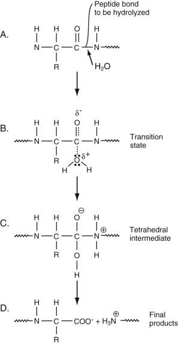

Figure 20-8 

Steps in the hydrolysis of a peptide bond. 

**A,** A typical peptide bond for two amino acids in a peptide bond link. R is the side chain of the first amino acid. This bond will be cleaved by addition of water to the carbonyl group, as shown by the arrow. **B,** The transition state on the way to the addition of water to the carbonyl group. The carbonyl oxygen takes on a partial negative charge (δ − ). **C,** The tetrahedral intermediate that results from the addition of water. Note that an oxyanion forms on the former carbonyl oxygen. The attacking water molecule has given up a proton that can add to the amino nitrogen of the leaving group, that is, the amino acid on the right of the peptide bond, or to the oxyanion of the former carbonyl group. **D,** The final products, that is, a carboxylate from the left amino acid and an amine (ammonium ion) from the right amino acid. 

An example of an inhibitory transition state analog of HIV protease is shown in [ Figure 20-9 ](<#f0050>) . For comparison, a typical substrate of HIV protease is also shown (  Matayoshi et al, 1990  ). As can be seen in [ Figure 20-9 ](<#f0050>) , in the Phe residue in the transition state analog, the normally occurring planar C–O group in the peptide backbone, is replaced with a tetrahedral C(H)–OH group, giving rise to the so-called _Phe-Psi residue._ This occurs at the normal peptide cleavage site. This analog binds to HIV protease with a K  I  (dissociation constant) of 0.24 nM (  Swain et al, 1990  ). The substrate has a K  M  on the order of 103 µM (Matayoshi, 1990). This K  M  is a true dissociation constant in that the k  2  is much lower than the noncovalent dissociation constant. Therefore the ratio of the affinity constant (reciprocal of the dissociation constant) for the transition state analog to that of the substrate is on the order of 400,000! Thus, the application of transition state theory has resulted in the design of a very potent HIV protease inhibitor. Newer HIV protease transition state inhibitors, such as the modified peptide KNI-272, that have substantially lower K  I  values have been designed (  Adachia et al, 2009  ). The x-ray crystal structures of the transition state analogs bound to HIV protease have been determined (  Swain et al, 1990  ;  Adachia et al, 2009  ). The two critical Asp residues interact strongly with the tetrahedral atoms of the modified Phe residue and are clearly involved in stabilization of the tetrahedral transition state (  Swain et al, 1990  ;  Adachia et al, 2009  ). 

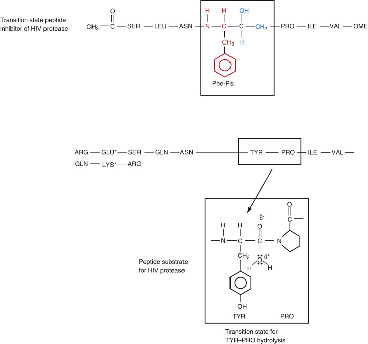

Figure 20-9 

Human immunodeficiency virus (HIV) protease transition state analog peptide inhibitor. 

HIV protease cleaves at X-Pro bonds, where X is an aromatic amino acid like Tyr and Phe. In this case, X is a modified Phe residue, labeled Phe-Psi, most of whose atoms are colored red such that, in place of the normally occurring C O (carbonyl) group, a tetrahedral carbon is present attached to an OH group. The tetrahedral atoms are shown in blue. This mimics the transition state shown for a substrate of HIV protease whose amino acid sequence is shown below that for the transition state analog. This sequence contains the bond cleavage site, TYR-PRO, as shown in the small box. The tetrahedral transition state for this cleavage is shown in the larger box. The asterisks on the two substrate residues denote that these residues can be attached to fluorescent probes in an enzyme assay for this protease using this substrate. Because the transition state analog resembles the transition state in the hydrolysis of the Tyr-Pro peptide bond, it is a strong and specific inhibitor of the protease. 

One drawback to the HIV protease inhibitors currently being used clinically in the treatment of AIDS is that viral mutations result in HIV proteases that have lower affinities for these inhibitors. More recently, therefore, new transition state analogs have been designed such that they interact with amino acid residues that surround the active site and actually bind to critical backbone atoms of sections of the polypeptide chain that have well-defined secondary structures (such as α-helices and β-sheets), greatly increasing their affinities (K  I  ′s in the picomolar range) (  Ghosh et al, 2008  ). In this case, because mutations of constant structural residues would be expected to decrease the stability of the protease greatly, it is hoped that viral mutations will have much less effect on their efficacies. 

 

##  Design of New Catalytic Antibodies with Predetermined Enzyme Activity 

Antibodies generally bind to antigens with high affinities. If antibodies can be raised to transition state analogs of compounds that undergo specific chemical reactions, by stabilizing the transition state for these specific chemical reactions they might themselves serve as enzymes that catalyze these reactions. Although still in its infancy, this area of enzymology has achieved some notable success, providing, in turn, further support for the transition state theory of enzyme action. As an example, a clinically important finding using this approach is seen in the design of antibodies that induce hydrolysis of cocaine. Hydrolysis of the benzoate and acetyl esters results in effective inactivation of this drug of abuse, as discussed in [ Chapter 23 ](<##!/content/3-s2.0-B9780323295680000231?scrollTo=%23c00023>) . The structure of cocaine and a tetrahedral transition state analog are shown in [ Figure 20-10 ](<#f0055>) (  Cashman et al, 2000  ). This analog has a tetrahedral structure for the benzoyl moiety in which a nonhydrolyzable phenyl phosphonate ester replaces the normally occurring carbonyl group. Antibodies have been raised to a thiol derivative of cocaine and then assayed for their abilities to bind to the transition state analog. Several antibodies have been isolated that bind strongly to the transition state analog and also catalyze, with large rate enhancements over the uncatalyzed reaction, the hydrolysis of the benzoyl ester of cocaine, resulting in a cocaine derivative of much lower potency. It is of considerable interest that, using another approach, the serum enzyme, butyrylcholinesterase, discussed in the next section, has been modified, based on the x-ray crystal structure of this enzyme bound to inhibitors, using site-specific mutagenesis techniques, so that it is active in the de-benzoylation of cocaine leading to its inactivation. The rates of catalysis of the catalytic antibodies and the engineered butyrylcholinesterase are similar to one another. Both approaches may provide rational treatment modalities for detoxification of harmful substances, in this case, drugs of abuse. 

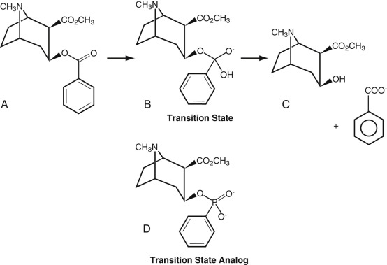

Figure 20-10 

Hydrolysis of the benzoate ester moiety of cocaine **(A)** an ecgonine derivative, occurs via a tetrahedral intermediate **(B)** containing an oxyanion, and, presumably, a tetrahedral transition state resulting in the free –OH group of an ecgonine derivative shown in **C** and benzoic acid. This results in a cocaine derivative that is much less active. **D,** A nonhydrolyzable benzyl phosphonate ester transition state analog that has a tetrahedral structure that likewise contains an oxyanion. An antibody that binds with high affinity to this analog has been found to catalyze the hydrolysis of cocaine with a greatly enhanced rate over that for the noncatalyzed reaction. 

,  

##  Specific Enzymes 

Numerous enzymes are clinically useful in recognition and monitoring of particular disease processes. In all but a few circumstances, abnormal conditions in specific tissues are recognized by _elevations_ of one or more enzymatic activities or enzyme concentrations. For example, elevations of the activity of serum CK suggest the presence of muscle disease. The reason for elevation of specific enzymes in blood and other body fluids as the result of disease processes in specific tissues is not completely understood. One explanation for this occurrence is that disease processes that cause cell injury or death result in damage to the cell membrane, leading to the release of specific intracellular enzymes into tissue spaces and the microvasculature, causing increased enzymatic activity in serum or other body fluids. On occasion, mutant forms of enzymes occur, resulting in _lowering_ of their activities, although, generally, not of their concentrations. One prominent example of this phenomenon is butyrylcholinesterase (discussed later). 

Several enzymes are distributed predominantly in a single tissue, so that damage to this tissue results in elevations of the enzyme in serum. For example, as discussed in [ Chapter 21 ](<##!/content/3-s2.0-B9780323295680000218?scrollTo=%23c00021>) on liver function, elevation of the level of the enzyme ALT, which is distributed predominantly in the liver, indicates acute hepatic injury, often as a result of hepatitis. Although measured by immunoassay, PSA is a form of chymotrypsin and occurs almost exclusively in the prostate gland. Serum elevations of PSA, therefore, suggest prostate pathology, often prostate cancer. Other enzymes do not have selective tissue distributions but have isozymes that do have selective distributions, making elevations of these isozymes valuable in diagnosing specific tissue pathology. For example, as discussed in [ Chapter 18 ](<##!/content/3-s2.0-B9780323295680000188?scrollTo=%23c00018>) , elevation of serum levels of CK-MB (also, see previous discussion) points to myocardial disease, most often infarction. As discussed later, elevations of specific isozymes of ALP point to specific tissue disease. The biliary tract form is elevated in biliary disease, and the bone form is elevated in diseases of bone. 

For enzymes with no tissue-specific isozymes, the relative amounts of different enzymes in plasma provide a clue as to the type of organ injured. For example, LD, AST, and ALT are found in many organs, but the relative amounts in each differ ( [ Table 20-5 ](<#t0030>) ). If LD is markedly elevated, while AST and ALT are only slightly elevated, this would suggest damage to an organ or tissue (such as red blood cells, white blood cells, or tumors) with a high LD/AST ratio. On the other hand, if AST and ALT are elevated, but LD is only slightly elevated, this suggests damage to liver, which has a low LD/AST ratio. 

TABLE 20-5 

Relative Amounts of Enzymes in Various Organs (Relative to Serum) [ * ](<#hl0000487>)

Tissue  |  AST [ † ](<#hl0000490>) |  ALT  |  LD  |  CK   
---|---|---|---|---  
Liver  |  7000  |  3000  |  7000  |   
Kidney  |  4500  |  1200  |  500  |  10   
Brain  |  |  |  |  1700   
Spleen  |  700  |  150  |  |   
Heart  |  8000  |  500  |  600  |  5000-8000   
Skeletal muscle  |  5000  |  300  |  700  |  20,000-30,000   
Smooth muscle  |  |  |  |  300-600   
Red blood cells  |  15  |  7  |  500  |  0   
  
_ALT,_ Alanine aminotransferase; _AST,_ aspartate transaminase; _CK,_ creatine kinase; _IU,_ international unit; _LD,_ lactate dehydrogenase. 

 * Relative amount is calculated by dividing the activity of enzyme in tissue (in IU/kg of tissue) by the upper reference limit of plasma activity of the enzyme (in IU/L), assuming that 1 L of plasma = 1 kg. Because the data are derived from multiple publications, the relative amounts among enzymes may be approximate, but the relative amount of a single enzyme in each tissue is accurate. 

 † Total amount in cells; varying amounts represent mitochondrial isoenzyme, which reaches serum in only small amounts. 

Many other enzymes, elevations of which denote damage to specific tissues, are discussed in other chapters of this book. Discussion of enzymes and enzyme inhibitors in serum and urine for recognition of renal disease is found in [ Chapter 14 ](<##!/content/3-s2.0-B9780323295680000140?scrollTo=%23c00014>) ; enzymes of bone metabolism are presented in [ Chapter 15 ](<##!/content/3-s2.0-B9780323295680000152?scrollTo=%23c00015>) ; enzymes and other proteins utilized for the diagnosis of myocardial infarction are discussed in [ Chapter 18 ](<##!/content/3-s2.0-B9780323295680000188?scrollTo=%23c00018>) ; enzymes useful in recognition of liver and biliary tract disease are discussed in [ Chapter 21 ](<##!/content/3-s2.0-B9780323295680000218?scrollTo=%23c00021>) ; pancreatic enzymes are covered in [ Chapter 22 ](<##!/content/3-s2.0-B978032329568000022X?scrollTo=%23c00022>) ; and enzyme deficiencies that produce hemolytic anemia are discussed in Part 4. 

The remainder of this chapter is concerned with a discussion of enzymes, each of whose isozymes is specific for a different tissue (e.g., acid and alkaline phosphatases, 5′-NT, LD), and two enzymes that are not tissue specific but whose activities have major systemic effects: angiotensin-converting enzyme, vital for control of blood pressure, and AChE, which is critical in neuromuscular transmission. 

 

##  Acid Phosphatase (EC 3.1.3.2) 

 

##  Biochemistry and Physiology 

ACPs belong to the hydrolase class of enzymes (see [ Table 20-1 ](<#t0010>) ) and occur as several isoenzymes with a common enzymatic function (the hydrolytic breakdown of phosphate monoesters). They all show optimal enzyme activity below a pH of 7.0. They possess some tissue specificity (greatest concentrations occur in prostate, liver, spleen, erythrocytes, and bone). The major forms are coded for by different genes and possess different molecular weights and structures, as well as differences in sensitivity to tartrate inhibition. Lysosomal, prostatic, erythrocyte, macrophage, and osteoclastic ACPs are five important types found in humans. Normally, concentrations in serum are low (  Moss & Henderson, 1999  ;  Bull et al, 2002  ). The activity of erythrocyte ACP can be distinguished from that of the other ACP isoenzymes in that it is inhibited by 2% formaldehyde solution and 1-mM cupric sulfate solution. This is in contrast to the other isoenzymes, which are not inhibited by these agents. In addition, erythrocyte ACP is not inhibited by 20-mM tartrate solution, which does inhibit the other isoenzymes. It is important to note that tartrate-resistant acid phosphatase (TRAP) is present in certain chronic leukemias and some lymphomas, most notably in hairy cell leukemia, as described in [ Chapter 32 ](<##!/content/3-s2.0-B9780323295680000322?scrollTo=%23c00032>) . In addition, a particular isoform of TRAP, called _TRAP-5b,_ occurs predominantly in osteoclasts in bone marrow and is used as a marker for bone remodeling (  Lu et al, 2006  ); it has also been proposed as a marker for metastatic cancer (e.g., breast cancer) in bone marrow (  Chao et al, 2005  ). 

 

##  Reference Ranges and Preanalytic Variation 

Reference values depend on age, gender, and hormonal status (in women). Total and tartrate-resistant ACP values are high in children, rising through the first decade to peak at three to four times adult levels in adolescence, paralleling changes in ALP (  Chen et al, 1979  ). In the late teen years, levels decline to adult values that are constant to approximately 80 years of age in both genders. Normal men and women up to about 55 years of age have the same reference ranges for ACP. In women, total and tartrate-resistant ACPs increase after menopause (  Schiele et al, 1988  ) and increase with the use of depot medroxyprogesterone acetate in premenopausal women (  Mukherjea et al, 1981  ). 

The enzymatic activity of ACP is unstable at normal plasma pH; specimens must be acidified to prevent loss of ACP activity (  Theodorsen, 1985  ). The effect of specimen pH is not as consistently seen with immunoassays for prostatic ACP; some studies have recommended routine use of acidification for all ACP specimens, but it is not clear that this is essential (  Panteghini et al, 1992  ). 

The half-life of prostatic ACP is about 1 to 3 hours (  Wadstrom et al, 1985  ). Day-to-day variation in ACP is relatively high; average variation of the prostatic isoenzyme is 30% (  Maatman, 1993  ), although it may be as high as 100% in patients with prostatic carcinoma (  Brenckman et al, 1981  ), and bone isoenzyme variation averages about 35% (  Panteghini & Pagani, 1995  ). 

 

##  Measurement 

Assays for all phosphatases utilize the strategy that phosphate esters, which have no visible light absorbance, are hydrolyzed to inorganic phosphate and a strongly visible light-absorbing alcohol or alcohol anion. Total ACP is typically measured by its ability to cleave phosphate groups at an acid pH. Usually the test is utilized for the measurement of prostatic serum ACP in the diagnosis or monitoring of prostatic adenocarcinoma. A variety of substrates and conditions have been used to measure enzymatic activity with increased specificity; these include thymolphthalein monophosphate and α-naphthyl phosphate, both of which give rise to strongly absorbing products, α-naphthol and thymophthalein. _High bilirubin causes falsely low values for TRAP activity,_ but not for total ACP (  Alvarez et al, 1999  ). 

Isozymes of ACP can be separated by electrophoresis (  Moss, 1986  ); however, there is usually little interest in isoenzymes other than prostate and bone. Immunoassays (  Bull et al, 2002  ) for both prostatic and bone isoenzymes of ACP have been developed; the former are widely available. 

 

##  Causes of Abnormal Results 

The main cause of increased ACP is prostate disease; with development of PSA as the major serum test for prostate (see [ Chapter 73 ](<##!/content/3-s2.0-B9780323295680000735?scrollTo=%23c00073>) ), ACP has become less popular for use in prostate cancer, although, with the availability of newer immunochemical methods, its use in the diagnosis of prostate cancer has been maintained (  Pontes, 2006  ). In early prostate cancer, the sensitivity of ACP is inferior to that of PSA (  Burnett et al, 1992  ), although ACP, similar to PSA, is elevated in a significant percentage of patients with benign prostatic hyperplasia (  Salo et al, 1990  ) or prostatic infarction, making ACP of little use for prostate cancer screening (  Kaplan et al, 1985  ). Almost all patients with prostate cancer and elevated ACP have extracapsular extension or metastases (  Salo et al, 1990  ;  Burnett et al, 1992  ), so that an elevated ACP may provide useful information in staging of patients. Occasionally, elevated prostatic ACP may be due to other causes. Urinary tract obstruction and acute urinary retention may cause elevated ACP (  Collier & Pain, 1986  ). Extensive prostatic massage, prostatic inflammation, infarction/ischemia, and prostatic manipulations such as needle biopsy and cystoscopy may also cause a transient increase in serum ACP; testing should be done before any procedures are performed. 

After surgical treatment of prostate cancer, ACP falls faster than PSA (  Price et al, 1991  ), and levels should become undetectable after complete tumor resection. Because PSA is an androgen-dependent protein, androgen deprivation therapy decreases PSA production but has no effect on ACP (  Price et al, 1991  ;  Narayan et al, 1995  ), suggesting that ACP may be of use in monitoring patients treated in this fashion. 

ACP has been used for many years in cases of suspected rape. Fluid collected from the vagina on a cotton swab will give a positive test for ACP if semen is present, provided a stabilizing fluid with an acidic pH is used (  Ricci & Hoffman, 1982  ). Peak values are generally present in the first 12 hours, and values remain elevated for up to 4 days. 

There has been a recent interest in the use of TRAP as a tumor marker for following specific tumors. In one study, it was found that expression of this enzyme in malignant gastric carcinoma cells is associated with an increased probability of peritoneal involvement (  Kawamura et al, 2014  ). On the other hand, another study found that expression of TRAP by specific subclasses of macrophages in patients with colon cancer was associated with a 22% increase in 5-year survival and a 47% risk reduction in death due to this disease (  How et al, 2014  ). 

 

##  Alkaline Phosphatase (EC 3.1.3.1) 

 

##  Biochemistry and Physiology 

Similar to ACP, ALPs are a type of hydrolase (see [ Table 20-1 ](<#t0010>) ). Discussion of ALP in the canalicular (biliary) system can be found in [ Chapter 21 ](<##!/content/3-s2.0-B9780323295680000218?scrollTo=%23c00021>) on liver function. Alkaline phosphatases represent a family of enzymes coded for by different genes. Their physiologic role is not completely understood. The most abundant plasma ALP isoforms are coded for by a single gene on chromosome 1, producing the tissue-nonspecific isozyme found in kidney, liver, and bone. However, in different tissues, this **parent** isozyme is subjected to different posttranslational modifications, resulting in differences in their carbohydrate side chains. Two other genes on chromosome 2 code for ALP of placental and intestinal origin; another gene on chromosome 2 codes for the so-called _germ cell_ or placental-like isoenzyme, which has some antigenic and physical similarities to the placental isozyme. 

In cells, ALP is primarily bound to cell membranes, where it appears to be involved in cleavage of phosphate-containing compounds and may facilitate movement of substances across cell membranes. Hepatocytes produce ALP in the liver, where it is found attached to the canalicular surface of the cells (see [ Chapter 21 ](<##!/content/3-s2.0-B9780323295680000218?scrollTo=%23c00021>) ). Osteoblasts produce bone ALP, which appears to be involved in cleavage of pyrophosphate, an inhibitor of bone mineralization. Intestinal epithelial cells produce intestinal ALP, which is released into the intestine following ingestion of fatty foods. 

There appear to be different mechanisms for release of ALP from cells, leading to varying forms of ALP in plasma. With liver injury, ALP synthesis increases, but bile acids dissolve fragments of canalicular cell membranes with attached enzymes (including ALP, GGT, leucine aminopeptidase, and 5′-NT [  Moss, 1997  ]). In normal serum, a single form (of liver or bone origin) of ALP is typically seen; however, with hepatobiliary disease, both the normal product and the membrane-attachment form (high molecular weight) bound to lipoproteins can be seen (  Wolf, 1994  ). The intestinal isoenzyme of ALP is released in large amounts into duodenal fluid (  Deng et al, 1992  ), and large amounts enter lymphatic fluid, draining the intestinal tract following a meal (  Reynoso & Elias, 1971  ). However, much of the isoenzyme apparently becomes bound to red blood cell (RBC) ABO antigens (  Bayer et al, 1980  ), so that only small amounts reach the plasma, except in individuals who possess both the secretor gene and a large amount of H substance (group O or B), where ALP may increase by up to 30 IU/L following a meal (  Domar et al, 1993  ). ALP is also higher in individuals of blood group O or B than in A and AB individuals (  Agbedana & Yeldu, 1996  ) because of differences in intestinal ALP levels (  Domar et al, 1993  ). It is curious that placental ALP is also lower in pregnant women of groups A and AB (  Ind et al, 1994  ). 

The half-lives of isoenzymes of ALP differ significantly, so it is necessary to know the isoenzyme that is elevated before rate of clearance can be evaluated: intestine, minutes; bone, 1 day; liver, 3 days; and placenta, 7 days. Day-to-day variation in total ALP is 5% to 10%, although the bone isozyme shows 20% day-to-day variability. 

 

##  Reference Ranges and Preanalytic Variation 

Reference ranges for ALP are highly dependent on age and gender ( [ Table 20-6 ](<#t0035>) ). During childhood, levels gradually rise throughout the first decade, reaching peak values three to four times normal adult levels, and are higher in boys than in girls. The higher values in children are due to the bone isoenzyme. After a peak in the early teens, values gradually decrease to adult levels by the early 20s, and are similar in men and women until 50 years of age. After menopause, the bone isoenzyme increases slightly in women, causing a rise in reference limits after 50 years of age. Reference limits are 15% higher in African American men and 10% higher in African American women (  Manolio et al, 1992  ). Pregnancy causes a two- to threefold increase in ALP, mainly due to the placental isoenzyme, but also because of an increase in bone isoenzyme (  Valenzuela et al, 1987  ). 

TABLE 20-6 

Relative Levels of Enzymes, by Gender, Relative to Young Adult Males (1.0) [ * ](<#hl0000615>)

|  AGE, YEARS   
---|---  
Enzyme  |  Gender  |  8  |  12  |  16  |  22  |  30  |  40  |  50  |  60   
Aspartate aminotransferase  |  Male  |  0.75  |  0.86  |  0.82  |  1.00  |  1.16  |  1.26  |  1.21  |  1.11   
|  Female  |  0.73  |  0.80  |  0.69  |  0.89  |  0.89  |  1.01  |  0.77  |  0.96   
Alanine aminotransferase  |  Male  |  1.14  |  1.09  |  0.89  |  1.00  |  1.03  |  1.11  |  1.06  |  0.83   
|  Female  |  0.11  |  0.89  |  0.83  |  0.75  |  0.75  |  0.75  |  0.72  |  0.83   
Alkaline phosphatase  |  Male  |  3.61  |  4.76  |  4.48  |  1.52  |  1.00  |  1.00  |  0.95  |  0.95   
|  Female  |  0.14  |  4.10  |  2.52  |  0.81  |  0.86  |  0.76  |  1.00  |  1.38   
γ-glutamyl transferase  |  Male  |  0.25  |  0.29  |  0.37  |  0.62  |  1.00  |  1.07  |  1.16  |  0.99   
|  Female  |  0.24  |  0.28  |  0.33  |  0.38  |  0.52  |  0.58  |  0.9  |  1.09   
  
Data from Siest G, Henry J, Schiele F, Young DS. _Interpretation of clinical laboratory tests: reference values and their biological variation._ Foster City, Calif.: Biomedical Publications; 1985. 

 * Results expressed as upper reference limits as a fraction of the upper reference limits for healthy young males. 

A number of other factors affect ALP levels as well. High body mass index is associated with a 10% average increase in ALP (  Salvaggio et al, 1991  ). Oral contraceptives decrease ALP by an average of 20% (  Schiele et al, 1988  ;  Dufour, 1998  ); fibric acid derivatives decrease total ALP by 25% and the liver isoenzyme by 40% (  Day et al, 1993  ). Antiepileptic agents commonly cause increased total ALP, mainly because of increases in the liver isoenzyme; however, in some cases, the bone isozyme may also be elevated (  Nijhawan et al, 1990  ). Smoking causes an average 10% increase in total ALP as the result of pulmonary production of placental-like ALP (  Kallioniemi et al, 1987  ). Blood transfusion and cardiopulmonary bypass decrease alkaline phosphatase, often causing low levels (  Kyd et al, 1998  ); this may be due to chelation of necessary cations by citrate. 

 

##  Measurement 

Although numerous methods are known, ALP activity is usually measured using _p_ -nitrophenyl phosphate as the substrate at alkaline pH. Hydrolysis of this phosphate ester yields inorganic phosphate plus the highly colored (and, therefore, easily measured) _para_ -nitrophenoxide anion. A variety of buffers are used to bind phosphate groups; this increases activity, because inorganic phosphate (as well as some other anions) inhibits ALP (competitive end-product inhibition). Zinc is a component of the enzyme, and magnesium and other cations activate the enzyme. Chelators present in collection tubes (such as EDTA, citrate, and oxalate) falsely lower ALP activity; in the case of EDTA, activity is often too low to measure. The activity of the enzyme increases slowly on storage because of loss of inhibitors, but specimens are relatively stable at 4° C for up to 1 week. 

 

##  Isoforms 

High-performance liquid chromatography (see [ Chapter 23 ](<##!/content/3-s2.0-B9780323295680000231?scrollTo=%23c00023>) ) using weak anion-exchange columns has been able to separate at least six different isoforms of ALP in the sera of healthy individuals (  Haarhaus et al, 2009  ). These are bone/intestinal (B/I), two bone isoforms, called B1 and B2, and three liver isoforms termed _L1, L2,_ and _L3._ Recently, another bone isoform was isolated, termed _B1x,_ that appears in the serum of dialysis patients (  Swolin-Eide et al, 2006  ). These bone isoforms have been used to study low bone mineral disease (BMD) in patients with chronic kidney disease and have been found to rise in BMD of the hip, which is predominantly made up of trabecular bone. It is interesting to note that acid phosphatase TRAP-5b, discussed in the preceding section, was also found to be a marker for this condition (  Haarhaus et al, 2009  ). 

In addition, several other methods have been used to separate ALP isoenzymes. Inhibition by phenylalanine reduces reactivity of intestinal and placental isoenzymes, and levamisole inhibits bone and liver isoenzymes; inhibition assays are poorly reproducible and are seldom used. Heat fractionation has been used for many years to determine the source of an elevated total ALP. The most heat-stable isoenzyme is placental (and germ cell) ALP; the liver isoenzyme is moderately stable, and the bone isoenzyme is the most heat-labile. To achieve reliable results, use of standards of known composition and careful control of both temperature and time are essential. For these reasons, electrophoretic separation has been used for a number of years. Standard cellulose acetate and agarose gel electrophoresis cannot completely resolve bone and liver isoenzymes, making them unsuitable for other than qualitative studies. Because the difference between these isoenzymes is seen in their carbohydrate side chains, use of neuraminidase (to remove sialic acid) and wheat germ lectin (to bind to other isoenzymes) improves separation of bone and liver forms, allowing their quantitation. High-resolution electrophoresis using polyacrylamide gel and isoelectric focusing are capable of resolving multiple bands of ALP. Immunoassays for bone and placental isoenzymes of ALP are available commercially. Bone isoenzyme assays typically show some degree of cross-reactivity with the liver isoenzyme, and placental isoenzyme assays have varying cross-reactivity with the germ cell isoenzyme. 

 

##  Causes of Abnormal Results 

The most common causes of increased ALP are liver and bone disease. Hepatic causes of elevated ALP are discussed in greater detail in [ Chapter 21 ](<##!/content/3-s2.0-B9780323295680000218?scrollTo=%23c00021>) ; disorders causing cholestasis more frequently cause elevation of ALP than do hepatocellular disorders. Increased osteoblastic activity in Paget's disease, osteosarcoma, tumor metastatic to bone, and metabolic bone disease are the most common causes of elevated bone isoenzyme. It appears that acid phosphatase TRAP-5b is associated with bone resorption conditions, and that the three major isoforms of bone ALP (B/I, B1, and B2) are associated with conditions involving bone deposition. Occasionally, patients will have elevations of both bone and liver isoenzymes, especially in metastatic carcinoma. Rarely, marked transient elevations of ALP occur, usually in children and often following trivial illness; these may reach several thousand IU/L and may persist for weeks to months before resolving (  Steinherz & Steinherz, 1984  ). 

Increases in intestinal ALP may occur in patients with intestinal infarction, inflammation, and ulceration. Increases in placenta-like isoenzymes, such as Regan and Nagao, are commonly found in patients with malignancies (ovary, cervix, lung, breast, colon, pancreas) and are due to ectopic production by the neoplasm. 

As mentioned earlier, low ALP may occur transiently after blood transfusion or cardiopulmonary bypass. Prolonged, severely low ALP levels occur in hypophosphatasia, a rare inherited disorder of bone metabolism (  Whyte et al, 1996  ), as the result of missense mutations of tissue-nonspecific ALP (  Haarhaus et al, 2009  ). Decreased ALP can also occur in zinc deficiency because zinc is a necessary cofactor for ALP activity, as well as other conditions. 

Placental alkaline phosphatase (PLAP) is a useful tumor marker in serum and cerebrospinal fluid (CSF) for most germ cell tumors. In the latter case, CSF levels of PLAP are of diagnostic value in discerning whether a tumor in the pineal body is a pinealoma or a germ cell tumor. Because most germ cell tumors are radiosensitive, elevated CSF levels of PLAP suggest radiation treatment for this condition, allowing circumvention of surgical removal. 

Elevated levels of alkaline phosphatase and phosphate have been found in patients with coronary artery disease but not in patients with stroke. However, levels of this enzyme appear to be an independent prognostic factor for long-term functional outcome post–cerebral infarction (  Kim et al, 2013  ). 

 

##  Angiotensin-Converting Enzyme (EC 3.4.15.1) 

 

##  Biochemistry and Physiology 

ACE, also known as kininase II and peptidyl-dipeptidase A, belongs to the hydrolase class of enzymes (see [ Table 20-1 ](<#t0010>) ) and is usually involved in the hydrolysis of peptide bonds at a free C-terminus, releasing the dipeptide His-Leu in the reaction. However, it may also act as an endopeptidase or an aminopeptidase. Its chief function is to cleave the His-Leu sequence from a decapeptide called angiotensin 1, whose sequence is Asp-Arg-Val-Tyr-Ile-His-Pro-Phe-His-Leu. This peptide, in turn, is cleaved from an α-2-macroglobulin called _angiotensinogen,_ produced predominantly in the liver. Angiotensin I travels to the lungs, where ACE cleaves its carboxyl-terminal His-Leu peptide to produce angiotensin 2. The latter peptide has two major activities: It is a potent vasoconstrictor in arterioles, and it induces the secretion of aldosterone from the zona glomerulosa of the adrenals. As discussed in both [ Chapters 8 ](<##!/content/3-s2.0-B9780323295680000085?scrollTo=%23c00008>) and [ 24 ](<##!/content/3-s2.0-B9780323295680000243?scrollTo=%23c00024>) , aldosterone induces sodium retention in the collecting ducts in the kidneys, resulting in conservation of water. This action results in an increase in vascular volume. Therefore, by increasing arteriolar resistance via vasoconstriction and by increasing vascular volume, thereby increasing flow, angiotensin 2 induces higher arteriolar pressures. The renin-angiotensin system is summarized in [ Figure 20-11 ](<#f0060>) . 

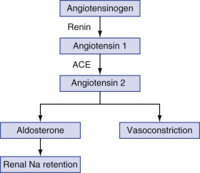

Figure 20-11 

The renin-angiotensin system. 

It is interesting to note that ACE also inactivates bradykinin (in the kallikrein-kinin system) by cleaving a dipeptide from its carboxyl terminus. Although the catalytic action of ACE is somewhat nonspecific in vitro, only angiotensin 1, bradykinin, and the hemoregulatory peptide Ac-DSKP are definite in vivo substrates (  Macours et al, 2004  ). Because angiotensin 2 induces increased blood pressure, and because it is produced uniquely by the activity of ACE, the latter enzyme is a major target of competitively inhibiting drugs in the treatment of hypertension. 

ACE consists of a single polypeptide chain, with two homologous, zinc-binding catalytic sites (ACE is a zinc-metalloprotease). Enzyme activity is lost if zinc is bound to a chelating agent, such as EDTA, or is replaced by a different cation. It is important to note that ACE, similar to HIV protease, as discussed earlier, is an aspartic acid protease; that is, two Asp residues are involved in catalysis at each active site. In cells, ACE is a transmembrane protein with a large amino-terminal extracellular domain, a very short hydrophobic transmembrane domain, and a small intracellular carboxyl-terminal domain; the cell-bound molecule is referred to as tissue ACE. The two catalytic sites are present in the extracellular domain: one near the amino terminus and one nearer the carboxyl terminus. The carboxyl-terminal active site is thought to harbor the predominant angiotensin 1 hydrolytic activity, and the amino-terminal active site has activity against bradykinin. Proteolytic cleavage releases the functional enzyme from the cell membrane into the extracellular environment, producing circulating ACE. 

The majority of ACE is tissue bound (>90%), with much lower levels circulating in plasma. ACE is found predominantly in endothelial cell membranes throughout the body. The lungs and the testes are particularly rich in ACE. Information on the molecular biology and structure of ACE is available (  Dzau et al, 2002  ;  Macours et al, 2004  ). There appear to be two distinct forms of ACE: a somatic form (sACE) and a smaller isoform found in testes (tACE). A single gene encodes both forms by utilizing alternative promoters. sACE is found in many tissues and contains two active sites (as described previously); tACE contains only the C-terminal active site and is exclusively found in testes. Although both active sites of sACE require zinc ion, their biochemical properties are not identical (  Dzau et al, 2002  ;  Macours et al, 2004  ). 

 

##  The Design of ACE Inhibitors 

As mentioned earlier, ACE is a critical target for inhibitory drugs designed to lower blood pressure. Because ACE and HIV protease are Asp proteases, many of the considerations used for the design of these inhibitors were subsequently used in the design of HIV protease inhibitors, as discussed earlier. It was known that the nonapeptide teprotide, from the snake _Bothrops jararaca_ whose sequence is Glu-Trp-Pro-Arg-Pro-Gln-Ile-Pro-Pro, was a potent antihypertensive that acted by competitively inhibiting ACE (  Crantz et al, 1980  ). This was the first effective therapeutic ACE inhibitor, but it could not be given orally because of its hydrolysis in the stomach and the gut. Because it was known that there was a critical positively charged Arg residue in the active site, in addition to the positively charged Zn ion, and that the enzyme had a high affinity for Phe and Pro residues, the inhibitor succinyl proline was developed. The affinity of this inhibitor was greatly enhanced if the carboxylate of the succinic acid moiety was replaced with a thiol that had a high affinity for the bound Zn ions. This resulted in the synthesis of 3-mercapto-2-methylpropanoyl-  l  -proline, also called _captopril,_ a highly effective agent that, however, had several undesirable side effects such as skin rash and loss of taste (  Cushman & Ondetti, 1991  ). In addition, Phe-containing tripeptides that contained carboxylate groups were synthesized, allowing for tight binding to the active site and to Zn concurrently (i.e., enalapril and lisinopril—both effective agents). In addition, transition state analog inhibitors, such as the ones discussed for HIV protease, have been developed (  Dive, 2004  ;  Gerogiadis et al, 2004  ;  Redelinghuys et al, 2006  ). Several contain modified Phe as seen in the HIV protease inhibitors, except that they also contain nonhydro­lyzable tetrahedral phosphinic acid in place of the normally occurring backbone carbonyl group. Several of these inhibitors inhibit the carboxyl-terminal active site preferentially, making them good antihypertensive agents, because it is this active site that predominantly hydrolyzes angiotensin 1. At the same time, considerable bradykinin hydrolytic activity still occurs in the amino-terminal active site; this is considered desirable in that bradykinin itself induces vasodilation and angioedema and can compound the lowering of blood pressure; this can result in some cases in induction of hypotension, an undesirable side effect. 

 

##  Reference Ranges and Preanalytic Variation 

ACE activity is higher in children than in adults; during adolescence, values are higher in boys than in girls (  Beneteau-Burnat et al, 1990  ), gradually falling to adult levels by 18 years of age. Men and women have the same values, although not all studies show this pattern. ACE appears to be cleared by the liver; the half-life in plasma is roughly 48 hours. Average day-to-day variation is less than 10%, with no diurnal variation (  Thompson et al, 1986  ). 

A number of other factors affect ACE levels. Smokers have ACE activities about 30% lower than in nonsmokers or former smokers who have stopped smoking for at least 10 years (  Ninomiya et al, 1987  ). Thyroid hormone stimulates ACE synthesis. Postmenopausal estrogen replacement causes a 20% fall in ACE activity in serum (  Proudler et al, 1995  ). Rare families lack an endogenous inhibitor of ACE activity and, consequently, have markedly elevated serum ACE levels (  Luisetti et al, 1990  ). 

 

##  Measurement 

ACE is typically measured by its ability to cleave synthetic peptides, releasing hippuric acid (Hip) or other indicator molecules as in the following reaction: 

 Hip-L-His-L-Leu  \+  H  2  O  → Hip  \+  L-His-L-Leu 

Hip is then extracted, and its absorption is measured at 228 nm. A modification of the assay is required in CSF samples because of their much lower ACE activity (  Oksanen et al, 1985  ). 

 

##  Causes of Abnormal Results 

The most common reason for ordering ACE levels involves the diagnosis and monitoring of sarcoidosis. In general, ACE levels are directly related to the number of organs affected (  Muthuswamy et al, 1987  ) and the activity of granulomas; mature granulomas tend to produce less ACE than developing ones (  Mimori, 1998  ). In sarcoidosis, a general correlation has been noted between disease activity and ACE levels (  Gupta et al, 1992  ); as disease progresses to fibrosis, ACE levels decline. ACE is more likely to be elevated with pulmonary involvement than with purely hilar adenopathy. ACE is also increased in many other granulomatous diseases, although not as frequently as in sarcoidosis. Although most individuals with sarcoidosis have elevated ACE, the frequency of elevation of ACE in other granulomatous disorders is 10% (  Studdy et al, 1978  ). For this reason, ACE is not usually considered a diagnostic test, although it may be helpful in patients with primarily ocular involvement, in whom biopsy cannot be readily performed (  Power et al, 1995  ). 

ACE is frequently elevated in a number of other disorders, including multiple sclerosis (  Constantinescu et al, 1997  ), Addison's disease (  Falezza et al, 1985  ), hyperthyroidism (  Reiners et al, 1988  ), diabetes mellitus (  Schernthaner et al, 1984  ), alcoholic hepatitis (  Borowsky et al, 1982  ), peptic ulcer (  D'Onofrio et al, 1984  ), and nephrotic syndrome (  Huskic et al, 1996  ), and at various stages in patients with bacterial (  Kerttula & Weber, 1986  ) or _Pneumocystis_ pneumonitis (  Singer et al, 1989  ). Other pulmonary disorders with a significantly increased ACE are emphysema, asthma, small cell carcinoma, and squamous cell carcinoma (  Ucar et al, 1997  ). In chronic renal failure, it is increased only in those on hemodialysis and rises during the course of a dialysis procedure (  Docci et al, 1988  ); it is decreased in those with chronic renal failure who are not on dialysis (  Le Treut et al, 1983  ). In HIV infection, the frequency and degree of elevation correlate with stage of disease (  Ouellette et al, 1992  ). Decreased ACE levels are seen in various malignancies (  Romer & Emmertsen, 1980  ;  Schweisfurth et al, 1985  ), in chronic liver disease (  Sakata et al, 1991  ), in anorexia nervosa (  Matsubayashi et al, 1988  ), and in hypothyroidism (  Reiners et al, 1988  ). 

Use of CSF ACE levels for diagnosis and monitoring of neurosarcoidosis has been criticized (  Dale & O'Brien, 1999  ). A number of other diseases cause elevated CSF ACE, among them viral encephalitis, multiple sclerosis, and central nervous system (CNS) syphilis (  Schweisfurth et al, 1987  ). 

In all cases of assays for ACE, attention should be paid to the possible use of ACE inhibitors in hypertensive patients. Because virtually all ACE inhibitors are competitive inhibitors, if competitive inhibition is suspected, use of higher concentrations of Hip-His-Leu substrate in the ACE assay can be used to overcome the inhibition. Alternatively, the sample can be diluted to remove the effect of the inhibitor. Assays for the levels of ACE inhibitors such as captopril have been developed (  Prior et al, 2007  ). 

 

##  Acetylcholinesterase (EC 3.1.1.7) and Butyrylcholinesterase (EC 3.1.1.8) 

 

##  Biochemistry and Physiology 

AChE (true cholinesterase or choline esterase I) and PChE (or choline esterase II) are carboxylic ester hydrolases (class 3; see [ Table 20-1 ](<#t0010>) ) that have different specificities (  Abdallah & Udomtecha, 2007  ). AChE catalyzes the following reaction: 

 Acetylcholine  \+  H  2  O  → Choline  \+  Acetate 

PChE catalyzes this reaction: 

 Acylcholine  \+  H  2  O  → Choline  \+  Carboxylate 

AChE and PChE are two different enzymes produced by different tissues that are able to cleave acetylcholine, one of the body's major neurotransmitters. True cholinesterase has acetylcholine (ACh) as its primary natural substrate and is also inhibited by it at approximately 10  –2  mole/L; it is found in high activity in the CNS, RBCs, lung, and spleen. ACh is a primary neurotransmitter at various sites in the CNS, and AChE rapidly hydrolyzes ACh, producing rapid termination of neurotransmission. AChE is not normally found in amniotic fluid. 

The normal function of the enzyme found in serum, PChE (also called _acetylcholine acylhydrolase_ ), is not known, but it is important in the cleavage of acetylcholine antagonists such as succinylcholine and mivacurium, muscle relaxants used during surgery. Serum PChE is not subject to substrate inhibition by high levels of ACh. PChE production occurs primarily in the liver, although other tissues, such as myocardium and pancreas, can also produce it. Although both enzymes hydrolyze acetylcholine, AChE, but not PChE, hydrolyzes acetyl-β-methylcholine; conversely, PChE, but not AChE, hydrolyzes butyryl- and benzoylcholine. 

A number of genetic variants of PChE have reduced affinity (higher K  M  ) for acetylcholine, as well as for competitive inhibitors such as dibucaine and fluoride, when compared with the common U (usual) form; these are termed _A_ (for atypical), _F_ (for fluoride resistant), and _S_ (for silent). The S variant actually represents a number of mutations that may cause absence of enzymatic activity or absence of PChE synthesis. Heterozygous deficiency is found in about 4% of the population, and homozygous deficiency affects 0.3% to 0.5% of individuals. These variants cause decreased (or, in the case of the _S_ variant, absent) PChE activity when present in homozygous or mixed heterozygous forms (AA, AF, AS, FF, FS, SS). Because of the broad range of normal values, reduced PChE activity is not usually found in U-form heterozygotes. 

Another way to detect such variants is to measure the percent of enzyme activity remaining after in vitro incubation of serum enzyme with dibucaine or fluoride (termed _dibucaine number,_ or _DN,_ and _fluoride number,_ respectively). As mentioned previously, increased K  M  of variants produces less effective catalysis than normal; decreased affinity thus exists for dibucaine and fluoride, making these variants more resistant to inhibition than normal. In general, dibucaine inhibits U plasma cholinesterase activity by approximately 70% to 90%. Variant cholinesterase activity is more resistant to inhibition, such that heterozygote activity is inhibited by approximately 50% to 70%, and homozygous variant activity is inhibited by approximately 10% to 30%. The DN will then reflect percentage inhibition of enzyme activity and will give a rough measure of the enzyme's activity; this in turn will indicate the presence or the absence of a variant form of the enzyme. The DN is calculated using the formula in [ Equation 20-42 ](<#e0215>) . For example, the UU form may show 85% inhibition, or 15% remaining activity, and may yield a DN of 85. 

 Dibucaine  (  fluoride  )  number  =  100  × (  1  − Enzyme activity with inhibitor  /  Enzyme  activity without inhibitor  ) 

Newer molecular biology techniques, such as the use of polymerase chain amplification with separation of the reaction products by gel electrophoresis (  Cerf et al, 2002  ), allow much more accurate identification of variants, as compared with traditional biochemical analysis. 

 

##  Pseudocholinesterase as an Anti-Xenobiotic Enzyme 

In addition to its involvement in the metabolism of anticholinergic drugs, PChE has been found to catalyze the debenzoylation of cocaine (  Duysen et al, 2008  ;  Yang et al, 2009  ) and the hydrolysis of procaine (  Duysen et al, 2008  ). Although catalysis by PChE of debenzoylation of cocaine is inefficient, absence of this enzyme or mutations that reduce its activity, discussed in the preceding section, can prolong and exacerbate the negative effects of cocaine such as its cardiotoxicity (  Duysen et al, 2008  ). It is interesting to note that recently, based on transition state theory analysis and molecular modeling of this enzyme bound to cocaine, site-specific mutagenesis of the gene encoding this enzyme has resulted in a form of PChE that efficiently debenzoylates cocaine (  Yang et al, 2009  ). Humanized forms of this engineered enzyme may prove to have significant therapeutic value. 

 

##  Reference Ranges and Preanalytic Variation 

PChE values are low in infants and gradually rise to adult levels by 4 months of age (  Karlsen et al, 1981  ). Values in men do not change after this point until 45 years of age; in women, they fall by about 10% at menarche and increase by 15% after menopause. A recent study (  Abou-Hatab et al, 2001  ) found no significant correlation between older patient age and changes in plasma enzyme activities of AChE and PChE; healthy young and older individuals (study age range, 18–85 years) showed similar enzyme activities. Values in men are about 15% to 20% higher than in women until 45 years of age, when values in women become equal. Oral contraceptives cause a decrease of about 15% in PChE activity (  Lepage et al, 1985  ). About a fourfold range of values is seen in normal individuals. Increased body mass index is associated with an increase in PChE, and low protein intake leads to decreased PChE. 

The half-life of PChE has been estimated at between 2 and 10 days. Average day-to-day variation is about 7% (  Moses et al, 1986  )—much smaller than that for most other enzymes. 

 

##  Measurement 

Enzyme activity is typically measured using an acylthiocholine ester as a substrate; released thiocholine reacts with Ellman's reagent (dithiobisnitrobenzoic acid), releasing 5-mercapto-2-nitrobenzoic acid, which is measured spectrophotometrically. Pseudocholinesterase activity is measured in serum, and AChE activity is measured in a hemolysate of washed RBCs. AChE may also be determined in amniotic fluid by gel electrophoresis. To measure dibucaine or fluoride numbers, serum is incubated with dibucaine (30 µmol/L) or fluoride (4 mmol/L) in the assay reaction mixture. 

 

##  Causes of Abnormal Results 

The main reasons for measuring PChE are (1) to monitor exposure to cholinesterase inhibitors, (2) for use as a liver function test, or (3) for diagnosis of genetic variants. Organophosphate insecticides are irreversible inhibitors of both AChE and PChE, although typically PChE plasma activity falls before AChE activity in RBCs with poisoning (  Areekul et al, 1981  ). Because of small individual variation and large interindividual variation in PChE values, it is advisable to obtain baseline values for PChE before individuals are exposed to organophosphates (  Trundle & Marcial, 1988  ). A decrease of 40% from baseline is needed before symptoms develop, and severe symptoms typically occur with falls in values greater than 80%; thus, symptoms often occur with PChE values within the reference range. If no baseline values are present, serial determinations are helpful. In one study, 90% of symptomatic organophosphate poisonings were associated with PChE values within the reference range, and postexposure levels showed a rise, confirming toxicity (  Coye et al, 1987  ). Although PChE reflects acute toxicity, AChE (RBCs) better reflects chronic exposure. 

In contrast to other hepatocyte enzymes, PChE production by the liver appears to reflect synthetic function rather than hepatocyte injury. Levels of PChE are decreased in acute hepatitis, cirrhosis, and carcinoma metastatic to liver. PChE is decreased in malnutrition but is normal or increased in nephrotic syndrome. As is the case when monitoring organophosphate exposure, changes in values compared with baseline are more useful than single values, limiting the diagnostic usefulness of PChE as a nutritional or liver injury monitor. 

The other common use of PChE measurements is in recognizing the presence of genetic variants. Most commonly, such testing involves family members of individuals who have prolonged apnea after use of succinylcholine or mivacurium (neuromuscular blocking agents/muscle relaxants) during anesthesia. Testing typically involves both total PChE and determination of fluoride and dibucaine numbers to recognize homozygous or compound heterozygous variants that put an individual at risk from exposure to cholinesterase inhibitors. Patients at risk (with variant cholinesterase forms) may more slowly hydrolyze the neuromuscular blocking agent, unexpectedly increasing the duration of respiratory muscle relaxation and prolonging apnea. This is in contrast to the usual rapid drug hydrolysis seen with the U forms, leading to rapid recovery of the patient. 

As mentioned previously, measurement of RBC AChE is useful in organophosphate exposure and poisoning. In addition, qualitative analysis of AChE in amniotic fluid may be useful in the diagnosis of neural tube defects, especially in high-risk groups (  Muller, 2003  ). AChE can be identified in amniotic fluid from pregnancies with neural tube defects, as well as some other types of birth defects. AChE is absent in amniotic fluid from normal pregnancies. More recently, PChE (butyrylcholinesterase) has been found to have a strong inverse relationship to long-term survival in patients diagnosed with coronary artery disease (CAD) (  Goliasch et al, 2012  ). 

 

##  Lactate Dehydrogenase (EC 1.1.1.27) 

 

##  Biochemistry and Physiology 

LD is a class 1 enzyme (oxidoreductase; see [ Table 20-1 ](<#t0010>) ) that acts on a CH–OH group of donors with NAD  \+  as acceptor and catalyzes the transfer of hydrogen in the form of a hydride ion: 

 (  L  )  -Lactate  \+  NAD  \+  ↔ Pyruvate  \+  NADH  \+  H  \+ 

The enzyme is also capable of oxidizing other (L)-2-hydroxymonocarboxylic acids. 

LD is a zinc-containing enzyme that is part of the glycolytic pathway; it is found in the cytoplasm of all cells and tissues in the body. LD is a tetramer of two active subunits: H and M with a molecular weight of 134 kDa. Combinations of subunits produce five isoenzymes ranging from LD  1  (HHHH) to LD  5  (MMMM); the intermediate isoenzymes contain differing combinations of H and M subunits (LD  2  , HHHM; LD  3  , HHMM; LD  4  , HMMM). Inherited forms of deficiency of H (  Joukyuu et al, 1989  ) and M (  Kanno et al, 1980  ), subunits of LD, are associated with low LD levels in plasma and only one isoenzyme on electrophoresis. Another form of LD composed of four C subunits is found in spermatozoa and in semen but has never been detected in serum, even in individuals with seminoma (  Vogelzang et al, 1982  ). Rarely, another band detected in electrophoresis and termed **LD 6  ** can be seen; this probably represents alcohol dehydrogenase, which can also metabolize lactate (  Kato et al, 1984  ). LD  1  and LD  2  have lower K  M  s (higher affinities) for lactate than for pyruvate, and the reverse is true for LD  4  and LD  5  . 

The tissue distribution of LD varies primarily in its isoenzyme composition, not in its content of LD (see [ Table 20-5 ](<#t0030>) ). It is important to note that LD  1  and LD  2  are expressed at high levels in myocardial tissue and in erythrocytes and at much lower levels in tissues such as liver and muscle; the reverse is true for LD  4  and LD  5  . In myocardial damage, the predominant isozymes that become elevated in serum are LD  1  and LD  2  ; in liver or skeletal muscle disease, the LD  4  and LD  5  isozymes become elevated predominantly in serum. In contrast to enzymes such as AST, ALT, and CK, which show marked variation in enzyme activity between tissues, the range in values for LD is only about 1.5-fold between those with the highest amounts (such as liver) and those with lower amounts (such as kidney); most tissues have LD activities that are 500 to 1000 times greater in tissue than those found in normal serum (see [ Table 20-5 ](<#t0030>) ). Thus, significant elevation of plasma levels occurs with a small amount of tissue damage/breakdown. The tissue distribution of LD isoenzymes is shown in [ Table 20-7 ](<#t0040>) . The specific composition of elevated isoenzyme levels found in plasma will reflect tissue origin. In plasma, the majority of LD comes from breakdown of erythrocytes and platelets, with varying contributions from other organs. LD is apparently eliminated in bile, as injection of radiolabeled LD results in radioactivity in the gallbladder and small intestine (  Smith et al, 1988  ). 

TABLE 20-7 

Relative Percentage of LD Isoenzymes in Various Tissues 

Tissue  |  LD  1  |  LD  2  |  LD  3  |  LD  4  |  LD  5   
---|---|---|---|---|---  
Serum  |  25  |  35  |  20  |  15  |  5   
Heart  |  45  |  40  |  10  |  5  |  0   
Red blood cells  |  40  |  35  |  15  |  10  |  0   
Renal cortex  |  35  |  30  |  25  |  20  |  0   
Lung  |  10  |  15  |  40  |  30  |  5   
Skeletal muscle  |  0  |  0  |  10  |  30  |  60   
Liver  |  0  |  5  |  10  |  15  |  70   
  
_LD,_ Lactate dehydrogenase. 

 

##  Reference Ranges and Preanalytic Variation 

LD values are highest in newborns and infants; values do not change with age in adults, and there is no gender difference. Persons older than 65 years of age tend to have slightly higher values. Exercise causes, at most, slight increases in total LD; even strenuous exercise causes only a 25% rise in average values (  Tanada et al, 1993  ). Even trace to slight hemolysis invalidates LD and LD isoenzyme analyses. Contact with the clot increases LD, and physical agitation of specimens, as occurs in most pneumatic tube systems, tends to cause some hemolysis and increased LD. Hemolysis affects both total LD and the LD  1  /LD  2  ratio. Exercise has little effect on LD or its isoenzymes. Extreme exercise can cause LD  1  to become greater than LD  2  . Total LD increases transiently after blood transfusion but returns to baseline within 24 hours (  Wiesen et al, 1998  ). Delayed separation of red blood cells from serum does not affect LD values for 1 to 2 days. Few drugs directly affect LD activity, but granulocyte-macrophage colony-stimulating factor appears to increase LD in parallel to the increase in white blood cell (WBC) count (  Sarris et al, 1995  ). 

The half-life of LD isoenzymes varies greatly, from approximately 4 to  days for LD  1  to 4 to 6 hours for LD  5  . Day-to-day variation of LD is only 5% to 10%. 

 

##  Measurement 

LD activity can be measured using either the forward (lactate-to-pyruvate) or the reverse (pyruvate-to-lactate) direction of the reaction. A vast majority of laboratories use the forward reaction; the reverse reaction, predominantly used in the dry slide method for LD, produces activities that have good correlation with the forward reaction but at measured activities approximately threefold higher. This underscores the point made earlier—if total activity units are reported, it is vital to list the substrate and to provide the reference range for that substrate. 

The reverse (pyruvate-to-lactate) reaction is used in a few laboratories currently because of faster reaction kinetics, the less costly cofactor (NADH) needed, and the smaller specimen volume requirement. Disadvantages of the pyruvate-to-lactate reaction include early loss of linearity of reaction kinetics, the effect of potent LD inhibitors in some NADH preparations, and use of suboptimal concentrations of pyruvate because of substrate inhibition. Also, lactate is a more specific substrate for this enzyme; pyruvate is less specific and serves as a substrate for such enzymes as pyruvate dehydrogenase. 

Electrophoretic separation of LD isoenzymes is typically used when quantitation of different isoenzymes is required; agarose gel is most commonly used. Quantitation usually uses the forward reaction, allowing detection of fluorescent NADH or a reduced formazan dye in a colorimetric development step. The electrophoretic support and developing agent affect the results, and the reference ranges for the different methods are not the same. Inhibition methods for LD  1  are also available but allow quantitation only of this isoenzyme; results are often expressed as the ratio of LD  1  to total LD. Hydroxybutyrate is preferentially cleaved by the LD  1  isoenzyme; until the early 1970s, measurement of **hydroxybutyrate dehydrogenase** was used as a diagnostic test for myocardial infarction. 

Serum LD is, on average, 30 IU/L higher than plasma LD, owing to release of LD from platelets. With prolonged incubation of plasma containing platelets (separated at <1200 _g_ centrifugation), LD can leak from damaged platelets, increasing plasma LD as well (  Hollaar & Van der Laarse, 1979  ). LD is not stable on storage at 4° C because of cold lability of LD  5  . Specimens can be stored for up to 24 hours at room temperature with little change. Three days of storage at room temperature decreases total LD by about 20%, increases apparent LD  1  by 20%, and decreases apparent LD  5  by 18%. If specimens are frozen, LD  5  decreases significantly and the isoenzyme pattern shifts with an artifactual increase in LD  1  and decrease in LD  5  . Serum should not be frozen for assay of LD or for its isoenzymes. 

 

##  Causes of Abnormal Results 

LD is a highly nonspecific test; an abnormal value is not specific for damage to any particular organ. Relative amounts of LD, AST, and ALT (along with CK) may provide clues to the source of LD elevation. If LD is markedly elevated, but AST, ALT, and CK are normal or minimally increased, this suggests damage to cells such as red or white blood cells, kidney, lung, lymph nodes, or tumors. Increases in both CK and LD, with greater increases in AST than ALT, occur with cardiac or skeletal muscle injury. Increases in LD occur in liver disease, and LD can be elevated in hepatitis, although these increases by themselves are not specific to liver injury (  Cassidy & Reynolds, 1994  ). Recently, it was found that in fulminant hepatic failure (see [ Chapters 8 ](<##!/content/3-s2.0-B9780323295680000085?scrollTo=%23c00008>) and [ 21 ](<##!/content/3-s2.0-B9780323295680000218?scrollTo=%23c00021>) ), the serum levels of ALT and LD both increase such that LD increases more rapidly initially. An ALT-LD index has been computed in these patients and was found to be a reliable predictor of survival in patients with this condition (  Kotoh et al, 2008  ). As discussed in [ Chapters 8 ](<##!/content/3-s2.0-B9780323295680000085?scrollTo=%23c00008>) and [ 21 ](<##!/content/3-s2.0-B9780323295680000218?scrollTo=%23c00021>) , serum elevations of LD and ALP frequently occur in space-occupying lesions of the liver; most cases are identified as metastatic carcinoma or primary hepatocellular carcinoma. 

In many conditions, such as shock and metastatic carcinoma, LD is increased because of damage to multiple organs, so that mixed patterns can be seen. Marked elevations of LD (>5 to 10 times normal) are seen in megaloblastic anemia, hemolytic anemias, advanced malignancies (particularly lymphoma and leukemia), sepsis or other causes of shock, and cardiopulmonary arrest. LD is often moderately elevated in _Pneumocystis carinii_ pneumonia (  Smith et al, 1988  ) but is often normal in most other forms of pneumonia (  Rotenberg et al, 1988  ). Although LD is highly sensitive (so that normal values make the diagnosis unlikely) (  Quist & Hill, 1995  ), the predictive value of LD is not adequate to establish a diagnosis in an HIV patient (  Grover et al, 1992  ). In patients with biliary pancreatitis (inflammation due to gallstones impacted in the bile duct), the LD/AST ratio is elevated, which appears to indicate the presence of pancreatic necrosis (  Isogai et al, 1998  ). Note that 10% to 20% of patients with biliary pancreatitis may present with normal liver function tests (  Dholakia et al, 2004  ). 

In cases in which the cause of elevated LD cannot be determined by other means, LD isoenzymes may be useful in determining the source of injury. In normal serum, the LD isoenzymes, in decreasing order of activity, are 2 > 1 > 3 > 4 > 5\. In germ cell tumors (particularly seminoma and dysgerminoma), LD  1  is increased and can serve as a tumor marker (von  Eyben et al, 2000  ; von  Eyben, 2001  ). 

As noted in [ Chapter 18 ](<##!/content/3-s2.0-B9780323295680000188?scrollTo=%23c00018>) on cardiac function, LD increases in serum over about a 36-hour period, during which time the LD  1  /LD  2  ratio, which is normally less than 1, increases to values of 1 or above, the so-called _flipped ratio._ This confirmed the diagnosis of myocardial infarction (MI) but could not be used to make acute diagnoses of MI because of the prolonged time (36 hours) required for the flipped ratio to develop. As discussed in [ Chapter 18 ](<##!/content/3-s2.0-B9780323295680000188?scrollTo=%23c00018>) , better biomarkers, specifically the inhibitory subunit of troponin, are available for the acute diagnosis of MI and for confirmation of the diagnosis (serum troponin levels remain elevated for longer than 1 week after the acute event). Also, hemolytic anemia, megaloblastic anemia, and renal cortical diseases such as renal infarcts and renal cell carcinoma cause increases in LD  1  and, often, a flipped LD  1  /LD  2  ratio. In tumors of WBCs (leukemia, lymphoma, multiple myeloma) LD  3  and often LD  4  are typically increased, whereas the relative amounts of LD  1  and LD  2  are decreased (  Ricerca et al, 1988  ;  Copur et al, 1989  ;  Pandit et al, 1990  ). Pulmonary disease can produce a similar pattern. Increases in LD  5  and sometimes LD  4  are typically seen with skeletal muscle injury or with ischemic or toxic hepatic injury. The presence of LD  6  is associated with a poor prognosis (  Ketchum et al, 1984  ). An isomorphic pattern, in which total LD is increased but isoenzymes are present in normal proportions, and a **tombstone** pattern, seen when the relative amount of each isoenzyme is roughly the same, are typically noted in persons with diffuse tissue damage, often accompanied by shock or hypoxemia. 

More recently, serum LDH levels have been used in cancers as an important prognostic factor, as with prediction of response to therapy in multiple myeloma (  Moreau et al, 2014  ) (high levels indicating lower likelihood of response to specific therapy) and overall survival in metastatic melanoma (  Kelderman, 2014  ), with high levels indicating a worse prognosis. Interestingly, LDH levels have been useful in evaluating pulmonary damage induced by silicate exposure in agate workers wherein the ratio of serum to red blood cell LDH was much higher for exposed workers than for a non-exposed control group (  Aggarwal, 2014  ). In patients who have undergone radiotherapy for prostate cancer, elevated LD  5  levels have been found to be strongly indicative of high tumor proliferation rates and relapse following radiotherapy (  Koukourakis et al, 2014  ). 

 

##  5′-Nucleotidase (EC 3.1.3.5) 

 

##  Biochemistry and Physiology 

5′-NT is a phosphoric monoester hydrolase (class 3 enzyme; see [ Table 20-1 ](<#t0010>) ), also known as 5′-ribonucleotide phosphohydrolase, which catalyzes the following reaction: 

 5  ′ -Ribonucleotide  \+  H  2  O  → Ribonucleoside  \+  Phosphate 

It is a cytoplasmic membrane–bound phosphatase with a wide specificity for 5′-ribonucleotides and a molecular weight of about 70 kDa. It acts only on nucleotides (such as adenosine 5′-monophosphate and guanosine 5′-monophosphate) and is believed to function in extracellular adenosine production, nutrient absorption, and cell proliferation. 5′-NT is a metalloprotein, and zinc is believed to be an integral part of the enzyme. It is widely distributed in the body, predominantly attached to cell membranes (similar to ALP and GGT). Plasma 5′-NT is derived predominantly from the liver. A detailed review of 5′-NT is available (  Sunderman, 1990  ). 

 

##  Reference Ranges and Preanalytic Variation 

5′-NT is normally present at low activities in children, rises in adolescence, and plateaus until 40 years of age, when levels increase significantly (  Moses et al, 1986  ); reference values are independent of gender and race. A slight increase in 5′-NT is seen during the second and third trimesters of pregnancy (  Bacq et al, 1996  ). Similar to ALP and GGT, antiepileptic drugs can increase 5′-NT activity; however, values are usually less than twice the reference limits, and less than 25% of those taking such agents show elevated 5′-NT activity (  Fortman & Witte, 1985  ). 

 

##  Measurement 

Measurement of 5′-NT is difficult because other phosphatases, notably ALP, are capable of cleaving the substrate used to measure the lower activity of 5′-NT present in the sample. Approaches usually utilize large quantities of other, nonnucleoside substrates to “competitively inhibit” ALP (although they are actually undergoing reactions catalyzed by ALP, they prevent ALP from acting on nucleotide phosphates). Although it would be simplest to measure generated phosphate, this cannot be done because cleavage of other phosphates by ALP would produce incorrect results. Therefore, measurement of the nucleoside released by the action of 5′-NT is required. Most chelating agents such as EDTA inhibit enzyme activity, presumably by making zinc unavailable. 

 

##  Causes of Abnormal Results 

Similar to GGT, 5′-NT is most commonly used to determine whether the source of an elevated ALP is liver or bone. Although 5′-NT is more commonly elevated in cholestatic disorders, acute hepatitis causes an increase in 5′-NT synthesis by the liver and a slight elevation in 5′-NT in plasma (  Fukano et al, 1990  ). 5′-NT is increased in ovarian carcinoma (  Chatterjee et al, 1981  ) and in rheumatoid arthritis, where levels correlate with extent of inflammation as reflected by erythrocyte sedimentation rate (  Johnson et al, 1999  ).  Sapey and colleagues (2000)  prospectively studied ALP, GGT, and 5′-NT in 80 cholestatic patients, correlating intrahepatic (i.e., secondary to intrahepatic parenchymal disease) and extrahepatic (i.e., secondary to biliary tree obstruction) causes with enzyme changes. They found markedly increased levels with extrahepatic causes (compared with intrahepatic disease) and noted that elevations in GGT and 5′-NT levels were independently linked to cause. The GGT/5′-NT ratio differed significantly between the two groups, with a ratio <1.9 highly suggestive of (but insensitive to) intrahepatic disease (  Sapey et al, 2000  ). 

 

##  Skeletal Muscle Injury: Creatine Phosphokinase (CK) 

The basic assay for this enzyme was discussed earlier (see [ Equations 20-15 to 20-17 ](<#e0080>) ). The cytosolic form of this enzyme has two major isoenzymes, M and B, each of which has the same activity. CK is composed of three types of dimers: MM (mainly in skeletal muscle), MB (found mainly in cardiac tissue), and BB (found predominantly in brain and intestine). There are also two other forms of CK, the intramitochondrial forms, termed _MtCK, non-muscle_ or _ubiquitous MtCK_ and _sarcomeric muscle CK._ MtCK is a supplier of phosphocreatine that shuttles to the cytosol where it is used to drive various cellular processes by inducing synthesis of ATP that is used as an energy source serving as a substrate for cytosolic ATPases (  Wallimann et al, 1992  ). 

As discussed at length in [ Chapter 18 ](<##!/content/3-s2.0-B9780323295680000188?scrollTo=%23c00018>) , because CK-MB is found mainly in myocardial tissue, CK-MB is used as a serodiagnostic test for MI. In this section, CK is discussed as a biomarker for skeletal muscle injury. 

Skeletal muscle injury can occur from a variety of sources. Direct trauma, as occurs with physical injury (including contact sports), surgery, strenuous exercise, and intramuscular injection, are common causes of mild elevations of CK (up to about five to six times reference limits). In these situations, CK typically increases rapidly and then falls quickly, returning to baseline with a half-life of approximately 24 hours. An important clinical disorder associated with acute muscle injury is neuroleptic malignant syndrome, a rare complication of treatment with phenothiazines or other psychotropic agents. Typically, affected individuals present with muscle rigidity, fever, and elevated WBC counts; CK is considered a diagnostic test for this disorder. Prompt recognition and treatment are necessary to prevent death from this syndrome; discontinuation of medications and use of the muscle-stabilizing agent dantrolene are the cornerstones of treatment (  Pelonero et al, 1998  ). 

Chronic damage to muscle causes more persistent elevation of CK, which may be mild or more extensive. The broad range of normal values and the preanalytic variation seen in total CK values can hamper recognition of mild, ongoing muscle injury. Generally, persistent elevation above the reference limits for an appropriate comparison group despite cessation of any other factors known to affect CK is needed to diagnose muscle injury in asymptomatic individuals. Common causes of chronic muscle injury include medications (particularly 3-hydroxy-3-methylglutaryl-coenzyme A reductase inhibitors and glucocorticoids), congenital myopathies (such as Duchenne's muscular dystrophy), inflammatory disorders (such as polymyositis and dermatomyositis), hypothyroidism, and alcohol abuse. In chronic myopathies, CK-MB is often increased, reflecting its production by regenerating muscle. 

With severe acute damage to muscle, a clinical picture termed _rhabdomyolysis_ may develop. In such situations, CK-MB/total CK may be elevated above normal, in the absence of myocardial infarction (cardiac troponin levels are normal); this is commonly seen in patients with inflammatory muscle disease (  Kiely et al, 2000  ). In addition to normal cardiac troponin levels with elevated CK levels, two distinct isoforms (representing fast or slow skeletal fiber types) of serum skeletal troponin I may be identified (  Simpson et al, 2002  ). 

No specific criteria are known for differentiating rhabdomyolysis from lesser degrees of muscle injury; among the more important features are the higher total CK (one suggested diagnostic level is CK >20 times upper reference limits), the rapid rise and fall of CK, and the appearance of myoglobinuria. Many assays for myoglobin (found in skeletal, smooth, and cardiac muscle) are relatively insensitive, and myoglobin has a short half-life; thus, CK is a more reliable test for establishing the diagnosis. As a form of **cell lysis syndrome,** rhabdomyolysis is associated with the release of other cell contents, such as potassium, phosphate, and nucleotides that can be converted to uric acid. Qualitative testing for myoglobin in the urine is important because myoglobin is potentially toxic to the kidneys, and the patient is at risk for acute renal failure. Myoglobinuria may lead to the development of acute tubular necrosis, with the appearance of pigmented casts in the urine sediment. If renal failure develops, hyperkalemia, hyperphosphatemia, and hyperuricemia typically also will be present as described in the fourth clinical case presentation in [ Chapter 8 ](<##!/content/3-s2.0-B9780323295680000085?scrollTo=%23c00008>) . No direct relationship has been discerned between the degree of elevation of CK and the likelihood of development of renal failure (  Gabow et al, 1982  ;  Ward, 1988  ). Common causes of rhabdomyolysis include drugs (particularly ethanol and cocaine), viral infection, extreme exertion, hyperthermia, trauma including crush injuries, ischemia of the lower extremities, and inflammatory myopathy. In addition, strenuous exercise in individuals with sickle trait can result in massive rhabdomyolysis, leading to myoglobin-induced renal failure and the other sequelae discussed previously ( [ Chapter 8 ](<##!/content/3-s2.0-B9780323295680000085?scrollTo=%23c00008>) and  Mitchell, 2007  ;  Ouyang et al, 2008  ). 

In a recent study (  Enooku et al, 2014  ), elevation of serum MtCK in patients with cirrhosis or hepatitis C was found to be a reliable independent predictor of development of hepatocellular carcinoma. The cutoff value was 9 IU/L. There also appeared to be a correlation between serum MtCK levels and degree of liver fibrosis and hepatocellular damage. 

,,
