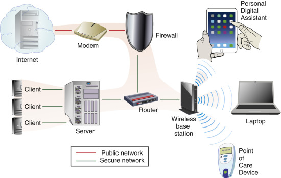
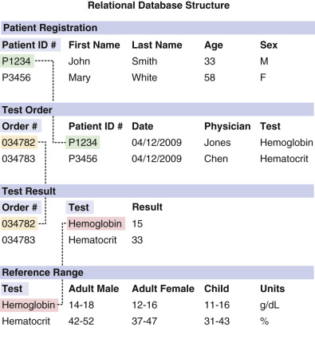
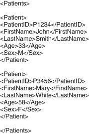
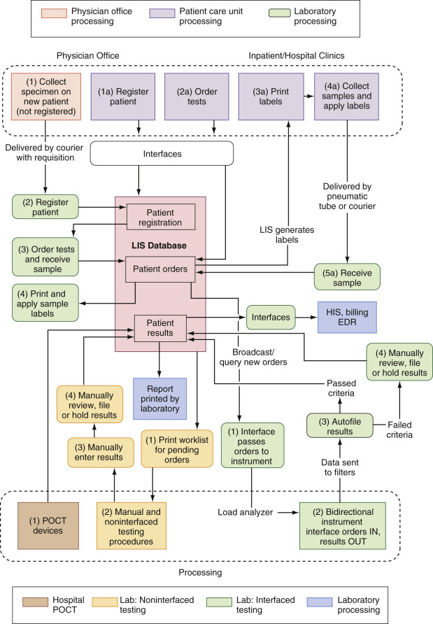
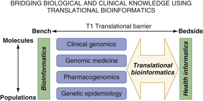

## Key Points

  * •

Certain concepts and terms specific to informatics should be familiar to pathologists working in an ever-modernizing laboratory environment. 

  * •

The laboratory information system (LIS) is typically part of a hospital or health care system network of clinical, registration, patient management, and financial systems that exchange information with one another. 

  * •

The LIS supports workflow and information flow in all steps of the laboratory testing process, including patient registration, test ordering, sample collection, testing, and reporting. 

  * •

Informatics plays a key role in assisting physicians to manage laboratory orders (e.g., clinical pathways and decision support systems) and results (e.g., clinical alerts, interpretive reports, and reflex tests). Together, these approaches maximize the usefulness of the laboratory to clinicians. 

  * •

Data exchange among diverse applications in health care depends on coding protocols for identifying procedures and medical conditions, as well as a communication language. At present, Current Procedural Terminology (CPT) is widely used to identify laboratory tests and other medical procedures, but Logical Observation Identifier Names and Codes (LOINC) is a more powerful nomenclature standard for laboratory tests. The International Classification of Diseases (ICD) is most commonly used for coding disease states, whereas the Systematized Nomenclature of Medicine (SNOMED) is also widely used in pathology and is being greatly enhanced in a new version known as SNOMED-CT. Health Level Seven (HL7) is the most prevalent communication standard in health care. 

  * •

The role of the pathologist will likely change as the field of computational pathology continues to evolve. It is focused on incorporating multiple sources of data, analyzing the information, and then presenting actionable knowledge to maximize the benefits of medical decision making. 

  * •

The website for the Association for Pathology Informatics ( [ www.pathologyinformatics.org ](<http://www.pathologyinformatics.org>) ) describes the field of pathology informatics as “[involving] collecting, examining, reporting, and storing large complex sets of data derived from tests performed in clinical laboratories, anatomic pathology laboratories, or research laboratories in order to improve patient care and enhance our understanding of disease-related processes.” The high-volume, detailed, and time-sensitive nature of the workflow in the clinical laboratory has helped push the implementation of computing technology to assist in information management. 

,  

##  Basic Informatics Concepts and Technology 

Before addressing the issues that pertain to each step in the information flow, certain basic definitions are warranted to facilitate comprehension of the technology on which this field is based. The following section is only intended to provide a brief summary of some pathology informatics concepts. Readers interested in expanding their knowledge about this field are advised to consult references that will provide a more comprehensive discussion of these topics (  Pantanowitz et al, 2012  ). 

 

##  Hardware and Software 

A _computer_ is a device that follows instructions to work with electronic data based on user input. _Hardware_ refers to the physical components of an information system. _Software_ refers to programs (which are essentially sets of instructions) that allow computers or other devices to perform tasks. 

A _file_ is a collection of data identified by a specific name and grouped related to a specific purpose. The two main types are _applications_ (also referred to as “executable” files) and _data_ files (e.g., image, text/document, sound). A _folder_ (or _directory_ ) simply refers to a collection of files. 

A _bit_ (derived from “binary digit”) is the basic unit of digital information, and the _byte_ is the most common unit of measurement used and almost always refers to 8 bits. ASCII (American Standard Code for Information Interchange) is the standard dictionary for combinations of bits that represent the common letters, numbers, and symbols by which characters are represented on a computer screen or paper printout. 

A _central processing unit_ (CPU) refers to the circuitry that serves as the main information processor and is driven by clock pulses; the speed is most commonly measured in gigahertz (1 GHz = 1 billion clock pulses per second). _Memory_ refers to the physical chips on the motherboard that hold programs and data for rapid access by CPU. The two types are read-only memory (ROM), which is permanent, and random-access memory (RAM), which is volatile (i.e., the contents of these chips are lost when the computer is turned off). 

_Storage_ refers to the physical media that store data permanently. It can be internal (hard drive) or removable (CD-ROM, USB drive). Many labs utilize drive arrays that are multiple hard drives configured to look like a single-system drive. A common type of drive array is the RAID (redundant array of independent [formerly inexpensive] disks), which simultaneously uses two or more hard disk drives to achieve greater levels of performance, reliability, and/or larger data volume sizes. Mirrored drive arrays refer to arrays where copies of files are written to each drive in the array. Different parts of the file are read simultaneously from different disks and “assembled” for delivery. This system is redundant: If one drive fails, a file can be read from the other intact drive(s). 

Recently, “cloud” storage systems have been developed where data are saved via an Internet connection (see below) to an off-site storage system maintained by a third-party provider; this data can then be retrieved from the same or a different location or device as long as it also has Internet access. 

The _operating system_ of a device—whether a computer or analyzer—refers to a set of programs responsible for the management and coordination of activities and the sharing of resources. In the case of a computer, the operating system acts as a host for application programs. The applications are created within programming languages, which are artificial languages used to control behavior of a computer. Programming languages can be specific for a hardware platform (e.g., BASIC, FORTRAN), or hardware-independent (e.g., Java). In addition, the computer needs small specialized files called drivers that are specific to an operating system, which allow identification and utilization of various external peripherals and other devices. It can be an onerous task to ensure hardware and software compatibility with all the different electronic systems in a laboratory, especially if some of the equipment was introduced prior to an operating system upgrade of the predominant computing platform in the laboratory. 

 

##  Networks and Security 

A _network_ is an interconnected group of computers that share information and resources, and as it pertains to the laboratory, it refers to the ability to obtain orders from and send results to other information systems. Most computers need a card or adapter to connect to a network, and Ethernet is the most common type of networking standard. There are a variety of network types: _local area network_ (LAN), which covers a small geographic area, and _wide area network_ (WAN), which covers a broad area. The concept of _bandwidth_ refers to the rate of data transmission. The different components of a network are listed in [ Table 11-1 ](<#t0010>) and illustrated in [ Figure 11-1 ](<#f0010>) . 

TABLE 11-1 

Common Network Components 

Component  |  Function   
---|---  
Modem (“ _mo_ dulator- _dem_ odulator”)  |  Modulates an analog carrier signal to encode digital information   
Router  |  Routes and forwards information   
Server  |  Accepts connections to service requests by sending back responses   
Client  |  Application or system that accesses the server   
Firewall  |  Device and/or software that inspects network traffic passing through it and denies or permits passage based on a set of rules   
  

Figure 11-1 

Example of a computer network. 

The red and green lines represent physically cabled connections (e.g., Ethernet), while the waves represent wireless connections. 

Networking involves two parts: a _client_ and a _server_ . The client is the computer/device that performs a task or with which the end user interacts. The different client types are “thin” and “thick” or “fat”; the difference between the two is that in the former, all application logic executes on the client server, whereas in the latter, the client performs most of the data processing operations. The traditional incarnation of the client–server relationship consisted of _mainframes_ and _terminals_ that fulfilled the roles of the servers and thin clients, respectively. An older LIS that still has this type of configuration generally cannot replace the old terminals once they begin to fail and therefore needs to run a program called a _terminal emulator,_ which acts like a terminal but can be run on more modern hardware. 

The _Internet_ refers to a worldwide, publicly accessible series of interconnected computer networks. The data are transmitted by packet switching using the standard _Internet Protocol_ ( _IP_ ). The _World Wide Web_ ( _WWW_ ) refers to a hypertext-based data system that uses the Internet as its transportation (hypertext is text on a computer that will lead the user to other related information on demand). The language used is most commonly _HyperText Markup Language_ ( _HTML_ ), which specifies appearance of a web page when interpreted by a web browser. An _intranet_ refers to a private network that uses the aforementioned Internet protocols to share information within an organization, as opposed to between separate entities. 

Data security is of paramount importance for all networks. One way of ensuring secure data is _encryption,_ which refers to the conversion of data via an algorithm that rearranges bits that cannot be deciphered without decryption. A common way of engaging in safe networking is through a _virtual private network_ (VPN), which is a method by which a user can access an organization's internal network over the Internet in a secure manner. It provides users who are not on that internal network secure access to resources inside it. This is done by applying a software layer on top of an existing network, essentially creating virtual “tunnels” that wrap data packets destined for the internal network and then encrypting those packets to send them across the Internet. 

 

##  Databases 

At their core, the building blocks of information systems (IS) are databases, which are structured collections of records comprised of data fields. They need to be managed by a set of programs called a database management system (DBMS). The two types of databases are _flat file_ and r _elational_ . A flat file database is a single, two-dimensional array of data elements, similar to an electronic spreadsheet. In contrast, in a relational database, the data are organized in tables. In a table, each record (row) contains a unique instance of data for the fields (columns), and tables are related by a single field (the _primary key_ ) between common fields. [ Figure 11-2 ](<#f0015>) provides a simplified example of a relational database for clinical laboratory data, comprised of three linked tables: Patients (containing patient registration data), Orders (containing individual test orders and the test results), and Tests (containing generic information about the tests, such as reference range). The virtue of this structure is that redundancy is eliminated—a concept known as _normalization_ . For example, demographic data about each patient are given only once, in the Patients table. Other tables then link to that information using only the unique PatientID identifier. If instead other tables included both PatientID and, say, the patient's name, there would be an opportunity for inconsistencies to arise, and it would be more difficult to make updates such as correcting the spelling of the name. The modest penalty for the normalized, relational architecture is that useful reports must typically integrate information from several tables, rather than simply printing records from a single table. This can, however, be readily accomplished using a powerful, generic language known as Structured Query Language (SQL). 

Figure 11-2 

Sample relational database. 

,  

##  Laboratory Information Systems 

An _information system (IS)_ refers empirically to the hardware, software, and connectivity designed to perform data management functions. Different types of ISs are listed in [ Table 11-2 ](<#t0015>) . The laboratory information system (LIS) was classically a standalone insulated system that generated results for manual reporting by the laboratory personnel or for viewing by the clinician. The LIS was used to communicate with analyzers and external systems like the larger clinical information systems (CISs) and/or billing systems. Today, it is frequently a major part of a health care system network, with communication with the patient registration and billing systems and electronic medical records (EMRs). The LIS exchanges information with all of these systems, and the effectiveness of this exchange is dependent on successful hardware and software implementation. To exchange information with different systems, an LIS uses an interface, which is a combination of software and connections that translate electronic messages. The types of interfaces are instrument interfaces and application (other systems) interfaces. If the systems are not compatible, a laboratory may engage in ad hoc development of software known as _middleware_ to enable communication between them. Middleware can also be developed and deployed to address functionalities often not included in a hospital system's LIS to help improve different aspects of the laboratory workflow, such as preanalytic error detection (  Baron et al., 2012  ), centralized local rule control (  Tate, 2012  ), and establishing a pathologist interpretation service to reduce unnecessary tests (  Van Cott, 2014  ). If multiple systems need to exchange information, the use of an application known as an _interface engine_ reduces the number of individual interfaces. 

TABLE 11-2 

Common Health Care Enterprise Information Systems 

System  |  Functionality   
---|---  
Admission, discharge, and transfer (ADT)  |  Runs the entire patient care workflow, from the registration of patient information to bed tracking and discharge   
Electronic clinical information system (CIS)  |  Contains patient information from all the inpatient and outpatient systems in an enterprise and is used for reviewing patient data   
Laboratory information system (LIS)  |  Electronic data processing and information management functions necessary for laboratory operations   
Electronic medical record (EMR)  |  A chronologically ordered paperless chart that summarizes the clinical history with diagnostic test results   
Enterprise data warehouse (EDW)  |  Similar to the CIS, except the information is utilized for research through using databases and data analysis tools to uncover hidden patterns and relationships in data (“data mining”)   
Billing  |  Receives information on charges and/or tests performed to calculate charges to patient insurance   
  
The LIS is a database that establishes and maintains standard definitions and information processing procedures. All LIS systems utilize _dictionaries_ (also referred to as _maintenance tables_ ) that provide logical framework for laboratory operations and workflow. Dictionaries structure and standardize procedures and standardize laboratory and LIS terminology. They define allowable entries for data fields in addition to the content and format of elements that appear on reports. The different worksheets and workstations that are available in the laboratory are specified in the LIS tables, and part of a test definition is assignment of the test to laboratory workstation/instrument or laboratory location. Test orders are routed to LIS worksheets that are associated with given workstations; essentially, worksheets define the workflow in the laboratory because they define which tests are performed at different workstations. An emerging and popular feature of the LIS is the ability to perform _autoverification_ in LIS, which refers to release of results from automated analyzers directly to LIS without prior human review. The autoverification criteria are defined and detailed in LIS tables and specify things like allowable numeric result ranges and delta checks (comparison to previous results). 

Because of the great variation in types of data handled by different parts of the laboratory, LIS systems are typically comprised of several modules, which may even be entirely disparate systems from different vendors. A general laboratory module might include tests in the area of chemistry, hematology, and serology, where test results are usually discrete—in other words, they consist of a single number or short string of text. The general LIS module serves many functions, some of which are listed in [ Table 11-3 ](<#t0020>) . Other areas of the lab may require very different functionality and can differ from lab to lab, depending on specific needs. 

TABLE 11-3 

Laboratory Information System Functions 

Preanalysis  | 

  * Patient registration (if not received from external system) 
  * Test ordering 
  * Customized requisitions (e.g., outreach clients) 
  * Phlebotomy draw lists 
  * Bar-coded collection labels and aliquot labels 
  * Specimen tracking/racking system 

  
---|---  
Analysis  | 

  * Instrument work list (via interface and automatic download) 
  * Manual work list 
  * Manual results entry 
  * Automated results entry via interface 
  * Result validation and manual or automatic release 
  * Quality control 

  
Postanalysis  | 

  * Requisition-based patient reports (final, partial) 
  * Cumulative patient reports 
  * Corrected report 
  * Results inquiry 
  * Electronic reporting to external interfaced systems (e.g., CIS, billing) 

  
Management  | 

  * Pending (incomplete) list 
  * Turnaround time reports 
  * Workload statistics 
  * Ad hoc report writer 
  * CIS and instrument integrity monitoring tools 

  
  
 

##  Legal Requirements 

There are a number of regulatory/accrediting bodies pertinent to LIS systems. In the U.S. government, they include the Center for Medicare/Medicaid Services (CMS), Food and Drug Administration (FDA), Computer/Electronic Accommodations Program (CAP), The Joint Commission (TJC), and American Association of Blood Banks (AABB). The legal requirements for LISs involve issues such as unique specimen and patient identification, date of specimen collection, date and time of specimen receipt in the lab, records and dates of all specimen testing, personnel who performed the test(s), and the name and address of the laboratory where the test was performed, among others. The CAP Laboratory General Checklist requires periodic verification of data sent from an LIS to other computer systems. 

The Health Insurance Portability and Accountability Act of 1996 (HIPAA) requires all health plans to accept electronically filed claims in a standard format (EDI). Security measures must be in place to protect health information. There are limits on the use/disclosure of health information, and reasonable safeguards must be used to protect against accidental disclosure. HIPAA also addresses issues of consent with respect to protected health information (PHI), which refers to anything that could be used to identify an individual and relates to health care or payment. A patient's consent is required to use or disclose PHI for treatment, payment, or health care operations (TPO). The law requires minimum necessary use or disclosure of PHI. 

The recently passed Patient Protection and Affordable Care Act (PPACA) aims to institute a series of changes to standardize billing and require health plans to begin adopting and implementing rules for the secure, confidential, electronic exchange of health information. In comparison to traditional paper records, electronic health records can reduce paperwork and administrative burdens, cut costs, reduce medical errors, and, most important, improve the quality of health care ( [ http://www.hhs.gov/healthcare/facts/timeline/timeline-text.html ](<http://www.hhs.gov/healthcare/facts/timeline/timeline-text.html>) ). 

 

##  Communication Standards 

The use of conventions and definitions to standardize information exchange between different systems is a less complex and time-consuming strategy than the traditional creation of custom interfaces between such applications. Originally the major need for electronic transmission of these data was to bill the federal government (Medicare) and other payors for individual services provided. For this purpose, coding of laboratory procedures using CPT and coding medical conditions using ICD have been the norm. A widely adopted standard developed by the health care industry is Health Level 7 (HL7) ( [ www.hl7.org ](<http://www.hl7.org>) ), which is a protocol for electronic data exchange and specifies syntax and rules for messaging. As of this writing, the most current version of HL7 (HL7 Version 3) utilizes a messaging syntax based on XML (Extensible Markup Language). XML is a method to describe data, structure information, and format documents, and it accomplishes this by using markup tags that describe the data marked by the tag; see the example given in [ Figure 11-3 ](<#f0020>) . Another standard is Logical Observation Identifiers Names and Codes (LOINC) ( [ www.loinc.org ](<http://www.loinc.org>) ), which is a set of universal identifiers for laboratory test code data fields within HL7 messages and in databases (  McDonald et al, 2003  ). It provides a structured naming convention for describing laboratory tests and has fewer limitations than CPT. The ASTM (American Society for Testing and Materials) specifies protocols and formats for instrument interfaces, bar codes (e.g., Code 39, Code 128), and other systems and components. The SNOMED-CT system (Systematized Nomenclature of Medicine—Clinical Terms) is a very elaborate nomenclature for medical conditions and related concepts, containing more than 300,000 unique clinical concepts. Originally developed by the College of American Pathologists, it is now maintained by the International Healthcare Terminology Standards Development Organization, which was formed in 2006. A receiving system may not recognize certain codes as written, so a _translation table_ relates a code to its equivalent in the receiving system. 

Figure 11-3 

Example of an XML database. 

This XML code contains the data in the Patients table shown in [ Figure 11-2 ](<#f0015>) . This text can be read into, for example, Microsoft Excel, which can then generate a spreadsheet to display the data. 

,  

##  Information Flow 

The flow of information as it pertains to the LIS is generally uniform across different laboratories and is summarized in [ Table 11-4 ](<#t0025>) and [ Figure 11-4 ](<#f0025>) , although there are obviously variations for different institutions. The critical issues of this workflow concern patient safety and confidentiality, capture of the clinically meaningful data, unambiguous identification of data elements, and synchronization of information among different systems within the health care institution (  Aller, 2001  ). This section provides an overview of the information exchange steps, as well as the key issues that pertain to each. 

TABLE 11-4 

Key Steps in Laboratory Information Flow for a Hospital Patient 

Step  |  Description   
---|---  
Register patient  |  Patient record (e.g., ID number, name, sex, age, location) must be created in LIS before tests can be ordered. LIS usually automatically receives these data from a hospital registration system (when the patient is admitted).   
Order tests  |  Physician orders tests on a patient to be drawn as part of the laboratory's morning blood collection rounds. The order is entered into the CIS and electronically sent to the LIS.   
Collect sample  |  Before morning blood collection, the LIS prints a list of all patients who have to be drawn and the appropriate number of sample bar-code labels for each patient order. Each bar code has a patient ID, sample container type (e.g., red-top tube), and laboratory workstation (that can be used to sort the tube once it reaches the laboratory). Another and increasingly popular approach is for patient caregivers or nurses to collect the blood sample. Immediately prior to collection, sample bar-code labels can be printed (on demand) at the nursing station on an LIS printer or portable bedside printer.   
Receive sample  |  When samples arrive in the laboratory, their status has to be updated in the LIS from “collected” to “received.” This can be done by scanning each sample container's bar-code ID into the LIS. Once the sample is “received,” the LIS transmits the test order to the analyzer who will perform the test.   
Run sample  |  The sample is loaded onto the analyzer, and the bar code is read. Having already received the test order from the LIS, the analyzer knows which tests to perform on the patient. No work list is needed. For manually performed tests, the technologist prints a work list from the LIS. The work list contains the names of the patients and the tests ordered on each. Next to each test is a space to record the result.   
Review results  |  The analyzer produces the results and sends them to the LIS. These results are only viewable to technologists because they have not been released for general viewing. The LIS can be programmed to flag certain results—for example, critical values—so the technologist can easily identify what needs to be repeated or further evaluated.   
Release results  |  The technologist releases the results. (Unflagged results are usually reviewed and released at the same time.) The LIS can also be programmed to automatically review and release normal results or results that fall within a certain range. The latter approach reduces the number of tests that a technologist has to review. Upon release, the results are automatically transmitted to the CIS.   
Report results  |  The physician can view the results on the CIS screen. Reports are printed when needed from the LIS.   
  

Figure 11-4 

The role of the LIS in ADT and processing orders and results. _POCT,_ Point-of-care testing. 

 

##  Patient Registration/Identification 

A critical first step in any workflow is to register the patient and assign a unique identification number (ID); this is often assigned in the admission, discharge, and transfer (ADT) system. A unique laboratory encounter number may also be generated at the time and then again for subsequent encounters for the patient. No tests can be ordered until the patient record is created. 

The patient ID and demographic data include name, birth date, sex, race, address, phone number, Social Security number, medical record number, insurance and billing information, and other information as needed. Because the patient ID must be unique, the Social Security number or an institution-generated number exclusive to the registration system should be utilized. 

No tests can be ordered until the patient record is created. Bar coding may be utilized to ensure correct patient identification when obtaining samples. The radio-frequency identification (RFID) system is a new technology that provides hands-off, zero-error identification (  Westra, 2009  ). It consists of a patient tag and a computerized scanner or reader. The “smart” label or tag contains human-readable information, a bar code, and an integrated circuit (IC) chip with memory. A small amount of radio-frequency energy (“excitation signal”) is released from the scanner, energizing the RFID tag, which then emits a radio-frequency signal (“return signal”) transmitting the patient's ID. Though several issues (e.g., data encryption and protocol standardization) are not completely resolved, RFID technology offers several benefits: passive operation and dynamic data storage, features that favor its use in sample collection and tracking, bedside testing, drug management, and infection control. 

 

##  Test Orders 

After the patient is identified, tests are ordered either manually with paper forms or electronically through the CIS, with the orders then being electronically sent to the LIS. Having the physician at the point of care directly enter laboratory orders electronically is an effective way to reduce the possibility of introducing errors that is inherent in having to rekey the requested tests from the paper form. Computerized pathology test order entry has also been shown to reduce laboratory turnaround time (  Westbrook et al, 2006  ). The important data pertaining to the request (date/time/location of collection, storage medium, etc.) can be automatically generated at this time as well. The electronic nature of both the patient's clinical data and the test ordering system allows for the use of logic operations to ensure patient safety and optimal test utilization. 

 

##  Sample Collection and Labeling 

A patient sample is either collected by the lab after an order is received or directly sent to the lab with a request. For inpatient samples, the LIS prints the list of patients who need to be drawn. At this point labels can also be printed identifying the necessary tubes and/or containers. The label printing can also take place at the patient's bedside, using portable printers connected wirelessly to the LIS to confirm correct patient identification immediately after bar coding the patient's wristband. When the sample is received, the LIS indicates receipt of the sample by changing its status from the previous value of “to be collected.” The collected sample is then run on an analyzer. 

 

##  Performing Tests 

The analyzers of a clinical laboratory can communicate with the LIS unidirectionally or bidirectionally. Unidirectional analyzer communication typically refers to the reporting of the results to the LIS with no input from the latter during the testing process. Alternatively, analyzers that bidirectionally communicate with the LIS are able to receive orders from the LIS and then send results back. Certain analyzers may have the ability to read bar codes off specimen containers to identify which samples are about to be processed and send corresponding specimen status updates to the LIS. 

 

##  Releasing Results 

Regardless of whether the results are manually entered or automatically transferred, the computer performs a validity check on the results once they are received. Panic values can be flagged by the LIS once a valid result is determined to fall into a critical range. Autovalidation protocols can be used to automatically release results without review by the technologist or pathologist. 

 

##  Reporting Results 

Laboratory results can be electronically reported to a variety of clinical systems, including the Health Information System, the Electronic Data Repository (EDR), the EMR, and state or federal public health agencies (  White, 1999  ). The proliferation of different communication technologies allows a number of ways of reporting results to physicians, especially time-sensitive critical values. Computerized alerts can assist in improving the timeliness of reporting and clinicians' responses to laboratory values (  Staes et al, 2008  ). For routine test results, the World Wide Web allows a physician to review at his or her convenience a patient's results on the CIS screen and print them out as needed. The HTML code in web pages can generate new content automatically in response to user feedback. Data in the EDR can be transferred in batches to an enterprise data warehouse (EDW), where algorithms can be performed to determine general patterns and enhance interpretation of laboratory values, such as the development of more clinically useful reference ranges for certain analytes (  Bock et al, 2003  ). 

,  

##  Bioinformatics 

Bioinformatics most commonly refers to the division of informatics that studies how information is stored in biological systems, from the molecular to the macromolecular level, with a large part of the focus being on DNA, RNA, and protein sequences (  Sinard, 2006  ). As  Batley and Edwards (2009)  have noted, the numerous improvements in DNA sequencing technology have led to a corresponding marked increase in the amount of sequence data generated, which provides a challenge for bioinformatics in terms of its management, storage, and visualization. Implemented properly, informatics can facilitate patient registration, specimen tracking, tissue cataloguing, quality assurance, and specimen availability (  Qualman et al, 2003  ). Research is currently underway that would eventually allow a patient's genetic profile to be handled by, or communicated to, the EMR. In turn, the EMR could then provide a valuable role in using the information contained in the patient's bioinformatics profile to help pathologists and clinicians determine the optimal diagnostic tests and/or therapeutic measures, respectively. 

,  

##  Issues Regarding Implementation 

Although the opportunities to streamline workflow offered by computing technology are numerous, there are still many potential pitfalls and opportunities for error of which the diligent informatician should be aware. When deciding to purchase hardware or software for the laboratory, a request for proposal (RFP) should be submitted to the vendor. The main component of an RFP is a detailed listing of required functionality and features. The RFP asks the vendor to indicate whether specified capabilities are present, corporate information, pricing, and other attributes of the system. The RFP responses become part of the final contract. A different model is the application service provider (ASP) model, which is composed of a contractual agreement: The provider delivers a service remotely over a network, and the vendor manages everything (hardware, software, security, upgrades). Often there is a fixed subscription fee, either per transaction or a flat rate. Another type is the service level agreement (SLA), which is a contract that defines the technical and business parameters of the relationship between the IT vendor and the client, particularly for an ASP arrangement. The key terms of the SLA are _responsibility_ (who does what), _performance_ , and _remediation_ for resolving problems. Quantifiable metrics need to be specified, such as system uptime (%), system response time, and time to address problem calls. Lack of appropriate attention to these issues can cause considerable logistical and operational problems down the road. 

One of the most critical features of an information system is receiving assurance that the data that are transferred from one system to another are accurate and valid. The CAP Laboratory General Checklist Questionnaire requires periodic verification of data sent from LIS to other computer systems. Absence of proof of fulfilling this requirement is a Phase II violation. 

Because many pathology practices evaluate patient samples from independent private physician offices in addition to those from their own institutions, these patients will need a unique identifier generated by the clinical information system. The CIS must also be able to store and link together all identifiers generated for the same patient if and when he or she submits additional specimens within the hosting institution. 

Security is also of paramount concern when it comes to transferring patient data many times over a network. To comply with HIPAA, all laboratories should have safeguards in place to ensure that patient data are accessed only by the appropriate individuals in the appropriate circumstances. This is essential not just with transfer of data between information systems but also with electronic correspondence (e.g., e-mail), which laboratory personnel frequently use. 

,  

##  Education 

The significant advances in network speed and the increased graphics capabilities of most computers, especially portable ones, allow pathologists to learn about a variety of topics in both the clinical and anatomic fields and obtain credit for it. In addition to the proprietary courses offered by various pathology societies, some educational resources are available free of charge in the form of _wikis_ , which are websites that contain information on a particular subject and allow visitors to make changes, contributions, or corrections to the text. The field of pathology informatics, for example, has a dedicated web page to help interested students learn or instructors to develop a curriculum for teaching various topics in different informatics-related categories ( [ http://pathinformatics.wikispaces.com ](<http://pathinformatics.wikispaces.com>) ). 

,  

##  The Future of Informatics 

With the emergence of new technologies, especially in the realm of bioinformatics, the roles of pathologists and the laboratory will undoubtedly be redefined over time. Microfluidic instrumentation is being applied to common laboratory techniques, essentially providing a “lab-on-a-chip” solution that allows a patient-centric approach to testing and may eventually perform at levels comparable to centralized analyzers (  Yager et al, 2006  ). The efforts of  Patel and colleagues (2007)  in creating an informatics model for sharing information involving tissue banks from different institutions demonstrate how standardized communication protocols and shared common data elements allow free exchange of information to assist with research projects, thus enabling any laboratory to have a role in real-time collaboration in research. As society in general continues to become more knowledgeable about information technology as well, many patients may entrust private companies to safeguarding their personal health information, and laboratories will have to communicate with these facilities. 

Recently, the term _computational pathology_ was proposed to define an approach to diagnosis that incorporates multiple sources of raw data, such as electronic medical records, laboratory data, and imaging; extracts biologically and clinically relevant information from those data; uses mathematical models at the levels of molecules, individuals, and populations to generate diagnostic inferences and predictions; and presents that clinically actionable knowledge to customers through dynamic and integrated reports and interfaces, enabling physicians, patients, laboratory personnel, and other health care system stakeholders to make the best possible medical decisions (  Louis et al, 2014  ). Furthermore, the advent of multiplex data sets generated from clinically related “omics” (genomics, proteomics, metabolomics, lipomics, etc.) medicine (often referred to as components of personalized medicine) and epidemiology is prompting the maturation of a related gestalt called _translational bioinformatics (TBI)_ ( [ Figure 11-5 ](<#f0030>) ). This holds promise as a way to link applied knowledge obtained from both biological and health domains toward clinical utility (  Sarkar et al, 2011  ). As such, with the appropriate tools and training, the role of the pathologist can change from its traditional one of observation to one that is more far reaching and long lasting for patients. 

Figure 11-5 

Translational Bioinformatics. 

Bioinformatics approaches, focused on areas from molecules to populations (e.g., clinical genomics, genomic medicine (“personalized medicine”), pharmacogenomics, and genetic epidemiology), form the foundation of approaches that are used by Translational Bioinformatics (TBI; large bidirectional arrow). TBI thus bridges knowledge acquired from both the biological (using bioinformatics) and health (using health informatics) domains. Accordingly, the success of TBI will result in the crossing of the T1 translational barrier and thus link innovations from bench to bedside. 

(Reproduced with permission from Sarkar NI, et al. Translational Bioinformatics: Linking knowledge across biological and clinical realms. _J Am Med Inform Assoc_ 18:354–357, 2011.) 

,,
