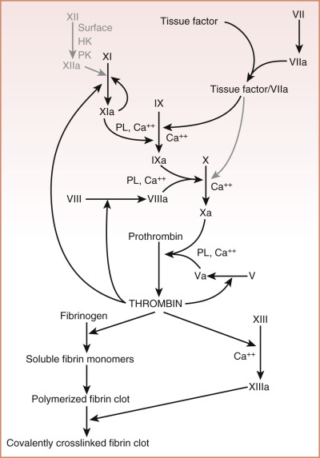
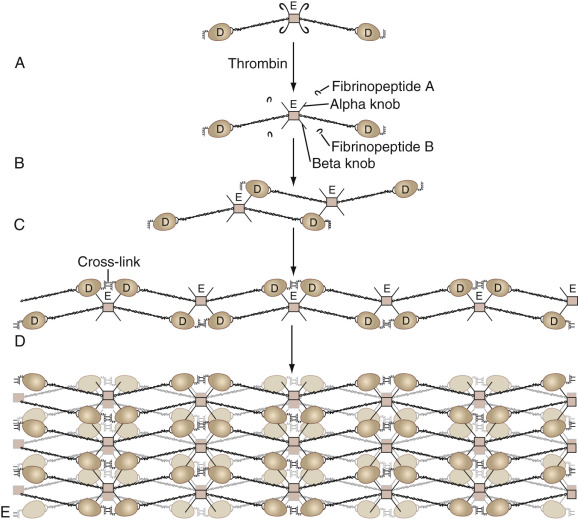
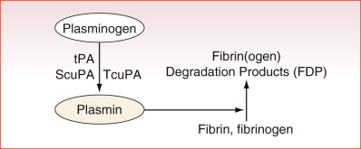
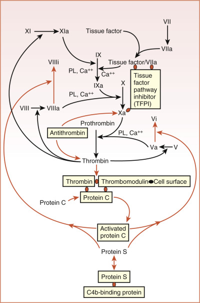
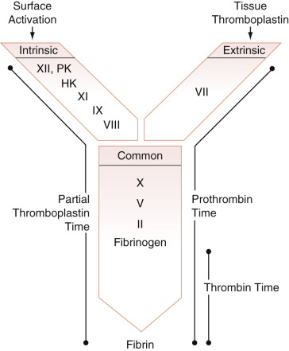
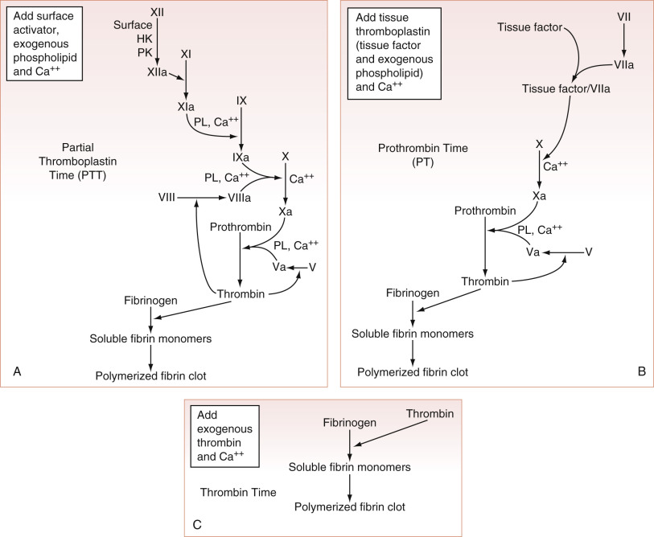
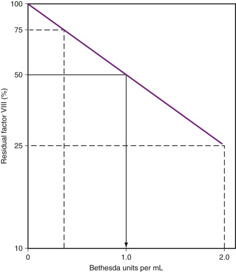

## Key Points

  * •

Physiologic hemostasis consists of the plasma coagulation, fibrinolysis, and anticoagulation protein systems. 

  * •

Physiologic hemostasis is initiated by factor VIIa and tissue factor; thrombosis is also initiated by factor VIIa and tissue factor, but it is amplified by factor XII activation on injured tissue and platelet thrombus. 

  * •

The adequacy of physiologic hemostasis cannot be fully assessed by current assays to detect coagulation abnormalities such as the activated partial thromboplastin time and prothrombin time. 

  * •

Current assays to assess coagulation protein abnormalities have good diagnostic power to recognize specific defects in coagulation proteins. 

  * •

Acquired coagulation protein defects more commonly reflect general medical disorders than specific protein defects. 

,  

##  Overview of Coagulation and Fibrinolysis 

Hemostasis is the physiologic process by which the clotting system seals a vascular injury to limit blood loss; it must be quick, localized, and well regulated. Blood clotting cascade both in normal hemostasis and in pathologic thrombosis involves a number of factors. The coagulation system determines thrombin generation that initiates the proteolysis of fibrinogen, leading to fibrin clot formation. The role of the fibrinolytic system is to dissolve the clot formed by thrombin. The role of the anticoagulation system is to regulate all enzymes of the coagulation and fibrinolytic systems so no inappropriate excess of clotting or bleeding occurs. These three protein systems, together with the vessel wall endothelium, are in delicate balance to ensure adequate hemostasis with limitations on thrombosis formation. 

Recent years have seen an evolution in our understanding of the physiologic hemostatic system ( [ Fig. 39-1 ](<#f0010>) ). For decades, the hemostatic system has been referred to as the _coagulation cascade_ , based on the waterfall hypothesis of Ratnoff and Davies and MacFarland, who published, almost simultaneously, a sequence of proteolytic reactions starting with factor XII (Hageman factor) activation and ending with formed thrombin proteolyzing fibrinogen to form a clot (  MacFarland, 1964  ;  Ratnoff & Davies, 1964  ). However, at the onset, this hypothesis for physiologic hemostasis was untenable because it was known that factor XII (FXII) deficiency was not associated with bleeding (  Ratnoff & Margolius, 1955  ). Thus the physiologic basis of this pathway was questioned because FXII is not essential for hemostasis. Further, by the mid-1970s, the cofactors for FXII activation—that is, prekallikrein and high molecular weight kininogen—were identified, and deficiencies of these proteins also were not associated with a bleeding state (  Weuppers & Cochrane, 1972  ;  Colman et al, 1975  ;  Saito et al, 1975  ). Other mechanisms for physiologic hemostasis were sought.  Osterud and Rappaport (1977)  recognized that FVIIa is able to activate FIX to FIXa. Later, Broze and colleagues recognized that the kinetics of tissue factor pathway inhibitor (TFPI) was such that under physiologic circumstances the FVIIa–tissue factor complex cannot directly activate FX but instead requires the involvement of FIX (  Broze, 2003  ). These latter two studies indicate the important role of the FVIIa–tissue factor pathway in physiologic hemostasis. A key remaining question was how FXI, whose deficiency is associated with bleeding, becomes activated under physiologic circumstances.  Gailiani and Broze (1991)  found that formed thrombin activates FXI in the presence of dextran sulfate and high molecular weight kininogen, resulting in amplification of the coagulation system under stress. More recent evidence indicates that if FXI is poorly activated by thrombin, if FIX is poorly activated by FXIa, or if an antibody prevents FXIa activation of FIX, thrombin generation in plasma is reduced (  Kravtsov et al, 2009  ). Under the same conditions, an antibody to FXIIa activation of FXI does not influence thrombin generation (  Kravtsov et al, 2009  ). Furthermore, mice with total deficiency of FXII and low tissue factor (TF) are viable and phenotypically similar to low-TF mice with normal FXII expression. In contrast, superimposed FXI deficiency on the low-TF background results in death in utero (  Spronk et al, 2009  ). Thus FXII is not essential for hemostasis, but FXI is. Presently, physiologic hemostasis is understood to be an interacting system of activation and amplification of several zymogens that become serine proteases. The initiator of physiologic hemostasis is FVIIa when bound to its cofactor, tissue factor. Regulation of expression of tissue factor constitutes a major modulation of physiologic hemostasis. Thrombin in turn amplifies the process by activating FXI, leading to additional FIX activation. 

Figure 39-1 

Schematic diagram of physiologic blood coagulation. 

Note that labels for the “contact phase” factors constituting factor XII (FXII), high molecular weight kininogen (HK), and prekallikrein (PK) are shown grayed. Although FXI is activated by FXIIa on a surface under artificial in vitro conditions, such as in the activated partial thromboplastin time (APTT), this pathway is not believed to contribute to normal physiologic hemostasis. Similarly, whereas tissue factor (TF)/FVIIa can directly activate X to Xa in the in vitro prothrombin time (PT) test under conditions in which supraphysiologic concentrations of TF are employed, this reaction is shown as grayed because it does not contribute significantly to clot formation under normal in vivo physiologic conditions. Normal clotting in vivo is initiated when sufficient TF/FVIIa becomes available to activate FIX to FIXa. Subsequently, FIXa in the presence of FVIIIa activates FX to FXa, which, in turn, activates prothrombin to thrombin in the presence of FVa. Thrombin not only then proceeds to clot fibrinogen and to activate platelets but additionally exerts critically important positive feedback by activating both factor VIII and factor V. Physiologic amplification of thrombin formation is believed to result from thrombin activating FXI to FXIa, thereby providing an additional pathway for the activation of FIX. Phospholipid (PL) protein complexes present on the surface membranes of platelets in vivo. _Ca ++  _ , Calcium ions. 

It is important for the reader to understand the physiologic basis of hemostasis. However, clinical laboratory assays used to examine the coagulation system are based on the original coagulation cascade hypothesis. Although these tests do not represent physiologic hemostasis, they are still very useful for diagnosis of potential bleeding disorders. Thus one needs to understand the distinction between physiologic coagulation, fibrinolysis, and anticoagulation and the tests that we use to measure these systems. This chapter endeavors to clarify this distinction for the reader. In the first part of this chapter, the details of physiologic coagulation, fibrinolysis, and the regulation of coagulation are presented. In the second part, a description of the assays performed to measure bleeding disorders is presented, together with a discussion of the limitations of these assays for characterizing physiologic hemostasis. In the third part, an overview of congenital bleeding disorders is presented. Finally, this chapter presents the acquired bleeding disorders—the most common forms of bleeding states one actually encounters in clinical practice. 

,  

##  Physiologic Hemostasis 

The physiologic hemostatic system, a tightly regulated balance between formation and dissolution of hemostatic plugs modulated by a series of enzymes and scaffolding proteins, has two major parts. The first part is its cellular component, which consists mostly of platelets and endothelial cells but also includes neutrophils and monocytes. The second part is a large group of plasma proteins, which participate in clot formation (coagulation), dissolution of clots (fibrinolysis), and the action of naturally occurring serine protease inhibitors (anticoagulation) that terminate activity of a number of enzymes of the coagulation and fibrinolytic systems. 

 

##  Endothelium and Platelets 

Normal hemostasis involves interplay among the cellular components and proteins involved in clot formation and lysis. Endothelium that lines the vascular wall in a physiologic state exerts an anticoagulant action. When the vascular integrity is breached, blood coagulation is initiated. Endothelial cells have glycosaminoglycans that bind antithrombin (  Marcum et al, 1984  ). Thrombomodulin on endothelial cell membranes is a locus that binds protein C to be activated by low levels of thrombin (  Esmon & Owen, 1981  ). Intact endothelial cells secrete an ectonucleotidase, CD39, that degrades adenosine diphosphate (  Pinsky et al, 2002  ). Endothelial cells also secrete prostacyclin and nitric oxide, which prevent platelet activation, thereby reducing the risk of arterial thrombosis (  Hong, 1980  ;  Palmer et al, 1987  ;  Shariat-Madar et al, 2006  ). Endothelial cells additionally bind plasminogen, tissue plasminogen activator, and single-chain urokinase, all of which contribute to fibrinolysis and maintenance of an anticoagulant state (  Barnathan et al, 1988  ;  Cesarman et al, 1994  ). 

In a canonical model for hemostasis that most investigators have agreed with for decades, when a vessel wall is injured, collagen is exposed, and platelets adhere to the site of injury (  Van der Meijden et al, 2009  ). Von Willebrand factor helps platelets adhere to the injured vessel wall by binding both to this exposed collagen and to the platelet receptor GP Ib/IX/V complex (  He et al, 2003  ). This adhesion event activates platelets, initiating a signaling cascade within them (  Zaffran et al, 2000  ). The stimulated platelets release the contents of their granules, recruit additional platelets to aggregate to those already adherent, and provide a surface favoring the activation of multiple coagulation factors. Furthermore, in flowing blood, factor XII autoactivates if exposed to collagen or in the milieu of activated platelets, leading to the cascade of proteolytic events producing thrombin (  Van der Meijden et al, 2009  ). Together, these events promote hemostatic plug formation as a physiologic event and in pathophysiologic states may lead to thrombus formation. 

Once prothrombin has been activated to thrombin in the intravascular compartment, the resulting thrombin stimulates endothelium to upregulate TF, and TF forms a complex with FVIIa. The complex of FVIIa–TF activates FIX to FIXa, which converts zymogen FX to enzymatically active FXa (see [ Fig. 39-1 ](<#f0010>) ). In the presence of FVa from liver or injured endothelium, FXa activates prothrombin (FII) to thrombin (FIIa). Under normal circumstances, the rate-limiting component of prothrombinase complex formation and the ultimate generation of thrombin activity is the concentration of FXa (  Rand et al, 1996  ). Thrombin then proteolyzes fibrinogen to form fibrin. In static, in vitro systems, as little as 5 to 10 pM TF is sufficient to induce clot formation, leading to a 1000- to 2000-fold amplification of the process that increases the concentration of thrombin to 10 to 20 nM, which is sufficient to initiate clot formation (  Mann, 2003  ). In a static model of blood coagulation, the addition of 5 pM TF results in an average clot time of approximately 5 minutes—a time sufficiently fast for physiologic hemostasis. Thrombin also is a major physiologic activator of platelets, together with other agonists such as collagen, ADP, platelet-activating factor, and epinephrine. Unactivated platelets probably circulate without promoting coagulation. When platelets are activated (see [ Chapter 40 ](<##!/content/3-s2.0-B9780323295680000401?scrollTo=%23c00040>) ), their membranes become a site for additional thrombin formation. According to a cell-based model of coagulation (  Hoffman & Monroe, 2001  ), activated platelets offer the most important source of negatively charged phospholipids (mainly phosphatidylserine) and procoagulant membranes (  Furie & Furie, 2005  ) needed for coagulation factors action in the propagation phase. This pathway for thrombin formation conjoins with FXII autoactivation on exposed vessel collagen and downstream elaboration of thrombin as well (  Van der Meijden et al, 2009  ). Critical reactions to form FXa and thrombin are accelerated 300,000-fold on the platelet surface. Platelets control three important phases of coagulation: thrombin generation, fibrin formation, and clot retraction (  Heemskerk et al, 2013  ). Physiologically important coagulation and fibrinolytic reactions are likely to occur on the surface of cells in the intravascular compartment. 

More recently, a noncanonical model for hemostasis has been proposed, stating that vessel wall tissue factor is the initial nidus for physiologic and pathophysiologic vessel clot formation (  Day et al, 2005  ). In a normal mouse model of arterial injury, thrombin generation was initiated mainly by TF from endothelial cells than platelet activation. Fluorescent labeled factors Xa and Va were observed bound to the endothelium and not to platelets near the site of injury (  Ivanciu et al, 2014  ). Further, in _KLKB1 -/-  _ mice, constitutive thrombosis delay was merely due to reduced vessel wall TF (  Stavrou et al, 2015  ). It remains to be proven whether this novel noncanonical model for hemostasis and thrombosis becomes the dominant hypothesis in the future. 

 

##  Coagulation Protein System 

 

##  Characterization of Coagulation Proteins 

The proteins that constitute the coagulation system consist of zymogens and cofactors ( [ Table 39-1 ](<#t0010>) ). The zymogens (proenzymes) of the coagulation system can be grouped into the phospholipid-bound and the surface-bound. Phospholipid-bound zymogens make up the physiologically important hemostatic system. These proteins are vitamin K–dependent. Vitamin K is required for an essential γ-carboxylation reaction that takes place on the glutamic acid residue of each of these proteins located in their amino-terminal regions (see [ Chapter 42 ](<##!/content/3-s2.0-B9780323295680000425?scrollTo=%23c00042>) , [ Fig. 42-1 ](<##!/content/3-s2.0-B9780323295680000425?scrollTo=%23f0010>) ). This carboxylation reaction allows these proteins to bind to phospholipid and cell membranes, where they are activated. Without this carboxylation reaction, these proteins do not function normally in the hemostatic system. Proenzymes include FX, FIX (Christmas factor), FVII, and FII (prothrombin). Protein C is a vitamin K–dependent phospholipid-bound zymogen, but when activated, it functions as an inhibitor (see later and [ Chapter 41 ](<##!/content/3-s2.0-B9780323295680000413?scrollTo=%23c00041>) ). Protein S is a vitamin K–dependent cofactor for activated protein C. 

TABLE 39-1 

Proteins of the Plasma Coagulation System 

Surface-Bound Zymogens  |  Vitamin K–Dependent Zymogens  |  Cofactors/Substrates   
---|---|---  
Factor XII  |  Factor VII  |  High molecular weight kininogen   
Prekallikrein  |  Factor IX  |  Factor VIII   
Factor XI  |  Factor X  |  Factor V   
|  Factor II  |  Fibrinogen   
|  Protein C  |  Protein S   
  
The surface-bound proenzymes are proteins of the plasma kallikrein/kinin system (see [ Table 39-1 ](<#t0010>) ). Surface-bound proenzymes include FXII (Hageman factor), prekallikrein (Fletcher factor), and FXI. These protein zymogens are also known as the _contact system_ because FXII autoactivates when associated with a negatively charged surface, such as a glass tube and several physiologic substances (see later) (  Wiggins & Cochrane, 1979  ;  Miller et al, 1980  ). The autoactivation phenomenon of FXII allows for a common laboratory test, the activated partial thromboplastin time (APTT), which is used to assess the integrity of the coagulation system (see later). This assay is an important diagnostic test that is performed more than 200 million times annually in the United States alone to assess many coagulation proteins. Thus it is important to be aware that assays to assess coagulation proteins (e.g., APTT, activated clotting time) are based on the event of FXII autoactivation. Although absolutely essential for a normal APTT, the proteins of the plasma kallikrein/kinin system do not have a role in hemostasis. These proteins (factor XII, prekallikrein, and high molecular weight kininogen) do participate in blood pressure regulation, fibrinolysis, inflammation, angiogenesis, and thrombosis (  Schmaier, 2002;  2003;  2004  ;  Shariat-Madar et al, 2006  ;  Maas et al, 2008  ;  LaRusch et al, 2010  ). Mice deficient in FXII, kininogen, the bradykinin B2 receptor, and prekallikrein are protected from arterial thrombosis (  Renne et al, 2005  ;  Shariat-Madar et al, 2006  ;  Merkoulov et al, 2008  ;  Stavrou et al, 2015  ). 

Under physiologic circumstances in vivo, prekallikrein, when assembled on endothelial cells, may be first activated by an endothelial enzyme, prolylcarboxypeptidase ( _K m  _ = 9 nM), with FXII activation secondary to the formed plasma kallikrein (  Rojkjaer et al, 1998  ;  Shariat-Madar et al, 2002  ). Finally, the role of the surface-activated proteins that participate in in vitro blood coagulation assays has been reevaluated. Although deficiencies of FXII, prekallikrein, and high molecular weight kininogen are not associated with bleeding, investigations indicate that they have a role in arterial and venous thrombosis. Recently, activation of the contact factor coagulation pathway has been shown to occur in vivo from negatively charged surfaces such as polyphosphate, extracellular RNA, and collagen. In detail, polyphosphate (PolyP) in humans consists of 60 to 100 phosphate units, and it is released from platelet dense granules upon platelet activation. PolyP has prohemostatic, prothrombotic, and proinflammatory properties. It has been identified as an activator of the contact phase (  Morrissey, 2012  ); it is a potent activator of thrombin and coagulation FXI; and it accelerates factor V activation and abolishes the inhibitory effect of tissue factor pathway inhibitor (TFPI). 

FXII participates in in vivo thrombus formation, presumably by autoactivation on released polyphosphates from activated platelets, vessel wall, or bacteria; extracellular ribonucleic acid; aggregated proteins; or exposed collagen in the intravascular compartment in flowing blood (  Smith et al, 2006  ;  Kannemeier et al, 2007  ;  Maas et al, 2008  ;  Van der Meijden et al, 2009  ). 

The hemostatic cofactors for the enzymatic reactions of the coagulation system may be considered to act as receptors for coagulation proteins. For example, high molecular weight kininogen serves as a receptor for prekallikrein binding to endothelial cells (  Schmaier et al, 1988  ;  Motta et al, 1998  ). Factors VIIIa and Va function as coreceptors of factors IXa and Xa, respectively (  Miletich et al, 1978  ;  Ahmad et al, 2000  ). All three of these proteins serve as cofactors that accelerate the reactions in which they participate. For example, high molecular weight kininogen accelerates the activation of prekallikrein and FXI by FXIIa. Factors VIIIa and Va accelerate FX and prothrombin activation, respectively, by factors IXa and Xa. Each cofactor also functions as a substrate of one or more enzymes that participate in their formation and inactivation. High molecular weight kininogen accordingly is a substrate of FXIIa, plasma kallikrein, and FXIa. Factors VIII and V are substrates of thrombin, and factors VIIIa and Va of activated protein C. Fibrinogen is a substrate of thrombin. 

FVIII (antihemophilic factor) is a 330-kDa protein. When activated to FVIIIa, it is a cofactor for FIXa in the activation of FX. Its absence is associated with the most severe clinically recognized bleeding disorder, hemophilia A. FV is also a 330-kDa protein with homology to FVIII. When activated to FVa, it serves as a cofactor for FXa in the activation of FII (prothrombin) to thrombin. Fibrinogen is a 330-kDa protein that not only is the main substrate of thrombin (FIIa) but is also the principal adhesive molecule subserving platelet aggregation. When it is proteolyzed by thrombin, a fibrin monomer is formed. This monomer associates end-to-end and side-to-side to form a fibrin clot. The clot is stabilized by activated FXIII, a tissue transglutaminase that cross-links the strands of associating fibrin ( [ Fig. 39-2 ](<#f0015>) ). FXIIIa mediates the retention of red blood cells in venous thrombosis, enabling it to control clot size (  Aleman et al, 2014  ). TF (47-kDa protein) is an essential cofactor for activated FVIIa. It is found in most tissues and cells. Upregulation of TF results in the formation of complexes with FVII that produce the initiation of hemostatic reactions. Last, high molecular weight kininogen (HK, also known as Fitzgerald factor or Williams factor) is a 120-kDa protein that acts as a cofactor for the activation of FXII, prekallikrein, and FXI. 

Figure 39-2 

Formation of a fibrin clot. 

**A,** Schematic of fibrinogen. **B,** Thrombin proteolyzes fibrinopeptides A and B from fibrinogen to leave soluble fibrin monomer. Soluble fibrin monomer then associates side-to-side **(C)** and end-to-end (not shown, for clarity) to form fibrin polymers. **D,** Thrombin-activated factor XIII (factor XIIIa) covalently cross-links the fibrin polymers into an increasingly complex structure and an ultimately insoluble clot **(E).** Note that “E” corresponds to the central domain of the original fibrinogen molecule, and “D” to the peripheral domains. 

(Modified with permission from Doolittle RF: Fibrinogen and fibrin. _Sci Am_ 245:126–135, 1981.) 

 

##  Physiologic Protein Assemblies 

Certain critical protein assemblies in hemostatic reactions accelerate these proteolytic events. The proteins of the coagulation system that are essential for hemostasis or control of bleeding were originally identified by observation of affected patients, and more recently through mouse knockout studies. Deficiencies in coagulation factors VIII and IX are the most prominent bleeding disorders that occur in patients who survive gestation and birth. Rare patients who have apparent congenital deficiencies of coagulation factors VII, X, V, and II usually do not have severe bleeding states. In contrast, murine models have demonstrated that mouse embryos containing complete genetic knockouts of factor VII, X, V, or II die of massive hemorrhage during gestation or at birth (  Cui et al, 1996  ;  Rosen et al, 1997  ;  Sun et al, 1998  ;  Dewerchin et al, 2000  ). This information suggests that the human patient who has a deficiency of factor VII, X, V, or II may have some factor, albeit less than 1%, to allow for a milder clinical phenotype than that seen in mouse models, or, alternatively, other compensatory mechanisms may be operative in the human patient. All of these proteins participate in two critically important assemblies that are essential for normal hemostasis: tenase and prothrombinase. 

The tenase complex comprises the assembly of FIXa and thrombin-activated FVIIIa on phospholipid surfaces or cell membranes in an ordered structure, with FX to accelerate its activation to FXa. When all of these components are present, the rate of FX activation by FIXa is increased 1.4 × 10  8  -fold over the rate of FX activation by FIXa alone. The prothrombinase complex in analogous fashion comprises the assembly of FXa and thrombin-activated FVa on phospholipid membranes or cell membranes in an ordered structure with FII (prothrombin) to accelerate its activation to FIIa (thrombin). When all of these components are present, the rate of FII activation by FXa is increased 1.7 × 10  8  -fold over the rate of FII activation by FXa alone. Because these coagulation reactions occupy critical regulatory points within the physiologic hemostatic system, they are also the target of a number of anticoagulant agents for venous thrombosis that are currently in use or are being developed. 

 

##  The Formation of Fibrin and the Fibrinolytic System 

The six peptide chains of the fibrinogen molecule are organized into a structure described as having a central E domain and two terminal D domains. When thrombin is formed, it cleaves fibrinopeptide A from the Aα chain and fibrinopeptide B from the Bβ chain of fibrinogen in the E domain region (  Doolittle, 1981  ). The remainder of this thrombin-proteolyzed fibrinogen is called soluble fibrin monomer. Soluble fibrin monomers then assemble with end-to-end and side-to-side association to form a noncovalent fibrin polymer (see [ Fig. 39-2 ](<#f0015>) ). Activated FXIII, a transglutaminase, cross-links fibrin monomeric subunits into an insoluble, cross-linked fibrin clot. When insoluble, cross-linked fibrin is made, a new linkage between the D domains of two adjacent fibrin monomers occurs, and in the process a neo-epitope of interaction is formed (see [ Fig. 39-2 ](<#f0015>) ). 

The fibrinolytic system consists of serine proteases able to counterbalance clot formation determining fibrin degradation and clot dissolution. In the final step of fibrinolysis, the circulating zymogen plasminogen is converted in its active form plasmin. Plasminogen is activated to plasmin mainly by endogenous tissue plasminogen activator (tPA) (  Draxler & Medcalf, 2015  ). Two other plasminogen activators are single-chain urokinase plasminogen activator (ScuPA) and two-chain urokinase plasminogen activator (TcuPA). These activators are found in the endothelium, as well as in neutrophils and monocytes. The natural plasminogen activators tPA, ScuPA, and TcuPA convert zymogen plasminogen to the active enzyme plasmin ( [ Fig. 39-3 ](<#f0020>) ). tPA is produced constitutively, and ScuPA is increased in inflammatory states. Plasminogen activator inhibitor-1 (PAI-1) is the major inhibitor of tPA and TcuPA. α 2  -Antiplasmin, a serine protease inhibitor (serpin), is the most potent and highly selective inhibitor of plasmin. However, the plasma concentration of α 2  -antiplasmin, even if high (approximately 1 mM), is only about half the plasma concentration of plasminogen **.** The fibrinolytic system is also regulated by thrombin activatable fibrinolysis inhibitor (TAFI) (  Vercauteren et al, 2013  ). TAFI is a carboxypeptidase able to remove lysine residues from fibrin, so it indirectly controls plasmin by interfering with the binding of plasminogen and tPA to fibrin. 

Figure 39-3 

Fibrinolysis. 

Zymogen plasminogen is converted to plasmin by tissue plasminogen activator (tPA), single-chain urokinase plasminogen activator (ScuPA), and two-chain urokinase plasminogen activator (TcuPA). Formed plasmin degrades fibrinogen or fibrin to form fibrinogen or fibrin degradation products, respectively. 

The binding of both plasminogen and tPA to fibrin is able to increase plasmin generation by two orders of magnitude. The active plasmin molecule is a potent protease, and it recognizes multiple substrates. Plasmin will degrade soluble fibrinogen to produce fibrinogen degradation products ( [ Fig. 39-4, _A_ ](<#f0025>) ). Plasmin cleaves fibrinogen into an X fragment of similar molecular mass by eliminating portions of the α-chain (  Marder & Budzynski, 1974  ). Plasmin then cleaves the X fragment asymmetrically between the D and E domains to produce fragment Y. Plasmin further degrades the Y fragment to produce soluble D and E domains that are called soluble fibrinogen degradation products or, in the case of fibrin digestion by plasmin, fibrin degradation products. Their presence indicates that plasmin has been formed. Plasmin will also degrade insoluble, crossed-linked fibrin ( [ Fig. 39-4, _B_ ](<#f0025>) ). When it does so, it liberates a D-D-dimer domain formed as a result of the neo-epitope between these two domains (see [ Fig. 39-4, _B_ ](<#f0025>) ) (  Marder et al, 1976  ). The presence of soluble D-dimer indicates that first thrombin has been formed, then clotting has occurred, then the clot has been cross-linked by FXIIIa, and finally plasmin has been formed and has cleaved the insoluble, cross-linked fibrin clot. 

Figure 39-4 

 

##  The Anticoagulation Protein Systems 

Coagulation is tightly regulated by natural anticoagulants and the fibrinolytic system to avoid thrombus formation and extension. Three major anticoagulant systems regulate the enzymes of the coagulation protein system to help to inhibit clot formation. These systems are the protein C/protein S system, the plasma serine protease inhibitor system, and TFPI, a Kunitz-type serine protease inhibitor. Antithrombin (antithrombin III) is the main serine protease inhibitor of coagulation enzymes of the plasma serine protease inhibitor system. Each of these systems plays a critical role in proper regulation of the coagulation system. Moreover, in murine deletion models, complete deficiencies of protein C, protein S, antithrombin, and TFPI are incompatible with survival of mammalian gestation, delivery, or life ex utero (  Huang et al, 1997  ;  Jalbert et al, 1998  ;  Hayashi et al, 2006  ;  Burstyn-Cohen et al, 2009  ). 

 

##  Protein C/Protein S System 

When activated, protein C, a 62-kDa vitamin K–dependent protein, is an enzyme that functions as an inhibitor. Protein C is activated by thrombin when bound to an endothelial cell protein called thrombomodulin. Its activation is increased when protein C binds to the endothelial protein C receptor (EPCR). The complex formed by APC+EPCR needs to dissociate in order to allow binding of APC with Protein S to inactivate factor Va and factor VIIIa (  Esmon, 2006  ). Thrombomodulin forms a trimolecular complex with protein C and thrombin. Protein S, a 69-kDa vitamin K–dependent protein, is not an enzyme. It is a cofactor, or receptor, for activated protein C on cell membranes. It allows activated protein C to bind to cell surfaces in such a manner as to orient itself to inactivate factors Va and VIIIa. The enzyme uses this cofactor as a receptor to localize its activity to perform its inhibitory function. Plasma protein S is in equilibrium between the free form and a bound form that is complexed to C4b-binding protein; only the free form functions as a cofactor for activated protein C. Activated protein C also binds to three receptors on endothelial cells: (1) endothelial cell protein C receptor to activate (2) protease-activated receptor (PAR)1 and (3) apolipoprotein E receptor 2 (ApoER2) (  Esmon, 1999  ;  Coughlin, 2000  ;  Yang et al, 2009  ). Activation of PAR1 on endothelial cells may contribute to the anticoagulant function of activated protein C by liberating tPA. Activated protein C on endothelial cells also has an inflammatory effect via activation of sphingosine-1-phosphate receptor transactivation and activation of ApoER2 (  Finigan et al, 2005  ;  Yang et al, 2009  ). Thus activated protein C reduces thrombin formation, stimulates fibrinolysis, and initiates inflammation to reduce thrombosis risk. 

 

##  Antithrombin 

This serpin is a 58-kDa protein that inhibits each of the following hemostatic enzymes: IIa, Xa, VIIa, IXa, XIa, kallikrein, and XIIa. It exerts its anticoagulant effect primarily by inhibiting factors IIa and Xa (see [ Fig. 39-5 ](<#f0040>) ). Antithrombin has two functional sites: the heparin binding site (at the amino terminus of the protein) and the reactive site (Arg329-Ser394).The ability of antithrombin to function as an inhibitor of coagulation protein enzymes is potentiated by endogenous and exogenous heparins. In fact, it is the presence of antithrombin that gives heparin its anticoagulant properties. In the presence of heparins, antithrombin undergoes a conformational change that increases from 1000-fold to 4000-fold its inhibitor effect on factor IIa (  Perry, 1994  ). Trace amounts of circulating TF or TF transiently exposed by damaged vessels contributes to FVIIa inactivation by antithrombin (  Vatsyayan et al, 2014  ). 

Figure 39-5 

Natural inhibitors of coagulation: antithrombin (AT); components of the protein C pathway (thrombomodulin, protein C, protein S); and tissue factor pathway inhibitor (TFPI). 

Three major anticoagulant systems are recognized. Antithrombin inhibits factor Xa and thrombin to prevent thrombosis. It is important to note that antithrombin inhibits every enzymatic form of blood coagulation serine proteases (factor XIIa, plasma kallikrein, factor XIa, factor IXa, and factor VIIa), even though this is not indicated in the figure for readability purposes. The protein C system requires that this zymogen is activated to activated protein C by thrombin when bound to the endothelial cell membrane protein thrombomodulin. Protein S is a cofactor for activated protein C to inactivate factors Va and VIIIa. C4b-binding protein regulates protein S activity. TFPI makes a quaternary complex with tissue factor/factor VIIa and factor Xa to inhibit both enzymes. 

In addition to antithrombin, other serpins regulate the enzymes of the hemostatic and inflammatory systems. Heparin cofactor II is a serpin that specifically inhibits thrombin in the presence of dermatan sulfate. Protein Z inhibitor is a serpin that specifically inhibits factor Xa in the presence of its cofactor protein Z—a vitamin K–dependent protein. C1 inhibitor (C1 esterase inhibitor) is the most potent inhibitor of FXIIa, kallikrein, and FXIa in plasma. Its main function is to regulate the amount of free bradykinin in the intravascular compartment and reduce inflammatory events (  Han et al, 2002  ;  Schmaier, 2002  ;  Maas et al, 2008  ). The absence of C1 inhibitor is the causative factor for types I and II hereditary angioedema, a disorder associated with excessive bradykinin delivered to tissues. 

 

##  Tissue Factor Pathway Inhibitor 

In addition to the serpins, there is the Kunitz-type serine protease inhibitor, TFPI (  Crawley & Lane, 2008  ). TFPI is the most potent inhibitor of the FVIIa–tissue factor complex. Under physiologic conditions, TFPI exerts its inhibitory effects by forming a quaternary complex with FVIIa, TF, and FXa (see [ Fig. 39-5 ](<#f0040>) ). It is noteworthy that the murine TFPI knockout is embryonically lethal (  Jalbert et al, 1998  ). TFPI is produced by microvascular endothelium, and it seems mainly associated to glycosamminoglycans on the endothelial wall. Only approximately 20% of TFPI circulates in plasma associated with lipoproteins (  Caplice et al, 2001  ). Another family of Kunitz-type serine protease inhibitors, the amyloid β-protein precursor (AβPP) and related members, is present in platelets and brain and regulates factors XIa, IXa, Xa, VIIa/TF, and plasmin (  Van Nostrand et al, 1990  ;  Schmaier et al, 1993;  1995  ;  Mahdi et al, 1995  ;  2000  ). This inhibitor does not inhibit thrombin. The exact function of this inhibitor is not completely known, but it is believed to be a cerebral anticoagulant (  Del Zoppo, 2009  ). AβPP and amyloid precursor–like/protein 2 gene–deleted mice survive gestation but have an accelerated rate of thrombosis in a carotid artery thrombosis model (  Xu et al, 2009  ). 

 

##  Prostacyclins and Nitric Oxide and Thrombospondin-5 

In physiologic conditions, endothelial cells (ECs) produce vasoactive hormones able to control the primary phase of hemostasis. ECs express the cyclooxygenase-2 enzyme that produces prostacyclins (PGI  2  ) from arachidonic acid (  Mitchell et al, 2008  ). PGI  2  is a vasodilator, and it inhibits platelet aggregation. The actions of prostacyclins are mediated by cell membrane prostacyclin (IP) receptors and intracellular peroxisome proliferator-activated receptors (PPARβ and γ). Endothelial cells also express the nitric oxide synthase enzyme (eNOS, NOS3), and they release nitric oxide (NO) derived from  l  -arginine. NO is a potent vasodilator, and it also inhibits platelet adhesion and aggregation. NO activates guanylate cyclase and cGMP. Activated platelets adhering to collagen seem also able to produce NO under shear flow (  Cozzi et al, 2015  ), thus controlling platelet adhesion and vasoconstriction directly at the sites of vessel damage. _KLKB1 -/-  _ (prekallikrein deficient) and _Bdkrb2 -/-  _ (bradykinin B2 receptor knockout) mice have delayed thrombosis due to elevated prostacyclin (  Stavrou et al, 2015  ;  Shariat-Madar et al, 2006  ) and NO (  Shariat-Madar et al, 2006  ), respectively. 

Thrombospondin-5, also known as cartilage oligomeric matrix protein (COMP), is an extracellular protein able to control vascular tone. COMP is released by a variety of cartilage and muscle tissues and also activated platelets. COMP inhibits thrombin and acts as a natural anticoagulant in mice (  Liang et al, 2015  ). It determines a dose-dependent prolongation of thrombin time. 

 

##  Current Hypothesis for Initiation of the Hemostatic System 

More proteins participate in coagulation reactions in vitro than are critical for hemostatic reactions in vivo. The original coagulation cascade waterfall hypothesis initiated by FXII has been replaced by one whereby TF and FVIIa are initiators (  Gailiani & Broze, 1991  ). TF is ubiquitous throughout the body, although it is rich in brain, lung, and placenta. Its expression is upregulated after injury. Regulation of the expression of TF is a major control mechanism for the initiation of hemostasis. Some investigators believe that a circulating form of TF is also present. TF is not fully active on intact cells; it becomes able to activate coagulation when cell membrane properties are modified. This process is called “decryption” of “encrypted” TF, and it is still not completely understood. Different mechanisms of TF decryption have been proposed: exposition of phosphatidylserine, dimerization of TF, and oxidation of a specific disulfide bond in TF (  Smith et al, 2015  ). In conditions where vessel wall injury is limited to endothelial activation, blood-borne TF has been characterized on microparticles released by leukocytes and involved in the initiation of coagulation (  Furie & Furie, 2005  ). Activated macrophages have been shown to express TF on their cell membrane and microparticles involved in physiologic hemostasis and thrombosis (  Rak, 2014  ). Last, as indicated above, there is a developing notion that endothelial cell TF is the initial nidus that leads to hemostasis and thrombosis (  Furie, 2009  ;  Ivanciu et al, 2014  ). 

The FVIIa ** – ** TF complex activates FIX, leading in turn to FX activation. It must be noted that at the concentrations of factors ordinarily present in the body, VIIa/TF does not directly activate appreciable amounts of FX because of the presence of TFPI—a point emphasized diagrammatically in [ Figure 39-1 ](<#f0010>) by the graying of this reaction. Once FX has been activated to FXa, this Xa in turn contributes to the activation of thrombin from prothrombin. Thrombin then proteolyzes fibrinogen to form fibrin. Although TF-dependent coagulation reactions are rapidly inhibited by TFPI, if the stimulus for thrombin formation is sufficiently strong, coagulation is maintained through the activation of FXI by thrombin (  Meijers et al, 2000  ). Activation of FXI to FXIa results in increased activation of FIX and eventually increased formation of thrombin. Further modulation of hemostatic balance in the direction of clot formation is exerted by TAFI, the thrombin-activatable fibrinolysis inhibitor (also known as carboxypeptidase U). Among its actions, TAFI cleaves C-terminal lysine residues from fibrin, thereby decreasing the binding of plasminogen to the clot and diminishing clot lysis (  Leurs et al, 2005  ). 

,  

##  Clinical Laboratory Hemostasis 

The clinical approach to a bleeding patient requires an accurate diagnostic workup to determine the cause of the problem. The underlying cause in almost all cases will derive from a defect or deficiency in a plasma protein, a defect in platelet number or function, or a defect in adhesive interactions between platelets and the vessel wall. 

Any coagulation protein defect can be a true protein deficiency, an inhibitor to the active site of the protein, an abnormal protein that cannot participate in its physiologic function(s), or an apparent deficiency that arises as the result of enhanced clearance of protein. In general, inhibitors to a coagulation protein are immunoglobulins, although hypergammaglobulinemic states or abnormal production of endogenous heparin, fibronectin, or cryoglobulins as acquired inhibitors to coagulation proteins have also been reported. Abnormal proteins that are present but do not function normally occur as a result of missense or deletion mutations, or translocations of DNA. Last, enhanced clearance of coagulation proteins usually occurs as a result of antigen–antibody complex formation. Resultant increased clearance of the protein gives the appearance of a deficiency, but the real mechanism is enhanced clearance. 

Typical clinical presentations of bleeding disorders are shown in [ Table 39-2 ](<#t0015>) . In general, hemarthrosis and spontaneous soft tissue and intramuscular hemorrhage characterize plasma protein defects such as hemophilia A and B (factors VIII and IX deficiency). Soft tissue petechiae, purpura, or ecchymosis characterizes von Willebrand disease or disorders of platelet number or function. However, at times, it is difficult to distinguish the potential mechanism for bleeding. Thus the clinical laboratory is essential for definitive diagnosis of a bleeding disorder in the patient. 

TABLE 39-2 

Patterns of Clinical Bleeding in Disorders of Hemostasis 

Characteristics  |  Primary Hemostasis (Platelet/Vascular Problem)  |  Secondary Hemostasis (Coagulation Factor Problem)   
---|---|---  
Onset  |  Spontaneous, immediate after trauma  |  Delayed after trauma   
Sites  |  Skin, mucous membranes  |  Deep tissues   
Form  |  Petechiae, ecchymosis  |  Hematomas   
Mucous membrane  |  Common (nasal, oral, gastrointestinal, genitourinary)  |  Less common   
Other sites  |  Rare  |  Joint, muscle, central nervous system, retroperitoneal space   
Clinical examples  |  Thrombocytopenia, platelet defects, von Willebrand disease, scurvy  |  Factor deficiency, liver disease, acquired inhibitors   
  
 

##  Physiologic Hemostasis Versus Clinical Assays 

In the practice of clinical hemostasis, a dichotomy is seen between physiologic hemostasis and assays used in the clinical laboratory to recognize coagulation protein defects. As indicated previously in [ Figure 39-1 ](<#f0010>) , physiologic hemostasis is initiated by an increase in the formation of TF–FVIIa complexes. At present, no good assays are available in the clinical laboratory to assess this early event specifically. Instead, the relatively late event of actual clot formation is monitored. The two assays most commonly used to examine the coagulation system are (1) the activated partial thromboplastin time (APTT), induced by surface (contact) activation of the system, and (2) the prothrombin time (PT), induced by the addition of excess tissue factor. Contact activation of the coagulation system occurs because FXII in the presence of artificial, negatively charged particles in the reagent supports FXII autoactivation, which in turn initiates the cascade of proteolytic reactions of the coagulation system. As is discussed later, this test measures more proteins than those necessary for hemostasis. With the PT test, the addition of excess TF creates a very unphysiologic change in the normal stoichiometric relationships of factors, thereby allowing FVIIa to overcome the inhibitory effect of TFPI and favoring direct activation of FX to FXa. Both assays are extremely useful for assessing the integrity of the blood coagulation system and for recognizing potential bleeding problems in a patient (see later), and they are also referred as “point of care” tests (  Perry et al, 2010  ) because they can be performed using devices located at or near the patient (home, operating rooms). 

 

##  Screening Tests for Coagulation Disorders 

When a patient with a bleeding problem is addressed in the clinical laboratory, several screening tests are used to classify and diagnose the basis of this disorder. The term _primary hemostasis_ refers to platelet reactivity at the site of vessel injury; this topic is covered in [ Chapter 40 ](<##!/content/3-s2.0-B9780323295680000401?scrollTo=%23c00040>) . The platelet count is an example of a screening assay for primary hemostasis. This section describes assays for what has been called _secondary hemostasis_ —that is, the coagulation of plasma. However, more recent studies employing animal model systems suggest the need for caution in accepting this distinction too literally—for example, in vivo visualization studies of arterial thrombus formation in at least some models suggest that platelet accumulation and fibrin generation may actually occur simultaneously or after initial thrombus formation on the vessel wall (  Falati et al, 2002  ;  Furie, 2009  ;  Ivanciu et al, 2014  ). Regardless of the true order of events occurring in vivo, however, when performed simultaneously on a sample of plasma, these coagulation assays identify almost all of the diagnostic categories for a coagulopathy. The 50-year-old cascade hypothesis for hemostasis still has merit in explaining the mechanism(s) for clot formation seen in the screening tests for coagulation reactions. In this hypothesis, coagulation proteins are classified as members of the so-called intrinsic system, extrinsic system, or common pathway ( [ Fig. 39-6 ](<#f0045>) ). This approach allows for a practical differential diagnosis of which protein(s) may be affected, based on the results of a series of screening tests. The specific coagulation factors involved in each test are shown schematically in [ Figure 39-6 ](<#f0045>) . Methodologic aspects of these tests ( [ Fig. 39-7 ](<#f0050>) ) are discussed in the following paragraphs. Accurate coagulation testing also requires appropriate blood sample collection, transport, and processing according to established guidelines. 

Figure 39-6 

Organization of the coagulation system based on current assays. 

The intrinsic coagulation system consists of the protein factors XII, XI, IX, and VIII and prekallikrein (PK) and high molecular weight kininogen (HK). The extrinsic coagulation system consists of tissue factor (tissue thromboplastin) and factor VII. The common pathway of the coagulation system consists of factors X, V, and II, and fibrinogen (I). 

Figure 39-7 

Coagulation screening tests. 

**A,** Activated partial thromboplastin time (APTT, “PTT” on the figure) requires the presence of every protein except tissue factor and factor VII. **B,** Prothrombin time (PT) requires tissue factor and factors VII, X, V, and II and fibrinogen. **C,** In the thrombin time (or thrombin clotting time), exogenous thrombin is added to plasma to proteolyze (clot) fibrinogen. The endpoint in each of these tests is the number of seconds until detection of a clot, following addition of the indicated reagents to citrated platelet-free patient plasma. Because virtually all measuring systems employed detect the formation of a polymerized fibrin clot, whether or not any cross-linking of fibrin occurs, none of these tests will provide information with respect to factor XIIIa activity. 

 

##  Activated Partial Thromboplastin Time 

To perform this common coagulation assay ( [ Fig. 39-7, _A_ ](<#f0050>) ), a mixture of a negatively charged surface, phospholipid, and anticoagulated patient plasma is incubated for several minutes. The recommended anticoagulant is 3.2 g% sodium citrate because less variation is seen in blood specimens from normal patients and those on anticoagulants collected in this concentration of anticoagulant (  Adcock et al, 1997;  1998  ). Sodium citrate is a reversible chelator of calcium that prevents coagulation protein activation. When whole blood is collected, the ratio of anticoagulant to whole blood is 1 part anticoagulant to 9 parts whole blood. After incubation of patient plasma with reagent for a prescribed time, depending on the assay, the sample is recalcified with excess calcium chloride, and the time required for clot formation is measured. The APTT assesses the coagulation proteins of the so-called intrinsic system and common pathways (see later). This assay is commonly referred to as the partial thromboplastin time (PTT), but it is really an “activated” PTT in that its reagents contain a negatively charged surface that accelerates the rate of the reaction (  Proctor & Rapaport, 1961  ). 

 

##  Prothrombin Time 

To perform this common coagulation assay ( [ Fig. 39-7, _B_ ](<#f0050>) ), tissue thromboplastin (recombinant human or isolated animal tissue factor) and patient plasma are incubated for several minutes, after which the citrated plasma mixture is recalcified by the addition of excess CaCl  2  , and the time required for clot formation is measured. The PT assesses the coagulation proteins of the so-called extrinsic system and common pathway (see later) (  Quick et al, 1935  ). Tissue thromboplastin traditionally has been a crude preparation of animal brain TF. Presently, recombinant TF is used in the preparation of several commercial PT reagents. In general, the range of prolongation of time of an abnormal PT increases when recombinant TF is used. This fact makes for a more sensitive assay. The PT serves as the basis for the international normalized ratio (INR) value used to monitor anticoagulation with warfarin or other vitamin-antagonists. As discussed in [ Chapter 42 ](<##!/content/3-s2.0-B9780323295680000425?scrollTo=%23c00042>) , the INR is the ratio of patient PT divided by geometric mean normal PT for the local laboratory (based on a population of normal individuals assessed with identical sample collection, reagents, and machines), raised to the power of the international sensitivity index (ISI). Although the INR is clearly the most appropriate measure to use in conjunction with oral anticoagulant monitoring, for hemostatic evaluation of the nonwarfarinized patient, actual PT values in seconds may be used, referencing the laboratory's locally established reference interval for the PT test. 

 

##  Thrombin Time 

To perform the thrombin time (also referred to as thrombin clotting time), purified exogenous thrombin is added to plasma to determine the time to clot formation ( [ Fig. 39-7, _C_ ](<#f0050>) ). It is a direct measure of fibrinogen function and may be used to ascertain if there is a defect in fibrinogen function. The thrombin time will be prolonged in hypofibrinogenemic states, if an abnormal protein fibrinogen (dysfibrinogenemia) is present, or if a thrombin inhibitor (heparin, direct thrombin inhibitors, and heparin-like compounds) is present in the plasma sample. 

 

##  Assays Used in Clinical Coagulation Testing 

Clinical coagulation testing is based on functional assays that examine the rate of clot formation. In these assays, a sequence of proteolytic reactions takes place, leading to thrombin formation and its proteolysis of fibrinogen (  Mann, 2003  ). Proteolysis of fibrinogen results in clot formation, precipitation of soluble proteins, which is detected by increased impedance or turbidity, or decreased optical clarity, based on the instrumentation used to measure the result. Any defect along the pathway to clot formation will give an abnormal final result. Furthermore, because a series of reactions need to take place for final clot formation to occur, any defect below a specific factor will lead to an abnormal result in measuring that factor. For example, a high-titer inhibitor of FVIII will produce an abnormal FXI assay. Similarly, deficient or abnormal fibrinogen will affect the results of all clotting tests. 

All coagulation factors of the intrinsic system (XII, prekallikrein, high molecular weight kininogen, XI, IX, and VIII) are measured in assays using the APTT as its platform. These specific factor assays became readily available because of the recognition of patients and the commercial availability of specific factor-deficient plasmas that serve as substrate. For example, an FVIII assay is a mixture of APTT reagent, FVIII-deficient plasma, and test (unknown) plasma from the patient (  Landell et al, 1953  ). After incubation for a few minutes, the time to clot is initiated by the addition of calcium chloride. FVII, together with coagulation factors of the common pathway (X, V, II and fibrinogen), is usually measured by assays using the PT as the platform. For example, an FX assay is a mixture of PT reagent that contains TF (thromboplastin), FX-deficient plasma, and test or patient (unknown) plasma. After incubation for a few minutes, time to clot is initiated by the addition of calcium chloride. The amount of factor present in a given patient sample is determined by comparing the patient sample against a standard curve made with plasma samples containing varying amounts of the specific factor to be assayed mixed with factor-deficient plasma, as well as the appropriate APTT or PT reagent for the assay. 

Coagulation-based assays are sensitive and specific. They are much simpler to perform than antigen assays for each of the coagulation proteins. These assays provide information on the functional presence of the coagulation protein. Additional coagulant-based assays such as thrombin time (see earlier) and reptilase time (see later) specifically examine the integrity of fibrinogen to liberate its fibrinopeptides, resulting in fibrin clot formation. When establishing a clinically useful thrombin time, it is important to reduce the thrombin concentration to about 1 to 2 NIH U/mL (≈8 to 16 nM human α-thrombin at 3000 U/mg specific activity) so the time of a normal assay is about 20 seconds. Such an assay will allow for reproducibility and sufficient sensitivity to detect subtle protein abnormalities. Coagulation-based assays examine the function of the protein; antigen assays establish the presence of the proteins; and combined, the two assays characterize any protein with reduced function but with normal antigen. A dysfunctional protein has reduced protein function with normal levels of antigen. Such a situation arises commonly when fibrinogen is examined. The most useful means to determine whether fibrinogen is abnormal (i.e., dysfibrinogenemia) is to measure clottable fibrinogen and fibrinogen antigen. If fibrinogen clottability is less than 90% of the amount of fibrinogen antigen present, this finding would suggest that the protein produced is abnormal in some way. 

Chromogenic assays are used to measure certain enzymes (plasmin, activated protein C) and various plasma protease inhibitors (antithrombin, C1 inhibitor, α 2  -antiplasmin, PAI, tPA). Neutralizing the enzymatic activity of FXa or thrombin is a useful way to assay for the level of anticoagulants that inhibit FXa or thrombin (see [ Chapter 42 ](<##!/content/3-s2.0-B9780323295680000425?scrollTo=%23c00042>) ). Such assays can be used to measure the therapeutic levels of unfractionated heparin, low molecular weight heparin, fondaparinux, rivaroxaban, and apixaban (these last two molecules do not require routine monitoring clinically). An assay for any future parenteral or oral FXa or thrombin inhibitor is developed by using the agent's ability to neutralize its enzymatic activity. Last, a direct chromogenic assay for FXa has been useful in assessing the degree of anticoagulation for the occasional patient on warfarin who has a lupus anticoagulant (see [ Chapter 41 ](<##!/content/3-s2.0-B9780323295680000413?scrollTo=%23c00041>) ) of sufficient potency to interfere not only with the APTT but with the PT as well. 

 

##  Practical Approach to Patients with Coagulation Disorders 

Screening tests for coagulation proteins allow identification of qualitative and quantitative abnormalities of coagulation proteins ( [ Table 39-3 ](<#t0020>) ; see [ Fig. 39-6 ](<#f0045>) ). With the APTT, FXII autoactivation on an artificial, negatively charged surface initiates the sequence of reactions of the coagulation cascade. The APTT (labeled “PTT” in the figure) measures proteins of the intrinsic coagulation system (FXII, prekallikrein, high molecular weight kininogen, FXI, FIX, and FVIII) and proteins of the common pathway (factors X, V, II, and fibrinogen) (see [ Fig. 39-7, _A_ ](<#f0050>) ). It is important to realize that a coagulation factor has to be decreased to different levels before screening assays are sensitive and show an abnormality. For example, most commercial APTT reagents will detect a decrease in FVIII when the level of the protein is down to 35% to 45% of normal (i.e., 0.35 to 0.45 U/mL). In contrast, FXII and high molecular weight kininogen at a level of 10% to 15% may not prolong an otherwise normal APTT. When evaluating new lots of coagulation reagents, it is important to determine their level of sensitivity to detect coagulation protein deficiencies. Additionally, very high levels of FVIII can mask a defect in other coagulation factors. High levels of FVIII can also mask a low protein C level in a clot-based activated protein C assay. 

TABLE 39-3 

Differential Diagnosis of Abnormal Coagulation Screening Tests 

**Abnormal Activated Partial Thromboplastin Time (APTT) Alone**  
---  
  
  * Associated with bleeding: VIII, IX, and XI defects 

  
  
  * Not associated with bleeding: XII, prekallikrein (PK), high molecular weight kininogen, lupus anticoagulants 

  
**Abnormal Prothrombin Time (PT) Alone**  
  
  * Factor VII defects 

  
**Combined Abnormal APTT and PT**  
  
  * Medical conditions: Anticoagulants, disseminated intravascular coagulation (DIC), liver disease, vitamin K deficiency, massive transfusion 

  
  
  * Rarely dysfibrinogenemia; factor X, V, and II defects 

  
  
The PT measures the extrinsic coagulation pathway of coagulation, which consists of activated FVII (FVIIa) and TF and proteins of the common pathway (factors X, V, II, and fibrinogen) (see [ Fig. 39-7, _B_ ](<#f0050>) ). FVII levels below 35% to 40% will begin to be detected by prolongation of the PT. The thrombin time measures only the ability of exogenous thrombin to proteolyze (clot) fibrinogen (see [ Fig. 39-7, _C_ ](<#f0050>) ). It is used to characterize fibrinogen function. 

With knowledge of what each test measures, the following approach can be used to evaluate bleeding risk among patients who have one or more of these assays prolonged (see [ Table 39-3 ](<#t0020>) and [ Fig. 39-6 ](<#f0045>) ). For example, if a patient has an isolated prolonged APTT, determination of the patient's risk to bleed can begin with the addition of some historical information. If isolated prolongation of the APTT in a male patient is associated with bleeding, then the differential diagnosis in decreasing likelihood of frequency is FVIII, FIX, or FXI deficiency. These disorders are discussed in the next section. If the APTT alone is prolonged and there is no history of bleeding, the most common cause is a lupus anticoagulant. The specific proteins of the so-called intrinsic coagulation system associated with a prolonged APTT but no bleeding history include, in decreasing frequency, FXII, prekallikrein, and high molecular weight kininogen. Knowing about these latter three proteins is essential in evaluating a prolonged APTT even though the patient is not at bleeding risk, so patients neither get unnecessary plasma replacement therapy nor experience unnecessary delays in scheduled surgical procedures. 

Alternatively, if the patient has an isolated PT prolongation that is associated with bleeding, this finding usually indicates partial FVII deficiency. Of note, FVII Padua (a substitution of glutamine for arginine at residue 304) renders the human FVII molecule less activatable in the presence of some nonhuman forms of TF (  Girolami et al, 1979  ;  Pollak et al, 2006  ). Individuals who may not even have a true bleeding disorder typically come to attention owing to a long PT performed with nonhuman TF. FVII assayed using this same source of TF may also appear to be decreased. Repeat assays employing recombinant human TF should provide more normal results for these tests. At times, defects in some common pathway proteins (fibrinogen, factors II, V, and X) may first produce an isolated PT prolongation, although, if severe, these latter protein defects will lead to prolongations of the PT and APTT. This arises because when a sensitive TF is used in the assay, a subtle abnormality in the common pathway proteins is first observed in PT-based assays. Usually, however, defects in the common pathway proteins (fibrinogen, factors II, V, X) result in prolonged PT and APTT. When approaching a patient's laboratory results of prolonged PT and APTT, it is important not simply to consider the specific proteins mentioned earlier but also to address the differential diagnosis from general medical states such as anticoagulation therapy, disseminated intravascular coagulation, liver disease, vitamin K deficiency, and massive transfusion. Each of these entities is described later in the section on acquired bleeding disorders. 

Routine blood coagulation and platelet screening tests cannot recognize the diagnosis of a few rare bleeding disorders. In order of frequency, these entities include FXIII defects, α 2  -antiplasmin defects, PAI-1 defects, and α 1  -antitrypsin  PITTSBURGH  (  Aoki et al, 1980  ;  Owen et al, 1983  ;  Fay et al, 1992  ;  Anwar & Miloszewski, 1999  ;  Hua et al, 2009  ). FXIII deficiency is discussed below. α 2  -Antiplasmin defects and PAI-1 defects, both congenital and acquired (see later), produce hyperfibrinolytic states as a result of reduced inhibition of plasmin, tPA, or urokinase. α 1  -Antitrypsin  PITTSBURGH  is a rare entity and is a bleeding disorder that may result from a mutation in antitrypsin that leads to potent thrombin inhibition, thereby preventing any clot from forming. 

When presented with a prolonged coagulation assay, the differential diagnosis is often between a true deficiency and inhibition of a specific coagulation protein. Two approaches can be used to obtain a specific diagnosis. The first approach consists of performing a mixing study in which the plasma under study is mixed in a 1 : 1 ratio with pooled normal plasma and the abnormal test is repeated. The rationale of the 1 : 1 mixing is based on two principles. The first states that coagulation factors determine normal clotting test results when 50% activity is present, so mixing 1 : 1 with normal plasma will correct the test results if there is a factor deficiency. The second states that antibodies interfering with clotting factors usually continue to exert their action after a 1 : 1 dilution, so if the test does not correct after mixing, an inhibitor can be suspected and the following dilutions can be performed. Some types of inhibitors to coagulation factors show a delayed reactivity. Immediately after 1 : 1 mixing, they can correct the coagulation test, but they can determine abnormal results after 1 or 2 hours of incubation at 37° C. 

In the second approach to abnormal coagulation tests, the specific defect of a prolonged coagulation assay can be identified by performing all relevant coagulation factor assays. If any one test is decreased, then a specific coagulation factor inhibitor assay can be performed for that factor. One general approach to a specific inhibitor study can be employed by mixing various ratios of patient plasma to normal plasma (e.g., 1 : 1, 2 : 1, 4 : 1, 1 : 2, 1 : 4), incubating the samples for 2 hours at 37° C and assaying the level of the specific factor in the mixture. Simultaneously, patient plasma and normal plasma used in the mixing study are also incubated under the same conditions. At the time of assay, the percentages of activity of the specific factor under study in normal plasma, patient plasma, and each of the mixtures are obtained. If the observed value at any given ratio of patient plasma to control plasma is less than the calculated expected value of mixing the two plasmas at various ratios (e.g., 1 : 1, 2 : 1, 1 : 2), then one can conclude that an inhibitor is present in patient plasma that transfers to the normal plasma sample. For example, if 100% activity (1 U/mL) of the factor being studied is observed in an undiluted sample, then a 1 : 1 dilution of normal plasma with factor-deficient plasma should yield a level of about 50% activity. If the same normal plasma was incubated with patient plasma at a 1 : 1 ratio, and the value came back as 32% activity, one should conclude that there is something in patient plasma that transfers and inhibits the factor's activity in normal plasma (i.e., the definition of an inhibitor). This approach serves as a general, nonquantitative method of assessing a coagulation factor inhibitor. In the section on hereditary coagulation protein defects (later), a specifically quantitative method for determining inhibitors to FVIII is presented; this approach is applicable to any factor that is measured by coagulant assay. 

A second way to approach the problem of determining a specific coagulation factor defect is to begin with a mixing test of patient and normal plasma. Mixing studies based on the PT or APTT are interpreted with knowledge of the fact that a 50% level of any coagulation factor alone gives normal PT and APTT values. The reason that 50% of any coagulation factor will have normal PT and APTT values is that both of these screening assays have hyperbolic sensitivity curves (i.e., a decrease in any one factor does not lead to linear prolongation of either of these two assays). Only with values well below 50% will the PT and APTT start to be prolonged. As indicated earlier, the sensitivity of the PT and APTT to prolongation with lowering of clotting factors varies as to the factor and the reagent made by the manufacturer. Thus if patient plasma is mixed 1 : 1 with normal plasma, the PT or APTT should be normal if no inhibitory factor was present in the patient plasma. If, however, the mixture does not correct to within normal values, one can consider that something in patient plasma interferes with function of the protein in normal plasma. 

How one does screening assays for inhibitors has been somewhat subjective for individual laboratories; this individual laboratory variability in performance of the assay is the main problem when a screening inhibitor assay is used as the first step in patient disease diagnosis. Almost no studies have provided evidence-based laboratory medicine on how to proceed with inhibitor screening studies. Some approaches to the use of mixing studies have been developed for testing for lupus anticoagulants, which has its own peculiar aspects (  Brandt et al, 1995a  ,  1995b  ). Critical issues in performing mixing studies include the ratio of patient plasma to normal plasma (1 : 1 to 4 : 1), the time of incubation from mixing to assay (immediate to 2 hours), and the assays to be used to measure the result (PT, APTT). One investigation examined the sensitivity and specificity of mixing studies in assessing factor deficiencies and anticoagulants (  Chang et al, 2002  ). In this study, patient plasma and normal plasma were incubated at 37° C for 1 hour before assay at a ratio of 1 : 1 or 4 : 1 (patient : normal). With an APTT mix of 1 : 1 and a percent correction of 70% to 75% calculated by a specific formula (see reference for formula), the sensitivity/specificity for recognizing a factor deficiency or anticoagulant was 100%/33% or 33%/100%, respectively. When the percent correction was 50%, calculated from a ratio of 4 : 1 (patient : normal) in the plasma mix for APTT, the sensitivity/specificity in recognizing a factor deficiency or anticoagulant improved to 88%/100% or 100%/88%, respectively (  Chang et al, 2002  ). Similarly, on a PT mix of 1 : 1 with a percentage correction of 70% to 75% calculated by a specific formula (see reference for formula), the sensitivity/specificity in recognizing a factor deficiency or anticoagulant was 95%/50% or 50%/95%, respectively. When the percentage correction was greater than 40%, as calculated from a ratio of 4 : 1 (patient : normal) in the plasma mix for PT, the sensitivity/specificity for recognizing a factor deficiency or anticoagulant improved to 96%/100% or 100%/96%, respectively (  Chang et al, 2002  ). Additional studies showed that the assay after an immediate mix versus 1-hour incubation at 37° C had lower sensitivity and specificity. 

Multiple factor deficiencies, such as those seen when a patient is on warfarin, often do not correct, owing both to deficiencies in plasma levels of multiple proteins and to the production of abnormal coagulant molecules resulting from the carboxylation inhibition defect that proceed to function as inhibitors in coagulant-based assays. Once it is determined that an inhibitor is present, specific factor assays still need to be performed to isolate the specific protein toward which the inhibitor is directed. In general, most institutions start with a mixing study to diagnose a novel coagulation protein defect. Regardless of the diagnosis of a deficiency or inhibitor, all relevant factors that could be producing that defect need to be assessed. The alternative approach is to assay for all relevant factors initially to isolate the defect and then to determine, if appropriate, whether an inhibitor is present. The latter approach usually speeds the time to patient diagnosis. If multiple factors are low, consideration should be given to the possibilities of factitious warfarin, heparin, myeloma proteins, hypodysfibrinogenemia, cryoglobulins, and so forth. 

 

##  Global Hemostasis Assays 

PT and APTT assays have never been evaluated for their role in predicting bleeding risk and monitoring acute bleeding. On the other hand, the reporting capacity of traditional coagulation assays like PT and APTT mostly stops at the moment of “thrombin burst.” These tests inform on the initiation of clotting but not on the hemostatic capacity in terms of clot formation and maximal thrombin generation. The development of the so-called global hemostasis assays has gained attention in the last decades, in particular in the management of acute hemorrhage. Global tests have been adopted for detecting and treating coagulopathy in intensive care, cardiac surgery, and liver transplantation. 

Hartert (1948)  elaborated the first viscoelastic test, named thromboelastography. The basic principle of global viscoelastic assays is to record the viscoelastic clot changes occurring during clot initiation, formation, and lysis. Whole blood is added with a coagulation activator in a cup exposed to a constant torsion wire. The gradual clot formation and stability progressively interfere with the torsion wire, which becomes almost fixed at the time of maximum clot stability. The most adopted viscoelastic assays are TEG (Haemonetics, United States) and ROTEM (Pentapharm, Switzerland). ROTEM uses a fixed cup with a pin that is rotating, and TEG uses a rotating cup (  Ganter & Hofer, 2008  ). Both assays allow, in real time, the analysis of the process of clot formation, clot stability, and clot resolution due to fibrinolysis. The elasticity of the clot is related to several factors, including platelet contraction during clot retraction, platelet levels (  Tynngård et al, 2006  ;  Agren et al, 2013  ), hematocrit, FXIII, fibrinogen concentration (  Winstedt et al, 2013  ), and thrombin generated during coagulation (  Johansson et al, 2009  ). Different activators can now be added to whole blood or platelet-rich plasma in order to specifically evaluate different aspects of the coagulation process. 

 

##  Thrombin Generation 

Thrombin generation (TG) assay measures the overall tendency of a plasma sample to form thrombin after initiation of coagulation. It can be performed both on platelet-rich plasma (PRP) and platelet-poor plasma (PPP). TG is performed with a semiautomated fluorescence assay, where the fluorescence of the sample is compared to a calibrator. TG curve obtains data on the following variables: lag-time, maximum thrombin concentration (Cmax), time required to reach Cmax (Tmax), and endogenous thrombin potential (ETP). TG is affected by coagulation factor deficiencies (FII, FV, FVIII, FIX, FX, fibrinogen, FXIII, and FVII) (  Matsumoto et al, 2013  ). 

 

##  Overall Hemostasis Potential 

The overall hemostasis potential (OHP) is a plasma-based spectrophotometric global assay. OHP reports the registration of the fibrin-aggregation curve in platelet-poor plasma added with exogenous thrombin, tissue-type plasminogen activator, and calcium. The overall coagulation potential and overall fibrinolytic potential are ancillary parameters of OHP. OHP has been evaluated in different hyper- and hypocoagulable states and during anticoagulant treatment (  Antovic, 2010  ). There are concerns related to the standardization of global hemostasis assays; however, wide variation in results is currently accepted in emergency clinical settings. 

,  

##  Hereditary Coagulation Protein Defects 

As described earlier, protein or factor deficiencies can be quantitative or qualitative. In quantitative disorders, the factor level determined by routine clot-based methods (functional activity assays) is similar to that obtained by immunologic (antigen) assays. In qualitative disorders, the functional assay result is decreased, but the antigen level is significantly higher or normal, indicating the presence of a dysfunctional protein or an inhibitor to the function of that protein. 

 

##  Deficiency of Factor VIII (Hemophilia a) or Factor IX (Hemophilia B) 

Hemophilia A (FVIII deficiency) is the most common severe congenital bleeding disorder that allows for normal gestation and delivery, affecting 1 in 5000 to 10,000 males. Hemophilia B (FIX deficiency, Christmas disease) is also a severe congenital bleeding disorder, affecting 1 in 25,000 to 30,000 males. The factor VIII and IX genes are both located on the X chromosome, with the result that hemophilia A and B are X-linked recessive disorders primarily affecting males. Females carrying a hemophilia mutation on one of their two X chromosomes are carriers. Hemophilia A can affect females when carriers have imbalanced lyonization of the normal X chromosome or Turner's syndrome (XO), or when they are daughters of an affected male and a carrier female. 

Hemophilia is defined as mild, moderate, or severe, depending on the baseline factor activity level (  Blanchette et al, 2014  ). This factor level is expressed as a percent of normal or in international units (IU)/mL ( [ Table 39-4 ](<#t0025>) ). Factor levels correlate with the degree of bleeding symptoms (  Pavlova & Oldenburg, 2013  ). However, among patients, there is a considerable variability in bleeding pattern. 

TABLE 39-4 

Classification of Hemophilia A and B 

|  CLASSIFICATION   
---|---  
Severe  |  Moderate  |  Mild   
Percentage of patients  |  50-70  |  10  |  30-40   
Factor VIII or factor IX activity, %  |  <1  |  1-5  |  6-30   
Pattern of bleeding episodes  |  ~2-4 per month  |  ~4-6 per year  |  Uncommon   
Cause(s) of bleeding  |  Spontaneous  |  Minor trauma  |  Major trauma   
Surgery   
  
Severe hemophilia A and B, which are sex-linked recessive coagulation factor deficiencies, often manifest themselves very early in life, often as cephalohematomas at birth (whether a vaginal or cesarean section delivery), routine administration of intramuscular vitamin K, or with newborn heel-stick screening. The classic presentation of the hemophilias was provided in the Talmud, which emphasized the risk of bleeding associated with circumcision. Surprisingly, it is uncommon to observe bleeding at the umbilical stump in those affected by hemophilia A or B. As the child progresses into toddler age, bleeding predominantly manifests as acute and recurrent hemarthroses and muscle and soft tissue hematomas and then gum and dental bleeding associated with loss of deciduous teeth. In childhood through adulthood, the bleeding frequency increases in proportion to activity intensity and trauma; however, even the frequency of spontaneous bleeds increases—for example, those bleeds unassociated with known trauma. This suggests that even the stress of weight-bearing, normal torque on the joints and supportive structures can precipitate bleeding events. The hinge joints remain the primary sites of hemophilia-related bleeding complications throughout life, such as ankles, knees, and elbows, although even the ball-and-socket joints can bleed occasionally. Repeat bleeds into the same joint often lead to restricted range of motion, support muscle atrophy with disability, acute and chronic pain, and structural deterioration. Iron uptake into the joint synovium triggers the local release of proinflammatory and proteolytic cytokines, particularly IL-1 beta and IL-6, which in turn induce chondrocyte apoptosis and cartilage damage (  Van Vulpen et al, 2015  ). Life-threatening bleeds usually occur into the brain and paratracheal regions and are typically related to trauma (see [ Table 39-2 ](<#t0015>) ). Severe hemophilia requires frequent treatment or prophylactic therapy with replacement factor products. Mild hemophilia is rarely symptomatic for spontaneous bleeding, but it manifests with prolonged bleeding after trauma or major surgery, and patients rarely need intravenous factor replacement. 

Hemophilia is suspected on the basis of bleeding symptoms or a family history of hemophilia. About one third of hemophilia A cases arise from spontaneous mutations. Laboratory evaluation of patients with such a bleeding history should include an APTT and PT and platelet count. Diagnosis is confirmed by an FVIII or FIX assay. Hemophilia can be diagnosed as early as the birth of a male neonate with a positive family history, because factor VIII and IX levels can be directly measured on cord blood. 

It is important to appreciate that in the coagulation laboratory, measurement of at least two dilutions of patient-citrated plasma should be assayed in duplicate against standard curves for FVIII or FIX coagulant activity in order to fully characterize the severity of disease in those with severe FVIII or FIX deficiency, because the dilution curves are not linear at lower values. FVIII levels above 10% are easier to evaluate because the standard curve spans between 10% and 150% FVIII/FIX activity. Variations of the one-stage assay method are the most commonly employed techniques to measure FVIII or FIX activities in plasma. Unfortunately, these assays are fraught with shortcomings due to preanalytic variables (poor venipuncture techniques, leading to the presence of preactivated clotting factors, which will lead to overestimation of FVIII or FIX activity), type of APTT reagent used, type of automated instrument platform used, and type of clotting factor concentrate administered—for example, assay discrepancies of up to 40% are possible during clinical monitoring of recombinant factor IX concentrate versus plasma-derived FIX concentrates (  EMA, 2014  ). Inter- and intralaboratory variability can be reduced by using calibrated international standards for FVIII/FIX and using chromogenic assays to measure FVIII and FIX. 

Several additional pertinent comments regarding hemophilia care include the following: 

  * 1.

Only 25% of the world's hemophilia population receive adequate care, and opportunities are still available to provide enough clotting factor concentrate to prevent joint damage, long-term morbidity from bleeding complications, and death from bleeding. 

  * 2.

The standard of care for severe hemophilia A and B in the developed world now includes the initiation of primary prophylaxis with administration of clotting factor replacement therapy either before or shortly after the first bleeding event in childhood. 

  * 3.

Primary prophylaxis is not perfect in its ability to prevent joint deterioration, even when the individual has not experienced any clinical bleeds. In addition, there are those rare individuals who manifest no joint deterioration despite recurrent bleeding events (  Manco-Johnson et al, 2007  ). 

  * 4.

All of the currently available clotting factor concentrates for FVIII or IX replacement are viral safe without any reported transmission of HIV, HCV, HBV, and so on. The viral attenuation processes for the pooled human plasma–derived factor concentrates have rendered these products free from transmitting such lipid-enveloped infectious agents as SARS, West Nile virus, and so forth, but these products still may potentially transmit non-lipid-coated viruses, such as parvovirus B19, despite ultrafiltration. 

  * 5.

The most common cause of severe hemophilia A is partial inversion of the FVIII gene up to and including intron 22, which accounts for up to 40% to 45% of such patients (  Naylor et al, 1992  ;  Lakich et al, 1993  ). These inversions are due to homologous recombination between the region that includes the _F8A_ gene in intron 22 and one of the two other homologous regions located more than 400 kb 5′ (telomeric) to the FVIII gene (  Lakich et al, 1993  ;  Kaufman et al, 2001  ). Several types of these inversions have been described (  Kaufman et al, 2001  ). If the intron 22 inversion is not detected, definition of the responsible mutation is difficult because of the large size of the FVIII gene (approximately 186,000 bp long). In contrast, the FIX gene is one-fifth the size of the FVIII gene, and the mutations responsible for hemophilia B are easier to define by genetic analysis. 

More diagnostic testing may be required for patients with mild to moderate deficiency of FVIII for whom a diagnosis of hemophilia A may be less apparent (e.g., a female patient with low FVIII and apparent autosomal inheritance). In patients with von Willebrand disease, a secondary deficiency of FVIII may occur (see [ Chapter 40 ](<##!/content/3-s2.0-B9780323295680000401?scrollTo=%23c00040>) ) because FVIII is normally bound to von Willebrand factor in the plasma (  Weiss et al, 1977  ). Further, a unique von Willebrand factor abnormality has been described in which a missense mutation in von Willebrand factor impairs the capacity of von Willebrand factor to bind to and promote FVIII secretion into plasma. This abnormality, first described in a French patient from Normandy, has been named von Willebrand disease “Normandy,” or type 2N. It should be suspected in a patient with normal von Willebrand factor antigen and functional studies (see [ Chapter 40 ](<##!/content/3-s2.0-B9780323295680000401?scrollTo=%23c00040>) ) but reduced FVIII levels, whose inheritance is autosomal recessive rather than sex-linked (  Schneppenheim et al, 1996  ). 

FIX activity levels during childhood remain at about 75% of adult levels. A 25% increment in FIX expression begins at puberty in both sexes (  Andrew et al, 1992  ). It has been assumed that this is a result of steroid hormone action. It is interesting to note that a rare form of FIX deficiency, hemophilia B Leyden, undergoes postpubertal phenotypic resolution. Patients with this condition present with hemophilia B in early childhood, with FIX activity ranging from less than 1% to 13% of normal. Plasma levels rise to as high as 70% of normal after the onset of puberty with resolution of bleeding complications (  Reitsma, 2001  ). Mutations in hemophilia B Leyden have been identified in the promoter region of the FIX gene, within which a consensus sequence for steroid receptor binding is located (  Crossley et al, 1992  ). 

 

##  Evaluation of Carriers 

Detection of carriers is useful for prediction of symptoms and prenatal counseling. Carriers are expected to have approximately 50% of normal factor activity, a value generally able to prevent bleeding. However, some hemophilia carriers may experience menorrhagia and other bleeding symptoms, such as in males with mild hemophilia (  Arun & Kessler, 2001  ;  Plug et al, 2006  ). In hemophilia A, if the mutation is known, the potential carrier may be tested for that mutation. Otherwise, the woman should be tested for the common intron 22 inversion or get whole exosome sequencing. Detailed genetic analysis of the woman, the affected male, and intervening family members may define the mutation. These techniques provide an extremely high likelihood of detection of carriers when all family members are available for study. Even if, compared with the genetic testing, the determination of coagulation factor activity levels is inaccurate in the diagnosis of a carrier due to a significant overlap between carriers and the unaffected population. The woman's ratio of FVIII activity to the level of von Willebrand factor antigen may be used to predict carrier status. Abnormally decreased ratios have been reported to identify 91% to 99% of hemophilia A carriers (  Fishman et al, 1982  ;  Graham et al, 1986  ;  Green et al, 1986  ). 

Prenatal diagnosis of the hemophilias can be performed at a number of high-risk obstetric centers by chorionic villous sampling at 12 weeks' gestation or by amniocentesis after the sixteenth week. If the genetic basis of the disease is known within a family, then mutational analysis or examination for the intron 22 inversion can be performed on the cell samples (  Ljung, 1999  ;  Arun & Kessler, 2001  ). Fetoscopic blood sampling can be performed at 20 weeks' gestation for coagulation factor analysis, although it carries a higher risk and is less precise. However, because fetal DNA is detectable in maternal circulation within 10 days of conception, collection of maternal plasma should be sufficient to make a prenatal diagnosis of hemophilia presently, obviating the use of the invasive diagnostic techniques listed above. In hemophilia B, 30% to 40% of carriers will be missed by measurement of FIX activity, and mutation analysis is important for defining carrier status (  Graham, 1979  ;  Ljung, 1999  ). Similar to hemophilia A, hemophilia B arises spontaneously in one third of patients. 

 

##  Treatment of Hemophilia 

Recombinant factor products are now the standard of care for treatment of hemophilia A and B in developed countries. Clotting factors are dosed on the basis of weight and desired plasma activity. Plasma with 100% clotting factor activity has 1 U/mL of that clotting factor. By convention, one unit of a coagulation factor is the amount of that factor present in 1 mL of normal pooled human plasma. Each unit of recombinant FVIII/kg ideally raises the plasma FVIII activity by about 2%, and each unit of recombinant FIX/kg raises the plasma FIX activity by about 1%. To raise the FVIII plasma activity of a 70-kg man by 100%, the calculated dose will be as follows: 

 Body weight  (  kg  )  × 0.5  international units  /  kg  × FVIII activity increase desired  (  %  )  =  Dose required  ,  or  (  70  kg  )  (  0.5  )  (  100  )  =  3500  units to be infused 

The plasma half-life of FVIII is about 12 hours. To raise the FIX plasma activity of a 70-kg man by 100%, the calculated dose will be as follows (  Shapiro et al, 2005  ): 

 Body weight  (  kg  )  × desired FIX increase  (  %  )  × 1  international unit  /  kg  =  Dose required  ,  or  (  70  kg  )  (  100  )  =  7000  units to be infused 

About one third of FIX-deficient patients have a lower recovery after recombinant FIX infusion, requiring 20% higher dosing. The plasma half-life of FIX is about 24 hours. 

The pharmacopeia for hemophilia replacement products is rapidly increasing as new constructs of FVIII and FIX concentrates enter the commercial market. Most of these new products extend the circulating half-life of the specific factor protein so that the frequency of administration of replacement products can be reduced. There is a growing tendency to tailor the dosing of these products according to the specific needs of the individual's activity lifestyle. Thus the very active person with hemophilia may wish to maintain a trough clotting factor activity level of 15% to minimize bleeding events during rigorous athletics or work-related requirements. In contrast, the sedentary individual can exist very satisfactorily with a trough level of 1%. Many hemophilia treaters advocate personal- or population-based pharmacokinetic trials with the new products to ensure that these expensive products can be used in the most efficacious and economic manner. A summary of the characteristics of these new products can be observed in the real-time updated format provided by the Medical and Scientific Advisory Council of the National Hemophilia Foundation ( [ www.hemophilia.org/Researchers-Healthcare-Providers/Medical-and-Scientific-Advisory-Council-MASAC/MASAC-Recommendations/MASAC-Recommendations-Concerning-Products-Licensed-for-the-Treatment-of-Hemophilia-and-Other-Bleeding-Disorders ](<http://www.hemophilia.org/Researchers-Healthcare-Providers/Medical-and-Scientific-Advisory-Council-MASAC/MASAC-Recommendations/MASAC-Recommendations-Concerning-Products-Licensed-for-the-Treatment-of-Hemophilia-and-Other-Bleeding-Disorders>) ). 

 

##  Complications of Treatment 

An important complication of replacement therapy, occurring mainly in patients with severe hemophilia, is the development of autoantibodies (inhibitors) that interfere with the coagulation factor. Inhibitors occur in approximately 25% of patients with severe hemophilia A and 3% to 5% with severe hemophilia B. They are quite uncommon in patients with moderate or mild hemophilia, probably because the infused factor is not recognized as a foreign antigen in these individuals (  Eckhardt et al, 2013  ). Inhibitors reduce or abolish, depending on their titer or the response to replacement therapy. Inhibitor screening is very important for effective and prompt management of this complication (  Soucie et al, 2014  ). 

Studies to detect the emergence of an inhibitor may be undertaken periodically, and most particularly when doses of replacement factor therapy thought sufficient to control a bleeding challenge prove unsuccessful. It can be very helpful when trying to assess the emergence of an inhibitor to draw blood at multiple times following the infusion of the replacement factor. An acceleration in the fall-off rate of factor level plotted against time will typically occur with the development of an inhibitor against that factor. 

Characterization of a specific inhibitor to FVIII or FIX or any other coagulation protein requires careful quantitation. This analysis is important to perform because the degree of inhibitor titer has a major bearing on the choice of therapy for the patient. In general, lower-titer FVIII inhibitors (less than 5 Bethesda units [BU], see later) can still be treated with replacement factor; in contrast, higher-titer inhibitors (above 10 BU, see later) typically need the administration of the so-called bypassing agents: recombinant FVIIa, FEIBA (FVIII inhibitor bypassing agent that is an activated prothrombin complex concentrate), and recombinant porcine FVIII (  Hay et al, 2006  ). A simple mixing test as described previously for the APTT can underestimate the presence of an inhibitor. Further, as indicated earlier, there is no unanimity on how such mixing assays should be performed. In order to diagnose the presence of an FVIII or FIX inhibitor, a formal FVIII or FIX “Bethesda” inhibitor assay should be performed (  Kasper et al, 1975  ). In general, this approach to assay for coagulation factor inhibitors is reliable for all coagulation protein inhibitors. This assay standardizes the amount of plasma in the mixture and the time of incubation and normalizes interpretation of the inhibitor, so it is universally interpretable. In the classic Bethesda assay, one part patient plasma is mixed with one part normal plasma and is incubated for 2 hours at 37° C. The control is a 1 : 1 mix of normal plasma with buffer. In a variation of the original Bethesda assay, known as the Nijmegen modification, the control of pooled normal plasma is incubated with FVIII-deficient plasma, and the pooled normal plasma used in the assay is buffered to prevent pH shifts during the 2-hour incubation (  Verbruggen et al, 1995  ). After incubation, the patient mixture and the control mixture are assayed for FVIII activity, and the percentage of residual FVIII activity is determined at each dilution by the ratio of patient mixture to control mixture. The Nijmegen modification seems to be more specific and reliable, especially with lower titer inhibitors, because it increases the intrinsic buffering effect following serial dilutions. It is used less commonly in the United States (  Peerschke et al, 2009  ). An arbitrary BU has been devised to quantify coagulation factor inhibitors determined by this method. Thus in the case of FVIII, 1 BU is defined as the amount of patient plasma that inhibits half the FVIII activity in the control plasma ( [ Fig. 39-8 ](<#f0055>) ). Therefore, patient plasma producing a residual FVIII activity of 50% is considered to contain 1 BU of inhibitor per milliliter. If this same plasma had been diluted tenfold before assaying for the inhibitor, then this result would indicate an inhibitor value of 10 BU/mL. 

Figure 39-8 

Expression of factor VIII inhibitor titer in Bethesda units. 

In this assay for an inhibitor to factor VIII, the percent of residual factor VIII activity in normal plasma is determined after incubation with patient plasma. By convention, 1 international Bethesda unit of inhibitor is the amount of antibody that destroys 0.5 U factor VIII activity after 2 hours' incubation at 37° C. As shown in the figure, the percent of residual factor VIII activity on a log scale is plotted against Bethesda units/mL in a linear scale. For a sample to be evaluable in this assay, the level of factor VIII activity should fall between 25% and 75%. Patient samples that produce residual factor VIII activity below 25% need to be diluted further so the 50% residual factor VIII activity point can be found. 

(Redrawn with permission from  Bockenstedt PL  : Laboratory methods in hemostasis. In Loscalzo J, Schafer AI, editors: _Thrombosis and hemorrhage,_ ed 3, Philadelphia, 2003, Lippincott Williams & Wilkins, p 370, Fig. 21-7.) 

This assay is sensitive, but at times it is difficult to reproduce. A common observation is that varying dilutions of plasma may yield different estimates of the inhibitor titer. For assigning the level of BUs, the dilution that comes closest to the 50% residual factor is chosen for calculation of the FVIII inhibitor titer. Values on the standard curve should be read only at between 25% and 75% residual FVIII activity. If below 25%, higher dilutions of the sample are needed. If residual activity using the least diluted patient specimen is above 75%, a demonstrable inhibitor may not be present. It is in fact important for the laboratory to determine a lower limit of sensitivity for this assay, typically in the range of less than 0.4 to less than 0.6 BU, below which it reports lack of laboratory evidence for the presence of inhibitor. It is additionally of note that a plot made of residual FVIII activity versus increasing volume of original patient plasma in the Bethesda assay may distinguish between an inhibitor capable of reducing FVIII activity into the unmeasurable range (type I inhibitor) and an inhibitor that preserves some degree of residual FVIII activity, even at high inhibitor titer (type II inhibitor), presumably reflecting a target epitope at a less critical region of the FVIII molecule (  Gawryl & Hoyer, 1982  ;  Luna-Zaizar et al, 2009  ). 

 

##  Hereditary Deficiencies of Other Coagulation Factors 

The other hereditary deficiencies of coagulation factors have autosomal inheritance ( [ Table 39-5 ](<#t0030>) ). With the exception of FXI deficiency, these disorders are very rare. However, they have a higher prevalence in areas where consanguineous marriage is practiced (  Mannucci et al, 2004  ). Deficiencies of factors XIII, X, VII, V, and II are defined rare inherited coagulation disorders (RICDs) and they represent 2% to 5% of inherited coagulation factor defects in the general population. The most common RICDs include deficiencies of factor XI and factor VII, followed by factor V, factor X, fibrinogen, and factor XIII (  Ruiz-Saez, 2013  ). 

TABLE 39-5 

Characterization of Coagulation Factors and Their Deficiencies 

Factor  |  Molecular Weight, kDa  |  Gene Location  |  Normal Circulating Half-Life  |  Incidence  |  Inheritance  |  Bleeding Severity   
---|---|---|---|---|---|---  
Fibrinogen  |  330  |  4q31.3-q32.1  |  2-4 days  |  1 : 1 million  |  Recessive  |  Mild–severe [ * ](<#hl0000369>)  
II  |  72  |  11p11.2  |  3-4 days  |  Very rare  |  Recessive  |  Mild–moderate   
V  |  330  |  1q24.2  |  36 hours  |  1 : 1 million  |  Recessive  |  Moderate   
V and VIII combined  |  — |  LMAN1:18q21.32   
MCFD2:2p21  |  36 hours for FV; 10-14 hours for FVIII  |  1 : 2 million  |  Recessive  |  Mild–moderate   
VII  |  50  |  13q34  |  3-6 hours  |  1 : 500,000  |  Recessive  |  Mild–severe   
VIII  |  330  |  Xq28  |  10-14 hours  |  1 : 10,000  |  Sex-linked  |  Mild–severe   
IX  |  56  |  Xq27  |  18-24 hours  |  1 : 30,000  |  Sex-linked  |  Mild–severe   
X  |  58  |  13q34  |  40-60 hours  |  1 : 500,000  |  Recessive  |  Mild–severe   
XI  |  160  |  4q35.2  |  40-70 hours  |  Rare [ † ](<#hl0000372>) |  Recessive  |  Mild–moderate   
XII  |  80  |  5q33-qter  |  50-70 days  |  Rare  |  Recessive  |  No bleeding   
PK  |  88  |  4q33-q35  |  Not known  |  Very rare  |  Recessive  |  No bleeding   
HK  |  120  |  3q27  |  9-10 hours  |  Extremely rare  |  Recessive  |  No bleeding   
XIII  |  320  |  A:6p25.1   
B:1q31.3  |  11-14 days  |  <1 : 1 million  |  Recessive  |  Moderate–severe   
  
_HK_ , High molecular weight kininogen; _PK_ , prekallikrein. 

 * May be associated with thrombosis. 

 † Rare except in those of Ashkenazi Jewish descent. 

In general, most patients with RICDs have partial defects because they have relatively mild bleeding disorders. Most coagulation-based assays have difficulty detecting these factors once their levels are below 5% to 10%. In vivo, however, the presence of even this small level of coagulation factor can greatly influence bleeding risk. In contrast, findings with knockout mice indicate that a true null of each of these proteins is associated with virtually 100% mortality from hemorrhage before or at the time of birth. With hereditary factor deficiencies, heterozygous deficient individuals have approximately 50% (most commonly 30% to 60%) of the normal level of the affected factor. The symptoms of these disorders are quite variable. Coagulation factor deficiencies may be suspected on the basis of symptoms, family history, or abnormal screening tests, and the laboratory diagnosis is confirmed by specific factor assays. Once a specific protein deficiency is recognized, clinical history usually distinguishes a congenital from an acquired defect (see later). 

 

##  Disorders with Prolonged APTT and Normal PT 

 

##  Factor XI 

Factor XI deficiency is common in Ashkenazi Jews, in whom heterozygote frequency is 8% (  Asakai et al, 1991  ;  Emsley et al, 2010  ). This ethnic population constitutes about 50% of the FXI-deficient patients seen in the United States. Most patients with FXI deficiency rarely have spontaneous hemorrhage. This notion is further supported by the lack of any spontaneous bleeding reported in a recent trial in which antisense treatment was administered to decrease the activity of factor XI to 25% normal in knee replacement surgery with the aim to reduce the incidence of venous thrombosis (  Buller et al, 2015  ). Bleeding typically occurs after trauma or surgery, particularly involving areas of the body with high fibrinolytic activity (mouth, nose, genitourinary tract). Women can experience menorrhagia and postpartum hemorrhage. Bleeding can occur in heterozygotes and does not necessarily correlate with the residual FXI level (  Leiba et al, 1965  ;  Bolton-Maggs et al, 1988  ). However, the bleeding tendency may be modified by additional defects such as hemophilia, von Willebrand disease, and platelet function defects (  Brenner et al, 1997  ). Diagnosis depends on determination of FXI activity below the reference range. Most widely used APTT reagents will have prolonged APTT results for patient samples with FXI activity below 20% to 25% and mixed results when levels are 25% to 60%. The lower limit of the normal range is probably between 60% and 70% (  Bolton-Maggs et al, 1995  ). Therefore, a normal APTT does not rule out a mild FXI deficiency. In cases where marked elevation of FVIII may be present, the APTT can be normalized even when other factors are reduced (  Lawrie et al, 1998  ). Thrombin generation assay performed in specific sample conditions appears to be able to identify the bleeding phenotype of patients with factor XI deficiency (  Pike et al, 2015  ). In all patients with FXI deficiency, preoperative management is critical to prevent bleeding complications. Patients with severe deficiency (FXI <10% to 20%) should receive treatment with fresh frozen plasma to raise their FXI levels. Usually, replacement therapy of 20 mL/kg loading dose with a maintenance dose of 5 to 10 mL/kg every 24 hours is sufficient to cover patients with severe FXI deficiency through elective surgery (  Kessler et al, 1996  ). Patients with levels from 20% to 70% may bleed. 

A human plasma–derived factor XI is available in France, but it can have a prothrombotic effect (  Bauduer et al, 2015  ). A bleeding history and the nature of the proposed surgery will then guide management. The development of inhibitors to FXI in patients with FXI deficiency has been described, although these are rare (  Salomon et al, 2003  ). 

 

##  FXII, Prekallikrein, and High Molecular Weight Kininogen 

As discussed previously, FXII, prekallikrein, and HK deficiencies are associated with prolonged APTT but are not associated with any bleeding risk. FXII deficiency is most common, occurring in all racial and ethnic backgrounds. It is associated with a very long PTT. Prekallikrein deficiency is less common (  Girolami et al, 2014  ) but is seen in the United States in all ethnic groups. It is associated with a slightly prolonged APTT that corrects to normal when sitting on the bench for 1 hour at 37° C. HK deficiency is a rare disorder that also is associated with a very long APTT. These protein deficiencies are not associated with bleeding—a point emphasized diagrammatically in [ Figure 39-1 ](<#f0010>) by graying of this portion of the coagulation “cascade.” Because no replacement therapy for hemostasis is necessary for FXII, PK, or HK deficiency, it is important to recognize these defects to prevent unnecessary treatment. Deficiencies of FXII, PK, and HK have been associated with reduced thrombosis risk. Deletions of these proteins in mice are associated with delayed times to thrombosis in arterial thrombosis models (  Renne et al, 2005  ;  Stavrou et al, 2015  ;  Merkoulov et al, 2008  ). When a deficiency in the proteins of the kallikrein/kinin system is suspected, an FXII assay should be performed first, because it is the most common. 

 

##  Disorders with Prolonged APTT and PT 

Prolonged PT and APTT most commonly is due to general medical conditions described later under acquired disorders of blood coagulation. When hereditary disorders are considered, the following list, although much less common, should be considered. 

 

##  Disorders of Fibrinogen 

Hereditary fibrinogen abnormalities include two categories of plasma fibrinogen defects: type I, afibrinogenemia or hypofibrinogenemia, with absent or low plasma fibrinogen antigen levels (quantitative fibrinogen deficiencies), and type II, dysfibrinogenemia or hypodysfibrinogenemia, which determines normal or reduced antigen levels associated with disproportionately low functional activity (qualitative fibrinogen deficiencies). In the type I disorder, null mutations occur in the FGA, FGB, and FGG fibrinogen encoding genes (de  Moerloose et al, 2013  ). 

Fibrinogen deficiencies may prolong the PT and APTT if the plasma concentration of the protein is sufficiently low, usually less than 100 mg/dL. Afibrinogenemia is a bleeding disorder of variable severity (  Fried & Kaufman, 1980  ;  Lak et al, 1999  ). Umbilical stump and mucosal bleeding are the most common symptoms, as is an increased incidence of musculoskeletal and central nervous system bleeding. Patients also exhibit poor wound healing. Hypofibrinogenemia determines a decreased level of normal fibrinogen, and it has a similar but milder pattern of bleeding. Both afibrinogenemia and hypofibrinogenemia are associated with recurrent miscarriage, as well as with antepartum and postpartum hemorrhage (  Goodwin, 1989  ;  Kobayashi et al, 2000  ). Paradoxically, reports have described thrombotic events in patients with afibrinogenemia (  Chafa et al, 1995  ;  Lak et al, 1999  ;  Dupuy et al, 2001  ). 

Dysfibrinogenemia is a qualitative fibrinogen deficiency characterized by the production of a dysfunctional fibrinogen (  Miesbach et al, 2010  ). Most patients with congenital dysfibrinogenemia are heterozygous because of molecular defects in produced protein, although rare homozygous cases have been reported. Dysfibrinogenemias are most commonly acquired in association with liver disease. Acquired dysfibrinogenemias are mainly due to posttranslational modifications of the fibrinogen protein as a result of synthesis in an abnormal liver. These defects are common in patients with hepatitis B and C. Patients with dysfibrinogenemia are usually asymptomatic or have mild bleeding, but in some cases, thrombosis has been reported, with or without a bleeding history (  Hanss & Biot, 2001  ). The thrombin time and reptilase time, which measure clotting time during the conversion of fibrinogen into fibrin, are often prolonged in dysfibrinogenemia. When thrombin proteolyzes fibrinogen in the thrombin time, fibrinopeptides A and B are released from the Aα and Bβ chains of fibrinogen. Reptilase clots fibrinogen by liberating only fibrinopeptide A (  Funk et al, 1971  ). Proteolysis of fibrinopeptide A from fibrinogen is sufficient to induce clot formation. Fibrinopeptide B liberation increases the rate of association of the fibrin monomers, but not the actual physiologic clot (  Martinelli & Scheraga, 1980  ;  Nawarawong et al, 1991  ). Bleeding risk is associated only with fibrinopeptide A release defects, not with fibrinopeptide B release defects. Therefore, a patient can have long PT and APTT from a fibrinopeptide B release defect and not have any bleeding risk—hence the reason for using both the thrombin time and reptilase time to assess dysfibrinogenemias. Assays that measure clottable fibrinogen will show lower levels than assays that measure fibrinogen antigen. A normal fibrinogen has a ratio of clottable fibrinogen activity to fibrinogen antigen greater than 95%. Ratios less than this raise the possibility of a dysfibrinogenemia. For many years, cryoprecipitate has served as a good source of fibrinogen when replacement is needed. A number of virally inactivated fibrinogen concentrates are now available for therapeutic administration both in Europe and North America. 

 

##  FII Deficiency 

Prothrombin deficiency may be the rarest inherited coagulation factor deficiency (1 : 2,000,000) (  Bolton-Maggs et al, 2004  ). A true prothrombin deficiency in the mouse is incompatible with life after birth (  Sun et al, 1998  ). Hypoprothrombinemia (type I deficiency) manifests as a concomitant reduction in prothrombin activity and antigen levels. Bleeding symptoms include mucosal bleeding, hematomas, and hemarthrosis. Dysprothrombinemia (type II deficiency) presents with reduced activity and normal antigen levels. The clinical presentation of dysprothrombinemia is less predictable, and patients may be asymptomatic or may have only mild bleeding manifestations (  Bolton-Maggs et al, 2004  ). Depending on the sensitivity of the reagents, both PT and APTT may be prolonged in prothrombin deficiency. However, a specific factor II assay is best if there is clinical suspicion or a positive family history in the presence of normal screening tests. A PT reagent-based prothrombin assay with factor-deficient plasma is most convenient. Purified or recombinant factor II are currently not available. Prothrombin complex concentrates are the treatment of choice, although fresh frozen plasma can serve as an alternative source of prothrombin. The half-life of the protein is long (2 to 4 days), so replacement therapy every 3 to 4 days is typically sufficient. 

 

##  FV Deficiency 

Heterozygous FV deficiency is usually asymptomatic. Homozygous FV deficiency is rare (1 : 1,000,000), presenting in children with a mild to severe bleeding phenotype (  Girolami et al, 1998  ;  Lak et al, 1999  ). Individuals with severe factor V deficiency (FV:c <1%) may well have some functional FV, considering that 50% of true null mice die at the time of development of the cardiovascular system (days 9 to 11), and the other half die at birth from hemorrhage (  Cui et al, 1996  ). A biologic reason for a milder than expected bleeding phenotype in FV-deficient subjects may be related to the presence of residual factor V activity in platelets (  Bouchard et al, 2015  ). The most frequent symptoms are mucosal tract bleeding and bleeding after invasive procedures. FV deficiency is associated with prolongation of both the APTT and PT (but a normal thrombin time), and it is confirmed by a PT reagent-based, single-stage FV assay. Patients with FV deficiency should also have an FVIII assay performed to evaluate for combined deficiency of factors V and VIII (see later) (  Nichols et al, 1998  ;  Zhang & Ginsburg, 2004  ). The only suitable replacement product available is fresh frozen plasma (solvent/detergent if available). Human platelets contain 20% of total plasma FV, and they can also be a source of this protein in acute bleeding (  Tracy et al, 1982  ). The goal of replacement therapy should be to elevate the FV level to at least 10% to 15% (  Peyvandi & Mannucci, 1999  ). The half-life of FV is quite short (16 to 36 hours), so to achieve the hemostatic level of 20%, daily infusions may be needed. During treatment, secondary volume overload needs to be taken into account and actively treated. Acquired inhibitors to FV are relatively common from the surgical use of topical bovine thrombin to aid incision hemostasis. Most cases are not severe, but their management can be challenging due to the lack of specific replacement therapy (  Ardillon et al, 2014  ). 

 

##  FX Deficiency 

Heterozygous FX deficiency is asymptomatic. Homozygous FX deficiency is a severe bleeding disorder that presents in infancy. The bleeding phenotype correlates well with FX activity levels. Symptoms include umbilical cord bleeding, mucosal bleeding, severe soft tissue hematomas, and hemarthroses (  Peyvandi et al, 1998a  ). One-stage PT-based FX assays are sufficient for diagnosis, although additional assays are commercially available. Before the diagnosis of an inherited deficiency is made, it is important to rule out a vitamin K deficiency or other acquired causes for the FX deficiency. For example, FX deficiency is the most common factor deficiency associated with primary amyloidosis, occurring in less than 10% of patients and probably due to adsorption of FX onto amyloid fibrils (  Uprichard & Perry, 2002  ). Factor X concentrates are available in some countries in Europe. Bleeding can also be treated with prothrombin complex concentrates, fresh frozen plasma, and recombinant FVIIa (  Boggio & Green, 2001  ). The half-life of factor X (40 to 60 hours) may require daily treatment or continuous infusion to keep FX levels above 20%. 

 

##  Combined Deficiency of FV and FVIII 

Combined FV and FVIII deficiency is a rare autosomal recessive disorder that results from a single gene defect rather than from coinheritance of defects in both FV and FVIII genes. Patients typically have FV and FVIII levels between 5% and 30%, their bleeding phenotype is mild to moderate, and it is weakly related to factor level activity. In two thirds of patients, this results from null expression of LMAN1 (previously known as ERGIC-53) (  Nichols et al, 1998  ). LMAN1 shuttles between the endoplasmic reticulum and the Golgi and is believed to facilitate protein trafficking through the secretion pathway (  Zhang et al, 2003  ). Other patients have a mutation of _MCFD2,_ which directly interacts with LMAN1 (  Zhang et al, 2003  ). Bleeding manifestations include epistaxis, easy bruising, menorrhagia, and postpartum hemorrhage, as well as bleeding following surgery, dental extraction, and trauma (  Seligsohn et al, 1982  ;  Peyvandi et al, 1998b  ). Testing usually demonstrates disproportionate prolongation of the PTT compared with the PT. Replacement therapy is usually reserved for surgical, traumatic, or gynecologic bleeding (  Mumford et al, 2014  ). It includes both FVIII concentrates and fresh frozen plasma (as a source of FV). 

 

##  Combined Deficiency of Vitamin K–Dependent Clotting Factors 

Vitamin K–dependent clotting factor deficiency affecting multiple vitamin K–dependent coagulation (II, VII, IX, and X) and anticoagulant (protein S and protein C) factors occurs with vitamin K deficiency and hepatic dysfunction, but it also results from heritable dysfunction of hepatic enzyme γ-glutamyl carboxylase (type I) or the vitamin K epoxide reductase enzyme complex (type II) (  Brenner et al, 1998  ;  Zhang & Ginsburg, 2004  ). Severely affected individuals may present as neonates with fatal hemorrhages, umbilical stump bleeding, or spontaneous intracranial hemorrhage; in infancy or early childhood with hemarthroses, soft tissue hematomas, or gastrointestinal hemorrhages; or as adults with easy bruising, mucosal bleeding, and bleeding following surgery. Diagnosis is established by prolongation of both the APTT and PT and associated reductions in levels of vitamin K–dependent clotting factors. These patients may respond to vitamin K (oral or parenteral) supplementation with normalization of the APTT, PT, and factor levels, as well as resolution of bleeding symptoms. This fact makes the establishment of a diagnosis of an inherited abnormality difficult, in that other acquired causes of vitamin K deficiency (hemorrhagic disease of the newborn, liver disease, and prolonged use of broad-spectrum antibiotics) or factitious warfarin administration could manifest similarly. For patients who do not respond fully to vitamin K administration, fresh frozen plasma can be used for acute bleeding or surgery. In addition, prothrombin complex concentrates and combination therapy with recombinant activated FVII and vitamin K supplementation may constitute alternative treatment options (  Napolitano et al, 2010  ). 

 

##  Disorders with Normal APTT and Prolonged PT 

 

##  FVII Deficiency 

FVII deficiency is the most common rare hereditary coagulation factor deficiency (  Mariani & Bernardi, 2009  ). The bleeding manifestations are variable, with epistaxis, mucosal bleeding, and menorrhagia commonly reported (  Peyvandi et al, 1997  ). Severe FVII deficiency is autosomal recessive, often presenting shortly after birth, and may have dramatic presentation with intracranial hemorrhage in 15% to 60% of cases (  Ragni et al, 1981  ). The diagnosis is suspected with the finding of isolated prolongation of the PT. However, FVII, a vitamin K–dependent clotting factor, is low in the newborn period and will also be low in the presence of vitamin K deficiency. Therefore, reevaluation of infants with mild deficiencies is required after they reach a few months of age or after vitamin K replacement in older patients. Functional FVII activity is measured by a PT-based, FVII-deficient plasma coagulant assay. The use of recombinant human thromboplastin will yield results that are more likely to reflect in vivo FVII levels. Samples for FVII testing should not be stored at 4° C, as this can lead to cold activation of FVII as a result of C1 inhibitor inactivation and FXIIa formation in the tube with FVII activation (  Kitchen et al, 1992  ). Cold activation of FVII results in an overestimation of the actual plasma FVII level. Therapeutic options include fresh frozen plasma, prothrombin complex concentrates, and recombinant FVIIa. For major surgery, plasma FVII levels of at least 20% are sufficient (  Bolton-Maggs et al, 2004  ). 

 

##  Disorders with Normal APTT and PT 

 

##  FXIII Deficiency 

Factor XIII stabilizes and crosslinks fibrin (  Hsieh & Nugent, 2008  ). Factor XIII deficiency can determine delayed bleeding, usually 24 to 36 hours after surgery or trauma; spontaneous bleeding also occurs. Coagulation assays like PT, aPTT, and TT are normal. A reduced plasma factor XIII activity, determined with an immunoassay for factor XIII, leads to the diagnosis. Clot dissolution in 5M urea or monochloroacetic acid is useful for the diagnosis (  Lorand et al, 1980  ), but these assays are not standardized and have a low sensitivity. More robust quantitative activity assays are based on cross-linking of glycine–ethyl ester into a specific peptide (  Fickenscher et al, 1991  ), incorporation of an amine substrate into fibrinogen (  Kohler et al, 1998  ), or incorporation of a biotinylated peptide to spermine attached to microtiter plates (  Hitomi et al, 2009  ). 

Testing for FXIII deficiency is suggested for individuals with a positive bleeding history, particularly with features such as delayed bleeding, umbilical stump bleeding, or miscarriage, in which the PT and APTT are normal (  Anwar & Miloszewski, 1999  ). Thirty percent of severely FXIII-deficient patients die in middle age from spontaneous intracerebral hemorrhage unless they are receiving prophylactic therapy (  Lorand et al, 1980  ). Acquired deficiency of FXIII has been described in a variety of diseases, including Henoch-Schönlein purpura, isoniazid treatment for tuberculosis, various forms of colitis, erosive gastritis, and some forms of leukemia (  Board et al, 1993  ), although FXIII level determination and therapeutic management are controversial. The half-life of FXIII is very long, so replacement with fresh frozen plasma is usually sufficient for most patients. FXIII recombinant concentrates are currently commercially available (  Dorey, 2014  ). 

 

##  Hereditary Hemorrhagic Disorders of Fibrinolysis 

Hereditary bleeding disorders resulting from excessive fibrinolysis are rare. α 2  -antiplasmin deficiency determines enhanced plasmin activity and fibrinolysis (  Fay et al, 1992  ;  Aoki et al, 1980  ). Patients have a normal platelet and blood coagulation system function, and they typically present with delayed bleeding. Prolonged bleeding, simulating hemophilia, can also occur. Measurement of alpha-2-antiplasmin with either immunologic or functional assays leads to the diagnosis. Plasma transfusion and oral fibrinolysis inhibitors can control bleeding episodes and enable surgical procedures. 

Acquired α 2  -antiplasmin deficiency has been described in amyloidosis, disseminated intravascular coagulation, acute promyelocytic leukemia malignancies, severe liver disease (impaired synthesis), nephrotic syndrome (increased renal excretion), abdominal aortic aneurysm, and following the administration of thrombolytic agents (  Okajima et al, 1994  ). Although not recommended for routine use as a screening assay, the whole blood clot lysis time can be helpful as a first-order test to detect deficiencies of α 2  -antiplasmin. In brief, whole blood is allowed to clot, and then the time to clot lysis is recorded. In normal individuals, the presence of α 2  -antiplasmin effectively prevents lysis from occurring in this in vitro setting, even 24 hours after initial clot formation. In contrast, in the presence of a severe deficiency of α 2  -antiplasmin or in some fibrinolytic states, clot lysis can be observed after several hours. In such instances, follow-up testing specific for α 2  -antiplasmin activity should be employed. Also, an euglobin lysis time (ELT) can be assayed to evaluate the global function of the fibrinolytic system: Plasma is admixed with dilute acid to precipitate a plasma fraction relatively rich in plasminogen activator, plasminogen (euglobin fraction), and fibrinogen but relatively poor in antiplasmins. This euglobulin fraction is then redissolved in buffer and clotted by recalcification, and the time for clot lysis is then measured. Euglobulin clot lysis is normally complete in 2 to 5 hours, but the time may be shortened with increased fibrinolysis associated with increased plasminogen activator activity. A shortened ELT is expression of a hyperfibrinolytic state, and it can be adopted also to rule out acquired disorders like DIC. Plasminogen activator, plasminogen, and plasminogen activator inhibitor may be assayed directly. 

,  

##  Acquired Coagulation Disorders 

Acquired bleeding disorders are due to anticoagulation, disseminated intravascular coagulation (DIC), liver disease, vitamin K deficiency, massive transfusion, and unique inhibitors to coagulation proteins. The topic of anticoagulation is addressed extensively in [ Chapter 42 ](<##!/content/3-s2.0-B9780323295680000425?scrollTo=%23c00042>) . In general, prolongations of the PT and APTT arising in a patient should raise the possibility, as discussed in the following sections, of anticoagulants, DIC, liver disease, vitamin K deficiency, and massive transfusion. Only after these clinical states have been excluded should attention be directed to specific protein defects influencing the PT and PTT. 

 

##  Thrombotic Disorders and Disseminated Intravascular Coagulation 

Risk factors underlying the development of thrombosis are discussed in detail in [ Chapter 41 ](<##!/content/3-s2.0-B9780323295680000413?scrollTo=%23c00041>) . Regardless of origin, however, the formation of a fibrin clot, cross-linking of that clot, and subsequent lysis of that clot by the fibrinolytic system are central features of the process. 

DIC is a clinicopathologic condition in which activation of the coagulation and fibrinolysis systems results in the simultaneous formation of thrombin and plasmin with consumption of coagulation factors and inhibitors of the system, resulting in the clinical laboratory phenotype of prolonged PT, APTT, and thrombocytopenia. It is a systemic process potentially able to determine thrombosis and hemorrhage. DIC can have an acute, life-threatening, or chronic clinical course, depending on variables like the degree of the process and the underlying causative disorders. Identifying DIC and the underlying condition responsible for it are critical to an adequate management. 

DIC can occur in patients with sepsis, malignancy, obstetric compli­cations, or massive tissue injury (  Schmaier, 1991  ). DIC can also arise during surgery as a result of the release of thromboplastic material. In circulatory arrest operations on the arch of the aorta or the main pulmonary arteries, DIC is a frequent complication related to chilling of the patient and tissue destruction. Abruptio placentae and placenta previa are associated with acute hemorrhagic DIC, whereas retained dead fetus is associated with a DIC that is not hemorrhagic but prothrombotic. DIC due to sepsis can also occur in the postoperative period. DIC with sepsis is most commonly seen with gram-negative infection but can occur with gram-positive infection and in the immunosuppressed patient with fungemia. The balance between thrombin and plasmin formation in the individual patient clinically translates into a prothrombotic versus hemorrhagic state, respectively. 

The diagnosis of DIC is clinical and laboratory, and it depends on appropriate clinical test results in the correct clinical setting. The finding of a prolonged PT and APTT with reduced fibrinogen and platelet count is highly suspicious for DIC in the hospitalized patient until proven otherwise (  Colman et al, 1972  ). At peripheral blood smear examination, microangiopathic hemolytic anemia (MAHA) with schistocytes and helmet cells can be observed both in acute and chronic DIC. However, the absence of MAHA never excludes the diagnosis. This clinical laboratory phenotype of DIC most probably results from a hyperfibrinolytic state and is the form of DIC most commonly recognized. A prothrombotic state as the result of DIC is usually associated with normal PT and APTT with mildly reduced platelet count and normal or elevated fibrinogen. The diagnosis of DIC is made by using confirmatory tests that show the simultaneous presence of thrombin and plasmin formation. Currently, the D-dimer assay is the confirmatory test that, if positive, shows that both thrombin and plasmin have been formed. The D-dimer measures plasmin-cleaved, insoluble, cross-linked fibrin that originally arose from thrombin cleavage of fibrinogen (see [ Figs. 39-2 ](<#f0015>) and [ 39-4, _B_ ](<#f0025>) ). The D-dimer can be performed by immunonephelometric assay or by latex agglutination assay, and the results can be obtained rapidly, facilitating the use of this test in clinical decision making (  Reber & Moerloose, 2009  ). As would be anticipated, the D-dimer is elevated in a wide variety of thrombotic conditions, including DIC (  Koracevic, 2009  ). By careful establishment of a cutoff value, the D-dimer may be judiciously used in concert with clinical findings as a negative predictive test to exclude deep vein thrombosis or pulmonary embolism (  Ceriani et al, 2010  ). The level of D-dimer may decrease in response to anticoagulation. In the past, fibrin degradation (split) products (FDPs) were used to recognize DIC (see [ Fig. 39-4, _A_ ](<#f0025>) ). However, depending on the specificity of epitopes recognized by antibodies employed in the particular test systems, FDP may variably represent plasmin-cleaved fibrinogen, soluble fibrin, or insoluble fibrin. The finding of increased FDPs accordingly does not necessarily translate into a measure of plasmin-cleaved, insoluble, cross-linked fibrin equivalent to that obtained with the D-dimer assay. Fibrin monomer is the large molecular mass protein of fibrinogen that remains after fibrinopeptides A and B are liberated. It can be elevated in DIC, but if DIC is severe, it may be absent. Thus it is an unreliable assay for use in recognizing DIC. A scoring system that combines in a quantitative fashion the results of four commonly employed laboratory tests that may be helpful, in the appropriate clinical setting, to evaluate the likelihood of DIC is presented in [ Table 39-6 ](<#t0035>) (  Levi et al, 2009  ). 

TABLE 39-6 

ISTH Diagnostic Scoring System for DIC 

Risk assessment: Does the patient have an underlying disorder known to be associated with overt DIC?   
---  
  
  * • If yes, proceed. 
  * • If not, do not use this algorithm. 

  
Order global coagulation tests (PT, platelet count, fibrinogen, D-dimer)   
Score the test results:   
  
  * • Platelet count (>100 k/µL = 0, <100 k/µL = 1, <50 k/µL = 2) 
  * • Elevated D-dimer (<0.4 µg/mL = 0, 0.4-4.0 µg/mL = 2, >4.0 µg/mL = 3) 
  * • Prolonged PT (<3 sec = 0, >3 sec but <6 sec = 1, >6 sec = 2) 
  * • Fibrinogen level (>100 mg/dL = 0, <100 mg/dL = 1) 

  
Calculate score:   
  
  * • If ≥5, compatible with overt DIC: Repeat score daily. 
  * • If <5, suggestive (not affirmative) for nonovert DIC: Repeat next 1-2 days. 

  
  
_DIC_ , Disseminated intravascular coagulation; _ISTH,_ International Society on Thrombosis and Haemostasis; _PT,_ prothrombin time. 

Note that in this example of score implementation, a D-dimer test having an upper normal limit of 0.4 µg/mL was employed. More generally, for the particular analyte employed as an “elevated fibrin marker,” no increase = 0, moderate increase = 2, and strong increase = 3. 

 

##  Liver Disease 

Most coagulation factors are synthesized in the liver, so it is important to diagnose a liver disease in patients with active bleeding or abnormal coagulation assay results. Liver disease may be associated with reduced synthesis of clotting factors and a prolonged TT; however, it is also associated with a decreased production of anticoagulant proteins. Patients with liver disease are at risk for thrombotic and bleeding complications, and standard tests do not always mirror the overall hemostatic balance (  Tripodi & Mannucci, 2011  ). 

Patients with serious liver disease will have a prolonged PT and APTT. Coagulation proteins can show quantitative or qualitative abnormalities functioning as inhibitors of normal coagulation proteins. For example, abnormal fibrinogens (dysfibrinogenemias) are very common in patients with liver disease. As already mentioned, if these proteins have defects in fibrinopeptide A or B release, the thrombin time will be abnormal; the reptilase time is abnormal only in fibrinopeptide A release defects. Overall, abnormal fibrinogens can be appreciated by an abnormal ratio of clottable fibrinogen (an activity measure) to fibrinogen antigen (measured by radial immunodiffusion or another immunoassay). Finding less activity in relation to the mass of the protein is characteristic of an abnormal molecule. Similarly, all vitamin K–dependent proteins (factors II, VII, IX, and X and proteins C, S, and Z) are decreased in liver disease. These proteins may have abnormal γ-carboxylation reactions of the glutamic acid residues within their amino-terminal portion, thus producing reduced factor activity with relatively higher levels of that factor's antigen (see the next section). In general, PK is one of the first proteins and fibrinogen one of the last proteins to be decreased in liver disease. Factors VIII and V become absent in the anhepatic stage of liver transplantation, but FVIII is elevated in patients with inflammatory hepatocellular disease. Moreover, antithrombin and other serpin plasma protein inhibitors are also decreased in liver disease. This decrease along with lowered protein C and S indicates that in sum, patients with severe liver disease may be at greater risk for thrombosis. 

 

##  Vitamin K Deficiency 

Vitamin K, a lipid-soluble vitamin, is provided by dietary intake of leafy green vegetables and by synthesis of intestinal flora. In clinical medicine, vitamin K deficiency is seen most often in the very ill patient on antibiotics who has subsisted on parenteral nutrition. Not infrequently, intravenous fluids are not supplemented with vitamin K. After 4 to 6 weeks of parenteral nutrition and antibiotic treatment, the patient becomes vitamin K–deficient. Vitamin K deficiency can also be seen in patients who have anatomic bypass of the small intestine, malabsorption, biliary tract obstruction, and, rarely, reduced dietary intake. For example, alcoholics are often vitamin K deficient. Warfarin also inhibits the enzymatic pathway necessary for vitamin K utilization (see [ Fig. 42-1 ](<##!/content/3-s2.0-B9780323295680000425?scrollTo=%23f0010>) in [ Chapter 42 ](<##!/content/3-s2.0-B9780323295680000425?scrollTo=%23c00042>) ). Vitamin K has a critical role in the γ-carboxylation reaction of a number of glutamic acid residues within coagulation factors II, VII, IX, and X and proteins C, S, and Z. This γ-carboxylation is critical for the proteins to bind to cells and phospholipids so they can participate in physiologic coagulation reactions. Thus patients will have reduced clottable factor levels for the vitamin K–dependent factors II, VII, IX, and X. If antigen levels of these patients are measured, they will frequently be higher. In general, patients with a therapeutic level of warfarin (i.e., an INR between 2 and 3) have approximately 5% to 15% clottable factor activities, whereas their antigen factor levels are in the range of 25% to 40%. 

 

##  Massive Transfusion 

Massive transfusion has been defined as the replacement of more than 1.5 blood volume in 24 hours. For example, in a 70-kg man, 7% of body weight, or 4.9 kg or L, is the blood volume (~16-19 units, assuming that a unit of blood is 250-300 mL). Hemostatic failure can result from dilution of clotting factors, DIC, or acquired platelet dysfunction. Dilutional coagulopathy results from replacement with packed red blood cells and normal saline and lack of clotting factors or platelets. Tests of hemostasis typically show prolongation of the PT and APTT, reduced fibrinogen, and thrombocytopenia (  Leslie & Toy, 1991  ). Additionally, in the massively transfused patient, an anticoagulant effect is seen as well, resulting from citrate in the transfused blood products. 

 

##  Acquired Coagulation Protein Inhibitors and Lupus Anticoagulant 

Acquired inhibitors to coagulation proteins occur and, in some cases, increase the risk of bleeding. The clinical laboratory phenotype of these patients depends on the protein toward which the coagulation protein inhibitor is directed. The most common severe acquired coagulation protein inhibitor is that against FVIII. These patients present with bleeding and a long APTT. Characteristically, one sees this inhibitor in elderly patients, patients with B cell malignancies, patients with connective tissue disorders such as systemic lupus erythematosus, and postpartum patients. These patients are managed acutely with high-dose FVIII, activated vitamin K–dependent coagulation factor concentrates, or rVIIa, but long-term, management may require immunosuppression with Cytoxan, prednisone, or rituximab (  Lian et al, 1989  ;  Aggarwal et al, 2005  ). Management decisions in these patients are influenced by the severity of bleeding and by the titer of the inhibitor to FVIII, as determined by the Bethesda assay. 

Acquired deficiencies or inhibitors are also seen in a number of medical conditions. Systemic amyloidosis is associated with decreases in plasma factor X or IX as a result of adsorption of the coagulation proteins onto the amyloid protein (  McPherson et al, 1977  ;  Furie et al, 1981  ;  Mumford et al, 2000  ;  Thompson et al, 2010  ). In the case of factor X, the PT and APTT may be affected; in the case of factor IX, only the APTT. Hypergammaglobulinemic states seen with multiple myeloma or Waldenström's macroglobulinemia (IgM) can be associated with pan-inhibitors to coagulation protein function (  Glaspy, 1992  ). Dysfibrinogenemias are also common in these patients. 

The last type of inhibitor seen is the lupus anticoagulant or antiphospholipid antibody that influences coagulation protein reactions. Briefly, these inhibitors are antibodies directed to epitopes of proteins bound to phospholipids (  Lafer et al, 1981  ;  Levine et al, 2002  ). The lupus anticoagulant (LA) phenomenon relates to the ability of antiphospholipid antibody to prolong in vitro clotting assays like the APTT, the dilute Russell viper venom time (dRVVT), the kaolin clotting time (KCT), and, less frequently, the prothrombin time. APTT prolongation is not reversed after dilution 1 : 1 with normal platelet-free plasma (  Pengo et al, 2009  ). The degree of interference depends on the nature of the commercial reagent. Paradoxically, unless these patients have additionally developed an inhibitor against a specific coagulation factor, they are not at bleeding risk; rather, they may be at risk for thrombosis, which at times can be a vicious prothrombotic state (  Mueh et al, 1980  ;  Rand, 2003  ). Antiphospholipid antibodies may also interfere with several anticoagulation mechanisms such as annexin V, thus enhancing prothrombinase on endothelial cells and prostacyclin production from endothelial cells. For a more detailed discussion of lupus anticoagulants and the antiphospholipid syndrome, see [ Chapter 41 ](<##!/content/3-s2.0-B9780323295680000413?scrollTo=%23c00041>) . 

,,
