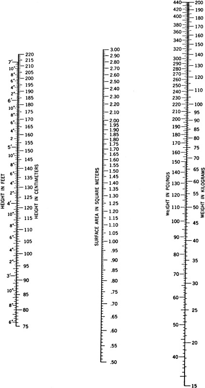
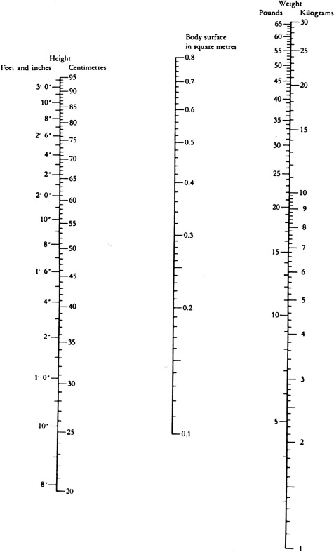

TABLE A2-1 

Comparison of the Weight-for-Height Tables from Actuarial Data: Non–Age-Corrected Metropolitan Life Insurance Company and Age-Specific Gerontology Research Center Recommendations 

HEIGHT  |  METROPOLITAN 1983 WEIGHTS [ * ](<#hl0000235>) (25–59 YEARS)  |  GERONTOLOGY RESEARCH CENTER [ * ](<#hl0000235>) (AGE-SPECIFIC WEIGHT RANGE FOR MEN AND WOMEN)   
---|---|---  
ft  |  in  |  Men  |  Women  |  20–29 Years  |  30–39 Years  |  40–49 Years  |  50–59 Years  |  60–79 Years   
4  |  10  |  |  100–131  |  84–111  |  92–119  |  99–127  |  107–135  |  115–142   
4  |  11  |  |  101–134  |  87–115  |  95–123  |  103–131  |  111–139  |  119–147   
5  |  0  |  |  103–137  |  90–119  |  98–127  |  106–135  |  114–143  |  123–152   
5  |  1  |  123–145  |  105–140  |  93–123  |  101–131  |  110–140  |  118–148  |  127–157   
5  |  2  |  125–148  |  108–144  |  96–127  |  105–136  |  113–144  |  122–153  |  131–163   
5  |  3  |  127–151  |  111–148  |  99–131  |  108–140  |  117–149  |  126–158  |  135–168   
5  |  4  |  129–155  |  114–152  |  102–135  |  112–145  |  121–154  |  130–163  |  140–173   
5  |  5  |  131–159  |  117–156  |  106–140  |  115–149  |  125–159  |  134–168  |  144–179   
5  |  6  |  133–163  |  120–160  |  109–144  |  119–154  |  129–164  |  138–174  |  148–184   
5  |  7  |  135–167  |  123–164  |  112–148  |  122–159  |  133–169  |  143–179  |  153–190   
5  |  8  |  137–171  |  126–167  |  116–153  |  126–163  |  137–174  |  147–184  |  158–196   
5  |  9  |  139–175  |  129–170  |  119–157  |  130–168  |  141–179  |  151–190  |  162–201   
5  |  10  |  141–179  |  132–173  |  122–162  |  134–173  |  145–184  |  156–195  |  167–207   
5  |  11  |  144–183  |  135–176  |  126–167  |  137–178  |  149–190  |  160–201  |  172–213   
6  |  0  |  147–187  |  |  129–171  |  141–183  |  153–195  |  165–207  |  177–219   
6  |  1  |  150–192  |  |  133–176  |  145–188  |  157–200  |  169–213  |  182–225   
6  |  2  |  153–197  |  |  137–181  |  149–194  |  162–206  |  174–219  |  187–232   
6  |  3  |  157–202  |  |  141–186  |  153–199  |  166–212  |  179–225  |  192–238   
6  |  4  |  |  |  144–191  |  157–205  |  171–218  |  184–231  |  197–244   
  
From Andres R: Mortality and obesity: the rationale for age-specific height–weight tables. In Hazzard WR, Bierman EL, Blass JP, et al, editors: _Principles of geriatric medicine and gerontology,_ ed 3, New York, 1994, McGraw-Hill, p 847, with permission. 

 * Values in this table are for height without shoes and weight without clothes. The Metropolitan Life Insurance Company (1983 Metropolitan height and weight tables, _Stat Bull Metropol Life Ins Co_ 64[Jan–Jun]:2, 1983) presented a table for nude heights and weights (Table 4) as well as a table for heights and weights clothed (Table 1). 

TABLE A2-2 

Body Mass Index Table 

To use the following table, find the appropriate height in the left-hand column. Move across to a given weight. The number at the top of the column is the body mass index at the height and weight. Pounds are rounded off.   
---  
**BMI** |  |  **19** |  **20** |  **21** |  **22** |  **23** |  **24** |  **25** |  **26** |  **27** |  **28** |  **29** |  **30** |  **31** |  **32** |  **33** |  **34** |  **35**  
**Body Weight (lb)**  
**Height (in)** |  58  |  91  |  96  |  100  |  105  |  110  |  115  |  119  |  124  |  129  |  134  |  138  |  143  |  148  |  153  |  158  |  162  |  167   
59  |  94  |  99  |  104  |  109  |  114  |  119  |  124  |  128  |  133  |  138  |  143  |  148  |  153  |  158  |  163  |  168  |  173   
60  |  97  |  102  |  107  |  112  |  118  |  123  |  128  |  133  |  138  |  143  |  148  |  153  |  158  |  163  |  168  |  174  |  179   
61  |  100  |  106  |  111  |  116  |  122  |  127  |  132  |  137  |  143  |  148  |  153  |  158  |  164  |  169  |  174  |  180  |  185   
62  |  104  |  109  |  115  |  120  |  126  |  131  |  136  |  142  |  147  |  153  |  158  |  164  |  169  |  175  |  180  |  186  |  191   
63  |  107  |  113  |  118  |  124  |  130  |  135  |  141  |  146  |  152  |  158  |  163  |  169  |  175  |  180  |  186  |  191  |  197   
64  |  110  |  116  |  122  |  128  |  134  |  140  |  145  |  151  |  157  |  163  |  169  |  174  |  180  |  186  |  192  |  197  |  204   
65  |  114  |  120  |  126  |  132  |  138  |  144  |  150  |  156  |  162  |  168  |  174  |  180  |  186  |  192  |  198  |  204  |  210   
66  |  118  |  124  |  130  |  136  |  142  |  148  |  155  |  161  |  167  |  173  |  179  |  186  |  192  |  198  |  204  |  210  |  216   
67  |  121  |  127  |  134  |  140  |  146  |  153  |  159  |  166  |  172  |  178  |  185  |  191  |  198  |  204  |  211  |  217  |  223   
68  |  125  |  131  |  138  |  144  |  151  |  158  |  164  |  171  |  177  |  184  |  190  |  197  |  203  |  210  |  216  |  223  |  230   
69  |  128  |  135  |  142  |  149  |  155  |  162  |  169  |  176  |  182  |  189  |  196  |  203  |  209  |  216  |  223  |  230  |  236   
70  |  132  |  139  |  146  |  153  |  160  |  167  |  174  |  181  |  188  |  195  |  202  |  209  |  216  |  222  |  229  |  236  |  243   
71  |  136  |  143  |  150  |  157  |  165  |  172  |  179  |  186  |  193  |  200  |  208  |  215  |  222  |  229  |  236  |  243  |  250   
72  |  140  |  147  |  154  |  162  |  169  |  177  |  184  |  191  |  199  |  206  |  213  |  221  |  228  |  235  |  242  |  250  |  258   
73  |  144  |  151  |  159  |  166  |  174  |  182  |  189  |  197  |  204  |  212  |  219  |  227  |  235  |  242  |  250  |  257  |  265   
74  |  148  |  155  |  163  |  171  |  179  |  186  |  194  |  202  |  210  |  218  |  225  |  233  |  241  |  249  |  256  |  264  |  272   
75  |  152  |  160  |  168  |  176  |  184  |  192  |  200  |  208  |  216  |  224  |  232  |  240  |  248  |  256  |  264  |  272  |  279   
76  |  156  |  164  |  172  |  180  |  189  |  197  |  205  |  213  |  221  |  230  |  238  |  246  |  254  |  263  |  271  |  279  |  287   
**BMI** |  |  **36** |  **37** |  **38** |  **39** |  **40** |  **41** |  **42** |  **43** |  **44** |  **45** |  **46** |  **47** |  **48** |  **49** |  **50** |  **51** |  **52**  
**Body Weight (lb)**  
**Height (in)** |  58  |  172  |  177  |  181  |  186  |  191  |  196  |  201  |  205  |  210  |  215  |  220  |  224  |  229  |  234  |  239  |  244  |  248   
59  |  178  |  183  |  188  |  193  |  198  |  203  |  208  |  212  |  217  |  222  |  227  |  232  |  237  |  242  |  247  |  252  |  257   
60  |  184  |  189  |  194  |  199  |  204  |  209  |  215  |  220  |  225  |  230  |  235  |  240  |  245  |  250  |  255  |  261  |  266   
61  |  190  |  195  |  201  |  206  |  211  |  217  |  222  |  227  |  232  |  238  |  243  |  248  |  254  |  259  |  264  |  269  |  275   
62  |  196  |  202  |  207  |  213  |  218  |  224  |  229  |  235  |  240  |  246  |  251  |  256  |  262  |  267  |  273  |  278  |  284   
63  |  203  |  208  |  214  |  220  |  225  |  231  |  237  |  242  |  248  |  254  |  259  |  265  |  270  |  278  |  282  |  287  |  293   
64  |  209  |  215  |  221  |  227  |  232  |  238  |  244  |  250  |  256  |  262  |  267  |  273  |  279  |  285  |  291  |  296  |  302   
65  |  216  |  222  |  228  |  234  |  240  |  246  |  252  |  258  |  264  |  270  |  276  |  282  |  288  |  294  |  300  |  306  |  312   
66  |  223  |  229  |  235  |  241  |  247  |  253  |  260  |  266  |  272  |  278  |  284  |  291  |  297  |  303  |  309  |  315  |  322   
67  |  230  |  236  |  242  |  249  |  255  |  261  |  268  |  274  |  280  |  287  |  293  |  299  |  306  |  312  |  319  |  325  |  331   
68  |  236  |  243  |  249  |  256  |  262  |  269  |  276  |  282  |  289  |  295  |  302  |  308  |  315  |  322  |  328  |  335  |  341   
69  |  243  |  250  |  257  |  263  |  270  |  277  |  284  |  291  |  297  |  304  |  311  |  318  |  324  |  331  |  338  |  345  |  351   
70  |  250  |  257  |  264  |  271  |  278  |  285  |  292  |  299  |  306  |  313  |  320  |  327  |  334  |  341  |  348  |  355  |  362   
71  |  257  |  265  |  272  |  279  |  286  |  293  |  301  |  308  |  315  |  322  |  329  |  338  |  343  |  351  |  358  |  365  |  372   
72  |  265  |  272  |  279  |  287  |  294  |  302  |  309  |  316  |  324  |  331  |  338  |  346  |  353  |  361  |  368  |  375  |  383   
73  |  272  |  280  |  288  |  295  |  302  |  310  |  318  |  325  |  333  |  340  |  348  |  355  |  363  |  371  |  378  |  386  |  393   
74  |  280  |  287  |  295  |  303  |  311  |  319  |  326  |  334  |  342  |  350  |  358  |  365  |  373  |  381  |  389  |  396  |  404   
75  |  287  |  295  |  303  |  311  |  319  |  327  |  335  |  343  |  351  |  359  |  367  |  375  |  383  |  391  |  399  |  407  |  415   
76  |  295  |  304  |  312  |  320  |  328  |  336  |  344  |  353  |  361  |  369  |  377  |  385  |  394  |  402  |  410  |  418  |  426   
  
Source: [ http://www.nhlbi.nih.gov/guidelines/obesity/bmi_tbl.htm ](<http://www.nhlbi.nih.gov/guidelines/obesity/bmi_tbl.htm>) . 

Figure A2-1 

Nomogram for the determination of body surface area of children and adults. 

(From Boothby WM, Sandiford RB: Nomographic charts for the calculation of the metabolic rate by the gasometer method, _Boston Med Surg J_ 185:337, 1921, with permission.) 

Figure A2-2 

Nomogram for the determination of body surface area of children. 

(From DuBois EF: _Basal metabolism in health and disease,_ Philadelphia, 1936, Lea & Febiger.) 

The formula for calculating BMI is: 

 BMI  =  Weight  (  kg  )  /  Height  (  m  2  ) 

_or_

 BMI  =  703  × Weight  (  lb  )  /  Height  (  in  2  ) 

The interpretation of BMI (kg/m  2 ) with risk for type 2 diabetes in adults 20 years old and older varies according to populations as follows: 

White European Populations  |  Asian Populations  |  Interpretation   
---|---|---  
<18.5  |  <18.5  |  Underweight   
18.5–24.9  |  18.5-23  |  Normal; increasing but acceptable risk   
25–29.9  |  23-27.5  |  Overweight; increased risk   
30 or higher  |  27.5 or higher  |  Obese; high risk   
  
From Centers for Disease Control and Prevention: _About BMI for adults._ [ http://www.cdc.gov/healthyweight/assessing/bmi/adult_bmi/index.html](<http://www.cdc.gov/healthyweight/assessing/bmi/adult_bmi/index.html>) . 

_Assessing body mass index and waist circumference thresholds for intervening to prevent ill health and premature death among adults for black, Asian, and other minority ethnic groups in the UK, NICE (National Institute for Health and Care Excellence) guidelines [PH46],_ July 2013. [ www.nice.org.uk/guidance/ph46/chapter/recommendations](<http://www.nice.org.uk/guidance/ph46/chapter/recommendations>) .
