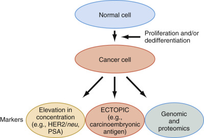
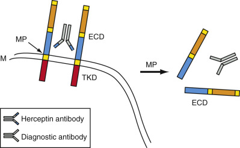
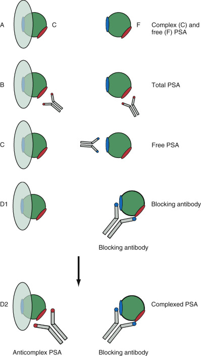

## Key Points

  * •

This chapter discusses the use of proteins, whose serum levels are often elevated in patients with malignancies, in the diagnosis and management of cancer. 

  * •

Many of these are so-called oncofetal antigens—that is, proteins that are expressed in fetal tissue during development but are not normally found in the tissues of adults. These include α-fetoprotein and carcinoembryonic antigen, whose serum levels are frequently elevated in hepatocellular and colon cancers, respectively. 

  * •

Other proteins, such as CA 19-9, CA 125, and CA 15-3, are expressed in epithelial cells and are also often present in the sera of patients with pancreatic, ovarian, and breast cancers, respectively. 

  * •

Because these “tumor marker” proteins are not tissue-specific and can also be expressed in diseases other than cancer, their sensitivities and specificities are not sufficiently high that they can be used as cancer-screening proteins. Their use is predominantly in following patients who are being treated for known malignancies. 

  * •

The exception to this is prostate-specific antigen (PSA), a chymotrypsin-like enzyme that is expressed almost exclusively in prostate tissue and is elevated in the sera of most patients with prostate cancer. Elevated serum PSA levels therefore have a high sensitivity for diagnosing prostate cancer. Because PSA is also elevated in other prostate diseases, such as benign prostatic hyperplasia, it has a lower specificity but nonetheless can still be used very effectively to screen patients for this disease. 

  * •

New developments in the field of early tumor detection using serum markers are also introduced in this chapter. These include use of mitogenic proteins, such as HER2/Neu, known to function as signal transduction proteins whose levels are elevated in many types of cancers; detection of genes encoding these proteins in body fluids; and proteomic approaches involving patterns of expression of multiple proteins that typify specific cancers. These specific approaches are also discussed in depth in [ Chapter 75 ](<##!/content/3-s2.0-B9780323295680000759?scrollTo=%23c00075>) . 

  * •

The identification of a circulating tumor cell (CTC) as a biomarker is a fast-growing area of research. This chapter updates the recent advance on CTC that is or will be applied in clinical application for diagnostic and prognostic values. 

  * •

Another area of growing research and translation to clinical application in cancer biomarkers is circulating nucleic acid, including the levels as well as mutation and methylation status. 

Despite the advancement of multidisciplinary treatment modalities, cancer mortality has not been significantly reduced for the past 50 years. In contrast, dramatic decreases in mortality due to cardiovascular and infectious disease have been achieved. Studies have shown that early detection of cancer can lead to superior long-term survival. Thus there is an urgent need to search for cancer biomarkers with high sensitivity and specificity to allow for early cancer detection, effective treatment, and decreased mortality. Therefore, much effort has been devoted to the discovery, characterization, and clinical application of tumor markers to detect the presence of cancer at an early stage. As a result, increasing numbers of biomolecules, mainly specific proteins and some specific ribonucleic acids (RNAs) and deoxyribonucleic acids (DNAs), have been identified and employed as markers potentially for screening purposes and also for prognostic purposes in the daily clinical management of cancer patients. These markers can further be used not only to classify cancers but also to monitor response to neoadjuvant therapy. For example, estrogen receptor (ER), progesterone receptor (PR), and HER2/ _neu_ oncogene protein are used in the diagnosis and management of breast cancer patients using surgical specimens. ER has been shown to be a prognostic marker for breast cancer and a predictive marker for hormonal treatment (  Jensen & Jordan, 2003  ). HER2/ _neu_ amplification and overexpression were shown to be associated with poor prognosis and to be a predictor for therapeutic response in breast cancer (  Wilmanns et al, 2004  ). PR has been shown to be associated with a good prognosis in ovarian cancer (  Munstedt et al, 2000  ;  Lee et al, 2005  ). 

Among these markers are a number of tumor markers present in circulating body fluids, including blood. Broadly, body fluid tumor biomarkers (principally serum and urine) are divided into three categories: tumor-associated proteins such as the oncofetal antigens, which seem to be expressed in many cancers but have also been found to be present in other nonneoplastic conditions; oncoproteins, which are involved in the regulation of cell cycle and become overexpressed or mutated almost exclusively in neoplastic conditions; and recently discovered patterns of protein expression in serum that appear to be unique to specific types of cancer (i.e., proteomics). This chapter emphasizes the use of the first two classes of tumor marker. [ Chapter 75 ](<##!/content/3-s2.0-B9780323295680000759?scrollTo=%23c00075>) discusses oncoproteins and the use of multiple protein profiles on body fluids, or proteomics, as biomarkers for early tumor detection. 

,  

##  Serum Markers as an Effective Tool for Diagnosis and Monitoring of Cancer 

Ideally, a tumor marker should become elevated in the serum only of patients with a malignant tumor and should not be elevated in the serum of disease-free individuals or of individuals with nonmalignant diseases such as inflammatory or infectious diseases. Also, a tumor marker protein should become elevated in the serum of cancer patients at an early stage, thereby enabling early tumor detection and the initiation of appropriate therapy. Although no one tumor marker has been found to meet all these characteristics, progress toward the discovery of such markers is continuously being made. 

In fact, studies show that one or more cancer biomarkers, including DNA, protein, or tumor cells, are almost always present in the serum of patients with cancer. These findings provide the rational basis for early detection of cancer using serum samples. Any circulating cell products, including DNA, RNA (including microRNA), proteins (enzymes, serum proteins, metabolites, receptors, carcinoembryonic proteins, oncoprotein, and proteins encoded by suppressor genes), and tumor cells, can be used as tumor markers if they are associated with events related to tumor formation and/or growth ( [ Fig. 74-1 ](<#f0010>) ). Such events include malignant transformation, proliferation, dedifferentiation, and metastasis. The blood levels of serum tumor markers are determined by tumor proliferation, tumor volume, proteolytic activities in the tumor cell, and release from necrotic tumor cells. The recent improvement of instrumentation, especially in consolidation of specialized testing instruments as immunoassay analyzers to a more general chemistry analyzer, facilitated the analysis of a wide range of analytes with the same degree of accuracy, specificity, and precision. The improved sensitivities of the assays made serologic tests far superior to other clinical examinations based on physical methods. An additional advantage of serum testing over tissue-based methods is the noninvasive nature, more accurate quantification, and lack of interobserver difference as opposed to tissue-based methods. Because of these benefits, serum markers are frequently used to screen for, diagnose, and predict the behavior of many cancers. 

Figure 74-1 

Different types of serum tumor markers are used to detect cancer. 

HER2 and prostate-specific antigen (PSA) reflect increased cellular proliferation. Carcinoembryonic antigen represents the dedifferentiation process of cancer. Current genomic and proteomics focus on collective changes in malignant cells. 

The clinical value of any given tumor marker will depend on its specificity and sensitivity, as well as its intended clinical use. For example, PSA can be used in the screening of prostate cancer, resulting in early detection and treatment. Serum HER2/ _neu_ is used as a marker of prognosis and monitoring therapy for breast cancer. The difference in their usefulness is due to their difference in tissue specificity and cancer sensitivity: PSA is organ-specific but not cancer-specific, whereas HER2/ _neu_ is cancer-specific but not tissue-specific and is found to be increased in breast cancers, as well as lung and other epithelial cell tumors. The use of tumor markers as prognostic and risk factors has gained more popularity in recent years. Measurement of the level of risk factors has been found to be valuable in the assessment of the aggressiveness of a tumor and is helpful in selecting treatment strategies. The utility of tumor markers is adjunctive to medical and surgical management of malignancies, serving to help detect recurrences as well as predict prognosis. 

,  

##  Functional Classification of Tumor Markers 

To learn how to identify, select, and utilize tumor markers for the diagnosis of cancer and the management of cancer patients, it is essential to be familiar with the function of each individual or group of cancer serum markers. This chapter emphasizes the role of three specific classes of tumor markers that are commonly used in the diagnosis of human malignancies: oncofetal antigens, such as α-fetoprotein (AFP) and carcinoembryonic antigen (CEA), which are normally expressed during fetal development but do not occur normally in the tissues or sera of children and adults; proteins occurring in epithelial cells that become elevated in tissue and serum in adenosquamous and squamous cell carcinomas, such as the CA 19-9, CA 125, and CA 15-3 proteins; and polypeptide hormones, such as the β chain of human chorionic gonadotropin (β hCG), and specific enzymes, such as the placental isoform of alkaline phosphatase (ALP), that become elevated in the serum of patients with specific tumors. These latter two tumor markers are frequently elevated in the sera of patients with germ cell tumors. Additionally, hormone-like proteins are found in the sera of patients with different cancers, such as parathyroid hormone–like protein that induces hypercalcemia as part of the so-called paraneoplastic syndrome in such cancers as renal cell carcinomas. 

Most of these proteins have been discovered on the basis of their having been observed in the sera of cohorts of patients with specific types of cancer. However, many of them are also found in the sera of patients with nonmalignant (e.g., inflammatory) conditions. In addition, they may not occur in significant numbers of patients in whom these cancers have been diagnosed. Thus the sensitivities and specificities of these tumor marker proteins are often low, resulting in their not being useful for screening purposes. On the other hand, all of these proteins are quite useful for _monitoring_ specific cancers. For example, CEA is often elevated in the sera of patients with colon cancer. Thus if CEA serum levels are found to be elevated in patients who have had a colon cancer resected, this is evidence of tumor recurrence. As discussed later, the one exception is PSA, a chymotrypsin-like enzyme that occurs almost uniquely in the prostate gland and has proved exceptionally useful in screening for prostate cancer and in monitoring patients who are being treated for this disease. 

Standard assays for all of these proteins are now well developed and have received approval from the U.S. Food and Drug Administration (FDA) for use in the monitoring of treatment of known cancers but not, except for PSA, for screening for human cancers. Investigations are currently focused on searching for proteins that are expressed only in cancer cells (see [ Chapter 75 ](<##!/content/3-s2.0-B9780323295680000759?scrollTo=%23c00075>) ). This chapter summarizes some of the more recently discovered proteins that are almost always expressed in cancerous but less commonly in noncancerous diseases and are promising for screening for the occurrence of cancer and for monitoring therapy. 

 

##  Oncoproteins are Markers for Cell Proliferation 

Oncoproteins are proteins that are directly or indirectly involved in the control of mitosis and are altered such that they continuously signal the cell to divide. These proteins either lie on signal transduction pathways carrying mitogenic signals from growth factors at the cell membrane to the nucleus or are involved in the regulation of transcription, activating the genes ultimately causing cell growth and mitosis (see [ Chapter 75 ](<##!/content/3-s2.0-B9780323295680000759?scrollTo=%23c00075>) ). For example, as discussed in [ Chapter 75 ](<##!/content/3-s2.0-B9780323295680000759?scrollTo=%23c00075>) , HER2/ _neu_ is a transmembrane receptor with an extracellular domain (ECD), a transmembrane domain, and an intracytoplasmic domain containing a tyrosine kinase. Upon binding of extracellular growth factors, the intracellular kinase becomes activated, causing dimerization of the receptor and interaction with a cytosolic adapter protein, Grb-2, to relay the message next to a guanine nucleotide exchange factor, SOS. SOS, in turn, binds to the critically important protein Ras-p21 (  Barbacid, 1987  ). Oncogenic c-Myc is an example of a different type of oncogene transcriptional factor, which functions via the activation of its target genes, inducing synthesis of mitogenic proteins. 

Often these proteins can be detected in the serum of patients with abnormal cell growth (i.e., cancer or precancerous states). Extensive testing for the presence of oncoproteins has revealed that many oncoproteins are detected in the serum and/or other body fluids of cancer patients. A detailed discussion of each oncoprotein is found in [ Chapter 75 ](<##!/content/3-s2.0-B9780323295680000759?scrollTo=%23c00075>) . 

 

##  Tumor Suppressors/Cell Differentiation 

Separate from oncogenes but equally important is a group of suppressor genes. Proteins encoded by suppressor genes are responsible for suppressing cell growth, either causing cell growth arrest in cell cycle or apoptosis. Frequently, these suppressor genes undergo deletions or mutations, resulting in the production of inactive gene products. Among the tumor suppressor genes, the antioncogene protein p53 has been widely investigated and best characterized for its role in various cancers. It is involved in apoptosis, cell cycle arrest, cell senescence, and DNA damage response. Deletions or mutations of the p53 gene greatly predispose cells to malignant transformation. p53 mutations have been identified in nearly 50% of human malignancies (  Soussi & Beroud, 2001  ). Molecular assays are available to detect mutations in the serum DNA of tumor suppressor genes. In addition, antibodies against the abnormal tumor suppressor proteins can be used as a biomarker for cancer. 

Molecular methods such as PCR-SSCP (polymerase chain reaction single strand conformation polymorphism) and DHPLC (denaturing high-performance liquid chromatography) have been described to detect serum p53 mutations in cancer. More significantly, antibodies against the abnormal tumor suppressor p53 proteins have been detected in the serum of cancer patients (  Soussi, 2000  ). Interestingly, the presence of p53 antibodies is correlated with the p53 mutation (  Guinee et al, 1995  ;  Hammel et al, 1999  ). In breast cancer, several studies indicated that the presence of p53 Ab in the serum correlated with increased proliferation antigen (Ki-67) and lack of ER expression, indicating that it may serve as a breast cancer prognostic marker (  Schlichtholz et al, 1992  ;  Sangrajrang et al, 2003  ). 

The discovery of two breast cancer susceptibility genes (or tumor-suppressor genes), _BRCA1_ and _BRCA2,_ has generated tremendous interest. Studies suggest that mutations in _BRCA1_ are responsible for approximately half of all cases of inherited breast cancer (  Easton et al, 1993  ;  Miki et al, 1994  ;  Wooster et al, 1994  ). In addition, carriers of _BRCA1_ mutations are also at an increased risk for ovarian, colon, and prostate cancer (  Futreal et al, 1994  ). _BRCA2_ , the second susceptibility gene for breast cancer, is thought to account for approximately 70% of cases of inherited breast cancer that are not due to _BRCA1_ mutations and is associated with an increased risk of breast cancer in men. 

The suppressor genes and their products are potentially useful as tumor markers for the screening and identification of families or high-risk individuals. Development of immunoassays to measure both _BRCA1-_ and _BRCA2_ -encoded proteins are under development and may be useful for the identification of high-risk individuals and their families. 

 

##  Adhesion Molecules and Metastasis 

Tumor metastases involve several major steps (  Liotta, 1987  ). First, the tumor cells have to penetrate their adjacent surroundings, after which they invade vascular or lymphatic vessels. The tumor cells are then carried to distant sites, until they are lodged in the venous or capillary beds of a distant organ. In this new environment, these tumor cells must again penetrate the vascular walls in order to grow at the distant site. Cell adhesion molecules, including integrins, selectins, cadherins, and cell adhesion molecules of immunoglobulin gene families, regulate many steps of the metastatic process. The changes in their levels of expression reflect the malignant behavior of cancer cells. For example, increased serum levels of E-selectin, intercellular adhesion molecule (ICAM), and vascular cell adhesion molecule (VCAM) are increased, in particular, in late-stage breast cancer patients (  O'Hanlon et al, 2002  ;  Sheen-Chen et al, 2004  ). Elevated serum VCAM level may be used to predict a shorter survival. Another study indicated that postchemotherapeutic levels of serum E-selectin and ICAM are associated with a response to treatment of patients with Hodgkin disease (  Syrigos et al, 2004  ). Furthermore, increased E-selectin, ICAM-1, and VCAM are suggested to be a prognostic factor for survival in patients with gastric cancer (  Alexiou et al, 2003  ). Therefore, the appearance of these cell adhesion molecules in blood circulation might indicate the risk or occurrence of metastases or a poor prognosis. 

 

##  Monoclonal Antibody–Defined Tumor Markers 

The development of hybridoma technology has greatly impacted the identification of tumor markers (  Milstein & Cuello, 1983  ). Rather than dealing with a whole molecule of known protein structure, it is now possible to focus on only a small surface area, an epitope or antigenic determinant using monoclonal antibodies. It is no longer necessary to purify the antigen for the preparation of polyclonal antibodies in animals. The complete characterization and identification of the molecule carrying the epitope is also no longer needed. A hybridoma can be prepared by injecting a mouse with an enriched fraction of the tumor cell membrane or the whole tumor cell. Hybridomas producing the monoclonal antibodies of interest are selected through the subsequent screening procedure. Once a hybridoma is established, there will be an unlimited and consistent supply of monoclonal antibody (MAb) for various uses. 

By combining the MAbs with the solid-phase sandwich test design, new assays have been developed that have eliminated many problems associated with polyclonal assays, involving poor reproducibility, lot-to-lot variations, poor specificity, and nonspecific cross-reactivity (  Diamond et al, 1981  ). It also reduces the differences between different kits and widens the linear concentration range for the assay. Whenever a MAb is available, its use is recommended. To achieve higher test sensitivity, the use of a combination of multiple MAbs has been found to improve the affinity between solid-phase-absorbed-multiple MAbs and the soluble antigen. 

Tests for the MAb-defined tumor markers have been demonstrated to have a higher sensitivity and specificity than those using polyclonal antibodies. For example, CA 19-9, CA 125, and CA 15-3 are much more sensitive and specific than CEA for pancreatic, ovarian, and breast carcinomas, respectively. These markers are recommended to replace the polyclonal CEA test for the diagnosis and management of patients with the above-mentioned carcinomas. Various tumor markers derived from different tumors also share many tumor-associated epitopes. For example, CA 19-9, CA 15-3, and CA 125 are expressed by almost all carcinomas in varying degrees. In addition to the sharing of any given epitope by more than one carcinoma, it is also possible for a single molecule to express more than one epitope (  Yu et al, 1991  ). For example, it is likely that CA 15-3 and CA 125 are expressed by the same mucin molecule. 

 

##  Other Markers 

Many hormones (e.g., hCG, epinephrine, dopamine, and serotonin), serum proteins, enzymes (lactate dehydrogenase, ALP), and their metabolites, such as the metabolites of the neuroendocrine hormones (e.g., vanillylmandelic acid, homovanillic acid, and 5-hydroxyindoleacetic acid), may become elevated in tumors because of the high proliferation rate of tumor cells. Their serum levels rise to even higher levels when a benign tumor becomes malignant and metastasizes. Benign and nonmalignant diseases may also involve elevated levels of markers, so these markers are not suitable for screening or for cancer diagnosis because of the large numbers of false-positive results that would be generated. These markers are more appropriately used for monitoring patient response during treatment. 

One exception relates to the enzyme alkaline phosphatase (ALP) discussed in [ Chapter 20 ](<##!/content/3-s2.0-B9780323295680000206?scrollTo=%23c00020>) . There are multiple isozymes of this enzyme, one of which is the placental isozyme placental ALP (PLAP). This form becomes elevated in the serum of patients who have germ cell tumors. One particular use of PLAP is in the serum or, more effectively, in the cerebrospinal fluid (CSF) of patients with a mass in the pineal region with a differential diagnosis of germ cell tumor versus pinealoma. If PLAP is elevated in the CSF of a patient with a mass in the pineal area, a diagnosis of germ cell tumor can be made. As it happens, radiation therapy is curative, obviating the need for surgery. 

The enzymatic activities of various tissue-specific glycosyltransferases are altered in tumor cells. Some of the elevated glycosyltransferases have been used as tumor markers. The sugar sequence and composition of the carbohydrate moiety of many serum glycoproteins, including blood group substances and mucins, such as CA 19-9, are tumor markers resulting from altered glycosyltransferase activity. The AFP isolated from patients with primary hepatocellular carcinoma has an additional fucose compared with the AFP from benign liver disease, an example of altered fucosyltransferase in hepatocellular carcinoma cells (  Wu, 1990  ). 

Ectopic proteins are often expressed in cancer. Carcinoembryonic proteins, which are detectable in both fetal and tumor tissues but not in normal adult tissues, usually lack any known physiologic function and have blood concentrations at nanogram-per-milliliter levels. Therefore, measurements of carcinoembryonic proteins in the circulation must rely on immunoassays. The specificity and sensitivity associated with these proteins, although not 100%, are much higher than those of enzymes and metabolites that have been used as tumor markers in the past. The serum concentration of these carcinoembryonic proteins not only correlates well with tumor activity but can also be used to predict prognosis. However, carcinoembryonic proteins in general are not suitable for screening because the polyclonal antibodies directed against these proteins often cross-react with other, normal proteins, and these carcinoembryonic proteins do not appear sufficiently early in the blood from cancer patients to detect the tumors at early stages. However, they have been used as adjunct tests for cancer diagnosis and are extremely useful for monitoring the success of treatment and for detecting recurrence. 

,  

##  Clinical Applications 

The serum tumor markers are currently used for screening, diagnosing, and predicting prognosis and treatment response. Use of tests for screening of disease, even those with high sensitivity and specificity, should be confined as much as possible to populations at risk for the disease. This is because the positive predictive value depends on the prevalence of the disease. Because most of the tumor markers described in this chapter are expressed both in neoplastic and benign conditions, their use is confined to following possible tumor recurrence in patients being treated for specific types of tumor. 

 

##  Screening 

The recommendation of screening for prostate cancer by the measurement of serum PSA in combination with a digital rectal examination (DRE) in men older than age 50 years is due to the high tissue specificity of PSA (  Wu, 1994  ) and the high prevalence of prostate cancer. Combination of the PSA test and DRE provides the least costly approach to the early detection of prostate cancer (  Littrup et al, 1993  ). PSA screening is especially recommended for African American men because the incidence of prostate cancer for African Americans is nearly twice that of the general population, and the death rate is up to three times higher. Screening permits the treatment of organ-confined, potentially curable prostate cancer discovered in men with a life expectancy of longer than 10 years. 

Although not approved for screening for hepatocellular carcinoma in the United States, AFP has been used to screen for primary hepatocellular carcinoma in China because of the high incidence of liver cancer in that country. The diagnosis of ovarian cancer has traditionally relied on imaging and discovery at surgery (e.g., exploratory laparotomy). However, in most cases, at the time of detection, the tumor has advanced to a stage at which the possibility of cure is low. The feasibility of screening for ovarian cancer in women by measuring serum CA 125 is being investigated. 

 

##  Diagnosis 

Several approaches have been suggested recently to improve the diagnostic yield of many tumor markers. The use of multiple markers is one approach that has received wide acceptance. As is also noted in Chapter 74, specific patterns of multiple tumor markers seem to be associated with individual malignant diseases. Another approach to improving both the specificity and sensitivity of tumor markers, as in the case of a serum PSA test, involves the measurement of the velocity (the rate of increase in PSA concentration over time) and the density (e.g., by dividing the serum PSA concentration by the volume of the prostate gland, determined by trans­rectal ultrasound) (  Benson et al, 1992  ). These efforts aim at a better discrimination between benign and malignant states. For example, a mildly elevated serum PSA level associated with a small prostate gland may indicate cancer, whereas the same PSA value in a patient with a large gland may indicate benign prostatic hypertrophy (BPH). 

 

##  Prognosis: Recurrence, Metastasis, and Survival 

The assessment of tumor aggressiveness and the prognosis for the outcome of a cancer patient has received much attention in recent years. The knowledge of tumor aggressiveness helps in the development of a proper therapy for the patient. For example, the detection of tumor markers, highly associated with malignancy and metastases, will suggest a more rigorous and systemic treatment. Monitoring tumor markers for the detection of recurrence following the surgical removal of the tumor is the second most useful application of tumor markers. It is well known that the appearance of most of the circulating tumor markers has a lead time of several months (3-6 months) before the stage at which many of the physical procedures could be used for the detection of cancer. The specificity of tumor markers does not present a problem for this application. The ease of drawing blood and the sensitivity of tumor marker tests make this noninvasive monitoring process now widely accepted. 

Most tumor markers become increasingly elevated when the tumor metastasizes. Very few tumor markers have a clear-cut boundary between benign and malignant stages. Proteins that reflect the risk factors associated with the process of tumor metastases, such as proteases and adhesion molecules, are usually better markers for predicting prognosis. However, most of these markers are still measured in tumor tissues and tissue lysates. The finding of the ECD of c- _erb_ B-2 protein in the serum of cancer patients ( [ Fig. 74-2 ](<#f0015>) ) and the correlation of the serum ECD with the levels of other serum tumor markers are encouraging. Another area of intensive study is to explore the use of serum marker surrogates in the prediction of cancer patient survival. 

Figure 74-2 

HER2/ _neu_ monoclonal antibodies are used both therapeutically and diagnostically in breast cancer. 

Humanized HER2 monoclonal antibody trastuzumab (Herceptin), shown with a _dark blue_ complementarity determining region (CDR), reacts with a specific region of HER2 epitope _(dark blue)_ , causes the death of malignant breast cells, and is often effective in the treatment of breast cancer. On the other hand, different monoclonal antibodies, which do not cross-react with the trastuzumab determinant, recognize the extracellular domain (ECD) ( _orange-colored_ domain in the figure) of HER2/ _neu_ in serum after it is cleaved off this growth factor receptor by metalloprotease. Because trastuzumab and diagnostic monoclonal antibodies recognize different epitopes of HER2, there is no interference in detecting serum levels of HER2 in trastuzumab-treated patients. _M,_ Cell membrane; _MP_ , metalloprotease; _TKD_ , tyrosine kinase domain. 

 

##  Monitoring Treatment Response 

One of the most useful applications of tumor markers involves monitoring the course of the disease, especially during treatment. The serum level of tumor markers reflects the success of surgery or the efficacy of chemotherapy. Detecting elevated levels of a tumor marker after surgery would indicate incomplete removal of the tumor, recurrence, or the presence of metastases. The measurement of serum tumor markers during chemotherapy also gives an indication of the effectiveness of the antitumor drug used and a guide for the selection of the most effective drug for each individual case. 

,  

##  Recommendations for Ordering Tumor Marker Tests 

When ordering tumor markers as an adjunct diagnostic test for managing cancer patients, the following recommendations should be kept in mind in order to avoid misinterpretation of the test results: 

  * 1.

Never rely on the result of a single test. Because of low specificity associated with most tumor markers, it is difficult to differentiate between malignant and benign diseases on the basis of a single test result. Most tumor marker elevations found in nonmalignant diseases may be transient, whereas with cancer, the level often either remains elevated or rises continuously. Ordering serial testing can help detect falsely elevated levels due to transient elevation. For example, elevated serum AFP can be detected in patients with either primary hepatocellular carcinoma or benign liver disease. However, on a subsequent testing 2 weeks later, the serum AFP will remain elevated in patients with cancer, whereas in patients with benign conditions, the serum AFP may return to normal levels. 

  * 2.

When ordering serial testing, be certain to order every test from the same laboratory using the same assay kit. Each different commercial kit may generate different results even though all are designed for the same tumor marker. Ordering from the same laboratory also ensures a more consistent performance. It is important to ensure that any change observed during the monitoring process is due to a change of tumor volume or other tumor activities and not to laboratory variability. 

  * 3.

Be certain that the tumor marker selected for monitoring recurrence was elevated in the patient before surgery. Because none of the tumor markers are 100% sensitive to the detection of any particular cancer, it is important to be certain that the tumor marker ordered to detect recurrence was elevated before surgery. Otherwise, multiple markers should be measured before the surgery in order to select the tumor marker showing the highest elevation as the marker for monitoring the disease activity. Multiple markers may be used to monitor the therapeutic effects for increased sensitivity. 

  * 4.

Consider the half-life of the tumor marker when interpreting the test result. Before surgery, estimate the time required for the level to decline to the normal or, in the case of PSA, to an undetectable level, based on the known half-life of the tumor marker. It is important that the success of surgical removal of a tumor as determined by tumor marker concentrations is not assessed earlier than 2 weeks postoperatively. If possible, it is preferable to wait one whole month to allow the preexisting tumor marker in the serum adequate time to decline to lower levels. For example, the half-life of serum PSA is approximately 3 to 4 days. Therefore, it takes 30 days for a serum PSA at 50 ng/mL to drop to an undetectable level following successful surgery. 

  * 5.

Consider how the tumor marker is removed from or metabolized in the blood circulation. Elevated serum tumor markers are frequently detected in patients with renal or liver disease, depending on whether the tumor marker is removed through the kidney or metabolized by the liver. For example, serum CEA is often elevated in patients with liver disease because the impaired liver fails to remove CEA efficiently from the blood circulation, whereas an elevated serum β 2  -microglobulin (β 2  M) has been frequently found in patients with renal failure in which even the small β 2  M molecule has difficulty passing through the glomerular membrane in a normal fashion. 

  * 6.

Consider ordering multiple markers to improve both the sensitivity and the specificity for diagnosis. Tumors are made of heterogeneous types of cells. Some may still be normal, while others may be heterogeneous tumor cells as a result of different sequences of multiple mutations. Each type of cell may express a single marker, such as those shown in [ Table 74-1 ](<#t0010>) , or a number of characteristic tumor markers. The same marker may also be produced by different types of cells. Some cells may never produce any unique marker. Certain types of cancer are heterogeneous in their cellular composition. Consequently, more than one tumor marker may be required to provide a high sensitivity of detection. The heterogeneity in cell composition and the percentage of cell distribution of each tumor explains why a number of tumor markers may be required to reach a high (>90%) detection sensitivity and the reason that the sensitivity of an individual marker differs among cancer patients. Multiple tumor markers associated with individual malignant diseases are listed in [ Table 74-2 ](<#t0015>) ; the appearance of individual tumor markers in various malignancies is listed in [ Table 74-3 ](<#t0020>) . This explains why none of the tumor markers presently employed are 100% sensitive and specific and why the use of multiple markers will improve the sensitivity of detection. However, a unique pattern of multiple markers may be identified with tumors derived from the same tissues. Therefore, ordering multiple tumor markers may also improve the test specificity. For example, a specific pattern seems to be associated with colon, breast, ovarian, and pancreatic carcinomas when all four MAb-defined tumor markers—CEA, CA 19-9, CA 15-3, and CA 125—are measured simultaneously. This information is clinically important, because more than 60% of diagnosed human cancers are epithelial-cell-derived carcinomas (  Wu, 1989  ). Multiple markers were used to develop a more specific screening strategy for ovarian cancer. The use of CA 15-3 and CA 72-4 in combination with CA 125 can increase the apparent specificity of the CA 125 assay for distinguishing malignant from benign ovarian disease (  Bast et al, 1991  ). Another example is the combination of CEA, CA 19-9, and CA 72-4. Use of this combination improves the diagnostic accuracy of gastrointestinal cancers (  Carpelan-Holmstrom et al, 2002  ). During the selection of multiple tumor markers, only markers that are complementary to one another should be selected. Many tumor markers, which run parallel to one another when correlated with tumor activities, should not be selected for this purpose. 

TABLE 74-1 

Monoclonal-Antibody–Defined Tumor Markers 

Tumor Marker  |  Major Malignant Disease   
---|---  
CA 125  |  Ovarian carcinoma   
CA 19-9  |  Pancreatic carcinoma   
CA 15-3  |  Breast carcinoma   
CA 72-4  |  Gastric carcinoma   
HER2/ _neu_ |  Breast carcinoma   
  

TABLE 74-2 

Serologic Tumor Markers Associated with Individual Malignant Diseases 

Malignant Disease  |  Major Marker  |  Other Markers   
---|---|---  
**Neuronal Tumors**  
Brain tumor  |  Desmosterol  |  Polyamines   
Neuroblastoma  |  VMA  |  HVA, NSE, cystathionine, ferritin, metanephrines   
**Head and Neck Tumors**  
Squamous cell carcinoma  |  CYFRA 21-1  |   
**Endocrine System**  
Pituitary tumors  |  Growth hormone  |  IGF-I   
Adrenal pituitary tumors  |  Cortisol  |  Free catecholamines, DHEA, 17-ketosteroids, prolactin   
Cushing syndrome  |  ACTH  |  Endorphin, lipotropin   
Hypercalcemia of malignancy  |  PTH-related peptide  |   
Endocrine pancreatic tumors:  |  Pancreatic polypeptide:  |  Chromogranin AC-peptide, IGF-I binding protein I   
Gastrinoma  |  Gastrin  |   
Glucagonoma  |  Glucagon  |   
Insulinoma  |  Insulin  |   
Medullary carcinoma of thyroid  |  Calcitonin  |  NSE   
Microadenomas (pituitary)  |  Prolactin  |   
Multiple endocrine neoplasias  |  Chromogranin A  |   
Papillary and follicular thyroid cancer  |  Thyroglobulin  |   
Parathyroid tumors  |  PTH-intact  |   
Zollinger-Ellison syndrome  |  Gastrin  |   
Pheochromocytoma  |  Metanephrine  |  Chromogranin A, plasma catecholamines   
Pituitary tumors  |  Free β hCG  |  FSH, LH, prolactin, TSH   
**Bone and Skeletal Muscle System**  
Osteosarcomas  |  Alkaline phosphatase  |   
**Breast Cancer**  
Breast cancer  |  HER2/ _neu_ , CA 15-3  |  CYFRA 21-1, CEA, calcitonin   
**Pulmonary System**  
Bronchogenic carcinoma  |  Prolactin  |   
Lung cancer (NSC)  |  CYFRA 21-1, NSE  |  ACTH, CK-BB, calcitonin, CA 72-4, CEA, AFP, ferritin, LASA-P, TPA   
Carcinoid tumors  |  Histamine, ADH, bradykinin  |   
Oat cell cancer  |  ACTH, ADH, CEA, CK-BB, NSE, bombesin, calcitonin  |   
**Gastrointestinal System**  
Colorectal cancer  |  CEA  |  CA 19-5, CA 19-9, CA 72-4, NSE   
Gastric carcinoma  |  CA 72-4  |  CA 19-9, CA 50, CEA, ferritin, CK-BB, hCG, LASA-P, pepsinogen II   
Hepatocellular carcinoma  |  AFP  |  CEA, ferritin, ALP, TPA, γ-glutamyltranspeptidase (GGT)   
Pancreatic carcinoma  |  CA 19-9  |  CA 19-5, CA 50, CA 72-4, CEA, CK-BB, ADH, ALP   
Vipoma (pancreas)  |  VIP  |   
**Genitourinary System**  
Bladder cancer  |  T-antigen, urokinase inhibitor, TPA, cytokeratins  |  Glycosaminoglycans, uroplakins   
Nonseminomatous testicular tumor  |  AFP  |  hCG   
Prostate carcinoma  |  PSA  |  PAP, racemase   
Renal cell carcinoma  |  Renin, erythropoietin, IL-4, PGA  |   
Testicular cancer  |  hCG  |  PLAP, Oct3/4   
**Gynecological Tumors**  
Cervical cancer  |  SCC  |  CA 125, CEA, TPA   
Ovarian carcinoma  |  CA 125  |  UGF, inhibin, AFP, amylase isoenzyme, CEA, CK-BB, hCG   
Choriocarcinoma  |  hCG  |   
Placental tumors  |  hCG  |  Free α hCG, CA 15-3, PTH, NSE, prolactin   
Uterine cancer  |  SCC  |   
Teratoblastoma  |  AFP  |  hCG, ferritin   
**Hematology Malignancies and Lymphomas**  
B cell chronic lymphocytic leukemia  |  TdT  |  Serum β 2  M, LASA-P   
B cell malignancies  |  β 2  M  |   
Chronic myelogenous leukemia  |  TdT  |   
Hairy cell leukemia  |  IL-2 receptor  |   
Hodgkin disease  |  LASA-P, ferritin  |   
Leukemia  |  TdT  |  ALP, β 2  M, ferritin, LD, myelin basic protein, adenosine deaminase, PNP   
Lymphoma  |  β 2  M  |  TdT, Ki-67, LASA-P   
Multiple myeloma  |  Ig heavy and light chain  |  Bence-Jones protein, β 2  M, IgA   
Waldenström's disease  |  IgM  |  β 2  M   
**Melanoma**  
Melanoma antigen  |  Melanoma-associated LASA-P,  l  -dopa  |  C-reactive protein   
**Endoreticular System**  
Spleen tumors  |  Ferritin  |   
**Other**  
Sarcoma  |  β 2  M  |   
  
_ACTH_ , Adrenocorticotropic hormone; _ADH_ , antidiuretic hormone; _AFP_ , α-fetoprotein; _ALP_ , alkaline phosphatase; _ β 2  M, _ β 2  -microglobulin; _CEA_ , carcinoembryonic antigen; _CK-BB_ , brain isozyme of creatine phosphokinase; _CYFRA 21-1,_ cytokeratin subunit 19; _DHEA_ , dihydroepiandrosterone; _FSH_ , follicle-stimulating hormone; _hCG_ , human chorionic gonadotropin; _HVA,_ homovanillic acid; _Ig,_ immunoglobulin; _IGF_ , insulin-like growth factor; _IL_ , interleukin; _ki67,_ cell proliferation marker; _LASA-P,_ lipid-associated sialic acid in plasma; _LD_ , lactate dehydrogenase; _LH_ , luteinizing hormone; _NSC_ , nonsmall cell; _NSE_ , neuron-specific enolase; _Oct3/4,_ transcription factor in stem cells and germ cells required for pluripotency; _PAP_ , prostate acid phosphatase; _PGA_ , prostaglandin A; _PLAP_ , placental alkaline phosphatase; _PNP,_ purine nucleotide phosphorylase; _PTH_ , parathyroid hormone; _SCC_ , squamous cell carcinoma; _TdT,_ terminal deoxynucleotide transferase; _TPA_ , tissue plasminogen activator; _TSH_ , thyroid-stimulating hormone; _UGF_ , uterine growth factor; _VIP_ , vasoactive intestinal polypeptide; _VMA_ , vanillylmandelic acid. 

TABLE 74-3 

Malignant Disease Associated with Individual Serologic Tumor Markers 

Tumor Marker  |  ASSOCIATED MALIGNANT DISEASE   
---|---  
Major Disease  |  Minor Disease   
α-Fetoprotein  |  Primary hepatocellular carcinoma  |  Teratoblastomas of the ovary and testes   
β hCG  |  Pituitary tumors  |   
β 2  -Microglobulin  |  B cell neoplasias  |  Multiple myeloma, B cell lymphoma, B cell chronic lymphocytic leukemia, and reticulum cell sarcoma; Waldenström's macroglobulinemia   
β hCG  |  Choriocarcinoma  |  Testicular cancers (nonseminomatous), trophoblastic tumors   
Bence-Jones protein  |  Multiple myeloma  |   
Bombesin  |  Oat-cell cancer  |   
C-reactive protein  |  Melanoma  |   
CA 15-3  |  Breast cancer  |  Various carcinomas   
CA 19-9  |  Pancreatic and gastric carcinoma  |  Various carcinomas   
CA 72-4  |  Gastric carcinoma  |  Various carcinomas   
CA 125  |  Ovarian carcinoma  |  Various carcinomas   
CA 549  |  Breast cancer  |   
CA M26  |  Breast cancer  |   
Calcitonin  |  Medullary carcinoma  |  Cancer of the thyroid, liver cancer, renal cancer   
Carcinoembryonic antigen  |  Colorectal carcinoma  |  Various carcinomas   
c- _erb_ B-2 oncoprotein  |  Breast carcinoma  |  Various carcinomas   
Chromogranin A  |  Pheochromocytoma, neuroblastoma  |  Multiple endocrine neoplasias, small cell lung cancer, carcinoid tumors   
CYFRA 21-1  |  Squamous cell carcinoma of the lung  |   
DHEA  |  Adrenal/pituitary cancer  |   
Ferritin  |  Acute myelocytic leukemia  |  Hodgkin lymphoma, neuroblastoma and various carcinomas, teratoblastoma   
Galactosyltransferase  |  Ovarian cancer   
Galactosyltransferase isoenzyme II  |  Pancreatic cancer  |   
Gastrin  |  Gastrinoma  |  Zollinger-Ellison syndrome   
Her2/ _neu_ |  See c- _erb_ B-2 oncoprotein  |   
Human chorionic gonadotropin  |  Choriocarcinoma  |  Gastric, ovarian, and breast carcinoma, trophoblastic or germ cell tumors, testicular cancer   
Hyaluronic acid  |  Mesothelioma  |   
Immunoglobulin A  |  Multiple myeloma  |   
Insulin-like growth factor-I  |  Pituitary cancer  |  Insulinoma   
Interleukin-2 receptor  |  Leukemia  |   
Immunoglobulins  |  Multiple myeloma  |  Mediterranean lymphoma, Waldenström's macroglobulinemia, malignant lymphoma   
Inhibin  |  Granulosa-cell tumors  |   
17-ketosteroids  |  Adrenal/pituitary cancer  |   
  
_ β hCG, _ β chain of human chorionic gonadotropin; _CYFRA 21-1,_ cytokeratin subunit 19; _DHEA,_ dihydroepiandrosterone; _hCG_ , human chorionic gonadotropin. 

  * 7.

Be aware of the presence of ectopic tumor markers. The expression of tumor markers is under genetic regulation. For benign tumors, there are often proteins produced by the tumor that are cell-specific and are related to normal cell products at an elevated concentration (see [ Fig. 74-1 ](<#f0010>) ). However, if a benign tumor becomes malignant, synthesis of these cell-specific proteins may no longer occur in the malignant cells. Conversely, proteins that are normally found at an early fetal stage and not in normal cells or in benign tumors of these cells may become constitutively expressed in the malignant cells. This is the reason that carcinoembryonic proteins and ectopic tumor markers are usually expressed in malignant cancers, often at advanced stages. Thus, often, the appearance of ectopic tumor markers is associated with poor prognosis or metastasis. For example, elevated serum concentrations of AFP may be detected in patients with cancers of the gastrointestinal tract involving metastases even though the liver function tests are normal. [ Table 74-4 ](<#t0025>) lists some of the known ectopic markers and their associated malignant diseases. 

TABLE 74-4 

Ectopic Tumor Markers 

Marker  |  Tumor   
---|---  
α-Fetoprotein  |  Gastrointestinal, renal, bladder, and ovarian carcinoma   
Calcitonin  |  Endocrine tumors (islet cell, carcinoid, medullary thyroid, pheochromocytoma); lung, breast, and ovary carcinoma   
Chromogranin A  |  Endocrine tumors (islet cell, carcinoid, medullary thyroid, pheochromocytoma), prostate cancer   
Free α hCG  |  Colorectal carcinoma and pancreatic endocrine tumors   
hCG  |  Gastric and pancreatic carcinoma, hepatoma, ovarian carcinoma, germ cell tumor of testis   
PTH  |  Renal cell carcinoma; breast; squamous cell carcinoma; bladder and ovarian carcinomas   
Thyroglobulin  |  Differentiated thyroid carcinoma   
  
_hCG_ , Human chorionic gonadotropin; _PTH,_ parathyroid hormone. 

One should be aware of the recent guidelines on gastrointestinal and breast cancer marker use published by the American Society of Clinical Oncology (  Smith et al, 1999  ). They recommend monthly breast self-examination, annual mammography of the preserved and contralateral breast, and a careful history and physical examination every 3 to 6 months for 3 years, then every 6 to 12 months for 2 years, and annually thereafter. They do not recommend the use of tumor markers (e.g., CEA, CA 15-3, and CA 27.29) for screening, nor do they recommended routine bone scans, chest radiographs, hematologic blood counts, liver ultrasonograms, or computed tomography for screening. The American College of Physicians has also published clinical guidelines concerning the early detection of prostate cancer. They emphasize the importance of both screening PSA and performing DRE for the early detection of prostate cancer. Even though DRE is not as sensitive as PSA screening, it can detect cancer that would otherwise be missed by PSA measurement (  Coley et al, 1997a;  1997b  ). 

  * 8.

Heterophilic antibody. The use of MAbs in immunoassays and the increasing clinical application of mouse MAbs for targeted imaging and immunotherapy create a new problem. Treated individuals apparently produce heterophilic antibodies against murine antibodies that interfere with many of the immunoassays for tumor markers (  Nahm & Hoffmann, 1990  ) although this is not a common encounter. The interference by the heterophilic antibodies in human sera can either increase or decrease the results of an immunoassay. These antibodies react in a way similar to antigens in terms of binding to both solid-phase-associated and signal-labeled antibodies. These heterophilic antibodies may bind to a site other than the analyte-binding site, cross-linking the signal antibody with the capture antibody, and thus generating a false assay response. As many as 15% to 40% of individuals may have one or more heterophilic antibodies. The standard approach for reducing heterophilic antibody interference is to include excess mouse sera or nonspecific mouse immunoglobulins in the immunoassay. 

,  

##  Individual Tumor Markers 

 

##  α-Fetoprotein 

AFP is a major fetal serum protein and is also one of the major carcinoembryonic proteins. AFP resembles albumin in many physical and chemical properties. In the fetus, AFP is synthesized by the yolk sac and fetal hepatocytes and, to a lesser extent, by the fetal gastrointestinal tract and kidneys. Elevated AFP can be found in patients with primary hepatocellular carcinoma and yolk sac–derived germ cell tumors (mainly endodermal sinus tumor) and is the most useful serum marker for these cancers (  Lamerz, 1997  ). However, AFP is also transiently elevated during pregnancy and in many benign liver diseases. Because of the high prevalence of liver cancer in China and other countries in Southeast Asia, AFP testing has been used successfully in screening for hepatocellular carcinoma in that region of the world. Tests for both AFP and hCG are helpful in reducing clinical staging errors in patients with some testicular tumors and aid in the differential diagnosis of various germ cell tumors. Because an increase of fucosylation of AFP (hence the lentil lectin reactivity of serum AFP) has been found in primary hepatocellular carcinoma, the determination of lentil lectin reactivity of serum AFP was found helpful not only to differentiate between primary hepatocellular carcinoma and benign liver diseases but also to provide an early signal indicating that hepatocellular carcinoma may begin to develop in patients with liver disease. Although the necessity for routine AFP screening needs further study, one study indicates that combined screening with AFP and ultrasonography results in increased sensitivity from 75% to near 100% in detecting hepatocellular carcinoma (hCC) of patients with hepatitis B and C (  Izzo et al, 1998  ;  Gebo et al, 2002  ). Finally, AFP is currently offered for prenatal screening for neural tube defects and, in conjunction with free β hCG and unconjugated estriol, for Down syndrome (  Cuckle, 2000  ;  Yamamoto et al, 2001  ). 

 

##  Angiogenic Factors 

Angiogenesis is the formation of blood vessels in situ, involving the orderly migration, proliferation, and differentiation of vascular cells. Blood vessel formation is also important in the pathogenesis of rapid growth and metastasis of solid tumors. Several angiogenic factors have been identified, including acidic and basic fibroblast growth factor (bFGF), described in Chapter 74; angiogenin; and vascular endothelial growth factor (VEGF) (  Folkman & Shing, 1992  ). Both angiogenic and antiangiogenic factors have been found in the serum of patients with malignant disease (  Morelli et al, 1998  ). Serum levels of bFGF and VEGF reflect their expression in individual tumors (  Poon et al, 2003  ;  Granato et al, 2004  ). The significance of elevated serum VEGF in cancer patients has been evaluated in several studies including breast, ovarian, hepatocellular, colorectal, and renal cell carcinomas and soft tissue sarcoma. Elevated serum VEGF values in ovarian cancer patients were correlated with cancer differentiation, metastasis, and, more significantly, shorter average survival time (  Alvarez Secord et al, 2004  ;  Harlozinska et al, 2004  ;  Li et al, 2004  ). Furthermore, elevated serum VEGF has been associated with shorter survival in renal cell carcinoma (  Ljungberg et al, 2003  ) and colon carcinoma (  De Vita et al, 2004  ). 

 

##  β 2  -Microglobulin 

β 2  M is the constant light chain of the human histocompatibility locus antigen expressed on the surface of most nucleated cells. The molecular weight of β 2  M is only 11.8 kDa. β 2  M is shed into the extracellular fluid and is elevated not only in solid tumors but also in lymphoproliferative diseases (including B cell chronic lymphocytic leukemia, non-Hodgkin lymphoma, and, importantly, multiple myeloma) (  Wu et al, 1986  ). Serum concentration of β 2  M correlates with lymphocyte activity, making β 2  M a good marker for lymphoid malignancies of the B cell line. It has been used as an indicator of the patient's response to treatment (  Haferlach & Loffler, 1997  ). CSF levels of β 2  M are useful for detecting metastases in the central nervous system. It is reported that serum β 2  M level is elevated in 75% of patients with multiple myeloma (  Kyle et al, 2003  ) and is useful in following the efficacy of the treatment of this disease, although currently serum free light chain (FLC) assay has been found to be more effective in following this disease (see later). 

 

##  Serum Free Light Chain Determinations 

In [ Chapter 19 ](<##!/content/3-s2.0-B978032329568000019X?scrollTo=%23c00019>) on specific serum proteins, the use of serum protein electrophoresis was discussed as an important method for detecting monoclonal gammopathies. These are conditions in which single clones of B cells or plasma cells proliferate and overproduce a specific monoclonal immunoglobulin. These are detected as monoclonal spikes in the Ig region of the electrophoretigram. Immunofixation reveals the type of immunoglobulin that is being overexpressed. Monoclonal gammopathies involving IgG and IgA result in the condition of multiple myeloma, a cancer of B or plasma cells in which the proliferation of these cells causes lytic lesions in bone marrow, causing pathologic fractures and resulting in hypercalcemia and elevations of serum alkaline phosphatase (see [ Chapter 20 ](<##!/content/3-s2.0-B9780323295680000206?scrollTo=%23c00020>) ). Monoclonal gammopathies involving IgM give rise to Waldenström's macroglobulinemia, also a cancer of B or plasma cells in which high levels of IgM are expressed in serum. IgM immunoglobulins are Ig pentamers with 10 antigen binding sites and are therefore very large proteins. These monoclonal proteins are highly hygroscopic, giving rise to the so-called hyperviscosity syndrome where the relative viscosity of blood is much higher than that for blood from normal individuals, reaching as high as five times that of normal viscosity. This can lead to sludging of blood in capillaries, with resulting infarcts of tissues. In addition, monoclonal gammopathies occur that do not involve malignant transformation of B or plasma cells but involve overproduction of the monoclonal antibodies and light chains. Most of these conditions are referred to as MGUS or monoclonal gammopathy of uncertain significance. However, some of these conditions result in polymerization of the monoclonal light chains that are deposited in multiple different tissues, a condition called primary, or AL, amyloidosis. Irrespective of the specific condition, it is vital to diagnose and to follow these conditions in a quantitative manner. 

All immunoglobulins involve the association of two heavy with two light chains, which are of the kappa or lambda types. Light chains are encoded on genes on chromosome 2 and are present in excess of heavy chains. In most monoclonal gammopathies, light chains are produced in substantial excess of heavy chains and are themselves monoclonal—that is, they have a single unique amino acid sequence. Light chains have constant, variable and hypervariable domains, the latter forming the complementarity-determining domain involved in antigen recognition. Each chain type has sequences that are type-specific. Parts of these sequences are “buried” when the light chains are complexed with their counterpart heavy chains. Mono- and polyclonal antibodies have been developed that recognize each chain type uniquely and will bind to each only if the light chain is not bound to the heavy chain. This allows quantitation of free kappa and lambda light chains in serum. 

The reference range for serum kappa light chains is 0.33 to 1.94 mg/dL and for lambda light chains, it is 0.57 to 2.63 mg/dL. Values of one or the other light chain that substantially exceed the upper reference range, while the level of the counterpart chain either remains in the reference range or is slightly elevated, suggest a monoclonal gammopathy. Another way of quantitating free light chains (FLCs) is to measure the ratio of kappa to lambda chain levels. The reference range for the kappa/lambda ratio is 0.57 to 2.63. Values below 0.57 suggest a lambda gammopathy, while values that exceed 2.63 suggest a kappa light chain gammopathy. 

Serum FLC determinations are currently the most sensitive method for following the course of treatment of specific monoclonal gammopathies and have replaced serum protein electrophoresis and immunofixation and beta-microglobulin levels for this purpose. They are also excellent predictors of the prognosis for patients being treated for these conditions and for patients with MGUS (  Rajkumar et al, 2005  ). 

In a recent study (  Kim et al, 2014  ), it was found that serum FLC assays had sensitivities of 64% to 72%, depending on the assay, and 93% to 100% specificities. The reference method was immunofixation. The limitations of the serum FLC assay in diagnosing monoclonal gammopathy were very low levels of monoclonal protein, chronic kidney disease, polyclonal gammopathy, biclonal gammopathy, and IgM gammopathy. However, the high values for the sensitivity and specificity are encouraging findings that suggest that FLC assays will become useful in detecting B and plasma cell tumors at an early stage. 

 

##  Carcinoembryonic Antigen 

CEA is a glycoprotein with a molecular weight of approximately 200 kDa. It is the first of the so-called carcinoembryonic proteins and was discovered by  Gold and Freedman in 1965  . CEA is still the most widely used tumor marker for gastrointestinal cancer, but most CEA assays have replaced polyclonal with monoclonal anti-CEA antibodies. 

CEA was originally thought to be a specific marker for colorectal cancer, but it turned out to be a nonspecific marker on further studies. CEA levels can be elevated in breast, lung, and liver cancers, among others. CEA studies demonstrated that tumor markers could be used to follow patients during therapy and to detect recurrence after successful surgery. The association between highly elevated serum tumor marker concentration and metastases and poor prognosis was also discovered through CEA studies. Elevated CEA levels before resection of colon cancer may suggest a worse prognosis. Declining levels during therapy suggest response to therapy, whereas increasing levels suggest disease progression. However, clinical decisions regarding management of disease cannot be based on CEA levels alone (  Mitchell, 1998  ). As the liver metabolizes CEA, liver damage can impair CEA clearance and lead to increased levels in the blood circulation. Increased CEA concentrations have been observed in some patients following radiation treatment and chemotherapy. It was recommended that CEA should form part of the American Joint Committee on Cancer staging system (  Compton et al, 2000  ). CEA can be used as a marker for monitoring colorectal cancer (  Bast et al, 2001  ). However, a low positive predictive value for diagnosis in asymptomatic patients limits its widespread use in screening. 

Other genetic tumor markers are being used with increased frequency. For example, transforming growth factor–α, fibroblast growth factor, and Ras oncoprotein are all increased in colorectal cancer and decreased after surgical resection. More recently, mutations of DNA mismatch repair genes (e.g., _hMSH2_ , _hMLH1,_ and _hMSH6_ ) are shown to be associated with hereditary nonpolyposis colorectal cancer. Further clinical studies to correlate the serum levels of expression and mutation in these genes might yield a better diagnostic/prognostic tool. 

 

##  CA 15-3 and CA 27.29 

These antigens correspond to sequences of mucins called polymorphic epithelial mucins (PEMs), which are often overexpressed on the cell surfaces of malignant glandular cells such as those occurring in breast cancer, and increasing amounts are shed into the circulation, where they can be detected, making them useful as tumor markers. The polypeptide core of PEM contains a 69-amino acid cytoplasmic domain and a much larger ECD, consisting of 20 amino acid tandem repeats that vary among individuals, and different alleles of the human _MUC1_ gene may code for between 25 and 100 or more tandem repeats. A large part of the molecule is carbohydrate, and the degree of glycosylation is variable, making PEM very heterogeneous in structure (  Klee & Schreiber, 2004  ). 

The CA 15-3 determinant is identified by two distinct monoclonal antibodies. The assay uses a solid-phase conjugated MAb—MAb 115D8—to capture the MAM-6 antigen in human plasma and a labeled MAb DF3 as detecting antibody. MAb 115D8 was prepared against human defatted milk fat globule, and MAb DF3 was prepared against the breast carcinoma cell line MCF-7. The CA 15-3 antigen is present in a variety of adenocarcinomas, including breast, colon, lung, ovary, and pancreas. 

CA 15-3 is a more sensitive and specific marker for monitoring the clinical course of patients with metastatic breast cancer (  Canizares et al, 2001  ). CA 15-3 levels increase with higher stages of breast cancer stage (  Bast et al, 2001  ). In addition, CA 15-3 can be used to predict adverse outcomes in breast cancer patients (  Gion et al, 2002  ;  Kumpulainen et al, 2002  ;  Duffy et al, 2004  ). However, the relative low sensitivity (23%) and specificity (69%) (  Chan & Sell, 2001  ) in detecting breast cancer have limited its use. CA 15-3 can also be elevated in chronic hepatitis, liver cirrhosis, sarcoidosis, tuberculosis, and systemic lupus erythematosus, and in patients who smoke (  Tondini et al, 1988  ). CA 27.29, another mucin marker MUC1-associated antigen, is a slightly more sensitive breast cancer marker than CA 15.3. The FDA has approved both CA 15-3 and CA 27.29 for monitoring therapy of advanced or recurrent breast cancer. Patients with ovarian carcinoma have significantly elevated MUC1 serum concentrations as compared to those with benign ovarian diseases with high variability. Results from immunohistochemistry indicate that mucin-1 has a prognostic relevance in ovarian carcinomas when evaluating the expression by VU4H5 antibody (  Engelstaedter et al, 2012  ). 

 

##  CA 19-9, CA 50, and CA 19-5 

CA 19-9 is the first tumor marker of a group of newer epitopes, including CA 125, CA 15-3, and CEA, defined by monoclonal antibodies. These new monoclonal kits detect more newly discovered epitopes and were designed to replace polyclonal CEA measurements for various carcinomas. The assay for CA 19-9 measures a carbohydrate antigenic determinant expressed on a high molecular weight mucin. CA 19-9 is an epitope, defined as sialylated lacto- _N_ -fucopentose II, recognized by the MAb 1116NS-199. The molecule, carrying the CA 19-9 epitope, appears as mucin in the sera of cancer patients but as a ganglioside in tumor cells. CA 19-9 is also related to Lewis blood group substances. Only serum antigen from cancer patients belonging to the Le (a  – b  \+  ) or Le (a  \+  b  – ) blood group will be CA 19-9-positive. In addition to CA 19-9, CA 19-5 and CA50 have also been defined by monoclonal antibodies that are only slightly different from CA 19-9. CA 19-9 can be elevated in patients with colorectal cancer, gastric cancer, and pancreatic cancer. The epitope related to CA 50 is very similar to that of CA 19-9 but lacks a fucose residue, the same epitope found in Lewis-negative Le (a  – b  – ) individuals. Serum CA 19-9 concentrations not only are frequently highly elevated in both gastric and pancreatic carcinomas but also are useful for monitoring the success of therapy and for detecting recurrence in these cancer patients. However, it has been reported that CA 19-9 and CA 50 complement each other in pancreatic and other carcinomas: Their simultaneous use may improve the sensitivity in detecting these malignant diseases. CA 19-9 is the most widely studied and the only FDA-approved biomarker for pancreatic ductal carcinoma (  Winter et al, 2013  ). Elevated perioperative serum CA 19-9 levels are independent predictors of poor survival in patients with resectable cholangiocarcinoma (  Kondo et al, 2014  ). CA 19-5 is detected by mouse MAb CC3C-195 and reacts with both Le  a  and sialyl-Le  a  epitopes. CC3C-195 binds with high affinity to the sialylated Le  a  blood group antigen but exhibits a lower affinity to the nonsialylated form. Elevated serum levels of CA 50 and CA 19-5 can also be found in patients with colon, pancreatic, and hepatocellular carcinomas. False-positive findings may occur in patients with benign liver disease and may be due to cholestasis in these patients (  Wu & Carlisle, 1992  ). 

 

##  CA 125 

CA 125 is another antigenic determinant defined by a MAb and is also associated with a high molecular weight (>200 kDa) mucin-like glycoprotein. CA 125 is expressed by more than 80% of nonmucinous epithelial ovarian carcinomas and is found in most serous, endometrioid, and clear cell carcinomas of the ovary (  Jacobs & Bast, 1989  ). However, patients undergoing chemotherapy may show a false decline of CA 125 antigen and a negative result does not always rule out tumor recurrence. CA 125 is also used clinically for follow-up on uterine tumors (>60% are elevated) and benign tumors, including endometriosis. Recent studies showed greatly improved sensitivity of serum CA 125 in combination with other markers using proteomics techniques (discussed in detail in succeeding chapters) (  Jacobs & Menon, 2004  ;  Lu et al, 2004  ;  Zhang et al, 2004  ). Studies for the application of serum CA 125 in other cancerous (e.g., non-Hodgkin lymphoma, lung cancer) and nonmalignant (e.g., liver cirrhosis) diseases have been performed (  Ando et al, 2003  ;  Xiao & Liu, 2003  ;  Zidan et al, 2004  ) and showed increased levels of CA 125 in the sera of these patients. 

Recently, human epididymis protein 4 (HE4) has been studied to improve the sensitivity and specificity of ovarian cancer diagnosis. HE4 is primarily expressed in the reproductive and respiratory tracts (  Bingle et al, 2002  ;  Galgano et al, 2006  ) and is overexpressed in epithelial ovarian cancer (  Schummer et al, 1999  ). The HE4 gene product is an _N_ -glycosylated protein, which is secreted into the extracellular environment and can be detected in the bloodstream of patients with ovarian cancer (  Moore et al, 2008  ). HE4 was found to be elevated in more than half of ovarian tumors that do not express CA 125 (  Moore et al, 2008  ). This finding prompted the development of a dual marker algorithm that combined HE4 and CA 125 with the pre- and postmenopausal statuses of the patient, known as Risk of Ovarian Malignancy Algorithm (ROMA) (  Moore et al, 2009  ). ROMA has been shown in several studies to better predict the presence of a malignant ovarian mass than other markers, with high sensitivity and specificity (  Moore et al, 2009  ). 

 

##  CA 72-4 

The CA 72-4 assay detects a mucin-like human adenocarcinoma-associated antigen—TAG-72—which is a high molecular weight (>10  6  kDa) mucin-like complex molecule. Because the TAG-72 can be detected in both fetal epithelia and sera from patients with various carcinomas, it is also considered to be a carcinoembryonic protein. However, only moderately elevated serum CA 72-4 are found in most carcinomas. Currently, CA 72-4 is considered to be a useful marker for the management of patients with gastric and colorectal carcinoma. CA 72-4 has been proposed as a specific marker for tumor occurrence of resectable gastric cancer (  Marrelli et al, 2001  ) and a prognostic marker for survival (  Gaspar et al, 2001  ). CA 72-4 has been reported to be an independent prognostic marker for survival in colorectal cancer (  Louhimo et al, 2002  ) in multivariate analysis together with β hCG and CEA. 

 

##  Calcitonin 

Calcitonin is one of the circulating peptide hormones that may become elevated in patients with increased bone turnover rate associated with skeletal metastases. Calcitonin can be ectopically elevated in bronchogenic carcinomas and is also elevated in medullary carcinoma of the thyroid (see [ Table 74-4 ](<#t0025>) ). Serum procalcitonin, having comparable diagnostic accuracy, has great potential to replace serum calcitonin as a new standard of care in the management of medullary carcinoma of the thyroid because it does not need to be kept cool on ice or frozen and is easier to manage at the community level (  Machens et al, 2014  ). 

 

##  Chromogranin A 

Chromogranin A is a major soluble protein of the chromaffin granule. Chromogranin A and catecholamines are released from the adrenal medulla upon stimulation of the splanchnic nerve. However, chromogranin A is not confined to chromaffin cells of the adrenal medulla and sympathetic neurons. It is also present in various neuroendocrine organs. Elevated serum chromogranin A levels can be detected in pheochromocytoma (  Giovanella & Ceriani, 2002  ), medullary carcinoma of the thyroid, and small cell lung carcinoma (  Ma et al, 2003  ). Interestingly, increased serum chromogranin A levels are detected in epithelial cancers with neuroendocrine differentiation, including prostate, breast, ovary, pancreas, and colon (  Wu et al, 2000  ). 

Prostate cancer with neuroendocrine differentiation has been an active area of study. Higher levels of serum chromogranin A are associated with poorly differentiated prostate cancer (  Isshiki et al, 2002  ). It is also increased after androgen blockade therapy and systemic radionucleotide therapy (  Ferrero-Pous et al, 2001  ) for prostate cancer. Furthermore, an association between increased chromogranin A and prostate cancer metastasis has been observed (  Tarle et al, 2002  ). Intermittent androgen deprivation therapy can reduce the levels of chromogranin A, and thus the neuroendocrine differentiation of prostate cancer (  Sciarra et al, 2003  ). Chromogranin A is not only a reliable serum diagnostic biomarker for pancreatic neuroendocrine tumors but also can predict overall survival and treatment response, especially in Asian patients (  Chou et al, 2014  ). 

 

##  Cytokeratin 19 Fragment 

Cytokeratin 19 fragment (CYFRA 21-1) is a fragment of the cytokeratin 19 intermediate filament found in the serum. It is a subunit of a cytokeratin intermediate filament expressed in simple epithelia and their malignant counterparts. Studies of elevated serum CYFRA 21-1 have concentrated on breast cancer and squamous cell carcinoma of the lung. CYFRA 21-1 was reported to have a sensitivity of 60%, 64.2%, and 89% for the detection of stage IV breast cancer, recurrence, and metastasis, respectively. Probability of survival for primary cancer patients, recurrence after surgery, and response after chemotherapy were correlated with elevated preoperative serum CYFRA 21-1 in breast cancer patients (  Nakata et al, 2000;  2004  ). CYFRA 21-1 was also shown to reflect the tumor mass in multiple studies with correlation to tumor stage, survival, predictive role in surgical treatment for early-stage disease, and chemotherapy for advanced-stage non–small cell lung cancer (NSCLC). In one study of head and neck squamous cell carcinoma (SCC), increased postradiotherapeutic or chemotherapeutic CYFRA 21-1 has been explored as an early indicator for distant metastasis (  Kuropkat et al, 2002  ). CYFRA 21-1 is not increased in patients with nonneoplastic lung disease, including pneumoconiosis and obstructive airway disease (  Schneider et al, 2003  ). 

 

##  Human Chorionic Gonadotropin 

Human chorionic gonadotropin (hCG), a member of the glycoprotein hormone family, is synthesized and secreted by trophoblast cells of the placenta and is a heterodimeric hormone composed of noncovalently linked α and β subunits internally linked by disulfide bonds. The current assays using monoclonal antibodies are available to detect intact hCG, “nicked” hCG, or hCGn (which is partially degraded hCG that is missing peptide bonds between amino acids 44 and 45 or 47 and 48); hCG α subunit; hCG β subunit; and hCG β core (residual hCG β, residues 6-40 joined by disulfide bond to hCG β, residues 55-92) (  Berger et al, 2002  ;  Birken et al, 2003  ). Both malignant and nonmalignant trophoblast cells synthesize and secrete not only the biologically active α and β dimer but also the uncombined (or free) α and β subunits. In addition to the intact dimer, a free β subunit of hCG has been detected in the serum of women during early pregnancy and in patients with malignant tumors (see [ Chapter 25 ](<##!/content/3-s2.0-B9780323295680000255?scrollTo=%23c00025>) ). 

Measurement of the free β subunit is useful for the detection of recurrence or metastasis for choriocarcinoma when the intact hCG may remain normal. Analysis of serum hCG subunits is especially useful for managing patients with germ cell tumors (  Von Eyben, 2003  ). However, elevated hCG can be found in trophoblastic tumors, choriocarcinoma, and testicular tumors. More than 60% of patients with nonseminomatous germ cell tumors and 10% to 30% with seminomas have elevated free β hCG. 

Seminomatous testicular cancer contains both intact hCG and β hCG or free α subunits in equal amounts. Therefore, only one assay is needed for monitoring these patients. On the other hand, only hCG or β hCG subunits may be found in patients with nonseminomatous cancers. The measurement of both free subunits and intact hCG will increase the test sensitivity for these patients with nonseminomatous cancers. 

Ectopic free β hCG production occurs in approximately 30% of patients with other cancers, including urothelial cancer, but only the free β hCG and its respective breakdown product, β core, have been detected in these clinical samples. Ectopic α hCG is a marker of malignancy in pancreatic endocrine tumors (  Ma et al, 2003  ). Recent efforts in preparation of the new World Health Organization reference reagent for hCG (HCG, hCG-α, and hCG-β) and its related molecules may decrease the nonspecific reaction and increased accuracy of clinical hCG testing (  Bristow et al, 2005  ). 

 

##  HER2/ _neu_ (c- _erb_ B-2) ONCOPROTEIN 

The HER2/ _neu_ (c- _erb_ B-2) oncogene is a 185-kDa transmembrane protein of the tyrosine kinase receptor family and is discussed extensively in [ Chapter 75 ](<##!/content/3-s2.0-B9780323295680000759?scrollTo=%23c00075>) . It shows structural and functional homology with the epidermal growth factor receptor (EGFR) containing intracellular, transmembrane, and ECDs (see [ Fig. 74-2 ](<#f0015>) ). HER2/ _neu_ has been found to be elevated in the sera of patients with a number of different epithelial cell cancers, including breast cancer (  Mori et al, 1990  ;  Leitzel et al, 1992  ;  Ali et al, 2002  ;  Tsigris et al  2002a  ). In patients with breast cancer, serum HER2/ _neu_ is very important as a prognostic and predictive marker. At the time of initial diagnosis, serum HER2/ _neu_ is elevated in only 5% to 10% of breast cancer patients. Increased serum HER2/ _neu_ before adjuvant therapy has been shown to be associated with increased tumor size, tumor grade, and positive lymph nodes. The serum HER2/ _neu_ test is indicated for follow-up and monitoring of patients with metastatic breast cancer whose initial serum HER2/ _neu_ level is greater than 15 ng/mL.  Schippinger and colleagues (2004)  reported that a decrease of elevated serum HER2/ _neu_ to levels below 15 ng/mL and levels continuously 15 ng/mL or less during the course of disease correlated significantly with longer survival. The serum HER2 level as assessed by the chemiluminescence immunoassay method is the most sensitive marker of HER2-positive metastatic breast cancer compared with the CEA and CA 15-3 levels (  Kan et al, 2009  ). Prechemotherapy and postchemotherapy HER2/ _neu_ levels could serve as a prognostic marker for disease-free survival and overall survival (  Hayes et al, 2001  ;  Saghatchian et al, 2004  ). In addition, serum HER2/ _neu_ levels correlate with response to chemotherapy, including chemo- and hormonal-, as well as Herceptin (trastuzumab) treatment; higher levels predict incomplete response, while low levels suggest longer or complete treatment responses (  Colomer et al, 2000  ;  Harris et al, 2001  ;  Lipton et al, 2002  ;  Bethune-Volters et al, 2004  ;  Luftner et al, 2004  ). 

Enzyme-linked immunosorbent assay (ELISA) measures the levels of the circulating c- _erb_ B-2, referred to as p105 or serum HER2, constituting the ectodomain (see [ Fig. 74-2 ](<#f0015>) ). Three FDA-approved ELISA tests for serum circulating HER2 using monoclonal antibodies are available: one for microtiter plate assay—Oncogene Science/Siemens—and two for automated instrument—Bayer Immuno 1 HER2/neu assay (Siemens) and ADVIA Centaur HER2/neu immunoassay (Siemens). The ADVIA Centaur HER2/neu immunoassay kit is similar to the Bayer/Siemens Immuno 1 HER2/neu kit in indication for use, format, performance characteristics, and results. The ADVIA differs mainly in the signal system, which is chemiluminogenic, instead of the ALP-catalyzed color reaction in the Siemens/ADVIA Immuno 1 assay. More important, there is no interference with the serum HER2/ _neu_ test by heterophile antibodies and, more significantly, the therapeutic MAb trastuzumab, because different antigen epitopes are targeted (see [ Fig. 74-2 ](<#f0015>) ). 

HER2/ _neu_ is also overexpressed and/or amplified in oral squamous cell carcinoma (  Chen et al, 2007  ), NSCLC (  Papila et al, 2009  ), gastric cancer (  Tsigris et al, 2002b  ), colorectal cancer (  Tsigris et al, 2002a  ), urothelial carcinoma (  Hussain et al, 2007  ), prostate cancer (  Kehinde et al, 2008  ), and ovarian cancers in association with advanced stage and poor prognosis, so it can be used as a therapeutic target in these cancers (  Agus et al, 2000  ). Recently, serum levels of HER2 extracellular domain are highly correlated with tissue HER2 status in metastatic gastric cancer, and this assay can be considered as a potential alternative for tissue HER2 status (  Peng et al, 2014  ). 

 

##  p53 

p53 (see [ Chapter 75 ](<##!/content/3-s2.0-B9780323295680000759?scrollTo=%23c00075>) ) is a 53-kDa nuclear phosphoprotein and a negative regulator of cell growth. It functions as a tumor suppressor by inducing the expression of gene products that are responsible for inhibiting or arresting cell growth and proliferation. The ability of p53 protein to regulate transcription of its target genes is based on its sequence-specific DNA binding activity and the presence of a domain that can activate transcription when attached to the DNA-binding domain of p53 target protein. It is the DNA-binding domain that appears to be sensitive to disruption by mutation, and most lesions associated with human cancers occur within this domain. The encoding gene for p53 has been found to be mutated in about half of almost all types of cancer arising from a wide spectrum of tissues. Because of its short half-life (20 minutes), the wild-type p53 protein in the blood circulation is not detectable (  Malkin et al, 1990  ;  Harris & Hollstein, 1993  ). However, current molecular techniques such as PCR/SSCP (detailed in Part 8) can detect serum p53 gene mutations. The presence of p53 antibody in serum facilitated the detection of abnormal p53 serologically. Significantly, the presence of p53 antibody in serum is associated with the expression of p53 mutations and positively correlates with the degree of cancer malignancy (discussed in [ Chapter 75 ](<##!/content/3-s2.0-B9780323295680000759?scrollTo=%23c00075>) ). 

 

##  Parathyroid Hormone–Related Peptide 

Plasma concentrations of parathyroid hormone–related peptide (PTH-RP) are elevated in the majority of patients with cancer-associated hypercalcemia. PTH-RP is secreted by tumors associated with hypercalcemia. The circulatory forms of PTH-RP in these patients include both a large amino terminal peptide and a carboxyl terminal peptide with close sequence homology to parathyrin (PTH). The mechanism by which PTH-RP induces hypercalcemia involves binding and activating receptors that also bind PTH. Measuring the concentrations of PTH-RP may be useful in the differential diagnosis of hypercalcemia related to malignancy and associated either with primary hyperparathyroidism, sarcoidosis, vitamin D toxicity, or various malignancies (including squamous cell, renal, bladder, and ovarian carcinomas). Patients with impaired renal function but without hypercalcemia or cancer may have increased plasma concentrations of PTH-RP (  Burtis et al, 1990  ). 

 

##  Serum Markers for Prostate Cancer 

 

##  Serum Prostate-Specific Antigen 

PSA is a member of the kallikrein family of serine proteases that is synthesized uniquely in the epithelial cells of the prostate gland. Its expression in these cells is regulated by the androgen receptor. Because of its high degree of tissue specificity, it is perhaps the most widely used tumor marker discovered thus far. The normal reference range is 0 to 4 ng/mL. The cancer sensitivity and tissue specificity of PSA make it the most useful tumor marker available for the screening and management of prostate cancer. Lack of cancer specificity in distinguishing prostate cancer and nonmalignant prostate lesions is the main drawback with PSA. Benign conditions such as BPH, acute prostatitis, and infarction can also be correlated with elevated serum PSA levels. 

PSA serves as an excellent cancer marker in prostate cancer screening, diagnosis, prediction of cancer risk, and recurrence. Since its discovery in prostate cancer serum in 1980 (  Papsidero et al, 1980  ), PSA has been subjected to intensive research and clinical usage in the screening, detection, and monitoring of prostate cancer. PSA and its various forms are used to guide clinical decisions for further tissue biopsy diagnosis, resulting in increased prostate cancer detection, especially in young men. Use of PSA in prostate cancer detection has also resulted in a reduction in the number of prostate cancers discovered only at late stages in which metastases occurred, from about 30% of all newly diagnosed cases to about 10% of all such cases (  Cooperberg et al, 2004  ). Annual PSA screening is recommended by both the American Urological Association and the American Cancer Society for all men over the age of 50. The American Urological Association (AUA) issued new guidelines here during its 104th annual meeting (  Greene et al, 2009  ). The new guidelines have lowered the age for beginning prostate-specific antigen (PSA) screening to 40 years for relatively healthy, well-informed men who want to be tested. In addition, because of its tissue specificity, the PSA assay is particularly useful for monitoring the success of surgical prostatectomy. Complete removal of the prostate should result in an undetectable PSA level, while incomplete resection of the gland (not persistent disease) might result in measurable levels of PSA. However, it should remain unchanged on extended follow-up. Any increase in measurable PSA after a successful radical prostatectomy would indicate prostate cancer recurrence or metastasis. A transient and modest increase of PSA may occur during radiation therapy, which should not be misinterpreted as disease progression. 

Multiple studies suggest that diagnosis is made in more than 80% (in some studies, >90%—e.g.,  DeSoto-LaPaix et al, 2003  ) of patients with prostate cancer from serum PSA levels that are greater than 4 ng/mL. Because BPH and acute prostatitis also induce elevated serum PSA levels, approximately half of patients with PSA values greater than 4 ng/mL are not found to have prostate cancer on biopsy, even at significantly elevated levels (i.e., >10 ng/mL). These studies therefore suggest that PSA has a sensitivity of a minimum of 80% and a specificity of around 50%. However, it has also been found that about 20% of initially negative biopsies, when repeated over a 3-year period, become positive (  DeSoto-LaPaix et al, 2003  ). Thus the specificity of PSA may be higher, assuming that the biopsies missed a malignant lesion and that a new malignancy did not occur over the 3-year time period, leading to the current practice of saturation biopsy. 

On the other hand, the cutoff value of 4 ng/mL does not sufficiently distinguish patients with and without prostate cancer, including more aggressive cancers (  Schröder et al, 2000  ;  Horninger et al, 2002  ;  Punglia et al, 2003  ;  Thompson et al, 2004  ). In a review of the Prostate Cancer Prevention Trial, 2950 men who never had a PSA level greater than 4 ng/mL or an abnormal DRE had a final PSA determination and underwent a prostate biopsy after being in the study for 7 years (  Thompson et al, 2004  ). There was a 15.2% (n = 449) biopsy-proven prevalence of prostate cancer in men with PSA levels no greater than 4 ng/mL. High-grade prostate cancer (defined as a Gleason score ≥7) was seen in 15.8% (n = 71) of these men. Size of the tumor was not reported. In the placebo arm of the Prostate Cancer Prevention Trial, there was no cutpoint of PSA with simultaneous high sensitivity and high specificity for detection of prostate cancer in healthy men, but rather a continuum of prostate cancer risk at all values of PSA (  Thompson et al, 2005  ). These studies appear to confirm the results of other studies that the sensitivity of PSA, using the 4 ng/mL cutoff, in diagnosing prostate cancer is on the order of 80% to 85%. The finding that using a cutoff of 4 ng/mL for PSA to diagnose this disease results in 15.2% false-negative results in the patient population subjected to biopsies is compatible with this conclusion (i.e., 84.2% of patients with prostate cancer had serum PSA levels greater than 4 ng/mL). 

The issue of using lower cutoffs for serum PSA to identify more patients with prostate cancer has been further explored (  Punglia et al, 2003  ), especially in view of the development of more sensitive assays for PSA, now commercially available in PSA test kits, that are capable of detecting serum PSA less than 0.1 ng/mL. Based on considerations from a Prostate Cancer Prevention Trial, European guidelines were issued in 2008 recommending a PSA cutoff value of 2.5 ng/mL or, alternatively, a PSA velocity of 0.6 ng/mL per year as a biopsy indication (  Heidenreich et al, 2008  ). 

In addition to the issue of cutoffs for PSA in the diagnosis of prostate cancer, the issue of the efficacy of diagnosis of this disease has been raised as it has been for a number of other cancers, including breast cancer. The question is whether early diagnosis of prostate cancer saves patients' lives. To address this question, a major study by the European Randomized Study of Screening for Prostate Cancer (ERSPC) was carried out over approximately the past decade, involving 182,000 men between the ages of 50 and 74 in seven European countries who were randomly assigned to a group that was offered PSA screening at an average of once every 4 years or to a control group that was treated according to current practice standards and was not subjected to the regular screening procedure. Most participating centers in this study used a lower PSA cutoff value as an indicator of abnormality than the usual 4 ng/mL (i.e., 3 ng/mL versus 4 ng/mL). Prostate cancer was detected in 8.2% of the men in the screening group, while 4.8% was detected in the control group. The absolute death risk difference between the control group and the screening group was 0.71 patient per 1000 patients, implying that 1410 patients must be screened in order to prevent one death from prostate cancer. Overall, this study found that screening resulted in a lower death rate from prostate cancer by 20% (  Schröder et al, 2008;  2009  ). The study concluded that this significant reduction in the number of deaths from prostate cancer was accompanied by a high risk of overdiagnosis, which, nonetheless, seems to be a small price to pay for the significant number of lives saved. 

Contrary to the results of this investigation, another study by the Prostate, Lung, Colorectal, and Ovarian Cancer Screening Trial on patients assigned to be screened, with PSA and DRE, and control groups found that whereas 20% more prostate cancer was diagnosed in the screened group than in the control group, the death rate among both groups was the same (  Grubb et al, 2008  ). The conclusion was that screening for prostate cancer does not save lives but subjects patients to unnecessary procedures that do not affect outcome. However, it was recognized that increasing the length of the study might show differences in death rates between the two groups. Possibly also the lower cutoff value of 3 ng/mL used in many of the centers in the ERSPC study identified more patients with significant disease. 

 

##  Methods to Improve the Performance of Serum PSA Measurement for the Early Detection of Prostate Cancer 

Several approaches have been developed to increase the sensitivity and specificity of PSA in detecting prostate cancer. First, as noted previously, use of serum PSA in combination with either DRE or transrectal ultrasound of the prostate results in increases in both sensitivity and specificity (  Catalona et al, 1991  ;  Brawer et al, 1992  ). In addition, the PSA fractions (i.e., free and bound) have been used to increase the sensitivity and specificity of elevated serum PSA in the diagnosis of prostate cancer. 

 

##  Free PSA, Complex PSA, and Percentage of Free PSA 

PSA is capable of complexing with various endogenous protease inhibitors, including alpha 1-antichymotrypsin (ACT), α2-macroglobulin (to which it binds covalently), and α-protease inhibitor (API). These stable forms are collectively known as complexed PSA (cPSA). Serum PSA exists in the serum largely (up to 90% of total PSA) (  Vessella & Lange, 1997  ) in the form of a PSA-ACT (PSA–α1-antichymotrypsin) complex (  Christensson et al, 1993  ), which is readily detectable by most immunoassays, whereas complexes with α2-macroglobulin escape detection by commercial PSA. The noncomplexed forms, known as free PSA (fPSA), are unreactive with plasma protease inhibitors. In prostate cancer, there is generally an increase in the serum concentration of complexed PSA and a corresponding decrease in unbound or free PSA (  Parsons et al, 2004  ). On the other hand, the relative amount of free PSA is higher in BPH than in prostate cancer. Thus immunoassays have been developed that quantify either cPSA or fPSA. The epitopes exposed by fPSA but not by cPSA enabled the development of these assays specifically measuring fPSA or cPSA as complements to the conventional PSA assay, which measures total PSA (tPSA) (  Lilja et al, 1991  ;  Stenman et al, 1991  ). Based on these assays, it has been found that measuring complex PSA with ACT (PSA-ACT) directly eliminates many technical problems associated with PSA assays and improves the differentiation of BPH from prostate cancer (  Wu, 1994  ;  Wu & Liu, 1998  ), thereby increasing test specificity (  Parsons et al, 2004  ). The specificity of PSA has been enhanced by using molecular forms of PSA and fPSA, such as percent free PSA (% fPSA), proPSA, intact PSA, or benign prostatic hyperplasia–associated PSA, and/or new serum markers (  Stephan et al, 2009  ). 

Conversely, measurement of fPSA and the calculation of percentage of fPSA (%fPSA = [fPSA/tPSA] × 100), which has an inverse relationship with prostate cancer risk (  Polascik et al, 1999  ), have been used to help to differentiate BPH from prostate cancer, also increasing test specificity and reducing unnecessary biopsies for BPH patients. More important, the free PSA ratio improves the specificity for prostate cancer detection in men with PSA between 4 and 10 ng/mL, also reducing unnecessary biopsies. In addition, fPSA may be useful as a prostate cancer morbidity predictor (  Polascik et al, 1999  ;  Ito et al, 2003  ). Some studies also showed that %fPSA can be used to predict prostate cancer in patients with PSA less than 4 ng/mL (  Djavan et al, 1999  ;  Horninger et al, 2002  ). One caveat is that fPSA is subject to quick degradation at 4° C or above. The recommended time interval from sample collection and assay should be less than 3 hours, and the sample should be stored and shipped at –70° C (  Woodrum et al, 1996  ). Overall, prostate cancer is associated with elevated complexed PSA and low %fPSA (<6%) (  Catalona et al, 1995  ), and higher ratios of free PSA (>23%) are usually associated with BPH. 

The Bayer complexed PSA assay, which measures both PSA-ACT and PSA-API, was initially proposed as a single assay alternative to the free and tPSA assays (  Brawer et al, 1998  ;  Mitchell et al, 2001  ). However, only the ratio of complex PSA to total PSA can reach equivalent results compared with %fPSA (  Lein et al, 2003  ;  Roddam et al, 2005  ). 

fPSA has recently been shown to exist in at least three molecular forms: proPSA (  Mikolajczyk et al, 1997  ), BPSA (  Mikolajczyk et al, 2000  ), and inactive “intact” PSA (iPSA). Recently, the FDA approved the Dimension FPSA (free PSA) Flex (Dade Behring, Newark, Del.) and AxSYM (Abbott, North Chicago, Ill.) Free Prostate Specific Antigen tests, which are typically performed along with a total prostate specific antigen (tPSA) test and a DRE and helps to determine whether a prostate biopsy is needed to rule out the risk (in percent) of cancer in men 50 years or older with a total PSA of 4 to 10 ng/mL. The smaller the percent fPSA, the more likely the patient is to have prostate cancer. 

In 2007, the FDA gave approval to a new test, Immulite 1000/2000 Free PSA assay (Siemens, Tarrytown, N.Y.), a third-generation PSA assay based on the solid phase sequential chemiluminescent immunometric method for the quantitative measurement of fPSA that is used in conjunction with tPSA. The routine sample preparation and refrigerated (2°–8° C) storage of samples for 24 hours or frozen storage at –70° C is acceptable for the measurement of fPSA. 

**Principles of Measurement.** There are several different assays for free and complexed PSA, one of which is summarized in [ Figure 74-3 ](<#f0020>) . When PSA is bound, certain antigenic determinants are “buried” by the protein to which it binds (mainly, ACT). These are exposed on fPSA, so antibodies to the buried determinants of complexed PSA will detect only fPSA. On the other hand, there are determinants that are exposed on both free and complexed PSA and can be detected by antibodies to these determinants, allowing for determination of total PSA. Finally, antibodies to the buried PSA determinant are available that also block the common exposed determinant. These antibodies react only with free PSA by binding to the buried determinant but also block the exposed common site. Now, in the presence of this blocking antibody, another antibody is added that reacts only with the common exposed determinant. The only available common exposed determinants are on complexed PSA. Thus this double antibody approach, using a blocking antibody and a detection antibody, quantifies the level of complexed PSA. 

Figure 74-3 

Three different assays for prostate-specific antigen (PSA). 

**A,** PSA is shown to exist in the free (F) or complexed (C) states. Some of its antigenic determinants (blue in the figure) are buried in the complexed state. These are exposed in the free state. On the other hand, as shown in **B,** there are common determinants (red in the figure) that are exposed in both complexed and free PSA. Antibodies to these common determinants will detect total PSA (free + complexed). Because the blue determinants are exposed only in free PSA, as shown in **C,** antibodies to these determinants will detect only free PSA. Finally, as shown in **D1,** antibodies have been developed against the blue determinant of free PSA that also block the red determinant. Thus antibodies to the red determinant, which is common to both free and complexed PSA, will react only with complexed PSA, as shown in **D2** . This is the basis for the Siemens/Bayer assay for complexed PSA. 

 

##  proPSA and Prostate Health Index 

proPSA, which contains a seven amino acid pro leader peptide, is a molecular form of free PSA (fPSA) and is more likely to be associated with prostate cancer. Truncated forms of proPSA also exist in serum, which contain five, four, or two more amino acids than PSA. The proPSA (p2PSA) form has been identified as the most prevalent form in tumor extracts, which suggests a role for these molecular forms of PSA for the early detection of prostate cancer and for possibly identifying aggressive prostate cancer (  Hori et al, 2013  ;  Lazzeri et al  2013  ;  Loeb et al, 2013  ;  Scattoni et al, 2013  ;  Heidegger et al, 2014  ). The prostate health index (phi) developed by Beckman Coulter, Inc., in partnership with the NCI Early Detection Research Network was approved by the FDA in 2012. This new test is actually a mathematical formula of three biomarkers: (p2PSA/fPSA) × PSA1/2. Using this calculation, the clinician will be able to see each individual result, as well as make a potentially better-informed recommendation to the patient. The intended use of phi is to distinguish prostate cancer from benign prostatic conditions in men aged 50 years and older with a total serum PSA between 4 and 10 ng/ml and in whom the digital rectal examination is not suspicious for cancer (  Sokoll et al, 2010  ). Two recent studies published by  Lazzeri and colleagues (2013;  2014)  demonstrated that the use of p2PSA and phi significantly improved the predictive accuracy for detection of prostate cancer. In the first study of about 650 men from five European centers, patients had PSA levels between 2 and 10 ng/mL. The researchers demonstrated that p2PSA and phi improved the detection of prostate cancer with a Gleason score of greater than or equal to 7 diseases compared with PSA and fPSA. In the second study, in a small cohort of about 150 men with a positive family history of prostate cancer, phi significantly outperformed tPSA and %fPSA (AUCs 0.73, 0.55, and 0.60, respectively) for the detection of aggressive prostate cancer. 

 

##  PSA Doubling Time, Velocity, and Density 

Cancer is a growth process, and it seems reasonable to suppose that the rate of change of a tumor marker would be a more sensitive marker of disease aggressiveness than an absolute level, so the concept of PSA doubling time and PSA velocity came forward in the last decade. The time (in months) required for the PSA value to double is known as the _PSA doubling time_ . It has been shown that the PSA doubling time can predict recurrence after radical prostatectomy in androgen-independent prostate cancer patients (  Lee, 2003  ;  Loberg et al, 2003  ). 

The rate of PSA increase over time—PSA velocity, or PSAV (  Carter et al, 1992  )—is the PSA difference divided by the number of years, typically given as nanograms per milliliter per year. It has been shown that a PSA velocity of 0.75 ng/year or greater is a strong predictor of cancer with a specificity of 95% (  Carter et al, 1992  ). More recently, it has been shown that PSA velocity may be useful in predicting prostate cancer risk when PSA levels are between 2 and 4 ng/mL (  Fang et al, 2002  ). This is especially useful in predicting the risk of cancer and guiding the necessity of prostate biopsy in patients with low/normal PSA value (2-4 ng/mL). In a recent study (  Moul et al, 2007  ), it has been suggested that by analogy with serum PSA levels, which are age-dependent, PSA velocity should be age-adjusted. They noted that biopsy-guideline threshold levels (PSA ≥4 ng/mL, or PSAV ≥0.75 ng/mL per year) underestimated the cancer risk in men aged 50 to 59 years and should therefore be decreased to 2 ng/mL and 0.40 ng/mL per year, respectively. A sharp rise in the PSA level increases suspicion of a fast-growing cancer, but another important confounder is prostatitis. Thus a repeat PSA measurement following a trial of antibiotics is a reasonable option. A 2006 study found that men who had a PSA velocity greater than 0.35 ng/mL per year had a higher relative risk of dying of prostate cancer than men who had a PSA velocity of less than 0.35 ng/mL per year (  Carter et al, 2006  ). The National Comprehensive Cancer Center Network ( [ www.nccn.org ](<http://www.nccn.org>) ) 2007 guidelines for prostate cancer detection include a recommendation that men with a PSA velocity greater than 0.35 ng/mL per year should consider biopsy, even if their PSA level is low. This is a notable finding because prostate cancer causes significant mortality, although a large number of prostate cancer patients die of other causes. Whereas these studies demonstrate a method of identifying aggressive forms of prostate cancer, randomized larger cohort studies are needed to validate these observations. Preoperative PSA velocity is not a good parameter for prostate cancer grade, stage, or recurrence (  Freedland et al, 2001  ). PSA density is a measure of the ratio of total PSA to prostate gland volume as measured by transurethral ultrasonography. PSA densities of greater than 0.15 indicate an increased probability of prostate cancer rather than BPH (  Polascik et al, 1999  ). 

PSA is still a gold standard biomarker for prostate cancer. It can be made even more useful diagnostically both by employing it in conjunction with other methods such as DRE and by quantifying its fractions (complexed and free) or various molecular markers in the urine. 

,  

##  Circulating Tumor Cells in Peripheral Blood 

Hematogenous spread of cancer cells is the main venue for cancer metastases (  Eccles & Welch, 2007  ). Thus the detection of these disseminating primary cancer cells in peripheral blood cannot only act as a tool for monitoring early metastases, but it also can predict the prognosis and the treatment outcome of novel therapies. 

The major obstacle in successful detection of CTCs is their paucity in peripheral blood, approximately one or fewer CTC cells in 10  5  to 10  6  peripheral blood mononuclear cells. Thus various enrichment techniques are used to capture the circulating tumor cells based on cell size. These include membrane microfilter devices or micro-electro mechanical systems, isolation by the size of the epithelial tumor, cell density (density-gradient centrifugation), and specific antibodies to the cell surface proteins based on the use of immunomagnetic beads technique (see [ Chapter 44 ](<##!/content/3-s2.0-B9780323295680000449?scrollTo=%23c00044>) ) and flow-assisted cell sorting (see [ Chapter 34 ](<##!/content/3-s2.0-B9780323295680000346?scrollTo=%23c00034>) ). The enriched CTC can further be characterized by additional detection techniques. The two main approaches for the detection of CTCs are immunologic assays using monoclonal antibodies directed against specific proteins with the use of fluorescence microscopy and flow cytometry and by measuring tissue-specific transcripts by using PCR-based molecular assays (e.g., RT-PCR and methylated DNA PCR) (  Molnar et al, 2003  ). The Cellsearch (Johnson & Johnson) system, the first FDA-approved test based on the immunologic approach, has gained considerable attention because it allows both standardized automated immunomagnetic enrichment using antibodies targeting epithelial cell adhesion molecules (EpCam) and subsequent labeling of CTCs with fluorescent antibodies specific for epithelial cells (cytokeratins 8, 18, and 19) and leukocytes (CD45) (  Cristofanilli et al, 2004  ;  Eccles & Welch, 2007  ;  Riethdorf et al, 2007  ;  Pantel & Riethdorf, 2009  ). This system can provide clinically useful information on the prognosis of patients with metastatic breast, colon, and prostate cancer (  Moreno et al, 2005  ;  Cohen et al, 2006  ;  Hayes et al, 2006  ) and has the potential to evaluate CTCs in pharmacodynamic studies that test new targeted therapies (  Moreno et al, 2005  ; de  Bono et al, 2007  ). Recently, a microfluidics microchip technology has been developed that uses a silicon microchip containing thousands of microspots staining with anti-EpCAM (CTC-chip). In this technique, microfluidics are used to pneumatically push whole blood over the surface of the CTC-chip, and then EpCAM-positive CTCs are captured and confirmed as CTC via fluorescence microscopy (  Nagrath et al, 2007  ;  Uhr, 2007  ). CTC chips identified high numbers of cytokeratin-positive CTCs in nearly all tested patients with lung, prostate, pancreatic, breast, and colon cancer, including those without metastatic disease. Surprisingly, patients with localized prostate cancer had more CTCs than patients with overt metastasis. Future studies are required to test whether these cells are viable CTCs with tumor-specific genomic characteristics (  Uhr, 2007  ). 

The amount of EpCAM on tumor cells varies widely based on tumor type (  Thurm et al, 2003  ). Therefore, alternative devices based on fiber optic array scanning technology, an ultra-speed automated digital microscopy with laser printing techniques, has been developed to circumvent the rare-cell detection problem (  He et al, 2007  ). By this method, laser-printing optics has been used to excite 300,000 cells per second, which have been decorated by fluorescent dye–conjugated antibodies directly on the slide. Another completely different antibody-based approach is the EPISPOT assay to detect proteins released by CTCs. Using the EPISPOT method, only viable, protein-excreting cells are detected. Nevertheless, the clinical utility of all of these new approaches needs to be validated in large-scale studies in cancer patients (  Alix-Panabières et al, 2007a;  2007b  ). 

As summarized, various clinical studies have provided evidence for an association between the presence of CTCs detected at the time of tumor resection and postoperative metastatic relapse in patients with cancers of the breast, prostate, lung, and gastrointestinal tract. The present research data strongly support that CTCs are indicators for cancer progression into metastatic disease and can be used to adjust treatment modality. A recent study indicates that CTC detection predicts the prognosis in clinically relevant subgroups of early-stage breast cancer patients (  Ignatiadis et al, 2007  ). Recently, the first comprehensive meta-analysis of published literature on the prognostic relevance of CTC in patients with early-stage and metastatic breast cancer (MBC) clearly indicated that the detection of CTC is a reliable prognostic factor (  Zhang et al, 2012  ). Keeping this in mind, the American Joint Committee on Cancer has proposed a new category, M0(i+), for TNM staging in breast cancer defined as “no clinical or radiographic evidence of distant metastases, but deposits of molecularly or microscopically detected tumor cells (no larger than 0.2 mm) in blood, bone marrow, or other nonregional nodal tissue in a patient without symptoms or signs of metastases.” Despite the general belief that only invasive cancers are assumed to shed isolated tumor cells into the bloodstream and infiltrate lymph nodes, latest studies indicated that tumor cell dissemination may occur before stromal invasion—that is, in the DCIS stage. The reason for this is that these cells have already started to disseminate from preinvasive mammary lesions or represent the earliest step of microinvasion in a preinvasive lesion (  Banys et al, 2012  ;  Sanger et al, 2011  ). The clinical relevance of these cells has to be further evaluated. 

Moreover, in other tumor entities such as gastrointestinal cancer, a disease in which overt bone marrow metastases are rare, CTC analyses have generated prognostic information and might therefore become helpful indicators of early systemic tumor cell spread to other distant organs such as lung or liver. A recent systematic review and metaanalysis based on data from 12 studies representing 1329 patients showed that the detection of CTC in peripheral blood of patients with resectable colorectal liver metastases or widespread metastatic colorectal cancer is associated with disease progression and poor survival (  Groot et al, 2013  ).  Gazzaniga and colleagues (2013)  recently came to the conclusion that CTC detection might help in the selection of high-risk stage II CRC patient candidates for adjuvant chemotherapy, after enumerating CTC with the FDA-cleared CellSearch system. They detected CTC in 22% of patients with a significant correlation with regional lymph node involvement and stage of disease. 

Resel and colleagues (2012)  analyzed the correlation among CTC and PSA levels, Gleason score, and TNM stage in patients with metastatic hormone-sensitive prostate cancer and reported that the CTC count in peripheral blood could provide a method for correctly staging prostate cancer and for assessing the prognosis of metastatic hormone-sensitive cancer. Monitoring of bone marrow and peripheral blood during and after systemic adjuvant therapy for CTCs might provide unique information for the clinical management of the individual cancer patient and allow an early change in therapy years before the appearance of overt metastasis signals incurability. Further research on the molecular characterization of CTC will provide important information for the identification of therapeutic targets and understanding resistance to therapies. Although large-scale clinical data are still lacking with regard to how molecular characterization of CTCs could be used as a clinical decision-making tool, this type of analysis holds tremendous promise for improved stratification of patients and/or the prospective development of tailored, targeted therapy. 

,  

##  Circulating Nucleic Acids in Peripheral Blood 

 

##  Cell-Free Nucleic Acid Testing in Cancer 

Protein tumor markers and histopathologic staging have been the cornerstones of diagnosis and prognosis of malignancy. Over the past decade, the discovery of cell-free nucleic acids in serum, plasma, urine, or other body fluids has promoted investigation of oncogenes encoding oncoproteins as a means to detect malignancy in a variety of cancers with potentially greater sensitivity (  Schmidt et al, 2004  ), including melanoma (  Kopreski et al, 1999  ;  Board et al, 2009  ), lung (  Fleischhacker, 2001  ;  Schmidt et al, 2004  ;  He et al, 2009  ;  Ulivi & Silvestrini, 2013  ), stomach (  Park et al, 2009  ), colon (  Silva et al, 2002  ;  Mansour, 2014  ), breast (  Chen et al, 2000  ;  Gal et al, 2001  ;  Joosse et al, 2014  ), prostate (  Goessl et al  2000  2002a  ;  Sita-Lumsden et al, 2013  ), ovary (  Hickey et al, 1999  ), EBV-positive lymphomas (  Lechowicz et al, 2002  ;  Lei et al, 2002  ), leukemia (  Schwarz et al, 2009  ), intracranial neoplasms (  Rhodes et al, 1994  ), and bladder (  Goessl et al  2000  2002a  ;  Utting et al, 2002  ;  Guo et al, 2009  ). 

The basic concept is that tumor-derived nucleic acid can be detected in cell-free sources, such as serum, plasma, urine, lavage fluid, and so on, using amplification methods such as RT-PCR or other detection methods (  Goldshtein et al, 2009  ;  Lou et al, 2015  ). Normally, DNA is isolated from tissue through standard procedures using phenol chloroform extraction, followed by ethanol precipitation. However, DNA can also be obtained directly from serum, plasma, or other body fluids by centrifugation, separating it from cells and platelets. It has been posited that cell-free nucleic acids actually serve an active biologic role in tumor progression by host cell oncogenesis (  García-Olmo & García-Olmo, 2013  ). Recent data suggest that nucleic acids obtained from apoptotic versus cancer cells, preanalytic variables, and intertumor versus intratumor burden can further differ in size, integrity, and tumor subclone representation, which may affect clinical utility as biomarkers (  El Messaoudi et al, 2013  ;  Marzese et al, 2013  ;  Yu et al, 2014  ;  Devonshire et al, 2014  ). In addition to detection of gene levels (including miRNA), the meth­odology of cell-free nucleic acid–based detection includes detection of microRNA, gene mutations, microsatellite alterations, and promoter hypermethylation. 

 

##  Gene Arrays Detecting Oncoprotein Abnormalities 

Circulating DNA from mutated oncogenes can be readily detected in the serum of cancer patients (  Sorenson et al, 1994  ; de  Kok et al, 1997  ), and that use of PCR methodology has successfully identified p21ras in the stool of patients with colorectal cancer, altered p53 in the urine of patients with bladder cancer (  Sidransky et al, 1991  ), and ras, neu/HER2, and PDGF in the bile of patients with biliary tract cancer (  Su et al, 2001  ). Given the existence now of microchips that contain entire genomes that can be hybridized with the total RNA of cells to detect different levels of gene expression, studies using such chips on which different oncogenes are present may be effective in detecting expression of specific oncogenes present in body fluids from patients with different cancers. 

It has been shown that these types of studies are feasible in a study on the tissue of 20 squamous cell esophageal carcinomas (  Arai et al, 2003  ). A total of 57 oncogenes were present on the array and included many of the oncogenes discussed here, including FGF, erb-B2 (HER2/ _neu_ ), and myc. In 9 of the 20 specimens, expression of eight oncogenes, including erb-B2 and myc, was two to four times higher than in normal, control tissue. Comparison of these results with those obtained using conventional hybridization methods revealed that, frequently, this gene amplification was found not to be due to an increase in copy number. As noted above, the p53 gene is frequently overexpressed and/or mutated in squamous cell carcinomas of the esophagus and in head and neck squamous cell carcinomas. Unfortunately, p53 was not included on this array. In addition, this study did not include hybridization assays for mutant genes. 

Nonetheless, these studies illustrate that oncogenes are frequently overexpressed in human cancers and can be detected on gene arrays. The earlier PCR studies on body fluids illustrate that gene amplification and mutation can also be readily detected in these body fluids. Therefore, gene arrays containing large numbers of different oncogenes, allowing for rapid assays, appear to hold great promise in tumor detection on body fluids. 

 

##  Circulating microRNA 

miRNA constructs consist of small noncoding RNA molecules (of approximately 19 to 25 nucleotides) and are found in most biologic entities. They have been shown to function as regulators of gene expression via posttranscriptional effects and in RNA silencing. Cell-free miRNAs are highly stable in body fluids. Recent data suggest that cancer cells also secrete unique cell-free miRNAs into the extracellular environment and to cancer progression. They are thought to enter body fluids via mechanisms including passive release from broken, injured, and dead cells; active secretion through microvesicles; and/or active secretion via a microvesicle-free protein-dependent route (  Javidi et al, 2014  ). Several miRNAs with oncogenic potential have been demonstrated to be upregulated in cancers, and miRNAs with a tumor-suppressive effect are downregulated in malignancies. Translating the application of miRNAs in clinical context has been enhanced by the applicability of several novel high-throughput multiplex technologies on a wide variety of patient samples, including blood, serum, tissues (fresh and formalin-fixed paraffin embedded), and cerebrospinal fluid (  Sethi et al, 2013  ). 

miRNA biomarkers can be used for disease diagnosis, prognosis, surveillance during treatment, and follow-up, and they hold much promise toward use in targeted therapies, including miR-27, a regulation of MET, EGFR (lung cancer), miR-215 (osteosarcoma), miR-205BP/S3 (melanoma), and miR-34a (hepatocellular carcinoma). Some miRNAs appear to possess global oncogenic potential in many tissues, including but not limited to miR-21, miR-155, and miR-17-92 (  Sethi et al, 2013  ;  Yang et al, 2013  ), and they appear to have prognostic relevance. 

 

##  Gene Mutations 

These normally involve nucleic acid sequencing and can detect single base changes in genomic or mitochondrial DNA (gDNA and mtDNA, respectively). mtDNA can have 20 to 200 copies of DNA compared with 2 copies of gDNA. Mutated mtDNA was detected in 100% of patients with prostate cancer (  Jeronimo et al  2001a  ), whereas others have reported a lower mtDNA detection rate in patients with colorectal cancer (  Anker et al, 1997  ;  Hibi et al, 2001  ). Tumor and plasma DNA of 25 patients with breast or small cell lung cancer were analyzed for the presence of p53 gene mutations. Six patients had detectable mutations in their tissue, and three of these six had mutations detected in their plasma (  Silva et al, 1999  ). Furthermore, although gene mutations have been detected in tissue obtained from malignant and healthy patients, the same is not true for plasma. Mutations detected in plasma are very specific for malignancy (  Johnson & Lo, 2002  ). To this end, recent studies that analyzed plasma DNA of patients with hepatocellular carcinoma (HCC) for p53 codon 249 by restriction fragment length polymorphism demonstrated that 6 of 79 samples (7.6%) from the HCC patients had amplifiable plasma DNA, whereas none of the 73 samples with amplifiable plasma DNA from the controls had this mutation (  Igetei et al, 2008  ). In addition to detection, recent studies have demonstrated the utility of cell-free DNA (cfDNA) as a means to monitor efficacy of therapy.  Spindler and colleagues (2014)  showed that plasma levels of mutated cfDNA, encoding KRAS and BRAF, could be used to monitor patients during treatment with cetuximab and irinotecan. Others have reported that cfDNA analysis for the BRAF V600E mutation showed 100% specificity and sensitivity, whereas seven KRAS point mutations exhibited 98% specificity and 92% sensitivity, with a concordance value of 96%, using a PCR-based method of detection (  Thierry et al, 2014  ). 

 

##  Microsatellite Alterations 

These are polymorphic repetitive nucleic acid sequences, varying from 2 to 6 base pairs, that form variable stretches of DNA that appear as loss of heterozygosity (LOH) and are detectable by microsatellite analysis using PCR. A panel of four to six appropriate markers to detect these microsatellites can be used to profile tumors. Loss of heterozygosity requires at least 20% of tumor DNA within normal DNA. Microsatellite instability refers to detection of additional PCR products and requires a ratio of tumor to normal DNA of greater than 0.5% (  Goessl et al  2000  2002a  ). Microsatellite alterations performed on cell-free bronchial lavage specimens from lung cancer patients revealed tumor-associated genes in 47% if DNA was used as the source material (n = 30) and in 100% if RNA was used (n = 25) (  Schmidt et al, 2004  ). In addition, four microsatellite loci were detected in the sera of 17 of 34 breast cancer patients; loss of heterozygosity at various loci was observed in 16 patients, and microsatellite instability was detected in 1 patient (  Schwarzenbach et al, 2002  ). However, no correlation was found between circulating tumor DNA and the level of tumor-associated protein marker CA 15-3 (Schwarzenbach et al, 2004). Plasma loss of heterozygosity has also been found in patients with recurrent bladder cancer, for which it appears to be a reliable marker (  Dominguez et al, 2002  ). Furthermore, microsatellite alterations were detected in plasma DNA obtained from patients with malignant melanoma (  Nakamoto et al, 2008  ) where metastasis or recurrence was confirmed in 3 out of 17 patients (17.6%); all of them were found to have LOH at four microsatellite markers, further encouraging the use of such loci markers as a screening tool. 

 

##  Promoter Hypermethylation 

Methylation of CpG islands, located in the promoter region of many genes, is associated with their transcriptional inactivation. Thus aberrant hypermethylation of key tumor suppressor genes can permit expression of otherwise quiescent oncogenes. Promoter hypermethylation can be detected by methylation-specific PCR (MSP), and the reduced protein expression can be determined by immunohistochemistry. MSP requires a ratio of tumor to normal DNA of 0.1% to 0.001% (  Goessl et al, 2000, 2002a, 2002b;  [2]  [3]  Bearzatto et al, 2002  ). Another method, quantitative methylation analysis of minute DNA amounts after whole bisulfitome amplification, (qMAMBA) allows quantitative and sensitive detection of DNA methylation in minute amounts of DNA present in body fluids (  Vaissière et al, 2009  ). Aberrant methylation of at least one of four tumor suppressor genes was detected in tissue biopsies from 15 of 22 patients (68%) with non–small cell lung cancer. Of the 15 patients with positive non–small cell lung cancer, 11 (73%) also had abnormal methylated DNA in their serum samples (  Esteller et al, 1999  ). In addition, 17 of 27 bladder cancer patients (63%) displayed alterations in tumor suppressor genes in cell- and serum-derived DNA (  Dominguez et al, 2002  ). 

Interpretation of results obtained from cell-free testing warrants caution because results may vary, depending on the detection method (promoter hypermethylation, gene rearrangements, microsatellite alterations, PCR, RT-PCR), the sample tested (  Lee et al, 2001  ), and the nucleic acid source used (RNA, DNA) (  Fleischhacker, 2001  ;  Garcia et al, 2001  ;  Johnson & Lo, 2002  ;  Schmidt et al, 2004  ). Nonetheless, this remains a promising new modality for early cancer detection (  Chan & Lo, 2002  ;  Lechowicz et al, 2002  ;  Board et al, 2009  ;  Goldshtein et al, 2009  ). 

 

##  Cell DNA Testing for Cancer Using Fluorescence in Situ Hybridization 

This technique is described in [ Chapter 69 ](<##!/content/3-s2.0-B9780323295680000693?scrollTo=%23c00069>) on cytogenetics. In brief, DNA oligonucleotide probes containing sequences known to occur uniquely on specific chromosomes are incubated with cells concentrated from body fluids, including blood and urine. These probes are so constructed that they hybridize either to specific normally occurring DNA sequences on specific chromosomes or to known abnormally occurring spliced chromosomal sequences (usually the result of translocations). The latter often produce either overexpressed mitogenic proteins or mutated constitutively activated mitogenic proteins. This methodology has potential application to many disease states, including malignancies (  Goldshtein et al, 2009  ). 

An example of the application of this technique is in the diagnosis of bladder cancer for which a recent test, the Vysis-Abbott Urovision detection system, has been developed and has been FDA-approved. A critical and common chromosomal lesion in this disease is the 9p21 homozygous deletion, perhaps the most constant genetic finding in bladder cancer. This results in deletion of a tumor suppressor gene that codes for the p16 antioncogene protein, again resulting in loss of control of mitotic rate (  Halling, 2003  ). 

An oligonucleotide probe, labeled with a gold fluorescent dye, has been developed to a sequence of 9p21. In addition, several other oligonucleotide probes have been prepared, linked to other colored fluorescent dyes, that hybridize to specific sequences in the centromeres of other “control” chromosomes. A mixture of these probes is incubated with cells obtained from the urinary sediments of patients and subjected to fluorescence microscopy. If the cells are normal, duplicate colored spots, from diploid normal chromosomes, appear in these cells. 

On the other hand, absence of one or both yellow spots for chromosome 9p21 but the presence of duplicate fluorescent spots for the control probes is a strong indication of 9p21 deletion and the presence of urothelial (most probably, bladder) cancer. It should be noted that this hybridization procedure is also capable of detecting malignant aneuploid bladder epithelial cells (with multiple copies of chromosomes) directly. 

This method has a sensitivity of 36% for grade 1 cancers, 76% for grade 2, and almost 100% for grade 3 cancers, and an overall specificity of 97 (Halling, 2002;  2003  ). It therefore has great potential in detecting bladder cancer, especially if it is combined with probes for other genetic lesions known to occur in this disease, as discussed in the bladder cancer markers section earlier. In addition, multiple probes for known chromosomal lesions in a variety of lymphomas and leukemias have been prepared and are promising for the detection of these diseases in body fluids and tissue. 

,  

##  Markers in Other Body Fluids 

 

##  Urine Markers for Prostate Cancer 

Numerous promising prostate cancer biomarkers have recently been identified. These markers have allowed exploring a new diagnostic approach based on the identification of cancer cells or shed material in the urine obtained after digital examination of the prostate (  Fradet, 2009  ;  Ploussard & de la Taille, 2010  ). 

 

##  Urine Prostate Cancer Antigen 3 

Prostate cancer antigen 3 (PCA3) is a prostate-specific gene that is an average of 66 times overexpressed in prostate cancer cells compared with normal prostate cells (de  Kok et al, 2002  ). Assays were developed to measure the relative amount of PCA3 RNA over PSA RNA using quantitative reverse transcription-PCR or direct RNA amplification (  Hessels et al, 2003  ;  Fradet et al, 2004  ). A commercially available test by GeneProbe Inc. (San Diego), referred to as the _Aptima PCA3 assay_ , is based on the principle of target capture followed by transcription-mediated amplification and uses calibrators to quantify the PCA3 and PSA RNA copy number to provide a PCA3 score (ratio of PCA3 RNA/PSA RNA) (  Groskopf et al, 2006  ). In a large European prospective multicenter study, this test clearly demonstrated a greater probability of a positive repeat biopsy with increasing PCA3 scores (  Haese et al, 2008  ). Indeed, the proportion of patients with positive biopsy went from as low as 10% to as high as 70% in a linear fashion with the increasing PCA3 score. Moreover, using a PCA3 score cutoff of 35 provided similar results in men with serum PSA of 4 or less, 4 to 10, or more than 10 ng/mL, with sensitivities of 50% to 61% and specificity of 71% to 80% (  Hoque et al, 2005  ). Furthermore, compared to PSA, PCA3 has the advantage that it is independent of prostate volume (  Hoque et al, 2005  ), is correlated with tumor volume (  Nakanishi et al, 2008  ;  Whitman et al, 2008  ), and may even predict extracapsular tumor extension (  Roupret et al, 2007  ). 

The Progensa PCA3 assay is an in vitro nucleic acid amplification test. The assay measures the concentration of prostate cancer gene 3 (PCA3) and PSA RNA molecules and calculates the ratio of PCA3 RNA molecules to PSA RNA molecules (PCA3 score) in postdigital rectal examination (DRE) urine specimens. Gen-Probe, Inc. obtained FDA approval in 2012 with the intended use for men who have a suspicion of PCa based on PSA level and/or DRE and/or one or more negative biopsy results. A PCA3 score less than 25 is associated with a decreased likelihood of PCa (  Vlaeminck-Guillem et al, 2010  ;  Auprich et al, 2011  ;  Crawford et al, 2012  ). Seven of the studies used the currently available FDA-approved test kit (Progensa). AUC values ranged from 0.66 to 0.75. Sensitivity ranged from 53 to 69%, with specificity ranging from 71 to 83%. For patients who had a previous negative biopsy, sensitivity averaged 52.6% and specificity averaged 71.6%, which gives a PPV of about 40% and a NPV of about 80%. The overall accuracy is about 66%. Overall, PCA3 appears promising, and the specimen for PCA3 analysis is easily obtained after DRE. 

 

##  Urine TMPRSS2:ERG and Mi-Prostate Score 

A remarkable discovery of a family of new genes resulting from the fusion between the androgen-regulated transmembrane serine protease gene (TMPRSS2) with gene members of the E26 transformation-specific (ETS) family of oncogenes was made using a new biostatistical method called _cancer outlier profile analysis_ (  Kumar-Sinha et al, 2008  ). The TMPRSS2-E26 transformation specific-related gene (ERG) fusion transcripts have been identified in 40% to 80% of prostate cancers (see [ Chapter 76 ](<##!/content/3-s2.0-B9780323295680000760?scrollTo=%23c00076>) ). More recently, TMPRSS2 has been found to be an androgen- and estrogen-regulated gene and is more commonly associated with a Gleason score greater than 7 (41% versus 12%) and more prostate cancer–related deaths and/or metastatic disease development (53% vs. 23%) (  Demichelis et al, 2007  ;  Bhavsar et al, 2013  ;  Falzarano & Magi-Galluzzi, 2013  ;  Truong et al, 2013  ). The TMPRSS2-ERG (or T2-ERG) fusion has a low sensitivity of 37% but a high specificity of 93%, which gives a PPV of 94% after a DRE. Even though the specificity is high, most prostate cancer tumors have multiple foci, which make T2-ERG more heterogeneous. One way to overcome this heterogeneity is to combine T2-ERG with other markers (  Cornu et al, 2013  ;  Salami et al, 2013  ;  Leyten et al, 2014  ). Several studies have investigated the association of T2-ERG with the aggressiveness of prostate cancer. In one study, among 1180 men who were treated by a radical prostatectomy, T2-ERG was found in 49% of the cases (  Leyten et al, 2014  ). A significant correlation with high stage tumor ( _p_ < 0.01) was found, but there was little correlation with Gleason score ( _p_ = 0.58), lethality ( _p_ = 0.99), and biochemical reoccurrence ( _p_ = 0.60). Earlier studies found correlations with higher Gleason score ( _p_ = 0.01) and lethality ( _p_ < 0.01) in a smaller group of men (n = 111) who were diagnosed with low-grade prostate cancer. In another study, T2-ERG was highly expressed in patients with T3-T4, Gleason score greater than or equal to 7 disease ( _p_ = 0.003 and _p_ < 0.01, respectively). 

The Mi-Prostate Score (University of Michigan Health System) combines the urine tests for PCA3 from Progensa, T2-ERG, and serum PSA levels to produce a risk assessment of prostate cancer that potentially indicates the likelihood of aggressive cancer. This test has been validated on approximately 2000 urine specimens (  Cornu et al, 2013  ;  Salami et al, 2013  ;  Leyten et al, 2014  ). 

 

##  Prostarix 

Prostarix is an LDT performed by the CLIA lab at Metabolon, Inc. and offered through Boswick Laboratories. The test is to aid clinicians in the decision for initial or repeat prostate biopsy in men with negative DRE and modestly elevated PSA levels. The Prostarix DRE urine test is based on a proprietary metabolic signature of four metabolites determined by liquid chromatography–mass spectrometry (LC-MS) on the pellet obtained from a centrifuged urine specimen. Similar to the PCA3 test, the urine needs to be collected immediately after a vigorous DRE (  Saylor et al, 2012  ;  Jung et al, 2013  ;  McDunn et al, 2013  ).  McDunn and colleagues (2013)  analyzed over 500 prostate tissue samples (331 prostate tumors and 178 cancer-free). Through the use of gas chromatography–mass spectrometry and LC-MS/MS, the study was able to find significantly different metabolite profiles between tissue that contained prostate cancer and tissue that was cancer-free. The profile improved prediction of organ confinement (AUC from 0.53 to 0.62) and 5-year recurrence (AUC from 0.53 to 0.64). 

 

##  Urine Hypermethylated Glutathione _S_ -Transferase pi 1 Gene 

DNA hypermethylation has been demonstrated to be one of the most common molecular alterations in prostate cancer, with more than 90% of cancers with hypermethylated promoters in one or more genes (  Jeronimo et al  2001b  ;  Woodson et al, 2004  ;  Yegnasubramanian et al, 2004  ;  Bastian et al, 2005  ). In 2001, Cairns and colleagues used a DNA-based test to detect the hypermethylation of the glutathione _S_ -transferase pi 1 (GSTP1) gene in urinary sediments after prostatic massage and found an overall sensitivity of 73% and a specificity of 98% in a small cohort of patients (  Cairns et al, 2001  ). Several groups have evaluated the usefulness of gene hypermethylation as a biomarker by testing for its presence in freely voided urine after prostatic massage, in ejaculates, in directly sampled prostatic secretions, and in serum (  Goessl et al, 2000  ;  Gonzalgo et al, 2003, 2004  ;  Gonzalgo et al, 2004  ;  Hoque et al, 2005  ;  Roupret et al, 2007  ). Recently, a study by  Woodson and colleagues (2008)  concluded that the methylation of GSTP1 in urine specimens had 75% sensitivity and 98% specificity for prostate cancer. GSTP1 methylation in the biopsy had 88% specificity and 91% sensitivity. Also, an observation of a higher frequency of GSTP1 methylation in the urine of men with stage III versus stage II disease (100% vs. 20%; _p_ = 0.05) suggests increased frequency of hypermethylation with increased stage. This study and other initial studies suggest that GSTP1 methylation and other genes in urine may not have much impact on increasing the sensitivity of PSA screening but may improve the specificity of PSA and help distinguish men with prostate cancer from those with BPH. 

 

##  Urine Metabolic Test for Adenomatous Polyps of Colon 

A new urine spot test was recently studied based on metabolic technology that can distinguish patients with colon adenomatous polyps from those without polyps. This test has superior accuracy to fecal-based tests. The top 10 metabolites that separated the normal participants from those participants with colonic adenomatous polyps were butyrate, serine, methanol, β-alanine, π-methylhistidine, 3-hydroxybutyrate, asparagine, trigonelline, 3-hydroxyphenylacetate, and histidine (  Wang et al, 2014  ). 

 

##  Fecal Occult Blood Testing and Mutant Protein Markers in Stool 

Perhaps the most familiar test to screen for cancer in patients is the fecal occult blood test, which is performed in the physician's office on stool samples obtained from a DRE. It is performed routinely on most patients as part of annual checkups. In the hospital outpatient setting, it is more common to have the patient obtain a stool sample for testing after a bowel movement. If blood is present in the stool, it may be due to a colonic tumor, so further workup, such as a colonoscopy, is strongly recommended. The actual test for occult blood is based on the ability of the heme moiety of hemoglobin to catalyze the oxidation of the colorless compound guaiaconic acid (hence the name _guaiac test_ ) in the presence of H  2  O  2  to a highly conjugated, blue-colored quinone. Usually, the guaiaconic acid is impregnated on a strip or solid support, and the stool specimen is placed on a discrete section of the strip. In this nonspecific test, blood in stool can be caused by a number of nonmalignant causes such as hemorrhoids, colitis, diverticulitis, and local trauma to the perianal area, diminishing the specificity of this test. False-positive results for this test are also caused by exogenous factors such as the presence of meat fibers from meat ingestion or of bismuth, which is present in antacid preparations such as Pepto-Bismol. In addition, the ability of this method to detect the presence of colon cancer depends on such factors as whether and to what extent a cancer hemorrhages, its location (the closer to the rectum, the greater the likelihood of detection), and its pattern of growth (e.g., exophytic tumors are more likely to be detected than nonexophytic ones). The sensitivity of the fecal occult blood test is between 15% and 30%. It is much less effective than colonoscopy, the definitive mode of colon cancer detection. However, it offers the advantage of being noninvasive, although with “virtual colonoscopy” based on computed tomography scanning of the colon, this advantage is diminished. 

As a result, efforts have been made to devise new noninvasive tests on stool specimens that have higher sensitivity and specificity than fecal occult blood tests. As discussed in [ Chapter 75 ](<##!/content/3-s2.0-B9780323295680000759?scrollTo=%23c00075>) , several mutant genes that code for proteins that are involved with control of the cell cycle have been strongly implicated as vitally important causative factors of colon cancer. These include mutant _ras_ (of the Kirsten or K-variety), mutant p53, the adenomatous polyposis coli _(APC)_ gene, and the gene product BAT-26, associated with microsatellite instability. All of these mutant genes are oncogenes in colon cancer. Standardized reverse-transcriptase polymerase chain reaction (RT-PCR) techniques, discussed in [ Chapter 66 ](<##!/content/3-s2.0-B9780323295680000668?scrollTo=%23c00066>) , are available to detect mutations in any or all of these proteins. In addition, “long” DNA, thought to result from disordered apoptosis of cancer cells in colon cancer, has also been found to occur in a number of colon cancers. If sufficient numbers of cancer cells from a colon cancer are sloughed off into the lumen, one or more of the mutant genes (and/or long DNA) can be discovered, allowing for the noninvasive detection of colon cancer. 

Using this approach, a cooperative study involving the Colorectal Cancer Study Group was conducted in which more than 5000 patients were entered and more than 2000 were completely evaluated for colon cancer using fecal occult blood testing, multioncogene testing on stool, and colonoscopy (  Imperiale et al, 2004  ). All of the patients were 50 years of age or older (mean, 69.5 years). The results showed that the genetic RT-PCR–based methodology results in significantly higher rates of detection than fecal occult blood testing. Overall, the rate of detection of adenocarcinoma was 51.6% for the genetic screening but 12.9% for fecal occult blood screening. Interestingly, advanced adenomas were detected in 15.1% of cases in the genetic screening and 10.7% in the fecal occult blood screening. Because this condition may be regarded as a precursor for frank malignancy, both methods seem to have similar rates of early detection. On the other hand, the rate of detection of TNM stage I colon cancer by genetic screen was 53.3%, while that for fecal occult blood screening was 6.7%, suggesting that genetic screening is substantially more effective in detecting true colon cancer in its early stages. Surprisingly, both tests were found to have similar apparent false-positivity rates in conditions of minor polyps (7.6% vs. 4.8% for genetic and occult blood tests, respectively) and the condition of no polyps found on colonoscopy (5.6% vs. 4.8% for genetic and occult blood tests, respectively). Although this study has certain drawbacks, such as too few patients with cancers and advanced adenomas with high-grade dysplasia, skewing of the age of the population to 65 years of age and older, and lack of information as to appropriate testing intervals for the genetic approach, these results are encouraging and warrant further systematic studies using this approach. 

M2 is an isomer of the enzyme pyruvate kinase (M2-PK) that has an important role in glycolysis. M2-PK can be isolated in stool. Most studies looking at a possible role for CRC screening have been performed in patients with known cancers or an increased risk for CRC. These studies suggest a sensitivity of about 80% for the detection of CRC (  Tonus et al, 2012  ). The sensitivity for advanced adenomas is lower, with 22% reported in one prospective study (  Haug et al, 2008  ). Due to the lack of a large study in the asymptomatic population, the exact efficacy of this test for CRC is currently unknown. 

,  

##  Conclusions 

In summary, a molecule, a protein, or a nucleic acid could be used as a tumor marker as long as its changing concentration reflects tumor cell activity. The assessment of clinical utility for an individual tumor marker is based on its sensitivity and specificity. There has been a clear trend toward improving the test specificity and sensitivity by ordering multiple tumor markers. However, controversy exists concerning which and how many tumor markers should be included in a panel for individual malignant diseases. Several new tumor markers, discussed in [ Chapter 75 ](<##!/content/3-s2.0-B9780323295680000759?scrollTo=%23c00075>) , are now on the horizon. These tumor markers consist of oncoproteins, suppressor proteins, adhesion molecules, cyclins, and angiogenic factors. They mainly differ from currently used tumor markers in their association with specific known metabolic pathways or physiologic reactions. Most tumor markers employed currently for patient management are not associated with any known specific biological reaction. Conceivably, measuring these new tumor markers will provide information on more specific defects, which will help in the design of better treatments. The best example is the successful use of Herceptin (a humanized MAb against the ectodomain of the c- _erb_ B-2 receptor) for metastatic breast cancer patients. 

,,
