## Key Points

  * •

Anemia may result from decreased marrow production or shortened red blood cell survival. 

  * •

Nonmarrow diseases, such as endocrine, renal, and inflammatory disorders, significantly influence bone marrow function. 

  * •

Stem cell disorders, such as inherited and acquired aplastic anemias, and paroxysmal nocturnal hemoglobinuria usually affect more than one cell line. 

  * •

Hemolytic anemia may be caused by extrinsic factors, usually acquired, such as chemical agents or antibodies, or intrinsic factors, usually inherited, such as disorders of the red cell membrane or enzymes, or hemoglobinopathy. 

  * •

Polycythemia is defined by laboratory parameters and may be absolute with an increase in total red cell mass or relative as a result of a decrease in plasma volume. 

  * •

Porphyrias are inherited and acquired disorders heme biosynthetic pathways with clinical manifestations resulting from accumulation of intermediate heme synthetic products. 

,  

##  Anemias 

 

##  General Manifestations 

Anemia is considered to be present if the hemoglobin (Hb) concentration or the hematocrit (Hct) is below the lower limit of the 95% reference interval for the individual's age, sex, and geographic location (altitude) ( [ Table 32-1 ](<#t0010>) ). This means that 2.5% of normal individuals will be classified as anemic. Conversely, an individual whose Hb falls within the reference intervals for age and sex yet significantly below his or her own usual values should be considered anemic. 

TABLE 32-1 

Reference Values Below Which Anemia Is Considered to Exist at Sea Level 

Age, Years  |  Hb, g/dL   
---|---  
**Both Sexes**  
1-2  |  11   
3-5  |  11.2   
6-11  |  11.8   
**Females**  
12-15  |  11.9   
16-69  |  12   
≥70  |  11.8   
**Males**  
12-15  |  12.6   
16-19  |  13.6   
20-49  |  13.7   
50-69  |  13.3   
≥70  |  12.4   
  
_Hb,_ Hemoglobin. 

From Looker AC, Dallman PR, Carroll MD, et al: Prevalence of iron deficiency in the United States, _JAMA_ 277:973–976, 1997. 

Anemia may be absolute, when red blood cell mass is decreased, or relative, when associated with a higher plasma volume. Causes of absolute anemia fall into two major pathophysiologic categories: impaired red blood cell production and increased erythrocyte destruction (or loss in excess of the ability of the marrow to replace these losses). Several authors have included anemia following acute blood loss in the latter category (  Hillman & Finch, 1996  ;  Prchal, 2010  ). The presence of anemia may be a sign of an underlying disorder of which the cause should be identified because correction may be very important to the health of the individual. Relative anemia may occur with pregnancy, with macroglobulinemia, and in postflight astronauts. Recent studies suggest that prolonged exposure to weightlessness and return to sea level after a period of high altitude acclimatization are associated with selective loss of young red blood cells, also known as _neocytes_ , as a result of erythropoietin (EPO) withdrawal, a process known as _neocytolysis_ (  Risso et al, 2014  ). 

Anemia may also be classified by red cell morphology as macrocytic, normocytic, or microcytic—an approach that is useful in differential diagnosis (see later discussion). Both pathophysiologic and morphologic classifications should be understood. Some anemias (e.g., blood loss anemia) have more than one pathogenetic mechanism and go through more than one morphologic stage. 

Clinical signs and symptoms result from diminished delivery of oxygen (O  2  ) to the tissues and, therefore, are related to the lowered Hb concentration and blood volume, and are dependent on the rate of these changes. Modifying factors include compensatory adjustments in cardiac output, respiratory rate, and O  2  affinity of Hb. When anemia develops slowly in a patient who is not otherwise severely ill, Hb concentrations as low as 6 g/dL may develop without producing any discomfort or physical signs, as long as the patient is at rest. 

In general, the anemic patient complains of easy fatigability and dyspnea on exertion, and often of faintness, vertigo, palpitations, and headache. The more common physical findings are pallor, a rapid bounding pulse, low blood pressure, slight fever, some dependent edema, and systolic murmurs. In addition to these general signs and symptoms, certain clinical findings are characteristic of the specific type of anemia. 

 

##  Impaired Production—Iron Deficiency Anemia 

 

##  Iron Metabolism (  Beutler, 2010  ) 

Iron is an essential component of Hb, of myoglobin (in muscle cells), and of certain enzymes (in most body cells). The major “pools” of iron in the body are illustrated in [ Figure 32-1 ](<#f0010>) . Two thirds or more of the body's total iron is in the erythron (normoblasts and erythrocytes); each milliliter of red blood cells contains about 1 mg of iron. Storage iron is present in macrophages of the reticuloendothelial system in two forms: ferritin and hemosiderin. Ferritin is a water-soluble complex of ferric salt and a protein, apoferritin. Apoferritin has a molecular weight of approximately 450,000 Da and consists of 24 subunits with a variable ratio of H (heavy) and L (light) types. Apoferritin forms a shell around a crystalline core of predominately ferric oxyhydroxide (FeOOH). The genes for the H and L subunits have been located on chromosomes 11 and 19, respectively. The H monomers have ferroxidase activity allowing them to become more efficient in taking up and releasing iron. Hemosiderin is water insoluble and consists mostly of aggregates of ferric oxyhydroxide core crystals with partially or completely degraded protein shells. Protein degradation usually occurs in lysosomes. The iron in hemosiderin is much more difficult to release than that of ferritin. Most of the iron utilized in Hb synthesis is that recently released from degraded Hb in macrophages and transported to the normoblasts by plasma transferrin (a β-globulin, molecular weight 80,000 Da, gene located on chromosome 3). Each molecule of apotransferrin binds two atoms of ferric iron. Subsequently, transferrin binds to transferrin receptor-1 (TfR-1) (CD71) on the cell membrane of erythroid precursors, reticulocytes, and most body cells. The transferrin–transferrin receptor complex is rapidly internalized, iron is released, and apotransferrin returns to the circulation and binds more iron. In addition to the widely-expressed transferrin receptors-1, only hepatocytes and erythroid precursors express a related molecule designated as transferrin-2 receptor (TfR-2). Recent evidence suggests that TfR-2 may work in concert with HFE protein in hepatocytes to control iron absorption. Mutations in the _TfR-2_ gene have been associated with type 3 hemochromatosis (  Silvestri et al, 2014  ). 

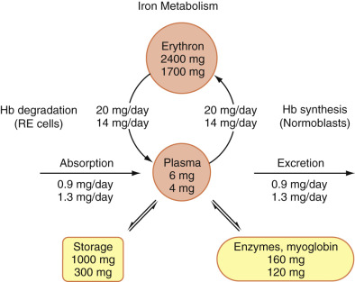

Figure 32-1 

Scheme of iron metabolism. 

The upper figure in each position is average for an 80-kg man; the lower figure is for a 65-kg woman. The plasma iron, bound largely to transferrin, is central in this scheme. It completely turns over several times a day in supplying iron for heme synthesis. Each day, about 1% of total circulating red cells are destroyed, and the same number of new red cells is delivered to the blood. That proportion of the total erythron iron enters the plasma from the site of hemoglobin (Hb) degradation, the macrophages of the reticuloendothelial (RE) system, and travels (bound to transferrin) to the normoblasts in the marrow. Storage iron largely resides also in the macrophages of the RE system. Absorbed iron enters the plasma pool, bound to transferrin. Iron is largely excreted by loss of cells. 

(Data from Hillman RS, Finch CA: _Red cell manual_ , ed 4, Philadelphia, 1974, FA Davis.) 

Very little iron is lost from the body; this small iron loss occurs mainly as loss of cells from the gastrointestinal (GI) tract and to a lesser extent from the skin and through the urine. The iron lost in women averages more because of menstrual blood loss than that excreted in men. About 1 mg is lost each day, except in menstruating females, whose iron loss averages about 2 mg/day. Iron balance is maintained by control of absorption. In the United States, dietary iron averages 15 mg/day with 7% absorption in men, and 11 mg/day with 13% absorption in women. Absorption can be increased in iron deficiency, but only to about 20% of ingested iron in meat-containing diets, and less in vegetarian diets (  Hillman & Finch, 1996  ). Absorption takes place largely in the small intestine, most efficiently in the duodenum and upper jejunum, with heme iron absorbed more efficiently than inorganic iron. Iron absorption is facilitated by ascorbate and citrate and is inhibited by phytates and tannins. Acid production by the stomach lowers the pH in the duodenum, thus enhancing the solubility and uptake of nonheme ferric iron. Iron entry into mucosal cells of the upper GI tract seems to involve more than one pathway, including an independent mechanism for heme absorption. A heme carrier protein 1 (HCP-1) has been described. However, recent evidence suggests that it is identical to proton-coupled folate transporter (PCFT), which is involved rather exclusively in folate transport (  Beutler, 2010  ;  Visentin et al, 2014  ). A dual role of PCFT in folate and heme iron uptake is being investigated. 

Non-heme iron is transported across the mucosal membrane through a channel called the _divalent metal transporter (DMT),_ which is regulated by iron regulatory proteins 1 and 2 (IRP-1 and IRP-2). These regulatory proteins, particularly IRP-2, affect the translation of several proteins that are involved in iron metabolism with a net result of increasing intracellular iron. Messenger-RNA of these proteins have iron-responsive elements (IREs), which may increase or decrease translation. For example, iron deficiency increases the translation of DMT-1 and TfR-1 (  Zhang et al, 2014  ). DMT-1 regulates iron transport from intestinal surface to inside the cell. This process is aided by duodenal cytochrome _b_ –like ferroreductase, which reduces iron to the ferrous form. DMT-1 also transports other metals, such as lead, cobalt, and nickel. The export of iron from enterocytes, macrophages, and hepatocytes to plasma involves another transport system, which includes ferroportin-1 and hephaestin (  Fleming, 2008  ). Ferroportin-1 is located at the basolateral membrane of apical enterocytes and functions as a transport protein delivering iron in the ferrous state to the plasma. Ferroportin-1 is also expressed on macrophages. Hephaestin, named after the Greek god **Hephaestus,** who forged iron, has a ferroxidase activity that contributes to iron transport by transforming iron to the ferric form to enable its uptake by circulating apotransferrin. Ceruloplasmin also has ferroxidase activity and is involved as well in the release of iron from the cells. Because both ceruloplasmin and hephaestin are copper-containing ferroxidases, copper deficiency affects iron release and can produce iron deficiency anemia. Another 25–amino-acid antimicrobial peptide, hepcidin, has been shown to play a major role in iron homeostasis through a hormonal effect. Hepcidin is produced by the liver, is filtered by the kidney, and accumulates in urine. Hepcidin negatively controls the release of iron from cells, such as intestinal epithelium and macrophages, to the plasma. Hepcidin combines with ferroportin-1, leading to internalization and lysosomal degradation of both proteins; thus it limits the release of intracellular iron into the plasma (  Fleming, 2008  ). Hepcidin is the product of the _HAMP_ (hepcidin/hepatic antimicrobial peptide) gene located on chromosome 19q13.1. At least four mechanisms are involved in the regulation of hepcidin secretion: inflammation, systemic iron availability through a hepatocyte iron-sensing system, erythropoietic activity, and hypoxia. Increased marrow erythropoietic activity has been associated with decreased hepcidin and increased iron absorption. A hormone named erythroferrone (ERFE) has been recently identified. ERFE is secreted by erythroblasts in response to erythropoietin and it causes suppression of hepcidin release (  Kautz et al, 2014  ). Current evidence suggests that human hemochromatosis protein (HFE), TfR-2, and hemojuvelin (HJV) interact with each other to form a hepatocyte “iron-sensing complex.” When transferrin is highly saturated, HFE is displaced from TfR-1 and interacts with TfR-2 and HJV to activate _HAMP_ transcription pathways. Matriptase-2 (MT-2) is a membrane serine protease expressed predominantly in hepatocytes, and it acts to cleave and inactivate HJV, producing a lower level of hepcidin (  De Falco et al, 2013  ). In the plasma, total iron averages 110 µg/dL (19.7 µmol/L). The great majority of this is bound to the transferrin, which has a capacity to bind 330 µg of iron per deciliter (or 59.1 µmol/L) and therefore is about one-third saturated. A very small amount of iron in plasma is in ferritin. Plasma (or serum) ferritin averages about 100 µg/L in men; it is less in women—about 50 µg/L. 

 

##  Iron Deficiency Anemia (IDA) 

When iron loss exceeds iron intake for a time long enough to deplete the body's iron stores, insufficient iron is available for normal Hb production. When well developed, iron deficiency is characterized by a hypochromic microcytic anemia. 

Iron deficiency typically results when the need for iron is increased (e.g., during rapid growth in infancy and childhood, during pregnancy) or when excessive loss of blood has reduced the body's reserves of iron (e.g., following repeated hemorrhages, excessive menstruation, or multiple pregnancies). 

Iron deficiency is probably the most common cause of anemia on the planet, affecting at least one third of the world's population (  Powers & Buchanan, 2014  ). Children between 6 and 24 months of age are particularly susceptible. It is caused by insufficient dietary iron to meet the needs of rapid growth. After the first 4 to 6 months of life, the iron stores present from birth have been exhausted, and the infant depends on dietary iron. An infant maintained on milk and carbohydrates without supplements of iron-containing foods is likely to develop iron deficiency anemia—one component of the “milk anemia” of infancy. This anemia is also frequently related to intestinal blood loss due to cow's milk protein intolerance in young children when cow's milk is introduced too early. In a study in the United States, IDA was reported in 3% of toddlers 1 to 2 years of age and in 2% to 5% of adolescent girls and women of childbearing age, with iron deficiency (absent anemia) noted in higher (>9%) proportions (  Looker et al, 1997  ). IDA also affects 2% to 5% of pregnant women (  Powers & Buchanan, 2014  ). Defective absorption of iron and eventual iron deficiency anemia occur after total gastrectomy or even subtotal gastrectomy. Prolonged treatment of peptic ulcer and acid reflux by H  2  blockers and acid pump blockers may cause defective iron absorption. Except for the sprue syndrome, causes of malabsorption of iron are extremely rare. Because iron deficiency increases the rate of absorption of both iron and lead, lead intoxication may accompany iron deficiency. 

If an adult male had absolutely no iron intake or absorption (which would be extremely unlikely), his body iron stores of 1000 mg would last for 3 to 4 years before he would even begin to become iron deficient. Therefore, almost all cases of iron deficiency anemia in adult males are due to chronic blood loss. Hemorrhagic lesions, such as benign and malignant tumors, chronic ingestion of some medications, and helminthic infections, are common causes of iron deficiency in males and postmenopausal females. 

The sequence of events in developing iron deficiency anemia is usually as follows (  Hillman & Finch, 1996  ): When blood loss exceeds absorption, a negative iron balance exists. Iron is mobilized from stores, storage iron decreases, plasma ferritin decreases, iron absorption increases, and plasma iron-binding capacity (transferrin) increases. This stage is known as **iron depletion.** After iron stores are depleted, the plasma iron concentration falls, saturation of transferrin falls below 15%, and the percentage of sideroblasts decreases in the marrow. As a result of lack of iron for heme synthesis, red cell protoporphyrin increases. This second stage is **iron-deficient erythropoiesis;** anemia may not yet be present. The third stage is **iron deficiency anemia;** in addition to the abnormalities just discussed, anemia is detectable. The anemia at first is normochromic and normocytic, gradually becomes microcytic, and finally becomes microcytic and hypochromic. 

 

##  Clinical Features 

Clinical findings may be due to the underlying cause of the blood loss itself, to the general manifestations of anemia (see previous discussion), or to iron deficiency. Those that are probably attributable to lack of tissue iron include paresthesias, such as numbness and tingling; restless leg syndrome; atrophy of epithelium of the tongue with burning or soreness; fissures or ulcers at the corners of the mouth (angular stomatitis); chronic gastritis, which leads to decreased gastric secretions but few symptoms; “pica,” which is the craving to eat unusual substances such as dirt or ice; concave or spoon-shaped nails (koilonychia); and difficulty swallowing due to “webs” of tissue or partial strictures at the junction of the esophagus and hypopharynx. The latter two findings are relatively uncommon. The combination of glossitis, sore mouth, dysphagia, and iron deficiency is called Plummer-Vinson syndrome. Splenomegaly may occur in iron deficiency but is uncommon. In young children, lower test scores and delayed motor development have been reported in association with IDA (  Powers & Buchanan, 2014  ). 

 

##  Laboratory Features 

 

##  Blood. 

In early iron deficiency anemia, the stained blood film often shows normochromic normocytic erythrocytes (  Hillman & Finch, 1996  ). In later stages, the picture is one of microcytosis, anisocytosis, poikilocytosis (including elliptical and elongated cells), and varying degrees of hypochromia. The plasma membranes of iron-deficient cells are abnormally stiff, and this abnormality contributes to the development of poikilocytes, particularly elongated hypochromic elliptocytes (pencil cells). Anisocytosis may be identified by automated blood counters as increased red cell distribution width (RDW). This finding, however, is not specific for iron deficiency anemia. A high red blood cell count is commonly encountered in children younger than 4 years of age. Reticulocytes are usually decreased in absolute numbers, except following iron therapy. Also reticulocyte hemoglobin content (Ret-He, CHr) is reduced. The mean corpuscular volume (MCV) is low, and Hb and Hct are relatively lower than the erythrocyte count. Osmotic fragility may be decreased because the red blood cells are thinner than normal (see [ Figs. 30-10 ](<##!/content/3-s2.0-B9780323295680000309?scrollTo=%23f0055>) and [ 32-2 ](<#f0015>) ). 

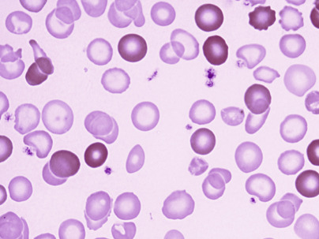

Figure 32-2 

Iron deficiency anemia, posttransfusion. 

The cells are pale with an enlarged central pallor, variation in size, and tendency for elliptocytic formation, in sharp contrast to the transfused normochromic cells. 

The leukocyte count is normal or slightly lowered. Granulocytopenia and a small number of hypersegmented neutrophils may be present. Megaloblastic changes in severe iron deficiency may be related to decreased activity of the enzyme ribonucleotide reductase, which contains an essential nonheme iron atom (  Beck, 1991  ). However, the detection of hypersegmented neutrophils should raise suspicion for a mild folate deficiency, which may become more overt after iron therapy (  Dallman et al, 1993  ). Platelets may be increased, whether the lack of iron is due to blood loss or dietary deficiency, but tend to be decreased in severe anemia. 

 

##  Marrow. 

Erythroid hyperplasia occurs early, but in later stages the limiting effect of severe iron deficiency restricts erythropoiesis to the basal level. The erythroblasts are smaller than normal, deficient in the amount of Hb in the cytoplasm, and irregular in shape with frayed margins ( [ Fig. 32-3 ](<#f0020>) ). Giant neutrophil bands or metamyelocytes, if present, are rarely due to iron deficiency **per se;** usually, they indicate an associated cobalamin or folate deficiency (see the Megaloblastic Anemia section later in the chapter). Iron stains should be performed routinely on marrow aspirate films ( [ Figs. 32-4 ](<#f0025>) and [ 32-5 ](<#f0030>) ). **Storage iron** is absent, unless iron has recently been administered in some form. The proportion of erythroblasts that are **sideroblasts** is decreased (<20%); this proportion is usually about the same as the percent saturation of transferrin (or total iron-binding capacity [TIBC]) and is a measure of iron delivery to the erythroblasts. 

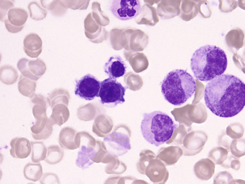

Figure 32-3 

Marrow film, iron deficiency anemia. 

The three normoblasts have irregular margins and irregular clear spaces, reflecting lack of adequate hemoglobin synthesis (i.e., defective cytoplasmic maturation). 

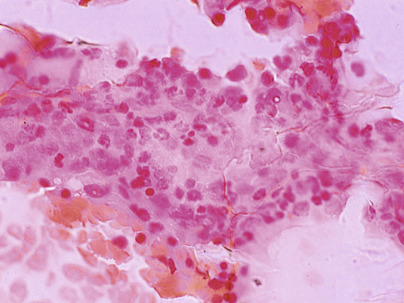

Figure 32-4 

Marrow film, Prussian blue reaction. 

Depleted iron stores: No blue-green staining iron is visible. On a scale of 0 to 5+, the iron is normal from 1+ to 3+ for women and from 2+ to 3+ for men. 

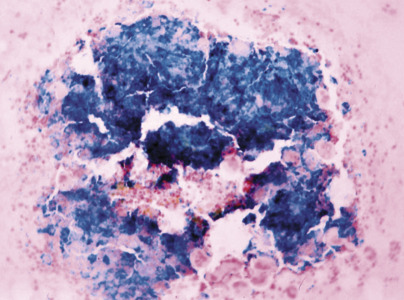

Figure 32-5 

Marrow film, Prussian blue reaction. 

On a scale of 0 to 5+, the amount of storage iron is judged at 5+, which is markedly increased. 

 

##  Serum Iron. 

The reference interval is 50 to 160 µg/dL (9 to 29 µmol/L) in adults. The level is lower in iron deficiency and in infection and anemia of chronic disease. 

 

##  Serum (Total) Iron-Binding Capacity. 

The reference interval for adults is 250 to 400 µg/dL (45 to 72 µmol/L). In iron deficiency anemia, the serum TIBC is increased. It is normal or decreased in the anemia of chronic disease. If chronic infection coexists with chronic blood loss, the TIBC may not be increased, even though the patient is iron deficient. 

 

##  Percent Saturation of TIBC. 

The ratio of serum iron to TIBC is the percent saturation of the TIBC. Normally, this is 20% to 55%; values below 15% indicate iron-deficient erythropoiesis. 

A marked diurnal variation in serum iron by as much as 30% normally occurs, with highest values in the morning and lowest values late in the day. Consequently, fasting morning blood specimens are preferred for the diagnosis of iron deficiency. The TIBC remains relatively constant in a normal individual. Pregnancy and oral contraceptives increase TIBC. 

Serum iron is usually higher in the first 90 days of life; then it dips to somewhat lower reference intervals for the second month of life, and the value gradually increases with age until it reaches the adult range approximately at 15 years of age (  Ritchie et al, 2002b  ;  Soldin et al, 2004  ). On the other hand, the TIBC gradually rises with age until it reaches values that are comparable to those of adults at 15 years of age (  Soldin et al, 2004  ). Similarly, percent saturation in children is less than in adults; it reaches the adult value between 15 and 18 years of age (  Ritchie et al, 2002b  ). 

 

##  Serum Ferritin. 

In adults, the reference values are 12 to 300 µg/L, with higher values in men than in women. Serum ferritin appears to be in equilibrium with tissue ferritin and is a good reflection of storage iron in normal subjects and in most disorders. The equivalence of 1 µg/L of serum ferritin with 8 to 10 mg of storage iron has been suggested. In patients with some hepatocellular diseases, malignancies, and inflammatory diseases, serum ferritin is a disproportionately high estimate of storage iron because serum ferritin is an acute phase reactant. In such disorders, iron deficiency anemia may exist with a normal serum ferritin concentration. In the presence of inflammation, persons with a serum ferritin level of less than 50 to 60 µg/L are likely to respond to iron therapy. On the other hand, hypothyroidism and ascorbate deficiency may lower plasma ferritin levels independent of iron stores (  Brittenham, 2009  ). 

In infancy and childhood, between 6 months and 15 years of age, the reference interval for serum ferritin is somewhat lower than in early infancy or adult life (  Soldin et al, 2004  ). In men, serum ferritin gradually rises between 18 and 30 years of age, whereas in women, it does not. However, postmenopausal women have a much higher ferritin level than premenopausal women, and it is comparable with that of men (  Van den Bosch et al, 2001  ). Serum ferritin levels do not display diurnal variation. 

 

##  Erythrocyte Porphyrins. 

Because heme is formed by insertion of iron into protoporphyrin IX, the latter is increased in iron-deficient erythropoiesis, whether owing to iron deficiency or to anemia of chronic disease. It is also increased in lead poisoning and in some cases of sideroblastic anemia but is normal in thalassemia. Zinc usually becomes attached to protoporphyrin, forming zinc protoporphyrin (ZPP). A relatively simple micromethod measuring ZPP in whole blood has been shown to be useful in distinguishing microcytosis due to iron deficiency from that due to β-thalassemia minor (  Labbé & Dewanji, 2004  ). The normal reference interval was 10 to 99 µg/dL of erythrocytes; in iron deficiency, erythrocyte porphyrins became elevated before the development of anemia, and this may be one of the earliest indicators of iron deficiency (  Labbé & Dewanji, 2004  ). 

 

##  Serum Transferrin Receptors. 

TfRs also exist in a soluble form in the circulation. Serum TfRs (STfRs) are produced by shedding of membrane TfRs during erythrocyte maturation. STfRs vary with the rate of erythropoiesis. Patients with aplastic anemia (AA) have lower than normal levels of STfRs, and patients with autoimmune hemolytic anemia have higher values. Iron deficiency anemia is associated with increased serum levels of TfRs, probably as a result of increased membrane TfR synthesis and expression secondary to iron starvation. Unlike serum ferritin, STfRs are usually not affected by inflammation (  Clark 2009  ). 

 

##  Serum Transferrin Receptor–to–Serum Ferritin Ratio. 

The serum transferrin receptor ** – ** to ** – ** serum ferritin (STfR/F) ratio has been suggested as a new approach to estimate total body iron stores. However, it appears to have limited value in identifying anemia of chronic disease (ACD). The STfR/F ratio may be better utilized in identifying iron deficiency anemia coexisting with ACD (  Clark, 2009  ). 

 

##  Reticulocyte Hemoglobin Content. 

Some automated hematology analyzers offer an assay of Hb content within reticulocytes (Ret-He, CHr; in pg/cell). By measuring this parameter, the status of erythropoiesis in the previous 3 to 4 days may be assessed using reticulocytes as a guide (  Clark, 2009  ). 

 

##  Hepcidin Level. 

Measuring plasma hepcidin may serve as a valuable tool in the study of abnormalities of iron metabolism and iron deficiency. Hepcidin level measurement is currently undergoing numerous studies. 

 

##  Differential Diagnosis 

Anemia due to iron deficiency usually needs to be distinguished from other causes of microcytosis with or without anemia. These include the thalassemia traits, long-standing ACD, and the sideroblastic anemias (see later discussions of these entities). Bone marrow storage iron and serum ferritin will be decreased in iron deficiency and normal or elevated in all others. In **thalassemia trait,** the anemia, if present, is very mild, ZPP is normal, serum iron is normal, and the condition is present in family members. In β-thalassemia trait, Hb A  2  and sometimes fetal hemoglobin (Hb F) are increased. Yet, Hb A  2  is often decreased in iron deficiency. In **ACD** (chronic infection, inflammatory conditions such as rheumatoid arthritis, or neoplastic disease), although the serum iron is low, as in iron deficiency, the TIBC is low or normal. In the **sideroblastic anemias,** which include chronic lead poisoning, the serum iron and percent TIBC saturation are increased, and pathologic “ring” sideroblasts are present in the marrow. 

 

##  Management 

The first principle in therapy of iron deficiency anemia is that the underlying cause can be identified and corrected. Ferrous iron is given orally—at about 200 mg/day—in three doses between meals. This will provide 40 to 60 mg of absorbed iron per day, which, with the iron produced by turnover of senescent red blood cells, will be sufficient to increase production to two or three times normal (  Hillman & Finch, 1996  ). The reticulocyte count will reach a maximum at 5 to 10 days, and then will gradually decrease toward normal. Monitoring the Hb is best; Hb should increase by 0.1 to 0.2 g/dL/day after the fifth day and by at least 2 g/dL for each of the subsequent 3 weeks. After the Hb has returned to normal, iron therapy should be continued for at least 2 months to replenish storage iron. Patients refractory to treatment need to be investigated for continued underlying diseases, particularly chronic gastritis and _Helicobacter pylori_ gastritis (  Clark, 2009  ). 

 

##  Iron-Refractory Iron Deficiency Anemia (IRIDA) 

This is a recently-described hereditary recessive microcytic anemia, which does not respond to oral iron therapy. Initial studies suggest that IRIDA is cause by a mutation in the _TMPRSS6_ gene (mapped to chromosome 22q12-13) encoding a transmembrane serine protease known as matriptase-2 (MT-2). MT-2 is involved in the downregulation of hepcidin. IRIDA patients have inappropriately high hepcidin levels preventing iron absorption and release. Patients may show a slow or partial response to parental iron (  De Falco et al, 2013  ). 

 

##  Impaired Production—Megaloblastic Anemia 

 

##  Macrocytosis with Normoblastic Marrow 

Macrocytic anemias that are not megaloblastic may be due to early release of erythrocytes from the marrow, so-called “shift reticulocytes.” This may occur in response to acute blood loss, hemolysis, bone marrow infiltration, and high levels of EPO associated with bone marrow failure diseases such as aplastic anemia, refractory anemia, and Diamond-Blackfan anemia. Nonmegaloblastic macrocytosis is also found in hypothyroidism, in individuals with excessive alcohol intake, and in liver disease (  Hillman & Finch, 1996  ). 

 

##  Megaloblastic Anemia 

 

##  Blood 

Macrocytic anemias associated with megaloblastosis differ from nonmegaloblastic macrocytic anemia in that macro-ovalocytes and giant hypersegmented neutrophils are present in the blood ( [ Figs. 30-11 ](<##!/content/3-s2.0-B9780323295680000309?scrollTo=%23f0060>) , [ 30-15 ](<##!/content/3-s2.0-B9780323295680000309?scrollTo=%23f0080>) , and [ 32-6 ](<#f0035>) ). Pancytopenia is the rule. The anemia is macrocytic with an elevated MCV and is characterized by macro-ovalocytes and often extreme degrees of anisocytosis and poikilocytosis, including red blood cell fragments. Microcytes and dacrocytes are common. Basophilic stippling, multiple Howell-Jolly bodies, nucleated red cells with karyorrhexis, and even megaloblasts may be seen in the peripheral blood. Leukopenia is present. Granulocytes have increased numbers of lobes, presumably as a result of abnormal nuclear maturation. Five lobes in more than 5% of the neutrophils constitute hypersegmentation (  Herbert, 1985  ), as do any neutrophils with six or more lobes. Thrombocytopenia is usually encountered and on rare occasions is sufficiently severe to be responsible for bleeding. It is worth noting that significant morphologic changes may occur in the blood in the absence of anemia, and that neurologic symptoms may be present in the absence of anemia. 

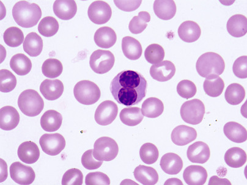

Figure 32-6 

Blood film, megaloblastic anemia. 

Macrocytosis and a circulating megaloblast with abnormal, binucleated nucleus and open chromatin. 

 

##  Marrow. 

Megaloblastic anemia is characterized by enlargement of all rapidly proliferating cells of the body, including marrow cells. The major abnormality is the diminished capacity for deoxyribonucleic acid (DNA) synthesis. In cobalamin or folate deficiency, there is marked reduction in intracellular 5,10-methylene tetrahydrofolate, which is required to transform deoxyuridine monophosphate to deoxythymidine monophosphate. This reaction is mediated by thymidylate synthase and is essential to maintain the normal rate of DNA synthesis (  Green, 2010  ). With such deficiency, the cells have both a prolonged intermitotic resting phase and a block early in mitosis. The number of mitotic figures is increased. Ribonucleic acid (RNA) synthesis is less impeded than DNA synthesis; hence, cytoplasmic maturation and growth continue, accounting for enlargement of the cells. The delicate chromatin and the prominent parachromatin result in a distinctly more “open” chromatin pattern than is seen in the erythroid precursors ( [ Figs. 30-28 ](<##!/content/3-s2.0-B9780323295680000309?scrollTo=%23f0145>) and [ 32-6 ](<#f0035>) ). The nuclei undergo karyorrhexis readily, and multiple Howell-Jolly bodies may be present. Usually more cells analogous to the pronormoblast and the basophilic normoblast are noted (i.e., promegaloblast and basophilic megaloblast) than are seen in normal erythropoiesis. This has sometimes been termed **maturation arrest,** or _nuclear-cytoplasmic asynchrony._ Giant polychromatic megaloblasts are especially distinctive. The same general features are seen in the other cell lines. In the granulocytic series, the cells are larger, with retarded nuclear maturation and large cytoplasmic mass; often the specific granules themselves are distinctly larger. The chromatin pattern is less condensed (more “open”), and as a result the nucleus appears to stain poorly. Abnormally contorted nuclear configurations are common. The giant metamyelocyte is the most characteristic of the abnormal granulocytes. Megakaryocytes, too, are large and have separated nuclear lobes or nuclear fragments. 

The bone marrow is hyperplastic ( [ Fig. 32-7 ](<#f0040>) ). The fat is replaced, and red marrow extends into the long bones. The number of erythroid precursors (megaloblasts) is increased, and the myeloid/erythroid ratio is decreased. If the megaloblastic process is incompletely developed, or if the patient has been inadequately treated, the findings may be only partial. Because they persist longer, granulocytic alterations are especially helpful in assessing recently treated megaloblastic anemia. Marrow findings result from the effects of impaired nucleic acid synthesis, leading to megaloblastosis and hypoxic stress, giving rise to increased numbers of erythroid cells. If the patient is transfused with packed red cells, the number of erythroid precursors diminishes but the cytologic abnormalities persist. 

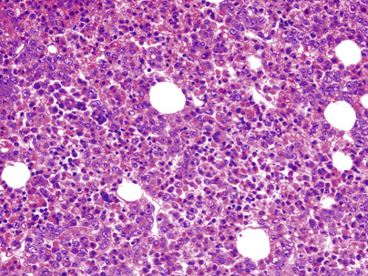

Figure 32-7 

Hypercellular marrow in megaloblastic anemia. 

Cellularity is over 95%. 

 

##  Erythrokinetics. 

In megaloblastic anemias, the mass of erythroid tissue is increased, plasma iron turnover is rapid, and urine and fecal urobilinogen are increased. These measures indicate an **increase in total erythropoiesis** that may be up to three times normal. The decreased rate of appearance of iron in the Hb of circulating erythrocytes and reticulocytopenia indicate **ineffective erythropoiesis.** In addition to increased destruction of defective erythroid precursors in the marrow, survival of circulating erythrocytes is short, indicating hemolysis. Indirect serum bilirubin is increased, serum iron is increased, endogenous carbon monoxide (CO) production is increased, and serum lactate dehydrogenase is usually greatly elevated. Serum muramidase may be elevated, implying ineffective granulocytopoiesis. 

Megaloblastic anemia is nearly always due to cobalamin or folic acid deficiency. The aforementioned findings are similar for either. 

 

##  Cobalamin (Vitamin B  12  ) Metabolism 

Vitamin B  12  (cyanocobalamin) has a molecular weight of 1355 Da. The molecule's two major parts are (1) a **planar group** (the corrin nucleus), a ring structure surrounding a cobalt atom; and (2) a **nucleotide group,** which consists of the base, 5,6-dimethylbenzimidazole, and a phosphorylated ribose esterified with 1-amino,2-propanol. A cyanide group is in coordinate linkage with the trivalent cobalt. Different forms of vitamin B  12  result from replacement of the cyanide by hydroxy, adenosyl, or methyl groups; generically, these are termed **cobalamins.**

Cobalamin is the only vitamin exclusively synthesized by microorganisms. It is found in practically all animal tissues and is stored primarily in the liver in the form of adenosylcobalamin. The human liver contains approximately 1 µg/g of liver. Cobalamin is initially bound to R binders (cobalamin-binding proteins with _R_ apid electrophoretic mobility compared with intrinsic factor) present in saliva or food, is released by peptic digestion, and is then bound by other R binders at the acid pH of the stomach. The R proteins belong to the same family of isoproteins as the plasma haptocorrin (HC) binder (  Green, 2010  ). On entering the duodenum, cobalamin is released by pancreatic enzymes to finally bind to gastric intrinsic factor (IF), a 44-kDa glycoprotein produced in the parietal cells of the stomach. The gene for IF is located on chromosome 11. This cobalamin-IF complex, which is highly resistant to digestion, then adheres to specific receptor sites on the epithelial cells of the ileum, at which site the cobalamin is absorbed. The cobalamin-IF receptor is a combination of two proteins: a 460-kDa protein called _cubilin (CUBN),_ and a 45- to 50-kDa protein called _amnionless_ (AMN). CUBN lacks both transmembrane and cytoplasmic domains and its internalization depends on other transmembrane proteins, particularly AMN. Both proteins are also present in renal tubules. Mutation of any of the two genes can produce megaloblastic anemia with proteinuria, also known as Imerslund-Gräsbeck syndrome (  Kozyraki & Cases, 2013  ). The concentration of the receptor in the ileum increases progressively until it reaches its maximum near the terminal ileum. The cobalamin-IF complex is taken into the cell, where cobalamin is released and the IF is destroyed. The receptor recycles to the surface of the cell (  Kozyraki & Cases, 2013  ). 

Cobalamin is transported in the plasma as methylcobalamin, while bound to a group of proteins named _transcobalamin (TC),_ formerly known as _transcobalamin II_ and _haptocorrins_ (variously called _TC I, TC III, R binder, cobalophilin_ [see later in the chapter]). Ninety percent of newly absorbed cobalamin is bound to TC, which serves as the chief transport protein, rapidly delivering the vitamin to the liver, hematopoietic cells, and other dividing cells. Some cobalamin binds to haptocorrins—a step that prevents its loss from the plasma; this cobalamin is a passive reservoir in equilibrium with body stores in the liver but not taken up by other body cells. The reference values for plasma cobalamin depend on the method of assay, but they commonly are 200 to 900 ng/L (150 to 670 pmol/L). One third of the binding sites on transcobalamins are normally occupied: 70% to 90% of plasma cobalamin is bound to haptocorrins; this is very slowly cleared from the plasma. The remainder is bound to TC, which remains only about 5% saturated; much of newly absorbed cobalamin bound to TC is removed from the plasma during the first few hours, but a small fraction remains bound for several weeks. 

The relative importance of the transcobalamins is illustrated by the clinical effects of congenital deficiency. Lack of TC results in severe megaloblastic anemia in infancy; yet the serum cobalamin level is normal. Lack of HC is not accompanied by anemia or megaloblastosis; yet the serum cobalamin level is decreased (  Whitehead, 2006  ). 

HC are found in milk, plasma, saliva, gastric juice, and other body fluids. HC may arise from granulocytes, salivary glands, and liver, as well as from other tissues. HC may help clear nonphysiologic cobalamin analogs. Elevation of HC accounts for the elevation of total cobalamin-binding proteins in myeloproliferative neoplasms. TC is also synthesized by a variety of cells, including renal cells, enterocytes, and hepatocytes and acts as an acute phase reactant; its levels are increased in inflammatory and infectious conditions (  Carmel, 1999  ,  Green, 2010  ). To be useful to the cell, cyanocobalamin and hydroxocobalamin must be converted to adenosyl and methyl forms through reduction and alkylation. Adenosylcobalamin acts as a coenzyme for methylmalonyl coenzyme A mutase, which coverts methylmalonyl coenzyme A to succinyl coenzyme A. Methylcoblamin is involved in methyl transfer from N  5  -methyl tetrahydrofolate to homocysteine to form methionine. 

The daily requirement for cobalamin is in the range of 2 to 5 µg/day. The body's stores of 2 to 5 mg will last for several years if intake is cut off, as is the case when total gastrectomy is performed (  Beck, 1991  ). 

 

##  Cobalamin Deficiency 

Although the true prevalence of cobalamin deficiency in the general population is unknown, it increases with age. Approximately 15% of adults older than 65 years of age have laboratory findings of vitamin B  12  deficiency. This prevalence may be attributed to the high frequency of hypochlorhydria of 25% to 50%, which has been reported in the older adult population (  Green, 2010  ). The widespread use of proton pump inhibitors to control gastric secretion is becoming a contributing factor (  Oh & Brown, 2003  ). Cobalamin deficiency is produced by any of several mechanisms that are not always exclusive of each other and involve inadequate intake and reduced absorption. 

 

##  Inadequate Intake 

A dietary deficiency is an _extremely rare_ cause of megaloblastic anemia in the United States and is seen only in persons who completely abstain from animal food, including milk and eggs. Only strict vegetarians are known to develop this form of cobalamin deficiency. 

 

##  Defective Production of Intrinsic Factor 

This is the most common cause of cobalamin deficiency. 

 

##  Pernicious Anemia 

Pernicious anemia (PA) is a “conditioned” nutritional deficiency of cobalamin that is caused by failure of the gastric mucosa to secrete intrinsic factor. This abnormality is genetically determined but usually is not manifested until late in life; less than 10% of cases occur in persons younger than 40 years of age. The annual incidence of PA is approximately 25 new cases per 100,000 individuals over 40 years of age. Positive family history is obtained in approximately 30% of patients (  Green, 2010  ). Modern surveys indicate that PA is as common in blacks as in Caucasians (  Carmel, 1999  ). 

 

##  Clinical Features 

The disorder is equally common in males and females. Symptoms of **anemia** and the combination of skin pallor and jaundice giving a lemon-yellow appearance to the skin are often present. The tongue may be sore, smooth, and pale (atrophic glossitis) or red and raw (acute glossitis). **GI symptoms** may be prominent and include episodic abdominal pain, constipation, and diarrhea. Diffuse and irregular degeneration of the white matter of the **central nervous system (CNS)** characteristically involves the posterior and lateral columns of the spinal cord (subacute combined degeneration) and sometimes other sites. Symmetrical sensations of “pins and needles” of the distal extremities, numbness and tingling, loss of position sensation (difficulty with balance and gait), and loss of vibratory sensation (perhaps the most constant sign) are indicative of peripheral neuropathy and posterior column lesions. Lateral column involvement gives rise to weakness, spasticity, and increased deep tendon reflexes. Sometimes, the brain may be affected, and the patient shows irritability, emotional instability, or a change in personality. Neuropsychiatric disorders may be associated with cobalamin deficiency even without accompanying hematologic manifestations (  Lindenbaum et al, 1988  ). Recent studies suggest that cobalamin is essential for the maintenance of certain levels of cytokines and growth factors in the CNS. Cobalamin deficiency has been reported to cause an increase in CSF levels of myelinotoxic cytokines, such as tumor necrosis factor-α, while decreasing myelinotrophic cytokines, such as interleukin (IL)-6 (  Scalabrino, 2009  ). 

 

##  Gastric Findings 

Atrophic gastritis of varying degrees is found in most adults with PA, and gastric atrophy involving all coats of the wall in the remainder. IF and hydrochloric acid (HCl) are secreted by gastric parietal cells in the human; in adult PA, IF secretion is absent, and almost always histamine-refractory achylia and achlorhydria—decreased volume of gastric juice and lack of HCl secretion—are present. 

 

##  Immune Abnormalities 

Autoantibodies have been found in the serum of patients with pernicious anemia (  Green, 2010  ). **Anti –parietal cell antibodies ** react with gastric parietal cells and are present in more than 90% of patients. These anti–parietal cell antibodies are also present in patients with chronic gastritis, such as that associated with iron deficiency, and in some patients with thyroiditis and myxedema; they are seen in 4% to 5% of age-matched healthy individuals. When these antibodies are chronically injected into rats, they decrease gastric HCl, IF, and pepsin secretion and produce gastric atrophy. The major antigen to which these antibodies are produced is the acid-producing enzyme H  \+  ,K  \+  -ATPase, a 92-kDa protein present on the luminal membrane of parietal cells, which is the target of proton pump inhibitors. A recent study suggests that antibodies to _H. pylori_ are common in PA, particularly in young patients. Infection may be the first step toward initiation of an autoimmune response (  Hershko et al, 2007  ). 

Another type of autoantibody is directed against intrinsic factor. **Anti –intrinsic factor antibodies ** occur in the serum, saliva, and gastric juice of about 75% of patients with PA. Two types of anti-IF antibodies occur: “blocking” antibodies, which block the binding of cobalamin to IF; and “binding” antibodies, which bind to the cobalamin-IF complex and prevent the complex from binding to receptors in the ileum. Although these antibodies can cause some functional impairment in vivo, it is not clear whether the antibodies are the cause or an effect of the disease. IF antibodies in the absence of PA occur in a small percentage of individuals with hyperthyroidism (Graves' disease), and similarly in persons with insulin-dependent diabetes. Therefore, IF antibodies are considered highly specific and confirmatory for PA, although their absence does not exclude the diagnosis (  Green, 2010  ). 

Family studies in patients with pernicious anemia have shown an increased incidence of the disease in relatives, and many relatives have achlorhydria and partial defects of cobalamin absorption. Relatives of patients with pernicious anemia also have a higher incidence of gastric parietal cell antibodies and of thyroid antibodies than normal individuals. 

It is possible that adult pernicious anemia is a genetically determined autoimmune gastritis. However, the relationship of the gastric lesion to the antibodies remains unclear. 

 

##  Pernicious Anemia in Children 

Two forms of PA are known to occur in children. **Congenital pernicious anemia** usually appears early in the second year of life. IF secretion may be lacking, or the secreted IF may be functionally defective, but acid secretion and the appearance of the gastric mucosa are normal. Antibodies to parietal cells and to IF are absent. These cases are caused by mutations in the IF gene _(GIF)_ mapped to chromosome 11q12. **Juvenile pernicious anemia** occurs usually in older children and is like that of adults, with gastric atrophy, achlorhydria, and serum antibody to IF and parietal cells, although the latter may be absent in a subset of patients (  Whitehead, 2006  ). 

 

##  Gastrectomy 

Surgical removal of the stomach (total or even subtotal occasionally) will remove the source of intrinsic factor. This will lead to megaloblastic anemia after the body's stores of cobalamin have been exhausted—in 3 to 6 years—if cobalamin therapy has not been given. Frequently, the anemia is due in part to iron deficiency. 

 

##  Defective Absorption of Cobalamin 

 

##  Malabsorption Syndromes. 

Celiac disease, tropical sprue, resection of the small bowel, or inflammatory disease of the small bowel may be associated with multiple defects of absorption, including other vitamins. Folic acid deficiency (absorbed principally in the upper small bowel) is more commonly seen than cobalamin deficiency (absorbed principally in the lower small bowel) in diseases leading to malabsorption. The reason for this is probably the lesser time necessary for depletion of body stores of folic acid. 

Imerslund-Gräsbeck syndrome is an autosomally recessive inherited defect in the intestinal absorption of cobalamin that occurs in the presence of normal intrinsic factor. In many patients, proteinuria of the tubular type is also found. Most reported cases are from Northern Europe. As mentioned earlier, the syndrome is caused by a defect in the cubilin/amnionless receptor (  Kozyraki & Cases, 2013  ). 

 

##  Lack of Availability of Cobalamin. 

In certain countries, infestation with the fish tapeworm _Diphyllobothrium latum_ is common enough that cobalamin deficiency may occur occasionally when it is present. The worm successfully competes with the host for the ingested cobalamin. Most common in Finland, it is rarely seen in the United States. 

Bacteria in a blind loop of intestine may also preferentially utilize ingested cobalamin to the detriment of the host. 

As mentioned earlier, inherited TC deficiency leads to megaloblastic anemia accompanied by neurologic symptoms in early childhood. 

Vitamin B  12  or folate deficiency may exert indirect cardiovascular effects. Both deficiencies are associated with hyperhomocystinemia, which is an independent factor for atherosclerosis and vascular thrombosis (  Oh & Brown, 2003  ). 

 

##  Diagnosis of Cobalamin Deficiency 

Recognition of megaloblastic anemia indicates the likelihood of cobalamin deficiency or folic acid deficiency. In addition, evidence of neurologic involvement favors cobalamin deficiency. This diagnosis can be established by one of four methods. 

 

##  Therapeutic Trial. 

With the patient on a diet low in cobalamin and folate, a parenteral physiologic dose of cobalamin (10 µg/day) is given. Optimal hematologic response indicates deficiency and consists of reticulocytosis beginning on the third or fourth day, reaching a peak on the seventh day. Erythropoiesis becomes normoblastic by 2 days, and leukopoiesis becomes normal by 12 to 14 days. Within 1 week, leukocyte and platelet counts have returned to normal, and the Hb concentration begins to rise. 

 

##  Serum Cobalamin Assay. 

This is the usual method of detecting a cobalamin-deficient state. The original microbiological assay of serum cobalamin employed an organism (e.g., _Euglena gracilis_ ) that requires cobalamin for growth. Although the microbiological method is precise and reliable, it requires at least 48 hours of incubation and is subject to the inhibitory effects of antibiotics. Radioisotopic dilution and chemiluminescence assays are more rapid and widely used and give results comparable with those of the _Euglena_ assay, provided that the binding protein is specific for biologically active cobalamin; a standardized intrinsic factor preparation is most satisfactory. However, these methods may produce false-normal values in approximately 10% of patients with cobalamin deficiency (  Zittoun & Zittoun, 1999  ). 

Reference values are 200 to 900 ng/L. In megaloblastic anemia due to cobalamin deficiency, serum cobalamin is usually less than 100 ng/L. Individuals with folate deficiency and mild cobalamin deficiency and who are pregnant have borderline values between 100 and 200 ng/L. Patients with human immunodeficiency virus (HIV) infection or multiple myeloma and those receiving megadose vitamin C therapy often have low serum cobalamin levels in the absence of clinical manifestations (  Ward, 2002  ;  Green, 2010  ). Spuriously normal cobalamin levels have been recorded in patients with cobalamin deficiency associated with overgrowth of intestinal bacteria, which produce biochemically inert B  12  analogs, and in patients with autoimmune disorders, myeloproliferative neoplasms, and active liver disease (  Ward, 2002  ;  Green, 2010  ). Measurement of TC-bound cobalamin (holotranscobalamin ) may provide additional information, in that its levels fall below the normal range long before total serum cobalamin does and probably represent a state of negative cobalamin balance (  Zittoun & Zittoun, 1999  ). However, its clinical utility has been limited (  Ward, 2002  ). 

 

##  Methylmalonic Acid and Homocysteine Assays. 

Because a cobalamin coenzyme is essential for the isomerization of methylmalonate to succinate, urine excretion of increased amounts of methylmalonate is found in cobalamin deficiency. Provided that the rare inborn error of metabolism, methylmalonic aciduria, is not present, this is a sensitive test for cobalamin deficiency, but it is not usually necessary for the diagnosis. In addition, plasma levels of methylmalonic acid and homocysteine are increased. However, plasma levels of methylmalonate are normal in folate deficiency in the absence of cobalamin deficiency (  Green, 2010  ). Following several weeks of therapy, their plasma concentration returns to normal. Plasma levels of these metabolites should be interpreted with caution in patients with chronic renal failure because of the tendency of these metabolites to accumulate (  Zittoun & Zittoun, 1999  ). 

 

##  Deoxyuridine Suppression Test. 

This measures the ability of marrow cells in vitro to utilize deoxyuridine in DNA synthesis. Normally, in marrow cells, the major source of thymidine for DNA is de novo synthesis from deoxyuridine, which requires intact cobalamin and folate enzymes; therefore, less than 10% of added tritium-labeled thymidine (  3  H-Tdr) is incorporated into DNA. In megaloblastic marrows due to cobalamin or folate deficiency, deoxyuridine cannot be efficiently converted to thymidine, and more  3  H-Tdr is taken up into DNA. An abnormal deoxyuridine suppression test indicates cobalamin or folate deficiency. This test is very sensitive and produces abnormal results before anemia or macrocytosis is observed (  Zittoun & Zittoun, 1999  ). A lymphocyte microdeoxyuridine suppression test (  Herbert, 1985  ) requires only 1 mL of blood, making this diagnostic modality available to infants and children. 

 

##  Detecting the Cause of Cobalamin Deficiency 

Clinical history is useful in suggesting whether cobalamin or folate deficiency is the cause of megaloblastic anemia. Clinical associations of pernicious anemia include a family history of PA in one third of patients, along with certain endocrine deficiencies (thyroid disease, diabetes mellitus, hypothyroidism, and Addison's disease) and immune disorders (immune thrombocytopenic purpura, autoimmune hemolytic anemia, and acquired hypogammaglobulinemia). Cobalamin deficiency is likely to occur in strict vegetarians and in patients with paresthesias, neuropathy, or a previous gastrectomy. 

In cobalamin-deficient patients, it is important to determine whether IF is lacking. To do so, the ability of the patient to absorb an oral dose of radioactive cobalamin may be measured. The usual method is the Schilling test, which measures radioactivity in a 24-hour sample of urine. Two hours after oral administration of 0.5 to 2.0 µg of radioactive cobalamin, a large “flushing” dose of nonlabeled cobalamin is given parenterally. Normal individuals will excrete more than 7% of a 1-µg dose of ingested cobalamin in the urine in 24 hours, whereas patients lacking IF will excrete less. If excretion is low, the test must be repeated using the same procedure, except that hog IF is given orally, along with labeled cobalamin. If 24-hour excretion is normal, the low value in the first part was due to IF deficiency. If excretion remains abnormal in the second part of the procedure, an explanation for malabsorption of cobalamin on the basis of intestinal disease must be sought. The test may be repeated after 7 to 10 days of antibiotic administration if bacterial overgrowth is suspected, and pancreatic extracts may be added to investigate the possibility of pancreatic dysfunction (  Green, 2010  ). The validity of the results depends on good renal function and accurate urine collection. The Schilling test will be abnormal in PA even after the patient is treated with cobalamin and is in remission. Some patients may absorb vitamin B  12  in water (as given in the original Schilling test) but fail to absorb vitamin B  12  bound to protein in food. A modification of the Schilling test is being introduced to include protein-bound B  12  using egg yolk or chicken serum (  Zittoun & Zittoun, 1999  ). 

Other tests that will establish the diagnosis of PA include direct assay of IF in gastric juice. The combination of megaloblastic anemia, decreased serum cobalamin, and serum antibodies to IF is essentially diagnostic of PA, obviating the need for the Schilling test (  Lindenbaum, 1983  ). 

 

##  Folic Acid Metabolism 

Folic acid or pteroylmonoglutamic acid contains three parts: pteridine, _p_ -aminobenzoate, and  l  -glutamic acid (  Beck, 1991  ). In nature, folic acid occurs mainly as less soluble polyglutamates, with multiple glutamic acid residues attached to one another by peptide bonds. Folic acid is present in a wide variety of foods, such as eggs, milk, leafy vegetables, yeast, liver, and fruits, and is formed by intestinal bacteria as well. Folates are extremely thermolabile, and prolonged cooking (>15 minutes) in large quantities of water in the absence of reducing agents destroys folate. 

Polyglutamates are hydrolyzed to monoglutamate by folate hydrolase, which is present in the brush border of proximal jejunum and has maximal exopeptidase activity at pH 6.5 (  Visentin et al, 2014  ). Folates are transported across the intestinal membrane by a variety of carriers, including reduced folate carrier and proton-coupled folate transporter (PCFT). The later has been shown to be the most important folate transporter (  Visentin et al, 2014  ). PCFT is also present in colonic mucosa but at a much lower concentration. Another transport system carries folate across the basolateral membrane of the cell. In the plasma, one third of the folate is free, and two thirds is nonspecifically and loosely bound to serum proteins. A small amount of folate is specifically bound to folate-binding proteins, the physiologic significance of which is unclear (  Green, 2010  ). Folate is rapidly removed from plasma to cells and tissues for utilization. The principal form of folate in serum, erythrocytes, and liver is 5-methyltetrahydrofolate (5-methyl-FH  4  ); the liver is the chief storage site. Intracellular folates exist primarily as polyglutamates. A significant enterohepatic circulation is present, and bile contains 2 to 10 times the folate concentration of normal serum. Moreover, folates that are filtered in the renal glomeruli are extensively reabsorbed back into the renal circulation (  Visentin et al, 2014  ). The minimal daily requirement is about 50 µg of pteroylmonoglutamate or 400 µg of total folate; a typical reference interval for serum folate is 5 to 21 µg/L (11 to 48 nmol/L), and for red cell folate, 150 to 600 µg/L (340 to 1360 nmol/L) of red blood cells. 

 

##  The Folate–Cobalamin Relationship 

Anemia of cobalamin deficiency is partially corrected by folate even in the absence of cobalamin supplementation, but the reverse is not true. Therefore, some of the megaloblastic manifestations in cobalamin deficiency are actually caused by abnormalities in folate metabolism (  Green, 2010  ). The most accepted theory for their interrelationship is the methylfolate trap theory. This theory is based on the observation that the methyl form of tetrahydrofolate (FH  4  ) would leak out of cells unless conjugated to form polyglutamates. Methyl FH  4  is a poor substrate for the conjugating enzyme. Cobalamin is essential for the process of conversion of methyl FH  4  to FH  4  . Absence of cobalamin causes accumulation of methyl FH  4  , which is followed by its leakage out of the cells (  Green, 2010  ). 

 

##  Folic Acid Deficiency (  Green, 2010  ) 

 

##  Inadequate Intake of Folate 

 

##  Evolution of Laboratory Abnormalities. 

Herbert delineated the sequence of events in the onset of folate-deficient megaloblastic anemia. After a folate-deficient diet was initiated, various abnormalities were established as follows: 3 weeks, low serum folate; 5 weeks, hypersegmented neutrophils in bone marrow; 7 weeks, hypersegmented neutrophils in peripheral blood, with bone marrow showing increased and abnormal mitoses and basophilic intermediate megaloblasts; 10 weeks, bone marrow showing some large metamyelocytes and polychromatophilic intermediate megaloblasts; 13 weeks, high excretion of formiminoglutamic acid (FIGLU) in urine; 17 weeks, low erythrocyte folate; 18 weeks, macroovalocytosis of erythrocytes with many large metamyelocytes in bone marrow; 19 weeks, overtly megaloblastic bone marrow; and 20 weeks, anemia (  Herbert, 1985  ). 

At this time, changes in the intestinal epithelium have not yet appeared. Therefore, in the human, with no dietary intake of folic acid, anemia will appear in 3 to 6 months. The peripheral blood and bone marrow features of megaloblastic anemia due to folic acid deficiency are similar to those of cobalamin deficiency; however, leukopenia and thrombocytopenia are less constant. Folic acid deficiency has usually been found in association with some complicating factor. 

 

##  Nutritional Folate Deficiency. 

Megaloblastic anemia due to lack of folate is most commonly associated with insufficient dietary intake. The usual diet does not contain much above the minimal requirements, and body stores in the adult are sufficient for only about 3 months' needs. Dietary folate deficiency is especially common in the tropics and in India, and even in those locations, it is usually associated with increased demand for folate in pregnancy, rapid growth in infancy, infection, or hemolytic anemia. Older adults on inadequate diets in the United States may develop folate-deficient megaloblastic anemia. 

Folate deficiency in infancy is uncommon in the United States. Human milk or fresh cow's milk contains sufficient folate, but heated milk, powdered milk, and goat's milk do not. If the infant's milk lacks folate, if the diet is low in ascorbic acid, or if infection or diarrhea is a problem, megaloblastic anemia may occur. 

Megaloblastic anemia in pregnancy is not uncommon because of the fetal requirements for folate. The mother's plasma folate level gradually falls during pregnancy, and at birth the plasma level in the newborn averages five times that of the mother. Megaloblastic anemia is more frequent in multipara, may be precipitated by infection, and is usually due to folate deficiency rather than cobalamin deficiency. Pregnant women should receive, in addition to iron, folic acid supplements. Recent studies indicate that folate supplementation for pregnant women reduces the risk for giving birth to babies with neural tube defects, with anencephaly and spina bifida being the most common defects. 

 

##  Liver Disease. 

Liver disease associated with alcoholism may be associated with folate-deficient megaloblastic anemia because of the grossly inadequate diet of the alcoholic, and because the liver is the major site for folate storage and metabolism. With adequate dietary folic acid intake, however, the anemia that is found with liver disease is macrocytic and normoblastic, not megaloblastic. 

 

##  Defective Absorption of Folate 

Defective absorption of folic acid occurs in association with malabsorption syndromes discussed previously and in blind loop syndrome, in which bacteria preferentially utilize folate. 

Nontropical sprue, or adult celiac disease, is an important cause of malabsorption in adults or children that is related to dietary gluten (wheat protein). Included among the signs of malabsorption may be megaloblastic anemia due to folic acid deficiency (  Beck, 1991  ). Jejunal biopsy shows villous atrophy. The folate deficiency, as well as the malabsorption, responds to a gluten-free diet. Folic acid therapy (parenteral) corrects the folate deficiency, but not the general malabsorption. 

Tropical sprue is a poorly understood malabsorptive disorder that is common in the Caribbean, India, and Southeast Asia. It can be acquired by travelers to those regions and persists for many years after the travelers return (  Green, 2010  ). Evidence of malabsorption includes megaloblastic anemia due to folate deficiency. Treatment with folic acid brings considerable improvement in general malabsorption, as well as in the anemia, but additional antimicrobial treatment is recommended. 

Megaloblastic anemia or decreased serum and red cell folate without anemia has been associated with the long-term use of anticonvulsant drugs such as phenytoin, phenobarbital, and primidone. The problem appears to be a drug-induced malabsorption of pteroylpolyglutamate. Oral contraceptives cause malabsorption of folate in a small proportion of women, owing to impaired deconjugation of pteroylpolyglutamate (  Beck, 1991  ). 

Hereditary folate malabsorption is a rare autosomal recessive condition caused by mutation affecting the gene encoding the PCFT molecule (  Visentin et al, 2014  ). 

 

##  Increased Requirement for Folate 

The increased need in pregnancy and in infants has been mentioned. Increased cell turnover that occurs in neoplasia and in the markedly stimulated hematopoiesis of hemolytic anemias may result in megaloblastic erythropoiesis. The basis for this is the increase in need for a marginal supply of folate. 

 

##  Inadequate Utilization of Folate 

Inadequate utilization of folic acid is relatively rare. Folic acid antagonists such as methotrexate block folic acid metabolism and because of this are used in therapy of some malignant neoplasms. In addition to inhibiting growth of the tumor, they induce megaloblastic hematopoiesis. 

In addition to the previously mentioned nutritional problem in alcoholics, **alcohol** may exert a direct effect in suppressing hematopoiesis by blocking the metabolism of folate. In addition, alcohol can interfere with folate absorption and folate enterohepatic circulation, usually resulting in increased loss of folate in urine. Animal studies suggest that alcohol may decrease the expression of PCFT (  Visentin et al, 2014  ). Plasma homocysteine is usually elevated in alcoholics. 

 

##  Diagnosis of Folate Deficiency 

Folic acid deficiency or cobalamin deficiency is suspected when the blood and bone marrow show findings characteristic of megaloblastic anemia; usually, serum folate and cobalamin levels are then determined. Some cases may be associated with marked red cell fragmentation simulating microangiopathic hemolytic anemia. Severe folate deficiency in pregnancy may mimic the syndrome of hemolysis, elevated liver enzymes, and low platelets (HELLP syndrome) (see later). 

 

##  Serum and Red Cell Folate. 

A microbiological assay for folic acid activity employing _Lactobacillus casei_ is a reliable method for definitive diagnosis (  Beck, 1991  ). Radioisotopic and chemiluminescence methods employing different folate binders are widely used because of their rapidity and greater convenience. Unlike serum folate (which is entirely 5-methyltetrahydrofolate), red cell folates are a heterogeneous mixture of different forms with varying polyglutamate chain lengths, which pose challenges to nonmicrobiological assays. 

The serum folate level is decreased (<3 µg/L) in megaloblastic anemia due to folate deficiency but is usually normal or increased in cobalamin deficiency. A low serum folate level precedes a decrease in red cell or tissue folate; it indicates a negative folate balance but does not by itself indicate tissue folate deficiency. Serum folate is highly sensitive to folate intake and may normalize after a single adequate meal, despite the presence of true underlying deficiency (  Green, 2010  ). In cobalamin deficiency, serum folate is decreased in 10% of cases, increased in 20%, and normal in the remainder (  Tietz, 1990  ). 

The red cell folate is a better test of body folate stores and is decreased in megaloblastic anemia due to folate deficiency. In cobalamin deficiency, however, red cell folate is low in almost two thirds of cases, so this needs to be excluded before a low red cell folate is taken as proof of severe folate deficiency. Therefore, three measurements are often useful in distinguishing between deficiencies of folic acid and cobalamin ( [ Table 32-2 ](<#t0015>) ). 

TABLE 32-2 

Correlation of Vitamin B  12  and Folate Levels with Clinical Status: Three Laboratory Tests Needed to Separate Four Clinical Situations 

Clinical Situation  |  Serum Vitamin B  12  , pg/mL  |  Serum Folate, ng/mL  |  Red Cell Folate, ng/mL   
---|---|---|---  
Normal [ * ](<#hl0000353>) |  Normal (200-900)  |  Normal (5-16), indeterminate (3-5), or low (<3)  |  Normal (>150)   
Vitamin B  12  deficiency  |  Low (<100)  |  Normal (5-16) or high (>16)  |  Low (<150)   
Folic acid deficiency  |  Normal  |  Low  |  Low   
Deficiency of both  |  Low  |  Low  |  Low   
  
From Herbert V: Megaloblastic anemias, _Lab Invest_ 52:3–19, 1985. 

 * Normal includes transient states of negative folate balance. 

Physiologic doses of folic acid (parenteral, 50 to 200 µg/day) will allow an adequate reticulocyte response in patients with folic acid deficiency, but not with cobalamin deficiency. On the other hand, the usual therapeutic doses of folic acid (5 to 15 mg/day) or larger doses of cobalamin (500 to 1000 µg) may induce a partial response in a patient with megaloblastic anemia due to the other deficiency. Treatment of cobalamin deficiency with folic acid is hazardous in that although a reticulocyte response may occur, neurologic damage will progress. 

 

##  Urinary Formiminoglutamic Acid (FIGLU) 

Folic acid coenzymes are required for the conversion of FIGLU to glutamic acid in the catabolism of histidine. When oral histidine is given, FIGLU will appear in increased amounts in the urine if folate deficiency is present. The test is useful in patients with megaloblastic anemia due to antifolate drugs; these patients have normal serum folate levels but greatly decreased tissue coenzyme levels (  Beck, 1991  ). 

 

##  Deoxyuridine Suppression Test. 

See earlier discussion. 

 

##  Plasma Homocysteine Assay. 

As with cobalamin deficiency, total plasma homocysteine is increased in approximately 75% of patients with folate deficiency. The level of methylmalonic acid is normal (  Green, 2010  ). 

 

##  Acute Megaloblastic Anemia 

Acute megaloblastic anemia may develop over the course of only a few days. The most common cause has been related to nitrous oxide (N  2  O) anesthesia. N  2  O rapidly destroys methylcobalamin, causing a rapidly progressive megaloblastic anemia. Acute folate deficiency may occur in some patients in intensive care units because of a combination of factors (decreased intake, total parenteral nutrition, dialysis, surgery, sepsis, medications). These patients may present with rapidly progressive thrombocytopenia in the absence of hypersegmented neutrophils. Serum folate may be normal (  Green, 2010  ). 

 

##  Therapy for Megaloblastic Anemia 

Although it may be necessary to treat severely anemic patients with both vitamins, it is usually possible to determine which deficiency is the cause, and treat only for it. 

The maximal reticulocyte response occurs in 5 to 7 days. Within 4 to 6 hours after the initial therapy (if parenteral), the marrow shows decreased early megaloblasts and the appearance of pronormoblasts. Within 2 to 4 days, the marrow is predominantly normoblastic. Granulocytic abnormalities return to normal more slowly, and hypersegmented neutrophils disappear from the blood only after 12 to 14 days. 

PA is treated parenterally with 1000 µg of cyanocobalamin daily for 1 week, twice weekly for the second week, once weekly for 4 weeks, then monthly for the lifetime of the patient (  Green, 2010  ). High concentrations of oral cobalamin (e.g., 1000 µg per day) force absorption of approximately 1% through an alternate system. Some reports recommend the use of oral cobalamin therapy instead of injections (  Oh & Brown, 2003  ,  Green, 2010  ). 

In folate deficiency, oral therapy is generally used at a dosage of 1 to 2 mg/day. Cobalamin deficiency must be excluded and corrected if present, to avoid the occurrence of neuropathies of cobalamin deficiency. Supplemental dietary folic acid during pregnancy is reported to reduce the incidence of neural tube defects in the baby. 

 

##  Other Defects of Nucleoprotein Synthesis 

Other defects of nucleoprotein synthesis may lead to megaloblastic anemias that do not respond to cobalamin or folic acid. 

 

##  Congenital Defects 

Orotic aciduria is a very rare autosomal recessive condition in which certain enzymes required for pyrimidine synthesis are absent. Findings include excessive urinary excretion of orotic acid, failure of normal growth and development, and megaloblastic anemia that is refractory to cobalamin and folate but that responds to uridine. 

Inborn defects in enzymes involved in folate metabolism, including methyltetrahydrofolate reductase and glutamate formiminotransferase deficiencies, have been described. Similarly, disorders of enzymes responsible for converting cobalamin to its methyl or adenosyl forms causing methylmalonic aciduria, homocystinuria, or both have also been described (  Whitehead, 2006  ). 

 

##  Synthetic Inhibitors 

Synthetic inhibitors of purine synthesis (6-mercaptopurine, thioguanine, azathioprine), of pyrimidine synthesis (5-fluorouracil), or of deoxyribonucleotide synthesis (cytosine arabinoside or hydroxyurea) are used in chemotherapy for neoplasia and may concomitantly produce megaloblastosis. 

 

##  Refractory Anemias 

Some macrocytic anemias are caused by myelodysplastic syndromes (see [ Chapter 33 ](<##!/content/3-s2.0-B9780323295680000334?scrollTo=%23c00033>) ). They are associated with certain dysplastic features in the marrow or blood and will show no response to cobalamin or folate therapy. 

 

##  Impaired Production—Other 

 

##  Anemia of Chronic Disease (  Means, 2003  ;  Nemeth & Ganz, 2014  ) 

ACD designates an anemia syndrome typically found in patients with chronic infections or inflammatory or neoplastic disorders; it is characterized by reduced reticulocyte response accompanied by low serum iron, despite adequate iron stores. It is also termed _anemia of chronic disorder, inflammation,_ or _cytokine response,_ although the term _anemia of inflammation_ is becoming a more common term. ACD occurs in approximately 50% of hospitalized patients, as identified by laboratory studies. The frequency is higher in the older adult population. ACDs have also been observed in acute trauma and critical care patients. 

The anemia is mild to moderate with Hb level rarely below 8g/dL. Erythrocytes are usually normocytic and normochromic, although in 20% to 50% of patients, the anemia is microcytic and hypochromic. Anisocytosis and poikilocytosis are slight. The reticulocyte count usually is not elevated. Leukocytes and platelets are not distinctively altered, except by the causative disease. 

The marrow is normocellular or minimally hypocellular or hypercellular, and the cell distribution is not greatly disturbed. The normoblasts may have frayed hypochromic cytoplasm, and the appearance of Hb in the cells may be delayed (as in iron deficiency anemia). Sideroblasts are decreased, but storage of iron is normal or increased. 

The serum iron concentration is characteristically decreased, the TIBC is decreased or normal (in contrast to iron deficiency anemia, in which the TIBC is elevated), and the percent saturation is decreased. Erythrocyte protoporphyrin and serum ferritin are elevated. 

The most important pathogenetic mechanism of ACD is the presence of high levels of cytokines, which may result in decreased red blood cell survival, altered iron metabolism, direct inhibition of hematopoiesis, and decreased EPO secretion. Tumor necrosis factor-α (TNF-α) plays a significant role in inflammation and immune response. TNF-α levels are increased in patients with cancer, rheumatoid arthritis, infection, and acquired immunodeficiency syndrome. In vitro inhibition of human erythroid colony formation, burst forming units–erythroid (BFU-E), and colony forming units–erythroid (CFU-E) by TNF-α has been reported. Similarly, an inhibitory action of IL-1 and interferon-γ (IFN-γ) on erythropoiesis has been implicated. Ceramide, a product of cytokine-induced enzymatic hydrolysis of cell membrane sphingomyelin, plays a role as a messenger in the inhibitory effects of IFN-γ (  Means, 2003  ). 

EPO levels, although above normal, have been disproportionate to the degree of anemia, indicating relative EPO deficiency in ACD. Inhibitory effects of cytokines on EPO synthesis sites such as renal and liver cells have been suggested. The relative deficiency of EPO induces neocytolysis (i.e., selective hemolysis of the youngest red blood cells). Thus, a mild hemolytic event usually accompanies ACD (  Risso et al, 2014  ). In addition, macrophage activation by inflammatory cytokines may play an additional role in shortened red cell survivial (  Nemeth & Ganz, 2014  ). 

Recently, hepcidin has been shown to be elevated in ACD through induction by IL-6 and is considered an acute phase reactant. As mentioned earlier, hepcidin interferes with the release of intracellular iron. Recent evidence also suggests that hepcidin may exert an inhibitory effect on erythroid colony formation at certain levels of EPO, and thus may provide a bone marrow inhibitory effect (  Nemeth & Ganz, 2014  ). 

The anemia usually fails to respond to iron therapy. However, patients treated with EPO have shown improvement. 

 

##  Anemia of Renal Insufficiency 

A normocytic normochromic anemia is commonly encountered in patients with chronic renal failure (CRF). The correlation between severity of anemia and degree of elevation of blood urea nitrogen (BUN) is positive but not strictly linear. When creatinine clearance falls below 20 mL/min, the Hct is usually below 0.30 (  Caro & Outschoorn, 2010  ). 

Several factors are often involved in the anemia of chronic renal failure. Decreased production of EPO by the damaged kidney is probably the important factor in most cases in which the BUN exceeds 100 mg/dL. Both ineffective erythropoiesis and impaired ability of the marrow to respond to EPO appear to be present to some degree. 

Inhibitors of erythropoiesis have been demonstrated in the plasma of patients with chronic renal failure. The nature of these inhibitory factors is not known; however, parathyroid hormone and spermine have been implicated as inhibitors of erythropoiesis. Recent studies indicate the presence of a high level of inflammatory cytokines, such as IL-1, IL-4, IL-6, and TNF-α, in patients with CRF. As discussed earlier in the Anemia of Chronic Disease section, these cytokines exert a bone marrow sup­pressive effect and probably contribute to the development of anemia (  Stenvinkel, 2003  ). The role of hepcidin in this type of anemia is also being investigated. 

Hemolysis is a significant feature in many cases of CRF. There appears to be an extracorpuscular factor in uremic plasma that has a detrimental effect on red cell metabolism and results in morphologically deformed cells (echinocytes and spiculated red cells). Numerous irregularly contracted and fragmented cells are seen in hemolytic-uremic syndrome and in malignant hypertension as a result of traumatic damage incurred by the red blood cells in traversing damaged small blood vessels. Changes in red cell membrane adenosine triphosphatase (ATPase) and transketolase may render the red blood cells more sensitive to oxidant drugs or chemicals. 

In addition, bleeding is a common problem in chronic renal disease, probably owing to thrombocytopenia, in some patients, or to platelet functional defects, which are present in most patients. Anemia due to iron deficiency from blood loss should always be suspected. Folic acid deficiency may be a problem in patients in a dialysis program, in that folic acid is readily moved into the dialysis bath. Aluminum in dialysis water may interfere with iron incorporation in erythroid cells producing microcytic anemia (  Caro & Outschoorn, 2010  ). 

 

##  Anemia in Liver Disease 

Anemia of liver disease is multifactorial. Associated pathologies include iron deficiency anemia, congestive splenomegaly, chronic posthemorrhagic anemia and folate-deficient megaloblastic anemia due to poor nutrition in alcoholic cirrhosis, acquired hemolytic anemia associated with Coombs'-positive red blood cells, and anemia due to lipid disturbances or drug interactions (  Gallagher & Jarolim, 2009  ). Iron deficiency is most common, occurring in approximately 50% of patients, followed by hypersplenism in approximately 25% (  Ozatli et al, 2000  ). 

IFN-α and ribavarin (Rbv) are common therapies for hepatitis C infection. Rbv induces suppression of erythropoiesis, possibly through downregulation of EPO receptors and can also cause dose-dependent hemolytic anemia. IFN-α can produce anemia through suppression of hematopoietic progenitor cell proliferation and induction of apoptosis of erythroid progenitor cells (  Dieterich & Spivak, 2003  ). 

In addition, another type of anemia uniquely associated with liver disease is characterized by shortened red cell survival and relatively inadequate red cell production. It is exaggerated by an increased blood volume that appears to correlate with the degree of portal hypertension. The red cells are normocytic or macrocytic (thin macrocytes). Frequently, target cells are present, especially in obstructive jaundice, and these have increased surface membrane with increased cholesterol and lecithin content. The T phospholipid/cholesterol ratio is, however, normal. Reticulocytes may be slightly increased, and platelets may be normal or decreased depending on the level of thrombopoietin production. The bone marrow may be slightly hypercellular, and erythropoiesis is macronormoblastic rather than megaloblastic. Changes in leukocytes such as those seen in megaloblastic anemias are not seen, and this type of anemia does not respond to cobalamin (vitamin B  12  ) or folic acid. The anemia is of unknown origin. 

A small proportion of patients with severe cirrhosis have a hemolytic anemia associated with “spur cells,” which are red cells with thorny projections similar to acanthocytes. As with target cells, the spur cells occur secondary to lipid abnormalities in the plasma; they have increased surface membrane with increased cholesterol, but normal phospholipid content in the membrane. The increased membrane cholesterol tends to associate with the outer membrane leaflet, making it more rigid. The spleen attempts to remodel the membrane, resulting in characteristic membrane projections (  Gallagher & Jarolim, 2009  ). 

 

##  Anemia in Endocrine Disease 

Uncomplicated anemia in hypothyroidism is mild to moderate, with Hb concentration rarely less than 8 to 9 g/dL; it is normochromic and normocytic without reticulocytosis and with normal red cell survival. It reflects decreased marrow production due to a smaller tissue O  2  requirement and subsequent reduced EPO secretion. Because plasma volume is decreased in hypothyroidism, the apparent degree of anemia may not be proportional to the decrease in red cell mass. 

Hypothyroidism may be complicated by iron deficiency anemia, producing microcytic anemia. This is most often seen in females as a result of menorrhagia, although in males it may occur due to achlorhydria and diminished iron absorption. 

Macrocytosis is frequently observed, and, although the incidence of pernicious anemia in patients with hypothyroidism may be increased, the exact etiology of macrocytosis remains unknown. Approximately 10% to 25% of patients with hyperthyroidism have anemia, which is mainly due to increased plasma volume (  Gregg & Prchal, 2010  ). 

In adrenal cortical hormone deficiency, a mild normochromic normocytic anemia is present. The cause is unclear, but the condition is corrected by hormone replacement. 

Deficient testosterone secretion in men results in a decrease in red blood cell production of 1 to 2 g Hb/dL (to a value comparable with that of women). This appears to be due to a stimulatory effect of androgens on EPO secretion and occurs through enhanced EPO action on the marrow, and possibly as a direct effect on a subset of marrow cells, such as stromal cells, macrophages, and myeloid precursors. 

Pituitary deficiency also causes moderately severe normocytic anemia, which is associated with marrow hypoplasia. The mechanism is probably complex and related to loss of function of multiple endocrine glands and possibly loss of growth hormone effect. 

A small number of patients with hyperparathyroidism have a normocytic, normochromic anemia. Earlier studies suggested that the parathyroid hormone may suppress normal erythropoiesis, but more recent studies failed to support this theory. The cause of the anemia is unknown but is likely related to marrow fibrosis (  Gregg & Prchal, 2010  ). 

 

##  Anemia Associated with Bone Marrow Infiltration (Myelophthisic Anemia) 

This anemia is associated with marrow replacement by (or involvement with) abnormal cells or tissue component, such as metastatic carcinoma, multiple myeloma, leukemia, lymphoma, lipidoses or storage diseases, and certain other conditions. 

Normochromic and normocytic (occasionally macrocytic) anemia of varying severity is present. Reticulocytes are often increased, and normoblasts are present in a number that is usually out of proportion to the severity of the anemia. The leukocyte count is normal or reduced (occasionally elevated), and immature neutrophils and even myeloblasts may be found. Platelets are normal or decreased, and bizarre, atypical platelets can sometimes be seen. 

Examination of the marrow will usually reveal the condition responsible for this reaction. Mechanical crowding out of the hematopoietic tissue by the pathologic process has been assumed but not proven and probably is not the usual cause. Often the amount of erythropoietic tissue in the marrow as determined by morphologic and kinetic studies is normal or increased. The mechanism described earlier in the Anemia of Chronic Disease section may often play a role, but the reason for the outpouring of immature cells into the blood is not clear. 

In addition to myelophthisic anemias, circulating normoblasts and immature neutrophils can be seen in hemolytic anemias, severe anemias due to other causes, severe infections, and congestive heart failure, but usually the normoblasts are not as numerous. 

The **leukoerythroblastotic (or leukoerythroblastic) reaction** associated with myelophthisic anemias cannot always be distinguished from the blood picture of primary myelofibrosis, which is one of the myeloproliferative neoplasms. In primary myelofibrosis, particularly in the fibrotic phase, enlargement of the spleen and liver is almost always found. In the blood film, more severe red cell abnormalities, such as teardrop shapes (dacrocytes), leukocytosis, myeloblasts and immature granulocytes of all varieties (not just neutrophils), increased basophils, more atypical platelets, more numerous megakaryocyte fragments, and dwarf megakaryocytes are all findings more characteristic of primary myelofibrosis than of a leukoerythroblastotic reaction of some other cause. Examination of the bone marrow biopsy is necessary for the final diagnosis. 

 

##  Aplastic Anemia 

AA usually refers to pancytopenia associated with a severe reduction in the amount of hematopoietic tissue that results in deficient production of blood cells in the absence of a bone marrow infiltrative process or increased reticulin (  Marsh et al, 2009  ). Usually two of the following three blood parameters are needed to diagnose AA: Hgb less than 100 g/L, granulocyte count less than 1.5 × 10  9  /L, and platelet count less than 50 × 10  9  /L. The marrow, although hypocellular, may have patchy areas of normocellularity, or even hypercellularity. The diagnosis of **severe AA** is made in pancytopenic patients when at least two of the following three peripheral blood values—granulocyte count less than 0.5 × 10  9  /L, platelet count less than 20 × 10  9  /L, or reticulocyte count less than 20 × 10  9  /L, or 1% (corrected for Hct)—are present and the bone marrow is less than 30% cellular (  Young, 2002  ;  Marsh et al, 2009  ). The term **very severe AA** is used when granulocyte count is less than 0.2 × 10  9  /L (  Young, 2002  ). Otherwise, the AA would be classified as moderate or nonsevere. AA is usually classified as inherited (see later) or acquired. The incidence of acquired AA is 2 per million per year based on retrospective studies in Europe and North America, and is about 2 to 3 times higher in East Asia (  Marsh et al, 2009  ). 

 

##  Clinical Features 

The clinical course may be acute and fulminating, with profound pancytopenia and a rapid progression to death, or the disorder may have an insidious onset and a chronic course. The symptoms and signs depend on the degree of the deficiencies: bleeding from thrombocytopenia, infection from neutropenia, and signs and symptoms of anemia. As a rule, splenomegaly and lymphadenopathy are absent. Bleeding is the most common presentation of acquired AA, occurring in approximately 40% of patients (  Young & Maciejewski, 2009  ). Bleeding usually manifests as easy bruisability, gum bleeds, and episodic nosebleeds. Less than 5% of patients present with infection. 

 

##  Etiology 

Acquired aplastic anemias are of diverse origin. Since 1980, in approximately 70% of cases, no specific etiologic agent could be correlated with the disease; such cases are considered idiopathic. Drug- and chemical-related aplastic anemias account for 11% to 20% of cases, and those associated with infectious hepatitis account for 2% to 9% (  Young & Maciejewski, 2009  ). 

 

##  Pathogenesis 

Hematopoietic failure may occur at any level in the differentiation of bone marrow precursor cells, whether pluripotential or committed stem (progenitor) cells. The CD34  \+  cells in the bone marrow, which contain most of the stem cells and committed progenitor cells, are markedly decreased in patients with AA. Although, in theory, acquired AA could result from a defective marrow microenvironment, such defects do not appear to be causative for most patients (  Young, 2002  ). 

The mechanism of acquired AA is suggested to fall under two main categories: direct damage and immune-mediated destruction of marrow cells. Direct damage to the hematopoietic stem and progenitor cells could be caused by a known agent, such as cytotoxic drugs, irradiation and viruses, or an unknown agent, which in some way alters the ability of the cell to proliferate or differentiate. Immune-mediated destruction of stem and progenitor cell compartments results from cytotoxic lymphocyte activation, cytokine production, and specific cell elimination. Recent studies favor immune-mediated mechanisms for AA and suggest that chemical and viral antigens may initiate the destructive immune process (  Young & Maciejewski, 2009  ). In fact, acquired AA is now viewed as an immune-mediated disease. 

 

##  Prognosis 

Complications are due to infection, bleeding, and problems of iron overload from repeated transfusions. The prognosis appears to depend on the severity of marrow damage, however the initial blood count and response to therapy during the first few months of treatment are important prognostic factors (  Young & Maciejewski, 2009  ). Usually, the age of the patient influences the decision regarding which therapy the patient should receive. In some survivors, partial recovery is common. With the introduction of modern treatment protocols by immunosuppressive therapy and bone marrow transplantation, long-term survival rates greater than 60% are reported. Survivors have a much higher risk for developing myelodysplastic syndrome, paroxysmal nocturnal hemoglobinuria, acute leukemia, and solid tumors (  Young, 2002  ;  Marsh et al, 2009  ). 

 

##  Management 

Treatment of acquired AA includes bone marrow transplantation for patients younger than 40 years of age with severe disease if there is an HLA-matched sibling. Children and young adults have a much higher survival probability compared with older adults (  Young & Maciejewski, 2009  ). Immune suppression using horse antilymphocyte globulin (ATG) and cyclosporin A produces hematologic remission in 60 to 80% of patients. Rabbit ATG produces slightly lower remission rates in some studies (  Scheinberg & Young, 2012  ). Androgens appear to be least helpful in the stimulation of any residual marrow. Supportive care must be used with caution. Certainly, appropriate antibiotics should be used to combat infection; however, the risk for sensitization should be considered with the administration of blood products. Single-donor platelets or platelets from HLA-matched donors are preferred (  Alter & Young, 1998  ). 

 

##  Idiopathic Acquired Aplastic Anemia 

In patients with pancytopenia and a hypocellular marrow, a search should be made for evidence of exposure to radiation, drugs, and chemicals of known or possible propensity to injure the marrow, so that further exposure can be eliminated. Nevertheless, in approximately 70% of cases of aplastic anemia, no suspected causal relationship to toxic agents can be found, and these are designated as idiopathic. The symptoms and signs do not differ, but the onset is commonly more insidious than in toxic or hypersensitive aplastic anemias. 

 

##  Blood 

The red blood cells are usually normal to increased in size with a varying degree of anisocytosis and poikilocytosis, particularly oval macrocytes. Macrocytosis may be a prominent feature, particularly in response to high levels of EPO. The RDW may be increased, even without transfusion (  Elghetany et al, 1997  ). Polychromasia, stippling, and normoblasts are most often conspicuously absent. Leukopenia with marked decrease in granulocytes and a relative lymphocytosis are observed. In severe leukopenia, there is often absolute lymphocytopenia. Neutrophil granules may be larger than normal and may stain dark red (unlike the “toxic” granules found in infections), and the neutrophil alkaline phosphatase may be elevated. However, neutrophil left shift is not seen in the absence of infection (  Elghetany et al, 1997  ). Thrombocytopenia is part of the picture. Monocytopenia may be present. The serum iron is usually increased, and serum cobalamin and folate levels are usually normal. Although an occasional patient is hypogammaglobulinemic, most patients have normal levels of serum immune globulins. 

 

##  Bone Marrow. 

In most cases, the aspirate consists of red blood cells, lymphocytes, some plasma cells, mast cells, and fatty particles. Marrow sections will show fatty tissue with inconspicuous fibrosis and islands of lymphocytes and plasma cells ( [ Fig. 32-8 ](<#f0045>) ). Although focal areas of predominantly erythroid normocellularity or hypercellularity (hot spots) may sometimes be present, the overall cellularity is decreased. The hot spots usually show erythroid precursors with delayed nuclear maturation at a high proliferative rate. Vascularity may be prominent with occasional ectatic sinuses. Storage iron is increased. 

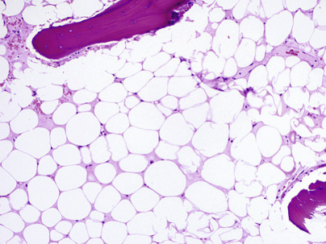

Figure 32-8 

Section of hypocellular marrow, aplastic anemia. 

Cellularity is less than 5%. 

 

##  Erythrokinetics. 

The increased serum iron concentration is a valuable early sign of erythroid hypoplasia and reflects decreased plasma iron turnover. In addition, erythrocyte utilization of iron is decreased. Both effective and total erythropoiesis, therefore, are decreased in aplastic anemia. 

 

##  Acquired Aplastic Anemia Associated with Chemical or Physical Agents 

 

##  Toxic Aplastic Anemias. 

A number of physical and chemical agents produce marrow damage in all humans and animals exposed to a sufficient dose. Examples include ionizing radiation; mustard compounds; benzene; and antineoplastic agents such as busulfan, urethane, and antimetabolites. Benzene, although strongly linked to AA, is now considered less of a problem than in the past because of reduction in exposure. 

 

##  Ionizing Radiation. 

Effects depend on the radiosensitivity of the cells and the capacity of the cells to regenerate, as well as the survival rate of cells in the blood. Erythroid cells are most sensitive, granulocytes have intermediate sensitivity, and megakaryocytes are the least sensitive of the three. Stromal cells are relatively insensitive. 

After acute exposure to radiation, the reticulocyte count falls, but the red blood cells decline slowly because of their long survival. Within the first few hours, neutrophilic leukocytosis occurs as the result of a shift from marginal and probably marrow storage pools. A fall in lymphocytes occurs after the first day and is responsible for the early leukopenia, because lymphocytes are sensitive to irradiation and are directly killed. After 5 days or so, granulocytes begin to fall. The platelets decrease later. Platelets are often the last to return to normal in the recovery phase. Quiescent marrow stem cells are remarkably resistant to a single dose of irradiation. However, chronic exposure to low-dose irradiation, including localized radiation for ankylosing spondylitis, is associated with delayed increased risk for AA because of its impact on the stem cell replicating pool (  Young & Maciejewski, 2009  ). 

 

##  Hypersensitive Aplastic Anemias. 

A large number of drugs produce marrow damage in some individuals after single or repeated exposures. Effects are not dose related as they are in the previously discussed toxic aplasia. Agents include antimicrobial drugs (salvarsan, chloramphenicol, sulfonamides, chlortetracycline, streptomycin), anticonvulsants (mephenytoin, trimethadione), analgesics (phenylbutazone), antithyroid drugs (carbimazole), antihistaminics (tripelennamine), H  2  -histamine receptor antagonists (cimetidine), insecticides (dichlorophenyltrichloroethane [DDT]), and other chemicals—some known (gold compounds, quinacrine, chlorpromazine, hair dyes, bismuth, mercury) and others unknown. The nonsteroidal antiinflammatory medications are becoming more linked to an increased risk for developing AA following marked reduction in the use of chloramphenicol. 

**Chloramphenicol** is an important drug in this category. This antibiotic was considered to be the most common cause of AA at the peak of its use, which began in 1949. Reactions of the marrow to chloramphenicol are of two types, which are possibly unrelated (  Alter & Young, 1998  ). 

In about half of patients who receive chloramphenicol, increased serum iron, reticulocytopenia with anemia, neutropenia, and thrombocytopenia are found. The marrow may show decreased erythroid cells and vacuolization of primitive erythroid and granulocyte precursors. These changes are dose related, time dependent, and reversible. 

In a very small proportion of persons receiving chloramphenicol, an irreversible AA develops that may be fatal. Pancytopenia occurs 3 weeks to 5 months from the last dosage. No relationship has been established between the reversible erythropoietic lesion and the development of aplastic anemia; it may be that individual susceptibility is responsible for the latter. For this reason, it is essential that restraint be employed in using the drug; monitoring its administration with blood cell counts is not an effective preventive measure. 

 

##  Acquired Aplastic Anemia Associated with Other Disease 

 

##  Infection. 

Viral infections are frequently associated with limited marrow suppression, typically neutropenia and less commonly thrombocytopenia. Marrow aplasia has been described as a rare sequela to viral hepatitis, occurring a few months after onset when the hepatitis is resolving. It is estimated at less than 0.07% of hepatitis cases in children and 2% of patients with non-A, non-B hepatitis. Almost all cases are seronegative for hepatitis A, B, C, and G. These patients are usually males younger than 20 years of age; the prognosis is usually grave, and bone marrow transplantation is considered early in the course of the disease (  Young, 2002  ). Parvovirus has been associated with transient erythroid aplastic crisis in patients with chronic hemolytic disorders (  Young, 2002  ). Human immunodeficiency virus and Epstein-Barr virus may also cause hematopoietic depression. The mechanism of virus-induced bone marrow failure may be related to direct cytotoxicity, but more likely is due to breakdown in self-tolerance after infection (  Young, 2002  ). 

 

##  Paroxysmal Nocturnal Hemoglobinuria. 

This rare clonal disorder (see later discussion) may be followed by aplastic anemia. Usually in paroxysmal nocturnal hemoglobinuria (PNH), a variable degree of marrow hypofunction coexists. Alternatively, in some patients who present with AA, the red cell defect of PNH may be present or may appear during the course of the disease. Recent studies using sensitive techniques, such as flow cytometry, to detect cells with PNH defect indicate that as many as 40% to 50% of patients with AA may have some surface marker evidence of PNH. However, hemolytic disease occurs in approximately one third of these patients. The clonal expansion of PNH cells may have an immunologic background (  Young, 2002  ). 

 

##  Pregnancy. 

Pregnancy occurring in a patient with acquired AA may make the pancytopenia more severe. Occasionally, however, AA occurs during pregnancy and remits following delivery. In some such cases, aplasia recurs during a second pregnancy. Infants may be anemic, thrombocytopenic, or leukopenic. Survival rates for AA in pregnancy have been relatively high for the mother (83%) and the baby (75%). Hemorrhage is the most common cause of death in these patients (  Young & Maciejewski, 2009  ). 

 

##  Thymoma. 

Although thymomas are usually associated with pure red cell aplasias, other bone marrow elements may also become depressed. Pancytopenia, often with hypoplastic bone marrow, occurs in rare cases with thymoma. AA may occur as a late complication after the treatment of thymoma (  Ritchie et al, 2002a  ). 

 

##  Immunologic Diseases. 

AA occurs in approximately 10% of cases of eosinophilic fasciitis. The prognosis of AA in this setting is usually poor. AA may be associated with systemic lupus erythematosus (SLE) and rheumatoid arthritis (RA), although the role of drug therapy in the pathogenesis of AA has been considered (  Young & Maciejewski, 2009  ). AA may also complicate multiple sclerosis, congenital immunodeficiency syndromes, and immune thyroid disease. 

 

##  Inherited Aplastic Anemia 

The term **inherited AA** designates individuals with a genetic predisposition to chronic bone marrow failure, which may be associated with other congenital anomalies, and numerous authors prefer to use the term _inherited bone marrow failure syndromes._ Between 30% and 35% of childhood AA cases are inherited. In a study of 134 children with AA, 40 patients were diagnosed with inherited aplastic anemia. Twenty-six had Fanconi's anemia (FA), 10 patients had familial AA without classic signs of FA, and 4 patients presented with amegakaryocytic thrombocytopenia that later developed into complete aplasia (  Alter & Young, 1998  ). 

 

##  Fanconi's Anemia. 

FA is an autosomal recessive disorder with a carrier frequency of 1/300 in the United States and Europe (  Alter, 2002  ). Rare cases are X linked. Often more than one member of a family is affected. The pancytopenia becomes obvious after infancy and is usually significant by the eighth year of life. The anemia is usually normochromic and may be macrocytic; increased levels of Hb F and i antigen may be observed; the marrow is generally hypocellular. Developmental anomalies are present and may include hyperpigmentation, short stature, hypogonadism, malformations of the extremities (e.g., aplasia of the radius, frequent abnormalities of the thumbs), microcephaly, and malformation of other organs (e.g., heart, kidneys). Chromosomal defects consisting of random breaks and rearrangements characteristically are present in blood lymphocytes, as well as in marrow cells. Chromosomal breakage becomes more evident when the cultured cells are challenged with alkylating and DNA cross-linking agents such as mitomycin C and diepoxybutane. Some mosaic cases may be difficult to diagnose, and studying skin fibroblasts may be better than blood cells. A breakthrough in investigating FA evolved from the observation that hybrid cells from FA and normal cells resulted in correction of the abnormal chromosome fragility, a process known as _complementation_ . At least 16 complementation groups have been distinguished to date. The most common is complementation group A (FANCA), which occurs in approximately 70% of FA patients. Several FA proteins form a nuclear complex that is involved in DNA repair (  Alter, 2002  ). The predicted median survival in FA is 19 years. Patients with FA are at higher risk for developing leukemia and nonhematologic tumors, particularly in the head and neck, liver, lower esophagus, vulva, and anus, with an overall incidence of neoplasia of 15% (  Alter & Young, 1998  ). The median age for all cancers in patients with FA was 16 years (  Freedman, 2009  ). 

 

##  Other Inherited Aplastic Anemias. 

A few children present with bleeding manifestations secondary to amegakaryocytic thrombocytopenia. As their disease progresses, they develop a pancytopenia and a hypocellular marrow. Chromosome breakage studies are usually normal. The mode of inheritance is autosomal recessive. The molecular defect is related to a mutation in the gene for thrombopoietin receptor, _c-mpl_ , which maps to 1p35 (  Alter, 2002  ). 

Pancytopenia and hypoplastic anemia may develop in a subset of patients with other familial disorders. Some patients with dyskeratosis congenita (DC) (reticulated hyperpigmentation of skin, dystrophic nails, and mucous membrane leukoplakia) and Shwachman-Diamond syndrome (SDS) (exocrine pancreatic insufficiency and neutropenia) develop AA during the course of their disease (  Alter, 2002  ). Recent studies indicate that DC results from abnormalities in telomere maintenance system. SDS results from biallelic mutation of the _SBDS_ gene, which interacts with molecules responsible for ribosomal subunit assembly resulting in abnormal ribosome biogenesis (  Shimamura & Alter, 2010  ). 

 

##  Pure Red Cell Aplasia 

 

##  Transitory Arrest of Erythropoiesis (Transient Aplastic Crises) 

This may occur during the course of a hemolytic anemia (often preceded by an infection), and the combination of aplasia and hemolysis becomes a life-threatening situation due to rapidly progressing anemia. Red cell production may occasionally cease during or following rather minor infections in normal children or adults, at which time the marrow will show absence of all but a few of the most immature erythroid precursors. Aplastic episodes in chronic hemolytic anemias often appear to be due to parvovirus B19 infection. This virus inhibits erythropoiesis by infecting mature CFU-Es. The morphologic hallmark of the disease is the presence of scattered giant pronormoblasts in the bone marrow aspirate with marked reduction in the more mature erythroid precursors. Nuclear inclusion may be difficult to identify with Wright's stain. The aplastic crises resulting from parvovirus infection are transient, with erythroid marrow recovery in 1 to 2 weeks after onset (  Erslev, 2001a  ). 

 

##  Transient Erythroblastopenia of Childhood 

Transient erythroblastopenia of childhood (TEC) occurs in previously healthy children, usually younger than 8 years of age, with most affected children between 1 and 3 years of age. It is characterized by a moderate to severe normocytic anemia, severe reticulocytopenia, transient neutropenia (20%), and increased platelet counts (60% of patients). Macrocytosis is usually observed during recovery because of the effects of reticulocytes. A history of a viral infection within the previous 3 months is frequently elicited. The bone marrow is generally normocellular and shows virtual absence of erythroid precursors, except for a few early forms. Granulocytic maturation arrest may occur in some neutropenic patients. Patients recover within 1 to 2 months without therapy. TEC can occur in siblings simultaneously and in seasonal clusters. Transient neurologic manifestations, such as hemiparesis and seizures, may accompany TEC (  Freedman, 2009  ). In most cases, the pathogenesis involves humoral inhibition of erythropoiesis; cell-mediated immune suppression was identified in about 25% of cases, but parvovirus has not been proven to be the cause of TEC (  Alter, 2002  ;  Freedman, 2009  ). 

 

##  Congenital Red Cell Aplasia (Diamond-Blackfan Anemia; Congenital Hypoplastic Anemia) 

Diamond-Blackfan anemia (DBA) is a rare, congenital red cell aplasia that usually becomes obvious during the first year of life with a median age of presentation of 3 months, and more than 98% of cases are identified during the first year of life (  Shimamura & Alter, 2010  ). Severe anemia is usually macrocytic, reticulocyte level is low, leukocytes are normal or slightly decreased, platelets are normal or increased, and the marrow usually shows a reduction in all developing erythroid cells, except normal granulocytic and megakaryocytic cell lines. In a small number of cases, residual erythroid precursors are detected. These precursors are mostly pronormoblasts. Hb F is elevated (5% to 25%) to a degree not expected for the patient's age, and the antigen i is often present. Red cell adenosine deaminase (ADA) is usually increased. These findings contrast with TEC, in which the red cells are normocytic, the Hb F is normal, the antigen i is absent, and red cell enzymes are at a lower level (characteristic of an older cell population) (  Alter & Young, 1998  ). 

DBA has an autosomal dominant pattern of inheritance with variable penetrance. The defect appears to be in the erythroid-committed progenitor cells. CFU-Es and BFU-Es are decreased in the marrow, and BFU-Es, which normally circulate, are absent or decreased in the blood. In addition, these progenitor cells exhibit acceleration in programmed cell death (apoptosis) and fail to respond in in vitro culture systems to normal T cells and to usual levels of EPO, suggesting a qualitative defect. DBA results from defects in ribosomal proteins, whether small (S) or large (L) units. The most common is a mutation in the _RPS19_ gene, which was detected in 25% of patients (  Shimamura & Alter, 2010  ). About 75% of patients respond at least partially to corticosteroids, and the overall long-term survival is about 65%, although many patients require long-term steroid use (  Alter & Young, 1998  ). 

 

##  Acquired Pure Red Cell Aplasia 

Among middle-aged adults, selective failure of red cell production occurs rarely. Reticulocytopenia and a cellular marrow devoid of all but the most primitive erythroid precursors are characteristic. Leukocyte and platelet production is normal. About half of reported cases have been associated with thymoma, usually a noninvasive spindle cell type. However, only 5% to 10% of patients with thymoma have the anemia. Remission of the anemia occurs in about one fourth of cases following surgical removal of the thymoma. Chronic acquired red cell aplasia has also been associated with other conditions, such as drugs, collagen vascular disorders, viral infections such as HIV, lymphoproliferative disorders of granular lymphocytes, or other disorders with immunologic aberrations. Most of these anemias appear to be part of a spectrum of autoimmune cytopenias in which the target cells are erythroid stem cells or normoblasts. In some patients, antibodies that react with these cells have been identified. Corticosteroids and immunosuppressive drugs have been used as therapy, but less than half of patients achieve satisfactory remission (  Erslev, 2001a  ). 

 

##  Sideroblastic Anemia 

Sideroblastic anemia is characterized by accumulation of iron in the mitochondria, which appears as ring distribution around the nucleus of erythroid precursors on iron stain. The red cells are usually microcytic in the hereditary forms of the disease and often macrocytic in the acquired forms (  Bottomley & Fleming, 2014  ). The red cells may be mixed with normochromic cells, so that the appearance is dimorphic (see [ Fig. 30-13 ](<##!/content/3-s2.0-B9780323295680000309?scrollTo=%23f0070>) ). The serum iron concentration is increased, the TIBC is decreased, and the percent saturation of the iron-binding protein is greatly elevated. The marrow shows markedly increased storage iron (see [ Fig. 32-5 ](<#f0030>) ), erythroid hyperplasia with evidence of defective hemoglobinization, and increased numbers of sideroblasts. In addition, increased numbers of siderotic granules per cell and granules surround the nucleus (with most authors requiring five or more iron granules encircling at least one third of the circumference), forming “ring sideroblasts” (  Swerdlow et al, 2008  ) (see [ Figs. 30-46 ](<##!/content/3-s2.0-B9780323295680000309?scrollTo=%23f0235>) and [ 33-19 ](<##!/content/3-s2.0-B9780323295680000334?scrollTo=%23f0100>) ). In the latter case, iron loading of mitochondria is seen by electron microscopy. These findings are associated with defective synthesis of heme, which may be due to any of several possible enzyme defects. Occasionally, megaloblast-like changes are seen in the erythroid cells, but changes typical of cobalamin or folate deficiency are not seen in granulocytes unless folate deficiency coexists. 

 

##  Hereditary Sideroblastic Anemias 

Hereditary sideroblastic anemias include several modes of inheritance (i.e., X-linked, autosomal dominant, and autosomal recessive). They may be caused by defective heme synthesis, abnormal iron-sulfur cluster biogenesis, or abnormal mitochondrial proteins. The X-linked forms are the most common, constituting about 40% of cases, and they generally exhibit low levels of δ-aminolevulinic acid synthase (ALAS) enzyme. This occurs in males and may not appear until adolescence. It is rare, but a few family studies have been well documented. In contrast to acquired sideroblastic anemia, the ring sideroblast abnormality is usually found in late, nondividing erythroblasts (  Bottomley, 1982  ). The gene for ALAS-2 isoenzyme (erythroid _ALAS_ ) has been localized to the X chromosome, and a point mutation of this gene _(Xp11.21)_ seems to occur in most X-linked sideroblastic anemia (  Bottomley & Fleming, 2014  ). Mutations of the _ALAS-2_ gene may result in enzyme low affinity for pyridoxal phosphate, structural instability, abnormal catalytic site, or increased susceptibility to mitochondrial proteases. The degree of anemia improves with pyridoxine supplementation when the mutation disrupts the catalytic association between the enzyme and pyridoxal phosphate (  Alcindor & Bridges, 2002  ). Hereditary sideroblastic anemias may be due to a defect in the mitochondria (i.e., mitochondrial cytopathy). Most of these disorders are produced by deletions in the mitochondrial genome, which may account for as much as 30% of the entire mitochondrial genome (  Bottomley & Fleming, 2014  ). These rare diseases are usually associated with systemic manifestations such as Pearson's syndrome (pancreatic insufficiency, vacuolation of bone marrow cells, ring sideroblasts, and a variable degree of marrow failure). 

 

##  Acquired Sideroblastic Anemias 

 

##  Refractory Anemia with Ring Sideroblasts. 

Refractory anemia with ring sideroblasts (RARS) is a category of myelodysplastic syndromes (  Swerdlow et al, 2008  ; see also [ Chapter 33 ](<##!/content/3-s2.0-B9780323295680000334?scrollTo=%23c00033>) ). The dimorphic anemia has both hypochromic-microcytic and macrocytic red blood cells, and the MCV is usually high (see [ Fig. 30-13 ](<##!/content/3-s2.0-B9780323295680000309?scrollTo=%23f0070>) ). At least 15% of erythroblasts (early and late forms) in bone marrow are ring sideroblasts. Other manifestation of dysplasia in the erythroid cell line may be seen. When dysplastic features involve myeloid and megakaryocytic cell lines as well, the designation **refractory cytopenia with multilineage dysplasia** is given. Growing evidence suggests that RARS may be caused by mutations of mitochondrial DNA (  Swerdlow et al, 2008  ). 

 

##  Secondary (Drug- or Toxin-Induced) Sideroblastic Anemia 

This form of sideroblastic anemia is secondary to some agent that interferes with heme synthesis; recognition is important because hematologic improvement occurs if the agent is removed. 

The **antituberculosis drugs** isoniazid, cycloserine, and pyrazinamide cause sideroblastic abnormalities in some patients on long-term therapy. 

**Lead poisoning** is an important member of this group because environmental exposure to lead is usually unrecognized and needs to be detected. Lead interferes with heme synthesis by blocking the enzymes ALAS, ALA dehydratase, and heme synthase. These blocks are only partial and of different degrees; ALA and coproporphyrin are increased in the urine. **Chloramphenicol** also results in ring sideroblast formation, probably by inhibiting mitochondrial protein synthesis. **Copper deficiency** or **zinc overload** can produce sideroblastic anemia, vacuolated marrow cells, and neutropenia. Large quantities of ingested zinc interfere with copper absorption and produce manifestations of copper deficiency. Copper chelators in large doses, such as penicillamine, can produce sideroblastic anemia. 

**Ethanol-induced anemia** is perhaps the most common of the reversible sideroblastic anemias. Folate deficiency, hypomagnesemia, and hypokalemia are concomitant findings. Alcohol may produce ring sideroblasts through decreased plasma levels of pyridoxal phosphate, along with decreased activity of ALA dehydratase and ferrochelatase and possible inhibition of mitochondrial protein synthesis (  Bottomley & Fleming, 2014  ). After withdrawal of alcohol intake, abnormal sideroblasts usually disappear within a few days. 

**Primary pyridoxine deficiency,** often associated with malnutrition, is occasionally associated with sideroblastic anemia. However, other manifestations, such as peripheral neuropathy and dermatitis, dominate the clinical presentation. Sideroblastic anemia as the sole manifestation of pyridoxine deficiency has not been reported in humans, although it occurs in animals (  Alcindor & Bridges, 2002  ). 

 

##  Refractory Anemia 

Refractory anemia is a clonal bone marrow disorder, which usually occurs in individuals over 50 years of age. Normocytic or macrocytic anemia, reticulocytopenia, often pancytopenia, and a hypercellular marrow showing erythroid hyperplasia with a variable degree of dyserythropoiesis are present. Often the patient has been treated with cobalamin, folic acid, and iron without response. The process is usually unremitting, and in a small proportion of cases additional dysplastic changes in marrow cells and increased blast cells evolve into an acute leukemia. Refractory anemias, therefore, are considered one of the myelodysplastic syndromes (see [ Chapter 33 ](<##!/content/3-s2.0-B9780323295680000334?scrollTo=%23c00033>) ). 

 

##  Congenital Dyserythropoietic Anemias 

Congenital dyserythropoietic anemias (CDAs) represent a family of inherited refractory anemias characterized by ineffective erythropoiesis and marrow erythroid multinuclearity. 

At least three types have thus far been separated on the basis of marrow and serologic findings (  Iolascon et al, 2012  ). CDA-I is autosomal recessive and has megaloblastic changes with some binuclearity in approximately 5% of marrow erythroblasts, internuclear chromatin bridges, and a macrocytic anemia. It presents early in life with neonatal anemia and sometimes jaundice. Electron microscopy (EM) studies demonstrated that heterochromatin is denser than normal and forms sharply delineated clumps with small translucent vacuoles, giving rise to the description of a “Swiss cheese” appearance, and cytoplasm may penetrate through widened pores of the nuclear envelope. Most cases have an abnormality in the _CDAN1_ gene located on the long arm of chromosome 15, which encodes a ubiquitous protein called codanin-1 (  Iolascon et al, 2012  ). CDA-II is also autosomal recessive and more common than the others. It shows binuclearity and multinuclearity of 10% to 40% of erythroid precursors with pluripolar mitoses and karyorrhexis. The anemia is normocytic. CDA-II is distinguished from the others in that it has a positive acidified serum test (with some but not all normal sera) and a negative sucrose hemolysis test. It is known as _hereditary erythroblastic multinuclearity_ with positive acidified serum test (HEM-PAS). The red blood cells have an antigen not present on normal or PNH cells, and about one third of normal sera contain the corresponding immunoglobulin (Ig)M antibody. In addition, red blood cells in CDA-II react strongly with anti-i and anti-I. Electron microscopy demonstrates an excess of endoplasmic reticulum parallel to the cell membrane, which gives the appearance of a double membrane in late erythroblasts and some erythrocytes. CDA-II is thought to be related to abnormal membrane glycosylation. The gene for CDA-II has been identified as _SEC23B(CDAN2)_ , which maps to 20q11.2 (  Iolascon et al, 2012  ). CDA-III has giant erythroid precursors, with more pronounced multinuclearity (gigantoblasts) in 10% to 40% of erythroid precursors, along with a macrocytic anemia. A putative gene for CDA-III _(KIF3)_ has been recently localized on chromosome 15 near the _CDAN1_ gene. In contrast to CDA-I and CDA-II, which are autosomal recessive, CDA-III has autosomal dominant inheritance. Other variants have been described in a small number of families. 

 

##  Blood Loss Anemia 

 

##  Acute Posthemorrhagic Anemia 

Blood may be lost from the circulation externally or internally into a tissue space or body cavity. If blood is lost over a short time in amounts sufficient to cause anemia, **acute posthemorrhagic anemia** occurs. Normal healthy individuals are able to compensate for rapid blood loss of up to 20% of circulating blood volume with few symptoms (  Hillman & Finch, 1996  ). After a single episode of excessive bleeding, the major manifestations are those due to depletion of blood volume (hypovolemia). After 1 day or so, blood volume is returned to previous levels by movement of fluid into the circulation, and anemia becomes evident. 

The earliest hematologic change is a transient fall in the platelet count, which may rise to elevated levels within 1 hour. The next development is a moderate neutrophilic leukocytosis with a shift to the left; a maximum leukocyte count of 10 to 35 × 10  9  /L may occur in 2 to 5 hours. Hb and Hct do not fall immediately but only slowly as tissue fluids move into the circulation to compensate for lost blood volume. The fall in Hb and Hct may not reveal the full extent of red cell loss until 2 or 3 days after the hemorrhage. 

The anemia that develops at first is normochromic and normocytic, with a normal MCV and mean cell hemoglobin concentration (MCHC) and only minimal anisocytosis and poikilocytosis. Increased EPO secretion stimulates erythroid proliferation in the marrow, and reticulocytes begin to reach the circulation in 3 to 5 days, reaching a maximum by 10 days or so. During this period, transient macrocytosis (increased MCV), increased polychromasia, and normoblasts may appear in the blood. It takes about 2 to 4 days after blood loss for the leukocyte count to return to normal, and about 2 weeks for the morphologic changes to disappear. Return of red cell values is slower. 

 

##  Chronic Posthemorrhagic Anemia 

If blood is lost in small amounts over an extended period, both clinical and hematologic features that characterize acute posthemorrhagic anemia are lacking. Regeneration of red cells occurs at a slower rate. 

The reticulocyte count may be normal or slightly increased. Significant anemia does not usually develop until after storage iron is depleted; the anemia, therefore, is one of iron deficiency. The anemia is at first normochromic and normocytic, and gradually the newly formed red blood cells become microcytic, and then hypochromic. The leukocyte count is normal or slightly decreased, owing to neutropenia. Platelets are commonly increased, and only later, in severe iron deficiency, are they likely to be decreased. 

The cause of blood loss must be identified because a hidden malignancy, particularly of the GI tract, may be the cause of the anemia. 

 

##  Hemolysis—General 

Anemias that are due primarily to increased red blood cell destruction are **hemolytic anemias.** A shortened red cell survival, therefore, proves that hemolysis is present; this measurement is usually unnecessary in practice. 

Hemolytic anemias may be due to a defect of the red blood cell itself, an **intrinsic hemolytic anemia:** These are usually hereditary and are commonly grouped as **membrane, metabolic,** and **hemoglobin** defects. Alternatively, hemolysis may be due to a factor outside the red blood cell and acting upon it, an **extrinsic hemolytic anemia:** These are almost always acquired. The terms **intravascular hemolysis** and **extravascular hemolysis** refer to the **site** of destruction of the red blood cell: within the circulating blood and outside it, respectively. 

 

##  Erythrocyte Survival Studies 

Shortened red blood cell survival defines hemolysis. If the hemolytic process is moderate or severe, evidence of increased red cell turnover will suffice to show that hemolysis is present. If the hemolytic process is mild or obscure, red cell survival studies may be necessary. 

Radioactive chromium (  51  Cr) is convenient and is widely used for red cell survival studies. Labeled chromate is added to a blood sample in vitro and binds to β-chains of Hb. The chromated red blood cells are injected intravenously, and their disappearance is measured by counting blood, which is sampled every 1 to 2 days for 10 to 14 days. Residual activity is an index of the intravascular life span of the labeled red blood cells. Because  51  Cr emits γ-rays, external scanning can detect sites of red cell destruction. 

The erythrocyte life span is usually expressed as the period during which one half of the radioactivity remains in the blood (the  51  Cr; [ Fig. 32-9 ](<#f0050>) ). Chromium normally elutes from the red blood cells at a rate of 1% per day. Thus, the half-life of the  51  Cr-labeled erythrocytes in normal individuals is 25 to 32 days instead of 60 days. Blood loss, changes in Hct, and recent blood transfusions significantly complicate the interpretation of survival data; therefore, a steady state is necessary for usable results. 

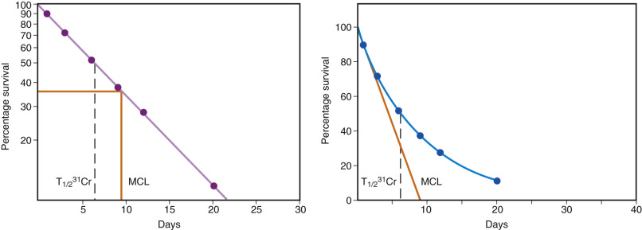

Figure 32-9 

Results of  51  Cr erythrocyte survival curve in patients with autoimmune hemolytic anemia. 

The results are plotted on semilogarithmic graph paper. The mean cell life span (MCL) was 9 to 10 days and was recorded at a period when 37% of cells were still circulating. The time of 50% survival (T  1/2  31  Cr) was 6 to 7 days. 

(From Dacie JV, Lewis SM: _Practical haematology_ , ed 7, Edinburgh, 1991, Churchill Livingstone, p 386.) 

In autoimmune hemolytic anemias, the slope of red cell survival produces a straight line when plotted on semilogarithmic paper (see [ Fig. 32-9 ](<#f0050>) ). In other hemolytic anemias, two cell populations may exist. In these situations, the survival curve may be composed of an initial steep slope followed by a flatter component ( [ Fig. 32-10 ](<#f0055>) ). This type of curve has been seen in hereditary enzyme-deficiency hemolytic anemias, sickle cell anemia, and PNH (  Dacie & Lewis, 1991  ). 

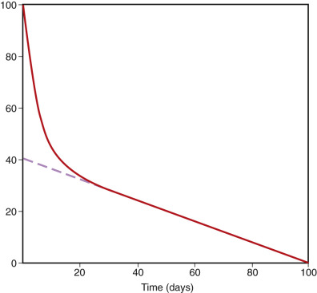

Figure 32-10 

Results of radioactive chromium (  51  Cr) erythrocyte survival curve in a patient with hemolytic anemia containing two cell populations. 

The percent survival is on the ordinate. By extrapolating the flatter curve to time 0, it can be estimated that 40% of the cells have a mean life span of 100 days. Sixty percent of cells have a mean life span of 5 days. 

(From Bentley SA: Red cell survival studies reinterpreted, _Clin Haematol_ 6:601–623, 1977.) 

CO production measures heme catabolism immediately before and during the time of the assay. This is the only available method to study short-term fluctuations in red cell destruction (  Franco, 2009  ). 

Flow cytometry has been applied in some centers to measure red cell survival. Most techniques use ex vivo labeling of red blood cells by biotin. The rate of cell disappearance is then measured using fluorochrome-conjugated avidin or streptavidin. With multicolor flow cytometry, additional parameters, such as reticulocytes and Hgb F content, may be monitored simultaneously (  Franco, 2009  ). 

 

##  Hemoglobin Destruction 

Laboratory findings differ, depending on the site of blood destruction, the amount of destroyed blood, and the rate of destruction. If the destruction is **intravascular** and the quantity of destroyed blood is large, free Hb and methemalbumin will be present in the plasma (hemoglobinemia and methemalbuminemia). The urine may contain free Hb and also hemosiderin. 

Free Hb readily dissociates into αβ-dimers (α 2  β 2  → 2αβ). These are bound to haptoglobin, an α 2  -globulin, and the Hb-haptoglobin complex is rapidly removed from the circulation and catabolized by the liver parenchymal cells. This process prevents Hb from appearing in the urine. However, when the plasma Hb level exceeds 50 to 200 mg/dL (8-31 µmol/L), which is the capacity of haptoglobin to bind Hb, the free αβ-dimers of Hb readily pass through the glomerulus of the kidney. Part of the Hb is then absorbed by the proximal tubular cells, where the Hb iron is converted to hemosiderin. When these tubular cells are shed into the urine later, **hemosiderinuria** results. If the amount of Hb in the tubular lumen exceeds the capacity of the tubular cells to absorb it, it reaches the urine **(hemoglobinuria).** In the process, it may be oxidized to methemoglobin (hemiglobin). Plasma Hb not bound to haptoglobin or removed by the kidney is oxidized to hemiglobin. The oxidized heme groups (hemin) are bound to **hemopexin,** a β-globulin, and the complex is rapidly cleared by the hepatic parenchymal cells. If hemopexin is depleted, hemin groups bind to albumin, forming methemalbumin. Once hemopexin again becomes available, it removes the hemin groups from albumin for hepatic clearance (  Hillman & Finch, 1996  ). 

Lactate dehydrogenase (LDH) is released from red blood cells and is increased in serum in hemolysis, especially in intravascular hemolysis; it is cleared more slowly than Hb. If the upper reference value is 207 IU/L, the LDH in hemolytic anemia may be increased by as much as 800 IU/L. In megaloblastic anemia, associated with marked ineffective erythropoiesis, the LDH is greatly increased to several thousand units. Serum LDH is also increased in other forms of cellular injury. In hemolytic anemias, reversal of the LD isoenzyme pattern is seen, with LD  1  exceeding LD  2  . 

The normal plasma Hb level is 0.5 to 5 mg/dL (0.08 to 0.78 µmol/L). A rise to 10 mg/dL imparts to the plasma a yellow to orange color. With further increase, the color becomes pink. Levels up to 25 to 30 mg/dL are common in hemolytic anemia. Higher levels usually indicate intravascular hemolysis and are seen in hemolytic transfusion reactions and in paroxysmal cold and nocturnal hemoglobinurias. 

If hemolysis is primarily **extravascular,** no hemoglobinemia, hemoglobinuria, or hemosiderinuria is present. Hemolysis is detected by measuring an increase in one of the products of heme catabolism (see [ Chapter 31 ](<##!/content/3-s2.0-B9780323295680000310?scrollTo=%23c00031>) ): 

  * 1.

An increase in CO expired, or in the blood carboxyhemoglobin level. 

  * 2.

An increase in indirect-reacting serum bilirubin; because this is bound to albumin, it will not appear in the urine. 

  * 3.

An increase in urine urobilinogen or, more consistently, in fecal urobilinogen. 

The normal urobilinogen in a 24-hour specimen is 0.5 to 4 mg (0.8 to 6.75 µmol) in urine and 40 to 280 mg (0.068 to 0.470 mmol) in stool. Following excessive hemolysis, it may increase to 5 to 200 mg in urine and to 300 to 400 mg in stool. Examination of feces is more dependable than examination of urine because feces may show an increase when the urine shows none. It may show an increase even when the serum bilirubin concentration is not raised because the normal liver can remove large amounts of (indirectly reacting) bilirubin and of reabsorbed urobilinogen from the blood. 

Hemolytic anemia is characterized also by increased red cell production (see [ Chapter 31 ](<##!/content/3-s2.0-B9780323295680000310?scrollTo=%23c00031>) ). Because of the availability of maximal amounts of iron for Hb formation, red cell production reaches the maximal degree possible (about eight times normal) in severe chronic hemolytic anemia, if complicating factors such as folate deficiency do not intervene. If red cell destruction exceeds the capacity of the marrow to replace red cells at the same rate, hemolytic anemia occurs. With less severe hemolysis, the marrow may be able to produce enough red cells that anemia does not occur; this is called compensated hemolysis. 

Sudden worsening of the degree of anemia may occur in chronic hemolytic anemia and may be due to either of two basic mechanisms. Occasionally, episodes of bone marrow failure (transient arrest of erythropoiesis; see earlier discussion) characterized by erythroid hypoplasia and reticulocytopenia may upset the equilibrium between production and destruction of red cells. In most instances, these **aplastic crises** are probably due to parvoviral infection (  Erslev, 2001c  ). On the other hand, an increased rate of red cell destruction may occur, associated with infection or other illness that increases splenic size. This is not associated with erythroid aplasia and is called a **hemolytic crisis.**

 

##  Blood Film 

The anemia is normocytic or macrocytic. Macrocytosis is due to the presence of increased reticulocytes, which are larger than normocytes. Polychromasia is usually prominent; it may be excessively basophilic and normoblasts may be present, both of which indicate a “shift” of marrow reticulocytes into the blood. Other red cell abnormalities may give a clue to the nature of the hemolytic process. Spherocytes suggest hereditary spherocytosis (HS) or autoimmune hemolysis (see [ Fig. 30-12 ](<##!/content/3-s2.0-B9780323295680000309?scrollTo=%23f0065>) ); schistocytes imply microangiopathic hemolytic anemia (see [ Fig. 30-19 ](<##!/content/3-s2.0-B9780323295680000309?scrollTo=%23f0100>) ); sickle cells, target cells, or crystals suggest a hemoglobinopathy. When hemolytic anemia is acute, increased numbers and younger forms of leukocytes and platelets are often released from the marrow, together with erythrocytes. The result is leukocytosis with a “shift to the left” and thrombocytosis with both normal and giant platelets. 

 

##  Bone Marrow 

Erythroid hyperplasia is present and may be striking in degree. With rapidly proliferating erythroid precursors, some degree of dysplasia may also be seen in erythroid precursors. Storage iron is usually increased and sideroblasts are normal or increased in number, reflecting the abundance of available iron for Hb synthesis. 

 

##  Hemolysis—Membrane Disorders 

The red cell membrane is made of a lipid bilayer anchored to the spectrin/actin membrane skeleton by two major protein complexes: ankyrin complex and the 4.1R complex. Numerous other transmembrane proteins of various functions, including transport, adhesion, and signaling are also identified (  Da Costa et al, 2013  ). 

 

##  Hereditary Spherocytosis 

HS affects 1 in 5000 of the population, occurring predominantly in those of Northern European ancestry. Prevalence in other ethnic groups is unknown, although HS has been reported worldwide, particularly in Japanese and African populations. The reported prevalence may be an underestimation in that milder forms may be clinically asymptomatic (  Da Costa et al, 2013  ). HS is characterized by spherocytic red cells that are intrinsically defective, splenomegaly, and familial occurrence (most often autosomal dominant). In about 15% to 30% of cases, however, neither parent is affected. The hemolytic process is variable in severity and is corrected by splenectomy, although the spherocytosis remains. 

Laboratory findings are those of a chronic extravascular hemolytic process: evidence of increased pigment catabolism, erythroid hyperplasia, and reticulocytosis. The direct antiglobulin test is negative. The red cells characteristically have increased osmotic fragility. On the blood film, spherocytes have a smaller diameter and are more intensely stained than normal cells. They have no central pallor, which if present may be eccentric (see [ Fig. 30-12 ](<##!/content/3-s2.0-B9780323295680000309?scrollTo=%23f0065>) ). The MCV is low-normal and the MCHC is often increased, reflecting a decrease in cell surface. In compensated cases, reticulocytosis may be a sensitive indicator. 

 

##  Osmotic Fragility Test 

Red blood cells are suspended in a series of tubes containing hypotonic solutions of NaCl, varying from 0.9% to 0.0%, incubated at room temperature for 30 minutes, and centrifuged. The percent hemolysis in the supernatant solutions is measured and plotted for each NaCl concentration. Cells that are more spherical, with a decreased surface/volume ratio, have a limited capacity to expand in hypotonic solutions and lyse at a higher concentration of NaCl than do normal biconcave red cells. They are said to have increased osmotic fragility. Conversely, cells that are hypochromic and flatter have a greater capacity to expand in hypotonic solutions, lyse at a lower concentration than normal cells, and are said to have decreased osmotic fragility ( [ Fig. 32-11 ](<#f0060>) ). 

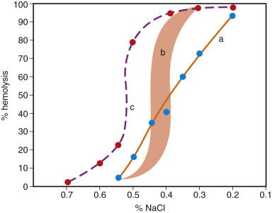

Figure 32-11 

Erythrocyte osmotic fragility. 

_a,_ Thalassemia, showing a small fraction of cells with increased fragility _(lower left)_ and a larger fraction of cells with decreased fragility _(upper right).b,_ Normal curves fall in the shaded area. _c,_ Hereditary spherocytosis, showing increased osmotic fragility. 

The osmotic fragility of freshly drawn blood is usually increased in HS but may be normal in mildly affected patients. In blood that is incubated at 37° C for 24 hours before the test is performed, the osmotic fragility is almost always increased ( [ Fig. 32-12 ](<#f0065>) ). 

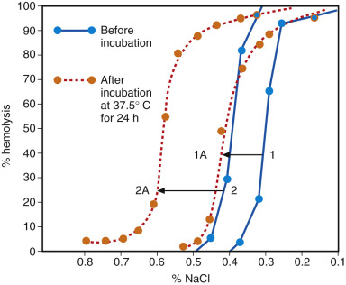

Figure 32-12 

The effect of incubation on erythrocyte osmotic fragility. 

The change in the osmotic fragility curve from “before incubation” to “after incubation” is illustrated for normal blood (1→1A) and for blood from a patient with hereditary spherocytosis (HS) (2→2A). Blood in HS characteristically shows a greater increase in fragility with incubation than does normal blood or even blood of acquired spherocytosis (e.g., autoimmune hemolytic anemia). 

The increased osmotic fragility of freshly drawn blood is characteristic but not specific; it may occur in acquired spherocytic anemias, such as immune-mediated hemolytic anemia. A greater difference in median fragility (after incubation from before incubation) occurs in HS cells than in control normal cells; this is an important diagnostic feature in HS. A tail of very fragile cells conditioned by the spleen is usually seen. The tail usually disappears after splenectomy. Cells with increased surface/volume ratio are osmotic resistant. These cells are seen in iron deficiency, thalassemia, liver disease, and reticulocytosis. 

 

##  Autohemolysis Test 

Sterile, defibrinated blood is incubated at 37° C for 48 hours (  Dacie & Lewis, 1991  ). During this time, red cells undergo a complex series of changes, lose membrane, and become more spherocytic. In normal blood, without added glucose, the amount of autohemolysis at 48 hours is 0.2% to 2.0%. In normal blood, incubated with added glucose, the amount of autohemolysis is less—0% to 0.9%. 

In HS, autohemolysis is virtually always increased; with glucose, the lysis is diminished to a variable extent. This test is being used less frequently and is probably no more sensitive than the incubated osmotic fragility test (  Dacie & Lewis, 1991  ). 

 

##  Additional Tests 

Several additional tests have been employed. The most common is the flow cytometry dye binding assessment using eosin-5′ maleimide (EMA) dye. The test has a sensitivity and specificity exceeding 90% (  Da Costa et al, 2013  ). 

Red blood cells in HS are characterized by an unstable lipid bilayer, which facilitates the release of lipids from the membrane, resulting in loss of surface area and formation of poorly deformable spherocytes that are selectively retained and damaged in the spleen (the mechanism is sometimes referred to as a _vertical defect_ since it affects the association between the lipid bilayer and the red cell skeleton). The erythrocytes are abnormally permeable to sodium, and there is no defect in energy metabolism, which is, in fact, increased. The increased metabolic activity has been explained as an attempt to compensate for a membrane defect that leaks cations, with degenerative changes and loss of cell membrane accelerated by the metabolic and physical stresses of passage through the spleen. 

The genetic defects in HS are heterogeneous but affect the skeletal proteins of the red cell membrane. Ankyrin-1 defect is the most common in Europe and the United States, affecting 40% to 65% and causing low expression of spectrin and ankyrin associated with a mild to moderate disease. Band 3 ( _SLC4A1_ gene) is the next in prevelance affecting 20% to 35% of patients and also causing mild to moderate disorder. Mutation of α spectrin ( _SPTA1 gene_ ) is rare, affecting <5%, but usually causes a severe form of HS (  Da Costa et al, 2013  ). 

 

##  Hereditary Elliptocytosis 

This autosomal dominant condition probably includes more than one genetic variant. In the U.S. population, the prevalence is approximately 3 to 5 per 10,000. It is more common in individuals of African and Mediterranean ancestry. All cases of hereditary elliptocytosis (HE) are associated with weakening of the membrane skeleton and defective association of proteins that hold the skeleton together, which is sometimes referred to as a _horizontal defect_ (  Da Costa et al, 2013  ). On the basis of red cell morphology, HE can be divided into three groups: (1) common HE (including hereditary pyropoikilocytosis [HPP]), with elliptocytes that may be rod shaped; (2) spherocytic HE; and (3) Southeast Asian ovalocytosis. The most commonly defined abnormality appears to be a defect in spectrin, resulting in impaired association of spectrin dimers into spectrin tetramers and spectrin oligomers. Other abnormalities include a defect in spectrin-actin-protein 4.1R junctional complex. HPP is associated with two abnormalities: a mutation in spectrin that disrupts spectrin heterodimer self-association, and a partial deficiency of spectrin that results in a decreased spectrin/band 3 ratio. 

 

##  Common HE 

Most persons with the common form of HE (≈90% of cases) are nonanemic; a minority of this group (perhaps 10% to 20%) have mild hemolysis. Nonhypochromic elliptocytes are abundant in the blood film, numbering approximately 15% (see [ Fig. 30-16 ](<##!/content/3-s2.0-B9780323295680000309?scrollTo=%23f0085>) ), whereas in normal individuals less than 5% of the red cells are elliptical (  Gallagher & Jarolim, 2009  ). The deformity is increased in sealed, moist preparations. 

In a subgroup of common HE, especially in black families, affected neonates transiently have moderate poikilocytosis, red cell fragmentation, and budding, with hemolytic anemia; during the first year of life, hemolysis declines and typical HE emerges. Worsening of hemolysis in the neonatal period has been attributed to the presence of fetal hemoglobin, which binds poorly to 2,3-diphosphoglycerate (2,3-DPG). Higher levels of the latter exert a destabilizing effect on spectrin-protein 4.1-actin interaction (  Gallagher & Jarolim, 2009  ). 

 

##  Hereditary Pyropoikilocytosis 

HPP is a severe congenital hemolytic anemia, which is characterized by microcytosis, striking micropoikilocytosis and fragmentation, and autosomal recessive inheritance caused by homozygous or compound heterozygous mutations. HPP represents a subtype of common HE. It occurs primarily in blacks. In contrast to normal red cells, which show budding and fragmentation when heated to 49° C, HPP red cells fragment at 45° to 46° C. In Caucasian European populations, one parent may carry an asymptomatic polymorphism known as α LELY  . This polymorphism may be detected in the heterozygous state in 42% and in the homozygous state in 9% of the European population (  Da Costa et al, 2013  ). 

 

##  Spherocytic HE 

This subgroup accounts for 10% of cases. A mild to moderate hemolytic anemia and splenomegaly are present, with both elliptocytes and spherocytes, along with abnormal osmotic fragility and autohemolysis tests. Poikilocytes and fragments are usually absent. The molecular basis of this subtype is unknown. 

 

##  Southeast Asian Ovalocytosis 

This subgroup occurs with high frequencies (20% to 30%) in certain populations of the Far East, particularly Malaysia. Hemolysis is usually absent or mild although it may be more pronounced in neonates (  Da Costa et al, 2013  ). The erythrocytes are less elongated, and some have the appearance of stomatocytic ovalocytes. Many cells contain one or two transverse ridges or a longitudinal slit. This condition is associated with increased resistance to malaria. The underlying defect is related to a deletion of 27 bases from the band 3 gene (  Gallagher & Jarolim, 2009  ). 

 

##  Hereditary Stomatocytosis 

This is a rare, autosomally dominant disorder, which is commonly divided into more common dehydrated stomatocytosis (DHst) and the rare overhydrated stomatocytosis (OHst). The phenotype varies from asymptomatic to severe hemolytic anemia. In DHst, there is red cell dehydration due to loss of cations, predominantly K  \+  and water. MCV is normal or slightly increased despite increase MCHC with stomatocytes seen on blood smears. Red cell survivial is not significantly compromised. Recent studies suggest that DHst is caused by mutations in the _FAM38A_ gene encoding the PIEZO1 protein, which is involved in cation channel activation. In the rare DHst, there is massive cation leak causing markedly increased MCV (usually above 110fL) and decreased MCHC. The phenotype is severe with hemolytic anemia and reticulocytosis. Recent studies suggest that this form is caused by mutations in the Rh-associated glycoprotein, which is a member of the band 3 complex and is involved in ammonium or gas transport (  Da Costa et al, 2013  ). Individuals with Rh deficiency syndrome, either absent (Rh  null  ) or markedly reduced (Rh  mod  ), usually have hemolytic anemia with stomatocytosis. 

 

##  Paroxysmal Nocturnal Hemoglobinuria 

PNH is an acquired clonal stem cell disorder characterized by the production of abnormal erythrocytes, granulocytes, and platelets (  Brodsky, 2009  ). The red cell defect renders them more susceptible to complement-mediated intravascular lysis. Three types of erythrocytes have been described according to their in vitro sensitivity to lysis by complement: type I with normal sensitivity, type II with medium sensitivity (three to five times normal), and type III with extreme sensitivity (15 to 25 times normal). Several complement defense proteins are decreased or absent in PNH. These proteins include: decay accelerating factor (DAF, CD55), membrane inhibitor of reactive lysis (MIRL, CD59), and C8-binding protein (a homologous restriction factor). DAF is a glycoprotein that antagonizes the convertase complexes of complement. MIRL is a protein that controls the membrane attack complex, C5b-9. Other proteins that are deficient in PNH include CD58 (leukocyte function antigen 3), CD14 (endotoxin-binding protein receptor), CD24, and CD16a (Fcγ receptor). Membrane-associated enzymes such as acetyl cholinesterase and leukocyte alkaline phosphatase may be deficient as well. Recent work indicates that deficient proteins and enzymes are attached to the cell membrane by a common glycolipid anchor called GPI. Deficiency of GPI results in secondary deficiency of the attached proteins. Therefore, PNH can be redefined as partial or complete lack of GPI-linked proteins on a population of cells of the hematopoietic system. 

PNH is a rare disease with an estimated annual incidence of 4 per million (  Brodsky, 2009  ). The disease is characterized by chronic intravascular hemolysis with or without obvious hemoglobinuria. However, hemosiderinuria is almost constantly present. Typical nocturnal or sleep-related hemoglobinuria is present in a minority of patients. Bouts of hemolysis could be initiated by infection, surgery, whole blood transfusion, injection of contrast dyes, or even severe exercise. The proposed relationship between mild drop in pH during sleep and nocturnal hemoglobinuria has not been confirmed (  Brodsky, 2009  ). 

The blood usually shows a normocytic anemia with a reticulocytosis that is often less than expected for the degree of anemia. Hypochromic microcytic anemia is not uncommon, however, and is due to loss of iron in the urine. Neutropenia occurs in three fifths and thrombocytopenia in two thirds of patients at some time during the course of disease, so that pancytopenia is common. The direct antiglobulin test is usually negative. 

The marrow may be hypercellular with erythroid hyperplasia, but it may be hypocellular. In some patients, marrow failure may occur during the course of PNH; in others, AA is the initial diagnosis, with signs of PNH manifesting simultaneously or later. As mentioned earlier, approximately 40% of patients with AA have evidence of PNH clones at diagnosis (  Young, 2002  ). 

Thrombotic complications are common, occurring in approximately 40% of patients, and represent a major cause of mortality. Thrombosis commonly occurs in hepatic, cerebral, and abdominal veins. The absence of CD59 on platelets results in externalization of phosphatidylserine, a site for prothrombinase complexes, and thus increases the propensity for thrombosis. The disease may undergo partial remissions and exacerbations. In more than half of patients, both the proportion of abnormal cells and the clinical severity decrease with time. Abnormal cytogenetics can be found in up to 20% of PNH patients. In approximately 3% to 5% of PNH patients, the disease progresses to acute leukemia. 

 

##  Laboratory Diagnosis 

Previous manual tests for the diagnosis of PNH, such as sucrose hemolysis and Ham's tests have been largely replaced by flow cytometry studies. 

Flow cytometry using immunofluorescent staining of red cells with a monoclonal antibody against deficient proteins such as CD55, CD58, and CD59 is gradually becoming the standard method of diagnosing PNH. Granulocytes provide excellent diagnostic targets for flow cytometry. A fluorescein-labeled proaerolysin variant (FLAER) is increasingly being used for the diagnosis of PNH. It binds selectively to the GPI anchor. Guidelines for high-sensitivity flow cytometry detection of minor clones of PNH have been published and are being adopted by many laboratories (  Sutherland et al, 2012  ). 

The gene responsible for the PNH phenotype has been identified on the X chromosome and designated phosphatidyl inositol glycan A or _PIG-A_ . More than 120 somatic mutations of the _PIG-A_ gene have been described. Over the last few years, a humanized monoclonal antibody against the terminal complement protein C5 (Eculizumab; Alexion, Cheshire, Conn.) has been approved for the treatment of patients with hemolytic PNH. This drug significantly reduces hemolysis, transfusion requirements, and thrombosis, and it has improved the quality of life for PNH patients (  Sutherland et al, 2012  ). 

 

##  Hemolysis—Hemoglobin Disorders 

There are two main groups of inherited disorders of Hb: (1) structural variants, with defects in the structure, and (2) thalassemias, with defects in the synthesis, of a globin chain. There is an overlap between these groups: A handful of structural variants also have a thalassemic phenotype with decreased synthesis, and hence, level of the abnormal globin chain. Hereditary persistence of fetal hemoglobin (HPFH) is related to the thalassemias, although the phenotype is not clearly thalassemic. Most thalassemias involve the α\- or β-globin chain. δ\- and γ\- thalassemias are known, but are clinically less significant. 

 

##  Normal Hemoglobins 

The heme group is identical in all Hbs. The globin part of the molecule is a tetramer, made up of two dimers; each dimer contains an α-like and a β-like globin. Beyond the embryonic period, there is only one α-like globin that forms three distinct Hbs with the three different β-like globins present. There are also three embryonic Hbs, which are expressed only in the first 3 months of gestation. ( [ Fig. 32-13 ](<#f0070>) ). 

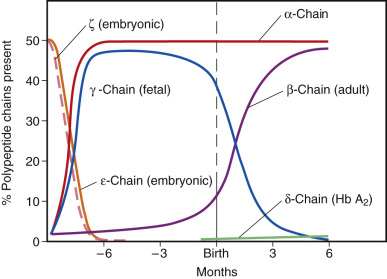

Figure 32-13 

Relative proportions of polypeptide chains of hemoglobin present during fetal and neonatal life. 

(From Bentley SA: Red cell survival studies reinterpreted, _Clin Haematol_ 16:601–623, 1977.) 

 

##  Hb A (α2β2) 

Hemoglobin A is the major normal adult Hb, accounting for about 97% of the total. It consists of two identical α-chains, each with 141 amino acids; and two identical β-chains, with 146 amino acids each. Each chain is linked with one heme group. The molecule is ellipsoidal, with the four heme groups at the surface of the molecule, where they function by combining reversibly with O  2  . 

 

##  Hb F (α2γ2) 

Hemoglobin F is the major Hb of the fetus and the newborn infant. The increased O  2  affinity of fetal blood versus adult blood is due to its lower affinity for 2,3-DPG. The two α-chains are identical to those of Hb A, and the two γ-chains, with 146-amino-acid residues, differ from β-chains. In normal individuals, Hb F has two types of γ-chains, which differ by one amino acid, having either alanine (  A  γ) or glycine (  G  γ) at position 136. There is a common polymorphism of the Aγ gene, in which threonine replaces isoleucine at position 75. This Hb F variant is called Hb F Sardinia and is without functional abnormalities. Approximately 10% of total Hb F is a negatively charged variant, designated Hb F1, owing to posttranslational acetylation of the amino-terminal end of γ-chains. 

During fetal life, Hb F predominates, as γ-chain production is high. β-chain production begins before the 20th week of prenatal life, so that Hb A is 10% of the total between 20 and 35 weeks and 15% to 40% at the time of birth. Around birth, the production of Hb F is turned down; by 6 months Hb F is usually less than 8%, and by 12 months it is less than 5% in about 90% of infants. Between 12 and 24 months of age, Hb F is usually less than 3% but varies from 3% to 10% in about 20% of infants. After 2 years of age, Hb F is normally less than 2%, and only traces of Hb F (<0.8%) are present in most adults. During fetal life, all red blood cells produce and contain Hb F, whereas in adults only 3% to 5% do so; these are termed _F cells_ (  Weatherall & Clegg, 2001  ). Adult production of Hb F is regulated by multiple genetic loci, including the Xmn1-HBG2 site in the β-globin locus, the HMIP locus at 6q23, and the bcl11A locus on chromosome 2 (  Thein & Menzel, 2009  ). Polymorphic variants at these loci cause a modest increase (up to 5%) in Hb F in 3% to 5% of healthy adults and underlie most cases of Swiss-type or heterocellular hereditary persistence of fetal Hb. 

F cells may increase in number when reactivation of Hb F synthesis occurs in normal pregnancy and in some disorders of erythropoiesis, particularly chronic bone marrow failure syndromes. In certain acquired hematopoietic disorders, the Hb F level may also be elevated. These include megaloblastic anemia, myelofibrosis, aplastic anemia, paroxysmal nocturnal hemoglobinuria, refractory anemias, leukemias, and solid tumors (up to 5% to 10%). In the second trimester of pregnancy, there could be a slight increase, and in hydatidiform moles, a more significant increase—up to 6%. The highest levels of Hb F are found in juvenile myelomonocytic leukemia, Fanconi's anemia, and erythroleukemia (30% to 50%). Elevated Hb F is found in a few hemoglobinopathies, in β\- and δβ-thalassemias, and in HPFH. The switch from γ-globin to β-globin and the decrease in Hb F are delayed in sickle cell patients, who might not reach their stable Hb F level until adolescence (  Huisman, 1980  ). A similar delay in decline in Hb F is also seen in thalassemia trait (  Schroter & Nafz, 1981  ). 

 

##  Hb A  2  (α 2  δ 2  ) 

Hemoglobin A  2  accounts for 1.5% to 3.5% of normal adult Hb. Its two α-chains are the same as in Hb A; its two δ-chains differ from β-chains in only 10 of their 146 amino acids. Due to its inefficient promoter, the transcription of the δ-globin gene is low and Hb A  2  always remains a minor Hb. δ-chain synthesis begins late in fetal life. The level of Hb A  2  gradually increases during the first few years of life, at which time the adult level is reached. 

Increased Hb A  2  is seen almost exclusively in β-thalassemias. It rarely reaches 6% and never more than 12%. Hb A  2  is occasionally increased in hyperthyroidism and megaloblastic anemia. It has been reported to be increased in sickle cell trait (  Whitten & Rucknagel, 1981  ) and sickle cell disease, but the increase is only modest and the level stays below 4.0%. Its level decreases in iron deficiency and α-thalassemia. If the patient with β-thalassemia trait has concomitant severe iron deficiency, the increase in Hb A  2  might be dampened down and appear equivocal; in these instances, retesting should be performed after the iron deficiency is corrected. Because of its developmental delay, Hb A  2  might not be useful in diagnosing β-thalassemia trait in young infants. 

 

##  Embryonic Hemoglobins. 

The zeta (ζ) chain is the embryonic analog of the α-chain and combines with epsilon (ε) chains to form Hb Gower-1 (ζ2ε2) or with γ-chains to form Hb Portland (ζ2γ2). The ε-chain is the embryonic counterpart of the γ-, β-, and δ-chains and combines with α-chains to form Hb Gower-2 (α2ε2). These embryonic Hbs are found at the gestational age of less than 3 months. 

 

##  The Globin Gene Clusters. 

Globin synthesis is controlled by two separate gene clusters. The ζ-gene and two α-genes (α-like globins), together with nonfunctioning pseudogenes, are on chromosome 16. Genes for the ε-, two γ\- δ-, and β-chains (β-like globins), and a pseudogene are located on chromosome 11 ( [ Fig. 32-14 ](<#f0075>) ). Note that there are two functioning α-genes on a haploid chromosome (balanced by only one β-gene). The different globin genes evolved from a common ancestor by gene duplication. There is considerable polymorphism of regulatory sequences within these clusters, accounting for normal variations and wide phenotypic differences in hemoglobinopathy and thalassemia syndromes. 

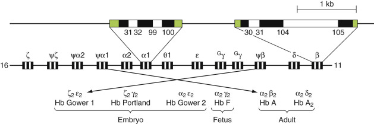

Figure 32-14 

The α\- and β-globin gene clusters on chromosomes 16 and 11, respectively. 

In the extended α\- and β-globin genes, the introns are shaded dark, the 5′ and 3′ noncoding regions are hatched, and the exons are unshaded. 

(From Weatherall DJ, Clegg JB: _The thalassemia syndromes_ , ed 4, Oxford, 2001, Blackwell Scientific Publications.) 

 

##  Glycosylated Hemoglobins. 

The term _glycation_ or _glycosylation_ implies the linkage of a sugar to a protein. Approximately 5% of Hb A undergoes posttranslational glycosylation, resulting in linkage of sugars to serine, asparagine, and hydroxylysine residues. Glycosylation of Hb increases linearly over the 120-day life span of the red cell. The glycosylated Hbs have been designated Hb AIa, Hb AIb, and Hb AIc. Hb AIc contains a molecule of glucose attached nonenzymatically by a ketoamine linkage to the amino-terminal amino group of each β-chain. The Hb AIc level correlates with the serum glucose level and is used for the diagnosis of diabetes and as an index of metabolic control during the preceding 2 to 3 months. Hb AIc may be falsely decreased in conditions associated with rapid red cell turnover, such as hemolytic anemia. 

 

##  Laboratory Investigation of Hemoglobinopathies and Thalassemias 

Current practices include automated complete blood count (CBC); ferritin or free erythrocyte protoporphyrin to rule out iron deficiency; and high-performance liquid chromatography (HPLC) or capillary electrophoresis for Hb A  2  and Hb F measurement and detection of Hb variants; followed by alkaline and acid electrophoresis when a variant is found and additional studies (Sickledex), as necessary (  Clarke & Higgins, 2000  ). 

  

##  Cation-Exchange HPLC and Capillary Electrophoresis. 

Numerous automated systems have been developed in the last 20 years for initial screening of Hb variants and for separation and determination of percentages of Hb A, Hb A  2  , and Hb F. A cation-exchange HPLC system, such as Bio-Rad Variant by Bio-Rad Laboratories (Philadelphia, Pa.), is commonly used. Resolution of this system is claimed to be similar to that of isoelectric focusing, and data banks of retention times are available ( [ Figs. 32-15 ](<#f0080>) and [ 32-16 ](<#f0085>) ) (  Bain et al, 2010  ). Variants detected by HPLC are confirmed by an alternative technique, such as electrophoresis. Capillary electrophoresis is a rapidly developing automated system with a performance similar to that of HPLC (  Keren et al, 2008  ). 

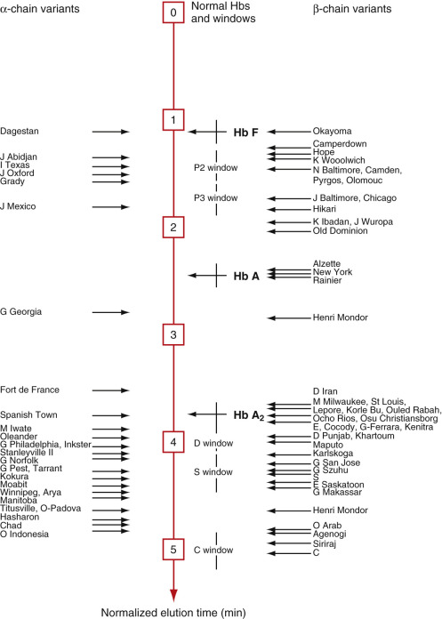

Figure 32-15 

Elution times of 74 hemoglobins. 

Elution times were normalized to a reference value of 3.8 minutes for Hb A  2  . Cation-exchange high-performance liquid chromatography (HPLC) separation by the Bio-Rad Variant system, using the β Thalassemia Short Program. 

(From Riou J, Godart C, Hurtrel D, et al: Cation-exchange HPLC evaluated for presumptive identification of hemoglobin variants, _Clin Chem_ 43:34–39, 1997.) 

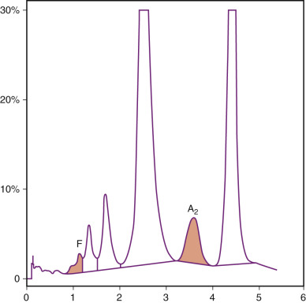

Figure 32-16 

Ion-exchange high-performance liquid chromatography (HPLC) separation of hemoglobins (Hbs): patient with sickle cell trait. 

Hbs F, A, and A  2  and an abnormal Hb in the S window are detected. 

Hemoglobin A  2  cannot be quantified because of the presence of Hb S. (Bio-Rad Variant Classic Hb Testing System, Bio-Rad Laboratories, Philadelphia.) 

 

##  Hemoglobin Electrophoresis and Isoelectric Focusing. 

Hb molecules in an alkaline solution have a net negative charge and move toward the anode in an electrophoretic system. A practical method for routine Hb electrophoresis is cellulose acetate at alkaline pH (  Briere et al, 1965  ). It is rapid and reproducible and separates the major Hb variants S, D, G, C, and E from Hb A ( [ Figs. 32-17 ](<#f0090>) and [ 32-18 ](<#f0095>) ). Quantification of the major bands is easily accomplished. Those with an electrophoretic mobility greater than that of Hb A at pH 8.6 are known as the “fast Hbs”; these include, in order of increasing mobility, Hbs K, J, Bart's, N, I, and H. Hbs A  2  , C, E, and O Arab at the slow end are unresolved from each other, as are S, D, G, and Lepore. Citrate agar electrophoresis at an acidic pH (  Milner & Gooden, 1975  ) provides ready separation of Hbs that migrate together on cellulose acetate: S from D and G, and C from E and O ( [ Fig. 32-19 ](<#f0100>) ). Isoelectric focusing separates Hbs based on their isoelectric point along a pH gradient, with high resolution ( [ Fig. 32-20 ](<#f0105>) ). 

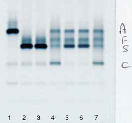

Figure 32-17 

Electrophoretic separation of hemoglobins at alkaline pH. 

_1,_ Normal adult; _2_ and _3,_ 17-year-old with sickle cell anemia; _5_ and _6,_ patient with sickle cell anemia, recently transfused; _4_ and _7,_ Hbs A/F/S/C standard (Hydragel 7 Hemoglobin/Hydrasys System, Sebia Electrophoresis, Norcross, Ga.). 

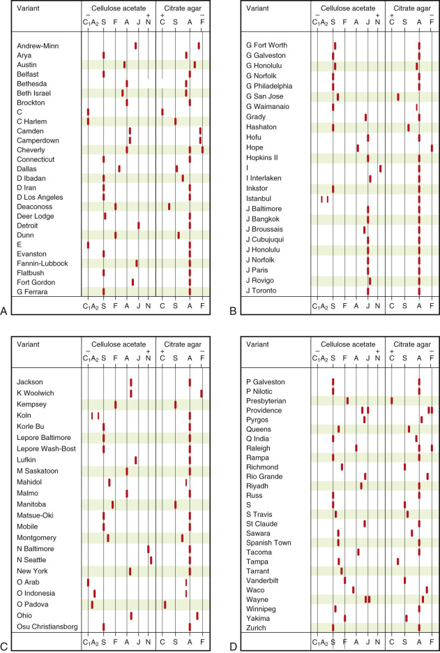

Figure 32-18 

Electrophoretic mobility of 102 hemoglobin variants at alkaline (cellulose acetate) and acidic (citrate agar) pH. 

(Courtesy of Winston Moo-Penn and Danny Jue.) 

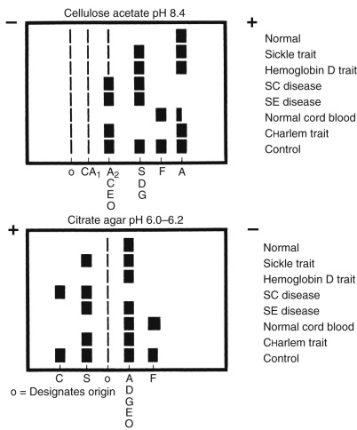

Figure 32-19 

Hemoglobin (Hb) electrophoresis. 

Comparison of various Hb samples on cellulose acetate (at pH 8.4) and citrate agar (at pH 6), showing relative mobilities. The control is a composite sample. The relative amounts of Hb are not necessarily proportional to the size of the band. 

(From Schmidt RM, Brosious EF: _Basic laboratory methods of hemoglobinopathy detection_ , ed 6, Atlanta, 1976, U.S. Department of Health, Education and Welfare, Centers for Disease Control and Prevention. HEW Publ. No. CDC 77–8266.) 

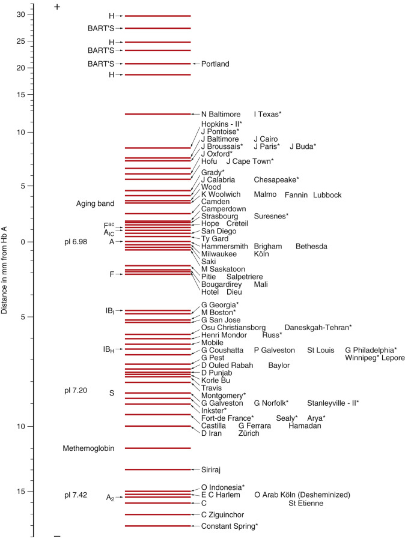

Figure 32-20 

Comparison of 57 hemoglobin variants by isoelectric focusing. 

Asterisk denotes α-chain variants. 

(From Basset P, Braconnier F, Rosa J: An update on electrophoretic and chromatographic methods in the diagnosis of hemoglobinopathies, _J Chromatogr Biomed Appl_ 227:267–304, 1982.) 

 

##  Acid Elution Slide Test for F Cells. 

Modification of the original method of Kleihauer and Betke by  Shepard and colleagues (1962)  is useful for analyzing the distribution of Hb F among red blood cells. Hemoglobins other than Hb F are eluted from the red cells on an air-dried blood film by a citric acid–phosphate buffer (pH 3.3). Only Hb F remains in the fixed red cells, and the distribution can be determined after staining. In normal adults, almost all red cells appear as ghosts; 1% to 5% of red cells contain residual Hb and appear pink (F cells). In most types of HPFH, Hb F is distributed evenly among red cells (pancellular distribution). In all other conditions, such as thalassemia or a hemoglobinopathy, and in Swiss-type HPFH, the distribution of Hb F is heterogeneous or uneven among red cells (heterocellular distribution). 

 

##  Detection of F cells by Flow Cytometry. 

This is more accurate than the acid elution slide test. Most adult cells are negative, F cells show moderate fluorescence, and fetal cells of neonates show bright fluorescence when stained with an anti-Hb F antibody. 

 

##  Hb A  2  Quantitation. 

Hb A  2  quantitation is challenging for two reasons: (1) Its level is low with a narrow range and only a modest increase in disease, requiring a high degree of precision, and (2) Hb variants with similar charge or retention time interfere with its estimation. Several laboratory methods of varying accuracy and precision are being used. Cation-exchange HPLC (  Head et al, 2004  ) and capillary electrophoresis are considered to be sufficiently precise. Densitometry of electrophoretic bands on cellulose acetate membrane is unreliable. In the HPLC method, the Hb A2 level is falsely elevated in the presence of Hb S, because Hb S adducts have similar retention times (  Suh et al, 1996  ). As HbE and Hb A2 elute together, their level cannot be estimated. Hb A  2  estimation is used principally in diagnosis of β-thalassemia trait, in which it is elevated up to 7%. Hb A  2  values of normals do not overlap with those of β-thalassemia trait patients, when performed by HPLC (  Huisman, 1986  ). Reference intervals for Hb A  2  are 1.5% to 3.5% of total Hb. 

 

##  Sickling Test—Metabisulfite Slide Test. 

Adding sodium metabisulfite, a reducing substance, to blood enhances deoxygenation of Hb and sickling of Hb S ( [ Fig. 32-21 ](<#f0110>) ). The test does not distinguish sickle cell anemia from sickle trait or other Hb S syndromes because all red cells sickle; however, sickling occurs more rapidly with greater amounts of Hb S in the cells. Positive tests may occur with other rare sickling hemoglobins (Hbs S Travis, C Harlem), Hb I, and high concentrations of Hb Bart's. Hb I, an α-chain variant, has normal functional properties. False-negative tests may occur if Hb S concentration is less than 10% (as in very young infants) or if deoxygenation is inadequate (e.g., deterioration of reagent). 

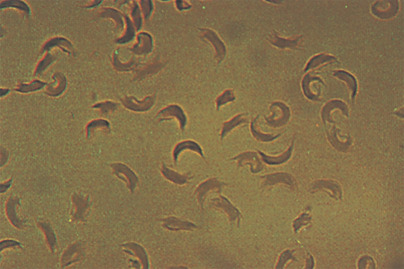

Figure 32-21 

Sickle cell preparation, in sodium metabisulfate; sickle cell anemia. 

Even in sickle cell trait, all cells eventually sickle. 

 

##  Sickle Solubility Test. 

In this nonquantitative test, red blood cells are lysed with saponin, and Hb is reduced by dithionite (sodium hydrosulfite). Reduced Hb S is insoluble in concentrated inorganic buffer (2.3 M phosphate buffer), and the polymers of deoxy-Hb S obstruct light rays to produce opacity. The test is useful in screening large numbers of people for the presence of Hb S or other sickling Hbs. False-positive reactions (turbid solution) occur also in the presence of many Heinz bodies, as in unstable Hb disorders after splenectomy, and in blood protein disorders due to precipitation of plasma proteins. False-negative reactions (clear solution) occur if the amount of Hb S is too small, as in severe anemia. 

 

##  DNA Analysis. 

Gap PCR is used for detection of large deletions in α\- or, less often, in the other thalassemia syndromes (  Old, 2001  ). In gap PCR, primers bind to the region flanking the deletion. PCR product is obtained only from the affected alleles, as the primers are located far apart in the normal gene. Additional primers that amplify the normal allele are used to assess for heterozygosity/homozygosity. The six most common deletions can be detected in one reaction using multiplex PCR primers (  Chong et al, 2000  ). Southern blotting is still used and can assess all alleles and confirm PCR results. PCR-based techniques have been developed to screen for common point mutations in β-thalassemia and Hb variants. In ARMS (amplification refractory mutation system), amplification takes place only when the primer matches perfectly the genomic DNA sequence. ARMS primers are available for the detection of all common β-thalassemia mutations. Sequencing is utilized for confirmation of single nucleotide mutations and small deletions. 

 

##  Structural Hemoglobin Variants 

As of 2005, 893 Hb variants had been identified (  Globin Gene Server, 2015  ). Ninety percent of these are due to single amino acid substitutions; in the remaining 10%, the polypeptide chain is abnormally long or short as a result of termination errors, frameshift mutations, insertions, deletions, or fused or hybrid chains. 

A majority affect the α\- or β-globin chains. Involvement of the γ-chain and the δ-chain occurs, but because of the small amount of Hb involved, their variants are less often detected and are rarely of clinical significance. A large number of Hb variants that do not cause disease have been discovered in surveys. 

New Hbs were assigned letters of the alphabet, then geographic names—usually to distinguish different Hbs with similar electrophoretic mobilities. Several variants of Hb D, G, and J, for example, are known. Sometimes, a variant is known by multiple names, based on independent discoveries. Hb M indicates a variant that forms methemoglobin. Amino acid substitutions in some of the known Hb variants are listed and classified by functional characteristics in [ Table 32-3 ](<#t0020>) . 

TABLE 32-3 

Functional Classification of Hemoglobin Variants 

**I. Homozygous: Hemoglobin (Hb) Polymorphisms: The Variants That Are Most Common**  
---  
Hb S  |  α 2  β 2  6Val  |  Severe hemolytic anemia: sickling   
Hb C  |  α 2  β 2  6Lys  |  Mild hemolytic anemia   
Hb D  |  Punjab α 2  β 2  121Gln  |  No anemia   
Hb E  |  α 2  β 2  26Lys  |  Mild microcytic anemia   
**II. Heterozygous: Hemoglobin Variants Causing Functional Aberrations or Hemolytic Anemia in the Heterozygous State**  
**_A. Hemoglobins Associated with Methemoglobinemia and Cyanosis_ **  
Hb M Boston α 2  58Tyr  β 2   
Hb M Iwate α 2  87Tyr  β 2   
Hb M Saskatoon α 2  β 2  63Tyr   
Hb M Milwaukee α 2  β 2  67Glu   
Hb M Hyde Park α 2  β 2  92Tyr   
Hb FM Osaka α 2  γ 2  63Tyr   
Hb FM Fort Ripley α 2  γ 2  92Tyr   
**_B. Hemoglobins Associated with Altered Oxygen Affinity_ **  
**_1\. Increased Affinity and Polycythemia_ **  
Hb Chesapeake α 2  92Leu  β 2   
Hb J Capetown α 2  92Gln  β 2   
Hb Malmo α 2  β 2  97Gln   
Hb Yakima α 2  β 2  99His   
Hb Kempsey α 2  β 2  99Asn   
Hb Y psi (Ypsilanti) α 2  β 2  99Tyr   
Hb Hiroshima α 2  β 2  146Asp   
Hb Rainier α 2  β 2  145Cys   
Hb Bethesda α 2  β 2  145His   
**_2\. Decreased Affinity —May Have Mild Anemia or Cyanosis _ **  
Hb Kansas α 2  β 2  102Thr   
Hb Titusville α 2  94Asn  β 2   
Hb Providence α 2  β 2  82Asn   
Hb Agenogi α 2  β 2  90Lys   
Hb Beth Israel α 2  β 2  102Ser   
Hb Yoshizuka α 2  β 2  108Asp   
**_C. Unstable Hemoglobins_ **  
**_1\. Hb may Precipitate as Heinz Bodies after Splenectomy: “Congenital Heinz Body Anemia” _ **  
**_a. Severe Hemolysis: No Improvement after Splenectomy_ **  
Hb Bibba α 2  136Pro  β 2   
Hb Hammersmith α 2  β 2  42Ser   
Hb Bristol α 2  β 2  67Asp   
Hb Olmsted α 2  β 2  141Arg   
**_b. Severe Hemolysis: Improvement after Splenectomy_ **  
Hb Torino α 2  43Val  β 2   
Hb Ann Arbor α 2  80Arg  β 2   
Hb Genova α 2  β 2  28Pro   
Hb Shepherd's Bush α 2  β 2  74Asp   
Hb Koln α 2  β 2  98Met   
Hb Wein α 2  β 2  130Asp   
**_c. Mild Hemolysis: Intermittent Exacerbations_ **  
Hb L-Ferrara α 2  47Gly  β 2   
Hb Hasharon α 2  47His  β 2   
Hb Leiden α 2  β 2  6 or 7  (Glu deleted)   
Hb Freiburg α 2  β 2  23  (Val deleted)   
Hb Seattle α 2  β 2  70Asp   
Hb Louisville α 2  β 2  42Leu   
Hb Zürich α 2  β 2  63Arg   
Hb Gun Hill α 2  β 2  91-  97 (5 a. a. deleted)   
**_d. No Disease_ **  
Hb Etobicoke α 2  84Arg  β 2   
Hb Dakar α 2  112Gln  β 2   
Hb Sogn α 2  β 2  14Arg   
Hb Tacoma α 2  β 2  30Ser   
**_2\. Tetramers of Normal Chains: Appear in Thalassemias_ **  
Hb Bart's γ 4   
HbH β 4   
Hb α 4   
  
Data from Winslow RM, Anderson WF: The hemoglobinopathies. In Stanbury JB, Wyngaarden JB, Fredrickson DS, et al, editors: _The metabolic basis of inherited disease,_ ed 5, New York, 1983, McGraw-Hill, pp 2281–2317\. 

Hbs S, C, E, and D are, by far, the most important variants ( [ Table 32-4 ](<#t0025>) ). Together with the thalassemias, they reached polymorphic frequencies in regions where falciparum malaria was/is endemic, owing to partial protection against this parasite by mechanisms still not fully understood. 

TABLE 32-4 

Prevalence of Common Hemoglobin Disorders Among African Americans 

|  %   
---|---  
**Traits**  
Silent α-thalassemia (αα/−α)  |  24   
Hb AS  |  8.6   
α-Thalassemia trait (−α/−α)  |  5.7   
Hb AC  |  2.4   
β-Thalassemia trait  |  1.5   
HPFH  |  0.1   
Hbs D and G  |  0.026   
All others  |  0.3   
**Sickling Disorders**  
Hb SS  |  0.16   
Hb S/C  |  0.13   
Hb S/thal  |  0.06   
Hb S/HPFH  |  0.004   
**Other Disorders**  
Hb CC  |  0.02   
Hb C/β-thalassemia  |  0.02   
Homozygous β-thalassemia  |  0.005   
  
_Hb,_ Hemoglobin; _HPFH,_ hereditary persistence of fetal hemoglobin. 

Data from  Motulsky AG  : Frequency of sickling disorders in US Blacks, _N Engl J Med_ 288:31–33, 1973; Schneider RG, Hightower B, Hosty TS, et al: Abnormal hemoglobins in a quarter million people, _Blood_ 48:629–637, 1976; and  Pierce HI, Sumiko KK, Sofroniadou K, et al  : Frequencies of thalassemia in American Blacks, _Blood_ 49:981–986, 1977. 

 

##  Abnormal Hemoglobin Syndromes 

In homozygous β-chain structural variants, both allelic genes for the abnormal β-chains are present, so that no normal β-chains (hence, no Hb A) are produced. Because α-, γ-, and δ-genes are normal, Hb F and Hb A  2  are structurally normal, although they may be increased in amount. 

In heterozygous β-chain structural variants, the abnormal Hb is present, in addition to Hb A, F, and A  2  . Its level depends on its rate of synthesis and stability, but also on its readiness to form dimers with α-chains. This latter process is driven by electrostatic forces between the positively charged α-globin and the negative β-globin. Because most β-globin variants acquire positive charge, their assembly with the positive α-chain is slower. As a result, the percentage of abnormal Hb is usually less than that of Hb A. In the presence of coexistent α-thalassemia, when β-chains compete for an insufficient number of α-globins, these effects are exaggerated and the level of structural variant decreases further. Similar forces influence the levels of Hb A  2  . δ-chain subunit of Hb A  2  has a significant positive charge, not favorable for dimer formation. Positively charged β-chain variants also have little affinity for α-chains, leaving excess α-chains for assembly with δ-globin and resulting in a slight increase in Hb A  2  . This has been described in Hbs S and C trait, but the increase is so minimal that its existence was always questioned. 

Compound heterozygotes for a β-chain structural variant and β \+  -thalassemia are well known. Here, the quantity of abnormal Hb exceeds that of Hb A, in contrast to the heterozygous β-structural hemoglobinopathies, in which the reverse is true. 

In heterozygous α-chain structural variants, the abnormality in the α-chain will affect all three Hb types. Therefore, six different hemoglobins are found—the three normal hemoglobins and the three abnormal forms. 

Compound heterozygotes for two β-chain abnormalities produce two different abnormal β-chains; therefore, there are two abnormal Hbs and no Hb A. An example of this is Hb SC disease. Compound heterozygotes for β\- and δ-chain abnormalities and for α\- and β-chain abnormalities are rare but have provided important information. The latter will have four major Hb types on electrophoresis. 

 

##  Sickling Disorders 

 

##  Sickle Cell Trait (Hb AS) 

The heterozygous state for Hb S is the most common hemoglobinopathy in the United States. It is present in about 8% of African Americans (  Schneider et al, 1976  ) and in as many as 45% of the population in certain areas of West Africa. The gene is found throughout sub-Saharan Africa and, at a much lower frequency, in the Mediterranean, Middle East, and India. Hb S trait is a benign condition without clinical symptoms or hematologic abnormalities. Added risk associated with sickle cell trait is minimal at the most, and is seen only in very rare circumstances. Extreme low O  2  tensions can trigger sickling, and a few people have sustained splenic infarction when flying at very high altitude in unpressurized airplanes. Slightly increased incidences of hematuria, impaired ability to concentrate urine, and bacteriuria in women have been reported. Sickle cell trait confers protection to children from the lethal effects of falciparum malaria, which accounts for the major distribution of Hb S in central Africa. 

The stained blood film appears normal, except perhaps for a few target cells. Blood cell counts are normal. The sickle cell slide preparation is positive, and almost all red cells eventually sickle. The solubility test is positive. 

Hemoglobin separation typically shows 60% Hb A, 40% Hb S, normal Hb F, and normal to slightly increased Hb A  2  , up to 4.0%. 

The proportion of Hb S is decreased in the presence of α-thalassemia; Hb S is less than 35% when one α-gene is deleted and less than 29% when two genes are lost (  Head et al, 2004  ). In the latter, cells are hypochromic and microcytic. Because 27% of African Americans carry the α \+  -thalassemia gene, it is not surprising that the combination is quite common. Hb S level may also be diminished in iron and folate deficiency. Clinically, the combination of sickle cell trait and α-thalassemia trait is benign, with possible mild microcytic anemia due to the thalassemia trait. 

 

##  Sickle Cell Disease (Hb SS) 

Homozygous Hb S disease is a serious chronic hemolytic anemia, first manifested in early childhood and often fatal before 30 years of age. With modern medical care, many patients live longer, but the median age of death in the United States is still only in the 40s. Hb S is found mostly in the black population; 1 of every 600 black persons in the United States has sickle cell anemia (  Steinberg, 1999  ). 

In Hb S (β6 glu→val), the glutamic acid in the sixth position on the β-chain is replaced by valine. Hb S is freely soluble when fully oxygenated; when O  2  is removed, Hb S polymerizes, with formation of tactoids (fluid crystals) that are rigid and deform the cell into the shape that gave the disease its name. A strong interaction between the side chain of β6 valine and the hydrophobic pocket of β85 phenylalanine and 88 leucine of another Hb S molecule is probably the basis of polymer formation. In homozygous Hb S disease, sickling occurs at O  2  tensions that are physiological in the peripheral microcirculation. The rigidity of the red cells is responsible for the hemolysis, as well as for most of the complications. These irreversibly sickled cells result from membrane reorganization during repeated episodes of sickling and unsickling, in addition to cell dehydration that markedly reduces cellular deformability. Sickle cells contain high calcium levels, which stimulate potassium and water loss (Gardos effect) and exaggerate cell dehydration (  Weatherall & Clegg, 1999  ). The hemolytic component is mostly extracellular and is caused by clustering of band 3 of the cell membrane, with the consequence of increased IgG binding and recognition by macrophages. Integrins (α4β1) on the sickle cell surface attach to fibronectin and adhesion molecules expressed on endothelial cells; this is enhanced by inflammatory cytokines, von Willebrand factor, and platelet activation, and together these interactions cause vaso-occlusion. 

 

##  Complications. 

In early childhood, bilateral painful swelling of the dorsa of the hands or feet occurs as a result of sickling and capillary stasis; this is known as **hand-foot syndrome,** or _sickle cell dactylitis._ It lasts about 2 weeks, is accompanied by changes of periostitis as observed by X-ray, and does not occur after 4 years of age. 

The spleen is central to three complications: A **sequestration crisis** refers to sudden pooling of blood and rapid enlargement of the spleen, resulting in hypovolemic shock. This may occur in early childhood when splenomegaly is present and is often preceded by infection. **Functional asplenia** consists of inadequate antibody responses under some conditions and an impaired ability of the reticuloendothelial system to clear bacteria and particulate material from the blood, probably owing to reticuloendothelial blockade. This may explain in part the increased risk for infection in children with the disease. Salmonella and pneumococcal infections are unusually prevalent in children with sickle cell anemia. Vaso-occlusive episodes result in progressive infarction, fibrosis, and contraction of the spleen—so-called **autosplenectomy.** Although splenomegaly is present in childhood, a small fibrotic remnant is the rule in the adult. 

From early childhood, patients cannot produce concentrated urine, apparently as a result of anoxic damage in the medullae of the kidneys. Hematuria as a result of papillary necrosis is common. Renal insufficiency occurs in 5% to 20% of adults (  Steinberg, 1999  ). 

**Vaso-occlusive crises** are debilitating episodes of abdominal and bone or joint pain, accompanied by fever, which are probably due to plugging of small blood vessels by masses of sickled cells. Bone necrosis occurs in 10% to 50% of patients and may be a focus for salmonella osteomyelitis. Acute chest syndrome represents episodes of acute chest pain often associated with a new infiltrate in the chest film. Approximately 40% of patients experience at least one episode of acute chest syndrome. Although an infectious origin had been suspected in earlier studies, fat embolism is now considered to play a major role in this syndrome. The various complications that result from recurring vaso-occlusive crises involve many body organs (  Steinberg, 1999  ). 

**Aplastic crises** occasionally can afflict any patient with chronic hemolytic anemia. Temporary failure of red cell production that would not be noticed in a person with a normal red cell life span will cause a serious fall in Hb concentration in chronic hemolytic anemia. This may be the result of infection, particularly parvovirus B19, exposure to toxic drugs, or folic acid deficiency; sometimes no cause can be found. Hemolytic crises due to a further increase in hemolysis are rare. 

 

##  Diagnosis. 

The anemia is normochromic and normocytic; polychromasia is increased, and nucleated red blood cells are present. Sickle cells are almost always found in the stained smear ( [ Fig. 32-22 ](<#f0115>) ). Target cells are numerous, and Howell-Jolly and Pappenheimer bodies are regularly seen in older children and adults as a result of asplenia. The microhematocrit as an estimate of degree of anemia is unreliable because of excessive plasma trapping. Neutrophilia and thrombocytosis are usual. The marrow shows erythroid hyperplasia. 

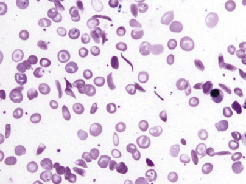

Figure 32-22 

Blood film, sickle cell anemia. 

The erythrocytes are far from one another, suggesting a severe anemia. Numerous pointed sickle cells and target cells are present. Close to the nucleated red blood cell, elliptical cells are seen. These cells have a dense center, instead of the usual central pallor, suggesting that they are incipient sickle cells (500×). 

No Hb A is found if the patient has not been transfused recently; more than 80% of the hemoglobin is Hb S, 1% to 20% Hb F, and 2% to 4.5% Hb A  2  (  Wrightstone & Huisman, 1974  ). The fetal hemoglobin is distributed unevenly among the red cells. Hb S and several D and G hemoglobins have the same electrophoretic mobility at alkaline pH, but of these, only Hb S gives a positive sickling test. 

 

##  Hemoglobin SC Disease 

The frequency of Hb SC disease is almost the same as that of Hb SS disease in African Americans. It causes a mild hemolytic anemia. Crises are less frequent and less painful than in sickle cell anemia. Onset is usually in childhood, but the disease might be undetected until later in life. The life expectancy is only modestly shortened. The body habitus is normal or stocky in contrast to the asthenic features in sickle cell anemia. Splenomegaly might be the only finding on physical examination. Fatigue, dyspnea on effort, frequent upper respiratory infections, attacks of mild jaundice, and arthralgias are seen. Constant hip and low back pain may be present with aseptic necrosis of the head of the femur. Hematuria from renal medullary infarction and splenic infarcts have been described. In pregnancy, crises are more frequent and there is an increase in thrombotic tendency, which can cause massive thromboembolism and sudden death following childbirth. A higher incidence of retinopathy is seen in Hb SC disease than in SS disease. 

Anemia varies from moderate to very mild and is normochromic-normocytic. Anisocytosis and poikilocytosis are mild to severe, and target cells are numerous—up to 85% of the erythrocytes. Plump and angulated sickled cells are often present on the film. The sickling test is positive. Hb S is 50% and Hb C is slightly less. Hb F is usually under 2%. The proportions of Hbs are the same in patients with coexistent α-thalassemia (  Steinberg et al, 1983  ). 

 

##  Hb S/β-Thalassemia 

This is the third most common sickling disorder after Hb SS and Hb SC in African Americans, and the most common one in people from the Mediterranean. It usually runs a milder course in black people (usually S/β \+  -thalassemia) but causes a severe sickling disorder with manifestations similar to those of sickle cell anemia in people of Italian, Turkish, or Greek descent. 

In Hb S/β 0  -thalassemia, Hb A is absent; Hb S is 75% to 90%, Hb F is 5% to 20%, and Hb A  2  is 4% to 6%. This disorder clinically and hematologically resembles sickle cell disease, except for the spleen, which remains enlarged after childhood and into adult life. The main difference is that in Hb S/β 0  -thalassemia, the MCV and MCH are decreased, and the Hb A  2  might be significantly increased. Family study is often necessary for a clear distinction (  Wrightstone & Huisman, 1974  ). On the blood smear, pronounced microcytosis, variable hypochromia, and many target cells are present. As a consequence of reduced cellular hemoglobin, Hb S polymers are formed more slowly, and fewer sickled cells are present on the smear. 

In Hb S/β \+  -thalassemia, Hb A is 15% to 30%; Hb S is over 50%, Hb F is 1% to 20%, and Hb A  2  is 4% to 6%. Although these individuals clinically may resemble those with sickle trait (Hb AS), in S/β \+  -thalassemia, the amount of Hb S always exceeds Hb A, while in sickle cell trait Hb A always exceeds Hb S. 

 

##  Hb SS/α-Thalassemia 

Thirty to forty percent of patients with sickle cell anemia are heterozygous for α \+  -thalassemia, and 2% to 3% are homozygous (  Higgs et al, 1982  ). The MCV (83 fL in heterozygotes and 72 fL in homozygotes) and MCH are decreased. The Hb level is higher and the reticulocyte count is significantly lower as compared with sickle cell anemia. On the smear, sickled cells are uncommon, similarly to Hb S/β 0  -thalassemia. Although the anemia is less severe, the vaso-occlusive disease is not, and some studies even show increased morbidity and mortality. As described earlier, δ-chains successfully compete with positively charged S-chains for a limited number of α-chains, and Hb A  2  levels increase. Hematologically, this cannot be separated from Hb S/β 0  -thalassemia ( [ Table 32-5 ](<#t0030>) ). Whenever microcytosis and increased Hb A  2  are present in sickle cell anemia, family or molecular studies are done to differentiate these entities. 

TABLE 32-5 

Differential Diagnosis of Sickle Cell/Thalassemia Syndromes 

Genotype  |  Clinical Expression  |  Hb  |  MCV  |  Hb F  |  Hb A  2  |  Hb A   
---|---|---|---|---|---|---  
SS  |  Severe  |  7-8  |  85-95  |  2-20  |  2-4  |   
S/β 0  thal  |  Moderate to severe  |  8-10  |  65-75  |  5-20  |  4-6  |   
SS/α thal  |  Moderate to severe  |  8-10  |  70-85  |  2-20  |  3-5  |   
S/HPFH  |  Asymptomatic to mild  |  13-14  |  75-85  |  20-30  |  1-3  |   
S/β \+  thal  |  Mild to moderate  |  11-12  |  70-80  |  1-13  |  3-6  |  10-30   
  
_Hb,_ Hemoglobin; _Hb A,_ accounts for 97% of normal adult hemoglobin; _Hb A 2  , _ accounts for the remaining 3% of normal adult hemoglobin; _Hb F,_ fetal hemoglobin; _HPFH,_ hereditary persistence of fetal hemoglobin; _MCV,_ mean corpuscular volume. 

Data from Bunn HF, Forget BG: _Hemoglobin: molecular, genetic and clinical aspects,_ Philadelphia, 1986, Saunders; and Steinberg MH, Forget BG, Higgs DR, et al: _Disorders of hemoglobins,_ ed 1, Cambridge, 2001, Cambridge University Press. 

 

##  Hemoglobin SD Disease (Hb S/D–Los Angeles). 

SD disease simulates but is less severe than sickle cell anemia, and thus may also resemble SC disease. It is occasionally seen in the African American population. On routine (alkaline) electrophoresis, the pattern is indistinguishable from sickle cell anemia because Hb S and Hb D cannot be separated. Agar gel electrophoresis at pH 6.2 will separate Hb S and Hb D. 

 

##  Hb S/O Arab. 

Compound heterozygotes of Hb S and Hb O Arab (β121 glu→lys) have a severe sickling disorder. Hb O Arab is found in black and Arabic people. 

 

##  Other Compound Heterozygosities with Hb S. 

Hb E and a few other, less frequent β-variants also cause sickling disorders with Hb S. Coexistence of an α-chain variant and a sickle cell trait does not cause a sickling disorder. 

 

##  Other Common β-Chain Variants 

 

##  Hb C Trait (β6 glu→lys). 

Hemoglobin C is prevalent in West Africans and in about 2% to 3% of black people. The heterozygous state (Hb AC) is asymptomatic, without anemia, with normal or minimally reduced MCV and normal red cell life span. The MCHC might be slightly elevated. Target cells are present on blood film. Hb C makes up about 40% of the total hemoglobin. When significant microcytosis is present, it is usually caused by coexistent α-thalassemia, and Hb C is reduced to 38%, 32%, and 24% in patients with three, two, and one α-gene, respectively (  Huisman, 1977  ). 

 

##  Hb C Disease. 

Homozygous Hb C disease is a mild hemolytic anemia with splenomegaly that is often asymptomatic but occasionally results in jaundice and abdominal discomfort. Life expectancy is normal. In the United States, 0.02% of black people have Hb C disease (  Schneider et al, 1976  ). Reticulocytosis is low for the degree of anemia. The anemia is largely a consequence of low O  2  affinity of Hb C (  Bunn & Forget, 1986  ) and should not be treated. The MCV is usually decreased, and the MCHC is normal or increased. Numerous target cells with an admixture of microspherocytes and minimal polychromasia are seen in the blood. Osmotic fragility is biphasic, with both increased and decreased fragility, but is not used in the diagnosis today. Hexagonal or rod-shaped crystals may be seen in erythrocytes in the stained smear, especially after splenectomy or after slow drying of the smear ( [ Fig. 32-23 ](<#f0120>) ). As opposed to Hb S, crystals of Hb C tend to melt at low partial pressure of oxygen (pO  2  ) and do not cause vaso-occlusive disease. The red blood cells are dehydrated (causing the increased MCHC), owing to loss of cations and water as a result of interaction of Hb C with the red cell membrane. As a consequence, the cells are more rigid and less deformable than normal, increasing their likelihood of being trapped and destroyed in the spleen. Hb F is elevated at 2% to 4%, and Hb A  2  , when measured by HPLC, might be slightly increased; the remainder of hemoglobin is Hb C. 

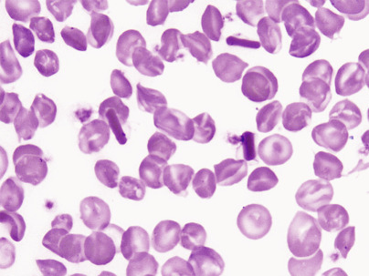

Figure 32-23 

Hemoglobin (Hb) C disease, after splenectomy. 

Before splenectomy, the only morphologic abnormality was the presence of target cells. After splenectomy, Howell-Jolly bodies and Hb crystals, such as those in the center, were present. Note that almost all of the Hb in this particular cell is in the dark bar, and the membrane is still visible. Some such crystals are distinctly hexagonal (1000×). 

 

##  Hb C/β \+  -Thalassemia. 

This occurs mainly in black people, in whom it tends to result in little disability, except for anemia in pregnancy. Red cell indices are typical of β-thalassemia trait, but there is anisocytosis and 20% to 50% target cells. Usual values are 65% to 80% for Hb C, 16% to 30% for Hb A, and 2% to 5% for Hb F. 

 

##  Hb C/β 0  -Thalassemia. 

People of Mediterranean extraction usually have a moderately severe hemolytic anemia with β 0  or a severe β \+  genotype. This combination is extremely rare in the African population. Hb C/β 0  -thalassemia may be difficult to distinguish from Hb C disease in that Hb A is absent in both, and there is an overlap in Hbs A  2  and F levels. Hb A  2  is elevated to about twice normal, and Hb F is elevated at 3% to 10%. 

 

##  Hb E (β 26 glu→lys). 

This is probably the most prevalent hemoglobin variant worldwide and the third most common in the United States, behind S and C. It is found primarily in Southeast Asia, especially in people of Thai and Burmese extraction, but is also found in blacks and Caucasians. Hb E is associated with a β-thalassemia phenotype, as well as with a structurally abnormal globin chain. The mutation that causes amino acid substitution also activates a cryptic splice site that competes with the normal RNA splice donor site, and normally processed RNA is decreased. In the laboratory, Hb E can be demonstrated to be unstable. It precipitates abnormally in the heat denaturation test and with isopropanol, yet this has no in vivo significance; the red cell survival is normal (  Fairbanks et al, 1980  ). 

 

##  Hb E Trait (Hb AE). 

Hb AE is asymptomatic, with borderline microcytosis (MCV = 84 ± 5) and no anemia. Hb A is 65% to 70% of the total hemoglobin, Hb E is 30%, and Hb F is normal. Coexistence of one α-thalassemia gene does not change any of the above parameters and can be proven only by DNA analysis. If two or three α-thalassemia genes are also present, the proportion of Hb E decreases to 21% and 14%, respectively. The proportion of Hb E is also significantly lower in iron deficiency. 

 

##  Hemoglobin E Disease. 

This is also asymptomatic; it resembles a thalassemia trait, with microcytosis (average MCV = 70 fL), erythrocytosis, normal MCHC, and slight anemia. Thus, Hb E behaves as an extremely mild thalassemia. The reticulocyte count is normal, but 20% to 80% target cells are evident on the blood film. Hb E accounts for more than 90% of the hemoglobin, with Hb F from 1% to 10% and no Hb A. 

 

##  Hb E/β-Thalassemia. 

In sharp contrast with Hb E disease, this is a severe condition. It is one of the most important thalassemia syndromes, comprising close to half of the severe β-thalassemia cases (  Weatherall, 2010  ). It is most common in Southeast Asia. The clinical variability is marked; rarely, there are very few symptoms, but the usual picture is that of thalassemia intermedia or thalassemia major. Most of the thalassemia alleles are of the β 0  or severe β \+  variety. Ineffective erythropoiesis, a consequence of excess α-globins, red cell indices, red cell morphology, and clinical manifestations are similar to those in homozygous β-thalassemia. Hbs E, F, and A  2  are present. Hb F shows extreme variation, from 5% to 85%; the mean Hb F is 42%, and the mean Hb E is 58% (  Steinberg et al, 2009  ). 

 

##  Hb D Los Angeles (Punjab) (β121 glu→gln). 

This constitutes the most common D variant in African Americans (<0.02%). In the Punjab region of India, heterozygosity reaches 3%. Homozygotes have normal red cell indices, no evidence of hemolysis, and 95% Hb D with normal Hbs F and A2 (  Bunn & Forget, 1986  ). Double heterozygotes for Hb D Punjab/β 0  -thalassemia have a mild hemolytic anemia with thalassemic red cell indices and increased Hbs F and A  2  . 

The significance of Hb D Punjab is that compound heterozygosity with Hb S produces a moderately severe sickling disorder (see the Hemoglobin SD Disease section earlier in the chapter). Other, less frequent D hemoglobins (D Iran, D Ibadan) and G hemoglobins do not cause sickling—a major difference for genetic counseling. D and G hemoglobins migrate with Hb S on alkaline electrophoresis but are separated from S at acidic pH, migrating with Hb A. It is more difficult to separate them from each other. Careful analysis of isoelectric focusing and HPLC are helpful in most cases. 

  

##  Common α-Chain Variants 

 

##  Hb G Philadelphia (α 68asn→lys). 

This is the most common α-chain variant in black people (  Schneider et al, 1976  ). Almost invariably, the linked α-gene is deleted (−α G  ). Simple heterozygotes (−α G  /αα) have 30% Hb G and normal red cell indices, but double heterozygotes with α-gene deletion on the other chromosome as well (−α G  /−α) have 45% Hb G and a thalassemia trait phenotype. As with other α-chain variants, a minor hemoglobin representing a combination of α G  with δ is present close to Hb A  2  and helps to differentiate Hb G Philadelphia from β-chain variant G and D hemoglobins (sometimes called G  2  hemoglobin). 

 

##  Disorders of Hemoglobin Function and Stability 

A number of amino acid substitutions occur in the heme pocket, where they may cause oxidation of ferrous iron to ferric form producing methemoglobin (Hb M) or alter the affinity of the heme for O  2  ; the latter usually alters the stability of the molecule as well. Other substitutions affect the αβ contact sites; these also can change stability and O  2  affinity of the molecule (  Bunn, 1994  ). 

These functionally significant hemoglobinopathies are heterozygous; usually, the concentration of the abnormal Hb is less than 50%. Generally, Hbs with abnormal α-chains form a smaller proportion of the total (10% to 25%) than those with abnormal β-chains (35% to 50%). 

 

##  Hemoglobins Associated with High Oxygen Affinity and Polycythemia 

Eighty-six abnormal Hbs with high O  2  affinity that are associated with familial erythrocytosis are known today (  Globin Gene Server, 2015  ). Some are listed in [ Table 32-3 ](<#t0020>) . The O  2  dissociation curve is shifted to the left. The p  50  , the pO  2  at which Hb is 50% saturated, is decreased. Under physiologic conditions, the normal p  50  of whole blood is 26 mm Hg; in this disorder, it has ranged from 5 to 23 mm Hg. Because the Hb has a high affinity for O  2  , it cannot unload the oxygen and the tissues are relatively hypoxic, resulting in increased EPO production and polycythemia. These disorders are autosomal dominant; only heterozygotes have been described. The Hb concentration has ranged from 15 to 23.8 g/dL. Measurement of O  2  affinity is required to establish the diagnosis (  Bunn & Forget, 1986  ). Because the amino acid substitution is inside the molecule, often the abnormal hemoglobin is indistinguishable from Hb A on electrophoresis or HPLC. 

 

##  Hemoglobins Associated with Low Oxygen Affinity 

There are far fewer variants with decreased O  2  affinity (see [ Table 32-3 ](<#t0020>) ;  Bunn & Forget, 1986  ). The O  2  dissociation curve is shifted to the right (increased p  50  ). These individuals have mild “anemia,” as they can unload more O  2  to the tissues and they simply do not need that much Hb. A handful of variants with markedly decreased affinity are associated with cyanosis. In these, O  2  uptake is impaired in the lung and the level of deoxyhemoglobin is more than 5 g/dL, causing cyanosis. The skin and mucous membranes have a slate gray color. There is no anemia. Many of the unstable Hbs also have decreased O  2  affinity; however, the hemolytic state dominates the clinical picture. 

 

##  M Hemoglobins: Pseudocyanosis 

Nine abnormal Hbs are associated with clinical methemoglobinemia and cyanosis that do not respond to methylthioninium chloride (methylene blue) (  Globin Gene Server, 2015  ;  Bunn, 1994  ). The color is similar to cyanosis—a brownish color, caused by methemoglobin. The common feature is that all have an amino acid substitution at or near the heme group, so that methemoglobin is unusually stable, and reduction to ferrous heme and hence reversible binding of O  2  are prevented. Methemoglobin constitutes no more than 3% of the total Hb in normal humans. 

Cyanosis from birth is seen in Hb M disease with α-chain abnormalities, or in fetal Hb M (Hb FM Osaka). In the latter, cyanosis will disappear after the γ-chains have been replaced by β-chains by 6 months of age. Cyanosis does not appear until nearly 6 months of age in Hb M variants with β-chain abnormalities, for the same reason (  Bunn, 1994  ). Of course, the cyanosis is not associated with enzyme abnormalities in the red cell, toxic drugs, or cyanotic heart disease—conditions that must be considered in the differential diagnosis. Patients usually have no other symptoms. 

All Hb M disorders thus far discovered have been reported in heterozygotes, probably because homozygosity is lethal. Some types of Hb M do not separate from Hb A on alkaline electrophoresis. If the hemolysate is first converted to methemoglobin, the Hb M will migrate differently from normal methemoglobin at pH 7.1. The absorption spectra of the eluted Hb M, which may be distinctive, can be compared with those of normal methemoglobin (  Bunn, 1994  ). 

 

##  Unstable Hemoglobins 

More than 100 Hbs, mostly β-chain variants have been described in which the Hb stable tetrameric structure is not maintained and Hgb precipitates within the red cell as Heinz bodies (  Bunn, 1998  ). Some are listed in [ Table 32-3 ](<#t0020>) . Rare unstable hemoglobins such as Hb F Poole are γ-chain variants. The precipitated Hb attaches to the cell membrane making the cells inflexible. Heinz bodies are removed by the spleen that further damages the cells and causes shortened survival. The O  2  affinity is usually abnormal but may be increased or decreased. Some of these unstable Hbs cause “congenital Heinz body hemolytic anemias.”

All patients have been heterozygous. Clinical features have shown considerable variation, from severe hemolytic anemia in the first year of life (e.g., Hb Hammersmith, Hb Bristol) to a very mild chronic hemolytic anemia (e.g., Hb Louisville, Hb Hasharon) that may be exacerbated by drugs (e.g., Hb Zurich). A few unstable Hbs have been discovered incidentally in clinically normal individuals (e.g., Hb Tacoma, Hb Sogn). 

Jaundice and splenomegaly are common, as in other hemolytic anemias. More distinctive in some cases is the excretion of darkly pigmented urine (only during hemolytic crises in mild variants). Cyanosis is present in some patients and is due to methemoglobinuria and sulfhemoglobinemia or to low O  2  affinity. 

The anemia is normocytic and normochromic to hypochromic, the latter because of the removal of precipitated Hb from aging red cells by macrophages of the spleen and other reticuloendothelial organs. Prominent basophilic stippling, probably related to excessive clumping of ribosomes, is a common feature. Occasional “bite cells” may be seen. Patients with relatively high Hb concentrations in the steady state usually have Hb variants with a high O  2  affinity and an unexpectedly high reticulocyte count (e.g., Hb Köln, Hb Gun Hill). On the other hand, patients with rather low Hb concentrations may be relatively asymptomatic if their Hb has a low O  2  affinity; their reticulocyte counts are unexpectedly low for the Hb concentration (e.g., Hb Hammersmith). Heinz bodies are rarely seen in circulating red cells before splenectomy, although sometimes they may be generated by incubating the red cells with brilliant cresyl blue or new methylene blue. After splenectomy, Heinz bodies are readily demonstrable in a large proportion of cells; the blood film shows irregularly contracted cells and basophilic stippling that may be pronounced. 

In splenectomized patients, the Heinz bodies may interfere with Hb determinations and with electronic platelet and white blood cell counts. Before the absorbance of the hemolysate is measured, it should be centrifuged to remove the Heinz bodies. Platelet and leukocyte counts should be performed by visual methods. Hb electrophoresis is normal in about one fourth of patients. Hb A  2  may be elevated in β-chain variants because of the loss of abnormal Hb from the cells; this phenotype may resemble thalassemia intermedia. Hb F may be increased to a level of 10% to 15%. Key laboratory determinations include heat instability and isopropanol precipitation tests. 

 

##  Heat Instability Test. 

Most unstable Hbs precipitate more rapidly than normal Hbs when incubated at 50° C (  Dacie & Lewis, 1991  ). In a hemolysate in Tris buffer, an easily visible precipitate forms within 1 hour if unstable Hb is present; the control sample is clear or slightly cloudy. Slight precipitation is equivocal; the test should be repeated and the isopropanol precipitation test performed as well. Precipitates accounting for 10% to 40% of the total Hb are found in unstable Hb disorders. 

 

##  Isopropanol Precipitation Test. 

A relatively nonpolar solvent weakens the internal bonds of Hb and decreases its stability (  Carrell & Kay, 1972  ). An unstable Hb precipitates within 20 minutes in the nonpolar solvent isopropanol, whereas a normal hemolysate remains clear for 30 to 40 minutes. False-positive results occur with high levels of Hb F. 

 

##  Thalassemias 

In thalassemias, globin chains, usually of normal structure, are produced at a decreased rate. β-thalassemia refers to decreased production of β-chains; α-thalassemia, δβ-, δ-, and γδβ-thalassemias refer to reduced synthesis of the respective polypeptide chains. As a result, there is an overall deficit of Hb tetramers in the red cells, and MCV and MCH are reduced. However, it is not the lack of the affected globin chain, but the accumulation of the unaffected one, that causes hemolysis and, primarily in β-thalassemia, ineffective hematopoiesis in severe forms of the disease. 

Thalassemia occurs predominantly in persons of Mediterranean, African, and Asian ancestry as, similarly to Hb variants or glucose-6-phosphate dehydrogenase (G6PD) deficiency, thalassemia genes are under selective pressure by malaria. In Greece and Southern Italy, the prevalence of β-thalassemia is around 10%, and that of α-thalassemia is 5%. Twenty-five percent to 30% of black people and 20% of Thai people carry an α-thalassemia gene. Because structural variants and thalassemias occur in the same population, a wide variety of diseases emerge from their interactions. 

Several classifications are used. The clinical classification defines thalassemia major, a severe and transfusion-dependent form; thalassemia intermedia, with less severe symptoms and generally transfusion independent; and thalassemia minor (carrier state or trait), without clinical symptoms but with hematologic abnormalities. The genetic classification is based on gene(s) affected by the mutation, heterozygous/homozygous state, absent/reduced rate of globin synthesis, and so forth. Finally, specific mutations cause well-defined syndromes and can be used for classification. 

 

##  Molecular Defects 

In β-thalassemia, considerable heterogeneity in molecular defects is noted. One hundred ninety-seven different mutations have been identified as the cause of β-thalassemia. Most are associated with single base substitutions that produce defects in promoter activity, RNA processing/splicing, or translation, resulting in decreased or unstable mRNA. Large deletions are uncommon. In rare structural variants, the production of highly unstable β-chains results in the phenotype of β-thalassemia (  Bunn, 1998  ). Despite this diversity, 20 common mutations account for 80% of β-thalassemia alleles in the world population (  Weatherall & Clegg, 1999  ). In β 0  -thalassemia, β-chain synthesis is absent on the affected chromosome. Messenger RNA (mRNA) is absent or may be present but nonfunctional. In β \+  -thalassemia, β-globin chains are present but reduced in quantity because molecular defects have resulted in the production of unstable or decreased amounts of mRNA. 

In δβ 0  -thalassemia, large deletions involve the δβ– or Aγδβ–gene complex. As a result, no Hb A or Hb A  2  synthesis is supported from the affected chromosome, but the γ-gene is upregulated and Hb F production is increased. Lepore Hbs have δβ-fusion globins that are the result of unequal crossover between δ\- and β-globin genes during meiosis. 

The α-thalassemias are generally due to gene deletion of various lengths. Two α-globin genes are present on each chromosome 16, surrounded by two highly homologous duplication units, each containing three homologous segments (Z, X, and Y). Unequal crossing over between the Z segments produces a chromosome with one α-gene (−α 3.7  ) and another with three (ααα). Similar nonreciprocal crossing over between X boxes causes another common deletion (−α 4.2  ) ( [ Fig. 32-24 ](<#f0125>) ). This recombination has a high probability, and chromosomes with missing or extra α-genes are found in every civilization; nonetheless, only the thalassemic alleles became frequent in certain populations, under pressure from malaria. These defects, affecting only one of the genes, are called α \+  -thalassemia. The heterozygous genotype can be written (−α/αα). Nondeletion defects are less common (α T  α/αα). α 0  -Thalassemia results from deletion of both α-globin genes on the chromosome ( [ Fig. 32-25 ](<#f0130>) ), which leads to no α-chain synthesis (− −/αα). 

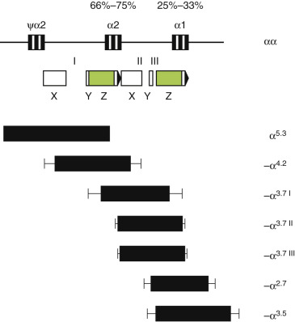

Figure 32-24 

Deletions that cause α \+  thalassemia. 

The homologous boxes (X, Y, and Z) are interrupted by nonhomologous segments (I, II, and III). Black bars show the extent of each deletion, and thin bars show the breakpoint areas. In each case, only one α-gene is deleted. 

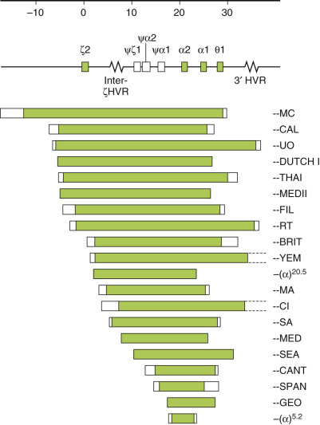

Figure 32-25 

Large deletions of the α-gene complex cause α 0  -thalassemia. 

No α-chain synthesis is directed from the chromosome. MED (Mediterranean) and SEA (South East Asian) deletions are the most frequent. 

Hb Constant Spring is due to an abnormal termination codon in an α-globin gene that results in an elongated α-chain with 31 extra amino acids. Because of marked reduction in mRNA stability, the clinical phenotype of α-thalassemia is seen. 

 

##  β-Thalassemias 

Clinical and Hb findings in the β-thalassemias are summarized in [ Tables 32-6 ](<#t0035>) and [ 32-7 ](<#t0040>) . The disorders are very heterogeneous phenotypically, as well as at the level of the molecular defects. The terms _thalassemia major, thalassemia intermedia,_ and _thalassemia minor_ refer to clinical severity and are not genetic designations. 

TABLE 32-6 

β-Thalassemias and Their Associated Biochemical and Molecular Defects 

|  Typical DNA Defect  |  β-Chain  |  δ-Chain  |  γ-Chain  |  Hb F Distribution  |  α: Non–α-Globin Imbalance   
---|---|---|---|---|---|---  
β \+  thalassemia  |  Mutation  |  ↓ |  \+  |  \+  |  Heterocellular  |  +++   
β 0  thalassemia  |  Mutation  |  0  |  \+  |  \+  |  Heterocellular  |  ++++   
δβ thalassemia  |  Deletion  |  0  |  0  |  +++  |  Heterocellular  |  ++   
HPFH  |  Deletion  |  0 or ↓ |  0  |  ++++  |  Pancellular  |  \+   
  
_DNA,_ Deoxyribonucleic acid; _Hb,_ hemoglobin; _Hb F,_ fetal hemoglobin; _HPFH,_ hereditary persistence of fetal hemoglobin. 

Data from Forget BG: Molecular studies of genetic disorders affecting the expression of the human β-globin gene: a model system for the analysis of inborn errors of metabolism, _Recent Prog Horm Res_ 38:257–277, 1982. 

TABLE 32-7 

Major Categories of β-Thalassemia Syndromes 

Syndrome  |  Genotype  |  Clinical Features  |  Hemoglobin Pattern   
---|---|---|---  
**Homozygous States**  
β \+  -thalassemia  |  β \+  /β \+  |  Thalassemia major or intermedia  |  ↓↓Hb A, ↑↑Hb F, variable Hb A  2   
β 0  -thalassemia  |  β 0  /β 0  |  Thalassemia major  |  >95% Hb F, rest Hb A  2   
δβ 0  -thalassemia  |  δβ 0  /δβ 0  |  Thalassemia intermedia  |  100% Hb F   
Hb Lepore  |  Lepore/Lepore  |  Thalassemia major  |  85% Hb F, 15% Hb Lepore   
**Heterozygous States**  
β \+  -Thalassemia  |  β \+  /β |  Thalassemia minor  |  Hb A, ↑Hb A  2  , ±↑ Hb F   
β 0  -Thalassemia  |  β 0  /β |  Thalassemia minor  |  Hb A, ↑Hb A  2  , ±↑ Hb F   
δβ 0  -Thalassemia  |  δβ 0  /δβ |  Thalassemia minor  |  Hb A, 5%-20% Hb F, ±↓Hb A  2   
Hb Lepore  |  Lepore/β |  Thalassemia minor  |  Hb A, ↑Hb F, ↓Hb A  2  , 10% Hb Lepore   
  
_Hb,_ Hemoglobin. 

Modified from Orkin SH, Nathan DG: The thalassemias, _N Engl J Med_ 295:710–714, 1976. 

 

##  Homozygous β-Thalassemia (Thalassemia Major; Cooley's Anemia) 

In the absence (β 0  ) or a marked decrease (β \+  ) of β-chain production, there is an excess of α-chains. Aggregates of α-chains are unstable and precipitate in the normoblast or erythrocyte and damage the cells. Excess α-chains and their degradation products—heme, hemin, and iron, which serve as foci for the generation of reactive O  2  species—result in the partial oxidation of band 4.1 and a reduced spectrin/band 3 ratio in red blood cell precursors. Precipitates and cells are removed, causing ineffective erythropoiesis and severe hemolytic anemia. Furthermore, clustering of band 3 in the membrane may be followed by opsonization with autologous IgG and complement and removal by macrophages (  Weatherall & Clegg, 1999  ). 

Clinical findings include jaundice and splenomegaly, which become evident early in childhood. Prominent frontal bones, cheekbones, and jaws impart a mongoloid appearance. These changes and X-ray findings of a thinned cortex of the long and flat bones and thickening of the skull with osteoporosis (“hair-on-end” appearance) reflect extreme bone marrow hyperplasia. Growth is stunted, and puberty is delayed. Most patients require regular transfusions and develop problems caused by iron loading. Iron overload commonly develops, and the major cause of death is cardiac failure due to myocardial siderosis by the end of the third decade. 

Unlike most hemolytic diseases, the anemia is hypochromic and microcytic. Extreme poikilocytosis with bizarre shapes, target cells, ovalocytosis, Cabot rings, Howell-Jolly bodies, nuclear fragments, siderocytes, anisochromia, anisocytosis, and often extreme normoblastosis are present ( [ Fig. 32-26 ](<#f0135>) ). Poikilocytosis is more striking in patients with intact spleen, while nucleated red blood cells are more numerous after splenectomy. Nucleated red blood cells have hypochromic cytoplasm and, especially after splenectomy, aggregates of densely staining Hb, which probably represent precipitated α-chains. Incubation of the blood with methyl violet stains these precipitates in both red cells and erythroblasts. The reticulocyte count is less elevated than expected for the degree of anemia because of destruction of erythroid precursors in the marrow. Osmotic resistance of the red cells, serum iron, and indirect-reacting bilirubin are increased. 

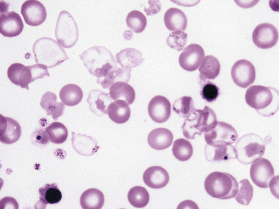

Figure 32-26 

Homozygous β-thalassemia. 

A few cells contain hardly any hemoglobin (Hb), and the Hb is often precipitated at the membrane. Bizarre target cells, Howell-Jolly bodies, and poorly hemoglobinized nucleated red blood cells are seen. 

In the marrow, marked erythroid hyperplasia is present. Many late normoblasts show inclusion bodies, as in the blood. Gaucher-like cells are present. Storage iron and sideroblasts are increased. 

In β 0  -thalassemia, Hb A is absent, Hb F is as high as 98%, and Hb A  2  is about 2%. In β \+  -thalassemias (Mediterranean), Hb F is 60% to 95%, with Hb A present. Although Hb A  2  may or may not be increased, the ratio of A  2  to A is always increased. In black people with β \+  -thalassemia, the clinical features are less severe (thalassemia intermedia), and transfusion is usually unnecessary; Hb F is 20% to 40%, Hb A  2  is 2% to 5%, and the rest is Hb A (see [ Table 32-7 ](<#t0040>) ). 

 

##  Heterozygous β-Thalassemia (β-Thalassemia Trait; Thalassemia Minor; Cooley's Trait) 

This is caused by the β 0  -thalassemia gene with absent, or the β \+  -thalassemia gene with reduced, β-globin chain synthesis. There are usually no symptoms or abnormal physical signs. The only clinical presentation might be a refractory anemia of pregnancy (  Weatherall & Clegg, 2001  ). 

Most β-thalassemia heterozygotes have a mild anemia but, occasionally, Hct and Hb might be normal. Those of African origin have higher Hb levels than people from the Mediterranean region, reflecting their milder genotype. Characteristically, the RBC is elevated (5 to 7 M/µL), the MCH is low (usually less than 22 pg), and the MCV is low (between 55 and 70 fL). The MCHC is sometimes low but often normal. The reticulocyte count is twice the normal value. On stained films, the cells have a moderate degree of microcytosis, hypochromia, and poikilocytosis; target cells and basophilic stippling are often, but not always, present ( [ Fig. 32-27 ](<#f0140>) ). In the marrow, there is mild erythroid hyperplasia with ragged cytoplasmic borders—a sign of defective hemoglobinization. 

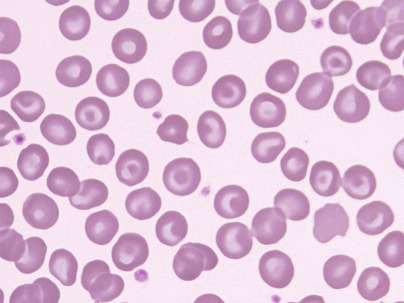

Figure 32-27 

β-Thalassemia trait. 

Hypochromic, microcytic red blood cells with frequent targeting. Mild anemia. 

Hb A  2  is elevated in the 3.5% to 7% range, and Hb F is slightly elevated (1% to 3%) in about half of cases. In the few cases where Hb F exceeds 4%, it is likely that a gene for HPFH is also present. The relatively rare deletional forms tend to have higher levels of Hb F (up to 9%), and in a few families, in which the deletion included the promoter region, Hb F was found to be unusually high (up to 14%) (  Weatherall & Clegg, 2001  ). In infants, a slower than normal decline in Hb F level is observed, and the adult steady-state level is not reached until adolescence. This is a particularly important consideration in double heterozygosity for β-thalassemia and Hb S, when Hb F level is used to predict prognosis. 

 

##  β-Thalassemia Trait with Normal Hb A  2 

In a few cases, both Hb A  2  and F are normal. These are difficult to distinguish from α-thalassemia trait, and only molecular studies might be definitive. The bulk of these cases results from the coinheritance of δ-thalassemia (  Weatherall, 1994  ), either in _trans_ or in _cis,_ to the β-thalassemia gene. In other patients with normal Hb pattern, only minimal hematologic changes are noted (the “silent” β-thalassemia gene), and only a more severe β-thalassemia syndrome in a family member suggests the presence of a very mild β-thalassemia mutation. 

Iron studies are little different from normal (  Weatherall & Clegg, 2001  ), although iron deficiency often complicates thalassemia trait in childhood and during pregnancy. In severe iron deficiency, the level of Hb A  2  may fall into the normal range, thus obscuring the diagnosis of β-thalassemia trait, but this is unusual. Most often, although the level of A  2  falls, it remains elevated above the normal range (  Weatherall & Clegg, 2001  ). Nevertheless, when iron deficiency is present, repeat measurement of Hb A  2  is recommended after replenishment of iron. 

The differential diagnosis between iron deficiency and β\- or α-thalassemia trait can be difficult. Increased RBCs in the presence of decreased MCV is the hallmark of thalassemia trait. An MCV/RBC ratio less than 13 suggests thalassemia trait; a ratio greater than 13 is more consistent with iron deficiency, but this and other formulas are not conclusive enough for diagnosis. 

 

##  δβ 0  -Thalassemia 

This is sometimes called _F-thalassemia,_ a helpful name, as you have to think of it when there are thalassemic indices and significantly increased levels of Hb F. β\- and δ-chains are not produced; this is nearly, although not completely, compensated for by increased output of γ-chains. The heterozygous state is similar to a mild β-thalassemia trait, except that Hb A  2  is not increased or even slightly reduced (mean level is 2.4%), and Hb F is significantly increased (5.4% to 20%). In the homozygous state, hemoglobin consists of only Hb F. 

Clinically, (δβ)  0  -thalassemia behaves as a mild form of β-thalassemia. In the heterozygous state, the Hb is normal or slightly reduced, the MCH is between 21 and 26 pg, and the MCV is 65 to 79 fL. There are no clinical symptoms. Homozygotes have a mild form of thalassemia intermedia with a Hb level of 10 to 13 g/dL, mildly thalassemic red cell indices, and only minimal hepatosplenomegaly. It is most common in the Mediterranean population. The mild phenotype is the result of increased production of γ-chains, which compensate to some degree for the lack of β-chains. 

The molecular defect is a long deletion involving the β\- and δ\- and often also the Aγ-gene. Twenty-one different deletions have been described (  Globin Gene Server, 2015  ), but the hematologic findings are essentially the same. When the Aγ-gene is also deleted, the accurate nomenclature is (Aγδβ)  0  -thalassemia; homozygotes have a somewhat more severe phenotype. 

 

##  δβ \+  -Thalassemia: Lepore Hemoglobins 

In the Lepore hemoglobins, an abnormal δβ-fusion chain is produced, a result of chromosome crossing-over and fusion of genetic material at the δβ-genes. No normal δ\- or β-chain synthesis is directed from the affected chromosome. Because Hb F production is only slightly increased and the composite δβ-chain is synthesized at a very slow rate, a severe thalassemic phenotype is produced. Hematologic abnormalities are similar to those seen in β 0  -thalassemia. Hb Lepore migrates slightly faster than Hb S on alkaline electrophoresis and usually constitutes about 10% of total Hb in the heterozygotes; Hb A  2  averages 2%, and Hb F is 2% to 3% (  Efremov et al, 1978  ). In homozygotes, Hb Lepore is 10% to 15%, and the rest is Hb F. Different Hb Lepores have been described, depending on the point of fusion, but they behave similarly. This is a much more severe thalassemia gene than the (δβ)  0  form and causes transfusion-dependent thalassemia major in the homozygous state. 

In a similar mechanism, anti-Lepore hemoglobins have βδ-fusion gene. Several of these hemoglobins have been described, including P-Nilotic. 

 

##  Hereditary Persistence of Fetal Hemoglobin 

A group of conditions with persistence of fetal hemoglobin production beyond infancy, but without significant hematologic abnormalities, is known as HPFH. There are two major types: pancellular and heterocellular (or Swiss) HPFH. 

The pancellular form of HPFH is closely related to β\- and δβ-thalassemias, with which it forms a continuous spectrum. At one end of the spectrum is minimal γ-chain production with no compensation for deficiency of β-chains in β-thalassemia; at the other end, Hb F production is up and almost entirely compensates for the deficit in HPFH (  Weatherall & Clegg, 2001  ). As a result, at least in heterozygotes, there is no clear evidence of thalassemia (except maybe borderline microcytosis in a few cases), and this serves as a criterion in diagnosis. In clinical practice, a patient with significantly elevated Hb F and reduced Hb A  2  is suspected to have HPFH if the red cell indices are normal, but is diagnosed with δβ 0  -thalassemia if the indices are thalassemic. Nevertheless, there is a slight α/non–α-chain imbalance, and HPFH could be considered an extremely mild thalassemia. Hb F is homogeneously (evenly) distributed among the red cells (pancellular). This is in contrast to β\- or δβ-thalassemia, in which the distribution is heterocellular. Pancellular HPFH is relatively rare. It is found in about 0.1% of African Americans and even less frequently in other ethnic groups. 

 

##  Deletional Pancellular HPFH 

In the six deletional forms, the δβ-gene complex is deleted. The black and Ghanaian forms are the most common, but Indian, Italian, and Southeast Asian forms are also well documented. Homozygotes have slightly microcytic, hypochromic red cells, but no anemia. Hb F is 100%; no Hb A or Hb A  2  is present. The Hct can even be high—a result of high O  2  affinity of Hb F. In the heterozygote, no hematologic abnormalities are found. Hb F is 15% to 30%, and Hb A  2  is decreased at 1% to 2.1%. 

 

##  Hb Kenya 

This is a Hb analogous to the Lepore Hbs, which is associated with an HPFH phenotype. It contains an  A  γβ-fusion gene. In the heterozygote, Hb Kenya is around 10%, F is 7%, and A  2  is reduced. 

 

##  Nondeletional Pancellular HPFH 

A mutation in the promoter region of one of the γ-genes results in increased synthesis of Hb F. Output from the δ\- and β-genes in _cis_ is reduced. Levels of Hb F range from 3% to 31% in the different forms, Hb A  2  is invariably low, and the red cell indices are close to normal. There are two particulars to keep in mind. First, β-chain synthesis is decreased, but not absent from the affected chromosome, and compound heterozygotes of this form of HPFH and Hb S on the other chromosome do have Hb A (≈30%). The hemoglobin composition is similar to that seen in Hb S/β+-thalassemia, except that Hb A  2  is reduced. Second, it is not rare to find it together with an α-thalassemia gene, which is highly prevalent in African Americans. 

 

##  Heterocellular or Swiss-type HPFH 

Heterocellular or Swiss-type HPFH has less Hb F, ranging from 2% to 5%. The distribution of Hb F is uneven (heterocellular): Both F cells and erythrocytes completely lacking Hb F are present. It was first described among healthy Swiss army recruits but is present in other populations and is quite common. It is caused by polymorphic variations at three well-known and other lesser known loci that regulate adult Hb F production (  Thein & Menzel, 2009  ). In normals or in carriers of β-thalassemia or Hb S, there is only a minimal increase in Hb F. When inherited with Hb SS or homozygous β-thalassemia, however, the result could be an unusually high level of Hb F and milder disease. 

 

##  α-Thalassemias 

α-thalassemia is probably the most common single-gene disorder in humans. Its distribution is largely limited to tropical and subtropical regions of Asia and Africa and the Mediterranean (  Higgs et al, 1989  ), where it reaches extremely high frequencies. 

Two α-globin genes are present on each chromosome 16. α-thalassemias are classified according to the total output of these two linked α-globin genes. In α 0  -thalassemia, both genes are inactive (− −/), but in α \+  -thalassemia, only one gene is defective as the result of deletion (−α/) or, less frequently, of mutation (α T  α/). Nondeletional forms usually result in less globin output from the linked α-gene and more severe phenotypes. Rarely, the chromosome has a deletion and a separate mutation (α T  −/). Previously, α 0  and α \+  were called α-thalassemia 1 and 2. This was rather confusing, as the milder defect with one affected gene was called α-thalassemia 2, and the more severe genotype with two defective genes, α-thalassemia 1. Alternatively, these terms were also used to describe clinical phenotypes. 

Unlike the extremely unstable α-chains in β-thalassemia, excess β\- and γ-chains can form stable tetramers, hemoglobin H (β 4  ), and Bart's (γ 4  ). These precipitate in aging red cells and, through interaction with the cell membrane, cause hemolysis. This is mostly a hemolytic anemia, whereas in β-thalassemia, ineffective erythropoiesis predominates. 

 

##  α-Thalassemia Syndromes 

Four α-thalassemia syndromes result from the combination of these genotypes (  Bunn & Forget, 1986  ), which roughly correspond to the loss of 4, 3, 2, or 1 genes from the normal complement (αα/αα) ( [ Table 32-8 ](<#t0045>) ). In the following discussion, nondeletion forms are not always depicted separately, for the sake of simplicity. 

TABLE 32-8 

α-Thalassemia Syndromes 

Syndrome  |  Defective Genes  |  Genotype  |  Clinical Features  |  Newborn  |  After First Year   
---|---|---|---|---|---  
Hydrops fetalis  |  4  |  −−/−− |  Fetal or neonatal death with severe anemia  |  Hb Bart's >80%   
Hb H, Hb Portland  |   
Hb H disease  |  3  |  −−/−α   
(−−/αα CS  )  |  Chronic hemolytic anemia  |  Hb Bart's 20%-40%   
(Hb CS)  |  Hb H 5%-30%   
(Hb CS 2%-3%)   
Thalassemia minor  |  2  |  −−/αα   
−α/−α   
α T  α/−α |  Asymptomatic, mild anemia, thalassemic indices  |  Hb Bart's 5%-10%  |  None   
Silent carrier  |  1  |  −α/αα   
(αα/αα CS  )  |  No clinical or hematologic abnormality  |  Hb Bart's ±1%-2%   
(Hb CS)  |  None (Hb CS 1%)   
  
_Hb,_ Hemoglobin. 

Modified from Wintrobe MM, Lee GR, Boggs DR, et al: _Clinical hematology,_ ed 8, Philadelphia, 1981, Lea & Febiger. 

 

##  Hemoglobin Bart's Hydrops Fetalis (− −/− −). 

Complete absence of α-chains is incompatible with life. Infants are stillborn with severe edema, marked anemia, and marked hepatosplenomegaly. The blood shows marked anisocytosis, poikilocytosis, microcytosis, and erythroblastosis. ABO or Rh incompatibility is absent. Because of the absence of α-chains, no Hb A or Hb F is present. Large quantities of Hb Bart's (γ 4  ), a variable amount of Hb Portland, and traces of Hb H (β 4  ) are present; all of these migrate faster than Hb A on alkaline electrophoresis. Hb Bart's is functionally useless for O  2  transfer, causing extreme intrauterine hypoxia. 

 

##  Hemoglobin H Disease (−α/− −). 

Three of the four α-genes are absent. A chronic hemolytic anemia occurs with the clinical picture of thalassemia intermedia in a minority of cases, although the severity varies, and most patients do well. Hb H disease is very common in Southeast Asia but is also seen in the Mediterranean and the Middle East; it is very rare, however, in black people, as α 0  -thalassemia is uncommon in this group. Splenomegaly and sometimes hepatomegaly are present. Hb values average 3 g/dL less than in age- and sex-matched controls. Transfusion is rarely needed. The anemia may become more severe during pregnancy, but the Hb rarely falls below 7 g/dL. The MCV (60 to 70 fL) and MCH (17 to 21 pg) are decreased (  Higgs et al, 1989  ), and RBC is increased (6 to 6.2 M/µL). The blood film shows hypochromia, basophilic stippling, and anisopoikilocytosis with target cells ( [ Fig. 32-28 ](<#f0145>) ). Reticulocytes range from 4% to 5%. 

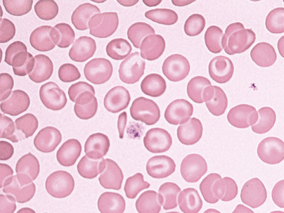

Figure 32-28 

Hemoglobin H disease. 

Mild anemia and target cells. 

Hemoglobin electrophoresis shows a rapidly migrating band of Hb H (β4), accounting for 1% to 40% (average 9%) of the hemoglobin, and the slightly less rapidly migrating Hb Bart's in half of the cases. Hb H can precipitate and be lost from the hemolysate in vitro by careless handling or prolonged storage. In old hemolysates, Hb H appears as a series of bands on electrophoresis. The percentage of Hb Bart's is 2% to 40% at birth; it gradually falls thereafter, averaging 4.8%, but the level in adults is variable. As in other α-thalassemia syndromes, more Hb Bart's is present at birth than Hb H in adult life. Hb A  2  is diminished. 

 

##  Hemoglobin H preparation. 

Vital staining of the blood with an oxidizing dye such as brilliant cresyl blue induces inclusion bodies (Hb H precipitates) in many of the red blood cells. During incubation of two parts of blood in one part of 1% brilliant cresyl blue stain, the unstable Hb H (β 4  ) gradually precipitates as multiple small pale blue inclusions uniformly distributed on the red cell membrane ( [ Fig. 32-29 ](<#f0150>) ) (  Jones et al, 1981  ). Hb H inclusions must be distinguished from (1) the granules and reticular networks of reticulocytes, which are darker blue in color and (2) preformed Heinz bodies, which are larger, also darker blue, and are often attached to the membrane. After 20 minutes of incubation at room temperature, Hb H inclusions are present in at least half of the red cells in Hb H disease, and in rare red cells in α-thalassemia trait. The larger, single Heinz bodies may be found after splenectomy in Hb H disease. 

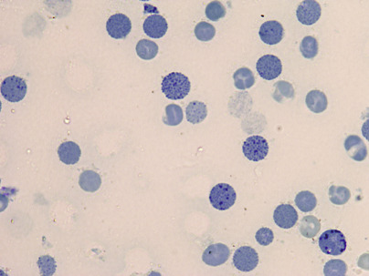

Figure 32-29 

Hemoglobin H preparation. 

Film made after incubation of blood with brilliant cresyl blue. Several red blood cells contain multiple small pale blue inclusions. 

 

##  α-Thalassemia Trait: Heterozygous α 0  -Thalassemia (− −/αα) or Homozygous α \+  -Thalassemia (−α/−α). 

Absence of two α-genes results in clinical features similar to β-thalassemia trait with very mild anemia and thalassemic indices, with MCV ranging from 65 to 75 fL (  Higgs et al, 1989  ). The α-chain/β-chain synthesis ratio is decreased (≈0.6). Diagnosis is best made at birth, by finding 5% to 10% Hb Bart's in cord blood; in normals only trace amounts (<0.5%) are present. In adults, Hb Bart's is undetectable, and Hb studies are perfectly normal, except that Hb A  2  might be slightly reduced. Hb H inclusions are found in α 0  -thalassemia, but rarely in heterozygous or homozygous α \+  -thalassemia, and only in a very small percentage of red cells, if exhaustively sought after (  Wasi et al, 1974  ), and if the sample is enriched for Hb H-containing red cells (  Jones et al, 1981  ). Otherwise, no evidence of Hb imbalance is detectable by standard techniques, and the diagnosis is one of excluding iron deficiency, anemia of chronic disease, and β-thalassemia trait. In contrast to β-thalassemia, Hb F is normal, and Hb A  2  is normal or decreased. This condition is absolutely benign, and most patients are diagnosed on routine screening. Hematologic findings are identical in the two distinct genotypes found in different populations: (− −/αα), common in Southeast Asia and the Mediterranean and exceedingly rare in black people, and (−α−α), most common in those of African descent. 

 

##  Silent Carrier α-Thalassemia (Heterozygous α \+  -Thalassemia) (αα/−α). 

In this condition, one of four α-globin genes is absent. Hematologic findings are normal, except that the MCV might be slightly reduced, with a mean value of 81 fL and a range of 75 to 85 fL, and the MCH might be minimally decreased; many times, however, the red cell indices are perfectly normal. During the neonatal period, heterozygous α \+  -thalassemia can be diagnosed by a raised level of Hb Bart's (1% to 2%) in the cord blood. Hb Bart's disappears by 6 months of age, and the diagnosis can be made only by molecular or globin chain synthesis studies. Because only 40% of newborns with the heterozygous α \+  -thalassemia genotype have detectable Hb Bart's in their cord blood (  Higgs et al, 1982  ), failure to detect Hb Bart's in the newborn does not rule out silent carrier α-thalassemia, and newborn screening should not be used to rule out this entity. 

From large studies comparing hematologic findings of different genotypes, it became apparent that there is a continuum between normal, silent carrier, and α-thalassemia trait. Because there is no clear separation between one- and two-gene defects, some authors group these together as milder α-thalassemia phenotypes. None of the α-thalassemia genes or their combinations can be identified with certainty without molecular studies. 

 

##  Hemoglobin Constant Spring (α CS  α/). 

Hb Constant Spring is due to an abnormal termination codon in an α-gene that results in an elongated α-chain with 31 extra amino acids. It is by far the most common of the elongated α-chain variants. Because of marked reduction in mRNA stability, the clinical phenotype of α-thalassemia is seen. Similar to other nondeletional α \+  -thalassemia genes, it causes a more severe phenotype. The homozygous state appears as an asymptomatic, mild hemolytic anemia, with a Hb level of 9 to 11 g/dL. The red cell indices are unusual for thalassemia: The MCV is normal (88 fL), and the RBC is low (3.9 M/µL). Hemoglobin consists of 5% to 8% Hb CS, normal Hb A  2  , trace amounts of Hb Bart's, and the rest Hb A (  Weatherall, 1994  ). Heterozygotes have a silent carrier phenotype with no hematologic abnormality and about 1% Hb CS. Hb CS undergoes proteolysis and appears as 1 to 4 faint bands migrating either slightly slower or slightly faster than Hb A  2  at alkaline pH and is easily missed. Hb CS is common in Southeast Asia, where it is found in about 50% of cases of Hb H disease (α CS  α/− −). 

 

##  Screening and Prenatal Diagnosis of Hemoglobin Disorders 

In populations in which there is a significant incidence of severe forms of thalassemia or sickle cell anemia, women should be screened early in pregnancy for thalassemia and the sickle cell trait (  Weatherall  1985  ;  Alter, 1988  ). If both parents are carriers, prevention of severe disease is possible through genetic counseling and offering prenatal diagnosis with the option of therapeutic abortion. In many high-frequency regions, successful screening of schoolchildren or premarital counseling has been implemented. Initial tests include MCV (<80 fL), MCH (<27 pg), and HPLC to estimate Hb A2 (>3.5%) (cutoff values in parentheses) and to detect common Hb variants. 

 

##  Hemolysis—Metabolic Disorders 

Deficient enzyme activity in the erythrocyte may result in abnormalities that lead to premature destruction and hemolytic anemia; these disorders are usually inherited. However, interference with, or oxidative stress on, erythrocyte metabolism can sometimes result in hemolysis in individuals who have normal erythrocytes. 

 

##  Erythrocyte Metabolism 

The mature red blood cell lacks mitochondria and, therefore, lacks oxidative phosphorylation and Krebs cycle activity. Energy production is mainly glycolytic, 90% of which occurs through the Embden-Meyerhof pathway, as glucose goes to lactic acid with the net production of 2 mol of adenosine triphosphate (ATP) ( [ Fig. 32-30 ](<#f0155>) ). ATP is needed for energy-requiring reactions in the cell: for active cation transport across the membrane, for maintaining membrane deformability, and for preserving the cell's biconcave shape. Glucose uptake by red cells is independent of insulin. Approximately 90% of glucose is consumed in the glycolytic pathway, while 10% is utilized in the pentose phosphate pathway (hexose monophosphate [HMP] shunt). One step of the glycolytic pathway replenishes NADH (reducing agent derived from nicotinamide adenine dinucleotide [NAD]), which plays a major role in protecting Hb from oxidative stress. Most of the hemiglobin (methemoglobin) produced in the normal cell (about 3% of the total per day) is reduced by NAD-linked methemoglobin (Met Hb) reductase. The HMP shunt generates nicotinamide adenine dinucleotide phosphate (NADPH) in the first two steps through the enzymes G6PD and 6-phosphogluconate. NADPH production is linked to glutathione reduction and, through this mechanism, to preservation of vital enzymes and Hb from oxidation. Small amounts of oxidized hemoglobin (methemoglobin) are reduced by glutathione (GSH). The activity of the HMP shunt increases when the cell is exposed to an oxidant drug, probably as a result of increased NADP production. If an enzyme in this pathway lacks activity, GSH cannot be produced and it will remain in its oxidized form as GSSG, and thus Hb will not be protected from the oxidant stress. Oxidation in the red blood cells is mediated by high-energy derivatives of O  2  , referred to collectively as _activated O 2  _ (  van Solinge & van Wijk, 2010  ). Oxidized globin chains denature and precipitate as Heinz bodies, which adhere to the membrane, inducing rigidity and a tendency to lyse. Moderate enzyme deficiencies in this pathway (e.g., in G6PD) may not be associated with anemia under normal conditions; however, an acute hemolytic episode occurs if the cells are challenged by oxidant stress (e.g., drugs, infection). 

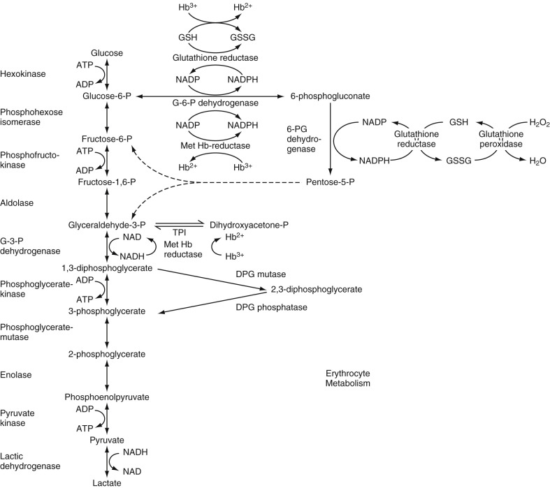

Figure 32-30 

Erythrocyte metabolism (see text). 

Normally, most hemiglobin (methemoglobin, Hb  \+  ++) is reduced to hemoglobin (Hb  \+  +) by nicotinamide adenine dinucleotide–linked methemoglobin reductase (NAD, Met Hb reductase). Nicotinamide adenine dinucleotide phosphate (NADP)-linked methemoglobin reductase requires methylene blue for activation and is more effective in drug-induced methemoglobinemia than the normal cell mechanism. _GSH,_ Reduced glutathione; _GSSG,_ oxidized glutathione. 

Deficiencies in the Embden-Meyerhof pathway result in impaired ATP generation and a chronic hemolytic anemia. The mechanism of red cell destruction here is less clear. Heinz bodies are not formed. Lack of cell deformability and impaired cation pumping are important in the hemolytic process. However, ATP deficiency is difficult to demonstrate in many patients, and other disorders associated with more severe ATP deficiency are not associated with significant hemolysis (  van Solinge & van Wijk, 2010  ). 

The Rapoport-Luebering shunt provides for the conversion of 1,3-diphosphoglycerate (1,3-DPG) to 2,3-DPG instead of directly to 3-phosphoglycerate (3-PG) (see [ Fig. 32-30 ](<#f0155>) ). If this shunt is operating, generation of 2 mol of ATP (per mole of glucose) is bypassed; the result is no net energy production in glycolysis. However, 2,3-DPG combines with the β-chain of Hb and decreases the affinity of Hb for O  2  . At a given pO  2  , therefore, increased 2,3-DPG allows more O  2  to leave Hb and go to the tissues; the O  2  dissociation curve is shifted to the right. Increased activity of this shunt is apparently stimulated by hypoxia. 

 

##  Glucose-6-Phosphate Dehydrogenase Deficiency 

About 10% of male American blacks who were given the antimalarial drug primaquine during the Korean War developed a self-limited, acute hemolytic anemia (  Beutler, 1994  ). The relationship between antimalarial drugs and hemolysis had been observed earlier in the 1920s (  Beutler & Luzzatto, 1999  ). Only the older red cells were destroyed, and it was eventually determined that the deficiency in susceptible red cells was in G6PD. Reticulocytes have five times higher enzyme activity than the oldest erythrocyte population (  van Solinge & van Wijk, 2010  ). It has since been found that G6PD deficiency is widespread throughout the world. Among whites, the highest incidence is in Kurdish Jews; the deficiency is common in the Middle East, in Mediterranean countries, and in Asia. G6PD deficiency is the most common human enzyme defect and is present in more than 400 million people worldwide (  Cappellini & Fiorelli, 2008  ). 

G6PD is present in all cells; however, its concentration varies in different tissues. In healthy red cells, the enzyme operates at only 1% to 2% of its maximal potential, allowing for a large reserve of reductive potential (  Cappellini & Fiorelli, 2008  ). Because G6PD is determined by a gene on the X chromosome, full expression of the deficiency is found in the male hemizygote. Partial expression may be found in the heterozygous female, who has two populations of red cells—one normal and one deficient. The deficiency of G6PD limits the regeneration of NADPH, which renders the cell vulnerable to oxidative denaturation of Hb. Because, normally, G6PD is highest in young cells and decreases as the cell ages, in persons with G6PD deficiency, the older cells are preferentially destroyed. 

Hemolytic susceptibility in affected persons can increase greatly during intercurrent illness or upon exposure to various drugs that have oxidant properties ( [ Box 32-1 ](<#b0010>) ). 

Box 32-1 

Drugs and Chemicals That Have Clearly Been Shown to Cause Clinically Significant Hemolytic Anemia in G6PD Deficiency 

Acetanilid 

Methylene blue 

Nalidixic acid (NegGram) 

Naphthalene 

Niridazole (Ambilhar) 

Nitrofurantoin (Furadantin) 

Pamaquine 

Pentaquine 

Phenylhydrazine 

Primaquine 

Sulfacetamide 

Sulfanilamide 

Sulfamethoxazole (Gantanol) 

Sulfapyridine 

Thiazolesulfone 

Toluidine blue 

Trinitrotoluene (TNT) 

_G6PD,_ Glucose-6-phosphate dehydrogenase. 

From Beutler E: _Hemolytic anemia in disorders of red cell metabolism_ , New York, 1978, Plenum Medical Book Company. 

The genetic heterogeneity is great, and approximately 400 biochemical variants have been defined. This genetic heterogeneity is expressed as variations in stability and the electrophoretic and catalytic properties of the enzymes, in the degree of deficiency, in the types of cells in the body affected, in the types of drugs that will produce hemolysis, and in susceptibility to chronic hemolysis or to neonatal jaundice. The most common (“normal”) G6PD isoenzyme in all population groups is designated as B. In blacks, an electrophoretically more rapid variant, A, is prevalent and has almost the same activity; 20% of black males have this variant. Eleven percent of black males have the A type of G6PD, which involves only 5% to 15% of normal enzyme activity; it is these individuals who are susceptible to hemolysis after ingesting oxidant drugs or during infection. The most common variant in whites is G6PD-Mediterranean, found in Mediterranean populations; the level of enzyme activity in affected males is low—often less than 1%. These individuals usually are not anemic but may have somewhat more severe and non–self-limited hemolytic anemia with infection, and with a wider variety of drugs than the black variant. In a subgroup of G6PD-deficient subjects, severe hemolysis may occur within hours after eating fava beans (“favism”). Although the vast majority of G6PD-deficient subjects worldwide are not anemic, a small proportion of persons with G6PD-Mediterranean (and persons with some rarer variants) have a chronic nonspherocytic hemolytic anemia. G6PD deficiency is a common cause of neonatal jaundice, occurring in approximately one third of all male neonates with jaundice (  Cappellini & Fiorelli, 2008  ). Jaundice is usually evident by 1 to 4 days of age and is more severe in premature babies than in full-term infants. 

Laboratory findings during active hemolysis are those of hemolytic anemia in general. In the blood film, one finds poikilocytes, some spherocytes, bite cells, and irregularly contracted cells that stain densely and have contraction of Hb from a part of the cell membrane. These probably are cells from which Heinz bodies have been removed by the spleen. After supravital staining with methyl violet, Heinz bodies may be present early in an acute hemolytic episode. G6PD deficiency may be detected by one of the screening tests: the dye reduction test, the ascorbate cyanide test, or a fluorescent spot test. Confirmation is made with a quantitative assay. 

 

##  Heinz Bodies 

When a globin chain denatures, it forms precipitates that are known as Heinz bodies (  Dacie & Lewis, 1991  ). These precipitates cannot be detected in Romanowsky's-stained, air-dried blood films, but after vital staining with methyl violet or crystal violet, Heinz bodies stain deep purple. They vary from 1 to 4 µm in diameter and often attach to the red cell membrane. They also stain, but less intensely, as pale blue inclusions in reticulocyte stains (e.g., new methylene blue) ( [ Fig. 32-31 ](<#f0160>) ). 

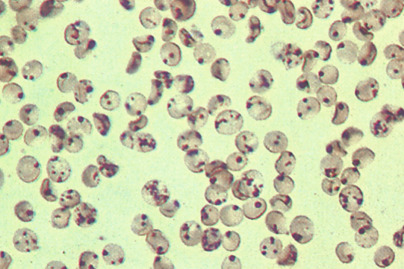

Figure 32-31 

Heinz bodies. 

Normal red cells incubated with an oxidant drug and stained while in suspension with methyl violet; finally, an air-dried film was made and stained with Wright's stain. Purple-staining Heinz bodies are precipitates of denatured hemoglobin that tend to attach to the cell membrane. 

The presence of Heinz bodies in freshly drawn blood indicates that (1) an oxidizing drug or chemical (e.g., phenylhydrazine, chlorate, naphthalene, dapsone) has been ingested in sufficient amount to overwhelm the normal protective mechanisms of the red cell and denature Hb; (2) a drug such as primaquine has been ingested by an individual with G6PD deficiency (or another defect resulting in a deficiency of reduced glutathione), so that Hb is not protected from oxidative denaturation; or (3) the subject has an unstable Hb. 

 

##  Ascorbate Cyanide Test 

When blood is incubated with a solution of sodium cyanide and sodium ascorbate, hydrogen peroxide is generated from the coupled oxidation of ascorbate and oxyhemoglobin (  Dacie & Lewis, 1991  ). Cyanide inhibits catalase, hydrogen peroxide is available to oxidize Hb, and the brown color of methemoglobin is discernible. This occurs more rapidly in G6PD-deficient cells than in normal cells. 

The ascorbate cyanide test is not specific, in that abnormalities in the glutathione synthesis or maintenance pathways can produce positive results. 

 

##  Fluorescent Spot Test 

Whole blood is added to a mixture of glucose-6-phosphate (G6P), NADP, saponin, and buffer, and a spot of this mixture is placed on filter paper and is observed for fluorescence with ultraviolet light. If G6PD is present, NADP is converted to NADPH. Because phosphogluconate dehydrogenase is present in most hemolysates, further NADP is converted to NADPH (see [ Fig. 32-30 ](<#f0155>) ). NADPH fluoresces, but NADP does not. The normal control sample fluoresces brightly, and lack of fluorescence indicates G6PD deficiency. By reoxidizing any small amounts of NADPH formed, oxidized glutathione (GSSG) enhances the ability of the test to detect mild G6PD deficiency. This is the recommended screening test for G6PD deficiency (  Beutler et al, 1979  ). 

 

##  Quantitative Assay of G6PD. 

For G6PD, most assays are based on the rate of reduction of NADP to NADPH, measured spectrometrically at 340 nm, when a hemolysate is incubated with G6P (  Beutler, 1984  ). In heterozygotes or in acute hemolysis in black subjects with G6PD deficiency, the diagnosis may be obscured even with the assay, because of increased levels of G6PD in reticulocytes and younger erythrocytes. Usually, however, the ascorbate cyanide screening test will be positive in these instances. 

 

##  Pyruvate Kinase (PK) Deficiency 

The most common red cell enzyme deficiency involving the Embden-Meyerhof glycolytic pathway, PK deficiency results in mild to moderately severe nonspherocytic chronic hemolytic anemia with splenomegaly. The prevalence of PK deficiency is estimated to be 1 : 20,000 in the general white population (  Zanella et al, 2005  ). The anemia may be detected in infancy, or not until adult life in milder cases. Neonatal jaundice occurs in more than half of cases, which may require exchange transfusion. Patients tend to tolerate the anemia rather well because of high levels of 2,3-DPG, which occur as a result of the block in glycolysis. The blood film may show no notable red cell abnormalities until after splenectomy, when echinocytes, irregularly contracted cells, and crenated red cells may be prominent. Reticulocyte counts are elevated and increase further after splenectomy. 

PK isoenzymes are produced by two separate genes: one on chromosome 15, encoding the M (muscle) isoforms, and the other on chromosome 1, encoding the L (liver) and R (red cell) isoforms. The complexity of PK isoforms is further complicated by the fact that functional enzyme is a tetramer. Inheritance is autosomal recessive, but this is probably true only in consanguineous families. PK mutants are numerous and are not detected in phenotypically normal heterozygotes that have one half the normal PK activity. Most individuals with PK-deficient hemolytic anemias are therefore probably double heterozygotes for two mutant genes (  Valentine, 1979  ). Acquired PK deficiency occurs occasionally in myelodysplastic disorders and leukemias (  Valentine, 1979  ;  Miwa, 1981  ). 

The autohemolysis test gives variable results. Some patients show only a mild increase in autohemolysis that is partially prevented by glucose (type I), and others have a greater increase that is not prevented by glucose (type II). Heinz bodies are not found. The diagnosis is made by a specific screening test or enzyme assay. 

The reticulocyte count in unsplenectomized patients is usually increased, although not proportional to the degree of anemia, because younger PK-deficient erythrocytes are selectively sequestered in the spleen (  Zanella et al, 2005  ). Splenectomy is indicated in cases requiring transfusions. After splenectomy, the Hb concentration usually increases by 1 to 2 g/dL and the reticulocytes increase sharply, although hemolysis persists (  Miwa, 1981  ). 

 

##  Fluorescent Spot Test. 

Pyruvate kinase catalyzes the phosphorylation of adenosine diphosphate (ADP) to ATP by phosphoenolpyruvate (PEP) with the formation of pyruvate (  Beutler, 1984  ). Pyruvate then reduces any NADH present to NAD with the formation of lactate (see [ Fig. 32-30 ](<#f0155>) ). Loss of fluorescence of NADH under ultraviolet light is observed as evidence of the presence of PK. 

Leukocytes must be removed from the sample because they normally contain about 300 times as much PK as red cells do, and in PK deficiency, the red cells but not the leukocytes are deficient. 

 

##  Quantitative Assay of PK. 

The same principle is employed as in the screening test, but the rate of decrease of absorbance at 340 nm is measured. A negative screening test or a normal PK assay (using the standard high substrate [PEP] concentrations) does not rule out PK-deficient hemolytic anemia. Because mutant PK enzymes may have normal activity at high PEP concentrations and decreased activity at low PEP concentrations, it is necessary to perform the assay both ways (  Beutler, 1984  ). 

 

##  Other Glycolytic Enzyme Deficiencies 

Other enzyme deficiencies in the **Embden-Meyerhof pathway** are rarer (  Beutler, 1994  ;  van Solinge & van Wijk, 2010  ). When severe, they produce hemolytic anemia, with two exceptions: (1) LDH deficiency has no clinical manifestations; and (2) deficiencies of 2,3-DPG mutase and 2,3-DPG phosphatase activities occur together and result in erythrocytosis as a result of lack of 2,3-DPG, shifting the O  2  dissociation curve of Hb to the left, and relative tissue hypoxia. 

Other enzyme deficiencies in the **hexose monophosphate shunt** are rare. They include the two enzymes involved in glutathione synthesis: γ-glutamyl cysteine synthase and glutathione synthetase. As in G6PD deficiency, hemolysis increases with oxidant drug exposure or infection. 

No good evidence is available, however, for the causation of chronic hemolytic anemia by 6-phosphogluconate deficiency, catalase, enolase, glutathione reductase (GR) deficiency, or glutathione peroxidase (GP  x  ) deficiency (  Beutler, 1994  ;  van Solinge & van Wijk, 2010  ). GR contains flavine-adenine dinucleotide and is often partially deficient because of dietary riboflavin deficiency. GP  x  is one-half normal in about 30% of the Jewish population as a result of homozygosity for a gene with low GP  x  activity; in addition, GP  x  activity is dependent on selenium intake in the diet. In neither case is there an association with a hematologic disorder. 

 

##  Pyrimidine-5′-Nucleotidase Deficiency 

When RNA is degraded in the reticulocyte, pyrimidine nucleotides must be dephosphorylated by pyrimidine-5′-nucleotidase (PN) to cross the red cell membrane (  Paglia & Valentine, 1981  ). Autosomal recessive PN deficiency results in accumulation of pyrimidines, and the impaired degradation of RNA results in pronounced basophilic stippling in red cells on the blood film. This is probably one of the more common enzyme deficiencies responsible for nonspherocytic hereditary hemolytic anemia, once G6PD and PK deficiencies are excluded (  Rees et al, 2003  ). 

The disorder is characterized by mild to moderate chronic hemolysis, jaundice, reticulocytosis (≈10%), marked basophilic stippling (about 5% of the red cells), and splenomegaly without notable improvement after splenectomy. However, no cases of transfusion dependency associated with PN deficiency have been reported (  Rees et al, 2003  ). A screening test compares the ultraviolet absorption of deproteinized extracts of red cells at 260 nm with that at 280 nm. In PN deficiency, the major absorption peak is shifted from the normal 260 nm to 280 nm, which is the maximum for the pyrimidines uridine diphosphate and cytidine diphosphate. Confirmation requires an assay showing decreased nucleotidase activity (  Beutler, 1984  ). 

Acquired PN deficiency occurs in lead poisoning and is probably responsible for the basophilic stippling in that condition. It has been also reported in β-thalassemia trait, acute leukemias, chronic myeloid leukemia, chronic lymphocytic leukemia, and lymphomas (  Rees et al, 2003  ). 

 

##  Hemolysis—Acquired; Extrinsic 

 

##  Chemical Agents 

 

##  Agents Hemolytic to Normal Cells 

The action of chemical agents depends on the dose and on other factors, many of which are known only vaguely. They range from simple substances, such as water, to some that are highly complex. When used as irrigating fluid, distilled water may be found responsible for acute hemolytic anemia as a result of entry into venous channels during transurethral resection. Also, drowning in fresh water may be associated with red cell hemolysis, particularly in the lungs, although drowning in salt water could cause profound red cell hydration (  Schrier & Price, 2009  ). 

In addition to anemia, some chemicals produce methemoglobinemia, which can manifest as cyanosis (toluene, trinitrotoluene, nitrobenzene, acetanilide, and phenacetin). Some may lead to AA (toluene and trinitrotoluene). Promin, a sulfone derivative, makes blood turn chocolate brown because of the formation of sulfhemoglobins. As mentioned earlier, ribavirin, a drug used in the treatment of hepatitis C virus infection, may produce a dose-dependent hemolytic anemia in about one third of patients. 

Lead toxicity may produce progressive anemia, with basophilic stippling, reticulocytosis, normoblastemia, Cabot rings, Howell-Jolly bodies, and leukocytosis. Lead not only causes damage to the red cell and hemolysis, but also produces defects in the heme synthetic pathway. In cases of chronic exposure to lead, basophilic stippling, more in the marrow than in the peripheral blood, ring sideroblasts, and coproporphyrinuria are the characteristic findings. These changes produce defective erythrocytes, which are removed by the spleen. 

 

##  Agents Hemolytic to Abnormal Cells 

Certain drugs and chemicals that have oxidizing activity may produce hemolytic anemia in individuals with G6PD deficiency or other defects resulting in glutathione deficiency. In addition, unstable hemoglobins, such as Hb Zürich, have a propensity for drug-induced hemolytic anemia. Premature infants, although they have high levels of G6PD, have glutathione instability and low levels of glutathione and may develop hemolytic anemia when given large doses of synthetic water-soluble analogs of vitamin K. 

It must be remembered that, if exposure to these oxidant substances is great enough, acute hemolytic anemia may be produced in normal individuals. 

During the acute hemolytic episode, Heinz bodies can be demonstrated frequently by direct staining of blood with methyl violet. Red cells with Heinz bodies are removed from the circulation by the spleen, or the Heinz bodies are extracted from the red cells by splenic action. Therefore, Heinz bodies may not be found in the blood if the spleen is effectively removing them, or after the acute hemolytic process has abated. 

Tests for G6PD deficiency, the most common underlying cause of drug-sensitive hemolytic anemia, are described earlier in this chapter. 

 

##  Physical Agents 

 

##  Heat 

Extensive burns produce hemolytic anemia, probably because of direct damage to red cells. Gross hemoglobinuria may occur in patients with severe burns. The blood film may show remarkable morphologic abnormalities of the red cells, including budding fragmentation of the membrane and microspherocytosis. The most severe abnormalities are often found immediately after extensive burns before a reticulocyte response has had time to develop. Badly damaged cells are rapidly removed from the circulation. 

 

##  Traumatic Hemolysis 

Hemolytic anemia characterized by striking morphologic abnormalities of the red cells, which include fragments (schistocytes) and irregularly contracted cells (triangular cells, helmet cells), has been attributed to physical trauma to the red cells. The International Council for Standardization in Haematology (ICSH) recommends the classification of schistocytes into four categories (crescentic/triangular, keratocytes, helmet cells, and microspherocytes), and it also recommends the use of 1% threshold to designate increased schistocytes (  Zini et al, 2012  ). The basis of the hemolytic process is probably damage to the red cells in their contact with loose fibrin meshworks (intravascular coagulation) or with pathologic vascular lesions. Fragmentation of the cells results with or without intravascular lysis. Two general categories are recognized in this group of disorders, aptly termed _red cell fragmentation syndrome: macroangiopathic_ and _microangiopathic._

 

##  Macroangiopathic Hemolytic Anemia (Cardiac Valvular Dis­ease and Prostheses). 

Chronic intravascular hemolysis associated with low serum haptoglobin, hemosiderinuria, reticulocytosis, and red cell abnormalities (e.g., schistocytes, irregularly contracted cells) may occur after surgical replacement of a diseased heart valve with a prosthesis or after surgical repair of a septal defect with a plastic patch (  Erslev, 2001b  ). This has been attributed to mechanical damage of red cells in the turbulent environment of a leaky valve or of a roughened surface uncovered by endothelial cells. Repair of the valve or coverage of the patch by endothelium has improved the hemolytic process. Other studies have shown that some patients with cardiac valvular disease have a hemolytic process that may be altered by surgery. 

External mechanical trauma has been reported in **march hemoglobinuria,** a condition that is seen in soldiers after a long march and in joggers and other athletes following long practices, particularly on hard surfaces. In this condition, anemia and reticulocytosis are uncommon. The chronic intravascular hemolysis may lead to iron deficiency as a result of loss of Hb in the urine. 

 

##  Thrombotic Microangiopathy (Microangiopathic Hemolytic Anemia). 

Thrombotic microangiopathies (TMAs) are microvascular occlusive disorders characterized by systemic or intrarenal aggregation of platelets, thrombocytopenia, and mechanical injury to erythrocytes. Fragmented red cells (e.g., schistocytes, irregularly contracted cells) are probably produced when blood flows through turbulent areas in the microcirculation that are partially occluded by platelet aggregates (  Moake, 2002  ). TMA may be idiopathic or precipitated by drugs such as mitomycin C, transplantation, malignancy, pregnancy, collagen vascular disease, or HIV (  Rosove, 2014  ). 

The classification of TMA has been controversial for many years. In routine clinical practice, the term _thrombotic thrombocytopenic purpura (TTP)_ is often used for adult cases with predominant neurologic symptoms, whereas the term _hemolytic-uremic syndrome (HUS)_ has been used to describe childhood cases with thrombotic microangiopathy and predominant renal involvement (  Moake, 2002  ). However, the distinction is not always possible, and overlapping symptoms may be observed. Authors suggested the inclusion of both entities under TTP/HUS, presuming a similar pathogenetic mechanism with variable organ tropism. However, recent studies indicate a difference in pathogenetic mechanisms between HUS and TTP, as discussed later. 

 

##  Hemolytic-Uremic Syndrome 

**HUS** is classified into diarrhea-associated (D+) or typical form, and diarrhea-negative (D−) or atypical form. D+ HUS constitutes approximately 95% of cases in children and is less common in adults (  Zheng & Sadler, 2008  ). D+ HUS occurs most commonly in infants younger than 2 years of age, but it affects all ages. It is caused by one of several serotypes of _Escherichia coli_ that produce a verotoxin (named for its toxicity against African green monkey kidney [vero] cells). The most common is _E. coli_ O157:H7, which produces Shiga toxins 1 and 2. This microorganism is one of the cattle gut commensals. _E. coli_ O104:H4 has been associated with epidemic infection in Europe (  Rosove, 2014  ). The annual incidence of infection with _E. coli_ O157 is approximately 8 per 100,000 people in North America. The percentage of cases with bloody diarrhea that progress to HUS is 3% to 7% for sporadic cases and 20% to 30% for some outbreaks (  Zheng & Sadler, 2008  ). HUS usually occurs 4 to 6 days after the onset of diarrhea. Shiga toxins cause bloody diarrhea, then enter the circulation and travel in the plasma on the surface of platelets or monocytes (  Moake, 2002  ). Recent studies suggest that these toxins become attached to glomerular capillary endothelium and other renal epithelial cells. Shiga toxins, together with locally secreted cytokines, cause the release of unusually large multimers of von Willebrand factor (vWF), which promote platelet aggregation in renal vasculature (  Moake, 2002  ). Endothelial cell damage is the hallmark of D+ HUS in children, and endothelial swelling may be severe enough to occlude the capillary lumen. The thrombi of D+ HUS are composed predominantly of fibrin with few platelets and little vWF (  Zheng & Sadler, 2008  ). There is growing evidence that shiga toxin also activates complement component in the renal circulation, which may contribute to cell damage and thrombogenesis (  Rosove, 2014  ). Hemolytic anemia with schistocytes (due to interaction of red cells with microvascular thrombotic lesions), variable thrombocytopenia, and uremia are the cardinal features. Death formerly occurred in almost half of cases; the renal pathology has included acute glomerulonephritis and thrombotic and necrotic vascular lesions associated with patchy, bilateral renal cortical necrosis. However, with advanced supportive therapy, including transfusions and dialysis, some investigators have reported mortality reduced to 5% to 15%. Nonetheless, minor to major renal impairment has been reported in approximately 50% of patients. Five to ten percent of patients with HUS have D− HUS, with no antecedent diarrhea of Shiga-toxin–producing organisms, and some of these patients have familial history of the disease (  Zheng & Sadler, 2008  ). First presentations are more common in children, including neonates, although some cases present in adulthood (  Rosove, 2014  ). Infections and pregnancy may trigger hemolytic crises. Approximately 50% of patients with D− HUS have mutations in one of the complement regulatory proteins: factor H, factor I, membrane cofactor protein (MCP), or factor B. These patients have a much higher mortality rate (  Moake, 2002  ). Approximately 5% of D− HUS patients have antibodies against factor H, raising the possibility of using plasma exchange or immunosuppressants for therapeutic strategy (  Zheng & Sadler, 2008  ). 

 

##  Thrombotic Thrombocytopenic Purpura (TTP) 

**TTP** may occur at any age but has a peak incidence in the third decade; it occurs more often in females than in males. The annual incidence is 3.7 cases per 100,000 with the acquired form being more common, with an incidence of 0.2 to 1 per 100,000 compared to the much less common familial form, which has an incidence of 0.05 to 0.4 per 100,000 (  Rosove, 2014  ). The triad of clinical manifestations present in most patients includes hemolytic anemia, thrombocytopenia, and neurologic symptoms; in addition, fever and renal diseases are often present. This constitutes the classic pentad. Pathologically, microvascular occlusive lesions with hyaline thrombi and endothelial proliferation are widespread throughout the body. Until 1997, the origin was unknown. Different theories included endothelial injury by oxidant stress, antiendothelial antibodies, anti-CD36 (glycoprotein IV located on microvasculature) antibodies, platelet aggregating factors, and release of large vWF multimers into the plasma. In 1996, a protease that cleaves vWF subunits was identified in normal plasma. In 1997 and the following years, several reports indicated deficient vWF-cleaving protease in patients with TTP due to low enzyme levels (in familial cases) or to the presence of IgG enzyme inhibitor (in nonfamilial cases). These observations were confirmed by additional studies, which showed normal levels of vWF-cleaving protease in HUS (  Moake, 2004  ). The enzyme has been further characterized as number 13 in a family of 19 distinct ADAMTS-type enzymes identified to date ( _a d_ isintegrin _a_ nd _m_ etalloprotease with eight _t_ hrmobo _s_ pondin-1-like domains). Therefore, the vWF-cleaving metalloprotease is now referred to as _ADAMTS13_ (  Moake, 2004  ). In the absence of vWF-cleaving protease, ultra-large vWF multimers secreted by endothelial cells would not be processed normally. These highly adhesive multimers may induce platelet clumping in the microcirculation under shear stress, resulting in the clinical manifestation of TTP. The disease is acute and until the 1980s was fatal in well over half of cases. With the therapy of plasma exchange by plasmapheresis and plasma transfusions (in addition to platelet inhibitors), the remission rate has improved, and long-term survival now approaches 90% (  Moake, 2004  ). TTP can now be classified into three main categories: familial, idiopathic, and secondary. The familial form (Upshaw-Schulman syndrome) results from a mutation in the _ADAMTS13_ gene and is associated with a very low activity of the enzyme. More than 50 mutations have been described to date. Approximately 50% of patients with familial TTP experience their first episode during childhood, and exacerbations may occur in association with minor infections (  Zheng & Sadler, 2008  ). The idiopathic form is caused by antibodies to ADAMTS13. The secondary form may occur along the course of other conditions, such as malignancies, organ transplantation, chemotherapy, infection, and certain medications, such as cyclosporine, quinine, ticlopidine, and clopidogrel. The mechanism of TTP under these circumstances is unknown, although direct endothelial cytotoxicity and drug-induced autoimmunity are possible mechanisms (  Zheng & Sadler, 2008  ). 

TMA after organ tranplantation is a well-recognized entity occurring as a complication of renal, lung, and allogeneic hematopoietic stem cell transplant. In this setting, medications, such as sirolimus and cyclosporin, infections, and graft-versus-host disease are important factors (  Rosove, 2014  ). 

 

##  Preeclampsia/Eclampsia 

Preeclampsia and eclampsia are microangiopathic disorders occurring with pregnancy and sharing some features of HUS or TTP. Approximately 4% to 39% of patients with severe preeclampsia develop HELLP syndrome: _h_ emolysis, _e_ levated _l_ iver enzymes and _l_ ow _p_ latelet count. The syndrome becomes manifest usually during the third trimester, although some patients may develop it during the postpartum period. Most patients recover within a few days after delivery. In a small subset of patients, severe persistent multisystem disease requires plasma exchange (  McMinn & George, 2001  ). ADAMSTS13 has been reported to be low in 10% to 20% of cases (  Rosove, 2014  ) 

 

##  Infectious Agents 

Destruction of erythrocytes by plasmodia is responsible for the anemia in malaria. This is supported by the observation that the osmotic and mechanical fragility of parasitized erythrocytes is increased. Inhibition of marrow activity may be an additional factor. Fulminant hemoglobinuria (blackwater fever) is a complication of _P. falciparum_ malaria. 

Oroya fever, a frequently fatal disease that occurs in Peru, is characterized by a hemolytic anemia and leukocytosis. _Bartonella bacilliformis_ is the responsible agent. 

Babesiosis, a protozoan infection transmitted by ticks from rodents or cattle, is associated with hemolysis; parasites may be seen in red cells in Romanowsky's-stained blood films. 

Hemolytic anemia with cold agglutinins may complicate mycoplasmal pneumonia and infectious mononucleosis. This is due to the effect of antibody on the red cells. 

Hemolytic anemia of varying severity is frequent in some bacterial infections. A notable example is _Clostridium perfringens_ septicemia following septic abortion or biliary tract surgery, which may be accompanied by a dramatic and life-threatening hemolytic crisis. 

 

##  Immune Hemolytic Anemias 

Immune hemolytic anemias are disorders in which erythrocyte survival is reduced because of the deposition of immune globulin and/or complement on the red cell membrane. The immune hemolytic anemias can be grouped according to the presence of autoantibodies, alloantibodies, or drug-related antibodies ( [ Table 32-9 ](<#t0050>) ) 

TABLE 32-9 

Autoimmune Hemolytic Anemia (AIHA) [ * ](<#hl0001185>)

Condition  |  Warm AIHA  |  COLD AIHA  |  Mixed AIHA   
---|---|---|---  
CHAD  |  PCH   
Idiopathic  |  282 (23)  |  194 (16)  |  5 (<1)  |  47 (4)   
Drug-induced disorders  |  184 (15)  |  0  |  0  |  2 (<1)   
Neoplasia  |  165 (14)  |  81 (7)  |  0 (0)  |  26 (2)   
Non-Hodgkin's lymphoma  |  27  |  25  |  0  |  8   
Chronic lymphocytic leukemia  |  65  |  4  |  0  |  8   
Hodgkin's lymphoma  |  11  |  7  |  0  |  5   
Carcinomas  |  37  |  30  |  0  |  4   
Miscellaneous  |  25  |  15  |  0  |  1   
Infections  |  9 (<1)  |  76 (6)  |  14 (1)  |  2 (<1)   
Pneumonia— _Mycoplasma_ |  0  |  21  |  0  |  0   
Viral pneumonia  |  2  |  19  |  0  |  0   
Infectious mononucleosis  |  0  |  11  |  1  |  0   
Miscellaneous  |  7  |  25  |  13  |  2   
Collagen diseases  |  30 (2)  |  15 (1)  |  0 (0)  |  20 (2)   
Systemic lupus erythematosus  |  7  |  4  |  0  |  16   
Rheumatoid arthritis  |  21  |  6  |  0  |  4   
Others  |  2  |  5  |  0  |  0   
Miscellaneous disorders  |  45 (4)  |  20 (2)  |  0  |  6 (<1)   
Totals  |  715 (58)  |  386 (32)  |  19 (2)  |  103 (8)   
  
_CHAD,_ Cold hemagglutinin disease; _PCH,_ paroxysmal cold hemoglobinuria. 

Data from Sokol RJ, Hewitt S: Autoimmune hemolysis: A critical review _, Crit Rev Oncol Hematol_ 4:125–154, 1985. 

 * Numbers in parentheses are percentages. 

 

##  Autoimmune Hemolytic Anemia 

The autoimmune hemolytic anemias (AIHAs) are due to an altered immune response, resulting in the production of antibody against the host's own erythrocytes, with subsequent hemolysis. The incidence of AIHA is estimated at 10 to 30 cases per 1 million population (  Gehrs & Friedberg, 2002  ). The AIHAs can be classified according to serologic or clinical characteristics ( [ Table 32-10 ](<#t0055>) ). Some AIHAs are mediated by antibodies with maximum binding affinity at 37° C, and other AIHAs are mediated by antibodies with maximum binding affinity at 4° C. In addition, AIHAs could be viewed according to their association with other disorders. In a study of 1834 patients, approximately 40% of cases of AIHA have been associated with an underlying disease, while the remainder were idiopathic (  Sokol & Booker, 1992  ). Lymphoproliferative disorders account for approximately half of cases of both warm and cold AIHA (  Gehrs & Friedberg, 2002  ). 

TABLE 32-10 

Examples of Drugs Implicated in Causing Immune Hemolytic Anemia and Their Mechanism of Action 

**Hapten or Drug Adsorption Mechanism**  
---  
Penicillins  |  Cephalosporins   
Tetracyclines  |  Tolbutamide   
**Ternary Complex Mechanism**  
Stibophen  |  Quinidine   
Quinine  |  Cephalosporins   
Rifampicin  |  Diethylstilbestrol   
Chlorpropamide  |  Amphotericin B   
**Possible Autoantibody Mechanism**  
α-Methyldopa  |  l  -Dopa   
Procainamide  |  Cephalosporins   
Mefenamic acid  |  Fludarabine   
  
Modified from Packman CH: Hemolytic anemia resulting from immune injury. In Kaushansky K, Lichtman MA, Beutler E, et al., editors: _Williams hematology_ , ed 8. New York, 2010, McGraw-Hill, p 780. 

 

##  Etiology and Pathophysiology. 

The cause of the production of autoantibody in patients with AIHA is unknown. However, several mechanisms have been suggested. Autoimmune antibodies, particularly cold-reacting antibodies, are sometimes produced following an infection. This is typically seen with the elaboration of anti-I in patients with _Mycoplasma pneumoniae_ infections and anti-i in patients with infectious mononucleosis. The cold agglutinins of anti-I and anti-i specificity are strikingly similar to one another in the structure of antigen-binding sites. These antibodies react with antibodies that also identify the product of the _VH4-34_ gene segment in B cells. It has been hypothesized that infections can cause the production of antibodies of B cell, utilizing this gene segment. These antibodies will also have cold agglutinins activity against the I/i antigens (  Rosse, 2004  ). 

The amount of antibody, its avidity for the erythrocyte autoantigen, and its ability to fix complement are significant variables. Opsonization of red cells can destroy them in the circulation (intravascular hemolysis) or can cause their accelerated removal from the circulation by tissue macrophages (extravascular hemolysis). Major sites for these macrophages are the spleen and, to a lesser extent, the liver (  Gehrs & Friedberg, 2002  ). 

The development of AIHA in patients with lymphoproliferative disorders or with autoimmune disorders may relate to some abnormality with B cells, T cells, or macrophages, or the interaction among these cells. Perhaps loss of T cell suppressor function could result in unrestrained production of red cell antibody by B cells. This hypothesis is strengthened by the observation that methyldopa, a drug known to cause the development of anti–red cell antibodies, inhibits the activation of suppressor T lymphocytes (  Gehrs & Friedberg, 2002  ). 

In AIHA associated with warm-type antibody, there is IgG coating of erythrocytes with or without complement fixation. Clearance of red cells occurs mostly in the spleen. In the absence of complement fixation, it appears that the Fc portion of the red cell–bound IgG interacts with the Fc receptor present on the membrane of splenic macrophages located along the cords of Billroth. Thus, sensitized erythrocytes are retained, phagocytosed, or fragmented by splenic macrophages during their passage through the spleen. 

In AIHA associated with the production of cold-type autoantibody, erythrocytes are usually coated with IgM. Under these circumstances, the fixation of complement frequently occurs. In paroxysmal cold hemoglobinuria, the offending antibody is an IgG that fixes complement. If the entire complement sequence is activated, there may be intravascular hemolysis. This phenomenon may occur in cases of cold hemagglutinin disease, as well as in paroxysmal cold hemoglobinuria. If complement activation fails to proceed to completion but is halted at an intermediate stage, intravascular lysis of the erythrocytes may not occur. However, extravascular hemolysis can still continue. In this situation, sensitized cells with C3b on the membrane are bound in the liver by the interaction of C3b and its receptors on Kupffer's cells. Erythrocytes may be phagocytosed entirely, or portions of the cells may be removed, resulting in fragmentation and spherocyte formation. 

Approximately 7% of patients with AIHA satisfy diagnostic criteria for both warm and cold autoantibodies (  Sokol & Booker, 1992  ). In these cases, IgG and C3d sensitize the erythrocytes. The serum contains IgM cold autohemagglutinins (optimally reactive at 4° C, but with a high thermal amplitude to 37° C) and IgG warm autoantibodies. 

 

##  AIHA Associated with Warm Antibody. 

The warm antibody type of AIHA is slightly more frequent in females than in males and is most likely to occur in individuals 40 years of age or older; peak incidence occurs around the seventh decade. This age distribution may be related to the higher frequency of lymphoproliferative disorders with age (  Packman, 2010  ). Idiopathic warm-antibody AIHA accounts for approximately 50% of cases. Chronic lymphocytic leukemia and lymphomas account for about half of secondary warm-antibody AIHA, and autoimmune disorders, such as SLE, account for most of the remaining cases (  Packman, 2010  ). Clinical signs and symptoms frequently are those of an underlying disorder. However, the patient with idiopathic AIHA may have noted the presence of a mild upper respiratory tract infection just before the onset of hemolysis. As the disorder progresses, weakness, dizziness, and fever may be noted. Jaundice can be a presenting complaint. Pregnancy carries a fivefold risk of developing autoantibodies compared with the control population (  Gehrs & Friedberg, 2002  ). 

Laboratory findings include the presence of moderate to severe anemia. The neutrophil count may be increased. In a small proportion of cases, thrombocytopenia can exist and if severe should raise the possibility of concomitant immune thrombocytopenia (Evans syndrome). The peripheral film frequently shows spherocytosis, red cell fragmentation, polychromasia, and a few normoblasts. Reticulocyte percentage is high in approximately 50% of patients and is often associated with increased MCV. However, as many as one third of patients have transient reticulocytopenia, despite the presence of normal or hyperplastic erythroid precursors in the marrow (  Packman, 2010  ). The lack of reticulocytosis should not keep one from making a diagnosis of AIHA. The bone marrow exhibits erythroid hyperplasia, sometimes with mild megaloblastic changes. Reticulocytopenia may be related to immune destruction of reticulocytes or bone marrow suppression caused by marrow infiltration, infection, nutritional deficiencies, or chemicals (  Packman, 2010  ). 

There is usually a decrease in serum haptoglobin and an increase in unconjugated bilirubin and LDH. The osmotic fragility and autohemolysis test can be normal or increased. 

Direct and indirect antiglobulin tests indicate the presence of erythrocyte antibodies. The specificity of the autoantibodies is usually directed against antigens of the Rh system, membrane protein band 3 and band 4.1, and glycophorin A. However, activity against U, LW, Kell, jk  a  , and Fy  a  antigens may also occur. The warm antibody is most likely an IgG with subclass IgG1 and less frequently with IgG3. When IgG2 or IgG4 is present on the red cells alone, no hemolytic reaction is associated (  Packman, 2010  ). Occasionally, the antibody may be an IgA immune globulin, or rarely an IgM immune globulin. Complement may be detected on the erythrocyte membrane in slightly more than half of cases. Although many warm antibodies fix complement, intravascular complement–mediated hemolysis and hemoglobinuria are unusual, possibly because of the ability of complement regulatory proteins in plasma and on red cell surfaces to abort fixation of terminal complement components (  Packman, 2010  ). 

In some cases, sensitized red cells contain less immune globulin than can be detected using commercially prepared antiglobulins, which are normally sensitive to 250 to 500 molecules of IgG per red cell. Under these circumstances, the autoantibody at times can be detected with an antiglobulin consumption test or more automated enhanced agglutination techniques (  Packman, 2010  ). 

The clinical course of AIHA associated with warm antibody is characterized by periods of remission and relapse. In secondary AIHA, the course and prognosis are related to the nature of the underlying disorder. In idiopathic AIHA, complications of the hemolytic disorder may be severe, leading to the demise of the patient. Pulmonary emoboli, infection, and cardiovascular collapse are causes of death, and deep vein thrombosis and splenic infarcts are common complications during active hemolysis (  Packman, 2010  ). 

 

##  AIHA Associated with Cold Antibody. 

AIHA associated with cold antibody can be mediated by an IgM and less frequently by an IgG. The IgM autoantibody is associated with a syndrome known as _cold agglutinin disease_ , whereas the IgG autoantibody is seen with paroxysmal cold hemoglobinuria. 

 

##  Cold Agglutinin Disease 

Cold agglutinin disease occurs in individuals usually over 50 years of age and in females more often than in males. In some cases, cold agglutinin disease is associated with a lymphoproliferative disorder or infection (especially with _M. pneumoniae_ or infectious mononucleosis). Cases unassociated with an underlying disorder are listed as idiopathic. Virtually all sera from healthy individuals contain low-titer cold agglutinins, regarded as benign or harmless, and are polyclonal. Postinfectious cold agglutinins are usually polyclonal. By contrast, monoclonal cold agglutinins are generally pathogenetic and may arise from B cell lymphoma (  Gehrs & Friedberg, 2002  ). Cold agglutinin disease represents approximately 20% of AIHA. 

Symptoms and signs vary widely. Some individuals may complain of acrocyanosis or Raynaud's phenomenon. Others will have episodes of hemolysis, including hemoglobinuria, following exposure to cold. Temperatures of 30° C and lower are normally attained in the superficial skin vessels of those body parts exposed to cold. The thermal range of the antibody is clinically more important than the agglutination titer (  Petz, 2008  ). 

Laboratory findings usually indicate an anemia. Spherocytes and polychromatophilic erythrocytes are present to a variable degree in the blood film. There may be marked red cell agglutination, which should be differentiated from rouleaux formation (see [ Figs. 30-25 ](<##!/content/3-s2.0-B9780323295680000309?scrollTo=%23f0130>) and [ 30-26 ](<##!/content/3-s2.0-B9780323295680000309?scrollTo=%23f0135>) ). A mild leukocytosis can exist. Red cell agglutination may interfere with automated hematology counts, particularly MCHC, which tends to be high. 

The cold antibody is usually an IgM with anti-I or, less frequently anti-i, specificity. Rarely do other specificities exist. In the chronic idiopathic form of cold agglutinin disease, the antibody tends to be monoclonal IgM, _k_ with anti-I specificity (  Gehrs & Friedberg, 2002  ). The autoantibody is also capable of fixing complement. When the titer of cold antibody is very high, the thermal range of antibody activity may extend up to 37° C. The direct antiglobulin test is positive only if the reagents contain anticomplement activity. Thus, one usually observes a positive antiglobulin reaction with broad-spectrum and non–γ-reagents, but no agglutination with only the γ-reagent. On cold exposure and antibody binding to red cells, the complement may be activated to the stage of C3b, which adheres to the red cells after entering the systemic circulation. In the hepatic circulation, macrophages carry specific receptors for C3b. However, cells usually escape hepatic destruction. Most patients experience chronic mild to moderate anemia, which they tolerate well, and patient outcome is significantly better than with warm-antibody AIHA (  Petz, 2008  ). Some authors remain with the opinion that chronic cold agglutinin disease is a variant of Waldenström's macroglobulinemia in which the IgM M-component has cold agglutinin activity. 

 

##  Paroxysmal Cold Hemoglobinuria 

Paroxysmal cold hemoglobinuria is a very rare disorder that can occur in an individual of any age. However, more cases are now being reported in young children (  Petz, 2008  ). Females are as frequently involved as males. Patients have symptoms of acute hemolysis following exposure to the cold. Chills, fever, pain in the back and legs, and hemoglobinuria are reported. The acute form may follow an acute upper respiratory illness or immunization by 1 to 2 weeks, but the chronic form is associated with congenital syphilis. Hemoglobinuria following exposure to cold is rare in the acute form. 

Laboratory features consist of anemia, elevated reticulocyte count, increased concentration of indirect bilirubin, and the presence of Hb in the urine. Anemia is frequently severe and rapidly progressive. 

The serum contains a cold hemolysin with biphasic activity. This antibody, first described by  Donath and Landsteiner (1904)  , is an IgG that fixes the first components of complement (C1–C4) in the cold (4° C). As the temperature rises to 25° to 37° C, the antibody dissociates, but the remainder of the complement proteins are activated, and erythrocyte lysis results; this biphasic hemolysis is the basis for the Donath-Landsteiner autohemolysis test for the diagnosis of this condition. The direct antiglobulin test is positive with anti-C3 but is generally negative with anti-IgG unless performed at colder temperature. The specificity of the antibody is directed against the P antigen. In general, the prognosis is good. 

 

##  AIHA Associated with Warm and Cold Antibodies 

AIHA associated with both warm and cold autoantibodies is mediated by IgG warm antibodies and complement, as well as IgM cold hemagglutinins. Females are more likely involved than males. There appears to be an association between the combined warm and cold antibody AIHA and SLE in that 15% to 42% of patients have SLE (  Shulman et al, 1985  ;  Sokol & Hewitt, 1985  ). In one study (  Shulman et al, 1985  ), 6 of 12 patients (50%) had idiopathic AIHA, and 4 of these (33%) had concomitant thrombocytopenia (Evans syndrome); all 12 patients had severe hemolysis that responded dramatically to corticosteroid therapy. 

 

##  Alloimmune Hemolytic Disease of the Newborn 

Alloimmune hemolytic disease of the newborn (HDN) usually occurs following the transplacental passage of maternal antifetal red cell antibodies. HDN most frequently results from incompatibility in Rh and ABO erythrocyte antigens between mother and fetus. In rare cases, some other red cell antigen may be responsible for this disorder. 

In HDN due to **Rh incompatibility,** prior sensitization is necessary to initiate the disease process. This sensitization usually occurs during pregnancy when Rh(D)-positive fetal red cells cross the placenta and enter the circulation of a mother with Rh-negative cells. Most women have less than 1 mL of fetal blood in their circulation following delivery. However, intrapartum fetomaternal hemorrhage of more than 30 mL occurs in approximately 1% of pregnancies (  Ramasethu & Luban, 2010  ). Maternal sensitization can also occur by a previous incompatible transfusion. Under either of these circumstances, maternal IgG antibodies are produced against the fetal cells. If a subsequent pregnancy occurs in a sensitized mother, fetal erythrocytes again reach the maternal circulation and restimulate an antibody response, resulting in transfer of anti-Rh(D) antibody across the placenta and reduced fetal red cell survival. 

In the **ABO system,** anti-A or anti-B antibodies of the IgG class may arise spontaneously in the mother; their presence does not require prior transfusion or pregnancy. As a result, first-born children may suffer from HDN when ABO incompatibility exists. Although ABO incompatibility occurs in 15% of group O pregnancies, ABO hemolytic disease is estimated to occur in only 3% of all births (  Ramasethu & Luban, 2010  ). 

The clinical features of HDN due to Rh incompatibility vary greatly. Some newborns experience only mild jaundice. Others initially appear markedly pale and then develop jaundice. They can have prominent hepatosplenomegaly. The disease may be complicated by a bleeding diathesis, marked acid-base abnormalities, and kernicterus. In very severe cases, patients can present with hydrops fetalis. 

Early examination of the blood usually reveals an increase in nucleated erythrocytes, which may include forms as immature as pronormoblasts. Although this finding gave the disease its name, **erythroblastosis fetalis,** erythroblastosis is not always present, especially if the examination is not performed immediately after birth. 

Up to 2.0 × 10  9  nucleated red cells per liter in term infants and up to 5.0 × 10  9  /L in premature infants are commonly seen in this disorder. Normally, nucleated red cells average 0.5 × 10  9  /L in term infants and 1.0 to 1.5 × 10  9  /L in premature infants. Blood from the umbilical vein for early examination is more reliable than peripheral (capillary) blood because the erythrocyte count and the Hb may be significantly altered between birth and ligation of the cord. 

Generally, there is macrocytic anemia of varying severity and an increase in reticulocytes. Occasionally, anemia may develop suddenly on the second or third day. The leukocyte count is frequently elevated, with immature leukocytes. Normoblastic hyperplasia of the marrow is pronounced. 

In severely affected infants, thrombocytopenia, depression of prothrombin complex procoagulants, or diffuse intravascular coagulation may occur. 

A direct antiglobulin test on fetal erythrocytes indicates the presence of an IgG antibody. When the maternal serum and an eluate from the fetal erythrocytes are incubated separately with a panel of O cells, one can usually demonstrate the presence of antibody with Rh(D) specificity. In Rh-negative pregnant women known to be sensitized to Rh(D), the titer of anti-Rh(D) antibody is measured periodically during pregnancy to serve as a guide for performing amniocentesis. 

HDN associated with **ABO incompatibility** is less severe than that observed with Rh incompatibility. Occasionally, the diagnosis is suggested by the presence of unexplained hyperbilirubinemia in a group A or B newborn infant from a group O mother. 

Laboratory findings usually show a mild anemia and modest reticulocytosis. In contrast to Rh isoimmune disease, spherocytosis in ABO isoimmune disease may be prominent. However, there may be no anemia. Fetal cells are usually weakly positive with the antiglobulin reagents. Serum from the newborn and eluates from the cells should contain anti-A or anti-B antibody. In addition, maternal serum should contain high titers of anti-A or anti-B antibodies of the IgG subclass. 

 

##  Drug-Induced Immune Hemolytic Anemia 

Immune hemolytic anemia may occur following the administration of drugs. Most cases in the 1970s were associated with methyldopa or high-dose intravenous penicillin therapy. Recently, this picture has changed, with second- and third-generation cephalosporins being the most common causative agent and accounting for more than 80% of drug-induced immune hemolytic anemia (  Garratty & Arndt, 2007  ). Four mechanisms appear to mediate immune hemolysis (  Packman, 2010  ). 

 

##  Formation of Ternary Complexes (Neoantigen Formation). 

Numerous drugs are known to weakly bind to red cell membrane, even when given in small doses ( [ Table 32-11 ](<#t0060>) ). Antibodies recognize the combined drug and red cell membrane components as antigen and bind to them, forming a ternary complex. The drug-induced antibody is usually IgM and tends to fix complement, resulting in lysis of cells. In addition, red cells may be sequestered in the liver and spleen because of their coating with C3b. 

TABLE 32-11 

Laboratory Features in Microcytic Hypochromic Anemias 

|  Serum Iron  |  Serum TIBC  |  % Saturation  |  MARROW  |  Serum Ferritin  |  ZPP  |  Hb A  2  |  Hb F   
---|---|---|---|---|---|---|---|---  
% Sideroblasts  |  Iron Stores   
Iron deficiency  |  ↓ |  ↑ |  ↓ |  ↓ |  ↓ |  ↓ |  ↑ |  N-↓ |  N   
β-Thalassemia trait  |  N (↑)  |  N  |  N  |  N  |  N-↑ |  N-↑ |  N  |  ↑ |  N-↑  
ACD  |  ↓ |  N-↓ |  ↓ |  ↓ |  N-↑ |  N-↑ |  ↑ |  N  |  N   
Sideroblastic anemia  |  ↑ |  ↓ |  ↑ |  ↑ |  ↑ |  ↑ |  ↑ (↓)  |  N  |  N-↑  
  
_ACD,_ Anemia of chronic disease; _N,_ normal; _TIBC,_ total iron-binding capacity; _ZPP,_ zinc protoporphyrins; ↓, decreased; ↑, increased. 

Patients present with acute intravascular hemolysis, hemoglobinemia, and hemoglobinuria. The direct antiglobulin reaction is positive if the reagents contain anticomplement activity. The reaction usually is negative with the γ-reagent because it contains little anti-IgM or complement specificity. 

The diagnosis can be determined by incubating the patient's serum with the offending drug in the presence of target erythrocytes, while observing agglutination, lysis, or sensitization of the erythrocytes. 

 

##  Adsorption of Drug to Red Cell Membrane. 

Penicillin and cephalosporin, particularly in high doses, bind firmly to proteins, including red cell membrane. These drugs induce an antibody response to them, but the antibody specificity is not directed against a red cell membrane. Both IgM and IgG antibodies are made, but only the IgG antibodies are associated with immune hemolysis. Complement is not involved. The erythrocytes, coated with IgG antibody, are presumably removed via the Fc receptors on macrophages in the spleen. 

The direct antiglobulin test is strongly positive. Antibody eluted from patients' erythrocytes will react only with red cells previously treated with penicillin or cephalosporins. 

 

##  Induction of Autoantibody by Drugs. 

In approximately 15% of patients using the antihypertensive drug methyldopa, a positive direct antiglobulin reaction is present. The antibody is of the IgG class and in some studies appears to have Rh specificity (  Packman, 2010  ). The actual mechanism of autoantibody production is not known. However, it has been hypothesized that methyldopa causes activation of T cells and increased secretion of γ-IFN, which upregulates MHC class I and class II molecules on antigen-presenting cells and induces antibody production by B cells. The drug may also bind to hemoglobin-free proerythroblasts producing a neoantigen followed by the production of autoantibody (  Packman, 2010  ). 

Development of the positive antiglobulin reaction occurs after a lag period of 3 to 6 months and is dose dependent. Thirty-six percent of patients have a positive antiglobulin reaction when consuming 2 g or more of methyldopa per day, and 11% have a positive reaction when taking only 1 g daily. An immune hemolytic anemia occurs in less than 1% of patients and is not dose dependent. Methyldopa also decreases mononuclear phagocytic activity, which may explain the rarity of hemolytic anemia despite the common presence of autoantibodies (  Sokol & Booker, 1992  ). Levodopa, procainamide, fludarabine, and mefenamic acid are additional drugs that have been reported to cause an AHA in a fashion similar to methyldopa. 

 

##  Nonimmunologic Adsorption of Immunoglobulins to Red Cell Membrane. 

Drugs such as cephalosporins and cisplatin appear to alter the erythrocyte membrane, resulting in the nonspecific adsorption of plasma protein to its surface. As a result, IgG and IgM may be loosely bound to red cell membrane. This phenomenon can then cause a positive direct antiglobulin reaction. It is now believed that this mechanism can cause hemolytic anemia (  Garratty & Arndt, 2007  ). 

 

##  Laboratory Investigations of Anemia 

The diagnosis and study of anemia require the proper use and interpretation of laboratory measurements. Prerequisites for the efficient use of the laboratory are a careful history and physical examination, both of which lead to initial laboratory measurements and provide important guidance in determining the nature of the anemia. Anemias that are of acute onset and rapidly progressive course are likely hemolytic in origin, while slowly progressive anemias are likely caused by bone marrow production defect. 

Whether the patient is anemic can be ascertained by determining whether the Hb, Hct, or erythrocyte count lies below (1) the reference intervals for age, sex, and altitude or (2) the patient's previous values, even though these are within the reference intervals. The task then is to define the underlying cause or mechanism for the anemia. 

Usually, complete blood count (WBC, RBC, Hb, Hct, MCV, MCH, MCHC, platelets) and examination of a Wright's-stained film are parts of the routine examination of blood. It is possible that all these values could be normal in the presence of a mild macrocytic anemia, in which the RBC count does not fall below the normal range and the macrocytes present (and detectable on the blood film) do not elevate the MCV above the normal range. 

Once anemia is discovered, the basic examination of the blood should include the following: (1) Hb, Hct, RBC count, and erythrocyte indices; (2) blood film examination; (3) leukocyte count; (4) platelet count; and (5) reticulocyte count. 

With current multichannel instruments, all red cell values and their indices have comparable precision. Indices are **mean** values, however, and will not detect different populations of cells that balance each other. For example, combined deficiencies of folate and iron may give rise to populations of macrocytic and hypochromic microcytic cells, which could yield normal indices. Careful examination of the blood film is essential, and red cell volume RDW is very useful in defining this type of abnormality (see [ Chapter 30 ](<##!/content/3-s2.0-B9780323295680000309?scrollTo=%23c00030>) ). 

The size of the erythrocytes, determined by the MCV and by examination of the blood film, will determine the morphologic type of anemia. In addition, certain findings on the blood film will suggest mechanisms that are involved. 

Increased numbers of **polychromatic** macrocytes, with or without normoblasts, suggest increased erythropoiesis, and this is usually due to hemorrhage or hemolysis in the untreated patient. In this situation, the history (of blood loss) or physical examination (jaundice or splenomegaly) will help. 

Findings suggestive of hemolysis are **poikilocytes** (abnormally shaped red cells), **sickle cells, irregularly contracted forms** (including red cell fragments or schistocytes), and **spherocytes.** Sometimes it is difficult to detect spherocytes in HS because of minimal anisocytosis. Morphologic findings in red cells that are helpful in this situation include the presence of a low MCD (mean cell diameter), between 6.0 and 6.5 µm (normal = 7.0 to 7.4 µm), red cells with small eccentric or no pallor, and red cells with slightly more intense staining due to Hb density. 

**Target cells** may be found in hemoglobinopathies, especially in the presence of Hb C, Hb D, and Hb E, and in the thalassemias. They may be present in any **hypochromic** anemia, although usually in smaller numbers. Target cells without microcytosis are also found in liver disease and in the absence of the spleen or of splenic function. 

Fine **basophilic stippling** (which is due to precipitation of RNA) may be found in polychromatic red cells associated with a significant increase in the generation of erythrocytes, as in response to hemorrhage or hemolysis. **Coarse basophilic stippling** suggests an abnormality in Hb synthesis. It is found in megaloblastic anemias, thalassemias, refractory anemias, some red cell enzyme deficiencies, unstable Hbs, and lead poisoning. In particular, hypochromasia or microcytosis with stippling is against the diagnosis of iron deficiency anemia and is more suggestive of thalassemia or lead poisoning. As mentioned earlier, some cases of iron deficiency may be associated with lead poisoning (see the [ Iron Metabolism ](<#s0025>) section earlier in the chapter). 

The combination of **oval macrocytes** (especially egg-shaped macrocytes) and **hypersegmented neutrophils** indicates the very likely existence of megaloblastic anemia. 

Finally, examination of the blood film allows the evaluation of **qualitative abnormalities in leukocytes and platelets,** as well as an estimate of their numbers. Blood diseases that may be first suspected or detected in this manner are many and include compensated hemolytic anemia; early megaloblastic anemia; and anomalies of red cells, such as hereditary elliptocytosis, or of leukocytes, such as the Pelger-Hüet nuclear anomaly. 

After the basic studies just mentioned, the choice of additional procedures depends on the morphologic type of the anemia, as determined by the indices and the blood film. 

 

##  Macrocytic Anemia (Increased MCV) 

The macrocytic anemias are normochromic, as determined by appearance on the film and by the MCHC. The first step is to ascertain whether the anemia is megaloblastic. Clues from the film have been mentioned. A **bone marrow aspiration** should be performed to confirm the presence of megaloblastosis. 

 

##  Megaloblastic Marrow 

If the marrow is **megaloblastic,** with characteristic changes in both red cell and white cell precursors, the anemia in all likelihood is due to folate or cobalamin deficiency. 

See earlier sections on diagnosis of cobalamin deficiency and of folate deficiency. Once the **type** of deficiency is defined, the **cause** must be determined. 

 

##  Nonmegaloblastic Marrow 

If the marrow is **not megaloblastic,** conditions that can be associated with macrocytosis should be investigated. These include liver disease; hemolytic anemias; hypothyroidism; excessive alcohol intake; aplastic anemias; and myelodysplastic syndromes. Anemias associated with these disorders, although they _may_ be macrocytic, are more usually normocytic, and thus are considered with the normocytic anemias as well. 

 

##  Microcytic and Hypochromic Anemias (Decreased MCV and MCH) 

If the counts are performed on a multichannel instrument, the MCHC is likely to be in the normal range, with slight to moderate degrees of hypochromia. Consequently, the MCV has assumed the leading role in the detection of microcytic hypochromic anemias. These anemias reflect a quantitative defect in Hb synthesis. Major causes of microcytic anemia include the following: 

  * 1.

**Iron deficiency anemias** are due to increased requirement or blood loss not balanced by intake. 

  * 2.

**ACD** is associated with infection, neoplasia, or collagen disease. This anemia may be normochromic and normocytic, but in long-standing disease is often hypochromic and microcytic. 

  * 3.

**Thalassemia** is a genetically determined impairment in the rate of globin synthesis. 

  * 4.

**Sideroblastic anemia** is that group of refractory anemias with erythroid hyperplasia of the marrow in which a defect in Hb synthesis creates a population of hypochromic microcytic cells. The blood film is dimorphic and macrocytes may prevail, making the MCV normal or high, particularly in acquired forms of sideroblastic anemia. 

Because **iron deficiency** is the most common anemia, the first step is to determine whether the body lacks iron. 

When blood loss cannot be documented, serum ferritin, serum iron and iron-binding capacity, or bone marrow study for iron should be performed. These will usually discriminate between the two most common anemias in this category: iron deficiency and simple chronic anemia associated with some other disease, frequently chronic infection or cancer. In both, the serum iron concentration is low, but in iron deficiency, the TIBC is elevated, whereas in simple ACD it is normal or decreased. Storage iron in the marrow is depleted in iron deficiency but is normal or elevated in anemia of chronic disease. Iron deficiency anemia in an adult male almost always means chronic blood loss; the source must be found and corrected, if necessary. If no obvious source for iron loss is identified, PNH should be considered, particularly when there is associated neutropenia or thrombocytopenia. 

Hypochromic anemias (or hypochromic erythrocytoses) with basophilic stippling and normal or increased serum iron are most likely **thalassemias,** and the next examinations to perform are Hb electrophoresis and determination of Hb A  2  and Hb F. Family studies are often necessary. 

**Sideroblastic anemias** include refractory anemia with ring sideroblasts, which are part of myelodysplastic syndromes (see [ Chapter 33 ](<##!/content/3-s2.0-B9780323295680000334?scrollTo=%23c00033>) ), as well as anemias that occur after therapy with certain drugs (e.g., isoniazid) or in chronic lead poisoning. Coarse basophilic stippling is common in this group of anemias. 

[ Box 32-2 ](<#b0015>) summarizes some laboratory distinctions within the microcytic anemias. 

Box 32-2 

Classification of Immune Hemolytic Anemias 

Autoimmune hemolytic anemias 

Associated with warm antibodies 

Associated with cold antibodies 

Combined warm and cold antibodies 

Alloimmune hemolytic anemias 

Transfusion-associated hemolytic anemia 

Hemolytic disease of newborn 

Rh incompatibility 

ABO incompatibility 

Drug-induced hemolytic anemia 

Drug adsorption 

Autoantibody induction 

Neoantigen formation 

 

##  Normocytic and Normochromic Anemias (Normal MCV) 

This large group of anemias has many causes. A useful approach is evaluation of the erythrokinetics in a given patient (see [ Chapter 31 ](<##!/content/3-s2.0-B9780323295680000310?scrollTo=%23c00031>) ). Often, the reticulocyte production index (RPI) and examination of the bone marrow will suffice. The RPI is the simplest measure of effective erythropoiesis. 

 

##  Optimal Marrow Response: Reticulocyte Production Index Greater Than Two 

If the output of reticulocytes has exceeded two times normal, as determined by the absolute reticulocyte count, or RPI, it can be assumed that the marrow has reached an optimal response. The cause for the anemia is then **acute blood loss** or **hemolysis.** If blood loss cannot be proved, evidence that hemolysis is in fact present must be sought. 

Erythroid hyperplasia of the marrow, serum bilirubin, and urine or fecal urobilinogen will indicate whether erythropoietic activity and destruction are increased. Red cell survival determination may be needed to prove hemolysis in some cases. Low serum haptoglobin and high LDH point to hemolysis, but a normal level does not exclude it. None of these measurements will specify whether hemolysis is intravascular or extravascular, but elevated plasma Hb, hemoglobinuria, and hemosiderinuria indicate intravascular hemolysis. 

Once it is determined that excessive hemolysis is occurring, the type of hemolytic mechanism must be ascertained. 

 

##  Direct Antiglobulin (Coombs') Test. 

If the direct antiglobulin reaction is _positive_ using broad-spectrum reagents, tests to determine the presence of IgG, IgM, or complement on the red cells should be undertaken. If immunoglobulin is present on the red cells, tests for antibody specificity, cold agglutinins, Donath-Landsteiner antibody, and serum protein electrophoresis may help to define the process. 

If the direct antiglobulin reaction is _negative,_ the examinations performed next will depend on the clinical findings and the results of measurements already made. 

If HS is suspected, osmotic fragility before and after 24-hour incubation at 37° C and family studies will be necessary. 

If a nonspherocytic congenital hemolytic anemia is suspected, screening for G6PD and PK deficiencies, and Hb electrophoresis will be helpful. If these are negative, the heat instability test, isopropanol solubility test, and autohemolysis test should be considered. 

If thalassemia seems likely, determinations of Hb A  2  and Hb F and perhaps looking for Hb H inclusions are appropriate. Thalassemias are usually microcytic and hypochromic anemias; β-thalassemia major, β-thalassemia intermedia, and Hb H disease are hemolytic disorders and may have an increased RPI. 

If drug-induced hemolysis is suspected, a test for Heinz bodies, a screening test for G6PD, and, if possible, tests for a drug-dependent autoantibody are indicated. 

If the nature of the hemolytic anemia is obscure, a flow cytometry test for PNH should be performed. 

 

##  Inadequate Marrow Response: Reticulocyte Production Index Less Than Two 

The mechanism of the anemia may be ineffective erythropoiesis. Conditions with the greatest degree of ineffective erythropoiesis appear in other categories (e.g., megaloblastic anemia, thalassemia), but most of the myelodysplastic syndromes have a hyperplastic bone marrow and impaired delivery of cells to the blood. In some of these, morphologic changes in erythroid precursors may overlap with megaloblastic anemia, but granulocytic and megakaryocytic changes usually seen in megaloblastic anemia are lacking. 

A low reticulocyte count may indicate decreased production caused by inadequate stimulation of the marrow. Chronic renal disease may result in impaired production of EPO. Certain endocrinopathies, such as hypopituitarism or hypothyroidism, may result in regulation of Hb production at a lower level as a result of decreased tissue need for O  2  . 

A large group of normochromic anemias associated with various chronic diseases form a heterogeneous group characterized by failure of the marrow to meet the need for slightly decreased red cell survival. Some of these are ACDs associated with infection, cancer, or rheumatoid arthritis; they have the defect in iron metabolism noted previously in the Microcytic and Hypochromic Anemias section earlier in the chapter. 

Inability of the marrow to respond to EPO may be due to damage to the marrow by drugs or toxic chemicals, to unknown causes, or to infiltration of the marrow by neoplastic cells or fibrous tissue. 

In those conditions with low reticulocyte counts in which the marrow is not effectively producing erythrocytes, it is usually helpful to examine the bone marrow. Other studies conducted to determine the underlying disease process can then proceed according to the marrow picture, the assessment of erythrokinetics, and the clinical findings. 

,  

##  Polycythemia 

Polycythemia (erythrocytosis) is classically defined as an elevated Hct level above the normal range. In the clinical setting, polycythemia exists when Hb and red cell count are increased, reflecting an elevation of the total red cell volume (  Maran & Prchal, 2004  ). Yet, the recent World Health Organization (WHO) classification of hematologic malignancies has defined polycythemia as Hgb >18.5 g/dL for men, >16.5 g/dL for women, Hct >99th percentile of the method-specific range, or lower values but with a documented unexplained Hgb increase of at least 2 g/dL (  Swerdlow et al, 2008  ). 

**Absolute polycythemia** refers to an increase in the total red cell mass in the body; in **relative polycythemia,** the total red cell mass is normal, but the Hct is elevated because the plasma volume is decreased. Polycythemia may be classified as in [ Box 32-3 ](<#b0020>) . Some classifications are based on EPO response (  Cazzola, 2004  ), and others are based on the underlying mechanism (i.e., primary or secondary, and congenital or acquired) (  Gordeuk et al, 2005  ). 

Box 32-3 

Pathophysiologic Classification of Polycythemia 

 

##  Relative Polycythemia 

  * 1.

Diminished plasma volume: dehydration; shock 

  * 2.

Spurious polycythemia (stress polycythemia; Gaisböck's syndrome) 

 

##  Absolute Polycythemia 

  * 1.

Secondary polycythemia with appropriately increased EPO production 

    * a.

Decreased oxygen (O  2  ) loading: hypoxia; high altitude; pulmonary disease; cyanotic heart disease; carboxyhemoglobinemia; methemoglobinemia; Hb M 

    * b.

Decreased O  2  unloading: high O  2  affinity hemoglobinopathy; biphosphoglycerate deficiency 

  * 2.

Secondary polycythemia with inappropriately increased EPO production 

    * a.

Neoplasms: Wilms' tumor; renal carcinoma; cerebellar hemangioma; hepatoma 

    * b.

Localized tissue hypoxia: polycystic kidney; renal artery stenosis 

    * c.

Postrenal transplant 

    * d.

Acute hepatitis 

  * 3.

Genetic polycythemia 

    * a.

Primary familial congenital polycythemia (mutated EPO receptor) 

    * b.

Chuvash and Croatian polycythemia (mutated _VHL_ gene) 

  * 4.

Primary marrow disorders 

    * a.

Polycythemia vera 

_EPO,_ Erythropoietin; _Hb M,_ methemoglobin. 

Modified from Cazzola M: Serum erythropoietin concentration as a diagnostic tool for polycythemia vera, _Haematologica_ 89:1159–1160, 2004 

 

##  Relative Polycythemia 

**Relative polycythemia** refers to an increase in Hct or red cell count as a result of decreased plasma volume; total red cell mass is not increased. This occurs in acute dehydration (e.g., severe diarrhea, burns) and in patients on diuretic therapy. 

In **spurious polycythemia** (apparent polycythemia, Gaisböck's syndrome), the red cell mass is often high normal and the plasma volume is low normal; these patients have been regarded as an extreme of the normal physiologic state. Almost all are men; they have a high incidence of tobacco smoking and tend to be obese and to have hypertension. Sleep apnea and diuretics may be contributory factors. Serum EPO level is normal (  Cazzola, 2004  ). 

 

##  Absolute Polycythemia 

 

##  Appropriately Increased Erythropoietin Production Due to Hypoxia 

Cellular response to hypoxia is controlled by a family of α-β heterodimeric transcription factors, known as _hypoxia-inducible factors (HIFs),_ which regulate the transcription of EPO. There are three HIF isoforms—HIF1α, HIF2α, and HIF3α—with HIF2α being the major isoform regulating EPO expression. In the presence of normoxia, HIF1α is rapidly destroyed by the collaborative effect of O  2  , prolyl hydroxylase domain–containing enzymes, and the von Hippel–Lindau tumor suppressor protein (VHL). Under hypoxic conditions, degradation of HIFα is slowed, resulting in increased transcription of its target genes, which include EPO. Binding of EPO to its receptor results in autophosphorlyation of the receptor-associated Janus kinase 2 (JAK 2), which has tyrosine kinase activity (  Patnaik & Tefferi, 2009  ). 

 

##  Arterial Oxygen Unsaturation 

Lack of O  2  reaching the blood for whatever reason results in arterial unsaturation, impaired O  2  delivery to the tissues, increased production of EPO, erythroid hyperplasia in the marrow, and resultant erythrocytosis. The red cell mass is increased. As a response to the hypoxia, the red cell 2,3-DPG and the p  50  are increased. In contrast to polycythemia vera, there is usually no leukocytosis or thrombocytosis, and the neutrophil alkaline phosphatase is normal. Arterial O  2  unsaturation may be the cause of polycythemia in persons living at high altitudes; in patients with chronic pulmonary disease and a block in diffusion of O  2  into the blood; in cyanotic heart disease in which there is right-to-left shunt; and in caroboxyhemoglobinemia mostly related to cigarette smoking. In case of CO poisoning, hypoxia is caused by two mechanisms: direct reduction of O  2  saturation and interference with O  2  release from Hb (  Landaw, 1990  ). 

 

##  High Oxygen Affinity Hemoglobinopathy 

Another cause of tissue hypoxia is the presence of structurally abnormal Hb that has a high affinity for O  2  (  Prchal, 2003  ) (see the Hemoglobins Associated with High Oxygen Affinity section earlier in the chapter). As in other functional hemoglobinopathies, the disorder occurs in the heterozygote. More than 100 Hb mutations associated with increased O  2  affinity have been identified (  Prchal, 2003  ). Abnormal Hb releases less O  2  to the tissues than does normal Hb at the same pO  2  ; the O  2  dissociation curve is shifted to the left, and the p  50  is decreased. The red cell 2,3-DPG is not increased. As in arterial O  2  unsaturation, EPO production and erythrocytosis are increased. It must be emphasized that routine Hb electrophoresis often does not detect these Hb variants because the amino acid substitution occurs at one of the αβ-contact sites, or near the heme pocket. A low p  50  therefore is presumptive evidence for a hemoglobinopathy. Some high-affinity Hbs associated with polycythemia are unstable; in these instances, the heat instability test is positive. 

Other causes of altered O  2  affinity include Hb M and deficiency of red cell enzyme 2,3-DPG mutase, which is involved in the generation of 2,2-DPG (  Gordeuk et al, 2005  ). 

 

##  Inappropriate Erythropoietin Production 

 

##  Neoplasms 

Neoplasms, benign or malignant, have been associated with polycythemia. Renal neoplasms account for the majority. In almost all cases, erythrocytosis has disappeared after resection of the tumor. These neoplasms have been shown to express high levels of EPO mRNA. These tumors include cerebellar hemangiomas, renal cell carcinomas, Wilms' tumors, some hepatomas, uterine leimyomas, pheochromocytoma, parathyroid adenomas, and meningiomas (  Patnaik & Tefferi, 2009  ). 

 

##  Renal Disorders 

In other neoplasms or growths (e.g., renal cysts, hydronephrosis, ovarian carcinoma, some hepatomas), it appears that the mass impinging on the kidney induces increased renal production of EPO as a result of increased pressure or local hypoxia within the kidney. Renal artery stenosis is also associated with polycythemia. Posttransplant erythrocytosis occurs in 10% to 20% of renal transplant recipients. The prevelance is much higher in patients who receive a renal transplant without removing their original kidneys. The therapeutic effects of angiotensin-converting enzyme inhibitors in this condition suggest a role for angiotensin II in regulating erythropoiesis (  Prchal, 2003  ). 

 

##  Familial Polycythemia 

The most common familial polycythemia is due to the presence of a **high oxygen affinity hemoglobin,** which is inherited as an autosomal dominant trait. Congenital polycythemia may be due to a defect in the hypoxia-sensing mechanism. Von Hippel–Lindau syndrome is an autosomal dominant disorder associated with mutations in the _VHL_ gene. These mutations result in increased levels of HIF-1α and increased levels of EPO (  Prchal, 2003  ;  Gordeuk et al, 2005  ). Chuvash polycythemia is an autosomal recessive congenital polycythemia that is endemic in the Chuvash population of the Russian federation. It has been reported to be associated with a high mortality rate caused by thrombotic and hemorrhagic complications. _VHL_ gene mutations have been recently described in Croatian population as well. 

Congenital polycythemia may occur secondary to a defect in the EPO receptor in the presence of a normal hypoxia-sensing mechanism. Primary familial and congenital polycythemia (PFCP) is an autosomal dominant disorder that is present at birth. PFCP is associated with low serum EPO levels and in vitro hypersensitivity of erythroid progenitors to EPO. Sixteen germline mutations in the EPO receptor gene _(EPOR)_ with resulting truncated receptors have been described in PFCP to date (  Patnaik & Tefferi, 2009  ). As mentioned earlier, marked decrease in red cell 2,3-DPG associated with **deficiency of 2,3-DPG mutase** activity results in polycythemia and appears to be inherited as an autosomal recessive condition. 

 

##  Polycythemia Vera 

Polycythemia vera is a myeloproliferative neoplasm characterized by panmyelosis, that is, a condition in which excessive proliferation occurs in megakaryocytes and granulocytes, as well as in erythrocytes. It is manifested by erythrocytosis, leukocytosis, and thrombocytosis of varying degrees. Mutation in the _JAK2_ gene is now described as a constant finding. Polycythemia vera is discussed with the myeloproliferative neoplasms. 

 

##  Measurement of Erythrocyte and Plasma Volume 

The diagnosis of absolute polycythemia depends on reliable measurements of erythrocyte and plasma volumes. Erythrocyte and plasma volumes are measured with the use of radioactive isotopic tracers and the dilution principle. The most commonly employed tracers are  51  Cr in the form of sodium chromate bound to erythrocytes for measurement of erythrocyte volume.  125  I or  131  iodine is bound to albumin and can be used to measure plasma volume. 

For a detailed description of measurement of red cell and plasma volume, see the report of the  International Committee for Standardization in Haematology (1980)  . 

 

##  Erythrocyte Volume 

In brief, blood is collected from the patient, and the erythrocytes are labeled with  51  Cr. The chromated erythrocytes are washed in saline. An aliquot of the  51  Cr erythrocytes diluted in saline is injected intravenously into the patient. After a period of equilibration, usually 10 to 20 minutes, a sample of blood is withdrawn from the opposite arm. In cases in which the equilibration time is likely to be prolonged (as in splenomegaly, heart failure, or shock), another sample should be withdrawn 60 minutes after injection. 

Radioactivity of each sample is recorded by a scintillation counter. The erythrocyte volume (EV) is calculated using the following formula: 

 EV  (  mL  )  =  I  (  cpm  )  /  C  (  cpm/mL  ) 

where _I_ is the total injected radioactivity (counts/minute), and _C_ is the radioactivity in erythrocytes after mixing is complete (counts/minute/mL of erythrocytes). 

 

##  Plasma Volume 

Approximately 20 mL of blood is withdrawn from a patient. After centrifugation, the plasma is removed, and radioiodine-labeled albumin is added. After mixing, the labeled plasma is injected intravenously into the patient. At 10, 20, and 30 minutes following injection, 5 mL of blood is removed and radioactivity is counted in a well-type scintillation counter. The radioactivity at zero time ( _P_ 0  ) is determined by plotting the three points on semilogarithmic graph paper and extrapolating to zero time. A standard is prepared by diluting an aliquot of the radioiodine-labeled albumin with saline containing a small amount of detergent. 

The plasma volume (PV) is calculated using the following formula: 

 PV  (  mL  )  =  S  (  cpm/mL  )  × D  × V  (  mL  )  /  P  0  (  cpm/mL  ) 

where 

  * _S_ = counting rate of standard (counts/minute/mL) 

  * _D_ = dilution of diluted standard solution 

  * _V_ = volume of radioiodine-labeled albumin solution injected 

  * _P_ 0  = counting rate of plasma sample corrected to zero time (counts/minute/mL) 

 

##  Interpretation 

The normal erythrocyte volume for men is 20 to 36 mL/kg, and for women, it is 19 to 31 mL/kg. The plasma volume for men is 25 to 43 mL/kg; for women, 28 to 45 mL/kg. In newborns and premature infants, the red cell volume and plasma volume in milliliters per kilogram are higher than in adults. 

Patients with polycythemia have red cell volumes exceeding 36 mL/kg for men and 32 mL/kg for women. Changes in erythrocyte volume and plasma volume in a variety of conditions are recorded in [ Table 32-12 ](<#t0065>) . 

TABLE 32-12 

Clinical Effect of Variable Relationship Between Red Blood Cell Volume and Plasma Volume 

Red Blood Cell Volume  |  Plasma Volume  |  Cause  |  Effect   
---|---|---|---  
Normal  |  High  |  Pregnancy   
Cirrhosis   
Nephritis   
Congestive cardiac failure  |  Pseudoanemia   
Normal  |  Low  |  Stress   
Peripheral circulatory failure   
Dehydration   
Edema   
Prolonged bed rest  |  Pseudopolycythemia   
Low  |  Normal  |  Anemia  |  Accurate reflection of degree of anemia   
Low  |  High  |  Anemia  |  Anemia less severe than indicated by blood count   
Low  |  Low  |  Hemorrhage   
Severe anemia (when hematocrit <0.2)  |  Anemia more severe than indicated by blood count   
High  |  Normal to low  |  Polycythemia  |  Accurate reflection of polycythemia or polycythemia less severe than apparent   
High  |  High  |  Polycythemia (when hematocrit >0.5)  |  Polycythemia more severe than apparent   
Normal or even high  |  High  |  Marked splenomegaly  |  Pseudoanemia   
  
From Dacie JV, Lewis SM: _Practical haematology,_ ed 5, Edinburgh, 1975, Churchill Livingstone. 

,  

##  The Porphyrias 

 

##  Physiology 

Heme biosynthesis is an essential pathway that occurs in all metabolically active cells containing mitochondria and is most prominent in bone marrow and liver. The erythroid marrow is the major heme-forming tissue in the body, producing 85% of the daily heme requirement. Heme complexed with globin is preserved in circulating red blood cells for approximately 120 days, whereas heme produced in liver for cytochromes and enzymes is subject to much more rapid turnover, measurable in hours. A brief sequence of the heme biosynthesis pathway, with the disease states associated with specific enzyme deficiencies along the pathway, is shown in [ Figure 32-32 ](<#f0165>) . 

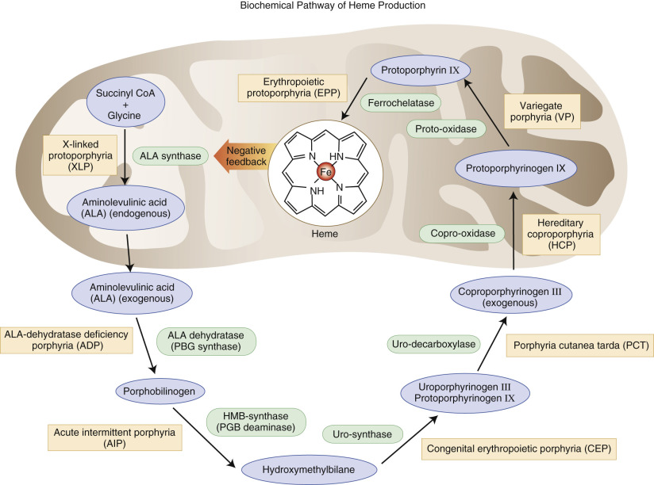

Figure 32-32 

Porphyria biochemical pathway of heme production. 

_ADP,_ Aminolevuoinic acid dehydratase; _AIP,_ acute intermittent porphyria; _ALA,_ Aminolevulinic acid; _EPP,_ erythropoietic protoporphyria; _HMB,_ hydroxymethylbilane; _CEP,_ congenital erythropoietic porphyria; _PCT,_ porphyria cutanea tarda; _CP III,_ coproporphyrinogen III; _HCP,_ hereditary coproporhyria; _UP III,_ uroporphyrinogen III; _VP,_ variegate porphyria; _XLP,_ X-linked protoporphyria. 

Porphyrins are compounds composed of four pyrrole rings connected by methene bridges, differentiated by substituents found in the eight peripheral positions. The arrangement of four nitrogen atoms in the center of the porphyrin ring enables porphyrins to chelate various metal ions, such as iron, or in disease states, zinc. The biosynthetic intermediates between porphobilinogen (PBG) and protoporphyrin are not porphyrins, but rather their reduced, precursor forms: the porphyrinogens. The porphyrias make up a group of inherited and acquired disorders of heme biosynthesis caused by a deficiency of a specific enzyme in the biosynthetic pathway, culminating in the excess production and increased excretion of precursors formed in the steps before the enzyme defect. Porphyrins that leak out of capillaries into the skin are the cause of photosensitivity, and the precursor substances have been linked to the neurovisceral manifestations. δ-Aminolevulinic acid seems to be the chief offender here (  Sassa, 2006  ). 

 

##  Approach to the Porphyrias 

Consulting pathologists may take a three-step approach to this diverse group of uncommon diseases. First, review the clinical manifestations described by the referring provider. Classifying porphyrias by their clinical presentation is a helpful starting point, as clinicians will call with infor­mation about their patients' signs and symptoms, and then will ask for help with ordering laboratory studies ( [ Tables 32-13 ](<#t0070>) and [ 32-14 ](<#t0075>) ). Second, suggest biochemical studies, as outlined in [ Table 32-13 ](<#t0070>) and in the following section. A rapid diagnostic test for urine porphobilinogen is now available as a first step. Finally, coordinate genetic testing as guided by biochemical test results. Great strides have been made in identifying the genes and many mutations causing the porphyrias, and patients will likely wish to know this information as they discuss their diagnosis with family members. Websites helpful to both providers and patients include those of the Porphyrias Consortium of the National Institutes of Health Rare Diseases Clinical Research Network ( [ http://rarediseasesnetwork.epi.usf.edu/porphyrias/index.htm ](<http://rarediseasesnetwork.epi.usf.edu/porphyrias/index.htm>) ), the American Porphyria Foundation ( [ www.porphyriafoundation.com ](<http://www.porphyriafoundation.com>) ), and the Drug Database for Acute porphyrias ( [ www.drugs-porphyria.com ](<http://www.drugs-porphyria.com>) ). 

TABLE 32-13 

Key Features of Major Porphyrias 

Porphyria  |  Clinical Features  |  Excess Metabolites  |  Rapid Test  |  Enzyme Deficiency  |  Genetic Mutations   
---|---|---|---|---|---  
Acute intermittent porphyria  |  Abdominal pain; psychiatric symptoms  |  PBG (U)   
ALA (U)   
Darkened urine on standing  |  ✔ |  HMB synthase  |  _HMBS_ (>375 mutations)   
Congenital erythropoietic porphyria  |  Photosensitivity; red urine, teeth; hemolysis  |  UP (U)   
CP (U)   
UP (E)   
Red, fluorescent pigment in urine  |  |  UP I synthase, UPG III cosynthase  |  _UROS_ (>35 mutations)   
Hereditary coproporphyria  |  Photosensitivity  |  CP III (F, U)   
PBG (U)   
ALA (U)   
Red, fluorescent pigment in urine  |  ✔ |  Copro'ogen oxidase  |  _CPOX_ (>60 mutations)   
Variegate porphyria  |  Photosensitivity  |  PBG (U)   
ALA (U)   
UP (U, F)   
CP (U, F)   
Red, fluorescent pigment in urine  |  ✔ |  Proto'ogen oxidase  |  _PPOX_ (>165 mutations)   
Porphyria cutanea tarda  |  Photosensitivity  |  UP I (U)   
UP III (U)   
Acid induces pink fluorescence  |  |  Uro'ogen decarboxylase  |  _UROD_ (>105 mutations)   
  
_ALA_ , Aminolevulinic acid; _CP_ , coproporphyrin; _E_ , erythrocyte; _F_ , feces; _PBG_ , porphobilinogen; _U_ , urine; _UP_ , uroporphyrin; _UPG_ , uroporphyrinogen. 

TABLE 32-14 

Test Results for the Porphyrias 

Porphyria  |  Urine  |  RBC  |  Feces   
---|---|---|---  
Acute intermittent porphyria  |  ↑ PBG, ALA  |  ↓ PBGD activity  |  Noncontributory   
ALA dehydratase deficiency porphyria  |  ↑ porphyrins (ALA alone is increased)   
Note: Rule out organic acids and heavy metals in urine.  |  ↓ d  -aminolevulinic acid dehydratase activity  |  Noncontributory   
Variegate porphyria  |  ↑ porphyrins, PBG  |  Noncontributory  |  ↑ coproporphyrin III/I ratio (<10)   
Hereditary coproporphyria  |  ↑ porphyrins, PBG  |  Noncontributory  |  ↑ coproporphyrin III/I ratio (>10)   
Porphyria cutanea tarda  |  ↑ porphyrins  |  ↓ UROD in Type II, UROD WNL in Types I, III  |  Noncontributory   
Congenital erythropoietic porphyria  |  ↑ porphyrins  |  ↓ UPG III cosynthase  |  Noncontributory   
Erythropoietic protoporphyria  |  Noncontributory  |  ↑ free protoporphyrin  |  Noncontributory   
  
_ALA,_ Aminolevulinic acid; _PBG,_ porphobilinogen; _PBGD,_ porphobilinogen deaminase; _UPG,_ uroporphyrinogen; _UROD,_ uroporphyrinogen decarboxylase; _WNL,_ within normal limits. 

 

##  Clinical Porphyrias and Their Biochemical Basis 

 

##  Neurovisceral Symptoms in Isolation 

 

##  Acute Intermittent Porphyria (AIP) 

AIP is the most common acute and probably the most common inherited porphyria (  Chemmanur & Bonovsky, 2004  ). It is inherited in an autosomal dominant fashion with incomplete penetrance, making family studies more challenging, and over 375 mutations have been identified (  Balwani & Desnick, 2012  ). PBG deaminase deficiency has been demonstrated in all examined tissues, at levels of about 50% during attacks and quiescent periods. Diagnosis may be made most easily with demonstration of elevated levels of ALA and PBG in urine during acute attacks (with PBG greater in amount than ALA), but the PBG enzyme assay can be performed at any time on RBCs. Frequently, patients have urine metabolite levels at or near the reference range during quiescent periods. Characteristically, the urine of AIP patients turns dark red upon exposure to air and light, as PBG is oxidized to a porphyrin spontaneously. The patient may be hyponatremic (20% of cases) or hypomagnesemic during acute attacks (  Anyaegbu et al, 2012  ). Common symptoms include colicky abdominal pain (74%), nausea and vomiting (73%), mental confusion, tachycardia, and motor weakness (63%) (  Bonkovsky et al, 2014  ). Symptoms typically begin at the time of puberty, reflecting the influence of steroid hormones on the disease, but the disease can present in children (  Anyaegbu et al, 2012  ). Prevention is the mainstay of management, with avoidance of particular drugs (barbiturates and sulfonamides among many others), hormonal changes, and fasting. Specifically, a low-carbohydrate diet may trigger an attack. A recent study identified an increased risk for malnutrition in AIP patients compared to matched controls (  Garcia-Diz et al, 2012  ). In the postoperative period, patients with AIP must be managed carefully to avoid hypoglycemia (  Benassi et al, 2012  ). 

 

##  Aminolevulinic Acid Dehydratase Deficiency Porphyria (ADP) 

ADP is the rarest of the porphyrias, with just ten reported cases (  Balwani & Desnick, 2012  ). Clinically indistinguishable from AIP, it may be differentiated in the laboratory by the presence of excess ALA alone in the urine and decreased d-aminolevulinic acid dehydratase in the red blood cells of affected patients. Of note, this type of porphyria must be distinguished from tyrosinemia and heavy metal intoxication. 

 

##  Neurovisceral Symptoms Plus Photosensitivity 

 

##  Variegate Porphyria (VP) 

Similar to AIP and HCP, VP is inherited as an autosomal dominant disorder with low penetrance. It is sometimes referred to as _South African porphyria_ because of its prevalence in the Caucasian population in this region. It is called **variegate** because of the spectrum of patient presentations. Some have only the cutaneous manifestations, others just the neurovisceral, and others both features. Thus, the clinician need not check both boxes to entertain this diagnosis, especially in patients of Afrikaner descent. Patients have approximately 50% activity of protoporphyrinogen oxidase. Thus, they excrete fecal protoporphyrins and coproporphyrins and urine ALA, PBG, and coproporphyrins. Induction of hepatic ALA synthase I by precipitating factors, such as barbiturates, oral contraceptives, or a low-carbohydrate diet, specifically results in increased ALA and PBG during acute attacks (  Chemmanur & Bonovsky, 2004  ). Cutaneous manifestations in the form of erosions or bullae following trauma to sun-exposed skin are seen at a younger age than is observed with porphyria cutanea tarda. Diagnosis is made by conventional measurements of metabolites, family history, and DNA analysis. Avoidance of triggering factors remains the major approach to patient care. 

 

##  Hereditary Coproporphyria (HCP) 

Also inherited in an autosomal dominant fashion with incomplete penetrance, HCP is less common than AIP. It is due to a deficiency of coproporphyrinogen oxidase. Clinically, HCP resembles a milder form of AIP with its neurovisceral attacks, but cutaneous manifestations are seen in roughly one third of patients (  Chemmanur & Bonovsky, 2004  ). Fecal coproporphyrinogen III is excreted both during and between attacks, and ALA and PBG are seen in urine during an acute crisis. ALA excretion usually exceeds that of PBG, and this, coupled with the cutaneous findings (if present) helps to differentiate HCP from AIP. Prevention, including sunscreen, is central to management. 

 

##  Photosensitivity Plus Hemolytic Anemia 

 

##  Porphyria Cutanea Tarda (PCT) 

PCT is the most common of the porphyrias in the United States. Type 1 is sporadic; type 2 is inherited in autosomal dominant fashion. The deficient enzyme is uroporphyrinogen decarboxylase (UROD), and researchers have postulated the presence of an inhibitor of UROD, possibly secondary to iron and metabolites of uroporphyrinogen. Over 105 mutations have been inheritied in the UROD gene (  Balwani & Desnick, 2012  ). It is interesting to note that patients with hemochromatosis are at increased risk for acquired PCT (  Chemmanur & Bonovsky, 2004  ). Patients present with cutaneous findings alone, and these are due to mild trauma to sun-exposed areas, not simple photosensitivity. Diagnostic laboratory findings include increased uroporphyrins with smaller increases in urine coproporphyrins. Exacerbating factors, such as alcohol, an inducer of hepatic ALA synthase I, and estrogens, should be avoided. Additional management strategies involve phlebotomy to reduce the hepatic iron load, chloroquine to complex porphyrins for urinary excretion, and the use of sunscreen (  Chemmanur & Bonovsky, 2004  ). 

 

##  Congenital Erythropoietic Porphyria (CEP) 

CEP is distinct from the other porphyrias discussed earlier in both its inheritance (it is a recessive disorder) and its severity. Patients present shortly after birth with red-pigmented urine, hemolytic anemia, and severe cutaneous photosensitivity. Erythrodontia is striking and may be a useful clue if the diagnosis has not already been made. The deficient enzyme is uroporphyrinogen III synthase with over 35 mutations identified, and ALA synthase activity is increased. Coproporphyrin I and uroporphyrin I are present in urine. The prognosis for CEP is significantly worse than for the other porphyrias, with death occurring at an early age in many cases. 

 

##  Photosensitivity in Isolation 

 

##  Erythropoietic Protoporphyria (EPP) and X-linked Porphyria (XLP) 

EPP is due to a partial deficiency of the enzyme ferrochelatase, the final enzyme in the heme biosynthetic pathway. An autosomal recessive disorder, it is caused by one of over 135 mutations of the _FECH_ gene (  Balwani & Desnick, 2012  ). Clinical symptoms begin in childhood, earlier than in other porphyrias (which have their onset at puberty) and painful, itching erythema occurs within a short time (minutes) of sun exposure. Neuropsychiatric symptoms are absent, but a recent case series described a child who was sent for psychiatric care after screaming in pain when outside (  Wahlin et al, 2006  ). This article makes a useful point regarding the emotional sequelae of painful skin lesions: Emotional distress follows many diseases and must be carefully distinguished from the specific, although myriad, neurovisceral symptoms that characterize other porphyrias. Uniquely among the porphyrias, EPP has a normal urine profile, and RBC testing must be performed to render a diagnosis. XLP is newly described and clinically indistinguishable from EPP. It is due to a gain-of-function of the _ALAS2_ gene (  Balwani & Desnick, 2012  ). 

 

##  Analytic Techniques 

Diagnosis in the clinic or hospital laboratory may begin with the Trace PBG Kit (Trace America/Trace Diagnostics, Wheeling, Ill.) to identify urine porphobiloinogens. [ Table 32-13 ](<#t0070>) shows which porphyrias will have elevated levels. After an initial test, analysis of urine, red blood cells, and feces for various porphyrins typically increased in the porphyrias, and for specific enzymes of the heme biosynthetic pathway, takes place in reference laboratories. The pathologist should select a laboratory that is well familiar with the porphyrias and that follows a logical algorithm, so that disease, if present, can be properly classified. Neither the ordering clinician nor the general pathologist needs to attempt classification of the porphyria by selecting one or two specific assays. The algorithmic approach is the rational one and begins with a quantitative evaluation of porphyrins: PBG and ALA in the urine, and porphyrins and PBGD (porphobilinogen deaminase) measurement in the erythrocytes. High-performance liquid chromatography (HPLC) and fluorometry are the mainstays of analytic technique. HPLC can separate individual porphyrins; this, combined with measurement of total fecal porphyrins, reliably distinguishes between AIP and HCP (  Deacon & Elder, 2001  ). VP may be diagnosed by measurement of fecal and urine metabolites, and also by the fluorescence emission peak of 624 to 627 nm, which is unique among the porphyrias (  Poh-Fitzpatrick, 1980  ). The proper samples to submit for testing are urine (a 24-hour sample is strongly preferred, with the appropriate preservative dictated by the reference laboratory) and blood. A stool sample should be provided if VP or HCP is being considered but is less critical for the other porphyrias. Genetic testing for specific mutations should be performed on patients diagnosed by clinical signs and urine/RBC/feces analysis. Recall that the porphyrias are characterized by incomplete penetrance. Family history may or may not suggest the diagnosis; an absence of family history in no way precludes the presence of a porphyria. One a specific mutation is identified, testing of kindreds can follow in a targeted fashion. 

,,
