## Key Points

  * •

The endocrine system is a finely integrated system whereby the hypothalamus, the pituitary gland, and target glands continually communicate through feedback inhibition and stimulation to control all aspects of metabolism, growth, and reproduction. By understanding this interplay and carefully manipulating these systems via provocative and suppressive stimuli, it is possible to characterize an underlying abnormality and provide directed treatment. 

  * •

Prolactin levels can be elevated as the result of a variety of pharmacologic and physiologic stimuli; values greater than 200 ng/mL are almost always associated with the presence of a pituitary tumor. 

  * •

The initial screening test for acromegaly is measurement of the serum insulin-like growth factor-1 (IGF-1). 

  * •

It is often unnecessary to perform provocative stimulation tests to document growth hormone deficiency in patients with a known history of pituitary disease or in those with evidence of three or more pituitary hormone deficiencies. 

  * •

Provided the hypothalamic-pituitary-thyroid axis is intact, the ultrasensitive thyroid-stimulating hormone test is the best method for detecting clinically significant thyroid dysfunction. 

  * •

When measuring thyroglobulin as a tumor marker for thyroid cancer, always check a simultaneous sample for thyroglobulin antibodies. 

  * •

The best screening test for pheochromocytoma is either the plasma free metanephrine or 24-hour urinary free metanephrines. The patient should avoid caffeine, alcohol, acetaminophen, monoamine oxidase inhibitors, and tricyclic antidepressants for at least 5 days before testing. 

  * •

It is frequently unnecessary to perform an adrenocorticotropic hormone (ACTH) stimulation test in critically ill patients. A random cortisol of greater than 25 µg/dL (700 nmol/L) during stress makes it highly unlikely that the patient is adrenally insufficient. 

  * •

Midnight salivary cortisol (MSC) is a highly sensitive, highly specific and very simple way to screen for Cushing's disease. 

,  

##  Pituitary Function 

The endocrine system is a finely tuned system in which the hypothalamus, pituitary gland, and various endocrine glands communicate through an intricate scheme of hormone-mediated feedback inhibition and stimulation stimuli. Hormones are classically defined as substances that act at sites distant from their place of origin. Included under the rubric of hormones are moieties that act in an autocrine (act directly upon themselves), paracrine (act adjacent to the cells of origin), or intracrine (act within the cells of origin without ever exiting the cells) fashion. Through this intimate interplay of signals, the endocrine system serves to control metabolism, growth, fertility, electrolyte and water homeostasis, and responses to stress. 

The pituitary gland, also known as the _hypophysis,_ is located within the confines of the sella turcica. It is connected to the median eminence of the hypothalamus by the infundibular stalk, and is divided into an anterior lobe (adenohypophysis) and a posterior lobe (neurohypophysis). It weighs about 0.6 g and measures about 12 mm in transverse and 8 mm in anteroposterior diameter. The anterior pituitary gland possesses five distinct hormone-synthesizing and -secreting populations of cells. These cell groups include somatotrophs, which secrete growth hormone (GH); lactotrophs, which secrete prolactin (PRL); thyrotrophs, which secrete thyroid-stimulating hormone (TSH); gonadotrophs, which secrete the α and β subunits of follicle-stimulating hormone (FSH) and luteinizing hormone (LH); and corticotrophs, which secrete proopiomelanocortin (POMC). POMC is cleaved within the pituitary gland to form adrenocorticotropin (ACTH), β-endorphin, and β-lipotropin (β-LPH). The hypothalamus communicates with the anterior pituitary gland by secreting its own set of trophic hormones that are specific for each of the cell populations within the pituitary gland ( [ Fig. 24-1 ](<#f0010>) ). These trophic hormones travel along the infundibular stalk to the adenohypophysis through a system of portal vessels. 

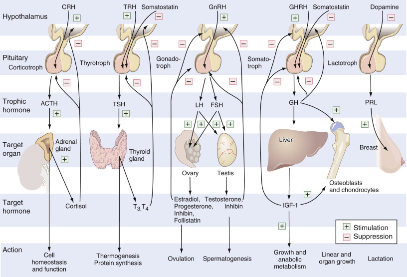

Figure 24-1 

The hypothalamic-pituitary-target organ axis. 

_ACTH,_ Adrenocorticotropin; _CRH,_ corticotropin-releasing hormone; _FSH,_ follicle-stimulating hormone; _GHRH,_ growth hormone–releasing hormone; _GnRH_ , gonadotropin-releasing hormone; _IGF-1,_ insulin-like growth factor; _LH,_ luteinizing hormone; _PRL,_ prolactin; _T_ 3  _,_ 3,5,3′-triiodothyronine; _T_ 4  _,_ thyroxine; _TRH,_ thyrotropin-releasing hormone; _TSH,_ thyroid-stimulating hormone. 

(Redrawn from Melmed S, Kleinberg D: Anterior pituitary. In Larsen PR, Kronenberg HM, Melmed S, et al, editors: _Williams textbook of endocrinology,_ ed 10, Philadelphia, 2003, Saunders, p 181, with permission.) 

In contrast to the anterior pituitary gland, the posterior pituitary gland (neurohypophysis) does not synthesize hormones. The hormones that it does secrete, arginine vasopressin (AVP; also known as antidiuretic hormone [ADH]) and oxytocin, are synthesized within the magnicellular neurons of the paraventricular and supraoptic nuclei of the hypothalamus, transported along the axons, and stored in the nerve terminals that end in the neurohypophysis. A summary of the different hormones secreted by the pituitary gland can be found in [ Box 24-1 ](<#b0010>) . 

Box 24-1 

Hormones of the Pituitary Gland 

 

##  Anterior Pituitary—Adenohypophysis 

  * Growth hormone (somatotropin) (GH) 

  * Thyroid-stimulating hormone (thyrotropin) (TSH) 

  * Gonadotropins 

  * Follicle-stimulating hormone (FSH) 

  * Luteinizing hormone (LH) 

  * Proopiomelanocortin (POMC) 

  * Adrenocorticotropin (ACTH) 

  * β-lipotropin 

  * β-endorphin 

  * Prolactin (PRL) 

 

##  Posterior Pituitary—Neurohypophysis 

  * Arginine vasopressin (AVP) = Antidiuretic hormone (ADH) 

  * Oxytocin 

Abnormalities of pituitary function fall within two broad categories: hormonal excess and hormonal deficiency. Hormonal excess usually occurs as the result of clonal expansion of a distinct population of cells; however, it can result from an increase in trophic hormones from the hypothalamus or ectopic sites. The causes of hormonal deficiency are more varied ( [ Box 24-2 ](<#b0015>) ) and can result in the deficiency of one or more hormones, often with continued and progressive loss of other hormones over time. 

Box 24-2 

Causes of Pituitary Hormonal Deficiency 

  * Pituitary neoplasm 

  * Pituitary adenoma 

  * Craniopharyngioma 

  * Metastases or rarely primary carcinoma 

  * Iatrogenic 

  * Radiation 

  * Hypophysectomy 

  * Stalk resection 

  * Granulomatous disease 

  * Sarcoidosis 

  * Infection 

  * Tuberculosis 

  * Syphilis 

  * Fungi 

  * Hemorrhage and infarction 

  * Postpartum necrosis (Sheehan's syndrome) 

  * Head trauma 

  * Apoplexy 

  * Aneurysms of the internal carotid artery 

  * Autoimmune lymphocytic hypophysitis 

  * Hemochromatosis 

  * Primary hypothalamic disorders 

  * Tumor 

  * Granulomas 

  * Idiopathic or genetic deficiencies of hormones within the pituitary gland or hypothalamus 

 

##  Pituitary Tumors 

Pituitary tumors may be classified as microadenomas (<1 cm in greatest diameter and confined to the sella) or macroadenomas (≥1 cm in greatest diameter). They are further subcategorized into secretory and nonsecretory varieties ( [ Table 24-1 ](<#t0010>) ). All tumors have the potential to grow; in doing so, they can compress the optic chiasm, resulting in visual field defects, of which bitemporal hemianopia is the most frequent presentation. Invasion into the cavernous sinus can lead to compression of cranial nerves III, IV, VI, V1, and V2 and the intracavernous portion of the internal carotid artery. It can also lead to hydrocephalus caused by obstruction of the third ventricle. Aside from oversecretion of a particular hormone and extension into surrounding regions, these tumors can also cause hormonal deficiency due to compression of other cell lineages within the pituitary gland. 

TABLE 24-1 

Relative Frequency of Occurrence of Pituitary Tumors 

Lactotroph (PRL)  |  30%   
---|---  
Somatotroph (GH)  |  15%   
Combined GH/PRL  |  8%   
Corticotroph (ACTH)  |  15%   
Thyrotroph (TRH)  |  1%   
Pleurihormonal  |  4%   
Nonfunctioning  |  27%   
  
_ACTH,_ Adrenocorticotropin; _GH,_ growth hormone; _PRL,_ prolactin; _TRH,_ thyrotropin-releasing hormone. 

 

##  Prolactin 

PRL is a polypeptide produced by the lactotrophs of the pituitary gland; it is responsible for the initiation and maintenance of lactation. Its secretion is normally kept at low levels by the inhibitory actions of dopamine produced by the hypothalamus. Similar to several pituitary hormones, PRL is secreted in a circadian fashion, with the highest levels attained during sleep and a nadir occurring between 10  am  and noon (  Sassin et al, 1972  ). PRL is secreted in a pulsatile fashion, the amplitude and frequency of which not only vary throughout the day but are influenced by a variety of physiologic stimuli (e.g., stress, pregnancy, exercise). Because of these factors and a serum half-life of 26 to 47 minutes, it had been recommended that when screening for hyperprolactinemia three specimens be obtained at 20- to 30-minute intervals. Each sample could either be analyzed separately and their results averaged, or alternatively an equal aliquot from each sample could be pooled into a single specimen for analysis. Current Endocrine Society guidelines recommend screening using a single determination, collected at any time of day, reserving the option to follow the aforementioned recommendations if the diagnosis is in doubt (  Melmed et al, 2011  ). A single prolactin level above the sex-matched upper limit of normal is diagnostic for hyperprolactinemia, with values above 250 µg/L usually indicating the presence of a prolactinoma. PRL is measured by immunometric assay. 

The major circulating form of PRL is the nonglycosylated monomer. A number of other forms can occur, including “big” PRL and macroprolactin (“big, big” PRL), which is considered to be PRL coupled with immunoglobulin (  Yazigi et al, 1997  ;  Conner & Fried, 1998  ). Because these forms all react with the immunoassays, they can produce falsely high PRL results in patients in whom pathologic elevation of PRL is not supported clinically or by computed tomography (CT) or magnetic resonance imaging (MRI). Various analytic methods have been developed to eliminate this confusion, including the performance of immunoassay following polyethylene glycol extraction and centrifugal ultrafiltration (  Diver et al, 2001  ;  Amadori et al, 2003  ;  Fahie-Wilson, 2003  ;  Prazeres et al, 2003  ;  Suliman et al, 2003  ;  Toldy et al, 2003  ). 

The degree of prolactin elevation usually correlates well with tumor size. Under certain circumstances, the PRL may be falsely low or minimally elevated, considering the size of the tumor. This discordance can by explained by the “hook effect,” and it may result in the misdiagnosis of a patient having a nonfunctioning chromophobe adenoma instead of a prolactin-secreting adenoma. 

This effect results when two antibodies to an antigen, in the current case, prolactin, are used in an ELISA assay (see [ Chapter 17 ](<##!/content/3-s2.0-B9780323295680000176?scrollTo=%23c00017>) ). One of these antibodies, called the _capture antibody,_ is embedded on a solid surface, while the second antibody, called the _secondary antibody,_ is conjugated to a probe that is either an enzyme or a fluorescent or chemiluminescent moiety. If both antibodies are present in a so-called _one-step ELISA assay,_ at high concentrations of antigen, excess antigen will bind to the secondary antibody in solution, blocking it from binding to any antigen captured by the capture antibody on the solid surface. Thus the enzyme or fluorescent signal on the solid surface will be diminished, making it appear as if there is a low concentration of antigen (  Barkan & Chandler, 1998  ;  Petakov et al, 1998  ). 

This effect does not occur if a wash step is performed prior to adding the secondary antibody; the wash step removes all excess antigen. Also, performance of homogeneous assays for prolactin avoids the hook effect. If a hook effect is suspected, the sample should be diluted, often to levels of 1 : 1000, and then assayed. Typically, only a single dilution is performed when assaying for PRL in single-step ELISA assays. It is preferable to utilize assays for prolactin that avoid the hook effect. 

If the pretest probability of the patient having a prolactin-secreting tumor is high, it is recommended that the serum sample be subjected to serial dilutions or at the least a 1 : 100 dilution. 

PRL acts on breast tissue, where, in the setting of estrogen priming, it stimulates lactation. PRL also acts at the hypothalamus to inhibit the secretion of gonadotropin-releasing hormone (GnRH). Inhibition of GnRH results in a decrease in the release of LH and FSH from the anterior pituitary gland. In females, this leads to a decrease in estrogen and progesterone synthesis and secretion by the ovaries, and failure of ovarian follicular maturation (ovulation). In males, a deficiency of FSH and LH causes a decrease in testicular production and synthesis of testosterone, and a halt in spermatogenesis. It has also been suggested that hyperprolactinemia may stimulate adrenal androgen production and have an effect on immune responsiveness (  Lobo et al, 1980  ;  Walker et al, 1993  ). 

The reference value for serum PRL is 1 to 25 ng/mL (1 to 25 µg/L) for women and 1 to 20 ng/mL (1 to 20 µg/L) for men. The higher PRL levels seen in females begin postpuberty and are presumably due to the stimulatory effect of estrogen (  Eastman et al, 1996  ). During pregnancy, a progressive rise in serum PRL is observed, with levels reportedly reaching as high as 500 ng/mL by the third trimester (  Rigg et al, 1977  ). This is largely due to an increase in the number of PRL-secreting cells and can be associated with a doubling or even greater increase in pituitary gland size (  Scheithauer et al, 1990  ). PRL levels fall back to baseline about 3 weeks postpartum in women who are not breastfeeding. In nursing mothers, basal PRL levels remain moderately elevated, with episodic bursts in secretion in response to suckling. 

PRL levels are increased by many physiologic and pathologic factors, as well as by a wide variety of medications ( [ Box 24-3 ](<#b0020>) ). Elevations in PRL resulting from physiologic and pharmacologic stimuli rarely exceed 200 ng/mL. 

Box 24-3 

Causes of Hyperprolactinemia 

  * Physiologic 

  * Sleep, stress, postprandially, pain 

  * Coitus, pregnancy, nipple stimulation or nursing 

  * Systemic disorders 

  * Chest wall or thoracic spinal cord lesions 

  * Primary or secondary hypothyroidism 

  * Adrenal insufficiency 

  * Chronic renal failure 

  * Cirrhosis 

  * Medications 

  * Psychiatric medications: Phenothiazines, haloperidol, thioxanthines, buspirone, olanzapine, risperidone, domperidone, monoamine oxidase inhibitors, fluoxetine, amitriptyline 

  * Metoclopramide 

  * Antihypertensives: labetalol, α-methyldopa, reserpine, verapamil 

  * Antihistamines H  2  : cimetidine, ranitidine 

  * Estrogens, oral contraceptives, oral contraceptive withdrawal 

  * Opiates: heroin, methadone, morphine, apomorphine 

  * Thyrotroph (TRH) 

  * Prolactin-secreting pituitary tumor: prolactinoma, acromegaly 

  * Macroadenoma (compressing the pituitary stalk) 

  * Macroprolactinemia 

  * Pressure on or transection of the pituitary stalk, interrupting the transmission of dopamine to D  2  receptors on the lactotrophs: Surgery, traumatic transection, granulomas, metastases, meningioma, irradiation, histiocytosis X 

  * Ectopic secretion of prolactin by nonpituitary tumors 

  * Idiopathic 

  * Polycystic ovarian disease 

  * Epileptic seizures 

PRL deficiency can be seen with pituitary necrosis or infarction and in some cases of pseudohypoparathyroidism. In women with complete PRL deficiency, menstrual disorders and infertility have been found (  Kauppila, 1997  ). It is PRL excess that is associated with clinical pathology. Hyperprolactinemia leads to inhibition of GnRH secretion, which typically manifests as sexual dysfunction and infertility in both men and women. Women may present with luteal phase abnormalities, oligomenorrhea, or frank amenorrhea, with or without galactorrhea. Men will present with hypoandrogenemia, decreased libido, and impotence. Pituitary adenomas are an important cause of hyperprolactinemia; however, any sellar or parasellar process that compresses the pituitary stalk and interrupts the tonic delivery of dopamine can lead to disinhibition of PRL secretion. Usually, the height of elevation of serum PRL levels correlates with the likelihood of the presence of a pituitary tumor, and levels of PRL in excess of 200 ng/mL almost always signify the presence of a prolactinoma (  Kleinberg et al, 1977  ;  Frantz, 1998  ;  Freda & Wardlaw, 1999  ). Unlike other functioning pituitary tumors, the degree of elevation of PRL correlates fairly well with the size of the tumor. 

Hyperprolactinemia exists in 20% to 40% of patients with acromegaly; this may be due to the presence of a mixed tumor (containing both lactotrophs and somatotrophs) or to interference with the normally active, PRL-inhibitory mechanisms (e.g., interruption of dopamine delivery owing to stalk compression by a tumor, resulting in disinhibition of prolactin secretion). Another important cause of hyperprolactinemia is hypothyroidism. Thyrotropin-releasing hormone (TRH) not only stimulates TSH secretion, but it also stimulates PRL secretion, thus explaining the mild hyperprolactinemia seen in both primary (thyroid) and secondary (pituitary) hypothyroidism. Therefore, thyroid function tests (free thyroxine [FT  4  ] and TSH) are always indicated to rule out hypothyroidism when a patient with hyperprolactinemia is evaluated. Thyroid hormone replacement therapy will usually return the PRL to normal. 

It is important to evaluate all patients discovered to have an abnormally elevated PRL. Since hyperprolactinemia can be found in upward of 40% of cases of acromegaly, it is appropriate to measure insulin-like growth factor (IGF)-1. Other hormones that may be assayed include FSH, LH, free testosterone, estradiol, and, if clinically indicated, tests of adrenal axis function. Rarely, hyperprolactinemia may be caused by ectopic hormone production. All patients should undergo CT or MRI of the sella, performed with and without contrast. If there are no contraindications, MRI is preferred, as it provides better contrast and anatomic detail, is better for visualizing microadenomas, and is safer for serially monitoring of patients since there is no exposure to radiation. A formal visual field examination is also a key monitoring tool in managing patients with pituitary tumors and should be done at least yearly in patients with stable disease. 

 

##  Growth Hormone 

GH is a single-chain polypeptide of 191 amino acids synthesized, stored, and secreted by the somatotrophs of the pituitary gland in response to the secretion of growth hormone–releasing hormone (GHRH) by the hypothalamus. Somatostatin, also produced by the hypothalamus, inhibits GH synthesis and release. Although evidence exists for the direct action of GH on long bone growth in children, most of its anabolic and metabolic actions are mediated indirectly through an intermediary, IGF-1 (also called **somatomedin C** ). IGF-1 is synthesized in the liver and in certain target tissues, in response to stimulation by GH. IGF-1 circulates in the blood complexed to IGF-binding proteins (IGF-BPs); IGF-BP3 is the predominant circulating species. As with all hormones, it is the free, unbound form that is biologically active. Like somatostatin, IGF-1 negatively feeds back on the pituitary gland to inhibit GH secretion. 

GH is secreted in a pulsatile fashion; the frequency and amplitude of the peaks are greatest during puberty, exhibiting a steady decline with increasing age (  Casanueva, 1992  ). As up to 70% of GH secretion occurs during stage 4 (slow wave) sleep, it has been suggested that the age-related decline in stage 4 sleep may account for the decline in GH seen with aging (  Van Cauter, 2000  ;  Van Cauter et al, 1998  ). In addition to GHRH and somatostatin, several other factors regularly mediate GH secretion ( [ Fig. 24-2 ](<#f0015>) ). Major stress (e.g., surgery, sepsis), fasting, sex steroids, chronic malnutrition, apomorphine, levodopa, uncontrolled diabetes mellitus, and high-protein meals all stimulate GH secretion. Women tend to have higher GH levels than men, perhaps because of estrogen sensitization of the hypothalamus to other GH stimuli (  Eastman et al, 1996  ). 

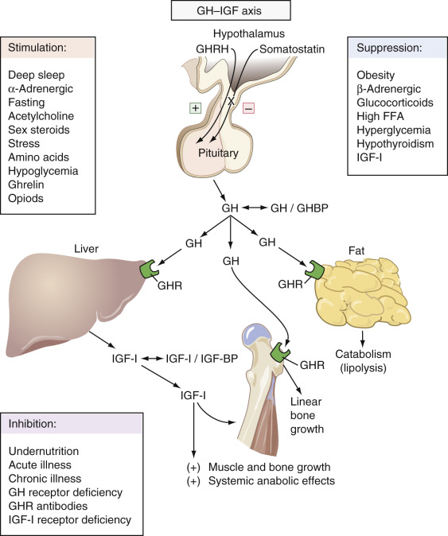

Figure 24-2 

Hypothalamic-pituitary-growth hormone axis. 

Feedback loop influencing GH-IGF-1 secretion and action. _FFA,_ Free fatty acid; _GH,_ growth hormone; _GHBP,_ growth hormone–binding protein; _GH-IGF,_ growth hormone–insulin-like growth factor; _GHR,_ growth hormone receptor; _GHRH,_ growth hormone–releasing hormone; _IGF-1,_ insulin-like growth factor I; _IGF-BP,_ IGF-binding proteins. 

(From Melmed S, Kleinberg D: Anterior pituitary. In Larsen PR, Kronenberg HM, Melmed S, et al, editors: _Williams textbook of endocrinology,_ ed 10, Philadelphia, 2003, Saunders, p 221, with permission.) 

Serum GH is undetectable for most of the day in healthy, nonstressed individuals. This fact along with the episodic nature of GH secretion makes a single sampling difficult to interpret. As a result, the diagnosis of GH deficiency is made using GH measurements following pharmacologic stimulation, and GH excess is confirmed by failure of GH suppression following an oral glucose load. GH is commonly measured by chemiluminescent immunoassay. 

Somatostatin is synthesized in the paraventricular and arcuate nuclei of the hypothalamus. It inhibits GH and TSH secretion. It also inhibits the secretion of insulin and several gut hormones (e.g., motilin, secretin, gastrin). Ghrelin, a 28–amino acid peptide produced by the gastric neuroendocrine cells and the hypothalamus, binds to the GH secretagogue receptor to stimulate the secretion of GHRH and GH. 

 

##  Growth Hormone Deficiency 

Idiopathic growth hormone deficiency is the most common cause of GH deficiency (GHD) in children, whereas a pituitary adenoma is the most common etiology in adult-onset GHD. No simple, reproducible method for determining abnormal GH secretory patterns exists. In healthy normal individuals, 70% to 80% of GH results are below 1 ng/mL (<1 µg/L), and secretory peaks typically reach 20 to 40 ng/mL (20 to 40 g/L) (  Baumann, 1987  ). Thus, in a child with decreased growth velocity, a low or nondetectable GH does not necessarily indicate GHD. Similar to GH, IGF-1 declines with age. IGF-1 is more diagnostically useful in patients younger than 40 years of age; however, it is still not sensitive enough to be used as a standalone test to make the diagnosis of GHD (  Almeretti et al, 2003  ). Manipulation of the endocrine system through stimulation and suppression of the various axes is often required for diagnosing conditions of hormonal deficiency and surfeit. In this vein, GHD is diagnosed by showing failure of GH to increase adequately in response to pharmacologic stimulation. Several endocrine organizations have published guidelines on GH deficiency, detailing which patients to test, which test to utilize, and what cutoffs to apply (  Ho & Ho, 2007  ;  Casanueva et al, 2009  ). The insulin tolerance test (ITT) has long been considered the “gold standard” for diagnosing GHD; however, it is most unpleasant for the patient, requires the attendance of a physician throughout the testing period, and is contraindicated in those with a history of seizures or cardiac or cerebrovascular disease. Failure of GH to rise above 5 ng/mL in adults and above 10 ng/mL in children is considered to be abnormal. In patients unable to undergo an ITT and in those needing a second confirmatory test, arginine stimulation alone or in combination with GHRH is usually the next step. Combination testing with GHRH plus arginine is preferred, as many normal adults will fail stimulation with arginine alone (  Biller et al, 2002  ). Failure of GH to rise above 4.1 carries a sensitivity of 95% and a specificity of 91% in diagnosing GH deficiency (  Biller et al, 2002  ). Because body mass index (BMI) affects the GH response to stimulation with GHRH plus arginine, newer guidelines recommend the use of GH cutoffs based on BMI for interpretation of results (  Cook et al, 2009  ). Other methods to assess for GHD include 24-hour or nighttime monitoring of GH and provocative tests using clonidine,  l  -dopa, or glucagon (following priming with propranolol). All of these tests carry significant individual variability. They have not been systematically studied and are used mainly in the pediatric population (  Rose et al, 1988  ). The same normal ranges hold for these tests as described for the ITT. There are two settings in which an argument can be made against the need to test for GHD. The first is in patients with known pituitary disease who have a low IGF-1 level. The other scenario is in patients with evidence of three or more pituitary hormone deficiencies; studies have shown these patients to have a greater than 96% chance of being GHD (  Hartman et al, 2002  ). 

For children, it is common to use exercise testing in screening for GHD. Further testing is not indicated if the results are normal; however, if GH fails to increase adequately, pharmacologic testing is warranted (  Eddy et al, 1974  ). Healthy children may not respond to any single GH provocative test; therefore, GHD in childhood is defined by failure of serum GH to reach defined levels when at least two different pharmacologic stimuli are used. IGF-1 measurements have been used to screen for GHD in children; however, since a variety of factors can decrease IGF-1, it is not used to confirm the diagnosis of GHD. IGF-1 levels decline in malnutrition, hypothyroidism, hepatic disease, uncontrolled diabetes mellitus, renal disease, and with age. Levels of IGF-BP3 usually parallel those of IGF-1 and are often low in GHD; however, results falling within the reference range do not exclude the diagnosis if GHD. Up to 18% of subjects with GHD may have normal IGF-1 levels. Care should be taken when interpreting values for IGF-1, IGF-BP3, and GH because the assays themselves and the cutoffs used to define normal differ greatly between laboratories. To address these issues there is a move to have laboratories utilize a World Health Organization international standard for GH and IGF-1, and to create a normative range from a statistically valid control group (  Giustina et al, 2010  ). 

It is important to understand the difference in the physiology behind testing with GHRH as compared to the other secretagogues. ITT and arginine stimulate the production of GHRH; clonidine increases GH secretion by inhibiting the release of somatostatin. For these stimuli to elicit a rise in GH, the hypothalamus must be intact. When GHRH is used for testing, the hypothalamus is bypassed and the pituitary gland is directly stimulated, therefore it is possible to miss up to 50% of patients who have tertiary (hypothalamic) GHD. 

Individuals with childhood-onset idiopathic GHD are less likely to have permanent GHD. It is recommended that unless they have a known genetic mutation, embryopathic lesion, or irreversible lesion/damage to the pituitary gland/hypothalamus, they be taken off GH replacement and retested when they reach early adulthood (  Molitch et al, 2006  ). 

 

##  Growth Hormone Excess 

Growth hormone overproduction can result in the condition called **acromegaly.** If the condition develops before closure of the epiphyses, these individuals may be exceedingly tall ( **gigantism** ). More commonly, it presents during adulthood, causing diffuse enlargement of soft tissues and organs throughout the body; characteristic features include prognathism, frontal bossing, and spadelike hands. The screening test for clinically suspected acromegaly is a randomly collected IGF-1. A normal IGF-1 with respect to the appropriate age- and gender-matched reference ranges rules out the diagnosis of acromegaly (  Katznelson et al, 2014  ). However, it should be noted that a physiologic increase in IGF-1 may be seen during pregnancy and late-stage adolescence (  Katznelson et al, 2014  ). If the level of IGF-1 is elevated or borderline with respect to the appropriate age- and gender-related reference range, it becomes necessary to confirm the diagnosis using an oral glucose tolerance test (OGTT). The OGTT is performed by obtaining baseline blood samples for glucose and GH, administering 75 g of glucose orally, and then obtaining blood for glucose and GH every 30 minutes over the next 2 hours. A normal response is suppression of GH to <1 ng/mL (1 µg/L) at any time during the test. If GH fails to drop to below 1 ng/mL (1 µg/L), the patient is diagnosed as having acromegaly (  American Association of Clinical Endocrinologists, 2004  ). GH may fail to adequately suppress in the setting of puberty, uncontrolled diabetes mellitus, malnutrition, hepatic disease, and renal disease; however, all but puberty are associated with a normal serum IGF-1 (  Katznelson et al, 2011  ). 

The difficulty comes in diagnosing mild disease. Freda had studied 60 postoperative patients with acromegaly, 22 patients with active disease (elevated IGF-1), 38 patients in remission (normal IGF-1), and 25 healthy controls. The highest nadir GH was 0.13 µg/L in the controls and 0.3 µg/L in those with active disease. Fifty percent of those with active disease had GH values <1 µg/L, leading to misclassification of these individuals as being normal when the criteria of a GH value <1 µg/L was applied (  Freda et al, 1998  ;  Trainer, 2002  ). In a more recent study of 16 patients with mild disease (the majority having microadenomas),  Dimaraki and colleagues (2002)  found that 50% of patients with acromegaly were able to suppress their GH levels to <1 µg/L following an OGTT. A proposed reason for these patients with active disease showing normal suppression is that they may have subtle changes in GH secretion that are not elicitable using this short suppression test. To address this issue, the following suggestion has been proferred (  Trainer, 2002  ). If the initial random IGF-1 is normal and GH is <0.3 µg/L, then acromegaly is excluded. If either test is abnormal, repeat the IGF-1 and proceed to an OGTT. Failure of GH to be suppressed below 0.3 µg/L, accompanied by an elevated IGF-1, is diagnostic of acromegaly. Suppression of GH below 0.3 µg/L with normal IGF-1 excludes acromegaly. For those who adequately suppress their GH but have an elevated IGF-1, close follow-up is recommended (  Trainer, 2002  ). Oral but not transdermal estrogen can reduce IGF-1 concentrations (  Giustina et al, 2010  ), therefore temporarily withholding oral estrogen therapy during testing may be prudent. 

Acromegalic patients may show a paradoxical rise, an absent response, or a partial decline in GH in response to an OGTT (  Ezzat, 1997  ). Random GH sampling is not adequate to establish the diagnosis of acromegaly because considerable overlap in GH exists between healthy persons and patients with the disease. In addition, GH can be increased in patients with a number of disorders, including renal disease, cirrhosis, malnutrition, uncontrolled diabetes mellitus, as well as in patients under physical or emotional stress. Although larger adenomas are generally associated with higher GH levels, the correlation between GH levels and acromegalic manifestations is poor. In most patients with untreated acromegaly, GH levels remain above basal levels throughout the day, ranging from 10 to 100 ng/mL (10 to 100 µg/L). Serum GH levels in excess of 50 to 100 ng/mL (50 to 100 µg/L) are virtually never seen in nonacromegalic persons (  Barkan, 1989  ). Other diagnostic maneuvers using TRH, GnRH, and GHRH yield discordant results in about 50% of patients with acromegaly; therefore, their use for diagnostic purposes or for monitoring disease activity is not recommended (  American Association of Clinical Endocrinologists, 2004  ). In patients with documented acromegaly but no evidence of a pituitary tumor, GHRH should be measured to detect a hypothalamic or ectopic source for acromegaly. 

Patients treated for acromegaly require lifelong monitoring for disease activity. Patients treated with surgery or radiation can be monitored by the GH response to OGTT and a random IGF-1 measurement. The goal of therapy is to normalize IGF-1 and suppress the GH response to OGTT to <1 ng/mL (<1 µg/L). Several studies have shown that when these goals are attained, mortality rates become comparable with those of the normal population (  Swearingen et al, 1998  ;  Holdaway et al, 2004  ;  Rajasoorya et al, 1994  ;  Orme et al, 1998  ). As mentioned previously, caution is required in interpreting IGF-1 levels in women on oral but not topical estrogen treatment, as oral estrogens lower IGF-1 concentrations (  Giustina et al, 2010  ). For patients on somatostatin receptor analogs, monitoring is performed by measuring GF-1 and GH just prior to the next treatment dose. Patients on GH receptor blockers are monitored by a random IGF-1 alone. In rare instances, acromegaly may be due to ectopic secretion of GHRH (e.g., bronchial carcinoid, pancreatic islet cell tumors, small cell lung cancer), in which case the measurement of GHRH may be useful. 

 

##  Posterior Pituitary Hormones 

Oxytocin and vasopressin (see [ Chapters 8 ](<##!/content/3-s2.0-B9780323295680000085?scrollTo=%23c00008>) and [ 14 ](<##!/content/3-s2.0-B9780323295680000140?scrollTo=%23c00014>) ) are the two major hormones of the posterior pituitary gland. They each have distinct physiologic roles, with partially overlapping effects in stimulating smooth muscle contraction and in maintaining water homeostasis. They are small oligopeptides, each composed of nine amino acid residues with a total mass of about 1 kDa. They are synthesized in the nerve cell bodies within the hypothalamus and are transported along axons to the nerve terminals within the posterior pituitary gland, where they are stored in secretory granules. Neuronal action potentials originating in the hypothalamus are conducted along the axons, resulting in degranulation of the vesicles and release of oxytocin and vasopressin into the perivascular space and ultimately into the circulation. Unlike the anterior pituitary gland, the posterior pituitary gland is little more than a repository where hormones are held until they are secreted. Accordingly, disruption of the infundibular stalk or destruction or removal of the posterior pituitary gland does not necessarily result in complete loss of these hormones, as they are produced in the hypothalamus. 

 

##  Oxytocin 

Oxytocin secretion is stimulated by stretching of the cervix and vagina during parturition; this is known as the Fergusson reflex. Oxytocin contributes to uterine contractions late in labor both by direct action on the myometrium and by stimulation of prostaglandin secretion by the decidua (  Fuchs et al, 1982  ). It also plays a role in hemostasis at the placental site following delivery. Throughout pregnancy, estrogen upregulates the numbers of oxytocin receptors on the uterus and decidua, resulting in increased sensitivity to oxytocin toward the end of term. 

Oxytocin stimulates the myoepithelial cells surrounding the mammary glands and lactiferous ducts to contract, resulting in milk ejection. In response to suckling, neurogenic stimuli are transmitted from the nipple to the third, fourth, and fifth thoracic nerves, to the spinal cord, to the midbrain, and on to the hypothalamus, where oxytocin release is triggered. Psychological stimuli can bypass this pathway, with bursts of oxytocin secretion occurring with anticipation of nursing or on hearing a baby cry (  Jenkins & Nussey, 1991  ;  Yokoyama et al, 1994  ). Stressful situations can inhibit its secretion, resulting in decreased milk ejection. 

Pathologic conditions associated with oxytocin excess or deficiency are rare and are limited to case reports. Its function in males remains unknown. Clinical demand for the measurement of oxytocin levels is extremely rare. Because it has a half-life of 3 to 5 minutes and is subject to rapid degradation by oxytocinase, individual reference laboratory procedures for its collection must be strictly adhered to if meaningful results are to be obtained. 

 

##  Arginine Vasopressin/Antidiuretic Hormone 

AVP (ADH) is synthesized within the paraventricular and supraoptic nuclei of the hypothalamus. The major function of ADH is to maintain osmotic homeostasis by regulating water balance. It does this by stimulating the V2 receptors on principal epithelial cells that line the cortical collecting ducts of the kidney. As discussed in [ Chapter 14 ](<##!/content/3-s2.0-B9780323295680000140?scrollTo=%23c00014>) , ADH induces an increase in the production of cyclic adenosine monophosphate (cAMP), which, in turn, causes the water channels (aquaporins) to fuse with the apical membrane of the principal cells, increasing water permeability and reabsorption. At much higher blood concentrations, AVP also acts as a potent pressor by causing vasoconstriction (V1 receptor), stimulates ACTH secretion from the anterior pituitary gland, and stimulates the production of clotting factor VIII. 

ADH secretion is modulated by changes in serum osmolality and by alterations in intravascular volume. Changes in plasma osmolality are detected by osmoreceptors located within the anterior hypothalamus. Plasma ADH rises and falls in direct proportion to the serum osmolality. A concordantly linear relationship exists between ADH and the urine osmolality (Uosm). The Uosm is capped at about 1200 mOsm/kg, the maximum Uosm allowed by the renal medullary concentration gradient. 

ADH secretion is maximally stimulated at a serum osmolality greater than 295 mOsm/kg and is suppressed when the osmolality falls below 284 mOsm/kg. Thirst can be considered the fail-safe mechanism for fluid and osmotic homeostasis, as it is initiated at a greater plasma osmolality (Posm) than is needed to stimulate ADH secretion. The thirst receptors are located within the hypothalamus and are distinct from the osmoreceptors that stimulate ADH secretion. 

Changes in intravascular volume are detected by baroreceptors. There are two sets of baroreceptors: low-pressure volume receptors located in the right atrium and pulmonary venous system, and high-pressure arterial baroreceptors located in the carotid sinus and aortic arch. These receptors are normally under tonic inhibition; a drop in intravascular volume removes the inhibition, and results in a rise in ADH, leading to increased water reabsorption. ADH secretion is much more sensitive to changes in osmolality than to changes in intravascular volume. A 1% to 2% increase in osmolality will cause a rise in ADH secretion, whereas a much greater stimulus, such as a 5% to 10% drop in blood volume or blood pressure, is needed before the baroreceptors trigger the release of ADH. 

In addition to changes in osmolality and intravascular volume, other physiologic factors that can stimulate ADH secretion include nausea, cytokines, interleukin (IL)-6, hypoglycemia, hypercarbia, and nicotine (  Reihman et al, 1985  ;  Masrorakos et al, 1994  ). 

Basal plasma vasopressin normally ranges from 0.5 to 2 pg/µL. In concert with atrial natriuretic hormone, thirst, and the renin-angiotensin-aldosterone axis, ADH works to maintain blood pressure, volume, and tonicity. Accordingly, when a patient is evaluated for a disorder of water homeostasis, these multiple interactive factors must be taken into consideration. Normal plasma osmolality ranges from 280 to 295 mOsm/kg, and plasma sodium from 135 to 145 mmol/L. It can be determined directly by measuring the plasma freezing-point depression or the plasma vapor pressure. It can also be determined indirectly, by measuring the plasma sodium, blood urea nitrogen (BUN), and glucose, and applying the following formula (also, see [ Chapter 8 ](<##!/content/3-s2.0-B9780323295680000085?scrollTo=%23c00008>) ): 

 Plasma osmolality  =  {  2  × [  Na  ]  (  mmol  /  L  )  }  \+  {  Glucose  (  mg  /  dL  )  /  18  }  \+  {  BUN  (  mg  /  dL  )  /  2.8  } 

This equation is discussed at length in [ Chapters 8 ](<##!/content/3-s2.0-B9780323295680000085?scrollTo=%23c00008>) and [ 14 ](<##!/content/3-s2.0-B9780323295680000140?scrollTo=%23c00014>) . 

Because sodium is the major plasma solute, hyponatremia is tantamount to hypoosmolality. There is usually excellent agreement between the directly measured and calculated osmolality. However, there are two situations when this does not hold true: in pseudohyponatremia (also termed **factitious hyponatremia** ), and in the presence of high concentrations of other effective solutes. In pseudohyponatremia, the plasma volume is displaced by the presence of high concentrations of lipids or proteins (e.g., hyperglobulinemia), resulting in a low plasma concentration of Na  \+  , although the activity of Na  \+  in water is normal. In these instances, if Na  \+  is directly measured with an ion-specific electrode (ISE), the activity reading is normal. In order to extend electrode life, laboratories using high-throughput analyzers generally perform ISE measurements on diluted plasma (so-called _indirect ISE measurement_ ), making the resultant plasma concentration measurement vulnerable to pseudohyponatremia. The measured Posm is unaffected by the presence of hyperlipidemia or paraproteinemia, as the concentration of solute particles per volume of fluid is unchanged. 

The presence of high concentrations of osmotically active solutes such as glucose, radiographic contrast agents, mannitol, and ethylene glycol causes a shift of water from the intracellular to the extracellular compartment, leading to dilutional hyponatremia (this situation, though quite different from that described in the preceding paragraph, is also sometimes referred to as _pseudohyponatremia_ ). Similar **translocational hyponatremia** occurs with the absorption of glycine during transurethral prostate resection, as well as in gynecologic and orthopedic procedures (  Ayus & Arieff, 1997  ;  Hahn, 2001  ). The calculated Posm is unreliable in these situations; Posm must be measured directly instead. A difference between the calculated and measured Posm of greater than 10 mOsm/kg supports the presence of pseudohyponatremia or other osmolar solutes (  Kumar & Berl, 1998  ). The most common situation causing a large “osmolal gap” is ethanol intoxication. 

In hyperglycemia, the measured Na  \+  should be corrected by the addition of 1.6 mmol/L for each 100-mg/dL increase in serum glucose above normal (100 mg/dL). A more recent analysis suggested that this formula may underestimate the decrease in Na  \+  caused by hyperglycemia, and supported the use of a 2.4-mmol/L correction factor (  Hillier et al, 1999  ). True hyponatremia is present if, after the correction formula is applied, the serum Na  \+  is still <135 mmol/L. 

During pregnancy, there is a resetting of the osmostat with a drop in osmolality of approximately 10 mOsm/kg (  Lindheimer & Davison, 1995  ). The precise mechanism for this is not known; however, studies have suggested a role for the hormone relaxin and for the enzyme oxytocinase. During pregnancy, there is a progressive increase in placental production of oxytocinase, which, in addition to breaking down oxytocin, breaks down vasopressin, possibly resulting in a change in the hypothalamic AVP osmolality feedback loop. 

 

##  Diabetes Insipidus 

Diabetes insipidus (DI) is classified as being either central (due to absent or decreased ADH secretion from the hypothalamus or neurohypophysis) or nephrogenic (due to renal resistance to the actions of ADH). Each is further subcategorized as being complete or partial. All variants are characterized by the passage of large volumes of dilute urine (>2.5 L/day) in the face of an inappropriately elevated plasma osmolality. Provided the thirst mechanism is intact and there is free access to water, most individuals can avoid dehydration and maintain normal plasma osmolality (Posm) and serum sodium levels. 

The water deprivation test is the preferred diagnostic test for identifying the presence of DI ( [ Table 24-2 ](<#t0015>) ). Central and nephrogenic DI can be distinguished by the response to either endogenous or exogenous vasopressin ( [ Table 24-3 ](<#t0020>) ). In neurogenic DI, ADH levels are low and the kidney rapidly acts to conserve water in response to exogenous ADH administration. In contrast, nephrogenic DI is associated with normal or increased levels of ADH, and administration of additional ADH has little or no effect on renal water reabsorption. Differentiating partial nephrogenic DI from primary polydipsia can be more difficult. Unlike DI, where the underlying problem is difficulty in holding on to free water, in primary polydipsia the pathophysiology arises from increased intake of fluids. Primary polydipsia (PP) can be due to either dipsogenic DI or psychogenic polydipsia. In dipsogenic DI, the setpoint for ADH secretion is normal; however, a resetting of the thirst threshold occurs, so that it is now below the threshold for ADH secretion. In psychogenic polydipsia, the osmostat for ADH secretion is normal; however, because of underlying psychiatric illness, the subject has a compulsion to drink excessive volumes of liquid. This intake of copious volumes of fluid as seen in PP leads to a washout in the medullary concentrating gradient within the kidney, resulting in a decreased ability to concentrate the urine in response to dehydration. Differentiating between nephrogenic DI and PP, as well as among those who have an equivocal response to ADH, is best achieved by plotting the basal and postdehydration Uosm and plasma ADH on nomograms created by Zerbe and Robertson ( [ Figs. 24-3 ](<#f0020>) and [ 24-4 ](<#f0025>) ) (  Zerbe & Robertson, 1981;  1987  ). Direct measurement of plasma ADH may be helpful in confirming the diagnosis of a pathologic ADH deficiency or excess in the presence of a known or suspected disorder of renal function or fluid and electrolyte homeostasis, or when a patient is unable to tolerate physiologic testing. In cases of congenital DI, family members who are heterozygote carriers of ADH gene mutations may be identified by demonstrating decreased ADH levels, which may be the only subclinical manifestation of ADH deficiency. 

TABLE 24-2 

Water Deprivation Test for Diagnosing and Classifying Diabetes Insipidus 

Patients with mild polyuria may be instructed to withhold all fluid intake from 10  pm  onward. For those with more severe polyuria (8 to 10 L/day), water deprivation should be started early in the morning under close observation.   
---  
  
  * 1. During testing, the patient is forbidden to take in anything by mouth. 
  * 2. Obtain the following baseline parameters: urine volume (Uvol) and urinary osmolality (Uosm), plasma osmolality (Posm), and plasma sodium (PNa). Also record the weight and blood pressure (BP)/pulse (P) seated and standing. 
  * 3. Urine and plasma are collected hourly for Uvol, Uosm, and Posm. Weight, BP, and P are also recorded. Record requests for fluid. 
  * 4. When the Uosm has plateaued (e.g., hourly increase <30 mOsm/kg for 3 consecutive hours), or when body weight has decreased by 3% to 5%, or the patient develops a >20–mm Hg drop in systolic BP, obtain samples for Uvol, Uosm, Posm, PNa, and AVP (plasma). 
  * 5. Administer 1 mcg of desmopressin IV or IM, or 5 mcg of AVP SC Uosm; urine output and Posm are recorded at 30, 60, and 120 minutes after the injection. The highest Uosm value is used to evaluate the patient's response to AVP. 

  
**Precautions**  
When possible, discontinue any medications that can influence ADH secretion. Observe for hypotension and nausea, which may stimulate ADH secretion. The patient should not be permitted to smoke during the test.   
**Interpretation**  
Normal  |  Final Uosm before AVP challenge is higher than Posm. Following AVP challenge, the Uosm is less than 10% higher than the maximal Uosm achieved with water restriction alone.   
Neurogenic DI  |  Final Uosm before AVP challenge is less than Posm. Following AVP administration, there is a greater than 50% increase in Uosm.   
Nephrogenic DI  |  Final Uosm before AVP challenge is less than Posm. Following AVP administration, there is a less than 10% increase in Uosm.   
Partial central DI  |  Uosm may be higher than Posm following dehydration; however, there is only a 10% to 50% increase in Uosm following administration of AVP.   
Partial nephrogenic DI  |  Uosm may be higher than Posm following dehydration; however, there is a greater than 10% increase in Uosm following administration of AVP.   
Plotting basal and postdehydration Uosm and plasma ADH on the nomograms from Zerbe and Robertson will permit further distinction between partial nephrogenic DI, partial central DI, and primary polydipsia (see [ Figs. 24-3 ](<#f0020>) and [ 24-4 ](<#f0025>) ).   
  
_ADH,_ Antidiuretic hormone; _AVP,_ arginine vasopressin; _DI,_ diabetes insipidus; _IM,_ intramuscular; _IV,_ intravenous; _SC,_ subcutaneous. 

TABLE 24-3 

Tests in the Differential Diagnosis of Disorders of Water Homeostasis 

|  BASELINE  |  AFTER 12-HOUR FLUID RESTRICTION  |  Urine Osmolality Post-AVP Challenge   
---|---|---|---  
Disorder  |  Serum Na+ and Osmolality  |  Urine Na+ and Osmolality  |  Serum ADH  |  Serum Na+ and Osmolality  |  Urine Na+ and Osmolality  |  Serum ADH   
Normal control  |  N  |  N  |  N  |  N  |  High  |  High  |  Same   
SIADH  |  Low  |  N-High  |  High  |  Low-N  |  High  |  High  |  —  
Neurogenic DI  |  N-High  |  Low  |  Low  |  High  |  Low-N  |  Low  |  Increased   
Nephrogenic DI  |  N-High  |  Low  |  N-High  |  High  |  Low-N  |  High  |  Same   
Psychogenic polydipsia  |  Low–N  |  Low  |  Low  |  N  |  N-High  |  N-High  |  Same   
  
_ADH,_ Antidiuretic hormone; _AVP,_ arginine vasopressin; _DI,_ diabetes insipidus; _N,_ normal; _SIADH,_ syndrome of inappropriate secretion of ADH. 

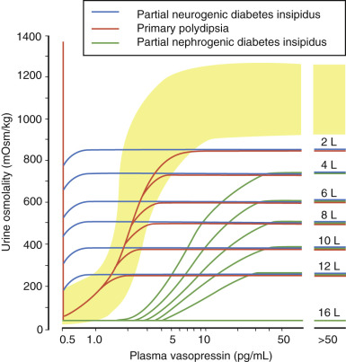

Figure 24-3 

The relationship between urine osmolality (Uosm) and plasma arginine vasopressin (AVP/ADH) in patients with polyuria of diverse causes and severity. 

Each of the three categories of polyuria is described by its own family of sigmoid curves of differing heights. Differences in height within a family reflect differences in maximum concentrating capacity caused by “washout” of the medullary concentration gradient. They are proportional to the severity of the polyuria (indicated in liters per day at the right end of each plateau). The normal response is depicted in yellow. The three categories of polyuria differ principally in the ascending portion of the dose-response curve. In patients with partial neurogenic diabetes insipidus (DI), the curve lies to the left of normal, reflecting increased sensitivity to the antidiuretic effects of very low concentrations of plasma ADH. In contrast, in patients with partial nephrogenic DI, the curve lies to the right of normal, reflecting decreased sensitivity to ADH. In primary polydipsia, the relationship of Uosm to ADH remains relatively normal. 

(Redrawn from Bichet DG: Diabetes insipidus and vasopressin. In Moore WT, Eastman RC, editors: _Diagnostic endocrinology,_ ed 2, St Louis, 1996, Mosby, p 158, with permission.) 

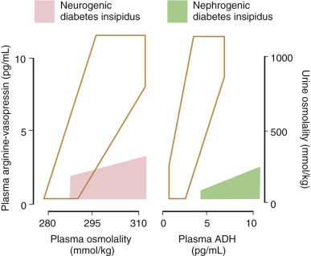

Figure 24-4 

_Left,_ Relationship between plasma arginine vasopressin (AVP/ADH) and plasma osmolality during the infusion of hypertonic saline. Patients with primary polydipsia and nephrogenic diabetes insipidus (DI) have values within the normal range _(open area),_ in contrast to patients with neurogenic DI, who show a subnormal plasma ADH response to a rise in osmolality _(pink). Right,_ Relationship between urine osmolality and plasma ADH during dehydration and water loading. Patients with primary polydipsia and neurogenic DI have values within the normal range _(open area),_ in contrast to patients with nephrogenic DI, who have hypotonic urine despite high plasma ADH _(green)._

(Redrawn from Bichet DG: Diabetes insipidus and vasopressin. In Moore TW, Eastman RC, editors: _Diagnostic endocrinology,_ ed 2, St Louis, 1996, Mosby, p 168, with permission.) 

Nephrogenic DI is either congenital or acquired. An X-linked receptor defect is the most common etiology for congenital nephrogenic DI; medications are the most common cause of acquired nephrogenic DI (  Holtzman & Ausiello, 1994  ). Medications known to be associated with acquired nephrogenic DI include lithium, demeclocycline, and methoxyflurane anesthetics. Other causes of acquired nephrogenic DI include hypercalcemia, hypokalemia, sickle cell disease, and postobstructive uropathy ( [ Box 24-4 ](<#b0025>) ). 

Box 24-4 

Causes of Diabetes Insipidus 

 

##  Central 

  * Primary 

  * Familial 

  * Idiopathic 

  * Acquired 

  * Tumors—craniopharyngioma, pituitary tumors, metastases (i.e., lung, breast), Rathke's cleft cyst, nonlymphocytic leukemia 

  * Granulomatous disorders—sarcoidosis, Langerhans' cell histiocytosis, Wegener's granulomatosis 

  * Traumatic—head trauma, surgery 

  * Infectious—tuberculosis, meningitis, encephalitis 

  * Vascular—cerebral aneurysm, sickle cell anemia, Sheehan's syndrome 

  * Drugs—alcohol, diphenylhydantoin, chlorpromazine, and β-adrenergic agonists 

  * Other—lymphocytic hypophysitis, hypoxic encephalopathy 

 

##  Nephrogenic 

  * Hereditary 

  * Mutation in the V2 receptor 

  * Mutation in the aquaporin gene 

  * Acquired 

  * Drugs—lithium, phenytoin, demeclocycline, vinblastine, cisplatin, propoxyphene, colchicine, gentamicin, amphotericin, ethanol, atrial natriuretic hormone, norepinephrine, methoxyflurane anesthetics, furosemide 

  * Electrolyte disorders—hypercalcemia, hypokalemia 

  * Systemic illnesses—sickle cell, multiple myeloma, amyloidosis, sarcoidosis, Sjögren's syndrome, polycystic kidney disease 

  * Other—low-protein diet, postobstructive uropathy 

Neurogenic DI may be congenital, the result of an autosomal dominant mutation in the ADH signal peptide or in the exons that code for neurophysins (  McLeod et al, 1993  ;  Yuasa et al, 1993  ). More commonly, neurogenic DI is induced by lesions affecting the hypothalamus, (metastatic tumors, trauma, granulomatous disorders) or medications. Drugs that may cause neurogenic DI by suppressing ADH release include phenytoin (Dilantin), chlorpromazine, and α-adrenergic agonists. It has been suspected that autoantibodies directed against the ADH-producing cells of the hypothalamus may be responsible for some cases of idiopathic neurogenic DI (  De Bellis et al  1994  ;  Maghnie et al, 2000  ). These antibodies are detectable by indirect immunofluorescence antibody. 

Another common condition in which decreased ADH levels have been found is primary nocturnal enuresis in children. Although these patients have ADH levels only slightly lower than controls (2.9 ng/L vs. 3.6 ng/L), the clinical symptoms are reliably ameliorated by vasopressin therapy (  Willie et al, 1994  ). The determination of ADH levels in diagnosing this condition is not always helpful because of moderate overlap between enuretic and normal children. Measuring the specific gravity in the first morning urine is more reliable for identifying children who may benefit from ADH supplementation; they will have a urine specific gravity below 1.015 (  Mevorach et al, 1995  ). 

 

##  Syndrome of Inappropriate Secretion of ADH 

The syndrome of inappropriate secretion of ADH (SIADH) is characterized by a euvolemic hypoosmolar hyponatremia, associated with hyperosmolar urine (the result of continued inappropriate natriuresis). By definition, SIADH cannot be diagnosed until nonosmotic stimuli for ADH secretion and other pathologies that interfere with free water clearance have been excluded (  Vistorina et al, 2002  ). Physiologic triggers of ADH secretion include nausea, pregnancy, hypoglycemia, intracranial hypertension, mechanical ventilation, and hypoxia. Hypothyroidism and glucocorticoid deficiency cause a decrease in free water clearance, leading to a dilutional hyponatremia. Mineralocorticoid deficiency can lead to hyponatremia caused by increased renal sodium loss. It is therefore extremely important to test for deficiencies of these axes and to institute appropriate hormonal replacement therapy before making a diagnosis of SIADH. Other confounding factors that can hamper the diagnosis of SIADH include renal disease, cardiac disease, and medications such as diuretics. In these situations, one can cautiously perform a water load test ( [ Table 24-4 ](<#t0025>) ). In the absence of medications or other conditions that may impair diuresis, failure to excrete 80% to 90% of the administered water load within 4 hours and to suppress the Uosm to <100 mOsm/kg is consistent with the diagnosis of SIADH. 

TABLE 24-4 

Water Load Test 

  * 1. Baseline: The patient must be euvolemic and have a serum Na  \+  between 125 and 150 mmol/L and Posm >275 mOsm/kg. 
  * 2. The patient is given 20 mL of water per kilogram of body weight (max = 1500 mL) to drink over 30 minutes. 
  * 3. With the patient maintained in the recumbent position, urine output is collected every hour for the next 5 hours. Record the volume and osmolality of each specimen. 

  
---  
**Interpretation**  
Normals  |  Excrete 80% to 90% of the administered water load within 4 hours, and suppress the Uosm to <100 mOsm/kg.   
SIADH  |  Failure to meet these criteria in the absence of medications or other conditions that may impair diuresis is consistent with the diagnosis of SIADH.   
  
_SIADH,_ Syndrome of inappropriate secretion of ADH. 

In the right clinical setting, the diagnosis of SIADH often can be confidently made on the basis of serum and urine electrolyte determinations alone. A spot urine Na  \+  less than 30 mmol/L can generally distinguish those with hyponatremia due to volume depletion from those with SIADH, in whom urine Na  \+  greater than 30 mmol/L (  Chung et al, 1987  ). In contrast, differentiating the patient with euvolemia and SIADH from the one with hypovolemia and concomitant renal salt wasting (e.g., salt-losing nephropathy, diuretic use) can be much more difficult. In addition to hyponatremia, both have a spot UNa  \+  greater than 30 mmol/L and a fractional excretion of Na  \+  greater than 1. The fractional excretion of sodium (FENa [%]) is calculated as follows: 

 U  [  Na  \+  ]  × P  [  Cr  ]  P  [  Na  \+  ]  × U  [  Cr  ]  × 100 

where _U_ [Na  \+  ] = urine sodium concentration; _P_ [Na  \+  ] = plasma sodium concentration; _U_ [Cr] = urine creatinine concentration; and _P_ [Cr] = plasma creatinine concentration. 

One way to distinguish between the two is to administer 1 L of 0.9% NaCl intravenously over 24 hours for 2 days. A rise in serum Na  \+  by more than 5 mmol/L is suggestive of hypovolemia. In SIADH, no change or an increase of less than 5 mmol/L occurs. Alternatively, fluid restriction to 600 to 800 mL/day for 2 to 3 days will lead to improvement in hyponatremia in SIADH but not in renal salt wasting (see [ Table 24-3 ](<#t0020>) ). 

The cause of renal salt wasting in SIADH is twofold. At the onset of the disease, there is volume expansion, which inhibits the renin-aldosterone axis and leads to greater improved delivery of sodium to the distal tubules. The continued sodium loss is due to secretion of atrial natriuretic protein (  Kamoi et al, 1990  ), which too is stimulated by increased intravascular volume. 

Because of hyperfiltration and the local actions of ADH on the renal V2 receptor, SIADH is one of the two states in which some of the lowest uric acid levels occur; the other is pregnancy. In SIADH, the serum levels of ADH may be variably increased, usually out of proportion to Posm; however, approximately 20% of cases meeting the physiologic diagnosis of SIADH will not have detectable levels of ADH (  Zerbe & Robertson, 1980  ). This may be due to insensitivity of the assay to low levels of ADH, increased renal sensitivity to ADH, or perhaps the presence of another hormone with antidiuretic activity (  Kamoi, 1997  ). 

The diagnosis of SIADH is largely a diagnosis of exclusion, with the clinician having ruled out other causes of hyponatremia ( [ Fig. 24-5 ](<#f0030>) ). It most often occurs as a manifestation of the paraneoplastic syndrome; however, it may also occur in central nervous system trauma or infection, in lung disease, or as the result of medications (vinca alkaloids, tricyclic antidepressants, selective serotonin reuptake inhibitors) ( [ Box 24-5 ](<#b0030>) ). 

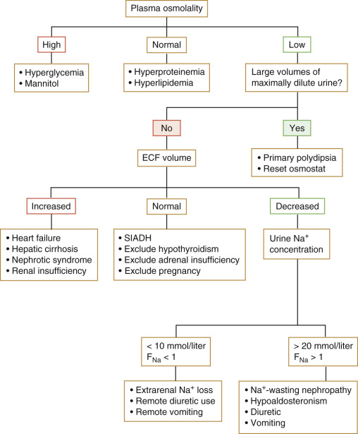

Figure 24-5 

Algorithm for the evaluation of hyponatremia. 

_ECF,_ Extracellular fluid; _SIADH,_ syndrome of inappropriate secretion of ADH. 

(From Singer GG: Fluid and electrolyte management. In Carey CF, Lee HH, Woeltje KF, editors: _The Washington manual of medical therapeutics,_ ed 29, Philadelphia, 1998, Lippincott-Raven, p 44, with permission.) 

Box 24-5 

Causes of SIADH 

  * CNS disease 

  * Neoplasm, infection, trauma, cerebrovascular accident 

  * Neoplasm 

  * Oat cell carcinoma and adenocarcinoma of the lung, pancreatic cancer, lymphoma 

  * Pulmonary infection 

  * TB, pneumonia, positive-pressure ventilation 

  * Idiopathic 

  * Medications 

    * •

Oral hypoglycemics—chlorpropamide, tolbutamide 

    * •

Antineoplastics—vincristine, cyclophosphamide 

    * •

Diuretics—hydrochlorothiazide 

    * •

Psychotropics—amitriptyline, phenothiazines, SSRIs, monoamine oxidase inhibitors 

    * •

Other—morphine, barbiturates, clofibrate, nicotine, acetylcholine, anesthetic agents, β-adrenergic stimulants, metoclopramide, desmopressin 

_CNS,_ Central nervous system; _SIADH,_ syndrome of inappropriate secretion of ADH; _SSRIs,_ selective serotonin reuptake inhibitors. 

,  

##  Thyroid Function 

The normal thyroid gland weighs about 15 to 25 g. It consists of two lobes connected in the middle with a narrow isthmus. It is divided into lobules, each of which is composed of 20 to 40 follicles separated by highly vascular connective tissue. The follicles are ring-shaped structures, in which a single cell band of follicular cells surrounds a closed cavity containing colloid, thyroid hormone, thyroglobulin (Tg), and a variety of other glycoproteins. The follicular cells rest on a basement membrane that is rich in glycoprotein that separates the cells from surrounding capillaries. The apex of the follicular cells has microvilli that extend into the colloid, where iodination, exocytosis, and the initial phase of hormone secretion occur. The follicles are sites of thyroid hormone synthesis and storage. The thyroid gland also contains parafollicular cells, or C cells, which are responsible for the synthesis and secretion of calcitonin, a hormone important in calcium metabolism. 

An intact hypothalamic-pituitary-thyroid (HPT) axis and a ready source of iodide are required for normal thyroid hormone synthesis. The hypothalamus secretes TRH, which, in turn, stimulates the thyrotrophs of the anterior pituitary gland to secrete TSH (thyrotropin). As implied by the name, TSH stimulates thyroid hormone synthesis and secretion by the thyroid gland. Thyroid hormone exerts negative feedback on both the hypothalamus and the pituitary gland to maintain a TSH concentration within narrow limits; it also acts peripherally to mediate numerous metabolic activities. 

Under TSH stimulation, iodine enters the follicular cells as inorganic iodide and is transformed into thyroid hormones, thyroxine (T  4  ), and 3,5,3′-triiodothyronine (T  3  ) through a series of metabolic steps. The sequence of events as depicted in [ Figure 24-6 ](<#f0035>) can be broken down into (1) active transport of iodide into the cell; (2) iodination of the tyrosyl residues on Tg; (3) coupling of iodotyrosine molecules within Tg to form T  4  and T  3  ; (4) proteolysis of Tg with release of free iodotyrosine, T  4  , and T  3  , and secretion of iodothyronine into the circulation; (5) deiodination of iodotyrosines within the thyroid and reuse of liberated iodide; and (6) deiodination of T  4  to T  3  . 

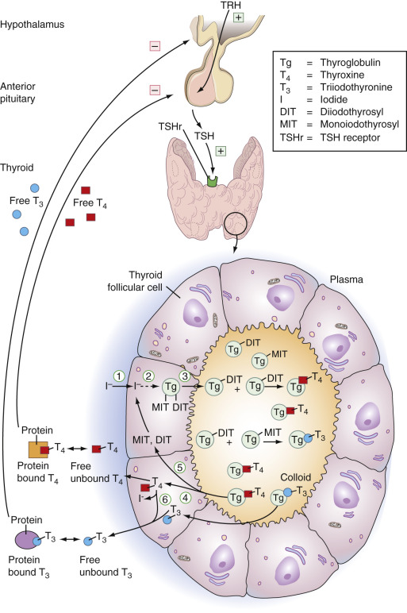

Figure 24-6 

Hypothalamic-pituitary-thyroid axis and thyroid hormone synthesis. 

The steps for thyroid hormone synthesis and release are described in further detail in the text. _TRH,_ Thyrotropin-releasing hormone; _TSH,_ thyroid-stimulating hormone. 

One hundred percent of circulating T  4  is of thyroidal origin, whereas only 20% of T  3  is of thyroidal origin; 80% is produced enzymatically in nonthyroidal tissues by 5′-monodeiodination of T  4  (  Lum & Nicoloff, 1984  ). Approximately 110 nmol (85 µg) of T  4  and 10 nmol (8.5 µg) of T  3  are produced daily by the thyroid gland. The thyroid hormones circulate while attached to plasma proteins. About 70% of T  4  is bound to thyroxine-binding globulin (TBG), 20% to transthyretin (formerly called thyroxine- **binding prealbumin** ), and 10% to albumin. Although most of the circulating T  3  is bound to TBG; it does so with a 10-fold reduced affinity as compared with that of T  4  (  Robbins, 1996  ;  Braverman & Utiger, 2000  ). Small percentages of T  4  and T  3  remain unbound to protein—about 0.03% and 0.3%, respectively. As with other hormones, it is the free component that is metabolically active. 

Thyroid disease may be classified functionally into hyperthyroidism, hypothyroidism, and euthyroidism. Signs and symptoms of hyperthyroidism include heat intolerance, tachycardia, weight loss, weakness, emotional lability, and tremor. The most common clinical syndrome associated with hyperthyroidism is Graves' disease, caused by circulating antibodies to the TSH receptor. Other disorders that lead to hyperthyroidism include toxic adenoma and, rarely, TSH-secreting pituitary tumors and thyroid carcinoma. 

Hypothyroidism results in hoarseness, cold sensitivity, dry skin, constipation, bradycardia, and muscle weakness. Myxedema coma is an advanced stage of thyroid hormone deficiency characterized by progressive stupor, hypothermia, and hypoventilation. Failure of the thyroid gland itself to secrete an adequate amount of thyroid hormone is called **primary hypothyroidism** and is most commonly iatrogenic in origin, the result of either ablation with radioactive iodine or surgery to treat hyperthyroidism or after radiation to the head and neck for malignancy. Central hypothyroidism occurs when TSH secretion is decreased as a result of a pituitary disorder. Tertiary hypothyroidism is the result of hypothalamic dysfunction. 

Thyroid diseases such as goiter, thyroid adenoma, and thyroid carcinoma typically occur in individuals who are euthyroid (clinically and biochemically). Accurate TSH assays permit the diagnosis of subclinical hyperthyroidism and hypothyroidism. These patients appear clinically euthyroid; however, their TSH values are, respectively, suppressed or elevated. A number of clinical situations can lead to difficulties in the interpretation of thyroid function tests: The presence of abnormal protein–binding proteins (congenital or drug induced); alterations in thyroid hormone metabolism as seen in those hospitalized with acute psychiatric illness; alterations in thyroid hormone metabolism as seen in those on medications that affect thyroid hormone binding or the HPT axis directly. The most important and most common problem with thyroid function tests probably occurs in those patients with various illnesses that do not directly involve the thyroid gland, so-called **nonthyroidal illness.**

 

##  Thyroid Hormone Synthesis and Metabolism 

Iodine is a major component of thyroid hormone; the main source of iodine is dietary intake. Deiodination of organic iodine-containing moieties within the gland serves as another source. Inorganic iodide is transported into the follicular cell by the sodium-iodide symporter (NIS) located in the basolateral membrane (  Chambard et al, 1983  ). TSH modulates NIS activity: An increase in TSH secretion augments the uptake of iodide into the follicular cell. Iodide transport into the thyroid gland is also influenced by the serum iodide level; iodide deficiency increases pump activity, and iodide excess inhibits iodide uptake. 

Thyroglobulin is a glycoprotein synthesized by the rough endoplasmic reticulum in the basal and perinuclear regions of the follicular cell. It is acted upon by the Golgi apparatus in the apical portion of the follicular cell, where its tyrosyl residues are iodinated, leading to the formation of monoiodotyrosyls and diiodotyrosyls (MITs and DITs). Tg is then transferred into the colloid for storage (  Vassart & Dumont, 1973  ;  Roth et al, 1985  ). This transformation of thyroglobulin into thyroid hormone requires two separate oxidative reactions, both catalyzed by thyroid peroxidase (TPO): the binding of iodide to Tg tyrosyl residues to form the iodotyrosyls MIT and DIT, and the subsequent coupling of MIT and DIT to produce T  4  and T  3  (  Deme et al, 1976  ;  Bjorkman et al, 1981  ). T  4  is formed by the coupling of two molecules of DIT; T  3  results from the union of one MIT and one DIT. T  4  and T  3  are released from Tg via lysosomal degradation. They are then secreted into the circulation at the basal membrane. All of these reactions are under the control of TSH. 

About half of all T  4  is monodeiodinated in the 5′ position to form T  3  , and about 40% undergoes deiodination of the inner ring of T  4  to form reverse T  3  (rT  3  ). The formation of rT  3  , the third major circulating form of thyroid hormone, is catalyzed by the enzyme 5-deiodinase. Reverse T  3  has no biological activity, has a short half-life of 4 hours, and circulates bound to TBG; its formation is considered a disposal pathway in the peripheral metabolism of T  4  (  LoPresti et al, 1989  ). 

The intake of iodide influences the DIT/MIT ratio in Tg. DIT is the preferential iodotyrosine formed; thus, when iodide is abundant, T  4  is the predominant form of hormone synthesized and secreted, but when iodide sources are diminished, MIT is produced in greater quantities, leading to increased T  3  formation and release. In addition, the thyroid gland has a 5′-deiodinase that converts T  4  to T  3  . This process is under the control of TSH, so that T  3  secretion is enhanced during periods of TSH stimulation (i.e., primary hypothyroidism and cases with TSH-stimulating immunoglobulin [TSI]) (  Ishii et al, 1983  ). 

The monodeiodination of T  4  to T  3  and rT  3  accounts for 70% of the peripheral metabolism of T  4  (  LoPresti et al, 1989  ); the remainder of T  4  metabolism occurs by conjugation of T  4  to sulfate, deamination, and decarboxylation to form the acetic acid analog tetrac, and by ether link cleavage (  Engler & Burger, 1984  ) ( [ Table 24-5 ](<#t0030>) ). T  3  but not rT  3  can be conjugated with sulfate to form T  3  -sulfate and can be converted to its acetic acid analog, triac (  Engler & Burger, 1984  ). The enzymes responsible for these reactions are the phenolsulfotransferases, which are present in many tissues throughout the body, and the  l  -aminotransferase, located in the liver, respectively (  Engler & Burger, 1984  ). After their formation from T  4  , both T  3  and rT  3  undergo deiodination to form 3,3′-diiodothyronine (T  2  ). 

TABLE 24-5 

Metabolic Dynamics of T  4  and T  3 

|  T  4  |  T  3   
---|---|---  
Production rate, nmol/day  |  110  |  50   
Fraction of circulating hormone of thyroid origin  |  100%  |  20% [ * ](<#hl0000486>)  
Serum concentration  |  |   
Total, nmol/L  |  100  |  1.8   
Free, pmol/L  |  20  |  5   
Fraction of total hormone in free form  |  0.0002  |  0.003   
Half-life, days  |  ≈7  |  0.75   
Relative metabolic potency  |  0.3  |  1.0   
  
T  3  , 3,5,3′-triiodothyronine; T  4  , thyroxine. 

From Larsen PR, Davies TF, Schlumberger MJ, et al: Thyroid physiology and diagnostic evaluation of patients with thyroid disorders. In Larsen PR, Kronenberg HM, Melmed S, et al, editors: _Williams textbook of endocrinology,_ ed 10, Philadelphia, 2003, Saunders, p 342. 

 * 80% of circulating T  3  comes from the peripheral deiodination of T  4  . To convert total T  4  from nmol/L to µg/dL, or free T  4  from pmol/L to ng/dL, divide by 12.87. To convert total T  3  from nmol/L to ng/dL, or free T  3  from pmol/L to pg/dL, multiply by 65.1. 

Protein-bound thyroid hormones do not enter cells, are considered to be biologically inert, and function as storage reservoirs for circulating thyroid hormones. In contrast, the minute levels of free hormone fractions readily enter cells by specific membrane transport mechanisms to exert their biological effects. These effects are mediated by T  3  receptors located in the nucleus of the cell. 

Four isoforms of the T  3  receptors have been described: α 1  , α 2  , β 1  , and β 2  (  Brent et al, 1991  ). α 1  and β 1  receptors are present in most tissues. Binding of T  3  to them promotes thyroid hormone action, presumably by increasing mRNA and protein synthesis. The β 2  receptor is unique to the pituitary gland and is central in the negative-feedback regulation of TSH by thyroid hormone. The α 2  receptor is inhibitory and acts as a negative regulator of thyroid hormone action. 

Mutations in the β receptors, which diminish the ability of T  3  to bind to the nucleus, have been described in the syndrome of thyroid hormone resistance. Individuals with this syndrome have growth and mental retardation of varying degrees, as well as hypothyroidism (  Refetoff, 1991  ). 

 

##  Hypothalamic-Pituitary-Thyroid Axis 

The physiologic regulators responsible for integrating the function of the thyroid gland and the periphery include the hypothalamic hormone, TRH; the pituitary hormone, TSH; and the serum free T  4  and free T  3  concentrations. TRH enhances TSH synthesis, stimulates the secretion of any preformed TSH from the thyrotrophs, and modulates the bioactivity of TSH, resulting in the secretion of bioactive TSH (  Beck-Peccos et al, 1985  ;  Shupnik et al, 1986  ). TRH itself is under the negative-feedback influence of circulating thyroid hormones (TRH mRNA levels are inversely related to the circulating T  3  values) (  Kakucska et al, 1992  ). The same feedback inhibition occurs at the level of the thyrotrophs. 

 

##  Thyrotropin-Releasing Hormone 

TRH is a modified tripeptide (pyroglutamyl-histidyl-proline-amide) derived from a large prepro-TRH molecule. The TRH molecule is released from the prepro molecule by a peptidase (  Yamada et al, 1990  ). TRH is found in the hypothalamus, the brain, the C cells of the thyroid gland, the β cells of the pancreas, the myocardium, and the prostate and testis, as well as in the spinal cord. The neuron bodies producing TRH are innervated by catecholamine, leptin, and somatostatin-containing axons; all these hormones can influence the rate of its synthesis. 

Thyroid hormones regulate their own production by feedback inhibition to synthesis of TRH and TSH in the hypothalamus and pituitary gland, respectively. TRH acts also on the production of other pituitary hormones, especially prolactin. Leptin plays a significant role in the regulation of the TRH gene (  Bjorbeck & Kahn, 2004  ), affecting the individual's appetite for food intake. It is difficult to develop a specific antibody for TRH, and assays are not clinically useful. 

 

##  Thyroid-Stimulating Hormone 

TSH is a glycoprotein consisting of two monocovalently linked α and β subunits. The α subunit has the same amino acid sequences as LH, FSH, and human chorionic gonadotropin (hCG). It is the β subunit that carries specific information to the binding receptors for expression of hormonal activities. 

The radioimmunoassay for measuring TSH was first developed by  Odell and colleagues in 1965  . This **first-generation assay** did not have sufficient sensitivity to distinguish normal TSH levels from the suppressed levels seen in primary hyperthyroidism. By the mid 1980s, a “sensitive” or second-generation immunometric TSH method using monoclonal or polyclonal antibodies was developed, which had an improved sensitivity to 0.1 to 0.2 mU/L. Refinements in the immunometric method led to the third-generation assays now in common use, which allow measurement down to about 0.005 mU/L. Although a fourth-generation TSH assay has recently been developed with a sensitivity of 0.0004 mU/L, it is not widely available, and the third-generation assays provide sufficient sensitivity for the vast majority of clinical applications. The American Thyroid Association (ATA) recommendations state that third-generation assays should be able to quantitate TSH in the 0.010 to 0.020-mU/L range on an interassay basis with a coefficient of variation of 20% or less. In reporting assay results, the ATA recommends using functional sensitivity, defined as the point at which the interassay precision has a coefficient of variation equal to or less than 20% (  Spencer et al, 1996  ). 

Owing to improvements in the sensitivity of the TSH assay, this test alone can identify virtually all instances of hyperthyroidism and hypothyroidism, except when there is damage to the hypothalamus or pituitary gland, thyroid hormone resistance, or interference with normal functioning of the HPT axis due to medication. TSH results within the reference interval usually exclude thyroid dysfunction and help distinguish the profound TSH suppression typical of frank Graves' thyrotoxicosis (TSH <0.01 mIU/L) from the modest degrees of TSH suppression (0.01 to 0.1 mIU/L) observed with mild (subclinical) primary hyperthyroidism and some cases of nonthyroidal illness. Of note, as assay sensitivity has improved, the normal range has not changed, remaining between approximately 0.5 and 5.0 mIU/L in most laboratories. However, the serum TSH concentration detected in patients with severe thyrotoxicosis has been lower with each successive improvement in the TSH assays: Using a fourth-generation assay, the serum TSH is less than 0.004 mIU/L in patients with severe hyperthyroidism. Hyperthyroid patients have suppressed TSH values, with the exception of those few individuals who have hyperthyroidism caused by a TSH-producing tumor or other diseases such as pituitary resistance to thyroid hormone. Subclinical hyperthyroidism is defined by the presence of a low TSH with normal levels of T  4  and T  3  ( [ Table 24-6 ](<#t0035>) ). 

TABLE 24-6 

Characterization of Thyroid Disorders According to Results of Thyroid Function Tests 

Disorder  |  TSH  |  T  4  |  T  3  |  FT  4  |  Tg  |  TBG  |  rT  3  |  aTPO  |  ATG  |  TBII  |  TSI  |  TBA   
---|---|---|---|---|---|---|---|---|---|---|---|---  
Primary hypothyroidism  |  ↑ |  ↓ |  N or ↓ |  ↓ |  N or ↓ |  N  |  ↓ |  N or ↑ |  N or ↑ |  N or ↑ |  n  |  n or ↑  
Transient neonatal hypothyroidism  |  ↑ |  ↓ |  ↓ |  ↓ |  N or ↓ |  N  |  ↓ |  N  |  N  |  ↑ |  n  |  ↑  
Hashimoto's thyroiditis/hypothyroidism  |  ↑ |  N or ↓ |  N or ↓ |  N or ↓ |  N or ↓ |  N  |  ↓ |  ↑ |  ↑ |  n or ↑ |  n  |  n or ↑  
Graves' disease  |  ↓ |  ↑ |  ↑ |  ↑ |  ↑ |  N  |  ↑ |  ↑ |  ↑ |  ↑ |  ↑ |  n or ↑  
Neonatal Graves' disease  |  ↓ |  ↑ |  ↑ |  ↑ |  ↑ |  N  |  ↑ |  n or ↑ |  n or ↑ |  ↑ |  ↑ |  n or ↑  
TSH deficiency  |  N or ↓ |  ↓ |  ↓ |  ↓ |  ↓ |  N  |  ↓ |  n  |  n  |  N  |  n  |  n   
Thyroid dyshormonogenesis  |  ↑ |  ↓ |  ↓ |  ↓ |  N, ↓ or ↑ |  N  |  ↑ |  n  |  n  |  N  |  n  |  n   
Thyroid hormone resistance  |  N or ↑ |  ↑ |  ↑ |  ↑ |  ↑ |  N  |  ↑ |  n  |  n  |  N  |  n  |  n   
TSH-dependent hyperthyroidism  |  ↑ |  ↑ |  ↑ |  ↑ |  ↑ |  N  |  ↑ |  n  |  n  |  n  |  n  |  n   
T  4  protein-binding abnormalities [ * ](<#hl0000729>) |  N  |  V  |  V  |  N  |  N  |  V+  |  V  |  n  |  n  |  N  |  n  |  n   
Nonthyroidal illness  |  V  |  N or ↓ |  ↓ |  V  |  N  |  N  |  N or ↑ |  n  |  n  |  N  |  n  |  n   
Subacute thyroiditis [ † ](<#hl0000732>) |  ↓ or ↑ |  ↑ or ↓ |  ↑ or ↓ |  ↑ or ↓ |  ↑ or ↓ |  N  |  ↑ or ↓ |  n  |  n  |  N  |  n  |  n   
  
_ATG_ , Antithyroglobulin; _aTPO_ , anti-thyroid peroxidase; _FT 4  _ , free thyroxine; _N_ , normal; _n_ , negative; _rT 3  _ , reverse triiodothyronine; _TBA_ , TSH receptor–blocking antibody; _TBII_ , TSH-binding inhibiting immunoglobulin; _T g  _ , thyroglobulin; _T 3  _ , triiodothyronine; _T 4  _ , thyroxine; _TBG_ , thyroxine-binding globulin; _TSH_ , thyroid-stimulating hormone; _TSI_ , thyroid-stimulating immunoglobulin; _V_ , variable. 

From Fisher DA, editor: _Disorders of thyroid function,_ online version of the Quest diagnostic manual. ed 3, p 268. 

 * The spectrum of binding protein abnormalities includes increased or decreased TBG binding, increased or decreased transthyretin binding, and ↑ albumin binding. 

 † Subacute thyroiditis involves a transient period of hyperthyroidism followed by a transient hypothyroid state. 

In most individuals with hypothyroidism, serum TSH results are clearly elevated, but results may be inappropriately normal for the levels of T  4  and T  3  in those with pituitary or hypothalamic disorders. The term _subclinical hypothyroidism_ is used to describe patients with elevated TSH concentration but with normal levels of T  4  , T  3  , and FT  4  . An important cause of both increased and decreased TSH results is nonthyroidal illness (NTI). Patients with NTI tend to have low TSH results during their acute illness, and then TSH rises to within or above the reference range with resolution of the underlying illness, ultimately returning to normal once the acute illness has resolved. The situation is complicated because medications, including glucagons, opioids, glucocorticoids, and dopamine, suppress TSH. The sensitive TSH assays are helpful in evaluation of thyroid hormone treatment for both replacement therapy and suppressive therapy. 

Despite the clinical sensitivity of TSH, a TSH-centered strategy has two primary limitations. First, it assumes that hypothalamic-pituitary function is intact and normal. Second, it assumes that the patient is stable (i.e., the patient had no recent therapy for hyperthyroidism or hypothyroidism) (  Wardle et al, 2001  ). If either of these criteria is not met, the serum TSH result can be misleading (see [ Table 24-6 ](<#t0035>) ). In these instances, to confirm the presence of thyroid dysfunction, in addition to measuring TSH, measurement of FT  4  with or without total T  4  may prove helpful. Serum Free T  3  and serum TSH measurements are appropriate in patients suspected of hyperthyroidism, as they may have overproduction of T  3  with a normal to low-normal T  4  **(T 3  thyrotoxicosis). **

 

##  Thyroxine 

After release from its thyroid follicles, thyroxine will bind to various proteins in the blood (thyroid-binding globulin, albumin, thyretin). Thyroxine can be measured by immunoassay after the hormone is separated from the carrier protein. The reference range is 5 to 12.5 µg/dL in adults, with slightly lower results for certain pediatric age groups. Although TSH is the most important test of thyroid function, thyroxine measurements are often used along with TSH and can be important in interpreting TSH results. The combination of a low T  4  and an increased TSH is indicative of primary hypothyroidism, whereas elevated T  4  and T  3  combined with decreased TSH are characteristic of primary hyperthyroidism. Hyperthyroidism, however, has been reported in patients with an elevated serum T  4  but with serum T  3  levels within the reference range or low. This so-called **T 4  thyrotoxicosis ** can occur in patients with iodine-induced thyrotoxicosis; in patients on beta blockers, amiodarone, or large doses of steroids; and in thyrotoxic patients with NTI. A suppressed TSH level associated with a normal to low-normal T  4  and a high T  3  characterizes T  3  thyrotoxicosis. This is more common in a toxic nodule (see [ Table 24-6 ](<#t0035>) ). 

Severe nonthyroidal illness is associated with low T  4  and low T  3  ; this so-called **low T 4  and T  3  syndrome ** (an adaptive response to reduce metabolic demands and conserve protein stores) (  LoPresti & Nicoloff, 1995  ) is associated with a poor prognosis (  Chopra, 1997  ). It is thought to arise from a maladjusted central inhibition of TRH (  Van den Berghe et al, 1998  ;  Van den Berghe 2000  ) ( [ Fig. 24-7 ](<#f0040>) ). 

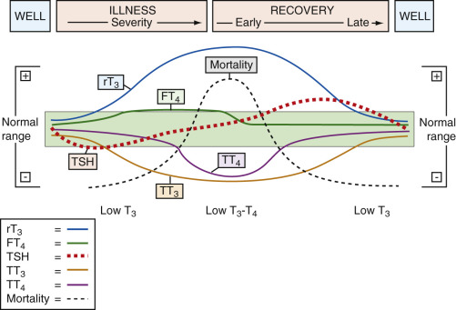

Figure 24-7 

Changes in thyroid hormones during severe illness. 

_FT 4  _ , Free thyroxine; _rT_ 3  , reverse triiodothyronine; _TSH,_ thyroid-stimulating hormone; _TT_ 3  , total triiodothyronine; _TT_ 4  , total thyroxine. 

(Redrawn from Demers LM, Spencer CA: _NACB: laboratory support for the diagnosis and monitoring of thyroid disease,_ 2003, p 11, with permission. Available at: [ www.nacb.org ](<http://www.nacb.org>) .) 

Euthyroid hyperthyroxinemia is distinguished by the presence of an increased serum T  4  level in association with a normal TSH in an otherwise euthyroid individual. This entity has a variety of causes, including increased binding proteins as may be seen with certain drugs (e.g., estrogen) or medical conditions (e.g., liver disease). It is also seen in patients who are acutely hospitalized for psychiatric illness and in patients with familial dysalbuminemia. When medications or other factors cause increased protein binding, there is a consequent increase in the serum total T  4  level; conversely, a decrease in binding capacity leads to a decrease in serum total T  4  . These perturbations do not have any physiologic effect, as it is the free hormone, not the protein-bound component, that is bioactive. In these situations, free T  4  correlates better with thyroid functional status than does serum total T  4  . 

The so-called **T 3  uptake (T  3  -UP) test ** is a classical method of adjusting a total T  4  measurement for alterations in binding protein. A T  3  -UP result is a relative measurement of the unoccupied binding sites of all circulating proteins. It was originally performed by saturating available binding sites with radiolabeled T  3  , and then measuring the unbound T  3  by adsorbing it onto a resin (hence the term **T 3  resin uptake ** ). Methods giving analogous results can still be performed via nonisotopic methods on automated analyzers. The free thyroxine index (FTI) is then calculated as (T  3  -UP of the patient)/(mean T  3  -UP of the reference population) multiplied by the patient's total T  4  . The FTI (reference range, 5.4 to 9.7) is only a relative estimate of the free T  4  concentration. In general, during thyrotoxicosis, both total T  4  and T  3  -UP are elevated; conversely, in hypothyroidism, both total T  4  and T  3  -UP are decreased, and when there is a binding globulin abnormality, these two values diverge (e.g., total T  4  is elevated and the T  3  -UP is decreased, or the total T  4  is decreased and the T  3  -UP is increased). The FTI has been largely replaced by the direct measurement of free T  4  by immunoassay, dialysis, or ultrafiltration. 

 

##  Free Thyroxine 

FT  4  is the biologically active fraction of thyroxine in circulating blood. In the past 10 to 15 years, direct measurement of FT  4  has increased in sensitivity and precision. The traditional reference method for FT  4  is equilibrium dialysis, a method that is not affected by changes in binding protein concentration. The sample is dialyzed against a nonprotein buffer, using a membrane impermeable to proteins, so that FT  4  will achieve equal concentrations on both sides of the membrane. Because bound T  4  vastly exceeds FT  4  in the plasma, their ratio is essentially unperturbed by this process. The protein-free solution is then collected and analyzed for T  4  . This is a time-consuming method that cannot meet the high-volume demand of clinical laboratories. Even this laborious method does not give a true measure of FT  4  in all cases, because small molecules that may affect T  4  binding are diluted in the procedure. Theoretically more accurate are ultrafiltration (using pressure to push the plasma sample through a dialysis membrane) and **symmetrical dialysis** (where plasma is dialyzed against itself, using a radioactive tracer added on one side to measure the rate of diffusion of FT  4  , which is proportional to its concentration). Mass spectrometry is well suited to measurement of thyroid hormone (  De Brabandere et al, 1998  ), and a method using ultrafiltration followed by tandem mass spectrometry to simultaneously measure FT  4  and FT  3  has recently been published (  Gu et al, 2007  ). 

In common practice, FT  4  is usually measured by immunoassay techniques, which have employed different approaches over the years (  Spencer, 1986  ;  Hay et al, 1991  ). These methods can be performed on automated clinical chemistry platforms and provide appropriate results in most clinical circumstances. However, depending on the exact method, they can be unreliable in various circumstances and must be used with caution. For example, spurious results can occur with abnormal variants of any of the binding proteins (particularly familial dysalbuminemic hyperthyroxinemia, a condition with high T  4  but normal FT  4  , caused by an albumin variant that binds T  4  abnormally) or in the presence of T  4  or T  3  autoantibodies (  Langsteger, 1997  ). Increases or decreases in serum FT  4  without concomitant changes in metabolic state have been reported in pregnancy with NTI, and in patients being treated with certain drugs. For example, prolonged administration of phenytoin or carbamazepine results in a 15% to 30% decrease in both serum T  4  and FT  4  . In these circumstances, dialysis or ultrafiltration methods are indicated. 

FT  4  can also be determined using mass spectroscopy, after the FT  4  is separated from the protein-hormone complex using ultrafiltration at 37° C and avoiding dilution effects. 

 

##  Triiodothyronine 

T  3  , generally measured by immunoassay, has a reference interval typically in the range of 60 to 160 µg/dL (0.9 to 2.46 nmol/L). T  3  is much less bound to serum protein than T  4  ; thus a relatively greater proportion of T  3  than T  4  exists in the free, diffusible state. Serum total T  3  measurement is helpful in confirming the diagnosis of hyperthyroidism, especially in patients with no or minimally elevated T  4  or ambiguous clinical manifestation. In 90% of patients with hyperthyroidism, T  4  and T  3  values are increased, with the increase in T  3  usually greater than that in T  4  . Serum T  3  levels, however, can be in the reference range or low in patients with hyperthyroidism if there is coexistent NTI, or if patients are on drugs that decrease the conversion of T  4  to T  3  (e.g., propranolol, amiodarone). 

Hyperthyroidism with elevated serum T  3  but normal T  4  and free T  4  is termed _T 3  thyrotoxicosis _ (  Bitton & Wexler, 1990  ). Patients with this syndrome are a heterogeneous group with no distinctive signs or symptoms. Although most patients have Graves' disease, T  3  thyrotoxicosis may occur in patients with other causes of hyperthyroidism such as toxic nodular goiter or toxic adenoma. About 1% to 4% of thyrotoxic patients have T  3  thyrotoxicosis, except in regions of iodine deficiency, where it is more common. 

Elevated serum T  3  levels with normal T  4  levels may also be seen in patients with hyperthyroidism early in the course of treatment with antithyroid drugs or during relapse after treatment. Elevated TBG will cause elevated T  3  . 

Generally, the measurement of serum T  3  is not useful in evaluating patients suspected of having hypothyroidism because serum T  3  levels are within the reference interval in 15% to 30% of hypothyroid patients (  Surks et al, 1990  ). However, decreased T  3  levels are seen in patients who have severe hypothyroidism, that is, those with serum T  4  levels less than about 2 µg/dL (32 nmol/L) (  Bigos et al, 1978  ). Low serum T  3  may occur in patients with a wide variety of NTI. In patients with acute illness such as myocardial infarction, the decrease in serum T  3  occurs rapidly, declining to about 50% of the reference value within days (  Utiger, 1980  ). Serum T  3  concentrations are also low in cord blood, but increase rapidly during the first few hours of life. 

Patients receiving thyroid preparations containing T  3  such as desiccated thyroid and synthetic T  3  and T  4  combinations and those treated with T  3  will have uninterpretable serum T  3  results unless the time of hormone administration is known. Administration of T  3  (Ctyomel) results in a rapid rise in T  3  concentration that peaks within 2 to 4 hours and then begins to drop off. In contrast, the serum T  3  levels do not show a peak in patients treated daily with T  4  (levothyroxine); instead, stable levels of T  3  , which is derived from the peripheral conversion of T  4  , are reached after only a few weeks of therapy. A number of pharmacologic agents are associated with low levels of T  3  and free T  3  , and with normal or even high levels of serum T  4  and FT  4  . These include glucocorticoids, amiodarone, and large dosages of propranolol. These patients usually have normal TSH results; however, amiodarone can induce hyperthyroidism or hypothyroidism, in which case the TSH values will be suppressed or elevated, respectively. Total T  3  concentrations are measured by competitive immunoassay methods that are now mostly nonisotopic and use enzymes, fluorescence, or chemiluminescence molecules as signals (  Nelson & Wilcox, 1996  ). 

 

##  Reverse Triiodothyronine 

rT  3  , a major metabolite of thyroxine, is produced by 5-deiodination of T  4  . In many clinical situations, serum T  3  and serum rT  3  have been found to vary reciprocally, but serum rT  3  measurements have found little clinical usefulness. Serum rT  3  is high in patients with NTI, whose serum total T  3  is decreased. Serum rT  3  is increased in healthy newborns, in patients with hyperthyroidism (including factitious hyperthyroidism), and in patients taking certain drugs, including amiodarone and propranolol. 

 

##  Thyroglobulin 

Tg is synthesized and secreted by the follicles. It is present in the serum of normal individuals in the range of up to about 30 ng/mL (45 pmol/L). The serum Tg concentration reflects thyroid mass, thyroid injury, and TSH receptor stimulation (  Spencer & Wang, 1995  ). Tg is increased in a variety of disorders, including Graves' disease, thyroiditis, and nodular goiter. Patients with thyrotoxicosis factitia have undetectable levels of Tg in contrast to a high level found in patients with other causes of thyrotoxicosis. The routine measurement of Tg is never indicated. Its utility resides in the monitoring of recurrence of certain variants of thyroid cancer, in the diagnosis of thyroid dysgenesis in congenital hypothyroidism, and, as noted previously, in helping to distinguish subacute thyroiditis from thyrotoxicosis factitia. 

The main value of Tg measurement is to follow patients with thyroid malignancy postoperatively (  Ericsson et al, 1984  ). It is helpful in patients with well-differentiated thyroid carcinoma, but not in those who have undifferentiated tumors or medullary thyroid cancer. The clinical value of its measurement is limited by a number of technical problems, including the presence of antibodies, which are present in 20% of patients with thyroid carcinoma (  Spencer et al, 1999  ). These antibodies interfere with Tg measurement, causing overestimation or underestimation of serum Tg levels. Therefore, whenever Tg level is drawn to monitor recurrence/persistence of thyroid cancer, it is extremely important to obtain a simultaneous sample for Tg antibodies (TgAb). In patients with positive TgAb, polymerase chain reaction (PCR) methods (using serum) used to amplify the Tg mRNA may eliminate this problem. 

Recombinant human TSH (rhTSH) is commonly used to test patients with thyroid cancers for the presence of residual/recurrent disease. This is more practical, more convenient, and markedly less unpleasant for the patient than stopping thyroid hormone suppression over the span of several weeks to increase the TSH level; an elevated TSH is required for RAI (radioactive iodine) uptake to occur in any remaining remnant or recurrent tumor. Measurement of Tg 72 hours following the last dose of rhTSH correlates highly with the presence of recurrence, and some authorities support the use of this test alone without a concomitant whole-body iodine scan for those with “low-risk” tumors (<40 years of age, no distant metastases, size <1 cm, well differentiated). All other patients with thyroid cancer need to undergo whole-body scanning, in addition to measurement of TSH; concomitant use of both equals the sensitivity of scanning performed after thyroid hormone withdrawal, which is about 97%. Any rise in post-rhTSH serum Tg above 2 ng/mL in patients with thyroid cancer who have undergone remnant ablation and are on hormone suppressive therapy is suspicious for recurrence/persistence of disease and needs to be worked up accordingly (i.e., full restaging while hypothyroid off of suppressive therapy). 

Well-differentiated tumors typically display about a 10-fold increase in Tg in response to a high TSH (  Spencer et al, 1999  ). Poorly differentiated tumors that do not concentrate iodide may display a blunted response to TSH stimulation (  Schlumberger et al, 1980  ). In early weeks postthyroidectomy, serum Tg levels typically fall, with a half-life of 2 to 4 days. The pattern of change in serum Tg values on T  4  treatment is a better indicator of a change in tumor burden than any single serum Tg value (  Spencer & Wang, 1995  ). Because of interassay variability, it is extremely important to use the same laboratory (TSH assay) for monitoring. 

 

##  Thyroxine-Binding Globulin 

TBG is the main serum carrier protein for both T  4  and T  3  . Measurement of TBG may be helpful in patients who have serum T  4  and T  3  levels that do not agree with other laboratory parameters of thyroid function, or that are not compatible with clinical findings. TBG, which is measured by immunoassay, is in the range of 13 to 39 µg/dL (150 to 360 nmol/L) in healthy individuals. Inherited abnormalities in TBG include complete and partial deficiency, as well as TBG variants with decreased affinity for T  4  or T  3  , and TBG excess (  Langsteger, 1997  ). Among the acquired causes of abnormalities in the TBG concentration are a variety of medications and medical conditions ( [ Table 24-7 ](<#t0040>) ). Medications such as salicylates, phenytoin, penicillin, and heparin can displace T  4  from binding to TBG. 

TABLE 24-7 

Some Causes of Alterations in Thyroxine-Binding Globulin 

Increases  |  Decreases   
---|---  
Drugs  |  Drugs   
Clofibrate  |  Androgens   
Estrogens, oral contraceptives  |  Glucocorticoids   
5-Fluorouracil  |  Genetic   
Heroin  |  Complete deficiency   
Methadone  |  Partial deficiency   
Genetic  |  Liver failure   
Acute or chronic active hepatitis  |  Malnutrition   
Pregnancy  |  Nephrotic syndrome   
Idiopathic  |  Idiopathic   
  
 

##  Thyroid Autoantibodies 

Autoimmune thyroid disease causes cellular damage and alters thyroid gland function. Cellular damage occurs when the autoantibodies or the sensitized T lymphocytes bind to thyroid cell membranes, causing cell lysis and inflammatory reactions. Three thyroid autoantigens are responsible for the autoimmune thyroid disorders: TPO, Tg, and the TSH receptor. TPO antibodies (TPOAb) are involved in the tissue destructive process associated with hypothyroidism in Hashimoto's and atrophic thyroiditis. Some studies suggest that TPOAb may be cytotoxic to the thyroid gland (  Chiovato et al, 1993  ;  Guo et al, 1997  ). TgAb, if present even in low concentrations in serum, can interfere with the anti-Tg antibody used in the immunoassay for Tg measurement. Thus, the TgAb concentration should be measured in all patients before Tg analysis. In iodide-deficient areas, serum TgAb measurement can be used to detect autoimmune thyroid disease in patients with a goiter and to monitor iodide therapy in endemic areas. 

TSH receptor antibodies (TRAbs) were previously known as thyroid-stimulating immunoglobulin or long-acting thyroid stimulators. TRAbs are classified as stimulating or blocking antibodies. Graves' disease (GD) is an autoimmune condition in which goiter and hyperthyroidism are induced by thyroid-stimulating antibodies that mimic the action of TSH. The target of the autoimmune response is the thyrotropin receptor. Although both stimulating and blocking antibodies are present in GD, the latter usually do not cause symptoms; however, in a few cases, they may lead to the development of hypothyroidism. TRAbs are positive in 85% of patients with GD. Measurement of TRAbs has been used to predict the outcome of Graves' patients treated with drug therapy; if the titer of the antibodies is low before therapy, patients have a better chance for remission after 6 to 12 months of therapy. 

Measurement of TRAbs has also been used to predict the risk for thyroid dysfunction in newborns of mothers with GD as a result of transplacental passage of maternal TRAb (  Heithorn et al, 1999  ;  Radetti et al, 1999  ). In these patients, assays that distinguish blocking from stimulating antibodies are important clinically (  Davies et al, 1998  ). 

Longitudinal studies suggest that TPOAb may be a risk factor for future thyroid dysfunction, including postpartum thyroiditis and autoimmune complications from treatment with amiodarone, interferon-α, and lithium (  Feldt-Rasmussen et al, 1994  ;  Johnson & Eegles, 1999  ;  Martino et al, 2001  ). 

 

##  Urinary Iodine Measurement 

Iodine is required for normal thyroid hormone production. Iodine measurements are used mainly to assess the dietary iodine intake of certain populations. This is of great importance in that iodine deficiency disorders affect 2.2 billion persons throughout the world, including the United States (  Delange, 1995  ;  Dunn, 1998  ). Because most of the ingested iodine is excreted in the urine, measurement of urinary iodine (UI) excretion provides an accurate estimate of dietary iodine intake (  Dunn, 1998  ). Suggested ranges for UI excretion are shown in [ Table 24-8 ](<#t0045>) . 

TABLE 24-8 

Urinary Iodine Excretion and Iodine Deficiency 

Urinary Iodine Excretion, µg/L  |  >100  |  50-99  |  20-49  |  <20   
---|---|---|---|---  
Degree of deficiency [ * ](<#hl0000811>) |  None  |  Mild  |  Moderate  |  Severe   
Goiter prevalence  |  <5%  |  5%-19.9%  |  2%-29.9%  |  >30%   
  
From Demers LM, Spencer CA, editors: _NACB: laboratory support for the diagnosis and monitoring of thyroid disease,_ 2003, p 75. Available at: [ www.nacb.org ](<http://www.nacb.org>) . 

 * IDD Newsletter, August 1999;15:33-48. 

 

##  Screening Programs for Detection of Neonatal Hypothyroidism 

The prevalence of hypothyroidism in newborns is estimated from 1 in 3000 to 1 in 5000. It is higher in certain ethnic groups and is increased in iodine-deficient regions worldwide. Early detection of hypothyroidism in the neonatal period is critical to eliminate the severe mental retardation associated with thyroid hormone deficiency. Measurement of T  4  and TSH is used for screening, which is performed using dry blood spots or cord serum. The detection rate depends on the tests used and the timing of specimen collection. Measurement of only T  4  carries a high false-positive rate, necessitating recall of a large number of infants for retesting. Causes of false-positive results include low T  4  levels, which occur in both premature infants and those with congenital absence of TBG. Screening with only T  4  may miss infants with compensated or partial thyroid insufficiency. Because about 15% of infants with primary thyroid disorders have compensated hypothyroidism (normal serum T  4  levels in association with elevated TSH), an elevated TSH is the most sensitive test for the diagnosis of congenital hypothyroidism. However, false-positive results are occasionally seen, for example, in premature or severely stressed infants. In addition, by screening with TSH alone, those infants with hypothalamic or pituitary disease will be missed. Very-low-birthweight infants should be retested at 2 and 4 to 6 weeks to detect late-onset transient hypothyroidism (  Frank et al, 1996  ). For newborns, if the initial TSH value is <10 mIU/L, no further action need be taken; if it lies in the 10- to 20-mIU/L range, then a repeat test needs to be performed in 2 to 6 weeks. Finally, if the initial blood spot TSH greater than 20 mIU/L, endocrinologic evaluation is necessary to make the diagnosis of hypothyroidism. 

 

##  Nonthyroidal Illness 

Seriously ill patients can have abnormal thyroid tests even without underlying thyroid pathology (  DeGroot & Major, 1992  ;  Kaptein, 1996  ). A rapid decline in both total and free T  3  typically develops in the setting of severe illness (e.g., myocardial infarction, sepsis) (  Piketty et al, 1996  ). As the severity of the illness increases, the serum total T  4  falls because of T  4  -binding protein disruption by inhibitors in the circulation (  Wartofsky & Burman, 1982  ;  Docter et al, 1993  ;  Wilcox et al, 1994  ). Patients with nonthyroidal illness (NTI) whose T  4  levels drop below 2 ng/dL carry an exceptionally poor prognosis. Alterations in thyroid function tests seen during NTI are termed _euthyroid sick syndrome_ or _low T 4  syndrome. _ [ Figure 24-7 ](<#f0040>) shows the spectrum of changes in the thyroid tests as they relate to the severity and the stage of the illness. Patients with NTI tend to have low or low-normal TSH and normal or low-normal T  4  but very low T  3  during their acute illness; then TSH rises to within normal or above normal with resolution of the underlying illness and finally returns to the normal range (  Faber et al, 1987  ). This situation can be complicated if certain drugs are used for this illness (e.g., glucagon, dopamine, and high doses of corticosteroids suppress TSH and can mask hypothyroid status during their use) (  Kaptein et al, 1980  ;  Skamene & Patel, 1984  ;  Brabant et al, 1989  ;  Samuels et al, 1990  ). 

In uremia, there is accumulation of indoleacetic acid, which interferes with thyroid hormone binding (  Iitaka et al, 1998  ). 

 

##  Physiologic Variables 

For practical purposes, variables such as age, gender, race, season, phase of menstrual cycle, cigarette smoking, exercise, fasting, and phlebotomy-induced stasis have minor effects on thyroid function tests in ambulatory adults (  Hollowell et al, 2002  ). Studies have suggested that each individual has a genetically determined FT  4  setpoint (  Meikle et al, 1988  ;  Andersen et al, 2002  ); the pituitary gland will sense any deviation from this setpoint and cause reciprocal change in TSH secretion. In the early stages of developing thyroid dysfunction, a serum TSH abnormality will precede the development of an abnormal FT  4  because TSH responds exponentially to subtle FT  4  changes, as shown in [ Figure 24-8 ](<#f0045>) . 

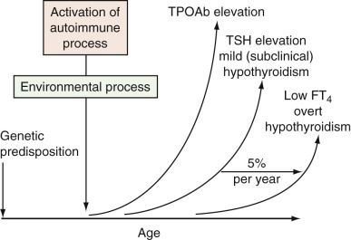

Figure 24-8 

Depiction of the evolution of primary hypothyroidism of autoimmune origin. 

_FT_ 4  , Free thyroxine; _TPOAb_ , thyroid peroxidase antibodies; _TSH,_ thyroid-stimulating hormone. 

(From Demers LM, Spencer CA: _NACB: laboratory support for the diagnosis and monitoring of thyroid disease,_ 2003, p 47. Available at: [ www.nacb.org ](<http://www.nacb.org>) .) 

Despite the wider serum TSH variability seen in older individuals, there appears to be no justification for using a widened or age-adjusted reference range. This conservative approach is justified by reports that mildly suppressed or elevated TSH is associated with increased cardiovascular morbidity and mortality (  Sawin et al, 1991  ;  Parle et al, 2001  ). In children, the hypothalamic-pituitary-thyroid axis undergoes progressive maturation and modulation; there is a continuous decline in the TSH/FT  4  ratio from the time of midgestation until after puberty (  Nilson et al, 1993  ;  Adams et al, 1995  ;  Lu et al, 1999  ;  Zurakowski et al, 1999  ;  Fisher et al  2000a  ); as a result, higher TSH concentrations are typically seen in children. 

During pregnancy, estrogen production increases, progressively elevating the TBG concentration and resulting in an increase in the total T  4  and T  3  reference range to approximately 1.5 times the nonpregnancy upper reference level by 16 weeks' gestation (  Weeke et al, 1982  ;  Pedersen et al, 1993  ;  Nohr et al, 2000  ). Although TBG excess leads to an increase in both T  4  and T  3  concentrations, the serum FT  4  and T  3  concentrations remain unchanged. 

Serum hCG, which has structural similarity to TSH, has weak thyroid-stimulating activity (  Talbot et al, 2001  ). The increase in hCG soon after fertilization results in a small increase in FT  4  and T  3  concentrations, usually within the normal reference range. These changes result in a fall in serum TSH during the first trimester; a subnormal serum TSH may be seen in about 20% of mothers who have normal pregnancies (  Glinoer et al, 1990  ;  Glinoer, 1997  ;  Panesar et al, 2001  ). The peak rise in hCG and the nadir of TSH occur together at about 10 to 12 weeks' gestation. In 2% of pregnancies, the increase in FT  4  reaches supranormal levels and, if prolonged, may lead to a syndrome referred to as _gestational transient thyrotoxicosis,_ which is characterized by more pronounced symptoms and signs of thyrotoxicosis. This condition is frequently associated with first-trimester hyperemesis gravidarum (  Goodwin et al, 1992  ;  Hershman, 1999  ). 

The ATA recommends a trimester-specific reference range for TSH: 

  * •

First trimester TSH: 0.1-2.5 miu/L 

  * •

Second trimester TSH: 0.2-2.5 miu/L 

  * •

Third trimester TSH: 0.3-3 miu/L 

The optimal method to assess serum FT  4  during pregnancy is measurement of T  4  in the dialysate or ultrafiltrate of the serum sample employing online extraction/liquid chromatography/tandem mass spectrometry (LC/MS/MS); if this method is not available, measurement of TSH is a much more accurate indication of thyroid status. 

Elevation of TSH during pregnancy could represent _subclinical_ hypothyroidism (If the FT  4  is normal but TSH is 2.5 to 10 miu/L) or _overt_ hypothyroid (if the TSH is >10 miu/L with low FT  4  or TSH 2.5 to 10 miu/L with low FT  4  ). 

All pregnant women with overt hypothyroid should be treated early to avoid complications. When treating hypothyroid pregnant women always use thyroxine, not T  3  or any other preparation. 

 

##  Medications and Thyroid Function Tests 

Drugs can cause both in vitro and in vivo effects on thyroid tests. This can lead to the misinterpretation of test results, inaccurate diagnoses, and further unnecessary tests (  Surks & Sievert, 1995  ;  Kailajarvi et al, 2000  ). Estrogen-induced TBG elevation causes abnormally high total T  4  and total T  3  , but has no effect on TSH or FT  4  and free T  3  . Glucocorticoids in large doses can suppress TSH and decrease the conversion of T  4  to T  3  (  Samuels & McDaniel, 1997  ;  Kaptein et al, 1980  ). Dopamine suppresses TSH and can temper the expected rise in TSH in hospitalized patients with primary hypothyroidism (  Kaptein et al, 1980  ). Propranolol suppresses the conversion of T  4  to T  3  (this is one of the reasons it is used in the treatment of thyrotoxicosis). 

Iodide, found in iodide-containing contrast media used in CT scans and coronary angiography or in solution to sterilize skin, and radiopaque dyes can cause both hyperthyroidism and hypothyroidism in susceptible patients (  Meurisse et al, 2000  ). Iodine-containing drugs such as amiodarone (used as an antiarrhythmic agent) have complex effects on thyroid function and can cause hypothyroidism (10% of patients) or hyperthyroidism (1% to 2%) in susceptible individuals with positive antibodies (TPOAb) (  Martino et al  1987  ;  Caron, 1995  ;  Harjai & Licata, 1997  ;  Daniels, 2001  ). 

Lithium inhibits thyroid hormone synthesis and release and can cause hypothyroidism in about 15% to 50% of patients, especially those patients with positive TPOAb (  Lazarus, 1998  ;  Kusalic & Engelsmann, 1999  ;  Oakley et al, 2000  ). The mechanism of lithium action is similar to that of iodide. Lithium is concentrated by the thyroid gland and inhibits thyroidal iodine uptake. It also inhibits iodotyrosine coupling, alters thyroglobulin structure, and inhibits thyroid hormone secretion. The latter effect is critical to the development of hypothyroidism and goiter (  Lazarus, 1998  ). 

Drugs such as phenytoin, carbamazepine, salicylate, salsalate, and furosemide competitively inhibit thyroid binding to serum proteins. They therefore can cause total T  4  levels to be depressed (because the FT  4  is maintained at its normal level), and they can cause the FT  4  estimated by FTI or direct assays to be artifactually low. Therapeutic doses of phenytoin can induce acceleration of T  4  disposal and perhaps can directly suppress TSH centrally, all of these mechanisms being responsible for the reduced T  4  (  Surks et al, 1995  ). Heparin can stimulate in vitro lipoprotein lipase and can liberate free fatty acids, which inhibit T  4  binding to serum proteins and falsely elevate FT  4  (  Mendel et al, 1987  ). 

Medications such as phenobarbital, phenytoin, rifampin, and carbamazepine increase the rate of thyroid hormone clearance by increasing the deiodination of T  4  and T  3  . Hypothyroid patients treated with any of these medications need to have their hormone levels monitored closely, as an increase in levothyroxine (  l  -T  4  ) dose may be required. In turn, changes in thyroid hormone status affect the clearance of many medications, including those listed previously (e.g., hyperthyroidism can lead to increased clearance of phenobarbital, hypothyroidism to decreased clearance). Owing to these various alterations in thyroid hormone parameters, the best indicator of thyroid status is the measurement of TSH along with FT  4  . For those with pituitary disease or in those on phenytoin, T  4  by equilibrium dialysis should be used. 

Somatostatin or its analog, octreotide, which is used to treat acromegaly (  Itoh et al, 1988  ), and dopamine (  Kaptein et al, 1980  ) inhibit TSH synthesis to undetectable levels in patients with severe NTI. 

 

##  Thyroid Illness 

Hyperthyroid patients may present with one or all of the following signs and symptoms: weight loss, sweating, heat intolerance, palpitations, insomnia, increased bowel movement, tremors, infertility, or amenorrhea. They have suppressed TSH values, with the exception of those few individuals who have secondary hyperthyroidism caused by TSH-producing pituitary tumors, or other rare disorders such as pituitary resistance to thyroid hormones. Subclinical hyperthyroidism is defined as low TSH (<0.1 µIU/mL) with levels of T  4  and T  3  within the reference values with no signs or symptoms of hyperthyroidism (  Ross, 1991  ). Detection of subclinical hyperthyroidism is particularly important in patients who are older than 60 years of age, as they have increased risk for atrial fibrillation, increased cardiovascular mortality (  Sawin et al, 1994  ), and osteoporosis. Minimal thyroid hormone excess can cause atrial fibrillation and can stimulate osteoclastic activity in bone, causing osteoporosis. 

Patients with primary hypothyroidism can present with one or all of the following signs and symptoms: cold intolerance, constipation, water retention, hypercholesterolemia, depression, pretibial myxedema, periorbital edema, and elevated TSH with low T  4  and T  3  . TSH is low in patients with secondary hypothyroidism caused by pituitary or hypothalamic disorders. Patients with subclinical hypothyroidism have elevated TSH levels (>4.5 µU/mL), but both T  4  and T  3  are within the reference range. In 2004, an expert panel recommended TSH reference limits of 0.4 to 4.5 µU/mL, and that patients with TSH in the range of 4.5 to 10 mU/L, or 0.1 to 0.4, should not be routinely treated (  Surks et al, 2004  ). The 2002 AACE guidelines (  American Association of Clinical Endocrinologists, 2002  ) recommend treatment of those with TSH greater than 10 µU/mL or those with goiter and positive TPOAb whose TSH is between 4.5 and 10 µU/mL. TPOAb measurement is useful for establishing the presence of autoimmunity; those with elevated antibodies have a greater probability of developing overt thyroid failure. 

 

##  Screening for Thyroid Disease 

The ATA guidelines recommend screening at 35 years of age and every 5 years thereafter (  Ladenson et al, 2000  ). This appears to be a cost-effective strategy, especially for women (  Parle et al, 2001  ) and older adults (  Vanderpump et al, 1995  ;  Ladenson et al, 2000  ;  Parle et al, 2001  ). Hashimoto's thyroiditis is an autoimmune disease of the thyroid gland caused when sensitized T lymphocytes and/or autoantibodies bind to cell membrane, causing cell lysis and an inflammatory reaction, resulting in cellular damage. This is associated with high TSH and positive TPOAb and is encountered with increasing prevalence with increasing age (  Vanderpump et al, 1995  ). The incidence of low TSH is also increased in older adults (  Vanderpump et al, 1995  ). 

Mounting evidence indicates that a persistent TSH abnormality may lead to major risks if left untreated. One study reported a higher cardiovascular mortality rate in patients with chronically low TSH (  Parle et al, 2001  ), and numerous reports indicate that mild hypothyroidism in early pregnancy increases fetal loss and impairs the IQ of offspring (  Pop et al  1995  ;  Haddow et al, 1999  ). It is important to always confirm any TSH abnormality in a fresh specimen drawn 3 weeks later before making the diagnosis of mild abnormalities. 

 

##  Uses of L-Thyroxine 

An average replacement dose is 1.6 µg/kg body weight/day for adults, up to 4.0 µg/kg body weight/day for children, and lower doses for older individuals (1.0 µg/kg body weight/day) (  Sawin et al, 1983  ;  Davis et al, 1984  ). The initial dose and the optimal time needed to establish the full replacement dose are dependent upon the age, weight, and cardiac status of each patient. The requirement might increase during pregnancy and in postmenopausal women starting hormonal replacement (  Arafah, 2001  ). A serum TSH between 0.5 and 2.0 µU/mL is the therapeutic goal level for  l  -T  4  replacement in primary hypothyroidism. A serum FT  4  concentration in the upper third of the reference interval is the therapeutic target in central hypothyroidism. 

TSH should be used to monitor patients receiving thyroid hormone replacement therapy, as well as those treated with hormone, to suppress malignant thyroid diseases (Spencer, 1990). Both TSH and FT  4  should be used to monitor hypothyroid patients suspected of intermittent noncompliance. At least 6 weeks is needed before retesting of TSH following a change in the dose of  l  -T  4  . Annual TSH measurement is recommended in patients on a steady dose of T  4  . If FT  4  is being assayed, patients should withhold their levothyroxine dose on the day of the test, as serum FT  4  will be increased (about 13%) above baseline for 9 hours after the last dose is ingested (  Ain et al, 1993  ); the TSH, however, is unlikely to be affected. Ideally,  l  -T  4  should be taken before meals, at the same time every day and at least 4 hours from any other medications or vitamins/dietary supplements. 

l  -T  4  is used to suppress TSH in patients with well-differentiated thyroid carcinoma, for which thyrotropin is considered a trophic factor (  Dulgeroff & Hershman, 1994  ). It is recommended to use a TSH target of 0.05 to 0.1 µU/mL for low-risk patients and a TSH value <0.1 µU/mL for high-risk patients. If the thyroglobulin level is undetectable and no evidence of recurrence is noted 5 to 10 years after thyroidectomy, the dose of  l  -T  4  can be reduced to give low-normal TSH values (<0.4 µU/mL). 

 

##  Calcitonin 

Medullary thyroid carcinoma (MTC) originates from the C cells of the thyroid. It accounts for 1% to 2% of thyroid cancers and 0.57% of thyroid nodules (  Pacini et al, 1994  ). 

Among cases of MTC, 25% are hereditary (multiple endocrine neoplasia types 2A and 2B) (  Dunn, 1994  ;  Brandi et al, 2001  ;  Cobin et al, 2001  ). These are autosomal dominant inherited multiglandular syndromes. An important, recurring MTC genetic mutation is that of the RET oncogene located on the chromosome subband 10q11.2 (  Mulligan et al, 1993  ;  Hofstra et al, 1994  ). The recommended method of initial testing for MEN2A is either a single or multi-tiered analysis to detect RET mutation in exon 10 (codon 609, 611, 618, 620), exon 11 (codon 630, 634), and exons 8, 13, 14, 15, and 16 (  Donis-Keller et al, 1993  ). 

The current ATA risk categories for Heriditary MTC are: 

  * •

Highest risk (patients with MEN2b AND RET codon M918T mutation (HST) 

  * •

High risk (patients with MEN2a _and_ RET codon c634 mutation (H) 

  * •

Moderate risk (patients with hereditary MTC and RET codon mutations other than M918T and c634 

The C cell secrete several hormones and biogenic amines: calcitonin, ACTH, 

β-melanocyte stimulating hormone, somatostatin, chromogranin, histaminase, neurotensin, and carcinoembryonic antigen (CEA) (  Abe et al, 1977  ). 

Both calcitonin and CEA are valuable tumor markers for patients with MTC. An elevated level of calcitonin in circulating blood indicates the presence of MTC. Mature calcitonin results from posttranslational modification of a larger 141–amino acid precursor (preprocalcitonin) within the parafollicular C cells. Preprocalcitonin undergoes cleavage of a single peptide to form procalcitonin; the latter has 116 amino acid residues. The immature calcitonin peptide consisting of 33 amino acids is located centrally within the procalcitonin molecule. The mature, active, 32–amino acid calcitonin is produced from immature calcitonin by the enzyme peptidylglycine-amidating monooxidase. Measurement of calcitonin is done by two-site immunometric assays using monoclonal antibodies: One recognizes the N-terminal region, and the other the C-terminal region. This method is more sensitive and more specific (  Motte et al, 1988  ;  van Heyningen, 1994  ;  Becker et al, 1996  ). This method eliminates any cross-reactivity with procalcitonin that can be elevated during sepsis or inflammatory conditions (  Becker et al, 2004  ). The cutoff level in healthy adults is about 10 ng/L, and it is higher in children <3 years of age. 

Serum calcitonin measurements are used as tumor markers for detecting residual thyroid tissue or metastasis in patients with MTC. It should be measured before and 6 months after surgery. The presence of residual tissue or a recurrence of MTC can be ruled out only if both basal and postpentagastrin or calcium-stimulated calcitonin are undetectable. Provocative stimuli, such as calcium and pentagastrin (Pg) or omeprazole, have been used to detect C cell abnormalities, as they increase calcitonin levels at all stages of MTC (  Wells et al, 1978  ;  Barbot et al, 1994  ;  Gagel, 1996  ;  Erdogan et al, 1997  ;  Wion-Barbot et al, 1997  ;  Vieira et al, 2002  ;  Vitale et al, 2002  ). 

In the Pg stimulation test for the diagnosis of MTC, an intravenous infusion of Pg (0.5 µg/kg body weight) is given over 5 seconds; blood samples are collected at baseline and 1, 2, 5, and 10 minutes after the start of the infusion. Interpretations of results are summarized in [ Table 24-9 ](<#t0050>) . 

TABLE 24-9 

Interpretation of the Pentagastrin (Pg) Test 

Peak Calcitonin (CT) ng/L (pg/mL)  |  Interpretation   
---|---  
<10  |  Normal (80% of adults)   
>30 but <50  |  5% of normal adults   
>50 but <100  |  Possible MTC or other thyroid pathology   
>100  |  Probable MTC   
Basal or post-Pg CT value >10 pg/mL  |  C cell pathology or residual tissue in MEN 2 patients and MTC patients after surgery   
  
_MEN_ , Multiple endocrine neoplasia; _MTC_ , medullary thyroid carcinoma. 

From Demers LM, Spencer CA, editors: _NACB: laboratory support for the diagnosis and monitoring of thyroid disease,_ 2003, p 69. Available at: [ www.nacb.org ](<http://www.nacb.org>) . 

In the calcium stimulation test, intravenous injection of 2.5 mg/kg of calcium gluconate is given over 30 seconds; blood samples are then collected at baseline and at 1, 2, and 5 minutes. An increase in the plasma calcitonin level above 100 ng/L is an indication of C cell hyperplasia. The calcium infusion test has been reported to be less sensitive than the Pg test for the diagnosis of MTC, but, if combined with the Pg test, it enhances the sensitivity of the Pg test (  Wells et al, 1978  ). 

Calcitonin may also be elevated in other conditions unrelated to thyroid neoplastic conditions, as summarized in [ Table 24-10 ](<#t0055>) . 

TABLE 24-10 

Conditions in Which Calcitonin May Be Elevated Other Than MTC 

Neuroendocrine tumors  |  Small cell lung cancer, intestinal and bronchial carcinoid, all neuroendocrine tumors   
---|---  
Benign C cell hyperplasia (HCC)  |  Autoimmune thyroid disease, differentiated thyroid cancer   
Other diseases  |  Kidney disease, hypergastrinemia, hypercalcemia   
  
_MTC_ , Medullary thyroid carcinoma. 

From Demers LM, Spencer CA, editors: _NACB: laboratory support for the diagnosis and monitoring of thyroid disease,_ 2003, p 70. Available at: [ www.nacb.org ](<http://www.nacb.org>) . 

,  

##  Adrenal Function 

The adrenal glands are pyramidal structures located above each kidney, each weighing approximately 4 to 6 g. Anatomically, the adrenal gland is divided into two distinct parts, the medulla (inner layer) and the cortex (outer layer). The medulla, which is of neural crest origin (ectoderm), stores and secretes catecholamines. The cortex is of mesenchymal origin and is further divided into three zones: The outermost zona glomerulosa, which produces mineralocorticoids; the zona fasciculata, which is responsible for glucocorticoid production; and the inner zona reticularis, which synthesizes androgens. The cortex makes up about 80% to 90% of the adrenal gland. The glands have a very rich arterial supply that forms a subcapsular plexus and empties into a central vein. By weight, they have the highest perfusion of blood per gram of tissue—a feature that ensures rapid dissemination of hormones throughout the body in response to stress. 

 

##  Hormones of the Adrenal Medulla 

The adrenal medulla is part of the sympathoadrenal axis. Being of neural crest origin, it possesses the capability of synthesizing catecholamines through the process of amine precursor uptake and decarboxylation. The initial and rate-limiting step in catecholamine synthesis is the conversion of tyrosine to 3,4-dihydroxyphenylalanine (dopa) by the enzyme tyrosine hydoxylase. Through a series of steps,  l  -dopa is subsequently converted to dopamine (D), norepinephrine (NE), and epinephrine (E) ( [ Fig. 24-9 ](<#f0050>) ). Epinephrine is almost exclusively produced and secreted by the adrenal medulla, where the ratio of NE/E is about 1 : 4\. However, because all three catecholamines are also synthesized within the central and sympathetic nervous systems, the peripheral NE/E ratio is more like 9 : 1\. 

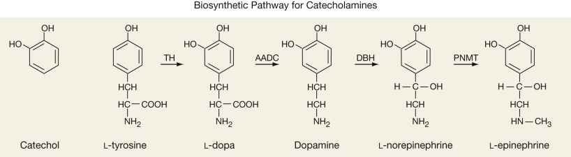

Figure 24-9 

Catecholamines: biosynthetic pathway. 

The rate-limiting step is the conversion of  l  -tyrosine to  l  -3,4-dihydroxyphenylalanine (  l  -dopa) through the actions of tyrosine hydroxylase. 

(Redrawn from Dluhy RG, Lawrence JE, Williams GH: Endocrine hypertension. In Larsen PR, Kronenberg HM, Melmed S, et al, editors: _Williams textbook of endocrinology,_ ed 10, Philadelphia, 2003, Saunders, p 555, with permission.) 

The catecholamines are metabolized by either catechol-O-methyltransferase (COMT) or monoamine oxidase (MAO). COMT converts D to methoxytyramine, E to metanephrine, and NE to normetanephrine, all of which in turn can be oxidized to vanillylmandelic acid (VMA) by MAO. MAO can also convert E and NE to 3,4-dihydroxymandelic acid, which is acted upon by COMT to form VMA. 3-Methoxy-4-hydroxyphenylacetic acid (homovanillic acid [HVA]) is the final product of dopamine metabolism. 

 

##  Pheochromocytoma 

Catecholamine-producing tumors fall into two categories: pheochromocytomas and paragangliomas. Pheochromocytomas arise from the chromaffin cells of the adrenal medulla and account for 90% of these tumors. Paragangliomas are extra-adrenal in origin, arising in the paravertebral sympathetic ganglia of the chest, abdomen, and pelvis, and the parasympathetic chains along the vagus and glossopharyngeal nerves. Pheochromocytomas have an incidence of about 500 to 1600 per year (  Pacak et al, 2001a  ) and account for <1% of all secondary causes of hypertension. Although 90% of pheochromocytomas are benign, they are almost invariably lethal if not diagnosed and properly treated (  Pacak et al, 2001a  ). Most pheochromocytomas are sporadic; however, 10% to 20% are familial, occurring as part of multiple endocrine neoplasia type 2A or 2B (MEN 2A, MEN 2B), von Hippel–Lindau (VHL) disease, neurofibromatosis type 1 (NF-1), or familial paraganglioma (FP). The hereditary forms tend to present at a younger age, and except for FP, the tumors are usually intraadrenal and bilateral. 

Sustained or paroxysmal hypertension is the most common manifestation of this disease and is present in about 90% of patients. Remarkably, 10% of patients are normotensive. More than 90% will present with paroxysmal attacks characterized by at least two of the three following symptoms: headache associated with palpitations and diaphoresis (  Sheps et al, 1994  ). Other symptoms include orthostatic hypotension, labile blood pressure, excessive sweating, anxiety, nervousness, weight loss, fatigue, pallor, and tremor. These symptoms can last from a few seconds to several hours, with the interval between attacks being highly variable—from several times a day to once every few months. Indications for screening for pheochromocytoma are listed in [ Box 24-6 ](<#b0035>) . 

Box 24-6 

Indications for Screening for Pheochromocytoma 

  * 1.

Hypertension with episodic features suggestive of pheochromocytoma 

  * 2.

Refractory hypertension 

  * 3.

Prominent lability of blood pressure 

  * 4.

Severe pressor response during anesthesia, parturition, surgery, or angiography 

  * 5.

Unexplained hypotension due to anesthesia, surgery, or pregnancy 

  * 6.

Family history of pheochromocytoma, MEN 2A or 2B, VHL disease, or neurofibromatosis 

  * 7.

Incidentally discovered adrenal mass 

  * 8.

Idiopathic dilated cardiomyopathy 

  * 9.

Spells or attacks occurring during exertion, twisting and turning of the torso, straining, coitus, or micturition 

_MEN,_ Multiple endocrine neoplasia; _VHL_ , von Hippel-Lindau. 

From Dluhy RG, Lawrence JE, Williams G: Endocrine hypertension. In Larsen PR, Kronenberg HM, Melmed S, Polonsky KS, editors: _Williams textbook of endocrinology_ , ed 10, Philadelphia, 2003, Saunders, p 557. 

There is ongoing debate as to which test is the best for diagnosing pheochromocytoma. COMT is present in adrenal chromaffin cells and in tumors derived from these cells; it is absent from sympathetic nerves. As a result. the products of COMT, metanephrine and normetanephrine, serve as specific markers of chromaffin tumors (  Lenders et al, 2014  ). Thus the most recent guidelines recommend the measurement of either plasma-free metanephrines or 24-hour urine collection for fractionated metanephrines via high-pressure liquid chromatography, with tandem mass spectrometry (HPLC/MS-MS) as the initial test (  Lenders et al, 2014  ). Plasma normetanephrines, and urine for fractionated catecholamines and VMA may also be obtained. 

The diagnosis of pheochromocytoma is made if the plasma concentration of either free metanephrine or normetanephrine is about four times the upper reference limit. Further testing is required in patients with high levels that are less than four times the upper reference limit (  Sheps et al, 1994  ;  Eisenhofer & Pacak, 2004  ;  Eisenhofer et al, 2004  ). It is recommended that the samples be collected after the patient has been supine for at least 30 minutes. If a “seated” specimen returns as elevated, it should be confirmed by either repeating the test with the patient supine or obtaining a 24-hour urine sample for fractionated metanphrines. In centers where this assay is not available, the initial test should be the chromatographic measurement of a 24-hour urine collection for normetanephrine, metanephrine, fractionated free catecholamines (epinephrine, norepinephrine, dopamine), and creatinine (  Lenders et al, 2002  ;  Eisenhofer & Pacak, 2004  ;  Eisenhofer et al, 2004  ). Metanephrine is the most sensitive and specific of these metabolites (  Heron et al, 1996  ). Urinary creatinine should be measured in all 24-hour collections to assess for completion of the collection. 

The diagnosis of pheochromocytoma can also be made by measuring plasma catecholamines; however, given their short half-life and episodic secretion, it is of use only if the sample is collected during a paroxysm. Values from the 24-hour urine collection or plasma catecholamines that are two to three times the upper limit of normal are usually diagnostic of pheochromocytoma. 

In cases of **sporadic pheochromocytoma,** the choice and interpretation of diagnostic tests depend on the pretest level of suspicion for disease. In this setting, the 24-hour urinary fractionated metanephrine and fractionated catecholamine measurements provide clinically acceptable sensitivity and significantly better specificity than fractionated plasma free metanephrine values (  Sawka et al, 2003  ). Given the difficulties in collecting a complete 24-hour urine sample from pediatric patients, fractionated plasma free metanephrines should be considered the biochemical test of choice in that population (  Weise et al, 2002  ) ( [ Table 24-11 ](<#t0060>) ). 

TABLE 24-11 

Sensitivity and Specificity of Hormone Levels for Diagnosing Pheochromocytoma 

|  SENSITIVITY  |  SPECIFICITY   
---|---|---  
|  Hereditary  |  Sporadic  |  Hereditary  |  Sporadic   
**Plasma**  
Free metanephrines  |  97%  |  99%  |  96%  |  82%   
Catecholamines  |  69%  |  92%  |  89%  |  72%   
**Urine**  
Fractionated metanephrines  |  96%  |  97%  |  82%  |  45%   
Catecholamines  |  79%  |  91%  |  96%  |  75%   
Total metanephrines  |  60%  |  88%  |  97%  |  89%   
Vanillylmandelic acid  |  46%  |  77%  |  99%  |  86%   
  
Data from Pacak K, Eisenhofer G, Ilias I: Diagnostic imaging of pheochromocytoma, _Front Horm Res_ 31:76–106, 2004; Lenders JW, Pacak K, Walther MM, et al: Biochemical diagnosis of pheochromocytoma: Which test is best? _JAMA_ 287:1427–1434, 2002. 

Several factors can cause false-positive test results, either by stimulating catecholamine secretion and/or by interfering with the assay ( [ Table 24-12 ](<#t0065>) ). When assaying for plasma free metanephrines, patients should abstain from caffeinated beverages and alcohol for 24 hours before testing. They should also avoid acetaminophen, tricyclic antidepressants, phenoxybenzamine, α agonists (e.g., methyldopa [Aldomet]), and monoamine oxidase inhibitors for at least 5 days before testing (  Lenders et al, 1995  ). During testing for catecholamines, in addition to the list of items to avoid when testing for metanephrines, the patient should avoid nicotine, sympathomimetics (theophylline, pseudoephedrine), α agonists (e.g., albuterol), and levodopa/carbidopa. If antihypertensive medications are needed, angiotensin-converting enzyme inhibitors (ACEIs), angiotensin receptor blockers, and selective α 1  -adrenoceptor blockers (e.g., prazosin) can be used without fear of causing false-positive results (  Eisenhofer et al, 2003  ). 

TABLE 24-12 

Effects of Medications on Testing for Pheochromocytoma 

|  PLASMA  |  URINE   
---|---|---  
Medication Class  |  NMN  |  NE  |  MN  |  E  |  NMN  |  NE  |  MN  |  E   
Tricyclics  |  \+  |  \+  |  – |  – |  \+  |  \+  |  – |  –  
Phenoxybenzamine  |  \+  |  \+  |  – |  – |  \+  |  \+  |  – |  –  
Buspirone  |  – |  – |  – |  – |  – |  – |  \+  |  –  
α-Adrenergic blockers  |  – |  – |  – |  – |  – |  \+  |  – |  –  
β-Adrenoceptor blockers  |  – |  – |  \+  |  – |  \+  |  \+  |  \+  |  \+   
Calcium channel blockers  |  – |  \+  |  – |  – |  – |  \+  |  – |  \+   
Sympathomimetics  |  \+  |  \+  |  – |  – |  \+  |  \+  |  – |  –  
Cocaine  |  \+  |  \+  |  \+  |  \+  |  \+  |  \+  |  \+  |  \+   
α-methyldopa  |  \+  |  – |  – |  – |  \+  |  – |  – |  –  
Acetaminophen  |  \+  |  – |  \+  |  – |  \+  |  – |  \+  |  –  
  
_E,_ Epinephrine; _MN,_ metanephrines; _NE,_ norepinephrine; _NMN,_ normetanephrine. 

Diuretics, angiotensin-converting enzyme inhibitors, and angiotensin II receptor blockers have little influence on the frequency of false-positive results. 

Data from Eisenhofer G, Goldstein DS, Walther, et al: Biochemical diagnosis of pheochromocytoma: how to distinguish true from false-positive test results, _J Clin Endocrinol Metab_ 88:2656–2666, 2003. 

Although urinary catecholamine levels may be elevated in renal insufficiency and renal failure, the measurement of plasma free metanephrines can be used to reliably diagnose pheochromocytoma in both conditions (  Eisenhofer et al, 2004  ). Stressors such as an acute myocardial infarction, congestive heart failure, surgery, and acute cerebrovascular accident are all associated with elevated levels of catecholamines. In these situations, one can treat empirically and test once the patient has stabilized. Plasma normetanephrine concentrations increase with age; as a result, older adult patients are particularly susceptible to having false-positive tests. The use of fractionated urinary metanephrines and catecholamines may be more suitable for this population (  Sawka et al, 2003  ). 

Plasma levels of normetanephrine less than 112 ng/L (0.61 nmol/L) and of metanephrine less than 61 ng/L (0.31 nmol/L) virtually exclude pheochromocytoma, so that no immediate further testing for the tumor should be necessary. With plasma concentrations of normetanephrine above 400 ng/L (2.19 nmol/L) or of metanephrine above 236 ng/L (1.20 nmol/L), the probability of pheochromocytoma is so high that the immediate task is to locate the tumor (  Eisenhofer et al, 2003  ). More often than not, test results are returned as equivocal, requiring the need for confirmatory tests such as the clonidine suppression test or the glucagon stimulation test, or the measurement of urinary fractionated catecholamines. Clonidine is a centrally acting α-adrenergic agonist; it suppresses catecholamine release from the nervous system, but has no effect on its release by the tumor (  Bravo et al, 1981  ). In those with pheochromocytoma, clonidine fails to adequately suppress plasma levels of norepinephrine to less than 40% from baseline. The clonidine suppression test is indicated only if the plasma catecholamines are greater than 1000 pg/mL (5.9 nmol/L). It is unreliable in those with normal or mildly elevated plasma catecholamines (  Taylor et al, 1986  ;  Elliott & Murphy, 1988  ;  Sjoberg et al, 1992  ).  Eisenhofer and colleagues (2003)  showed that measuring plasma normetanephrines before and after clonidine testing increased the sensitivity and specificity of this test, especially in those who have only modest elevations of norepinephrine. The glucagon stimulation test can lead to dangerous rises in blood pressure and is rarely used. It should be performed only in patients whose blood pressure is well controlled, and a physician must be present throughout the test. A rise in plasma norepinephrine to greater than threefold, or greater than 2000 pg/mL, is diagnostic of pheochromocytoma ( [ Table 24-13 ](<#t0070>) ). The proposed mechanism of action is stimulation of glucagon-sensitive adenylate cyclase receptors expressed on these tumors. Unless the history is compelling, or the patient falls into one of the categories of genetically inherited disorders, it is often unnecessary to repeat testing in those with slightly positive results. 

TABLE 24-13 

Pharmacologic Tests for Diagnosing Pheochromocytoma 

**Clonidine Suppression Test**  
---  
Indications  |  Patients with hypertension and clinical findings or family history that is highly suggestive of pheochromocytoma, and the catecholamines are elevated but not to the extent that is diagnostic of pheochromocytoma.   
Beta blockers should be withdrawn 48 hours prior to testing. Do not perform if BP <100/60 mm Hg.   
IV cannula placed. Patient rests recumbent for 20 minutes. Blood for NE and NM is collected, [ * ](<#hl0001106>) and 0.3 mg of Clonidine is administered orally.   
BP and pulse are monitored closely. Blood for NE and NM are collected [ * ](<#hl0001106>) after 3 hours.   
Interpretation  |  Normal: Decrease in NE to below normal or a >50% decline from baseline. A decrease in NM to below normal or a 40% decline from baseline.   
|  Pheochromocytoma: Failure of NE to drop below normal or decrease by more than 50% from baseline. Failure of NM to drop below normal or decrease by more than 40% from baseline.   
  
_NE,_ Norepinephrine; _NM,_ normetanephrines. 

 * Blood vials should be kept chilled on ice until processed. 

Among catecholamine-secreting tumors, 10% to 20% are familial. Genetic testing should be considered if the patient is younger than 50 years of age at presentation, has physical traits suggestive of one of the familial disorders, has multifocal disease, or has a positive family history. Tests include assaying for mutations in the gene for menin in MEN 1, the RET oncogene in MEN 2A (Sipple's disease) and MEN 2B, neurofibromin in NF-1, and VHL in von Hippel–Lindau syndrome. Familial paragangliomas are associated with various defects in the gene for succinate dehydrogenase. As with all genetic testing, pretest and posttest counseling is mandatory. 

Chromogranin A (CgA) is a protein that is stored and secreted along with the catecholamines from the adrenal medulla and sympathetic nervous system. Although it is elevated in more than 80% of pheochromocytomas, it is not specific for this disorder, being secreted by other chromaffin tissues (  Hsiao et al, 1991  ). CgA was initially thought to be useful in the diagnosis of pheochromocytoma, since medications typically used to treat it had no impact on CgA secretion or measurement. Despite a relatively high sensitivity of 86%, it has poor diagnostic specificity. This is due, in large part, to the fact that the kidneys play a major role in the clearance of CgA from the circulation, so that even mild degrees of renal impairment (e.g., creatinine clearance [CrCl] <80 mg/mL/min) can lead to significant increases in serum concentration of CgA (  Bravo & Tagle, 2003  ). Among hypertensive patients with CrCl less than 80 mL/min, overall sensitivity, specificity, and accuracy and positive and negative predictive values of serum CgA dropped to 85%, 50%, 59%, 38%, and 90%, respectively. However, when combined with elevated plasma catecholamines in patients with CrCl at least 80 mL/min, the diagnostic specificity and positive predictive values improved to 98% and 97%, respectively (  Canale & Bravo, 1994  ). Its major use is in postoperative monitoring for recurrence of these tumors. 

 

##  Testing Procedures 

For 24-hour urine collections, creatinine is measured to verify the adequacy of the collection. To preserve the specimen adequately, urine should be collected in a container to which 25 mL of 6 N HCl has been added. 

Plasma catecholamines are collected after an overnight fast (water permitted). The patient is placed in a reclining position in a quiet environment, and a heparin lock is inserted intravenously. After 20 to 30 minutes, blood is collected in a prechilled ethylenediaminetetraacetic acid (EDTA) lavender-top tube. The whole blood sample should be kept in ice water until centrifuged (preferably at 4° C). Separation of plasma should take place within 2 hours of phlebotomy; the sample should then be frozen immediately. 

Both urine and plasma specimens should be analyzed using high-performance liquid chromatography with tandem mass spectrometry, as this technique greatly eliminates problems caused by interfering substances (  Taylor & Singh, 2002  ). For the urine metabolites, it is important to use age-appropriate reference ranges when interpreting the results. It is also important to be aware that reference ranges can vary widely not only from one laboratory to another, but even within the same laboratory, as newer methods are introduced. 

 

##  Additional Follow-Up Testing 

Once the diagnosis is confirmed biochemically, the tumor should be localized by a CT scan or MRI of the adrenal glands. If this is negative, imaging studies of the abdomen, chest, and pelvis should be performed. CT has greater sensitivity, and MRI, greater specificity. MRI is superior to CT in detecting extraadrenal lesions and has the advantage of not requiring ionizing radiation or needing ionic contrast. If a tumor cannot be located by CT or MRI, or if metastatic disease is suspected, scanning with  131  I- or  123  I-labeled meta-iodobenzylguanidine should be performed. Octreoscanning and positron emission tomography are reserved for when the other techniques have failed.  18  F-FDG PET/CT scanning is especially useful in patients with paragangliomas or metastatic disease (  Pacak et al, 2001b  ). 

Following successful tumor resection, the prognosis is generally excellent. Urinary metanephrines should be retested several weeks after surgery to ensure that the resection was complete, and should be measured periodically thereafter as an early marker of disease recurrence (  Werbel & Ober, 1995  ). 

An algorithm to evaluate pheochromocytoma has been proposed by  Eisenhofer and colleagues (2003)  ( [ Fig. 24-10 ](<#f0055>) ). 

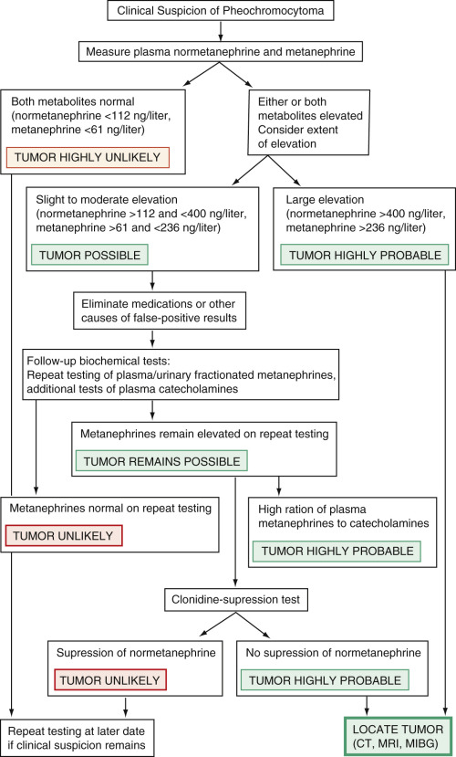

Figure 24-10 

Algorithm for the evaluation of pheochromocytoma. 

_CT,_ Computed tomography (scan); _MIBG,_ metaiodobenzylguanidine (scan); _MRI,_ magnetic resonance imaging. 

(Redrawn from Eisenhofer G, Goldstein DS, Walther MM, et al: Biochemical diagnosis of pheochromocytoma: How to distinguish true- from false-positive test results, _J Clin Endocrinol Metab_ 88:2656–2666, 2003. with permission.) 

 

##  Neuroblastoma 

Similarly to pheochromocytoma, neuroblastoma is of neural crest origin, arising within the adrenal glands or the sympathetic chain. It is the second most common solid malignant tumor in childhood, usually occurring before 3 years of age. Symptoms relate primarily to tumor mass rather than to hypertension, which is often mild or absent. At the time of diagnosis, 70% of cases will have distant metastases. About 90% of patients have elevated urinary homovanillic acid (HVA) levels at the time of diagnosis, whereas almost 75% have increased urinary vanillymandelic acid (VMA) levels (  Tuchman et al, 1985  ). Both tests should be ordered when screening for the disease. In healthy children, at least up until about 15 years of age, urinary VMA and metanephrines tend to be higher (per milligram of creatinine) and more variable than in adults. Urinary metanephrines also can be elevated in neuroblastoma patients, but are not a sensitive measure of residual tumor. Urinary HVA is increased in familial dysautonomia (Riley-Day syndrome) and in some cases of pheochromocytoma. 

 

##  Hormones of the Adrenal Cortex 

The adrenal cortex is composed of three distinct zones: The outermost zone, the zona glomerulosa, is followed by the intermediate zona fasciculata, which surrounds the innermost zona reticularis. In the broadest terms, each zone is responsible for the synthesis and secretion of a unique set of hormones: The zona glomerulosa—mineralocorticoids (aldosterone); the zona fasciculata—glucocorticoids (cortisol); and the zona reticularis—sex steroids (dehydroepiandrosterone sulfate and androgens). However, under certain pathologic and physiologic conditions, these distinctions become blurred. 

 

##  Mineralocorticoid Axis 

The chief mineralocorticoid is aldosterone, which promotes the reabsorption of sodium and water by the kidney to help maintain blood pressure and tonicity. Expression of the enzyme CYP11B2 (aldosterone synthetase) within the glomerulosa is site-specific; as a result, the synthesis of aldosterone and its intermediary 18-hydroxylated metabolites is restricted to the zona glomerulosa. The precursor molecules to aldosterone, 11-deoxycorticosterone (DOC) and 11-deoxycortisol, similarly possess mineralocorticoid activity. However, unlike aldosterone, they can be synthesized within the zona fasciculata, as well as in the zona glomerulosa, which explains the hypertension and electrolyte disturbances seen in some forms of congenital adrenal hyperplasia. Although aldosterone will respond to acute changes in ACTH, it is mainly under the control of the renin-angiotensin system. 

The zona fasciculata makes up 75% of the cortex, and is responsible for the synthesis and secretion of glucocorticoids and to a lesser extent androgens and estrogens. The glucocorticoids are 21-carbon steroid compounds with a hydroxyl group on carbon 17, hence the synonym 17-hydroxycorticosteroids (17-OHCS). Cortisol is the key glucocorticoid, regulating its own secretion through negative feedback on the hypothalamic-pituitary-adrenal (HPA) axis and inhibiting corticotropin-releasing hormone (CRH) from the hypothalamus and ACTH release from the pituitary gland. Both CRH and AVP (ADH) are produced by the parvocellular neurons of the paraventricular nuclei of the hypothalamus. ACTH secretion is stimulated by CRH and, to a much lesser extent, by AVP. ACTH in turn stimulates cortisol production by the adrenal glands. Cortisol is needed in times of stress to maintain blood pressure and blood sugar, and to prevent shock. Although cortisol is the most important glucocorticoid, corticosterone, which is a hormone of the mineralocorticoid pathway, also possesses glucocorticoid activity. 

Androgens and estrogens are produced by the zona reticularis. The androgens are 18-carbon steroids with saturated A rings, in contrast to the estrogens, which are 17-carbon steroids with unsaturated A rings. 

The functions of these hormones are summarized in [ Table 24-14 ](<#t0075>) . 

TABLE 24-14 

Physiologic Effects of Steroids 

Representative Hormone  |  Biological Effects   
---|---  
Cortisol (as a representative glucocorticoid)  |  Protein nitrogen catabolism increased   
Gluconeogenesis   
Increased blood glucose concentration   
Decreased glucose tolerance   
Increased liver glycogen   
Increased liver glycogenolysis   
Decreased peripheral uptake and utilization of glucose   
Decreased synthesis of acid-sulfated mucopolysaccharides   
Fat synthesis and redistribution   
Cellular or tissue effects   
Antiinflammatory   
Dissolution of lymphoid tissue   
Lymphopenia   
Eosinopenia   
Increased erythropoiesis   
Alteration of cellular permeability, especially decreased membrane permeability to water   
Increased gastric (HCl and pepsin) secretion   
Aldosterone (as a representative mineralocorticoid)  |  Electrolyte regulation   
Sodium (Na  \+  ) retention   
Potassium (K  \+  ) excretion   
Retention of water and expansion of extracellular fluid volume   
Increases in blood pressure   
Androgens (as representative sex hormones)  |  Protein nitrogen anabolism   
Growth and maturation—osseous and muscular   
Body hair (pubic and axillary)   
  
 

##  Congenital Disorders of Adrenal Cortical Enzyme Deficiencies 

The hormones of the adrenal cortex are steroid derivatives, synthesized from low-density lipoprotein (LDL) cholesterol. LDL is delivered to the adrenal glands, where it is taken up by LDL receptors. Evidence also supports local synthesis of LDL from acetyl coenzyme A. Steroid acute regulatory protein (StAR) shuttles LDL across the mitochondrial membrane, where it begins its journey down the steroidogenic pathway ( [ Fig. 24-11 ](<#f0060>) ). The enzymes that catalyze these synthetic reactions are of four general types: hydroxylases, dehydrogenases, desmolases, and isomerases. Because most of the inborn errors of metabolism affecting steroid hormone synthesis in the adrenal cortex involve deficiencies of hydroxylases, they constitute the most clinically important group of enzymes. 

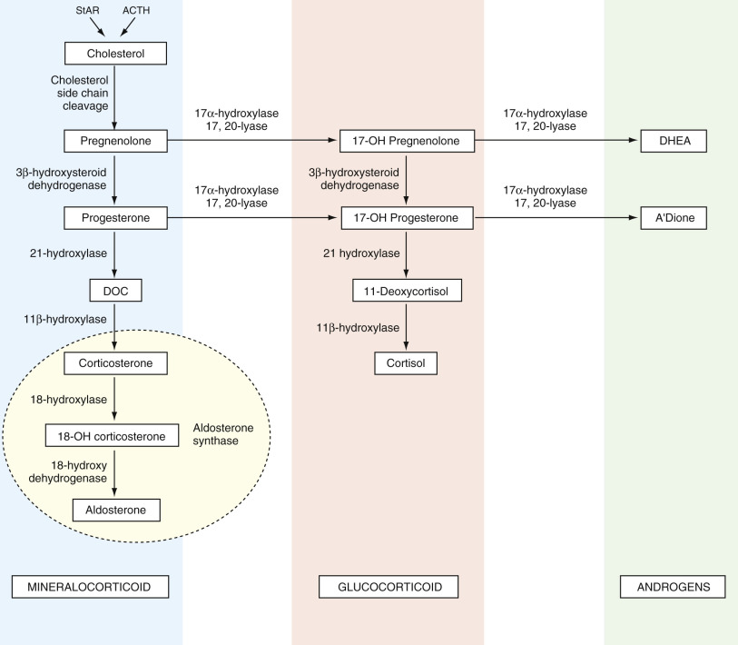

Figure 24-11 

Steroidogeneic pathways of the adrenal cortex. 

The adrenal steroids are categorized according to mineralocorticoid, glucocorticoid, or androgenic activity. The chemical structures for these steroids are shown in [ Figure 25-1 ](<##!/content/3-s2.0-B9780323295680000255?scrollTo=%23f0010>) in [ Chapter 25 ](<##!/content/3-s2.0-B9780323295680000255?scrollTo=%23c00025>) . _ACTH,_ Adrenocorticotropin; _DHEA,_ dehydroepiandrosterone; _DOC,_ deoxycorticosterone; _StAR,_ steroidogenic acute regulatory (protein). 

At least eight different metabolic defects in the synthesis of cortisol and aldosterone have been described, each characterized by a deficiency of a specific adrenal enzyme. A vast majority of these enzymatic deficiencies are inherited as autosomal recessive traits with variable degrees of penetrance. Those enzymatic defects that uniquely affect the biosynthesis of cortisol are grouped together under the rubric of congenital adrenal hyperplasia (CAH). These five enzymes are P450scc (defect in StAR), 3-β-hydroxysteroid dehydrogenase, 21-hydroxylase, 11-hydroxylase, and 17-hydroxylase. CRH and ACTH synthesis and secretion are normally under the negative-feedback control of cortisol. In CAH, defects in the enzymes necessary for cortisol production lead to cortisol deficiency; cortisol deficiency in turn results in disinhibition of negative feedback on CRH and ACTH production. As a consequence, CRH and ACTH levels rise, inducing adrenal hyperplasia and a forward push in steroidogenesis, as the body tries to compensate and normalize cortisol production. Not only does this result in a buildup of the hormonal precursors directly preceding the enzymatic defect, it also causes massive shunting of these precursors down the remaining functional pathways. The clinical manifestations of CAH are heterogeneous, depending on the severity and location of the enzymatic defects, which hormones are deficient, and which are produced in excess. Symptoms range from shock, salt wasting, and anomalous sexual development in infancy, to hirsutism and infertility in the adult. Sometimes, as in partial enzymatic deficiencies of cortisol synthesis, near-adequate hormone synthesis is possible if hypersecretion of ACTH is able to stimulate adrenal hyperplasia to compensate for the deficiency. The clinical manifestations of various adrenal cortical enzyme deficiencies and their associated laboratory findings are summarized in [ Table 24-15 ](<#t0080>) . 

TABLE 24-15 

Congenital Adrenal Hyperplasia: Clinical and Biochemical Features 

Feature  |  21-Hydoxylase Deficiency  |  11-β-Hydoxylase Deficiency  |  17-β-Hydroxylase Deficiency  |  3-β-Hydroxysteroid Deficiency  |  Lipoid Hyperplasia  |  Aldosterone Synthase Deficiency   
---|---|---|---|---|---|---  
Defective gene  |  _CYP21_ |  _CYP11B1_ |  _CYP17_ |  _HSD3B2_ |  _StAR_ |  _CYP11B2_  
Incidence  |  1 : 15,000  |  1 : 100,000  |  Rare  |  Rare  |  Rare  |  Rare   
Ambiguous genitalia  |  \+ (female)  |  \+ (female)  |  \+ (male)   
Absent puberty (female)  |  \+ (male)   
Mild in female  |  \+ (male)   
Absent puberty (female)  |  Normal   
Acute adrenal insufficiency  |  \+  |  Rare  |  No  |  \+  |  ++  |  Salt wasting only   
Laboratory findings  |  ↑ plasma 17-OHP and pregnanetriol   
Greatly ↑ urinary pregnanetriol and 17-KS  |  ↑ serum DOC and 11-deoxycortisol   
↑ urinary 17-OHCS and 17-KS  |  ↑ serum DOC, 18-OH DOC, B, and 18-OHB  |  ↑ serum 17-OH-pregnenolone, pregnenolone and DHEA   
↑ urinary 17-KS   
↑ Δ5/Δ4 serum and urinary steroids  |  All serum and plasma steroids are decreased  |  ↑ serum B, 11-DOC, and 18-OHB   
Glucocorticoids  |  ↓ |  ↓ |  ↓ |  ↓ |  ↓ |  Normal   
Mineralocorticoids  |  ↓ |  ↑ |  ↓ |  ↓ |  ↓ |  ↓  
Androgens  |  ↑ |  ↑ |  ↓ |  ↓ male, ↑ female  |  ↓ |  Normal   
  
_B_ , Corticosterone; _DHEA_ , dihydroepiandosterone; _11-DOC_ , 11-deoxycorticosterone; _17-KS_ , 17-ketosteroids; _18-OHB_ , 18-hydroxycorticosterone; _17-OHP_ , 17-α-hydroxyprogesterone. 

From Stewart PM: The adrenal cortex. In Larsen PR, Kronenberg HM, Melmed S, et al, editors: _Williams textbook of endocrinology,_ ed 10, Philadelphia, 2003, Saunders, p 533. 

The diagnosis is made by measuring the various serum hormone levels and assessing which steroids are produced in excess and which are deficient, and by calculating the precursor/product ratio and comparing these results to age- and sex-matched normative data. Levels of hormones distal to the block (product hormones) may be elevated as a result of peripheral conversion of the markedly elevated precursor hormones; the use of precursor/product ratios mitigates the risk for misdiagnosis due to misleading elevations of product hormones (  Levine, 2002  ). If hormone levels return as borderline, but the clinical suspicion for CAH remains high, the steroid levels should be remeasured 60 minutes after intravenous administration of 0.25 mg of ACTH. ACTH drives steroidogenesis forward, accentuating the block. When there is a proband, the diagnosis can be more accurately determined by genotyping. 

CAH is categorized according to severity of disease into classic (neonatal, severe) and nonclassic (late-onset, cryptogenic) forms. The classic form is further subdivided into salt-losing and non–salt-losing (simple virilizing) variants. 

 

##  21-Hydroxylase Deficiency 

The enzyme 21-hydroxylase (also referred to as CYP21, CYP21A2, and P450c21) is located within the mitochondrial endoplasmic reticulum. 21-hydroxylase deficiency is the most common cause of CAH, accounting for about 95% of all cases. Screening of newborns using capillary heel blood on paper filter disks has identified this disorder in about 1 in 14,000 persons in North America, and in as many as 1 in 300 Yupik Eskimos of Alaska (  Pang et al  1988  ). The classic form is detected in about 1 in 16,000 live births; the nonclassic form is seen in about 0.2% of the general Caucasian population, and in 1% to 2% of those of Eastern European Jewish ancestry (  Speiser et al, 1985  ;  Therrell, 2001  ). 

21-OH catalyzes the conversion of 17-hydroxyprogesterone (17-OHP) to 11-deoxycortisol (compound S), and progesterone to DOC. Thus, 21-OH deficiency leads to elevated levels of the steroid precursors 17-OHP and pregnanetriol in the urine and 17-OHP in the serum. These precursors are shunted toward the pathway, leading to excess androstenedione and testosterone production ( [ Fig. 24-12 ](<#f0065>) ). Clinical presentation often correlates with the severity of enzymatic dysfunction. The classic variety presents in the newborn period or in early childhood with adrenal insufficiency and virilization, with or without salt wasting. The nonclassic form presents in late childhood as early adrenarche, or in young adulthood as hirsutism, amenorrhea, and infertility. The presentation in women is very similar to that of polycystic ovarian disease. Males may develop precocious puberty, adrenal rests within the testes, and infertility. 

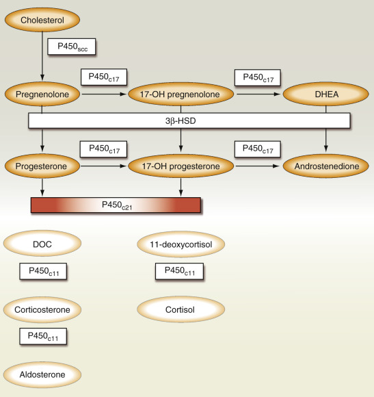

Figure 24-12 

Defective steroidogenesis due to 21-hydroxylase deficiency. 

The relative increase in the hormones proximal to the block is depicted by more intense color. The more severe the enzymatic defect, the greater the concentration of the precursor hormones. _DHEA,_ Dehydroepiandrosterone; _DOC,_ deoxycorticosterone. 

A close functional relationship exists between the adrenal cortex and the adrenal medulla. Dysplasia of the medulla and catecholamine hyposecretion have been described in classic 21-OH deficiency. In a study of 38 children with classic (CYP21A2) disease, levels of plasma epinephrine and metanephrine and urinary epinephrine were 40% to 80% lower in affected individuals than in normal persons (  Merke et al, 2000  ). In another study, those with CYP21A2 showed a significantly decreased catecholamine response to exercise that was unaffected by the administration of stress doses of glucocorticoids (  Weise et al, 2004  ). It has been suggested that the degree of medullary impairment may be a biomarker for CAH severity (  Merke et al, 2002  ). 

 

##  Diagnosis. 

Prenatal diagnosis is important because suppressive treatment with steroids can abrogate the development of virilization of the female fetus. Diagnosis is made by measuring the level of 17-OHP in amniotic fluid or by genotyping cells obtained by chorionic villous sampling. The genes responsible for 21-OH deficiency, _CYP21 (CYP21A2)_ and _CYP21P (CYP21A),_ are located on chromosome 6. Of these two homologous genes, only CYP21 is active; deleterious mutations within CYP21P interfere with normal gene expression. These mutations can be identified by PCR and Southern blotting on chorionic villous samples (  White et al, 1994a  ;  New, 1995  ). The 2010 consensus statement on the management of CAH due to 21-OH deficiency recommends that prenatal treatment of CAH be regarded as experimental and that the diagnosis should rest on clinical and hormonal data, with genotyping being reserved for equivocal cases and genetic counseling (  Speiser et al, 2010  ). 

Neonatal screening, which is now mandatory across the United States and in several other countries, is performed by measuring 17-OHP or by genotyping blood that has been obtained from a heelstick and collected on filter paper. The sample for 17-OHP is analyzed using automated time-resolved dissociation-enhanced lanthanide fluoroimmunoassay (DELFIA) (  Speiser et al, 2010  ). Causes for false-positive screens include prematurity, illness, stress, and possibly the antenatal administration of glucocorticoids used to induce fetal lung maturation. The initial positive screen is followed up by checking the 17 OHP level by LC-MS/MS (  Speiser et al, 2010  ). In regard to genotyping, aside from its being the most definitive test for diagnosing CAH, the fact that the genotype correlates fairly well with disease severity means that it can also be used as a prognostic tool (  Nordenstrom et al, 1999  ). 

In the newborn with salt wasting, unstimulated 17-OHP levels are typically greater than 8000 ng/dL, rising to 100,000 ng/dL (3000 nmol/L) following administration of ACTH. Levels in the simple virilizing variant range from 10,000 to 30,000 ng/dL (300 to 1000 nmol/L). Those with nonclassic disease typically have 17-OHP levels ranging from 1500 to 10,000 ng/dL (50 to 300 nmol/L) (  New et al, 1983  ). It is of note that randomly drawn hormone levels may be normal in those with nonclassic disease; therefore it is important to test during the early morning. If the results are equivocal, the diagnosis can be confirmed by comparing serum 17-OHP levels before and 60 minutes after administration of 0.25 mg ACTH (Cortrosyn). ACTH acts to stimulate steroidogenesis, serving to dramatically increase the bottleneck at the site of the enzymatic block, resulting in a dramatic increase in precursors, in this case, 17-OHP. Post-ACTH 17-OHP values <330 ng/dL are normal, 330 to 1000 ng/dL indicates a heterozygote carrier, and levels greater than 2000 ng/dL are diagnostic for nonclassic CAH. If a proband is available, genotyping is superior to these older biochemical tests in identifying heterozygotes (  Honour & Rumsby, 1993  ). 

The goals of glucocorticoid and mineralocorticoid replacement therapy in children are the attainment of normal growth, weight, and pubertal development, and optimization of final adult height. In adults, the major treatment goals include lessening of signs of virilization and resumption of fertility. Glucocorticoid replacement is titrated to keep the 17-OHP level partially suppressed to between 100 and 1000 ng/dL (3 to 30 nmol/L) and the ACTH under 100 ng/L, thereby preventing shunting toward testosterone synthesis, and normalizing levels of androstenedione and testosterone. Normalization of 17-OHP should not be attempted, because this requires supraphysiologic levels of glucocorticoids and may result in Cushing's syndrome (  Speiser & White, 2003  ). 

Varying degrees of hypoaldosteronism accompany all forms of 21 OH deficiency. This is biochemically apparent as an elevated plasma renin activity (PRA) and a decreased aldosterone/PRA ratio. The objective of mineralocorticoid replacement is to normalize the plasma renin activity. 

 

##  11-β-Hydroxylase Deficiency 

The second most common enzyme deficiency of the adrenal cortex, accounting for about 7% of all cases of CAH, is the 11-β-hydroxylase (11-OH) deficiency. A defect in this enzyme blocks the final conversion of 11-deoxycortisol to cortisol and DOC to corticosterone. As with 21-OH deficiency, a compensatory increase in ACTH secretion leads to adrenal hyperplasia and a mass action shunting of precursor steroids toward testosterone synthesis, resulting in signs of virilization. This block also results in the accumulation of DOC; the mineralocorticoid activity of DOC leads to the development of hypertension and hypokalemia, similar to what is seen with hyperaldosteronism ( [ Fig. 24-13 ](<#f0070>) ). 

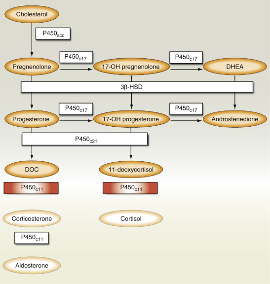

Figure 24-13 

Defective steroidogenesis due to 11-β-hydroxylase deficiency. 

The relative increase in the hormones proximal to the block is depicted by more intense color. The more severe the enzymatic defect, the greater the concentration of the precursor hormones. High levels of 11-deoxycorticosterone (DOC) created by the block produce a state of mineralocorticoid excess. _DHEA,_ Dehydroepiandrosterone. 

11-OH deficiency is an autosomal recessive disorder caused by mutations of the genes _CYP11B1_ and _CYP11B2,_ located on chromosome 8q21-q22 (  White et al, 1994b  ). Diagnosis in the neonate is established by the presence of a high basal and a high ACTH-stimulated 11-deoxycortisol. Concentrations of urinary tetrahydro-11-deoxycortisol in the urine are also elevated. During childhood and in young adults, the diagnosis of 11-OH deficiency is made by the presence of elevated early-morning and ACTH-stimulated serum levels of 11-deoxycortisol that are more than three times the upper limit for age-matched normals. Levels of DOC and adrenal androgens (androstenedione, dehydroepiandrosterone, and dehydroepiandrosterone sulfate) are also elevated. Plasma renin activity and aldosterone are often suppressed as a result of salt and water retention induced by elevations of DOC. Unlike the heterozygotes with 21-OH deficiency, those with 11-OH deficiency often fail to show a rise in precursors following ACTH stimulation (  Pang et al, 1980  ). However, an exuberant response was seen in those who had hirsutism (  Gabrilove et al, 1965  ). 

Prenatal diagnosis of 11-OH deficiency is made by measuring levels of tetrahydro-11-deoxycortisol (THS) in the maternal urine or amniotic fluid. These levels begin to rise in the first trimester. In addition to THS, elevation of 11-deoxycortisol levels and of the THS to tetrahydrocortisol plus tetrahydrocortisone ratio is seen (  Rosler et al, 1988  ). 

Treatment consists of the replacement of glucocorticoids, causing normalization of DOC and plasma renin activity. 

 

##  3-β-Hydroxysteroid Dehydrogenase Deficiency 

3-β-hydroxysteroid dehydrogenase (3-β-HSD), which catalyzes the second enzymatic step in steroidogenesis, is coded by two genes, _HSD3BI_ and _HSD3BII_ . _HSD3BII_ is expressed in the adrenals and gonads; _HSD3BI_ is expressed in placenta, skin, and other peripheral tissues and usually remains functionally intact at these sites in CAH. A defect in 3-β-HSD leads to a block in the conversion of Δ5 steroids (pregnenolone, 17-OH pregnenolone, and dihydroepiandrosterone) to Δ4 steroids (progesterone, 17-OHP, androstenedione), resulting in an increase in circulating levels of Δ5 steroids ( [ Fig. 24-14 ](<#f0075>) ). However, because _HSD3BI_ is usually intact, levels of the Δ4 steroids may be normal or even elevated. 

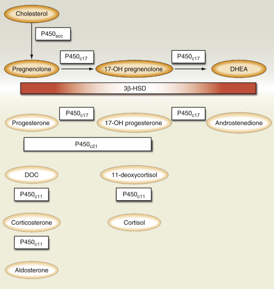

Figure 24-14 

Defective steroidogenesis due to 3-β-hydroxysteroid dehydrogenase deficiency. 

The relative increase in the hormones proximal to the block is depicted by more intense color. The more severe the enzymatic defect, the greater the concentration of the precursor hormones. 17-α-hydroxyprogesterone levels may be elevated because of peripheral conversion of 17-α-hydroxy pregnenolone. _DHEA,_ Dehydroepiandrosterone; _DOC,_ deoxycorticosterone. 

Patients with classic disease will have manifestations of glucocorticoid deficiency, with or without the accompaniment of salt wasting. Affected males have incomplete masculinization, and females may be normal or may have ambiguous genitalia. A late-onset variant has been described that is associated with features typical of polycystic ovarian disease, such as hirsutism, oligomenorrhea, and infertility (  Pang et al, 1985  ). 

Previous criteria for the diagnosis of 3-β-HSD deficiency examined the basal and ACTH-stimulated Δ4/Δ5 steroid ratios, 17-OH-pregnenolone (17-OHP)/cortisol, and levels of pregnenolone, 17-OH-pregnenolone, and dehydroepiandrosterone in urine and blood. The standard for diagnosing this disorder has been recently revised to correlate more closely with genotypic studies. The ACTH-stimulated Δ5-17 P levels and Δ5-17 P/cortisol ratios have been shown to be the best indices for definitively diagnosing 3-β-HSD deficiency (  Lutfallah et al, 2002  ). Applicability of these new criteria to patients with the nonclassic variant is still debatable. 

Treatment consists of glucocorticoids and mineralocorticoids, as well as sex steroids, in accordance with normal growth and development. 

 

##  17-Hydroxylase Deficiency 

17-Hydroxylase (CYP17, P450  c17  ) is expressed in the adrenal glands and the gonads and encodes two enzymes—17α-hydroxylase and 17,20-lyase. 17α-hydroxylase catalyzes the conversion of pregnenolone and progesterone to their respective 17-OH derivatives. 17,20-Lyase converts 17-OH pregnenolone to dihydroepiandosterone, and 17-OH progesterone to androstenedione. CYP17 deficiency blocks the conversion of pregnenolone and progesterone to the 17-hydroxy derivatives, causing shunting from testosterone and cortisol synthesis to aldosterone ( [ Fig. 24-15 ](<#f0080>) ). Accordingly, these patients develop hypertension and hypokalemic alkalosis in association with incomplete masculinization (in the male) and decreased testosterone and cortisol levels. 17-OH deficiency is diagnosed by demonstrating high DOC, pregnenolone, and progesterone levels, along with decreased urinary 17-ketosteroids and 17-hydroxycorticosteroids. The gene associated with this condition (CYP17) has been located on chromosome 10q, the same gene as 17,20-desmolase (  Kater & Biglieri, 1994  ). 

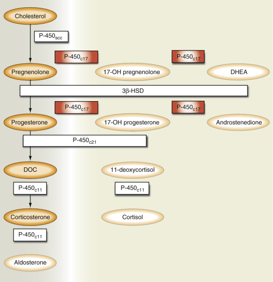

Figure 24-15 

Defective steroidogenesis due to 17-hydroxylase deficiency. 

The relative increase in hormones proximal to the block is depicted by more intense color. The more severe the enzymatic defect, the greater the concentration of the precursor hormones. High levels of 11-deoxycorticosterone (DOC) and corticosterone created by the block produce a state of mineralocorticoid excess. _DHEA,_ Dehydroepiandrosterone. 

 

##  Congenital Lipoid Adrenal Hyperplasia 

Congenital lipoid adrenal hyperplasia (lipoid CAH) is the most severe form of CAH, in which the synthesis of all gonadal and adrenal cortical steroids is markedly impaired. Lipoid CAH may be caused by a defect in the StAR or the P450 side chain cleavage (scc) (  Fujieda et al, 2003  ). StAR, located on chromosome 8p11, controls the rate-limiting step in steroidogenesis. It is responsible for the shuttling of cholesterol from the outer to the inner mitochondrial membrane. 20,22-Desmolase (CYP11A1, P450scc) converts cholesterol to pregnenolone ( [ Fig. 24-16 ](<#f0085>) ). Pathologically, the adrenal cortex shows marked accumulation of cholesterol and other lipids, which is the primary distinguishing feature from congenital adrenal hypoplasia. 

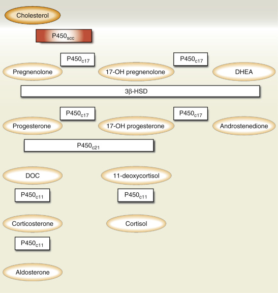

Figure 24-16 

Defective steroidogenesis in congenital lipoid adrenal hyperplasia is due to a defect in steroidogenic acute regulatory protein or the side-chain cleavage enzyme (P450scc). 

The relative increase in hormones proximal to the block is depicted by more intense color. In this disorder, the synthesis of all classes of steroids is defective. _DHEA,_ Dehydroepiandrosterone; _DOC,_ deoxycorticosterone. 

The presentation of this extremely rare disorder is that of severe adrenal insufficiency with hypotension, salt wasting, and feminization of external genitalia in males. Occasionally, females may not present until the onset of puberty. Diagnosis is made by the presence of extremely low cortisol and aldosterone concentrations and elevated ACTH and plasma renin activity. 

 

##  Aldosterone Synthetase Deficiency 

Aldosterone synthetase (CYP11B2) is the final step in the steroid synthetic pathway leading to the production of aldosterone. It stimulates a multistep process: 11-hydroxylation of DOC to corticosterone, 18-hydroxylation of corticosterone to 18-hydroxycorticosterone, and, finally, 18-dehydrogenation to aldosterone. Isolated enzyme deficiency leads to salt wasting, hyperkalemia, and metabolic acidosis. This condition may be diagnosed by demonstrating the presence of metabolites of corticosterone and 11-deoxycorticosterone in the urine, elevated serum DOC, and deficiency of corticosterone, 18-hydroxycorticosterone, or aldosterone in the serum. 

 

##  Cortisol and the Glucocorticoids 

The adrenal cortex secretes cortisol in response to ACTH, a diurnal rhythm, and stress. ACTH, synthesized in the adenohypophysis, is formed from the cleavage of a much larger precursor molecule: POMC. In addition to ACTH, cleavage of POMC releases β-LPH, which in turn is cleaved to yield γ-LPH and β-endorphin. Within the ACTH sequence are α-MSH and the corticotropin-like intermediate lobe protein. Endorphins, which act on neurons in the brain, constitute a distinct peptidergic system related to pain perception. Although β-endorphin is secreted in parallel with ACTH, the significance of this remains unknown. 

ACTH consists of 39 amino acid residues, of which residues 1 to 24 at the amino terminal possess full hormonal activity. Occasionally, POMC is incompletely processed; this leads to the formation of other forms of ACTH that usually have little biological activity, although they may retain immunoreactivity. These forms may predominate in malignant conditions such as ectopic production by primary or metastatic lung cancer, and in some patients with Nelson's syndrome, a disorder characterized by the occurrence of a pituitary tumor and skin hyperpigmentation following bilateral adrenalectomy. Defects in POMC cleavage enzymes may also be responsible for the formation of rare forms of isolated ACTH deficiency (  Nussey et al, 1993  ). 

ACTH is secreted in response to several factors, of which CRH and AVP are the most important. Among the other moieties reported to stimulate ACTH secretion are atrial natriuretic factor (ANF), angiotensin II, IL-6, IL-1, and tumor necrosis factor-α (  Rivier & Vale, 1983  ;  Chrousos, 1998  ). 

CRH is synthesized and released from the hypothalamus; it acts to stimulate the synthesis and release of ACTH from the pituitary gland. CRH is released in a circadian pattern and in response to physiologic stimuli such as stress and hypoglycemia. The HPA axis consists of various feedback loops that control cortisol synthesis and secretion. When plasma cortisol increases, it suppresses the release of CRH, ACTH, and AVP, which, in turn, leads to lowering of the cortisol level. Conversely, when serum cortisol reaches a nadir, the hypothalamus and pituitary gland respond by increasing CRH and ACTH production, leading to stimulation of cortisol formation and secretion. By this mechanism, ACTH and cortisol control the concentration of each other within a very narrow range, and a small change in one results in a concomitant change in the other. When the adrenal gland is unable to respond to ACTH because of damage or disease, cortisol levels are low and ACTH levels are high. In those conditions in which the pituitary gland is destroyed, ACTH is not formed and cortisol levels are consequently low. Damage to the hypothalamus is also associated with low ACTH and cortisol levels; testing with CRH may permit the distinction between these two entities. Synthetic forms of CRH are used in testing the anterior pituitary gland's reserve of ACTH by comparing plasma ACTH and cortisol before and 1 hour after CRH stimulation (  Grodum et al, 1993  ). This test is useful in distinguishing between lesions affecting the hypothalamus, pituitary gland, and adrenal glands (  Fukata et al, 1993  ). If the lesion is in the hypothalamus, after a time delay, ACTH levels rise following CRH administration. If it is in the pituitary gland, no significant ACTH response occurs. With primary adrenal insufficiency, administration of CRH causes a further rise in an already elevated ACTH level, but little or no rise in cortisol level. 

If the HPA axis is interrupted by the administration of large quantities of exogenous glucocorticoids, they will exert an inhibitory effect on the hypothalamus and pituitary gland, suppressing CRH and ACTH secretion. If this suppression continues over a period of weeks, it leads to atrophy of the adrenal glands; as a result, the HPA axis becomes unable to secrete cortisol in times of stress. The HPA axis can fully recover after tapering off of steroids. 

The second influence on plasma cortisol levels is the diurnal pattern, which is due to the circadian pattern of ACTH release. Major increases in secretion occur at between 4  am  and 8  am  , followed by a decrease in ACTH during the rest of the day. In subjects with a normal sleep-wake cycle, the lowest ACTH concentrations are found shortly after midnight. Sudden changes in sleep-wake patterns have little effect on the diurnal pattern, but permanent changes in daily sleep habits result in a gradual change in diurnal secretory patterns. Superimposed on the circadian periodicity is an ultradian rhythm of 10 to 18 secretory bursts per 24 hours (  Horrocks et al, 1990  ). 

The third important influence on cortisol secretion is stress. Stimuli such as surgical trauma, pyrogens, hypoglycemia, and hemorrhage are capable of bringing about an acute increase in ACTH and cortisol secretion. This response to stress may be absent or decreased in magnitude in patients in whom large doses of steroids have been administered for some time. The initiation of any stress response is dependent on an intact nervous system. For example, trauma normally results in the acute release of ACTH and cortisol; however, in patients with spinal cord transections, the normal transmission of neurologic stimuli is interrupted, and as a result, the same trauma applied to an extremity will not elicit any ACTH or cortisol response. Evidence suggests that the stress response of cortisol is mediated through excitatory and inhibitory inputs that integrate at the level of the hypothalamus and modulate CRH secretion. Cortisol levels also rise after meals, especially those high in protein; it also rises in depression (  Linkowski et al, 1987  ). 

Most disorders of cortisol secretion can be classified by the patterns of response of the following three hormones to suppression and stimulation: ACTH, plasma cortisol, and urinary free cortisol (  Snow et al, 1992  ). 

 

##  Laboratory Measurement of ACTH 

Plasma ACTH is measured using a two-site immunoradiometric assay or an immunochemiluminometric assay. To prevent degradation of ACTH, it is best to collect the sample in a prechilled EDTA lavender-top tube. The specimen should be kept in an ice bath and should be processed as soon as possible. Following centrifugation in a refrigerated centrifuge, the specimen should be separated, transferred to a plastic tube, and kept frozen at –20° C until time of analysis. The normal reference range is 2 to 12 pmol/L (9 to 52 pg/mL) between 7  am  and 10  am  . Plasma ACTH is a useful tool for distinguishing primary (adrenal) from secondary (pituitary) or tertiary (hypothalamic) adrenal insufficiency. In primary adrenal insufficiency, low cortisol concentrations are found, along with increased ACTH levels. In secondary or tertiary adrenal insufficiency, both ACTH and cortisol are expected to be low. ACTH levels best discriminate between healthy individuals and those with adrenal insufficiency when specimens for ACTH are collected between 8  am  and 10  am  . 

ACTH is less useful in diseases of cortisol excess. Up to 50% of patients may have normal ACTH levels in Cushing's disease. Although the values tend to run higher (>20 pmol/L [>90 pg/mL]) in Cushing's syndrome due to ectopic ACTH production, the values overlap with those seen in Cushing's disease in 30% of cases (  Findling, 1992  ). Because of the normal diurnal variation in ACTH and cortisol secretion, measurement of these values during their expected nadir, from 11  pm  to 1  am  , is helpful in confirming the diagnosis of ACTH-dependent Cushing's disease. An elevated midnight ACTH of greater than 5 pmol/L (23 pg/mL) in the face of an elevated serum cortisol confirms the diagnosis of ACTH-dependent Cushing's disease. Those patients with ectopic ACTH-secreting tumors characteristically have markedly elevated plasma ACTH (usually >200 pg/mL) and elevated serum cortisol. Measurement of ACTH by plasma extraction, which detects ACTH precursors and fragments, may be useful in distinguishing patients with cancer-related syndromes or ACTH-secreting tumors from those with Cushing's disease, as the former entities are more likely to produce these other forms of ACTH (  White & Clark, 1993  ). ACTH-secreting neoplasms may be occult, creating diagnostic difficulties; in this instance, ACTH measurement using selective venous sampling has proven useful in localization of the lesion. 

In patients with increased levels of circulating glucocorticoids due to an adrenal adenoma or carcinoma, and those surreptitiously taking steroids, ACTH secretion is inhibited and levels are low or undetectable. In patients with pituitary-induced adrenal hyperplasia (Cushings' disease), plasma ACTH may be at or above the upper reference interval at 9  am  , and fail to show the expected fall after midnight. Another use of ACTH assays is in the determination of adequacy of cortisol replacement in congenital adrenal hyperplasia. When replacement therapy is optimal, ACTH values are similar to those seen in a reference population. 

 

##  Plasma Corticotropin-Releasing Hormone 

CRH measurements are performed by liquid chromatography and tandem mass spectrometry (LC/MS-MS) and remain largely a research tool. 

CRH circulates in one of two forms: free, or bound to CRH-binding protein. The reference range for plasma CRH in men and nonpregnant women is <34 pg/mL. CRH is increased in Cushing's syndrome due to ectopic production of CRH. CRH-binding protein increases during pregnancy; as a result the normative range for CRH varies throughout pregnancy: first trimester <40 pg/mL; second trimester <153 pg/mL; and third trimester <847 pg/mL (  Goland et al, 1986  ). 

 

##  Serum Cortisol Measurements 

About 90% of circulating cortisol is bound to serum protein, of which 10% to 20% is loosely bound to albumin, and the remainder is bound to the glycoprotein transcortin (cortisol-binding globulin [CBG]). The remaining 10% of circulating cortisol is the unbound, free hormone. It is believed that only free cortisol is active, and that the protein-bound fraction is metabolically inert, probably serving as a reservoir for free cortisol. Protein binding also may protect cortisol from deactivation by the liver or filtration by the kidney. 

One of the earliest and simplest methods used to determine the serum cortisol concentration was a fluorometric assay developed by Nelson and Samuels that was based on a technique first developed by Porter and Silber (  Porter & Silber, 1950  ;  Nelson & Samuels, 1952  ). The subsequent development of antibody-based immunoassays provided a more specific method for cortisol estimation with the added advantages of requiring a smaller specimen volume and a more rapid turnaround time. The problem was that some of the antibodies used showed a large degree of cross-reactivity with other steroid species, resulting in spuriously elevated cortisol concentrations. In chronic renal disease, various steroids and their glucuronides accumulate in the blood; cross-reactivity between these steroids and their conjugates with the antibodies used in the assay can yield significantly erroneous cortisol concentrations. Similarly, in CAH, high concentrations of cortisol precursors are seen in the serum because of an enzyme defect. Because these precursors cross-react with assay antibodies, artificial elevations of cortisol are found. The degree of interference varies with the assay used and cannot be easily predicted. Nonisotopic immunoassay methods using organometallic tracers, fluorescence polarization, and enzyme immunoassay techniques have also been developed for cortisol determinations (  Bacarese-Hamilton et al, 1992  ;  Lentjes et al, 1993  ;  Philomin et al, 1994  ). The major disadvantage of all of these cortisol assays continues to be lack of specificity. 

The measurement of cortisol by radioimmunoassay (RIA) and chemiluminescent techniques has largely been supplanted by high-performance liquid chromatography (HPLC) with tandem mass spectrometry, which appears to offer the ultimate in specificity. Serum cortisol is collected in a no-additive (red-top) tube. Reference values for serum cortisol for men and women roughly range from 5 to 25 µg/dL (140 to 690 nmol/L) at 8  am  to 10  am  , dropping to about 3 to 12 µg/dL (80 to 330 nmol/L) by 4  pm  . Because of wide swings in basal cortisol levels resulting from its diurnal and ultradian pattern of secretion, serum cortisol assays are most useful when evaluated in the context of dynamic manipulation (i.e., adrenal stimulation or suppression). 

 

##  Salivary Cortisol 

Up to 30% of urinary free cortisol (UFC) and dexamethasone suppression screening tests may return an incorrect result. Recent studies have shown that the use of a midnight salivary cortisol (MSC) is a viable alternative. CBG is not present in saliva; therefore the results may be more useful in situations in which CBG concentration is altered. Salivary cortisol is highly stable and easy to collect, making it a useful tool for screening and for diagnosing instances of increased cortisol secretion. It does not appear to be affected by the rate of saliva production and can reflect a change in serum cortisol in as rapid as a few minutes (  Read et al, 1990  ). Because of alterations in circadian rhythm, it may not be an appropriate test for shift workers or those with highly variable bed times. One study compared the sensitivity for the detection of Cushing's syndrome by nighttime salivary cortisol levels versus that for simultaneous inpatient serum cortisol levels and urine glucocorticoid excretion. It was found that the salivary cortisol measurements worked as well as plasma measurements and better than urine glucocorticoid excretion. The authors concluded that measurement of bedtime salivary cortisol was a practical and accurate screening test for the diagnosis of Cushing's syndrome (  Papanicolaou et al, 2002  ). Another study compared the diagnostic performance of MSC measurement versus that of midnight serum cortisol (MNC) and UFC in differentiating 41 patients with Cushing's syndrome from 33 with pseudo-Cushing's states, 199 with simple obesity, and 27 healthy normal weight volunteers. In the whole study population, no statistically significant differences in terms of sensitivity, specificity, diagnostic accuracy, and predictive values were observed among tests. In particular, the overall diagnostic accuracy for MSC was similar to those of UFC and MNC (  Putignano et al, 2003  ;  Elamin et al, 2008  ). A recent review of the literature has shown that elevated late-night (11  pm  to 12  am  ) salivary cortisol has greater than 90% sensitivity and specificity for the diagnosis of endogenous Cushing's syndrome (  Raff, 2009  ). It is recommended to have the patient avoid tobacco on the day of specimen collection. 

 

##  Urinary Free Cortisol Measurements 

Only 1% of the total adrenal secretion appears in the urine as cortisol, but it is this fraction that provides valuable aid in the diagnosis of adrenal disease. In the kidney, glomerular filtration of free cortisol (unbound to CBG and albumin) is followed by passive tubular reabsorption without a demonstrable reabsorption maximum. At serum cortisol levels of about 20 to 25 µg/dL (the upper 8  am  reference value), the binding capacity of transcortin (CBG) is exceeded, leading to a very rapid and disproportionate increase in the unbound fraction compared with the total serum cortisol. Doubling of serum cortisol from 20 to 40 µg/dL results in at least a fivefold increase in unbound cortisol. At these levels, free cortisol clearance by the kidneys is directly proportional to the unbound serum cortisol concentration, and a steep rise in cortisol clearance is seen. Serum cortisol reflects the sum of free, CBG-bound and albumin-bound cortisol. Only free (unbound) cortisol is filtered by the kidneys; therefore unlike serum cortisol, UFC is not affected by conditions and medications that alter CBG and albumin concentrations. Thus, when UFC rather than serum cortisol is used, it is easier to differentiate patients with adrenal hyperfunction from a reference population. 

UFC is the best specimen to submit because it provides an integrated profile of total cortisol secretion over a 24-hour period, which is most helpful in those with sporadic excess cortisol production. The collection should also be assayed for creatinine to ensure that an adequate specimen has been submitted. The reliability of the test may be further improved by submitting urine collected over 2 or 3 days because day-to-day fluctuations in cortisol excretion are known to occur. Urinary free cortisol levels are unaffected by alterations in hepatic metabolism of cortisol. Although total cortisol production and urinary 17-OHCS may be increased, serum cortisol and urinary free cortisol remain within the reference interval. Because renal clearance of cortisol is dependent on normal kidney function, it is not surprising that patients with renal disease have low UFC values. UFC is unreliable when CrCl is <20 mL/min, and is of reduced reliability when CrCl is <60 mL/min (  Chan et al, 2004  ). Increased serum concentration of transcortin during pregnancy and with estrogen therapy results in increased serum cortisol levels. This increase is not reflected by an elevation of cortisol metabolites in urine, but urinary free cortisol may be increased. Conditions in which spuriously elevated levels occur include starvation, use of topical steroids, and perhaps hydration in the form of water loading. 

 

##  Method. 

HPLC with mass spectrometry is considered the current reference method for measuring UFC; it has diagnostic sensitivity of 100% and specificity of 98% for distinguishing patients with Cushing's syndrome from normal individuals (  Rudd, 1985  ). Prior assays (like RIA) were less specific with a tendency to overestimate the amount of cortisol present. 

The normal range varies according to the assay technique used; however, values that are four times the upper reference limit are diagnostic for Cushing's syndrome. A low urinary free cortisol value is suggestive of adrenal hypofunction; however, because there is great overlap with the normal reference interval, this test is not used to make the diagnosis of adrenal insufficiency. 

 

##  Hypercortisolism: Cushing's Syndrome 

Cushing's syndrome is composed of a group of clinical and metabolic disorders resulting from prolonged exposure to elevated concentrations of glucocorticoids. The excessive levels of glucocorticoids may be of endogenous (secreted by the adrenal zona fasciculata), or far more commonly, of exogenous (e.g. pharmacologically administered steroids) origin. Patients with severe forms of the syndrome are easily recognizable by their florid presentation (e.g. striae, facial plethora, proximal muscle weakness, and stereotypical accumulations of fat). Many of the signs and symptoms due to hypercortisolism are common medical complaints (e.g. fatigue, weight gain, obesity, diabetes, and hypertension), however it is important to suspect Cushing's in certain situations as these have an increase in morbidity and mortality. Persons who may fall into this category and who should undergo screening include those with osteoporosis, hypertension, or diabetes occurring at a younger-than-expected age; patients with multiple, progressive features suggestive of Cushing's; and those with incidentally discovered adrenal adenomas (  Nieman et al, 2008  ). Patients with ectopic ACTH-producing tumors have elevated ACTH and glucocorticoid levels. However, because of the rapid growth of these tumors, they usually die before clinical signs of the syndrome can manifest. Features most commonly appearing in this group include hypokalemia and proximal muscle weakness (  Salgado, et al 2006  ). 

Laboratory findings in Cushing's syndrome include: (1) excessive production of cortisol measured as elevated serum cortisol, urinary free cortisol, or midnight salivary cortisol, (2) loss of circadian rhythm of ACTH and cortisol, and (3) loss of suppression of cortisol production by administration of the synthetic glucocorticoid dexamethasone. 

Cushing's disease specifically refers to hypercortisolism due to an ACTH-secreting pituitary adenoma. _Cushing 's syndrome _ is a global term that encompasses a wide variety of entities associated with hypercortisolemia. 

Cushing's syndrome is most commonly iatrogenic in origin; however, it may also be due to a primary adrenal malignancy or ectopic production of CRH or ACTH by a tumor. In adrenal Cushing's, excess cortisol is autonomously produced by the adrenal glands, resulting in suppression of the hypothalamic-pituitary axis. Adrenal Cushing's (adenoma or carcinoma) accounts for less than 20% of cases, whereas pituitary Cushing's accounts for about 68%, and ectopic production of ACTH (outside the pituitary-adrenal axis) is the cause in about 12% of cases (  Orth, 1995  ). Because the treatment and prognosis differ depending on the underlying etiology, it is important that a specific diagnosis be reached. 

Evaluation of a patient suspected of having Cushing's syndrome begins with use of one of the three screening tests. If one of the tests returns as borderline, or the suspicion for the diagnosis remains high, a different screening test should be performed. The second phase includes confirmation of the diagnosis and identification of the pathophysiologic process causing the hypercortisolism. 

 

##  Tests Used for the Diagnosis of Cushing's Syndrome 

 

##  Screening Tests. 

Three screening tests are used in the evaluation of a patient suspected of having Cushing's syndrome ( [ Fig. 24-17 ](<#f0090>) ): the 24-hour urinary free cortisol, the overnight dexamethasone suppression test (DST), and the plasma or salivary midnight cortisol (MSC) level. The 24-hour urinary free cortisol is a reflection of the unbound circulating cortisol that is freely filtered by the glomerulus. Unlike serum cortisol, it is unaffected by the level of circulating CBG. HPLC or gas chromatography coupled with tandem mass spectrometry provides the best specificity for measuring urinary free cortisol. Unlike RIA or enzyme-linked immunosorbent assay, these techniques are not affected by cross-reactivity with steroid metabolites or synthetic glucocorticoids. The upper range of normal with these methods is 110 to 138 nmol/24 hours (40 to 50 µg/hour) (  Raff & Findling, 2003  ). The creatinine should be measured in all collections to ensure the adequacy of the specimen. Urinary cortisol excretion is decreased when the glomerular filtration rate is <30 mL/minute, and thus may be normal despite the presence of excessive cortisol production (  Arnaldi et al, 2003  ). It has been suggested that the 1-mg overnight DST should be the preferred screening test used for these individuals (  Nieman et al, 2008  ). Because most pediatric patients being evaluated for Cushing's are of adult weight (>45 kg), adult normal ranges may be used (  Nieman et al, 2008  ). 

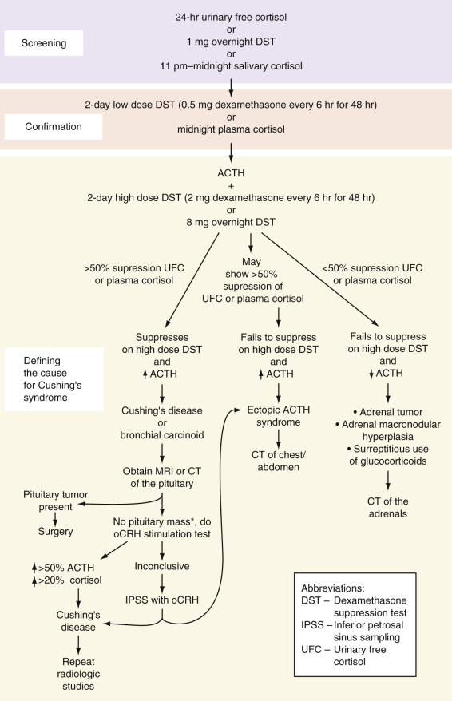

Figure 24-17 

Algorithm for the evaluation of Cushing's syndrome. 

All screening tests must be followed by a confirmatory test. _ACTH,_ Adrenocorticotropin; _CT,_ computed tomography; _oCRH,_ ovine corticotropin-releasing hormone; _MRI,_ magnetic resonance imaging. *If there is no pituitary mass, obtain a chest radiograph and chest CT to rule out bronchial carcinoid before proceeding to IPSS. 

As per the latest guidelines for the diagnosis of Cushing's syndrome, any UFC concentration above the upper limit of normal for that particular assay should be considered a positive test (  Nieman et al, 2008  ). Values greater than four times the upper limit of normal are diagnostic of Cushing's syndrome. From 10% to 15% of patients with Cushing's syndrome will have at least one in four 24-hour urine collections for free cortisol return as normal (  Nieman & Cutler, 1990  ). If cortisol excretion is normal but clinical suspicion is high, the study should be repeated or a different screening method should be used. Milder elevations of UFC can be seen in pseudo-Cushing's and during normal pregnancy. Pseudo-Cushing's is an entity characterized by HPA axis overactivity but without true Cushing's syndrome. It has been described in depression, anxiety disorders, alcoholism, poorly controlled diabetes, and morbid obesity. Refer to the Pseudo-Cushing's section later in the chapter for more details. The overnight dexamethasone suppression test is a much simpler test to perform. The patient takes 1 mg of dexamethasone orally between the hours of 11  pm  and 12 midnight. The plasma cortisol is drawn the following morning between 8  am  and 9  am  , respectively. The original criterion for an abnormal response was failure to suppress the morning cortisol level to <5 µg/dL (138 nmol/L); this has been revised downward to <1.8 µg/dL (50 nmol/L) (  Findling & Raff, 1999  ;  Arnaldi et al, 2003  ;  Nieman et al, 2008  ). Using the lower cutoff of < 1.8 µg/dL (50 nmol/L) provides a greater than 95 % sensitivity and 80% specificity, and serves to minimize the number of false-positive results (  Nieman et al, 2008  ). Failure to suppress could be due to Cushing's syndrome or pseudo-Cushing's, and may even occur in some patients who are normal. The false-positive rate can be as high as 30% for a variety of reasons: Dexamethasone was taken too early; the patient was on phenobarbital, phenytoin, or another medication known to accelerate the metabolism of dexamethasone; malabsorption; alcoholism; or morbid obesity. Pregnancy and drugs such as estrogen, which increase serum transcortin (aka CBG), may also result in elevated cortisol levels. Because of these and possibly other factors, about 1% of healthy individuals, 13% of obese patients, 50% of women on estrogens, and 25% of hospitalized and chronically ill patients show false-positive overnight dexamethasone suppression tests (DSTs). False-negative results, on the other hand, occur in less than 2% of patients. 

The midnight salivary cortisol (MSC) concentration is a simple, convenient, and accurate means by which to diagnose Cushing's syndrome. MSC carries a high diagnostic sensitivity and specificity, and has been demonstrated to have an excellent correlation with the plasma free cortisol concentration (  Papanicolaou et al, 2002  ;  Yaneva et al, 2004  ;  Alwani et al, 2014  ). Using a cutoff of 9.3 nmol/L on a commercial ELISA kit, MSC had a sensitivity of 100%, specificity of 83%, PPV of 94%, and NPV of 100% (  Alwani et al, 2014  ). It performs slightly better than the 24-hour UFC in distinguishing patients with Cushing's syndrome from obese subjects (  Yaneva et al, 2004  ). 

Several studies describe the use of a late-night (11  pm  to 12  am  ) salivary cortisol (LNSC); others use the terms _MSC_ and _LNSC_ interchangeably, although the methodologies describe the samples as being collected at midnight. There are no studies comparing MSC with LNSC; however, because the data for MSC is more robust, it is the preferred test. 

The patient can collect the sample at home. Two methods can be used to collect the sample: The patient can chew on a cotton pledget for 2 to 3 minutes and then place the pledget into a plastic tube; alternatively, the patient can passively drool directly into a test tube. The sample is then mailed to the reference laboratory; because salivary cortisol is very stable, there is little concern about degradation during transport. The sample can be analyzed either by immunoassay or liquid chromatography–mass spectrometry (LC-MS/MS). While immunoassay is more widely used, LC-MS/MS is useful in evaluating for surreptitious use of steroids and for steroid excess in those using inhaled steroids (  Raff, 2013  ). Normative values vary according to the reference laboratory. Results should be interpreted with caution in those who may have blunting of their circadian rhythm (e.g., shift workers, patients with depression, critical illness). Falsely elevated results may be seen in smokers and users of chewing tobacco, in which case refraining from use for 24 hours prior to collection is recommended. 

 

##  Screening in special populations. 

The preferred screening test during pregnancy is the UFC. UFC levels normally rise during the second and third trimesters, therefore UFC values greater than three times the upper limit of normal are considered consistent with Cushing's syndrome (  Nieman et al, 2008  ). 

Because of the decrease in cortisol filtration with declining renal function, the 1-mg DST is the recommended screen in patients with renal failure. For those suspected of having cyclic Cushing's, use of serial UFC or MSC is suggested. The diagnostic thresholds for MSC during pregnancy and in renal disease remain to be established. 

For an incidentally discovered adrenal mass, the 1-mg DST has been shown to be superior to the UFC and MSC (  Raff, 2013  ). 

 

##  Confirmatory Tests for the Diagnosis of Cushing's Syndrome. 

For equivocal screening results, one option would be to repeat testing in 3 months. A more definitive way to confirm the diagnosis of Cushing's syndrome is with a midnight plasma cortisol or 2-day low-dose DST performed alone or with the administration of CRH. 

Midnight plasma cortisol requires hospital admission for at least 48 hours, insertion of a line for IV access before 10  pm  , the patient sleeping at the time of the blood draw, and availability of staff to draw the blood at midnight. A midnight plasma cortisol greater than 7.5 µg/dL (207 nmol/L) is diagnostic of Cushing's; this has a 100% specificity for normals and those with pseudo-Cushing's (  Newell-Price et al, 1995  ;  Papanicolaou et al, 1998  ). The low-dose (2-day 2 mg) dexamethasone suppression test (LDDST) requires the collection of two baseline 24-hour urine samples for UFC. The patient is then given 0.5 mg dexamethasone orally every 6 hours, starting at 9  am  for 2 days. On day 2 of dexamethasone, another 24-hour urine sample is collected for UFC. All 24-hour urine collections should include the measurement of creatinine to assay for adequacy of the collection. A normal response is a decrease in UFC to less than 10 µg (27 nmol) per 24 hours on the second day of dexamethasone. This has a sensitivity of 97% to 100% for discriminating patients with Cushing's syndrome from normal individuals (  Newell-Price et al, 1998  ). Instead of measuring UFC, serum cortisol can be measured at baseline (9  am  day 1) and at 48 hours following the first dose of dexamethasone. A normal response consists of suppression of the plasma cortisol to less than 1.8 µg/dL (50 nmol/L), which has a sensitivity and specificity of more than 95% (  Newell-Price et al, 1998  ). Performance of the LDDST with CRH has been purported to better distinguish Cushing's syndrome from pseudo-Cushing's (  Yanovski et al, 1993  ). For this test, 1-µg/kg or 100 µg ovine CRH is administered IV 2 hours after the last dose of dexamethasone. Cortisol is measured prior to the first dose of dexamethasone on day 1, immediately prior to the administration of synthetic ovine CRH (oCRH), and then 15 minutes following oCRH. A dexamethasone level should be measured at the time of CRH administration to exclude false-positive results. Adherence to the time schedule is important for both LDDST and LDDST with CRH. The normal response for both tests is a serum cortisol <1.8 µg/dL (<50 nmol/L). 

 

##  Tests for Defining the Cause of Cushing's. 

Once the diagnosis of Cushing's syndrome is established, the next step is to determine its cause. Cushing's is categorized as being ACTH dependent or ACTH independent; this is accomplished by measuring the plasma ACTH, or by performing a high-dose DST or a CRH stimulation test ( [ Table 24-16 ](<#t0085>) ). 

TABLE 24-16 

Differential Diagnosis of Hormonal Values Seen in Cushing's Syndrome 

Cause  |  Plasma ACTH  |  Plasma Cortisol (PM)  |  High-Dose or Overnight Dexamethasone Suppression   
---|---|---|---  
Pituitary-dependent  |  N—slightly ↑ |  ↑ |  Yes   
Adrenal disease  |  ↓—undetectable  |  ↑ |  No   
Ectopic Cushing's [ * ](<#hl0001322>) |  ↑↑↑ |  ↑↑ |  Usually no   
Pseudo-Cushing's  |  N—slightly ↑ |  N–↑ |  Usually yes   
  
_ACTH,_ Adrenocorticotropin; _N,_ normal. 

 * ACTH levels may overlap with values seen in pituitary-dependent disease. 

ACTH-independent Cushing's syndrome results from autonomous production of cortisol, which would feed back on the hypothalamus and pituitary gland, causing suppression of CRH and ACTH secretion. The technique for measuring plasma ACTH has been described previously. Values below the level of detection or below 10 pg/mL (2 pmol/L) at 9  am  with concomitantly elevated cortisol support an ACTH-independent cause for Cushing's syndrome. Plasma levels greater than 20 pg/mL (4 pmol/L) in the face of hypercortisolism are strongly suggestive of an ACTH-dependent cause. A CRH stimulation test with measurement of ACTH is indicated for values between 10 and 20 pg/mL (2 to 4 pmol/L) (  Orth, 1995  ). Although patients with ectopic ACTH production tend to have markedly elevated ACTH levels, there is great overlap with the levels seen in Cushing's disease; therefore, it cannot be used to reliably distinguish between these entities. 

The high-dose (2-day 8-mg) DST is useful for distinguishing Cushing's disease from adrenal or ectopic Cushing's. It is of note that cortisol levels in neuroendocrine tumors such as bronchial carcinoid may also suppress on high-dose dexamethasone. For the high-dose DST, a baseline 24-hour urine sample for UFC is collected. Beginning on day 1, the patient receives 1 mg of dexamethasone orally every 6 hours for 48 hours; urine for UFC is collected on day 1 and on day 2. Suppression of UFC or plasma cortisol by 50% or more from baseline is diagnostic of Cushing's disease. As an alternative to measuring UFC, plasma cortisol can be collected before, during, and 6 hours after the last dose of dexamethasone. Most patients with adrenal adenomas, carcinomas, or ectopic ACTH syndromes do not show suppression. This test has a sensitivity and specificity of 60% to 85%; the greater the degree of suppression, the greater the specificity. 

The 8-mg overnight DST has been reported by several authors to share similar sensitivity and specificity to the high-dose DST (  Dicheck et al, 1994  ). An 8  am  plasma cortisol is obtained, and 8 mg of dexamethasone is administered orally at 11  pm  . An 8  am  plasma cortisol is obtained the next morning. Reduction of cortisol to less than 5 µg/dL is strongly supportive of Cushing's disease (see [ Fig. 24-17 ](<#f0090>) ). 

Most pituitary tumors and a few ectopic ACTH-secreting tumors will respond to CRH stimulation with an increase in plasma ACTH and cortisol, whereas little response is noted in those with adrenal Cushing's. For the CRH stimulation test, two basal plasma cortisol and ACTH levels are collected about 5 minutes apart, and then 1 µg/kg of body weight or a single dose of 100 µg of oCRH is injected intravenously. Blood is sampled every 15 minutes for 1 to 2 hours for cortisol and ACTH. Normal subjects will show a rise in ACTH and cortisol of approximately 15% to 20%, while those with Cushing's disease typically show a greater than 50% rise in ACTH and a greater than 20% rise in cortisol above baseline (  Kaye & Crapo, 1990  ;  Newell-Price et al, 2002  ;  Stewart, 2003  ). Ovine CRH is superior to human CRH in distinguishing among the different causes of Cushing's syndrome (  Nieman et al, 1989  ). Vasopressin stimulates ACTH release through the V3 receptors in the anterior pituitary gland. Administration of 10 units of vasopressin intramuscularly normally causes doubling of ACTH levels and an increase in serum cortisol of 150 µg/L over baseline. This offers no advantage over testing with CRH. It may prove useful, however, in differentiating Cushing's disease from pseudo-Cushing's syndrome and in the postoperative assessment of Cushing's disease (  Newell-Price et al, 2002  ). 

In rare instances, it may be necessary to use selective sampling of inferior petrosal sinus blood to document that the pituitary gland is the source of excess ACTH. This invasive, technically difficult procedure carries a relatively high cost and complication rate and should be performed only at a center well experienced with this technique. The ACTH concentration in the petrosal sinus blood should exceed twice that of peripheral venous blood to ensure diagnostic sensitivity and specificity of 100% (  Orth, 1995  ). In those with ectopic production, the ratio is usually less than 1.4 : 1\. Use of CRH during sampling increases the sensitivity and specificity. 

Given that the incidence of **incidentaloma** of the adrenal glands and pituitary gland has been reported to be as high as 10%, imaging studies should be performed only after the hormonal diagnosis of Cushing's disease or syndrome has been made. In Cushing's disease, visualization of the sella is performed by MRI or CT, with and without contrast, with MRI being the preferred study. For adrenal Cushing's, the test of choice is a CT of the abdomen; for ectopic disease, CT of the chest may also be needed. 

 

##  Pseudo-Cushing's Syndrome 

Excess activity of the hypothalamic-pituitary axis, similar to that seen in pituitary Cushing's syndrome, has been demonstrated in some patients with alcoholism, major depression, poorly controlled diabetes, and obesity. Resolution of the underlying problem results in normalization of the HPA axis. These patients may not suppress on a low-dose DST and may have elevated UFC. Depressed patients who fail to suppress cortisol secretion in response to dexamethasone also show an impaired ACTH response to exogenous CRH, but will usually retain a normal cortisol response (  Gold et al, 1986  ;  Thalen et al, 1993  ). A single serum cortisol above 7.5 µg/dL at midnight has been shown to discriminate Cushing's syndrome from pseudo-Cushing's with 100% specificity (  Papanicolaou et al, 1998  ). A more definitive test for distinguishing between these two entities is the combined dexamethasone-oCRH test. 1 µg/kg or 100 µg oCRH is infused 2 hours after a low-dose dexamethasone test. A plasma cortisol concentration greater than 38 nmol/L measured at 15 minutes following the administration of oCRH correctly identifies all cases of Cushing's syndrome and all cases of pseudo-Cushing's, with a specificity, sensitivity, and diagnostic accuracy of 100% (  Yanovski et al, 1993  ). 

 

##  Adrenal Insufficiency 

Adrenal insufficiency is categorized according to the key site of dysfunction within the HPA axis: primary (adrenal), secondary (pituitary), and tertiary (hypothalamic). A major distinction between primary adrenal insufficiency and either of the central causes is that primary disease is associated with mineralocorticoid deficiency. In the Western world, primary adrenal insufficiency, also known as Addison's disease, is most commonly due to autoimmune adrenalitis (70% to 90% of all cases); other causes include tuberculosis (most common cause worldwide), granulomatous disorders, metastatic disease, hemorrhage, human immunodeficiency virus, acquired immunodeficiency syndrome, and infection. The most common cause of central adrenal insufficiency is HPA axis suppression due to prolonged treatment with pharmacologic doses of steroids. 

 

##  Tests for the Diagnosis of Adrenal Insufficiency 

 

##  Basal Hormone Measurements 

An 8  am  to 9  am  plasma cortisol of less than 3 µg/dL (83 nmol/L) is indicative of adrenal insufficiency and obviates the need for further testing. Although most patients with hypocortisolism have low serum cortisol levels, a level drawn during a time of stress that falls within the reference range does not exclude the diagnosis. Rather, it may support this diagnosis, as a suboptimal cortisol level may have risen into the reference interval in response to a very high ACTH level induced by stress. A random cortisol of greater than 25 µg/dL (700 nmol/L) during critical illness makes it unlikely that the patient is adrenally insufficient (  Burke, 1985  ), whereas a random cortisol of less than 10 µg/dL is strongly suggestive of adrenal insufficiency (  Fleseriu & Loriaux, 2009  ). 

 

##  ACTH Stimulation Test 

The most convenient procedure for studying patients suspected of having hypocortisolism is the ACTH stimulation test. This test, which can be performed at any time of day, consists of drawing a baseline serum cortisol and then administering 250 µg of Cosyntropin (a commercially available ACTH analog) intravenously or intramuscularly. Serum for cortisol is again collected at 30 and 60 minutes post-Cosyntropin. A normal response is a cortisol level greater than 18 to 20 µg/dL (500 to 550 nmol/L) at either time point (  Speckart et al, 1971  ;  Burke, 1985  ). Drawing an ACTH level at baseline may help in distinguishing primary adrenal insufficiency (associated with an elevated ACTH usually greater than 50 to 100 pg/mL) from secondary or tertiary forms (which would have a low ACTH level less than 10 pg/mL) (  Oelkers et al, 1992  ) (refer to the Laboratory Measurement of ACTH section earlier in the chapter). The aldosterone response to ACTH may also help in making this distinction; failure of aldosterone to increase by more than 4 ng/dL over baseline suggests primary adrenal dysfunction. 

Steroids should never be withheld from a critically ill patient suspected of having adrenal insufficiency; instead a random sample for cortisol and ACTH should be drawn and treatment initiated with dexamethasone, which does not interfere with the cortisol assay. Formal testing should take place within 72 hours, before HPA axis suppression occurs. About 90% of cortisol circulates bound to CBG and albumin, and approximately 10% circulates freely (unbound). CBG declines during critical illness, resulting in an increase in the fraction of unbound (free) cortisol compared with the bound fraction. Because the serum total cortisol concentration does not accurately reflect this alteration in free/bound cortisol, it is common to overdiagnose adrenal insufficiency in the critical care setting. Since access to laboratories that readily and reliably measure free cortisol is limited, some have advocated use of the free cortisol index (FCI) and calculated free cortisol (CFC) to better delineate those patients in true need of steroid replacement therapy (  Beishuizen et al, 2001  ;  Hamrahian et al, 2004  ;  Ho et al, 2006  ). To obtain the FCI, it is necessary to measure the serum CBG. CFC is the total cortisol (nmol/L)/CBG (mg/L), with normal being a value above 12. Given that for the vast majority of institutions, determination of CBG requires that the sample be sent to a reference laboratory, it may be more prudent and certainly more expedient to simply send aliquots from t-0, t-+30, and t-+60 minutes post–ACTH administration for serum free cortisol, and provide steroid coverage pending these results (  Fleseriu & Loriaux, 2009  ). Checking the ACTH level at t-0 will help to further classify adrenal insufficiency as being primary versus secondary or tertiary. Salivary cortisol, which is unaffected by changes in CBG, may eventually prove useful in this setting (  Raff, 2009  ). 

Some have supported the use of a 1-µg dose of ACTH instead of the full 250-µg dose for diagnosing adrenal insufficiency. The premise is that the massively supraphysiologic dose of 250 µg will cause those with partial adrenal insufficiency to mount a normal response, and that these individuals will fail to show an adequate rise in cortisol in response to a 1-µg test dose. This procedure has not gained wide acceptance, nor has the normal range been standardized; more importantly, the diagnosis of **partial adrenal insufficiency** remains in contention. 

The ITT has long been considered the gold standard for assessing the HPA axis. Unlike the ACTH stimulation test, the ITT assesses the integrity of the entire HPA axis. If the HPA axis is intact, insulin-induced hypoglycemia stimulates the hypothalamus and the pituitary gland to secrete CRH and ACTH, respectively, which, in turn, leads to a rise in cortisol. This test is contraindicated in individuals with ischemic heart disease, in older adults (>70 years of age), during pregnancy, and in those with a history of seizures. Patients highly suspected of having central adrenal insufficiency (i.e., prior pituitary surgery or radiation therapy) should receive a lower dose (0.05 U/kg) of insulin, rather than 0.1 to 0.15 U/kg. Glucose and cortisol are measured at –15 minutes, at baseline, and then at 15, 30, 45, 60, 90, and 120 minutes following insulin administration. For the test to be valid, adequate hypoglycemia must be attained (signs and symptoms of hypoglycemia and glucose less than 40 mg/dL [2.2 mmol/L]). A normal response is a rise in the cortisol level to greater than or equal to 18 µg/L or 20 µg/L at any time during the test (  Nelson & Tindall, 1978  ;  Burke, 1985  ;  Grinspoon & Biller, 1994  ). Preliminary work suggests there was no difference in peak GH or cortisol level attained when analog insulin was substituted for regular insulin for the ITT (  Yuen et al, 2008  ). 

The cortisol response to hypoglycemia can be predicted reliably by the response to acute ACTH stimulation—a safer, cheaper, and quicker test (  Stewart, 2003  ). The ITT is used mainly as a second-line measure to further evaluate those patients who had a borderline response to the ACTH stimulation test. 

In the days before the commercial availability of a reliable assay to measure ACTH, it was common to perform a prolonged ACTH stimulation test (ACTH infusion over a 2-day period) to distinguish central from primary adrenal insufficiency. In other hormone systems, lack of stimulation normally leads to upregulation of the end-organ receptors; however, the adrenal glands downregulate their ACTH receptors in response to lack of stimulation. A short ACTH stimulation test would typically produce an inadequate response. By priming the system with prolonged exposure to ACTH, those with hypothalamic disease display a delayed but normal rise in cortisol. 

 

##  Overnight Metyrapone Test 

Metyrapone has also been used to assess the integrity of the HPA axis. Metyrapone inhibits 11-β-hydroxylase, preventing the conversion of 11-deoxycortisol (compound S) to cortisol. Under normal circumstances, the metyrapone-induced drop in cortisol is detected at the level of the hypothalamus and pituitary gland; a compensatory increase in CRH and ACTH secretion occurs, stimulating steroidogenesis and leading to a buildup of 11-deoxycortisol, the hormone preceding the block. Patients with central adrenal insufficiency fail to increase CRH and/or ACTH, steroidogenesis is not stimulated, and 11-deoxycortisol fails to increase. Metyrapone 30 mg/kg is administered orally at midnight; blood for cortisol and 11-deoxycortisol is collected the following morning at 8  am  . A rise in 11-deoxycortisol to greater than 7 µg/dL (200 nmol/L) is normal (  Fiad et al, 1994  ;  Grinspoon & Biller, 1994  ). An abnormal response is defined by 11-deoxycortisol less than 7 µg/dL accompanied by cortisol less than 5 µg/dL. This test should be performed with caution as it may provoke an addisonian crisis in those with central hypocortisolism. Metyrapone is currently only available on a compassionate basis; as a result this test is rarely performed. 

 

##  Corticotropin-Releasing Hormone Test 

The oCRH test can be used not only to diagnose hypocortisolism, but to localize the site of damage (  Schulte et al, 1984  ). It is a safe test; however, it is expensive. After blood is drawn for baseline ACTH and cortisol, 100 µg oCRH is administered intravenously. Blood is then collected for cortisol and ACTH every 15 minutes for 60 to 90 minutes. A normal response is seen as cortisol greater than 20 µg/dL. Basal ACTH levels and their change in response to oCRH are used to localize the site of pathology. Plasma corticotropin usually peaks at 15 to 30 minutes, and cortisol usually peaks at around 30 to 40 minutes post oCRH injection (  Oelkers, 1996  ). 

Both the bound and free cortisol concentrations show a progressive rise throughout pregnancy. With this in mind, it has been recommended that higher cutoffs be used to properly interpret the ACTH stimulation results in pregnancy (  Jung et al, 2011  ). A random morning cortisol level less than 11 µg/dL, 16 µg/dL, and 22 µg/dL when measured during the first, second, and third trimester of pregnancy, respectively, should raise the suspicion of adrenal insufficiency (  Jung et al, 2011  ). A serum cortisol 60 minutes post-ACTH of less than 25 µg/dL, 29 µg/dL, and 32 µg/dL for the first, second, and third trimester of pregnancy, respectively, is diagnostic of adrenal insufficiency (  Lebbe & Arlt, 2013  ;  Yuen et al, 2013  ). 

Antibodies against 21-hydroxylase antigen should be assayed in those whose Addison's disease (primary adrenal insufficiency) does not have an obvious explanation. Positive antibodies confirm autoimmune adrenalitis; these patients should be screened and monitored for the development of other autoimmune disorders. The absence of antibodies does not rule out an autoimmune etiology, as titers usually drop in concurrence with adrenal destruction. 

The use of steroids in the treatment of malignant, inflammatory, and immunologic disorders is a common iatrogenic cause of adrenal insufficiency. The degree of adrenal suppression is dependent on the specific glucocorticoid dose, duration, frequency, and route of administration. Assessment of adrenal function in patients being tapered off of exogenous steroids can be performed once they are tapered to the equivalent of a daily dose of 10 mg hydrocortisone. Have them omit the morning glucocorticoid dose, and measure the 8  am  cortisol level. If it is greater than 10 µg/dL, routine supplementation of steroids can be ended. Because the adrenal cortex lags behind the pituitary gland in recovery from steroid suppression, complete adrenal recovery can also be demonstrated by an appropriate rise in serum cortisol following an 8  am  Cosyntropin infusion. 

,  

##  Renin-Aldosterone Axis 

At least 20 million people in the United States have hypertension, and 90% to 98% of cases are classified as essential hypertension. The mortality and morbidity from associated myocardial, cerebrovascular, and renal complications necessitate aggressive treatment of this disorder. Investigation into the etiology of hypertension revealed the importance of the renin-angiotensin-aldosterone system, not only in the origin and persistence of hypertension but also as a guide to its treatment. The role of the renin-aldosterone axis is to maintain blood pressure within normal limits by sensing and responding to changes in plasma volume, salt balance, and renal perfusion pressure. 

Renin is a proteolytic enzyme which, although formed by other tissues throughout the body, is mainly formed and stored by juxtaglomerular (JG) cells within the macula densa of the kidney. Renin is synthesized from a larger precursor protein, prorenin (big renin), and is converted to its active form within the JG cells. The release of renin into the circulation occurs in response to a variety of triggers: a drop in renal hydrostatic pressure, hyponatremia, hypokalemia, or a decrease in catecholamines, angiotensin II, or atrial natriuretic hormone. Both suppression of plasma renin activity induced by potassium administration and stimulation of renin activity following potassium depletion occur independently of changes in aldosterone secretion or in sodium balance (  Brunner et al, 1970  ). 

Several isoenzymes of renin are known. Their release is regulated by cAMP. Renin acts on angiotensinogen (renin substrate), an α 2  -globulin formed by the liver, converting angiotensinogen to angiotensin I. Angiotensin I in turn is converted into angiotensin II by the angiotensin-converting enzyme (ACE). ACE is found in the pulmonary and vascular endothelia, as well as in cell membranes of the kidney, heart, and brain (  Brewster & Perazella, 2004  ). It is believed that angiotensin II is the peptide responsible for the physiologic effects on target tissue. Angiotensin II not only stimulates the release of aldosterone, but it is also a very potent vasoconstrictor that can stimulate the release of catecholamines from the adrenal glands and norepinephrine from the sympathetic nervous system, and stimulate the release of vasopressin. The octapeptide angiotensin II is further split to a heptapeptide, angiotensin III; in addition, angiotensin I may be changed directly to angiotensin III without being converted to angiotensin II. Although speculation about the functions of angiotensin III is ongoing, it appears to modulate aldosterone secretion in a similar manner to angiotensin II. The active angiotensins are rapidly cleared by various aminopeptidases (angiotensinases) within the circulation and during transit through tissues. These relationships are shown in [ Figure 24-18 ](<#f0095>) . 

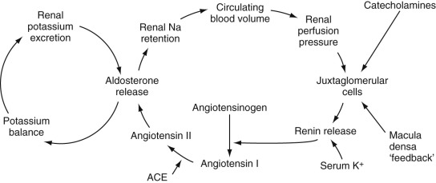

Figure 24-18 

Renin-aldosterone axis. 

Elevated K  \+  inhibits renin secretion but has a stimulatory effect on aldosterone. Catecholaminergic influence is variable; β-adrenergic activity stimulates and α-adrenergic activity inhibits renin secretion from the juxtaglomerular cells. _ACE, Angiotensin-converting enzyme._

(Redrawn from Braunwald E, Fauci AD, Kasper D, et al, editors: _Harrison 's principles of internal medicine, _ ed 15, New York, 2001, McGraw-Hill, p 2087.) 

Renin, through its product, angiotensin II, directly stimulates the synthesis and secretion of aldosterone by the adrenal zona glomerulosa. Renin release, the rate-limiting step in the renin-aldosterone axis, is dependent on changes in effective plasma volume, which, in turn, are dependent on tubular reabsorption of sodium by the kidney. Low plasma volume and low serum sodium stimulate the secretion of renin, resulting in aldosterone release, which, in turn, causes sodium retention along with an increase in plasma volume and blood pressure, and potassium loss. Conversely, an increase in effective blood volume or acute elevation in blood pressure results in low renin, low angiotensin, low aldosterone, and subsequent sodium loss. In contradistinction to aldosterone, renin secretion is inhibited by hyperkalemia ( [ Fig. 24-19 ](<#f0100>) ). 

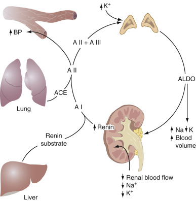

Figure 24-19 

The normal renin-angiotensin-aldosterone axis. 

Renin, secreted by the kidney, cleaves angiotensin I from renin substrate (angiotensinogen) produced by the liver. Angiotensin I is converted to angiotensin II by angiotensin-converting enzyme (ACE), mainly in the lung. Angiotensin II increases peripheral vascular resistance and, together with angiotensin III, stimulates aldosterone (ALDO) secretion, which results in sodium retention and increased plasma volume. 

(Adapted from Stewart PM: The adrenal cortex. In Larsen PR, Kronenberg HM, Melmed S, et al, editors: _Williams textbook of endocrinology,_ ed 10, Philadelphia, 2003, Saunders, p 499.) 

Aldosterone and glucocorticoids act at the mineralocorticoid receptor located in the cells lining the collecting ducts of the kidney to cause reabsorption of sodium, leading to an increase in intravascular volume. Aldosterone also causes renal potassium loss. Studies have suggested a role for aldosterone in the development and perpetuation of vasculopathy; it has been shown to stimulate genes for collagen synthesis, tissue growth factors, inflammatory factors, and plasminogen activator inhibitor type 1 (  Brilla et al, 1994  ;  Schunkert et al, 1997  ;  Brown et al, 2000  ;  Rocha et al, 2000  ;  Luft, 2002  ). The synthesis of aldosterone is restricted to the zona glomerulosa; here the enzyme aldosterone synthetase (CYP11B2) converts corticosterone to aldosterone. The major stimuli for aldosterone secretion are angiotensin II and hyperkalemia. ACTH is a much weaker stimulus. Somatostatin, atrial natriuretic hormone, dopamine, and heparin directly inhibit aldosterone synthesis. Cortisol circulates at a much higher concentration than aldosterone, and although it binds with equal affinity to the mineralocorticoid receptor, it does not normally function as a major mineralocorticoid. The reason is that the enzyme 11-β-hydroxysteroid dehydrogenase II (11-HSD-2, also known as CYP11B2), expressed by the mineralocorticoid targets cells in the collecting tubules acts to convert cortisol to cortisone, an inactive metabolite. 

 

##  Renin and Hypertension 

The work of Laragh and colleagues has indicated that essential hypertension can be classified on the basis of renin measurements as high, low, or normal renin, and that drug selection can be based on this classification (  Laragh et al, 1972  ;  Laragh, 1993  ). About 15% of patients with essential hypertension have high-renin hypertension. Hyperreninemia resulting from renal parenchymal disease or renal vasculopathy leads to increased aldosterone production and the subsequent retention of sodium and enhanced potassium excretion. Patients with this condition are hypervolemic, intensely vasoconstrictive, and more prone to ischemic injury. Renin profiling has shown renin to be an independent risk factor for myocardial infarction. Even if pressures are controlled by antihypertensives, if they do not address plasma renin activity, such patients fare worse than individuals with lower renin levels (  Alderman et al, 1991  ). Increased aldosterone (secondary aldosteronism) may contribute significantly to the symptoms and course of high-renin hypertension. Some of the causes of high-renin hypertension are listed in [ Box 24-7 ](<#b0040>) . 

Box 24-7 

Causes of Hypertension Associated with High Levels of Plasma Renin 

  * Renin-secreting tumor 

  * Malignant accelerated hypertension 

  * Renovascular hypertension 

    * Major arterial lesions 

    * Segmental lesions 

  * Chronic renal failure 

    * End stage 

    * Transplant rejection 

  * Cushing's syndrome 

  * Iatrogenic 

    * Volume-depleting agents 

    * Vasodilating agents 

    * Glucocorticoids 

    * Estrogens 

Renin-secreting tumors are extremely rare and can be difficult to diagnose. They can be benign or malignant, renal or extrarenal. The most common location is in the juxtaglomerular apparatus. A young patient with markedly elevated plasma renin activity, hyperaldosteronism, and hypokalemia in the absence of a renovascular lesion typifies the classic clinical presentation (  Corvol et al, 1994  ). Malignant hypertension is also associated with high plasma renin activity and aldosterone. When such patients are given medications that interrupt the renin-aldosterone axis, such as ACEIs, blood pressure often normalizes. In renal vascular hypertension, the renin and aldosterone levels are also elevated. However, in contradistinction to malignant hypertension, treatment with ACEs usually results in further deterioration of renal function. Patients suspected of having renal artery stenosis should undergo further testing (e.g., captopril-induced renogram, renal duplex ultrasound, magnetic resonance angiography). A positive test leads to renal vein angiography and catheterization for selective blood sampling. In unilateral renal disease, both plasma renin and aldosterone are elevated. Asymmetry in the renin levels obtained during renal vein catheterization offers one of the best measurements to judge the likelihood of blood pressure response to corrective surgery. When the ratio of plasma renin in the renal vein of the affected to the nonaffected side is at least 1.5 : 1, surgery may lead to improvement. With suppression of renin release from the nonaffected side, renal vein renin levels approximating those found in blood specimens obtained from the inferior vena cava also indicate probable success of curative surgery. Almost 40% of these patients have peripheral blood plasma renin activity that is within the reference interval (  Streeten et al, 1979  ); consequently, peripheral plasma renin is a poor predictor of response to surgery. Renin secretion can be found in lung cancer, hepatic hamartoma, and other rare conditions (  Anderson et al, 1989  ). 

When an acceleration of hypertension occurs, renin is usually markedly increased; however, with chronic renal failure, almost any renin level can be expected. A small number of hypertensive patients on dialysis have intractable, accelerated hypertension. In those patients in whom dialysis cannot control the hypertension, markedly elevated plasma renin levels can be lowered by nephrectomy or, in the case of renal artery stenosis, angioplasty or revascularization (  Whitehouse et al, 1981  ;  Sonkodi et al, 1990  ;  Tullis et al, 1999  ). ACEIs can be used to mitigate the rise in aldosterone; however, in the setting of renal disease, they can precipitate or worsen hyperkalemia. In renal transplant patients, elevated plasma renin may be indicative of renal ischemia and rejection. 

Systemic hypertension occurs in patients with Cushing's syndrome. Some of these patients have increased plasma renin and renin substrate. Other Cushing's syndrome patients have hypokalemia associated with secretion of a minor mineralocorticoid (such as DOC or corticosterone) that causes hypertension (  Krakoff et al, 1975  ). In still other patients, severely elevated cortisol levels overwhelm the capacity of 11-hydroxysteroid dehydrogenase (11-HSD) to convert cortisol to its metabolically inactive form, cortisone, leading to a picture of excess mineralocorticoid activity with suppressed plasma renin activity. Other causes of high-renin hypertension include treatment with medications such as diuretics, vasodilators, or other antihypertensives. Hormonal agents such as glucocorticoids, as well as some estrogen-containing oral contraceptives, have been found to increase renin substrate activity. 

Even though plasma renin activity, aldosterone, and urinary sodium excretion may be normal in 60% of hypertensive patients, evidence indicates that renin-angiotensin plays a significant part in normal-renin hypertension. The response of many hypertensive patients with normal renin to angiotensin-converting enzyme inhibitors or angiotensin II antagonists (saralasin) has implicated renin and angiotensin II in sustaining hypertension in these patients. Moreover, Ames showed that once blood pressure was increased by angiotensin infusion, it could be maintained with only one fifth of the original dose (  Ames et al, 1965  ). 

It was found that low-renin essential hypertension, which involves chronic expansion of plasma and extracellular fluid volume, is characterized by aldosterone oversecretion and responds to diuretic therapy. At least 25% of patients with essential hypertension are found to have low-renin hypertension. Most investigators have characterized this state as hyporesponsive, meaning that low-renin hypertensive patients fail to respond as well as healthy subjects do with upright posture, sodium restriction, diuretics, vasodilators, or a combination of these. Atrial natriuretic peptide may be elevated in these patients, and the response of aldosterone to renin may be exaggerated (  Sergev et al, 1990  ). Renin suppression increases with age and appears to be more common in women and in the black population. 

Listed in [ Box 24-8 ](<#b0045>) are a group of syndromes associated with low levels of plasma renin. These have been divided into a subgroup that is of adrenal origin (primary) and a subgroup that is nonadrenal or secondary in origin. Primary aldosteronism is uncommon compared with renin hypertension. It is characterized by (1) systolic and diastolic hypertension caused by oversecretion of aldosterone by an adrenal adenoma (aldosterone-producing adenoma [APA]) or hyperplasia (idiopathic hyperaldosteronism [IHA]), (2) low renin or a high aldosterone/renin ratio (>50), (3) renal potassium wasting, and (4) sodium retention. It should be suspected in patients with hypertension and spontaneous or diuretic-induced hypokalemia, resistant hypertension requiring more than three medications, onset younger than 30 years of age, or an incidentally found adrenal mass. Several potential screening tests have been used to detect primary aldosteronism and to separate unilateral aldosterone-producing adenomas from other causes of primary aldosteronism. A low-salt diet (<2 g/day), stress, upright posture, and diuretics all increase plasma aldosterone, whereas a high-salt diet and lying in a supine position suppress aldosterone secretion in healthy subjects. Combinations of these maneuvers have been used in the diagnosis of excessive aldosterone secretion; however, they do not reliably distinguish APA from IHA. When healthy subjects are placed on a high-salt diet and lie in the supine position, they suppress their plasma aldosterone levels to less than 10 ng/dL (278 pmol/L). 

Box 24-8 

Causes of Hypertension Associated with Low Levels of Plasma Renin 

 

##  Primary Excess of Mineralocorticoids 

  * Primary aldosteronism 

  * Pseudoprimary (idiopathic) aldosteronism 

  * Glucocorticoid-suppressible aldosteronism 

  * 11-Deoxycorticosterone excess (CAH due to 11-β-hydroxylase deficiency) 

  * 18-Hydroxy-11-deoxycorticosterone excess 

  * Adrenal carcinoma (excess mineralocorticoids and/or glucocorticoids) 

 

##  Secondary Excess of Mineralocorticoids 

  * Licorice ingestion 

  * Excess sodium intake 

  * Hyporenin hypoaldosteronism 

  * Long-standing essential hypertension 

  * Diabetes mellitus 

_CAH,_ Congenital adrenal hyperplasia. 

 

##  Primary Hyperaldosteronism: Screening and Confirmation Tests 

The algorithm proposed by Blumenfeld and colleagues for evaluating hypertensive patients suspected of having primary hyperaldosteronism is to initially measure the serum potassium (  Blumenfeld et al, 1994  ). If it is less than 3.6 mmol/L, then plasma renin activity is measured. Plasma renin activity of less than 1.0 ng/mL/hour leads to 24-hour urine collection for aldosterone and potassium excretion. Findings of 24-hour urinary potassium greater than 30 mmol/24 hours in the face of hypokalemia and of aldosterone greater than 15 mg/24 hours lead to the localization of the underlying pathology to the adrenal gland. 

A more recent set of guidelines for the detection and diagnosis of primary hyperaldosteronism, as proferred by the Endocrine Society, include the following (  Funder et al, 2008  ): Although patients with primary hyperaldosteronism classically present with spontaneous or easily provokable hypokalemia, many in fact will have serum potassium levels that are within the normal range. Thus, the preferred screening test is a plasma aldosterone concentration/plasma renin activity (PAC/PRA) ratio, PAC expressed in ng/dL, and PRA in ng/mL/hour. This is performed after the patient has remained upright for at least 2 hours. The patient should have stopped spironolactone and eplerenone for 4 to 6 weeks and other diuretics for at least 2 weeks before testing. Hypokalemia should be corrected (as it may suppress aldosterone secretion), and the patient should not be on a sodium-restricted diet. A PAC/PRA ratio greater than 30 is suggestive of primary hyperaldosteronism; a value greater than 50 is virtually diagnostic (  Weinberger & Fineberg, 1993  ;  Blumenfeld et al, 1994  ). It is of note that the lower limit of normal for the PRA assay varies by laboratory; therefore, the diagnosis is supported only when both the PAC/PRA ratio and the PAC are elevated. The preferred technique for measuring PRA is a validated immunometric assay. HPLC tandem mass spectrometry is preferred for measuring plasma and urine aldosterone (  Funder et al, 2008  ). The PAC/PRA ratio is highly dependent on the renin concentration; as such, it is important to use an assay with sufficient sensitivity in the lower ranges (e.g., <0.2 to 0.3 ng/mL/hour). 

The diagnosis of primary hyperaldosteronism is confirmed by performing one of the four following confirmatory tests: oral sodium loading test, saline infusion test, fludrocortisone suppression test, or the captopril challenge test (  Funder et al, 2008  ). Saline suppression can be accomplished by infusing 2 L of 0.9% saline over 4 hours, or by administering sodium chloride tablets 10 to 12 g daily for 3 days. PAC at the end of the 4-hour infusion of less than 5 ng/dL (140 pmol/L) makes the diagnosis of hyperaldosteronism unlikely. A PAC greater than 10 ng/dL (280 pmol/L) strongly supports the diagnosis of primary hyperaldosteronism, whereas values greater than 5 ng/dL (140 pmol/L) but less than 10 ng/dL (280 pmol/L) are considered indeterminate and may be seen with IHA. On the last day of oral sodium administration, a 24-hour urine sample is collected for aldosterone, creatinine (to assess for adequacy of the collection), and sodium (>200 mmol/day confirms adequate sodium intake). An aldosterone greater than 10 mg/24 hours (28 nmol/24 hours) following 3 days of sodium loading confirms the diagnosis (  Bravo et al, 1983  ,  Bravo, 1994  ;  Holland et al, 1984  ). For the fludrocortisone suppression test, 0.1 mg fludrocortisone is given orally every 6 hours for 4 days, together with slow-release potassium chloride supplements (in doses sufficient to maintain the plasma potassium close to 4.0 nmol/L) and slow-release sodium chloride (30 mmol three times a day) and liberalization of dietary sodium intake (enough to maintain a urinary sodium excretion of at least 3 mmol/kg). On day 4, an upright plasma cortisol is measured at 7  am  and 10  am  , and PAC and PRA are measured at 10  am  . A PAC greater than 6 ng/dL with a PRA less than 1 ng/mL/hour confirms the diagnosis, provided that the 10  am  cortisol is less than the 7  am  value. For the captopril challenge, baseline blood is collected for PRA, PAC, and cortisol; then 25 to 50 mg of captopril is administered orally. PRA, PAC, and cortisol are again collected at 1 and 2 hours post-captopril. The patient is kept seated throughout the entire test. PAC is normally suppressed to greater than 30%; however in primary hyperaldosteronism, the PAC remains elevated and the PRA suppressed. The choice of test depends on several factors, including patient compliance, presence of uncontrolled hypertension, renal insufficiency, congestive heart failure, and local expertise. 

 

##  Differentiating Among the Different Causes of Primary Hyperaldosteronism 

APA differs from IHA by more extreme blood pressures, greater potassium wasting, and higher atrial natriuretic peptide levels. Also, urinary and serum levels of 18-oxocortisol, 18-hydroxycortisol (serum >300 ng/dL), and 18-hydroxycorticosterone (serum >100 ng/dL) tend to be higher. A positive postural stimulation test (plasma aldosterone: ambulating rising to less than 130% of the supine level) has a moderate sensitivity and specificity for adenoma, but not for hyperplasia. Once the diagnosis of primary hyperaldosteronism is confirmed, the next step is to image the adrenal glands by CT or MRI, looking for bilateral hyperplasia or a unilateral hypodense adenoma. The specificity of imaging to correctly categorize patients as having APA versus IHA varies from 67% to 84% (  Doppmann et al, 1992  ;  Gleason et al, 1993  ;  Harpe et al, 1999  ;  Magill et al, 2001  ). Removal of the adenoma is curative in 35% of cases and leads to improvement in another 55% (  Blumenfeld et al, 1994  ). Surgery can cure or improve hypertension in patients with unilateral disease. For those in whom the disease is bilateral, medical treatment with drugs such as spironolactone leads to improvement in 76% of cases. Hyperplasia is not always bilateral. 

As a result of multiple factors, including the increased incidence of nonfunctioning adrenal adenoma after 40 years of age, and the fact that hyperplasia may present as a unilateral adenoma on imaging, it is highly recommended that bilateral adrenal vein sampling be performed in individuals over 40 years of age who are contemplating surgery. Bilateral adrenal vein sampling is technically demanding and entails risk; however, as performed by an experienced radiologist, it is the gold standard for distinguishing adenoma from hyperplasia. An intravenous infusion of ACTH at 50 µg/hour is started 30 minutes before sampling and is continued throughout the procedure. This serves to mitigate any stress-induced fluctuations in aldosterone during the sampling, accentuate the gradient in cortisol from adrenal vein to inferior vena cava, and maximize the difference in secretion of aldosterone between the right and left adrenal glands in instances of APA. Samples for aldosterone and cortisol are obtained from each adrenal vein and from the periphery. An adrenal vein/peripheral vein cortisol of greater than 10 : 1 ensures that the samples are taken from the adrenal veins. There should be a less than 20% difference in cortisol measurements between both adrenal glands. 

To correct for dilutional effects, the **cortisol-corrected aldosterone ratio** (i.e., aldosterone/cortisol) is utilized. In APA, the cortisol-corrected aldosterone ratio is usually at least fivefold higher on the side with the adenoma, and no gradient is seen in hyperplasia (  Doppmann & Gill, 1996  ). As per the recent Endocrine Society guidelines, a cortisol-corrected aldosterone ratio from high side to low side of greater than 4 : 1 indicates APA, a ratio of less than 3 : 1 suggests IHA, and values between 4 : 1 and 3 : 1 are indeterminate and need to be interpreted in conjunction with imaging studies and clinical settings. Using these cutoffs, a sensitivity of 95% and a specificity of 100% are achieved (  Funder et al, 2008  ). 

Several studies have shown a discrepancy between radiologic findings and surgical findings in up to one third of all cases. Kempers found that when compared with adrenal vein sampling, CT and MRI misdiagnosed the cause of primary hyperaldosteronism in 37.8% of patients (  Kempers et al, 2009  ). Given the increased prevalence (5% to 10%) of adrenal incidentalomas (nonfunctioning adrenal tumors) with increasing age, many authorities are recommending adrenal vein sampling for patients with hyperaldosteronism who are older than 40 years of age and have a unilateral hypodense adrenal nodule greater than 1 cm on CT scan (  Young, 1999  ). Based on the findings of large prospective studies, others have suggested that the major strength of this technique may be its use in evaluating those patients with a high probability of APA but with normal findings or bilateral nodular disease on CT. It should be stressed that this test is technically difficult, and even in the very best of hands is successful in only approximately 92% to 96% of cases (  Doppmann et al, 1992  ;  Radin et al, 1992  ;  Young, 1999  ). 

The syndrome of **inapparent mineralocorticoid excess** is due to dysfunction of 11-β-hydroxysteroid dehydrogenase type 2 (11-β-HSD2). Cortisol can function as a potent mineralocorticoid, binding to the mineralocorticoid receptor in the kidney with the same affinity as aldosterone. 11-β-HSD2 mitigates the mineralocorticoid action of cortisol by converting it to the metabolically inactive form, cortisone. When activity of this enzyme is decreased because of hereditary factors, the ingestion of large quantities of licorice (which has a high content of glycyrrhizic acid) or chewing tobacco, hypertension, hypokalemia, low PRA, and low PAC may result. An elevated cortisol/cortisone concentration on a 24-hour urine collection confirms the diagnosis. 

Renin may be suppressed by excessive sodium intake. It is also suppressed in the syndrome of hyporenin hypoaldosteronism, which is most commonly seen in patients with diabetes mellitus and renal disease. Secondary aldosteronism results from nonadrenal disease, in which both adrenal glands are stimulated ( [ Table 24-17 ](<#t0090>) ). Typically, these patients are not hypertensive. 

TABLE 24-17 

Differentiating the Various Causes of Hyperaldosteronism 

Disorder  |  Aldosterone  |  Renin  |  Serum K  \+   
---|---|---|---  
Primary hyperaldosteronism  |  ↑ |  ↓ |  ↓  
Renin-secreting tumor  |  ↑ |  ↑ |  ↓—N   
Dexamethasone-suppressible hyperaldosteronism  |  ↑ |  ↓ |  ↓  
Renovascular hypertension  |  N—↑ |  N—↑ |  ↓—N   
Bartter's syndrome  |  ↑ |  ↑ |  ↓  
Diuretics, congestive heart failure, cirrhosis, nephrotic syndrome  |  ↑ |  ↑ |  N—↓  
  
_N,_ Normal. 

Conditions such as nephrosis, cirrhosis, and heart failure are associated with decreased renal perfusion, causing a compensatory increase in renin and aldosterone levels (secondary hyperaldosteronism). The response of the renin-aldosterone system in pregnancy is especially complex; renin, renin substrate, angiotensin II, and aldosterone appear to be increased. 

There are two variants of familial hyperaldosteronism (FH), FH-1, which is also known as glucocorticoid remedial hyperaldosteronism (GRA), and FH-2. GRA is an autosomal dominant inherited disorder characterized by hyperaldosteronism, hyporeninemia, and severe, usually refractory, hypertension, with onset typically occurring in those younger than 20 years of age with a positive family history of early hypertension and/or hemorrhagic stroke. It is the result of translocation of aldosterone synthetase (CYP18, CYP11B2) onto the ACTH-sensitive promoter sequence of the 11-β-hydroxylase _(CYP11B1)_ gene within the zona fasciculata. Thus, aldosterone synthesis is stimulated by ACTH. In addition to increased aldosterone, these individuals produce excess 18-OH cortisol and 18-oxycortisol. Diagnosis can be confirmed by normalization of aldosterone following 4 to 6 weeks of steroid suppression, or by genetic testing using Southern blot or long polymerase chain reaction (  Lifton et al, 1992  ;  Kurtz & Spence, 1993  ). FH-2 is an autosomal dominant condition that is associated with APA, IHA, or both. Unlike FH-1, aldosterone does not suppress in response to glucocorticoid treatment. 

Liddle syndrome is a rare autosomal dominant disorder characterized by hypertension and hypokalemia; however, unlike in primary hyperaldosteronism, PRA and PAC are both low. The defect is due to a mutation in the amiloride-sensitive sodium channel within the renal collecting ducts, leading to enhanced sodium reabsorption and increased potassium secretion. Liddle syndrome can be diagnosed by genetic testing or, if genetic testing is unavailable, by good clinical response to amiloride or triamterene, and by lack of response to dexamethasone or aldosterone antagonists. 

 

##  Aldosterone Measurements 

An isolated aldosterone measurement with no attention to patient preparation is of little clinical value. Even when time of sampling, posture, and dietary sodium and potassium are controlled, it is difficult to discriminate with certainty between primary aldosteronism and other forms of hypertension with the use of plasma aldosterone measurements alone. Interpretation of the aldosterone level must be done in the context of a simultaneously collected plasma renin and serum potassium. 

Aldosterone assays are performed on plasma using extraction to remove aldosterone from plasma proteins, followed by chromatography and immunoassay or, preferably, LC-MS/MS. Urine is assayed following acid hydrolysis and extraction. Normative values exist for different age groups, postures, and sodium intakes ( [ Table 24-18 ](<#t0095>) ). HPLC with tandem mass spectrometry affords greater consistency and is gradually replacing older methods. 

TABLE 24-18 

Differentiating the Various Causes of Hypoaldosteronism 

Disorder  |  Aldosterone  |  Renin  |  Serum K  \+   
---|---|---|---  
Addison's disease  |  ↓ |  ↑ |  ↑  
Cushing's syndrome  |  ↓ |  ↓ |  N or ↓  
Liddle's syndrome  |  ↓ |  ↓ |  ↓  
Hyporenin hypoaldosteronism  |  ↓ |  ↓ |  ↑  
Apparent mineralocorticoid excess  |  ↓ |  ↓ |  ↓  
Isolated hypoaldosteronism  |  ↓ |  ↑ |  ↑  
  
_N,_ Normal. 

 

##  Renin Measurements 

Important technical differences have been noted in assessment of renin using current methods. Renin measurements are of two types: PRA and PRC. The PRA is a bioassay wherein a plasma specimen containing renin is allowed to react with its substrate, angiotensinogen; after a specified period of time, the reaction is terminated, and generated angiotensin I is measured by RIA. For estimation of PRA, the endogenous substrate is not eliminated. Therefore, the rate of generation of angiotensin I is influenced by the concentrations of endogenous renin and its substrate. This type of assay is the most widely used method for the determination of renin. Comparison of results among laboratories is not possible because of procedural differences (e.g., variations in pH, ionic strength, length of the assay, the angiotensinase inhibitor, the conditions under which the specimen was obtained) and because of the lack of a specific reference preparation. In addition, the literature on renin assays reveals confusion regarding units of measurement employed; even when an attempt is made to express the many arbitrary units in the same terms (nanograms of angiotensin liberated per milliliter per hour), wide ranges are reported for human plasma renin activity in reference populations. 

When PRC rather than PRA is measured, the effect of substrate is eliminated. The PRC assay is an immunoassay directed to the renin molecule itself. 

Assays of PRA and PRC provide similar information, except in a few clinical situations. With oral contraceptive administration, PRC remains within the reference interval, whereas PRA increases owing to the increase in substrate. Other procedures such as freezing, thawing, and acidification have been found to convert prorenin to rennin, thereby increasing the values in PRC assays. 

Because renin release is controlled by many physiologic and pharmacologic variables, it is extremely important to know the conditions under which the blood specimen was obtained. Such conditions as upright posture, the administration of diuretics, and low-sodium diets are potent stimuli of renin release and should be adequately controlled before plasma renin is measured. Renin also appears to be extremely labile, so the variables involved in specimen processing should be vigorously controlled. Blood should be drawn into an iced EDTA tube, which inactivates the enzymes (e.g., angiotensinases); it should be centrifuged at 4° C, and the plasma should be separated promptly from the cells, frozen immediately, and kept frozen until ready to be analyzed; with this technique, the specimen is stable for several months at –20° C. 

Direct measurement of renin substrate, angiotensin I, or angiotensin II is not used widely in clinical practice because of tedious extraction or concentration steps, as well as difficulty in eliminating formation or degradation of these compounds by proteases and other enzymes involved in the renin system. Although ACE levels can be measured easily, they are of little use in the diagnosis of hypertensive disorders. 

,,
