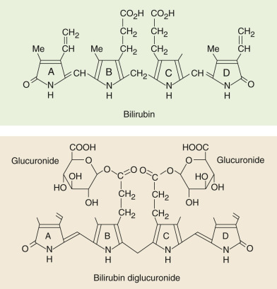
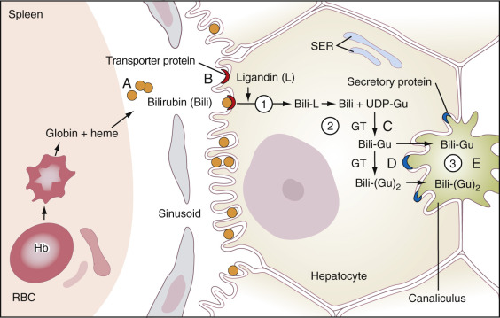
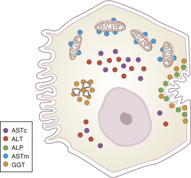
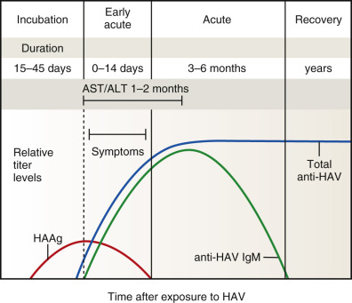
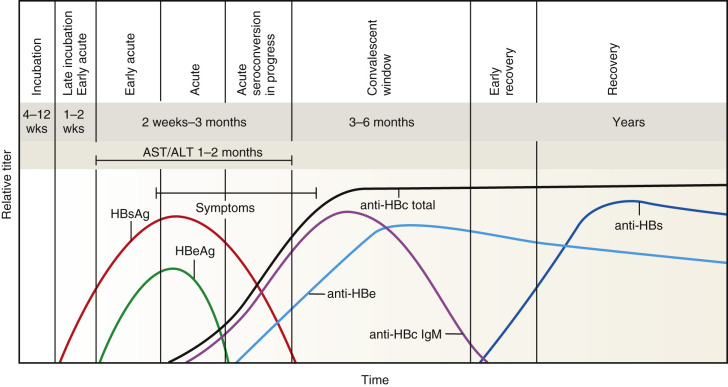

## Key Points

  * •

The liver is composed of three systems: the hepatocyte, concerned with metabolic reactions, macromolecular (especially protein) synthesis, and degradation and metabolism of xenobiotics (e.g., drugs); the biliary system, involved with the metabolism of bilirubin and bile salts; and the reticuloendothelial system, concerned with the immune system and the production of heme and globin metabolites (e.g., bilirubin). 

  * •

The function of each of these systems can be measured conveniently and virtually noninvasively by determining the serum levels of specific analytes, in the so-called liver function test profile. 

  * •

One of the most common causes of acute liver injury is viral hepatitis, mainly hepatitis A, B, and C, all of which induce acute elevations of serum alanine and aspartate aminotransferase. 

  * •

Diagnosis of viral hepatitis can be made by screening for viral antigens, especially in hepatitis B, and for immunoglobulin M and G directed against specific viral antigens. Confirmation of the diagnosis of a particular form of viral hepatitis is carried out using suitable molecular diagnostic techniques such as real-time PCR using primers encoding specific viral gene sequences. 

  * •

Treatment of hepatitis C has changed dramatically recently. The standard treatment of pegylated interferon and ribavirin has now been replaced with specific viral proteases (e.g., NS3 protein) inhibitors such as telaprevir, simeprevir, and boceprevir. 

  * •

The diagnosis of specific liver diseases, including hepatitis, cirrhosis, chronic passive congestion, acute biliary obstruction, space-occupying lesions, autoimmune diseases, and fulminant hepatic failure, can be made from specific patterns of serum liver function tests and from the presence of specific antibodies in serum. 

,  

##  Normal Liver Function 

The liver is the largest and most complex organ of the gastrointestinal tract. Overall, it comprises three systems: first, the biochemical hepatocytic system, which is responsible for the vast majority of all metabolic activities in the body, including protein synthesis; aerobic and anaerobic metabolism of glucose and other sugars; glycogen synthesis and breakdown; amino acid and nucleic acid metabolism; amino acid and dicarboxylic acid interconversions via transaminases (aminotransferases); lipoprotein synthesis and metabolism; xenobiotic metabolism (e.g., drug metabolism), usually involving the cytochrome P450 oxidation system; storage of iron and vitamins such as A, D, and B  12  ; and synthesis of hormones such as angiotensinogen, insulin-like growth factor I, and triiodothyronine. It is also the site of clearance of many other hormones such as insulin, parathyroid hormone, estrogens, and cortisol. Uniquely, the liver is the site of metabolism of ammonia to urea. 

Albumin in the body is synthesized in the liver, as are all coagulation factor proteins, with the exception of von Willebrand factor, which is synthesized in endothelial cells and megakaryocytes. Patients with liver disease may have signs or symptoms related to disturbance of any of the above functions. 

The second major hepatic system is the hepatobiliary system, which is concerned with the metabolism of bilirubin, a process that involves transport of bilirubin into the hepatocyte and its conjugation to glucuronic acid and its secretion into bile canaliculi and the enterohepatic system. Last is the reticuloendothelial system—that is, Kupffer cells. These are a form of macrophage involved (a) with the immune system, including being a major site of defense against intestinal bacteria and the primary location for removal of antigen–antibody complexes from the circulation, and (b) with the breakdown of hemoglobin from dead erythrocytes, giving rise to bilirubin, which, together with bilirubin from the spleen, enters the hepatocyte. 

Because clinical symptoms in liver disease often lag behind the progression of disease, it is important to detect the presence and even the onset of these conditions. Fortunately, evaluation of liver function can often be achieved by determination of serum analytes in a test profile known as **liver function tests,** many of whose components are not unique to liver but, when evaluated together, allow for accurate diagnosis of abnormalities of liver function. An outline of liver function tests and their interpretation has been presented in [ Chapter 8 ](<##!/content/3-s2.0-B9780323295680000085?scrollTo=%23c00008>) . 

This chapter reviews the most common laboratory tests for evaluation of liver function and injury, methods used for their measurement, testing for causes of liver injury, and patterns of laboratory abnormalities seen in specific liver diseases. 

 

##  Metabolic Functions 

 

##  Bilirubin 

 

##  Normal Bilirubin Metabolism 

Bilirubin is the major metabolite of heme, the iron-binding tetrapyrrole ring found in hemoglobin, myoglobin, and cytochromes. Approximately 250 to 350 mg of bilirubin is produced daily in healthy adults, about 85% of which is derived from turnover of senescent red blood cells (  Berlin & Berk, 1981  ;  Chowdhury et al, 1988  ;  Berk & Noyer, 1994a  ). In macrophages mainly in the spleen, methemoglobin from red cells is split to give free globin chains and heme. The porphyrin ring of heme is oxidized by microsomal heme oxygenase, producing the straight-chain compound biliverdin and releasing iron. In this ring-opening reaction, 1 mole of carbon monoxide is released, which is transported ultimately as carboxyhemoglobin, whose serum levels can be useful in the diagnosis of hemolytic anemia, as discussed in [ Chapter 8 ](<##!/content/3-s2.0-B9780323295680000085?scrollTo=%23c00008>) . Biliverdin is then reduced to bilirubin ( [ Fig. 21-1 ](<#f0010>) ) by the nicotinamide adenine dinucleotide phosphate (NADPH)-dependent enzyme, biliverdin reductase. Bilirubin, bound mainly to albumin, is then transported mainly in the portal system to the liver, where it enters the hepatocyte through its membrane surface in contact with the sinusoids, as shown in [ Figure 21-2 ](<#f0015>) . 

Figure 21-1 

Structures of critical molecules in the metabolism of bilirubin to its diglucuronide. 

Bilirubin is transported into the hepatocyte, where it is converted into the diglucuronide form and secreted into canaliculi. 

(From Crawford JM, Hauser SC, Gollan JL. Formation, hepatic metabolism, and transport of bile pigments: A status report. _Semin Liver Dis_ 8:105–18, 1988b.) 

Figure 21-2 

Schematic summary of the pathway of bilirubin _(Bili, in brown circles)_ transport and metabolism. 

Bilirubin is produced from metabolism of heme, primarily in the spleen, and is transported to the liver bound to albumin. It enters the hepatocyte by binding to a transporter protein _(red crescents)_ and crosses the cell membrane _(circled 1),_ thus entering the cell. It binds to Y and Z proteins _(not shown)_ and then to ligandin for transport to the smooth endoplasmic reticulum (SER). In the SER, bilirubin is conjugated to glucuronic acid by UDP-glucuronyl transferase 1 _(circled 2 and labeled GT),_ producing monoglucuronides and diglucuronides of bilirubin: Bili-Gu and Bili-(Gu)  2  . Conjugated bilirubin is then secreted into the canaliculi _(circled 3)_ by the adenosine triphosphate–binding cassette transporter protein MRP2/cMOAT/ABCC2 _(shown as blue crescents)._ In overproduction disease _(A),_ such as hemolytic anemia, unconjugated bilirubin is produced at rates that exceed the ability of the liver to clear it, leading to a usually transient increase in unconjugated bilirubin in serum. In both Gilbert's and Crigler-Najjar syndromes, mutations in the gene encoding UDP glucuronyl transferase _(UDPGT1A1),_ shown at _C_ in the figure, result in buildup of unconjugated bilirubin in hepatocytes and ultimately in serum. In Gilbert's syndrome, there may also be a defect in the bilirubin transporter protein, shown at _B_ in the figure. Mutations in the _MRP2/cMOAT/ABCC2_ gene result in defective secretory proteins, causing buildup of conjugated bilirubin in hepatocytes and, ultimately, in serum, resulting in the Dubin-Johnson syndrome _(D),_ an autosomal recessive disease. Conjugated hyperbilirubinemia is also found in the Rotor syndrome, possibly virus induced. In adults, blockade of any of the major bile ducts, especially the common bile duct, by stones or space-occupying lesions such as tumors _(E),_ is the most common cause of conjugated hyperbilirubinemia. _Hb,_ Hemoglobin; _RBC,_ red blood cell. 

As free bilirubin enters hepatocytes, additional bilirubin dissociates from albumin. This process is highly efficient; clearance of unconjugated bilirubin at normal values is about 5 mg/kg/day or, for a 75-kg individual, about 400 mg/day (  Berk & Noyer, 1994b  ). The half-life of unconjugated bilirubin is short; 60% of labeled bilirubin appears within hepatocytes within 5 minutes of injection (  Bloomer et al, 1973  ). Clearance rate increases with an increasing concentration of unconjugated bilirubin up to at least 4 mg/dL (  Berk & Noyer, 1994b  ). 

In its most common isomeric _(trans-)_ form, bilirubin is highly insoluble in water, and most of it is transported bound to albumin, with only a small fraction of free bilirubin. Light can cause photoisomerization of bilirubin, from a _trans-_ form to a more compact _cis-_ form, making it much more water soluble and allowing it to be excreted in urine (  Onishi et al, 1986  ); this forms the basis for phototherapy in the treatment of neonatal (unconjugated) hyperbilirubinemia. The pathway for clearance of bilirubin by the liver is illustrated in [ Figure 21-2 ](<#f0015>) . Note that unconjugated bilirubin enters the hepatocyte at the membrane surface adjacent to the sinusoids, opposite the face that is in contact with bile canaliculi. 

Bilirubin enters hepatocytes by two mechanisms: passive diffusion and receptor-mediated endocytosis. As summarized in [ Figure 21-2 ](<#f0015>) , once in the hepatocyte, bilirubin is “handed-off” from one protein complex to another in a chain. First, it complexes with the so-called Y and Z proteins, and then it binds sequentially to a protein complex called ligandin. From this complex, it is transported to the smooth endoplasmic reticulum (SER). In the SER, bilirubin becomes the substrate of the enzyme, glucuronyl transferase, encoded by the _UGT1A@_ gene, which catalyzes the esterification of the propionic acid side chains of bilirubin with glucuronic acid (present as uridine diphosphoglucuronic acid) to form mainly the diglucuronide conjugate shown in [ Figure 21-1 ](<#f0010>) (  Chowdhury et al, 1988  ). Some monoglu­curonide and a small amount of triglucuronide also form. The ratio of monoconjugated to diconjugated pigment in bile is 1 : 4, whereas the ratio is nearly 1 : 1 in plasma, suggesting that monoconjugates reflux into plasma more readily. 

As shown in [ Figure 21-2 ](<#f0015>) , an energy-dependent mechanism transports the conjugated bilirubin to the canalicular face of the hepatocyte at which it is directly secreted into the canaliculi; only conjugated bilirubin can be directly excreted into the canaliculi, and unconjugated bilirubin cannot traverse this membrane. 

Once bilirubin is excreted into the canaliculi and ultimately into the intestinal tract, it is further metabolized by intestinal bacteria, which affect its deconjugation and oxidation or reduction with the formation of compounds collectively called urobilinogen and urobilin, which can then be reabsorbed from the gut. Most urobilinogen absorbed is reexcreted by the liver. A minor fraction may be excreted in the urine. Larger quantities are found in the urine in conditions leading to hyperbilirubinemia, or in conditions in which the liver cannot readily secrete urobilinogen absorbed from the gut. Ultimately, intestinal urobilinogen is converted to stool pigments such as stercobilin; their absence leads to clay-colored stools, often an early sign of impaired bilirubin metabolism. 

When conjugated bilirubin is present in serum, it can become covalently bound to albumin, producing biliprotein or delta-bilirubin (  Lauff et al, 1982  ;  McDonagh, 1984  ). Although conjugated bilirubin has a half-life of less than 24 hours, delta-bilirubin has a half-life similar to that for albumin at 17 days (  Fevery & Blanckaert, 1986  ), causing prolonged jaundice during recovery from hepatocellular injury (  Van Hootegem et al, 1985  ) or biliary obstruction (  Kozaki et al, 1998  ). Conjugated bilirubin, being water soluble, can be filtered by the glomerulus and can appear in urine, where it may be detected by dipstick examination; urobilinogen measurement, however, adds little to standard tests of liver function or injury (  Binder & Kupka, 1989  ). Urinary bilirubin is elevated in most patients with increased serum conjugated bilirubin (  Binder & Kupka, 1989  ). 

 

##  Derangements of Bilirubin Metabolism 

As shown in [ Figure 21-2 ](<#f0015>) , in each step in the processing of bilirubin, a possible lesion leads to elevated serum levels of unconjugated or conjugated bilirubin. Each of these is discussed in turn. 

 

##  Causes of Elevated Serum Levels of Unconjugated Bilirubin 

 

##  Hemolysis. 

As discussed in [ Chapter 8 ](<##!/content/3-s2.0-B9780323295680000085?scrollTo=%23c00008>) , in hemolytic anemias, unconjugated bilirubin rises as a result of abnormally high levels of hemoglobin released from erythrocytes. If the rate of bilirubin formation exceeds the rate of liver clearance (i.e., a state of overproduction of bilirubin), there will be a rise in the bilirubin level in serum. Virtually all of this bilirubin will be unconjugated bilirubin. This is particularly likely to occur in neonates, whose glucuronyl transferase activity is low. Thus one manner of confirming a diagnosis of hemolytic anemia is the finding, in adults, of elevated indirect bilirubin levels in serum. Usually, these levels are not dramatically elevated and are generally in the 1.5 to 3.0 mg/dL range. 

 

##  Gilbert's syndrome and the Crigler-Najjar syndrome are caused by gene mutations and deletions. 

In Gilbert's syndrome, characterized by a mild unconjugated hyperbilirubinemia, the most common genetic lesion appears to be the insertion of two bases into the promoter region of the _UGT1A1_ gene that encodes glucuronyl transferase, resulting in lower transcriptional rates (  Kraemer & Scheurlen, 2002  ;  Maruo et al, 2004  ) and overall lower enzymatic activity (reduced to about 30% of normal). In the more serious Crigler-Najjar syndrome, frequently characterized by high serum levels of unconjugated bilirubin, multiple mutations are found to occur in this gene, including shifts in the reading frames, stop codons, and critical amino acid substitutions, all of which give rise to a spectrum of dysfunctional proteins from mildly dysfunctional to completely nonfunctional proteins (  Kraemer & Scheurlen, 2002  ). 

In Gilbert's syndrome, which occurs in a significant fraction (3% to 5%) of the population, the genetic defect may be necessary but not sufficient because, in an earlier study (  Persico et al, 1999  ), a significant percentage of males with this defect were found to have hyperbilirubinemia, but no females with this enzyme deficit were found to have elevated serum bilirubin levels (  Bosma et al, 1995  ). In some patients with Gilbert's syndrome, the rate of organic anion uptake has been found to correlate negatively with serum bilirubin (  Persico et al, 1999  ), suggesting that an additional defect may be present to cause hyperbilirubinemia that may be related to a transport deficit in the sinusoidal membrane of the hepatocyte. In this condition, total bilirubin, virtually all of which is unconjugated, is typically elevated to 2 to 3 mg/dL; levels can increase further with fasting but seldom exceed 5 mg/dL. Because passive diffusion of bilirubin into hepatocytes occurs, this condition is rarely serious and may result in mild elevations of bilirubin such as those seen in hemolytic anemia as described previously. 

Gilbert's syndrome has perhaps been overdiagnosed; it is most frequently diagnosed in young adults ranging in age from 20 to 30 years. However, normal bilirubin ranges are age dependent and actually reach their highest levels in adolescents and young adults (  Rosenthal et al, 1984  ), as discussed further later. 

In the more serious or type I form of the Crigler-Najjar syndrome (i.e., homozygously nonfunctioning proteins), the unconjugated hyperbilirubinemia becomes marked, almost always exceeding 5 mg/dL and causing jaundice, and sometimes exceeding 20 mg/dL. Affected infants develop severe unconjugated hyperbilirubinemia, which typically leads to kernicterus, deposition of bilirubin in the brain, particularly affecting the basal ganglia, mainly the lenticular nucleus, causing severe motor dysfunction and retardation. In the less severe type II form, enzyme activity is approximately 10% of normal, and survival to adulthood is possible (  Berk & Noyer, 1994c  ). The danger of kernicterus is a certainty at levels exceeding 20 mg/dL. It is vital to treat these infants with phototherapy, as discussed earlier, to cause excretion of the unconjugated bilirubin. 

 

##  Causes of Elevated Serum Levels of Conjugated Bilirubin 

 

##  Excretion deficits: Dubin-Johnson syndrome. 

In another inborn error of metabolism, called the Dubin-Johnson syndrome, there is a blockade of the excretion of bilirubin into the canaliculi, caused by defects in the adenosine triphosphate (ATP)-binding cassette (ABC) canalicular multispecific organic anion transporter, MRP2/cMOAT/ABCC2 (  Paulusma et al, 1997  ;  Tsujii et al, 1999  ;  Gottesman & Ambudkar, 2001  ). This protein is a member of a family of approximately 100 different transporter proteins that share homology within the ABC region and contain transmembrane domains involved in recognition of substrates, which are transported across, into, and out of cell membranes and include proteins involved in multiple drug resistance to chemotherapeutic agents in cancer treatment. Some protein members utilize ABCs to regulate ion channels. Several genetic diseases result from transporter mutations, including the Dubin-Johnson syndrome, cystic fibrosis, age-related macular degeneration, Tangier disease, and progressive familial intrahepatic cholestasis (  Gottesman & Ambudkar, 2001  ). 

Dubin-Johnson syndrome is associated with increased plasma conjugated bilirubin, typically with mild jaundice (total bilirubin, 2 to 5 mg/dL), and intense dark pigmentation of the liver due to accumulation of lipofuscin pigment, brown granules from liposomal degradation of lipids. Thus conjugated bilirubin accumulates within the hepatocyte and eventually back-diffuses into the circulation, where it is detected in serum. This inborn error can sometimes be confused with the Rotor syndrome, possibly of viral origin, where there is also a block in the excretion of conjugated bilirubin but without liver pigmentation (  Berk & Noyer, 1994d  ). In these cases, liver biopsy often will reveal cytosolic inclusion bodies within hepatocytes. 

 

##  Biliary obstruction. 

In adults, cholelithiasis is the most common cause of hyperbilirubinemia. This condition results from the presence of bile stones (that are composed of bilirubin or cholesterol), most commonly in the common bile duct (choledocholithiasis). Most frequently, patients presenting with this condition are parous white females in early middle age (giving rise to the semi-mnemonic, “fair, fecund, fortyish female”). Biliary obstruction due to cholelithiasis results in elevation of total bilirubin, with over 90% being direct bilirubin. In more than 90% of such patients, a concomitant rise in alkaline phosphatase occurs. The levels of this enzyme are variable but are frequently above 300 international units (IU)/L. 

Inflammatory conditions of the biliary tract, such as ascending cholangitis, also give rise to elevated serum levels of direct bilirubin and alkaline phosphatase, as discussed later in this chapter. The rise in direct bilirubin often exceeds 5 mg/dL. In gram-negative sepsis, there can be what appears to be a mild inflammation of the biliary tract, resulting in mild elevation of direct bilirubin to levels of 2 to 3 mg/dL. A concomitant elevation of alkaline phosphatase to levels of 200 to 300 IU/L is also observed. 

In hepatitis, in which toxic destruction of hepatocytes is due to viral, chemical, or traumatic causes, focal necrosis and/or cellular injury results both in blocking conjugation of bilirubin and in excretion of conjugated bilirubin. Thus elevation of both direct and indirect bilirubin occurs. Serum levels of bilirubin are variable, depending on the severity of infection and the extent of disease. In viral hepatitis, such as hepatitis B, as discussed subsequently, serum bilirubin levels often reach levels of 5 to 10 mg/dL or greater. 

Aside from liver disease, elevations of conjugated bilirubin may occur with a few other disorders. Septicemia (as noted previously), total parenteral nutrition, and certain drugs such as androgens commonly cause increased conjugated bilirubin, but the mechanism is not understood (  Zimmerman, 1979  ). Fasting causes increases in unconjugated bilirubin in normal individuals, but to a lesser degree than is seen in Gilbert's syndrome. 

 

##  Laboratory Tests for Bilirubin 

Bilirubin is typically measured using diazotized sulfanilic acid, which forms a conjugated azo compound with the porphyrin rings of bilirubin, resulting in reaction products that absorb strongly at 540 nm. Because unconjugated bilirubin reacts slowly, accelerants such as caffeine or methanol are used to measure total bilirubin. Deletion of these accelerants allows determination of direct-reacting, or direct, bilirubin. 

Until the early 1980s, it was accepted that direct bilirubin was equal to conjugated bilirubin. The introduction of dry slide technology, using differential spectrophotometry to measure conjugated and unconjugated bilirubin separately, led to the observation that the sum of these two entities did not equal total bilirubin and to the characterization of delta-bilirubin. Approximately 70% to 80% of conjugated bilirubin and delta-bilirubin and a small percentage of unconjugated bilirubin are measured in the direct bilirubin assay (  Lo & Wu, 1983  ;  Doumas & Wu, 1991  ). Although good data support the measurement of conjugated bilirubin instead of estimating it from direct bilirubin (  Arvan & Shirey, 1985  ;  Doumas et al, 1987  ), the direct bilirubin assay is still widely used. The accuracy of direct bilirubin assays is dependent on sample handling and reagent composition. Prolonged exposure to light causes photoisomerization, increasing direct-reacting bilirubin (  Ihara et al, 1997  ). Use of wetting agents or incorrect pH buffers increases the amount of unconjugated bilirubin measured as direct bilirubin (  Doumas & Wu, 1991  ). Typically, direct bilirubin should measure 0 to 0.1 mg/dL in normal individuals, with rare values of 0.2 mg/dL in the absence of liver or biliary tract disease. 

Reference values for total bilirubin are both age and gender dependent. Bilirubin levels typically reach peak values at around ages 14 to 18, falling to stable adult levels by age 25 (  Rosenthal, 1984  ;  Notter, 1985  ;  Zucker, 2004  ). Values are higher in males than in females at all ages (Rosenthal, 1983;  Carmel et al, 1985  ;  Notter et al, 1985  ;  Dufour, 1998a  ;  Zucker et al, 2004  ). Strenuous exercise causes a significant increase in bilirubin values compared with those seen in sedentary individuals or those with chronic exercise (  Dufour, 1998b  ). African Americans have bilirubin levels significantly lower than those of other ethnic groups. 

 

##  Other Metabolic Tests 

 

##  Ammonia 

This critical and toxic compound is metabolized exclusively in the liver. Ammonia is derived mainly from amino acid and nucleic acid metabolism. Some ammonia is also produced from metabolic reactions such as the action of the enzyme glutaminase on glutamine, resulting in the production of glutamic acid and ammonia. As it happens, ammonia can be metabolized only in the liver because the liver uniquely contains the critical enzymes for the Krebs-Henseleit or urea cycle, in which ammonia, a toxic substance, is ultimately converted into urea, a nontoxic compound that is readily excreted. In this cycle, ammonia, with the enzyme carbamoyl phosphate synthetase, is condensed with carbon dioxide (CO  2  ) and ATP to form carbamoyl phosphate that then, in the rate-determining step, carboxamidates the delta-amino group of ornithine to form citrulline using the enzyme ornithine carbamoyltransferase (OCT), an enzyme that is unique to the liver. Congenital deficiency of this or other urea cycle enzymes leads to increased levels of ammonia in serum and in cerebrospinal fluid (  Batshaw, 1994  ). 

A unique feature of liver tissue is its ability to regenerate. To abolish liver tissue function, more than 80% of the liver must be destroyed. If most of the liver is destroyed as a result of such conditions as cirrhosis (  Stahl, 1963  ) or, less commonly, acute fulminant hepatic failure, including Reye's syndrome (  Heubi et al, 1984  ;  Sunheimer et al, 1994  ), urea cycle enzymes are no longer present, resulting in the toxic buildup of ammonia and some of the amino acid intermediates in the urea cycle, such as arginine, which has known neurotoxic effects. The result is an increase in ammonia and these amino acid intermediates in the circulation and in the central nervous system (CNS), giving rise to hepatic encephalopathy. In addition, in most cirrhotics, intrahepatic portal-systemic shunting occurs, thereby causing ammonia to bypass the liver and resulting in elevated serum ammonia concentrations. Elevated serum levels of ammonia therefore often indicate some form of liver failure, although other conditions can also induce increases in serum ammonia levels. 

In patients with cirrhosis or fulminant hepatic failure, there has been some dispute as to whether ammonia itself is the cause of the observed metabolic encephalopathy; possibly other toxins that accumulate as a result of absent hepatic detoxification are the cause. One of the arguments often used is that there is no clear correlation between the severity of the encephalopathy and serum ammonia concentrations (  Lewis & Howdle, 2003  ). Countering this argument is the finding that, although venous ammonia levels do not correlate with the degree of encephalopathy (  Stahl, 1963  ), arterial levels of ammonia do generally correlate with the degree of encephalopathy. Furthermore, in patients with cirrhosis or fulminant hepatic failure, lowering the serum ammonia invariably diminishes the severity of the encephalopathy (  Pincus et al, 1991  ). Furthermore, idiopathic hyperammonemia, not related to liver disease, also induces lethal encephalopathy (  Shepard et al, 1987  ;  Davies et al, 1996  ). An important mechanism by which ammonia can cause toxicity to the CNS is its ability to lower the concentration of γ-aminobutyric acid (GABA), a critically important neurotransmitter in the central nervous system, by reacting with glutamic acid to form glutamine via reversal of the glutaminase-catalyzed reaction (  Butterworth et al, 1987  ). This depletes glutamic acid in the CNS. However, GABA is formed directly from the decarboxylation of glutamic acid, so GABA levels consequently decrease, with potentially serious effects on neurotransmission (see [ Chapter 23 ](<##!/content/3-s2.0-B9780323295680000231?scrollTo=%23c00023>) ). Because ammonia causes accumulation of glutamine in the CNS, there is the suggestion that, at least in valproic acid–induced hyperammonemia, cerebrospinal fluid levels of glutamine can be used in the diagnosis and management of hepatic encephalopathy (  Vossler et al, 2002  ). More recently, besides evidence that ammonia in the CNS is directly toxic to astrocytes, other evidence indicates that ammonia induces neutrophil dysfunction that results in the generation of reactive oxygen species contributing to oxidative stress and inflammation, with lowered ability of the CNS to block infectious agents (  Shawcross et al, 2010  ). One major new finding put forth by these studies is that treatment of hepatic encephalopathy with suitable anti-inflammatory agents may be effective. 

At present, most commonly, elevated serum ammonia concentrations in hepatic encephalopathy are reduced by the agent lactulose, which is metabolized by specific gut bacteria to lactic acid. The acid so produced in the intestinal lumen traps ammonia as ammonium ion, which can no longer diffuse across the intestinal membrane and is thus excreted. Ammonia-producing bacteria in the intestine are removed by treatment with antibiotics such as neomycin. 

 

##  Assays for Ammonia. 

Ammonia is typically measured by enzymatic assays using glutamate dehydrogenase, which catalyzes the reaction of α-ketoglutarate and ammonia to form glutamate, with oxidation of NADPH to NADP as the indicator (decrease in absorbance at 340 nm, as described in [ Chapter 20 ](<##!/content/3-s2.0-B9780323295680000206?scrollTo=%23c00020>) ). Ammonia is also measured via a dry slide method (e.g., on the Johnson and Johnson Vitros systems) using alkaline pH buffers to convert all ammonium ions to ammonia gas, with bromphenol blue as the indicator (  Huizenga et al, 1994  ). Because ammonia is a product of cellular metabolism, methods used in specimen collection and transportation are critical in preventing artifactually increased levels. Arterial blood is the preferred specimen for measurement of ammonia. Although venous blood is not recommended, if used, tourniquets should be used minimally, and fist clenching and relaxing should be avoided during collection. Specimens should be kept in ice water until separation of cells from plasma occurs (  Howanitz et al, 1984  ;  da Fonseca-Wollheim, 1990  ). 

 

##  Lipids 

 

##  Cholesterol and Other Lipids (see [ Chapter 17 ](<##!/content/3-s2.0-B9780323295680000176?scrollTo=%23c00017>) ). 

Because the liver is vital in lipoprotein synthesis and interconversions, hepatic disorders often cause derangements in lipoprotein metabolism. Although none of these abnormalities is used to diagnose liver pathology, it is important to recognize that they may result from liver disease. In severe liver injury, including cirrhosis, these abnormalities include a decrease in high-density lipoprotein (HDL), particularly the HDL  3  (but often not the HDL  2  ) subfraction, and in other altered lipoprotein distributions, caused in part by deficiencies of lecithin/cholesterol acyltransferase (LCAT, the enzyme that esterifies cholesterol) and of lipoprotein lipases, resulting in elevated levels of unesterified cholesterol and hypertriglyceridemia (triglyceride levels ranging from 250 to 500 mg/dL), respectively. In addition, there are increased levels of phospholipids, including lecithins, in blood and in the VLDL fraction. Overall, the resulting lipoprotein pattern is that of the so-called abnormally migrating β-lipoprotein, typical of type III hyperlipoproteinemia (see [ Chapter 17 ](<##!/content/3-s2.0-B9780323295680000176?scrollTo=%23c00017>) ). However, in cirrhotics with poor nutrition, despite critical enzyme deficiencies, low levels of cholesterol (<100 mg/dL) may be found. 

In contrast, in alcohol-induced liver injury, alcohol induces increased expression of apolipoprotein (apo) A-I protein. Thus HDL, especially HDL  3  , may be elevated if alcohol ingestion continues. Because, in cirrhosis, apoA-I protein decreases, serum levels of this protein have been used to diagnose this disease using the so-called PGA index (  Teare et al, 1993  )—a combination of prothrombin time (PT), which increases, with γ-glutamyl transferase activity (discussed later), which also increases, and apoA-I protein. This index differs for alcoholic hepatitis, enabling the distinction to be made between these two conditions without the necessity of liver biopsy (  Mun et al, 2003  ). 

In cholestasis, regurgitation of biliary contents into the bloodstream results in the buildup of lipoprotein X (LpX) (discussed in [ Chapter 17 ](<##!/content/3-s2.0-B9780323295680000176?scrollTo=%23c00017>) ) and elevation of biliary lipids. Because LpX carries high levels of unesterified cholesterol, cholesterol levels in serum can become markedly elevated (  Turchin et al, 2005  ). 

 

##  Bile Salts. 

Bile salts, which are products of cholesterol metabolism, facilitate absorption of fat from the intestine. They are stored in the gallbladder and released to the intestine after meals through gallbladder contraction mediated by cholecystokinin. They are not usually used in the diagnosis of abnormal liver function but are important in that they constitute a substantial amount of bile in bilirubin excretion and can therefore be of use in diagnosing cholestasis. Also, in severe biliary obstruction, the buildup of bile salts in serum causes symptomatic illness in the form of intractable itching, although this has been disputed (  Jones & Bergasa, 1999  ). The primary bile salts, cholate and chenodeoxycholate, are produced in the liver and excreted into the biliary and enterohepatic systems. In the intestinal lumen, bacteria utilize 7-α-dehydroxylation to produce secondary bile salts (i.e., lithocholate, deoxycholate, and ursodeoxycholate) (  Carey & Cahalane, 1988  ). Ursodeoxycholate, an end-product of bile salt metabolism in man, is produced by isomerization of secondary bile salts and has been found to be therapeutic in cholestatic diseases (  Rost et al, 2004  ). These bile salts are conjugated, in the microsomal system discussed later, to glycine and taurine and are also sulfated and glucuronidated. Conjugation of bile salts to taurine and sulfates increases with the severity of cholestasis in conditions causing obstruction to bile outflow. Recirculation of bile salts to the liver occurs by reabsorption from the terminal ileum, where deoxycholate is almost completely reabsorbed, and chenodeoxycholate is about 75% reabsorbed. In cirrhosis, a disproportionate decrease in cholic acid is seen, along with a reduced ratio of primary to secondary bile salts. With cholestasis, secondary bile salts are not formed; thus the ratio of primary to secondary bile salts is markedly increased. 

Renal clearance of bile salts is negligible in normal patients, but in cholestasis, renal excretion of bile salts, mainly in the form of sulfates and glucuronides, is enhanced. Fasting bile salts, when normal, can exclude the presence of parenchymal liver disease in patients with Gilbert's syndrome (  Vierling et al, 1982  ), as discussed previously. It should also be recognized that defective production of bile salts, which helps solubilize the contents of bile, in the liver may predispose to the formation of bilirubinate or cholesterol stones and posthepatic biliary obstruction. 

Analysis of bile salts must be performed on serum taken from patients who are in the fasting state or on serum taken at a specified time after meals, because food ingestion causes a significant increase in bile acid levels. Bile salts can be measured by many techniques, but chromatographic methods, particularly high-performance liquid chromatography, as discussed in [ Chapter 23 ](<##!/content/3-s2.0-B9780323295680000231?scrollTo=%23c00023>) , are most widely used and allow separation of different bile salts. 

 

##  Drug Metabolism 

Many xenobiotics, such as drugs, are metabolized in the liver, mainly in the microsomes of hepatocytes. Complex series of reactions occur, many of which are dependent on cytochrome P450, which is involved in the oxidation of these compounds. Whether or not specific exogenous compounds are converted to metabolites depends on the isoforms of cytochrome P450, such as CYP1A and CYP2B (cytochrome P450 1A and 2B, respectively). Often, the conversion of xenobiotics into metabolites using this system involves two phases: Phase I reactions involve oxidations/hydroxylations, and phase II reactions conjugate the metabolite (or parent compound) to polar compounds, such as glucuronic acid, glycine, taurine, and sulfate. In more severe liver disease, which involves microsomal damage, this ability to metabolize xenobiotics is compromised. Thus the ability of hepatocytes to metabolize drugs can be used to measure liver damage. 

This is generally accomplished by administering a known dose of radiolabeled (usually  13  C-labeled) drug and measuring the  13  CO  2  exhaled over time in a patient's breath. Two categories of breath tests have been developed based on the rate-limiting step in metabolism. The first group includes drugs such as aminopyrine, caffeine, and diazepam, which are metabolized at rates that are independent of hepatic blood flow to the liver and depend only on the enzymatic activity of different cytochromes P450 (e.g., CYP1A). The second group is composed of drugs such as methacetin, phenacetin, and erythromycin, whose rates of metabolism depend on the rate of blood flow (i.e., their rates of metabolism are fast compared with their rates of delivery to the liver). These types of dynamic tests appear not to be so useful in the initial diagnosis of hepatic disease; rather, they are more useful in estimating the extent of liver damage in known liver disease (  Nista et al, 2004  ). 

Some interferences that complicate interpretation of the results of these tests include dependence of the demethylation of aminopyrine (the methyl group is oxidized to CO  2  ) on vitamin B  12  ; in cases of vitamin B  12  deficiency, less than normal amounts of  13  CO  2  will be exhaled because of low B  12  levels, not necessarily because of liver damage. Rates of caffeine metabolism generally decrease with increasing age but are increased by smoking; these findings can complicate interpretation of test results. 

 

##  Synthetic Functions 

 

##  Protein Synthesis 

The liver is the site of synthesis for most plasma proteins. Major exceptions include immunoglobulins (Igs) and von Willebrand factor. Synthesis of more than 90% of all protein and 100% of albumin occurs in the liver. Thus extensive destruction of liver tissue will result in low serum levels of total protein and albumin. In cirrhosis, besides hepatocyte destruction, another cause of diminished protein production is portal hypertension, which decreases delivery of amino acids to the liver. Two vital measurements of liver function, therefore, are total protein and albumin levels in serum. However, it should always be kept in mind that other major causes of low serum total protein and albumin have been identified; these include renal disease, malnutrition, protein-losing enteropathy, and, less commonly, chronic inflammatory disease. These alternative causes must always be considered when liver function status is evaluated. 

In liver disease with widespread injury or necrosis, such as fulminant hepatic failure and cirrhosis, plasma levels of liver-synthesized proteins fall, such that proteins with longer half-lives tend to decrease more slowly. Albumin has a half-life of about 20 days, so decreases in its serum levels occur more slowly than those of proteins with shorter half-lives. Among the liver-produced proteins with shorter half-lives are factor VII (4 to 6 hours), transthyretin (1 to 2 days), and transferrin (6 days). 

 

##  Determination of Serum Protein Levels 

This is based usually on the Biuret method as described in [ Chapter 27 ](<##!/content/3-s2.0-B9780323295680000279?scrollTo=%23c00027>) . This method reflects the ability of the peptide backbone C O groups of proteins to form color complexes with copper that absorb strongly at 540 nm. Some methods utilize a dye-binding method in which the proteins form a complex with the dye Coomassie blue. Albumin forms a unique color complex with the dyes bromcresol green and bromcresol purple, such that they absorb maximally at slightly different wavelengths, thus allowing direct spectrophotometric quantitation (  Ihara et al, 1991  ). Bromcresol purple tends to react more exclusively with albumin than does bromcresol green (which reacts to a minor extent with some globulins), so serum albumin levels may be slightly lower when determined with bromcresol purple. The reference range for total serum protein levels is generally in the 6 to 7.8 g/dL range. At least 60% of this should be albumin, the normal range for which is about 3.5 to 5 g/dL. 

Serum protein electrophoresis and quantitative Igs may reveal characteristic changes in liver disease, as discussed in [ Chapter 19 ](<##!/content/3-s2.0-B978032329568000019X?scrollTo=%23c00019>) . Typically, in cirrhosis, albumin is significantly decreased, as are the α-1, α-2, and β (principally transferrin) bands. However, a polyclonal increase in Igs, which is seen frequently, produces the characteristic β-γ bridging pattern, as discussed in [ Chapter 19 ](<##!/content/3-s2.0-B978032329568000019X?scrollTo=%23c00019>) . In autoimmune hepatitis, albumin is typically decreased; this is accompanied by a marked polyclonal increase in IgG. Primary biliary cirrhosis is accompanied by a polyclonal increase in IgM. 

 

##  Albumin 

Albumin is the major protein produced by the liver. Its synthesis is increased by low plasma oncotic pressure and is decreased by cytokines, particularly interleukin-6. Although normal albumin synthesis occurs at about 120 mg/kg/day, the rate of synthesis can approximately double with low oncotic pressure. A decrease in albumin is one of the major prognostic features in patients with cirrhosis. Albumin measurements were discussed previously in [ Chapter 19 ](<##!/content/3-s2.0-B978032329568000019X?scrollTo=%23c00019>) and are further discussed in [ Chapter 27 ](<##!/content/3-s2.0-B9780323295680000279?scrollTo=%23c00027>) . 

Albumin is a transport protein for many substances, both endogenous (e.g., bilirubin, thyroid hormone) and exogenous (e.g., drugs). Low serum albumin levels due to liver disease are almost always caused by massive destruction of liver tissue and are seen primarily in cirrhosis, most often secondary to alcoholism. The diminution in albumin is paralleled by a fall in total serum protein. Because albumin is the osmotically active intravascular colloid, hypoalbuminemia often results in edema. In cirrhosis, where increased resistance to blood flow in the sinusoids causes portal hypertension, the combined effect of elevated hydrostatic pressure in the portal system and low colloid osmotic pressure results in ascites, a frequent finding in cirrhosis. These same changes may also be seen acutely in fulminant hepatic failure (  Sunheimer et al, 1994  ). 

 

##  Other Serum Proteins 

Although most of the proteins discussed in [ Chapter 19 ](<##!/content/3-s2.0-B978032329568000019X?scrollTo=%23c00019>) are produced by the liver, two bear special importance in the detection of congenital liver disorders. 

 

##  α-1-Antitrypsin. 

α-1-antitrypsin (AAT), the most abundant α-1-globulin, is the most important protease inhibitor in plasma. Although its name indicates that it inhibits trypsin, it also is an inhibitor of other serine proteases, such as elastin. AAT is coded for by the _Pi_ gene on chromosome 14; several genetic variants are due to point mutations, leading to single amino acid substitutions (  Chappell et al, 2004  ). The most common variant, M, is associated with normal serum AAT levels. The mutations present in the S and Z variants prevent normal protein glycation, leading to accumulation of AAT within hepatocytes and reduced plasma AAT levels (  Propst et al, 1994  ). In the United States, the overwhelming genotype is PiMM, where Pi is the protease inhibitor. The other genotypes—PiZZ, PiSS, PiSZ, PiMZ, and PiMS—all contain measurable activity of antiprotease, except a rare null genotype Pi  — . If the antiprotease activity of the MM phenotype is used as the reference, then the activity in phenotype ZZ is 15%, SS is 60%, MZ is 57.5%, and MS is 80%. Adults with PiZZ are most prone to develop emphysema relatively early in life as a result of uninhibited trypsin activity on alveolar wall elastin. Patients with PiZZ tend to accumulate the Z protein in periportal hepatocytes, where it forms discrete cytoplasmic bodies and may also develop neonatal hepatitis. Curiously, although infants may die of hepatic injury, it resolves in most infants and progresses to cirrhosis in only about 3% (  Sveger, 1988  ). In adults, the likelihood of liver injury is increased in patients heterozygous or homozygous for the Z variant of AAT; this may be due to accumulation of AAT in the endoplasmic reticulum that induces autophagy and apoptosis of hepatocytes (  Teckman et al, 2004  ). AAT phenotyping can be performed using isoelectric focusing (  Propst et al, 1994  ). Because AAT is an acute phase reactant, its serum levels can be normal in MZ heterozygotes. 

 

##  Ceruloplasmin. 

The major copper-containing protein in serum, ceruloplasmin is also the enzyme present in highest circulating concentration. Ceruloplasmin is a ferroxidase, which is essential for converting iron to the ferric state to allow binding to transferrin. Low levels of ceruloplasmin are found in Wilson's disease, a rare congenital disorder (1 in 30,000 individuals) associated with one of many mutations in the gene on chromosome 13 coding for a cellular adenosine triphosphatase (ATPase), ATP7B, a member of the cation-transporting p-type ATPase family (  Bull et al, 1993  ). This protein is principally expressed in the liver and promotes copper secretion into plasma, coupled with ceruloplasmin synthesis, and into the biliary tract. More than 200 mutations of this Wilson's disease gene have been detected, resulting in impairment of ATP7B function and intracellular copper accumulation (  Langner & Denk, 2004  ). Excess intracellular copper is deposited in lysozomes in hepatocytes; it induces free-radical reactions such as lipid peroxidation and membrane instability. Resultant liver damage can lead to chronic active hepatitis, cirrhosis, or, uncommonly, fulminant hepatic failure. In addition, steatosis and inflammation can result in this condition. Copper becomes deposited in the CNS, especially in the lenticular nucleus of the basal ganglia, causing neuropsychiatric disease; it can also be deposited at the edge of the iris, forming the observed Keyser-Fleischer rings. 

The diagnosis of Wilson's disease is made on the basis of typical clinical and laboratory findings, including low serum ceruloplasmin, which can be measured by immunoassay or by enzymatic assay, increased urinary copper excretion, and increased hepatic copper content. Although ceruloplasmin is characteristically low in Wilson's disease, factors that increase ceruloplasmin synthesis (e.g., cytokines, pregnancy, estrogens) may cause normal ceruloplasmin levels in up to 15% of patients overall, and in as many as 35% with hepatic manifestations of Wilson's disease (  Dufour & Kaplan, 1997  ), particularly acute Wilsonian hepatitis (  Berman et al, 1991  ). Genetic testing is the most reliable means to establish the diagnosis, but it is difficult because more than 200 mutations have been shown to cause disease. 

 

##  Clotting Factors 

As mentioned earlier, except for the von Willebrand factor, which is made by endothelial cells and megakaryocytes, coagulation proteins are synthesized in the liver. In addition, inhibitors of coagulation, such as antithrombin III, α-2-macroglobulin, α-1-antitrypsin, C1 esterase inhibitor, and protein C, are synthesized in the liver. In addition, fibrin degradation products are catabolized in the liver. Low levels of antithrombin III in patients with cirrhosis and hepatitis may be caused by decreased synthesis, increased consumption, or alteration in the transcapillary flux ratio (  Kelly, 1987  ). The most common coagulopathy seen in liver failure (i.e., cirrhosis and acute fulminant hepatic failure) is disseminated intravascular coagulopathy (DIC), as discussed in [ Chapter 8 ](<##!/content/3-s2.0-B9780323295680000085?scrollTo=%23c00008>) and extensively throughout Part 5 of this book. This condition is characterized by increased consumption of clotting factors and platelets, causing thrombocytopenia and elevations of both prothrombin and partial thromboplastin times, PT and PTT, respectively. The mechanism has been postulated to be decreased synthesis of clotting inhibitory factors, decreased clearance of activated clotting factors, or release of tissue thromboplastin from hepatocytes (  Kelly & Tuddenham, 1986  ). D-dimer and, in the past, fibrin split products, detected in DIC, have been found in up to 80% of patients with liver disease without evidence of fibrinolysis (  Van de Water et al, 1986  ). It is important that the diagnosis of DIC be made certain by determination of elevated blood D-dimer levels, as described in Part 5 on hemostasis and thrombosis. In some cases of liver failure, platelet counts are decreased because of sequestration in an enlarged spleen due to hepatosplenomegaly. This condition combined with elevated levels of PT and PTT caused by low levels of synthesis of coagulation factors can masquerade as DIC. In these cases, D-dimer levels are not elevated, excluding this diagnosis. 

Perhaps the most frequently ordered laboratory test for detecting liver-associated coagulation abnormalities is PT and its associated measurement, the international sensitivity ratio, as described in Part 5. The PT measures the efficacy of the extrinsic clotting system in which factor VII is activated by tissue factor, as discussed in Part 5; because factor VII is uniquely synthesized in the liver, its measurement can be used to evaluate liver function status. Often, PT is computed as the international normalized ratio (INR), which attempts to standardize all PT measurements relative to a gold standard PT-measuring method, using the international sensitivity index (ISI), as described in Part 5. 

 

##  Some Caveats in Using PT and INR to Evaluate Liver Function. 

Because PT and PTT measure the status of the coagulation cascades (extrinsic and intrinsic, respectively), any coagulation disorder will give rise to abnormal PT and/or PTT, independent of liver function. In addition, in patients with cholestasis (i.e., disease of the biliary tract) with no hepatocytic dysfunction (e.g., cirrhosis, fulminant hepatic failure), absorption of fat-soluble vitamin K from the gut may be impaired because of low levels of bile salts that allow membrane transport of this vitamin. Because factors II, VII, IX, and X depend on vitamin K for biosynthesis via carboxylation, coagulation abnormalities often result. Therefore, in patients with cholestasis, normal serum levels of inactive precursor forms of these four coagulation factors can be detected, as discussed later. Correction of prothrombin time by the administration of vitamin K is usually possible when factor V is normal in patients with cholestatic liver disease. 

Also, use of the INR in evaluating liver function can provide misleading results. As discussed in Part 5, the INR is based on PT values for patients treated with Coumadin (warfarin, which blocks mainly the extrinsic system). Thus its appropriateness for evaluating non–Coumadin-induced coagulopathies has been questioned, especially in view of the finding that PT increases much less with lower ISI in patients with liver disease than in patients being treated with Coumadin (  Kovacs et al, 1994  ;  Ts'ao et al, 1994  ;  Johnston et al, 1996  ;  Robert & Chazouilleres, 1996  ). 

 

##  Prothrombin Times Are Used to Compute the MELD Score. 

The PT is an integral part of the model for end-stage liver disease (MELD) score in evaluating priority for liver transplantation in liver disease (  Trotter et al, 2004  ). This score is a computed number based on the values of bilirubin, creatinine, and INR and is applied in categories of 10 (i.e., scores of 40 or higher predict 100% mortality [30-39, 83%; 20-29, 76%; 10-19, 27%; <10, 4%]). Although this score appears to predict accurately the 3-month mortality for cirrhotic patients awaiting liver transplantation (  Farnsworth et al, 2004  ), it must be used with caution both because reference ranges of these analytes differ among different laboratories, making standardization difficult, and because caveats are associated with using INR values, as described earlier. 

 

##  Des-γ-Carboxy Prothrombin 

The vitamin K–dependent coagulation factors (II, VII, IX, X) are synthesized in the liver and require a vitamin K–mediated posttranslational modification (γ-carboxylation of a number of terminal glutamic acid residues to γ-carboxyglutamic acid) to occur before secretion into the blood, which is necessary for functional activity of these factors in the coagulation cascade. The unmodified precursor of prothrombin, des-γ-carboxy prothrombin (DCP), has been found to be elevated in the sera of patients with hepatocellular carcinoma. DCP is measured using two monoclonal antibodies, 19B7 and MU-3. A rapid immunoassay for DCP is available (  Yamaguchi et al, 2008  ). Increases of DCP in patients with hepatocellular carcinoma predict decreased survival times (  Nagaoka et al, 2003  ). The overall sensitivity and specificity of elevated serum DCP levels in diagnosing hepatocellular carcinoma is 67% and 92%, respectively (  Gao et al, 2012  ). However, assays for DCP do not have the same general use as α-fetoprotein (AFP), discussed later, for diagnosing and following this disease. However, a study has found that use of both DCP and AFP together reliably predicts survival rates of patients with recurrent hepatocellular carcinoma (  Okamura et al, 2014  ). 

,  

##  Tests of Liver Injury 

 

##  Plasma Enzyme Levels 

As metabolically complex cells, hepatocytes contain high levels of a number of enzymes. With liver injury, these enzymes may leak into plasma and can be useful for diagnosis and monitoring of liver injury. Although enzymes were discussed in [ Chapter 20 ](<##!/content/3-s2.0-B9780323295680000206?scrollTo=%23c00020>) , knowledge of the cellular locations of enzymes and patterns of enzyme change is critical in understanding the findings in various types of liver disease. 

 

##  Cellular Locations of Enzymes 

Within the hepatocyte, the commonly measured enzymes are found in specific locations; the type of liver injury will determine the pattern of enzyme change. [ Figure 21-3 ](<#f0020>) illustrates the locations of the most important hepatocytic enzymes. Cytoplasmic enzymes include lactate dehydrogenase (LD), aspartate aminotransferase (AST), and alanine aminotransferase (ALT). Mitochondrial enzymes, such as the mitochondrial isoenzyme of AST, are released with mitochondrial damage. Canalicular enzymes, such as alkaline phosphatase and γ-glutamyl transferase (GGT), are increased by obstructive processes. 

Figure 21-3 

Location of hepatocellular enzymes. 

The major diagnostic hepatocellular enzymes are located at various sites in the hepatocyte, giving rise to different patterns of enzyme release with different causes of injury. Alanine aminotransferase (ALT) and the cytoplasmic isoenzyme of aspartate aminotransferase (ASTc) are found primarily in the cytosol. With membrane injury as in viral or chemically induced hepatitis, these enzymes are released and enter the sinusoids, raising plasma AST and ALT activities. Mitochondrial aspartate aminotransferase (ASTm) is released primarily with mitochondrial injury, as caused by ethanol as in alcoholic hepatitis. Alkaline phosphatase (ALP) and γ-glutamyl transferase (GGT) are found primarily on the canalicular surface of the hepatocyte. Bile acids accumulate in cholestasis and dissolve membrane fragments, releasing bound enzymes into plasma. GGT is also found in the microsomes, represented as pink rings in the figure; microsomal enzyme-inducing drugs, such as phenobarbital and Dilantin, can also increase GGT synthesis and raise plasma GGT activity. 

 

##  Mechanisms of Enzyme Release 

Enzymes are released from hepatocytes as a result of injury to the cell membrane that directly causes extrusion of the cytosolic contents. In addition, agents like ethanol cause release of mitochondrial AST from hepatocytes and its expression on cell surfaces (  Zhou et al, 1998a  ). Accumulation of bile salts with canalicular obstruction causes release of membrane fragments with attached canalicular enzymes (  Schlaeger et al, 1982  ;  Moss, 1997  ). Increased synthesis of GGT, and to a lesser extent alkaline phosphatase, can occur with medications that induce microsomal enzyme synthesis, notably ethanol, phenytoin, and carbamazepine (  Aldenhovel, 1988  ). 

 

##  Aminotransferases (Transaminases) 

Two diagnostically very useful enzymes in this category are AST or aspartate amino transferase, also known as serum glutamate oxaloacetate transaminase, and ALT or alanine amino transferase, formerly called serum glutamate pyruvate transaminase. These enzymes catalyze reversibly the transfer of an amino group of AST or ALT to α-ketoglutarate to yield glutamate plus the corresponding ketoacid of the starting amino acid (i.e., oxaloacetate or pyruvate, respectively). Both enzymes require pyridoxal phosphate (vitamin B  6  ) as a cofactor. Using ALT as an example, alanine reacts with pyridoxal phosphate to yield pyruvate plus pyridoxine. Pyridoxine then reacts with α-ketoglutarate to yield glutamate plus regenerated pyridoxal phosphate. 

In many of the serum assays for ALT and AST, it is assumed that the patient's serum provides a sufficient complement of pyridoxal phosphate, a circumstance that does not always apply. In a most poignant case illustrating this point, a patient, a known alcoholic, was admitted to a hospital with a presumptive diagnosis of alcoholic hepatitis, a condition described at length later. His admission clinical chemistry profile showed normal to low serum levels of ALT and AST. This finding is unusual in alcoholic hepatitis because, as we discuss later, both enzymes become significantly elevated such that AST levels are higher than those for ALT. During the course of the next 24 hours, he was treated for his condition, with apparent clinical improvement. However, a repeat liver function profile showed marked elevations of both enzymes to levels greater than 200 IU/L. This presented a diagnostic dilemma, which was resolved when it was realized that, as part of the protocol for treatment of alcoholic hepatitis, the patient had received vitamin supplements, including vitamins B  6  and B  12  . Because the serum assays for both ALT and AST required vitamin B  6  supplied by the patient's serum, and the patient, an alcoholic, was vitamin B  6  deficient (common in alcoholics), the assays for both enzymes showed normal to low levels caused by the absence of vitamin B  6  . Upon therapeutic intervention, when vitamins were administered, sufficient serum levels of vitamin B  6  were present to allow full enzyme activities. This clinical history illustrates the central role of pyridoxal phosphate in enzyme catalysis by AST and ALT, and the importance of understanding the chemical basis for enzyme assays. 

AST and ALT have respective blood half-lives of 17 and 47 hours, respectively, and have upper reference range limits of around 40 IU/L. (See [ Chapter 20 ](<##!/content/3-s2.0-B9780323295680000206?scrollTo=%23c00020>) for the definition of international units, or IU.) AST is both intramitochondrial and extramitochondrial, but ALT is completely extramitochondrial. Mitochondrial AST isoenzyme has a half-life of 87 hours (  Panteghini, 1990  ). AST is ubiquitously distributed in the body tissues, including the heart and muscle, whereas ALT is found primarily in the liver, although significant amounts are also present in the kidney. 

Total cytoplasmic AST is present in highest activity in hepatocytes, with a cell AST level approximately 7000 times that in plasma. ALT is also present in highest activity in hepatocytes, with a cell ALT level approximately 3000 times that in plasma. With pyridoxine deficiency, hepatic synthesis of ALT is impaired; a similar phenomenon occurs in hepatic fibrosis and cirrhosis. The enzyme changes seen in hepatic injury can be readily explained by differing hepatic activity levels and half-lives of enzymes. With most forms of acute hepatocellular injury, such as hepatitis, AST will be higher than ALT initially because of the higher activity of AST in hepatocytes. Within 24 to 48 hours, particularly if ongoing damage occurs, ALT will become higher than AST, based on its longer half-life. 

An exception to these observations is seen in acute alcohol-induced hepatocyte injury, as in alcoholic hepatitis. Studies suggest that alcohol induces mitochondrial damage, resulting in the release of mitochondrial AST, which, besides being the predominant form of AST in hepatocytes, has a significantly longer half-life than do extramitochondrial AST and ALT. This frequently results in the disproportionate elevation of AST over ALT, yielding an AST/ALT quotient, also called the DeRitis ratio, of 3 to 4:1 in alcohol-induced liver disease. Whether cessation of alcohol consumption reduces this ratio is a topic of disagreement. In one early study, serum mitochondrial AST was measured in cirrhotic and noncirrhotic patients who abused alcohol (  Nalpas et al, 1986  ). Patients with chronic alcohol abuse, regardless of the extent of their underlying liver disease, had more consistent mitochondrial AST elevations than other patients; values dropped by more than 50% with abstinence for longer than 1 week. On the other hand, in more recent studies, involving more than 300 patients, it was found that high AST/ALT ratios suggest advanced alcoholic liver disease (  Nyblom et al, 2004  ). It should also be noted that many alcoholics are vitamin B  6  deficient, causing lower rates of synthesis of ALT and suppression of existing ALT activity. 

In chronic hepatocyte injury, mainly in cirrhosis, ALT is more commonly elevated than AST; however, as fibrosis progresses, ALT activities typically decline, and the ratio of AST to ALT gradually increases, so by the time cirrhosis is present, AST is often higher than ALT (  Williams & Hoofnagle, 1988  ;  Sheth et al, 1998  ). However, in end-stage cirrhosis, the levels of both enzymes generally are not elevated and may be low as the result of massive tissue destruction. In acute fulminant hepatic failure, as discussed later and in [ Chapter 8 ](<##!/content/3-s2.0-B9780323295680000085?scrollTo=%23c00008>) , the serum levels of both aminotransferases are markedly increased and are such that the AST/ALT ratio is often significantly greater than 1 (  Sunheimer et al, 1994  ). 

Overall, ALT activity is more specific for detecting liver disease in nonalcoholic, asymptomatic patients. Mild elevations are often seen in hepatitis C infection. AST is used for monitoring therapy with potentially hepatotoxic drugs; a result more than three times the upper border of normal should signal stopping of therapy. Chronic elevation of aminotransferase activities in asymptomatic patients may have several causes, including alcohol or medication use, chronic viral hepatitis, or nonalcoholic fatty liver disease. Weight reduction may lower ALT in overweight patients whose ALT is elevated (  Palmer & Schaffner, 1990  ). Ursodeoxycholic acid lowers ALT as well as GGT (see later) when these are found to be elevated in blood donors (  Bellentani et al, 1989  ). 

 

##  Assays for AST and ALT 

The chemical basis for these assays is described in [ Chapter 27 ](<##!/content/3-s2.0-B9780323295680000279?scrollTo=%23c00027>) . Several variants of assays can be used with these enzymes. In one, alanine for ALT or aspartate for AST is added to force the reaction to the right, yielding glutamate. Production of the latter is then coupled to the enzyme glutamate dehydrogenase, in the so-called indicator reaction, yielding α-ketoglutarate. In this reaction, nicotinamide adenine dinucleotide (NAD) is converted to NADH (reducing agent derived from NAD), which can be measured as an increase in absorbance at 340 nm. These reactions must be evaluated over short periods because one of the substrates for these enzymes, α-ketoglutarate, is regenerated by the indicator reaction. Another variant for AST involves coupling the oxaloacetate (OAA) that is formed from aspartate in the reaction to malate dehydrogenase, which converts OAA to malate, and in which NADH is converted to NAD that is measured by a decrease in absorbance at 340 nm. For ALT, conversion of alanine to pyruvate allows coupling to the pyruvate dehydrogenase complex in which pyruvate is converted to acetyl coenzyme A, and in which NAD is converted to NADH that can be directly measured by an increase in absorbance at 340 nm. As noted earlier, it is vital that pyridoxal phosphate be present in sufficient quantity to allow these reactions to proceed. 

 

##  Lactate Dehydrogenase 

As described in [ Chapter 20 ](<##!/content/3-s2.0-B9780323295680000206?scrollTo=%23c00020>) , this cytosolic glycolytic enzyme catalyzes the reversible oxidation of lactate to pyruvate. As discussed in [ Chapter 18 ](<##!/content/3-s2.0-B9780323295680000188?scrollTo=%23c00018>) , five major LD isozymes exist, consisting of tetramers of two forms, H and M, the former having high affinity for lactate, the latter for pyruvate. Progressing from HHHH to MMMM, the five possible isozymes are labeled LD  1  to LD  5  . LD  1  and LD  2  predominate in cardiac muscle, kidney, and erythrocytes. LD  4  and LD  5  are the major isoenzymes in liver and skeletal muscle. The upper reference range limit for total LD activity in serum is around 150 IU/L (see [ Chapter 20 ](<##!/content/3-s2.0-B9780323295680000206?scrollTo=%23c00020>) for the definition of international units, or IU). Serum LD levels become elevated in hepatitis; often, these increases are transient and return to normal by the time of clinical presentation (  Dufour & Teot, 1988  ;  Singer et al, 1995  ;  Fuchs et al, 1998  ) because LD isozymes originating in liver (LD  4  and LD  5  ) have relatively low activity in hepatocytes relative to plasma (about 500 times) and a half-life of approximately 4 to 6 hours. 

More important is the large increase in total LD to levels of 500 IU/L or more, combined with a significant increase in alkaline phosphatase (ALP), discussed later and in [ Chapter 20 ](<##!/content/3-s2.0-B9780323295680000206?scrollTo=%23c00020>) , to levels of greater than 250 IU/L, in the absence of other dramatic abnormalities in liver function enzyme levels, especially AST and ALT. These selective increases often accompany space-occupying lesions of the liver, such as metastatic carcinoma and primary hepatocellular carcinoma or, rarely, benign lesions, such as hemangi­omata and adenomas. The source of the LD, most often the LD  5  isozyme, is not clear because it can originate from hepatocytes, from the tumor, or from both. The rise in ALP is due to blockage of local canaliculi and ductules by the masses in the liver, as discussed later. Assays for LD are described in [ Chapter 20 ](<##!/content/3-s2.0-B9780323295680000206?scrollTo=%23c00020>) . 

 

##  Enzymes Primarily Reflecting Canalicular Injury 

As shown in [ Figure 21-3 ](<#f0020>) , these enzymes are located predominantly on the canalicular membrane of the hepatocyte and include alkaline phosphatase, γ-glutamyl transferase, and 5′-nucleotidase. In contrast to cytoplasmic enzyme activities, canalicular enzyme activities within hepatocytes are typically quite low; focal hepatocyte injury seldom causes significant increases in canalicular enzyme levels. 

 

##  Alkaline Phosphatase 

As discussed at length in [ Chapter 20 ](<##!/content/3-s2.0-B9780323295680000206?scrollTo=%23c00020>) , ALP is present in a number of tissues, including liver, bone, kidney, intestine, and placenta, each of which contains distinct isozymes that can be separated from one another by electrophoresis. Total ALP in serum is mainly present in the unbound form and, to a lesser extent, is complexed with lipoproteins or rarely with Igs. 

ALP in the liver, which has a half-life of about 3 days, is a hepatocytic enzyme that is found on the canalicular surface and is therefore a marker for biliary dysfunction. The bone isozyme is particularly heat labile, allowing it to be distinguished from the other major forms. In addition, small intestinal and placental ALP is antigenically distinct from liver, bone, and kidney ALP. The bulk of ALP in the serum of normal patients is made up of liver and bone ALP. 

In obstruction of the biliary tract by stones in the ducts or ductules, or by infectious processes resulting in ascending cholangitis, or by space-occupying lesions, biliary tract ALP rises rapidly to values sometimes in excess of 10 times the upper limit of normal. The reasons for this increase probably include a combination of increased synthesis and decreased excretion of ALP. In obstructive cholestasis, ALP most commonly rises to twice the upper limit of normal or greater, roughly paralleling the rate of rise in serum bilirubin. If obstruction is partial, ALP usually increases as much as with complete obstruction, often out of proportion to the increase in conjugated bilirubin (dissociated jaundice). Passive congestion of the liver can occasionally result in moderate ALP elevations, more so than abnormal bilirubin levels. ALP is also moderately elevated in most instances of jaundice resulting from hepatic injury. When the resulting cholestasis is relieved, serum ALP levels fall to normal more slowly than bilirubin. 

A high molecular weight ALP appears in serum in cholestasis. This ALP is attached to fragments of canalicular membrane. Bile salts solubilize the enzymes from the sinusoidal and canalicular membranes. In serum, the membrane-bound enzymes aggregate with lipids and lipoproteins. This may explain the relationship that has been observed, for instance, with LpX (see [ Chapter 17 ](<##!/content/3-s2.0-B9780323295680000176?scrollTo=%23c00017>) ). Another form of high molecular weight ALP, which migrates differently on electrophoresis from the isozyme just described, has been found in malignant disease involving the liver (  Viot et al, 1983  ). 

Intestinal ALP is increased in a variety of disorders of the intestinal tract and in cirrhosis. Serum intestinal ALP is detected in more than 80% of cirrhotic patients as compared with 10% of normal controls. Measurement of this enzyme activity was suggested as one method of discriminating intrahepatic from extrahepatic jaundice, because intestinal ALP may be absent in extrahepatic obstruction, but it lacks adequate sensitivity and specificity (  Collins et al, 1987  ). Assays for ALP are described in [ Chapters 20 ](<##!/content/3-s2.0-B9780323295680000206?scrollTo=%23c00020>) and [ 27 ](<##!/content/3-s2.0-B9780323295680000279?scrollTo=%23c00027>) . 

 

##  γ-Glutamyl Transferase 

This enzyme regulates the transport of amino acids across cell membranes by catalyzing the transfer of a glutamyl group from glutathione to a free amino acid. Its major use is to discriminate the source of elevated ALP (i.e., if ALP is elevated and GGT is correspondingly elevated, then the source of the elevated ALP is most likely the biliary tract). The highest values, often greater than 10 times the upper limit of normal, may be found in chronic cholestasis due to primary biliary cirrhosis or sclerosing cholangitis. This enzyme is also elevated in about 60% to 70% of those who chronically abuse alcohol, with a rough correlation between the amount of alcohol intake and GGT activity (  Whitehead & Clark, 1978  ). Levels often decline slowly with abstention from alcohol and remain elevated for at least 1 month after abstinence begins (  Belfrage et al, 1977  ;  Moussavian et al, 1985  ). GGT has a half-life of 10 days, but, in recovery from alcohol abuse, the half-life may be as long as 28 days. It tends to be higher in obstructive disorders and with space-occupying lesions in the liver than with hepatocyte injury (  Kim et al, 1977  ). 

The gene for human GGT has been cloned, and the nucleotide sequence has been identified (  Rajpert-De Meyts et al, 1988  ). GGT can be detected in three major forms in serum (  Wenham et al, 1985  ), but such determinations are not readily available. A high molecular mass form is present in normal serum, as well as in biliary obstruction, and more frequently in malignant infiltration of the liver. An intermediate molecular mass form consists of two fractions—the major one detected in liver disease and the other one found in biliary obstruction. Determination of these fractions lacks sufficient sensitivity and specificity to be worthwhile (  Collins et al, 1987  ). The third form is a low molecular mass compound of uncertain importance. 

Serum levels of GGT differ from those of ALP during pregnancy, in which GGT remains normal even during cholestasis in pregnancy. GGT is often increased in alcoholics even without liver disease; in some obese people; and in the presence of high concentrations of therapeutic drugs, such as acetaminophen and phenytoin and carbamazepine (increased up to five times the reference limits), even in the absence of any apparent liver injury. Similarly, elevated GGT and albuminuria have been found to predict the development of hypertension (  Li & McDermott, 2014  ). These increases in GGT may occur in order to restore glutathione used in the metabolism of these drugs. Glutathione is conjugated to these drugs via the glutathione S-transferase system, and the complex is then excreted. 

As described in [ Chapter 27 ](<##!/content/3-s2.0-B9780323295680000279?scrollTo=%23c00027>) , most assays for GGT utilize the substrate γ-glutamyl– _p_ -nitroanilide. In the reaction catalyzed by GGT, _p_ -nitroaniline is liberated and is chromogenic, enabling this colored product to be measured spectrophotometrically. 

 

##  Other Enzymes 

5′-Nucleotidase activity is increased in cholestatic disorders with virtually no increase in activity in patients with bone disease. This enzyme is discussed further in [ Chapter 20 ](<##!/content/3-s2.0-B9780323295680000206?scrollTo=%23c00020>) . Measurement of 5′-nucleotidase can corroborate the elevation of ALP from a hepatic source. Other enzymes, such as leucine aminopeptidase (LAP), can be used for the same purpose but virtually never are. Isocitrate dehydrogenase and ornithine carbamoyltransferase (the latter unique to the liver) activities are elevated in hepatocellular injury and parallel ALT and AST. Again, as with LAP, they are virtually never used in routine laboratory assays. 

 

##  α-Fetoprotein 

α-Fetoprotein (AFP) is synthesized by embryonic hepatocytes and fetal yolk sac cells and peaks in the second trimester of pregnancy, reaching levels that constitute up to one-third of fetal serum protein. The function of AFP is not known. It may be immunosuppressive, preventing fetal destruction by circulating maternal antibodies. 

As discussed in [ Chapter 25 ](<##!/content/3-s2.0-B9780323295680000255?scrollTo=%23c00025>) , AFP becomes elevated to abnormal levels in fetal neural tube deficits. The reasons for this correlation are unclear. It is important to note that normal AFP levels vary considerably with gestational age. Therefore, the decision that the serum level of this protein is abnormally high will depend on the reference interval for the gestational age of the patient. Shortly after birth, AFP levels fall, reaching the adult normal range at around 1 year of age. There is evidence that early screening for neural tube deficits can begin at 11 to 13 weeks of gestation (  Bredaki et al, 2012  ). After acute hepatic injury, a rise in AFP (typically 100 to 200 ng/dL) from regenerating hepatocytes usually occurs. Often, however, these typical elevations after acute hepatic insults do not occur after surgical resection of the liver. Regeneration is therefore not a sufficient impetus for the occurrence of elevated AFP levels. 

As discussed in [ Chapter 73 ](<##!/content/3-s2.0-B9780323295680000735?scrollTo=%23c00073>) , AFP has been found to be an important marker for hepatocellular carcinoma (HCC) (  Zhou et al, 2006  ). Elevated levels occur in more than 90% of patients with this disease. As noted previously, elevated levels can also occur after acute liver disease and fibrosis, making this marker somewhat nonspecific. However, at levels greater than 400 ng/dL, there is a high probability of HCC, but at these levels of AFP, the tumor is widespread, so its use as an early detector of HCC is limited. Recent studies have shown that serial measurements of AFP in those with HCC receiving chemotherapy may serve as a good prognostic tool (  Chan et al, 2009  ). Serum levels of AFP in HCC are also dependent on the extent and degree of differentiation of the tumor and the age of the patient. As noted above, AFP and DCP have been found to predict survival rates in patients with recurrent hepatocellular carcinoma (  Okamura et al, 2014  ). 

In addition, α-fetoprotein has been used as a marker for rare germ cell tumors, especially yolk sac (endodermal sinus) tumors of infants, and other even rarer tumors such as Sertoli-Leydig cell tumors (  Watanabe et al, 2008  ). 

 

##  Autoimmune Markers 

 

##  Antimitochondrial Antibody Is a Marker for Primary Biliary Cirrhosis 

Occasionally, autoimmune disease may be the primary cause of liver injury. The most common autoimmune liver disease is primary biliary cirrhosis (PBC), which occurs primarily in women, usually in the fifth decade, often accompanied by other autoimmune diseases (especially Sjögren's syndrome). There is a strong association of occurrence of this disease among siblings. This condition, which is discussed at length in [ Chapter 53 ](<##!/content/3-s2.0-B978032329568000053X?scrollTo=%23c00053>) , causes fibrosis of the bile canaliculi in the portal triads. Bile eventually seeps into hepatocytes, causing necrosis. Granulation tissue replaces hepatocytes, so fibrosis eventually spreads into the liver parenchyma, giving rise to the pattern of fibrosis and regenerating nodules. A similar course occurs in secondary biliary cirrhosis as a result of other underlying conditions such as choledocholithiasis, carcinoma of the head of the pancreas, and, occasionally, hepatitis and sepsis. 

A vital difference between primary and secondary biliary cirrhosis is that the former uniquely appears to be part of a generalized autoimmune condition. More than 90% of patients with primary biliary cirrhosis are found by immunofluorescence to have serum antibodies that react with liver, kidney, stomach, and thyroid tissue. These circulating antibodies, which can be detected in serum using an enzyme-linked immunosorbent assay, are directed against mitochondrial antigens (anti–mitochondrial antigen [AMA]) from the inner mitochondrial membrane, called M2, which has been found to be dihydrolipoamide acetyltransferase, a component of the pyruvate dehydrogenase multienzyme complex (  Kaplan et al, 1984  ;  Coppel et al, 1988  ;  Krams et al, 1989  ). Antimitochondrial antibodies have been found in a variety of disease states, but two anti-M2 antibodies in primary biliary cirrhosis uniquely react either with a protein of molecular mass 62 kilodalton (kDa)—the E2 subunit of pyruvate dehydrogenase (  Manns et al, 1987  ;  Fussey et al, 1988  ), the predominant autoantibody—or with a 48-kDa E2 subunit of branched-chain oxo-keto-acid dehydrogenase. In other disorders, AMA against M1 antigen has been found in syphilis, anti-M5 in collagen vascular disease, anti-M6 in iproniazid-induced hepatitis, and anti-M7 in cardiomyopathy (  Berg et al, 1986  ). AMA with anti-M2 specificity is 100% specific for primary biliary cirrhosis. 

In a recent human genome–wide study (see [ Chapter 77 ](<##!/content/3-s2.0-B9780323295680000772?scrollTo=%23c00077>) ), DNA samples from more than 500 patients with this condition and a control group were genotyped for more than 300,000 single-nucleotide polymorphisms (SNPs). This analysis revealed that PBC has a strong association with two SNPs in the HLA-2 region, particularly in the gene-encoding interleukin (IL)-12, and a more modest but significant association with SNPs at the signal transducer and activator of transcription 4 (STAT4) locus and the CTLA4 locus, encoding cytotoxic T lymphocyte–associated protein 4. These results now implicate IL-12 signaling and CD4-positive helper T cells in the pathogenesis of this condition (  Hirschfield et al, 2009  ). Because there is considerable overlap of symptoms between PBC, sclerosing cholangitis, and autoimmune hepatitis (the latter two conditions are discussed in the following two sections), there is a strong likelihood that these conditions may share a similar pathogenesis (  Webb & Hirschfield, 2014  ). 

 

##  ANCA Is a Marker for Primary Sclerosing Cholangitis 

Primary sclerosing cholangitis (PSC) is an autoimmune disease associated with destruction of extrahepatic and intrahepatic bile ducts. More than 80% of patients with this disease have circulating perinuclear antineutrophil cytoplasmic antibodies (p-ANCAs) (  Chapman, 2005  ) with specificities against antigens such as bactericidal/permeability-increasing protein, cathepsin G, and/or lactoferrin (  Mulder et al, 1993  ;  Roozendaal et al, 1998  ). Up to 75% also have other autoantibodies such as antinuclear antibodies (ANAs) or anti–smooth muscle antibodies (ASMAs) (  Chapman et al, 1986  ). There is some question as to whether pANCA, which is a reliable indicator of large cholangiole disease, can likewise serve as a reliable biomarker for PSC involving small cholangioles (  Tervaert et al, 2009  ). Unlike primary biliary cirrhosis, PSC occurs primarily in young to middle-aged men and is often associated with inflammatory bowel disease, particularly ulcerative colitis, although it was found that PSC is also associated with Crohn's disease (  Stinton et al, 2014  ). Recently, a new sensitive chemiluminescent immunoassay (CIA) has been developed that detects neutrophil cytosolic serine protease 3, called PR3-ANCA. This antigen appears to be more specific for PSC (  Stinton et al, 2014  ). Strength of positivity of the assay correlates with the extent of elevation of liver function enzyme levels and may be specific for more advanced stages of this condition. 

 

##  Serum Markers for Autoimmune Hepatitis 

Autoimmune hepatitis is responsible for as much as 3% to 5% of chronic hepatitis and occa­sionally may present as acute hepatitis. Several variants of autoimmune hepatitis are associated with various markers (  Czaja, 1995  ;  Czaja et al, 1995  ). In the United States, the most common variant, type 1, is associated with ANAs most commonly, and also with antibodies to actin (often detected as ASMAs). Titers of AMAs and/or ASMAs greater than 1:80 support the diagnosis in patients with hepatitis (  Johnson et al, 1993  ;  Moy & Levine, 2014  ). Type 2 autoimmune hepatitis typically affects children and is much more common in Europe than in the United States, where it is rarely encountered. ANAs and ASMAs are often negative in type 2, and antibodies to liver–kidney microsomal antigens are positive in most cases (  Moy & Levine, 2014  ). Lower-level titers of A NAs or ASMAs are commonly seen in other forms of liver disease, particularly hepatitis C, in which they may be found in up to 40% of cases (  Czaja, 1995  ;  Czaja et al, 1995  ). Both types of autoimmune hepatitis affect females predominantly. 

As with primary biliary cirrhosis, gene clusters have been identified as conferring susceptibility to this disease. Most of these occur in the HLA-DRB1 that affect antigen presentation (  Moy & Levine, 2014  ). 

 

##  Testing for Viral-Induced Hepatitis 

Numerous viruses cause liver damage. Some, such as hepatitis A, B, and C viruses and the arboviruses, are hepatotoxic, but others, such as Epstein-Barr virus, cytomegalovirus, varicella zoster virus, herpes simplex virus, human herpesvirus 6, human immunodeficiency virus (HIV), adenovirus, and echovirus, induce transient to moderately aggressive hepatitis. Even newly identified hepatitis G causes only a self-limited form of hepatitis. In actuality, viruses are the cause of 80% to 90% of acute and chronic hepatitis. Although a variety of such viruses can affect the liver, most viral-induced liver pathology is caused by five viruses that are known to cause hepatocyte injury and are termed _hepatitis viruses_ —namely, hepatitis A, B, C, D, and E. 

 

##  Hepatitis A 

Hepatitis A virus (HAV) is a member of the picornavirus family of RNA viruses. It is transmitted by the fecal–oral route and typically has an incubation period of 15 to 50 days, with a mean time of about 1 month, depending on the inoculum (  Brown & Stapleton, 2003  ). Epidemics or clusters of HAV infection often occur with conditions of poor sanitation, in day care centers, with military actions, and from contaminated food. Epidemics of HAV occur generally in crowded urban areas, especially where there is a preponderance of uncooked food. Infection with HAV is almost always self-limiting, although in 5% to 10% of cases, a secondary rise in enzymes occurs. The time course of markers of HAV infection is shown in [ Figure 21-4 ](<#f0025>) . 

Figure 21-4 

Typical time course for appearance of viral antigens and antiviral antibodies in hepatitis A viral (HAV) infection. 

The appearance of the hepatitis A antigen, HAAg, occurs early on; it is no longer present during the acute phase, during which time jaundice may develop. During the incubation period (which averages 2 to 3 weeks), HAV RNA is replicating, and viral particles can be detected in stool by immune electron microscopy. Viral RNA is also detectable during this time by real-time polymerase chain reaction (PCR). The most effective diagnostic determination of hepatitis A acute infection is the detection of anti-HAV immunoglobulin (Ig)M. Also shown in this figure is the rise of the aminotransferases, aspartate aminotransferase (AST) and alanine aminotransferase (ALT), which occurs at the beginning of the early acute phase and lasts for several weeks to 1 to 2 months. The patient ceases to be infectious after anti-HAV IgM falls to undetectable levels in 3 to 6 months post early phase. Permanent anti-HAV IgG rises over several months and lasts for many years, conferring immunity on the exposed or infected individual. 

(Adapted from Abbott Laboratories Diagnostic Educational Services. _Hepatitis A diagnostic profile._ North Chicago, Ill.: Abbott Labs; 1994, with permission.) 

During the incubation period, HAV RNA is present in stool and in plasma and remains detectable for an average of 18 days after clinical onset of hepatitis (  Fujiwara et al, 1997  ). The initial immune response to the virus is IgM anti-HAV, which typically develops about 2 to 3 weeks after infection; increasing AST and ALT develop after antibody development. IgM antibodies typically persist for 3 to 6 months after infection. The presence of elevated titers of IgM anti-HAV is considered to be diagnostic of acute infection, although some apparently false-positive results have been found (  Funk, 2005  ), resulting in the recommendation that only symptomatic individuals be screened for acute infection using IgM titers. IgG antibodies develop within 1 to 2 weeks of IgM antibodies and typically remain positive for life (  Skinhoj et al, 1977  ). 

“Total” anti-HAV assays detect both IgM and IgG antibodies. The prevalence of total anti-HAV varies, ranging from 5% to 10% in children younger than 5 years to 75% in those older than 50 years of age (  Koff, 1995  ). Following HAV immunization, using attenuated hepatitis A virus, detectable antibody develops in 2 to 4 weeks and persists to 5 years in 99% of responders (  Totos et al, 1997  ). Vaccination against hepatitis A appears to be effective in preventing disease in children traveling to endemic areas (Martinez et al, 2014). Similar protection from the use of Igs in passive immunization seems to occur, although this conclusion is tentative (  Liu et al, 2009  ). If necessary for epidemiologic purposes, polymerase chain reaction (PCR) assays are available to identify HAV RNA in plasma and stool. There is no need, however, to incorporate the use of PCR for routine diagnostic purposes. 

 

##  Hepatitis B 

Hepatitis B virus (HBV) is a member of the hepadnavirus (i.e., hepato-DNA virus) family, a group of related DNA viruses that cause hepatitis in various animal species. This virus causes infection of the liver with clinical features that are extremely variable, ranging from absent or mild disease to severe liver failure (  Horvat et al, 2003  ). Viral particles attach to host cells by an unknown receptor, where they enter the cell by receptor-mediated endocytosis and are transferred to the nucleus by so-called chaperone proteins. 

Once in the nucleus, HBV replicates by an unusual mechanism (  Beck & Nassal, 2007  ;  Kay & Zoulim, 2007  ). The viral DNA is partially duplex and consists of a shorter plus strand and a longer minus strand. It consists of four known genes: C, which encodes the core protein; X, whose protein product is unknown; P, which encodes DNA polymerase; and S, which encodes the surface protein, also called the surface antigen. The latter consists of three open reading frames, giving rise to three types of surface proteins—large, middle, and small. During viral replication, the two unequal strands elongate and become circular. Several messenger RNAs (mRNAs) are transcribed, and the longest is longer than the original coding DNA. This mRNA is secreted into the cytosol, where it is involved in the replication of more virions, requiring the use of reverse transcriptase, as in retroviruses. Thus HBV replication requires reverse transcriptase, making it susceptible to reverse transcriptase inhibitors. Four serotypes of HBV (adr, adw, ayr, ayw) and eight genotypes, some of which occur in geographically different regions, have different virulences and may respond differently to different treatment modalities (  Kramvis et al, 2007  ). 

Hepatitis B is transmitted primarily by body fluids, especially serum. It is spread effectively by sex and can be transmitted from mother to baby. In Southeast Asian and African countries, horizontal transmission between children under age 4 has also been observed (  Prince et al, 1981  ;  Hurie, 1992  ). Hepatitis B produces several protein antigens that can be detected in serum: a core antigen (HBcAg), a surface antigen (HBsAg or HBs), and an e antigen (HBeAg), related to the core antigen; commercial assays are available for HBsAg and HBeAg. Antibodies to each of these antigens can also be measured, and commercial assays for each are available. The time course of self-limited infection with HBV is illustrated in [ Figure 21-5 ](<#f0030>) . Different groups of tests are recommended for three different clinical situations as follows: 

  * 1.

Acute HBV hepatitis: HBsAg, IgM anti-HBc 

  * 2.

Chronic HBV hepatitis: HBsAg, IgG anti-HBc, IgG anti-HBs 

  * 3.

Monitoring chronic HBV infection: HBs, HBeAg, IgG anti-HBs, IgG anti-HBe, and ultrasensitive quantitative PCR 

Figure 21-5 

Typical time course for appearance of viral antigens and antiviral antibodies in hepatitis B viral (HBV) infection. 

In the early acute phase, the HBV surface antigen (HBsAg) _(red curve)_ appears and lasts for several months. Detection of this antigen signifies acute HBV infection. Between the time the titer of HBsAg falls and the titer of anti-HBV immunoglobulin (Ig)G _(dark blue curve),_ which confers immunity, rises, there is a gap of about 6 months. In this time period, the titers of anti-HBV core antigen (anti-HBc) IgM _(purple curve)_ and IgG _(black curve)_ rise, indicating acute HBV infection. This is the so-called core window. IgG anti-HBV e antigen (anti-HBe) _(cyan or light blue curve)_ also rises during this core window period. Permanent immunity is conferred by anti-HBsAg IgG (anti-HBs) _(dark blue curve)._ It is difficult to determine the time at which the patient is no longer infectious. Generally, an individual is considered noninfectious when no HBsAg or HBeAg, and no anti-HBcAg IgM, can be detected, and the anti-HBsAg IgG has plateaued. Also shown in this figure is the pattern of aspartate aminotransferase (AST) and alanine aminotransferase (ALT) elevations. These occur in the early acute phase, slightly after HBsAg rises. AST and ALT levels may remain elevated for several weeks to several months, after which time they decline. In HBV chronic active hepatitis, HBsAg is present continuously. AST and ALT generally remain elevated, although they can oscillate throughout the course of the disease. 

(Adapted from Abbott Laboratories Diagnostic Educational Services. _Hepatitis B diagnostic profile._ North Chicago, Ill.: Abbott Labs; 1994, with permission.) 

The initial serologic marker of acute infection is HBsAg, which typically becomes detectable 2 to 3 months after infection. After another 4 to 6 weeks, IgM anti-HBc appears, accompanied by increases in AST and ALT. When symptoms of hepatitis appear, most patients still have detectable HBsAg, although a few patients have neither detectable HBs nor anti-HBs, leaving anti-HBc the only marker of infection (core window). IgM anti-HBc typically persists for 4 to 6 months; however, it may be intermittently present in patients with chronic HBV infection (  Czaja et al, 1988  ). 

In most individuals, HBV hepatitis is self-limited, and the patient recovers; about 1% to 2% of normal adolescents and adults have persistent viral replication, which causes chronic hepatitis. The frequency of chronic HBV infection is 5% to 10% in immunocompromised patients and 80% in neonates, with the likelihood of chronic infection declining gradually during the first decade of life. With recovery from acute infection, HBsAg and HBcAg disappear, and IgG anti-HBs and IgG anti-HBe appear; development of anti-HBs is typically the last marker in recovery and is thought to indicate clearance of virus. Anti-HBs and anti-HBc are believed to persist for life, although in about 5% to 10% of cases, anti-HBs ultimately disappears (  Seeff et al, 1987  ). Isolated anti-HBc can also occur during periods of viral clearance in acute and chronic hepatitis and as a false-positive result. The titer of anti-HBc is important in determining its significance; low titers are typically false-positive results, and high titers almost always (50% to 80% of cases) indicate immunity to HBV infection, as demonstrated by an anamnestic response to hepatitis B vaccine (  Aoki et al, 1993  ). 

The newest assay to assess HBV infection is the ultrasensitive quantitative real-time PCR technology, which is discussed extensively in Part 8. This quantitative HBV DNA PCR detects a highly conserved region of the surface gene at a level as low as 200 copies of viral genome per mL (0.001 pg/mL) with a range up to 2 × 10  8  copies/mL. Its primary use is to monitor therapeutic responsiveness in clinically infected patients. 

Also available is the quantitative digene hybrid capture assay, which employs a signal amplification antibody capture microplate test that utilizes chemiluminescent detection. But this quantitative HBV PCR technique utilizes an RNA probe and has detection limits of 5000 copies/mL (0.02 pg/mL), making it less sensitive than ultraquantitative assays (  Qiu et al, 2014  ), although branched-DNA assays, discussed in [ Chapter 66 ](<##!/content/3-s2.0-B9780323295680000668?scrollTo=%23c00066>) , are also used widely, with detection limits of 2000 copies/mL. Patients who have clinically recovered from HBV infection and are anti–HBs positive have no detectable HBV DNA using most assays. 

Using sensitive PCR assays, circulating HBV DNA can be found in a high percentage of anti–HBs-positive patients who have clinically recovered from HBV infection (  Cabrerizo et al, 1997  ;  Yotsuyanagi, 1998  ), as well as in patients with hepatitis C and isolated anti-HBc (  Cacciola et al, 1999  ). The significance of finding low levels of HBV DNA is not known, although in patients with concurrent hepatitis C viral infection, this finding may be associated with more severe liver damage. The e antigen has historically been used to detect the presence of circulating viral particles; a good correlation has been noted between levels of HBeAg and the amount of HBV DNA (  Hayashi et al, 1996  ). In chronic HBV infection, approximately 1% to 1.5% of patients will spontaneously clear HBeAg each year; some will recover, but others enter a nonreplicative phase in which HBV DNA integrates into the cell genome. This transition phase is often associated with a rise in AST and ALT and, occasionally, jaundice. Rarely, HBeAg may again be detectable in plasma in such patients. Patterns of HBV markers and their interpretation are shown in [ Table 21-1 ](<#t0010>) . 

TABLE 21-1 

Interpretations of Patterns of HBV Markers 

Interpretation  |  IgM Anti-HBc  |  Total Anti-HBc  |  HBsAg  |  Anti-HBs  |  HBeAg  |  Anti-HBe   
---|---|---|---|---|---|---  
Incubation period of HBV infection  |  – |  – |  \+  |  – |  – |  –  
Acute HBV infection  |  \+  |  \+  |  \+  |  – |  \+  |  –  
Recent, resolving HBV infection  |  \+  |  \+  |  – |  ++  |  |   
Acute HBV infection in core window  |  \+  |  \+  |  – |  – |  – |  –  
Active chronic HBV infection  |  – |  \+  |  \+  |  – |  \+  |  –  
Chronic HBV carrier state  |  – |  \+  |  \+  |  – |  – |  \+   
Resolved HBV infection  |  – |  \+  |  – |  \+  |  – |  \+   
HBV immunity after vaccination  |  – |  – |  – |  \+  |  – |  –  
  
_HBV,_ Hepatitis B virus; _HBc,_ hepatitis B core; _HBeAg,_ hepatitis B e antigen; _HBsAg,_ hepatitis B surface antigen; _IgM,_ Immunoglobulin M. 

 

##  Hepatitis C 

Hepatitis C (HCV) is an RNA virus of the flavivirus group consisting of an icosahedral viral protein coat, embedded in cellular lipid and surrounding RNA. The viral RNA encodes a single protein with more than 3000 amino acids that is then processed into individual proteins using viral and host cellular proteases. These include two core proteins, E1 and E2, and a series of proteins labeled as NS1 to NS5. NS2 is a transmembrane protein, NS3 contains protease and RNA helicase activities, and NS4A and B proteins are known cofactors; NS5A is an interferon-resisting protein, and NS5B is RNA polymerase. The virus has a tropism for hepatocytes that it enters via specific receptors, including CD 81 protein. Once inside the hepatocyte, HCV initiates the lytic cycle utilizing the intracellular translational machinery required for its replication (  Lindenbach & Rice, 2005  ). Replication using NS5B RNA polymerase produces a negative-strand RNA intermediate, which then serves as a template for the production of new positive-strand viral genomes. Because viral replication does not involve proofreading, the mutation rate for HCV is high. On the basis of sequencing studies, six genotypes, labeled 1 to 6, that have been further divided into subgroups (e.g., 1a, 1b, 2a, 2b) have been recognized. Genotype 1a predominates in North America, and 1b predominates in Europe. Genotypes 4 and 5 are unique to Africa. It is important to note that genotypes 1 and 4 are more resistant to interferon therapy than are the other genotypes, resulting in longer treatment times (48 vs. 24 weeks). Thus genotyping has therapeutic implications. 

Treatment of HCV has drastically changed since the last edition of this text. Peginterferon (PEG-IFN) and ribaviron (RBV) have side effects that include severe flu-like symptoms (fever, headache, myalgias, arthralgias, fatigue), nausea, diarrhea, depression, pruritis, alopecia, anemia, neutropenia, and thrombocytopenia; this leads to a cessation of therapy and thus a resurgence of the viral load in these patients. Following the advances of HIV therapy, developers created direct-acting antivirals (DAAs), NS3/4A protease inhibitors, NS5A inhibitors, and NS5B polymerase inhibitors. One of these NS3/4A protease inhibitors, boceprevir, in combination with PEG-IFN and RBV reduced HCV RNA load to half the level of the group treated with PEG-IFN/RBV alone (  Poordad et al, 2011  ). At the time of this publication, the drugs approved by the FDA include NS3/4A protease inhibitors, boceprevir, telaprevir, and simeprevir (TMC-435), and nucleotide inhibitor, sofosbuvir, in combination with PEG-IFN/RBV (  Kim et al, 2014  ). The success of these drugs will likely lead to interferon-free therapy, lower pill count, and an increased rate of sustained antivirological response (  Gane et al, 2013  ;  Poordad et al, 2013  ;  Kowdley et al, 2014  ). 

HCV, formerly known as non-A, non-B hepatitis, is the primary etiologic agent, transmitted via blood transfusions and transplantation before 1990. At present, 60% of all new cases occur in injection drug users, but other serum modes of transmission are also seen, such as accidental needle punctures in health care workers, dialysis procedures in patients, and, rarely, transmission from mother to infant. Although sexual transmission is thought to be an inefficient means of transmitting infection, it nevertheless accounts for at least 10% of new cases. Monogamous sexual partners of HCV-infected patients rarely become infected, although a history of multiple sexual partners has been recognized as a risk factor. In contrast to HAV and HBV, chronic infection with HCV occurs in about 85% of infected individuals, with an estimated 4 million individuals chronically infected in the United States alone (  Alter et al, 1999  ). About half of HCV chronically infected individuals with persistent viremia will have elevated ALT levels. Physical symptoms are absent for the first 2 decades after infection. As the disease progresses, inflammation and liver cell death can lead to fibrosis, and in about 20% of patients, fibrosis will advance to cirrhosis. The risk for HCC in a patient with chronic HCV is about 1% to 5% after 20 years. HCC is seen only in patients with cirrhosis (  Shuhart & Gretch, 2003  ). Laboratory tests for HCV infection and their common uses are summarized in [ Table 21-2 ](<#t0015>) . 

TABLE 21-2 

Interpretation of Patterns of HCV Markers 

Interpretation  |  Anti-HCV  |  RIBA  |  HCV RNA   
---|---|---|---  
Acute HCV infection  |  – |  – |  \+   
Active HCV infection  |  \+  |  \+  |  \+   
Possible HCV clearance  |  \+  |  \+  |  –  
False-positive HCV test  |  \+  |  – |  –  
Requires further study  |  \+  |  Indeterminate [ * ](<#hl0000206>) |  –  
  
_HCV,_ Hepatitis C; _RIBA,_ recombinant immunoassay. 

 * Indeterminate result: only one band positive, or more than one band and nonspecific reactivity. 

HCV has not been grown in culture; however, HCV genomes can be amplified by recombinant technology. A number of structural and nonstructural antigens have been identified. An immunoassay for the core antigen of HCV has been developed (  Aoyagi et al, 2001  ) but has been found to be less sensitive than HCV RNA assays (  Krajden et al, 2004  ). The major diagnostic test for HCV infection has been the second-generation anti-HCV, which detects the presence of antibody to one of four different viral antigens at an average of 10 to 12 weeks after infection (  Alter, 1992  ). A third-generation anti-HCV assay detects antibody at an average of 7 to 9 weeks after infection (  Barrera et al, 1995  ). IgM anti-HCV is present in both acute and chronic HCV infection and is therefore not helpful diagnostically (  Brillanti et al, 1993  ). Total anti-HCV typically persists for life, although it may disappear with recovery from HCV infection (  Seeff & NHLBI Study Group, 1994  ;  Beld et al, 1999  ). 

In high-risk populations, the predictive value of anti-HCV for HCV infection is over 99%, so further testing is not typically needed to prove viral exposure (  Pawlotsky et al, 1998  ). In low-risk populations, such as blood donors, the predictive value of positive anti-HCV is only 25%. In low-risk patients, or when needed to confirm HCV exposure, supplemental tests for anti-HCV should be used. The HCV recombinant immunoassay test uses recombinant HCV proteins isolated in a dot or strip blot assay; this is analogous to Western blot tests used to confirm positivity in other types of infectious disease. Using the second-generation RIBA-2 assay, the presence of antibodies to two (of four) or more HCV antigens is considered a positive result, and the absence of antibodies is considered negative; an antibody to one antigen or an antibody to more than one antigen and the nonspecific marker superoxide dismutase are considered indeterminate results. In the third-generation RIBA assay, three antigens—core and NS3 and NS5 proteins—are immobilized on a membrane; positive ELISA reactions to two or more antigens is considered to be positive, while reaction with only one antigen is considered to be equivocal or indeterminate (  Kamili et al, 2012  ); isolated antibody to the NS5 antigen is virtually never associated with HCV viremia, suggesting that it may indicate a false-positive result (  Vernelen et al, 1994  ;  LaPerche et al, 1999  ). 

The primary test for confirming persistence of HCV infection is HCV RNA, detected by a variety of amplification techniques. Quantitative assays can typically detect as few as 1000 copies/mL; however, results from different assays are not interchangeable, and detection limits vary among methods (  Ravaggi et al, 1997  ;  Lunel et al, 1999  ). Qualitative HCV RNA assays generally have lower limits of detection compared with quantitative methods using the same amplification technique, are less expensive, and are more useful for detecting the presence or absence of infection. 

A World Health Organization standard has been developed to improve comparability between methods (  Saldanha et al, 1999  ) and is based on an international unit or IU/mL of serum or plasma and on recently developed real-time PCR techniques, which have a detection range of 5 to 200 million IU/mL, thereby eliminating the need to obtain qualitative and quantitative levels. In a recent study (  Shiffman et al, 2003  ), it was found, using the international standard, that approximately 90% of serum values for HCV RNA were within 1 log unit, irrespective of which virologic assay was used. However, significant differences in results have been found, a few samples giving a maximum of 2 log unit differences (factor of 100). Such discrepant results may have an impact on the management of patients receiving interferon therapy. These findings suggest that it is important to obtain more than one HCV RNA determination before making treatment decisions (  Shiffman et al, 2003  ). 

With acute infection, HCV RNA is typically present within 2 weeks of infection but falls with development of antibody; as many as 15% of those with acute HCV infection have negative HCV RNA (  Alter et al, 1992  ;  Villano et al, 1999  ). Viral RNA may be intermittently present for the first year of infection but then becomes persistently present (  Villano et al, 1999  ). In later stages of infection, HCV RNA levels generally fluctuate by no more than 0.5 to 1.0 log around mean values (  Nguyen et al, 1996  ). HCV has a high rate of mutation, similar to that of other reverse transcriptase viruses such as HIV. This produces a number of “quasispecies” of HCV that may emerge, often associated with fluctuating ALT levels (  Yuki et al, 1997  ). Unique species of HCV are termed _genotypes_ . In the United States, the most common is genotype 1, divided into subtypes 1a and 1b; these together cause about 65% of HCV infections in Caucasians, but 90% to 95% of infections in African Americans (  McHutchison et al, 1999  ;  Reddy et al, 1999  ). Genotypes 2 and 3 are generally more responsive to treatment (  McHutchison et al, 1998  ;  Poynard et al, 1998  ); other strains are responsible for 1% to 2% of infections. Detection of the unique nucleic acid sequences of each strain by one of several nucleic acid methods (  Lau et al, 1995  ), discussed at length in Part 8, is the most reliable means to identify the responsible genotype in an individual. 

 

##  Hepatitis C (HCV)–Induced Hepatocellular Carcinoma (HCC) 

Approximately 20% of patients who have hepatitis C develop cirrhosis of the liver, which has been attributed to chronic inflammation due to chronic hepatitis C infection (  Selimovic et al, 2012  ). (Cirrhosis is discussed further below.) Of these 20%, approximately 20% develop hepatocellular carcinoma. The issue thus arises as to whether the hepatitis C virus may be a causative factor for HCC. It has been found that expression of individual hepatitis C proteins in normal hepatocytes can lead to their malignant transformation. Interestingly, expression of HCV protein by hepatocytes in a transgenic mouse model was sufficient to induce HCC in these mice and the immortalization of primary human hepatocytes. Core protein has also been found to activate telomerase in immortalized hepatocytes and to induce the expression of interleukin (IL)-6, gp130, leptin receptor, and signal transducer and activator of transcription 3. Upregulation of these proteins is thought to upregulate c-myc and cyclin D1, both promitotic proteins (see [ Chapter 74 ](<##!/content/3-s2.0-B9780323295680000747?scrollTo=%23c00074>) ), which may further promote cell transformation. 

More important, it has been found that transfection of HCV NS3-encoding genomic DNA into quiescent NIH 3T3 cells (mouse fibroblasts) induces cell transformation. Overexpression of NS3 protein in human hepatocytes likewise was found to induce cell transformation. NS3 protein has also been found to form inactivating complexes with the antioncogene protein, p53, and the proapoptotic protein, waf-p21. 

HCV NS5A protein has been found to cause dysregulation of the cell cycle and to induce aberrant mitosis. The NS5B protein induces downregulation of the antioncogene protein Rb and promotes elongation factor-2 (E2F)–induced transcription. These studies suggest that drugs that can block the interactions of these viral proteins with the critical proteins in hepatocytes may reduce the occurrence of HCC in these patients. Studies further suggest that interferon may reduce the occurrence of HCC in these patients (  Selimovic et al, 2012  ). 

 

##  Hepatitis D 

Hepatitis D (delta-agent; HDV) is an RNA virus that can replicate only in the presence of HBsAg; circulating viral particles have viral RNA inside a shell of HBsAg. Although HDV is rare in the United States, occurring primarily in injecting drug users and hemophiliacs via multiple transfusions, it is endemic in some parts of the world (  London & Evans, 1996  ). Overall, about 20 million individuals may be infected with HDV (  Taylor, 2006  ). In patients with HBV infection, HDV may occur in two forms. If infection with both viruses occurs at about the same time (coinfection), the course of infection is more severe, often follows an atypical course, is a cause of acute fulminant hepatic failure (  Sunheimer et al, 1994  ), and has a higher fatality rate than HBV infection alone. If HDV infection occurs in the presence of persistent HBV infection (superinfection), progression of disease may be faster. The major diagnostic test is the presence of anti-HDV; both total and IgM antibody tests are available. Both antibodies may eventually disappear following convalescence. The simultaneous assessment of anti-HBc IgM will help differentiate coinfections (present) from superinfections (absent). 

 

##  Hepatitis E 

Hepatitis E (HEV), an RNA virus, now classified as a hepevirus, with a clinical course similar to that of HAV infection, is common in parts of Asia, Africa, and Mexico, but it is rarely seen in the United States, except in individuals who have traveled to endemic areas (  Erker et al, 1999  ). Similar to HAV, it is spread by the fecal–oral route. Person-to-person transmission of HEV appears to be uncommon. For travelers to endemic areas, the usual food and water hygiene precautions are recommended. Evidence suggests that humans can contract this virus from animal reservoirs (e.g., from uncooked boar and deer meat), but this route of transmission has not been fully verified (  Kuniholm & Nelson, 2008  ). When infection occurs in pregnancy, there is an increased fatality rate of about 20%, although in general the fatality rate is between 0.5% and 4%. HEV infections range from inapparent illness to severe acute hepatitis, sometimes leading to fulminant hepatitis and death. The signs and symptoms cannot be distinguished from those associated with cases of acute hepatitis caused by other hepatotropic viruses (  Schlauder et al, 2003  ). 

The viral genome encodes at least six proteins, including a capsid protein, whose x-ray structure has recently been determined (  Guu et al, 2009  ). There are presumed to be five genotypes: 1 and 2 are from humans, 3 and 4 are from humans and swine, and a fifth genotype is an avian HEV found in chickens that represents a branch distinct from human and swine HEVs. Genotypes 1 and 2 occur in younger populations, whereas genotypes 3 and 4 occur in older age groups that may be immunocompromised. Antibody tests for HEV are available but appear to have frequent false-positive results, depending on the antigens used to detect reactivity (  Mast et al, 1998  ). Two serologic tests are available: anti-HEV IgM, which detects recent or current infection, and anti-HEV IgG, which detects current or past infection. Because of the current questionable specificity of serologic assays, a confirmatory test is required. A PCR amplification of an HEV RNA-specific product using serum, plasma, bile, or feces becomes the definitive indicator of acute infection. However, the PCR test window of detection is from 2 to 7 weeks after infection. Recently, a new ELISA assay for hepatitis E antigen has been developed that appears to detect the presence of this virus in known cases at significantly higher rates than either anti–hepatitis E IgM or viral RNA. Using this antigen test, it was found that, in primates, the viral antigen is present for 3 weeks longer than previously thought and for most of the acute phase (  Wen et al, 2014  ). 

 

##  Hepatitis G 

Two other viruses have been suspected, but not proven, to cause posttransfusion hepatitis: hepatitis G virus (HGV, sometimes called G-B) (  Laskus et al, 1997  ) and transfusion-transmitted virus (  Matsumoto et al, 1999  ). Although both viruses can be isolated from a high percentage of persons with posttransfusion hepatitis, and viremia is found in at least 1% of blood donors, they do not seem to cause liver disease in these cases. To date, no serologic or PCR assays that can detect these agents are commercially available. Although acute and chronic HGV can be detected at some research centers with a qualitative PCR assay for HGV RNA, no routine testing is recommended because the clinical significance of HGV remains unknown (  Shuhart et al, 2003  ). Several other viruses, including herpes viruses, can cause hepatitis, but they typically affect other organs as well. These viruses are discussed in [ Chapter 55 ](<##!/content/3-s2.0-B9780323295680000553?scrollTo=%23c00055>) . 

,  

##  Diagnosis of Liver Diseases 

In [ Chapter 8 ](<##!/content/3-s2.0-B9780323295680000085?scrollTo=%23c00008>) , the fundamental patterns of laboratory findings in liver function abnormalities are summarized and are encapsulated in [ Table 8-5 ](<##!/content/3-s2.0-B9780323295680000085?scrollTo=%23t0030>) . In this section, the major hepatic disorders are discussed, with emphasis on laboratory evaluations that enable diagnoses to be made, often without the need to perform invasive procedures such as liver biopsies. 

It is important to remember that in acute hepatitis, the principal changes include significant elevations of aminotransferases; in cirrhosis, these tend to remain normal or become slightly elevated, while total protein and albumin are depressed, and ammonia concentrations in serum are elevated. In posthepatic biliary obstruction, bilirubin and alkaline phosphatase become elevated; in space-occupying diseases of the liver, alkaline phosphatase and lactate dehydrogenase are elevated. In fulminant hepatic failure, the aminotransferases and ammonia are elevated, but total protein and albumin are depressed. 

 

##  Hepatitis 

Hepatitis usually first manifests clinically with the symptoms of fatigue and anorexia. Microscopically, cell injury and generally minimal necrosis are caused both by direct virus (or toxic agent)–induced cell damage and by the immune response to the virus. Jaundice may be present. By far, the most common cause (>90% of cases) of hepatitis is viral, with about 50% of cases due to hepatitis B, 25% to hepatitis A, and 20% to hepatitis C. Jaundice is often initially seen as scleral icterus when the patient has total serum bilirubin concentrations above 2 mg/dL. The cause of _acute_ hepatitis is likewise almost always (>90% of cases) viral, although chemical exposure such as to carbon tetrachloride or chloroform or to drugs such as acetaminophen, especially in children, should be considered. A special category of toxin-induced hepatitis is that induced by alcohol, discussed later. 

The cardinal finding in hepatitis is a rise in the aminotransferases to values greater than 200 IU/L and often to 500 or even 1000 IU/L. An exception to this finding is seen in hepatitis C, in which only modest elevations of ALT (but not AST) can occur. The AST/ALT ratio generally favors ALT. The bilirubin is frequently elevated and is composed of both direct and indirect types. Frank jaundice occurs in about 70% of cases of acute hepatitis A (  Lednar et al, 1985  ), 33% of cases of hepatitis B (  McMahon et al, 1985  ), and about 20% of acute hepatitis C cases (  Hoofnagle, 1997  ). Elevations of indirect bilirubin are due to the inability of injured hepatocytes to conjugate bilirubin, and the rise in direct bilirubin is due to the blockage of compromised canaliculi secondary to the inflammatory process that occurs in the acute phase. Because of hepatocyte damage, LD levels are mildly elevated to values typically around 300 to 500 IU/L. Because of inflammation and/or necrosis or apoptosis of canalicular and ductular lining cells, the alkaline phosphatase may also be elevated typically to values of 200 to 350 IU/L. Unless the hepatitis is severe and involves the whole liver, progressing to fulminant hepatic failure, total protein and albumin are within their normal ranges. The γ-globulin fractions may be elevated as a result of infection (  Lotfy et al, 2006  ). 

Given the pattern of the analytes suggestive of hepatitis as previously discussed, screens for specific causes should be made (i.e., determination of serologic markers for hepatitis A, B, and C). Screening for anti–hepatitis A IgM and for HBsAg can be performed within 1 day. If either of these is positive, the diagnosis is established. If negative, further screening for hepatitis B should be undertaken (i.e., determination of serum titers of anti-HBcAg IgM and IgG [core window] and anti-HBsAg IgG, as already described). If only the latter is positive, it may be difficult to establish whether hepatitis B is the cause of the infection or whether the patient has had past exposure to the virus. Unless the patient has chronic active or persistent hepatitis, in which case HBsAG is continuously present, elevated titers of anti-HBsAg IgG occur long after the aminotransferases return to normal levels. Screens for hepatitis C should also be performed. If these are negative, other viral causes should be sought (e.g., cytomegalovirus, Epstein-Barr virus). Especially in the event that a viral hepatitis screen is negative, nonviral causes, such as chemical toxins, should be considered. In addition, less common causes of hepatitis such as Wilson's disease (see earlier), in which decreased serum ceruloplasmin and increased urinary copper are found, and autoimmune hepatitis should be considered. Both conditions can present as acute or chronic disease; in chronic forms, both can give rise to chronic active hepatitis and, less commonly, cirrhosis. In the chronic form of autoimmune hepatitis (often accompanied by elevations in ANA titers), polyclonal increases in the γ-globulins can usually be detected. 

 

##  Alcoholic Hepatitis 

In alcoholic hepatitis, the previously described pattern of abnormal analyte concentrations holds, except that AST, much of it mitochondrial AST, often becomes disproportionately elevated over ALT. In addition, marked elevations of the enzyme GGT are often out of proportion to elevations in alkaline phosphatase. Unless malnutrition or compromised renal function exists in the alcoholic patient, total protein and albumin are found to be within their reference ranges. 

 

##  Chronic Hepatitis 

In chronic hepatitis, hepatocyte damage is ongoing, and chronic inflammation is seen in hepatocytes on biopsy. This condition is caused mainly by chronic hepatitis B or C infection, detected by persisting HBsAg or real-time PCR for hepatitis C sequences, respectively, and is a major predisposing factor for cirrhosis and hepatocellular carcinoma, the two leading causes of death from liver disease. Chronic hepatitis may be asymptomatic or mildly symptomatic. A mild elevation of AST and ALT is seen, and, more commonly in hepatitis C, a mild elevation of only ALT may be noted. 

 

##  Chronic Passive Congestion 

In chronic passive congestion of the liver, most often secondary to congestive heart failure, back pressure from the right heart is transmitted to the hepatic sinusoids from the inferior vena cava and the hepatic veins. Increased pressure causes sinusoidal dilation, which may cause physical damage to hepatocytes. The result is a mild increase in aminotransferases and occasionally mild hyperbilirubinemia. Other analytes that measure liver function are usually within their reference ranges. 

 

##  Cirrhosis 

Cirrhosis of the liver is a condition that results in parenchymal fibrosis and hepatocytic nodular regeneration and can be caused by alcoholism (macronodular or Laennec's cirrhosis), panhepatic hepatitis, chronic active hepatitis, toxins and drugs, and diseases of the biliary tract, such as primary and secondary biliary cirrhosis, as discussed previously. 

In addition, systemic disease can predispose to cirrhosis. In hemochromatosis, for example, excess iron becomes deposited in a variety of tissues, including liver, and becomes toxic to hepatocytes, predisposing to cirrhosis. As discussed in [ Chapter 23 ](<##!/content/3-s2.0-B9780323295680000231?scrollTo=%23c00023>) , this disease is associated with single amino acid substitutions, most commonly tyrosine for cysteine 282 (C282Y), in the protein product of the _HFE_ gene on chromosome 6 (  Feder et al, 1996  ;  Crawford et al, 1998a  ). This protein is thought to be involved in the interaction of transferrin with the transferrin receptor (  Zhou et al, 1998b  ), and in amino acid substitutions such as C282Y, which induce protein malfunction, resulting in abnormal iron deposition in tissues, including liver. More recent work suggests that the HFE protein can regulate intracellular iron storage independently of its interaction with transferrin receptor-1 (  Carlson et al, 2005  ). 

However, homozygosity for the C282Y HFE protein is a necessary but not sufficient for causing this disease because known homozygous individuals with this mutant protein do not have the disease. This finding suggests that one or more other factors are involved in causing this disease. In a recent large-scale genome-wide association study (GWAS) on 474 unrelated homozygous individuals, associations were examined for quantitative iron burden indices and patient follow-up with 534,213 single nucleotide polymorphisms (SNPs) (  de Tayrac et al, 2014  ). The only gene found to have an association with aberrant iron metabolism was the transferrin (TF) gene. The implication of this finding is that hemochromatosis may be a “two-hit” disease—that is, one that requires two mutant proteins to have full expression of the clinical features of this disease. 

Testing for this condition involves determination of the serum iron-binding saturation, discussed in [ Chapter 23 ](<##!/content/3-s2.0-B9780323295680000231?scrollTo=%23c00023>) , which is greater than or equal to 45%. This test has high sensitivity but low specificity, diminishing its screening value. Other tests for this condition include determination of iron content of liver biopsy samples and genetic analysis as just described. 

As discussed previously, in Wilson's disease, copper deposits in liver are also toxic and can likewise lead to a form of chronic active hepatitis and cirrhosis. In α-1-antitrypsin deficiency, because of continuing proteolysis in hepatocytes, patients have a significantly increased propensity to develop cirrhosis. Chronic hepatitis due to persistent circulating hepatitis B or C virus and autoimmune disease with elevated ANA or ASMA also predispose to cirrhosis. 

In general, irrespective of the cause, cirrhosis is a chronic but gradually worsening condition that can occasionally progress to fulminant hepatic failure, as discussed later (  Sunheimer et al, 1994  ). At its inception, it is often focal and may not be evident clinically. 

 

##  Diagnosing and Following Cirrhosis, Fibrosis, and Necroinflammation of the Liver Noninvasively Using Serum Analytes 

The definitive diagnosis of fibrosis and/or necrosis and inflammation of the liver is attained by liver biopsy. Because this invasive procedure carries with it morbidity such as bleeding and pneumothorax, and because the liver biopsy itself has the confounding problem of sampling errors, a search is under way to devise methods to diagnose and follow these disease proc­esses noninvasively using the levels of serum analytes that measure liver function. The first of these was the PGA index (  Poynard et al, 1991  ), computed from the PT and from serum levels of γ-glutamyl transferase and apolipoprotein A-I. Ranges of values for each of these analytes are divided into five categories, numbered 0 to 4, in increasing order of severity. For example, GGT values between 20 and 49 are scored as 1, values between 50 and 99 are scored 2, and so on. For apoA-I, increasing severity of disease correlates with decreasing concentration of this protein in serum. The prothrombin time increases with severity of disease because the liver is the sole site for synthesis of coagulation factors. These scores are then summed to give the PGA index. Higher PGA scores have been found to correlate with the degree of hepatic fibrosis and with the severity of cirrhosis as judged both by clinical grading and from liver biopsies (  Teare et al, 1993  ). This index also has a good correlation with the level of procollagen type III propeptide in serum, also used to follow active cirrhosis. 

More recently, other indices have been developed that appear to be more effective. These include the Fibrotest and the Actitest index (  Poynard et al, 2004  ), which utilize the measurement of six analyte levels (i.e., apolipoprotein A1, GGT [these two analytes also being in the PGA index], haptoglobin, total bilirubin, α-2-macroglobulin, and ALT) and also include the patient's age and gender. Correlations with liver biopsy results are then performed based on an artificial intelligence algorithm, resulting in an equation that computes the score on a scale of 0 to 1.0. These scores correspond to the scores of one or more histopathologic staging systems, the most commonly used one of which is called METAVIR (  METAVIR Cooperative Group & Bedossa, 1994  ;  Bedossa & Poynard, 1996  ), as follows: F0, no fibrosis; F1, portal fibrosis; F2, bridging fibrosis with few septa; F3, bridging fibrosis with many septa; and F4, frank cirrhosis. Actitest scores are computed likewise on a scale of 0 to 1.0, using the same parameters, except that they are correlated with necroinflammatory activity using a METAVIR grading system (  Bedossa & Poynard, 1996  ) as follows: A0, no activity; A1, minimal activity; A2, moderate activity; and A3, severe activity. These indices are widely used in Europe but thus far not in the United States. Some disagreement has been seen as to the efficacy of these indices in diagnosing and following liver fibrosis and necrosis/inflammatory activity. For example, in one study (  Rossi et al, 2003  ) on 125 patients with hepatitis C, serum samples were obtained and assayed for the six analytes in the Fibrotest and the Actitest. Using cutoffs of less than 0.1 to signify minimal fibrosis and greater than 0.6 to indicate severe fibrosis, of 33 patients with a score less than 0.1, 6 (18%) were found to have significant fibrosis, and of 24 patients with scores greater than 0.6, 5 (21%) were found to have mild fibrosis on biopsy. On the other hand, in another similar study of more than 300 patients with hepatitis C, for whom analyses were performed before and after a treatment regimen using antiviral agents, high values (almost 0.8) for the areas under the receiver-operator curves (see [ Chapter 7 ](<##!/content/3-s2.0-B9780323295680000073?scrollTo=%23c00007>) ) were found at pretreatment and posttreatment. The overall sensitivity (see [ Chapter 7 ](<##!/content/3-s2.0-B9780323295680000073?scrollTo=%23c00007>) ) of the method was 90%, and the positive pre­dictive value was 88%. These values indicate that the index is of value in detecting fibrosis. Recently, Fibrotest was validated as a prognostic marker for liver-related mortality in patients with chronic hepatitis C (  Poynard et al, 2014  ). 

It has been pointed out that false-positive results may occur as the result of treatment for hepatitis C with ribavirin because this drug can induce hemolysis, thereby reducing haptoglobin and increasing unconjugated bilirubin, both of which will change the index in a manner unrelated to increasing liver fibrosis (  Halfon et al, 2008  ). Other conditions that are unrelated to liver fibrosis and can change the index are acute hepatitides, extrahepatic cholestasis (as from choledocholithiasis), Gilbert's disease, acute inflammatory conditions, and severe hemolysis (  Halfon et al, 2008  ), as mentioned previously. With these caveats, Poynard has estimated that 18% of discordances between liver biopsy and Fibrotest and Actitest results are due to sampling errors on liver biopsy, a known problem with this procedure, especially for small biopsy sample sizes of less than 15 mm, and that 2% were due to the test (  Poynard et al, 2004  ). For biopsy sizes of greater than 15 mm, correlation of Fibrotest scores with biopsies resulted in an area of 0.88 under the receiver-operator curve (see [ Chapter 7 ](<##!/content/3-s2.0-B9780323295680000073?scrollTo=%23c00007>) ). Other investigators have concluded from studies that there is a need for standardization of methods so that all testing laboratories obtain similar values for individual test results (  Rosenthal-Allieri et al, 2005  ), as well as a need for large prospective studies (  Afdhal & Nunes, 2004  ). It has been found that, overall, Fibrotest, which is commercially available from the Laboratory Corporation of America (LabCorp, Philadelphia) under the name Fibrosure, has a similar prognostic value to that obtained from liver biopsy and appears to be the most accurate of the noninvasive biomarker indices (  Naveau et al, 2009  ). 

These other indices (reviewed and evaluated in  Parkes et al, 2006  ) include the FIBROSpect II index based on tissue inhibitors of metalloproteinases, α-2-macroglobulin, and hyaluronic acid, the latter appearing to give better correlations with liver fibrosis than procollagen type III peptide, as mentioned earlier; the INR; platelet count; ratio of AST to ALT; AST/platelet ratio index; and the Forns index, which correlates age, platelet count, GGT, and cholesterol with extent of liver fibrosis (  Forns et al, 2002  ). These appear to have similar, although somewhat lower, sensitivities and/or specificities to the Fibrotest and the Acti­test (  Thabut et al, 2003  ;  Naveau et al, 2009  ). 

 

##  Computed Indices Used to Predict Survival of Patients with Extensive Liver Disease 

Combinations of serum analytes, as described in the preceding section, are being employed to predict the survival of patients with severe disease. There are two major indices that are employed: Model for End-stage Liver Disease (MELD) and the Child-Turcotte-Pugh (CTP) indices. Both utilize total serum bilirubin, serum creatinine, and the INR. The CTP system also uses serum levels of albumin and the extent of ascites and encephalopathy. One of the major purposes of these indices is to predict which patients are the “sickest” and who would require a liver transplant in a short time period. 

 

##  MELD System 

The MELD score was mentioned in the prior section on INR (  Bambha & Kamath, 2014  ;  Reverter et al, 2014  ). The purpose is to compute the probability of survival for patients with liver disease. The score uses serum bilirubin, INR, and serum creatinine to compute a score based on these values. The interpretation of the scores varies with the particular condition. Patients with liver failure, who require liver transplantation, and who have high MELD scores are predicted to have lower predicted survival times and must therefore be given high priority. Originally the MELD system was employed to predict the probability of a 3-month survival of patients with liver disease who had undergone a trans­jugular intrahepatic portosystemic shunt (TIPS). Predicted survival and actual survival in a number of different studies correlated well. The prediction scheme was then extended to prediction of the 3-month survival of any patients with extensive liver disease as described above. The following equation is used to compute the MELD score: 

 MELD score  =  3.8  × ln  (  serum bilirubin  [  mg  /  dL  ]  )  \+  11.2  × ln  (  INR  )  \+  9.6  × ln  (  serum creatinine  [  mg  /  dL  ]  )  \+  6.4 

As an illustration of the use of this formula in guiding treatment, for patients who are considered to be candidates for TIPS placement, it has been found that the best outcomes for this procedure are for patients with MELD scores under 14. TIPS is not recommended for patients with MELD scores of over 24. For scores between 14 and 24, clinical evaluation of the risks and benefits is required. 

 

##  Child-Turcotte-Pugh Score 

This system categorizes patients with liver disease into three stages labeled as A, B and C based on the number of points that are assigned to specific results, the higher number of points increasing with severity of disease (  Cholongitas et al, 2005  ;  Bambha & Kamath, 2014  ). The condition severity is graded as follows: If a patient has a serum bilirubin of less than 2 mg/dL, albumin of greater than 3.5 g/dL, INR of less than 1.7, and no ascites or hepatic encephalopathy, the total number of points is 5 (1 for each of the three values and the two clinical conditions). The patient's condition would then be classified as category A. This category is for 5 to 6 points; if the score is 7 to 9 points, the patient's condition is ranked as category B, and 10 to 15 points places the condition in category C. The projected 2-year survival for category A is 85%; for category B, 57%; and for category C, 35%. 

 

##  Biochemical and Clinical Correlations of Cirrhosis 

As cirrhosis progresses to involve most (>80%) of the liver parenchyma, liver function becomes compromised. Total protein synthesis drops to low levels, as does synthesis of albumin. Portal hypertension, together with the drop in colloid osmotic pressure, results in ascites and even anasarca. Compression of the intrahepatic bile ductules and cholangioles results in diminished excretion of bilirubin and bile salts, causing hyperbilirubinemia and a rise in alkaline phosphatase, GGT, and 5′-nucleotidase. The serum concentrations of hepatocyte enzymes such as AST, ALT, and LD may be normal or diminished. If injury to viable hepatocytes is ongoing, the levels of these enzymes in serum may become mildly elevated. In more advanced stages of cirrhosis, serum ammonia levels become significantly elevated and correlate roughly with the degree of encephalopathy. 

Four clinically graded levels of hepatic encephalopathy have been identified: motor tremors detected as asterixis, where when pressed back and then released, the patient's hands move back and forth in a flapping motion; a lethargic, stuporous state; severe obtundation; and frank coma. Lowering ammonia levels reduces the degree of encephalopathy. More recently, earlier signs of encephalopathy have been observed, including sleep disturbance and abnormal results on neuropsychiatric tests. 

Because the liver is the site of synthesis of all of the coagulation factors except von Willebrand factor, and because synthesis of these factors is markedly diminished in cirrhosis, coagulation disorders may result, as discussed previously. Accelerated partial thromboplastin and prothrombin times become prolonged, often accompanied by diminished platelet counts. The latter may be caused by splenic sequestration due to splenomegaly caused by portal hypertension. However, disseminated intravascular coagulopathy may occur in cirrhosis, as evidenced by high levels of D-dimer and fibrin split products in serum, and may be the cause of the diminished platelet count. Because of derangements in lipid metabolism in the liver, fats enter the circulation and become deposited in erythrocyte membranes, causing these cells to appear as target cells. 

Loss of vascular volume from ascites and anasarca can cause low tissue perfusion and lactic acidosis. Volume receptors, sensitive to volume loss, stimulate the secretion of antidiuretic hormone. The retained water causes serodilution, leading to hyponatremia. 

Cirrhosis of the liver is often associated with renal failure as a result of the hepatorenal syndrome. In this condition, which is not well understood, renal tubular function is compromised. Serum blood urea nitrogen and creatinine rise to markedly elevated levels, indicating renal failure. Low tissue perfusion may also cause acute tubular necrosis. In hepatorenal syndrome, restoration of liver function generally reverses the renal failure. 

Primary and secondary types of biliary cirrhosis have been discussed previously in this chapter. The diagnosis of these conditions is made difficult by the changing pattern of serum analyte concentrations used to evaluate liver status. Usually beginning as an obstructive pattern, in which alkaline phosphatase and sometimes bilirubin are elevated, the pattern progresses to one that resembles hepatitis because of the toxic effects of bile salts on hepatocytic function. With time, this pattern gives way to a cirrhotic pattern in which the aminotransferases decrease, total protein and albumin decrease, and ammonia rises. In patients with a persistent obstructive pattern indicated by laboratory results, with no evidence of mass lesions or stones causing blockage of bile flow, the presence of anti-M2 antimitochondrial antibody should be ascertained. Increased titers of this antibody are virtually 100% diagnostic of primary biliary cirrhosis. In addition, assays for serum p-ANCA antibodies should be performed to detect secondary biliary cirrhosis, which can also produce a cholestatic pattern. 

Survival for patients with primary biliary cirrhosis can be computed from the MELD score (  Bambha & Kamath, 2014  ) or computed using an empirical formula, analogous to the MELD score, that utilizes the age of the patient, the serum albumin and bilirubin, the prothrombin time, and the extent of edema (  Dickson et al, 1989  ). This formula gives an estimate of the time within which the patient may undergo liver transplantation. 

 

##  Posthepatic Biliary Obstruction 

Posthepatic biliary obstruction refers to blockage of the intrahepatic and extrahepatic ducts and/or to blockage of bilirubin excretion from the hepatocyte into the canaliculi, leading to backflow of bile into the hepatocyte and ultimately into the circulation. The most common cause of this condition is cholelithiasis. Other causes include primary biliary cirrhosis and primary sclerosing cholangitis, as discussed earlier, and inflammation of the biliary tract, as occurs in ascending cholangitis and in gram-negative sepsis. Drugs such as the neuroleptics, like chlorpromazine, can cause cholestatic jaundice. Mass lesions such as carcinoma of the head of the pancreas or lymphoma can also cause posthepatic biliary obstruction by blocking the common bile duct at the porta hepatis. These conditions cause elevated bilirubin (most of it direct), ALP, and GGT. Often, however, especially in inflammatory conditions in the biliary tract, obstruction to bile flow is incomplete, resulting in partial flow of bile. Under these conditions, bilirubin remains normal or is only mildly increased. However, alkaline phosphatase, GGT, and 5′-nucleotidase become significantly elevated. 

Occasionally, hyperbilirubinemia may be observed in patients who are otherwise normal. The bilirubin is of the indirect type and most often results from hemolysis, usually in hemolytic anemia. Hemolytic anemias may be triggered by hepatic disease. For example, viral hepatitis may precipitate hemolysis in patients with glucose-6-phosphate dehydrogenase deficiency. In Zieve's syndrome, hemolysis occurs in conjunction with alcoholic hepatitis and hyperlipidemia. Wilson's disease is sometimes associated with acute hemolysis. Patients with chronic hepatitis secondary to autoimmune disease may develop severe hemolytic disease, sometimes requiring splenectomy. 

 

##  Space-Occupying Lesions 

In space-occupying lesions of the liver, a high percentage of which are due to metastatic cancer; a smaller percentage to lymphoma, primary hepatocellular carcinoma, and angiosarcoma of the liver; and a small percentage to benign lesions such as hemangioma of the liver, the cardinal finding is isolated increases in the two enzymes LD and alkaline phosphatase. Increases in the latter are caused by encroachments of the mass(es) on canaliculi and cholangioles and even on the main bile ducts. The reasons for increases in LD are not clear. Most commonly, it is the LD  5  fraction that is responsible for the increase. This fraction may be produced by the liver but also may be produced by tumors, especially if LD is greater than 500 to 1000 IU/L and alkaline phosphatase is greater than 500 IU/L. If a malignant tumor spreads widely through the liver, mild elevation in the aminotransferases may be seen, along with hyperbilirubinemia due to bile duct obstruction, and low protein and albumin. The latter findings may not be caused as much by liver dysfunction as by generalized cachexia associated with tumor spread. A number of cancers that originate in the liver can be identified using serodiagnostic tests. For example, as discussed earlier in this chapter, serum levels of AFP are elevated in hepatocellular carcinoma. As discussed in Part 9 of this book, angiosarcomas can be diagnosed using specific antibodies to mutated ras-p21 protein. 

 

##  Fulminant Hepatic Failure 

In acute fulminant hepatic failure, an uncommon but highly fatal condition, massive destruction of liver tissue results in complete liver failure. Depending on the nature and extent of the destruction, ultimate liver regeneration frequently does not occur, although if cell death is limited and if hepatocytes can recover from the acute injury, normal liver function may return. The causes of this condition are largely unknown. Reye's syndrome is an example of this condition, in which a child has an acute viral infection with fever and is treated with aspirin. Within 1 to 2 weeks after the infection and fever have dissipated, the child suddenly becomes encephalopathic secondary to hyperammonemia caused by acute hepatic failure. An adult form of Reye's syndrome has also been described. Other possible causes of fulminant hepatic failure include acute hepatitis B with hepatitis D superinfection, Budd-Chiari syndrome and other hepatic vein thrombotic conditions, vascular hypoperfusion of the liver, ileojejunal bypass for obesity, Tylenol intoxication, alcoholism, and cirrhosis. Another significant predisposing condition is the fatty liver of pregnancy (  Sunheimer et al, 1994  ). 

Two histopathologic forms of fulminant hepatic failure are known: panhepatic necrosis, in which all hepatocytes have become necrotic, and microvesicular steatosis, in which sinusoidal enlargement and cholestasis are present. The latter is most commonly observed in Reye's syndrome and the fatty liver of pregnancy. It is important to note that, because the microvesicular steatosis pattern often shows only minimal changes histologically, liver biopsy is unrevealing. It is necessary to rely on laboratory analysis of liver function for a definitive diagnosis, as described later. 

Many of the pathophysiologic sequelae of cirrhosis also occur in fulminant hepatic failure (  Sunheimer et al, 1994  ). Patients develop ascites and become encephalopathic as the result of hyperammonemia. Total serum protein and serum albumin are depressed. Virtually all patients with fulminant hepatic failure exhibit severe coagulopathy, particularly disseminated intravascular coagulopathy, and virtually all are anemic. All develop renal failure as a result of the hepatorenal syndrome and acute tubular necrosis. 

In addition, many patients become hypoglycemic, possibly because of the absence of enzymes involved in glycogenolysis. Lactic acidosis also develops as the result of poor tissue perfusion. It is interesting to note that, unlike in cirrhosis, in which patients become hyponatremic, patients with fulminant hepatic failure may become hypernatremic and hypokalemic. This observation may be explained by the finding that circulating levels of aldosterone in the serum of some of these patients are quite high (  Sunheimer et al, 1994  ). Perhaps failure of the liver to clear aldosterone from the circulation results in the observed high levels of this hormone. 

Diagnostic laboratory findings for fulminant hepatic failure include rapid increases in serum levels of the aminotransferases to markedly elevated levels, such that AST, which can reach levels greater than 20,000 IU/L, may be at least 1.5 times greater in value than ALT because of acute release of mitochondrial AST, as discussed previously. Although these enzymes rise in value, the total protein and albumin become markedly depressed. Overall, this pattern resembles hepatitis and end-stage cirrhosis combined, except that usually in acute hepatitis, save alcoholic hepatitis, AST and ALT rise in a ratio of about 1:1, or in a ratio that favors ALT. Shortly after these patterns occur, serum ammonia increases rapidly, leading to encephalopathy. LD, alkaline phosphatase, and bilirubin all increase markedly. All of the changes described previously occur over a period of about 1 week. After another week, the serum AST and ALT return to low, sometimes undetectable, levels. This finding signifies complete destruction of all viable liver tissue (  Sunheimer et al, 1994  ). 

Patients whose AST and ALT undergo the stereotypic changes described should be observed closely for fulminant hepatic failure, especially if there is any indication of encephalopathy. Although supportive therapy can sometimes result in restoration of normal liver function, for most patients in fulminant hepatic failure, the only ultimate cure is liver transplantation. The MELD score has been shown to have prognostic value in patients with hepatic failure, in particular those with alcoholic hepatitis, and serves as a predictor of patient survival among liver transplant candidates (  Dunn et al, 2005  ;  Srikureja et al, 2005  ). 

,,
