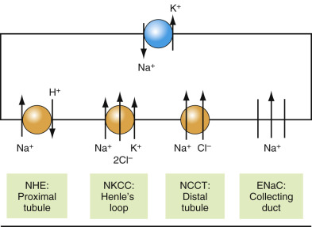
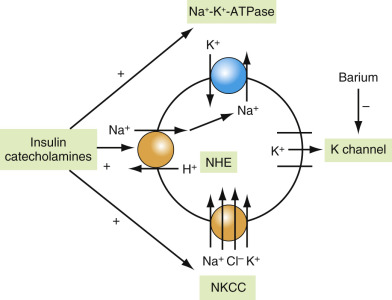
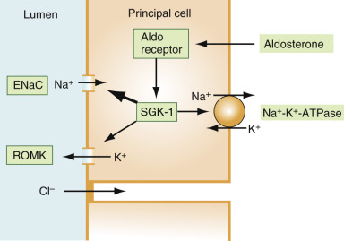
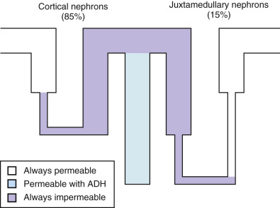
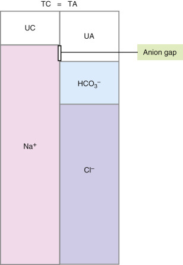

## Key Points

  * •

Normal volumes and composition of electrolytes in various body fluid compartments are essential for maintenance of life. 

  * •

The kidney is the most important organ in the maintenance of normal fluid volume and composition. 

  * •

The most important function of the kidney is elimination of the waste products of metabolism, and this function is best represented by the glomerular filtration rate. 

  * •

Glomerular filtration rate can be measured using exogenous or endogenous markers. The most important exogenous marker is creatinine. Glomerular filtration rate can be estimated from a determination of creatinine clearance, which requires measurement of creatinine in both plasma and a timed urine specimen. For many patients, however, a better estimate is obtained from an equation such as the Modification of Diet in Renal Disease, which requires only a measurement of plasma creatinine. 

  * •

Causes of abnormal potassium concentration include laboratory artifacts, cellular redistribution, renal failure, alterations in the renin-angiotensin-aldosterone axis drugs, poor intake, and various acquired or inherited disorders affecting renal excretion of potassium. 

  * •

Causes of abnormal sodium concentration include laboratory artifacts, dehydration, disorders of thirst and antidiuretic hormone, renal disorders, water redistribution due to osmotically active substances such as glucose, drugs, and endocrine disorders. 

  * •

Causes of abnormal hydrogen ion concentration (i.e., acid-base disorders) include hypoventilation and hyperventilation, ketoacidosis, lactic acidosis, and toxic ingestions. 

,  

##  Introduction 

Laboratory tests for evaluation of disorders of renal, water, electrolyte, and acid-base status are the most common procedures performed in clinical chemistry laboratories. Screening tests in most laboratories are often grouped together in a basic metabolic panel, because disorders of acid-base and electrolytes are seen in a high percentage of hospitalized individuals, and electrolyte disorders are frequent complications of treatment for a variety of common conditions. Furthermore, renal disease is one of the major sequelae of common disorders such as diabetes and hypertension. Hence, proper interpretation of laboratory tests of renal, electrolyte, and acid-base disorders requires an understanding of the pathophysiology of these systems. Most central to the understanding of these disorders is knowledge of renal function and how the kidneys regulate extracellular volume. 

The reader is expected to learn normal volumes and composition of electrolytes in various body fluid compartments, and the mechanisms by which normal values are maintained, with particular emphasis on the role of the kidney in these processes. Physiologic processes involved in the maintenance of normal proton concentration (i.e., pH) will also be discussed. Before discussing abnormal states of electrolyte balance, normal physiology and common laboratory tests that are used to evaluate abnormal renal function will be discussed. Discussion of disorders of fluid and electrolytes in this chapter will include disorders of the concentrations of sodium and potassium and acid-base disorders. Discussions on multivalent ions are not included in this chapter. 

,  

##  Volume and Osmolality of Body Fluid 

The body fluid is an aqueous solution containing electrolytes and non-electrolytes, and its compartment consists of intracellular and extracellular compartments. The intracellular compartment is not a single compartment, but each cell has its own separate environment, communicating with other cells only via interstitial fluid and plasma. Consequently, difference exists among cells in various tissues in their solute composition and concentrations. Because cell membranes are permeable to water through the ubiquitous presence of aquaporins (water channels), osmotic equilibrium is maintained so that the osmolality of all cells is the same as that of extracellular fluid (  Agre et al, 2002  ;  Nielsen et al, 2002  ;  Frigeri et al, 2004  ). 

Before the discovery of aquaporins, it was believed, erroneously, that all cell membranes are readily permeable to water. Now we know that cell membranes are virtually impermeable to all substances, large and small. That a molecule as small as water (18 Da) needs aquaporins to cross the membrane is an example of this principle. Even after the discovery of aquaporins, it was widely believed that small gaseous substances such as CO  2  can diffuse across cell membranes readily. Apparently, this is not the case either. It seems that CO  2  cannot diffuse across cell membranes easily in the absence of aquaporins. For example, the apical membrane of the gastric mucosa is impermeable to CO  2  because of the absence of aquaporins, whereas the basolateral membrane of the same cell allows ready diffusion of CO  2  owing to the presence of aquaporin (  Prasad et al, 1998  ). The same appears true of the colonic mucosa (  Endeward & Gros, 2005  ). 

Operation of normal metabolic functions of the body requires maintenance of an optimal ionic strength of its environment, primarily the intracellular fluid, where most metabolic activities occur. The main functions of homeostatic mechanisms of the body are to provide such an environment. Because the extracellular fluid is not the site of major metabolic activity, substantial alteration in its ionic strength may occur without adverse effects on body function. The main function of the extracellular fluid is to serve as a conduit among cells and among organs. The plasma is a route of rapid transit, and the interstitial fluid serves as a slow supply zone. The ability of the extracellular fluid to function efficiently as a conduit requires maintenance of optimal volume, particularly of vascular volume. An additional important function of the extracellular fluid is regulation of intracellular volume and its ionic strength. Because osmotic equilibrium exists between the cells and the extracellular fluid, any alteration in extracellular osmolality is followed by an identical change in intracellular osmolality, which is accompanied by a reciprocal change in cell volume (  Carroll & Oh, 1989  ). 

Although cells and organs can be supplied with substrate and relieved of metabolic products with a much slower circulation, normal circulation is required to supply sufficient oxygen for the body's metabolic needs. Normal plasma volume is a prerequisite for maintenance of normal circulation. Because plasma is in equilibrium with the interstitial fluid, the maintenance of normal vascular volume requires normal extracellular volume. A low extracellular volume results in impaired organ perfusion, with insufficient oxygen delivery, and an excessive extracellular volume leads to vascular congestion and pulmonary edema. 

Transfer of fluid between the vascular space and the interstitial space is regulated by the Starling forces. The ultimate purpose of maintaining adequate intravascular volume is to maintain adequate hydrostatic pressure, which is necessary for diffusion of fluid from the vascular space into the interstitial space. Movement of fluid, nutrients, and electrolytes occurs in systemic capillaries through the vascular endothelial fenestrae. On the other hand, movement of the solutes and water across the capillaries of the brain is entirely transcellular through endothelial cells, because the intercellular gap (endothelial fenestrae) of the brain capillary endothelium is tightly closed. This is termed the _blood-brain barrier_ (  Ballabh et al, 2004  ). For the brain, perfusion is what matters, not perfusion pressure. The position of the brain in relation to the heart is such that when blood pressure is too low, perfusion of the brain will cease before that of other organs. 

 

##  Measurement of Body Fluid Volumes 

Total body water can be determined by dilution of various substances including deuterium, tritium, and antipyrine. The gold standard of the measurement is that using either tritiated water or deuterium oxide (  Lichtenbelt et al, 1994  ;  Brans et al, 1990  ). The former is a radioactive isotope (  Lister, 1962  ), and the latter requires a complicated method for its measurement. Both are very expensive. Furthermore, deuterium hydrogen is also known to equilibrate with H atoms besides those found in water molecules, and as a result total body water obtained with D  2  O was shown to be slightly higher. Another nonradioactive isotope used for the measurement of total body water is H  2  O with  18  O isotope, which, unlike D  2  O, does not equilibrate with O atoms outside of H  2  O (  Davies et al, 1988  ). Consequently, total body water measured with D  2  O is about 3% larger than that measured with H  2  18  O. As a cheap alternative, antipyrine has been introduced, and was used extensively in the 1940s and 1950s (  Soberman et al, 1949  ). However, subsequent studies indicated that antipyrine is not a very reliable dilution marker. It is metabolized in the liver, and therefore the equilibrium concentration at time zero must be obtained by interpolating the results (  Brans et al, 1990  ). 

More recently, the measurement of body fluid volumes by bioelectrical impedance analysis has become very popular. However, the results are not as accurate as the dilution methods, and the technology is still evolving. The main advantages of this method are easy applicability, non­invasiveness, and portability of measurements. The portability allows measurements of body fluid volumes in outpatient clinics and at the bedside (  Woodrow, 2007  ). The method is based on the principle that the body is an electrical conductor with a certain amount of resistance to flow (impedance), and resistance (R) is proportional to its length and inversely proportional to the cross-sectional area (A) (  Kyle et al, 2004  ). Hence, R (resistance) = ρL/A, where ρ is the resistivity of the conducting material (i.e., the body). Since V = AL, V = ρL2/R. The body fluid offers two types of resistance to an electrical flow: resistive resistance and capacitive resistance. The former is simply called _resistance,_ whereas the latter is called _reactance_ . Impedance of the body to an electrical flow is a combination of these two types of resistance. The cell membrane, which is made of lipid, acts like capacitance, and is the cause of capacitive resistance. At zero or low frequency, the electrical current does not penetrate the cell membrane and therefore flows only through the extracellular fluid. At a very high frequency, the electrical current flows through both the extracellular and intracellular fluid compartment (  Davies et al, 1988  ;  Kyle et al, 2004  ). 

The term _bioelectrical impedance analysis_ is used when single or multiple frequencies of up to 8 frequencies are used, whereas the term _bioelectrical spectroscopy_ is used when 256 or more multiple frequencies are used (  Gudivaka et al, 1999  ). Bioelectrical impedance analysis has been used to measure fat free mass, extracellular and intracellular fluid volume, and total body water. In bioelectrical spectroscopy, mathematical modeling and mixture equations are used to generate the relationship between R and body fluid volumes. 

A mathematical model widely used is called the _Xitron equation_ (  De Lorenzo et al, 1995  ), which has been further modified (  Kyle et al, 2004  ). Another model using different assumptions, called the _body composition spectroscopy equation,_ has been developed subsequently. Comparison of the two methods in dialysis patients, whose change in total body water can be determined from the ultrafiltration volume during dialysis, indicated that the latter method was more accurate (  Kyle et al, 2004  ). 

 

##  Body Fluid Volumes 

Total body water measured with antipyrine in hospitalized adults without fluid and electrolyte disorders is about 54% of the body weight (  Carroll & Oh, 1989  ). The fractional water content is higher in infants and children, and it decreases progressively with aging. The water content also depends on the body content of fat; women and obese persons, because of their higher fat content, have less water for a given weight. A useful shortcut for the calculation of total body water, using the fact that 54% of body weight in kg is body water and 1 kg is 2.2 lbs, is: 

 Total body water  (  L  )  =  body weight  (  lb  )  /  4 

For an obese subject, subtract 10% from the calculated body water, and for a lean person, add 10%. For a very obese person, subtract 20%. Women have about 10% less body water than men for the same body weight. 

Extracellular volume is measured directly, and the intracellular volume is estimated as the difference between total body water and extracellular volume. The measurement of total body water is reliable, but the measurement of extracellular volume is not. Although many different markers have been used to measure the extracellular volume, no ideal marker has been found. Markers that have been used to measure extracellular volume include sodium, chloride, bromide, mannitol, inulin, sucrose, sulfate, thiosulfate, and thiocyante (  Gamble et al, 1953  ). Markers such as sodium, chloride, and bromide are not located exclusively in the extracellular compartment, but penetrate the cells to varying extents, whereas other markers such as mannitol, inulin, sucrose, sulfate, thiosulfate, and thiocyanate do not penetrate certain parts of the extracellular fluid. Extracellular volume has also been estimated indirectly by the degree of dilution of serum Na following administration of mannitol, on the principle that mannitol in the extracellular fluid would cause osmotic withdrawal of water from the cell (  Manninen et al, 1987  ). Thus, depending on the type of marker used, the extracellular fluid volume could vary from 27% to 53% of total body water (  Carroll & Oh, 1989  ). 

Extracellular volume measured with chloride and expressed as percent of total body water varies from 42% to 53% and is greater in older subjects and women. Extracellular volume measured with inulin or sulfate is smaller, about 30% to 33% of total body water (  Carroll & Oh, 1989  ). For discussion in this chapter, a value of 40% of total body water will be considered to represent extracellular volume. Extracellular volume is further divided into three fractions: interstitial (space between cells) volume (28% of total body water), plasma volume (8%), and transcellular water volume (4%) ( [ Box 14-1 ](<#b0010>) ). Transcellular water includes luminal fluid of the gastrointestinal tract, the fluids of the central nervous system, and fluid in the eye as well as the lubricating fluids at the serous surface. 

Box 14-1 

Volumes of Body Fluid Compartments [ * ](<#fn0010>)

* A normal man weighing 73 kg (160 lbs) with 40 liters of total body water is used as a model. 

  * Intracellular volume: 24 L (60%) 

  * Extracellular volume: 16 L (40%) 

  * Interstitial volume: 11.2 L (28%) 

  * Plasma volume: 3.2 L (8%) 

  * Transcellular volume: 1.6 L (4%) 

 

##  Composition of the Body Fluid 

 

##  Extracellular Composition 

The concentrations of electrolytes in plasma are easily measured and their values well known. These concentrations increase by about 7% when expressed in plasma water, because about 7% of plasma is solids (  Nguyen et al, 2007  ). Thus, plasma sodium is 140 mmol/L, but the concentration in plasma water is about 150 mmol/L. The concentrations of electrolytes in interstitial fluid are different from those in the plasma because of differences in protein concentrations between plasma and interstitial fluid. The differences in electrolyte concentrations between plasma and interstitial fluid can be predicted by the Donnan equilibrium ( [ Table 14-1 ](<#t0010>) ) (  Oh & Carroll, 1995  ). With normal plasma protein concentrations, the concentrations of diffusible cations are higher in plasma water than in interstitial water by about 4%, whereas the concentrations of diffusible anions are lower in the plasma than in the interstitial fluid by about 4%. The concentrations of calcium and magnesium in the interstitial fluid are lower than the values predicted by the Donnan equilibrium, because they are substantially protein-bound. 

TABLE 14-1 

Electrolyte Concentrations in Extracellular and Intracellular Fluids 

|  PLASMA  |  INTERSTITIAL FLUID  |  PLASMA WATER  |  CELL WATER (MUSCLE)   
---|---|---|---|---  
(mmol/L)  |  (mmol/L)  |  (mmol/L)  |  (mmol/L)  |  (mmol/L)  |  (mmol/L)  |  (mmol/L)  |  (mmol/L)   
Na [ \+  ](<#hl0000216>) |  140  |  140  |  145.3  |  145.3  |  149.8  |  149.8  |  13  |  13   
K [ \+  ](<#hl0000216>) |  4.5  |  4.5  |  4.7  |  4.7  |  4.8  |  4.8  |  140  |  140   
Ca [ ++  ](<#hl0000222>) |  5.0  |  2.5  |  2.8  |  1.4  |  5.3  |  5.3  |  10  –7  |  0.5 × 10  –7   
Mg [ ++  ](<#hl0000222>) |  1.7  |  0.85  |  1.0  |  0.5  |  1.8  |  0.9  |  7.0  |  3.5   
Cl  – |  104  |  104  |  114.7  |  114.7  |  111.4  |  111.4  |  3  |  3   
HCO  3  – |  24  |  24  |  26.5  |  26.5  |  25.7  |  25.7  |  10  |  10   
SO  4  2– |  1.0  |  0.5  |  1.2  |  0.6  |  1.1  |  0.55  |  – |  –  
P  |  2.1  |  1.2+  |  2.1 [ ++  ](<#hl0000222>) |  1.2 [ \+  ](<#hl0000216>) |  2.2  |  1.25 [ \+  ](<#hl0000216>) |  107  |  57 [ +++  ](<#hl0000225>)  
Protein  |  15  |  1  |  8  |  0.5  |  16  |  1  |  40  |  2.5 [ * ](<#hl0000228>)  
Organic anion  |  5  |  5  |  5.6  |  5.6  |  5.3  |  5.3  |  – |  –  
  
 + The calculation is based on the assumption that the pH of the extracellular fluid is 7.4 and the pK of inorganic H  2  PO  4  – is 6.8. 

 ++ The concentration of P in the interstitial fluid would be increased by the Donnan effect, but reduced by the lower protein-bound phosphate, and these two opposing effects keep interstitial phosphate concentration about equal to that of plasma. 

 +++ The intracellular molal concentration of phosphate is calculated with the assumption that the pK of organic phosphates in the cell is 6.1 and the intracellular pH 7.0. 

 * The calculation is based on the assumption that each mmol of intracellular protein has an average of 15 mEq. 

The extracellular fluid space is not merely the site of passive passageway for the movement of nutrients and metabolites between the plasma and the cells and the exchange of oxygen and CO  2  . The extracellular space contains many different molecules known as the _extracellular matrix,_ which provides structural integrity and support for the surrounding cells but also participates in signaling transduction to the cells. The main molecules contained in the extracellular space are many different types of fibrous proteins such as collagen, elastin, laminin, and fibronectin; glycoproteins; and hyaluronic acid, also known as hyaluronan. Glycoproteins consist of sulfated glycosaminoglycan attached covalently to protein, and examples include heparan sulfate, dermatan sulfate, and chondroitin sulfate. Hyaluronic acid is one form of glycosaminoglycan, which is neither sulfated nor attached to protein, and is the most abundant glycosaminoglycan in the extracellular space (  Stern, 2004  ;  Stern et al, 2006  ). Both hyaluronic acid and sulfated glycoproteins are highly anionic and are surrounded by many water molecules in a gel-like state. This space excludes distribution of proteins. In the other part, proteins diffuse freely and communicate with lymphatics. Interspersed within the interstitial space is elastin, which provides the elastic property of the interstitial tissue; this property is necessary for generation of a normal negative pressure of the interstitial space and a positive pressure with the development of edema (  Reed & Laurent, 1992  ;  Aukland & Reed, 1993  ;  Burton, 1988  ). 

The fact that extracellular matrix proteins participate in cellular signaling is shown by the findings that many extracellular matrix proteins such as collagen, laminin, fibronectin, and vitronectin are ligands for the transmembrane receptor proteins such as integrin. 

 

##  Intracellular Composition 

While sodium, chloride, and bicarbonate are the main solutes in the extracellular fluid, potassium, magnesium, phosphate, and proteins are the main solutes in the cell. The intracellular concentrations of sodium and chloride cannot be measured with accuracy, and is estimated by subtracting the amount that is extracellular from the total tissue value. Since concentrations of electrolytes in the extracellular fluid are high, a small error in extracellular water volume measurement will cause a large error in the measurement of intracellular concentration of these ions. The concentration of bicarbonate is calculated from cell pH, and the bicarbonate concentration shown in [ Table 14-1 ](<#t0010>) is based on the assumption that the average cell pH is 7.0. 

The electrolyte composition of intracellular fluid is not identical throughout the tissues. For example, the concentration of chloride in muscle is very low, about 3 to 4 mmol/L (  Graham, 1970  ), but it is about 75 mmol/L in erythrocytes. A very low chloride concentration in skeletal muscle is attributed to the strongly negative resting membrane potential, about –90 mV. In contrast, the electrical potential of the red blood cell is about –10 mV (  Zavodnik et al, 1997  ). Distribution of chloride across muscle estimated from the Nernst equation would predict a concentration of 3.5 mmol/L when the electrical potential is –90 mV in the cell, and 72 mmol/L when the potential is –10 mV. Slightly higher values can be explained by secondarily active transporters such as sodium-potassium-chloride transporters (NKCC). The concentration of potassium in the muscle cell is about 140 mmol/L but in the platelets is only about 118 mmol/L, and the lower potassium concentration is also explained by lower membrane potential of about –70 mV (  Pipili, 1985  ). 

The concentration of sodium in the cell cannot be predicted by the membrane potential since the values are far from the equilibrium predicted by the Nernst equation. If it were, the intracellular concentration of sodium has to be much greater than that of the extracellular fluid. The much lower concentration of sodium in the cell than predicted can be explained by Na  \+  -K  \+  -ATPase that pumps sodium out of the cell constantly. The concentration of sodium in the muscle and red blood cell is about 13 mmol/L, but in leukocytes it is about 34 mmol/L. The main phosphate in the red blood cell is 2,3-DPG, but in the muscle ATP and creatinine phosphate are the main phosphates. Because the muscle represents the bulk of the body cell mass, it is customary to use the electrolyte concentration of the muscle cells as representative of the intracellular electrolyte concentration. A substantial part of the anions inside the cell are polyvalent ions such as phosphate and protein, and consequently, the total ionic concentration in the cell in mmol/L is higher than that of the extracellular fluid in order to maintain osmotic equilibrium with the extracellular fluid. 

Even then, the total solute concentration of electrolytes in the cell is less than the total solute concentration of electrolytes in the extracellular fluid, and the difference is explained by the accumulation of organic solutes in the cell at concentrations that are much higher than those in the extracellular fluid. These organic solutes include sorbitol, myoinositol, taurine, betaine, and glycerophosphocholine (  Burg & Ferraris, 2008  ). These solutes participate in the regulation of cell volumes in the presence of changes in extracellular tonicity (Burg, 2008). For example, in the presence of hypertonicity, the intracellular concentrations of these solutes increase either by increased synthesis or by increased cellular uptake (Burg, 2008). The concentration of sorbitol in the cell with hypertonicity increases by the increased production by activating the enzyme aldose reductase while reducing its metabolism to fructose. Similarly, the concentration of glycerophosphocholine (GPC) increases by the increased activity of the main synthetic enzyme, NTE (neuropathy target esterase). On the other hand, the increased cellular concentrations of betaine, myoinositol, and taurine are achieved by the increased number of transporters, namely BGT1 (betaine-GABA transporter), SMIT (sodium myoinositol transporter), and TauT (taurine transporter) (Burg, 2008). Regulation of production of these various chemicals is orchestrated by the tonicity-responsive enhancer-binding protein (TonEBP), a transcription factor that promotes cellular accumulation of organic osmolytes mainly in the hypertonic renal medulla by promotion of expression of genes involved in organic solute accumulation (  Johnson et al, 2014  ) described earlier. 

 

##  Measurement of Plasma Osmolality 

Osmolarity refers to the number of moles of solute in a liter of solution, whereas osmolality refers to the number of moles of solute in a kilogram of water (solvent). Osmolality is the preferred term, since measurements of both osmolarity and osmolality are based on colligative property, which is based on the number of particles dissolved in a given number of water molecules. Examples of colligative property, which depends on the number of solute particles, include freezing point, boiling point, and vapor pressure. The mass of water represents the number of water molecules more accurately than the volume, because water volume changes with temperature, but the mass does not. One should note, however, that 1 kg of water occupies 1 liter at 4° C. However, the terms _osmolality_ and _osmolarity_ are often used interchangeably, because changes in the volume of liquid water with temperature are negligible. 

One mole of NaCl in solution contains 2 osmoles because NaCl is dissociated to Na  \+  and Cl  – . One mole of  d  -glucose in solution contains 1 osmole since glucose does not dissociate. One mole of Na  3  PO  4  in solution contains 4 osmoles, since it will dissociate into 3 Na  \+  ions and one PO  4  3– ion. To calculate the osmolality of a solution whose solute dissociates into more than one particle, the following equation is used: 

 M  × a  =  Osm  /  L 

where M is molarity, and a is the number of particles into which a molecule of the substance dissociates. 

When the osmolal concentration of the extracellular fluid increases by accumulation of solutes that are restricted to the extracellular fluid (effective osmols) (e.g., glucose, mannitol, and sodium), osmotic equilibrium is reestablished as water shifts from the cell to the extracellular fluid (ECF), increasing intracellular osmolality to the same level as the extracellular osmolality (  Hill, 1990  ;  Oh & Carroll, 1995  ;  Weisberg, 1978  ). When the extracellular osmolality increases by accumulation of solutes that can enter the cell freely (ineffective osmols) (e.g., urea and alcohol), the osmotic equilibrium is achieved by entry of those solutes into the cell. Since most of the solutes normally present in the extracellular fluid are effective osmols, loss of extracellular water (e.g., insensible losses) will increase effective osmolality, and hence cause a shift of water from the cells. Reduction in extracellular osmolality either by loss of normal extracellular solutes or by retention of water reduces effective osmolality for the same reasons, and hence causes a shift of water into the cells. 

Osmolality of serum or plasma can be measured directly with an osmometer, as described in [ Chapter 4 ](<##!/content/3-s2.0-B9780323295680000048?scrollTo=%23c00004>) , on the principles of instrumentation or estimated as the sum of the concentration of all the solutes in the plasma. Because an osmometer does not distinguish between effective and ineffective osmols, effective osmolality can only be estimated. As it happens, urea is the only ineffective osmol that has substantial concentration in the normal plasma, 5 mOsm/L. In the normal plasma, therefore, total osmolality is nearly equal to effective osmolality. Plasma osmolality is estimated as follows: 

 Serum osmolality  =  {  serum Na  \+  (  mmol  /  L  )  × 2  }  \+  {  glucose  (  mg  /  dL  )  /  18  }  \+  {  urea nitrogen  (  mg  /  dL  )  /  2.8  } 

In the use of the formula in [ Equation 14-3 ](<#e0020>) , osmolality of sodium and accompanying anions are overestimated by not considering the osmotic coefficient and assuming that all serum anions are univalent. On the other hand, osmolality is underestimated by ignoring nonsodium cations and their accompanying anions. At normal serum glucose and urea concentrations, osmolality almost equals serum Na  \+  × 2, because the opposing errors cancel each other. It should be noted that for the contribution of urea and glucose for serum osmolality, their values in mg/dL are divided by one tenth of each (2.8 and 18) of their molecular weights (28 and 180), because osmolality is expressed as mOsm/L, not mOsm/dL. 

Many of the solutes that may accumulate in the body in certain abnormal states are anions of an acid (e.g., salicylate, glycolate, formate, lactate, beta-hydroxybutyrate). These substances should not be added in estimating plasma osmolality since they are largely balanced by sodium and therefore already accounted for when plasma sodium is multiplied by 2. Nonelectrolyte solutes that accumulate abnormally in the serum (e.g., ethanol, ethylene glycol, methanol, and mannitol) will cause the measured osmolality to exceed the calculated osmolality, producing an osmolal gap (  Gennari, 1984  ). This osmolal gap is a useful clinical clue to the presence of the toxic substances listed earlier. Accumulation of neutral and cationic amino acids also causes a serum osmolal gap. 

 

##  Effect of Hyperglycemia on Serum Na  \+ 

The permeability of a membrane for a given solute varies with the cell type. For example, glucose does not accumulate in the muscle. It does not enter the muscle cell freely, and when it enters the cell with the help of insulin, it is quickly metabolized. Thus, glucose is an effective osmol for the muscle cell (e.g., hyperglycemia will cause a shift of water from the muscle cell). On the other hand, glucose is an ineffective osmol for the red blood cells, liver, kidney cells, and most brain cells because it enters these cells freely. Glucose is generally categorized as an effective osmol mainly because the muscle cells represent the largest body cell mass, as noted previously in this chapter. Accumulation of glucose or mannitol in the extracellular fluid is a well-known cause of hyponatremia because, as discussed in [ Chapter 8 ](<##!/content/3-s2.0-B9780323295680000085?scrollTo=%23c00008>) , glucose is osmotically active and induces diffusion of water from the cells to the extracellular fluid, diluting its electrolytes. The fluid shift affects concentrations of all extracellular electrolytes, but its absolute effect is greatest on serum sodium because of its higher concentration. The relationship between change in serum sodium and change in glucose concentration in a normal adult is about 1.6 mmol/L of Na  \+  for 100 mg/dL of glucose (  Katz, 1973  ). However, the correction factor is not linear. When hyperglycemia is more severe, the change in serum sodium for a given change in glucose tends to be less, approaching 1.4 at serum glucose concentrations of 1000 mg/dL (  Moran & Jamison, 1985  ). In sharp contrast, Hillier and colleagues, on the basis of experiments on normal subjects, concluded that the correction factor was much larger, a 2.4 mmol/L change in serum sodium for every 100 mg/dL change in glucose (  Hillier et al, 1999  ). A problem with this experiment and the conclusion was that the authors disregarded the effect of water contained in intravenous glucose and urine output on serum sodium. Furthermore, infusion of somatostatin during induction of hyperglycemia would have increased serum potassium, and infusion of insulin during treatment of hyperglycemia would have had an opposite effect on serum potassium concentration. Changes in serum potassium would have the opposite effect on serum sodium concentration. 

These figures suggested by various formulas are valid, however, only when the volume of distribution of glucose is between 40% and 50% of total body water. Volume of distribution of glucose refers to a theoretical volume into which glucose would be evenly distributed when none of the administered glucose is excreted and none metabolized. For example, if 10 g (10,000 mg) of glucose is given to a person, and the serum concentration were to increase by 1000 mg/L (100 mg/dL) (with the assumption that none was metabolized and none excreted), the volume of distribution would be 10 liters. Normally, the volume of distribution of glucose is slightly greater than the extracellular volume because some cells allow free diffusion of glucose. As the volume of distribution of glucose in relation to total body water is increased, the effect of glucose on serum sodium decreases. Decreased volume of distribution of glucose has an opposite effect. The change in serum Na caused by hyperglycemia can be estimated with the following formula (  Oh & Carroll, 1995  ): 

 Δ Na  \+  (  mmol  /  L  )  =  (  5.6  − 5.6  a  )  /  2 

where ΔNa is a reduction in serum Na  \+  in mmol/L for each 100 mg/dL increase in glucose, and a is the fraction of the volume of glucose distribution over total body water. 

In conditions with marked expansion of extracellular volume (e.g., congestive heart failure and other edema-forming states), the volume of distribution of glucose represents a much greater fraction of total body water, and hence a fall in serum sodium caused by hyperglycemia would be much less than usual. For example, when the volume of distribution of glucose is 80% of total body water (0.8), the decrease in serum Na  \+  for a 100 mg/dL rise in glucose would be only 0.56 mmol/L (5.6 – 5.6 × 0.8)/2 = 0.56. When the volume of distribution of glucose is 20% of total body water, ΔNa  \+  would be 2.2 mmol/L for a 100 mg/dL increase in glucose. 

 

##  Tonicity 

The concept of tonicity of a solution is based on the effect of a particular solution on the volume of cells. A hypertonic solution is one that shrinks the cells, while a hypotonic solution is one that causes swelling of the cells. An isotonic solution is one that does not induce any volume change in the cells. A solution of 0.9% saline (154 mM solution of sodium chloride) is isotonic in relation to normal body fluid. When the term _tonicity_ is applied to a fluid in vitro, as in the urine, it is used almost interchangeably with total osmolality. Thus, urine with a high concentration of urea is called _hypertonic_ (  Pradella et al, 1988  ). 

 

##  Osmolality and Specific Gravity 

The specific gravity of a solution is the mass of the solution divided by the volume of the solution. Whereas osmolality of fluid depends on the osmolal concentration of its solute, specific gravity is determined by the weight of the solute relative to the volume it displaces in solution. Plasma protein contributes little to osmolality because of its low molal concentration despite its great weight, but is the major factor determining specific gravity of plasma. Urinary specific gravity and osmolality usually change in parallel, but discrepancy occurs between the two with heavy proteinuria and severe glycosuria (  Carroll & Oh, 1989  ). The main determinant of specific gravity of plasma is protein, much more than NaCl and glucose, not because it has greater effect than the latter, but because the normal protein concentration at 70 g/L dominates over all other solutes. The normal plasma concentration of NaCl is a mere 9 g/L and that of glucose only 1 g/L. Consequently, iso-osmotic plasma has a specific gravity of 1.020 to 1.030 (  Trudnowski & Roco, 1974  ), whereas iso-osmotic urine has a specific gravity of about 1.010. 

,  

##  Regulation of Extracellular Volume 

As discussed later, the extracellular volume depends primarily on its sodium concentration, which is closely regulated by two hormones: antidiuretic hormone (ADH), which promotes water retention, and aldosterone, which promotes sodium retention, causing water to be retained with it, as discussed in [ Chapter 8 ](<##!/content/3-s2.0-B9780323295680000085?scrollTo=%23c00008>) . Because the extracellular sodium concentration is maintained within a fairly narrow range through the regulation of ADH release, the extracellular volume depends primarily on its sodium content. In most clinical situations, the extracellular volume correlates well with the vascular volume, which in turn usually correlates positively with the effective vascular volume. Effective vascular volume is an imaginary volume that reflects cardiac output in relation to the tissue's demand for oxygen (Oh et al, 1995). Sometimes, effective vascular volume does not correlate well with vascular volume or extracellular volume. 

Effective vascular volume, rather than the extracellular volume or vascular volume, is the chief determinant of how much extracellular fluid is retained. The location and type of sensors that perceive changes in effective vascular volume is not well known. Most physiologists consider the baroreceptors, located in the atria of the heart and the aortic arch, to be likely candidates that send neural signals to the central nervous system resulting in increases or decreases of ADH and altered sympathetic tone. However, the preponderance of evidence argues against effectiveness of such receptors in chronic states of altered effective vascular volume. For example, in a hypertensive patient with congestive heart failure, both atrial low pressure and arterial high pressure baroreceptors would sense a higher than normal pressure. Yet, the neurohumoral responses (e.g., high ADH, high catecholamines, and high renin and angiotensin concentrations) in such states suggest that the body senses low effective vascular volume. In such conditions, the kidney responds appropriately by reducing urinary excretion of sodium and chloride. These physiologic responses to low effective vascular volume sometimes lead to a pathologic retention of salt. For example, salt is retained in congestive heart failure despite markedly expanded extracellular volume and vascular volume, because effective vascular volume is decreased. 

Theoretically, there are two ways to alter the salt content of the body: to alter the intake of salt or to alter renal salt output. There is no well-developed mechanism that influences salt intake in response to changes in effective vascular volume. Thus, alterations in salt content of the body are achieved primarily through changes in renal salt output. Changes in renal salt output can be achieved through physical and humoral factors. The physical factors for renal salt regulation work through changes in the glomerular filtration rate (GFR) and in peritubular capillary oncotic and hydrostatic pressures. When other factors that influence renal salt output are kept unchanged, the greater the GFR, the greater the amount of sodium filtered and the greater the amount of sodium excreted. In general, however, tubular reabsorption rather than glomerular filtration plays the major role in the regulation of renal excretion of sodium. In advanced renal failure, GFR may be 10% of normal, but patients with renal failure excrete their usual amount of sodium intake as in normal people. 

Tubular reabsorption of sodium is regulated by humoral factors and physical factors. The latter's influence on sodium reabsorption is limited mainly to the proximal tubule, where a great deal of sodium reabsorption occurs passively through the paracellular (between cells **)** pathway. Increased hydrostatic pressure on the peritubular capillary retards passive fluid reabsorption through the paracellular pathway while it promotes passive back diffusion of fluid into the tubular lumen. Increased oncotic pressure has the opposite effects. For example in congestive heart failure, peritubular hydrostatic pressure is reduced because of the increased renal vascular resistance caused by constriction of both afferent and efferent arterioles. Constriction of afferent arterioles would tend to reduce glomerular capillary hydrostatic pressure. However, the glomerular pressure does not decrease much because the constriction of efferent arterioles is even greater than that of afferent arterioles. The maintenance of the glomerular filtration pressure helps to minimize a fall in GFR in volume-depletion states. The result is an increase in filtration fraction (the ratio of GFR to renal plasma flow). Since protein is not filtered, its concentration increases, causing an increased oncotic pressure including in the blood leaving the glomerular capillary through the efferent arterioles to a greater extent than usual. Because the blood in the efferent arterioles flows into the peritubular capillaries, the oncotic pressure of the peritubular capillary would be higher than usual. A lower than usual hydrostatic pressure and a higher than usual oncotic pressure of the peritubular capillary blood in volume-depletion states tend to favor reabsorption of salt and water through the paracellular pathway of the proximal tubule, the tubular segment in which passive reabsorption of salt through the paracellular pathway plays a big role in the overall renal tubular salt transport. Normally, the oncotic pressure of the peritubular capillary plasma in the proximal tubule is about 20% higher than the peripheral blood plasma because the filtration fraction is 0.2. In states of volume depletion, the value could be 25% or 30% higher than that of the peripheral plasma. 

Humoral factors that influence tubular reabsorption of sodium include angiotensin II, aldosterone, the atrial natriuretic peptide family of hormones, and catecholamines. Angiotensin II directly increases proximal tubular sodium reabsorption through its effect on the sodium-hydrogen exchanger-3 (NHE-3), and also indirectly by increasing aldosterone secretion, which in turn increases sodium reabsorption in the cortical collecting duct. Catecholamines influence sodium reabsorption mainly through their effects on renal blood flow, but may have some direct tubular effect in the proximal nephron. 

Different types of natriuretic peptide hormones exist (see [ Chapter 18 ](<##!/content/3-s2.0-B9780323295680000188?scrollTo=%23c00018>) ). The most widely known ones are ANP, BNP, CNP, and urodilatin (  Volpe, 2014  ;  Ntalapascha et al, 2009  ;  Moyes et al, 2014  ). ANP is produced mainly by the atrium of the heart, and BNP, despite its original name, _brain natriuretic peptide,_ is produced mainly by the ventricles. Although BNP is now used widely as a marker of heart failure as its levels increase with dilatation of the ventricles, its physiologic relevance as the regulator of renal sodium excretion is doubtful. Despite a marked increase in ANP and BNP in congestive heart failure, there is a marked increase in sodium reabsorption by the kidney in patients with congestive heart failure. The most important natriuretic peptide hormone for the renal excretion of sodium appears to be urodilatin (  Vesely, 2007  ). 

The role of ADH in the regulation of extracellular volume is modest, because of the overwhelming importance of osmolality as the main regulator of ADH secretion. For this reason, _salt content of the body is the main determinant of the extracellular volume_ . When sodium is retained, a proportionate amount of water is retained in order to maintain normal serum osmolality. Only when the effective vascular volume depletion is very great will ADH secretion occur despite hyponatremia. 

In the presence of primary water retention as in the syndrome of inappropriate ADH secretion, extracellular volume could theoretically increase in the absence of sodium retention. However, massive water retention without sodium retention will cause only a modest increase in extracellular volume. For example, if a person with 40 liters of total body water gains 10 liters of water without a change in sodium content, serum sodium would decrease from 140 mmol/L to 112 mmol/L (140 × 40/50 = 112), a value that would cause severe morbidity or even death. This would increase the extracellular volume only by 4 liters, since the bulk (60%) of retained water would enter the cell. On the other hand, the same fluid volume retained with salt would remain almost exclusively in the extracellular space. In other words, the amount of water that can be retained without salt is limited by severe and fatal hyponatremia. This is the reason why a massive increase in extracellular volume as in severe congestive heart failure is possible only with massive sodium retention. 

The ultimate source of energy for reabsorption of sodium at various nephron segments is Na  \+  -K  \+  -ATPase, located on the basolateral membrane, which transports 3 Na  \+  out of the cell in exchange for 2 K  \+  transported into the cell. The resulting reduction in intracellular sodium concentration and the negative cellular electrical potential allow passive diffusion of Na  \+  into the cell through the luminal membrane. Four major sites of sodium reabsorption in the nephron utilize four different mechanisms of luminal sodium entry ( [ Fig. 14-1 ](<#f0010>) ). Among humoral factors that have been proven or suggested as participating in the regulation of renal salt output, those with well-proven physiologic effects are aldosterone, catecholamines, angiotensin II, and perhaps ADH and prostaglandins (Oh et al, 1995;  Biggi et al, 1995  ). 

Figure 14-1 

Mechanisms of sodium reabsorption at different nephron segments. 

The main source of energy for sodium reabsorption at all nephron segments is the basolateral Na  \+  -K  \+  -ATPase, which transports 3 Na  \+  out of the cell in exchange for 2 K  \+  into the cell. This pump creates a low intracellular sodium concentration and negative cellular potential, which allow passive diffusion of Na  \+  into the cell through the luminal membrane. In the proximal tubule, Na  \+  entry is accompanied by exit of H  \+  through sodium-hydrogen exchanger type 3 (NHE-3). In the thick ascending limb of Henle, Na  \+  enters along with K  \+  and 2 Cl  – through the sodium-potassium-chloride cotransporter (NKCC). In the distal convoluted tubule, Na  \+  enters with Cl  – through the sodium chloride cotransporter (NCCT), and in the cortical collecting duct, Na  \+  enters through the epithelial sodium channel (ENaC). 

Some of the humoral substances that influence renal sodium excretion have an indirect effect on renal sodium output. For example, adenosine is currently the best candidate for the regulation of GFR through the tubulo-glomerular feedback mechanism (  Thomson & Blantz, 2008  ). Increased production of adenosine in response to a high NaCl concentration at the macula densa results in constriction of afferent arterioles, resulting in reduced GFR. The ultimate effect is reduced excretion of sodium. Likewise, constriction of efferent arterioles by angiotensin II can secondarily increase tubular reabsorption of NaCl, as the increased filtration fraction results in a higher peritubular oncotic pressure and a lower hydrostatic pressure (  Thomson & Blantz, 2008  ). 

 

##  Nonrenal Control of Water and Electrolyte Balance 

 

##  Insensible Loss of Water from the Skin 

Water is lost from the skin primarily as a means of eliminating heat. Water loss from the skin without sweat is called _insensible perspiration._ Sweat contains about 50 mmol/L of sodium and 5 mmol/L of potassium. The maintenance of low NaCl concentration in the sweat requires the normal functioning of CFTR (cystic fibrosis transmembrane conductance regulator), and hence the loss of NaCl is greater in those with cystic fibrosis. Because the main purpose of water loss from the skin is elimination of heat, water loss from the skin depends mainly on the amount of heat generated in the body: 

 Water loss from the skin  =  30  mL per  100  calories 

Caloric expenditure depends on the basal metabolic rate, and the rate of skin water loss may be sharply reduced in a cachectic malnourished person, especially an anuric person with impaired mental state (  Carroll & Oh, 1989  ). 

 

##  Loss of Respiratory Water 

The water content of inspired air is less than that of the expired air, and hence water is lost during normal ventilation. Because the ventilatory volume is determined by the amount of CO  2  production, which is in turn determined by the caloric expenditure, ventilatory water loss in normal environmental conditions depends also on caloric expenditure: 

 Respiratory water loss  =  13  mL per  100  calories at normal pCO  2 

By coincidence, the quantity of water lost during normal respiration is about equal to the metabolic water production. Hence, in calculating water balance, respiratory water loss may be ignored in the measurement of insensible water loss, provided that metabolic water gain is also ignored. Respiratory water loss increases with hyperventilation or fever disproportionately to metabolic water production (  Carroll & Oh, 1989  ). 

 

##  Loss of Water in the Gastrointestinal Tract 

The net activity of the gastrointestinal tract to the level of the jejunum is secretion of water and electrolytes. The net activity from the jejunum to the colon is reabsorption. Most of the fluid entering the small intestine is absorbed in the small intestine, and the remainder by the colon, leaving only about 100 mL of water to be excreted daily in the feces. The contents of the gastrointestinal tract are isotonic or slightly hypotonic to plasma, and any fluid that enters the gastrointestinal tract becomes isotonic. Thus, the loss of fluid from the gastrointestinal tract never causes hyponatremia in the absence of water ingestion. 

,  

##  Measurement of Renal Function 

 

##  Concept of Clearance 

Renal clearance relates the rate of urinary excretion of material to the plasma concentration of that material. It is defined as the volume of plasma that would theoretically have to be “cleared” of the substance in order to account for the amount of the substance excreted in the urine during a given period. In order to calculate clearance, one must first know the amount of the substance excreted in the urine, which is simply calculated from the urine concentration (U  x  ) and volume (V). The next step is then to know the plasma concentration of the substance (P  x  ) in order to determine the volume of plasma needed to account for the material excreted. For example, if a person excreted 1500 mg of creatinine in 1 day, he or she would need 150 liters of plasma to account for that 1500 mg of creatinine if the plasma concentration were 10 mg/L (1 mg/dL); creatinine clearance (C  creat  ) then, would be 150 L/day. At a plasma concentration of 100 mg/L (10 mg/dL), only 15 liters of plasma would be needed to account for the same 1500 mg of creatinine; C  creat  in this case would be 15 L/day. Customarily, clearance is expressed in mL/min, but any volume and time unit can be used. Thus, a clearance of 150 L/day is equal to 6.25 L/hour and 104 mL/min. The formal equation for clearance is: 

 C  x  =  (  U  x  V  )  /  P  x 

where C  x  is clearance of a substance x, U  x  and P  x  are concentrations of the substance in urine and plasma, respectively, and V the volume of urine per unit time. 

In estimating clearance, concentration and volume units must be consistent. For example, if urine creatinine concentration is 70 mg/dL and volume is 2000 mL/day, urine creatinine must also be expressed in mg/mL, not mg/dL. So the total amount excreted is: 0.7 mg/mL × 2000 mL/day = 1400 mg/day. 

A clearance in mL/24 hours can be converted to a clearance in mL/min by dividing the value by 1440, since 24 hours equals 1440 minutes. 

 

##  Quick Formulas for the Calculation of Clearance 

When calculating a 24-hour clearance in mL/min, urine creatinine excretion may be expressed in g/24 hours instead of mg/24 hours while expressing the plasma creatinine as mg/dL instead of mg/mL, as long as the incorrect use of these units is corrected by multiplying the final result by 1000 (for using g instead of mg) and then by 100 (for using mg/dL instead of mg/mL). A further correction requires dividing the value by 1440 in order to convert a 24-hour clearance value to a value in mL/min as follows (  Carroll & Oh, 1989  ): 

 C  x  =  U  x  V  (  g  /  24  hours  )  /  P  x  (  mg  /  dL  )  × 100  ,  000  × 1  /  1440 

 Since  100  ,  000  /  1440  =  70  ​ C  x  (  mL  /  min  )  =  70  × {  U  x  (  g  /  day  )  /  P  x  (  mg  /  dL  } 

 

##  Conversion of Clearance in L/week to mL/min 

The conventional unit for clearance is mL/min, but in certain situations, different units are more useful. For example, when one compares clearances of peritoneal dialysis in a patient on a CAPD (continuous ambulatory peritoneal dialysis) program with hemodialysis, the clearance unit often used is L/week. A patient on CAPD treatment typically has 2 liters of dialysate exchanged every 6 hours. Since the volume drained is usually about 2.5 liters (a slightly higher volume because of transudation of fluid from the blood to the peritoneal cavity), creatinine clearance is about 10 liters per day or 70 liters per week. As a comparison, hemodialysis provides about 48 liters of creatinine clearance with each treatment, or 144 liters of clearance per week since usually three treatments are given each week. If weekly clearance in L/week is to be converted to mL/min, the following shortcut may be useful: 

 L  /  week  =  1000  mL  /  week  =  1000  mL  /  (  7  × 24  × 60  )  minutes  =  1000  /  10  ,  080  =  0.1  mL  /  min 

In other words, weekly clearance in L/week/10 = minute clearance in mL/min. For example, 70 L/week of clearance is equal to 7 mL/min of clearance. 

 

##  Measurement of Glomerular Filtration Rate 

Glomerular filtration rate (GFR) is generally considered the best overall indicator of the level of kidney function (  Smith, 1951  ). Two different approaches have been utilized for the measurement of GFR. One approach has been to use an endogenous substance, and the other to use an exogenous substance. It is important that whatever molecular marker is used to determine GFR, the substance is minimally reabsorbed and minimally secreted by the renal tubules. 

 

##  Measurement of GFR with Exogenous Substances 

Inulin clearance is widely regarded as the gold standard for measuring glomerular filtration rate (  Smith, 1951  ). Inulin clearance in healthy young adults has a mean value of 127 mL/min/1.73 m  2  in men and 118 mL/min/1.73 m  2  in women. GFR declines with age. After 20 to 30 years of age, GFR decreases by approximately 1.0 mL/min/1.73 m  2  per year. The classic method of inulin clearance requires an intravenous infusion and timed urine collections over many hours. Inulin is expensive and the procedure is very time-consuming and not performed clinically. 

Consequently, a number of alternative measures for estimating GFR have been introduced (  Price & Finney, 2000  ;  Gaspari et al, 1997  ). The urinary clearance of exogenous radioactive markers such as  125  I-iothalamate and  99m  Tc-DTPA (metastable technetium  99  labeled diethylene triamine pentaacetic acid) provides good measures of GFR (  Biggi et al, 1995  ;  Brochner-Mortensen et al, 1969  ;  Christensen & Groth, 1986  ;  Fleming et al, 1991  ). Plasma disappearance of exogenous substances such as iohexol and  51  Cr-EDTA has also been used to estimate GFR, and an advantage of this method is that it does not require urine collection (  Krutzen & Back, 1984  ;  Russel, 1985  ;  Agarwal, 2003  ). However, plasma clearance methods are not as accurate as those that require urine collection. GFR has also been measured with non–radio-labeled iothalamate in blood and urine, and an obvious advantage of this method is avoidance of radioactive materials (  Rule et al, 2004  ). 

 

##  Measurement of GFR with Endogenous Substances 

Endogenous substances that are widely used to determine GFR include urea, creatinine, cystatin C, beta trace protein, beta-2 microglobulin, and tryptophan glycoconjugate. The first two are widely used in clinical practice mainly because of their ready availability, but cystatin C is gaining popularity. 

 

##  Creatinine as a Measure of Renal Function 

Creatinine is an endogenous substance with a molecular weight of 113 Da. It is produced by the muscle from creatine and creatine phosphate by a nonenzymatic dehydration process. The rate of production of creatinine is proportionate to the creatine–creatine phosphate pool, which in turn is proportionate to the muscle mass (  Oh, 1993  ). An additional source of creatinine is creatine contained in ingested meat (or dietary supplements). The rate of in vitro conversion of creatine to creatinine in meat is dependent on temperature and acidity; high temperature and low pH increase conversion (  Oh, 1993  ). Creatinine is the most widely used marker of GFR for several reasons. First, it is an endogenous substance with a fairly constant rate of production. Second, creatinine is not bound to plasma proteins, and therefore is filtered freely by the glomerulus. It is not reabsorbed by the renal tubules, and only a small amount is secreted by the tubules. 

In the use of creatinine clearance, the inconvenience of urine collection and uncertainty of its completeness can be avoided by estimating the excretion rate. When renal function is normal and stable, creatinine excretion is almost equal to its production, which depends primarily on muscle mass (  Oh, 1993  ). Muscle mass varies with sex, age, and body weight. The creatinine production rate is estimated as age (A): 

 Creatinine production  (  mg  /  kg  /  day  )  :  28  − 0.2  A  (  men  ) 

 Creatinine production  (  mg  /  kg  /  day  )  :  23.8  − 0.17  A  (  women  ) 

In obese patients and wasted patients, the above formula will overestimate creatinine production. Normally, creatinine excretion in urine is slightly less than its production, because some creatinine is broken down by the colonic bacteria. The discrepancy increases progressively with decreasing renal function, because of the nonrenal clearance of creatinine, which is about 0.04 L/kg/day (  Oh, 1993  ). However, the metabolism of creatinine by the colonic bacteria is inducible, and is increased more in chronic renal failure than in acute renal failure (  Owens et al, 1979  ). Normally, a 70-kg man would have an extrarenal creatinine clearance of 2.8 L/day or 2 mL/min, less than 2% of the normal renal clearance. However, at a renal clearance of 4 mL/min, 2 mL/min of extrarenal clearance would represent one third of the total plasma clearance of creatinine. 

However, there are several drawbacks to the use of creatinine as a measure of GFR. First, although the rate of production is fairly constant, it has a substantial individual variation, depending mainly on the muscle mass (  Oh, 1993  ). In the presence of severe muscle wasting, production of creatinine could be reduced to less than 25% of the amount predicted from the body weight (  Kaizu et al, 2002  ). Second, creatinine is also derived from the dietary meat, and the quantity of meat ingestion can substantially influence the total daily production. Third, creatinine measurement has been commonly performed by the alkaline picrate method (see later for a more detailed discussion), which is subject to many interferences, although more specific enzymatic methods are now being widely adopted. Finally, creatinine is partially secreted by the proximal tubules via the organic cation transport pathway, and the tubular secretion is blocked by various drugs including cimetidine, trimethoprim, pyrimethamine, and salicylate (  Hilbrands et al, 1991  ;  Van Acker et al, 1992  ). The extent of tubular secretion varies with individuals, and variation is much greater in the presence of renal dysfunction; tubular secretion could be as much as 50% of the amount excreted in the urine in advanced renal failure. In order to obviate the errors due to tubular secretion, creatinine clearance has been obtained with the simultaneous administration of cimetidine, which inhibits tubular secretion of creatinine. However, suppression of creatinine secretion by cimetidine is not complete, and also has wide individual variations. 

 

##  Creatinine Measurement 

The most widely used method of creatinine measurement has been based on the Jaffe reaction, described more than 100 years ago, which is a reaction of creatinine with trinitrophenol, also known as _picric acid_ or _picrate_ (  Mitchell, 1973  ;  Perrone et al, 1992  ). The alkaline solution enhances the reaction, and hence the term _alkaline picrate method._ The method of Hare involves the isolation of creatinine by absorption into Lloyd's reagent and discarding the plasma containing interfering chromogens (  Perrone et al, 1992  ). This method is difficult to manipulate and is often messy. Increasingly, creatinine is measured enzymatically by the use of creatinine amidohydrolase or creatinine iminohydrolase (  Suzuki & Yoshida, 1984  ;  Fossati et al, 1994  ). Creatinine is hydrolyzed by creatinine iminohydrolase to ammonia and _N_ -methylhydantoin. The ammonia then combines with 2-oxoglutarate and NADH in the presence of glutamate dehydrogenase to produce glutamate and NAD  \+  (see [ Chapter 27 ](<##!/content/3-s2.0-B9780323295680000279?scrollTo=%23c00027>) ). The consumption of NADH measured as decrease in absorbance at 340 nm is used to measure the concentration of creatinine. Creatinine can also be measured by converting creatinine to creatine by creatinine amidohydrolase. Creatine is then hydrolysed by iminohydrolase and sarcosine oxidase to produce hydrogen peroxide. In the presence of horseradish peroxidase, 2,4-dichlorophenolsulfonate is converted to a colorless polymer by hydrogen peroxide, and the concentration of the polymer is then measured at 510 nm. 

Several substances such as ketones, glucose, fructose, protein, urea, and ascorbic acid also react with picrate, and falsely increase creatinine concentration (  Perrone et al, 1992  ). Interference by glucose on creatinine measurement becomes significant when glucose concentration is very high as in diabetic ketoacidosis or hyperglycemic coma (  Sjoland & Marcher, 2003  ). Glucose concentration is extremely high in dialysate fluid used in peritoneal dialysis, and a correction for the high glucose is needed when creatinine concentration is measured in the effluent of peritoneal dialysate. The magnitude of glucose interference of creatinine measurement has been shown not only on the glucose concentration but also on the creatinine concentration (  Mak et al, 1997  ). The interference by glucose in creatinine measurement does not occur in the enzymatic methods. Bilirubin and hemoglobin also interfere with the alkaline picrate method, resulting in falsely low values (  Schoenmakers et al, 1993  ). Cephalosporin antibiotics also positively interfere with the alkaline picrate method, resulting in falsely elevated values (  Swain & Biggs, 1977  ; Kroll, 1983). 

The most definitive method for creatinine measurement is isotope dilution mass spectrometry (IDMS). Although much too cumbersome and expensive for routine use, this method is the basis of calibration of modern creatinine assays (  Peake & Whiting, 2006  ). 

Without removing noncreatinine chromogens, the upper limit of normal measured by the Jaffe reaction is 1.6 to 1.9 mg/dL for adults. The upper limit of normal for serum creatinine measured after removing the chromogens is 1.2 to 1.4 mg/dL. Values for women are 0.1 to 0.2 mg/dL lower. When serum creatinine is very high, noncreatinine chromogens contribute proportionally less to the total reaction. With normal renal function, noncreatinine chromogens make up 14% (range 4.5% to 22.3%) of the total, but in advanced renal dysfunction, it contributes only about 5%. 

 

##  Cimetidine-Enhanced Creatinine Clearance 

Tubular secretion of creatinine results in falsely elevated values in creatinine clearance, especially in renal insufficiency, and measurements of creatinine clearance with inhibition of tubular secretion with cimetidine substantially improves the creatinine clearance estimate of GFR in patients with mild to moderate renal impairment (  Hilbrands et al, 1991  ;  Van Acker et al, 1992  ;  Hellerstein et al, 1998  ). However, tubular secretion of creatinine is not completely blocked by cimetidine, and hence the method still overestimates glomerular filtration rate. 

 

##  The Effect of Drugs on Serum Creatinine 

In addition to cimetidine, a number of other drugs also interfere with tubular secretion of creatinine by inhibiting organic cation transporters. These include trimethoprim, pentamidine, and amiloride (  Dumitras et al, 2013  ). 

 

##  Formulas to Estimate Creatinine Clearance as an Estimate of GFR 

With the realization that accurate urine collection is a major limitation in the creatinine clearance as a measure of GFR, attempts have been made to mathematically transform serum creatinine to estimate glomerular filtration rate. In part because of the convenience, these methods are widely used in clinical practice. An older formula, the Cockcroft-Gault formula, has been used to estimate creatinine clearance. More recently, GFR has been estimated using the MDRD and the CKD-EPI formulas. 

The Cockcroft-Gault formula (mL/min) (  Cockcroft & Gault, 1976  ) is as follows: 

 (  [  140  − Age  ]  × [  IBW  ]  )  /  (  72  × SCr  )  ,  multiply by  0.85  if female 

where IBW is ideal body weight and SCr is serum creatinine concentration. IBW is calculated by the following formula: 

 Males  :  IBW  =  50  kg  \+  2.3  kg for each inch over  5  feet 

 Females  :  IBW  =  45.5  kg  \+  2.3  kg for each inch over  5  feet 

The Cockcroft-Gault formula reduces the variability of serum creatinine estimates of GFR caused by difference in creatinine production due to differences in muscle mass based on sex and age. However, because the formula does not take into account for differences in creatinine production due to variation in muscle mass caused by disease states, it systematically overestimates glomerular filtration rate in individuals who have relatively low muscle mass in relation to their body weight such as obese, edematous, or chronically debilitated subjects. Moreover, it does not take into account for variations caused by extrarenal elimination and tubular secretion. 

In the Modification of Diet in Renal Disease (MDRD) study, Levey and colleagues measured GFR by I  125  -iodothalamate to derive a formula for estimating glomerular filtration rate using six variables: age, sex, serum urea nitrogen, serum creatinine, and serum albumin concentration (  Levey et al, 1999  ). In 2000, the same investigators produced a simplified MDRD formula based on four variables, serum creatinine, age, race, and sex. 

The MDRD formula (mL/min/1.73 m  3  ) is as follows: 

 GFR  =  170  × Cr  − 0.999  × age  − 0.176  × (  0.762  if female  )  × (  1.180  if black  )  × BUN  − 0.170  × Alb  0.318 

The simplified MDRD formula (mL/min/1.73 m  3  ) based on four variables (serum creatinine, age, race, and sex) is as follows: 

 GFR  =  175  × Cr  − 1.154  × age  − 0.203  × 1.212  (  for black  )  × 0.742  (  for women  )  . 

Cr = serum creatinine (mg/dL) (measured by a method traceable to IDMS); Wt = body weight (kg); BUN = blood urea nitrogen (mg/dL); Alb = serum albumin (g/dL). 

Whereas the Cockcroft-Gault formula includes body weight, the MDRD formula does not include body weight, because the result of the latter is expressed in mL/min/1.73 m  3  rather than an absolute value. The same errors resulting from variations in creatinine production rate caused by disease states arise in both the Cockcroft-Gault and MDRD calculations, and the formulas are not applicable to children, obese or bedridden patients, or amputees. Following are the formulas used most often for estimating creatinine clearance for children (  Schwartz et al, 1976  ;  Counahan et al, 1976  ;  Leger et al, 2002  ;  Pierrat et al, 2003  ): 

Schwartz formula: 

 GFR  =  0.55  × height  (  cm  )  /  serum creatinine  (  mg  /  dL  ) 

 GFR  =  43  × height  (  cm  )  /  serum creatinine  (  μ mol  /  L  ) 

Counahan-Barrett formula: 

 GFR  =  40  × height  (  cm  )  /  serum creatinine  (  μ mol  /  L  ) 

In 2009, Schwartz and colleagues further modified their formula to estimate GFR more accurately in children (  Schwartz, 2009  ). The new formula is very similar to the MDRD equation in that it uses multiple exponential functions; the use of the formula requires knowing values of serum creatinine, height, BUN, and serum cystatin C. Like the MDRD formula, a computer program is usually needed to use the formula. 

Modified Schwartz formula: 

 GFR  (  mL  /  min per  1.73  m  2  )  =  39.1  [  height  (  m  )  /  SCr  (  mg  /  dL  )  ]  0.516  × [  1.8  /  cystatin C  (  mg  /  L  )  ]  0.294  [  30  /  BUN  (  mg  /  dL  )  ]  0.169  [  1.099  ]  male  [  height  (  m  )  /  1.4  ]  0.188 

It has been shown that GFR estimated from these various formulas is not very accurate. However, creatinine clearance values estimated from the formulas are still more accurate than those from direct measurements mainly because of the inaccurate urine collections and variations in plasma creatinine concentration in the latter. Consequently, KDOQI (Kidney Disease Outcomes Quality Initiative) guidelines have recommended the use of these formulas in calculating creatinine clearance instead of direct measurements (  Levey et al, 1999  ). 

All of these formulas are useful in the estimation of GFR in chronic states when creatinine production is assumed to be equal to the amount excreted in the urine. In acute renal failure when serum creatinine rises rapidly during the development of renal failure and falls rapidly during the recovery phase, such assumption is invalid, and hence the estimation of GFR by either method is invalid. Measurement of creatinine in the urine with timed urine collection is more useful in determining creatinine clearance in acute renal failure. 

Most recently, the CKD-EPI (Chronic Kidney Disease Epidemiology Collaboration) equation for GFR has been increasingly used, and it seems to be more accurate in some patient populations (  Levey et al, 2009  ). The formula is as follows: 

 GFR  =  141  × min  (  SCr  /  κ ,  1  )  α × max  (  SCr  /  κ ,  1  )  − 1.209  × 0.993  Age  × 1.018  [  if female  ]  × 1.159  [  if black  ] 

where κ is 0.7 for females and 0.9 for males, α is –0.329 for females and –0.411 for males, min indicates the minimum of SCr/κ or 1, and max indicates the maximum of SCr/κ or 1. 

 

##  Urea as Measure of Renal Function 

Urea is the main waste product of nitrogen-containing chemicals in the body. It has a molecular weight of 60 Da. However, by custom the concentration of urea is expressed only by the nitrogen content of urea. For this reason, the term _serum_ or _urine urea nitrogen_ is widely used in place of _serum_ or _urine urea._ Because a molecule of urea contains two nitrogen atoms, the molecular weight of urea nitrogen is 28 Da. 

Serum urea is widely used as a measure of renal dysfunction, but its value as a measure of GFR is not very good for several reasons. First, urea concentration in the serum depends not only on the renal function but also on the rate of urea production, which depends largely on the protein intake. The rate of protein intake varies widely from individual to individual. 

Urea is freely filtered at the glomerulus, but is reabsorbed substantially in the proximal convoluted tubule and the inner medullary collecting duct. Reabsorption of urea in the proximal tubule occurs passively through the lipid membrane without the help of urea transporters (  Quigley et al, 2001  ), whereas in the inner medullary collecting duct, urea reabsorption is mediated by urea transporters (  Pallone, 2007  ). Some of the urea reabsorbed from the inner medullary collecting duct then reenters the tubule in the thin descending limb of the cortical nephrons, which also express urea transporters (  Pallone, 2007  ). The amount of urea reabsorbed in the proximal tubule varies greatly depending on the status of effective vascular volume; reabsorption is markedly increased in states of volume depletion because the luminal concentration of urea is high owing to the increased fractional reabsorption of salt and water. The amount reabsorbed in the inner medullary collecting duct is increased when urine osmolality is high because of the high urea concentration. For these reasons, urea clearance does not reflect GFR very accurately, but serum urea nitrogen is still widely used as a measure of renal dysfunction. In the presence of the normal renal function without volume depletion, urea clearance is about 50% of creatinine clearance, but in the presence of severe volume depletion, its clearance could be as little as 10% of creatinine clearance. In advanced renal failure, urea clearance approaches unity with GFR, and it is better than creatinine clearance as a measure of GFR (  Schück & Lácha, 1990  ). 

 

##  Measurement of Urea 

Essentially there are three methods for the measurement of urea. The gold standard, which is used only as a reference method because of its high cost, is isotope dilution mass spectrometry (  Kessler & Siekmann, 1999  ). In clinical laboratories, urea is measured either by the colorimetric method based on a reaction of urea with diacetyl monoxime or by enzymatic methods (  Barbour & Welch, 1992  ;  Natelson et al, 1951  ;  Passey et al, 1980  ). In the former, urea reacts directly with diacetyl monoxime under strong acidic conditions to give a yellow condensation product. The reaction is intensified by the presence of ferric ions and thiosemicarbazide. The intense red color formed is measured at 540 nm. 

The initial reaction in all enzymatic methods is hydrolysis of urea by urease, which produces ammonia and CO  2  . Ammonia and CO  2  produced are measured by various methods to calculate the concentration of urea in the original sample. Measurement of ammonia is most often used. In one of these methods, ammonia produced by urease converts glutamate and ATP to glutamine and ADP. The ADP so produced is consumed in reactions catalyzed sequentially by pyruvate kinase and pyruvate oxidase to generate hydrogen peroxide (  Lespinas et al, 1989  ). The hydrogen peroxide is then measured as an indirect estimate of urea concentration. In another enzymatic method, as in the one used for creatinine described in the preceding section, ammonia produced from urea hydrolysis reacts with alpha-keto-glutarate and NADH to produce glutamic acid and NAD  \+  by glutamate dehydrogenase (  Fawcett & Scott, 1960  ). The amount of NADH consumed is measured photometrically to determine the urea concentration. Another urease method involves the indophenol method, in which ammonium produced by urease reacts with hypochlorite to form monochloramine (  Higashi & Morizono, 2000  ). In the presence of phenol and an excess of hypochlorite, the monochloramine forms a blue colored compound, indophenol, the concentration of which is determined spectrophotometrically at 630 nm. In yet another enzymatic method, CO  2  produced by urease is measured by thermal conductivity gas chromatography. 

 

##  Other Measures of GFR 

 

##  Cystatin C 

Cystatin C is a 122–amino acid protein with a molecular weight of 13,000 Da, and it is an inhibitor of cysteine proteinase. The substance is produced by all nucleated cells, and its production rate is relatively constant from 4 months to 70 years of age. (  Massey, 2004  ;  Laterza et al, 2002  ;  Ylinen et al, 1999  ). The rate of production is not affected by muscle mass, sex, or race. Because of its small size (small for a protein) and a positive net charge, it is freely filtered at the glomerulus at the same concentration as in the plasma. It is completely reabsorbed by the proximal tubule, and in the absence of proximal tubular defect, none is excreted in the urine. Hence, the appearance of cystatin C signifies proximal tubular damage (  Soto et al, 2010  ). 

A common assumption in the use of cystatin C as a marker of GFR is that the production rate of cystatin C is constant. However, this is probably not true. It is now known that cystatin C production is regulated by interleukin 10, and that high IL-10 inhibits its production (  Xu et al, 2011  ). There is evidence that glucocorticoids reduce production of cystatin C (  Risch et al, 2001  ), and this might result in overestimation of renal function in renal transplantation patients, who are regularly given glucocorticoids (  Yamawaki et al, 2013  ). Nevertheless, a number of studies compared serum creatinine and serum cystatin C as an indicator of renal function, and the general consensus is that cystatin C is better than creatinine. However, cystatin C is not widely used clinically because measurements are difficult and expensive (  Massey, 2004  ). It must be noted that cystatin C renal clearance cannot be measured because normally it is completely reabsorbed, and none excreted in the urine. For this reason, changes in serum concentration of cystatin C are used as indirect estimates of GFR. An equation to estimate GFR using plasma cystatin C concentrations has been developed, and the results were found to be better than those by MDRD equation and the Schwartz formula for estimation of GFR (  Grubb et al, 2011  ). 

Modified cystatin C equation: 

 GFR  [  mL  × min  − 1  × (  1.73  m  2  )  − 1  ]  =  84.69  × cystatin C  (  mg  /  L  )  − 1.680  × 1.384  (  if a child  < 14  years  ) 

Equations using both cystatin C and creatinine concentrations have also been developed. 

 

##  Beta-2 Microglobulin 

Beta-2 microglobulin, a polypeptide with a molecular weight of 11.6 kDa with a length of 99 amino acids, is a component of the MHC (major histocompatibility complex) class I molecule. It is present in all nucleated cells and is needed for production of CD8 cells. Its production is increased in multiple myeloma and lymphoma. Because of the low molecular weight, beta-2 microglobulin is freely filtered at the glomerulus, and then reabsorbed and metabolized completely by the proximal tubule. Like cystatin C and beta trace protein, the plasma level increases in renal failure. The protein appears in the urine when reabsorption is incomplete because of the proximal tubular damage as in acute kidney injury. The protein has a tendency to fold into a beta-sheet configuration, resulting in amyloid formation; it is a common cause of dialysis-associated amyloidosis (  Schwalbe et al, 1997  ;  Bianchi et al, 2001  ). 

 

##  Beta Trace Protein 

Beta trace protein (BTP) is a low molecular weight glycoprotein with 168 amino acids. The molecular weight varies between 23,000 and 29,000 Da, depending on the degree of glycosylation. BTP belongs to the lipocalin protein family, and functions as prostaglandin D synthase. Because prostaglandin D is the major prostaglandin in the brain, BTP is isolated primarily from cerebrospinal fluid. Plasma BTP originates from the brain and is freely filtered at the glomerulus and then reabsorbed completely by the proximal tubule and catabolized there. The plasma level is increased in patients with renal disease because of the reduced filtration in the presence of constant production. White and colleagues (  2007  ,  2009  ) and Pöge and colleagues (  2005  ,  2008  ) developed formulas to estimate GFR on the basis of plasma concentration of BTP and urea or creatinine. They claimed that the results were better than those by MDRD equation and serum cystatin C measurements. However, others showed that BTP was less sensitive than cystatin C (  Abbink et al, 2008  ). 

White formula using beta trace protein: 

 GFR  1  =  112.1  × BTP  − 0.662  × urea  − 0.280  × (  0.880  if female  ) 

 GFR  2  =  167.8  × BTP  − 0.758  × creatinine  − 0.204  × (  0.871  if female  ) 

Poge formula using BTP: 

 GFR  1  =  89.85  × BTP  − 0.5541  × urea  − 0.3018 

 GFR  2  =  974.31  × BTP  − 0.2594  × creatinine  − 0.647 

GFR in mL per min per 1.73 m  2  ; BTP in mg/dL; urea in mmol/L; creatinine in µmol/L. 

 

##  Tryptophan Glycoconjugate 

MPT (mannopyranosyl-  l  -tryptophan) is as substance normally produced in the body by glyco-conjugation of tryptophan, and filtered at the glo­merulus freely and not reabsorbed. There is a strong linear correlation between clearances of MPT and inulin in rats (r = 0.97) and humans (r = 0.87), indicating that renal handling of MPT is similar to that of inulin. The current limitation for the use of MPT for renal function estimation is that it can be measured only by the HPLC method, which is time-consuming and expensive. Serum level of MPT increases progressively with declining renal function, but unlike creatinine, serum MPT concentration is not affected by muscle mass. It is not known whether dietary intake of tryptophan affects serum concentration (  Takahira et al, 2001  ). 

 

##  Urea Clearance and Urea/Creatinine Ratio in Serum 

In the absence of renal dysfunction and severe dehydration, urea clearance is about 50% of creatinine clearance, and hence about 50% of GFR, because about 50% of the filtered urea is reabsorbed. The bulk of urea reabsorption occurs in the proximal tubule, about 40% of the filtered load. Among the distal nephron sites, the inner medullary collecting duct reabsorbs urea extensively along a concentration gradient when urine is being concentrated. Some of the urea reabsorbed from the inner medulla reenters the tubule at the descending thin limb; this reentry represents intrarenal recycling of urea (  Pallone, 2007  ). Urea reentry occurs mainly in the short loop of Henle. Some of the urea reabsorbed from the inner medullary collecting duct is carried away from the medulla by the ascending vasa recta; this amount represents about 10% of the filtered load with normal urine flow, but with marked urine concentration the amount can increase greatly (  Lyman, 1986  ). 

A marked reduction in urea clearance occurs when the proximal reabsorption of urea is greatly increased by a reduction in effective vascular volume. Reabsorption of urea in the proximal tubule is passive and depends on a favorable urea concentration gradient. This gradient is created by reabsorption of water in the proximal tubule. Normally, about two thirds of the filtered water is reabsorbed in the proximal tubule as a result of reabsorption of salt (mainly sodium chloride). Loss of two thirds of the water in the tubule increases urea concentration in the tubule threefold, creating a favorable gradient for urea diffusion out of the tubule. When the water reabsorption is 90% of the filtered load, the urea concentration increases to 10 times the plasma concentration. Volume depletion and decreased renal plasma flow without volume depletion (e.g., renal artery stenosis) also reduces glomerular filtration rate, thereby reducing clearance of both creatinine and urea. Volume depletion decreases creatinine clearance only by reduced filtration, and urea clearance by both reduced filtration and increased reabsorption. Hence, in volume depletion urea clearance decreases more than creatinine clearance does. Normally the ratio of plasma urea nitrogen to plasma creatinine is about 10 to 1, but in volume depletion the ratio is usually greater than 20 to 1. 

The prediction of volume status by the urea/creatinine ratio is based on the assumption of constancy of urea and creatinine production, which is often not the case. Glucocorticoids and a high protein diet increase urea production, whereas chronic protein malnutrition decreases it. Creatinine production also varies considerably; marked muscle wasting may reduce its production to less than one fifth of a usual value. Nowadays, the main cause of a high BUN/creatinine ratio in the hospital is not dehydration, but adequate protein intake (often by a tube feeding) in a patient with severe muscle wasting. Thus, fractional excretion of urea (see later) would be a more reliable index of volume status than plasma urea/creatinine ratio (  Carvounis et al, 2002  ). The mechanism by which low effective vascular volume increases the proximal reabsorption of salt and water are explained in the [ Regulation of Extracellular Volume ](<#s0065>) section earlier in the chapter. 

As stated earlier, because about 50% of filtered urea is reabsorbed, normally urea clearance underestimates GFR greatly, whereas creatinine clearance slightly overestimates GFR. As the renal function declines, the fraction of urea reabsorbed declines progressively, whereas the tubular secretion of creatinine increases progressively (  Herrera & Rodriguez-Iturbe, 1998  ). As a result, urea clearance is a better predictor of GFR than creatinine clearance in the presence of advanced renal dysfunction (  Schück & Lácha, 1990  ). 

 

##  Glomerular Filtration Rate (GFR), Renal Plasma Flow (RPF), and Filtration Fraction (FF) 

As discussed in the preceding section, because inulin is filtered freely at the glomerulus but is neither reabsorbed nor secreted by the tubules, its clearance equals GFR, which is the rate (mL/min) of plasma filtered by the glomerulus from the blood into the tubular system. The clearance of para-aminohippurate (PAH) measures another aspect of renal function. As it happens, whatever PAH that is not filtered at the glomerulus is almost all secreted into the proximal tubule, thereby allowing PAH clearance to be a measure of renal plasma flow, which is the total quantity of plasma perfusing the glomerular capillary. The quantity of plasma filtered as a fraction of the total quantity perfusing the glomerular capillary is the filtration fraction (  Smith, 1951  ). Because inulin clearance represents glomerular filtration rate and PAH clearance the quantity of plasma perfusing the glomerulus, 

 Filtration fraction  (  FF  )  =  C  IN  /  C  PAH 

where C  IN  is inulin clearance and C  PAH  is PAH clearance. 

The filtration fraction in man is normally about 0.2. As discussed earlier, low effective vascular volume as in heart failure decreases renal perfusion, but GFR decreases to a lesser degree because glomerular capillary pressure is maintained by increased efferent arteriolar tone. The result is an increase in filtration fraction. An increase in glomerular filtration for a given plasma flow (i.e., increased filtration fraction) increases the concentration of plasma proteins by concentrating the nonfilterable plasma constituents. This increases the oncotic pressure of peritubular capillary blood, resulting in increased fluid movement from the tubular interstitium to the capillary. This in turn helps to increase fluid reabsorption from the proximal tubule into the interstitial space. Similarly, increased tone of efferent arterioles, in an attempt to maintain a high glomerular capillary pressure, tends to reduce the peritubular capillary hydrostatic pressure. This also contributes to increased salt reabsorption by the proximal tubule. 

The expanded effective vascular volume decreases the filtration fraction because the increase in renal plasma flow is greater than the increase in GFR. Changes in oncotic pressure and hydrostatic pressure in the peritubular capillary blood and their effects on proximal salt and water reabsorption are the opposite of those encountered in conditions of reduced effective vascular volume (  Oh & Carroll, 1995  ). 

 

##  Fractional Excretion (FE) 

The fractional excretion is the quantity of a substance excreted in the urine expressed as a fraction of the filtered load of the same substance. 

 F  x  =  P  x  ⋅ GFR  (  16  )  ,  where F  x  is the amount of a substance  × filtered  .  F  x  =  P  x  ⋅ C  creat  (  GFR  =  C  creat  )  =  P  x  ⋅ (  U  creat  V  /  P  creat  )  E  x  =  V  ⋅ U  x  ​ ,  where E  x  is the amount excreted in the urine  and U  x  the urine concentration of substance x  . 

Hence, 

 FE  =  [  (  V  × U  x  )  ]  /  [  P  x  × (  V  × U  creat  /  P  creat  )  ] 

When V is canceled on both sides, the equation is simplified as: 

 FE  =  (  U  x  /  P  x  )  /  (  U  creat  /  P  creat  )  (  20  )  or  FE  =  (  U  x  /  P  x  )  × (  P  creat  /  U  creat  ) 

Thus, the measurement of fractional excretion can be obtained in a spot urine sample. When the substance excreted in the urine has a clearance less than the creatinine clearance, fractional excretion is less than 1. When FE is multiplied by 100, the result is %FE. The FE of sodium is often used to distinguish between acute tubular necrosis (acute kidney injury) and prerenal azotemia. An FE of sodium value less than 0.01 (<1%) suggests prerenal azotemia, while a value greater than 0.01 suggests acute tubular necrosis (acute kidney injury). 

 

##  Renal Failure Index (RFI) 

The renal failure index is another formula that is used for the differential diagnosis of acute renal failure. It is expressed as U  Na+  /(U  creat  /P  creat  ) × Na  \+  . The renal failure index is different from the fractional excretion of sodium by the exclusion of plasma Na  \+  concentration in the formula. Hence, the value of the renal failure index will be 140 times the value of the fractional excretion of Na  \+  when the serum Na  \+  concentration is 140 mmol/L. When the fractional excretion of Na  \+  is expressed as a percent value, the equation is as follows: 

 %  FE  Na  \+  × 1.4  =  renal failure index 

A word of caution: Both the FE of Na  \+  and the renal failure index are used only in the differential diagnosis of acute renal failure (acute kidney injury) with oliguria. For example, the usual fractional excretion of Na  \+  on regular salt intake in a normal person is usually less than 0.01, but this does not indicate the presence of prerenal azotemia. 

 

##  Fractional Reabsorption (FR) 

Fractional reabsorption (FR) is the quantity of a substance reabsorbed expressed as a fraction of the filtered load. It is estimated from the fractional excretion as follows: 

 FR  =  1  − FE 

 

##  Free Water Clearance and Negative Free Water Clearance 

Free water is the volume of water excreted in excess of the amount necessary to keep the urine isotonic to plasma. In other words, it is the volume of water that would have to be removed to make the urine isotonic. Free water clearance, like all other clearances, is expressed as volume per unit time, usually as mL/min. To determine the free water clearance, first determine the total amount of solute in the urine (mOsm), which is measured from urine osmolality and urine volume (U  osm  × V), and then determine the amount of water required to hold that quantity of solute at the same osmolality as plasma, which is called _osmolar clearance._ Free water clearance is the difference between osmolar clearance and urine volume (  Carroll & Oh, 1989  ). 

 Osmolar clearance  (  C  osm  )  =  (  U  osm  × V  )  /  P  osm 

 Free water clearance  (  C  H  2  O  )  =  V  − C  osm  or C  H  2  O  =  V  − (  Uosm  × V  /  Posm  ) 

If the urine is more concentrated than the plasma, then in a sense free water has been removed from isotonic urine, and the term _negative free water clearance_ is used. In other words, it is the amount of water that would have to be added to make the urine isotonic. 

 Negative free water clearance  (  Tc  H  2  O  )  =  C  osm  − V 

The calculation of free water excretion is used to determine the effects of the excretion of water and solutes on plasma osmolality, which is mainly a function of the plasma Na concentration (see [ Equation 14-3 ](<#e0020>) ). Thus an “electrolyte-free” water excretion can be computed as follows: 

 Electrolyte clearance  (  C  Elec  )  =  (  U  Na  \+  K  × V  )  /  P  Na  Electrolyte free water clearance  (  CE  H  2  O  )  =  V  − C  Elec  or C  H  2  O  =  V  − (  U  Na  \+  K  × V  /  P  Na  )  ​

In the presence of normal renal function, the kidneys usually concentrate the urine, and therefore Uosm is greater than Posm, resulting in a negative value for C  H2O  . On the other hand, loop diuretics block reabsorption of sodium chloride in the loop of Henle, interfering with both concentration and dilution of urine, and thus the urine is approximately isotonic with little free water or negative free water. 

,  

##  Biomarkers of Acute Kidney Injury (AKI) 

Although many clinicians use _acute kidney injury (AKI)_ and _acute renal failure (ARF)_ almost interchangeably, the former term is used mainly when the actual injury occurs to the kidney, either biochemically or histologically, whereas the latter term encompasses all causes of acute renal failure including prerenal azotemia and obstructive uropathy. This transition in terminology has called attention to a spectrum of disease much broader than previously emphasized. With the realization that kidney injury exists along a continuum, ranging from minor injury with no change in serum creatinine or urine output to end-stage renal disease requiring dialysis treatment (  Honore et al, 2007  ). Furthermore, some authors use the term _acute kidney injury_ to mean only acute tubular necrosis, which is a subset of causes of acute renal failure that include all causes of intrinsic renal disease resulting in acute renal dysfunction, including acute glomerulonephritis and acute interstitial diseases. 

The Acute Kidney Injury Network (AKIN) was formed recently in an effort to improve care of patients who are in AKI or at risk for developing AKI (  Bellomo et al, 2004  ;  Mehta et al, 2007  ). This group defined AKI as “functional or structural abnormalities or markers of kidney damage including abnormalities in blood, urine, or tissue tests or imaging studies present for less than 3 months.” AKI is associated with the retention of creatinine, urea, and other metabolic waste products that are normally excreted by the kidney. Although severe AKI may result in oliguria or even anuria, urine volume may be normal or even increased. Nevertheless, the committee defined AKI on the basis of increases in serum creatinine and changes in urine output. Initially, AKI was classified into five categories ( [ Table 14-2 ](<#t0015>) ), and subsequently it was simplified into three categories ( [ Table 14-3 ](<#t0020>) ). 

TABLE 14-2 

RIFLE Criteria for Acute Kidney Injury 

|  GFR and Serum Creatinine Changes  |  Urine Volume Changes   
---|---|---  
R (Risk)  |  Increase in SCreat >1.5× |  Urine volume <0.5 mL/kg/hr >6 hr   
Decrease in GFR >25%  |   
I (Injury)  |  Increase in SCreat >2× |  Urine volume <0.5 mL/kg/hr >12 hr   
Decrease in GFR >50%  |   
F (Failure)  |  Increase in SCreat >3× |  Urine volume <0.3 mL/kg/hr >24 hr   
Decrease in GFR >75%  |  Anuria >12 hr   
SCreat >4 mg/dL  |   
L (Loss)  |  Complete loss of kidney function >4 weeks  |   
E (ESRD)  |  End-stage kidney disease >3 months  |   
  
_SCreat,_ Serum creatinine. 

TABLE 14-3 

New Classification for Acute Kidney Injury (AKI) Criteria 

Stage  |  Serum Creatinine Criteria  |  Urine Output Criteria   
---|---|---  
1  |  >0.3 mg/dL (26.4 μmol/L) or >150% to 200%  |  <0.5 mL/kg for >6 hr   
2  |  >200% to 300%  |  <0.5 mL/kg for >12 hr   
3  |  >300%, 4 mg/dL (354 μmol/L) or acute increase of >0.5 mg/dL  |  <0.3 mL/kg for >24 hr or anuria >12 hr   
  
Various biomarkers of AKI that are in clinical use include chemical components of serum or urine, imaging studies, and any other quantifiable parameter. The urine has yielded the most promising markers for the early detection of AKI (  Ichimura et al, 2004  ). These urinary markers are either produced by the kidney due to kidney injury or filtered by the glomerulus but not well reabsorbed by the tubules because of the injury to the tubules. Increased renal excretion occurs in part because some of these chemicals are produced in increasing amounts because of the renal injury or conditions associated with renal injury. An advantage of these biomarkers over the conventional markers of acute kidney injury such as serum creatinine and serum urea nitrogen is that the levels often increase long before any change in serum creatinine, urea nitrogen, or urine output (  Lassning et al, 2004  ;  Dennen & Parikh, 2007  ;  Han et al, 2008  ). Earlier detection of renal injury can prepare for better care of patients in anticipation of clinically overt acute kidney injury or perhaps allow physicians to intervene by employing certain therapeutic measures and thereby prevent progression to overt acute kidney injury (  Honore et al, 2007  ;  Vaidya et al, 2008  ;  Devarajan, 2008a  ). 

Thus, biomarkers of acute kidney injury help diagnose acute kidney injury before changes in serum creatinine. The biomarkers also help to identify the primary location of injury (i.e., proximal tubule, distal tubule, interstitium, or vasculature) to distinguish among different subtypes of AKI (e.g., prerenal, intrinsic renal, or postrenal) and delineate etiologies of AKI, (e.g., ischemia, toxins, sepsis, or a combination) (  Devarajan, 2008b  ). Urine is likely to contain biomarkers of renal origin, and therefore urinary biomarkers are most widely used. On the other hand, urine samples are more prone to protein degradation, and their concentrations may be affected by urine flow rate. Serum samples are readily available, and serum biomarkers more stable, but serum biomarkers may reflect the systemic response to a disease process rather than specific organ involvement. 

Conventional urinary biomarkers such as casts and fractional excretion of sodium are shown to be insensitive and nonspecific for the early recognition of AKI. Other traditional urinary biomarkers such as filtered high molecular mass proteins and tubular proteins or enzymes suffer from the lack of specificity. The application of innovative technologies has uncovered several new candidates that are promising biomarkers of AKI. Several of these candidates have now progressed through the first three stages of the biomarker development process and have entered Phase IV of drug trials. There are more than 20 biomarkers of AKI that have been extensively studied, but we will discuss the four most promising biomarkers. These are neutrophil gelatinase-associated lipocalin (NGAL), IL-18, kidney injury molecule-1 (KIM-1), and liver-type fatty acid–binding protein (L-FABP). It seems that among these biomarkers, NGAL and L-FABP are likely the earliest biomarkers of AKI (  Negishi et al, 2007  ), and KIM-1 and IL-18 are later biomarkers that improve specificity (  Honore et al, 2007  ). 

 

##  Kidney Injury Molecule-1 (KIM-1) 

Kidney injury molecule-1 (KIM-1) is a type I cell membrane glycoprotein containing an immunoglobulin-like domain and a mucin domain in its extracellular region. KIM-1 mRNA levels increase more than any other known gene after kidney injury. The ectodomain of KIM-1 is shed into the urine after proximal tubular injury. In preclinical and clinical studies using several different models of kidney injury, urinary KIM-1 serves as an earlier diagnostic indicator of kidney injury when compared with any of the conventional biomarkers (e.g., plasma creatinine, BUN) (  Han et al, 2008  ;  Vaidya et al, 2008  ). 

NGAL (discussed later) appears to be the most sensitive at the earliest time points, but KIM-1 potentially adds specificity at later time points because expression of KIM-1 is limited to the kidney, and no systemic source of KIM-1 has been detected (  Han et al, 2008  ;  Ichimura et al, 2004  ). KIM-1 is induced in the kidney and upregulated in the urine by a large number of nephrotoxins, including cyclosporin, cisplatin, cadmium, gentamicin, mercury, and chromium (  Orfeas et al, 2009  ). 

 

##  Neutrophil Gelatinase-Associated Lipocalin (NGAL) 

Human neutrophil gelatinase-associated lipocalin (NGAL) is a 25-kDa protein initially identified bound to gelatinase in granules of the neutrophil. Other names for NGAL are lipocalin 2 (LCN2) and human neutrophil lipocalin (HNL). 

NGAL is synthesized during a narrow window of granulocyte maturation in the bone marrow, but also may be induced in epithelial cells in the setting of inflammation or malignancy. NGAL is upregulated and can be detected in the kidney and urine of mice 3 hours after cisplatin administration (  Mishra et al, 2003  ,  2004  ,  2006  ;  Ronco, 2007  ), and it has been proposed as an early biomarker for diagnosing AKI. A prospective study of pediatric and adult patients undergoing cardiopulmonary bypass for cardiac corrective surgery found urinary NGAL to be a powerful early marker of AKI, showing increased concentrations within 2 to 6 hours of the insult, preceding any increases in serum creatinine by 1 to 3 days (  Bennet et al, 2008  ;  Dent et al, 2007  ;  Mishra et al, 2006  ;  Devarajan, 2008b  ). However, serum NGAL levels are known to increase in the setting of a number of inflammatory and infective conditions, and more studies are needed to determine specificity of urinary NGAL for AKI in the setting of sepsis. NGAL has also been evaluated as a biomarker of AKI after contrast-induced nephropathy (  Hirsch et al, 2007  ). 

 

##  Interleukin-18 (IL-18) 

Interleukin-18 (IL-18) is a cytokine, which is an interferon γ (IFN-γ)–inducing factor. IL-18 activity has been described in a number of inflammatory diseases across a broad range of tissues. Renal IL-18 mRNA levels have been shown to be significantly upregulated in the proximal tubule following ischemia-reperfusion injury, inflammatory/autoimmune nephritis, and cisplatin-induced nephrotoxicity. Urinary IL-18 levels are elevated in patients with AKI and delayed graft function (  Parikh et al, 2006  ), compared with normal subjects and patients with prerenal azotemia, UTI, chronic renal insufficiency, and nephrotic syndrome. Increased urinary IL-18 was found to be an early marker of AKI, preceding changes in serum creatinine by 1 to 2 days, and was an independent predictor of death (  Washburn et al, 2008  ). 

 

##  Fatty Acid–Binding Protein (FABP) 

Fatty acid–binding proteins (FABPs) are 14- to 15-kDa cytoplasmic proteins abundantly expressed in all tissues and particularly in the proximal convoluted and straight tubule of the kidney (  Maatman et al, 1992  ;  Negishi et al, 2009  ). Urinary L-FABP has been identified in preclinical and clinical models of acute kidney injury, and it has been found to be a potential biomarker in a number of pathologic conditions, including chronic kidney disease, diabetic nephropathy, IgA nephropathy, and contrast nephropathy. In a model of cisplatin-induced AKI, there was increased shedding of urinary L-FABP within the first 24 hours, whereas a rise in serum creatinine was not detectable until after 72 hours of cisplatin treatment. Urinary L-FABP levels were significantly increased before the increase in serum creatinine only in those patients who developed AKI post contrast dye. In a recent study involving 12 living-related kidney transplant patients, a significant direct correlation was found between urinary L-FABP level and both peritubular capillary blood flow and the ischemic time of the transplanted kidney. In AKI following cardiac surgery, increases in serum creatinine occurred 2 to 3 days postsurgery, whereas urine L-FABP levels increased at 4 hours after surgery (  Yamamoto et al, 2007  ;  Portilla et al, 2008  ). 

Recently, the FDA has approved NephroCheck, which is a point-of-care assay for urinary biomarkers predicting the risk for AKI. The biomarkers used in this assay are insulin-like growth factor binding protein 7 (IGFBP7) and tissue inhibitor of metalloproteinases (TIMP-2). These biomarkers were selected from among 340 putative biomarkers in a study of patients with AKI and were validated in two subsequent studies. TIMP-2 and IGFBP7 are expressed in renal tubular cells and act to induce a state of G  1  cell cycle arrest, which is thought to be a response to cell injury that is important for cell repair. In the most recent validation study performed in 420 critically ill patients in whom 17% reached the clinical endpoint of moderate to severe AKI within 12 hours, the test was 92% sensitive using a cutoff of 0.3 (ng/mL)  2  /1000 and identified a group that was 7 times more likely to develop AKI than using clinical indicators alone (  Bihorac et al, 2014  ). 

The above discussion concerns the overall mechanisms by which the kidneys control extracellular volume and how measurements of specific chemicals, like BUN and creatinine, in serum and urine are used to measure renal function. The kidneys regulate extracellular volume by regulating the concentrations of ions that are retained in blood. Disorders of renal function result frequently in electrolyte imbalances, and disorders of electrolytes can often be at least partially corrected by normal functioning kidneys. 

The following sections discuss three common disorders of electrolytes and acid-base balances, namely disorders of potassium; disorders of sodium, water, and ADH; and finally disorders of acid-base equilibrium. 

,  

##  Disorders of Potassium 

Total body K  \+  in hospitalized adults is about 43 mEq/kg of body weight, and only about 2% of this is found in the extracellular fluid. When potassium concentrations across the cell membrane are in electrochemical equilibrium, the transcellular gradient of K  \+  is the main determinant of, and is also predicted by the membrane potential (Em) according to the Nernst equation (  Veech et al, 1995  ;  Goldman, 1943  ): 

 Em  (  mV  )  =  − 61  Log  (  intracellular K  \+  /  extracellular K  \+  ) 

The normal ratio of (intracellular K  \+  /extracellular K  \+  ) for the skeletal muscle is about 35, and normal Em is about –90 mV. Hence, most cells are slightly less negatively charged than the concentration ratio would predict. As a result, the increased permeability of the cell membrane to potassium tends to cause hyperpolarization as potassium diffuses out of the cell. Conversely, inhibition of the K permeability causes depolarization. The membrane potential tends to increase with hypokalemia and to decrease with hyperkalemia. In hypokalemia, both intracellular and extracellular K  \+  tend to decrease, but the extracellular concentration tends to decrease proportionately more than the intracellular concentration. Hence, the ratio of (intracellular K  \+  /extracellular K  \+  ) tends to increase. In hyperkalemia, the membrane potential tends to decrease because an increase in the extracellular K  \+  is proportionately greater than that in the intracellular K  \+  . However, in dogs with severe chronic hypokalemia, the resting membrane potential of the skeletal muscle is actually reduced rather than increased, indicating that the permeability of the membrane to potassium may change with severe hypokalemia (  Bilbrey et al, 1973  ). 

 

##  Control of Transcellular Flux of Potassium 

Transmembrane electrical gradients cause diffusion of cellular K  \+  out of cells and Na  \+  into cells. Because the Na  \+  -K  \+  pump, which reverses this process, is stimulated by insulin (  Benziane & Chibalin, 2008  ) and catecholamines (through beta-2-adrenergic receptors) (  Putcha & Allon, 2007  ), alterations in these hormone levels can affect K  \+  transport and its serum levels (  Meister et al, 1993  ;  Feraille et al, 1999  ;  Sweeney et al, 1998  ;  Goguen et al, 1993  ;  Putcha & Allon, 2007  ). 

Cells can act as buffers. In acidosis, cells can take up H  \+  ions in exchange for K  \+  ions, and, in alkalosis, cells extrude H  \+  ions in exchange for K  \+  ions. These effects are summarized in [ Figure 14-2 ](<#f0015>) . Although there is no direct exchange of K  \+  for H  \+  , a change in the extracellular pH can influence K  \+  movement across the cell membrane through the Na  \+  -H  \+  exchanger. When the H  \+  concentration in the ECF falls (alkaline pH), exchange of Na  \+  for H  \+  will result in a higher Na  \+  concentration in the cell, which secondarily stimulates Na  \+  -K  \+  -ATPase, causing intracellular shift of K  \+  . The effect of acidosis and alkalosis on transcellular K  \+  flux depends not only on the pH but also on the type of anion that accumulates. In general, metabolic acidosis causes greater K  \+  efflux than respiratory acidosis. Metabolic acidosis due to inorganic acids (e.g., sulfuric acid and hydrochloric acid) causes greater K  \+  efflux than that due to organic acids (e.g., lactic acid and keto acids). The reason is that organic anions accumulate substantially in the cell as well as in the ECF, whereas inorganic anions, such as chloride and sulfate, accumulate mainly in the ECF. Acidosis causes efflux of K  \+  from the cell because of shift of H  \+  into the cell in exchange for K  \+  . A modifying factor appears to be the anion accumulation in the cells. In organic acidosis, much of H  \+  entering the cell is balanced by organic anions, and therefore efflux of K  \+  is prevented. In respiratory acidosis, the anion that accumulates in the cell to balance the incoming H  \+  is bicarbonate (  Perez et al, 1981  ). This explains why there is little K efflux from the cell in respiratory acidosis. Alkalosis tends to lower serum K  \+  because, as noted earlier, H  \+  leaves cells, in exchange for K  \+  , which enters the cells. As with acidosis, K  \+  influx varies with the type of alkalosis. In respiratory alkalosis, with its lower pCO  2  and attendant lower intracellular bicarbonate by cellular buffering, K  \+  influx is not as much as in metabolic alkalosis. When pH is kept normal with proportionately increased concentrations of bicarbonate and pCO  2  , K  \+  tends to move into the cells; accumulation of bicarbonate in the cell must be accompanied by Na  \+  and K  \+  . Similarly, when pH is kept normal with proportionately low bicarbonate and low pCO  2  , K  \+  tends to move out of the cells. 

Figure 14-2 

Control of transcellular movement of potassium. 

Potassium enters the cell through Na  \+  -K  \+  -ATPase (stimulated by beta-adrenergic agents or insulin) or through NKCC (Na-K-Cl cotransporter), which is stimulated by insulin and catecholamines. Stimulation of NHE by a high extracellular pH, catecholamines, or insulin increases intracellular sodium concentration, which in turn stimulates Na  \+  -K  \+  -ATPase and thereby increases intracellular movement of potassium. Barium inhibits the K channel, while high intracellular (IC) Ca can activate the K channel. 

Inhibition of K  \+  diffusion across the cell would cause decreased plasma K  \+  concentration, and barium, chloroquine, and hydrochloroquine are examples of K  \+  channel inhibitors (  Clemessy et al, 1995  ). 

 

##  Control of Renal Excretion of Potassium 

About 90% of the daily K  \+  intake (60 to 100 mmol) is excreted in the urine and 10% in the stool. Potassium filtered at the glomerulus is mostly (70% to 80%) reabsorbed by active and passive mechanisms in the proximal tubule. In the ascending limb of Henle's loop, K  \+  is reabsorbed together with Na  \+  and Cl  – by the sodium potassium chloride cotransporter (NKCC). Because the quantities of Na  \+  and Cl  – are far greater than K  \+  , most of the reabsorbed K  \+  diffuses back to the lumen in order to maintain the reabsorption of Na  \+  and Cl  – , but there is still net reabsorption of K  \+  in the thick ascending limb of Henley's loop. The concentration of K  \+  at the beginning of the distal convoluted tubule is about 1 mmol/L with fluid volume of about 25 L. Thus, K  \+  excreted in the urine is largely what is secreted into the cortical collecting duct by mechanisms shown in [ Figure 14-3 ](<#f0020>) . Na  \+  -K  \+  -ATPase located on the basolateral side of the cortical collecting duct pumps K  \+  into the cell while it pumps Na  \+  out of the cell. The luminal Na  \+  enters the cell through the ENaC (epithelial sodium channel), providing a continuous supply of Na  \+  . The reabsorption of Na  \+  through these steps is an absolute requirement of secretion of potassium in the cortical collecting duct. Aldosterone is the main regulator of the expression of ENaC on the luminal membrane through its genomic effect on the activity of serum and glucocorticoid-regulated kinase 1 (SGK-1) (  Verrey et al, 2008  ;  Fakitsas et al, 2007  ;  Zhang et al, 2007  ), and therefore the main determinant of renal excretion of potassium. The negative luminal potential that develops as a result of sodium reabsorption through ENaC causes reabsorption of Cl  – through the paracellular channels. Because Na  \+  reabsorption is not followed one to one by C1  – reabsorption, the charge imbalance occurs and is corrected by secretion of K  \+  through a specialized K  \+  channel, the ROMK (renal outer medullar K channel) (  Giebisch, 2002  ;  Yue et al, 2009  ;  Wang & Giebisch, 2009  ). Thus, aldosterone increases K  \+  secretion by increasing passive entry of Na  \+  from the lumen to the cell through increased expression of ENaC on the luminal membrane. The resulting increase in cellular concentration of sodium indirectly stimulates Na  \+  -K  \+  -ATPase, but aldosterone also directly stimulates Na  \+  -K  \+  -ATPase and ROMK activities (  Yue et al, 2009  ). The peritubular K  \+  concentration and pH also influence K  \+  secretion through their effects on Na  \+  -K  \+  -ATPase activity. High serum K  \+  concentration and alkaline pH stimulate the enzyme activity, and low serum K  \+  and acidic pH inhibit the activity. 

Figure 14-3 

Control of potassium secretion at the cortical collecting duct. 

Sodium enters from the lumen into the cell through ENaC (epithelial Na channel) and is transported out of the cell through Na  \+  -K  \+  -ATPase on the basolateral membrane, which creates the negative luminal potential in relation to the peritubular fluid. The negative luminal potential causes paracellular reabsorption of chloride, and allows secretion of potassium into the lumen through the ROMK (Renal Outer Medullary K channel), a potassium channel. Binding of aldosterone to its receptor results in upregulation of SGK1 (serum and glucocorticoid regulated kinase 1), which, in turn, results in increased expression of ENaC as well as ROMK and Na  \+  -K  \+  -ATPase. All three effects help to increase potassium secretion. 

When Na  \+  is accompanied by anions that are less permeable than C1  – ,  luminal negativity is increased, resulting in enhanced K  \+  secretion. Examples of such anions include sulfate, bicarbonate, and anionic antibiotics such as penicillin and carbenecillin. Bicarbonate in the tubular fluid enhances K  \+  secretion not only through its effect as a poorly reabsorbable anion but also by enhancing ROMK activity. An increase in renal K  \+  excretion in patients who vomit and develop metabolic alkalosis may be explained by this mechanism. ADH also increases the luminal K  \+  channel activity. K  \+  secretion is increased by rapid urine flow by maintaining a low luminal K  \+  concentration. Renal K  \+  wasting during osmotic diuresis could be explained by this mechanism. The more Na  \+  presented to the distal nephron, the more can be absorbed and more K  \+  secreted “in exchange.” The increased Na  \+  delivery to the collecting duct also increases renal K  \+  excretion by its effect on urine flow (  Giebisch, 1998  ;  Halperin & Kamel, 1998  ;  Wang & Giebisch, 2009  ). A higher urine flow allows greater secretion of potassium into the luminal fluid while reducing back-diffusion of potassium into the tubular cells because the luminal concentration would be lower for a given amount of potassium secreted (Oh & Oh, 2003). 

 

##  Plasma Renin Activity (PRA), Plasma Aldosterone Concentration (PA), and Abnormalities in Potassium Metabolism 

Because abnormalities in PRA and PA are frequently either responsible for or caused by abnormalities in K  \+  metabolism, it is important to understand their relationships (  Bock et al, 1992  ;  Hollenberg, 2000  ;  Laragh, 1995  ;  Hall, 1991  ). The general principles are: 1) expansion of effective arterial volume caused by primary increase in aldosterone (primary aldosteronism) or by other mineralocorticoids will cause suppression of PRA. When mineralocorticoids other than aldosterone are present in excess, they induce retention of salt and water, and the resulting volume expansion leads to suppression of both PRA and PA; 2) a primary increase in PRA will always lead to an increase in PA (secondary aldosteronism). On the other hand, a primary defect in aldosterone secretion will cause volume depletion and secondarily increase PRA. PRA may be high because of the following: 

  * •

Volume depletion secondary to renal or extrarenal salt loss 

  * •

Abnormality in renin secretion, for example, reninoma (hemangiopericytoma of afferent arteriole), malignant hypertension, and renal artery stenosis 

  * •

Increased renin substrate production (e.g., oral contraceptives) 

Elevation in serum K  \+  can directly stimulate the adrenal cortex to release aldosterone. When renin is deficient primarily, aldosterone is always low (e.g., hyporeninemic hypoaldosteronism). 

 

##  Causes and Pathogenesis of Hypokalemia 

Hypokalemia occurs by one of three main mechanisms: intracellular shift, reduced intake, and increased loss ( [ Box 14-2 ](<#b0015>) ). Because the intracellular K  \+  concentration greatly exceeds the extracellular concentration, K  \+  shift into the cell can cause severe hypokalemia with little change in its intracellular concentration (  Clemessy et al, 1995  ;  Matsumura et al, 2000  ;  Rakhmanina et al, 1998  ;  Jordan et al, 1999  ;  Ogawa & Kamikubo, 1999  ;  Cannon, 2002  ;  Jurkat-Rott et al, 2000  ;  Bradberry and Vaile, 1995  ;  Steen, 1981  ). Alkalosis, insulin, and beta-2- agonists can cause hypokalemia by stimulating Na  \+  -K  \+  -ATPase activity (  Matsumura et al, 2000  ;  Putcha & Allon, 2007  ). Defective activity of dihydropyridine-responsive Ca  ++  channels and potassium channels has been documented in some patients (  Jurkat-Rott et al, 2000  ;  Bradberry & Vale, 1995  ;  Fontaine, 2008  ). A defect in the sodium channel is also known to cause hypokalemic periodic paralysis, but a defect in the sodium channel sometimes causes hyperkalemic or normokalemic paralysis (  Fontaine, 2008  ). In barium poisoning, K  \+  accumulates in the cell and hypokalemia develops because of the inhibition of the K  \+  channel by barium, resulting in inhibition of K  \+  efflux from the cell (  Bradberry & Vale, 1995  ) in the face of continuous cellular uptake of K  \+  through the action of Na  \+  -K  \+  -ATPase. Poisoning with chloroquine or hydrochloroquine produces hypokalemia by the same mechanism as barium (  Fung et al, 2007  ;  Isbister et al, 2002  ). Both drugs are cationic, like barium, and can inhibit the K channel (  Clemessy et al, 1995  ). K  \+  accumulates in the cell along with anions as the cell mass increases during nutritional recovery, because K  \+  is the main intracellular cation. 

Box 14-2 

Causes of Hypokalemia 

 

##  Intracellular Shift 

  * Alkalosis 

  * Hypokalemic periodic paralysis 

  * Beta-2-adrenergic agonists 

  * Barium poisoning 

  * Chloroquine and hydroxychloroquine poisoning 

  * Insulin 

  * Administration of carbohydrates 

  * Nutritional recovery state 

 

##  Poor Intake 

**Gastrointestinal Loss**

  * Vomiting 

  * Diarrhea 

  * Intestinal drainage 

  * Laxative abuse 

 

##  Excessive Renal Loss 

  * Primary aldosteronism (adrenal adenoma or hyperplasia); PRA is suppressed 

  * Secondary aldosteronism (increase in aldosterone is secondary to increase in renin) 

    * •

Malignant hypertension 

    * •

Renal artery stenosis 

    * •

Reninoma 

    * •

Diuretics 

    * •

Bartter's syndrome 

    * •

Gitelman's syndrome 

  * Excess mineralocorticoids other than aldosterone (e.g., Cushing's syndrome, ACTH-producing tumor, licorice, 11-deoxycorticosterone–producing adrenal adenoma) 

  * Chronic metabolic acidosis 

  * Delivery of poorly reabsorbed anions to the distal tubule (e.g., bicarbonate, ketone anions, carbenecillin) 

  * Miscellaneous causes: magnesium deficiency, acute leukemia, Liddle's syndrome 

Poor intake of K  \+  by itself is rarely a cause of hypokalemia, because it is usually accompanied by poor caloric intake, which causes catabolism and release of K  \+  from the tissues (  Steen, 1981  ). Vomiting and diarrhea are common causes of hypokalemia (  Steen, 1981  ). Diarrhea causes direct K  \+  loss in the stool, but in vomiting, hypokalemia is mainly the result of K  \+  loss in the urine rather than in the vomitus, since vomiting causes metabolic alkalosis, and the subsequent renal excretion of bicarbonate leads to renal K  \+  wasting. 

Renal loss of K  \+  is by far the most common cause of hypokalemia. With rare exceptions, hypokalemia due to increased renal wasting of potassium can be attributed to an increased activity of aldosterone or other mineralocorticoids. Increased aldosterone could be a primary disorder as in primary hyperaldosteronism or due to increased renin secretion as in secondary hyperaldosteronism. Even with increased aldosterone, renal K  \+  wasting occurs only if it is accompanied by adequate distal delivery of Na  \+  (  Torpy et al, 1998  ;  Stowasser et al, 1995  ;  Abdelhamid et al, 1995  ;  Litchfield et al, 1997a  ,  1997b  ;  Vargas-Poussou et al, 2002  ;  Finer et al, 2003  ;  Kunchaparty et al, 1999  ;  Seyberth et al, 1985  ;  Krozowski et al, 1999  ;  Heilmann et al, 1999  ). In primary aldosteronism, distal delivery of Na  \+  is increased because increased NaCl reabsorption in the cortical collecting duct by the action of aldosterone inhibits salt reabsorption in the proximal tubule because of the volume expansion. In secondary aldosteronism, hypokalemia occurs only in conditions that are accompanied by increased distal Na  \+  delivery. Examples of secondary hyperaldosteronism that result in hypokalemia include renal artery stenosis, diuretic therapy, and malignant hypertension, and congenital defects in renal salt transport such as Bartter's syndrome and Gitelman's syndrome. It must be noted that, in the absence of extrarenal salt loss, renal salt excretion ultimately equals salt intake even in conditions of increased aldosterone or aldosterone deficiency, since prolonged imbalance between the intake and output is impossible; without eventual balance, an individual could not survive volume excess or volume depletion. However, when salt reabsorption is increased at the mineralocorticoid active site (i.e., the cortical collecting duct), the amount of salt delivered to this site must be increased when the final salt output eventually equals the intake; when balance is achieved, an increased amount is delivered to the site and an increased amount is reabsorbed, so that the normal amount equaling the intake is excreted; ultimate balance is possible only when the amount entering the body equals the amount leaving the body. This is the mechanism by which salt delivery to the aldosterone site is increased in primary hyperaldosteronism as well as in all cases of secondary hyperaldosteronism that are associated with hypokalemia (Oh & Oh, 2003). 

Bartter's syndrome is caused by defective NaCl reabsorption in the thick ascending limb of Henley's loop (  Sakakida & Araki, 2003  ;  Finer et al, 2003  ;  Kunchaparty et al, 1999  ;  Seyberth et al, 1985  ;  Schultheis et al, 1998  ), whereas in Gitelman's syndrome the defect in NaCl reabsorption is in the distal convoluted tubule (  Schultheis et al, 1998  ). Reabsorption of NaCl in the thick ascending limb is mediated by NKCC, which reabsorbs one Na  \+  and one K  \+  accompanied by two Cl  – . The continuous reabsorption of these electrolytes requires constant leak-back of K  \+  into the lumen through ROMK channels, while Na  \+  entering the cell is transported out of the cell by Na  \+  -K  \+  -ATPase, and Cl  – entering the cell diffuses out of the cell through the chloride channel, CLCKB. The process stops when any one or more of these steps are impaired, and thus Bartter's syndrome may be due to a defect in NKCC, a defect in ROMK, or a defect in CLCKB (  Kurtz, 1998  ). 

Defective Na  \+  reabsorption proximal to the aldosterone effective site in these conditions results in increased delivery of Na  \+  to the cortical collecting duct and hence in hypokalemia. Heart failure does not lead to hypokalemia despite secondary hyperaldosteronism unless distal delivery of Na  \+  is increased by diuretic therapy. 

Substances that are not aldosterone but have mineralocorticoid activity include corticosterone, deoxycorticosterone (DOC), and synthetic mineralocorticoid such as 9-α-fludrocortisone (Florinef). With licorice intake, mineralocorticoid activity is increased because cortisol, which is normally a potent mineralocorticoid but has a negligible concentration in the cortical collecting duct cells owing to the rapid breakdown by the enzyme 11-β-hydroxy steroid dehydrogenase, maintains a high intracellular concentration as the glycyrrhizic acid in licorice inhibits the enzyme (  Krozowski et al, 1999  ;  Heilmann et al, 1999  ). 

A rare cause of renal potassium wasting that is not accompanied by increased mineralocorticoid activity is Liddle's syndrome. Liddle's syndrome is a congenital disorder that is characterized by increased ENaC activity in the collecting duct in the absence of increased aldosterone, resulting in increased sodium reabsorption and enhanced potassium secretion; aldosterone secretion is reduced because salt retention due to the increased ENaC activity leads to physiologic suppression of renin secretion (  Warnock, 2001  ). In chronic metabolic acidosis, hypokalemia develops probably because reduced proximal reabsorption of NaCl allows increased delivery of NaCl to the distal nephron. Direct stimulation of aldosterone secretion by metabolic acidosis (  Györke et al, 1991  ) appears to be an additional mechanism that contributes to hypokalemia. 

Stimulation of aldosterone secretion by the acidic pH is the pH-sensitive K  \+  channel, which is inhibited by the low intracellular pH. Inhibition of the K  \+  channel causes membrane depolarization, which, in turn, activates voltage-dependent Ca  ++  channels. Activation of Ca  ++  channels is ultimately responsible for the increased aldosterone secretion (  Choi et al, 2011  ). 

One of the most exciting new developments in the area of aldosterone pathophysiology is the mechanism of development of adrenal aldosterone-producing adenomas. Two gene mutations in the G-protein–coupled receptor–associated potassium channel protein, called _KCNJ5,_ have been identified in a cohort of 8 of 22 patients with adrenal adenomas. Both of these result in amino acid substitutions in KCNJ5 that cause the loss of selectivity of the KCNJ5 for potassium (i.e., loss-of-function mutations). This results in an influx of sodium into these cells, causing membrane depolarization and activation of the voltage-dependent calcium channel. The resulting calcium ion influx is responsible for the stimulation of aldosterone secretion and, concurrently, induces cell proliferation (  Choi et al, 2011  ). These findings have been confirmed in a number of studies worldwide. Importantly, angiotensin II normally stimulates aldosterone secretion by binding to the same receptor, which results in inhibition of the K channel (  Scholl & Lifton, 2013  ). Subsequently, many reports of other mutations that cause aldosterone-producing adrenal adenomas are appearing, and the final pathway appears to be the membrane depolarization resulting in activation of Ca  ++  channels (  Scholl & Lifton, 2013  ). 

 

##  Differential Diagnosis of Hypokalemia 

The first step in the differential diagnosis is to measure urinary excretion of K  \+  . If urinary K  \+  excretion is low (<20 mmol/day or <0.01 mmol/mg of creatinine), the cause is low intake, extrarenal loss of K  \+  , or intracellular shift. Superacute development of hypokalemia usually suggests intracellular shift as the mechanism. The most common cause of extrarenal loss is diarrhea, which can be suspected by history and a low or negative urine anion gap (urine Na  \+  \+ K  \+  – urine Cl  – ); the normal urine anion gap is about 40 mmol/24 hours. Intracellular shift is suggested by the history and clinical findings. If urinary excretion is normal or increased (urine K  \+  >30 mmol/day or 0.02 mmol/mg of creatinine), the cause is renal loss. Once a real cause is suspected, the next step should be the measurement of PRA and plasma aldosterone. 

High PRA and high aldosterone suggest secondary hyperaldosteronism, which include diuretic therapy, renal artery stenosis, malignant hypertension, renin-producing tumors, and hereditary defects in renal salt transport (Bartter's syndrome and Gitelman's syndrome). Blood pressure is normal in subjects with Bartter's syndrome or Gitelman's syndrome, and in a normotensive person on diuretic therapy. Blood pressure would be high in all other conditions and in a hypertensive subject on diuretic therapy. Low PRA and high plasma aldosterone suggest primary hyperaldosteronism, which is caused by adrenal adenoma or bilateral hyperplasia. If PRA and plasma aldosterone are low, the likely conditions include Liddle's syndrome, apparent mineralocorticoid excess states (both hereditary and drug-induced), 11-hydroxylase deficiency, and 17-hydroxylase deficiency. Reduction in renal K  \+  excretion will be achieved with spironolactone in all these conditions except for Liddle's syndrome, which will respond to ENaC blockers such as triamterene and amiloride (Oh & Oh, 2003). 

 

##  Causes and Pathogenesis of Hyperkalemia 

Hyperkalemia may be caused by one of three mechanisms: 1) a shift of potassium from the cells to the extracellular fluid (  Wasserman et al, 1997  ;  Perazella & Biswas, 1999  ;  McIvor et al, 1985  ;  McIvor, 1987  ;  Emser, 1982  ); 2) increased potassium intake; and 3) reduced renal potassium excretion (see [ Table 14-3 ](<#t0020>) ). Hyperkalemic familial periodic paralysis, administration of succinylcholine in paralyzed patients (  Fontaine, 2008  ;  Cooperman, 1970  ;  Gronert & They, 1975  ;  Larach et al, 1997  ), administration of cationic amino acids such as arginine and lysine, epsilon-aminocaproic acid (this chemical is neutral in its charge, but becomes a cationic amino acid in the cell after attachment of an amine group), rhabdomyolysis or hemolysis, and acute acidosis all cause hyperkalemia by extracellular potassium shift. Rhabdomyolysis and hemolysis cause hyperkalemia only when they are accompanied by renal failure. Although hyperkalemia is not as predictable with organic acidosis as with inorganic acidosis in experimental situations, hyperkalemia is common in diabetic ketoacidosis and phenformin-induced lactic acidosis. The more frequent occurrence of hyperkalemia in clinical organic acidosis may be explained by the longer duration of acidosis and the presence of other factors such as dehydration and renal failure and insulin deficiency in diabetic ketoacidosis (  Perez et al, 1981  ). 

Hyperkalemia occurs quite regularly during vigorous muscular exercise, and the likely mechanism is extracellular shift of potassium due to depolarization of the cell membrane. A transient rise in intracellular pH at the start of exercise as conversion of creatine phosphate to creatine and phosphate has been suggested as the mechanism of hyperkalemia (  Wasserman et al, 1997  ), but this is an unlikely mechanism since conversion of creatine phosphate to creatine is triggered by a falling pH, not a rise in pH (  Sahlin et al, 1975  ). 

Hyperkalemia can also occur in severe digitalis intoxication by extracellular shift of potassium as digitalis inhibits the Na  \+  -K  \+  -ATPase pump. Some drugs have digitalis-like activity, and intoxication with these drugs such as bufogenins, bufadiennolides, or bufotoxins are contained in toad skin bufo marinus. The same chemical is contained in Chinese medicine as chansu, and hyperkalemia due to chansu has been reported (  Gowda et al, 2003  ;  Cheng et al, 2006  ;  Hyun et al, 2007  ). 

Fluoride poisoning is mainly known as a cause of severe hypocalcemia, but it can also cause hyperkalemia by the extracellular shift of potassium caused by activation of K  \+  channels. As fluoride causes an intracellular shift of Ca  ++  in the cell causing hypocalcemia, the high intracellular Ca  ++  stimulates Ca  ++  -activated K  \+  channels resulting in hyperkalemia (  Hawkins, 2002  ;  Su et al, 2003  ). 

The kidney's ability to excrete potassium is so great that hyperkalemia rarely occurs solely on the basis of increased intake of potassium. Thus, hyperkalemia is almost always due to impaired renal excretion. There are three major mechanisms of diminished renal potassium excretion: reduced aldosterone or aldosterone responsiveness, renal failure, and reduced distal delivery of sodium. Aldosterone deficiency may be part of a generalized deficiency of adrenal hormones (e.g., Addison's disease), or it may represent a selective process (e.g., hyporeninemic hypoaldosteronism). Hyporeninemic hypoaldosteronism is the most common cause of all aldosterone deficiency states, and by far the commonest cause of chronic hyperkalemia among nondialysis patients (  Oh et al, 1974  ;  Phelps et al, 1980b  ). Selective hypoaldosteronism can also occur with heparin therapy, which inhibits steroid production in the zona glomerulosa (Phelps, 1980b). In patients with reduced aldosterone secretion, any agent that limits the supply of renin or angiotensin II may provoke hyperkalemia—for example, ACE (angiotensin-converting enzyme) inhibitors, nonsteroidal anti-inflammatory agents, and beta blockers. The latter compound interferes with potassium transport into cells. Renal tubular unresponsiveness to aldosterone (pseudohypoaldosteronism) may be congenital, but it is more often an acquired defect. This defect may involve only potassium secretion (pseudohypoaldosteronism type II) or sodium reabsorption as well as potassium secretion (pseudohypoaldosteronism type I) (  Wilson et al, 2001  ,  2003  ;  Sebastian et al, 1981  ;  Brautbar et al, 1978  ). Most cases of so-called “salt-losing nephritis” represent the latter defect (  Uribarri et al, 1983  ). Severe volume depletion may cause hyperkalemia despite secondary hyperaldosteronism because volume depletion causes a marked reduction in delivery of sodium to the cortical collecting duct. 

Pseudohyperkalemia is defined as an increase in potassium concentration only in the local blood vessel or in vitro, and has no physiologic consequences (  Stewart & Ellory, 1985  ;  Stewart et al, 1979  ;  Kim et al, 1990  ;  Zaltzman & Bezwoda, 1982  ;  Bellevue & Dosik, 1975  ;  Iolascon et al, 1999  ;  Hayward et al, 1999  ;  Delaunay et al, 1999  ;  Don et al, 1990  ). Prolonged use of a tourniquet with fist exercises can increase the serum potassium level by as much as 1 mmol/L. Thrombocytosis and severe leukocytosis (  Bellevue & Dosik, 1975  ) cause pseudohyperkalemia through potassium release from the platelets and white blood cells, respectively, during blood clotting ( [ Box 14-3 ](<#b0020>) ). 

Box 14-3 

Causes of Hyperkalemia 

 

##  Pseudohyperkalemia 

  * Thrombocytosis, severe leukocytosis, use of tourniquet with fist exercise, in vitro hemolysis 

 

##  True Hyperkalemia 

  * Due to extracellular shift: 

    * •

Acute acidosis (more with inorganic acidosis) 

    * •

Catabolic states 

    * •

Periodic paralysis 

    * •

Succinylcholine (especially in those with muscular dystrophy) 

    * •

Cationic amino acids (epsilon amino caproic acid) 

    * •

Vigorous exercise 

    * •

Digitalis intoxication, digitalis-like chemicals (herb chansu, bufotoxins) 

    * •

Fluoride poisoning 

  * Due to excessive ingestion: rare if renal excretion of K  \+  is normal. 

  * Decreased renal excretion: 

    * •

Hypoaldosteronism: Addison's disease; selective hypoaldosteronism (hyporeninemic hypoaldosteronism, heparin, congenital adrenal enzyme deficiencies, angiotensin-converting enzyme inhibitors) 

    * •

Tubular unresponsiveness to aldosterone (pseudohypoaldosteronism types I and II): congenital and acquired salt-losing nephropathy 

    * •

Potassium-sparing diuretics: spironolactone, amiloride, triamterene 

    * •

Antibiotics with ENaC-blocking effects: pentamidine, trimethoprim 

    * •

Antirejection medications: cyclosporine, tacrolimus 

    * •

Severe dehydration 

In vitro hemolysis is by far the most common cause of pseudohyperkalemia, and the destruction of red blood cells occurs when blood is injected into a vacuum tube through a narrow needle. When hemolysis occurs, the common practice is to repeat the measurement, hoping hemol­ysis would not recur. An easier way is to measure free hemoglobin concentration in the serum if the sample is saved, and to calculate the likely addition of potassium to serum by red blood cell lysis on the basis that the ratio of released K  \+  is proportionate to released hemoglobin (  Jay & Provasck, 1993  ). It has been shown, however, that there are wide individual variations in the ratio between released K  \+  and hemoglobin ranging from 2.1 mEq/g of hemoglobin to 5 mEq/g (  Mansou et al, 2009  ). The difference exists probably because the quantities of K  \+  and hemoglobin released from partially lysed red blood cells differ. 

 

##  Differential Diagnosis of Hyperkalemia 

The first step in the differential diagnosis of hyperkalemia should be to rule out pseudohyperkalemia (  Stewart et al, 1979  ;  Stewart & Ellory, 1985  ). ECG abnormalities of hyperkalemia are absent in pseudohyperkalemia, but the absence of ECG changes does not rule out true hyperkalemia because ECG changes are often absent with severe hyperkalemia when the condition is chronic. Pseudohyperkalemia should be suspected when conditions known to cause pseudohyperkalemia, such as thrombocytosis or in vitro hemolysis (pink serum) exist (  Bellevue & Dosik, 1975  ). In pseudohyperkalemia due to thrombocytosis, both serum and plasma K  \+  should be obtained simultaneously, and the higher serum K, which is always the case, is due to the release of K from platelets during clotting. Once pseudohyperkalemia is ruled out, the next step is to differentiate among the three major causes of hyperkalemia: increased K  \+  intake, shift of K  \+  from the cell, and impaired renal excretion. Measurement of a 24-hour urine K  \+  will distinguish increased intake from the other two causes. Although hyperkalemia due to a shift of K  \+  from the cell would result in an increased urinary excretion of K  \+  , renal excretion of K  \+  is often not increased because conditions that impair renal excretion of K  \+  often coexist. A careful dietary history is necessary to rule out hyperkalemia due to increased intake, unless the patient is deliberately trying to deceive the physician. 

An important principle is that extracellular shift is never a cause of chronic hyperkalemia, since the amount of potassium that can be released from the cell is always very limited. Once net movement of potassium from the cell stops, the plasma K  \+  concentration will depend on the factors that affect renal K  \+  excretion. This explains why in types I and II RTA hypokalemia is a common finding despite systemic acidemia. 

Chronic hyperkalemia is almost always due to impaired renal excretion, and a 24-hour urine K  \+  measurement is rarely needed to prove impaired renal excretion of K  \+  as the cause of hyperkalemia. Among the renal causes of hyperkalemia, acute renal failure is the most common cause of acute hyperkalemia, and this is obvious from serum creatinine and BUN. For differential diagnosis of chronic hyperkalemia of renal causes, the first step is to measure plasma renin activity, plasma aldosterone, and urinary excretion of Na  \+  and K  \+  . A very low urinary Na  \+  and a low K  \+  in the absence of polyuria suggest that the aldosterone effect is normal; in this setting, K  \+  excretion is impaired because of the reduced availability of Na  \+  and a marked reduction in collecting duct urine flow. Markedly increased proximal reabsorption of Na  \+  due to low effective vascular volume, such as in severe congestive heart failure, can cause hyperkalemia by such a mechanism. If urinary Na  \+  is adequate (>20 mmol/L), plasma renin activity and aldosterone should be measured. 

Low PRA and low aldosterone suggest hyporeninemic hypoaldosteronism, whereas high PRA and low aldosterone suggest a primary defect in aldosterone secretion such as Addison's disease, heparin therapy (  Phelps et al, 1980a  ), and aldosterone biosynthetic defect. When PRA and aldosterone are both increased, likely culprits are pseudohypoaldosteronism, very low Na  \+  delivery to the cortical collecting duct, and drugs that impair the ENaC function or the aldosterone action such as potassium-sparing diuretics (e.g., amiloride, triamterene, spironolactone, and certain antibiotics, such as trimethoprim and pentamidine) (Oh & Oh, 2003). The presence of low PRA and high aldosterone in the setting of hyperkalemia is not a very likely combination, but has been observed occasionally in a patient with a genetic defect of an enzyme WNK kinase, called _pseudohypodosalteronism type II_ (also known as _Gordon 's syndrome _ ). The defect in WNK kinase causes increased NaCl transport in the distal convoluted tubule resulting in hypertension and also a defect in potassium secretion (  Goldbang et al, 2005  ;  Yang et al, 2007  ;  San-Cristobal et al, 2008  ). The condition is a mirror image of Gitelman's syndrome and is characterized by low PRA (due to volume expansion caused by hyperabsorption of NaCl) and low aldosterone resulting in hyperkalemia. A variant of the condition is characterized by a separate severe defect in K  \+  secretion, resulting in hyperkalemia despite normal or sometimes high aldosterone. In such a patient, a high plasma aldosterone occurs in response to hyperkalemia, but renin is low because of volume expansion. By far, the commonest cause of chronic hyperkalemia due to impaired renal excretion of potassium is hyporeninemic hypoaldosteronism, which is caused by chronic renal insufficiency of primarily tubulo-interstitial diseases (Phelps, 1980b). The suggested mechanism is primary renal salt retention caused by the renal disease, which leads to physiologic suppression of renin secretion and hence of aldosterone, ultimately resulting in hyperkalemia often accompanied by hypertension (  Oh et al, 1974  ). 

,  

##  Disorders of Water, Sodium, and Antidiuretic Hormone (ADH) Metabolism 

 

##  Regulation of Thirst and ADH Release 

A rise in effective osmolality shrinks the hypothalamic osmoreceptor cells, which then stimulate the thirst center in the cerebral cortex and stimulate antidiuretic hormone (ADH) production in the supraoptic and paraventricular nuclei. Conversely, a decline in effective osmolality causes swelling of the osmoreceptor cells, resulting in inhibition of ADH production. ADH produced in the hypothalamus is carried through long axons and is secreted from the posterior pituitary gland (  McKinley et al, 1998  ;  Ibata et al, 1999  ). Stimulation and inhibition of osmoreceptor cells affect both production by the hypothalamus and secretion of ADH by the pituitary gland. 

Regulation of ADH secretion by a change in effective osmolality is extremely sensitive. It was thought that ADH secretion in response to a change in effective osmolality was so sensitive that a change of only 2% to 3% stimulates ADH secretion sufficiently to result in a maximally concentrated urine, and decline in plasma osmolality of only 2% to 3% produces maximally dilute urine (<100 mOsm/L) (  Bourque & Oliet, 1997  ;  Olsson, 1983  ). However, a more recent study has shown that changes in serum sodium concentration by 2% to 3% in venous blood is accompanied by a much greater change in arterial serum sodium concentrations when oral intake of water is rapid. For example, drinking 20 mL/kg of water in 15 minutes reduced arterial serum sodium by about 8 mmol/L, and resulted in rapid water diuresis, but the same amount given by slow sipping did not produce water diuresis. With rapid intake of water, venous sodium concentration was about 4 mmol/L higher than that of venous blood. The osmoreceptors, of course, would respond to the arterial rather than the venous sodium concentration (  Shafiee et al, 2005  ). 

ADH release is also regulated by nonosmotic factors. Low effective vascular volume provokes thirst and ADH release, and high effective vascular volume has the reverse effect (  Wells, 1998  ;  Aguilera & Rabadan-Diehl, 2000  ;  Nielsen et al, 2002  ;  Schrier et al, 1979  ). These effects are mediated through baroreceptors as well as some humoral factors. Alpha catecholamines suppress and beta catecholamines enhance ADH output. Prostaglandins inhibit the effect of ADH on the kidney. Angiotensin II stimulates thirst and ADH release. Lack of glucocorticoid enhances ADH action on the kidney and also increases ADH release. ADH in the pituitary gland acts like corticotropin-releasing hormone and stimulates ACTH production. Cortisol in turn inhibits the release of ADH (  Bahr et al, 2006  ). Physical and emotional stress (e.g., major surgery, increased ADH output), possibly in part through emetic stimuli, are common complications of major surgery and are attributed to the effects of anesthesia and surgical trauma. Many drugs affect ADH release or its action; ethanol inhibits the output of ADH. Lithium and demeclocycline inhibit the antidiuretic effect of ADH on the kidney. Chlorpropamide increases the action of ADH on the kidney. Some drugs may operate through the emetic stimulus, which is one of the most potent physiologic stimuli to ADH release. The urine may become osmotically concentrated in the absence of ADH, if effective vascular volume is very low. The combination of reduced GFR and enhanced proximal reabsorption of filtrate reduces urine flow to the collecting duct so greatly that even the limited permeability of the membrane permits withdrawal of sufficient amounts of water to concentrate urine. 

There are three classes of ADH receptors: V1 receptors cause a rise in vasomotor tone and have certain metabolic effects; V2 receptors are associated with antidiuresis; and V3 receptors cause stimulation of ACTH secretion in the anterior pituitary gland (  Ma et al, 1999  ;  Mouri et al, 1993  ;  Bahr et al, 2006  ). The antidiuretic effect of ADH is mediated by promoting the expression of aquaporin 2 on the luminal membrane of the collecting duct to make the tubule permeable to water, and by stimulating reabsorption of salt on the outer medullary thick ascending limb of Henle's loop (  Knepper & Inoue 1997  ). Vasopressinase, which normally breaks down ADH, may be increased in pregnancy and may cause polyuria (  Molitch, 1998  ). DDAVP, a synthetic analogue of arginine vasopressin, which resists vasopressinase, is useful in polyuria of pregnancy. 

 

##  Urine Concentration and Dilution 

About 180 L of water are filtered daily; 150 L are reabsorbed in the proximal tubule and about 5 L in the descending limb of Henle of cortical nephrons. About 25 L of dilute urine are delivered to the ascending limb of Henle. Since the tubules from this point to the beginning of cortical collecting duct is water impermeable, the volume remains unchanged at 25 liters, but the osmolality decreases progressively to about 60 to 80 mOsm/L. Because of the conditional expression of aquaporin 2 on the luminal membrane of collecting ducts, which depends on the action of ADH, no water reabsorption occurs in the cortical and outer medullary collecting ducts when ADH is absent ( [ Fig. 14-4 ](<#f0025>) ). However, a small amount of water (about 3 to 5 L during water diuresis) is reabsorbed in the terminal portion of the inner medullary collecting duct, even when ADH is absent (  Halperin et al, 2010  ). Aquaporins may be present constitutively in this part of the nephron, or membrane may be permeable to water without ADH. During maximal water diuresis, the combined effect of further salt reabsorption in the collecting duct and small additional reabsorption of water in the inner medullary collecting duct allow final excretion of about 20 L of dilute urine at an osmolality of about 40 mOsm/L. It must be noted that the maximal urine output during water diuresis depends greatly on the salt intake, because the maximal urine output can never exceed the amount delivered into the ascending limb of Henle. Even with a mild salt restriction (e.g., 2 g per day), the resulting mild volume depletion increases reabsorption of salt and water in the proximal tubule sufficiently to reduce the volume delivery to the ascending limb of Henle's loop to 12 to 15 L/day, and the final maximal urine output to 10 to 12 L/day. 

Figure 14-4 

Transport of water at various nephron sites. 

The proximal tubules are always water permeable because aquaporins are constitutively expressed at these sites. The descending thin limbs of juxtamedullary nephrons (15% of all nephrons) also have expression of aquaporins and are therefore water permeable, but the descending thin limb of cortical nephrons (85%) lack aquaporins, and is water impermeable. This view is not widely accepted, and the majority view is that the entire thin descending limb of Henle of both cortical and juxtamedullary nephrons is water-permeable. The ascending thin limb and ascending thick limb of Henle, the distal convoluted tubule, and the connecting tubule do not express aquaporins, and are always water impermeable. The collecting duct is water permeable when ADH action allows expression of aquaporins. 

In the presence of maximal ADH, urine can be concentrated to as high as 1200 mOsm/L as water is reabsorbed in the cortical and medullary collecting duct, with urine volume as low as 0.5 L/day (see [ Fig. 14-4 ](<#f0025>) ). The osmolality of urine as it enters the ADH effective site (i.e., the cortical collecting duct) is the same during water diuresis and during antidiuresis, and the value is quite low, about 60 mOsm/L. The urine osmolality is reduced by continuous salt reabsorption without water reabsorption in the ascending thin and thick limbs of Henle and the distal convoluted tubule and connecting table. The concentration of urine is achieved by reabsorption of water in the collecting duct through transcellular reabsorption of water through the cells of the collecting duct; water first enters the cell through the luminal membrane, and then leaves the cell through the basolateral membranes. Diffusion of water through each membrane requires expression of aquaporins. Aquaporin 3 is constitutively expressed in the basolateral membrane of the cortical collecting duct and aquaporin 4 in the basolateral membrane of the medullary collecting duct. Entry of water in the collecting duct, both cortical and medullary, from the lumen into the cell requires the expression of aquaporin 2 on the luminal membrane, and this is an ADH-mediated process. 

Increase in urine osmolality from a very low value at the beginning of the cortical collecting duct to an isotonic value at the corticomedullary junction requires the presence of ADH and the tubular responsiveness to ADH, since the interstitium of the cortex is always isotonic. However, the reabsorption of water in the medullary collecting duct requires not only ADH action but also the hypertonicity of the medullary interstitium. Maintenance of medullary hypertonicity is achieved by the countercurrent multiplication mechanism. In short, the medullary interstitial fluid becomes progressively hypertonic starting at the isotonic level at the corticomedullary junction, increasing to a level of about 1200 mOsm/L at the tip of the papilla. Medullary hypertonicity in the outer medullary area is achieved by the active reabsorption of salt in the thick ascending limb of Henle that is not accompanied by water reabsorption. In the inner medulla, salt reabsorption in the thin ascending limb of Henle (the inner medulla lacks the thick ascending limb of Henle) is passive, and occurs with the help of urea that diffuses from the inner medullary collecting duct. The mechanism by which urea contributes to the concentration of urine is still hotly debated, and is beyond the scope of this discussion. The achievement of medullary hypertonicity is attributed to the countercurrent mechanism, which had been traditionally explained in the following manner: 1) selective reabsorption of salt from the ascending limbs of Henle without water reabsorption, 2) selective reabsorption of water from the descending limb of Henle, and 3) the countercurrent arrangement of the descending and ascending limbs of Henle by bending of the tubule at the tip of Henle's loop (  Hogg et al, 1986  ;  Pallone et al, 2003  ;  de Rouffignac, 1975  ;  Oh & Halperin, 1997  ;  Sands & Kokko, 1996  ;  Burg, 1995  ;  Schmidt-Nielson, 1977  ;  Knepper, 1983  ;  Hogg & Kokko, 1978  ;  Greger et al, 1983  ). 

It is now clear, however, that the above sequence of events to achieve the progressive hypertonicity of the fluid in the descending thin limb of Henle is applicable only to a small fraction of the nephrons, namely the juxtamedullary nephrons, which represent only 15% of the total nephron population (  Zhai et al, 2007  ). The cortical nephrons representing 85% of the nephron populations in humans do not express aquaporins on the thin descending limb of Henle, and therefore those tubular segments are water impermeable. The progressive urine concentration that occurs along the descending limb of Henle occurs instead by sodium and chloride entry (  Halperin & Kamel, 2008  ). This would create a wasted effort in that sodium entering the descending limb will have to be reabsorbed again in the ascending limb, but the absence of water permeability of the descending limb of Henle allows relatively constant urine flow rates entering the distal convoluted tubule during water diuresis and antidiuresis (  Halperin & Kamel, 2008  ;  Cheema-Dhadli et al, 2010  ). 

 

##  Polyuria 

Polyuria is arbitrarily defined as urine volume in excess of 2.5 L/day. There are two types of polyuria: osmotic diuresis and water diuresis (  Carroll & Oh, 1989  ). 

 

##  Osmotic Diuresis 

Osmotic diuresis is defined as increased urine output due to an excessive rate of solute excretion; the commonly accepted level of solute excretion for osmotic diuresis is a rate in excess of 60 mOsm/hr or 1440 mOsm/day in the adult (  Carroll & Oh, 1989  ). Urine osmolality is usually greater than that of plasma, but it may be lower than plasma osmolality when it coexists with water diuresis. Solutes commonly responsible for osmotic diuresis are glucose, urea, mannitol, radiopaque media, and NaCl. Marked increase in urine output following the administration of a diuretic, such as intravenous furosemide, is a form of osmotic diuresis; the increased urine output is in response to increased excretion of a solute in the form of NaCl. 

 

##  Water Diuresis 

Water diuresis is characterized by excretion of a large volume of dilute urine. The polyuria is caused by reduced reabsorption of water in the collecting duct. Reasons for reduced water reabsorption in the collecting duct are lack of ADH (  Vokes et al, 1988  ;  Leggett et al, 1999  ;  Siggaard et al, 1999  ;  Rutishauser et al, 1999  ;  Ito et al, 1997  ;  Halperin et al, 2001  ) or unresponsiveness to ADH (nephrogenic diabetes insipidus). Nephrogenic diabetes insipidus (DI) can be either congenital or acquired (  Boone & Deene, 2009  ). Congenital nephrogenic DI is due to either a defective ADH receptor or an aquaporin defect (  Weir, 1992  ;  Lam et al, 2000  ;  Nielsen et al, 2002  ;  Spruce et al, 1984  ;  Canada et al, 2003  ;  Marples et al, 1995  ). 

The lack of ADH, which could be congenital or acquired (  Levine et al, 1987  ;  Vokes et al, 1988  ;  Leggett et al, 1999  ;  Siggaard et al, 1999  ;  Rutishauser et al, 1999  ;  Ito et al, 1997  ) is either due to primary deficiency (central diabetes insipidus) or physiologic suppression by low serum osmolality (primary polydipsia, dipsogenic diabetes insipidus) (  Levine et al, 1987  ;  Rendell et al, 1978  ;  Hariprassad et al, 1980  ). The deficiency of ADH could be mild, moderate, or severe. When ADH deficiency is partial, urine osmolality may be fairly close to normal. In rare instances, ADH is made, but cannot be released in response to a rise in body fluid osmolality because of a defect involving the osmoreceptor cells (e.g., hypothalamic lesions) (  Leggett et al, 1999  ;  Siggaard et al, 1999  ;  Rutishauser et al, 1999  ;  Ito et al, 1997  ;  Loh & Verbalis, 2008  ). In such instances, ADH may be released in response to hypovolemia or to drugs. During pregnancy, ADH deficiency may be caused by excessive production of vasopressinase (gestational DI) (  Molitch, 1998  ). Causes of polyuria including central and nephrogenic DI are listed in [ Box 14-4 ](<#b0025>) . 

Box 14-4 

Causes of Polyuria Due to Water Diuresis 

 

##  Lack of ADH 

  * Central diabetes insipidus (DI): congenital or acquired (idiopathic cell degeneration, tumors and granulomas, surgery, trauma, infarction, and infection of the pituitary gland or hypothalamus) 

  * Dipsogenic: psychogenic, organic brain disease, iatrogenic 

  * Gestational DI: Excess vasopressinase 

 

##  Failure of the Kidney to Respond to ADH (Nephrogenic DI) 

  * Congenital nephrogenic DI: a defect in ADH receptor, a defect in aquaporin expression. 

  * Chronic renal failure. 

  * Acquired nephrogenic DI: lithium toxicity, demeclocycline toxicity, methoxyflurane toxicity, amyloidosis, light chain nephropathy, hypercalcemia, hypokalemia, obstructive uropathy 

Primary polydipsia is defined as increased water drinking that is not caused by physiologically stimulated thirst (i.e., hyperosmolality or volume depletion) (  Hariprassad et al, 1980  ;  Levine et al, 1987  ). Primary polydipsia is usually psychogenic in origin, hence the term psychogenic polydipsia. In contrast, polydipsia in patients with diabetes insipidus or diabetic patients with severe glycosuria is secondary polydipsia, which is due to thirst stimulation in response to hyperosmolality. In primary polydipsia, increased urine output is due to physiologic suppression of ADH secretion, and, hence, serum Na  \+  is usually at the low range of normal. In contrast, in secondary polydipsia, as in central or nephrogenic DI, serum sodium is in the high-normal range. Serum sodium is frankly low in severe primary polydipsia, indicating that the capacity of the GI tract to absorb water exceeds the capacity of the kidney to excrete water. 

 

##  Causes and Pathogenesis of Hyponatremia 

Hyponatremia, the most common electrolyte disorder, is defined as a reduced plasma sodium concentration to a value less than 135 mmol/L ( [ Box 14-5 ](<#b0030>) ). Generally, clinical concern arises when the concentration is less than 130 mmol/L. 

Box 14-5 

Classification of Hyponatremia by Pathogenesis 

 

##  Due to Renal Na  \+  Loss 

  * Thiazide diuretics in the presence of ADH 

  * Saline infusion in the presence of ADH 

 

##  Due to Water Retention 

  * Excessive water intake: primary polydipsia 

  * Advanced renal failure with water intake 

  * Appropriate ADH secretion: Edema-forming states (CHF, nephritic syndrome, ascites), salt-depletion states (GI loss, diuretic therapy, aldosterone deficiency, hypothyroidism) 

  * Inappropriate ADH secretion 

    * •

Tumors: Cancers of the lung, pancreas, duodenum, ureter, bladder, prostate; lymphoma; thymoma; mesothelioma; Ewing's sarcoma 

    * •

Intrathoracic causes: Bacterial and viral pneumonia, tuberculosis, lung abscess, aspergillosis, asthma, positive pressure breathing, pneumothorax, cystic fibrosis. 

    * •

CNS abnormalities: Encephalitis, meningitis, brain tumors and abscess, head trauma, subdural hematoma, cerebrovascular accidents, Guillain-Barré syndrome, acute intermittent porphyria, brain atrophy, schizophrenia, hydrocephalus, acute psychosis, multiple sclerosis, cavernous vein thrombosis, lupus cerebritis, Shy-Drager syndrome, Rocky Mountain spotted fever, delirium tremens, seizure disorder 

    * •

Drugs: Arginine vasopressin and its analogs, sulfonylureas, tricyclic antidepressants, clofibrate, carbamazepine, vinca alkaloids, cyclophosphamide, selective serotonin reuptake inhibitors, opiates, phenothiazines, haloperidol 

    * •

Surgical and emotional stress 

    * •

Emesis 

    * •

Endocrine causes: glucocorticoid deficiency and myxedema 

The term pseudohyponatremia, as discussed in [ Chapter 8 ](<##!/content/3-s2.0-B9780323295680000085?scrollTo=%23c00008>) , is applied to a spurious reduction in serum sodium concentration due to an error in measurement. The commonest, yet not widely appreciated, cause of pseudohyponatremia is in vitro hemolysis, a well-known cause of pseudohyperkalemia (Oh & Oh, 2003). Since cell lysis does not change osmolality of the plasma, any rise in serum potassium must be met by a reciprocal decrease in serum sodium. However, the reduction in serum Na  \+  from hemolysis is somewhat greater than the increase in serum K  \+  , by a factor of 1.3, because hemoglobin released from the red blood cells causes additional reduction in serum Na  \+  as in hyperproteinemia; this error occurs because hemoglobin has the same effect as hyperproteinemia in displacing plasma water. This additional error by the effect of released hemoglobin occurs only when samples are diluted before the measurement of serum sodium. 

Other causes of pseudohyponatremia include hyperlipidemia, hyperproteinemia, and increased viscosity of the plasma (  Weisberg, 1989  ;  Milionis et al, 2002  ). The error in measurement in pseudohyponatremia due to hyperproteinemia and hyperlipidemia results from the dilution of the sample. Measurements of serum sodium with a flame photometer always result in this type of error because the sample is always diluted before measurement (  Weisberg, 1989  ). The same error may occur even with an ion-specific electrode method, if the sample is diluted (indirect method). In pseudohyponatremia, plasma osmolality, which is customarily measured without dilution, is normal. However, a low plasma sodium concentration with a normal plasma osmolality often does not indicate pseudohyponatremia; true hyponatremia may be accompanied by a normal plasma osmolality because of the accumulation of some abnormal osmols or abnormal concentrations of non-sodium osmols such as alcohol, urea, and glucose. In hypergammaglobulinemic states such as in multiple myeloma, serum sodium may be falsely low because of displacement of serum water by gamma globulins, but the sodium concentration is also truly low because cationic charges of gamma globulins, which are balanced by chloride, displace sodium to maintain electrical neutrality (  Weisberg, 1978  ,  1989  ). Hyponatremia induced by acute hyperglycemia is not pseudohyponatremia, since sodium concentration in the extracellular fluid is truly low; this occurs as a result of water shift from the cell caused by hyperglycemia. Serum sodium decreases by 1.6 mmol/L for every 100 mg/dL rise in serum glucose, as discussed earlier (  Katz, 1973  ). 

The immediate mechanisms responsible for a reduction in extracellular sodium concentration are: (1) shift of water from the cell caused by accumulation of extracellular solutes, such as glucose, other than sodium salts (  Agraharkar & Agraharkar, 1997  ;  Akan et al, 1996  ;  Agarwal & Emmett, 1994  ;  Nguyen & Nelson, 2014  ); (2) retention of excess water in the body; (3) loss of sodium (  Gowrishankar et al, 1998  ;  Sonnenblick et al, 1993  ); and (4) shift of sodium into the cells. The appropriate physiologic response to hypotonicity is suppression of ADH release, which leads to rapid excretion of excess water and correction of hyponatremia. Persistence of hyponatremia therefore indicates the failure of this compensatory mechanism. In most instances, hyponatremia is maintained because the kidney fails to produce water diuresis, but sometimes ingestion of water in excess of the limits of normal renal excretion is responsible. The reasons for inability of the kidney to excrete water include: (1) renal failure, (2) reduced delivery of glomerular filtrate to the distal nephron, and (3) the inappropriate presence of ADH. 

The mechanism for impaired water excretion in renal failure is obvious and needs no further explanation. Reduced distal delivery of filtrate results from low glomerular filtration rate and enhanced proximal tubular reabsorption of salt and water when effective vascular volume is reduced. 

In most cases of hyponatremia, the main reason for the fall of serum sodium is abnormal retention of water, which is either ingested as such or administered as hypotonic fluids. However, in certain clinical settings, reduction in serum sodium can occur without the administration or ingestion of hypotonic fluid. The latter phenomenon occurs when urine is excreted containing sodium and potassium at concentrations that exceed the sum of serum concentrations of the two ions; for example, if urine contains sodium at 140 mmol/L and potassium at 100 mmol/L, the combined concentration would be 240 mmol/L, which is far greater than the sum of serum sodium and potassium. The physiologic requirement for the excretion of hypertonic urine is an increased amount of ADH in the presence of sodium diuresis (  Halperin et al, 2001  ;  Halperin & Kamel, 2008  ;  Decaux & Musch, 2008  ). Clinical examples include: (1) a patient who receives a large amount of isotonic fluid in the immediate postoperative period, (2) a patient with secretion of inappropriate antidiuretic hormone who is treated with isotonic fluid, and (3) a patient who receives a thiazide diuretic (  Gowrishankar et al, 1998  ;  Sonnenblick et al, 1993  ). It must be noted that development of hyponatremia with excretion of hypertonic urine occurs only when hypertonicity of urine is caused by increased excretion of sodium or potassium. Hypertonic urine by increased excretion of urea would not produce hyponatremia for obvious reasons. Loss of potassium has a very similar effect on serum sodium, as loss of sodium, because loss of potassium from the cell is accompanied either by entry of sodium into the cell or exit of water from the cell in order to maintain osmotic balance and electrical neutrality. 

The normal dilution of urine requires delivery of adequate amounts of fluid to the diluting segment and the reabsorption of solute without water at that segment. An increased body fluid tonicity causes release of ADH, which allows reabsorption of water in the collecting duct, helping to restore the body fluid tonicity. The response is considered appropriate when ADH is released in response to hypertonicity of the body fluid. However, release of ADH in the presence of hyponatremia is also considered appropriate if the effective vascular volume is reduced. The term _syndrome of inappropriate ADH secretion (SIADH)_ is therefore reserved for ADH secretion that occurs despite hyponatremia and a normal or increased effective vascular volume. 

Causes of SIADH include tumors, pulmonary diseases such as tuberculosis and pneumonia, central nervous system diseases, and drugs (  Bartter & Schwartz, 1967  ;  Ajaelo et al, 1998  ;  Fallon et al, 1998  ;  Gold et al, 1983  ;  Hensen et al, 1995  ;  North, 2000  ;  Arlt et al, 1997  ;  Johnson et al, 1997  ;  Argani et al, 1997  ;  Ferlito et al, 1997  ;  Friedmann et al, 1994  ;  Leadbetter & Shutty, 1994  ). Hyponatremia in clinical states associated with reduced effective vascular volume such as congestive heart failure and cirrhosis of the liver is caused by a combination of reduced delivery of fluid to the distal nephron and increased secretion of ADH. Salt restriction and diuretics increase severity of hyponatremia. ADH secretion may be increased despite hyponatremia in myxedema (  Macaron & Famuyiwa, 1978  ) and glucocorticoid deficiency states. ADH secretion in these conditions, however, may be considered appropriate, since both are characterized by clinical evidence of volume depletion. Finally, mild hyponatremia may be caused by “resetting of the osmostat” at an osmolality lower than the usual level. In such cases, urine dilution occurs normally when the plasma osmolality is reduced below the reset level. Resetting of the osmostat is a form of SIADH (  Robertson, 2006  ;  Decaux & Musch, 2008  ), since ADH secretion occurs inappropriately at hyponatremic levels in the absence of reduced effective vascular volume. Patients with chronic debilitating diseases such as pulmonary tuberculosis often manifest this phenomenon (  Hill et al, 1990  ). 

Some authorities believe in the existence of a cerebral salt wasting syndrome, which is defined as renal loss of salt caused by humoral substances released in response to cerebral disorders such as acute subarachnoid hemorrhage. These patients are thought to manifest volume depletion that results in hyponatremia (  Maesaka et al, 2009  ). However, a careful analysis of the existing data does not support the existence of such an entity, and those cases labeled as cerebral salt wasting syndrome probably represent SIADH (  Oh & Carroll, 1999  ). 

 

##  Causes and Pathogenesis of Hypernatremia 

Hypernatremia is defined as an increased sodium concentration in plasma water, and is generally diagnosed at serum sodium levels >145 mmol/L. Whereas hyponatremia may not be accompanied by hypoosmolality, hypernatremia is always associated with an increased effective plasma osmolality and hence with a reduced cell volume. However, the extracellular volume in hypernatremia may be normal, decreased, or increased. 

Hypernatremia is caused by loss of water, gain of sodium, or both ( [ Box 14-6 ](<#b0035>) ). Loss of water could be due to increased loss or reduced intake, and gain of sodium is due either to increased intake or to reduced renal excretion. Increased loss of water can occur through the kidney (e.g., in diabetes insipidus or osmotic diuresis), the gastrointestinal tract (e.g., gastric suction or osmotic diarrhea), or the skin. Reduced water intake occurs most commonly in comatose patients or in those with a defective thirst mechanism. Less frequent causes of reduced water intake include continuous vomiting, lack of access to water, and mechanical obstruction to the esophagus (e.g., esophageal tumor or stricture). Gain of sodium in a conscious person does not result in hypernatremia because a proportional amount of water is retained to maintain normal body fluid osmolality, as long as the person has a normal perception of thirst, is able to drink water, and has access to water. Whereas the main physiologic defense against hyponatremia is increased renal water excretion, the most effective physiologic defense against hypernatremia is increased water drinking in response to thirst. Because thirst is such an effective and sensitive defense mechanism against hypernatremia, it is virtually impossible to increase serum sodium by more than a few mmol/L if the water-drinking mechanism is intact. Therefore, in a patient with hypernatremia, there will always be reasons for reduced water intake. These reasons include defective thirst mechanism, inability to drink water, and unavailability of water (  Marazuela et al, 2007  ). The excess gain of sodium leading to hypernatremia is usually iatrogenic, such as from hypertonic saline infusion, accidental entry into maternal circulation during abortion with hypertonic saline, or administration of hypertonic sodium bicarbonate during cardiopulmonary resuscitation or treatment of lactic acidosis. Reduced renal sodium excretion leading to sodium gain and hypernatremia is usually in response to dehydration caused by primary water deficit. Water depletion due to diabetes insipidus, osmotic diuresis, or insufficient water intake leads to secondary sodium retention through volume-mediated activation of sodium-retaining mechanisms. Consequently, in chronic hypernatremia, sodium retention plays a more important role than water loss (  Carroll & Oh, 1989  ; Oh & Oh, 2003). Of course, net sodium retention is possible only if sodium is ingested or given. 

Box 14-6 

Causes of Hypernatremia 

 

##  Reduced Water Intake 

  * Defective thirst due to altered mental state or thirst center defect 

  * Inability to drink water 

  * Lack of access to water 

 

##  Increased Water Loss (Water Intake Must Be Impaired) 

  * Gastrointestinal loss: vomiting, osmotic diarrhea 

  * Cutaneous loss: sweating and fever 

  * Respiratory loss: hyperventilation and fever 

  * Renal loss: diabetes insipidus, osmotic diuresis 

 

##  Increased Sodium Content of the Body (Water Intake Must Be Impaired) 

  * Increased oral or intravenous intake of sodium chloride 

  * Hypertonic saline or sodium bicarbonate infusion 

  * Ingestion of sea water 

  * Renal salt retention; usually in response to primary water deficit 

Whether hypernatremia is due to sodium retention or water loss can be determined by examination of the patient's volume status. For example, if a patient with a serum sodium concentration of 170 mmol/L has no obvious evidence of dehydration, one must conclude that hypernatremia is caused by water loss as well as salt retention. Increasing the serum sodium to 170 mmol/L by water deficit alone would require a loss of more than 20% of total body water. 

,  

##  Acid-Base Disorders 

 

##  Bicarbonate and CO  2  Buffer System 

All body buffers are in equilibrium with protons (H  \+  ) and therefore with pH, as shown in the following equation (  Ramsay, 1965  ): 

 pH  =  pK  \+  log  A  − /  HA 

where A  – is a conjugate base of an acid HA. 

Because HCO  3  – and CO  2  are the major buffers of the body, pH is typically expressed as a function of their ratio and is shown in the Henderson-Hasselbalch equation: 

 pH  =  6.1  \+  log  HCO  3  − /  pCO  2  × 0.03 

where 6.1 is the pK of the HCO  3  – and CO  2  buffer system, and 0.03 is the solubility coefficient of CO  2  . 

The equation can be further simplified by combining the two constants, pK and solubility coefficient of CO  2  : pH = 6.1 + log HCO  3  – /pCO  2  × 0.03 = 6.1 + log 1/0.03 + log HCO  3  – /pCO  2  = 7.62 + log HCO  3  – /pCO  2  (  Carroll & Oh, 1989  ). Hence, 

 pH  =  7.62  − log  pCO  2  /  HCO  3  − =  7.62  \+  log  HCO  3  − − log  pCO  2 

When H  \+  is expressed in nM instead of a negative log value (pH), pCO  2  can be related to HCO  3  – in the following equation: 

 H  (  nM  )  =  24  × pCO  2  (  mmHg  )  /  HCO  3  − (  mM  ) 

The Henderson-Hasselbalch equation indicates that pH depends on the ratio of HCO  3  – /pCO  2  . pH increases when the ratio increases (alkalosis), and pH decreases when the ratio decreases (acidosis). The ratio may be increased by an increase in HCO  3  – (metabolic alkalosis) or by a decrease in pCO  2  (respiratory alkalosis). The ratio may be decreased by a decrease in HCO  3  – (metabolic acidosis) or by an increase in pCO  2  (respiratory acidosis). 

 

##  Definitions of Acid and Base 

Arrhenius's definition is as follows: An acid is a substance that increases the concentration of hydrogen ion (H  \+  ) when dissolved in water, and a base is a substance that increases the concentration of hydroxyl ion (OH  – ) when dissolved in water. 

Bronsted and Lowry's definition is as follows: An acid is a substance that donates a proton in a reaction, while a base is a substance that accepts a proton in a reaction. 

Lewis's definition is as follows: An acid is a molecule or ion that accepts a pair of electrons to form a covalent bond, and a base is a molecule that donates a pair of electrons for a covalent bond. The Bronsted-Lowry definition is the most widely accepted and the most clinically relevant. 

 

##  Whole-Body Acid-Base Balance 

Metabolic acidosis occurs either because net acid production is increased or net acid excretion is reduced. Because a typical modern diet results in acid production, the normal function of the kidney is to excrete acid in order to remain in acid-base balance. For these reasons, proper understanding of disorders of acid-base balance requires knowledge of the sources of acid production as well as the mechanisms by which acids are disposed of. 

 

##  Net Acid Production 

In a typical American diet, the daily production of nonvolatile acid is about 90 mmol/day. The main acids are sulfuric acid (about 40 mmol/day), which originates from metabolism of sulfur-containing amino acids such as methionine and cysteine, and incompletely metabolized organic acids (about 50 mmol/day) (  Oh & Carroll, 1992  ). The source of sulfuric acid is protein, but the sulfate content varies greatly with the types of protein that are ingested (  Lemann & Relman, 1959  ). In general, proteins of animal sources (meat, fish, milk, and egg) contain higher amounts of sulfate for a given amount of protein than proteins of plant origin (cereal, beans, and nuts). The sulfur content is much greater in fruits, vegetables, and potatoes, but these food groups are not important sources of protein in the amounts usually eaten. The total amount of acid/alkali content depends not only on the sulfur content but also on the alkali content of food, which is present mainly as salts of organic acids. When both factors are considered, milk has a net alkali value, whereas meat and fish have a net acid value. As a whole, fruits and vegetables contain a large amount of net alkali because they contain large amounts of organic anions. The total amount of organic acids produced normally is much more than 50 mmol/day, but the bulk of organic acids produced in the body is metabolized; only a small amount is lost in the urine as organic anions that escape metabolism (e.g. citrate) or as a metabolic end-product (e.g., urate). In typical American diets, the amount of alkali absorbed from the GI tract is about 30 mEq/day (  Lemann & Relman, 1959  ;  Oh & Carroll, 1992  ). Thus, the net amount of acid produced daily can be estimated as follows: 

 Net acid production  =  (  urine sulfate  \+  urine organic anions  )  − net alkali absorbed from GI tract 

An assumption in the use of the above equation has been that urinary sulfate originates entirely from the metabolism of sulfur-containing amino acids via sulfuric acid. This assumption is probably not accurate in view of the fact that modern diet contains a fair amount of oxidized sulfur in the form of sulfate additive, such as in wine (  Florin et al, 1991  ). Thus, measurement of net acid excretion by [ Equation 14-34 ](<#e0220>) would overestimate net acid production. 

Determination of the net alkali (or acid) content of diet is based on the metabolic fates of the chemicals in diet after absorption into the body rather than its in vitro states. For example, citric acid in food is considered neutral, because it would be metabolized to CO  2  and water in the body, whereas K  \+  citrate is an alkali because it would be converted to K  \+  bicarbonate after metabolism. Similarly, arginine Cl  – is an acid, because metabolism of arginine in the body would result in the formation of HCl (  Lemann & Relman, 1959  ). Thus, the net alkali value of diet is best determined by the total amount of noncombustible cations (Na  \+  , K  \+  , Ca  ++  , and Mg  ++  ) in comparison with the total amount of noncombustible anions (Cl  – and P): 

 Net alkali content  =  (  Na  \+  \+  K  \+  \+  Ca  \+  \+  \+  Mg  \+  \+  )  − (  Cl  − \+  1.8  P  ) 

All units are expressed as mmol/day except for P, which is expressed as mmol/day multiplied by 1.8, because phosphate valence depends on pH, and at pH 7.4 the average valence of phosphate is 1.8. Only the above six ions are considered in the equation because other noncombustible ions are present in negligible amounts in normal food. Sulfate is not included here because sulfate is derived almost entirely from the metabolism of sulfur-containing amino acids, and not ingested as such. The amount of alkali absorbed from food is not equal to the amount present in food, because the absorption of divalent noncombustible ions, Ca  ++  , Mg  ++  , and P, is incomplete. Hence, traditionally the measurement of the net GI alkali absorption required analysis of the food as well as the stool, which necessitated prolonged collection of stool (  Relman et al, 1961  ). Thus, the net GI alkali absorption is expressed as: 

 Net GI alkali absorbed  =  net alkali of food  − net alkali of stool 

The analysis of food for the measurement of net alkali content is cumbersome, and the analysis of stool is even more cumbersome. Such analyses typically require admitting the patient to a special metabolic unit. An alternative method has been developed to measure net GI alkali absorption. In this method, urine electrolytes, instead of diet and stool electrolytes, are measured (  Oh, 1989  ,  Oh, 1991  ). This method is based on the principle that noncombustible ions absorbed from the GI tract would eventually be excreted in the urine and therefore that the individual amounts of these electrolytes excreted in the urine would equal those absorbed from the GI tract. Hence, 

 Net GI alkali absorption  =  urine  (  Na  \+  \+  K  \+  \+  Ca  \+  \+  \+  Mg  \+  \+  )  − urine  (  Cl  − \+  1.8  P  ) 

Twenty-four–hour urine can be collected in outpatient settings, while the subjects are eating their usual diets. The amount of net alkali absorbed in the typical American diet stated earlier (30 mEq/day) was measured by the analysis of urine electrolytes using the formula in [ Equation 14-37 ](<#e0235>) (  Oh & Carroll, 1992  ). An assumption in this equation as well as the diet and stool analysis of net alkali content has been that only six electrolytes are nonmetabolizable electrolytes contained in the normal diet, and the presence of sulfate in the diet would therefore result in overestimation of net alkali content of diet. However, the overestimation of net acid production by ignoring dietary sulfate would be exactly equal to the overestimation of the net alkali content of the diet by ignoring dietary sulfate content. The presence of dietary sulfate would not affect the overall whole-body acid-base balance. 

 

##  Net Acid Excretion 

The most important function of the kidney in acid-base homeostasis is excretion of acid, which is tantamount to generation of alkali. Acid is excreted in the form of NH  4  \+  and titratable acid. Another important function of the kidney is excretion of HCO  3  – . Usually, the main function of renal excretion of HCO  3  – is prevention of metabolic alkalosis, but a small amount of bicarbonate is normally excreted in the urine (about 10 mmol/day). Thus, net acid excretion, which is tantamount to net renal production of alkali, can be determined by subtracting HCO  3  – excretion from acid excretion (  Lemann & Relman, 1959  ). 

 Net acid excretion  =  acid excretion  − HCO  3  − excretion  =  NH  4  \+  \+  titratable acid  − HCO  3  −

Normally, about two thirds of acid excretion occurs in the form of NH  4  \+  , but in acidosis NH  4  \+  excretion may increase as much as 10-fold. Excretion of titratable acid is usually modest because of the limited amount of buffer that produces titratable acid (i.e., phosphate, creatinine, and urate), but it may be increased markedly in disease states (e.g., beta-hydroxybutyrate in diabetic ketoacidosis). Maintenance of acid-base balance requires that net acid production equals net acid excretion. Metabolic acidosis develops when net acid production exceeds net acid excretion, and metabolic alkalosis develops when net acid excretion exceeds net acid production. 

 

##  Metabolic Acidosis 

 

##  Classification 

All metabolic acidoses result from reduction in bicarbonate content of the body with two minor exceptions: acidosis resulting from dilution of the body fluid by administration of a large amount of saline solution that does not contain alkali (dilution acidosis), and acidosis that results from a shift of H  \+  from the cell. Reduction in bicarbonate content may be due to a primary increase in acid production **(extrarenal acidosis)** or due to a primary reduction in net acid excretion **(renal acidosis)** ( [ Box 14-7 ](<#b0040>) ). In this classification, nonrenal loss of bicarbonate or an alkali precursor is considered as part of increased acid production. In extrarenal acidosis, net acid excretion is increased as the kidney compensates to correct the acidic pH. On the other hand, net acid excretion may be restored to normal in chronic renal acidosis as acidosis stimulates renal H  \+  excretion. Normal net acid excretion in the presence of acidic pH suggests a defect in renal acid excretion, and therefore renal acidosis. If the renal acid excretion capacity is normal, net acid excretion should be increased in the presence of extrarenal acidosis (  Gennari & Weise, 2008  ;  Goulet et al, 2009  ). 

Box 14-7 

Causes of Metabolic Acidosis by Net Acid Excretion 

 

##  Renal Acidosis: Absolute or Relative Reduction in Net Acid Excretion 

  * Uremic acidosis 

  * Renal tubular acidosis 

    * •

Distal renal tubular acidosis (type I) 

    * •

Proximal renal tubular acidosis (type II) 

    * •

Aldosterone deficiency or unresponsiveness (type IV) 

 

##  Extrarenal Acidosis: Increase in Net Acid Excretion 

  * Gastrointestinal loss of bicarbonate 

  * Ingestion of acids or acid precursors: ammonium chloride, sulfur-containing compounds 

  * Acid precursors or toxins: salicylate, ethylene glycol, methanol, toluene, acetaminophen, paraldehyde 

  * Organic acidosis 

    * •

l  -lactic acidosis 

    * •

d  -lactic acidosis 

    * •

Ketoacidosis 

    * •

Pyroglutamic acidosis 

 

##  Renal Acidosis 

Renal acidosis is further classified into two types: uremic acidosis and renal tubular acidosis (RTA **)** . In uremic acidosis, reduced net acid excretion results from reduced nephron mass or generalized renal dysfunction (i.e., chronic or acute renal failure), whereas in renal tubular acidosis reduction in net acid excretion results from a specific tubular dysfunction in acid excretory function. Because development of renal acidosis depends on the rate of net acid excretion as well as the rate of net acid production, and the latter varies greatly according to the diet of individuals, the level of renal failure at which uremic acidosis develops depends on the dietary intake of acid. On a usual diet, uremic acidosis typically develops when GFR falls below 20% of normal (  Bommer et al, 1996  ;  Oh & Carroll, 1992  ). 

There are three types of RTA. Type I RTA, also called _classic RTA_ or _distal RTA,_ is characterized by an inability to reduce urine pH below 5.5. Since acidification of urine to a very low urine pH occurs at the collecting duct, the site of defect is the collecting duct, which is part of the distal nephron, hence the term _distal RTA._ Because H  \+  secretion in the collecting duct is also impaired in type IV RTA, some authors consider both type I and type IV RTA a form of distal RTA. More often, the terms _type I RTA_ and _distal RTA_ are used synonymously. Type I RTA can develop as a primary disorder or secondary to drug toxicity, tubulointerstitial renal diseases, or other renal diseases (  Rodriguez-Soriano, 2002  ). 

Type II RTA, also called _proximal RTA,_ has defective proximal bicarbonate reabsorption characterized by reduced renal bicarbonate threshold. Urine can be made free of bicarbonate and acidified normally when serum bicarbonate decreases to a sufficiently low level. Most patients with proximal RTA have evidence of generalized proximal tubular dysfunction (i.e., Fanconi's syndrome), which is manifested by bicarbonaturia, aminoaciduria, glycosuria, phosphaturia, and uricosuria. Of these, renal glycosuria (glycosuria in the presence normal blood glucose) is most useful in diagnosing Fanconi's syndrome. Type II RTA may be a primary disorder or secondary to genetic or acquired renal dysfunction. A common cause of type II RTA nowadays is toxicity of antiretroviral drugs (  Mathew & Knaus, 2006  ). Hypokalemia is a characteristic finding of both type I and type II RTA, but tends to be more severe in type I than in type II. The mechanism of hypokalemia in chronic metabolic acidosis was discussed earlier in potassium disorders. _Type III RTA,_ a term used to describe a hybrid form of types I and II RTA, is no longer in use. 

Type IV RTA is caused by aldosterone deficiency or tubular unresponsiveness to aldosterone, resulting in impaired renal tubular potassium secretion and hence hyperkalemia. Although reduced H  \+  secretion in the collecting duct plays a role, the major mechanism of acidosis in type IV RTA is hyperkalemia-induced impairment in ammonia production in the proximal tubule. Type IV RTA is far more common than either type I or type II RTA, and the most common cause of type IV RTA is hyporeninemic hypoaldosteronism. Diabetic nephropathy is the most common cause of hyporeninemic hypoaldosteronism leading to type IV RTA (  Oh et al, 1974  ;  Phelps et al, 1980b  ). 

 

##  Organic Acidosis 

Among external causes of acidosis, overproduction of endogenous acids, especially lactic acid and ketoacids, is the most important mechanism. Only a marked overproduction, well in excess of 1000 mEq/day of lactic acid, leads to acidosis because of the enormous capacity to metabolize organic acids. When organic acids react with bicarbonate, organic anions and CO  2  are formed. Retention of organic anions results in an increased anion gap. The retained organic anions are potential bicarbonate; when they are metabolized, bicarbonate is regenerated. However, renal excretion of organic anions results in hyperchloremic acidosis with a normal anion gap. Thus, loss of organic anions in the urine is tantamount to loss of bicarbonate. If an organic anion produced from organic acid is entirely retained, subsequent metabolism of the entire amount will result in the complete recovery of the lost alkali. Characteristically, organic acidosis is rapid in onset and in recovery. 

 

##  Lactic Acidosis 

Lactic acid is produced from pyruvic acid by the action of the enzyme LDH and the cofactor NADH. Metabolism of lactic acid requires its conversion back to pyruvic acid, using the same enzyme and NAD  \+  as a cofactor. For this reason, both production and metabolism of lactic acid depend on the same enzyme but different cofactors, NADH for the former and NAD for the latter. Increased concentration of pyruvic acid and increased ratio of NADH/NAD  \+  increase lactic acid production and reduce its metabolism. Consequently, in most cases of lactic acidosis lactic acid production is increased, while its metabolism is reduced. By far the most common cause of lactic acidosis is tissue hypoxia, which results from circulatory shock, severe anemia, severe heart failure, acute pulmonary edema, cardiac arrest, carbon monoxide poisoning, seizures, vigorous muscular exercise, and so on (  Carroll & Oh, 1989  ; Oh & Oh, 2003;  Arenas-Pinto et al, 2003  ;  Luft, 2001  ). Lactic acidosis in the absence of tissue hypoxia is called _type B lactic acidosis,_ whereas that associated with tissue hypoxia is called _type A lactic acidosis._ Currently, the two most common causes of type B lactic acidosis are antiretroviral drugs and metformin (  Strack, 2008  ;  McGuire et al, 2006  ;  Falcó et al, 2003  ). Impaired metabolism of lactic acid is the cause of lactic acidosis in acute alcoholism and severe liver disease ( [ Box 14-8 ](<#b0045>) ). 

Box 14-8 

Causes of L-Lactic Acidosis 

 

##  Type A Lactic Acidosis Due to Tissue Hypoxia 

  * Circulatory shock 

  * Severe hypoxemia 

  * Heart failure 

  * Severe anemia 

  * Grand mal seizure 

 

##  Type B Lactic Acidosis, No Tissue Hypoxia 

  * Acute alcoholism 

  * Drugs and toxins (e.g., metformin, antiretroviral drugs, salicylate intoxication) 

  * Diabetes mellitus 

  * Leukemia 

  * Deficiency of thiamin or riboflavin 

  * Idiopathic 

 

##  D-Lactic Acidosis 

Lactic acidosis, unless specified, refers to acidosis caused by  l  -lactic acid, which is the isomer produced in the human body because the enzyme LDH is an L-isomer. The accumulation of  d  -lactic acid causes  d  -lactic acidosis. The condition is characterized by severe acidosis–accompanied neurologic manifestations such as mental confusion and staggering gait, mimicking ethanol intoxication without elevated plasma levels of ethanol. The mechanism of  d  -lactic acidosis is the colonic overproduction of  d  -lactic acid by bacteria (  Oh et al, 1979  ;  Day & Abbott, 1999  ). Necessary requirements for overproduction of  d  -lactic acid in the colon are delivery of a large amount of carbohydrate to the colon (i.e., malabsorption syndrome) and proliferation of D-LDH–forming bacteria in the colon (  Uribarri et al, 1998  ;  Oh et al, 1979  ). Treatment of  d  -lactic acidosis includes oral administration of poorly absorbable antibiotics such as neomycin and measures to alter the colonic bacterial flora (  Uribarri et al, 1998  ). 

 

##  Ketoacidosis 

Ketoacids, acetoacetic acid, and betahydroxy butyric acid are produced in the liver from free fatty acids (FFA) and metabolized by the extrahepatic tissues. Increased production of keto acids is the main mechanism for keto acid accumulation, although decreased utilization of keto acids by the brain with the patient in a coma may accelerate the keto acid accumulation. Increased production requires a high concentration of FFA and their conversion to ketoacids in the liver. Insulin deficiency is responsible for increased mobilization of FFA from the adipose tissue, and glucagon excess and insulin deficiency stimulate conversion of FFA to ketoacids in the liver. The initial step in ketoacid production from FFA is the entry of FFA into the mitochondria, which requires acyl-carnitine transferase. This step is stimulated by glucagon excess. The next step is metabolism of FFA to acetyl-CoA, and then finally to ketoacids. Diversion of acetyl-CoA to fatty acid resynthesis requires the enzyme acetyl-CoA caboxylase, and inhibition of this enzyme by insulin deficiency, glucagon excess, and excess of stress-induced hormones such as catecholamines further contribute to increased ketoacid synthesis. 

The clinical diagnosis of ketoacidosis was for many years commonly made by testing urine or serum with a sodium nitroprusside reagent, which forms a purple color in the presence of acetoacetate (AA) but not beta-hydroxybutyrate (BB). Both of these acids are usually elevated in ketoacidosis, but the usual ratio of BB/AA is about 2.5 to 3.0 and may be higher, especially in alcoholic ketoacidosis (  Delaney et al, 2000  ;  Oh & Carroll, 1977  ;  Falcó et al, 2003  ). BB can be readily quantified by a simple enzymatic reaction. 

 

##  Serum Anion Gap (AG) 

Serum anion gap is estimated as: Na  \+  – (Cl  – \+ HCO  3  – ) or (Na  \+  \+ K  \+  ) – (Cl  – \+ HCO  3  – ). Since normal serum potassium concentration is quantitatively a minor component of serum electrolytes, the fluctuation in its concentration affects the overall result very little, and hence the first of the two equations is more commonly used to estimate the anion gap. The normal value is about 12 mmol/L (8 to l6 mmol/L). Although the term _anion gap_ implies that there is a gap between cation and anion concentrations, the total concentration of all cations in the serum is exactly equal to the total concentration of all anions. The anion gap, Na  \+  – (Cl  – \+ HCO  3  – ), is 12 mmol/L because the total concentration of unmeasured anions (i.e., all anions other than chloride and bicarbonate) is about 23 mmol/L, and the total concentration of unmeasured cations (i.e., all cations other than sodium) is about 11 mmol/L. 

Let us assume that total serum cations = Na  \+  \+ unmeasured cations (UC), and that total serum anions = Cl  – \+ HCO  3  – \+ unmeasured anions (UA). Since total serum cations = total serum anions, Na  \+  \+ UC = (Cl  – \+ HCO  3  – ) + UA. Hence, Na  \+  – (Cl  – \+ HCO  3  – ) = UA – UC. Since the anion gap = Na  \+  – (Cl  – \+ HCO  3  – ), the anion gap = UA – UC ( [ Fig. 14-5 ](<#f0030>) ) (  Oh & Carroll, 1977  ). 

Figure 14-5 

The anatomy of anion gap. 

When UC is defined as all serum cations other than Na  \+  , and UA as all serum anions other than Cl  – or bicarbonate, the serum anion gap can be stated as UA minus UC. 

It is apparent that a change in the anion gap must involve changes in unmeasured anions or unmeasured cations, unless there is a laboratory error involving the measurement of Na  \+  , Cl  – , or HCO  3  – . The anion gap can be increased by increased UA or decreased UC or by a laboratory error resulting in a false increase in serum Na  \+  or a false decrease in serum Cl  – or HCO  3  – . AG can be decreased by decreased UA or increased UC or by a laboratory error resulting in a false decrease in serum Na  \+  or a false increase in serum Cl  – or HCO  3  – . The equation also predicts that a change in UA may not change AG if UC is also changed by the same extent in the same direction. 

Decreased AG is most commonly due to a reduction in serum albumin concentration, while increased AG is most often due to an accumulation of anions of acids, such as sulfate, lactate, and ketoacids. Although bromide is an unmeasured anion, bromide intoxication is accompanied by a low serum anion gap because bromide causes a false increase in serum Cl  – . A change in serum Na  \+  usually does not cause a change in AG because serum Cl  – usually changes in the same direction. For the same reason, HCO  3  – concentrations cannot be used to predict a change in AG. For example, when the serum HCO  3  – concentration increases in metabolic alkalosis, Cl  – concentration usually decreases reciprocally in order to maintain electrical neutrality, so the anion gap is unchanged. When HCO  3  – concentration decreases, Cl  – concentration may remain unchanged or be increased. If bicarbonate is replaced by another anion, Cl  – concentration remains unchanged, resulting in normochloremic acidosis with increased anion gap. Examples are organic acidosis, uremic acidosis, and acidosis due to toxic alcohols (Kraut & Kurtz, 2008). When bicarbonate concentration decreases without another anion replacing it, electrical neutrality is maintained by a higher Cl  – concentration, resulting in hyperchloremic acidosis with a normal anion gap. Proper interpretation of serum anion gap requires the knowledge of the existence of conditions that influence anion gap, even though they may have no direct effect on metabolic acidosis. For example, if a person with hypoalbuminemia develops lactic acidosis, the anion gap could be normal because the low albumin and the lactate accumulation have opposite effects on the anion gap (  Kraut & Madias, 2007  ). Similarly, hypermagnesemia (increased unmeasured cation) does not decrease the anion gap if it is accompanied by increased sulfate (unmeasured anion) as in magnesium sulfate intoxication (  Oh & Carroll, 1977  ). Sometimes, anion gap is increased with magnesium sulfate intoxication because the increase in sulfate exceeds the increase in magnesium (  Tofil et al, 2005  ). The likely explanation is that sulfate, being mainly an extracellular electrolyte, has a smaller volume of distribution than magnesium, which has a higher concentration in the cell than in the ECF. 

It has been suggested that in pure high anion gap metabolic acidosis, the decrease in serum bicarbonate is about equal to the increase in serum anion gap. A concentration of serum bicarbonate higher than expected has been taken as evidence for the presence of complicating metabolic alkalosis. However, this rule often does not apply in individual cases (  Kraut & Madias, 2007  ;  Rastegar, 2007  ). 

 

##  Differential Diagnosis 

One approach to the differential diagnosis of metabolic acidosis is to calculate the serum anion gap. An increased anion gap suggests organic acidosis, uremic acidosis, and acidosis due to various toxic alcohols (Kraut & Kurtz, 2008;  Fenves et al, 2006  ;  Judge, 2005  ;  Schwerk et al, 2007  ;  Zar et al, 2007  ) ( [ Box 14-9 ](<#b0050>) ). A normal anion gap suggests renal tubular acidosis and acidosis due to diarrheal loss of bicarbonate. Most cases of uremic acidosis are accompanied by a normal anion gap; the anion gap is increased only in advanced chronic and acute renal failure. Furthermore, the vast majority of patients with ketoacidosis pass through a phase of hyperchloremic acidosis (normal anion gap) during the recovery phase (  Oh et al, 1990  ). 

Box 14-9 

Classification of Metabolic Acidosis by Anion Gap 

 

##  Metabolic Acidosis with Increased Anion Gap (Normochloremic Acidosis) 

  * Ketoacidosis. 

  * l  -Lactic acidosis 

  * d  -lactic acidosis 

  * Beta-hydroxybutyric acidosis 

  * Uremic acidosis 

  * Ingestion of toxins: salicylate, methanol, ethylene glycol, acetaminophen 

 

##  Metabolic Acidosis with Normal Anion Gap (Hyperchloremic Acidosis) 

  * Renal tubular acidosis 

  * Uremic acidosis (early) 

  * Acidosis following respiratory alkalosis 

  * Intestinal loss of bicarbonate 

  * Administration of chloride-containing acid: HCl, NH  4  Cl 

  * Ketoacidosis during recovery phase 

  * Toluene intoxication (occasionally it causes high anion gap acidosis) 

Another approach to the differential diagnosis of metabolic acidosis is to classify the acidosis into renal and extrarenal acidosis. Three major causes of extrarenal acidosis are organic acidosis, diarrheal loss of bicarbonate, and acidosis due to exogenous toxins. The presence of organic acidosis is usually obvious from clinical findings (e.g., evidence of tissue hypoxia in lactic acidosis, or hyperglycemia, ketonuria, and ketonemia in ketoacidosis). History of drug ingestion and acute onset suggest acidosis due to exogenous toxins (  Judge, 2005  ). 

Diarrhea as the cause of metabolic acidosis is first suspected from history, but history is often misleading because the severity of diarrhea cannot be easily determined. The measurement of urine anion gap is useful in determining the severity of diarrhea. Urine anion gap, which is measured as urine (Na  \+  \+ K  \+  ) – urine Cl  – , is reduced or negative when diarrhea is severe. The low urine anion gap in diarrhea is explained by the preferential loss of Na  \+  \+ K  \+  in excess of Cl  – because diarrheal fluid contains more Na  \+  \+ K  \+  than Cl  – , as some of these cations are balanced by bicarbonate and organic anions. In other types of metabolic acidosis, urine anion gap is not altered as long as there is no extrarenal loss of electrolytes that are components of urine anion gap (  Oh & Carroll, 2002a  ). 

Once extrarenal acidosis is excluded, renal acidosis is the only alternative diagnosis. Of the two types of renal acidosis, uremic acidosis can be readily ruled out by normal values of serum creatinine and BUN. If renal acidosis is confirmed but uremic acidosis is ruled out, the diagnosis must be renal tubular acidosis. Among the three types of RTA, type IV RTA is suspected by the presence of hyperkalemia. Hypokalemia suggests either type I or type II RTA. If spontaneous urine pH is below 5.5, type I RTA is ruled out. If urine pH is higher than 5.5, urine pH should be measured after oral administration of 40 mg of furosemide or 10 mg of torsemide. The latter drug has a higher sensitivity and specificity (  Han et al, 2005  ). If the urine pH remains above 5.5, the likely diagnosis is type I RTA. The evidence of Fanconi's syndrome (the best evidence is renal glycosuria) suggests type II RTA. 

 

##  Compensation 

Compensation of metabolic acidosis is achieved by hyperventilation, which results in decreased pCO  2  . The compensation is moderately effective in restoring the normal pH, and the maximal compensation is completed within 12 to 24 hours. The formula that predicts the expected decrease in pCO  2  (ΔpCO  2  ) is as follows: 

 Δ pCO  2  =  Δ HCO  3  − × 1.2  ± 2  (  Δ HCO  3  − a given  decrease in a serum HCO  3  − concentration  ) 

 

##  Metabolic Alkalosis 

 

##  Causes and Pathogenesis 

At normal serum bicarbonate concentrations, bicarbonate filtered at the glomerulus is almost completely reabsorbed. As serum bicarbonate concentrations rise above the normal level, bicarbonate reabsorption is incomplete and bicarbonaturia begins. A slight increase in serum bicarbonate above 24 mmol/L causes marked bicarbonaturia. Hence, when renal tubular bicarbonate handling and GFR are normal, maintenance of a high plasma bicarbonate concentration is extremely difficult unless an enormous amount of bicarbonate is given. Therefore, maintenance of metabolic alkalosis requires two conditions: a mechanism to increase plasma bicarbonate and a mechanism to maintain an increased concentration. A bicarbonate concentration may be increased by net gain of alkali by one of the following mechanisms: administration of alkali, gastric loss of HCl through vomiting or nasogastric suction, or by renal generation of bicarbonate ( [ Box 14-10 ](<#b0055>) ). Maintenance of high plasma bicarbonate concentration occurs in advanced renal failure or when renal threshold for bicarbonate is increased (  Palmer & Alpern, 1997  ). The two most common causes for increased renal bicarbonate threshold are volume depletion and K  \+  depletion. Potassium deficiency reduces the intracellular pH of the proximal tubules, and this stimulates bicarbonate reabsorption. Increased reabsorption of potassium in exchange for proton by K  \+  -H  \+  -ATPase in the collecting duct also contributes to metabolic alkalosis in potassium deficiency states (  Codina & DuBoce, 2006  ). Metabolic alkalosis corrected by administration of chloride-containing fluid (e.g., NaCl or KCl solution) is called _chloride-responsive metabolic alkalosis_ (e.g., vomiting-induced alkalosis). Patients with chloride-responsive metabolic alkalosis are typically volume depleted (  Oh & Carroll, 2002b  ). However, in edema-forming conditions, administration of Cl  – may not improve metabolic alkalosis even though the mechanism of high renal bicarbonate threshold is volume depletion, because administered chloride is retained in the edema fluid. Parathyroid hormone (PTH) normally interferes with bicarbonate reabsorption in the proximal tubule, and the renal tubular bicarbonate threshold tends to be increased in a low PTH state, such as primary and secondary hypoparathyroidism (  Khanna & Kurtzman, 2006  ). 

Box 14-10 

Mechanisms and Causes of Increased Extracellular Bicarbonate Concentration 

  * Loss of HCl from the stomach (e.g., gastric suctioning, vomiting) 

  * Administration of bicarbonate or bicarbonate precursors (e.g., sodium lactate, sodium acetate, sodium citrate) 

  * Shift of H  \+  into the cell (e.g., K  \+  depletion, refeeding alkalosis) 

  * Rapid contraction of extracellular volume without loss of bicarbonate (e.g., contraction alkalosis by the use of loop diuretics) 

  * Increased renal excretion of acid (e.g., diuretic therapy, high aldosterone state, potassium depletion, high pCO  2  , secondary hypoparathyroidism) 

 

##  Compensation 

Compensation of metabolic alkalosis is achieved by hypoventilation that results in increased pCO  2  . Partly because hypoxemia is inevitable with hypoventilation in the absence of oxygen supplement, compensation is least effective in metabolic alkalosis among the four types of acid-base disorders. The formula that predicts the expected increase in pCO  2  (ΔpCO  2  ) is as follows: 

 Δ pCO  2  =  Δ HCO  3  − × 0.7  ± 5  (  Δ HCO  3  − is a given  decrease in a serum HCO  3  − concentration  ) 

The maximal compensation is completed within 12 to 24 hours. Observations have shown that no matter how severe the metabolic alkalosis, pCO  2  rarely exceeds 60 mmHg unless a complicating independent respiratory disorder that compromises ventilation coexists (Oh & Oh, 2003). 

 

##  Respiratory Acidosis 

 

##  Causes and Pathogenesis 

The causes of respiratory acidosis are usually quite apparent. They include diseases of the lung (by far the most common causes), respiratory muscle, respiratory nerve, thoracic cage, and airways, and suppression of the respiratory center by stroke, drugs such as phenobarbital, or severe hypothyroidism ( [ Box 14-11 ](<#b0060>) ). 

Box 14-11 

Causes of Respiratory Acidosis 

  * Lung diseases: chronic obstructive lung disease, advanced interstitial lung disease, acute asthma 

  * Thoracic deformity or airway obstruction 

  * Diseases of respiratory muscle and nerve: myasthenia gravis, hypokalemia paralysis, botulism, amyotrophic lateral sclerosis, Guillain-Barré syndrome 

  * Depression of the respiratory center: barbiturate intoxication, stroke, myxedema 

 

##  Compensation 

The normal compensatory response to respiratory acidosis is to increase HCO  3  – concentration in an attempt to minimize the reduction in pH. This occurs in two distinct stages, first by tissue buffering of CO  2  , and second by increased renal excretion of acid. 

 

##  Tissue Buffering 

This phase of compensation is extremely fast, and it occurs within 1 second. The chemical reaction is as follows: 

 CO  2  \+  H  2  O  → H  2  CO  3 

 H  2  CO  3  \+  KBuff  → HBuff  \+  KHCO  3 

KBuff is a non-HCO  3  – buffer, and the reaction proceeds to the right because of the rising pCO  2  . Because extracellular fluid has little non-HCO  3  – buffers, most of this buffering occurs in the cell. The increased concentration of cellular HCO  3  – in red blood cells causes an extracellular shift of HCO  3  – in exchange for Cl  – through the ubiquitous anion exchanger on the red blood cell membrane. The relationship between the increase in pCO  2  (ΔpCO  2  ) and the increase in serum levels of HCO  3  – (ΔHCO  3  – ) in acute respiratory acidosis is shown in the following equation: 

 Δ HCO  3  − (  mmol  /  L  )  =  Δ pCO  2  (  mmHg  )  × 0.07  ± 1.5 

 

##  Renal Compensation 

Renal compensation for respiratory acidosis is delayed, but it increases the HCO  3  – concentration to a much higher level. The increased concentration of HCO  3  – is achieved by increased net acid excretion, primarily in the form of NH  4  \+  . Maximal compensation requires 5 days but is 90% complete in 3 days. Increased excretion of NH  4  \+  is accompanied by Cl  – . As new HCO  3  – is retained, Cl  – is lost. Therefore, it follows that when respiratory acidosis is corrected, excretion of HCO  3  – must be accompanied by retention of Cl  – , which is possible only if Cl  – is taken in. Restriction of NaCl intake during the recovery phase of chronic respiratory acidosis results in the maintenance of a high serum HCO  3  – . Such a condition is called _posthypercapnic metabolic alkalosis._

The relationship between the increase in pCO  2  (ΔpCO  2  ) and the increase in HCO  3  – (ΔHCO  3  – ) in chronic fully compensated respiratory acidosis is shown in the following equation: 

 Δ HCO  3  − (  mmol  /  L  )  =  Δ pCO  2  (  mmHg  )  × 0.4  ± 3 

 

##  Respiratory Alkalosis 

 

##  Causes and Pathogenesis 

With the exception of respiratory-induced alkalosis and voluntary hyperventilation, respiratory alkalosis is the result of stimulation of the respiratory center. The two most common causes of respiratory alkalosis are hypoxic stimulation of the peripheral respiratory center, namely carotid body and aortic arch chemoreceptors, and stimulation of the pulmonary receptors caused by various disorders of the lung, such as pneumonia, pulmonary congestion, and pulmonary embolism (  Widdicombe, 2006  ). 

Certain drugs (e.g., salicylate and progesterone) stimulate the respiratory center directly (  Saaresranta et al, 1999  ;  Bayliss & Millhorn, 1992  ). High progesterone levels are responsible for chronic respiratory alkalosis of pregnancy (  Wise et al, 2006  ). Respiratory alkalosis is also common in gram-negative sepsis and liver disease through unknown mechanisms (  Ahya et al, 2006  ). Blood pH tends to be extremely high when respiratory alkalosis is caused by psychogenic stimulation of the respiratory center because the condition is usually superacute and therefore there is no time for compensation. Causes of respiratory alkalosis are listed in [ Box 14-12 ](<#b0065>) . 

Box 14-12 

Causes of Respiratory Alkalosis 

  * Diseases of the lung: any intrapulmonary pathology such as pneumonia, pulmonary fibrosis, pulmonary congestion, pulmonary embolism 

  * Hypoxemia 

  * CNS lesions 

  * Gram-negative sepsis 

  * Liver disease 

  * Drugs: salicylate, progesterone 

 

##  Compensation 

Two types of compensation lower plasma HCO  3  – and minimize the increase in blood pH in respiratory alkalosis: tissue buffering and renal compensation. 

 

##  Tissue Buffering 

Compensation by buffering of HCO  3  – is completed within 1 second with the reactions (  Carroll & Oh, 1989  ): 

 HBuff  \+  HCO  3  − → H  2  CO  3  \+  Buff 

 H  2  CO  3  → CO  2  \+  H  2  O 

The reactions proceed to the right because CO  2  is lost by hyperventilation. The magnitude of reduction in HCO  3  – content depends on the amount of cellular acid buffers (HBuff) that react with HCO  3  – . As cellular HCO  3  – is consumed in the buffer reaction, extracellular HCO  3  – enters the cell in exchange for cellular Cl  – that enters the extracellular fluid. An additional mechanism of tissue buffering is increased production of lactic acid and other organic acids (  Hood & Tannen, 1998  ). Increased lactic acid production is explained in part by the stimulatory effect of alkaline pH on phosphofructokinase, a rate-limiting enzyme for glycolysis. The magnitude of reduction in plasma HCO  3  – concentration by acute compensation is predicted using the following equation: 

 Δ HCO  3  − (  mmol  /  L  )  =  Δ pCO  2  (  mmHg  )  × 0.2  ± 2.5 

(ΔHCO  3  – (mmol/L) is the expected decrease in plasma HCO  3  – for a given decrease in pCO  2  (ΔpCO  2  ) in mmHg). 

 

##  Renal Compensation 

Renal compensation of respiratory alkalosis is achieved by reduction in net acid excretion (  Carroll & Oh, 1989  ; Oh & Oh, 2003). This is achieved initially by increased excretion of HCO  3  – , but later by reduced excretion of NH  4  \+  and titratable acid. The magnitude of reduction in plasma HCO  3  – concentration due to renal compensation can be predicted using the following equation: 

 Δ HCO  3  − (  mmol  /  L  )  =  Δ pCO  2  (  mmHg  )  × 0.2  ± 2.5 

 (  Δ HCO  3  − (  mmol  /  L  )  is the expected decrease in plasma HCO  3  − for a given decrease in pCO  2  (  Δ pCO  2  )  in mmHg  .  ) 

Among the four types of acid-base disorders, compensation is most effective in respiratory alkalosis; pH after compensation sometimes returns to normal levels. The process is completed within 2 to 3 days. When complete compensation does occur, one should look for evidence of complicating metabolic acidosis. 

 

##  Mixed Acid-Base Disorders 

The term _mixed acid-base disorder_ refers to a clinical condition in which two or more primary acid-base disorders coexist. They generally present with one obvious disturbance with what appears to be an inappropriate (excessive or inadequate) compensation. The “inappropriateness” of the compensatory process is probably the result of a separate primary disorder. The appropriate degrees of compensation for primary acid-base disorders have been determined by analysis of data from a large number of patients, and they are expressed in the form of equations in [ Box 14-13 ](<#b0070>) . When two disorders influence the blood pH in opposite directions, the blood pH will be determined by the dominant disorder. If disorders cancel out each other's effects, blood pH can be normal. When there is any degree of compensation for acid-base disorders, both pCO  2  and HCO  3  – change in the same direction (i.e., both are high or both are low). If pCO  2  and HCO  3  – have changed in opposite directions (e.g., pCO  2  is high and HCO  3  – is low or pCO  2  is low and HCO  3  – is high), the presence of a mixed acid-base disorder is certain. Appropriateness of compensation can be determined by consulting [ Box 14-13 ](<#b0070>) . Compensation could be excessive, insufficient, or appropriate. One can also have an approximate idea about the appropriateness of compensation from the degree of pH deviation without consulting the formula for normal compensation. 

Box 14-13 

Formulas for Predicting Normal Acid-Base Compensation 

  * Metabolic acidosis: ΔpCO  2  = ΔHCO  3  – × 1.2 ± 2 

  * Metabolic alkalosis [ * ](<#fn0015>)

* No matter how high the serum HCO  3  – rises, pCO  2  rarely rises above 60 mmHg in metabolic alkalosis. 

: ΔpCO  2  = ΔHCO  3  – × 0.7 ± 5 

  * Acute respiratory acidosis: ΔHCO  3  – = ΔpCO  2  × 0.07 ± 1.5 

  * Chronic respiratory acidosis: ΔHCO  3  – = ΔpCO  2  × 0.4 ± 3 

  * Acute respiratory alkalosis: ΔHCO  3  – = ΔpCO  2  × 0.2 ± 2.5 

  * Chronic respiratory alkalosis: ΔHCO  3  – = ΔpCO  2  × 0.5 ± 2.5 

  * ΔHCO  3  – and ΔpCO  2  represent the difference between normal and actual values in bicarbonate and pCO  2  , respectively 

In general, compensation is most effective in respiratory alkalosis (pH is often normalized), the next best is respiratory acidosis (pH may become normal), and the third best is metabolic acidosis. Compensation is least effective in metabolic alkalosis, probably because hypoxemia, an inevitable consequence of hypoventilation, stimulates ventilation. If a patient has a low pCO  2  and a low HCO  3  – with a normal pH, the likely diagnosis is compensated respiratory alkalosis rather than compensated metabolic acidosis (  Carroll & Oh, 1989  ; Oh & Oh, 2003). 

,,
