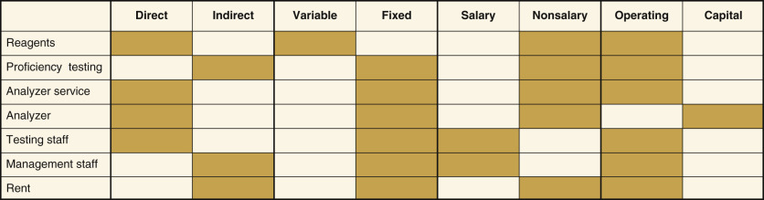
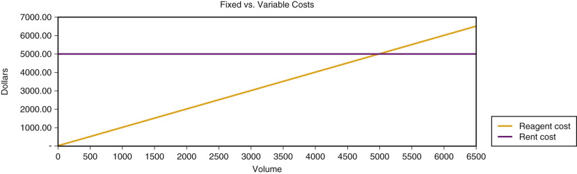

## Key Points

  * •

Costs can be described in different ways, depending on how they relate to laboratory operations (direct/indirect), change with test volume (variable/fixed), pertain to staffing (salary/nonsalary), or are associated with the useful life of supplies or equipment (operating/capital). Cost per reportable result is a key indicator. 

  * •

Reimbursement for laboratory services comes mostly from third-party payers such as Medicare (government) and insurance companies (nongovernment/private insurance), and payments are almost always less than charges. 

  * •

Inpatient laboratory testing charges are usually not reimbursed directly; they are considered part of a per diem rate (i.e., general hospital daily room reimbursement rate) or a case rate, such as diagnosis-related group rate (i.e., set rate for the entire hospital stay, regardless of actual length of stay). Thus inpatient laboratory testing is usually considered a “cost center.” In contrast, outpatient laboratory charges are reimbursed directly; therefore, outpatient testing is usually considered a “revenue center.”

  * •

For reimbursement purposes, Current Procedural Terminology codes describe tests, and _International Classification of Diseases, Tenth Revision_ ( _ICD-10_ ), codes describe the diagnosis. Medical necessity requirements may limit reimbursement to those tests associated with specific predefined diagnoses. 

  * •

Budgeting is the process of planning, forecasting, controlling, and monitoring the financial resources of an organization. 

  * •

A variety of financial tools are used to evaluate a capital project, such as purchasing a chemistry analyzer. These measure how long it takes to recoup an investment (payback) and how much it generates in today's dollars (net present value) and its rate of return (internal rate of return). 

  * •

Laboratory equipment can be acquired in different ways, including purchase, lease, and per-test payment. Each has pros and cons. 

Every organization, no matter the products or services it provides, must be concerned with the management, oversight, and accounting of its monetary resources. To sustain a viable, competitive entity, an organization not only must recoup the cost of operations but must have a positive net income to reinvest in itself. The laboratory is no exception. To be successful in the financial management of the laboratory, the director/manager must be able to identify and categorize costs, understand the relationships between revenue and reimbursement, become familiar with the budget process, and use financial ratios and information to make sound decisions. Credibility with administrators and colleagues demands that the director/manager be comfortable and confident when explaining financial issues and when justifying the need for additional resources. 

,  

##  Industry Overview 

Most industries in the United States are subject to traditional free-market competition. However, this principle does not fully apply to health care because relatively few people who use health care pay directly for it. Most people are beneficiaries of some form of health insurance. This, in combination with the increasing numbers of uninsured and underinsured, has led to a system that provides services even when no one pays adequately for them. Most medical claims are paid by a third party such as the government (Medicare, Medicaid) or a private insurance company. Thus someone other than the patient usually pays the provider of health care services (  Snyder & Wilkinson, 1998  ). 

The health care industry is one of the largest industries in the United States and continues to be a growing sector of the gross domestic product, having increased from 5.1% ($27 billion) in 1960 to 17.4% ($2.9 trillion or $9255 per person) in 2013 (  Centers for Medicare & Medicaid Services [CMS], 2014b  ). Hospitals continue to be a driving force behind escalating health care costs. Most U.S. hospitals are tax exempt, not-for-profit entities. Though “not-for-profit” suggests that no profit is made, it actually means that profits are not distributed to owners or shareholders; instead, profits are reinvested in the organization. Historically, not-for-profit status led hospital administrators to be less profit conscious than counterparts in other businesses. However, today's hospitals are having a difficult time just covering operating costs, given dwindling reimbursement and increasing supply and labor costs. With scarce money left for capital reinvestment in equipment, buildings, facilities, and technology, hospitals are aggressively seeking new ways to produce a profit to invest for the future. 

,  

##  Defining and Identifying Costs 

A cost (expense) is the supply, labor, and overhead money spent on a product or service (  Travers, 1997  ). It is important to understand costs to accurately price tests and other services, to determine when and how to offer new tests, and to determine whether to acquire new outreach client business or a managed care contract. Costs can be classified in different ways ( [ Table 12-1 ](<#t0010>) ). 

TABLE 12-1 

Cost Classification 

_Direct costs_ are expenses that can easily be traced directly to an end product. In the laboratory setting, the end product is a billable test. Examples are reagents, consumables, and hands-on technologist time. In contrast, _indirect costs_ are not directly related to a billable test but are necessary for its production. Indirect costs are often referred to as overhead. Examples are proficiency testing and utility expenses. 

_Variable costs_ change proportionately with the volume of tests. As test volume grows, so do reagent costs. If the reagent cost per test is $1.00, when 1000 tests are performed, the reagent cost is $1000; when 20,000 tests are performed, the reagent cost is $20,000. _Fixed costs_ do not change with the volume of tests performed. If a laboratory pays $5000 per month to rent its space, this expense remains the same if the laboratory produces 1000 or 20,000 tests per month ( [ Fig. 12-1 ](<#f0010>) ). 

Figure 12-1 

Fixed costs such as rent remain constant. 

Variable costs such as reagents are directly proportional to test volume. 

Because fixed costs do not vary with activity, the goal is to produce as much as possible from fixed costs to achieve economies of scale. The more that is produced, the lower the _fixed cost per activity_ . In the preceding scenario, if the laboratory produced 1000 tests, the fixed cost per test is $5.00; with 20,000 tests, the fixed cost per test falls to $0.25. Note that even some fixed costs have a variable component. For example, if an instrument's capacity is 20,000 tests per month and the volume increases beyond that, another instrument will have to be purchased, increasing the fixed costs per test. Fixed costs that change with increments of volume are called _step costs_ . 

_Salary costs_ need to be looked at differently from _nonsalary costs_ because salary costs have fringe benefits associated with them. Salary expenses account for approximately 50% to 70% of the laboratory budget. Because salary expenses are generally fixed, it is important to strive for economies of scale. The hourly pay or salaried wage of an employee is not the entire cost of employment. Fringe benefits such as Social Security, health insurance, tuition reimbursement, pension plans, and life insurance can represent an additional 16% to 28% expense above the base salary. Costs are also associated with the recruitment, interview, and selection process. Once an employee is hired, orientation, training, and ongoing growth and development costs are incurred. 

_Operating costs_ are the expenses incurred to produce a product or service. Many items have only a one-time use, and once used, the item has no further value. Examples of one-time operating costs include reagents, electricity, disposable pipettes, and the salary expense in the production of a test. Other items, such as analytic equipment, computers, and the physical plant, have a useful life greater than one production cycle. These items are capital items. To qualify as a _capital_ item, the item must meet three criteria: time, price, and purpose. To meet the time criterion, the item must have a useful life of longer than 1 year. The institution must designate a minimum dollar amount, usually $1000 to $5000, that qualifies an item as capital. The purpose of acquiring capital items is usually to replace older equipment with safer and more efficient models or to add new equipment to support new products or services. With time, capital equipment loses its value. The annual loss of a capital item's value is called _depreciation_ and is an annual expense that is deducted from the revenue of a business. Depreciation is not a cash expense (i.e., you do not “pay it” each year), but it is a real expense in that it recognizes the “wearing out” of an asset that was acquired with cash and eventually will have to be replaced. If an analyzer has not yet been fully depreciated, it still has “book value.” Note that operating and capital costs are budgeted separately (see later). 

The cost of producing a test can be derived in different ways. _Microcosting_ determines the total direct labor and supply costs of producing a test, and it is the starting point for determining the fully loaded cost and ultimately the price for a test. Most testing in the clinical laboratory is performed in batches or continuous “runs” of many samples during one or more shifts. A run can be a group of tests that are performed once or many times during a shift or an entire 24-hour period. A run includes all quality control and calibration costs needed to produce patient results. When microcosting a test, it is important to consider how a test is performed because labor and supply costs vary according to workflow and laboratory policy for quality control and repeats. The _cost per reportable result_ (CPRR) distributes the total direct costs of a run over the patient “reportable” results for that run. Testing efficiency is defined as the total reportable patient results/total test results. Thus the more repeats and controls performed, the lower the efficiency and the higher the CPRR. As testing efficiency increases, the CPRR decreases. The _incremental cost_ is the cost of producing one additional test that, typically, does not require additional salary or capital. For example, the incremental cost of running a chemistry test is usually the cost of dispensing reagent for one additional test, assuming there are no sample collection costs. Other associated costs, like technologist time, equipment, or quality control, are fixed costs that are incurred irrespective of the additional test. The incremental cost is usually the lowest possible cost incurred to produce a result. It is best used to assess how much it costs to produce small increments in test volume. As volume grows, a laboratory may need additional staff and equipment, and these costs would have to be included in the incremental costing analysis. Incremental costing is especially useful when one is trying to determine whether additional outreach work is profitable or not. The _fully loaded cost_ for a test is the sum of direct and indirect costs. The allocation of indirect costs is usually done using a formula. The goal of allocating indirect costs is to apply the costs based on the strongest correlation between the indirect cost and to what it is being applied. For example, utilities could be based on departmental square footage, while human resources costs could be based on the number of employees in the department. _Make-versus-buy_ decisions should be based on the fully loaded cost to produce the test compared with the price offered by a commercial or reference laboratory. If it costs more to produce a test than to buy it from another supplier, the test should be considered for outsourcing. However, when make-versus-buy decisions are made, cost is only one factor to consider. Medically necessary turnaround time, methods, and reliability of the potential alternative supplier should also be considered. The price charged for a test needs to be marked up (increased) from the fully loaded cost to realize a profit. One must also take into consideration the expected collection rate, relative to charge. The _contribution margin_ is the balance remaining after the fully loaded costs are deducted from the price charged for a test. [ Table 12-2 ](<#t0015>) demonstrates various ways to determine the cost of a test and how to establish its charge. 

TABLE 12-2 

Test Cost Analysis [ * ](<#hl0000305>)

Test: Prostate-Specific Antigen   
---  
**A. Microcosting: Instrument Run of One Reportable Test **  
**_Direct Labor_ **  
Determine the total “hands-on” time in minutes required to perform an instrument “run” of one patient test. Assume labor cost is $20 per hour.   
  
|  Minutes  |  Expense  |   
---|---|---|---  
Prepare specimen  |  5  |  |   
Prepare reagents  |  10  |  |   
Prepare instrument  |  10  |  |   
Computer and/or worksheet setup  |  5  |  |   
Documentation of results/quality control/maintenance  |  10  |  |   
Cleanup  |  10  |  |   
**Total direct labor** |  50  |  $16.67  |   
**_Direct Supplies_ **  
List all consumables needed to perform the test. Note that four tests (one sample and three controls) are needed to produce one patient reportable result. Calibration costs should be added if they are required with each run.   
|  **Unit cost** |  **Units** |  **Expense**  
Reagent ($700 kit/100 tests)  |  $7  |  4  |  $28.00   
Disposable pipettes ($10/100 pipettes)  |  $0.10  |  4  |  $0.40   
Disposable reagent cups ($10/200 cups)  |  $0.05  |  4  |  $0.20   
Low-, medium-, and high-control material (0.05 mL/test @ $20/mL)  |  $1  |  3  |  $3.00   
**Total direct supplies** |  |  |  $31.60   
**Total direct costs** |  |  |  $48.27   
Cost per reportable (total direct cost/reportable results)  |  $48.27/1  |  |  $48.27   
Testing efficiency (reportable patient results/tests)  |  1 result/4 tests  |  |  25%   
**B. Microcosting: Instrument Run of 15 Reportable Tests **  
**_Direct Labor_ **  
For a group of tests run on automated analyzers, use direct labor expense from microcosting. For manual batch testing, direct labor costs may apply to each batch; additional labor time studies may be necessary to derive accurate data.   
|  **Minutes** |  **Expense** |   
**Total direct labor per batch (same as microcosting in this example)** |  50  |  $16.67  |   
**_Direct Supplies_ **  
Note: 18 tests (15 samples and 3 controls) are needed to produce 15 reportable results. Fixed costs (controls) are spread over more than 1 sample, in contrast to first example.   
|  **Unit cost** |  **Units** |  **Expense**  
Reagent ($700 kit/100 tests)  |  $7  |  18  |  $126.00   
Disposable pipettes ($10/100 pipettes)  |  $0.10  |  18  |  $1.80   
Disposable reagent cups ($10/200 cups)  |  $0.05  |  18  |  $0.90   
Low-, medium-, and high-control material (0.05 mL/test @ $20/mL)  |  $1  |  3  |  $3.00   
**Total direct supplies** |  |  |  $131.70   
**Total direct costs** |  |  |  $148.37   
Cost per reportable (total direct cost/reportable results)  |  $148.37/15  |  |  $9.89   
Testing efficiency (reportable patient results/tests)  |  15 results/18 tests  |  83%  |   
**C. Incremental Cost: Cost for One More Test **  
|  **Units** |  **Expense** |   
Reagent ($700 kit/100 tests)  |  1  |  $7  |   
Disposable pipettes ($10/100 pipettes)  |  1  |  $0.10  |   
Disposable reagent cups ($10/200 cups)  |  1  |  $0.05  |   
**Total** |  |  $7.15  |   
|  **Unit cost** |  **Units** |  **Expense**  
**D. Fully Loaded Cost **  
Direct cost (cost per reportable result for typical size run) from Example B above  |  $9.89  |  |   
Indirect cost (estimated by typical hospital as 2.5 × direct costs)  |  $24.73  |  |   
**Fully loaded cost** |  |  |  $34.62   
**E. Contribution Margin **  
**Example of Charging a 20% Markup for Laboratory Tests**  
Fully loaded cost plus 20% mark-up  |  $34.62 × 1.2  |  |  $41.54   
(test charge at list price)  |  |  |   
Fully loaded cost from Example D above  |  |  |  ($34.62)   
Contribution margin  |  |  |  $6.92   
  
 * This analysis is for illustration purposes only. 

The _total cost of ownership_ (TCO) for a laboratory is the life cycle cost of its capital assets. It focuses attention on the sum of all costs of owning and maintaining all assets for a specific service or product, as opposed to the initial capital or operating costs. In the laboratory, TCO includes acquisition, setup (construction, training), support (ordering supplies, dealing with back orders), ongoing maintenance (scheduled and unscheduled downtime), service, and operating expenses (reagents, controls, repeat testing, inventory control, proficiency testing, testing personnel, supervisory personnel) of a specific workbench and its associated testing instrumentation. TCO is useful in considering make-versus-buy decisions, but determining an accurate TCO can be very difficult. 

,  

##  Revenue 

Revenue is the total price of services rendered or products sold (  Harmening, 2007  ). It is the money a business is entitled to receive for the services and products it produces. In health care, revenue should not be confused with reimbursement or cash collected. _Gross patient revenue_ consists of the total charges at a facility's full-established rates (list price) for provision of inpatient and outpatient care before deductions from revenue are applied. _Net patient revenue_ is the gross inpatient and outpatient revenue minus all related deductions. _Deductions_ from revenue include contractual adjustments, provision for bad debts, charity care, and other adjustments and allowances that reduce gross patient revenue. _Contractual adjustments_ account for the difference between billings at full-established rates and amounts received or receivable from third-party payers under formal contract agreements. For example, if the list price of a test is $10 but the contracted payment from the insurance company is $6, the adjustment is $4. If all deductions and contractual allowances are correct, net patient revenue should equal cash collected, or $6 in the above example. 

In health care, it is important to distinguish between inpatient and outpatient care because they are reimbursed differently. Inpatient laboratory testing charges usually are not reimbursed separately; they are considered to be part of a per diem rate (i.e., general hospital daily room reimbursement rate) or diagnosis-related group (DRG) rate (i.e., set rate for the entire hospital stay, regardless of actual length of stay). Thus inpatient laboratory testing is considered a “cost center.” The hospital is paid the same rate regardless of how many tests are provided. In contrast, outpatient laboratory testing has historically been a revenue center because each test is separately reimbursed, usually by a third party ( [ Table 12-3 ](<#t0020>) ). Thus there has been a financial disincentive to perform inpatient tests and an incentive to perform outpatient tests. However, because new reimbursement models focus on accountable care, shared risk, and bundled payments, incentives to perform outpatient testing are likely to change. 

TABLE 12-3 

Reimbursement Comparison for PSA [ * ](<#hl0000376>) by Payer Type 

|  List Price  |  Reimbursement Terms  |  Amount Paid  |  Contractual Allowance   
---|---|---|---|---  
**Inpatient**  
Managed care (HMO)  |  $41.54  |  No separate reimbursement for laboratory tests because they are included in the contracted per diem rate  |  0  |  N/A   
Medicare  |  $41.54  |  No separate reimbursement for laboratory tests because they are included in the DRG rate  |  0  |  N/A   
**Outpatient**  
Indemnity insurance  |  $41.54  |  Usual and customary charge (UCC) is $38; insurance pays 80% of UCC.  |  $30.40  |  $11.14   
Managed care (PPO)  |  $41.54  |  Contract pays 110% of Medicare fee schedule ($25.70 for PSA).  |  $28.27  |  $13.27   
Managed care (HMO)  |  $41.54  |  No separate reimbursement for laboratory tests because of capitation arrangement: Laboratory receives per member per month payment irrespective of usage  |  N/A  |  N/A   
Medicare  |  $41.54  |  Medicare fee schedule  |  $25.09  |  $16.45   
  
_DRG,_ Diagnosis-related group; _HMO,_ health maintenance organization; _N/A,_ not applicable; _PPO,_ preferred provider organization; _PSA,_ prostate-specific antigen. 

 * Reimbursement amounts are for illustrative purposes only and may not accurately reflect current Medicare reimbursement. 

,  

##  Payers and Reimbursement 

Hospitals in early America served a different purpose from those of today. A visiting physician usually provided health care in the patient's home, and care was administered by family members, midwives, and servants. Early hospitals were founded to shelter older adults, the dying, orphans, those with mental illness, and vagrants, and to protect the citizens of a community from contagious diseases and the dangerously insane. Many of today's county, municipal, or religious order hospitals were originally a combination of these almshouses and isolation hospitals (  Sultz & Young, 2009  ). 

The transformation of hospitals from charitable institutions to complex technical organizations came about with the passage of the Hill-Burton Hospital Construction Act of 1946 and the growth of private hospital insurance. The Hill-Burton Act provided federal money to the states to plan and construct new facilities. The first private health insurance policy was formed by a group of teachers and Baylor Hospital in Dallas to provide coverage for certain hospital expenses. This arrangement created the model for the development of what was to become Blue Cross Insurance. The development of health insurance to provide reimbursement for routine medical care carried gigantic implications. The original concept of any insurance was to guard against the low risk of a rare occurrence such as premature death or accident. Today's health insurance provides for coverage of routine, predictable services, and unforeseen illnesses and injuries (  Sultz & Young, 2009  ). 

 

##  Private Insurance 

Private health insurance falls into two main categories: indemnity and managed care. Indemnity plans, also known as fee-for-service, are traditional insurance plans that give patients absolute freedom to choose their physicians and medical facilities. Insurance companies usually require the beneficiaries to fulfill a yearly deductible, usually between $300 and $500 per person per year. After the deductible is fulfilled, the insurance company pays a certain coinsurance rate of the usual and customary charge (UCC). The UCC (or fee schedule) is set by the payer and is usually less than the actual billed charge, in which case the patient may be responsible for the balance. Generally, the coinsurance is split 70%/30% or 80%/20%, where the insurance company pays the higher percentage and the insured the lower. Indemnity plans were the mainstay of the health insurance world before the 1980s. Today, managed care is the norm. Some employers still offer indemnity plans despite their high premium payments to allow their employees the freedom to choose medical services. 

As an alternative to indemnity health insurance, managed care was introduced in 1973 with the passage of the Health Maintenance Organization Act. This act encouraged and funded the development of health maintenance organizations (HMOs) as a strategy to contain the rising cost of health care (  Sultz & Young, 2009  ). HMOs utilized managed care features that coupled health care reimbursement with delivery of service and allowed payers significant economic control over how, where, and what services were delivered. In managed care, specific physicians and hospitals are selected to care for members; referrals from a case manager are usually necessary for specialty or inpatient services; and providers share in the financial risk through capitation agreements and per diem rates. 

Capitation agreements pay the service provider (e.g., physician) a fixed dollar amount per member per month (PMPM). From this amount, the provider agrees to cover all care for plan members. For example, if a laboratory signs a capitation agreement to accept $1.50 PMPM for the outpatient testing needs of 2000 HMO members, the laboratory receives $3000 per month and $36,000 per year. If it costs the laboratory more than $36,000/year to provide the services, it realizes a financial loss; if it costs less than $36,000, it realizes a profit. In a capitation testing agreement, a laboratory assumes the risk of spending more than it is paid. One key to managing this risk is gaining access to test utilization of plan members and accurately assessing laboratory costs. 

Per diem rates are negotiated with hospitals to provide all necessary care and services for managed members requiring inpatient care. Reimbursement for any laboratory testing during the inpatient stay is included in the per diem amount. As with capitation, if it costs more to provide inpatient services than the per diem rate, the hospital is at financial risk. 

Sometimes, a service is separately negotiated (i.e., it is not included as part of the capitation or per diem rate). This is called a “carve out.” Expensive esoteric tests (e.g., certain molecular and genetic tests) should be carved out of the outpatient laboratory capitation agreement. A negotiated fee-for-service price for these tests is appropriate. By excluding these tests from capitation, one can avoid huge financial losses due to unexpectedly high utilization of these costly services. 

 

##  Government Payers 

_Medicare_ is federal health insurance for individuals age 65 and older, individuals who are permanently disabled, and those with end-stage renal disease who have met the specified waiting period. Medicare was established in 1965 by Title XVIII of the Social Security Act. It is administered by the Centers for Medicare and Medicaid Services (CMS), a division of the U.S. Department of Health and Human Services (HHS). Coverage is provided under Parts A, B, C, and D. Claims are processed by CMS-approved contractors. These contractors are usually private companies that serve as fiscal intermediaries (generally processing Part A claims) and carriers (generally processing Part B claims). However, CMS is moving to a new model, whereby the Medicare Administrative Contractor (MAC) will administer both Part A and Part B claims via 15 MAC jurisdictions. For a clinical laboratory to qualify for Medicare/Medicaid reimbursement, the laboratory must maintain Clinical Laboratory Improvement Act of 1988 certification (  CMS, 2014e  ). 

_Medicare Part A_ covers inpatient hospitalization, hospice care, skilled nursing care, and home health care. Coverage is automatic for those who are eligible. Before the Tax Equity and Fiscal Responsibility Act of 1982 (TEFRA), inpatient hospitalization was reimbursed on a retrospective cost-based system. This system paid hospitals for all costs incurred during an inpatient stay. After TEFRA, the system switched to a prospective payment system (PPS), which reimbursed hospitals on the basis of preset payments for services provided to patients with similar diagnoses. With this DRG payment system, hospitals are reimbursed the same amount for a specific DRG no matter how many discrete units of services are provided. Thus hospitals can earn a profit or realize a loss on each inpatient stay, depending on whether their costs are lower or higher than the DRG payment. The aim of the PPS, with its fixed DRG reimbursements, was to force hospitals to contain costs by reducing the length of stay and eliminating unnecessary and/or overutilized services (  Sultz & Young, 2009  ). 

_Medicare Part B_ covers outpatient laboratory tests, physician professional services, and other medical services and devices. Coverage is not automatic. Eligible beneficiaries must enroll for Part B coverage and pay premiums. Beneficiaries must pay an annual deductible and a 20% copayment for all Part B services, except for clinical laboratory testing, which is covered in full, provided certain conditions are met (see later). 

The Part B fee schedule plays an important role in reimbursement because it is a baseline that nongovernment payers use to establish their own rates. For example, a private insurance company may set its fee schedule at 110% of the Part B fee schedule. 

_Medicare Part C_ (also known as Medicare Advantage) is an alternative to the traditional Part B fee-for-service program. It is designed to reduce patient “out-of-pocket” costs by providing services through health maintenance organizations and other managed care service models. _Medicare Part D_ provides prescription drug coverage. 

_Medicaid_ is a federal program that offers health care coverage for select low-income families. It was authorized in 1965 as a federal/state-sponsored program designed to pay medical costs for certain families with low income or inadequate resources. Eligibility extends to people who are aged, blind, or disabled, and those in families with dependent children. Although Medicaid is a federal program, it is under the jurisdiction of each individual state. This means that each state determines who is eligible, the range of health services offered, and how they are reimbursed. It is a common misconception that Medicaid covers health care costs for all low-income persons. Medicaid does not provide paid medical assistance to every single poor person. To receive medical assistance, a person must meet eligibility requirements. 

,  

##  Reimbursement Coding Systems 

To be paid, a medical claim must document the patient's medical condition (or diagnosis) and must list the services (or tests) provided. This information is conveyed via a standardized coding system, recognized by all government and private payers: _H_ ealthcare _C_ ommon _P_ rocedure _C_ oding _S_ ystem ( _HCPCS_ ) codes describe the test or service (  AMA, 2014b  ), and _International Classification of Diseases, Tenth Revision, Clinical Modification_ ( _ICD-10-CM_ ), codes describe the patient's condition or diagnosis (  _ICD-10-CM_ , 2015  ). These coding standards allow data to be accurately communicated among physicians, patients, and third-party payers. 

HCPCS was developed in 1983 and consists of two levels of codes. Level I is the _C_ urrent _P_ rocedural _T_ erminology ( _CPT_ ) coding system, and it is used to identify nearly all clinical laboratory tests and most medical services (  AMA, 2015a  ). CPT codes are assigned by the American Medical Association (AMA) and are reviewed and updated annually to keep current with changes in technology and medical practice. Each CPT code consists of five digits and a description of the test or service. For example, the CPT code for a total prostate-specific antigen (PSA) test is 84153. 

Level II HCPCS codes are assigned by CMS. CPT does not contain all the codes needed to report services or to describe special circumstances that may apply to Medicare. CMS developed this second level of codes to fill the gap. HCPCS Level II codes begin with a single letter (A through V), followed by four digits. These codes are updated annually by CMS. An example of Level II coding is prostate-specific antigen for cancer screening, G0103. Note that CMS treats this test differently than the PSA CPT code described earlier, even though the tests are identical to those of the laboratory. This allows CMS to assign different criteria for reimbursement, based on why a test is ordered. 

The ICD was originally developed by the World Health Organization (WHO) as a classification system for reporting of mortality and morbidity statistics by physicians throughout the world. The _ICD-10-CM_ is a U.S. clinically modified revision of the WHO _ICD-10_ . This modification is maintained and updated by the National Center for Health Statistics. These modifications assist health care providers to index patient records, retrieve case data for clinical studies, and submit claims for health care services. HHS has set a deadline of October 1, 2015, for complete adoption of _ICD-10_ in the United States. In contrast to _ICD-9_ , _ICD-10_ provides much greater detail, precisely defines location (including laterality), and provides changes in terminology and expanded concepts for injuries and other related factors. As a result, _ICD-10_ is comprised of about 68,000 codes (three to seven characters long), in contrast to _ICD-9_ 's approximately 13,000 codes (three to five characters long) (  AMA, 2012  ). 

 

##  Why Accurate Coding is Important 

Correct coding is important for three reasons. First, one should be paid for services rendered. Insufficient or incorrect coding may yield lower reimbursement than is rightfully due. Second, one must not receive more reimbursement than is rightfully due. Coding for services not provided or assigning a code that recoups more reimbursement (this practice is known as “up-coding”) is illegal and constitutes fraud. Third, one must comply with _medical necessity_ requirements established by CMS for Medicare patients. These policies define under what conditions a test is considered “medically necessary” and thus reimbursable. Certain tests are considered “medically necessary” only if they are associated with specific diagnoses. Thus reimbursement depends on whether the diagnosis or medical condition code ( _ICD-10_ code) supports the test code (HCPCS code). For example, “malignant neoplasm of the prostate” supports the medical necessity of doing a PSA test, so Medicare would pay for the test; in contrast, “congestive heart failure” is not considered a medically necessary reason for a PSA test, so the test would not be reimbursed. Note that a physician (or other provider) can order any test on a patient, even if it is not “medically necessary,” but it will not be reimbursed. 

Most laboratory fee schedules are set by the local Medicare contractor (fiscal intermediary or carrier). Historically, each contractor established separate guidelines for determining which tests were subject to medically necessary diagnosis codes. _Local medical review policies_ and local coverage decisions differ from one carrier to another, making it very difficult to submit and process claims. In some instances, a diagnosis code that is valid for a test from one carrier may not be considered medically necessary by another carrier. In an effort to standardize all carrier reimbursement guidelines for specific outpatient laboratory tests, 23 tests have been assigned _national coverage determinations_ ( _NCDs_ ); these medical necessity guidelines apply to all carriers in the country. [ Table 12-4 ](<#t0025>) lists the NCD tests (  CMS, 2014a  ). 

TABLE 12-4 

National Coverage Determinations for Laboratory Testing 

General Testing Category  |  CPT Codes Included   
---|---  
Alpha-fetoprotein  |  82105   
Blood counts  |  85004, 85007, 85008, 85013, 85014, 85018, 85025, 85027, 85032, 85045, 85049   
Blood glucose testing  |  82947, 82948, 82962   
Carcinoembryonic antigen  |  82378   
Collagen crosslinks, any method  |  82523   
Digoxin therapeutic drug assay  |  80162   
Fecal occult blood test  |  82270   
Gamma-glutamyl transferase  |  82977   
Glycated hemoglobin/glycated protein  |  82985, 83036   
Hepatitis panel/acute hepatitis panel  |  80074   
Human chorionic gonadotropin  |  84702   
Human immunodeficiency virus (HIV) testing (diagnosis)  |  86689, 86701, 86702, 86703, 87390, 87391, 87534, 87535, 87637, 87538   
HIV testing (prognosis, including monitoring)  |  87536, 87539   
Lipids  |  80061, 82465, 83715, 83716, 83718, 83721, 84478   
Partial thromboplastin time  |  85730   
Prostate-specific antigen  |  84153   
Prothrombin time  |  85610   
Serum iron studies  |  82728, 83540, 83550, 84466   
Thyroid testing  |  84436, 84439, 84443, 84479   
Tumor antigen by immunoassay CA 125  |  86304   
Tumor antigen by immunoassay CA 15-3 (CA 27.29)  |  86300   
Tumor antigen by immunoassay CA 19-9  |  86301   
Urine culture, bacterial  |  87086, 87088, 87184, 87186   
  
From CMS (2014a). 

Coding at any level should be as specific as possible. Medicare contractors employ the national Correct Coding Initiative to ensure correct coding practices based on the codes defined in the AMA's CPT code set (  CMS, 2014f  ). These software edits flag inappropriate code combinations that should not be billed together for the same patient on the same day of service. Medicare has also added a system of medically unlikely edits (MUEs) that limit the units of service payable for a particular CPT code per patient, per provider, per day of service. Claims that exceed the MUE are rejected. Most analytes or tests have a specific CPT, similar to that of PSA. However, sometimes a new test does not have its own code. When that happens, the test must be identified by the method used to perform the analysis (e.g., 82486—Gas/liquid chromatography, or 83520—Immunoassay, quantitative). A method code is usually reimbursed at a lower rate than a CPT code for a specific analyte. 

Certain tests that are performed together (i.e., as a panel) must be coded correctly. Ten panels have been approved by the AMA ( [ Table 12-5 ](<#t0030>) ) (though only eight of them are considered covered services by Medicare, the exceptions being the General Health and Obstetrics panels). When these ten panels are performed, they must be coded with the unique panel code and not by each individual test's CPT code. Reimbursement is much lower for a panel than it is for the sum total reimbursement of each test. Coding for each individual test component as opposed to one panel code is considered “unbundling,” which is a fraudulent billing practice. 

TABLE 12-5 

AMA Organ or Disease-Oriented Panels 

CPT  |  Panel  |  Required Components  |   
---|---|---|---  
80047  |  Basic metabolic panel (calcium, ionized)  |  Calcium, ionized  |  (82330)   
Carbon dioxide  |  (82374)   
Chloride  |  (82435)   
Creatinine  |  (82565)   
Glucose  |  (82947)   
Potassium  |  (84132)   
Sodium  |  (84295)   
Urea nitrogen, blood (BUN)  |  (84520)   
80048  |  Basic metabolic panel (calcium, total)  |  Calcium, total  |  (82310)   
Carbon dioxide  |  (82374)   
Chloride  |  (82435)   
Creatinine  |  (82565)   
Glucose  |  (82947)   
Potassium  |  (84132)   
Sodium  |  (84295)   
BUN  |  (84520)   
80050  |  General health panel  |  Comprehensive metabolic panel  |  (80053)   
Blood count, complete (CBC)  |  (85025) or (85027) and (85004)   
_or_ |   
CBC  |  (85027) and (85007) or (85009)   
Thyroid-stimulating hormone  |  (84443)   
80051  |  Electrolyte panel  |  Carbon dioxide  |  (82374)   
Chloride  |  (82435)   
Potassium  |  (84132)   
Sodium  |  (84295)   
80053  |  Comprehensive metabolic panel  |  Albumin  |  (82040)   
Bilirubin, total  |  (82247)   
Calcium  |  (82310)   
Carbon dioxide  |  (82374)   
Chloride  |  (82435)   
Creatinine  |  (82565)   
Glucose  |  (82947)   
Phosphatase, alkaline  |  (84075)   
Potassium  |  (84132)   
Protein, total  |  (84155)   
Sodium  |  (84295)   
Transferase, alanine amino  |  (84460)   
Transferase, aspartate amino  |  (84450)   
BUN  |  (84520)   
80055  |  Obstetric panel  |  CBC  |  (85025) or (85027) and (85004)   
_or_ |   
CBC  |  (85027) and (85007) or (85009)   
Hepatitis B surface antigen  |  (87340)   
Antibody, rubella  |  (86762)   
Syphilis test, qualitative  |  (86592)   
Antibody screen, RBC  |  (86850)   
Blood typing, ABO  |  (86900)   
Blood typing, Rh  |  (86901)   
80061  |  Lipid panel  |  Cholesterol, total  |  (85465)   
HDL cholesterol  |  (83718)   
Triglycerides  |  (84478)   
80069  |  Renal function panel  |  Albumin  |  (82040)   
Calcium  |  (82310)   
Carbon dioxide  |  (82374)   
Chloride  |  (82435)   
Creatinine  |  (82565)   
Glucose  |  (82947)   
Phosphorus, inorganic  |  (84100)   
Potassium  |  (84132)   
Sodium  |  (84295)   
BUN  |  (84520)   
80074  |  Acute hepatitis panel  |  Hepatitis A antibody, IgM  |  (86709)   
Hepatitis B core antibody, IgM  |  (86705)   
Hepatitis B surface antigen  |  (87340)   
Hepatitis C antibody  |  (86803)   
80076  |  Hepatic function panel  |  Albumin  |  (82040)   
Bilirubin, total  |  (82247)   
Bilirubin, direct  |  (82248)   
Phosphatase, alkaline  |  (84075)   
Protein, total  |  (84155)   
Transferase, alanine amino  |  (84460)   
Transferase, aspartate amino  |  (84450)   
  
_ABO,_ Blood group; _HDL,_ high-density lipoprotein; _IgM,_ immunoglobulin M; _RBC,_ red blood cell. 

From AMA (2015a). 

Professional pathology physician services (e.g., test interpretation, slide review) are not included in the laboratory fee schedule. They are paid by the Medicare physician fee schedule, which uses a resource-based relative value scale to determine the payment based on a service's relative value unit. These amounts are adjusted to reflect local economic factors. Unlike the laboratory fee schedule, these professional services are subject to the annual deductible and the 20% copayment. 

 

##  Medicare Reimbursement 

Medicare is the largest insurance program in the country. In many hospitals, it accounts for 25% to 40% of all revenue. Outpatient services are reimbursed differently from inpatient ones. 

 

##  Medicare Inpatients 

DRGs make up a patient classification system that is used to reimburse inpatient (Part A) hospital costs for Medicare patients. Although the costs associated with inpatient clinical laboratory tests are included in the DRG, it does not cover physician services (Part B). After a Medicare patient has been discharged from the hospital, the patient's medical record is reviewed by health information management coders and is assigned appropriate _ICD-10-CM_ and HCPCS codes for one or more diagnoses and procedures for the inpatient stay. These codes, along with the patient's demographic information, are grouped by decision trees (this process is computerized) into a specific DRG. Currently, more than 500 DRGs are used. CMS assigns a weight to each DRG based on the severity of the diagnoses, the types of procedures performed, the number of laboratory tests, the volume and type of drugs administered, and the presence of complications or comorbidity conditions. CMS assigns each hospital a specific rate that is calculated on the basis of the type of facility (community hospital vs. teaching hospital), the setting (urban vs. rural), and the location (West Coast vs. Midwest). The CMS-assigned rate for the DRG is multiplied by the hospital's assigned rate to determine reimbursement for the hospital stay. This amount is payment-in-full for the inpatient hospitalization. If it costs the hospital more than the reimbursed amount to treat the patient, the hospital must absorb the cost. The patient cannot be billed for any nonreimbursed Part A services (  Sultz & Young, 2009  ). 

 

##  Medicare Outpatients 

For many years after the enactment of DRGs, each outpatient service continued to be reimbursed individually (  Harmening, 2007  ). However, the reimbursement system changed when CMS started to implement an outpatient prospective payment system with the introduction of the Ambulatory Payment Classification (APC) system in 2000. Under this system, virtually all hospital-based outpatient services (e.g., emergency department and clinic visits, oncology treatment, and surgery) provided to Medicare patients are reimbursed on a prospective basis according to a preset rate, similar to DRGs. Clinical diagnostic laboratory tests are not currently included in the APC and are still reimbursed individually on the basis of the CMS fee schedule, with some exceptions. 

Under certain conditions, Medicare does not pay for laboratory tests ( [ Table 12-6 ](<#t0035>) ). If a laboratory expects Medicare to deny payment because a test does not meet medical necessity requirements, it must inform the patient before the service is provided. An _advanced beneficiary notice (ABN)_ is used to document that the beneficiary was told the test might not be covered by Medicare, the reason(s) for the possible denial, and the decision by the patient to pay for the test if Medicare does not reimburse or to refuse the test entirely (  CMS, 2014d  ). 

TABLE 12-6 

National Coverage Determinations (NCDs) for Laboratory Testing 

Category  |  Medicare Coverage  |  ABN Necessary?   
---|---|---  
LMRP or NCD tests  |  Provider paid according to outpatient fee schedule, if medical necessity met  |  No, unless test is not “medically necessary”  
FDA cleared or “homebrew” tests not included above  |  Provider paid according to outpatient fee schedule, if medical necessity met  |  No, unless test is not “medically necessary”  
Investigational use only or research tests (i.e., not FDA cleared)  |  Not covered, no payment  |  Yes   
Health and wellness screening  |  Not covered, with few exceptions: PAP smears covered every 2 years for all women and every year for those with high cancer risk or abnormal smear; PSA covered every year for men older than 50  |  Yes, unless it is one of the allowable exceptions   
  
_ABN,_ Advanced beneficiary nutrition; _FDA,_ U.S. Food and Drug Administration; _LMRP,_ local medical review policies; _PAP,_ Papanicolaou smear; _PSA,_ prostate-specific antigen. 

From CMS (2014a). 

An important consideration for hospitals that have laboratories that perform outpatient testing on Medicare patients is the _72-hour rule_ (  CMS, 2014c  ). This rule states that a hospital cannot bill an outpatient claim for laboratory tests performed within 72 hours of an inpatient admission. Outpatient testing that is performed 72 hours before the admission must be included with the inpatient claim and is reimbursed according to the assigned DRG for that stay. Hospital laboratories must identify outpatient Medicare services that are affected by this rule and must make sure they are not billed separately. A nonhospital independent laboratory is not subject to the 72-hour rule. Thus preadmission tests performed 3 days before hospitalization are not reimbursed if performed in the admitting hospital's laboratory but are reimbursed if done in an independent laboratory. Postdischarge testing may also be bundled into the DRG if the test/service is ordered by the patient's physician less than 14 days following the date of the patient's discharge from the hospital (42 CFR § 414.510). 

,  

##  Financial Performance and Monitoring 

 

##  Budgeting 

Budgeting is the process of planning, forecasting, controlling, and monitoring the financial resources of an organization (  Garcia, 2004  ). The _operational budget_ provides a target of day-to-day revenues and expenditures that are to be achieved in the forthcoming year. 

Different budget-planning strategies are used based on the type and seasonality of the business; however, all use a method to forecast and project what will occur in the next budget cycle. Projections are made for the expected increases and decreases in revenues and expenses based on historical information and adjustments for inflation, loss of business, new business, and new product lines. The laboratory typically uses a _pro forma_ budget. It provides in a pro forma or “predetermined set form” the expected annual revenue and expense based on various projections and assumptions, including test volume. It uses actual costs, ratios, and percent calculations to extrapolate from historical data what the new budget will be. [ Table 12-7 ](<#t0040>) presents an example of a pro forma budget. 

TABLE 12-7 

Pro Forma Laboratory Budget 

Category  |  Current Year  |  Assumptions  |  Change  |  Projection for New Year   
---|---|---|---|---  
**Revenue** |  $3,000,000  |  4% growth  |  $120,000  |  $3,120,000   
Total tests  |  370,000  |  4% growth  |  14,800  |  384,800   
Revenue/test  |  $8.11  |  |  |  $8.11   
**Expenses**  
Salaries  |  $950,000  |  3% cost of living increase  |  $28,500  |  $978,500   
Laboratory supplies  |  $421,000  |  4% growth (no price increase)  |  $16,840  |  $437,840   
Reference lab fees  |  $250,000  |  4% growth  |  $10,000  |  $262,600   
|  |  1% price increase (on projected $260,000)  |  $2600  |   
Phlebotomy supplies  |  $35,500  |  4% growth  |  $1420  |  $36,920   
Maintenance contracts  |  $40,000  |  No change  |  |  $40,000   
Total expense  |  $1,696,500  |  |  $59,360  |  $1,755,860   
Cost per test  |  $4.59  |  |  |  $4.56   
  
In contrast to the pro forma budget, which uses baseline data from 1 year to develop data for the next, a _zero-based budget_ has no baseline. A zero-based budget requires management to annually evaluate all services and products to determine which should be funded or eliminated. Each department manager must justify its budget as if all of its activities are new. It assumes that no existing program is entitled to automatic budget approval but rather must prove its financial merit when compared with the organization's other programs. Programs are ranked and funded by merit priority to the level of the organization's available funds. Laboratories use a zero-based approach to propose a new service (e.g., blood donor program, outpatient blood collection center) or laboratory section (e.g., mycology) or test (polymerase chain reaction assay) (  Travers, 1997  ). 

The _capital budget_ is used to fund large capital projects such as acquiring an instrument or information system or remodeling the laboratory (  Garcia, 2004  ). These projects may cost thousands or millions of dollars and require several years to plan or implement. The laboratory's pro­posed projects must compete with those of other hospital departments for limited capital dollars. Each project is evaluated (see later) and ranked on the basis of a variety of financial and clinical factors. The operational budget must be linked to the capital budget, because it is the revenues generated by operations that are used to fund needed capital items and projects. Operational budgets must generate surplus revenue to fund capital projects; a business must reinvest in itself to remain competitive. 

 

##  Variance Analysis 

The operational budget should be reviewed periodically, usually monthly, to determine how closely the projected budget matches actual revenues and expenses (  Garcia, 2004  ). A variance is the difference between the projected budget and the actual revenue and expenses (Budget – Actual = Variance). Both favorable variances (more than expected revenue or less than expected expenses) and unfavorable variances (less than expected revenue or more than expected expenses) need to be analyzed. By analyzing a variance, one can identify whether or not it can be controlled. Once the cause is determined, one can take necessary action to improve performance and more accurately prepare future budgets. 

If revenues (and expected test volume) are within budget, but laboratory supplies show an unfavorable variance, one must investigate the reason for the discrepancy. For example, technologists may be repeating tests too frequently, running too many controls, or scheduling work inefficiently, in many small batches. This is an example of a variance that can be controlled by the laboratory if it changes its practices. Actions to consider include increasing the frequency of instrument maintenance to reduce problems that require repeats and controls, providing staff education to reinforce policies on when repeats and controls are needed, and rescheduling work into more efficient batch sizes. 

An example of an uncontrollable variance occurs if a hospital decides to eliminate the cardiac chest pain service. In this scenario, a favorable reagent expense variance (i.e., less money spent on reagents than expected) would be related to doing fewer cardiac marker tests. A laboratory manager can do nothing to correct this variance. However, this does not absolve the manager from a duty to review it. One must verify the amount of the variance and must determine if it is appropriate for the amount of lost business. When forecasting for the next budget cycle, one should decrease projected revenues and expenses attributed to the loss of cardiac services. 

 

##  Financial Reporting and Statements 

Managerial accounting is used to prepare and monitor budgets. Revenue and expenses are organized into logical groupings known as cost centers that represent a laboratory section (such as microbiology, core lab, blood bank) or function (phlebotomy). Each cost center is subdivided into a variety of expense and revenue categories. Salary and nonsalary expense categories are grouped separately. Periodic review, at least monthly, of the cost center's accounts is needed to monitor the variances and put corrective action in place to keep the organization on its expected financial plan. [ Table 12-8 ](<#t0045>) provides an example of a laboratory cost center's accounts. 

TABLE 12-8 

Cost Center: Microbiology 

|  |  Current Month  |  Year to Date   
---|---|---|---  
REVENUE   
Account number  |  Account name  |  Actual  |  Budget  |  Variance  |  Actual  |  Budget  |  Variance   
20100  |  Inpatient revenue  |  $1,414,245  |  $1,403,172  |  $11,073  |  $2,892,427  |  $2,764,597  |  $127,830   
20200  |  Outpatient revenue  |  $906,343  |  $894,405  |  $11,938  |  $1,699,418  |  $1,748,169  |  $(48,751)   
**Total revenue** |  |  $2,320,588  |  $2,297,577  |  $23,011  |  $4,591,845  |  $4,512,766  |  $79,079   
|  |  **EXPENSES**  
40100  |  Salary, management  |  $22,045  |  $21,811  |  $234  |  $43,310  |  $43,622  |  $(312)   
40200  |  Salary, technical  |  $85,161  |  $105,410  |  $(20,249)  |  $170,437  |  $210,820  |  $(40,383)   
40201  |  Overtime  |  $3385  |  $3907  |  $(522)  |  $6713  |  $7814  |  $(1101)   
**Total salary expense** |  |  $110,591  |  $131,128  |  $(20,537)  |  $220,460  |  $262,256  |  $(41,796)   
41580  |  Laboratory supplies  |  $109,961  |  $96,114  |  $13,847  |  $193,102  |  $188,461  |  $4641   
41590  |  Medical-surgical supplies  |  $1682  |  $1715  |  $(33)  |  $3964  |  $3362  |  $602   
41890  |  Service contracts  |  $75  |  $355  |  $(280)  |  $150  |  $710  |  $(560)   
42010  |  Minor equipment  |  $1112  |  $1083  |  $29  |  $2568  |  $2166  |  $402   
45300  |  Sendout test expense  |  $14,973  |  $13,750  |  $1223  |  $28,812  |  $27,500  |  $1312   
46300  |  Accreditation expense  |  $— |  $100  |  $(100)  |  $— |  $200  |  $(200)   
**Total nonsalary expense** |  |  $127,803  |  $113,117  |  $14,686  |  $228,596  |  $222,399  |  $6197   
**Total expense** |  |  $238,394  |  $244,245  |  $(5851)  |  $449,056  |  $484,655  |  $(35,599)   
  
Financial accounting is a system used to report business information to external entities such as the Internal Revenue Service or stockholders. Generally accepted accounting principles are used to standardize this information. Balance sheets, income statements, and statements of cash flows are the financial statements most commonly used to assess an organization's financial position. Banks and investors rely heavily on these statements to determine whether to lend money to a business or to purchase shares of stock. 

The _balance sheet_ is the statement of an organization's financial position at a specific point in time. This statement is usually generated at the end of an organization's fiscal year or at the end of the calendar year. It records the organization's assets (what it owns), its liabilities (what it owes), and its equity or net worth (what is left after subtracting what it owes from what it owns). From this statement is derived the fundamental accounting equation: Assets = Liabilities + Equity (net worth). This statement is used to assess an organization's level of indebtedness to what it owns. 

The _income statement,_ also known as the statement of profit and loss, summarizes the organization's revenues and expenses over an accounting period, usually quarterly or annually. The income statement records all of a laboratory's gross patient revenue, less allowances for a given period, and deducts the expenses for that same period to arrive at net income before taxes. Taxes are paid only if the organization is for-profit. Net income is realized when net revenues exceed expenses. A net loss is realized when expenses exceed net revenues. Note that revenue does not necessarily equate to cash generated. Many times a test is performed and recorded as income, although the payment (cash) may not be received for several months. The income statement records the organization's ability to make a profit; it does not reflect its cash position. 

The _statement of cash flows_ shows the amount of cash generated by an organization over a period of time, usually a calendar or fiscal year. Cash outflows (cash paid out) are subtracted from cash inflows (cash received) to calculate the net change in cash for the period. Excess cash in a given period can be reinvested in the organization, used to make additional debt payments, or placed in easily liquidated securities for emergency use. If the net cash position for a period is negative, the organization must meet its cash obligations by using cash reserves from previous periods. If this trend is not reversed, the organization eventually will run out of cash. 

 

##  Benchmarking and Productivity Measures 

Benchmarking and productivity measures go hand in hand. It does no good to collect productivity data if they are not compared with a standard or evaluated for trends over time. Benchmarking is the measurement of an organization's products or services against specific standards for comparison and improvement (  Wallace & Klosinski, 1998  ). Benchmarking can be internal or external. 

Internal benchmarking trends an organization's productivity over time. Productivity is the relationship between input (labor and supplies) and output (product or service) (  Travers, 1997  ). It is usually expressed as a ratio of the product or service to the various inputs used for the production of the product or service. [ Table 12-9 ](<#t0050>) provides the common productivity ratios used in the laboratory. The purpose of trending internal productivity is to determine if internal standards are being met, exceeded, or not met. If adjustments to workflow or personnel are made, the next period's benchmarking data can be used to determine if the adjustments were the probable cause for improvements or for decreased productivity. 

TABLE 12-9 

Common Productivity Measures for Clinical Laboratories 

Productivity Measure  |  Target [ * ](<#hl0001074>) |  Quarter 1  |  Quarter 2   
---|---|---|---  
Billable tests/paid FTE  |  >3680  |  3798  |  3500   
Billable tests/worked FTE  |  >4000  |  4128  |  4080   
Worked FTE/paid FTE  |  >92%  |  95.2%  |  90%   
Labor cost/billable test  |  <$5.00  |  $4.68  |  $5.01   
Supply cost/billable test  |  <$1.00  |  $0.99  |  $1.01   
Overtime/worked straight time  |  <3%  |  2.7%  |  3.5%   
  
_FTE,_ Full-time equivalent or 2080 paid hours in a year; _paid FTE,_ all salaries paid (benefit time plus worked time). 

 * Target is for illustration purposes only. It should not be considered a laboratory standard. 

External benchmarking compares a laboratory's productivity with that of other laboratories. Its purpose is to identify top performers in a particular field. Top performers can be contacted to find out what processes or resources have been used to achieve high productivity. This information may guide a laboratory to make similar changes that could result in higher productivity. Professional organizations such as the College of American Pathologists or the University Healthsystem Consortium offer external laboratory-specific benchmarking programs. Caution should always be used when interpreting external benchmarking information. Although clinical laboratories are similar, no two are exactly alike, and, despite best efforts, sometimes data are collected and reported differently. A laboratory may never be able to achieve productivity as high as its peers because of factors beyond the laboratory's control. Labor availability, the disease and acuity mix of patients, and access to technology and automation will each have an effect on how productive a laboratory is and how much more productive it can become. 

,  

##  Evaluating a Capital Project 

A hospital has limited capital; it cannot fund all requested projects, so it must prioritize them according to a variety of factors, including clinical need, patient or employee safety, and financial impact. Whether or not money is borrowed to finance these projects, it may be necessary for the project or investment to pay for itself and even generate excess cash to fund other projects. The following section discusses different ways to evaluate a capital project to answer the question “Is it a good investment?” [ Table 12-10 ](<#t0055>) compares these methods. 

TABLE 12-10 

Financial Evaluation of a New Automated Analyzer 

**Given**  
---  
Investment (cost of analyzer)  |  |  $200,000   
Discount rate (rate of inflation or interest rate of borrowed money)  |  |  10.00%   
Useful life of analyzer  |  5 years  |   
Annual depreciation expense  |  $200,000/5 years  |  $40,000   
Annual revenue  |  100,000 tests at $5.00/test  |  $500,000   
Annual labor expense  |  100,000 tests at $2.50/test  |  $250,000   
Annual supply expense  |  100,000 tests at $2.00/test  |  $200,000   
Annual net revenue (Annual revenue – Annual expense)  |  $500,000 – ($250,000 + $200,000)  |  $50,000   
Net revenue per test (Test revenue – Test expense)  |  $5.00 – ($2.50 + $2.00)  |  $0.50   
**Calculations**  
PAYBACK PERIOD = Investment/Annual net revenue  |  $200,000/$50,000  |  4 years   
BREAKEVEN per year = Depreciation/Net revenue per test  |  $40,000/$0.50  |  80,000 tests   
Life of analyzer = Investment/Net revenue per test  |  $200,000/$0.50  |  400,000 tests   
RETURN ON INVESTMENT (ROI) = Annual net revenue/Investment  |  $50,000/$200,000  |  25% per year   
NET PRESENT VALUE (NPV) = Present value of the sum of future net revenue (cash flows) minus investment. _Note:_ Present value interest factor (PVIF) for each year based on 10% discount rate is multiplied by net revenue to determine present value. PVIF is available from any financial data resource. NPV can also be calculated with financial calculator.  |  |   
Today's investment  |  ($200,000)  |   
Year 1 Net revenue × PVIF  |  $50,000 × 0.9091 = $45,455  |   
Year 2 Net revenue × PVIF  |  $50,000 × 0.8264 = $41,320  |   
Year 3 Net revenue × PVIF  |  $50,000 × 0.7513 = $37,565  |   
Year 4 Net revenue × PVIF  |  $50,000 × 0.6830 = $34,150  |   
Year 5 Net revenue × PVIF  |  $50,000 × 0.6209 = $31,045  |   
Present value of sum of future NPV net revenue  |  $189,535  |  $(10,465)   
INTERNAL RATE OF RETURN (IRR) = Discounted interest rate at which NPV = 0. _Note:_ Financial calculator is used to determine IRR by entering cash flow and discount rate.  |  |   
Today's investment  |  ($200,000)  |   
Year 1 Net revenue × PVIF  |  $50,000 × 0.9265 = $46,326  |   
Year 2 Net revenue × PVIF  |  $50,000 × 0.8585 = $42,923  |   
Year 3 Net revenue × PVIF  |  $50,000 × 0.7954 = $39,769  |   
Year 4 Net revenue × PVIF  |  $50,000 × 0.7369 = $36,847  |   
Year 5 Net revenue × PVIF  |  $50,000 × 0.6828 = $34,140  |   
Present value of sum of future net revenue  |  $200,000  |   
NPV  |  |  $0   
IRR  |  |  8%   
  
 

##  Payback Period 

The payback period is commonly used to evaluate a capital project. The payback is the length of time required for an investment's net revenue to cover the cost of the initial investment (  Brigham & Houston, 2015  ). Because laboratory equipment or technology can become obsolete in a very short period of time, it is important to recover the investment cost as soon as possible. Many institutions want to see a payback in 3 years or less. Once the initial investment is recovered, net revenue (Revenue—Expense) from this investment represents a profit to the organization. The sooner a capital project's payback period is reached, the sooner an organization can realize a profit from the investment. 

 

##  Breakeven Point 

The breakeven point of a capital project is reached when the volume of sales is such that total revenue equals total costs (fixed and variable), and therefore profit is zero. Before the breakeven point is reached, the project is operating at a loss; after it is reached, the project is realizing a profit (  Brigham & Houston, 2015  ). As with the payback period, the sooner the breakeven point is reached, the better it is for the organization. 

 

##  Return on Investment [ * ](<#fn0010>)

The rate of return on an investment (ROI) for a capital project is the ratio of net income it generates to the total investment of the project (  Travers, 1997  ). ROI is a standard for evaluating how wisely management uses its capital dollars, whether from its own cash reserves or from borrowing activities. The higher the rate of return is, the better the capital dollars are used. ROI is the formal means of expressing the phrase “better bang for your buck.” Some institutions have automated the ROI process. Most information can be pulled from the financial data banks of the hospital computer system after a limited amount of information is provided by the laboratory. An ROI is pretty much a standard requirement of most facilities for any capital project. 

 

##  Net Present Value [ * ](<#fn0010>)

Money loses its value over time; $10,000 today is more valuable than $10,000 3 years from now. This concept is known as the time value of money. The payback period and return on investment calculations do not consider the time value of money. They assume that the value of future cash flows remains constant. To address this shortcoming, the _net present value (NPV)_ calculation is used to determine whether a project's cash flows (i.e., cash it generates in the future) are sufficient to repay the original investment, taking into account that money loses value over time. Thus cash received in the future has to be _discounted_ (i.e., the value has to be reduced) to determine how much it is worth in today's dollars. The discount rate is usually the inflation rate (if no money was borrowed to finance the project) or the interest rate on a loan used to fund the project. NPV is defined as the present value of future cash flows, which have been discounted at the interest rate used to fund the capital project (  Brigham & Houston, 2015  ). 

When the NPV is a positive number, the project will generate enough cash to pay for the original investment. When the NPV is a negative number, the project cost is not recouped and/or the future cash flows are not sufficient to cover the interest costs for borrowing the money. 

 

##  Internal Rate of Return [ * ](<#fn0010>)

* Note: Financial calculators and financial software packages are programmed to calculate ROI, NPV, and IRR. The NPV and IRR are very tedious calculations requiring multiple steps and the use of discount tables. It is not recommended to do these calculations manually. 

The internal rate of return (IRR) also discounts cash flow into today's value. It determines the actual rate of return that the investment earns. The IRR is the discount rate at which the present value of a capital project's expected cash inflows equals the present value of its costs, or in other words, when the NPV equals zero. 

Identifying a project's IRR is necessary to ensure that its rate is higher than the cost of the capital borrowed for the project. The higher the IRR, the faster the project pays for itself. Hospitals and corporations use the IRR as one way to rank projects. 

 

##  Interpretation of Financial Calculations 

Although the preceding calculations are important tools, an organization should not make its capital decisions based strictly on the outcome of the equations. As with all budgeting activities, there is an element of the unknown in assumptions. Predicting future cash flows for replacement instrumentation is usually more reliable than predicting it for new product lines or technology. Assigning an expected life to a piece of capital equipment is also an educated estimate. Having a good sense of how reliable predictions are will determine how much credence should be given to the calculations. 

If only the payback period, breakeven analysis, and ROI were considered when evaluating the example in [ Table 12-10 ](<#t0055>) , the project would look acceptable. However, when the NPV and IRR are also considered, it does not look as good. The NPV is unfavorable, and the IRR is much less than the ROI because the cost of capital is high (10%). Does this mean the project should not go forward? Not necessarily. Depending on other issues, it may be determined that this new chemistry analyzer is absolutely essential to support the mission of the organization. 

These calculations have other inherent drawbacks. As mentioned earlier, some of the calculations take into account the time value of money, and others do not. The time value of money is a very important consideration when the cost of capital is high (as in the example in [ Table 12-10 ](<#t0055>) ) or during periods of high inflation. The rate of return calculations yield a percentage, but the actual dollars they represent are not immediately apparent. A capital project that yields an ROI of 15% might look better initially than one that yields 10%. However, the size of the projects may differ considerably. For example, in the former, an initial investment of $10,000 could produce $1500 in net revenue, but in the latter project, an initial investment of $200,000 produces $20,000 in net revenue. None of these financial calculations should be considered in isolation, but they should be used in aggregate to assist in the analysis of capital projects. 

,  

##  Capital Acquisition Methods 

When a capital project is evaluated, the method for acquiring the equipment is also an important consideration. [ Table 12-11 ](<#t0060>) summarizes the advantages and disadvantages of acquisition methods: purchase, leasing, and renting. Just as there is not a single best financial calculation when evaluating a project, there is not a single best acquisition method. The method selected depends on individual needs, characteristics and financial philosophy of the organization, and availability of capital dollars. 

TABLE 12-11 

Capital Acquisition Options 

|  Advantages  |  Disadvantages   
---|---|---  
Purchase  |  Ownership  |  Risk of obsolescence; opportunity cost   
Operating (true) lease  |  Hedging obsolescence; flexibility in financing; cancelable  |  Nonownership; interest/financing cost   
Financial lease  |  Ownership; flexibility in financing  |  Noncancelable; interest/financing cost   
Rental  |  Hedging obsolescence; flexibility in length of use  |  High cost; nonownership   
  
The concept of purchasing needed equipment is easy to understand, but is it the wisest use of an organization's money? If the capital (money) needed to fund the project is currently invested in a security that is earning a higher interest rate than the rate needed to borrow money, it makes financial sense to borrow the needed capital. Conversely, if capital earns a lower interest rate than the borrowing rate, it makes sense to use the organization's capital. 

Once the equipment is purchased, it is an asset of the organization and is depreciated by a method appropriate for such a piece of equipment. Most laboratory equipment is depreciated over a 5-year period using the straight line depreciation method. The depreciation expense is noted in the income statement but probably will not be included in the monthly operational budget documents. It will depend on each organization as to whether depreciation is listed on the monthly budget reports. The operational expense for the equipment will consist of the supplies, maintenance, and labor needed to support it. 

Many different variations and contract terms may be associated with a leasing agreement. Being certain to “read the fine print” never rings truer than when an equipment leasing arrangement is considered. Nonetheless, no matter how complicated the terms of a leasing contract are, there are only two types of leases. 

An _operating lease_ (also known as a “true” lease) allows an organization (lessee) full use of the equipment for a predetermined time. The time period is usually 1 to 3 years, but it is always less than the useful life of the equipment. A termination clause could be included in the agreement. Equipment maintenance is included in an operating lease. The lessee has no right to ownership during or after the lease period. No equity is established during the term. The owner (lessor) retains full ownership of the equipment and full responsibility for it. The leasing agreement may or may not contain an option to allow the lessee to purchase the equipment at the end of the term. This is only an option, however, and should not be misinterpreted as established equity over the course of the agreement. If a purchase option is provided, it is usually for the equipment's fair market value at the end of the lease period. If the original lessee decides not to purchase the equipment at the end of the lease term, the lessor could release it to the original lessee or to another organization, because the equipment still has useful life (  Brigham & Houston, 2015  ). 

The other lease type is a financial lease. With a _financial lease_ (also known as a capital lease or lease-purchase), the lessee eventually gains ownership of the equipment. The lease period corresponds to the economic life of the equipment. Through lease payments, the lessor recovers the cost of the equipment plus an interest factor to ensure a return on its investment. A financial lease is not cancelable, and equipment maintenance is not included (  Brigham & Houston, 2015  ). 

Renting equipment is not the same as leasing it. The major differentiators are that renting does not carry an option for later purchase, renting has no predetermined specified length of time, renting can be terminated at any time, and maintenance and repairs are the responsibilities of the owner, not the renter (  Travers, 1997  ). A reagent rental agreement is a misnomer; it is not a rental but a lease. These agreements require the lessee to purchase reagents that are specific for a particular piece of equipment. The price of the reagents is marked up by a certain amount to cover the “rent” of the equipment. The markup is a lease payment to cover the cost of the capital. Whether or not the equipment will be owned at the end of the reagent rental agreement will determine if the agreement was a financial lease. Recent federal legislation requires vendors to clearly state the proportion of annual payments that are allocated to the capital portion of the lease. This simplifies the analysis of competing lease agreements. 

Regardless of which method of capital acquisition is utilized, you should always have the vendor or lessor break out the agreement into cost of equipment, cost of service agreement, and costs of reagents and supplies. This way, you can see and negotiate the cost of each. It is prudent to include someone from the institution's purchasing department to help with negotiations. 

,,
