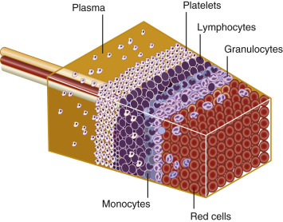
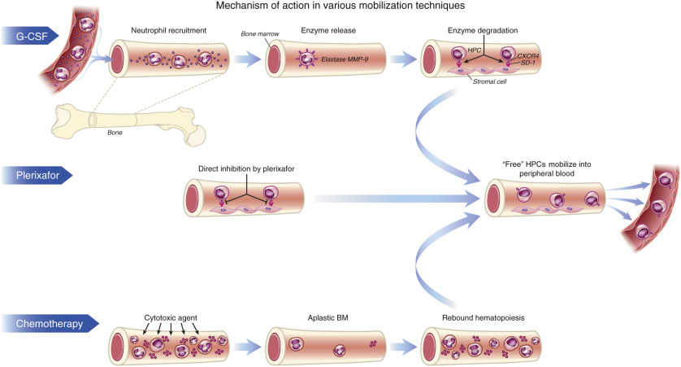
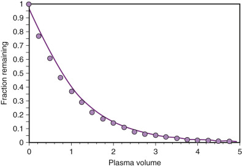

## Key Points

  * •

Hemapheresis is the process of removing normal or abnormal components from circulating blood. 

  * •

Cytapheresis involves the removal of cellular components; plasmapheresis involves the removal of plasma, the liquid component. 

  * •

Separation of the blood components is based on size (filtration instruments), density (centrifugation instruments), or a combination of both. 

  * •

Donor apheresis maximizes the collection of a scarce resource by allowing donors to donate only what is needed, returning the remaining components back to the donor. 

  * •

Donor apheresis is highly regulated. Donor eligibility requirements, frequency of donation, and amount of product allowed to be collected vary according to the components being collected, the instruments being used for the collection, and the frequency of the apheresis donations. 

  * •

Hematopoietic progenitor cell–apheresis (HPC-A) collection has advantages over hematopoietic progenitor cell–marrow (HPC-M) harvest, including faster time to engraftment, avoidance of general anesthesia for the donor, quicker donor recovery, decreased expense, and greater donor acceptance. 

  * •

There is a dearth of randomized placebo-controlled clinical trials involving apheresis. To address this, the American Society for Apheresis (ASFA) categorizes diseases treated with apheresis according to the strength of the evidence supporting its use. 

  * •

Therapeutic cytoreduction for leukocytosis or thrombocytosis is indicated for primary disorders where symptoms of hyperviscosity or risk factors for complications are present. 

  * •

A 1 to 1.5 plasma volume plasma exchange will remove 70% of a substance located within the plasma. The treatment of additional plasma volumes results in the removal of a fixed percentage of the remaining substance, leading to diminishing returns in treating greater than 1.5 plasma volumes. 

  * •

Therapeutic plasma exchange (TPE) is nonselective, removing pathologic substances as well as beneficial substances such as coagulation factors and protein-bound drugs. 

  * •

Complications of donor apheresis are less common than complications seen with whole blood donation, although the rate of reactions requiring hospitalization has been reported to be greater. 

  * •

The most common reactions to donor apheresis, in decreasing frequency, are hematoma/pain; hypocalcemia due to the citrate anticoagulant; vasovagal reactions with syncope; and vasovagal reactions without syncope. 

  * •

Complications have been reported to occur in approximately 5% of patients undergoing therapeutic apheresis treatments. If complications due to central venous access placement are included, the complication rate has been reported to be 17%. 

  * •

The most common reactions due to therapeutic apheresis procedures, in decreasing frequency, are transfusion reactions from replacement fluids, hypocalcemia due to citrate anticoagulant, hypotension, vasovagal reactions, tachycardia, respiratory distress, tetany/seizure, and rigors/chills. 

,  

##  Introduction 

 

##  Definitions 

The word **apheresis** is derived from the Greek word “aphaeresis,” which means “to separate,” “to take away by force,” or “to remove.” The year 2014 marks the 100th anniversary of apheresis, when authors Abel, Rowntree, and Turner first described apheresis procedures involving the separation of canine blood into cellular and plasma components (  Abel et al, 1914  ). Hemapheresis is the process of removing normal (donor) or abnormal (patient) blood constituents from circulating blood. It can be divided into cytapheresis, removal of the cellular component of blood, and plasmapheresis, removal of the plasma fraction. Cytapheresis can be selective with removal of red blood cells (erythrocytapheresis), platelets (plateletapheresis), or white blood cells (leukocytapheresis). If the red blood cells removed during an erythrocytapheresis are replaced with donor red blood cells in a therapeutic procedure, this is referred to as a _red blood cell exchange._ When a plateletapheresis procedure is performed as a therapeutic procedure, it is referred to as a _thrombocytapheresis_ . If, during a plasmapheresis procedure, the removed plasma is replaced by a replacement fluid, the procedure is referred to as a _therapeutic plasma exchange (TPE)._ Plasmapheresis, in contrast, removes and discards less than 15% of the total plasma volume and does not require replacement fluid. It is important to realize that the terms **plasmapheresi** s and **plasma exchange** are not equivalent, even if they are commonly used in this way. 

 

##  Basic Principles 

Apheresis can be performed using either centrifugation or filtration methods. All early apheresis instruments separated whole blood into its components by centrifugation. Centrifugal force is applied to whole blood such that the various components separate according to their specific gravity (density). The most dense component (red blood cells) layers farthest from the axis of rotation and the least dense component (plasma) layers closest to the axis of rotation, with components of intermediate density layering in between (  Burgstaler, 2010  ) ( [ Figure 37-1 ](<#f0010>) ). Some mixing does occur at the interfaces of the various layers, resulting in some contamination by components of the adjacent layers. For example, red blood cells are present within the granulocyte layer and vice versa. Depending on whether the whole blood is processed in discrete batches with repetitive cycles or processed continuously, the centrifugation separators are referred to as _intermittent flow_ or _continuous flow_ centrifuges, respectively (  Burgstaler, 2010  ). 

Figure 37-1 

Separation of blood components within a centrifugal separation chamber. 

Blood components placed in a centrifuge are separated based on their density. The densest elements (red blood cells) are farthest from the axis of rotation, and the least dense element (plasma) is closest. 

(Image courtesy of Sergio Torloni, MD, Director of Transfusion Medicine, Mayo Clinic, Scottsdale Ariz.) 

In addition to centrifugation, apheresis can be accomplished by filtration. In this method, components of whole blood are separated based on size rather than density. The whole blood flows over a membrane containing pores of a specific size, which only allow the component of interest to pass through. The remaining elements are then returned to the donor/patient. The separators used in the filtration process may be hollow fiber or flat plate systems, each of which utilize pore size to separate cellular components from plasma (  Burgstaler, 2010  ). 

Centrifugation and filtration can also be combined. In these instruments, blood enters a stationary chamber containing a central rotating filter. As the filter rotates, the blood begins to move and separate into layers. The result is that the more dense elements move away from the filter with the plasma being located directly adjacent to the filter. The plasma can then pass through the filter and be drawn off while the cellular elements are collected from the periphery of the stationary chamber. The advantage of the combination of centrifugation and filtration in this arrangement is that the cellular elements cannot clog the pores of the filter. This means that filters with smaller surface areas than filtration instruments and lower _g_ forces than centrifugation instruments can be used (  Burgstaler, 2010  ). 

Another basic aspect of apheresis involves determining appropriate volumes to be processed in the various procedures described in this chapter. This is necessary because of the need to limit the amount of blood within the instrument and tubing connected to the donor/patient—the extracorporeal circuit—to avoid hypotension and associated complications. According to Standards for Blood Banks and Transfusion Services, the maximum amount of blood allowed to be out of the donor is 10.5mL/kg of the donor's weight (  Standards Committee of the AABB, 2014  ). Calculations of blood volume, however, are still necessary to “prescribe” appropriate processing volumes during therapeutic cytapheresis. This is most often accomplished through nomograms or as a calculation performed by the instrument used for the procedure, with input of donor/patient-specific data by the instrument operator, typically height, weight, gender, and hematocrit. A number of equations and rules are available for this determination (  Nadler et al, 1962  ;  Gilcher, 1996  ). For example, [ Equations 37-1 and 37-2 ](<#e0010>) can be used to determine blood volume in males and females, respectively (  Nadler et al, 1962  ): 

 Males  :  B  V  =  (  0.3669  × H  3  )  \+  (  0.03719  × W  )  \+  0.6041 

 Females  :  B  V  =  (  0.3561  × H  3  )  \+  (  0.03308  × W  )  \+  0.1833 

where 

  * _BV_ is blood volume in liters 

  * _H_ is height in meters 

  * _W_ is weight in kilograms 

Because the blood volume of tissues varies according to the ratio of adipose tissue present, such calculations may overestimate the blood volume in obese patients and underestimate it in muscular patients. These biases are partially corrected for by formulas that cube the height of the patient (  Mollison et al, 1998  ). Additionally, for TPE, the blood volume can be used to further calculate the plasma volume, as given by [ Equation 37-3 ](<#e0020>) (  Buffaloe & Heineken, 1983  ): 

 P  V  =  B  V  [  1  − (  0.91  )  (  0.96  )  V  C  H  /  100  ] 

where _PV_ is plasma volume in liters, and _VCH_ is venous centrifuge hematocrit. 

Finally, the plasma volume can be used to calculate the exchange volume, the volume processed in a TPE procedure, as given by [ Equation 37-4 ](<#e0025>) (  Buffaloe & Heineken, 1983  ): 

 EV  =  PV  × PVE 

where 

_EV_ is exchange volume in liters and _PVE_ is desired number of plasma volumes to exchange. 

Another basic aspect of hemapheresis that is applicable to all procedures, therapeutic and donor-related, is venous access. In donor hemapheresis, peripheral venous access is used, usually the veins of the antecubital fossa. The use of central venous access in this setting, with the potential for serious complications, would be too risky for the donor. If a donor's peripheral venous access is such that it cannot be used, then another donor should be located. The possible exception to this would be in the setting of allogeneic peripheral hematopoietic progenitor cell harvest, in which an alternative donor may not be available. Obviously, the risks to the donor and the benefits to the recipient must be carefully considered, and the donor must give informed consent before central venous access can be used. 

In the setting of therapeutic hemapheresis procedures, it is often assumed that central access is essential because of damage to peripheral veins from previous medical treatment (e.g., chemotherapy), as well as the need for long-term therapy for some diseases. The Canadian Cooperative Multiple Sclerosis Study Group (  Noseworthy et al, 1989  ) found that among 294 multiple sclerosis patients undergoing weekly TPE procedures for 20 weeks, only 4.4% of patients could not be treated because of poor peripheral venous access. Of those who started the course of therapy, only 5.4% lost peripheral venous access such that the course could not be completed (  Noseworthy et al, 1989  ). In a similar study looking at 46 patients with neurologic diseases requiring hemapheresis, 50% of patients could complete their course of therapy using peripheral access alone. Factors associated with the requirement of central venous access included Guillain-Barré syndrome or hospitalization within a medical intensive care unit (  Grishaber et al, 1992  ). Contrary to popular belief, these authors also found no difference between peripheral venous access and central venous access with regard to the time required to perform the therapeutic procedures (  Grishaber et al, 1992  ). These studies indicate that peripheral venous access, with its lower rate of complications, should be tried initially in therapeutic hemapheresis. Central venous access should be reserved for occasions in which peripheral access fails. 

When peripheral venous access is not possible, then both the hemapheresis service and the physician placing the catheter must determine the type of central catheter to be placed. Many routinely used central venous catheters are inadequate for hemapheresis because their walls are too soft and collapse, their length is too long, or their diameter is too small. These characteristics result in pressure alarms from the instruments. The ideal catheters have large diameters and short lengths, creating the lowest possible resistance to blood flow according to Poiseuille's equation: 

 R  =  8  nL/  π r  4 

where 

  * _R_ is the resistance to flow 

  * n is the viscosity of blood 

  * L is the length of the vessel 

  * r is the radius 

A rule of thumb is that if a catheter can be used for dialysis, in which flow rates are greater than those seen in apheresis, it can be used for apheresis. 

One last basic principle is the distinction between apheresis and dialysis, as this is often a point of confusion. In dialysis, a highly permeable membrane called the dialyzer functions like the kidney by filtering the blood and removing harmful toxins, most often small waste molecules. Dialysis does not remove plasma proteins or clotting factors and does not require volume replacement, therefore potentially being used to significantly decrease a patient's volume status. In contrast, apheresis affects only the intravascular volume and removes either a pathologic cellular or noncellular component by either centrifugation or filtration techniques. If plasma is removed during apheresis, larger proteins, including clotting factors, are also removed. In apheresis procedures where plasma is removed, a replacement fluid such as albumin or donor plasma is given. The result is that in contrast to dialysis, apheresis procedures generally do not significantly or intentionally alter a donor/patient's volume status. 

,  

##  Donor Cytapheresis 

 

##  Donor Plateletapheresis 

 

##  Benefits of Apheresis Platelets 

The use of apheresis platelets has increased from 25% of platelets transfused in 1987 (  Wallace et al, 1993  ) to 91.1% in 2011 (  Whitaker et al, 2011  ). In part, this is due to the inability to increase platelets derived from whole blood donations. In addition, there is a perception that apheresis platelets offer advantages over those produced from whole blood. The reported benefits of apheresis platelet products are given in [ Box 37-1 ](<#b0010>) . 

Box 37-1 

Reported Benefits of Apheresis Platelet Products 

Decreased donor exposure with decreased risk for transfusion-transmitted disease 

Decreased donor exposure with delay in alloimmunization to HLA (  Sintnicolaas et al, 1981  ) 

Decreased risk of septic platelet transfusion reactions (  Ness et al, 2001  ) 

Prestorage leukocyte reduction with delay in alloimmunization to HLA (  Trial to Reduce Alloimmunization to Platelets Study Group, 1997  ), decreased febrile transfusion reactions (  Heddle, 1995  ), and decreased cytomegalovirus infection (  Bowden et al, 1995  ) 

_HLA,_ Human leukocyte antigen. 

An additional advantage of apheresis platelets over pooled non-apheresis products is simplification of inventory management. Pooled products, because they are prepared in an open system, have a 4-hour shelf life after pooling. Apheresis products do not need to be pooled and as a result retain their 5-day shelf life. In situations in which platelet products are initially requested but then are not transfused, the use of apheresis products could avoid wastage. The disadvantages of apheresis platelets are the additional expense to obtain them and limited availability in some areas. 

 

##  Platelet Product Requirements 

Standards for Blood Banks and Transfusion Services require that the minimum number of platelets in an apheresis product should be 3.0 × 10  11  in 90% of units tested (  Standards Committee of the AABB, 2014  ); the Food and Drug Administration (FDA) requires a minimum of 3.0 × 10  11  in 75% of units tested (  Code of Federal Regulations [CFR], 2014  ). The result of these requirements, however, is that an apheresis platelet product contains at least as many platelets as a pool of platelets from six whole blood donations. 

 

##  Plateletapheresis Donor Selection 

The donor requirements for plateletapheresis are the same as those for whole blood donation (  Standards Committee of the AABB, 2014  ). The FDA has issued additional requirements, as outlined in guidance issued in December 2007, “Guidance for Industry and FDA Review Staff: Collection of Platelets by Automated Methods” (  Division of Blood and Blood Products, Center for Biologics Evaluation and Research, 2007  ). FDA guidelines include a proscription on the collection of apheresis platelets from a donor who has ingested aspirin or piroxicam (Feldene) within 2 days of donation. Standards for Blood Banks and Transfusion Services (2014) also require that the use of platelets from a donor taking “medications known to irreversibly inhibit platelet function shall be evaluated.” Finally, donors who have taken clopidogrel (Plavix) or ticlopidine (Ticlid) are deferred from apheresis platelet donation for 14 days after the last dose (  Division of Blood and Blood Products, Center for Biologics Evaluation and Research, 2007  ). 

Additional plateletapheresis-specific requirements include a minimum platelet requirement prior to collection and restrictions on the frequency and number of donations. First, donors must have a platelet count of at least 150,000/µL in order to donate. They can donate as often as twice per week, but there must be a 2-day interval between hemapheresis procedures. A donor cannot donate more than 24 times per year. Finally, if a donor donates multiple plateletapheresis products, such as a double- or triple-platelet product, the donor is deferred from additional hemapheresis donation for 1 week. These concerns will be discussed further later. 

According to FDA guidelines, donors must have a precollection minimum platelet count of 150,000/µL to be eligible to donate. This count should be used for current and future eligibility determination and to program the hemapheresis instrument to determine the platelet yield of the collection. The count may be completed before the procedure starts or immediately following the start of the procedure. If the platelet count cannot be obtained before the collection starts or immediately afterward (e.g., collections on a mobile drive), an average of previous measurements from the donor or a default count can be used to program the instrument. In this case, a triple-platelet collection cannot be performed. The sample collected, however, must be tested. Finally, the FDA also requires that the hemapheresis device be programmed such that the donor's platelet count will not fall below 100,000/µL (  Division of Blood and Blood Products, Center for Biologics Evaluation and Research, 2007  ). 

Individuals donating after whole blood donation, or after an instrument failure resulting in the inability to return the extracorporeal blood volume, must wait 8 weeks before donating by apheresis. Exceptions are if the extracorporeal volume of the instrument is less than 100mL, or if the loss of red blood cells is less than 200mL. In these cases, the donor is eligible to donate by apheresis after the normal deferral period (  Standards Committee of the AABB, 2014  ). The FDA has provided further guidance on donor eligibility after red blood cell loss, as outlined in [ Table 37-1 ](<#t0010>) . The FDA has also defined limits on the total amount of plasma that can be removed during an apheresis platelet collection. Donors weighing less than 175 lb can have no more than 500 mL removed; in those weighing greater than or equal to 175 lb, 600 mL can be collected. An exception to these limits exists in that the manufacturer of the plateletapheresis collection device can define a different volume in the labeling of the device (  Division of Blood and Blood Products, Center for Biologics Evaluation and Research, 2007  ). 

TABLE 37-1 

Donor Eligibility Following Red Blood Cell Loss 

Initial Red Blood Cell Loss  |  Combined Initial Red Blood Cell Loss and Second Red Blood Cell Loss within 8 Weeks  |  Eligibility   
---|---|---  
<200 mL  |  <200 mL  |  No deferral   
<200 mL  |  >200 mL but ≤300 mL  |  Defer for 8 weeks from second donation   
>200 mL but ≤300 mL  |  NA  |  Defer for 8 weeks from first donation   
<200 mL  |  >300 mL  |  Defer for 16 weeks from second loss   
≥300 mL  |  NA  |  Defer for 16 weeks from loss   
  
Data from  Division of Blood and Blood Products, Center for Biologics Evaluation and Research, 2007  . 

Donor selection for plateletapheresis may be influenced by a number of factors, in addition to regulatory considerations. The yield of a plateletapheresis procedure is determined, to a large extent, by the platelet count of the donor, with higher counts associated with a higher yield (  Glowitz & Slichter, 1980  ;  Goodnough et al, 1999  ). Some collection centers will screen whole blood donors for high normal platelet counts and will recruit these individuals for plateletapheresis to maximize the yield of each collection procedure. Female donors, on average, have higher platelet counts than males (  Glowitz & Slichter, 1980  ;  Goodnough et al, 1999  ), with some evidence also supporting higher platelet yields from female donors (  Glowitz & Slichter, 1980  ). The presence of a higher plasma volume in females enhances the separation and collection of platelets by some instruments, and could contribute to the higher yield. The difficulty with female donors is that because of prior pregnancies, they are at increased risk for sensitization against human leukocyte antigen (HLA) and neutrophil antigens. Antibodies toward these antigens have been implicated in the development of transfusion-related acute lung injury (TRALI). The AABB issued Association Bulletin #06-07 in November 2006 to address the risk for TRALI. In this bulletin, the AABB requires collection centers to “implement interventions to minimize the preparation of high plasma-volume components from donors known to be leukocyte-alloimmunized or at increased risk of leukocyte alloimmunization” (  Strong & Lipton, 2007  ). Because of this, collection centers have adopted policies of deferring all females from plateletapheresis donation, deferring females who have been pregnant from plateletapheresis donation, or testing female donors for the presence of HLA and anti-neutrophil antibodies (  Powers et al, 2008  ). A proposed standard from the AABB would require testing for HLA antibodies for all female apheresis platelet donors who have been pregnant (  AABB, 2014  ). For a more complete discussion of TRALI, the reader is referred to [ Chapter 36 ](<##!/content/3-s2.0-B978032329568000036X?scrollTo=%23c00036>) . Additional donor considerations arise in the selection of platelet products for alloimmunized patients. These patients, through transfusion or previous pregnancies, develop antibodies to antigens expressed on platelets, most frequently antibodies to HLA class I antigens. The result is the development of an immune refractory state as defined by inadequate posttransfusion platelet increments as measured by platelet count collected between 10 minutes and 1 hour after the completion of a platelet transfusion. Immune refractoriness accounts for one third of all patients who are refractory to platelet transfusions (  Doughty et al, 1994  ) and requires a search for compatible platelet donors. Three general strategies have been employed to achieve this. First, if the specificities of the HLA alloantibodies and the HLA class I phenotype of the plateletapheresis donor are known, attempts can be made to obtain platelets from a donor lacking these antigens (  Schiffer, 1987  ;  Hussein et al, 1996  ). A second strategy that is used if the HLA class I type of the patient is known and the HLA antibody specificities are unknown or broad, is to attempt to match the HLA type of the patient and of the donor as closely as possible (  Duquesnoy, 1978  ). Finally, if the HLA class I types of the recipient or potential donors are unknown, or if poor increments continue despite HLA matching, platelet cross-matching can be performed. Such testing involves combining donor platelets with recipient serum in a solid-phase red blood cell adherence assay (  Schiffer, 1987  ;  Bock et al, 1989  ;  Murphy & Waters, 1991  ;  O'Connell et al, 1992  ). 

 

##  Plateletapheresis Donor Concerns 

The typical platelet donor experiences a 20% to 29% drop in platelet count (  Szymanski et al, 1973  ;  Heyns et al, 1985  ), with that among females typically being greater (  Rogers et al, 1995  ;  Dettke et al, 1998  ). The fall in platelet count is, however, less than that predicted by the yield from the plateletapheresis procedure due to mobilization of platelets from the spleen (  Heyns et al, 1985  ). The time required for return to baseline following apheresis platelet donation is 4 days in males. For females, a delay in the increase of thrombopoietin levels causes delayed return to normal platelet counts (  Dettke et al, 1998  ). Gender-specific differences in absolute blood volume and absolute mass of circulating platelets may explain the differences in recovery of platelet counts post-plateletapheresis in males versus females (  Dettke et al, 1998  ). 

In donors undergoing alternate-day collections, platelet count and apheresis yields have been shown to return to baseline levels by day 10 of collection, with stable counts and yields obtained during subsequent collection procedures (  Glowitz & Slichter, 1980  ). A rebound state characterized by increased platelet yield following repeat procedures has also been seen (  Szymanski et al, 1973  ). In donors with low platelet counts (150,000 to 180,000/mL), employing prolonged collection times to achieve the required platelet yield demonstrated no clinically significant problems in 291 procedures, despite postprocedure platelet counts as low as 69,000/mL (  Rogers et al, 1995  ). The results of these studies indicate that even with repeated plateletapheresis, platelet counts return to normal levels promptly, and bleeding complications are uncommon. 

Although studies have shown that platelet counts recover quickly following platelet donation, initial studies suggested that long-term platelet donation could result in declines in platelet counts (  Lazarus et al, 2001  ).These findings raised concerns that frequent apheresis platelet donations could produce thrombocytopenia, and prompted the FDA to suggest restrictive policies on donation. Subsequent studies have failed to demonstrate declines in platelet count with long-term donation or with donation of high-yield products such as double- or triple-platelet products (  Richa et al, 2008  ). As a result, less restrictive guidance was provided by the FDA in the form of the 2007 guidance document mentioned earlier. 

Plateletapheresis using early hemapheresis instruments was associated with losses of donor lymphocytes as great as 5 to 10×10  9  per procedure (  Strauss, 1994  ). Based on studies involving therapeutic lymphocytapheresis and chronic thoracic duct drainage, it had been shown that abnormal cell-mediated immunity could be achieved by the loss of 1 to 1.5×10  11  lymphocytes within a few weeks (  Strauss, 1994  ). As a result of this and studies showing decreased total lymphocytes, T lymphocytes, and immunoglobulin IgG levels 8 months after donation, regulations were created limiting the number of plateletapheresis donations to 24 per year (  Standards Committee of the AABB, 2014  ) and warning potential plateletapheresis donors about the possibility of lymphocyte depletion (  Division of Blood and Blood Products, Center for Biologics Evaluation and Research, 1988  ). Some authors suggest that donors be deferred if their lymphocyte counts are below 1.2 × 10  9  /L (  Strauss, 1994  ). More recent studies of donors donating with newer hemapheresis instruments have shown no differences in lymphocyte counts, lymphocyte subsets, or IgG levels when non-donors, plateletapheresis donors, and whole blood donors were compared (  Lewis et al, 1999  ). In fact, the loss of lymphocytes over the course of 24 donations using modern hemapheresis equipment is equivalent to the loss of lymphocytes in a single whole blood donation (  Strauss, 1994  ). 

 

##  Donor Leukocytapheresis 

 

##  Granulocyte Transfusions 

Granulocytes are sometimes transfused to neutropenic patients who have infections that are refractory to antibiotic therapy, but clinical trials testing the efficacy of granulocyte transfusions are few. Seven controlled trials comparing antibiotics versus antibiotics and granulocyte transfusions have appeared in the literature and were reviewed by  Strauss (1993)  . In these studies, the granulocyte donors were stimulated with steroids alone. Five of seven trials reported at least partial success of granulocyte transfusions. The data from these studies were subsequently analyzed by quantitative meta-analysis and demonstrated that the dose of neutrophils transfused, as well as the survival rate of the controls, was primarily responsible for the differing success rates reported in the studies (  Vamvakas & Pineda, 1996  ). The authors stated that granulocyte transfusions should be considered in neutropenic patients with infections associated with high mortality rates, and that the highest possible granulocyte doses (>4 × 10  10  neutrophils) should be used (  Vamvakas & Pineda, 1996  ). Only one randomized trial involving G-CSF–stimulated donors has been published. This study demonstrated no difference between study groups with regard to survival (  Hubel et al, 2002  ). Most of the studies and reports describing granulocyte transfusions in adults have dealt with neutropenic patients with unresponsive bacterial infections. Studies have looked at the utility of granulocyte transfusions in patients with fungal infections, but the results of such trials have been mixed (van  Burik, 2003  ). 

Another group of patients frequently considered for granulocyte transfusions are septic neonates. Six controlled studies have been published evaluating granulocyte transfusions in this setting, four of which found benefit (  Laurenti et al, 1981  ;  Christensen et al, 1982  ;  Baley et al, 1987  ;  Cairo et al  1987  ;  Wheeler et al, 1987  ). Quantitative meta-analysis of these studies identified granulocyte dose as the primary reason for disagreement in study outcomes. Those studies using buffy coat–derived granulocytes demonstrated no advantage, and those using leukocytapheresis-derived granulocytes demonstrated benefit (  Vamvakas & Pineda, 1996  ). Again, all of these trials were conducted before G-CSF became available. No trials of transfusion of G-CSF–stimulated granulocytes have been reported. 

Granulocyte transfusions may benefit neutropenic patients, especially if large doses can be collected. Recommendations regarding who should be considered for granulocyte transfusions include adult patients who are profoundly neutropenic and are anticipated to remain neutropenic for at least 1 week, and those whose infections have progressed despite appropriate antibiotic therapy (  Schiffer, 1990  ). In addition, the patient should have a possibility of recovery of granulocyte production. In neonates, indications for granulocyte transfusion include evidence of bacterial sepsis with an absolute neutrophil count below 3000/µL and decreased marrow store of neutrophils, with less than 7% (of nucleated cells) metamyelocytes or more mature forms (  Blanchette et al, 1991  ;  Strauss, 1991  ). 

 

##  Granulocyte Product Requirements 

One of the critical factors in the success of granulocyte transfusions is the dose of granulocytes provided. Standards for Blood Banks and Transfusion Services require that 75% of granulocyte components collected have a minimum of 1.0 × 10  10  granulocytes (  Standards Committee of the AABB, 2014  ). It must be realized that this dose represents a minimum, and that higher doses are desirable. 

Granulocytes are stored at room temperature (20° to 24°C) without agitation and have an expiration date of 24 hours (  Standards Committee of the AABB, 2014  ). Neutrophils, however, undergo apoptosis throughout storage. Accumulation of transfused granulocytes at sites of inflammation decreases with increasing time of storage; they should, therefore, be transfused as soon as possible after collection (  Price & Dale, 1979  ). 

 

##  Granulocyte Donor Selection 

As with plateletapheresis, leukocytapheresis donors must fulfill all of the requirements applicable to whole blood donation. In addition, platelets are removed during the collection, and application of the 150,000/µL platelet count requirement to granulocyte donors may be prudent. Another consideration in selecting donors is the ABO type of both recipient and donor. Significant numbers of red blood cells are present within granulocyte products. Because the red blood cell content is greater than 2mL, Standards for Blood Banks and Transfusion Services require that the product be cross-match compatible (  Standards Committee of the AABB, 2014  ). 

Also important in donor selection is the cytomegalovirus status of the donor and recipient. Granulocyte transfusions have been linked to cases of cytomegalovirus (CMV) infection in CMV seronegative recipients (  Winston et al, 1980  ;  Buckner et al, 1983  ). Therefore, donors for CMV seronegative patients must also be CMV seronegative. Finally, in alloimmunized patients it is critical that human leukocyte antigen (HLA) or cross-match compatible donors be selected. Studies of alloimmunized patients have demonstrated minimal to no recovery, survival, or localization to sites of infection using granulocytes from random donors (  Dutcher et al, 1983  ;  McCullough et al, 1986  ). 

 

##  Granulocyte Donor Stimulation 

Granulocyte dose is critical for the effectiveness of granulocyte therapy. The most commonly used method to increase granulocyte yield is to administer steroids to donors 10 to 12 hours before collection. Administration of oral prednisone (  MacPherson et al, 1976  ;  Jendiroba et al, 1998  ) or dexamethasone (  Higby et al, 1977  ) increases granulocyte yield up to twice that of unstimulated donors. In a study of 153 unrelated granulocyte donors who received either prednisolone given intravenously 4 hours before collection or dexamethasone given orally 12 hours before collection, an equal absolute amount of circulating granulocytes were collected in each group (  Kolovratova et al, 2012  ). This suggests that the decision for whether to use prednisolone or dexamethasone for granulocyte mobilization should be at the discretion of the physician and donor. The effects of steroids appear to result from mobilization of granulocytes from marrow stores, as well as delayed granulocyte apoptosis (  Liles et al, 1995  ). Studies have shown no effect of steroid stimulation on the ability of neutrophils to phagocytose particles or fungi, to kill bacteria, or to undergo chemotaxis when compared with granulocytes from nonstimulated donors (  Glasser et al, 1977  ). In addition, studies have suggested that steroid stimulation has no effect on accumulation of transfused granulocytes at sites of injury (  Price & Dale, 1979  ). 

The availability of G-CSF has resulted in the ability to generate even larger granulocyte doses and has led to a resurgence of interest in granulocyte transfusions. Administration of 5µg/kg of G-CSF or every other day resulted in granulocyte collections four to five times those seen in unstimulated donors and greater than those seen with prednisone stimulation (  Jendiroba et al, 1998  ). The use of G-CSF–stimulated granulocyte transfusions has been shown to result in significant and sustained increments in neutrophil counts in patients (  Adkins et al, 1997b  ). The optimum timing for granulocyte collection in G-CSF–stimulated donors is 12 hours after administration of the G-CSF (  Price, 1998  ). 

As with steroids, concerns have arisen over the function of G-CSF–stimulated granulocytes. Studies have demonstrated normal phagocytosis, chemotaxis, chemiluminescence, and superoxide anion production (  Caspar et al, 1993  ) and normal accumulation at sites of injury (  Adkins et al, 1997a  ). G-CSF has been shown to enhance microbicidal activity (  Lieschke & Burgess, 1992  ), as well as to inhibit neutrophil apoptosis during storage (  Adachi et al, 1994  ). Concern has also been raised as to whether repeated doses of G-CSF will adversely affect granulocyte function. Again, enhanced phagocytosis and oxidative burst were seen with multiple G-CSF administrations (  Joos et al, 2002  ). 

Studies have been performed to evaluate the effect of the combination of steroids and G-CSF (  Dale et al, 1998  ;  Liles et al, 1997  ). Eight milligrams of dexamethasone with 300 or 600 µg of G-CSF resulted in higher granulocyte yields than either agent alone, leading to a 10-fold increase in neutrophil count at 12 hours. The combination of dexamethasone with 600 µg of G-CSF versus 300 µg of G-CSF resulted in a significantly greater yield (  Liles et al, 1997  ). Granulocyte function with this combined regimen demonstrated no defects (  Dale et al, 1998  ). Subsequent studies comparing 450 µg versus 600 µg doses of G-CSF with 8-mg of dexamethasone found equivalency with regard to both the donor's absolute neutrophil count (ANC) at 12 hours and donor side effects (  Liles et al, 2000  ). Although the study by Liles and colleagues mentioned earlier utilized 450-µg doses of G-CSF in their comparison, vials of G-CSF are currently available only as 480-µg doses. There are no data comparing the efficacy of the currently available 480-µg doses of G-CSF with the 450-µg doses utilized by Liles and colleagues in the study mentioned earlier. 

Finally, the route of administration of G-CSF, when given with dexamethasone, also influences granulocyte kinetics. Subcutaneous administration gives a higher sustained ANC compared with IV administration (  Stroncek et al, 2002  ). 

 

##  Granulocyte Collection Procedure 

Red blood cells and granulocytes have similar densities and sedimentation rates, resulting in poor separation during centrifugation. The addition of sedimenting agents such as hydroxyethyl starch (HES) can improve this separation and thereby enhance granulocyte collection (  Iacone et al, 1981  ). The mechanism of action of HES is the induction of rouleaux formation among red blood cells. The resulting greater red cell sedimentation rate and greater upward flow of plasma during centrifugation enhances separation (  Lee et al, 1995  ). Different types of HES include the high molecular weight hetastarch and the low molecular weight pentastarch. While both of these agents have been shown to have equivalent safety profiles (  Strauss et al, 1986  ;  Strauss et al, 1987  ), pentastarch has the benefit of being rapidly excreted with less danger of accumulation. Although the safety profile of pentastarch may be superior, a controlled study has shown greater granulocyte yields with hetastarch (  Lee et al, 1995  ). When used as a volume expander, HES has been found to increase mortality and the requirement for renal replacement therapy in critically ill patients, patients with compromised renal function, septic patients, and patients at risk for bleeding (  FDA, 2013  ) (See discussion under [ Donor/Patient Complications Common to All Hemapheresis Procedures ](<#s0420>) ). It may, therefore, be prudent to evaluate granulocyte donors for the presence of renal disease. 

 

##  Granulocyte Donor Concerns 

In addition to granulocytes, platelets and significant numbers of red blood cells are present in the leukocytapheresis product. The donor's hematocrit typically drops by 7% following a granulocyte collection (  Hester et al, 1995  ). This drop is due not only to loss of red blood cells but also to dilutional effects of volume expansion caused by the HES used during the procedure. Platelet count typically drops by 22% after each procedure—an equivalent drop to that seen with plateletapheresis (  Hester et al, 1995  ). Again, a degree of dilutional effect is present. An additional cause for a fall in platelet count is seen in donors stimulated with G-CSF (  Bensinger et al, 1993  ). Healthy donors receiving G-CSF for 10 days typically have a decline in platelet count starting at day 8, with significant differences from baseline at days 10 and 11. The mechanism behind this effect is uncertain and may represent changed platelet distribution, decreased platelet production, or increased intravascular volume (  Korbling, 1998  ). In addition, recovery of platelet count appears to be prolonged, requiring 7-10 days among stem cell donors versus 4-6 days among platelet donors (  Stroncek et al, 1996b  ). 

G-CSF and corticosteroids can cause a number of other side effects ( [ Table 37-2 ](<#t0015>) ). These side effects are very common, occurring in 90% of allogeneic donors receiving G-CSF for apheresis collection of hematopoietic progenitor cell (HPC-A) (  Stroncek et al, 1996a  ), are usually mild, and are treated symptomatically. For example, bone pain and headache, which tend to be dose related (  Stroncek et al, 1996a  ;  Murata et al, 1999  ), typically respond to mild analgesics. Nausea and vomiting are more common in women, and headache is more common in those younger than 35 years (  Murata et al, 1999  ). More significant but rare side effects of G-CSF include splenic rupture, anaphylaxis, acute iritis, marginal keratitis, gouty arthritis, autoimmune thyroiditis, rheumatoid arthritis exacerbation, thrombosis, erythema multiforme, acute lung injury, and capillary leak syndrome (  Korbling, 1998  ;  Volk et al, 1999  ;  Azevedo & Tabak, 2001  ;  Arimura et al, 2005  ;  Tigue et al, 2007  ;  Veerappan et al, 2007  ). These are believed to represent exacerbation of underlying donor/patient illnesses. Donors, whether for granulocyte or HPC-A collection, should be evaluated for these illnesses in determining suitability for donation ( [ Table 37-3 ](<#t0020>) ). 

TABLE 37-2 

Short-Term Side Effects of Medications Used in Granulocyte Mobilization 

Medication  |  Side Effects   
---|---  
Corticosteroids  | 

  * Headache 
  * Flushing 
  * Insomnia 
  * Euphoria 
  * Palpitations 
  * Epigastric acidity 
  * Hyperglycemia 

  
G-CSF  | 

  * Bone pain 
  * Myalgias 
  * Arthralgias 
  * Headache 
  * Fever 
  * Chills 
  * Gastrointestinal discomfort 
  * Paresthesias 
  * Chest pain 
  * Edema 
  * Fatigue 

  
  
_G-CSF,_ Granulocyte-colony stimulating factor. 

Data from Volk EE, Domen RE, Smith ML: An examination of ethical issues raised in the pretreatment of normal volunteer granulocyte donors with granulocyte colony-stimulating factor, _Arch Pathol Lab Med_ 123:508–513, 1999. 

TABLE 37-3 

Diseases/Conditions that are Relative Contraindications to Medications Used for Granulocyte Mobilization 

Medication  |  Condition   
---|---  
Corticosteroids  | 

  * Hypertension 
  * Diabetes 
  * Peptic ulcer disease 

  
G-CSF  | 

  * Inflammatory conditions 
  * Gout 
  * Risk factors for thrombosis 

  
  
_G-CSF,_ Granulocyte-colony stimulating factor. 

Data from Korbling M: Effects of granulocyte colony-stimulating factor in healthy subjects, _Curr Opin Hematol_ 5:209–214, 1998 and Technical Manual Committee, Roback JD, Combs MR, et al, editors: _Technical manual_ , ed 16, Bethesda, Md, 2008, AABB. 

Although the short-term effects of G-CSF are predominantly mild, the long-term effects are uncertain. Concerns have been expressed over the possibility of recipients developing hematologic diseases such as myelodysplasia or chronic myelogenous leukemia (  Korbling, 1998  ;  Volk et al, 1999  ). This is due in part to the occurrence of leukemic transformation after G-CSF therapy in 10%–15% of patients with congenital neutropenia receiving long-term G-CSF therapy (  Bonilla et al, 1994  ). In addition, studies of normal donors receiving G-CSF have demonstrated the following findings: induction of a small population of tetraploid myeloid cells (  Kaplinsky et al, 2003  ), temporary asynchronous allele replication and persistent aneuploidy up to 265 days following G-CSF administration (  Nagler et al, 2004  ), abnormal DNA relaxation and de novo DNA synthesis (  Shapira et al, 2003  ), and alterations in gene expression (  Hernandez et al, 2005  ;  Amariglio et al, 2007  ). These findings were similar to those that have been seen in hematologic malignancies. It has been estimated that to detect a 10-fold increase in the frequency of leukemia above the population background of 0.05%, a study following 2000 stimulated donors for a minimum of 10 years would be needed (  Pamphilion et al, 2008  ). Two registries have published data that almost meet these requirements. The European Bone Marrow Transplant Registry examined unstimulated bone marrow donors and stimulated donors collected by HPC-A, between the years 1990 and 2003. Among bone marrow donors, 9 of 28,134 (0.032%) donors developed hematologic malignancies compared with 5 of 16,432 (0.030%) stimulated HPC-A donors (  Grupp et al, 2006  ). The National Marrow Donor Program (NMDP) examined 4015 healthy unrelated allogeneic donors who had donated between 1997 and 2007. Twenty cases of malignancy were identified and this incidence was consistent with the age-adjusted U.S. incidence of cancer in adults. No cases of hematologic malignancy were seen (  Confer & Miller, 2007  ). Despite these reassuring findings, donors undergoing G-CSF stimulation should give informed consent before stimulation, and appropriate institutional review should be obtained for use of G-CSF in this non–FDA-approved role. 

Long-term steroid treatment is associated with a number of well-known side effects, including the development of posterior subcapsular cataracts (PSCs). Because these complications appear with long-term use, it would seem that short-term steroid stimulation of granulocyte donors should not be associated with them. This may not be the case, however. A single-center double-blind study compared the presence of cataracts in 9 apheresis platelet donors and 11 granulocyte donors matched for age, gender, and number of respective donations (  Ghodsi & Strauss, 2001  ). The frequency of cataracts not associated with steroid administration was equivalent between the two groups, but those associated with steroid administration—PSCs—were more frequent in the granulocyte donors when all eyes were considered (5 of 22 eyes vs. 0 of 18; _p_ = .040) (  Ghodsi & Strauss, 2001  ). A subsequent multicenter study examined 89 granulocyte donors and 89 control donors (  Burch et al, 2005  ). The granulocyte donors had donated a mean of 13 donations (range, 5 to 39). Six of the granulocyte donors and four of the control donors had evidence of PSC on photographic examination. This was not a statistically significant difference though only granulocyte donors demonstrated the presence of bilateral PSCs (  Burch et al, 2005  ). This better powered study suggests that cataract formation may not be a concern among granulocyte donors. 

 

##  Donor Erythrocytapheresis 

 

##  Benefits of Erythrocytapheresis 

A single unit of red blood cells or the equivalent of two units of red blood cells can be collected by apheresis. Advantages and disadvantages of double red blood cell collections are given in [ Box 37-2 ](<#b0015>) . 

Box 37-2 

Advantages and Disadvantages of Double Red Blood Cell Collections 

 

##  Advantages 

  * Decreased incidence of donor reactions compared with whole blood donation (  Benjamin et al, 2009  ) 

  * Better inventory management of needed blood types (  Benjamin et al, 2009  ) 

  * Standardized red blood cell dose (  Moog, 2013  ) 

  * More consistent and controlled component quality (  Benjamin et al, 2009  ) 

  * Decreased donor exposure if a patient receives both parts of a double red cell collection (  Moog, 2013  ) 

 

##  Disadvantages 

  * Stricter donation guidelines for minimum weight, height, hemoglobin, and hematocrit (  Benjamin et al, 2009  ) 

  * Longer donation interval (  Benjamin et al, 2009  ) 

  * Potential for citrate toxicity and device-related complications (  Benjamin et al, 2009  ) 

 

##  Erythrocytapheresis Product Requirements 

The Standards for Blood Banks and Transfusion Services requires that apheresis red blood cells be collected and prepared by a method that is known to result in a mean hemoglobin >60g or a packed red cell volume of 180 mL. In addition, at least 95% of the units sampled must have >50g of hemoglobin or 150 mL packed red cell volume (  Standards Committee of the AABB, 2014  ). If the red blood cell units are leukocyte reduced, then the mean hemoglobin must be >51g or 153 mL packed red cell volume. Here, at least 95% of tested units must have >42.5g of hemoglobin or 128mL packed red blood cell volume (  Standards Committee of the AABB, 2014  ). 

The FDA does not define product requirements for red blood cells—single or double—collected by apheresis but instead states that 95% of the products collected must meet “expected or target RBC volume” and “any other target parameters specified in the device's operator manual” (  Division of Blood and Blood Products, Center for Biologics Evaluation and Research, 2001  ). The FDA also defines how such validation and testing is to be performed, with the initial validation consisting of testing “100 consecutive RBC units,” while subsequent testing must include at least 50units per month, consisting of both single and double red blood cell products. If a center collects less than 50 units, all units must be tested (  Division of Blood and Blood Products, Center for Biologics Evaluation and Research, 2001  ). 

 

##  Erythrocytapheresis Donor Selection 

Allogeneic apheresis red blood cell donors must meet the criteria defined by the FDA and the AABB for whole blood donation. In addition, they are required to meet any other selection criteria defined by the device's operator manual (  Division of Blood and Blood Products, Center for Biologics Evaluation and Research, 2001  ). 

The FDA and the AABB do not define a minimum hemoglobin/hematocrit for double red cell donation. Instead, it is required that the collection center follow the instrument manufacturer's recommendations (  Division of Blood and Blood Products, Center for Biologics Evaluation and Research, 2001  ;  Standards Committee of the AABB, 2014  ). The FDA does, however, require that the hemoglobin/hematocrit be determined by a quantitative method (  Division of Blood and Blood Products, Center for Biologics Evaluation and Research, 2001  ). As a result, the copper sulfate method cannot be used to qualify a donor for double red cell donation. 

The AABB limits the total volume of red blood cells removed, such that the donor's hematocrit and hemoglobin are not <30% and <10g/dL, respectively, after volume replacement (  Standards Committee of the AABB, 2014  ). The FDA makes no specific limitations, requiring that the manufacturer's recommendations be followed (  Division of Blood and Blood Products, Center for Biologics Evaluation and Research, 2001  ). 

The type of product collected determines the donation interval following hemapheresis red blood cell donations. Donors donating a single unit of red blood cells are deferred for 8 weeks. The exception to this would be that, as described in the section on donor plateletapheresis, they could donate platelets or platelets with concurrent plasma, as long as the extracorporeal red blood cell volume of the collecting instrument is less than 100mL (  Division of Blood and Blood Products, Center for Biologics Evaluation and Research, 2001  ). Donors donating two units of red blood cells are deferred for 16 weeks, and no automated or manual collections are allowed during this time (  Division of Blood and Blood Products, Center for Biologics Evaluation and Research, 2001  ). 

If a donor experiences an incomplete procedure, that is, the targeted collection is not reached, the FDA defines the length of deferral based on the absolute loss of red blood cells during the initial collection and subsequent collections, as outlined in [ Table 37-1 ](<#t0010>) (  Division of Blood and Blood Products, Center for Biologics Evaluation and Research, 2007  ). 

 

##  Erythrocytapheresis Donor Concerns 

Owing to the removal of two units of red blood cells, one of the most frequent concerns is whether reactions are more frequent with double red blood cell collections when compared with whole blood collections. Benjamin and colleagues compared 4,348,686 whole blood collections with 206,570 double red cell collections in 26 regional blood centers. They found an age-dependent risk for mild reactions, with donors older than 20 years experiencing more reactions and donors younger than 20 years experiencing fewer reactions when comparing double red cell collections with whole blood collections (  Benjamin et al, 2009  ). Hematomas and citrate reactions were more common with double red cell collections, while vasovagal-reactions, loss of consciousness, and arterial puncture were more common with whole blood collections (  Benjamin et al, 2009  ). Most reactions with double red cell collections were citrate-related and resolved within 5-10 minutes after saline infusion or a decrease in plasma return rate (  Moog, 2013  ). In donors of all ages, fewer major systemic complications were seen with double red cell collections when compared with whole blood collections (10.2 vs. 14.3 per 10,000 collections; odds ratio, 0.71; confidence interval, 0.32-0.89) (  Benjamin et al, 2009  ). These results suggest that double red cell collections may be most beneficial for younger donors, who are also more likely to experience adverse events with whole blood collections. The overall lower rate of reactions with double red cell collections despite the removal of a greater red blood cell mass results from the fact that donors are isovolemic at the end of the collection as a result of the infusion of saline. Additionally, with double red cell collections, a specified and controlled absolute red blood cell volume is collected while, with whole blood collections, the red blood cell volume collected depends on donor hematocrit and blood volume (  Moog, 2013  ). 

Another concern with double red blood cell donations is whether donors making such donations are at greater risk of developing iron deficiency than whole blood donors, particularly for younger donors who have lower iron stores and require more iron during periods of rapid growth (  Benjamin et al, 2009  ).  Radtke and colleagues (2004)  studied the effect of iron supplementation in double red cell donations and found that compared with placebo, daily iron supplementation in double red cell donations was associated with higher, more stable ferritin and hemoglobin levels. Further investigation is needed to fully understand the optimal screening for hemoglobin and iron balance in red cell donors. 

 

##  Multicomponent Apheresis Donation 

With current instrumentation, different combinations of blood products can be collected from the same donor. This allows for the optimum utilization of each donor. For example, the maximum amount of plasma would be collected from an AB donor, while his or her red blood cells, which frequently outdate before they are transfused, would not be collected. An O Rh-negative or Rh-positive donor would provide a double red blood cell collection but plasma, which is usually in adequate supply, would not be collected. The various combinations of collections currently available are given in [ Box 37-3 ](<#b0020>) . It should be mentioned that all of the various regulations that apply to individual apheresis collections with regard to donor criteria and donor frequency apply to multiple-component collections. For example, a donor undergoing a double red cell collection with a concurrent plasma collection would have to meet the requirements for a double red cell collection as well as the requirements for frequent or infrequent plasma collection. This would include tracking red blood cell loss (see [ Table 37-1 ](<#t0010>) ) and total plasma volume loss (see discussion of plasma donation later). 

Box 37-3 

Combinations of Blood Products Available for Multicomponent Collections 

Red blood cell and plasma 

Red blood cell and platelet 

Red blood cell, plasma, and platelet 

Double red blood cell 

Double or triple platelet 

Platelet and single or double plasma 

Double platelet and single plasma 

Double or triple plasma 

 

##  Hematopoietic Progenitor Cell Collection by Apheresis 

 

##  Benefits of Hematopoietic Progenitor Cell Collection 

Hematopoietic progenitor cell collection by apheresis (HPC-A) was developed in the 1980s and has replaced the collection of hematopoietic progenitor cells by bone marrow harvest (HPC-M) for many donors and patients. Donors tolerate hemapheresis better than bone marrow harvest since it is an outpatient procedure and does not require general anesthesia. As a result, HPC-A is less expensive, more convenient, and safer. Also, the donor recovers more quickly from the procedure without the pain and temporary disability that often accompany bone marrow harvest (  Winters, 2009  ;  Tanhehco et al, 2013  ). The use of peripheral blood HPCs in transplantation restores hematopoietic and immune function more rapidly than bone marrow HPCs, with engraftment of white cells and platelets occurring approximately 1 week earlier (  Winters, 2009  ). This means fewer days of immune suppression and fewer exposures to allogeneic blood products in the recipient (  Moog & Muller, 1998  ;  Bensinger et al, 2001  ). Additionally, in autologous transplantation, collection of peripheral HPCs by hemapheresis can be performed when marrow involvement by malignancy or prior pelvic irradiation is present and would preclude bone marrow harvest (  Tanhehco et al, 2013  ). 

Although HPC-A collection provides a number of benefits over bone marrow harvest, it also has disadvantages, including possible adverse effects of mobilization regimens, a greater length of time required for collection, the possibility of a larger volume of component to be transfused at the time of transplantation, and the necessity for central venous access in many cases, along with the accompanying risks and complications (  Lee & Klein, 1995  ). In addition, conflicting evidence in allogeneic transplantation suggests a greater frequency of chronic graft-versus-host disease (GVHD) (  Duhrsen et al, 1988  ;  Brown et al, 1997  ) or GVHD more refractory to standard therapy (  Flowers et al, 2002  ). This may result from the larger number of T cells within peripheral blood stem cell products compared with bone marrow. However, in many patients, the more rapid engraftment with peripheral blood HPC transplantation outweighs the possible increased risk of GVHD. 

 

##  Autologous versus Allogeneic Hematopoietic Progenitor Cell Harvest 

Due to the use of chemotherapy as the original mobilizing agent for HPCs, HPC-A collections were initially limited to autologous transplantation and restricted to patients with Hodgkin lymphoma (HL), non-Hodgkin lymphoma (NHL), and multiple myeloma (MM). The use of HPCs was subsequently expanded to include transplantation for leukemias (  Lee & Klein, 1995  ;  Gillespie & Hillyer, 1996  ;  Moog & Muller, 1998  ). As methods for mobilization that do not depend upon chemotherapy have become available, HPC-A collection hasve expanded to include allogeneic donations as well. 

 

##  Hematopoietic Progenitor Cell Dose 

An important factor in determining the success of HPC transplantation is the dose of HPCs infused. Unfortunately, a method for definitively enumerating HPCs is not available. [ Table 37-4 ](<#t0025>) compares the different methods for estimating HPC dose. It is known that HPCs are found within the mononuclear cell component of blood; as a result, the mononuclear cell count (MNC) can be used as an indicator of when to discontinue HPC collection. Another way of measuring HPC dose is by assessing colony-forming unit granulocyte-macrophage (CFU-GM) colonies grown on soft agar. Finally, a third and most widely used method of determining HPC dose is the measurement of CD34+ cell count within the product. Since HPCs represent a subset of CD34+ cells, the measurement of CD34+ cells gives a better indication of HPC dose than MNC and also correlates with CFU-GM (  Lee & Klein, 1995  ). Although minimal numbers of CD34+ cells/kg are needed for prompt engraftment, too many cells have been associated with an increased risk of chronic graft-versus-host disease in some studies (  Zaucha et al, 2001  ;  Heimfeld, 2003  ).  Zaucha and colleagues (2001)  found a higher incidence of extensive chronic graft-versus-host disease in allogeneic transplant patients receiving greater than 8.0×10  6  CD34+ cells/kg. 

TABLE 37-4 

Comparison of Methods for Measuring HPCs 

|  MNC  |  CFU-GM  |  CD34+ Cell Count   
---|---|---|---  
Minimal dose for engraftment  |  6.0 to 6.5 × 10  8  MNC/kg  |  0.5 to 2.0 × 10  5  CFU GM/kg  |  2.5 × 10  6  CD34+ cells/kg   
Correlation with HPC count  |  Lower  |  Higher  |  Higher   
Ability to measure  |  Easy  |  Challenging  |  Easy   
Turnaround time  |  Fast (hours)  |  Slow (2 weeks)  |  Fast (hours)   
Standardization between laboratories  |  Easy  |  Challenging  |  Challenging   
  
_CFU-GM_ , Colony-forming unit granulocyte-macrophage colonies; _MNC_ , mononuclear cell count. 

Data from  Kessinger (1989  1995)  ; Bender JG, To LB, Williams S, et al: Defining a therapeutic dose of peripheral blood stem cells, _J Hematother_ 1:329–341, 1992; Lee JH, Klein HG: Collection and use of circulating hematopoietic progenitor cells, _Hematol Oncol Clin North Am_ 9:1–22, 1995a; Bensinger (1995); and Korbling M, Huh YO, Durett A, et al: Allogeneic blood stem cell transplantation: peripheralization and yield of donor-derived primitive hematopoietic progenitor cells (CD34+ Thy-1dim) and lymphoid subsets, and possible predictors of engraftment and graft-versus-host disease, _Blood_ 86:2842–2848, 1995. 

Some authors have suggested that the dose of CD34+ cells needed for engraftment may vary with the number of HPC collection procedures performed (  Smolowicz et al, 1999  ). It is thought that a higher total dose is necessary when CD34+ cells are collected over multiple procedures. This is believed to be due to changes in CD34+ cell subsets seen during the course of multiple collections (  Smolowicz et al, 1999  ). 

 

##  Hematopoietic Progenitor Cell Mobilization 

Early attempts at harvesting hematopoietic progenitor cells from peripheral blood were successful but labor and resource intensive. Peripheral blood contains only 10% of the fraction of CD34+ cells found in bone marrow (  Lee & Klein, 1995  ). This means that when HPCs are collected during steady state (i.e., without mobilization), the number of procedures necessary to achieve a sufficient dose may be large, for example, 12 procedures in one study (  Moog & Muller, 1998  ). The discovery that peripheral hematopoietic progenitor cells could be mobilized from the bone marrow meant that therapeutic doses of HPCs could be collected by hemapheresis in fewer procedures, making the method more attractive. Chemotherapy, cytokines, or a combination of chemotherapy and cytokines can mobilize HPCs from bone marrow (  Lee & Klein, 1995  ;  Gillespie & Hillyer, 1996  ;  Moog & Muller, 1998  ). The effects of chemotherapy and cytokines on mobilization are independent of one another, with even greater numbers of HPCs collected when chemotherapy and cytokines are used together than when either regimen is used alone. [ Table 37-5 ](<#t0030>) gives a general comparison of the effectiveness of these three mobilization regimens. The mechanisms of action of the mobilization regimens are summarized in [ Figure 37-2 ](<#f0015>) and are discussed in more detail later. 

TABLE 37-5 

Comparison of Different Mobilization Regimens 

Regimen  |  Approximate Day When Peak HPC Concentrations Are Reached  |  Increase in HPCs Above Steady State   
---|---|---  
Chemotherapy  |  Day 14 after completion of chemotherapy  |  5-15×  
Cytokines (G-CSF and GM-CSF)  |  Day 5 after initiation of cytokine therapy  |  60×  
Chemotherapy and cytokines  |  Day 5 after initiation of cytokine therapy  |  1000×  
  
_G-CSF,_ Granulocyte–colony stimulating factor; _GM-CSF,_ granulocyte-macrophage colony-stimulating factor; _HPC,_ hematopoietic progenitor cell. 

Data from Gillespie TW, Hillyer CD: Peripheral blood progenitor cells for marrow reconstitution: mobilization and collection strategies, _Transfusion_ 36:611–624, 1996. 

Figure 37-2 

Mechanisms of action in various mobilization techniques. 

G-CSF, Plerixafor, and chemotherapy all have different intrinsic mechanisms of action; however, they share the same common final pathway with release of hematopoetic progenitor cells into the peripheral blood. 

(Figure illustration created by Paul Honermann, scientific illustrator, Mayo Clinic, Rochester, Minn.). 

The regimen initially used for mobilization was chemotherapy. During the period of rebound hematopoiesis following chemotherapeutic treatment, the number of HPCs present within the peripheral blood increases dramatically (see [ Table 37-5 ](<#t0030>) ). This allows for the effective HPC-A collection while decreasing the tumor burden within the patient. The limitation of mobilization with chemotherapy is that it can be applied only to autologous transplants. 

Cytokines such as G-CSF and granulocyte-macrophage colony-stimulating factor (GM-CSF) dramatically increase the presence of HPCs within the peripheral blood and have the additional benefit of providing minimal short-term toxicity (see [ Table 37-2 ](<#t0015>) ). This therefore allows for the mobilization of HPCs in normal donors in preparation for allogeneic transplantation. The mechanism of action of these cytokines is indirect. HPCs in the marrow are bound to stromal cells by adhesion molecules. These molecules include VLA-4 and CXCR4 on the HPCs and VCAM-1 and SDF-1 on the stromal cells. G-CSF increases the number of neutrophils in the marrow, with a subsequent increase in neutrophil-derived proteolytic enzymes such as elastase and MMP-9. These enzymes cleave VCAM-1 and SDF-1, resulting in the release of HPCs from the stromal cells, allowing them to enter the peripheral circulation (  Lapidot & Petit, 2002  ) (see [ Figure 37-2 ](<#f0015>) ). 

Overall, the magnitude of increase in CD34+ cells and the time to peak CD34+ cell count is the same with G-CSF and GM-CSF, but differences in recipient recovery of hematopoiesis and donor side effects exist between the two agents. Recipients of GM-CSF–mobilized HPCs experience a longer time until recovery of platelet production than do recipients of G-CSF–mobilized HPCs (13 days vs. 18 days) (  Gillespie & Hillyer, 1996  ). Although donors receiving GM-CSF experience the same symptoms as those receiving G-CSF, they tend to have more severe side effects (  Bolwell et al, 1994  ). In December of 2009, a new medication was approved by the FDA for the mobilization of HPC-A from patients with NHL and MM. This medication, plerixafor, is a CXCR4 inhibitor that was initially investigated as an anti–human immunodeficiency virus (HIV) medication. Plerixafor blocks the interaction between HPCs and stromal cells, resulting in mobilization of HPCs from the marrow (  Tanhehco et al, 2013  ). Currently, plerixafor has been approved for the mobilization of HPC-A from patients who have failed previous mobilization and is given in addition to G-CSF. Plerixafor is not currently approved for use by normal donors or patients with HL, although studies are underway to investigate these possible indications. Plerixafor is also not approved as a mobilizing agent in patients with acute leukemia, as it causes mobilization of leukemic cells in addition to HPCs. However, newer research points to a beneficial effect of plerixafor in the treatment of acute leukemia. By disrupting the SDF-1 and CXCR4 interactions, plerixafor causes loss of proliferation and adhesion signals for leukemic cells with loss of protective survival signals and displacement of leukemic cells into the peripheral blood. Here the leukemic cells are more easily targeted with chemotherapy (  Tanhehco et al, 2013  ). Depending on the mobilization agent in use, the composition of the mobilized stem cell product differs and may affect transplant outcomes. Based on microarray analysis, proportionally more B cells, T cells, and mast cell genes are collected with plerixafor compared to more neutrophil and mononuclear phagocytic genes collected with G-CSF (  Tanhehco et al, 2013  ). Furthermore, when plerixafor and G-CSF are used together, genes are upregulated that were not upregulated from either mobilizing agent alone. The composition of the stem cell product also varies in terms of the mature lymphocyte component, with plerixafor inducing greater numbers of mature lymphocytes. Two retrospective studies showed a strong positive correlation between the absolute lymphocyte count (ALC) in the collected product and the ALC in post-transplant patients with NHL and MM on Day 15. Higher ALC in the collected product also correlated with longer posttransplant overall survival and progression-free survival (  Tanhehco et al, 2013  ). 

Additionally, a number of other cytokines and monoclonal antibodies against stem cell adhesion molecules are being evaluated for their effects on HPC mobilization. These include stem cell factor, Gro-β, and hrPTH (  Pusic & DiPersio, 2008  ). 

In healthy allogeneic donors, the optimum mobilization regimen appears to be 10–16 µg/kg of G-CSF split into two doses and administered subcutaneously (  Kroger & Zander, 2002  ). Twice-daily dosing has been shown to be superior to single dosing, likely due to the relatively short half-life of G-CSF of 3 to 4 hours (  Kroger & Zander, 2002  ). In donors who are poor mobilizers, higher doses of G-CSF can be given; however, when G-CSF doses larger than 10–16 µg/kg are used, more adverse donor effects are seen without significant improvement in CD34+ cell yield. In autologous donors, mobilization is complicated by both the underlying disease and previous therapy. For this reason G-CSF doses >16µg/kg are needed in autologous HPC collection. If poor mobilization occurs, the patient may need to be remobilized with chemotherapy followed by growth factor, higher doses of growth factor, sequential stimulation with G-CSF and GM-CSF, or the use of plerixafor (  Kessinger & Sharp, 2003  ;  Pusic & DiPersio, 2008  ;  Cashen, 2009  ). 

In addition to these mobilization regimens, HPCs are mobilized by the collection procedure itself. Studies of the kinetics of HPCs during hemapheresis procedures have shown that larger numbers of HPCs are recovered than would be expected based solely on the number of cells present in the peripheral blood. This means that during the procedure, as HPCs are removed, additional HPCs are released from the marrow (  Smolowicz et al, 1999  ). 

Unfortunately, despite attempts to optimize mobilization regimens, not every patient collects a dose of peripheral blood HPCs sufficient for transplantation. Approximately 5% to 10% of patients receiving non-plerixafor mobilization will fail the mobilization attempt. In these cases of previous mobilization failure, when plerixafor is used with G-CSF, success rates of mobilization are greater than 60% (  Tanhehco et al, 2013  ). Factors that have been found to adversely affect HPC harvest are given in [ Box 37-4 ](<#b0025>) . Some authors have found that the number of CD34+ cells within the bone marrow is a predictor of the ability of a patient to mobilize and could be used to assist in deciding whether a patient should undergo hemapheresis or bone marrow harvest (  Passos-Coelho et al, 1995a  ). 

Box 37-4 

Factors That Negatively Influence Mobilization for Transplantation 

 

##  Premobilization Factors 

  * Age >60 years 

  * Progressive disease 

  * Severe BM involvement 

  * Type of disease (NHL) 

  * Number of previous chemotherapy or radiation cycles 

  * Type of chemotherapy (methotrexate, lenalidomide) 

  * History of previous failed mobilization 

 

##  Postmobilization Factors 

  * Low CD34+ cell count on Day +4 onward 

  * Low yield with first collection 

  * Low white blood cell count 

  * Platelet nadirs 

  * Neutropenic fever 

  * Need for platelet transfusions 

  * Low peak CD34+ cell counts 

Data from Tanhehco YC, Vogl DT, Stadtmauer EA, et al: The evolving role of plerixafor in hematopoietic progenitor cell mobilization, _Transfusion_ 53:2314–2326, 2013. 

Although mobilization increases the number of HPCs present in the peripheral blood, it can also have detrimental effects on the donor and on the HPC product. As discussed in the section on donor concerns in granulocyte collection, G-CSF is associated with minimal short-term side effects, as well as unknown long-term side effects. While these side effects may be unimportant relative to the risks from underlying disease in autologous transplantation, in the setting of allogenic donation the uncertainty of long-term risks of mobilization must be explained to the donor during the consent process. The delay in platelet recovery seen following G-CSF treatment and granulocyte collection is also seen with HPC harvest (  Gillespie & Hillyer, 1996  ;  Stroncek et al, 1996b  ). In autologous donors, this combined with marrow suppression from recent chemotherapy may result in the need for platelet transfusion. Mobilization is also associated with increased risk of catheter thrombosis (  Lee & Klein, 1995  ). Finally, in addition to mobilizing HPCs, the regimens described previously have been shown to mobilize tumor cells into the peripheral blood by some (  Brugger et al, 1994  ;  Gazitt et al, 1996  ) but not all authors (  Passos-Coelho et al, 1995b  ). The study by  Brugger and colleagues (1994)  demonstrated mobilization of tumor cells on days 1 through 7 following the start of chemotherapy in patients without bone marrow involvement, and on days 9 through 16 in those with marrow involvement. Mobilization of tumor cells in these latter patients occurred within the time frame of HPC collection.  Gazitt and colleagues (1996)  found that mobilization of plasma cells in MM patients occurred later—days 5 and 6—than mobilization of stem cells—days 1 through 3. Differences in mobilization of tumor cells versus HPCs have led many to suggest that single collections early in the course of mobilization may be better than multiple collections. It should be realized that although tumor contamination does occur, the effect of this contamination on relapse is uncertain. 

 

##  Hematopoietic Progenitor Cell Collection Procedure 

One of the first things to consider in performing an HPC collection is when to initiate the collection. In allogeneic donors, initiating collection on the fifth day after the start of G-CSF administration appears to be the preferred practice. This is due to the relatively reproducible response of healthy allogeneic donors to G-CSF administration (  Kroger & Zander, 2002  ). For autologous donors, a number of criteria can be used in determining whether to initiate therapy. Criteria that have been used include myelocytosis and rising monocyte levels (  Lee & Klein, 1995  ), a twofold increase in total white blood cell count in 24 hours (  Lee & Klein, 1995  ), time of first platelet count increase (  Gillespie & Hillyer, 1996  ), day 14 after initiation of chemotherapy (  Gillespie & Hillyer, 1996  ), and a white blood cell (WBC) count of 10,000/µL (  Dreger et al, 1993  ). With regard to this last indicator,  Dreger and colleagues (1993)  demonstrated a peak in CFU-GM 1 to 2 days after the WBC count reached 10,000/µL. Starting collection at this time avoided missing the subsequent peak in CFU-GM. Another widely used method is serial CD34+ cell counts by flow cytometry. This can be used to detect a rise in CD34+ cells and to trigger HPC harvest. Trigger levels described in the early literature should be viewed with caution because of lack of standardization in CD34+ cell measurements in the past (  Lee & Klein, 1995  ). While a standardized protocol, the International Society of Hematotherapy and Graft Engineering (ISHAGE) protocol (  Keeney et al, 1998  ), has been widely adopted it is not utilized by all institutions and even in those utilizing it, some variability still exists (  Whitby et al, 2012  ). Individual institutions must determine their own trigger criteria. 

Once the decision to initiate collection has been made, a number of aspects of the procedure can be modified that will influence the quality of the product. First, the instrument used to collect the HPCs determines the characteristics of the product. A number of instruments are available, including the Amicus (Fresenius, Lake Zurich, Ill.), the COM.TEC (Fresenius, Lake Zurich, Ill.), the COBE Spectra (TerumoBCT, Lakewood, Colo.), and the Spectra Optia (Terumo BCT, Lakewood, Colo.). Characteristics of these devices are given in [ Table 37-6 ](<#t0035>) . Another variable to consider is the whole blood flow rate during the procedure. It would seem that higher flow rates would result in a higher volume processed and a concurrent larger number of HPCs collected. However, in donors/patients with high white blood cell counts (greater than 35,000/µL), high whole blood flow rates have been shown to decrease CD34+ cell collection efficiency and result in lower CD34+ cell yields. (  Burgstaler & Pineda, 2004  ;  Cooling et al, 2010  ) 

TABLE 37-6 

Comparison of Instrumentation for the Collection of Mononuclear Cells 

|  TerumoBCT COBE Spectra  |  TerumoBCT Spectra Optia  |  Fresenius COM.TEC  |  Fresenius Amicus   
---|---|---|---|---  
**Variables**  
CD 34+ cell collection efficiency  |  ++  |  ++  |  ++  |  ++   
Degree of automation  |  \+  |  +++  |  +++  |  +++   
Flexibility with manual operation  |  +++  |  ++  |  ++  |  ++   
Mobility of device  |  \+  |  +++  |  \+  |  +++   
Approval for both therapeutic and donor procedures in the United States  |  ++++  |  ++++  |  \+  |  ++   
Extracorporeal volume  |  +++  |  \+  |  \+  |  \+   
Platelet loss  |  ++++  |  +++  |  ++  |  \+   
Time per procedure  |  ++  |  ++  |  ++  |  +++   
Sensitivity to high white blood cell count and/or high platelet count  |  +++  |  +++  |  Data not available  |  +++   
Anticipated length of device support  |  \+  |  +++  |  +++  |  +++   
  
Data from Burgstaler EA: Current instrumentation for apheresis. In McLeod BC, Szczepiorkowski ZM, Weinstein R, et al, editors. _Apheresis: Principles and practice_ , ed 3, Bethesda, Md, 2010, AABB Press, pp 95–130; Reinhardt P, Brauninger S, Bialleck H, et al: Automatic interface-controlled apheresis collection of stem/progenitor cells: results from an autologous donor validation trial of a novel stem cell apheresis device, _Transfusion_ 51:1321–1330, 2011; Brauninger S, Bialleck H, Thorausch K, et al: Mobilized allogeneic peripheral stem/progenitor cell apheresis with Spectra Optia v.5⋅0, a novel, automatic interface-controlled apheresis system: Results from the first feasibility trial, _Vox Sang_ 101:237–246, 2011; Brauninger S, Bialleck H, Thorausch K, et al: Allogeneic donor peripheral blood “stem cell” apheresis: Prospective comparison of two apheresis systems, _Transfusion_ 52:1137–1145, 2012; Rox JM, Wenzel F, Kobbe G, et al: Influence of high inlet flow rates on efficacy of stem cell apheresis using the Spectra Optia Apheresis System, _Vox Sang_ 101:337, 2011; and Kim SR, Choung HK, Kim DW, et al: Evaluation of a new cell separator for collection of peripheral blood CD34+ progenitor cells in pediatric patients, _Transfusion_ 51:306–312, 2011. 

Although the whole blood flow rate can adversely affect collection efficiency, the concept of increasing the amount of blood processed to increase the HPC yield is a valid one. Standard HPC collection involves the processing of approximately 1.5 to 3 blood volumes per procedure (  Lee & Klein, 1995  ). Alternatively, large-volume leukocytapheresis (LVL) involves processing more than 5 blood volumes, or more than 15 L (  Reik et al, 1997  ). The benefits of such procedures include the collection of large numbers of HPCs per procedure, with the resulting need for fewer collection procedures, as well as greater mobilization of HPCs during the procedure (  Lee & Klein, 1995  ;  Moog & Muller, 1998  ). In addition to these, improved yield of HPCs in patients who mobilize poorly has been seen (  Smolowicz et al, 1997  ). Disadvantages of LVL include longer time required to complete the procedure and an increased incidence of citrate reactions (see discussion at the end of the chapter) (  Moog & Muller, 1998  ). In standard leukocytapheresis procedures, thrombosis of central catheters is the most common complication (  Goldberg et al, 1995  ), but in LVL, citrate reactions predominate, occurring in 33% of donations (  Lin et al, 1995  ). This is due to the greater amount of citrate anticoagulant that is infused. Some authors have attempted to minimize this by adding heparin to the anticoagulant before the procedure (  Reik et al, 1997  ) and/or providing IV calcium supplementation during the procedure (  Bolan et al, 2002  ;  Buchta et al, 2003  ). 

 

##  Hematopoietic Progenitor Cell Donor Concerns 

Compared with other apheresis procedures, there are several unique considerations for HPC donors. These include the use of mobilizing agents, the need to process large volumes of blood, and the requirement for HLA matching between donor and recipient, which results in pediatric HPC donors who would otherwise be ineligible for other donation procedures (  Winters, 2009  ). In adult HPC donors, the most common reactions are related to the mobilization and include bone pain in approximately 80% of donors and headache in approximately 50%. In general, the frequency of HPC reactions is less in pediatric patients, with a substantial decrease in those reactions caused by mobilization. Compared with approximately 80% of adult patients, mobilization-related reactions occur in only 15% to 17.5% of pediatric patients (  Winters, 2009  ). Common and rare reactions associated with G-CSF are discussed earlier in the section on granulocyte collections. 

The large volume (20-30 liters) of processed blood required for HPC donation may require central venous access, which is associated with a threefold increase in complications, including pneumothorax, hemothorax, thrombosis, bleeding, vascular injury and infection. Fortunately, the majority of allogenic adult HPC donors (80%-95%) can be collected using peripheral access (  Winters, 2009  ). For pediatric donors there is a greater need for central venous access, a need which is inversely related to age. In one study, children less than 6 years were collected peripherally only 1% of the time, compared with the 80% of children greater than 13 years of age who were collected peripherally (  Winters, 2009  ). Another effect of the large amount of blood processed in HPC collection is the greater exposure to citrate anticoagulant and therefore greater risk of hypocalcemia, hypomagnesemia, hypokalemia, and metabolic alkalosis. A more detailed discussion of the effects of citrate toxicity is included in the [ Donor/Patient Complications Common to all Hemapheresis Procedures ](<#s0420>) section later in the chapter. 

In addition to common reactions, G-CSF is associated with changes in several hematologic parameters including a predictable increase in the leukocyte count, an increase in the lymphocyte count, and a decrease in the platelet count. Platelet loss can be significant, ranging from 15% to 50% decline from preprocedure platelet count depending upon the apheresis device used (  Burgstaler & Pineda, 2004  ;  Kobbe et al, 1997  ). In addition, patients undergoing autologous peripheral blood stem cell collections may be thrombocytopenic from the chemotherapy routinely used as part of the mobilization regimen. Bleeding complications in these patients are uncommon (  Goldberg et al, 1995  ); however, patients may require platelet transfusions before or after collections to avoid bleeding complications. 

,  

##  Donor Plasmapheresis 

 

##  Plasma Products 

Two types of plasma products are collected by donor plasmapheresis: fresh frozen plasma and source plasma. Source plasma is plasma that is subsequently used to manufacture derivative products. These derivative products include albumin, immunoglobulins, coagulation factor concentrates, and laboratory reagents. Fresh frozen plasma (FFP) is the liquid component of whole blood that has been frozen within 6 to 8 hours after collection. The benefit of collecting FFP by plasmapheresis is that 600 to 700mL of plasma can be collected from a single donor. This can then be divided into multiple units of a volume equivalent to FFP derived from whole blood donations. Alternatively, the entire volume can be frozen as “jumbo plasma.” These large units have the benefit of limiting donor exposure in patients requiring large volumes of FFP, such as in TPE for thrombotic thrombocytopenic purpura. An additional benefit is that the large volume of collection can maximize the production of frequently used or rare products such as type AB FFP or IgA-deficient FFP. 

 

##  Plasma Donor Selection 

The donor criteria for plasmapheresis vary according to the frequency of donation. Donors donating plasma less frequently than every 4 weeks are classified as “infrequent” donors and must fulfill whole blood donor requirements. In addition, AABB Standards require that donors taking warfarin be deferred from plasma donation for 1 week following their last dose of medication (  Standards Committee of the AABB, 2014  ). This is due to the fact that the plasma of individuals taking this medication will have decreased vitamin K–dependent coagulation factor activity. 

If the donor donates more frequently than every 4 weeks, he or she is classified as a “frequent” donor and must fulfill criteria outlined in the Code of Federal Regulations (CFR) (  Standards Committee of the AABB, 2014  ). These requirements are similar in many ways to those for whole blood donation, with differences in deferrals for malaria and transfusion-transmitted disease exposure (  CFR, 2014  ). In addition, the CFR requires that frequent plasma donors have a total serum protein of at least 6.0 g/dL; this is determined before each donation. Donors must also have a serum protein electrophoresis or quantitative immunodiffusion performed every 4 months as well as an annual physical examination by a physician (  CFR, 2014  ). Frequent plasma donors are limited to two donations within a 7-day period with at least 2 days between donations (  CFR, 2014  ). 

Both frequent and infrequent plasma donors, as well as those donors donating multicomponent collections or plateletapheresis, are limited in the amount of plasma that they can donate within a 12-month period. Donors weighing 110 to 175 lb can donate up to 12 L; those weighing more than 175 lb can donate 14.4 L (  Division of Blood and Blood Products, Center for Biologics Evaluation and Research, 1995  ). 

 

##  Plasma Donor Concerns 

The risks of donor plasmapheresis are those common to any hemapheresis procedure. In addition, concern arises over possible depletion of immunoglobulins or removal of coagulation factors faster than they can be replenished, especially in frequent donors. Studies of long-term donors (  Wasi et al, 1991  ), as well as donors undergoing frequent donations (  Ciszewski et al, 1993  ), have not supported these concerns. 

,  

##  Indications for Therapeutic Hemapheresis 

Therapeutic apheresis procedures, both cytapheresis and TPE, have been used to treat a wide variety of illnesses, often without a clear scientific basis. Although the number of publications related to therapeutic apheresis has been increasing, the percentage of randomized controlled trials has been decreasing. Additionally, many of the available randomized controlled trials lack adequate power to draw definitive conclusions (  Winters & King, 2013  ). In this way, apheresis has been analogous to the bloodletting of the early 18th century, with which it has frequently been compared. As a result, it is difficult in some cases to determine for which diseases and disorders hemapheresis is truly indicated. To help determine when hemapheresis procedures are indicated, the American Society for Apheresis (ASFA) publishes regularly updated recommendations and guidance on the use of apheresis (  Schwartz et al, 2013  ). Diseases are grouped into four indication categories, as given in [ Table 37-7 ](<#t0040>) . In addition, each indication is assigned a recommendation grade that indicates the strength of the ASFA recommendation, as well as the quality of the evidence supporting the recommendation. These are defined in [ Table 37-8 ](<#t0045>) . [ Table 37-9 ](<#t0050>) lists diseases that have been categorized by the ASFA in the most recent publication of the categorization. 

TABLE 37-7 

ASFA Categorization of Apheresis Indications 

Category  |  Description   
---|---  
I  |  Disorders for which apheresis is accepted as first-line therapy, either as a primary standalone treatment or in conjunction with other modes of treatment.   
II  |  Disorders for which apheresis is accepted as second-line therapy, either as a standalone treatment or in conjunction with other modes of treatment.   
III  |  Optimum role of apheresis therapy is not established. Decision making should be individualized.   
IV  |  Disorders for which published evidence demonstrates or suggests apheresis to be ineffective or harmful. Institutional review board (IRB) approval is desirable if apheresis is undertaken in these circumstances.   
  
_ASFA,_ American Society for Apheresis. 

Data from Schwartz J, Winters JL, PadmanabhanA, et al: Guidelines on the use of therapeutic apheresis in clinical practice: evidence-based approach from the Apheresis Applications Committee of the American Society for Apheresis. The Sixth Special Issue, _J Clin Apheresis_ 28:145–284, 2013. 

TABLE 37-8 

ASFA Recommendation Grades 

Recommendation Grade  |  Description   
---|---  
1A  |  Strong recommendation with high-quality evidence. Can apply to most patients in most circumstances without reservation.   
1B  |  Strong recommendation with moderate-quality evidence. Can apply to most patients in most circumstances without reservation.   
1C  |  Strong recommendation with low-quality or very-low-quality evidence. May change when higher-quality evidence becomes available.   
2A  |  Weak recommendation with high-quality evidence. Best action may differ depending on circumstances or patient or societal values.   
2B  |  Weak recommendation with moderate-quality evidence. Best action may differ depending on circumstances or patient or societal values.   
2C  |  Weak recommendation with low-quality or very-low-quality evidence. Other alternatives may be equally reasonable.   
  
_ASFA,_ American Society for Apheresis. 

Data from Schwartz J, Winters JL, Padmanabhan A, et al: Guidelines on the use of therapeutic apheresis in clinical practice: evidence-based approach from the Apheresis Applications Committee of the American Society for Apheresis. The Sixth Special Issue, _J Clin Apheresis_ 28:145–284, 2013. 

TABLE 37-9 

Diseases Treated by Hemapheresis 

Disorder  |  Hemapheresis Procedure  |  ASFA Category  |  ASFA Recommendation Grade   
---|---|---|---  
ABO incompatible stem cell transplant  |  |  |   
Hematopoietic progenitor cell (HPC)-M (marrow)  |  Plasma exchange (TPE)  |  II  |  1B   
HPC-A (apheresis)  |  TPE  |  II  |  2B   
Acute disseminated encephalomyelitis (ADEM)  |  TPE  |  II  |  2C   
Acute inflammatory demyelinating polyneuropathy (Guillain-Barré syndrome)  |  TPE  |  I  |  1A   
After IVIG treatment  |  TPE  |  III  |  2C   
Acute liver failure  |  TPE  |  III  |  2B   
Age-related macular degeneration (AMD); Dry AMD  |  Double-filtration plasmapheresis  |  I  |  1B   
Amyloidosis  |  TPE  |  IV  |  2C   
Amyotrophic lateral sclerosis (ALS)  |  TPE  |  IV  |  1C   
Antineutrophil cytoplasmic antibody (ANCA)-associated rapidly progressive glomerulonephritis (Wegner's granulomatosis)  |  |  |   
Dialysis independent  |  TPE  |  III  |  2C   
Diffuse alveolar hemorrhage  |  TPE  |  I  |  1C   
Dialysis dependent  |  TPE  |  I  |  1A   
Anti–basement membrane antibody disease (Goodpasture's syndrome)  |  |  |   
Dialysis independent  |  TPE  |  I  |  1B   
Diffuse alveolar hemorrhage  |  TPE  |  I  |  1C   
Dialysis dependent  |  TPE  |  III  |  2B   
Aplastic anemia  |  TPE  |  III  |  2C   
Autoimmune hemolytic anemia  |  |  |   
Warm autoimmune hemolytic anemia  |  TPE  |  III  |  2C   
Cold agglutinin disease  |  TPE  |  II  |  2C   
Babesiosis  |  |  |   
Severe  |  Red cell exchange (RCE)  |  I  |  1C   
High-risk patient  |  RCE  |  II  |  2C   
Burn shock resuscitation  |  TPE  |  III  |  2B   
Catastrophic antiphospholipid antibody syndrome (CAPS)  |  TPE  |  II  |  2C   
Chronic focal encephalitis (Rasmussen's encephalitis)  |  TPE  |  III  |  2C   
Immunoadsorption (IA)  |  III  |  2C   
Chronic inflammatory demyelinating polyneuropathy (CIDP)  |  TPE  |  I  |  1B   
Coagulation factor inhibitors  |  |  |   
Alloantibody  |  TPE  |  IV  |  2C   
IA  |  III  |  2B   
Autoantibody  |  TPE  |  III  |  2C   
IA  |  III  |  1C   
Cryoglobulinemia  |  |  |   
Symptomatic/severe  |  TPE  |  I  |  2A   
Symptomatic/severe  |  IA  |  II  |  2B   
Cutaneous T cell lymphoma  |  |  |   
Erythrodermic  |  Extracorporeal photopheresis (ECP)  |  I  |  1B   
Nonerythrodermic  |  ECP  |  III  |  2C   
Dilated cardiomyopathy (New York Heart Association Functional Class II-IV)  |  TPE  |  III  |  2C   
IA  |  II  |  1B   
Familial hypercholesterolemia  |  |  |   
Homozygotes  |  Low-density lipoprotein apheresis (LDL-A)  |  I  |  1A   
Heterozygotes  |  LDL-A  |  II  |  1A   
Heterozygotes with small blood volume  |  TPE  |  II  |  1C   
Focal segmental glomerulosclerosis, recurrent  |  TPE  |  I  |  1B   
Graft-versus-host disease  |  |  |   
Chronic cutaneous  |  ECP  |  II  |  1B   
Acute cutaneous  |  ECP  |  II  |  1C   
Acute or chronic noncutaneous  |  ECP  |  III  |  2B   
Heart transplant rejection  |  |  |   
Prophylaxis of acute cellular rejection (ACR)  |  ECP  |  II  |  2A   
Treatment of ACR/recurrent rejection  |  ECP  |  II  |  1B   
Desensitization, donor-specific human leukocyte antigen (HLA) antibodies  |  TPE  |  III  |  2C   
Treatment of antibody-mediated rejection (AMR)  |  TPE  |  III  |  2C   
Hemolytic-uremic syndrome (HUS)  |  |  |   
Typical HUS (infection-associated)  |  |  |   
_E. coli_ |  TPE  |  IV  |  1C   
_S. pneumonia_ |  TPE  |  III  |  2C   
Atypical HUS  |  TPE  |  II  |  2C   
Complement factor gene mutations  |  TPE  |  I  |  2C   
Autoantibodies to factor H: MCP mutations  |  TPE  |  IV  |  1C   
Henoch-Schönlein Purpura (HSP)  |  |  |   
Crescentic  |  TPE  |  III  |  2C   
Severe extrarenal disease  |  TPE  |  III  |  2C   
Hyperleukocytosis  |  |  |   
Leukostasis  |  Leukocytapheresis  |  I  |  1B   
Prophylaxis  |  Leukocytapheresis  |  III  |  2C   
Hypertriglyceridemic pancreatitis  |  TPE  |  III  |  2C   
Hyperviscosity in monoclonal gammopathy  |  |  |   
Symptomatic  |  TPE  |  I  |  1B   
Prophylaxis for rituximab  |  TPE  |  I  |  1C   
Immune thrombocytopenia (ITP), refractory  |  TPE  |  IV  |  2C   
IA  |  III  |  2C   
Immune complex rapidly progressive glomerulonephritis  |  TPE  |  III  |  2B   
Immunoglobulin A nephropathy  |  |  |   
Crescentic  |  TPE  |  III  |  2B   
Chronic progressive  |  TPE  |  III  |  2C   
Inclusion-body myositis  |  TPE  |  IV  |  2C   
Leukocytapheresis  |  IV  |  2C   
Inflammatory bowel disease  |  |  |   
Ulcerative colitis  |  Adsorptive cytapheresis (AC)  |  II/III  |  1B/2B   
Crohn's disease  |  AC  |  III  |  1B   
Crohn's disease  |  ECP  |  III  |  2C   
Lambert-Eaton myasthenic syndrome  |  TPE  |  II  |  2C   
Liver transplant, ABO incompatible  |  |  |   
Desensitization, living donor  |  TPE  |  I  |  1C   
Desensitization, deceased donor  |  TPE  |  III  |  2C   
Humoral rejection  |  TPE  |  III  |  2C   
Lung allograft rejection  |  |  |   
Bronchiolitis obliterans syndrome  |  ECP  |  II  |  1C   
Antibody mediated rejection  |  TPE  |  III  |  2C   
Malaria  |  RCE  |  II  |  2B   
Multiple sclerosis  |  |  |   
Acute central nervous system (CNS) demyelination  |  TPE  |  II  |  1C   
Chronic progressive  |  IA  |  III  |  2C   
TPE  |  III  |  2B   
Myasthenia gravis  |  |  |   
Moderate to severe  |  TPE  |  I  |  1B   
Prophylaxis prethymectomy  |  TPE  |  I  |  1C   
Myeloma cast nephropathy  |  TPE  |  II  |  2B   
Nephrogenic systemic fibrosis  |  TPE  |  III  |  2C   
ECP  |  III  |  2C   
Neuromyelitis optica  |  |  |   
Acute  |  TPE  |  II  |  1B   
Maintenance  |  TPE  |  III  |  2C   
Overdose and poisoning  |  |  |   
Mushroom poisoning  |  TPE  |  II  |  2C   
Envenomation  |  TPE  |  III  |  2C   
Natalizumab-associated progressive multifocal leukoencephalopathy (PML)  |  TPE  |  III  |  2C   
Tacrolimus  |  TPE  |  III  |  2C   
Other compounds  |  TPE  |  III  |  2C   
Paraneoplastic neurologic syndromes  |  TPE  |  III  |  2C   
IA  |  III  |  2C   
Paraproteinemic polyneuropathies  |  |  |   
Immunoglobulin (Ig)G/IgA  |  TPE  |  I  |  1B   
IgM  |  TPE  |  I  |  1C   
Multiple myeloma  |  TPE  |  III  |  2C   
IgG/IgA/IgM  |  IA  |  III  |  2C   
Pediatric autoimmune neuropsychiatric disorders associated with streptococcal infections (PANDAS); Sydenham's chorea  |  TPE  |  I  |  1B   
Pemphigus vulgaris  |  TPE  |  III  |  2B   
ECP  |  III  |  2C   
IA  |  III  |  2C   
Phytanic acid storage disease (Refsum's disease)  |  TPE  |  II  |  2C   
LDL-A  |  II  |  2C   
Polycythemia vera and erythrocytosis  |  |  |   
Polycythemia vera  |  Erythrocytapheresis  |  I  |  1B   
Secondary erythrocytosis  |  Erythrocytapheresis  |  II  |  1C   
POEMS syndrome  |  TPE  |  IV  |  1C   
Polymyositis/dermatomyositis  |  TPE  |  IV  |  2A   
Lymphocytapheresis  |  IV  |  2A   
Posttransfusion purpura (PTP)  |  TPE  |  III  |  2C   
Psoriasis  |  TPE  |  IV  |  2C   
AC  |  III  |  2C   
Disseminated pustular  |  Lymphocytapheresis  |  III  |  2C   
ECP  |  III  |  2B   
Pure red cell aplasia  |  TPE  |  III  |  2C   
Red cell alloimmunization in pregnancy  |  TPE  |  III  |  2C   
Renal transplant  |  |  |   
ABO compatible  |  |  |   
Antibody-mediated rejection  |  TPE  |  I  |  1B   
Desensitization, living donor with donor-specific human leukocyte antigen (HLA)  |  TPE  |  I  |  1B   
Desensitization, deceased donor with high panel reactive alloantibody (PRA)  |  TPE  |  III  |  2C   
ABO incompatible  |  |  |   
Desensitization, living donor  |  TPE  |  I  |  1B   
Humoral rejection  |  TPE  |  II  |  1B   
Group A2/A2B into B, deceased donor  |  TPE  |  IV  |  1B   
Rheumatoid arthritis  |  TPE  |  IV  |  1B   
Scleroderma (progressive systemic sclerosis)  |  TPE  |  III  |  2C   
ECP  |  III  |  2B   
Schizophrenia  |  TPE  |  IV  |  1A   
Sepsis with multiorgan failure  |  TPE  |  III  |  2B   
Sickle cell disease  |  |  |   
Acute  |  |  |   
Stroke  |  RCE  |  I  |  1C   
Chest syndrome, severe  |  RCE  |  II  |  1C   
Priapism  |  RCE  |  III  |  2C   
Multiorgan failure  |  RCE  |  III  |  2C   
Splenic/hepatic sequestration  |  RCE  |  III  |  2C   
Nonacute  |  |  |   
Prophylaxis for stroke  |  RCE  |  II  |  1C   
Prevention of iron overload  |  RCE  |  II  |  1C   
Vaso-occlusive pain crisis  |  RCE  |  III  |  2C   
Preoperative management  |  RCE  |  III  |  2A   
Systemic lupus erythematosus (SLE)  |  |  |   
Severe (e.g., cerebritis, diffuse alveolar hemorrhage)  |  TPE  |  II  |  2C   
Nephritis  |  TPE  |  IV  |  1B   
Thrombocytosis  |  |  |   
Symptomatic  |  Thrombocytapheresis  |  II  |  2C   
Prophylactic or secondary  |  Thrombocytapheresis  |  III  |  2C   
Thrombotic microangiopathy, drug-associated  |  |  |   
Gemcitabine  |  TPE  |  IV  |  2C   
Cyclosporine/Tacrolimus  |  TPE  |  III  |  2C   
Quinine  |  TPE  |  IV  |  2C   
Ticlopidine  |  TPE  |  I  |  1B   
Clopidogrel  |  TPE  |  III  |  2B   
Thrombotic microangiopathy, hematopoietic progenitor cell transplant associated, refractory  |  TPE  |  III  |  2C   
Thrombotic thrombocytopenic purpura (TTP)  |  TPE  |  I  |  1A   
Thyroid storm  |  TPE  |  III  |  2C   
Wilson's disease with fulminant hepatic failure and hemolysis  |  TPE  |  I  |  1C   
  
_ASFA,_ American Society for Apheresis. 

See [ Table 37-7 ](<#t0040>) for explanation of ASFA categories and [ Table 37-8 ](<#t0045>) for explanation of recommended grades. 

Data from Schwartz J, Winters JL, Padmanabhan A, et al: Guidelines on the use of therapeutic apheresis in clinical practice: Evidence-based approach from the Apheresis Applications Committee of the American Society for Apheresis. The Sixth Special Issue, _J Clin Apheresis_ 28:145–284, 2013. 

A discussion of all of the disorders listed in [ Table 37-9 ](<#t0050>) is beyond the scope of this chapter. The interested reader is referred to three sources: the textbooks _Apheresis: Principles and Practice_ (  McLeod et al, 2010  ) and _Therapeutic Apheresis: A Physician 's Handbook _ (  Winters & King, 2013  ), both published by the AABB, and the special issue of the _Journal of Clinical Apheresis_ entitled “Guidelines on the Use of Therapeutic Apheresis in Clinical Practice—Evidence-Based Approach from the Apheresis Applications Committee of the American Society for Apheresis, The Sixth Special Issue” published by the ASFA (  Schwartz et al, 2013  ). 

A final consideration is that not every possible disorder that has or could be treated by hemapheresis is included in the resources mentioned here. Similarly, not every potential disorder has been classified by the ASFA. In circumstances in which requests are made to perform therapeutic hemapheresis procedures for category III indications, or for those indications that have not been categorized, a physician must determine whether or not hemapheresis is indicated by evaluating the pathophysiology of the disease process, the evidence that exists in the medical literature, and the risks of the hemapheresis procedure to the patient, including financial risks (  Shaz et al, 2014  ). Hemapheresis procedures should not be attempted solely because, “We tried everything else,” or because, “When in doubt, pheresis it out.” The interested reader is referred to the article “How we developed and use the ASFA guidelines for therapeutic apheresis procedures” (  Shaz et al, 2014  ), for a discussion of clinical decision-making in such circumstances. 

 

##  Therapeutic Cytapheresis 

 

##  Therapeutic Plateletapheresis 

 

##  Thrombocytosis 

Thrombocytosis is defined as an increase in the number of platelets present in the blood. This can range from mild increases to increases resulting in platelet counts greater than 1,000,000/µL. Thrombocytosis is most often acquired and can be divided into either primary (essential thrombocytosis, ET) or secondary causes ( [ Table 37-10 ](<#t0055>) ). Secondary thrombocytosis, also known as _reactive thrombocytosis (RT)_ , accounts for more than 85% of thrombocytosis, even when platelet values are extremely elevated (  Sulai & Tefferi, 2012  ). Correct classification of thrombocytosis is important because thromboembolic complications are rare in RT (unless provoked by underlying malignancy or atherosclerosis) but are more common in ET (  Sulai & Tefferi, 2012  ). In one study, thromboembolic complications occurred in 4% of patients with RT but 56% in ET (  Buss et al, 1994  ). 

TABLE 37-10 

Diseases Associated with Thrombocytosis 

Primary  |  Essential thrombocythemia   
---|---  
Agnogenic myeloid metaplasia   
Polycythemia vera   
Chronic myelogenous leukemia   
Secondary (reactive)  |  Splenectomy   
Acute hemorrhage   
Iron deficiency   
Chronic inflammatory diseases   
Solid malignancies   
Rebound after myelosuppression   
  
Reprinted from Buss DH, Cashell AW, O'Connor ML, et al: Occurrence, etiology, and clinical significance of extreme thrombocytosis: a study of 280 cases, _Am J Med_ 96:247–253, 1994, with permission from Excerpta Medica, Inc. 

Both thrombotic and hemorrhagic events may complicate thrombocytosis, with thrombotic events predominating (  Sulai & Tefferi, 2012  ). Hemorrhagic complications include epistaxsis, gingival bleeding, and mild gastrointestinal or genitourinary hemorrhage. Arterial thrombotic events are more common than venous events and include both microvascular thrombosis, such as erythromelalgia, and macrovascular thrombosis, such as myocardial infarction. Particularly catastrophic outcomes are seen in patients with occlusion of large abdominal vessels and cerebral sinus thrombosis. Risk factors found to be associated with thrombotic and hemorrhagic complications in primary thrombocytosis are given in [ Box 37-5 ](<#b0030>) . 

Box 37-5 

Factors Associated with Complications in Primary Thrombocytosis 

 

##  Thrombosis 

  * Increasing age 

  * Previous thrombotic event 

  * Longer duration of thrombocythemia 

 

##  Hemorrhage 

  * Platelet count >2,000,000/µL 

  * NSAID ingestion 

_NSAID,_ Nonsteroidal anti-inflammatory drug. 

Data from Cortelazzo S, Viero P, Finazzi G, et al: Incidence and risk factors for thrombotic complications in a historical cohort of 100 patients with essential thrombocythemia, _J Clin Oncol_ 8:556–562, 1990; Tefferi A, Hoagland HC: Issues in the diagnosis and management of essential thrombocythemia, _Mayo Clin Proc_ 69:651–655, 1994. 

Because of concern over the occurrence of these complications, studies have focused on efforts to reduce elevated platelet counts. Treatments include medications and therapeutic thrombocytapheresis. The decision to treat and the level of treatment is based on the patient's risk stratification for thrombohemorrhagic events. Low-risk patients may simply be monitored or treated with daily aspirin, while higher-risk patients may be treated with cytoreductive agents. Hydroxyurea is the current first-line cytoreductive therapy. However, leg ulcers are a known complication of hydroxyurea and may prohibit its use. Second-line therapies include anagrelide and interferon-α. Compared with anegrelide, hydroxyurea is associated with significantly less thrombohemorrhagic events (36 vs. 55) (  Sulai & Tefferi, 2012  ). Anagrelide also causes dose-dependent symptoms including headaches, heart palpitations, diarrhea, and fluid retention that typically resolve after 4 to 8 weeks of treatment but may be intolerable for some patients. Interferon-α is notably safe to use in pregnancy and has been shown to induce remission in 80% to 90% of patients (  Sulai & Tefferi, 2012  ). In high-risk patients, antiplatelet therapies are often used in combination with cytoreductive therapies. Therapeutic thrombocytapheresis will be discussed later and is reserved as a temporary treatment for patients symptomatic from their thrombocytosis. 

 

##  Therapeutic Thrombocytapheresis Indications 

The role of hemapheresis in the treatment of thrombocytosis is to intervene when patients become symptomatic and to stabilize their condition until medical management reduces the platelet count. The platelet count itself does not correlate with the risk for thrombosis, even when the count is >1,000,000/µL (  Schafer  1984  ;  Buss et al, 1994  ;  Tefferi & Hoagland, 1994  ). Thrombocytapheresis can also be used in the preoperative setting to possibly prevent bleeding, and in the treatment of pregnant women (  Isbister, 1997  ). The benefit of thrombocytapheresis in this latter patient group is again uncertain, as there is a lack of correlation between platelet count and pregnancy outcome (  Schafer, 1996  ). It must be stressed that the effects of thrombocytapheresis in thrombocytosis are temporary, lasting hours to days, and medical management must be instituted at the same time. 

Thrombocytapheresis procedures in this setting can be performed on any instrument that can collect platelets from donors. Typically, the goal of the procedure is to process 1 to 1.5 blood volumes (  Baron et al, 1993  ), or to process for a defined length of time such as 3 hours (  Burgstaler & Pineda, 1994  ). In a study comparing the ability of apheresis systems to reduce platelet counts,  Burgstaler and Pineda (1994)  found that processing for 3 hours resulted in a 43% reduction in platelet count using the COBE Spectra. Just as there is no defined level at which thrombosis occurs, no target for platelet reduction has been defined. The patient's symptoms should be treated, with improvement/resolution being the desired endpoint. 

Thrombocytapheresis for symptomatic thrombocytosis is a category II indication with a 2C recommendation grade, and prophylactic thrombocytapheresis for asymptomatic thrombocytosis is a category III indication with a 2C recommendation grade, according to the ASFA (  Schwartz et al, 2013  ). 

 

##  Therapeutic Leukocytapheresis 

 

##  Hyperleukocytosis 

Hyperleukocytosis is an extreme elevation in white blood cell count. The causes of such elevations include malignant and nonmalignant disease, with the former resulting in the highest counts. This can produce a number of symptoms, including central nervous system leukostasis, characterized by neurologic deficits, and pulmonary leukostasis, characterized by poor oxygenation and chest pain (  Isbister, 1997  ). Traditionally, because white blood cells are more rigid than red blood cells, hyperleukocytosis was thought to result in increased viscosity with changes in blood flow within the microvasculature (  Isbister, 1997  ). Occlusion of the microvasculature would in turn result in leukostasis and ischemia. However, this may not represent the entire picture. The white blood cell count does not necessarily correlate with the onset of symptoms. More recent evidence suggests that the interactions of adhesion molecules expressed on the leukemic blasts and endothelial cells may also contribute to vascular occlusion and endothelial injury (  Liesveld, 1997  ;  Porcu et al, 2000  ;  Stucki et al, 2001  ). 

In addition to vascular occlusive symptoms of hyperleukocytosis, another potential problem resulting from markedly elevated white blood cell count is tumor lysis syndrome (  Isbister, 1997  ). This most often occurs during the patient's initial chemotherapy and results from the release of massive quantities of intracellular tumor contents, producing damage to the kidneys and/or initiating disseminated intravascular coagulation. 

Higher mortality rates occur during the first week of therapy among patients with white blood cell counts greater than 100,000/µL. These deaths were associated with a significantly greater number of central nervous system (CNS) hemorrhages than in those with white blood cell counts <50,000/µL (  Dutcher et al, 1987  ). Similarly, the presence of pulmonary leukostasis is also associated with early mortality (  Lester et al, 1985  ). In one study, average survival of patients with pulmonary leukostasis was 0.2 months versus 15.4 months in those with CNS leukostasis (  Lester et al, 1985  ). As in thrombocytosis, the definitive treatment of these elevated white blood cell counts is to treat the underlying disease, in this case leukemia. 

 

##  Therapeutic Leukocytapheresis Indications 

As in therapeutic thrombocytapheresis, the role of leukocytapheresis in hyperleukocytosis is to decrease the white blood cell count to relieve symptoms and/or prevent tumor lysis syndrome. As with thrombocytapheresis, the indication for treating a patient is the presence of symptoms indicating leukostasis. Additionally, leukocytapheresis can be used to treat pregnant women to prolong pregnancy until the child can be delivered and the mother can be started on chemotherapy. Again, hemapheresis represents an adjunct to therapy and not a primary treatment modality. The definitive therapy is chemotherapy that should be started at the same time or shortly after hemapheresis is initiated, since the reduction in white blood cell counts with leukocytapheresis is temporary. Although hemapheresis can reverse or lessen leukostasis symptoms in some patients, no correlation has been found between the degree of leukoreduction, as an absolute value or as a percentage, and overall survival (  Porcu et al, 1997  ). Limited observational studies have suggested that leukocytapheresis may improve 2- to 3-week mortality rates after diagnosis but does not appear to affect the long-term or overall survival rates of these patients (  Porcu et al, 1997  ;  Thiébaut et al, 2000  ;  Giles et al, 2001  ;  Tan et al, 2005  ). A recent meta-analysis, however, found that neither leukocytapheresis nor low-dose chemotherapy influenced early mortality (  Oberoi et al, 2014  ). The role of leukocytapheresis in the treatment of hyperleukocytosis is therefore unclear. 

Leukocytapheresis procedures share similarities with granulocyte collections, as previously described. Hydroxyethyl starch (HES) can be used to enhance the separation of cellular components during centrifugation, resulting in more efficient white blood cell removal. This is especially important when the cells are more mature granulocytes, as seen in chronic-phase chronic myelogenous leukemia (CML). The total blood volume processed is usually 8 to 10 L or two blood volumes (  McLeod et al, 1993  ). With this strategy, reductions in white blood cell count of 50% to 85% have been reported (  Burgstaler & Pineda, 1994  ). As in therapeutic thrombocytapheresis, no goal has been defined for the reduction in white blood cells, and improvement/resolution of the patient's symptoms is the endpoint. Hyperleukocytosis with leukostasis is a category I indication with a 1B recommendation grade for leukocytapheresis. Prophylactic leukocytapheresis for asymptomatic hyperleukocytosis is a category III indication with a 2C recommendation grade, according to the ASFA (  Schwartz et al, 2013  ). 

 

##  Red Cell Exchange 

Red cell exchange (RCE), or therapeutic erythrocytapheresis, is a form of cytapheresis that removes the patient's red blood cells and replaces them with allogeneic red blood cells. This form of hemapheresis has been used occasionally to treat hyperparasitemia in malaria and other parasitic infections of red blood cells such as babesiosis (  Powell & Grima, 2002  ). It is most commonly used in the treatment of sickle cell disease (SCD). 

 

##  Sickle Cell Anemia 

SCD is an inherited autosomal recessive disorder present in 1 in 200 to 500 African American newborns (  Wayne et al, 1993  ); it is also seen in people from sub-Saharan and Western Africa, Arab countries, the Mediterranean basin, and India (  Davies & Roberts-Harewood, 1997  ). SCD results from a mutation that substitutes a valine for a glutamic acid at position six of the β-globin chain of hemoglobin, producing hemoglobin S (  Davies & Roberts-Harewood, 1997  ). This change decreases the solubility of hemoglobin when deoxygenated, causing crystal formation that alters the shape of the red blood cells and damages their membranes. Repeated episodes lead to irreversible sickling of the cells. Even in the absence of sickling, the red blood cells in sickle cell anemia are abnormally “sticky.” The combination of this “stickiness” and sickling leads to occlusion of small vessels, endothelial damage, and thrombosis (  Wayne et al, 1993  ;  Davies & Roberts-Harewood, 1997  ). 

SCD is characterized by chronic hemolytic anemia and episodes of acute sickling crises. Crises are most often due to vascular occlusion and infarction and include crises of pain, aplasia, splenic sequestration, hemolysis, cerebrovascular accidents, acute chest pain syndrome, and priapism. They are treated by correcting factors that enhance sickling, namely, dehydration, hypoxia, and acidosis. This is done through hydration, alkalinization, and the administration of supplemental oxygen (  Wayne et al, 1993  ;  Davies & Roberts-Harewood, 1997  ). In addition, painful crises are treated by the administration of analgesics and sometimes by red blood cell transfusion. 

Red cell transfusion in SCD can be divided into three categories: acute simple transfusion, chronic simple transfusion, and red cell exchange transfusion (RCE). Acute simple transfusion consists of the transfusion of red blood cells to increase oxygen-carrying capacity and is indicated for the treatment of symptomatic anemia, splenic sequestration crisis, aplastic crisis, blood loss, accelerated hemolysis, and preoperative preparation (  Wayne et al, 1993  ). Chronic simple transfusion consists of regular transfusions of red blood cells in an attempt to suppress endogenous red cell production with the goal of keeping the percentage of red cells containing hemoglobin S below 30%. This form of therapy is indicated for cerebrovascular disease and debilitating vaso-occlusive symptoms. It can also be used to treat SCD complicated by pulmonary disease, cardiac disease, or high-risk pregnancy, and for preoperative preparation (  Wayne et al, 1993  ). 

RCE in SCD is used to remove hemoglobin S–containing red blood cells, while replacing them with hemoglobin A–containing red blood cells. The goal of RCE is to leave the patient with a hematocrit of approximately 30% and a “sicklecrit”—the percentage of cells containing hemoglobin S—of less than 30% (  Wayne et al, 1993  ;  Davies & Roberts-Harewood, 1997  ). To do this, the fraction of red cells remaining (FCR) must be calculated based on the patient's current hemoglobin S percentage and the desired hemoglobin S percentage. This can be calculated by [ Equation 37-6 ](<#e0035>) . If the patient's hematocrit is to be increased by the procedure, then the adjusted FCR must be calculated according to [ Equation 37-7 ](<#e0040>) (  COBE BCT, 1997  ). It should be noted that increasing the hematocrit too much can result in decreased oxygen delivery owing to increased viscosity. This results from the fact that the sickle cells, as well as the endothelium, of these patients are “stickier” than normal. 

 Desired FCR  %  =  (Desired hemoglobin S/Current hemoglobin S)  × 100 

 Adjusted FCR  %  =  Desired FCR  %  × (  Current hematocrit/Desired hematocrit  )  × 100 

These values are then entered into the hemapheresis instrument along with other values to determine the volume of red blood cells necessary to perform the procedure. The benefits of RCE over the other strategies of transfusion are given in [ Box 37-6 ](<#b0035>) . 

Box 37-6 

Benefits of Red Blood Cell Exchange by Apheresis Compared with Simple or Chronic Transfusion 

  * Decreased amount of hemoglobin S without increasing hematocrit and, therefore, viscosity 

  * Use of fewer units of red blood cells to achieve the same percentage of hemoglobin S 

  * Decreased contribution to iron overload in chronically transfused patients 

Reprinted from McLeod BC: Introduction to the third special issue: Clinical applications of therapeutic apheresis, _J Clin Apheresis_ 15:1–5, 2000, with permission of Wiley-Liss, Inc., a subsidiary of John Wiley & Sons, Inc. 

Acute chest syndrome is a crisis characterized by respiratory symptoms, chest and abdominal pain, infiltrates on chest radiograph, and an abnormal chest examination. Its etiology is multifactorial and includes underlying infection. The result is hypoxia leading to occlusion of small vessels in the lung and possible thrombosis of the pulmonary arteries (  Davies & Roberts-Harewood, 1997  ). It occurs in 20% to 50% of sickle cell patients and has a mortality rate of 2% to 14%, with a higher mortality rate in adults. Repeated episodes may progress to chronic pulmonary disease (  Wayne et al, 1993  ). Treatment includes hydration, supplemental oxygen, and antibiotics. RCE is used to remove hemoglobin S–containing cells and has been associated with improvement (  Wayne et al, 1993  ). 

Priapism is a painful, sustained erection that results from occlusion of vessels in the corpus cavernosum by sickled cells. It is associated with dehydration and acidosis and is treated with supplemental oxygen, hydration, and analgesics (  Wayne et al, 1993  ). It is seen in 40% of adult males and 6% of preadolescent males with SCD. If prolonged (over 6 hours), priapism is referred to as fulminant priapism and may require surgical intervention or RCE. A significant percentage of patients will suffer from impotence if not treated (  Davies & Roberts-Harewood, 1997  ). Although RCE has been reported as effective in treating priapism, it is not without risks. A syndrome of neurologic events called ASPEN syndrome (association of sickle cell disease, priapism, exchange transfusion, and neurologic events) has been reported to occur in some patients treated with RCE. It consists of neurologic events ranging from headache and seizure activity to obtundation requiring ventilator support. The syndrome is thought to be due to decreased cerebral blood flow from the abrupt elevation in hematocrit, as well as the release of vasoactive substances from the penile detumescence. Aggressive treatment has been associated with complete neurologic recovery (  Siegel et al, 1993  ). Patients suffering from priapism undergoing RCE should be monitored for symptoms of ASPEN syndrome. 

Stroke is a common and devastating symptom of SCD, which occurs in 11% of patients by 20 years of age (  Adams et al, 1998  ). Two studies have addressed the role of chronic red cell transfusion therapy to prevent first stroke in children with SCD, commonly referred to as the STOP trial and the STOP II trial (  Adams et al, 1998  ;  Adams & Brambilla, 2005  ). In the STOP trial, 130 children defined to be at high risk for stroke through transcranial Doppler screening were randomized to receive either standard care or chronic red cell transfusion every 3 to 4 weeks (simple transfusion or RCE). There were 11 stroke events in the standard care group versus only 1 stroke event in the transfusion group (  Adams et al, 1998  ). Due to the evidence that transfusion greatly decreases the risk for first stroke in children, the STOP trial was halted prematurely. 

The STOP II trial then investigated how long SCD patients should undergo chronic transfusion therapy. Children with SCD who were at high risk for stroke and had already received red cell transfusions for 30 months or longer with normal Doppler results were randomized to either continue or stop transfusion. The STOP II trial was also halted early given the development of high-risk Doppler results in 14 patients and stroke in 2 patients who stopped transfusions early, compared with no high-risk Doppler results or stroke in the patients who remained on chronic transfusion therapy. The mean number of months between last transfusion and either high-risk Doppler results or stroke was 4.6 months (  Adams & Brambilla, 2005  ). In practice, the risks of chronic transfusion, including iron overload, alloimmunization, and infectious disease transmission must be weighed against the risk for stroke in each SCD patient. In all SCD patients undergoing chronic transfusions, appropriate management may alleviate some of the risks associated with transfusion, for example decreasing alloimmunization by matching for ABO, C, D, E, and Kell antigens. Additional crises and disorders in SCD patients for which RCE is indicated include cerebrovascular accident, retinal artery vaso-occlusion, hepatic failure, and septic shock. RCE has also been used to decrease the percentage of hemoglobin S at the initiation of chronic simple transfusion therapy, to prevent sickling due to contrast dye during cerebral angiograms, and in preparation for surgery (  Wayne et al, 1993  ). It should be noted that a study has shown no benefit of RCE versus a conservative transfusion regimen designed to increase hemoglobin to 10g/dL in preventing complications of surgery (  Vichinsky et al, 1995  ). 

Stroke in SCD is a category I indication with a 1C recommendation grade for RCE. Acute chest syndrome, stroke prophylaxis, and prophylaxis for iron overload in sickle cell anemia are all category II indications with 1C recommendation grades for RCE. Non-acute indications for RCE in SCD patients according to the ASFA include primary or secondary stroke prevention (category II indication, 1C recommendation grade), multiorgan failure (category III indication, 2C recommendation grade), vaso-occlusive pain crisis (category III indication, 2C recommendation grade), and, finally, preoperative management (category III indication, 2A recommendation grade) (  Schwartz et al, 2013  ). 

Other indications for RCE, which are not specific to patients with SCD include treatment of severe malaria or babesiosis. Severe malaria is a category II indication with a 2B recommendation grade for RCE. Severe babesiosis is a category I indication with a 1B recommendation grade, and treatment of high-risk babesiosis patients without severe symptoms is a category II indication with a 2C recommendation grade for RCE (  Schwartz et al, 2013  ). 

 

##  Extracorporeal Photopheresis 

Extracorporeal photopheresis, also called _extracorporeal photochemotherapy (ECP)_ or _photopheresis,_ is a form of leukocytapheresis. In this procedure, a small percentage of a patient's white blood cells are collected by hemapheresis. These cells are then treated by incubation with a psoralen compound and are exposed to ultraviolet A (UVA) irradiation within the instrument. Following this, the treated cells are reinfused into the patient (  Zic et al, 1999  ). This then appears to result in a disease-dependent immunomodulatory effect that may stimulate or suppress an immune response. Currently, this therapy is approved by the FDA only for the treatment of cutaneous T cell lymphoma (CTCL). In 2006, the Centers for Medicare Services (CMS) expanded their approval of ECP to include not only CTCL but also chronic graft-versus-host disease and acute cardiac allograft rejection. In 2012, CMS further expanded their approval to include the treatment of chronic rejection characterized by bronchiolitis obliterans syndrome in patients with lung transplantation. For coverage, however, CMS requires that the treated patient be enrolled in a research protocol fulfilling certain criteria. 

 

##  Extracorporeal Photopheresis Indications 

 

##  Cutaneous T Cell Lymphoma. 

The first disease treated by ECP was CTCL, a skin-based T cell lymphoma characterized by a long premalignant phase (4 to 10 years) of eczematous skin lesions. Following this, the disease progresses through a series of phases characterized by increasing skin involvement until the development of the tumor phase, characterized by cutaneous masses. CTCL may then progress to a leukemic phase known as _S ézary syndrome, _ in which malignant clonal CD4+ T cells are found circulating in the blood. Median survival depends on the stage of the disease at diagnosis; 10-year survival ranges from 85% for the initial plaque phase to 20% for the tumor stage (  Zic et al, 1999  ). 

In 1987, Edelson reported responses in 64% of 37 CTCL patients treated with ECP (  Edelson et al, 1987  ). Combined analysis of more than 400 patients reported in the literature has found an overall response rate of CTCL to ECP of 55.7%, with 17.6% of patients having a complete response. Response rates vary from 64% for stage IB patients (generalized patches and plaques) to 27.3% for stage IVB patients (visceral involvement) (  Zic, 2003  ). Factors predictive of response to ECP are given in [ Box 37-7 ](<#b0040>) . The median time until clearing of skin lesions in such patients is 11 months; patients who show an early response (clearing in 6 to 8 months) maintain their response (  Zic et al, 1999  ). ECP has also been associated with longer survival from time of diagnosis (longer than 60 months among ECP-treated patients versus 31 months for patients receiving chemotherapy) (  Christensen & Heald, 1991  ). 

Box 37-7 

Characteristics Indicating Best Responders to Extracorporeal Photopheresis among CTCL Patients 

  * Erythrodermic skin stage 

  * WBC count <15,000/mm  3 

  * Disease of short duration 

  * Normal percentage of CD8+ T cells 

  * Immunocompetent patient 

  * Absence of bulky lymph nodes or visceral disease 

  * Presence of Sézary cells in the circulation 

_CTCL,_ Cutaneous T cell lymphoma; _WBC,_ white blood cell. 

Data from Zic JA: The treatment of cutaneous T-cell lymphoma with photopheresis, _Dermatol Ther_ 16:337–346, 2003. 

The mechanism of action of ECP in CTCL has not been completely elucidated. ECP is known to induce a CD8+ T cell response toward expanded pathologic T cell clones within the patient (  Zic, 2003  ). It is thought that upon exposure to UVA, 8-methoxypsoralen (8-MOP) reacts with cellular constituents, irreversibly binding to DNA, proteins, and lipids. This induces an increase in the number of HLA class I molecules present on the exposed cell, as well as apoptosis of the targeted lymphocytes. It is interesting to note that apoptosis occurs in exposed lymphocytes, including malignant T cells, but not monocytes. Monocytes, as a result of their exposure to subphysiologic temperatures and contact with walls of the tubing during collection and photoactivation, undergo selective gene activation and transcription allowing them to differentiate into immature dendritic cells (DCs). Newer evidence suggests that platelets are the driving force behind the monocyte-to-DC maturation pathway (  Edelson, 2014  ). First, plasma fibrinogen coats the ECP plastic flow chamber allowing resting platelets to adhere to the fibrinogen with their αIIbβ3 receptors. The adherent platelets are then activated to express P-selectin, which serves as a receptor for monocyte binding via ligand PSGL-1. Activated monocytes can then bind additional platelet ligands and are induced to mature into DCs. These DCs phagocytose the apoptotic malignant T cells and can present the tumor antigens from these cells within their HLA class I molecules. Upon reinfusion of the UVA-exposed ECP product, these antigen-presenting cells can then activate cytotoxic T cells, resulting in an immune response toward the abnormal T cell clones (  Zic, 2003  ). This is associated with a shift in the patient's cytokine profile from that of a Th2 response to a Th1 response (  Zic, 2003  ). The beneficial effects of the procedure do not result from direct cytotoxicity of 8-MOP and UVA on abnormal T cells or tumor cells, as only 10% to 15% of the lymphocyte pool is harvested, and less than 5% of cutaneous T cell lymphoma cells are treated (  Christensen & Heald, 1991  ). 

Erythrodermic CTCL is a category I indication with a 1B recommendation grade for ECP, according to the ASFA (  Schwartz et al, 2013  ). Nonerythrodermic CTCL is a category III indication with a 2C recommendation grade for ECP (  Schwartz et al, 2013  ). 

 

##  Graft-versus-Host Disease and Solid Organ Rejection. 

Chronic graft-versus-host disease (cGVHD) occurs in 27% to 50% of matched related sibling donor transplants and in 42% to 72% of unrelated bone marrow or peripheral blood stem cell transplants (  Foss et al, 2002  ). Factors associated with cGVHD are given in [ Box 37-8 ](<#b0045>) . 

Box 37-8 

Factors Associated with the Development of Chronic Graft-versus-Host Disease 

  * Increased donor age 

  * Increased recipient age 

  * Human leukocyte antigen (HLA) disparity 

  * Unrelated donor 

  * Prior acute graft-versus-host disease (GVHD) 

  * Alloimmunized female donor 

Data from Foss FM, Gorgun G, Miller KB: Extracorporeal photopheresis in chronic graft-versus-host disease, _Bone Marrow Transplant_ 29:719–725, 2002. 

A number of studies have reported the use of ECP in cGVHD (  Foss et al, 2002  ). In these studies, patients with cGVHD unresponsive to other therapies have shown improvement in skin, oral, and visceral (hepatic) lesions with the use of ECP. Treatment has been associated with normalization of CD4/CD8 ratios, decreased numbers of NK cells, earlier tapering of steroid doses, and maintenance of the response for a median of 12 months. No increase in infection rates or CMV activation was noted in the patients studied (  Foss et al, 2002  ). Those patients who were more likely to respond were those who started therapy within 10 months of transplant. 

As with CTCL, the mechanism behind ECPin cGVHD is unclear. It is remarkable that therapy associated with immune activation in one disease (CTCL) is associated with immune suppression in another (cGVHD). Platelet-induced monocyte-to-DC maturation (previously discussed in CTCL) may also be an essential component of ECPs effects in cGVHD. Edelson proposed that it is the level of maturity of DCs that determines whether ECP has an upregulatory or downregulatory effect on T cell responses (  Edelson, 2014  ). When monocytes are exposed to UVA-activated 8-MOP, exposure is not uniform, but occurs in a Gaussian distribution. Those monocytes that receive higher exposures have truncated maturation and become tolerizing immunosuppressive immature DCs, while those monocytes that receive minimal exposure mature into long-living immunostimulatory DCs. Given that ECP's therapeutic effect occurs much faster with GVHD and organ transplant rejection than with CTCL, the less mature immunosuppressive DCs might dominate early while the fully mature immunostimulatory DCs would dominate later. In cGVHD patients, ECP is also associated with a decrease in antigen recognition and processing by DCs, as well as decreased numbers of DCs. This, in turn, decreases CD8+ T cell stimulation, with a shift in Th1 response to a Th2 response through inhibition of Th2 cytokine secretion (  Foss et al, 2002  ). The result is decreased alloreactivity by T cells. 

Similar to cGVHD, solid organ rejection is a disorder of alloreactive T cells. ECP has similarly been used to treat rejection in heart, lung, kidney, and liver transplant. In cardiac transplantation, the use of ECP has been reported to histologically reverse 89% of treated rejection episodes without side effects. Similar rates have been reported with other transplant types (  Dall'Amico & Murer, 2002  ). 

Chronic cutaneous GVHD is a category II indication with a 1B recommendation grade. Acute cutaneous GVHD is a category II indication with a 1C recommendation grade. Treatment of cardiac allograft rejection depends on whether the rejection is humoral (category III, 2C recommendation grade) or cellular (category II, 1B recommendation grade). Prophylaxis of cardiac allograft rejection is a category I indication with a 1A recommendation grade. GVHD involving organs other than the skin and heart, whether acute or chronic, is a category III indication with a 2C recommendation grade for ECP, according to the ASFA (  Schwartz et al, 2013  ). 

 

##  Other Diseases. 

Additional diseases that have been treated with ECP are listed in [ Table 37-11 ](<#t0060>) . Many, but not all, of these diseases have a common thread of T cell alloreactivity or autoreactivity. Some of these diseases have been assigned categories and recommendation grades by the ASFA; the reader is referred to [ Table 37-9 ](<#t0050>) . 

TABLE 37-11 

Diseases in Which Extracorporeal Photopheresis Has Been Reported as Effective 

Disease Category  |  Specific Example   
---|---  
Malignancy  |  Cutaneous T cell lymphoma (CTCL)   
Graft-versus-host disease (GVHD)  |  Mucocutaneous GVHD   
Hepatic GVHD   
Organ rejection  |  Heart   
Kidney   
Lung   
Autoimmune diseases  |  Systemic lupus erythematosus   
Rheumatoid arthritis   
Juvenile dermatomyositis   
Pemphigus vulgaris   
Epidermolysis bullosa acquisita   
Crohn's disease   
Psoriasis   
Sclerodema   
Infectious diseases  |  Chronic Lyme arthritis   
AIDS-related complex (ARC)   
Other diseases  |  Severe atopic dermatitis   
Psoriasis   
Nephrogenic systemic fibrosis   
  
Data from van Iperen HP, Beijersbergen van Henegouwen GM: Clinical and mechanistic aspects of photopheresis, _J Photochem Photobiol_ B 39:99–109, 1997; Zic JA, Miller JL, Stricklin GP, et al: The North American experience with photopheresis, _Ther Apher_ 3:50–62, 1999; Mathur K, Morris S, Deighan C: Extracorporeal photopheresis improves nephrogenic fibrosing dermopathy/nephrogenic systemic fibrosis: Three case reports and review of literature, _J Clin Apher_ 23:144–150, 2008; and Schwartz J, Winters JL, Padmanabhan A, et al: Guidelines on the use of therapeutic apheresis in clinical practice: Evidence-based approach from the Apheresis Applications Committee of the American Society for Apheresis. The Sixth Special Issue, _J Clin Apheresis_ 28:145–284, 2013. 

 

##  Extracorporeal Photopheresis Procedure 

The ECP procedure is performed using the UVAR XTS or CELLEX photopheresis system (Therakos, Inc., Exton, Pa.) with the UVAR XTS scheduled for discontinuation by 2016. For the UVAR XTS, following venipuncture, 125mL or 225mL of whole blood is collected in a Latham centrifuge bowel, where the components are separated. Heparin or acid-citrate-dextrose (ACD) can be used as the anticoagulant. The buffy coat is retained in a collection bag, and the remaining blood components are returned to the patient. Because this is an intermittent centrifuge, six cycles (12-mL bowl) or three cycles (22-mL bowl) of whole blood collection are performed to collect a 270-mL MNC suspension. This consists of 80mL of plasma, 90mL of saline, and 100mL of MNC. After completion of the collection, 8-MOP is added to the bag. The MNC suspension is then pumped through a photoactivation chamber. This consists of transparent acrylic plates between which is sandwiched a tortuous channel. Adjacent to the plate is a UVA light source that irradiates the 8-MOP–containing buffy coat. The MNC suspension is photoactivated for 30 minutes. Following completion of photoactivation, the buffy coat is then reinfused into the patient. The general process for the CELLEX device is similar to that for the UVAR XTS, in that a buffy coat is harvested, exposed to 8-MOP, photoactivated, and reinfused to the patient. CELLEX differs from UVAR XTS, however, in that it is a continuous flow device, can be used to perform a double- or single-needle procedure, and has peristaltic pumps, as opposed to pneumatic pumps. This device also has only a single-size centrifugation bowl. Results of these changes are that the extracorporeal volume of the CELLEX is less than that of the UVAR XTS (216 to 266 mL for the CELLEX vs. 220 to 620 mL for the UVAR XTS), and the total procedure time is less (1.5 hours for the CELLEX vs. 3 hours for the UVAR XTS). In addition, the CELLEX provides greater flexibility in programming of the device (  Burgstaler, 2010  ). This means that much smaller patients, including pediatric patients, who could not be treated previously can now receive ECP. A typical course of ECP for CTCL consists of two treatments on consecutive days every 4 weeks (  Christensen & Heald, 1991  ). Following improvement in disease symptoms, the interval between procedures may be prolonged, and the patient weaned from ECP. For other indications, the frequency of treatment varies; the reader is referred to the ASFA guidelines for additional information (  Schwartz et al, 2013  ). 

An important aspect of this procedure is the clean separation of whole blood into plasma and buffy coat. The product must allow the transmission of UVA light to photoactivate the 8-MOP. The presence of significant numbers of red blood cells within the leukocytapheresis product will reflect or absorb the UVA irradiation, resulting in failure to photoactivate the product. As a result, it is critical that the hematocrit of the leukocytapheresis product be less than 7% (  Zic et al, 1999  ). Similarly, it is important that excess plasma not be present. Excess plasma will dilute the white blood cells, resulting in fewer passages of each cell through the photoactivation chamber (  Zic et al, 1999  ). 

Two complications of this procedure are photosensitivity and possible leukemogenesis. Patients undergoing ECP are sensitive to sunlight (  Knobler et al, 1993  ). They should avoid direct or indirect sunlight exposure for 24 hours following completion of the procedure by covering exposed skin, using sunscreen, and wearing wraparound ultraviolet (UV) protective eyewear. Another possible complication of ECP could be mutagenesis from DNA damage caused by photoactivation of the 8-MOP. This theoretically could result in the reinfusion of cells with damaged DNA still capable of cell division. These cells could then give rise to hematologic malignancies. Although evidence has not been found to support this concern, it is still a theoretical risk of the procedure (van  Iperen et al, 1997  ). 

 

##  Therapeutic Plasma Exchange 

 

##  Mechanisms of Action of Plasma Exchange 

Several different disease-dependent mechanisms of action are responsible for the beneficial effects of therapeutic plasma exchange (TPE). The two most obvious and well-understood mechanisms include removal of disease-causing substances from the blood (i.e., IgM in Waldenstrom's macroglobulinemia) and replacement of deficient substances by utilizing plasma from healthy donors as the replacement fluid (i.e., FFP as a replacement source of ADAMTS13 in TTP). However, more recent studies suggest that the beneficial effects of TPE in many diseases may be more than is explained by simple removal of humoral factors or replacement of deficient molecules and represents alterations in the immune system (  Reeves & Winters, 2014  ). [ Table 37-12 ](<#t0065>) lists possible mechanisms of action of TPE for different diseases, including many novel mechanisms involving alterations in immune function. 

TABLE 37-12 

Mechanisms of Action of Therapeutic Plasma Exchange by Disease 

Mechanism  |  Disease   
---|---  
Removal of pathologic antibodies  |  Multiple myeloma, Goodpasture's syndrome, pretransplant desensitization, and so on   
Replacement of deficient plasma components  |  TTP (ADAMTS13 in donor FFP)   
Increased sensitivity of lymphocytes and plasma cells to chemotherapy  |  AIDP, systemic sclerosis, CNS demyelinating disease   
Removal of immune complexes with enhanced monocyte/macrophage function  |  SLE   
Removal of proinflammatory cytokines and adhesion molecules  |  MG, ANCA + vasculitis, TTP, therapy-resistant sepsis   
Changes in lymphocyte numbers  |  AIDP, systemic sclerosis, SLE   
Increased T regulatory cells and T suppressor activity  |  AIDP, CIDP, SLE   
Correction of Th1/Th2 ratio favoring Th1 predominance  |  AIDP, SLE   
  
Data from Reeves HM, Winters JL: The mechanisms of action of plasma exchange, _Br J Haematol_ 164:342–351, 2014. 

Several more recently investigated mechanisms of action of TPE are briefly discussed later. By removing pathologic antibodies pretransplant in recipients of cross-match or ABO-incompatible organs, TPE combined with immunosuppression has greatly improved our ability to perform successful incompatible organ transplants. When used to treat autoimmune diseases, such as AIDP or systemic sclerosis, TPE can cause a postprocedure rebound in which the antibody-producing cells have increased sensitivity to immunosuppressant agents. This is thought to be due to the loss of negative feedback on the antibody-producing cells induced by removal of sufficient immunoglobulin during TPE (  Reeves & Winters, 2014  ). In diseases mediated by immune complexes, such as SLE, TPE not only directly removes immune complexes, but may indirectly aid in immune complex destruction and clearance through enhanced monocyte function, improved reticuloendothelial function, and upregulation of complement-clearing receptors on red blood cells. Another proposed mechanism of action of TPE includes cytokine removal, although the supporting evidence is mixed with several studies also indicating cytokine production through contact with the apheresis device (  Reeves & Winters, 2014  ). In patients with autoimmune diseases, alterations in the immune system may explain some of the mechanisms of action for TPE. These changes include decreased B cells, increased T cells, increased T suppressor cell function, and a shift from Th2 to Th1 response. While in some disorders the mechanism of action of TPE may simply involve removal of pathologic immunoglobulin or replacement of deficient protein, in most autoimmune diseases, the mechanism involves complex alterations in immune function that are not well understood. 

 

##  Efficacy of Removal 

The goal of TPE is to remove a pathologic substance present within the plasma by removing the patient's plasma and replacing it with a substitution fluid. The removal is nonspecific in that all of the substances present in the plasma, including normal substances, are removed. Removal of a substance can be predicted by [ Equation 37-8 ](<#e0045>) , as shown in [ Figure 37-3 ](<#f0020>) (  Derksen et al, 1984b  ): 

 Y  =  Y  0  e  − x 

Figure 37-3 

Removal of substances during plasma exchange. 

The removal of substances limited to the intravascular compartment, whether pathologic or normal, can be predicted by an exponential equation (see [ Equation 37-8 ](<#e0045>) ). A fixed percentage of the remaining substance is removed with each blood volume. This means that as the number of blood volumes processed increases, a progressively smaller amount of the substance is removed, resulting in diminishing returns. 

where 

  * _Y_ is the final concentration of the substance 

  * _Y_ 0  is the initial concentration of the substance 

  * _x_ is the total number of times the patient's volume is exchanged 

This model assumes that the intravascular compartment is closed, and that exchange between the intravascular and extravascular compartments does not occur. Based on this equation, 30% of the initial quantity of a substance will remain within the patient's plasma after one plasma volume exchange, and 10% will remain after the exchange of two plasma volumes. As more plasma volumes are exchanged, a fixed percentage of the remaining substance is removed (approximately 70%), such that a smaller and smaller total amount is removed. As can be seen in [ Figure 37-3 ](<#f0020>) , the marginal benefit of removing additional plasma volumes declines after 1.5 to 2 plasma volumes, so most TPE procedures are limited to 1 to 1.5 plasma volume exchanges. 

The assumption that no exchange occurs between intravascular and extravascular compartments during the procedure is not valid for all substances. As a result, the amount removed as well as the concentration in the plasma at the end of the procedure may not match that predicted. For example, IgM is located predominantly within the intravascular space (76%), with negligible influx from the extravascular space (  Derksen et al, 1984b  ). As a result, during TPE, the equation will accurately predict the removal of IgM. IgA, however, is evenly distributed between the intravascular space and the extravascular space and can move between the two compartments. During TPE, as the concentration of IgA within the intravascular space falls, IgA within the extravascular space follows its concentration gradient and moves into the intravascular space. The result is that after the procedure is complete, the plasma concentration of IgA is not as low as predicted; this would lead one to believe that the procedure was not as efficient as expected (  Derksen et al, 1984b  ). If one measures the IgA within the collection bag, one would see that the total amount of IgA removed was greater than predicted, and that the procedure was more efficient than expected. Not only was IgA being removed from the intravascular compartment, it was also being removed from the extravascular compartment (  Derksen et al, 1984b  ). 

Four patterns of removal in TPE using 5% albumin as the replacement fluid have been identified. In the first pattern, seen with fibrinogen and C3, the concentration decreases to a greater extent than expected. This is due to the combination of removal and consumption of these factors during the procedure. In the second pattern, such as with IgM, cholesterol, and alkaline phosphatase, the change in concentration is what is predicted. These substances are confined to the intravascular space or have little exchange between compartments. In the third pattern, as seen with lactate dehydrogenase (LD) and creatinine phosphokinase (CPK), the concentration is less than predicted owing to movement of these substances between compartments. Finally, in the fourth pattern, concentrations are much greater than predicted or do not change at all, which may be due to rapid equilibration. This pattern is seen with small inorganic and organic molecules such as potassium, bicarbonate, and glucose (  Orlin & Berkman, 1980  ). 

The pattern of removal of immunoglobulins during TPE depends on whether normal immunoglobulin or a paraprotein is involved. The removal of normal IgG has been reported to be predictable by [ Equation 37-8 ](<#e0045>) ; it behaves as if it is entirely intravascular (  Chopek & McCullough, 1980  ;  Orlin & Berkman, 1980  ). Others, however, have reported behavior similar to that of a substance equilibrating between the two compartments (  Derksen et al, 1984b  ). In the case of paraproteins, the removal of immunoglobulins may appear to be half of what is expected when looking at plasma concentrations (  Chopek & McCullough, 1980  ). This difference is attributed to expansion of the patient's plasma volume due to the presence of the paraprotein (  Chopek & McCullough, 1980  ). In other words, the plasma volume of the patient is greater than what is predicted by standard equations (e.g., [ Equation 37-3 ](<#e0020>) ), such that if these are used to calculate a 1.5 plasma volume exchange, the real volume exchanged will be less. 

In addition to the effect on removal of the substance from the plasma, the distribution between the intravascular and extravascular compartments and the ability to move between these compartments will influence the rise in plasma levels of the substance following TPE. The concentrations of substances that diffuse rapidly and have a large extravascular component will rise rapidly. The increase in concentrations of those substances that are predominantly intravascular will depend on the rate of synthesis of the substance. Most substances return to normal levels within 48 to 72 hours. Exceptions to this include fibrinogen, complement, and immunoglobulins, for which mean recoveries at 48 hours were 65%, 65%, and 44% of initial values, respectively. Cholesterol also shows a slow recovery, with 67% to 72% of preapheresis values achieved 1 week after hemapheresis (  Orlin & Berkman, 1980  ). 

For the majority of substances removed by TPE, the rate of synthesis does not increase following the procedure (  Derksen et al, 1984a  ). For some substances, especially the immunoglobulins, rebound may occur. Rebound is an increase in concentration after completion of a procedure to a level greater than that seen initially (  Derksen et al, 1984a  ;  Dau, 1995  ). This may result from the removal of inhibitory substances by the procedure or the removal of negative feedback on the responsible cell. As a result of this, concurrent treatment with cytotoxic agents during the procedure is suggested to prevent rebound (  Dau, 1995  ). In addition, TPE may enhance the efficacy of cytotoxic agents by increasing the metabolic activity of autoreactive immune cells, making them more sensitive to such agents (  Dau, 1995  ). Another point related to this is that TPE will only temporarily decrease the level of a pathologic substance unless additional therapy is instituted to stop its production. This means that in most cases, TPE should be viewed as an adjunct to other therapies. 

 

##  Replacement Fluids 

In TPE, 1 to 1.5 plasma volumes are removed; therefore, this volume must be replaced with another fluid. A number of replacement fluids are available, each of which has advantages and disadvantages. Replacement fluids used in TPE include 5% albumin, FFP, plasma cryoprecipitate reduced (cryopoor plasma), saline, and HES. 

Albumin in a concentration of 5% is the most widely used replacement fluid. It is a hyperoncotic fluid for most patients and therefore will result in the net flow of fluid from the extravascular space. This can result in a mild dilutional anemia (  Chopek & McCullough, 1980  ). The main advantage of 5% albumin is that it does not transmit viral diseases. Disadvantages, however, are that it is expensive and has at times been in short supply because of FDA-mandated recalls. Hypotensive reactions due to prekallikrein activation (  Alving et al, 1978  ) and febrile reactions due to pyrogens have been reported (  Pool & McLeod, 1995  ). Both of these reactions are rare. In addition, the albumin may not function comparably to the albumin present in the plasma before exchange. Although exchange with 5% albumin provides physiologic concentrations of the protein, the drug- and metabolite-binding sites of this albumin are occupied by preservatives such as sodium caprylate and may not be available for normal physiologic functions (  Koch-Weser & Sellers, 1976  ). Standard practice is to use a 5% albumin solution for 60% to 70% of the replacement volume. The remaining volume is replaced by crystalloid (normal saline). 

FFP is used as the primary replacement fluid in treating thrombotic thrombocytopenic purpura (TTP) (see discussion of this disease) and may also be used to prevent the dilutional coagulopathy seen with repeated TPE. Advantages of FFP are that it is relatively inexpensive and provides physiologic concentrations of coagulation factors. Disadvantages include the danger of transmission of transfusion-transmitted viral diseases, transfusion reactions, the need to have an ABO-compatible product, and an increase in the frequency of citrate reactions (see discussion at the end of the chapter). This last disadvantage results from the fact that the patient is infused not only with citrate anticoagulant but also with the citrate within the FFP. When used to treat TTP, 60% to 70% of the replaced volume will be FFP, and the remainder will be normal saline. When used to prevent coagulopathy, units of FFP can be given at the end of the procedure, with most of the replacement volume being 5% albumin. 

Plasma cryoprecipitate reduced is also used in the treatment of TTP, specifically in those unresponsive to TPE with FFP. The advantages and disadvantages of plasma cryoprecipitate reduced are the same as those for FFP, with the exception that plasma cryoprecipitate reduced does not provide physiologic concentrations of all coagulation factors, lacking fibrinogen and factor VIII. 

Saline is used for a portion of most TPE procedures (30% to 40%); it is used to prime the instrument and to make the anticoagulant solution. The use of saline for greater volumes is problematic in that it is a crystalloid and not a colloid and can redistribute into the extravascular space, resulting in hypotension and edema following the procedure. The advantages of saline are that it is inexpensive and does not carry the risk for transmitting disease. 

The final option is the use of synthetic colloidal fluid such as HES. HES is derived from plant starches and consists of large starch molecules that can be added to saline to generate a colloidal solution, which will remain in the intravascular space. TPE using HES as the replacement fluid have been described (  Burgstaler & Pineda, 1990  ;  Rock et al, 1997  ). The benefits of HES are that it is inexpensive and does not carry infectious disease transmission risks. The disadvantages include allergic reactions and renal dysfunction (see discussion at the end of this chapter). Also, high molecular weight HES hetastarch has a half-life of 25.5 hours, so significant amounts can persist after frequent TPE procedures, resulting in volume expansion and alterations in partial thromboplastin time, total protein, albumin, hematocrit, and fibrinogen (  Rock et al, 1997  ). These changes are less frequent with pentastarch, a low molecular weight HES, because of its shorter half-life. HES is an alternative replacement solution for those who have reactions to albumin or FFP (  Burgstaler & Pineda, 1990  ). It can also be used in those who require TPE, but whose religious beliefs preclude the use of replacement fluids derived from blood. 

 

##  Patient Concerns 

TPE is a relatively safe procedure but, like any procedure, it can be associated with complications that are significantly higher when FFP is used as the replacement fluid (  Basic-Jukic et al, 2005  ;  Shemin et al, 2007  ; See the “ [ Donor/Patient Complications Common to All Hemapheresis Procedures ](<#s0420>) ” section later in the chapter). Many of the concerns about patients undergoing TPE involve the removal of unintended substances such as therapeutic drugs and coagulation factors. Despite the fact that TPE has been a treatment modality for a variety of diseases for over 50 years, little information is available regarding its effects on therapeutic drugs. The effects of TPE on a variety of medications are given in [ Box 37-9 ](<#b0050>) . From a practical standpoint, because TPE may remove a portion of a drug dose, drugs that are given once daily should be withheld until after the procedure, if possible. Drugs that are administered more often should also be scheduled, so they are not given directly prior to TPE. 

Box 37-9 

Effects of Plasma Exchange on Medications as Reported in the Literature 

 

##  Medications That Do Not Require Dose Supplementation Because of Insignificant Removal, Redistribution from Tissue Stores, or Drug Binding to Red Blood Cells 

  * Acyclovir 

  * Azathioprine 

  * Carbamazepine 

  * Cyclophosphamide 

  * Cyclosporine 

  * Digitoxin 

  * Digoxin 

  * Oxcarbazepine 

  * Phenobarbital 

  * Phenytoin 

  * Prednisolone 

  * Prednisone 

  * Propranolol 

  * Quinine 

  * Tacrolimus 

  * Valproic acid 

  * Vancomycin 

 

##  Medications That Are Removed and May Require Dose Supplementation 

  * Basiliximab 

  * Ceftazidime 

  * Ceftriaxone 

  * Chloramphenicol 

  * Cisplatin 

  * Diltiazem 

  * Interferon-α

  * Intravenous immune globulin (IVIG) 

  * Palivizumab 

  * Propoxyphene 

  * Propranolol 

  * Rituximab 

  * Tobramycin 

  * Verapamil 

  * Vincristine 

Data from Kale-Pradhan PB, Woo MH: A review of the effects of plasmapheresis on drug clearance, _Pharmacotherapy_ 17:684–695, 1997; Kintzel PE, Eastlund T, Calis KA: Extracorporeal removal of antimicrobials during plasmapheresis, _J Clin Apher_ 18:194–205, 2003; Ibrahim RB, Liu C, Cronin SM, et al: Drug removal by plasmapheresis: An evidence-based review, _Pharmacotherapy_ 27:1529–1549, 2007. 

Two of the most important determinants of drug removal by TPE are the percentage of protein-bound drug and the volume of distribution (Vd). A highly protein-bound drug that is predominantly limited to the intravascular compartment (low Vd) should be efficiently removed, while a poorly protein-bound drug which is distributed throughout the body tissues and fat (high Vd) will not be efficiently removed. However, some studies cite the time between drug administration and start of TPE as the most influential determinant on drug removal, surpassing the effects of protein-binding and Vd (  Ibrahim & Balogun, 2012  ). The distribution half-life of the drug determines the time for the drug to be fully distributed in the extravascular space, and thus determines how much time is needed between the last dose of the drug and the start of TPE. TPE can also indirectly affect drugs. For example, TPE removes circulating anti-cholinesterase antibodies thus prolonging the effects of anticholinesterase medications (  Ibrahim & Balogun, 2012  ). Such agents should be avoided immediately following TPE. It is important to note that serum drug levels do not always correlate with clinical effects; therefore, even though TPE may decrease drug levels, this decrease does not necessarily alter the biologic effect (  Ibrahim & Balogun, 2012  ). 

The majority of available research regarding TPE's effect on drug removal has focused on assessing serum drug concentrations. However, this method tends to overestimate drug removal because it fails to include other important determinants such as redistribution, postprocedure rebound, endogenous drug clearance, and underlying organ dysfunction. Ibrahim and Balogun recommend examining the amount of drug in the waste plasma rather than in the serum for a more accurate estimate of drug removal (  Ibrahim & Balogun, 2012  ). When waste plasma has been examined, most studies found diminished to no effect of TPE on drug removal when compared to studies examining preprocedure and postprocedure serum drug concentrations (  Ibrahim & Balogun, 2012  ). 

The often unintentional effect of drug removal seen with TPE is occasionally cited as a desirable effect in certain cases of drug overdose or drug toxicity. For example, reports of TPE to treat overdoses of the highly-protein bound drug amlodipine have been successful (  Ibrahim & Balogun, 2012  ). TPE has been used to treat amiodarone-induced thyrotoxicosis through transient removal of total and free T4/T3. Other applications of TPE to treat drug toxicity include treating severe rituximab infusion reactions and preventing digoxin toxicity in patients with renal failure (  Ibrahim & Balogun, 2012  ). However, caution is recommended, as much of the available research using TPE to treat overdoses comes from case reports and studies with significant experimental pitfalls. 

Following TPE using 5% albumin as a replacement fluid, decreases in the levels and activities of coagulation factors (  Flaum et al, 1979  ;  Orlin & Berkman, 1980  ), as well as abnormal coagulation tests (  Flaum et al, 1979  ) have been seen.  Flaum and colleagues (1979)  demonstrated significant decreases in the levels of factors V, VII, VIII, IX, and X, and von Willebrand factor (vWF) activity following TPE. These deficits returned to normal in 24 hours, with the exception of factors VIII and IX and vWF activity, which returned to normal in 4 hours (  Flaum et al, 1979  ). Orlin and Berkman noted reductions in fibrinogen levels to 25% of preapheresis levels, with levels reaching 66% of preapheresis levels at 72 hours (  Orlin & Berkman, 1980  ). These studies indicate that a risk for bleeding exists in hemostatically challenged patients following TPE. In one study of 1727 TPE procedures, the frequency of exit site bleeding was 1.2% (  Shemin et al, 2007  ). In another study reviewing 4857 TPE procedures, the frequency of puncture-site hematoma was 2.4%, and the frequency of hemorrhage was 0.06% (  Basic-Jukic et al, 2005  ). Although significant hemorrhage is uncommon, the risk for bleeding is especially relevant for patients undergoing serial procedures on consecutive days. At-risk patients, such as those who have undergone or will undergo surgical procedures or biopsies in proximity to their TPE, may require FFP as a portion of their replacement fluid. This should be given at the end of the procedure to prevent its removal. 

In addition to increased risk for bleeding, increased risk for thrombosis is possible. Because of the nonspecific nature of TPE removal, inhibitors of coagulation, such as antithrombin III, are also removed during TPE (  Ibrahim & Balogun, 2012  ). This could theoretically lead to thrombosis. In one study of 4857 TPE procedures, the risk for TPE-related clotting was 1.7% (  Basic-Jukic et al, 2005  ). 

Finally, platelets are also lost during TPE (  Perdue et al, 2001  ). In a study of 71 patients undergoing TPE with the COBE Spectra, Fresenius AS104 (Fresenius HemoCare, Redmond, Wash.) or the Haemonetics LN9000 (Haemonetics, Braintree, Mass.), platelet loss ranged from 0% to 71% (  Perdue et al, 2001  ). Factors found to influence platelet loss included the instrument used, with the Fresenius AS104 having relatively increased loss (18.6% vs. 2.6% and 1.6% for the Haemonetics LN9000 and the COBE Spectra, respectively), and the disease being treated. Patients with hyperviscosity syndrome due to dysproteinemia had the greatest loss, but no bleeding complications occurred (  Perdue et al, 2001  ). Greater platelet loss with the Fresenius AS104 in comparison with the COBE Spectra was felt to be due to differences in _g_ force and dwell time between the two instruments (  Burgstaler& Pineda, 2001  ). 

Special concerns for bleeding may apply to patients on warfarin undergoing TPE without plasma replacement. Although warfarin and TPE without plasma replacement have known independent effects on coagulation, limited data exist evaluating their combined effect. In one prospective, observational study of 8 patients undergoing 121 single plasma volume TPE procedures with 5% albumin replacement, average preprocedure to postprocedure values showed an increase in INR (2.09 to 4.12) with a decrease in fibrinogen (263 to 105 mg/dL) and Factor II (29% to 13%) following TPE (  Zantek et al, 2014  ). Preprocedure coagulation values were predictive of postprocedure values. In addition, the effect of TPE on INR was less pronounced in patient's starting with normal or mildly elevated INR values. Only one bleeding complication was reported, consisting of minor catheter site oozing. As previously discussed, the effect of TPE on coagulation parameters is temporary. Although a concern for bleeding exists for patients on warfarin undergoing TPE without plasma replacement, the risk for bleeding must be weighed against the risk of plasma transfusion. More studies are needed to clarify optimal management of patients on anticoagulants scheduled to undergo TPE without plasma replacement. 

 

##  Procedures for Selective Removal of Plasma Components 

As previously discussed, TPE is nonselective. Each TPE removes approximately 150g of plasma proteins (110g of albumin and 40g of globulin) (  Randerson et al, 1982  ;  Lysaght & Samtleben, 1985  ) to eliminate 1 to 2g of pathologic substance. Repeated TPE can result in bleeding due to loss of coagulation factors and immunodeficiency due to loss of immunoglobulins. If other replacement fluids are used, additional risks may be present, including disease transmission and allergic reactions. Because of these disadvantages, a number of procedures have been developed to selectively remove a plasma component, allowing return of the patient's “cleansed” plasma. The benefits of such procedures are that depletion of normal plasma components and the need for substitution fluids are avoided. The drawbacks to such procedures are that they are more expensive to perform than TPE because of the costs of selective removal columns. In addition, although many devices are available worldwide to perform these types of procedures, only two are available in the United States and have been licensed by the FDA. 

Selective removal procedures most often involve an initial separation step, in which the cellular elements of whole blood are separated from the plasma. The plasma is then perfused through the selective removal device, where the substance of interest is removed by chemical, physical, or immunologic means. The treated plasma is then recombined with the cellular components and reinfused. The selective removal device may then be regenerated with the bound substance removed and diverted to a waste collection bag. Following this, the selective removal device is used to treat additional plasma. If the device cannot be regenerated, then it is discarded. Examples of selective removal procedures are discussed in the following sections. 

 

##  Selective Removal of Low-Density Lipoproteins 

Lipoprotein apheresis, also called _LDL-apheresis_ , is indicated for the treatment of familial hypercholesterolemia (FH) in homozygotes and in heterozygotes unresponsive to drug therapy (  Winters, 2012  ). This disorder results in accelerated atherosclerosis due to the inability of the liver to clear LDL cholesterol from the blood caused by mutations in the hepatic LDL receptor. While TPE has been previously used to treat these patients, TPE results in the nonselective removal of both LDL and the cardioprotective high-density lipoprotein (HDL); in contrast, lipoprotein apheresis selectively removes LDL while maintaining the beneficial effects of retained HDL. Criteria for the treatment of patients with LDL-apheresis vary worldwide and are given in [ Box 37-10 ](<#b0055>) . Comparisons of the life expectancy of patients treated with these techniques and their untreated siblings, as well as series and case reports of treated patients, have been reported. Significant reductions in cholesterol, improvements in xanthomas, disappearance of electrocardiographic (ECG) abnormalities, regression of coronary artery lesions, improvement in exercise tolerance, and prolongation of life span have been seen (  Winters, 2012  ). 

Box 37-10 

Criteria for Use of Low-Density Lipoprotein (LDL) Apheresis in Familial Hypercholesterolemia (FH) 

 

##  U.S. Food and Drug Administration Criteria 

  * •

Functional FH homozygotes with an LDL cholesterol >500 mg/dL 

  * •

Functional FH heterozygotes with an LDL cholesterol ≥300 mg/dL who have failed a 6-month trial of maximal drug therapy and an American Heart Association Step II diet 

  * •

Functional FH heterozygotes with an LDL cholesterol ≥200mg/dL and documented coronary artery disease who have failed a 6-month trial of maximal drug therapy and an American Heart Association Step II diet 

 

##  German Committee of Physicians and Health Insurance Funds 

  * •

Homozygotes for FH 

  * •

Patients with severe hypercholesterolemia in whom maximal dietary and drug therapies for >1 year have failed to lower cholesterol sufficiently 

 

##  International Panel on Management of FH 

  * •

Homozygotes for FH 

  * •

Heterozygotes for FH with symptomatic heart coronary artery disease in whom LDL cholesterol is >4.2 mmol/L or decreases by <40% despite maximal medical management 

 

##  Heart—United Kingdom 

  * •

Homozygotes for FH in whom LDL cholesterol is reduced by <50% and/or >9 mmol/L with drug therapy 

  * •

Homozygotes for FH in whom LDL cholesterol is reduced by <50% and/or >9 mmol/L with drug therapy 

  * •

Progressive coronary artery disease, severe hypercholesterolemia, and Lp(a) >60 mg/dL in whom LDL cholesterol remains elevated despite drug therapy. 

Data from Thompson GR: HEART-UK LDL Apheresis Working Group. Recommendations for the use of LDL apheresis, _Atherosclerosis_ 198:247–255, 2008. 

Following lipoprotein apheresis, there is a temporary decrease in LDL by 60% to 65%. This is followed by a rapid increase in LDL during the next 48 hours and a continued slower increase in LDL during the next 1 to 2 weeks. Repeated lipoprotein apheresis procedures cause repetitive acute drops in LDL with a decrease in the average LDL over time. The goal of lipoprotein apheresis is to reduce the time-averaged LDL cholesterol by ≥60% of baseline or to reduce the total cholesterol by >50% of baseline (  Winters, 2012  ). The following [ equation (37-9) ](<#e0050>) can be used to calculate the time-averaged LDL cholesterol: 

 C  mean  =  C  min  \+  K  (  C  max  − C  min  ) 

where 

  * _C_ mean is the time-averaged cholesterol 

  * _C_ min is the cholesterol level immediately after the apheresis procedure 

  * _K_ is the rebound coefficient 

  * _C_ max is the cholesterol level immediately prior to the apheresis procedure 

A number of methods are available for the selective removal of LDL. These methods include double-filtration plasmapheresis, heparin-induced extracorporeal low-density lipoprotein precipitation (HELP), dextran sulfate absorption, immunoadsorption, direct adsorption of lipoproteins from whole blood, and dextran sulfate whole blood perfusion. However, only the dextran sulfate system and the HELP system are currently FDA approved for use in the United States. 

In the dextran sulfate absorption method (Liposorber, Kaneka, Osaka, Japan), two columns of dextran sulfate are used to continuously remove LDL cholesterol. Plasma is separated from whole blood using a hollow fiber separator and is pumped through the dextran sulfate column. The negatively charged dextran sulfate interacts with the positively charged apolipoprotein B of the LDL cholesterol, resulting in its removal. When the first column becomes saturated, flow is switched to the second column and the first column is regenerated with 4.1% NaCl and then lactated Ringer's solution. Treated plasma is mixed with the cellular elements and returned to the patient. Studies using this system have demonstrated a 53% reduction in cholesterol with one plasma volume exchange (  Thompson et al, 1995  ), as well as a 36% reduction in fibrinogen and a 5% loss of high-density lipoprotein (HDL) (  Schulzeck et al, 1992  ). 

The second method of lipoprotein apheresis approved by the FDA for use in the United States is heparin-induced extracorporeal low-density lipoprotein precipitation (HELP) (B Braun Medical Inc., Bethlehem, Pa.). With this technique, plasma is separated from whole blood using a hollow fiber separator. A sodium acetate buffer of pH 4.84 containing heparin is added to the plasma to precipitate the LDL. This precipitate is then removed by filtration, with the heparin being adsorbed from the plasma by a diethylaminoethyl cellulose filter. The acetate and extra volume are then removed through bicarbonate dialysis/ultrafiltration. The treated plasma is combined with the cellular elements and returned to the patient (  Winters, 2012  ). Results of treatment in one trial demonstrated reductions in LDL cholesterol of greater than 30%, with reductions in HDL and fibrinogen of 15% and 58%, respectively (  Lane et al, 1993  ). Comparisons of these two FDA-approved systems for lipoprotein apheresis have shown similar reductions in LDL cholesterol, lipoprotein a (Lp(a)), HDL, and other plasma components; reductions in HDL, fibrinogen, and other plasma components are less than those seen with TPE. These systems have also demonstrated similar reaction rates but differ in terms of cost and simplicity of the operation (  Winters, 2012  ). 

Some systems, such as the HELP system and secondary filtration, remove additional plasma components such as fibrinogen. Because of the removal of large macromolecules other than LDL, these systems have been used to alter blood flow characteristics in certain disease states. This form of apheresis has been referred to as _rheophoresis._ These devices have been used to treat age-related macular degeneration (  Klingel et al, 2003  ), sudden sensorineural hearing loss (  Suckfull et al, 1999  ;  Suckfull, 2002  ), stroke (  Jaeger et al, 1999  ), and myocardial ischemia (  Jaeger et al, 1999  ). According to the ASFA, homozygous FH is a category I indication for lipoprotein apheresis with a grade 1A recommendation. Heterozygous FH is a category II indication for lipoprotein apheresis with a grade 1A recommendation. TPE is a category II indication with a grade 1C recommendation for FH homozygotes whose blood volume is too small for them to be treated with a selective removal system (  Schwartz et al, 2013  ). 

While LDL is the most well-studied risk factor for coronary artery disease, elevated levels of Lp(a) have emerged as having an independent association with cardiovascular disease (  Leebmann et al, 2013  ). Lp(a) is composed of an LDL particle with bound apolipoprotein B and apolipoprotein (a). Patients with elevated Lp(a) have an increased risk for coronary artery disease, cerebrovascular disease, and peripheral artery disease, with Lp(a) contributing to vascular inflammation and atherothrombosis. Two studied variants in the gene encoding Lp(a), _rs10455872_ and _rs3798220,_ have odds ratios of 1.70 and 1.92 for coronary artery disease (  Leebmann et al, 2013  ). A prospective observational study of 170 patients with Lp(a)-hyperlipoproteinemia and progressive cardiovascular disease evaluated the incidence of cardiovascular events in the 2 years prior to treatment with lipoprotein apheresis and in the 2 years after starting chronic lipoprotein apheresis. The rates for mean annual major adverse coronary events (MACE) decreased from 142 before lipoprotein apheresis to 31 during lipoprotein apheresis with a calculated number needed to treat of three patients in order to prevent one MACE per patient per year (  Leebmann et al, 2013  ). 

According to the ASFA, Lp(a) hyperlipoproteinemia is a category II indication for lipoprotein apheresis with a grade IB recommendation. 

 

##  Therapeutic Plasma Exchange Indications 

Therapeutic plasma exchange (TPE) is justified if at least one of the following general indications are met: (1) removal of substances too big to be removed by other procedures, (2) removal of substances with a long enough half-life to provide a therapeutic period of decreased serum concentration, and (3) removal of substances that are acutely toxic and resistant to removal by other methods (  Basic-Jukic et al, 2005  ). Selected disorders for which TPE is indicated will be briefly discussed in the following sections. 

 

##  Neurologic Disorders 

TPE is well described for acute inflammatory and chronic demyelinating polyneuropathy and for myasthenia gravis; these diseases are common indications for TPE. 

 

##  Acute Inflammatory Demyelinating Polyneuropathy. 

Guillain-Barré syndrome (GBS), also known as _acute inflammatory demyelinating polyradiculoneuropathy (AIDP),_ is a neurologic disorder of immune origin and is the most frequently encountered paralytic disorder (  Guillain-Barré Syndrome Study Group, 1985  ;  Ropper, 1992  ). It affects males more frequently than females and is more common with increasing age (  Hughes, 1993  ). The disorder is characterized initially by leg weakness, which progresses proximally to involve the arm, face, and oropharyngeal muscles (  Ropper, 1992  ). Sensory loss is mild but may include paresthesias of fingers and toes. Disease progression stops by the third week of the illness and then improves after a variable period of stability (  Ropper, 1992  ). 

The pathophysiology of GBS/AIDP is thought to be one of antibody-mediated damage to peripheral nerve myelin followed by inflammatory response. Complement-fixing antibodies to peripheral myelin have been identified in GBS/AIDP patients (  Koski et al, 1985  ), with antibody titers correlating with both the clinical course (  Koski et al, 1986  ) as well as the response to TPE and relapse following TPE (  Vriesendorp et al, 1991  ). Treatment of GBS/AIDP consists of supportive care to provide adequate nutrition, ventilatory support, and avoidance of infection and pulmonary embolism (  Ropper, 1992  ). Intravenous immune globulin (IVIG) is also beneficial in the treatment of GBS/AIDP (  Plasma Exchange/Sandoglobulin Guillain-Barré Syndrome Trial Group, 1997  ), but corticosteroids are not (  Hughes et al, 1978  ) and may interfere with the response to hemapheresis (  Mendell et al, 1985  ). Trials comparing TPE and IVIG in the treatment of patients with GBS/AIDP have shown equivalency with respect to both safety profiles and to patient improvement (length of ventilator support and time to unaided walking) (  Winters et al, 2011  ). However, when direct costs for five IVIG infusion sessions were compared with five TPE procedures, IVIG cost $10,329.85, which was more than twice the cost of TPE at $4,638.16. The authors suggest that combined with efficacy and safety profiles, financial considerations may favor the use of TPE as first-line therapy in GBS/AIDP patients (  Winters et al, 2011  ). TPE is associated with improvement in disability, greater likelihood of recovering function, and a shortened course (  Guillain-Barré Syndrome Study Group, 1985  ). Unfortunately, patients requiring ventilation support for several days before initiation of TPE are not likely to benefit immediately from the procedure. However, they have been found to have a shorter course of ventilator dependency (  Guillain-Barré Syndrome Study Group, 1985  ). TPE should be initiated within 14 days of the onset of symptoms and should consist of five to six procedures over 8 to 13 days (  Guillain-Barré Syndrome Study Group, 1985  ;  Plasma Exchange/Sandoglobulin Guillain-Barré Syndrome Trial Group, 1997  ). Replacement fluid should be albumin. Treatments should continue for at least 10 to 14 days, as cessation of TPE during the active phase of the disorder is characterized by relapse (  Ropper et al, 1988  ). Ten percent of patients may relapse 16 to 21 days after therapy (  Ropper et al, 1988  ). 

A review of the Cochrane Neuromuscular Disease Group Register summarized the results of randomized and quasi-randomized trials of TPE versus sham exchange or supportive therapy (  Raphael et al, 2002  ). A total of six trials involving 649 patients were identified that fulfilled the criteria for evaluation. According to the authors of the review, results showed that TPE is the “first and only treatment that has been proven to be superior to supportive treatment alone” (  Raphael et al, 2002  ). In addition, the authors found that TPE was most effective if started within 7 days of disease onset; two sessions of TPE are superior to none in mild GBS/AIDP, four sessions are superior to two in moderate GBS/AIDP, and six sessions are no better than four in severe GBS/AIDP (  Raphael et al, 2002  ). 

GBS/AIDP is a category I indication with a 1A recommendation grade for TPE. In GBS/AIDP patients first treated with IVIG, TPE is a category III indication with a 2C recommendation grade, according to the ASFA (  Schwartz et al, 2013  ). 

 

##  Chronic Inflammatory Demyelinating Polyneuropathy. 

Chronic inflammatory demyelinating polyneuropathy (CIDP) is a neurologic disorder, probably of autoimmune origin, characterized by progressive or relapsing motor and/or sensory peripheral nerve dysfunction involving more than one limb and developing over 2 months (  Cornblath et al, 1991  ). Hyporeflexia or areflexia is also present, with nerve conduction studies indicating demyelination, and nerve biopsy showing demyelination and remyelination (  Cornblath et al, 1991  ). Other causes of polyneuropathy, such as toxin exposure, must be excluded. Patients demonstrate a male predominance with peak age of onset in the fifth and sixth decades (  Dyck et al, 1975  ). Patients typically present with burning dysesthesias, muscle pain, and shooting pain, as well as distal muscle weakness (  Dyck et al, 1975  ). The pathophysiology is thought to be immune-mediated damage to peripheral nerve myelin. Evidence in support of an immune mechanism includes the presence of demyelination in monkeys when given patient-derived immune globulin (  Heininger et al, 1984  ), deposition of immunoglobulin in nerve biopsies (  Dalakas & Engel, 1980  ), and monoclonal IgG in the cerebrospinal fluid (CSF) of some patients (  Dalakas et al, 1980b  ). Some CIDP patients respond to corticosteroids but are prone to the complications of these medications because of the need for long-term treatment (  Dyck et al, 1975  ). IVIG has been found to be beneficial (van  Doorn et al, 1990  ), especially in a select group of patients demonstrating specific clinical findings (van  Doorn et al, 1991  ). 

The first double-blind, sham-controlled crossover study of TPE in CIDP demonstrated an improvement in 5 of 15 patients undergoing two procedures per week for 3 weeks. The benefits of therapy gradually disappeared 10 to 14 days following discontinuation (  Dyck et al, 1986  ). A second study involving more frequent procedures (four the first week, three the second week, two the third week, and one the fourth week) demonstrated improvement in 80% of patients, usually becoming apparent on the third to sixth days of treatment (  Hahn et al, 1996  ). Unfortunately, 66% of responders relapsed after stopping therapy (  Hahn et al, 1996  ). Comparison of TPE and IVIG has demonstrated similar rapid response with both treatment modalities (  Dyck et al, 1994  ). Therapy usually consists of an initial intensive course of four to six procedures over 2 weeks, followed by one to two treatments per week or at longer intervals as tolerated. Improvement is usually seen within 1 week (  Hahn et al, 1996  ) but lasts only 2 weeks (  Dyck et al, 1986  ). Five percent albumin is used as the replacement fluid. 

CIDP is a category I indication with a 1B recommendation grade for TPE, according to the ASFA (  Schwartz et al, 2013  ). 

 

##  Myasthenia Gravis. 

Myasthenia gravis (MG) is an autoimmune disorder characterized by weakness of voluntary muscle groups. It may involve only the extraocular muscles or may be generalized, involving appendicular and trunk muscles. The presence of bulbar muscle weakness can lead to aspiration in the setting of a weakened diaphragm. This can result in severe respiratory compromise and was the major cause of death in these patients in the past. MG is caused by autoantibodies directed against the acetylcholine receptor (AChR) on the motor endplate in 90% of patients. In 40% to 70% of patients without AChR antibodies, antibodies to muscle-specific kinase (MuSK) are present (  Vincent & Rothwell, 2004  ). These autoantibodies prevent normal functioning of the motor endplate by increasing receptor turnover, blocking the binding of acetylcholine, and fixing complement with degradation of the receptor (  Lindstrom et al, 1976  ;  Maselli, 1994  ). The disorder can be associated with other autoimmune phenomena and is associated with thymic abnormalities, including thymoma (  Sanders & Scoppetta, 1994  ). Treatment of myasthenia gravis is directed toward increasing the amount of acetylcholine at the motor endplate through the use of acetylcholine esterase inhibitors such as pyridostigmine and neostigmine, as well as decreasing antibody production through immunosuppressive medications such as corticosteroids or azathioprine, and surgical removal of the thymus (  Sanders & Scoppetta, 1994  ). Of note, MuSK-positive MG is less responsive to acetylcholinesterase inhibitors and is usually not associated with thymic abnormalities. In addition, IVIG has been used to treat MG with beneficial effects and has been found to produce effects similar to TPE (  Gajdos et al, 1997  ). 

TPE is performed to lower the level of anti–acetylcholine receptor antibody, although it has also been reported to be successful in 10% to 15% patients with symptoms of MG who do not have detectable antibody. Intensive courses of TPE are recommended for those patients with MG who have severe disease with impaired respiratory function, swallowing, and locomotion (  Sanders, 1994  ), as well as to prepare patients for thymectomy or surgery (  Iwasaki et al, 1993  ). This may consist of 1 to 1.5 plasma volume exchanges performed daily for 5 to 6 days (  Dau et al, 1977  ). Patients with stable chronic disease who experience mild exacerbations can be treated with shorter courses of 2–3 TPE (  Antozzi et al, 1991  ); some patients can be treated with as few as 1 to 4 exchanges per month (  Dau, 1980  ). The course of therapy should be individualized to the needs of the patient. Five percent albumin is used as the replacement fluid. Concurrent immunosuppressive therapy is also performed to prevent rebound of the antibody (  Dau et al, 1977  ). 

Moderate to severe myasthenia gravis is a category I indication with a 1B recommendation grade for TPE, according to the ASFA. Prophylactic treatment prior to thymectomy is a category I indication with a 1C recommendation grade (  Schwartz et al, 2013  ). 

 

##  Hematologic Disorders 

 

##  Thrombotic Microangiopathies. 

Thrombotic microangiopathies (TMAs) are defined as a clinical syndrome characterized by non–immune-mediated hemolysis, fragmented cells in the peripheral blood, and thrombocytopenia. The two main types of primary TMA include thrombotic thrombocytopenic purpura (TTP) and hemolytic uremic syndrome (HUS). While often clinically challenging, it is important to distinguish TTP and HUS as treatment and prognosis differ (  Cataland & Wu, 2014  ). Additionally, primary TMA must be distinguished from secondary causes of TMA, where treating the underlying disease or addressing the underlying condition is the goal for therapeutic response. 

TTP is a disorder characterized by thrombocytopenia, microangiopathic hemolytic anemia, neurologic dysfunction, fever, and some degree of renal dysfunction. Laboratory abnormalities, in addition to thrombocytopenia, include schistocytes and nucleated red blood cells on peripheral smear, as well as elevated LDH. TTP can be divided into two variants, congenital TTP (Upshaw-Shulman syndrome) and acquired TTP. Histologic study of tissue from patients with TTP has demonstrated the presence of platelet thrombi within the microvasculature. Immunohistochemistry has demonstrated these to consist of platelets and vWF with little fibrin (  Asada et al, 1985  ). In addition, studies have shown that early in the course of TTP, unusually large multimers of vWF (UL vWF) circulate in the patient's plasma (  Moake & McPherson, 1989  ). These multimers have an increased affinity for glycoprotein Ib-IX on platelets and are thought to induce platelet aggregation under high shear stress conditions. Normally, these UL vWF multimers are located within the endothelium, and when released into the circulation are cleaved into smaller fragments by a metalloprotease called **ad** isintegrin **a** nd **m** etalloprotease with **t** hrombo **s** pondin Type I motifs **13** (ADAMTS13) (  Sarode et al, 2014  ). It has been demonstrated in patients with congenital TTP that ADAMTS13 is absent due to an inherited deficiency while in acquired TTP, an autoantibody is present that decreases ADAMTS13 enzyme activity (  Sarode et al, 2014  ). In acquired TTP, autoantibodies are present in 51% to 93% of cases, with severe deficiency of ADAMTS13 activity (<5%) (  Sarode et al, 2014  ). Patients with ticlopidine-induced TTP and HIV-induced TTP also demonstrate autoantibodies to ADAMTS13 with decreased activity. 

The primary treatment of TTP is TPE. Prior to the use of TPE, the mortality rate of TTP was 95%. Following the widespread use of TPE, the mortality rate has decreased to 15% (  Rock et al, 1991  ). The mechanism of TPE is thought to be the combination of autoantibody removal, UL vWF removal, and ADAMTS13 infusion. An alternative therapy to TPE is plasma infusion. In most cases, however, this is not as effective as TPE (  Rock et al, 1991  ). This is due to the fact that the volume of plasma that can be infused is limited by the ability of the patient's cardiovascular system to withstand the volume.  Coppo and colleagues (2003)  studied large-volume plasma infusion compared with TPE. In their trial, they sought to infuse as much plasma as was given during a TPE. They demonstrated no significant difference with regard to outcome between patients randomized to TPE and those assigned to plasma infusion who could tolerate the infusion. They did, however, see greater complications in the plasma infusion group due to volume overload, and 8 of the 19 patients in that arm had to be switched to TPE because of this complication (  Coppo et al, 2003  ). There are two settings in which plasma infusion is indicated in the treatment of TTP. First, patients with congenital TTP can be given a regular plasma infusion to prevent exacerbation. In addition, plasma infusion can be used to treat a patient while arrangements are being made to perform TPE. Additional therapies for TTP include corticosteroids, cyclosporine, cyclophosphamide, rituximab, and splenectomy (  Sarode et al, 2014  ). 

Treatment of TTP consists of daily TPE of 1 to 1.5 volumes using plasma (FFP, thawed plasma, cryosupernatant plasma) as a replacement fluid until the platelet count is greater than 150,000/µL for two consecutive days, the LDH is normalizing, and no evidence of neurologic dysfunction is present (  Schwartz et al, 2013  ). Once this goal has been achieved, TPE can either be tapered or stopped abruptly. It should be noted that the benefits of tapering have not been proven (  Bandarenko & Brecher, 1998  ). Regardless of whether the TPE is discontinued abruptly or tapering occurs, close monitoring of neurologic status, platelet count, and LDH should be performed. It is important to note that at the time the TPE is discontinued, the presence or absence of schistocytes does not affect relapse and is not a criterion for the discontinuation of treatment (  Egan et al, 2004  ). In patients not responding to TPE with FFP or thawed plasma, switching to cryosupernatant plasma as the replacement fluid may be beneficial and has been shown to induce remission in some patients (  Rock et al, 1996  ). This is thought to be possibly due to the lack of vWF in plasma cryoprecipitate-reduced. Because of this finding, a frequent question is whether plasma cryoprecipitate-reduced should be routinely used as the replacement fluid in TPE for TTP. The North American TTP Group performed a multi-institutional prospective randomized trial comparing FFP and plasma cryoprecipitate-reduced as replacement fluids in acquired TTP during initial presentation. This trial showed the two replacement fluids to be equivalent in this population (  Zeigler et al, 2001  ). A second trial by the Canadian Apheresis Study group also found no benefit of plasma cryoprecipitate-reduced compared with FFP in the treatment of acquired TTP (  Rock et al, 2005  ). In addition, cryosupernatant plasma is not routinely available in many blood centers, as it is discarded as a byproduct of cryoprecipitate production. 

While TTP is defined by the severely decreased ADAMTS13 activity or the presence of an antibody inhibitor to ADAMTS13, HUS is defined as a TMA with renal impairment and greater than 10% ADAMTS13 activity. HUS is further subdivided into typical or atypical HUS (aHUS). Typical HUS is associated with Shiga toxin-producing organisms (STEC) that classically cause bloody diarrhea. Diarrhea-negative HUS or aHUS is caused by complement dysregulation, either congenital or acquired, leading to uncontrolled complement activation. There is significant clinical and laboratory overlap between TTP and HUS: Gastrointestinal symptoms are classically associated with HUS, but commonly present in patients with TTP; acute renal failure is more common in HUS, but can be seen in TTP; neurologic symptoms are more common in TTP, but can also be present in HUS; decreased levels of ADAMTS13 can be seen in HUS, although generally not as low as seen in TTP; finally, only half of aHUS patients have low C3 and C4 levels, and patients with TTP can also demonstrate complement activation, making complement level testing neither sensitive nor specific for diagnosing aHUS (  Cataland & Wu, 2014  ). 

The overlap between TTP and HUS complicates distinction of these two diseases and necessitates early initiation of TPE. If the pretreatment ADAMTS13 level is not severely deficient (<10%) and no other cause for the TMA is established, this suggests a diagnosis of aHUS and warrants discontinuing the TPE and starting therapy with eculizumab (  Cataland & Wu, 2014  ). Eculizumab is an anti-C5 antibody that prevents formation of the membrane attack complex, decreasing the end-organ injury mediated by dysregulated complement activation in aHUS. The beneficial effects of eculizumab in aHUS patients are time-dependent, with earlier initiation of eculizumab associated with improved renal function; however, the time to response with eculizumab also depends on the extent and duration of complement-mediated end-organ damage (  Cataland & Wu, 2014  ). The rationale for TPE in aHUS is based on the removal of circulating autoantibodies and abnormal complement regulatory proteins with replacement of deficient or defective complement regulators. Prospective studies of TPE for aHUS are not available, and most evidence supporting the use of TPE in aHUS is anecdotal. TPE recommendations in aHUS are generally considered similar to those for TTP, that is, daily TPE with 1 to 1.5 L volume exchange and plasma as the replacement fluid for 5 days followed by a tapering regimen (  Schwartz et al, 2013  ). Treatment for typical, STEC-associated HUS is supportive therapy. There is no role for TPE in treatment of typical HUS, unless of course aHUS and TTP are still in the clinical differential diagnosis, in which case TPE should be initiated immediately. 

TTP is a category I indication with a 1A recommendation grade for TPE, according to the ASFA (  Schwartz et al, 2013  ). ASFA guidelines for aHUS vary based on the molecular defect identified: Factor H autoantibodies impart a category I indication with a 2C recommendation grade, complement factor gene mutations impart a category II indication with a 2C recommendation grade, and membrane cofactor protein mutations impart a category IV indication with a 1C recommendation grade. Infection-associated HUS is a category III or IV indication with a 1C or 2C recommendation grade for TPE, based on whether the infectious agent is _Streptococcus pneumonia_ or Shiga toxin producing _Escherichia coli,_ respectively (  Schwartz et al, 2013  ). 

 

##  Hyperviscosity Syndrome. 

Hyperviscosity syndrome is characterized by mental status changes, a bleeding diathesis involving the mucosa and gastrointestinal tract, retinopathy with hemorrhage and papilledema, and hypervolemia with congestive heart failure (  Foerster, 1993b  ). Hyperviscosity syndrome occurs in less than 5% of multiple myeloma (MM) patients but in as many as 70% of patients with Waldenström's macroglobulinemia (  Foerster, 1993b  ). It may rarely be seen with polyclonal increases in immunoglobulin. Differences in frequencies in plasma cell disorders are due to differences in the monoclonal proteins produced in these two diseases. In MM, the immunoglobulin produced is usually IgG or IgA, but in Waldenström's macroglobulinemia, the protein is IgM. In hyperviscosity syndrome, the presence of large concentrations of paraprotein increases blood viscosity and results in decreased oxygen delivery with organ ischemia (  McGrath & Penny, 1976  ). Symptoms usually occur when the viscosity increases to greater than 4 centipoise with almost all patients symptomatic above 8 centipoise (normal blood viscosity is 1.5 to 1.8 centipoise), but patients may be asymptomatic at very high protein concentrations and viscosities (  Buskard et al, 1977  ). Although the viscosity is dependent on the concentration, demonstrating an exponential relationship (  Bloch & Maki, 1973  ), it is also dependent on the nature of the protein. The exponential nature of the relationship between concentration and viscosity means that after a critical concentration, small changes result in a large increase or decrease in viscosity. 

The treatment of hyperviscosity syndrome is twofold. First, the long-term goal is to decrease paraprotein production with chemotherapy. The second goal is to decrease the protein concentration and improve blood flow. This second goal can be achieved with TPE by exchanging 1 to 1.5 plasma volumes with 5% albumin or equal volumes of albumin and saline. In hyperviscosity syndrome due to an IgM monoclonal protein, one to two TPE may be sufficient to remove enough protein to improve viscosity, as IgM is located almost entirely within the intravascular space. With IgG or IgA paraproteins, the immunoglobulin is also present within the extravascular space, and more procedures may be necessary to decrease paraprotein levels. The goal of therapy should be relief of symptoms, with the subsequent frequency tailored to the needs of the patient. In instances of Waldenström's macroglobulinemia resistant to therapy, repeated TPE alone has been used to control hyperviscosity for extended periods of time—as long as 17 years (  Salmon & Cassady, 1997  ). It should be noted that because of the presence of extravascular immunoglobulin in MM, patients might experience hypovolemia following procedures, as oncotic pressure results in movement of fluid from the intravascular space. Finally, there are reports of paradoxical increases in serum IgM in Waldenström's macroglobulinemia following administration of rituximab (  Treon et al, 2004  ). Because of this, prophylactic TPE has been performed prior to administration of rituximab in patients with IgM levels greater than 5000 mg/dL. 

Symptomatic hyperviscosity is a category I indication and a 1B recommendation grade for TPE, according to the ASFA. Prophylactic TPE to treat hyperviscosity prior to the administration of rituximab is a category I indication with a 1C recommendation grade (  Schwartz et al, 2013  ). 

 

##  Myeloma with Acute Renal Failure 

Acute renal failure occurs in 3% to 9% of MM patients and is associated with a poor prognosis (  Bear et al, 1980  ;  Johnson & Kyle, 1980  ;  Solling & Solling, 1988  ). Renal failure is caused by filtration of monoclonal light chains with deposition in the renal tubules resulting in tubular dilatation and atrophy, and eventually cast nephropathy (  DeFronzo et al, 1978  ;  Bernstein & Humes, 1982  ;  Cohen et al, 1984  ). When the free light chains are excreted and identified in the urine, they are referred to as “Bence Jones proteins.” Unlike in hyperviscosity syndrome, the amount or characteristics of the light chain do not correlate with the disease. The diagnosis of cast nephropathy is made by renal biopsy, as other causes of renal failure may be seen in patients with MM (  Leung et al, 2008  ). Development of this complication is prevented by treatment of the underlying disease. Additional treatment includes alkalization of the urine to enhance excretion of the protein. 

TPE is used in the treatment of cast nephropathy in MM to decrease the quantity of light chains present. Although this can also be accomplished with dialysis, TPE has been found to be more effective (  Bear et al, 1980  ;  Johnson & Kyle, 1980  ;  Solling & Solling, 1988  ). Renal failure in MM is associated with poor prognosis; however, two controlled trials (  Zucchelli et al, 1984  ;  Johnson et al, 1990  ) have demonstrated recovery of renal function in some patients on dialysis with cast nephropathy by using the combination of chemotherapy and TPE. A larger multicenter randomized controlled trial, however, failed to demonstrate efficacy of TPE in myeloma kidney (  Clark et al, 2005  ). This trial was criticized for using composite endpoints, failing to biopsy patients to ensure that cast nephropathy was present, and obtaining lower rates of dialysis dependency compared with other trials (  Leung, 2006  ). The role of TPE in myeloma kidney remains controversial (  Leung et al, 2008  ). In cast nephropathy, the TPE is performed daily to three times per week for 1 to 4 weeks until renal function improves. 

MM cast nephropathy is a category II indication with a 2B recommendation grade for TPE, according to the ASFA (  Schwartz et al, 2013  ). 

 

##  Nephrologic Disorders 

 

##  Anti–Basement Membrane Antibody Disease. 

Anti–basement membrane antibody disease (Goodpasture's syndrome) is a rare disorder characterized by the combination of pulmonary and renal hemorrhage. It affects men more commonly then women and is most frequent between 18 and 35 years of age. The disorder is autoimmune with an antibody directed against type IV collagen within the glomerular and pulmonary basement membrane. The antibody is usually transient and may be triggered by damage to the respiratory system, as the syndrome is frequently preceded by an infectious or chemical insult. Patients usually present with pulmonary symptoms of cough, hemoptysis, and dyspnea. Laboratory values show evidence of renal failure and renal inflammation. Mortality rate may be as high as 50%. Treatment of Goodpasture's syndrome focuses on suppressing antibody production and inflammation and removing the antibody. The former goals are accomplished through the use of immunosuppressive agents such as cyclophosphamide and prednisone (  Wiseman, 1993  ). 

TPE is used to remove the anti–basement membrane antibody. Treatment consists of 1 to 1.5 plasma volume exchanges using 5% albumin for replacement. Therapy is usually performed daily for 7 to 14 days and, in the presence of concurrent immunosuppression, results in decreased antibody levels and clinical improvement (  Erickson et al, 1979  ;  Pusey et al, 1983  ;  Johnson et al, 1985  ). Because the antibody is only transiently present, treatment longer than 6 months is uncommon (  Pusey et al, 1983  ). It should be noted that TPE should be started early, as recovery of renal function is unlikely once scarring and atrophy of glomeruli and tubules occur (  Johnson et al, 1978  ). Patients who present needing dialysis, who have a creatinine greater than 6.8 mg/dL, who are oliguric, and who have 100% crescentic glomeruli on renal biopsy are unlikely to benefit from TPE (  Levy et al, 2001  ). In this setting, TPE may be reserved for the onset of pulmonary hemorrhage (  Levy et al, 2001  ). Patients with a creatinine of less than 5.7 g/dL and who have less than 50% crescentic glomeruli on renal biopsy have overall and “renal” survivals at 1 year of 100% and 95%, respectively (  Levy et al, 2001  ). 

Anti–basement membrane antibody disease in dialysis-independent patients is a category I indication with a 1B recommendation grade for TPE, according to the ASFA. If patients are dialysis dependent and lack pulmonary hemorrhage, TPE is a category III indication with a 2B recommendation grade. In patients with pulmonary hemorrhage, irrespective of renal function, TPE is a category I indication with a 1C recommendation grade (  Schwartz et al, 2013  ). 

 

##  Cryoglobulinemia. 

Cryoglobulins are immunoglobulins that reversibly precipitate at cold temperature. Three categories of cryoglobulins exist. Type I cryoglobulin consists of a single monoclonal protein and is usually seen in MM, Waldenström's macroglobulinemia, or other lymphoproliferative disorders. Usually, the immunoglobulin is IgG or IgM (  Foerster, 1993a  ). Type II cryoglobulin consists of a mixture of polyclonal immunoglobulins with a monoclonal protein, usually IgM, directed toward polyclonal IgG. Type II cryoglobulinemia is associated with chronic hepatitis C infection, autoimmune disorders, and IgM-producing malignancies (  Foerster, 1993a  ). Finally, Type III cryoglobulin consists of polyclonal immunoglobulins, usually IgM, that have activity toward polyclonal IgG. They are associated with autoimmune conditions, as well as infections (  Foerster, 1993a  ). Cryoglobulins produce symptoms by precipitating in areas of low temperature, such as the skin or extremities, resulting in vascular occlusion. This produces a wide variety of symptoms, including acrocyanosis, Raynaud's phenomenon, skin ulcers, skin purpura, and glomerulonephritis (  Foerster, 1993a  ). 

Cryoglobulin precipitation is dependent on the concentration of the immunoglobulin, with higher concentrations corresponding with higher temperatures at which the protein precipitates (  Hillyer & Berkman, 1996  ). As a result, some patients may experience symptoms with only small decreases in temperature, such as those occurring in the distal extremities when patients are exposed to the outdoor environment. 

Treatment of cryoglobulinemia is directed at the underlying disease (  Berkman & Orlin, 1980  ). In addition, TPE can be used to reduce the protein concentration, thereby decreasing the temperature at which precipitation occurs (  Berkman & Orlin, 1980  ;  McLeod & Sassetti, 1980  ). Treatment usually consists of 1 to 1.5 volume exchange using 5% albumin. Again, the intensity, duration, and frequency of therapy are determined by patient symptoms. As these proteins precipitate at room temperature, blood warmers (on both the draw and return lines) may be necessary to prevent precipitation in the apheresis instrument. In some patients with high cryoglobulin concentrations and resulting precipitation at higher temperatures, it may be necessary to perform hemapheresis procedures at room temperature of 37° C or higher to prevent precipitation (  Hillyer & Berkman, 1996  ). 

Severe symptomatic cryoglobulinemia is a category I indication with a 2A recommendation grade for TPE, according to the ASFA (  Schwartz et al, 2013  ). 

 

##  Glomerulonephritis. 

Many of the glomerulonephritides result from deposition of antigen-antibody complexes within the glomeruli, leading to glomerular damage. These complexes, as well as their constituent components, can be found circulating within the bloodstream. Because of this, it is theoretically possible for TPE to be used to remove these substances, thereby halting and possibly reversing further glomerular injury. A number of glomerulonephritides have been treated with TPE. As with many of the diseases treated by hemapheresis, investigations have been limited to case studies and small case series without randomized, controlled trials. 

Focal segmental glomerulosclerosis (FSGS), IgA nephropathy, and Henoch-Schönlein Purpura (HSP) are three glomerulonerphritides in which TPE has shown some success. In FSGS, an unknown circulating plasma factor injures the glomeruli causing a characteristic tissue biopsy pattern of focal sclerosis and a mixture of both intact and damaged glomeruli. TPE results in the removal of this damaging plasma factor thus improving proteinuria. TPE has been reported to have variable efficacy in treating FSGS in a native kidney, but when combined with other immunosuppressive treatments, TPE can be used to treat recurrent FSGS in a renal allograft. The accepted treatment schedule generally starts with three daily TPE procedures for the first 3 weeks, followed by a gradual tapering over several months, in combination with immunosuppressive medications. Clinically, decreasing proteinuria and creatinine indicate that TPE is successful, but the timing of clinical response is variable (  Schwartz et al, 2013  ). 

IgA nephropathy is due to an abnormal immune reaction in which immune complexes (IgA-IgA and IgG-IgA) are abnormally deposited in glomeruli causing gross hematuria, hypertension, and some degree of proteinuria. The goal when using TPE to treat IgA nephropathy is to remove the pathologic IgA deposits and related immune complexes. Studies of TPE to treat IgA nephropathy have mainly focused on the rapidly progressive crescentic type and show greater treatment response in patients with more cellular crescents and less sclerotic and scarred glomeruli. However, in general TPE delays but does not stop disease progression in IgA nephropathy, with all patients progressing to end-stage renal disease once TPE is discontinued (  Schwartz et al, 2013  ). 

HSP is a child-predominant small-vessel vasculitis that occurs following upper respiratory infection and causes arthralgias, abdominal pain, kidney injury, and palpable purpura. While most cases are self-limiting, IgA-containing immune complexes and IgG autoantibodies can cause renal injury, cerebritis, and severe gastrointestinal or skin manifestations. TPE is indicated only for the treatment of these severe complications and is not routinely used in HSP. The mechanism of TPE in HSP is removal of disease-mediating immune complexes. For treatment of severe gastrointestinal disease or cerebritis, daily TPE for 1 to 6 procedures is recommended until symptom resolution; in contrast, HSP-induced rapidly progressive glomerulonephritis may require longer courses of therapy with measurements of creatinine (  Schwartz et al, 2013  ). 

TPE for treatment of recurrent FSGS in a transplanted kidney is a category I indication with a 1B recommendation grade, according to the ASFA. IgA nephropathy is a category III indication for TPE with a 2B or 2C recommendation grade, depending on whether the disease is the crescentic or chronic progressive type, respectively. HSP is a category III indication for TPE with a 2C recommendation grade, according to the ASFA (  Schwartz et al, 2013  ). 

 

##  Conditioning Therapy for Renal Transplantation 

Kidney transplantation represents the current optimal therapy for chronic renal failure, and TPE plays an adjunctive role by reducing ABO isoagglutinins and/or anti-HLA titers. Unfortunately, the supply of deceased donor kidneys is inadequate to meet the need for organs in the United States, with 150,933 people listed on the deceased donor kidney waiting list as of June 7, 2014 (  Organ Procurement and Transplantation Network, 2014  ). The waiting time for deceased donor kidney transplantation exceeds 4 years (  Organ Procurement and Transplantation Network, 2014  ). If a patient is blood group O or blood group B, the average waiting time is even longer. In addition, in 2007, 5000 of the 50,000 listed on the waiting list have panel reactive alloantibodies (PRA) >80% (  United Network for Organ Sharing, 2008  ). Fewer than 300 of these patients are transplanted each year, with many of the most highly sensitized patients requiring a perfect HLA-matched kidney. Because so few of these highly sensitized patients receive deceased donor kidneys, a waiting time cannot be calculated for this group (  Stegall et al, 2002  ). 

While these individuals await an ABO-compatible or HLA-compatible deceased donor kidney, their medical condition deteriorates. This wait is associated with a 5% to 8% mortality rate per year (  Ojo et al, 2001  ). Attempts to transplant ABO-incompatible or cross-match incompatible kidneys have, in the past, been associated with the development of hyperacute rejection. Preformed ABO isoagglutinins or anti-HLA antibodies bind to target antigens present upon the vascular endothelium of the incompatible organ at the time of reperfusion of the graft. The result is fixation of complement followed by endothelial injury, thrombosis, and occlusion of the microvasculature of the organ, resulting in immediate loss of the organ. To circumvent hyperacute rejection and increase the availability of organs, a number of protocols have been developed that use TPE or immunoabsorption in combination with immunosuppression to reduce ABO isoagglutinin or anti-HLA antibody titers. These protocols have been reported to allow successful transplantation of incompatible kidneys from living donors. 

Tanabe and colleagues (1998)  used three to four immunoabsorption procedures and/or one to two double-filtration TPE procedures in an attempt to reduce ABO isoagglutinin titers to fewer than 16 before transplantation of ABO-incompatible living donor kidneys. This treatment, in conjunction with intensive immunosuppression and splenectomy at the time of transplantation, resulted in no instances of hyperacute rejection among 67 patients. Patient survival among ABO-incompatible transplant recipients was equivalent to that of ABO-compatible recipients. Graft survival was significantly less up to 3 years after transplant (79%) but showed equivalence at 4 years after transplant and beyond (  Tanabe et al, 1998  ). Our group reported on the use of four TPE before transplant to reduce isoagglutinin titers to fewer than four. This, and an intensive immunosuppression regimen with splenectomy, allowed for successful transplantation without hyperacute rejection among 26 ABO-incompatible transplants (  Winters et al, 2004  ). One-year graft and patient survivals were slightly lower than in ABO-compatible transplants performed during the same time period (89 vs. 96% and 94 vs. 99%, respectively) (  Gloor et al, 2003b  ). 

TPE is associated with reductions in isoagglutinin titers at the time of transplantation (  Aikawa et al, 2001  ;  Winters et al, 2004  ). Following transplant, however, titers will rise to levels greater than those seen at transplant but less than those seen initially (  Aikawa et al, 2001  ;  Winters et al, 2004  ). In addition, ABO antigen levels are maintained on the graft (  Aikawa et al, 2001  ). Despite these increases in antibody titers, rejection episodes are limited to the early transplant course and can be reversed with TPE and increased immunosuppression (  Winters et al, 2004  ). Studies have suggested that “accommodation” occurs in the setting of ABO-incompatible kidney transplantation (  Delikouras & Dorling, 2003  ). This appears to be due to active self-protection of the graft through the alteration of gene expression (  Park et al, 2003  ). 

Humoral rejection in ABO-incompatible renal transplantation is a category II indication with a 1B recommendation grade for TPE, according to the ASFA. For desensitization with ABO-incompatible renal transplantation, TPE is a category I indication with a 1B recommendation grade if the donor is living versus a category IV indication with a 1B recommendation grade if the donor is deceased (  Schwartz et al, 2013  ). 

A number of groups have reported success in transplanting cross-match–incompatible living donor kidneys using the combination of TPE, IVIG, immunosuppression, and splenectomy (  Montgomery et al, 2000  ;  Schweitzer et al, 2000  ;  Gloor et al, 2003a  ). Four to six TPE with concurrent immunosuppressive therapy and IVIG were successful in converting patients with low-titer anti-HLA antibodies (<16) to cross-match compatibility on the day of transplantation. None of the patients treated developed hyperacute rejection. Acute humoral rejection episodes were seen in 43% of patients (  Gloor et al, 2003a  ), but these episodes were reversed with additional TPE and steroids. Graft survivals of 100% (  Schweitzer et al, 2000  ) and 79% (  Gloor et al, 2003a  ) have been reported at 12 months following transplantation. Unlike ABO-incompatible transplants, for cross-match–incompatible kidneys, reports have described durable, sustained loss of donor-specific HLA antibodies following conditioning and transplantation (  Zachary et al, 2003  ). In addition, as in ABO-incompatible accommodated transplants, cross-match– incompatible accommodated transplants demonstrate altered gene expression that results in downregulation of apoptosis of the graft's endothelial cells (  Salama et al, 2001  ). 

TPE for desensitization in cross-match incompatible renal transplantation with a living donor kidney is a category I indication with a 1B recommendation grade, according to the ASFA. TPE for desensitization in patients awaiting a cadaveric renal transplant with high PRA scores is a category III indication with a 2C recommendation grade. In antibody-mediated rejection in cross-match incompatible renal transplantation, TPE is a category I indication with a 1B recommendation grade (  Schwartz et al, 2013  ). 

,  

##  Donor/Patient Complications Common to All Hemapheresis Procedures 

Hemapheresis procedures, both donor and therapeutic, are safe procedures with minimal risk for complications. Those that do occur are generally traumatic complications associated with venous access or physiologic complications, including citrate-mediated, allergic-type, and volume-related problems. Because citrate-mediated reactions are common and may require the attention of the physician, they are discussed in some detail in the following paragraphs. Reaction rates among hemapheresis donors in the American Red Cross System has been found to be 577.5/10,000 donations for platelet donations and 538.3/100,000 donations for double red cell donations. This compares to a reaction rate 348.9/10,000 donations for whole blood donors (  Eder et al, 2008  ). Reactions requiring outside medical care (i.e., reactions that could not be addressed at the donation site) were 3.2, 2.9, and 2.9/10,000 donations for whole blood, platelet, and double red cell donations, respectively. There was no statistically significant difference between the frequencies of these more severe reactions, though the types of reactions differed. In whole blood donors, 46% of those reactions requiring outside medical care were syncopal reactions, while in hemapheresis donors, 39% were phlebotomy related such as large hematomas or nerve injury (  Eder et al, 2008  ). In older studies, the rate of serious reactions—those requiring hospitalization—has been found to be 0.01% (2 out of 19,736 donations) (  Despotis et al, 1999  ), which is 20 times greater than that reported to occur with allogeneic whole blood donation (1 out of 198,119 donations; 0.0005%) (  Popovsky et al, 1995  ). Therefore, although apheresis donation appears to have a lower reaction rate than whole blood donation, the risk for serious reactions, although small, is greater. 

The most common reactions seen among apheresis donors are due to venipuncture (  McLeod et al, 1998  ;  Eder et al, 2008  ). [ Table 37-13 ](<#t0070>) lists the adverse effects of apheresis donation reported by McLeod, their frequency, and comparable frequency among whole blood donors. As with whole blood donation, first-time donors had reactions more frequently than repeat donors (  McLeod et al, 1998  ;  Eder et al, 2008  ). 

TABLE 37-13 

Reaction Rates among Apheresis and Whole Blood Donors 

Reaction  |  Apheresis Donations  |  Whole Blood Donations   
---|---|---  
Hematoma or pain  |  1.15%  |  9%-16%   
Citrate toxicity  |  0.4%  |  N/A   
Mild vasovagal  |  0.05%  |  2%-5%   
Vasovagal with syncope  |  0.08%  |  0.1%-0.3%   
  
_N/A,_ Not available. 

Data from McLeod BC, Price TH, Owen H, et al: Frequency of immediate adverse effects associated with apheresis donation, _Transfusion_ 38:938–943, 1998 (apheresis); and Newman BH: Donor reactions and injuries from whole blood donation, _Transfus Med Rev_ 11:64–75, 1997 (whole blood). 

Reactions were found to be more frequent among platelet donors than among plasma or granulocyte donors (5.9% and 9.4%, respectively, vs. 12%), which may have been due to a greater number of first-time donors in this group (  McLeod et al, 1998  ). Reactions are also more frequent among platelet donors than double red cell donors (  Eder et al, 2008  ).  Despotis and colleagues (1999)  found associations between citrate/hypotensive reactions and the associated donor weight, gender, and type of collection instrument used. For venipuncture-related complications, only female gender was associated as a risk factor (  Despotis et al, 1999  ). The instrument used for collection also influenced reaction rates. McLeod found that the Fenwal CS3000 had fewer reactions than other instruments. This could possibly be due to lower citrate infusion rates with this instrument and the lack of single-needle procedures performed on this instrument. Such single-needle procedures, which alternate between drawing and returning through the single intravenous line, result in larger extracorporeal volumes (  McLeod et al, 1998  ).  Despotis and colleagues (1999)  noted that the relationship between donor weight and citrate reactions was different when the COBE Spectra and the Fenwal CS3000 were compared. Donors with lower weights had a higher probability of citrate reactions on the Fenwal CS3000, and those with higher weights had a higher probability on the COBE Spectra. The authors of this study believed that this was due to the methods by which these instruments determine the anticoagulant infusion rate (  Despotis et al, 1999  ). Finally,  Eder and colleagues (2008)  also found a correlation between reactions during both platelet and double red cell donation and age (younger, more reactions) and sex (females, more reactions) (  Eder et al, 2008  ). 

Reactions among therapeutic hemapheresis procedures have been reported to occur in 4.75% of procedures (  McLeod et al, 1999  ). The reactions identified and their overall frequencies are given in [ Table 37-14 ](<#t0075>) . The rate of reactions varied with regard to procedure, replacement fluid, and patient. For example, the reaction rate for TPE using albumin was 3.35% as compared with 7.81% for TPE using plasma as the replacement fluid. Leukocytapheresis demonstrated a reaction rate of 5.71%, HPC-A collection had a rate of 1.66%, and no reactions occurred in the 18 patients who underwent therapeutic thrombocytapheresis. Patients with neurologic disorders were more likely than other categories of patients to experience vasovagal reactions (  McLeod et al, 1999  ). 

TABLE 37-14 

Reaction Rates among Patients Undergoing Therapeutic Apheresis Procedures 

Reaction  |  Frequency   
---|---  
Transfusion reactions  |  1.6%   
Citrate toxicity  |  1.2%   
Hypotension  |  1.0%   
Vasovagal reactions  |  0.5%   
Pallor and diaphoresis  |  0.5%   
Tachycardia  |  0.4%   
Respiratory distress  |  0.3%   
Tetany and seizure  |  0.2%   
Chills or rigors  |  0.2%   
  
Data from McLeod BC, Sniecinski I, Ciavarella D, et al: Frequency of immediate adverse effects associated with therapeutic apheresis, _Transfusion_ 39:282–288, 1999. 

In a more recent review,  Shemin and colleagues (2007)  examined the frequency of complications during the performance of TPE. Of 1727 TPE procedures in 174 patients, 614 procedures (36%) were complicated by a reaction. Most complications were mild, and no deaths occurred. Of the reactions, 0.2% required discontinuation of the procedure and 0.1% required additional medical management beyond that available in the apheresis unit. The most common reactions were fever (7.7%), urticaria (7.4%), and hypocalcemic symptoms (7.3%). Similar to that reported by McLeod, differences were seen based on the replacement fluid used. Urticaria and pruritus were more common with the use of FFP as a replacement fluid; hypotension was more common with the use of albumin and saline (  Shemin et al, 2007  ). 

It should be noted that the study by McLeod did not include complications or reactions due to venous access but that by Shemin and colleagues did. Studies that included these data have noted higher reaction rates with TPE. For example,  Couriel and Weinstein (1994)  noted adverse effects in 17% of therapeutic apheresis procedures. These were predominantly mild, consisting of citrate reactions, but 6.15% of procedures were complicated by severe reactions, reactions that were life-threatening, or reactions that resulted in termination of the procedure. All of these reactions were due to central venous access and consisted of a pneumothorax, a hemopneumothorax, catheter-related bacteremia, and a sternocleidomastoid hematoma. The patient with the hemopneumothorax exsanguinated because of the complication (  Couriel & Weinstein, 1994  ). Of the two severe reactions requiring additional medical intervention reported by  Shemin and colleagues (2007)  , one was due to arterial puncture during central line placement. Although only one death due to therapy was reported by Couriel and Weinstein, and no deaths attributable to therapeutic hemapheresis were reported in the studies by McLeod and Shemin, additional deaths have been reported by other authors. A majority of such deaths have been ascribed to cardiopulmonary arrest during hemapheresis; additional causes have included anaphylaxis, pulmonary embolus, and vascular perforation due to central venous access.  Huestis (1989)  estimated a mortality rate for therapeutic hemapheresis of 3 per 10,000 procedures (0.03%), and  Mokrzycki and Kaplan (1994)  estimated the mortality rate to be 0.05% of procedures, based on a review of the literature available at that time. 

As discussed under the description of each procedure, specific complications are associated with specific procedures, such as those due to G-CSF administration in granulocyte harvest. A discussion of complications and risks common to all hemapheresis procedures follows. 

 

##  Electrolyte and Acid-Base Disturbances 

Citrate is used as the primary anticoagulant in both donor and therapeutic apheresis procedures because it effectively prevents coagulation while being short acting and easily reversible, unlike heparin. Citrate ions chelate calcium ions, producing a soluble complex that is excreted in the urine. As a result, the chelated calcium ions are unavailable for biological reactions such as those involved in the coagulation cascade. Within the apheresis instrument, plasma citrate concentrations reach 15 to 24 mmol/L, lowering the calcium ion concentration below 0.2 to 0.3 mmol/L, the level necessary for coagulation (  Strauss, 1996  ). Without compensatory mechanisms from the donor/patient, the resulting hypocalcemia would be incompatible with life. Upon return of blood from the apheresis instrument to the donor/patient, the citrate is diluted throughout total extracellular fluid. In addition, the liver, kidneys, and muscles rapidly metabolize citrate, releasing the bound calcium (  Strauss, 1996  ). The body responds to the decrease in ionized calcium by increasing parathyroid hormone levels, resulting in mobilization of calcium from skeletal stores and increased absorption by the kidneys (  Silberstein et al, 1986  ). Finally, calcium bound to albumin is also mobilized and buffers the decline (  Bolan et al, 2003a  ). 

In TPE procedures, the volume of plasma removed must be replaced by a similar volume of replacement fluid. When plasma is used as the replacement fluid, additional citrate is infused in the form of the anticoagulant present in this solution, further increasing the risk for citrate toxicity seen in these patients. If albumin is used as the replacement fluid, one would therefore expect less citrate toxicity, however, this is not always the case. Normally, 40% to 55% of serum calcium is bound to albumin, with the unbound portion representing the physiologically active ionized calcium. Albumin preparations are depleted of this calcium and, as a result, bind patient calcium when infused during TPE. This can lead to a drop in ionized calcium with subsequent hypocalcemia.  Goss and Weinstein (1999)  demonstrated a higher incidence of citrate reactions and greater decreases in ionized calcium levels in neurology patients receiving TPE with 5% albumin as the replacement fluid when compared with those receiving 10% pentastarch as the replacement fluid. A subsequent study demonstrated that the addition of calcium gluconate to the albumin preparation before administration more effectively reduced the incidence of citrate toxicity when compared with IV calcium gluconate or oral calcium carbonate (  Weinstein, 1996  ). The effect was due to the saturation of calcium binding sites on the albumin, thereby maintaining ionized calcium levels in the patient. 

Despite compensatory mechanisms, citrate infusion can result in a decrease in ionized calcium levels to the point where symptoms develop in the donor/patient. These result from a decrease in ionized calcium to levels at which the excitability of nerve membranes increases causing spontaneous depolarization (  Strauss, 1996  ). Resulting signs and symptoms of acute citrate toxicity can include perioral paresthesias, acral paresthesias, shivering, lightheadedness, twitching, and tremors. In addition, some patients experience nausea and vomiting. As the ionized calcium levels fall farther, these symptoms may progress to carpopedal spasm, tetany, and seizure (  Strauss, 1996  ). It is therefore important to elicit the presence of early symptoms from the donor/patient, so that interventions can occur before the more severe symptoms manifest. In addition to the symptoms described previously, other reported symptoms include prolongation of the QT interval on electrocardiogram, depressed myocardial contraction, and fatal arrhythmias (  Strauss, 1996  ). Hypotension may also be seen with citrate reactions (  Goodnough et al, 1999  ) and may be due to depressed myocardial function and vascular smooth muscle relaxation (  Bunker et al, 1962  ). 

Factors that have been found to influence the rate of citrate reactions in donor and therapeutic apheresis include alkalosis due to hyperventilation (  Strauss, 1996  ), the rate of infusion of the anticoagulant solution (  Strauss, 1996  ), the amount of citrate infused (  Strauss, 1996  ), and the donor's serum albumin level before the start of the procedure (  Bolan et al, 2003a  ). It should be noted that intermittent-flow hemapheresis procedures tend to have a greater frequency of citrate reactions, as the rate of citrate infusion is higher when the separation chamber is emptied than during continuous apheresis procedures. Also, the method by which an instrument calculates the dose of anticoagulant may influence the rate of reactions among certain donor subgroups (  Despotis et al, 1999  ). 

The treatment of acute citrate reactions is relatively simple when reactions are identified early. Treatment includes slowing the reinfusion rate to allow for dilution and metabolism of the citrate, increasing the donor/patient blood/citrate ratio to decrease the amount of citrate infused, giving oral calcium in the form of calcium antacids, and giving intravenous calcium (  Strauss, 1996  ).  Bolan and colleagues (2003a  2003b)  found that administration of 2g of oral calcium carbonate was associated with a statistically significant reduction in the severity of paresthesias (  Bolan et al, 2003b  ). Physiologically, this dose was also associated with the greatest improvement in ionized and total calcium levels among the doses examined (  Bolan et al, 2003a  ). However it did not reduce overall symptom development, and it did not affect the occurrence of more severe symptoms (  Bolan et al, 2003b  ). 

Administration of intravenous calcium, in the form of calcium gluconate or calcium chloride, is usually not necessary in donor procedures but is common in the setting of therapeutic apheresis procedures. In HPC-A collections, the continuous infusion of calcium gluconate or calcium chloride has been found to prevent hypocalcemic symptom development (  Bolan et al, 2002  ;  Buchta et al, 2003  ), with calcium chloride maintaining higher ionized calcium levels (  Buchta et al, 2003  ). In a study comparing whether calcium gluconate was infused continuously, prophylactically at the start of HPC collection, or at the time of symptom development, continuous infusion maintained higher calcium levels, and changes in calcium levels were insignificant with the other two modes of administration (  Kishimoto et al, 2002  ). When administered to treat symptoms, the usual dose is 10 mL of calcium gluconate IV infused over 10 to 15 minutes (  Hester et al, 1983  ). In patients with low ionized calcium levels before the start of the procedure, calcium gluconate can be given prophylactically. 

While the acute effects of citrate toxicity are well documented, the long-term effects are still being investigated.  Amrein and colleagues (2010)  compared 102 frequent plasma/platelet donors to 102 matched controls and found that bone mineral density scores were significantly lower in the apheresis donors than in the control group, with a mean difference up to 3.5%. They hypothesized that citrate exposure in apheresis causes repetitive stress to the donor/patient's calcium homeostasis. Additionally, repeated loss of serum proteins, notably albumin, may have untoward effects on bone mineral homeostasis. Additional research focused on citrate's effect on bone metabolism is needed to clarify appropriate donation/treatment intervals based on risk/benefit ratios. Magnesium is another physiologically important divalent cation. Similarly to calcium, magnesium is bound by citrate. As a result, the infusion of citrate in the setting of plateletapheresis decreases ionized magnesium by 30% (  Mercan et al, 1997  ).  Mercan and colleagues (1997)  also found that magnesium levels fall more rapidly than calcium levels during citrate infusion, and they recover more slowly. Hypomagnesemia can induce signs and symptoms similar to hypocalcemia, including muscle spasms, muscle weakness, decreased vascular tone, and impaired cardiac contractility. In addition, hypomagnesemia can impair calcium and potassium homeostasis, including inhibition of the release of parathyroid hormone when markedly decreased (  Mercan et al, 1997  ). As a result, patients with low magnesium levels before undergoing apheresis may exhibit signs and symptoms of citrate toxicity due to hypomagnesemia and not hypocalcemia. Patients who cannot rapidly metabolize citrate are at higher risk for symptoms due to hypocalcemia and hypomagnesemia because less of the free active forms of the cations are available (  Kamochi et al, 2002  ). These symptoms may be unresponsive to the administration of calcium supplementation. To avoid hypomagnesemia, it is common at some institutions to measure magnesium levels before initiation and to supplement magnesium before performing procedures if indicated. Reports have described the use of prophylactic magnesium infusions similar to those done with calcium.  Haddad and colleagues (2005)  investigated prophylactic administration of magnesium to allogeneic HPC-A donors. Supplementation was associated with normal ionized magnesium levels during the procedure, as well as greater parathyroid hormone response and higher blood glucose levels. However, no differences were seen with regard to the symptoms (mild paresthesias, coldness, and nausea) (  Haddad et al, 2005  ). 

As described, citrate is rapidly metabolized. This process consumes hydrogen ions; as a result, metabolic alkalosis due to citrate infusion may develop. The risk for this occurrence is greatest in patients with renal disease, who cannot adequately excrete bicarbonate (  Kelleher & Schulman, 1987  ), and in those receiving replacement fluids containing citrate (  Kelleher & Schulman, 1987  ;  Dzik & Kirkley, 1988  ). A study comparing patients with TTP undergoing TPE with FFP replacement versus patients with myasthenia gravis undergoing TPE with albumin demonstrated increased frequency of metabolic alkalosis in the former group (  Marques & Huang, 2001  ). Patients with TTP demonstrated a mean creatinine level of 1.3mg/dL and mean blood urea nitrogen (BUN) of 24.8mg/dL (  Marques & Huang, 2001  ). Although the metabolic alkalosis seen in these patients did not reach critical levels (>35mEq/L HCO  3  − ) and resolved following cessation of TPE, it was associated with a critical decline in potassium (<3.0 mEq/L) during the procedures (  Mercan et al, 1997  ). The presence of alkalosis can worsen hypocalcemia (  Edmondson et al, 1975  ) and slow citrate metabolism (  Dzik & Kirkley, 1988  ). Unfortunately, the symptoms of metabolic alkalosis are nonspecific, usually presenting as worsening symptoms of hypocalcemia. Alkalosis resolves with time or dialysis and can be avoided by reducing the amount of citrate infused by adjusting the blood/citrate ratio and/or using replacement fluids that lack citrate (  Pearl & Rosenthal, 1985  ). 

Metabolic alkalosis results in a shift in hydrogen ions from intracellular locations (in an attempt to compensate pH) with a concurrent flux of potassium into these cells to maintain electrical neutrality. The result is that significant drops in potassium can occur during large-volume hematopoietic progenitor cell collections, in addition to those seen in the TTP patients described previously.  Schlenke and colleagues (2000)  found an average drop in potassium levels of 11.3±7% in a study of 96 large-volume leukapheresis procedures. Despite this decline, none of the patients in this study experienced symptoms attributable to hypokalemia. Symptoms of hypokalemia include weakness, hypotonia, and cardiac arrhythmia (  Schlenke et al, 2000  ). Treatment of such complications would consist of replacement of the potassium, orally or intravenously. A prudent option would be to prevent the reaction by determining the potassium level before the start of the procedure and supplementing if indicated. 

 

##  Allergic, Anaphylactoid, and Anaphylactic Reactions 

Allergic, anaphylactoid, and anaphylactic reactions result from the release of vasoactive substances from mast cells and basophils. When the target antigen binds to the IgE molecule, substances including histamine, leukotriene C4, leukotriene D4, prostaglandin D2, and platelet-activating factor are released. This causes smooth muscle contraction, increased vascular permeability, and vasodilation, resulting in a variety of symptoms. Mast cells and basophils can also be activated by complement-derived factors such as C3a and C5a, which can be produced by antigen–IgG interactions and other mechanisms (  Vamvakas & Pineda, 2001  ). These types of reactions can range from mild urticarial reactions to life-threatening anaphylactic reactions. Signs and symptoms of these reactions include pruritus, urticaria, erythema, flushing, angioedema, upper and lower airway obstruction, hypotension, shock, nausea, vomiting, and diarrhea (  Vamvakas & Pineda, 2001  ). 

Allergic reactions have been reported in both donors and patients undergoing hemapheresis procedures. Among donors, reactions have been reported among platelet, plasma, and granulocyte donors. In platelet and plasma donors, reactions to ethylene oxide gas used to sterilize the tubing sets used for the procedures have been described (  Leitman et al, 1986  ;  Muylle et al, 1986  ). These reactions have occurred predominantly in donors who had undergone numerous previous procedures. It is thought that during the procedures, ethylene oxide present within the plastic binds to proteins within the plasma. The proteins serve as carrier molecules and the ethylene oxide as a hapten, with the result being an immune response with the generation of IgE antibodies toward ethylene oxide. In most of the donors who experienced allergic phenomena, IgE antibodies to ethylene oxide were identified (  Leitman et al, 1986  ). Reactions ranged from urticaria, flushing, and periorbital edema (  Leitman et al, 1986  ) to an anaphylactic reaction consisting of wheezing, flushing, swelling of the lips, and hypotension (  Muylle et al, 1986  ). The overall rate of allergic reaction in one study was 1.0% of platelet donors. The reactions also showed an increased frequency with the Fenwal CS3000 than with the Haemonetics V-50 (Haemonetics, Braintree, Mass.). This was thought to be due to the fact that at the start of processing with the CS3000, a mixture of saline and anticoagulant that was used to prime the bag was infused into the patient. This was not the case with the V-50. It was postulated that this resulted in a bolus of ethylene oxide that produced the symptoms (  Leitman et al, 1986  ). Of importance is that manufacturers of hemapheresis tubing sets are now utilizing gamma irradiation to sterilize the kits avoiding donor exposure to ethyleneoxide. 

Allergic reactions have been reported among granulocyte donors as well. In addition to ethylene oxide reactions, granulocyte donors are exposed to low or high molecular weight HES to enhance red cell sedimentation. Although these substances are poor immunogens and have not been able to induce antibody formation, allergic reactions have occurred in the setting of HES use in hemapheresis (  Dutcher et al, 1984  ) and as a volume expander (  Ring & Messmer, 1977  ). The mechanism behind the production of anaphylactoid reactions with HES is thought to be due to the ability of HES to activate the alternative complement cascade. This would result in the production of C3a and C5a, both of which can cause mast cell and basophil release (  Dutcher et al, 1984  ). Reactions reported to occur with HES include mild urticarial reactions and severe reactions with respiratory and cardiac arrest. The rate of allergic reaction in a study of patients receiving HES for volume expansion was 0.085%, with severe (anaphylactic) reactions occurring in 0.006% (  Ring & Messmer, 1977  ). Reactions have occurred with both high molecular weight (hetastarch) (  Ring & Messmer, 1977  ) and low molecular weight HES (pentastarch) (  Kannan & Milligan, 1999  ). Because of this risk,  Dutcher and colleagues (1984)  recommended excluding people with a history of allergies as granulocyte donors. 

Among therapeutic hemapheresis patients, reactions to ethylene oxide or HES could occur. In addition, TPE procedures frequently use plasma products as replacement solutions. As a result, patients are also at risk for allergic and anaphylactic reactions due to transfusion reactions. The most common allergic reaction within the setting of plasma product infusion is the urticarial reaction. This reaction occurs in 1% to 3% of plasma infusions and consists of hives scattered over the body. In 1 in 20,000 to 47,000 transfusions, anaphylaxis occurs (  Vamvakas & Pineda, 2001  ). The most common cause of this last reaction is the infusion of plasma containing IgA into an IgA-deficient individual who possesses anti-IgA antibodies (  Vamvakas & Pineda, 2001  ). 

The treatment of allergic, anaphylactoid, and anaphylactic reactions depends on their severity. In donor reactions, the procedure should be stopped. Simple reactions such as urticaria can then be treated with oral antihistamines (e.g., diphenhydramine). The same treatment can be provided with therapeutic procedures, although in this case the procedure can be restarted following antihistamine administration. A simple allergic reaction is the only type of reaction in which the procedure can be restarted following treatment. In addition, the patient can be premedicated with antihistamines before subsequent procedures are performed. 

Anaphylactic reactions are life-threatening. The procedure, whether donor or therapeutic, must be immediately discontinued. Vascular access should be kept open using saline. For less severe reactions, epinephrine 0.3 to 0.5mg can be given subcutaneously, with the dose repeated every 20 to 30 minutes for up to three doses. In addition, aminophylline 6mg/kg can be given for bronchospasm. This loading dose should be followed by an infusion of 0.5 to 1mg/kg/hour. Volume expansion with normal saline or lactated Ringer's solution can be given for hypotension. Oxygen should be given for respiratory distress. For severe reactions, epinephrine 0.5mg can be given intravenously, with repeated dosing every 5 to 10 minutes. Dopamine can also be given for hypotension unresponsive to volume. The airway must be protected, and endotracheal intubation may be indicated (  Vamvakas & Pineda, 2001  ). 

Obviously, the best course of action is to avoid such reactions. Donors who have experienced such reactions should be deferred from future donation. Patients with mild reactions should be premedicated with antihistamines. Those with severe reactions due to IgA should receive IgA-deficient replacement fluids. For most procedures, this could be albumin or saline. For procedures requiring plasma as a replacement fluid, as in TPE for TTP, IgA-deficient plasma products must be used. 

 

##  Angiotensin-Converting Enzyme Inhibitors 

The use of angiotensin-converting enzyme (ACE) inhibitors by patients undergoing hemapheresis procedures is associated with reactions similar in many respects to the allergic reactions described previously. These reactions consist of flushing, hypotension, bradycardia, and dyspnea (  Strauss, 1996  ) and have been seen in patients undergoing TPE (  Owen & Brecher, 1994  ), lipoprotein apheresis using dextran sulfate columns (  Agishi, 1994  ), and treatment with staphylococcal A protein columns (  Owen & Brecher, 1994  ). These reactions result from activation of the kinin system and generation of bradykinin when patient plasma comes in contact with the negatively charged plastic of the apheresis set. Normally, bradykinin is rapidly inactivated by kininase I and II. ACE inhibitors, however, block the actions of these enzymes such that high levels accumulate, producing the symptoms described previously (  Strauss, 1996  ). During TPE with albumin, prekallikrein-activating factor present in the albumin can trigger the formation of bradykinin (  Owen & Brecher, 1994  ). Again, the presence of ACE inhibitors prevents degradation of this substance. These reactions can be avoided by withholding ACE inhibitors for 24 to 48 hours before hemapheresis procedures (  Owen & Brecher, 1994  ). Some newer ACE inhibitors have longer half-lives; withholding these drugs for longer periods or switching to ACE inhibitors with shorter half-lives may be necessary. 

 

##  Hypovolemia and Vasovagal Reactions 

Hypotension can be seen during both donor and therapeutic hemapheresis procedures. This can be the result of two different pathophysiologic mechanisms. In hypovolemia, hypotension results from intravascular volume depletion due to too much volume being present within the extracorporeal circuit. Such reactions are characterized by both increased vascular tone and increased cardiac output as the sympathetic nervous system attempts to compensate for the hypovolemia (  Strauss, 1996  ). Increasing both heart rate and contractility produces the increase in cardiac output. These reactions are not common among hemapheresis donors, as Standards for Blood Banks and Transfusion Services limit the amount of volume that that can be present within the extracorporeal circuit to 10.5 mL/kg (  Standards Committee of the AABB, 2014  ), and the donors fulfill health and weight requirements. In therapeutic procedures, the patient has an underlying disease that may make hypovolemia more likely. For example, the presence of hypotension has been found to be more common in patients with neurologic disease (  McLeod et al, 1999  ). Standards for Blood Banks and Transfusion Services do not prescribe limits on extracorporeal volume during therapeutic hemapheresis procedures, although application of the limits used during donor hemapheresis procedures would seem prudent (  Strauss, 1996  ). 

The second mechanism causing hypotension during hemapheresis procedures is the vasovagal reaction. In contrast to hypovolemia, in which the body compensates for hypotension by increasing sympathetic tone, during a vasovagal reaction parasympathetic output increases disproportionately, resulting in slowing of the heart rate and decreased vascular tone (  Strauss, 1996  ). Factors that have been associated with such reactions in whole blood donors include younger age, low weight, first-time donation, and inattentive staff (  Newman, 1997  ).  Tomita and colleagues (2002)  examined the incidence of vasovagal reactions among apheresis donors and whole blood donors at the same collection center. They noted that the incidence of these reactions among apheresis donors increased with age, unlike what has been reported with whole blood donors. The age-related increase in vasovagal reactions was even more common in women and was thought to result from a lower circulating blood volume in these populations (older adults and women), leading to a greater percentage of the donor's blood being within the extracorporeal circuit during collection. It was also noted that the incidence of reactions increased with increasing cycles during a collection, and it was theorized that hypocalcemia was involved in the onset of vasovagal reactions (  Tomita et al, 2002  ). 

Hypovolemic and vasovagal reactions are treated similarly. The procedure should be temporarily interrupted, and a fluid bolus should be infused. If the reaction is due to hypovolemia, blood pressure should increase and pulse rate should decrease in response to this intervention. If the reaction is due to a vasovagal reaction, this may not occur. Additional treatments for vasovagal reactions include placing the donor/patient in the Trendelenburg position (supine position with feet higher than head), applying cold compresses to the forehead and neck, and reassuring the donor/patient (  Strauss, 1996  ). 

 

##  Hydroxyethyl Starch and Coagulopathy 

As discussed under the section dealing with TPE, removal of plasma from a patient and replacement of the volume with albumin or some other fluid that does not contain coagulation factors can result in mild, temporary abnormalities in coagulation. These changes are usually short-lived, with return of most coagulation factors to normal levels within 24 to 48 hours. The use of HES as volume replacement or as a sedimenting agent is also associated with changes in coagulation factor levels. Both high molecular weight HES, such as hetastarch, and low molecular weight HES, such as pentastarch, result in prolongation of the partial thromboplastin time (PTT) as well as decreases in fibrinogen levels. This is thought to result from the dilutional effects produced when these substances are infused. High molecular weight, but not low molecular weight HES is also associated with decreases in factor VIII activity, factor VIII antigen, and vWF antigen, as well as prolongation of bleeding time (  Strauss et al, 1988  ). It is thought that this last effect is a result of the decrease in vWF antigen levels and may represent an acquired von Willebrand disease–like state. The risk of coagulopathy with HES appears to be dose dependent. In the setting of volume expansion in critical care, the maximum dose of HES needed to avoid such complications has been suggested to be 20mL/kg/24-hour period. Doses up to 3600mL have been given in this setting without difficulty (  Nearman & Herman, 1991  ). The danger in hemapheresis procedures is that multiple collections or therapeutic procedures may be necessary in a given donor/patient over consecutive days. Because HES, especially high molecular weight HES, has a long half-life, this may result in an accumulation of HES over the course of the hemapheresis procedures and the potential danger of coagulopathy. 

 

##  Hydroxyethyl Starch and Renal Dysfunction 

HES can cause new or worsening renal dysfunction, particularly incritically ill patients. Three randomized controlled trails published in 2012 highlight the increased risk for mortality and renal injury in patients with sepsis and those admitted to the intensive care unit (ICU) (  Perner et al, 2012  ;  Guildet et al, 2012  ;  Myburgh et al, 2012  ). Based on these studies, on June 24, 2013, the FDA added a black box warning to HES (  FDA, 2013  ). HES should be avoided in critically ill patients with sepsis, patients in the ICU, and patients or donors with preexisting renal dysfunction. Additionally, renal function should be monitored in patients/donors for up to 90 days after HES administration. HES should not be used in critically ill patients or patients with renal insufficiency unless the benefits outweigh the risks. How these recommendations apply to the use of HES in hemapheresis procedures is unclear, because in granulocyte collections or therapeutic leukapheresis the volume of HES utilized is less than that used in volume resuscitation examined in the three trials. 

 

##  Hydroxyethyl Starch and other Side Effects 

As has been mentioned, HES has a long half-life. This is dependent upon the metabolism of HES by α-amylase and subsequent renal excretion of the breakdown products (  Yacobi et al, 1982  ). Persistent pruritus due to deposition of HES in the skin has been reported as one of the most frequent complications of HES administration. Skin deposits have been detected for up to 4 years following administration (  Sirtl et al, 1999  ;  Stander et al, 2001  ). 

In addition to skin deposition, a case report has described marrow and organ failure in a patient undergoing chronic TPE (20 months) with HES used as the replacement fluid. In this patient, foamy macrophages containing HES were found replacing bone marrow, as well as infiltrating duodenal mucosa, liver, peritoneum, and dura mater. These cells were also present in ascitic fluid (  Auwerda et al, 2002  ). 

 

##  Air Embolus 

Air embolus is a rare complication of hemapheresis procedures. It occurs when air enters the venous system through a leak in the hemapheresis instrument or the venous access. Air entering the right ventricle and pulmonary artery results in obstruction to right ventricular output and pulmonary artery vasoconstriction (  Montacer-Kuhssari et al, 1994  ). Symptoms of air embolism include dyspnea, tachypnea, cyanosis, tachycardia, and hypotension. The reason for the rarity of this complication is that all modern hemapheresis instruments possess sensors that can detect air within the extravascular circuit and stop the procedure. Should air embolism occur, however, treatment consists of placing the donor/patient in the Trendelenburg position on the left side. This traps the air in the apex of the right ventricle, away from the pulmonary outflow tract, improving right ventricular outflow. Over time, the air will dissolve. 

,  

##  Summary 

In summary, hemapheresis represents a safe and effective technique for the production of needed blood components, as well as for the treatment of a variety of diseases. Although hemapheresis is often compared with the 18th century practice of bloodletting, it shares little with this practice. Hemapheresis is selective in what is removed from the donor/patient and is generally a safe procedure. However, hemapheresis is not without risk and should be applied only to those diseases and disorders for which the possibility of benefit exists, and for which evidence in support of this benefit has been shown. 

,,
