## Key Points

  * •

Hematopoietic tissue arises in the bone marrow from hematopoietic stem cells that differentiate into granulocytes, monocytes, lymphocytes, megakaryocytes, and erythrocytes. 

  * •

Differentiation and maturation of hematopoietic cells are influenced by soluble factors, including growth factors and cytokines, by interaction with the bone marrow stroma, and are mediated in part through interaction of adhesion molecules. 

  * •

The primary function of erythrocytes is delivery of oxygen from lungs to tissues. This is dependent on the particular properties and adequate production of hemoglobin and is regulated by oxygen tension in the kidneys, where erythropoietin is produced. 

  * •

Neutrophils and monocytes are derived from a common progenitor cell under the influence of growth factors, and are the major phagocytic cells. They and the other granulocytic cells (eosinophils, basophils, and mast cells) respond to soluble factors, eliminate microorganisms, and modulate immunity. 

  * •

Megakaryocytes, stimulated by thrombopoietin, give rise to platelets and thus effect primary hemostasis. 

  * •

Lymphocytes arise from bone marrow stem cells and develop as well as proliferate in thymus and peripheral lymphoid tissue, as well as in bone marrow. They are made up of complex populations of genetically distinct individual B cells, T cells, natural killer (NK) cells, and related subtypes. These interact with other cells, secrete soluble factors including principally cytokines and immunoglobulins, and effect both humoral and cellular immunity. 

,  

##  Stem Cells 

Stem cells are defined as cells that are capable of self-renewal and differentiation into multi-lineage cells. Embryonic stem cells are pluripotent and have the ability to generate all tissues in the body. Tissue-specific stem cells are multipotent and can give rise to mature cells of a particular tissue. It is suggested that each tissue of our body arises from a tissue-specific stem cell. Stem cells are rare in most tissues. Several tissue-specific stem cells have been identified and prospectively purified based on their surface markers. Hematopoietic stem cells (HSCs) are the best characterized stem cell population. 

 

##  Hematopoietic Stem Cells and Progenitors 

Hematopoietic stem cells (HSCs) are characterized by their ability to self-renew and differentiate into committed hematopoietic progenitors. HSCs differentiate into multipotent progenitors (MPPs), which do not have the capacity to self-renew but can generate lineage-committed progenitors, including common lymphoid progenitors (CLPs) and common myeloid progenitors (CMPs) (  Kondo et al, 1997  ;  Akashi et al, 2000  ). CLPs differentiate into T-lymphocytes, B-lymphocytes, and natural killer (NK) cells. CMPs give rise to granulocyte/macrophage progenitors (GMPs) and megakaryocyte/erythrocyte progenitors (MEPs). GMPs differentiate into mature granulocytes, monocytes and macrophages, whereas MEPs differentiate into platelets and erythrocytes (  Reya et al, 2001  ). Thus, HSCs give rise to all mature blood cells of the hematopoietic system ( [ Fig. 31-1 ](<#f0010>) ). 

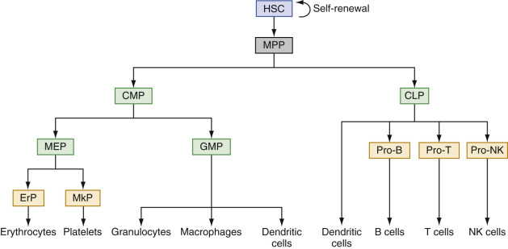

Figure 31-1 

A scheme of hematopoietic development hierarchy. 

_CLP,_ Common lymphoid progenitors; _CMP,_ common myeloid progenitors; _ErP,_ erythroid precursors; _GMP,_ granulocyte/macrophage progenitors; _HSC,_ hematopoietic stem cells; _MEP,_ megakaryocyte/erythrocyte progenitors; _MkP,_ megakaryocyte precursors; _MPP,_ multipotent progentors. 

Human HSCs are immunophenotypically defined as Lin  − CD34  \+  CD38  − CD90  \+  CD45RA  − CD49f  \+  (  Doulatov et al, 2012  ). They lack lineage-commitment markers such as, CD2, CD3, CD4, CD7, CD8, CD10, CD11b, CD14, CD19, CD20, CD56, CD71, and glycophorin A (GPA). As HSCs differentiate into MPPs, the expression of CD90 (Thy1) and CD49f is downregulated (  Doulatov et al, 2012  ). MPPs are defined as Lin  − CD34  \+  CD38  − CD90  − CD45RA  − CD49f  − . CMPs (defined as Lin  − CD34  \+  CD38  \+  CD123  +/low  CD45RA  − ), GMPs (defined as Lin  − CD34  \+  CD38  \+  CD123  \+  CD45RA  \+  ), and MEPs (defined as Lin  − CD34  \+  CD38  \+  CD123  − CD45RA  − ) are distinguishable based on the expression of IL-3 receptor α chain (CD123) and CD45RA (  Manz et al, 2002  ;  Bryder et al, 2006  ). CLPs are identified as Lin  − CD34  \+  CD38  \+  CD10  \+  or Lin  − CD34  \+  CD38  \+  CD127  \+  (  Bryder et al, 2006  ;  Pang et al, 2011  ). When committed progenitors differentiate into lineage-restricted progenitors/precursors, they express lineage-specific antigens such as CD33, CD11b, and CD14 for myeloid precursors, CD71 and GPA for erythroid precursors, CD41 and CD61 for megakaryocytic precursors, CD10 and CD19 for B-lymphoid precursors, and CD3 and CD7 for T-lymphoid precursors ( [ Box 31-1 ](<#b0010>) ). 

Box 31-1 

Lineage-Specific Markers 

Myeloid—CD33, CD11b, CD14 

Erythroid—CD71, GPA 

Megakaryocytic—CD41, CD61 

B-lymphoid—CD10, CD19 

T-lymphoid—CD3, CD7 

In adults, HSCs are mainly contained in the bone marrow. HSCs are also present in small numbers in the peripheral blood and are increased with administration of growth factors and/or some chemotherapeutic agents, allowing the use of peripheral blood as well as bone marrow to obtain HSCs for stem cell transplantation. In some pathologic conditions, such as in hematologic malignancies, extramedullary hematopoiesis is observed and HSCs can be found in other tissues including spleen and liver. Most of the HSCs remain in a quiescent state (G  0  stage of the cell cycle) to prevent rapid exhaustion of HSCs. Since G  0  is a relatively metabolically inactive phase of the cell cycle, HSCs are exposed to less DNA damage induced by metabolic byproducts and reactive oxygen species (ROS) than more metabolically active differentiated cells (  Rossi et al, 2005  ;  Bryder et al, 2006  ). FoxO family transcription factors protect HSCs from oxidative damage and extend their life span by increasing the expression of genes required for the detoxification of ROS as well as genes that promote quiescence (  Tothova et al, 2007  ). ATM, a serine/threonine kinase that is activated in response to DNA damage and is required for normal DNA repair, plays an important role in the maintenance of HSC quiescence by regulating the ROS levels (  Ito et al, 2006  ). In addition, thrombopoietin/MPL signaling has been shown to contribute to the maintenance of HSC quiescence by regulating interaction of HSCs with the osteoblastic niche of the bone marrow (  Yoshihara et al, 2007  ). HSCs also express high levels of multidrug-resistant (MDR) genes (  Rossi et al, 2005  ;  Bryder et al, 2006  ), whose products may play roles in the protection of HSCs from stress or genotoxic agents. 

The most important property of stem cells is self-renewal. Self-renewal is the process by which stem cells divide to generate more daughter stem cells. Self-renewal of HSCs is crucial to HSC function and to maintain a long-term steady-state pool of HSCs in adult bone marrow. The Notch, Sonic hedgehog (Shh), Wnt/β-catenin, and Janus kinase 2 (JAK2) signaling pathways have been shown to regulate HSC self-renewal (  Varnum-Finney et al, 2000  ;  Bhardwaj et al, 2001  ;  Reya et al, 2003  ;  Akada et al, 2014  ). Bmi1, a component of the polycomb repressive complex that regulates transcription of target genes through epigenetic silencing, also has been found critical for the self-renewal of HSCs (  Park et al, 2003  ). Recent studies indicate an important role for stem cell niche in the maintenance and self-renewal of HSCs (  Morrison & Scadden, 2014  ). HSCs are mainly localized in the sinusoids of the bone marrow, where endothelial cells and mesenchymal stromal cells promote HSC maintenance by producing the cytokine stem cell factor (SCF) (  Ding et al, 2012  ), the chemokine CXCL12 (  Greenbaum et al, 2013  ;  Ding & Morrison, 2013  ), and possibly other factors. Sympathetic nerves (  Katayama et al, 2006  ), non-myelinating Schwann cells (  Yamazaki et al, 2011  ), macrophages (  Winkler et al, 2010  ), and osteoclasts (  Mansour et al, 2012  ) may also contribute to HSC niche and promote HSC maintenance in the bone marrow. It is suggested that HSCs physically attach to the niche, and when they divide, one daughter cell remains attached to the niche, whereas the other daughter cell is displaced away from the niche to proceed to a differentiation pathway (  Clarke & Fuller, 2006  ). Oncogenic mutations associated with leukemia and other malignancies usually exploit the self-renewal mechanisms of normal stem cells. These mutations often originate in normal HSCs and transform them into leukemic stem cells (LSC) with increased self-renewal capacity. 

Self-renewal and differentiation potentials of human HSCs can be assessed by serial transplantation of HSCs into immune-deficient NSG (NOD/SCID/γ-chain deficient) mice and by hematopoietic progenitor colony assays, respectively. Purified HSCs from human bone marrow or peripheral blood are transplanted into sub-lethally irradiated NSG mice, which permit long-term engraftment of human cells without GVHD. The repopulating human cells, termed _severe-combined immunodeficiency mouse-repopulating cells (SRC),_ are assessed using flow cytometry. Hematopoietic progenitor colony assay is used to determine the differentiation capacity of HSCs/progenitors. The earliest undifferentiated myeloid progenitor colony that expresses CD34 and CD33 is called the colon-forming unit-granulocyte, erythrocyte, macrophage, megakaryocyte (CFU-GEMM). In the presence of different cytokines, CFU-GEMM cells can differentiate into colony-forming unit-granulocyte (CFU-G), colony-forming unit-macro­phage (CFU-M), burst-forming unit-erythroid (BFU-E), colony-forming unit-eyrthrocyte (CFU-E), and colony-forming unit-megakaryocyte (CFU-Mk). In addition, evidence suggests that HSCs can trans-differentiate into non-hematopoietic cells (  Zubair et al, 2002  ). 

 

##  Hematopoietic Growth Factors 

Soluble or membrane-bound factors contributing to control of hematopoiesis include hematopoietic growth factors and cytokines. They regulate the proliferation, survival, and differentiation of hematopoietic precursor cells and facilitate the function of mature blood cells. Hematopoietic growth factors/cytokines may act locally near the site at which they are produced, or they may circulate in the blood. They are produced by different types of hematopoietic or non-hematopoietic cells and usually affect more than one lineage (  Metcalf, 2008  ). They often act synergistically with other growth factors and may act on normal cells as well as neoplastic cells. There are specific receptors for each cytokine that transmits signals from the cell surface to the nucleus following interaction with the cytokine. 

Genes associated with hematopoietic growth factors/cytokines have been identified, cloned, and sequenced. Purified recombinant cytokines have been generated and utilized experimentally. Several of these cytokines have been in clinical use to stimulate hematopoietic cell production. Erythropoietin (EPO) is critical for the production of erythrocytes, whereas thrombopoietin (TPO) is required for the production of megakaryocytes (  Metcalf, 2008  ). Other important growth factors/cytokines involved in hematopoiesis include stem cell factor (SCF), FLT-3 ligand, granulocyte/macrophage colony stimulating factor (GM-CSF), granulocyte colony stimulating factor (G-CSF), macrophage colony stimulating factor (M-CSF), interleukins (IL-3, IL-4, IL-5, IL-6, IL-7, IL-11, IL-13, and IL-15), and interferons (IFN-α and IFN-γ). 

Another class of factors, called _chemokines,_ is important in regulating hematopoietic cell trafficking and homing. The chemokine CXCL12 (also known as SDF-1) is expressed by bone marrow stromal cells and microvascular endothelial cells. HSCs express CXCR4, the receptor for CXCL12. CXCL12-CXCR4 chemokine signaling is involved in HSC maintenance and engraftment (  Sugiyama et al, 2006  ). G-CSF–induced mobilization of HSCs is likely due to disruption of the interaction between CXCL12 and CXCR4 (  Papayannopoulou & Scadden, 2008  ). Several other chemokines and their receptors also play roles in T and B cell development, inflammation, and immune surveillance (  Moser et al, 2004  ). 

,  

##  Hematopoietic Tissues 

 

##  Embryonic and Fetal Hematopoiesis 

Beginning in the first month of prenatal life, primitive hematopoiesis starts outside the embryo in the mesenchyme of the yolk sac as **blood islands.** These contain predominantly **primitive erythroblasts,** which are large and megaloblastic, are formed intravascularly, and retain their nuclei. Definitive hematopoiesis in mammals takes place in the aorta-gonad-mesonephros (AGM) region of the embryo, from which hematopoietic cells migrate to the placenta, liver, and spleen. At the sixth week, hematopoiesis begins in the liver, and this becomes the major hematopoietic organ of early and midfetal life. **Definitive erythroblasts,** which become non-nucleated red cells, are formed extravascularly in the liver, and granulopoiesis and megakaryocytes are present to a lesser degree. In the middle part of fetal life, the spleen and, to a lesser extent, lymph nodes have a minor role in hematopoiesis, but the liver continues to dominate. In the latter half of fetal life, the bone marrow becomes progressively more important as a site of blood cell production. As this occurs, the liver's role diminishes. 

 

##  Postnatal Hematopoiesis 

Shortly after birth, hematopoiesis in the liver ceases, and the marrow is the only site for the production of erythrocytes, granulocytes, and platelets. Hematopoietic stem cells and committed progenitor cells are maintained in the marrow. Lymphocytes (of the B cell type) continue to be produced in the marrow, as well as in the secondary lymphoid organs, whereas T lymphocytes are produced in the thymus and also in the secondary lymphoid organs (see the [ Lymphocytes ](<#s0225>) section later in the chapter). 

At birth, the total marrow space is occupied by active hematopoietic (red) marrow. As body growth progresses and marrow space increases during infancy, only part of that space is needed for hematopoiesis; the remaining space is occupied by fat cells. Later in childhood, only the flat bones (the skull, vertebrae, thoracic cage, shoulder, and pelvis) and the proximal parts of the long bones of the upper and lower limbs are sites of blood cell formation. The remaining marrow space is fatty or yellow marrow that can be replaced by hematopoietic cells if continuous, intensive stimulation exists. 

The marrow circulation is closed, that is, arterioles deriving from central longitudinal arteries (i.e., in long bones) connect directly with broad venous sinuses that anastomose and eventually empty into central longitudinal veins. The flattened endothelium of the sinuses is partially covered by adventitial reticular cells, a form of fibroblast that elaborates argentophilic reticulin fibers. These reticular cells and fibers form the supporting meshwork of the marrow stroma, where the hematopoietic cells reside. The reticular cells are minimally phagocytic; they may swell and take up water, may become fat cells, and may induce hematopoietic stem cells to become committed progenitor cells. After proliferation and maturation have occurred in the marrow stroma, blood cells gain entrance to the blood through or between the endothelial cells of the sinus wall. This requires displacement of adventitial cells. Stromal mesenchymal cells and sinusoidal endothelial cells produce a variety of cytokines and chemokines involved in hematopoiesis. 

,  

##  Erythrocyte Production 

The erythrocyte is a vehicle for the transport of hemoglobin, which is produced in precursor cells of the erythrocytes, the normoblasts. The function of hemoglobin is the transport of oxygen and carbon dioxide. The erythrocyte is also metabolically capable of keeping hemoglobin in a functional state. 

 

##  Normoblastic Maturation 

The earliest recognizable erythroid precursor is the **pronormoblast** ( [ Fig. 31-2 ](<#f0015>) ). At about 20 µm diameter, it is the largest of the erythroid precursors. The nucleus has a fine, uniform chromatin pattern that is somewhat more distinct and more intensely stained than that of the myeloblast. The nuclear membrane is prominent. One or more prominent nucleoli are present. The cytoplasm has a heterogeneous quality and is moderate in amount and basophilia; no granules are present. The pronormoblast undergoes mitosis and forms two basophilic normoblasts. 

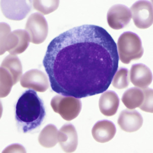

Figure 31-2 

Pronormoblast with a large round nucleus, fine chromatin, and basophilic cytoplasm (Wright-Giemsa, 1000×). 

The **basophilic normoblast** ( [ Fig. 31-3 ](<#f0020>) ) is somewhat smaller and has slightly coarser chromatin that stains intensely; the chromatin may be partially clumped, and the pattern may suggest a wheel with broad spokes. The parachromatin (the nonchromatin part of the nucleus) is distinct and stains pink. Nucleoli are present but are not often visible. The nuclear/cytoplasmic (N/C) ratio is moderate; about one fourth of the total cell area appears to be cytoplasm. The cytoplasm is deeply basophilic, owing to the abundance of RNA; much of this is evident as polyribosomes on electron micrographs. The cell borders of early normoblasts frequently appear irregular owing to the presence of pseudopodia. 

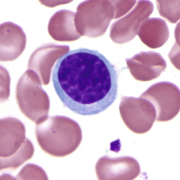

Figure 31-3 

Basophilic normoblasts with chromatin condensation and deeply basophilic cytoplasm (Wright-Giemsa, 1000×). 

After mitosis of the basophilic normoblast, evidence of continuing hemoglobin production becomes visible in the cytoplasm of the two daughter cells as polychromasia, that is, mixtures of the red-staining of hemoglobin with the blue of RNA in varying shades of gray. This cell is the **polychromatophilic normoblast** ( [ Fig. 31-4 ](<#f0025>) ), which is slightly smaller than the basophilic normoblast. The nucleus occupies about half of the area of the cell, stains intensely, and has moderately condensed chromatin that is sharply distinct from the pink parachromatin. The polychromatophilic normoblast undergoes one or two mitotic divisions. 

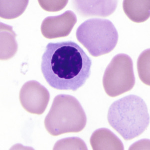

Figure 31-4 

Polychromatophilic normoblast with light blue cytoplasm due to accumulation of hemoglobin (Wright-Giemsa, 1000×). 

After the last mitosis, the nucleus becomes small and dense (pyknotic), and the **orthochromatic normoblast** stage is reached ( [ Fig. 31-5 ](<#f0030>) ). Mitosis is no longer possible. The cell is smaller than the polychromatophilic normoblast and has a lower N/C ratio. The cytoplasm contains more abundant hemoglobin and fewer polyribosomes and remains slightly polychromatophilic. 

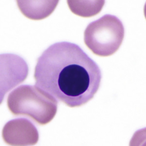

Figure 31-5 

Orthochromatic normoblast with pyknotic nucleus and pink-gray cytoplasm (Wright-Giemsa, 1000×). 

Finally, accompanied by cytoplasmic contractions and undulations, the nucleus and a small rim of cytoplasm are ejected from the orthochromatic normoblast, forming the **reticulocyte** ( [ Fig. 31-6 ](<#f0035>) ). On air-dried films with Romanowsky-type stains, the reticulocyte is polychromatophilic as a result of the retention of RNA. 

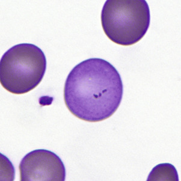

Figure 31-6 

Reticulocyte (polychromatophilic erythrocyte) with pink-gray cytoplasm due to residual RNA (Wright-Giemsa, 1000×). 

_RNA,_ Ribonucleic acid. 

In the marrow, developing erythroid cells are usually in contact with macrophages in what are termed **erythroblastic islands** ( [ Fig. 31-7 ](<#f0040>) ). These erythroblastic islands are usually broken up when aspirated marrow is spread on slides, but fragments of macrophage cytoplasm may sometimes be seen attached to the separated normoblasts, especially on Prussian blue–stained films. 

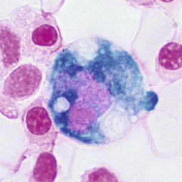

Figure 31-7 

Siderophage with associated normoblasts (part of an erythroblastic island) in the bone marrow (Prussian blue, 1000×). 

During proliferation and maturation, iron is transferred from plasma transferrin into the cells in the normoblastic series. The pronormoblast and the basophilic normoblast have the highest content of RNA, which begins to decline in the polychromatophilic normoblasts as hemoglobin increases in amount. Synthesis of RNA gradually decreases in each stage through the orthochromatic normoblasts. When the nucleus is no longer present (in the reticulocyte), RNA synthesis ceases, yet the RNA already present remains for a few days, and protein and heme synthesis continue in the reticulocyte until the cell loses its RNA and mitochondria. 

During this maturation process, three or four mitotic divisions occur in a period of 3 days, resulting in the potential production of 16 reticulocytes from each pronormoblast. The reticulocytes are larger than mature red blood cells and remain in the marrow stroma for 1 to 2 days before being released into the blood. 

In the marrow, the reticulocytes are about equal in number to the nucleated erythrocytes and slightly greater in number than the reticulocytes in the circulating blood. If sufficiently severe hypoxia is present, this marrow pool of reticulocytes can be released. This approximately doubles the number of circulating reticulocytes. 

Normally, reticulocytes remain as such, slowly synthesizing hemoglobin, for 2 to 3 days in the marrow and for 1 day in the blood. Residual ribosomes, mitochondria, and other organelles are then removed, and the mature erythrocytes circulate for about 120 days. During this time, they gradually age, certain enzymatic activities diminish, and they are finally destroyed within phagocytic cells of the mononuclear phagocyte system (reticuloendothelial system). 

 

##  Megaloblastic Maturation 

Abnormal maturation of erythroid precursors that occurs in vitamin B  12  deficiency or folic acid deficiency is known as _megaloblastic maturation,_ and the abnormal erythroid cells are called **megaloblasts.** Because of impaired ability of the cells to synthesize DNA, the intermitotic and mitotic phases are prolonged. This results in enlarged cells, with nuclear maturation lagging behind cytoplasmic maturation (nuclear-cytoplasmic dissociation). The nuclear chromatin pattern is more delicate and more “open,” with prominent parachromatin. Karyorrhexis, or breaking up of the nucleus, and Howell-Jolly bodies are frequently noted. Megaloblastic development parallels normoblastic maturation; the stages of promegaloblast, basophilic megaloblast, polychromatophilic megaloblast, and orthochromatic megaloblast may be recognized. 

 

##  Regulation of Erythrocyte Production 

The number of erythrocytes in the blood may be regulated by changing the rate of production. The rate of erythrocyte destruction does not vary appreciably in normal individuals. Increased production of erythrocytes occurs when oxygen transport to the tissues is impaired, as in anemia, in cardiac or pulmonary disorders, and in the low oxygen tension of high altitudes. Erythrocyte production decreases when an individual is hypertransfused or exposed to high oxygen tension. 

Oxygen affinity of hemoglobin is modulated by the concentration of phosphates, in particular 2,3-diphosphoglycerate (2,3-DPG) in the red blood cell. These phosphates combine with the β-chains of reduced hemoglobin and diminish its affinity for oxygen ( [ Fig. 31-8 ](<#f0045>) ). In areas of tissue hypoxia, as oxygen moves from hemoglobin into the tissues, the amount of reduced hemoglobin in the red blood cells increases, binding more 2,3-DPG, further reducing its oxygen affinity so that more oxygen can be delivered to the tissues. If hypoxia persists, depletion of free 2,3-DPG leads to increased glycolysis, production of more 2,3-DPG, and a persistently lower oxygen affinity of the hemoglobin. 

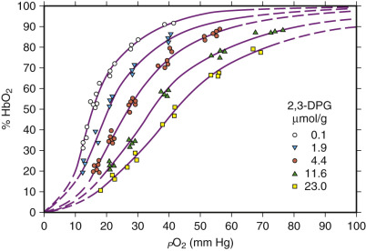

Figure 31-8 

Oxygen dissociation curves of hemoglobin at different concentrations of 2,3-DPG. 

The curve is sigmoidal and shifts to the right with increasing concentrations of 2,3-DPG; this results in decreased affinity of hemoglobin for oxygen and increased delivery of oxygen to the tissues. _DPG,_ diphosphoglycerate. 

(Reprinted from Duhm J: _Oxygen affinity of hemoglobin and red cell acid base status,_ p 583, Copyright 1972, with permission from Elsevier.) 

Tissue hypoxia induces formation of EPO via production of the transcriptional factor, hypoxia-inducible factor-1 (HIF-1). HIF-1 is a heterodimer consisting of α\- and β-subunits, of which the α-subunit is regulated by hypoxia. Under conditions of normal oxygen tension, HIF-1α undergoes proteosomal degradation, but it is stable under hypoxic conditions. EPO effects the production of more red blood cells in the bone marrow. It acts by inducing committed progenitor cells (CFU-E and BFU-E) in the marrow to proliferate and differentiate into pronormoblasts by shortening the generation time of normoblasts, and by promoting early release of reticulocytes into the blood. The result is increased numbers of marrow normoblasts in a normal ratio of cell types, a condition known as _normoblastic hyperplasia._ Increased cellular expression of HIF-1α can result from a 598C→T mutation in the von Hippel-Lindau gene (the von Hippel-Lindau protein is involved in HIF-1α degradation). This results in elevation of EPO levels and an autosomal recessive form of hereditary polycythemia known as _Chuvash polycythemia_ (  Gordeuk et al, 2004  ). 

Measurement of EPO is accomplished by in vitro immunologic methods utilizing serum or plasma, with ethylenediamenetetraacetic acid (EDTA) plasma providing greater sensitivity (  Lindstedt & Lundberg, 1998  ). Elevated levels are detected in patients with secondary polycythemia and in those with aplastic anemia. Decreased levels below the normal range are found in normal individuals after transfusion and in those with primary polycythemia (polycythemia vera). However, considerable overlap exists, and normal EPO levels may be found in both primary and secondary polycythemia (  Spivak, 2002  ). Anti-EPO antibodies have been described in pure red blood cell aplasia and systemic lupus erythematosus (  Casadevall et al, 1996  ;  Schett et al, 2001  ); these may interfere with immunoassays for EPO and may contribute to anemia. 

 

##  Synthesis of Hemoglobin 

 

##  Heme Synthesis 

Heme synthesis occurs in most cells of the body, except the mature erythrocytes, but most abundantly in the erythroid precursors. Succinylcoenzyme A condenses with glycine to form the unstable intermediate α-amino β-ketoadipic acid, which is readily decarboxylated to δ-aminolevulinic acid (ALA) ( [ Fig. 31-9 ](<#f0050>) ). This condensation requires pyridoxal phosphate (vitamin B  6  ) and occurs in mitochondria. 

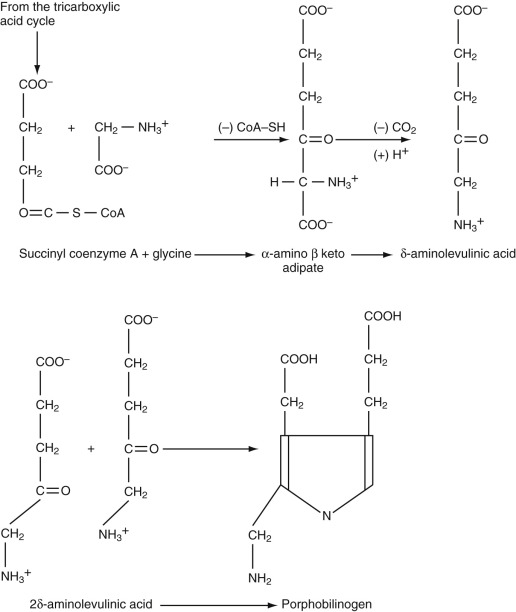

Figure 31-9 

Formation of porphobilinogen from succinylcoenzyme A and glycine. 

(From Leavell BS: _Fundamentals of clinical hematology_ , ed 4, Philadelphia, 1976, Saunders, with permission.) 

ALA is excreted normally in small amounts in the urine, but in certain abnormalities of heme synthesis (e.g., lead poisoning), excretion is increased. Two molecules of ALA condense to form the monopyrrole porphobilinogen, catalyzed by the enzyme ALA-dehydrase. Porphobilinogen is also normally excreted in small amounts in the urine. Markedly elevated amounts appear in the urine in acute intermittent porphyria, and are easily detected by a color reaction with Ehrlich's aldehyde reagent. 

Four molecules of porphobilinogen react to form uroporphyrinogen III or I ( [ Fig. 31-10 ](<#f0055>) ). The type III isomer is converted, by way of coproporphyrinogen III and protoporphyrinogen, to protoporphyrin. In certain diseases when this pathway is partially blocked, the type I isomers of uroporphyrinogen and coproporphyrinogen are formed, and their oxidized excretion products, uroporphyrin I and coproporphyrin I, are increased in amount. 

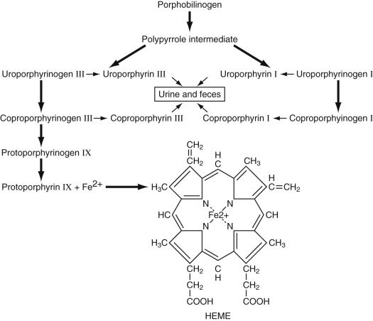

Figure 31-10 

Formation of heme from porphobilinogen. 

(From Leavell BS: _Fundamentals of clinical hematology_ , ed 4, Philadelphia, 1976, Saunders, with permission.) 

Protoporphyrin is normally found in mature erythrocytes. In lead poisoning and in iron deficiency, levels of free erythrocyte protoporphyrin (FEP) are increased. Iron is inserted into protoporphyrin by the mitochondrial enzyme ferrochelatase to form the finished heme moiety. 

 

##  Globin Synthesis 

Globin synthesis occurs in the cytoplasm of the normoblast and reticulocyte. The polypeptide chains are manufactured on the ribosomes. Specific small soluble RNA (sRNA) molecules determine the placement of each amino acid according to the code in the messenger RNA (mRNA). Progressive growth of the polypeptide chain begins at the amino end. This process of protein synthesis occurs on ribosomes clustered into polyribosomes, which are held together by the mRNA. Because the reticulocyte can synthesize hemoglobin for at least 2 days after loss of its nucleus, it appears that the mRNA for hemoglobin is quite stable. The polypeptide chains released from the ribosomes are folded into their three-dimensional configurations spontaneously. 

Control of hemoglobin synthesis is exerted primarily through the action of heme. Increased heme inhibits further heme synthesis by inhibiting the activity and synthesis of ALA synthase. Heme also promotes globin synthesis, mainly at the site of chain initiation, and the interaction of ribosomes with mRNA. 

 

##  Structure and Function of Hemoglobin 

In each hemoglobin (Hb) molecule, one heme group is inserted into a hydrophobic pocket of one folded polypeptide chain (  Bunn & Forget, 1986  ). Normal adult HbA consists of four heme groups and four polypeptide chains (two α-chains and two β-chains), which form a roughly globular hemoglobin molecule ( [ Fig. 31-11 ](<#f0060>) ). The ferrous iron atoms have six coordination bonds: four to the pyrrole nitrogens of heme, one to the imidazole nitrogen of histidine of the globin chain (87-α or 92-β), and one that is reversibly bound to oxygen. As the oxygen partial pressure increases, each of the four heme groups sequentially binds one molecule of oxygen. In the process, a change in the overall configuration of the hemoglobin molecule occurs, which favors the additional binding of oxygen. 

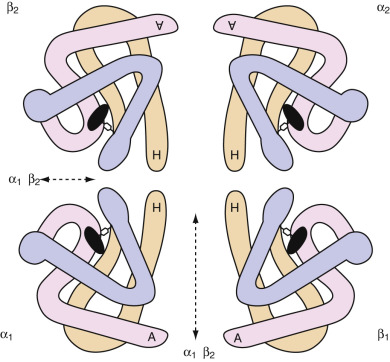

Figure 31-11 

The hemoglobin molecule (tetramer, molecular weight 64,500 Da). 

The heme group for each monomeric polypeptide chain is depicted as a black disk, connected to an imidazole group of histidine and located near the surface of the molecule in a “pocket” formed by the polypeptide chain. The letters _A_ and _H_ designate α-helix segments of each polypeptide chain: A is the amino-terminal segment, and H is the carboxy-terminal segment. The four monomers are separated in this drawing but actually make contact along a relatively large area (α 1  β 1  ), which is thought to be the relatively fixed or stabilizing contact area, and a smaller (α 1  β 2  ) area thought to be the functional contact area, where movement occurs during oxygenation and deoxygenation, changing the molecular configuration. 

(Redrawn from White JM, Dacie JV: The unstable hemoglobins—molecular and clinical features, _Prog Hematol_ 7:69, 1971, with permission.) 

The sigmoid-shaped oxygen dissociation curve of hemoglobin reflects this increasing affinity for oxygen with increasing partial pressure of oxygen in the lungs (see [ Fig. 31-8 ](<#f0045>) ). In the tissues, conversion of oxygenated Hb to Hb, decreasing pH, and increasing temperature produced by metabolic processes, as well as the binding of more 2,3-DPG to Hb, result in a shift of the Hb-oxygen dissociation curve to the right, favoring the release of oxygen from hemoglobin. 

Carbon dioxide (CO  2  ) is transported in erythrocytes as well as in plasma. A small part of red blood cell CO  2  is dissolved and is bound to amino groups of hemoglobin as carbamino-CO  2  , but most is in the bicarbonate form. The enzyme carbonic anhydrase catalyzes the transformation of carbon dioxide to bicarbonate in the red blood cell while in the tissue capillary bed and catalyzes the reverse reaction (the release of carbon dioxide from bicarbonate) in the erythrocyte when it is in the capillary bed of the lungs. 

The porphyrias, abnormalities of heme synthesis, are described in [ Chapter 32 ](<##!/content/3-s2.0-B9780323295680000322?scrollTo=%23c00032>) ( [ Fig. 31-12 ](<#f0065>) ). 

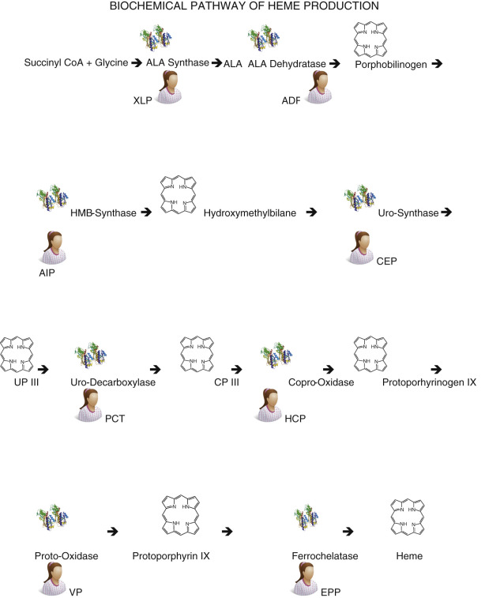

Figure 31-12 

Biosynthetic pathway of heme and pathogenesis of the porphyrias. _ADP,_ Aminolevuoinic acid dehydratase; _AIP,_ acute intermittent porphyria; _ALA,_ Aminolevulinic acid; _CEP,_ congenital erythropoietic porphyria; _CP III,_ coproporphyrinogen III; _EPP,_ erythropoietic protoporphyria; _HCP,_ hereditary coproporhyria; _HMB,_ hydroxymethylbilane; _PCT,_ porphyria cutanea tarda; _UP III,_ uroporphyrinogen III; _VP,_ variegate porphyria; _XLP,_ X-linked protoporphyria. 

,  

##  Erythrocyte Destruction 

The erythrocyte gradually undergoes metabolic changes over the course of its 120-day life span, at which time the less viable senescent cell is removed from the circulation. Certain glycolytic enzymes diminish in activity as the cell ages. Older red blood cells have a smaller surface area and an increased mean cell hemoglobin concentration (MCHC) compared with younger cells. Furthermore, aged red blood cells lose sialic acid from their membranes, exposing an asialoglycophorin. This senescent antigen is recognized and an autoantibody is synthesized by the host. After binding of the autoantibody, the senescent cell is removed from the circulation by the mononuclear phagocyte system, primarily within the spleen. About 3 million cells are normally removed from the blood per second with no demonstrable histologic evidence of erythrophagocytosis. 

In some pathologic states, the mononuclear phagocyte system removes younger sensitized or abnormal red blood cells at a rapid rate. Subsequently, erythrophagocytosis is often evident. In autoimmune hemolytic anemia, the mononuclear phagocyte system removes red blood cells following the binding of autoantibodies or complement to reticulocytes and young red blood cells. In other pathologic states, red blood cells are removed because of structural defects that interfere with their normal passage through the microcirculation of the mononuclear phagocyte system. 

 

##  Degradation of Hemoglobin 

After removal of the red blood cell from the circulation, hemoglobin is broken down within the macrophages of the mononuclear phagocyte system into its three constituents: iron, protoporphyrin, and globin. The iron goes into storage and may be completely reutilized. The globin may be degraded and returned to the amino acid pool of the body. In contrast, the protoporphyrin ring is split, converted to bilirubin, and excreted from the body. 

In the macrophage, the protoporphyrin ring is cleaved by a heme oxidase enzyme at the α-methene bridge, yielding 1 mol of carbon monoxide (CO) and 1 mol of biliverdin. The CO appears in the blood as HbCO and is eventually exhaled. Biliverdin is reduced to bilirubin in the macrophage, and bilirubin is transported to the liver by plasma albumin. It is removed from the plasma by the liver cell, conjugated mainly with glucuronide, and excreted in the bile. In the intestine, reduction by bacteria occurs, and bilirubin is transformed into urobilinogen, mesobilirubinogen, and stercobilinogen, compounds that are collectively designated urobilinogens. 

Estimation of exhaled CO, HbCO, or fecal urobilinogen can be used as a measure of hemoglobin breakdown. When production of red blood cells is diminished and the level of circulating hemoglobin is low, as in aplastic anemia, urobilinogen excretion is reduced. When destruction of erythrocytes is increased, as in hemolytic anemia, all three are increased in amount. 

In normal humans, about 80% to 90% of the excreted bile pigment measured as fecal urobilinogen is derived from breakdown of senescent erythrocytes that have lived 100 to 120 days. However, about 10% to 20% of the pigment is excreted within the first few days. This early labeled bile pigment comes from nonhemoglobin heme formed in the liver, as well as from the breakdown of newly formed hemoglobin in the bone marrow. Much of the latter may represent hemoglobin from the pieces of cytoplasm of the orthochromatic normoblast that are lost during the process of nuclear extrusion. 

In certain hematologic diseases, notably thalassemia, megaloblastic anemia, myelodysplasia, and erythropoietic porphyria, this early labeled bile pigment fraction may be markedly increased. This intramedullary destruction of hemoglobin, which never appears in circulating erythrocytes, is known as **ineffective erythropoiesis.**

,  

##  Erythrokinetics 

The balance between delivery of erythrocytes to the blood and removal of erythrocytes from the blood results in a relatively constant hemoglobin mass in the circulation. Anemia occurs when removal of erythrocytes from the blood is increased and cannot be compensated for by increased production, or when delivery of erythrocytes to the blood is decreased, or when both processes exist together. 

When anemia develops, tissue hypoxia leads to elevated levels of erythropoietin in the plasma. Resultant normoblastic hyperplasia produces more erythrocytes for delivery to the circulation. The marrow in a normal individual is capable of six to eight times the normal output of erythrocytes with extreme stimulation. This capacity must be compared with the output actually attained when one is evaluating the marrow response of a given patient. 

Measurements that assess **effective erythropoiesis** (production and delivery of erythrocytes to the circulation), **ineffective erythropoiesis,** and destruction of erythrocytes may be necessary to determine the mechanism and the cause of anemia. 

 

##  Measurements of Total Production of Erythrocytes or Hemoglobin 

The **total mass of erythropoietic cells** in the body cannot be easily measured. An estimate is made by examining a sample of bone marrow from a normally active site and determining the cellularity and the percentage of total nucleated cells that are erythropoietic (see the Bone Marrow Examination section in [ Chapter 30 ](<##!/content/3-s2.0-B9780323295680000309?scrollTo=%23c00030>) ). When marrow activity increases, usually the additional hematopoietic cells replace the fat in the red marrow sites before extension occurs into the yellow marrow of the long bones. One assumes that the sample is representative of the marrow as a whole—an assumption that usually is valid. 

The **plasma iron turnover** is calculated from the serum iron level and the rate of removal of injected radioactive iron from the plasma. About 25% to 30% of the iron is not used in erythropoiesis and is primarily taken up by the liver. The remaining 70% to 75% is taken up by erythropoietic cells and is therefore a measure of total erythropoiesis, both effective and ineffective. 

 

##  Measurements of Total Destruction of Erythrocytes or Hemoglobin 

Determination of **fecal urobilinogen** is an estimate of the total excretion of bile pigments—the breakdown products of heme. This measurement includes pigment derived from hemoglobin formed and destroyed in the marrow without ever reaching the circulating erythrocytes. Limitations include diminished conversion of bilirubin to urobilinogen caused by oral administration of broad-spectrum antibiotics, and failure of pigment to reach the intestine in obstructive jaundice. 

A portion (up to 50%) of the excreted urobilinogen is reabsorbed into the portal circulation and is reexcreted into the bile, without conjugation, by the liver. Only a small amount is normally excreted in the urine. Increased urinary urobilinogen is seen with severe liver disease, as well as with conditions associated with increased heme catabolism that overwhelm the metabolic capacity of the liver. Thus, hepatocellular damage, cirrhosis, hepatic congestion due to congestive heart failure, obstructive liver disease, cholangitis, hemolytic anemia, and ineffective erythropoiesis are all associated with elevation of urinary urobilinogen. 

 

##  Measurements of Effective Production of Erythrocytes: Reticulocyte Count 

Because the RNA of the reticulocyte disappears about 1 day after its entry into the blood, enumeration of reticulocytes will be a measure of the number of cells being delivered by the marrow to the blood each day, that is, a measure of effective erythropoiesis. The absolute reticulocyte count is calculated by multiplying the reticulocyte percentage by the erythrocyte count. To give a meaningful expression of erythropoiesis, the absolute reticulocyte count, or some estimate of it, and not simply the percentage, must be used. The normal absolute reticulocyte count is approximately 50 × 10  9  /L, or 1% of circulating erythrocytes. Because the normal maturation time for reticulocytes in the blood is 1 day, production of reticulocytes is 50 × 10  9  /L/day. 

A second consideration is an adjustment for increased maturation time of reticulocytes in the blood as a result of accelerated release from the marrow, an effect of erythropoietin. The need for this is recognized by the presence of large, polychromatic cells or nucleated red blood cells in the blood film, indicating a shift of excessively immature reticulocytes from the marrow into the blood. To avoid an overestimate of daily erythrocyte production, a correction factor is used that is based on estimated maturation time of reticulocytes in the blood. This varies inversely with hematocrit as follows (  Hillman & Finch, 1996  ): 

Hematocrit, %  |  Reticulocyte maturation time, days   
---|---  
45  |  1.0   
35  |  1.5   
25  |  2.0   
15  |  2.5   
  
If a patient has a Hct of 0.25, a red blood cell count of 2.89 × 10  12  /L, and a reticulocyte count of 7%, he or she will have an absolute reticulocyte count of 202 × 10  9  /L. Because the average normal absolute reticulocyte count is 50 × 10  9  /L, the patient has 

 (  202  × 10  9  /L  )  /  (  50  × 10  9  /L  ) 

or four times as many reticulocytes as normal. However, this must be corrected for the increased maturation time:  . Therefore, two times as many reticulocytes are entering the blood per day as in a normal individual, that is, red cell production is two times normal. 

If only the hematocrit is available, the same correction can be made as follows: 

  * Correction for anemia: 

    * Patient's reticulocyte count (7%)/Normal reticulocyte count (1%) × Patient's Hct (0.25)/Normal Hct (0.45) = 4 

  * Correction for shift: 

    * Corrected reticulocyte index (4) ×1/Maturation time (2) = 2 

These corrections are necessary to assess the degree of red blood cell production in response to anemia. 

A normal individual with a normal supply of iron can increase red blood cell production by two times normal within 1 week if the hematocrit drops to 0.35, or by three times normal if the hematocrit drops to 0.25. Only if there is a parenteral supply of iron (such as in hemolysis) can the maximal red blood cell production of six to eight times normal be achieved. 

If an appropriate marrow response to anemia has not been reached in 1 to 2 weeks, some impairment of red blood cell production exists. 

The **erythrocyte utilization of iron** is a measure of the amount of an injected dose of iron that appears in the hemoglobin of circulating erythrocytes. It is derived from the plasma iron turnover and the percentage of radioactive iron that has been injected and that appears in the circulating erythrocytes after 2 weeks, assuming that none of the newly formed cells have been destroyed in that time interval. This, too, is a measure of effective erythropoiesis. 

 

##  Measurements of Effective Survival of Erythrocytes in Blood 

The **erythrocyte survival** can be determined by removing a sample of blood, labeling the erythrocytes with chromium-51 (  51  Cr), inactivating the excess  51  Cr remaining in the plasma, and reinjecting the labeled erythrocytes into the patient. The  51  Cr is bound to the β-chain of the hemoglobin molecule and for the most part is not released until the red blood cell is removed from the circulation and the hemoglobin is degraded. Measurements of radioactivity in the red blood cells are made at 2 hours or 24 hours (the zero time, or 100% level) and at 1- to 3-day intervals until over 50% of the activity has disappeared. The results are usually expressed as the  51  Cr half-survival time. The normal range is 28 to 38 days. (The reason it is not 60 days is that  51  Cr is eluted from the hemoglobin at the rate of about 1% per day.) If production of erythrocytes equals destruction (i.e., if a steady state exists), the erythrocyte survival is also a measure of effective production of erythrocytes. 

 

##  Summary 

_Total erythropoiesis_ refers to the total production of hemoglobin or red cells; _effective erythropoiesis_ refers to production of hemoglobin or red blood cells that reach the circulation; and _ineffective erythropoiesis_ refers to production of hemoglobin or red blood cells that never reach the circulating blood. These concepts of the **erythrokinetic** approach to the study of anemia are useful, especially in anemias that defy easy classification. 

,  

##  Neutrophils 

The common progenitor cell for neutrophils and monocytes (CFU-GM) divides and gives rise to the progenitor cells for granulocytes (CFU-G) and for monocytes (CFU-M). CFU-G and CFU-M cells give rise to myeloblasts and monoblasts, respectively, under stimulation of colony-stimulating factors for granulocytes and monocytes (see [ Fig. 31-1 ](<#f0010>) ). 

 

##  Morphology of Neutrophil Precursors 

The **myeloblast** ( [ Fig. 31-13 ](<#f0070>) ) is a cell about 15 µm in diameter with a moderately high N/C ratio; a large oval to quadrangular nucleus; a very fine, uniform chromatin pattern; a delicate nuclear membrane; and two to five nucleoli. The cytoplasm is pale, clear blue, and without granules. The appearance of azurophilic (primary) granules (≈0.5-µm diameter) heralds the earliest promyelocyte ( [ Fig. 31-14 ](<#f0075>) ) and indicates that the cell is to be a neutrophil. The **promyelocyte** stage encompasses the entire period of production of azurophilic granules. The promyelocyte is slightly larger than the myeloblast. The nuclear chromatin begins to condense, and the nucleoli are less obvious. The cytoplasm is basophilic and is filled by more and more azurophilic granules. The **neutrophil myelocyte** stage begins with the appearance of specific neutrophil (secondary) granules, at first only in the Golgi region; as more specific granules develop, they spread throughout the cytoplasm ( [ Fig. 31-15 ](<#f0080>) ). With successive mitoses, the number of azurophilic granules (whose production has ceased at the end of the promyelocyte stage) is diminished. The early neutrophil myelocyte, therefore, has a rather fine, dispersed nuclear chromatin pattern, many azurophilic granules, and few specific granules. The late neutrophil myelocyte has a somewhat more condensed chromatin pattern, a cytoplasm well filled with specific granules, and rather few azurophilic granules. The myelocyte is the latest stage capable of cell division. The next stage, the **neutrophil metamyelocyte,** is distinguished by an indented, kidney-shaped nucleus with more condensed chromatin ( [ Fig. 31-16 ](<#f0085>) ). From this stage on, changes in the cytoplasm are insignificant. In the **band neutrophil** (stab form), the nucleus has more condensed chromatin and a rather uniform elongated shape ( [ Fig. 31-17 ](<#f0090>) ). Partial constriction of the nucleus occurs in the band stage, until a fine filament (length but no breadth) is formed between two of the lobes, at which point the cell is classified as a **segmented neutrophil** ( [ Fig. 31-18 ](<#f0095>) ). 

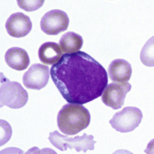

Figure 31-13 

Myeloblast with high nuclear/cytoplasmic ratio, fine chromatin, visible nucleoli, and basophilic cytoplasm (Wright-Giemsa, 1000×). 

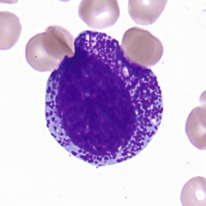

Figure 31-14 

Promyelocyte _(center)_ with azurophilic granules in the cytoplasm; the nuclear chromatin is still fine (Wright-Giemsa, 1000×). 

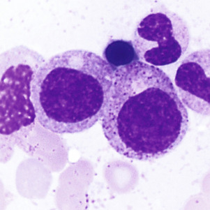

Figure 31-15 

Myelocytes have secondary granules in the cytoplasm and show condensation of nuclear chromatin. 

Persistent primary granules are seen in early myelocytes _(center-right)_ and are lost as myelocytes mature. A band neutrophil and an orthochromatic normoblast are also seen (Wright-Giemsa, 1000×). 

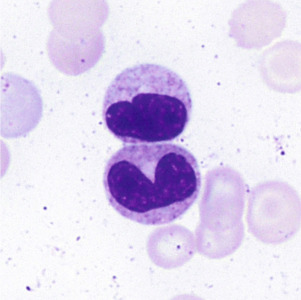

Figure 31-16 

Metamyelocytes show nuclear indentation and increased chromatin clumping (Wright-Giemsa, 1000×). 

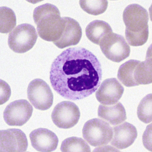

Figure 31-17 

Band neutrophil with mature nucleus with clumped chromatin but without segmentation (Wright-Giemsa, 1000×). 

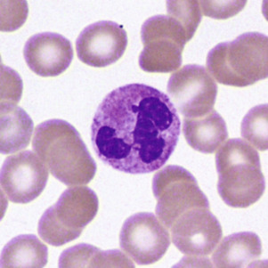

Figure 31-18 

Segmented neutrophil with multiple nuclear lobes joined by fine chromatin filaments (Wright-Giemsa, 1000×). 

During development and maturation, neutrophilic precursors express various cell surface markers that can be used for immunophenotypic recognition. Myeloblasts express the HSC marker CD34, as well as HLA-DR and myeloid lineage specific markers CD13, CD33, CD15, and CD117. Mature neutrophils express CD13, CD15, CD16, and CD11b, but lose HLA-DR and CD33. 

The mature human neutrophil has twice as many specific granules as azurophilic granules ( [ Box 31-2 ](<#b0015>) ). The azurophilic granules (formed in the promyelocyte stage) contain lysosomal enzymes (e.g., acid hydrolases: acid phosphatase, β-glucuronidase), myeloperoxidase, elastase, arylsulfatase, and cationic antibacterial proteins, along with other enzymes and proteins. The specific granules (formed in the myelocyte stage) contain lysozyme, lactoferrin, collagenase, plasminogen activator, aminopeptidase, and vitamin B  12  –binding protein, as well as other enzymes and proteins. Tertiary granules, similar in size to the specific granules, contain gelatinase. Alkaline phosphatase is located in yet another type of cytoplasmic organelle lighter in density than specific granules. These organelles first appear during the late myelocyte stage. 

Box 31-2 

Neutrophil Constituents and Functions 

  * Azurophilic granules (formed in promyelocyte stage) 

    * Lysosomal enzymes: acid hydrolases, acid phosphatase, β-glucuronidase 

    * Myeloperoxidase 

    * Elastase 

    * Arylsulfatase 

    * Cationic antibacterial proteins 

  * Specific granules (formed in myelocyte stage) 

    * Lysozyme 

    * Lactoferrin 

    * Collagenase 

    * Plasminogen activator 

    * Aminopeptidase 

  * Tertiary granules 

    * Gelatinase 

  * Cytoplasmic organelles 

    * Alkaline phosphatase 

  * Neutrophil functions 

    * Phagocytosis 

    * Bactericidal activity 

 

##  Distribution and Kinetics 

For each neutrophil in the blood vessels, about 16 precursors are present in the marrow. From the time of differentiation into a myeloblast, through about five mitotic divisions (three of which occur at the myelocyte stage), it takes about 14 days until the progeny of that cell reach the blood. The last 6 to 7 days are spent in the maturation and storage pool. When a neutrophil enters the blood, it moves readily between a circulating granulocyte pool, which is sampled in the leukocyte count, and a marginal granulocyte pool, which is not, but is either marginated along vessel walls or sequestered in capillary beds. In less than 1 day after it arrives, the neutrophil emigrates from the circulation in a random manner and enters the tissues. Migration into tissues is dependent on adhesion molecules of the selectin family (and their corresponding ligands) expressed on neutrophils and endothelial cells. From there, if not utilized in an inflammatory exudate, neutrophils leave the body within a few days via secretions in bronchi, saliva, the gastrointestinal tract, and urine, or they are destroyed by the mononuclear phagocyte system. 

 

##  Function 

Neutrophils are able to move in a zigzag manner, but their motion changes to a straight-line path if a chemotactic attractant or factor (e.g., a bacterium coated with certain components of complement) is within a certain distance. Neutrophils express chemokine receptors CXCR1 and CXCR2, which are responsible for neutrophil migration in response to chemokines. Neutrophils also have receptors for the Fc portion of IgG, as well as for complement (C3) and bind and phagocytose the coated particle. Phagocytosis occurs with the formation of a phagocytic vacuole that contains the ingested particle; accompanying this process is an increase in metabolic activity and energy production. Specific granules, followed shortly by azurophilic granules, empty their contents into the phagocytic vacuoles—a process known as _degranulation_ . Bactericidal activity occurs within the vacuole, mediated by H  2  O  2  , superoxide anion (O  2  − ), myeloperoxidase, and a halide ion generating free halogen, or by other enzymatic activity. Other substances can act as chemotactic factors too. The C5a fragment is a chemotactic factor and is also an anaphylatoxin that causes smooth muscle contraction. Substances liberated by bacteria and metabolic products of arachidonic acid may also act as chemotactic factors for neutrophils. Neutrophils are thus important in defense against infectious disease. If their enzymes are activated and released outside the cell, neutrophils can cause tissue necrosis, tissue injury, and inflammation. 

,  

##  Eosinophils 

Eosinophils are produced in the bone marrow. In vitro culture studies show that there is a separate eosinophilic committed progenitor cell (CFU-Eo) in the marrow that is distinct from CFU-GM, CFU-G, and CFU-M. Three growth factors (GM-CSF, IL-3, IL-5) produced by T lymphocytes influence eosinophil development. IL-5 promotes terminal maturation, functional activation, and prevention of apoptosis of eosinophils. 

 

##  Morphology of Eosinophil Precursors 

The cell that is the precursor for the earliest recognizable eosinophil, the eosinophil myelocyte, is presumably a distinctive myeloblast. However, it is morphologically indistinguishable from that which gives rise to neutrophils and monocytes or to basophils (see [ Figs. 31-1 ](<#f0010>) and [ 31-13 ](<#f0070>) ). In the early eosinophil myelocyte, the granules are large and take the basophilic stain. As the cell matures, the granules appear olive-green, and finally the characteristic red-orange color ( [ Figs. 31-19 ](<#f0100>) and [ 31-20 ](<#f0105>) ). Nuclear maturation is similar to that of the neutrophil. Eosinophils are slightly larger than neutrophils and have fewer nuclear lobes. Mature eosinophils express CD16 and CD32. 

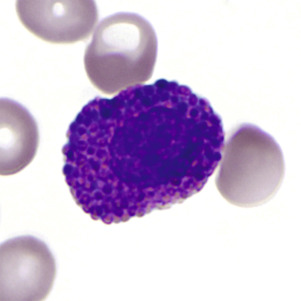

Figure 31-19 

Eosinophil myelocyte with ovoid nucleus and eosinophilic secondary granules in the cytoplasm (Wright-Giemsa, 1000×). 

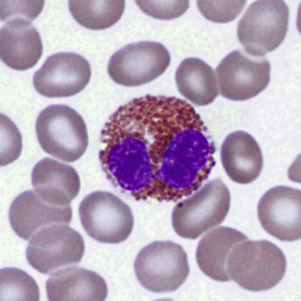

Figure 31-20 

Mature eosinophil with bilobed nucleus and large eosinophilic cytoplasmic granules (Wright-Giemsa, 1000×). 

Electron micrographs of eosinophils show characteristic granules that have a dense crystalloid core in a less dense matrix. Immature granules, appearing in the myelocyte, at first have no crystalloids but develop them as maturation proceeds. Mature granules are of two types: a larger granule (0.5 to 1.5 µm in largest diameter) with a dense crystalloid, and a smaller granule (0.1 to 0.5 µm diameter) without a crystalloid. The smaller granules appear later during maturation, after the myelocyte stage. 

Eosinophil-specific granules ( [ Box 31-3 ](<#b0020>) ) contain major basic protein (MBP) in the crystalloid core; MBP is toxic to parasites and cells, neutralizes heparin, and induces histamine release from basophils. Granule constituents in the matrix include acid hydrolases, peroxidase, phospholipase, and cathepsin. The specific granules also contain eosinophil cationic protein (ECP), eosinophil-derived neurotoxin (EDN), and eosinophil peroxidase (EPO). ECP shortens coagulation time and alters fibrinolysis; it also inhibits lymphocyte proliferation and is a potent neurotoxin. EDN is a strong neurotoxin (  Gleich & Adolphson, 1986  ). The smaller granules contain arylsulfatase; both granule types contain peroxidase and acid phosphatase. Eosinophil peroxidase is different from the type of peroxidase present in neutrophils and monocytes; also, eosinophils contain no alkaline phosphatase or muramidase. Eosinophils secrete IL-1, IL-3, IL-6, IL-8, TNF-α, and GM-CSF. TNF-α appears to be the cause of fibrosis in Hodgkin's disease (  Roberts et al, 1999  ). 

Box 31-3 

Eosinophil Constituents and Functions 

  * Eosinophil-specific granules 

  * Larger granules 

    * Major basic protein 

    * Acid hydrolases 

    * Peroxidase 

    * Phospholipase 

    * Cathepsin 

    * Eosinophil cationic protein 

    * Eosinophil-derived neurotoxin 

  * Smaller granules 

    * Arylsulfatase 

    * Peroxidase 

    * Acid phosphatase 

  * Eosinophil functions 

    * Anthelmintic activity—major basic protein, eosinophilic cationic protein, peroxidase 

    * Phagocytosis 

    * Allergic response 

    * Dampen inflammatory reactions 

 

##  Distribution and Kinetics 

The kinetics of eosinophils are similar to those of neutrophils. They are stored in the bone marrow for several days after going through various maturational stages. The half-life in the blood is approximately 18 hours before entering the tissues, where they survive for at least 6 days. Eosinophils in the tissues, however, are at least 100 times as numerous as the total number of eosinophils in the blood; they are located primarily in skin, lung, and gastrointestinal tract (i.e., the epithelial barriers to the outside world). 

 

##  Function 

Eosinophils act as phagocytes and modulate inflammatory responses (see [ Box 31-3 ](<#b0020>) ). Eosinophils leave the blood when adrenal corticosteroid hormones increase. They proliferate in response to immunologic stimuli, and this proliferative response is mediated, at least with some antigens, by T lymphocytes, monocytes, and mast cells. Eosinophils destroy helminths by generating potent oxidants and releasing cationic proteins. Eosinophils participate in some inflammatory conditions, particularly allergic reactions, asthma, and certain myocardial diseases (  Gleich & Adolphson, 1986  ). Although eosinophils phagocytose foreign particles and antigen-antibody complexes, this is not their only activity. Another major function of eosinophils is to dampen hypersensitivity and inflammatory reactions. Evidence indicates that eosinophils modulate reactions that occur when tissue mast cells and basophils degranulate. Eosinophils express the chemokine receptor CCR3. Among the chemotactic factors that attract eosinophils, eosinophil chemotactic factor of anaphylaxis (ECF-A) is present in basophils and mast cells; also, eosinophils contain substances that inactivate factors released by mast cells and basophils, such as histamine, slow-reacting substances of anaphylaxis, and platelet-activating factor (PAF). 

When an intense or prolonged eosinophilic inflammatory reaction occurs, there is often the formation of Charcot-Leyden crystals. These hexagonal bipyramidal crystals are composed of lysophospholipase localized in the cytoplasm of eosinophils. 

,  

##  Basophils and Mast Cells 

Basophils and mast cells are derived from hematopoietic precursors and probably share a common precursor with other granulocytes and monocytes. 

 

##  Morphology 

Basophils develop from a cell resembling a myeloblast. The first recognizable stage is a **basophil myelocyte,** with the appearance of specific basophil granules. These granules (about 0.2 to 1 µm in diameter) are larger than the azurophilic granules of the promyelocyte and often are irregular in shape. As the cell matures, the granules become more metachromatic (red-purple) because of increasing acid mucopolysaccharide (heparin) content. During maturation, cytoplasmic RNA decreases, and the nucleus partially segments. Because of incomplete nuclear segmentation, stages analogous to the neutrophil are not readily identified. In mature basophils, the nucleus has condensed but smudged chromatin, and the background cytoplasm lacks basophilia (residual RNA) ( [ Fig. 31-21 ](<#f0110>) ). Mature basophils express CD32. 

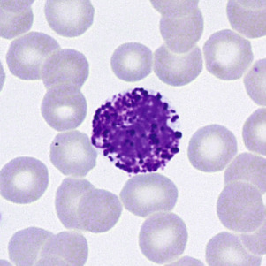

Figure 31-21 

Mature basophil with large dark red-purple basophilic granules that partially obscure the nucleus (Wright-Giemsa, 1000×). 

In contrast, **tissue mast cells** are connective tissue cells of mesenchymal origin that contain metachromatic cytoplasmic granules. They are widely distributed throughout the body, including bone marrow, thymus, and spleen, but they do not normally appear in blood. On Romanowsky-stained films ( [ Fig. 31-22 ](<#f0115>) ), they are usually larger than basophils and have a low N/C ratio and a round or oval reticular nucleus that is usually obscured by abundant red-purple granules. The granules are smaller, more round and regular, and less soluble than basophil granules. The cytoplasmic granules are often spindle-shaped rather than round. 

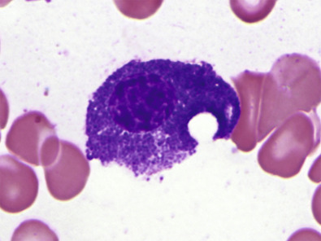

Figure 31-22 

Bone marrow mast cell shows numerous uniform purple granules in the cytoplasm that partially obscure the nucleus (Wright-Giemsa, 1000×). 

 

##  Distribution and Kinetics 

Basophils have a life span similar to eosinophils. The maturation time in the marrow is approximately 7 days. Basophils circulate in the blood and are not normally found in tissues, in contrast to mast cells, which can spend 9 to 18 months in connective tissue. GM-CSF, IL-3, and IL-5 influence basophil production. However, IL-3 is the principal growth factor for basophilic growth, whereas _c-kit_ ligand enhances the number and activation state of mast cells (Lyman, 1998). 

 

##  Function 

With regard to circulating numbers, basophils respond to adrenal corticosteroids in similar fashion to eosinophils. Basophil granules contain histamine, heparin, and peroxidase ( [ Box 31-4 ](<#b0025>) ). Basophils synthesize and store histamine and ECF-A. They synthesize and release slow-reacting substance of anaphylaxis (SRS-A) and probably PAF at the time of stimulation but do not store them. Basophils lack hydrolytic enzymes such as alkaline and acid phosphatase, at least in cytochemically demonstrable amounts. Glycogen is abundant outside the granules. Although ultrastructurally different, mast cells have similar cytochemical characteristics, except for the presence of proteolytic enzymes and serotonin, which basophils lack. In tissues, the two cell types appear to function in a similar manner. 

Box 31-4 

Basophil Constituents and Functions 

  * Basophil-specific granules 

    * Histamine 

    * Heparin 

    * Peroxidase 

    * Eosinophilic chemotactic factor A 

  * Other cellular constituents 

    * Slow-reacting substance of anaphylaxis 

    * Platelet-activating factor 

  * Basophil functions 

    * Immediate hypersensitivity reactions 

    * Some delayed hypersensitivity reactions 

Basophils (as well as mast cells) appear to be involved in immediate hypersensitivity reactions, such as allergic asthma. IgE binds readily to basophil and mast cell membranes. When a specific antigen reacts with the membrane-bound IgE, degranulation occurs with the release of mediators of immediate hypersensitivity (e.g., histamine, SRS-A, PAF, heparin, ECF-A). The latter leads to the accumulation of eosinophils, which contain substances that tend to counteract these mediators. Basophils are also involved in some delayed hypersensitivity reactions, or **cutaneous basophil hypersensitivity,** such as contact allergies, in which they appear to undergo a different type of degranulation response. 

,  

##  Monocytes and Macrophages 

Monocytes share the same committed progenitor cell as neutrophils, the CFU-GM (see [ Fig. 31-1 ](<#f0010>) ). 

 

##  Morphology 

In normal marrow, it is not possible morphologically to distinguish the “monoblast” from the myeloblast. The earliest recognizable cell in this series is the **promonocyte,** which is 15 to 20 µm in diameter—somewhat larger than the myeloblast. The N/C ratio is moderate, and the nucleus may be oval or indented with a fine uniform or slightly streaked chromatin pattern and two to five nucleoli. The cytoplasm is basophilic with a ground-glass appearance and a variable number of fine azurophilic granules ( [ Fig. 31-23 ](<#f0120>) ). The **monocyte,** which is present in both blood and marrow, is only slightly smaller; it has a moderate to low N/C ratio and an indented or lobed nucleus with a finely-streaked, only slightly condensed, delicate chromatin pattern. Nucleoli are indistinct or obscured. The cytoplasm is opaque, more gray than blue, and contains an abundance of fine azurophilic granules ( [ Fig. 31-24 ](<#f0125>) ). 

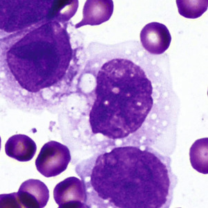

Figure 31-23 

Promonocytes have fine nuclear chromatin, often with visible folds and basophilic cytoplasm that may contain vacuoles (Wright-Giemsa, 1000×). 

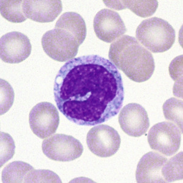

Figure 31-24 

Mature monocyte with an indented nucleus, delicate chromatin, basophilic cytoplasm, and fine azurophilic granules (Wright-Giemsa, 1000×). 

Macrophages, the tissue component of the monocyte system, arise from emigrated blood monocytes. Macrophages are larger than monocytes and measure 15 to 80 µm in diameter. They have irregular cell membranes, often with blebs and pseudopodia. The N/C ratio is high with an oblong and/or indented nucleus. Although macrophages are located in virtually all tissues of the body, the greatest numbers are found in the bowel, liver, bone marrow, and spleen. 

In promonocytes, monocytes, and macrophages, the granules ( [ Box 31-5 ](<#b0030>) ) contain acid hydrolase, arylsulfatase, nonspecific esterase, and peroxidase. More than one type of granule may be present. As the cell matures, peroxidase activity diminishes, and acid phosphatase, arylsulfatase, and nonspecific esterase activity increases. The enzyme activity occurs in the rough endoplasmic reticulum, Golgi zone, coated vesicles, and digestive vacuoles, suggesting that in the macrophages the coated vesicles are a second form of primary lysosome that shuttles hydrolytic enzymes from the Golgi to the digestive vacuoles. 

Box 31-5 

Monocyte/Macrophage Constituents and Functions 

  * Granules and other constituents 

    * Acid hydrolase 

    * Arylsulfatase 

    * Nonspecific esterase 

    * Peroxidase 

    * Acid phosphatase 

  * Monocyte/macrophage functions 

    * Phagocytosis—bacteria, cellular debris, senescent cells 

    * Antigen processing 

    * Cell-mediated immunity—antibody-dependent cellular cytotoxicity 

  * Synthesis of bioactive molecules 

In addition to these enzymes, monocytes and macrophages possess numerous surface receptors and surface antigens. Monocytes and macrophages possess class I (HLA-A, B, C) antigens and class II (HLA-DR, DP, DQ) gene complex molecules. The CD4 T cell antigen (molecule) not only is present on T-helper cells but is also present on monocytes and macrophages. Because the CD4 molecule acts as a receptor for the human immunodeficiency virus type-1 (HIV-1), the virus infects monocytes and macrophages along with T-helper cells. Monocytes and macrophages express CD11 (CD11a, b, c) antigens, markers that define surface adhesion glycoproteins. CD14, CD64, and CD68 antigens are also present on monocytes and macrophages. These surface molecules are often used to identify the lineage of mononuclear cells in hematologic malignancies. 

 

##  Distribution and Kinetics 

After promonocytes are formed, they respond to M-CSF and undergo two or three mitotic divisions in a period of about 50 to 60 hours before being released into the blood. Under conditions of increased demand, the cycle time can shorten, with earlier release of more immature cells into the blood. Blood monocytes are distributed in a circulating monocyte pool and a marginal monocyte pool, in a ratio of 1 : 3.5. Once monocytes enter the blood, they leave randomly with a half-time of 8.4 hours; this time period is shortened in splenomegaly or acute infection and may be prolonged in monocytosis. After monocytes leave the blood, they spend several months, perhaps longer, as tissue macrophages. 

 

##  Function 

The monocyte is formed in the marrow and transported by the blood; it migrates into the tissues, where it transforms into a histiocyte or a macrophage to spend most of its life span. Blood monocytes and tissue macrophages make up a mononuclear phagocyte system (reticuloendothelial system). 

The mononuclear phagocyte system has an important role in defense against microorganisms, including mycobacteria, fungi, bacteria, protozoa, and viruses (see [ Box 31-5 ](<#b0030>) ). The cells are motile and respond to chemotactic factors (complement components, as well as lymphokines and γ-interferon from activated T lymphocytes); they become immobilized by migration-inhibition factor from activated lymphocytes. They engage in phagocytosis, a process that is enhanced if the particle is coated by IgG or complement for which the macrophages have membrane receptors. After phagocytosis, they kill ingested microorganisms. 

These mononuclear phagocytes are an integral part of both humoral and cell-mediated immunity. They handle or process antigens, providing contact of the antigen (or antigenic information) with lymphocytes. They also respond to various lymphokines and monokines and act as effector (e.g., cytotoxic) cells in the cell-mediated immune response. Monocytes and macrophages function in antibody-dependent cellular cytotoxicity. They have the ability to kill a variety of malignant cells (  Weinberg, 2004  ) by promoting both cytostasis and cytolysis. Some of the ability of macrophages to destroy malignant cells may be attributed to the production of hydrogen peroxide (H  2  O  2  ), nitrous oxide (NO), and reactive oxygen intermediates. 

Macrophages remove and process senescent cells and debris through phagocytosis and digestion, for example, erythrocytes, leukocytes, and megakaryocyte nuclei are removed by macrophages in the marrow; inhaled particulate material is removed by alveolar macrophages in the lungs. 

Macrophages may be activated by specific factors (e.g., cytophilic antibody) or nonspecific factors (e.g., in response to phagocytosed material). Activation results in enlargement of the cell and enhanced metabolism, phagocytosis, microbicidal activity, cytotoxicity, secretion of cytolytic proteins (including TNF-α), and the like. 

Macrophages synthesize and secrete a large number of biologically active molecules, including enzymes, complement components, binding proteins, coagulation factors, cytokines and growth factors, chemotactic factors, angiogenesis factors, and bioactive lipids. This system, therefore, has multiple functions that include host defense, control of hematopoiesis, and policing of the environment within the body (  Johnston, 1988  ). 

,  

##  Megakaryocytes 

Platelets originate from polyploid megakaryocytes, the largest of all hematopoietic cells, which account for less than 1% of the total nucleated marrow cells. Megakaryocytes arise from the multipotential hematopoietic stem cell, and then from a committed progenitor cell, the CFU-Meg (see [ Fig. 31-1 ](<#f0010>) ). Megakaryocyte proliferation is largely regulated by thrombopoietin. Additional growth factors, including kit-ligand, IL-3, IL-6, and IL-11, support megakaryocytic development in the presence of thrombopoietin (  Kaushansky, 1995  ). Serum thrombopoietin levels are generally inversely proportional to platelet count; however, levels are elevated in liver disease and inflammatory states, probably through hepatocyte or marrow stromal cell responses (  Kaushansky, 2003  ). 

 

##  Morphology 

Committed progenitor cells are not morphologically distinguishable from lymphocytes. Megakaryocyte development is characterized by **endomitosis,** nuclear division without cytoplasmic division, which results in ploidies varying from 2N to 64N. Most are 8N and 16N, with smaller numbers on either side. Nuclear lobes do not correlate precisely with ploidy. Nuclear chromatin is intensely staining, rather dispersed early, and more compact and dense later. Nucleoli are small at all stages of megakaryocyte development. 

The earliest recognizable **megakaryoblast** has overlapping nuclear lobes and a small amount of basophilic cytoplasm. During the course of maturation, nuclear lobes increase and spread out, and red-pink granules become visible, first in the center of the cell. In the **mature megakaryocyte,** the nucleus is more compact, basophilia has disappeared, and the granules are clustered into small aggregates ( [ Fig. 31-25 ](<#f0130>) ). 

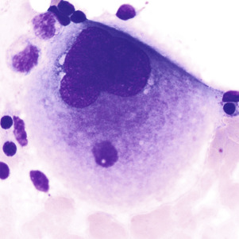

Figure 31-25 

Megakaryocyte with a large, lobated nucleus and abundant granular cytoplasm (Wright-Giemsa, 1000×). 

The formation of individual platelets is a complex process. Megakaryocytes develop invaginated surface membranes (demarcation membranes) that provide a membrane reserve for proplatelet formation (  Italiano & Shivdasani, 2003  ). Proplatelets are pseudopodial extensions of megakaryocytes that progressively branch and thin out. Microtubular action is important in the formation of proplatelets and in bringing granule and organelle constituents into the proplatelets. Platelets are formed at the ends of proplatelets and are released by microtubular action (  Hartwig & Italiano, 2003  ). 

 

##  Megakaryocytes in Blood 

Whole megakaryocytes or fragments may occasionally be found in normal blood films. If buffy coat films are examined, they are consistently present. Megakaryocyte fragments in blood films may be as small as lymphocytes and are recognized by the deeply stained chromatin (with a sharper chromatin-parachromatin separation than in lymphocyte nuclei) and by fragments of attached megakaryocyte cytoplasm. They are found more frequently than normal in myelophthisic processes and myeloproliferative neoplasms, or after stress or injury to the marrow. 

Dwarf or micromegakaryocytes ( [ Fig. 31-26 ](<#f0135>) ) show evidence of abnormal megakaryopoiesis: agranular cytoplasm with hyaloplasmic zones or pseudopods, and association with large atypical platelets having similar cytoplasmic characteristics. These abnormal dwarf megakaryocytes are rarely found in any condition except myeloproliferative neoplasms or myelodysplastic syndromes. 

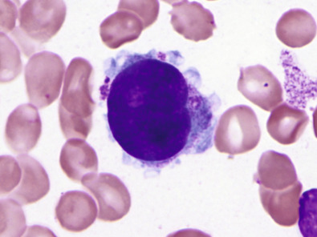

Figure 31-26 

Dwarf megakaryocyte with bilobed nucleus and scant granular cytoplasm; a few giant platelets are also seen. 

These cells are most often associated with myeloproliferative neoplasms or myelodysplastic syndromes (Wright-Giemsa, 1000×). 

 

##  Distribution and Kinetics 

The maturation time for megakaryocytes in the marrow is about 5 days in humans. Platelets are released into the marrow sinuses over a period of several hours (  Hartwig & Italiano, 2003  ), and the megakaryocyte nuclei are phagocytosed by macrophages. Newly released platelets appear larger, more active metabolically, and more effective hemostatically. Platelets circulate at a stable concentration that averages 275 × 10  9  /L. At any one time, about two thirds of the total platelets are in the circulation, and the remaining one third are present in the spleen. In asplenic individuals, all platelets are circulating. In diseases characterized by splenic enlargement, 80% to 90% of platelets may be sequestered in the spleen, resulting in decreased concentrations of circulating platelets (thrombocytopenia). 

Platelets survive for 8 to 11 days in the circulation. Some platelets are utilized in maintaining vascular integrity and in plugging small vascular injuries (random loss); others are removed by the mononuclear phagocytic system when they become senescent. 

 

##  Function 

Platelets normally function in (1) maintaining the integrity of blood vessels, and (2) forming hemostatic plugs to stop blood loss from injured vessels and, in the process, promoting coagulation of plasma factors. 

,  

##  Lymphocytes 

 

##  Primary Lymphoid Tissue 

During fetal life, lymphocyte precursors originate in the bone marrow and undergo antigen-independent lineage commitment. Maturation and selection of T cells occur primarily in the thymus, and of B cells, in the marrow and peripheral lymphoid organs. The T cell population is largely self-renewable following thymic involution. B cells are capable of only limited self-renewal. They are dependent on recruitment from marrow stem cells to replenish programmed B cells and plasma cells that are incapable of self-renewal. 

 

##  B Cell Development: Bone Marrow 

A distinct organ, the bursa of Fabricius, is present in birds and serves as the primary site of B cell development, thus the term _B cell_ for bursa cells ( [ Table 31-1 ](<#t0015>) ). In the human, B cells develop in the bone marrow after the hematopoietic stem cells have populated that organ. During adult life, generation of B cells occurs in the bone marrow. 

TABLE 31-1 

Key Cell Surface Markers in Lymphocyte Development 

Cell Name  |  CD Markers   
---|---  
Progenitor B cell  |  CD19, TdT, CD79a, HLA-DR   
Pre–B cell  |  CD19, TdT, CD10, CD20, cytoplasmic µ  
Naïve mature B cell  |  CD19, CD20, Bcl-2, surface IgM   
Germinal center B cell  |  CD19, CD20, CD10, Bcl-6   
Mature B cells (peripheral blood)  |  CD19, CD20, CD21, CD22, CD24, CD38   
Plasma cells  |  CD38, CD138, cytoplasmic Ig   
  
B cell differentiation can be divided conveniently into two stages. The initial stage of B cell differentiation involves the antigen-independent generation of diversity through rearrangement of the Ig heavy and light chain genes. The second stage is regulated by antigen triggering, T cell interaction, macrophages, and various growth factors ( [ Fig. 31-27 ](<#f0140>) ). This stage occurs predominantly in the secondary lymphoid organs (  LeBien & Tedder, 2008  ). 

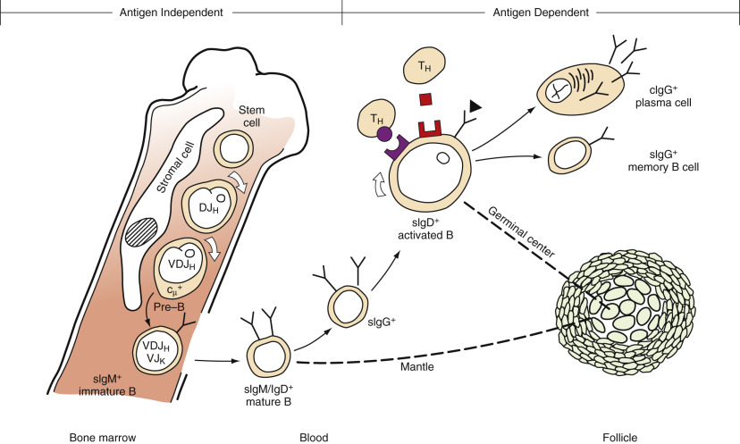

Figure 31-27 

Differentiation of pre–B cells into B cells occurs independently of antigen, whereas proliferation and terminal differentiation of B cells are antigen driven. 

Hematopoietic stem cells with stromal cell help give rise to pre-B cells. These proliferate _(open arrow denotes cell cycling),_ rearrange _DJ_ and _VDJ_ gene segments, and then express µ chains in the cytoplasm (cµ \+  ). A small, resting pre–B cell _(not shown)_ with rearranged _VJk_ gene assembles a complete lgMk molecule, becoming an immature B cell and leaving the bone marrow. Expression of sIgD marks entry of the cell into the mature, resting phase (or G  0  ) characteristic of most blood and mantle zone B cells. Switching to an alternative isotype (IgG in this case) may occur before an encounter with antigen or afterward. Antigen triggers the resting B cell to enlarge (in the G  1  phase of the cell cycle) and present processed antigen and DR to the antigen-specific T cell receptor–CD3 complex. T-helper cells (T  H  ) secrete growth factors that bind to newly expressed receptor, further enhancing proliferation (S and M phases) in germinal centers. The activated B cell can be induced to differentiate into plasma cells, which secrete their abundant cytoplasmic IgG. Alternatively, it can become a memory B cell with refined specificity poised to deliver an anamnestic immune response on its next encounter with antigen. _IgG,_ Immunoglobulin G. 

(From Bertoli LF, Burrows PD: Normal B-lineage cells: their differentiation and identification, _Clin Lab Med_ 8:15, 1988, with permission.) 

A progenitor cell gives rise to the first recognizable B cell in humans and mammals. This cell in humans is the pro-B (progenitor) cell that is characterized by receptor CD19 and terminal deoxynucleotidyl transferase (TdT) but contains no cytoplasmic or surface bound Ig (  Hagman & Grosschedl, 1994  ). Differentiation of pro-B cells requires Ig gene rearrangement, induced by recombination enzymes (RAG1 and RAG2) and TdT, and triggered by pre–B cell antigen receptor (pre-BCR) as well as other signaling molecules and transcription factors, leading to a functional BCR (  Ichii et al, 2014  ). Proliferation and survival of B cell progenitors depends on bone marrow stroma–derived IL-7 signaling through the IL-7 receptor (IL-7R) to JAK1 and JAK3, and activation of STAT5 and STAT3. This also involves signaling of the PI3k-Akt pathway, FOXO1, and cyclins D2 and D3 (  Clark et al, 2014  ). The pre-B cell is characterized by the presence of intracytoplasmic µ heavy chains with no surface-bound immunoglobulin (sIg  − cµ \+  ). It also contains HLA-DR antigens, CD19, CD79a, and other surface markers. 

In becoming a pre–B cell, a lymphoid stem cell undergoes _DJ_ and _VDJ_ gene segment rearrangement to form a functional _V_ gene for the µ heavy chain ( [ Fig. 31-28 ](<#f0145>) ). A productive heavy chain gene rearrangement is then followed by a rearrangement of the _VJ_ gene segment of the light chain. Rearrangement of the κ light chain gene on chromosome 2 occurs first. If the κ rearrangements at both loci are nonproductive, rearrangement of the λ light chain gene on chromosome 22 follows. Only one productive _VH_ and _VL_ gene emerges, limiting each B cell to one unique antibody structure (  Bertoli & Burrows, 1988  ). The pre-B cell generates an intact Ig molecule and expresses surface IgM. Isotype switching (e.g., changing from IgM/IgD to IgG1) and constant heavy gene deletions occur in pre–B cells and more differentiated B cells. Switching occurs by the formation of a DNA loop in which all intervening constant heavy genes are deleted ( [ Fig. 31-29 ](<#f0150>) ). IgD can be coexpressed with IgM through alternative RNA processing. 

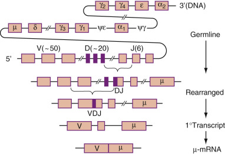

Figure 31-28 

Generation of a functional _Ig_ gene requires DNA rearrangement. 

In the germline and in somatic nonlymphoid cells, _V, D,_ and _J_ gene segments are widely separated in the DNA of chromosome 14. A cell committed to the B lineage first undergoes D to J rearrangement, juxtaposing the D and J segments and deleting intervening DNA sequences. This is followed by V to DJ rearrangement, generating a complete VDJ exon. The primary RNA transcript is processed to yield a contiguous V (VDJ) mRNA. _DNA,_ Deoxyribonucleic acid; _Ig,_ immunoglobulin. 

(From Bertoli LF, Burrows PD: Normal B-lineage cells: their differentiation and identification, _Clin Lab Med_ 8:15, 1988, with permission.) 

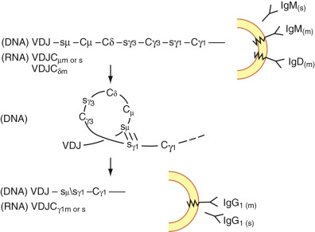

Figure 31-29 

Alternative strategies for expression of non-IgM isotypes. 

IgD can be coexpressed with IgM, by alternative processing of a primary RNA transcript of VDJ-Cµ-Cδ, to yield µ membrane (m), µ secretory (s), and δm RNAs. The production of IgG, IgA, or IgE isotypes involves DNA rearrangement. During the switch from IgM to IgG, for example, intrachromosomal recombination between homologous switch (s) regions results in deletions of C  µ , C  δ , and C  γ3  , so that C  γ1  is now the first _C_ gene 3′ of the VDJ exon. Thus, the same variable region is expressed with a different constant region. _Ig,_ Immunoglobulin _; RNA,_ ribonucleic acid. 

(From Bertoli LF, Burrows PD: Normal B-lineage cells: their differentiation and identification, _Clin Lab Med_ 8:15, 1988, with permission.) 

IgM/IgD coexpressing mature B cells were first described in chronic lymphocytic leukemia, in which both antigen receptors were shown to have the same idiotype specificity (  Fu et al, 1974  ). Similar cells were later found in human fetal spleens and also express CD5 (  Antin, 1986  ). These are frequently referred to as _virgin_ or _na ïve _ B cells and lack expression of CD27, a TNF receptor family member (  Klein et al, 1998  ). Naïve B cells (IgD+/CD27-) are frequent in the blood, although most lack CD5. After antigen activation in the presence of T cells and macrophages, they are recruited into germinal centers, where they undergo somatic hypermutation. Maturation and expansion of antigen-specific mature B cells is orchestrated in a complex manor by Bcl-6 (  Basso et al, 2010  ). Germinal center B cells express Bcl-6 and CD10 and are polymorphic in terms of size and nuclear outlines. 

Eventually, high-affinity B cells are selected and differentiate into plasma cells or memory B cells. Memory B cells express CD27 and either IgM or another heavy chain (rarely IgD alone), and some show IgM/IgD/CD27 coexpression (  Klein et al, 1998  ). Memory B cells also express CD45RA (isoform of CD45) and a specific epitope (MEM55) of CD45RB, while naïve B cells express CD45RO (  Muraro et al, 2000  ;  Koethe et al, 2011  ). 

Plasma cells are characterized by abundant cytoplasmic Ig and expression of CD38 and CD138. They express either IgM, IgG, or IgA. 

 

##  T Cell Development: Thymus 

The microenvironment of the thymus is necessary for the differentiation of T cells ( [ Table 31-2 ](<#t0020>) ). The human thymus has two parts: the cortex and the medulla. The cortex is subdivided into two portions—the subcapsular cortex and the inner cortex—and is populated predominantly by small lymphocytes with a few scattered epithelial cells. Fibrous septa extend from the capsule to the medullary region. The medulla is composed mostly of epithelial cells with a small component of lymphocytes. In the medulla, Hassall's corpuscles, small islands of partially hyalinized epithelial cells, are present. 

TABLE 31-2 

Summary of T Cell Maturation 

Stage  |  Maturation Events  |  Cell Surface Markers   
---|---|---  
Pro-T cell  |  Migration from marrow to thymic cortex  |  CD2, CD44   
α/β Pre–T cell  |  Migration from thymic cortex to medulla, elimination of self-recognizing T cells, α/β TCR rearrangement (for T cells destined for the helper or suppressor subset)  |  TdT, CD1, CD2, CD3, CD4, CD5, CD7, CD8   
γ/δ Pre–T cell  |  Migration from thymic cortex to medulla, elimination of self-recognizing T cells, γ/δ TCR rearrangement (for T cells destined for the cytotoxic subset)  |  TdT, CD1, CD2, CD3, CD7   
Mature T cell  |  Loss of ability to make TdT, circulation in peripheral blood as helper, suppressor, or cytotoxic subset  |  Helper T: CD2, CD3, CD4, CD5, CD7   
Suppressor T: CD2, CD3, CD5, CD7, CD8   
Cytotoxic T: CD2, CD3, CD7   
  
Pro–T cells from the bone marrow or fetal liver migrate to the thymus, where they undergo T cell receptor (TCR) gene rearrangement and are processed into functionally mature T cells for circulation in the blood and to the peripheral or secondary lymphoid tissues. 

TCR genes are organized in a similar manner to Ig genes. They possess V, D, J, and C regions and undergo rearrangement during early T cell maturation. In addition to the heterodimeric glycoproteins (α/β or γ/δ), the TCR/CD3 complex also contains CD3–-epsilon, -zeta, and -eta subunits (  Blumberg et al, 1990  ). The TCR recognizes foreign peptides held in an association with self-MHC molecules. In early T cell development, the γ\- and β-chain genes rearrange simultaneously, with TCR commitment dependent on expression of surrogate α-chain and development of a pre-TCR (  Haks et al, 1998  ;  Kang et al, 2001  ). Successful passage of thymocytes with β-chain–containing pre-TCR through a developmental checkpoint is followed by rearrangement of the TCR α-chain and formation of α/β T cells. During this process, developing T cells first coexpress both CD4 and CD8 (double positive cells), with subsequent downregulation of one or the other. In the thymic medulla, pre–T cells lose the ability to make TdT as they convert to mature T cells and then circulate in the blood and peripheral lymphoid tissues. Initially, pro–T cells migrate from the bone marrow or the fetal liver to the cortex of the thymus. Pro–T cells migrate from the subcapsular cortex to the inner cortex and then to the thymic medulla (see [ Table 31-2 ](<#t0020>) ). 

Monoclonal antibodies against functional epitopes on thymic cells were first used by Reinherz, Sclossman, and others to describe a distinct T cell maturation pattern that is now well known (  Reinherz et al, 1980  ). T-lymphoblasts mature to common (cortical) thymocytes, then to medullary thymocytes, and finally to mature peripheral T cells of CD4 or CD8 phenotype. 

Cells that express high levels of CD34 are double negative for CD4 and CD8, and as CD34 expression diminishes, CD4 and CD8 emerge together and then alone, while CD1 and CD10 also become expressed (  Terstappen et al, 1992  ). Surface CD3 also arises. 

A majority of postthymic (peripheral) T cells express α/β TCR; a small minority do not, but rather express γ/δ chains. NK cells express only ε chains with cytoplasmic CD3. Mature T cells are of at least three types. CD4 (helper) T cells possess α/β TCR chains and express CD2, CD3, CD4, CD5, and CD7 cell markers. CD8 (suppressor or cytolytic) T cells have α/β TCR chains and express CD2, CD3, CD5, CD7, and CD8 cell markers. Mature T cells with γ/δ TCR chains exhibit CD2, CD3, and CD7, lack CD4 and CD8, and function as cytotoxic cells. 

CD4 T cells can develop into at least four subgroups with different functions (  Zhu & Paul, 2008  ). Th1 cells produce interferon (IFN)-γ, TNF-β, and IL-2 and mediate an immune response against intracellular pathogens. Th2 cells produce IL-4 and IL-5 and are important in defense against extracellular parasites. Th17 cells produce IL-17, IL-21, and IL-22 and mediate immune responses against extracellular bacteria and fungi. Induced regulatory T (iTreg) cells produce TGF-β, IL-10, and IL-35 and are involved in maintaining self-tolerance and regulating immune responses. Antigen-independent development of T cells is controlled by interaction with thymic epithelial cells and thymic fibroblasts, as well as by the influences of cytokines, growth factors, and thymic hormones. IL-1, IL-2, IL-3, IL-4, IL-7, and SCF are critical in the growth and differentiation of thymic lymphocytes. Thymic hormones produced by thymic epithelial cells also induce T cell function. 

In the T-zone area of the peripheral lymphoid system, the T cell antigen–dependent pathway occurs through the binding of the TCRs to antigen peptides associated with appropriate MHC I and MHC II molecules on macrophages or interdigitating dendritic cells (IDCs). This results in the release of IL-1 by the activated macrophages, which, in turn, leads to the formation of IL-2 receptors on T cells and the subsequent synthesis and release of IL-2 by these activated T cells. In this activation process, many other cytokines (including IL-4, IL-6, IL-10, TNF, and interferon) are released, and appropriate cytokine receptors are upregulated. These events result in the activation and maturation of T-helper cells, T-suppressor cells, T-cytotoxic cells, and other immunoregulatory cells. This activation process not only increases the number of antigen-specific T cells, it also alters the immunophenotype and changes the expression of certain adhesion molecules on T cells. For example, LFA-1 (a heterodimer formed from CD11a and CD18) and VLA-4 (a heterodimer of CD29 and CD49d, CD44, and CD2) are upregulated, and  l  -selectin (CD62L) is downregulated. Changes in the expression of adhesion markers allow for the proper circulation of T cells in the body. 

 

##  Natural Killer Cells: Bone Marrow 

Immunophenotypic and functional data suggest that NK cells and T cells have a close developmental relationship. Expression of CD3 proteins has been found in human fetal NK cells. Thus, it is likely that NK cells and T cells have a common precursor cell. Although NK cells can develop in the thymus, the thymic environment is not required for NK cell differentiation. NK cells can develop in secondary lymphoid tissues and bone marrow (  Caligiuri, 2008  ). Fetal NK cells possess CD3γ, δ, ε, and CD28; adult NK cells express CD2, CD3ξ, CD7, CD8α, CD16, and CD56. SCF, IL-7, and IL-2 are critical in the development of NK cells (  Spits et al, 1995  ). NK cells proliferate in the presence of IL-2, and their activity can be augmented by exposure to IFN-γ. NK cells appear to be targeted against virus-infected cells unable to signal cytotoxic T cells (usually as a result of low expression of class I MHC molecules). Because NK cells possess the Fc portion of IgG, they participate in antibody-dependent cell lysis (MacLennan, 1999). 

 

##  Secondary Lymphoid Tissue 

In late fetal and postnatal life, lymphocytes are produced in the secondary lymphoid tissue: spleen, lymph nodes, and intestine. Lymphocytes of the secondary lymphoid organs are progeny from stem cells that have been influenced by primary lymphoid organs. The secondary lymphoid organs are thus composed of a mixture of B cells and T cells. Lymphopoiesis in secondary lymphoid organs depends solely on antigenic stimulation. B cells and T cells tend to localize in anatomically distinct parts of the lymphoid tissues, where proliferation can take place. 

 

##  Lymphocyte Function and Physiology 

T cells and their progeny function in cell-mediated immunity, which includes delayed hypersensitivity, graft rejection, graft-versus-host reactions, defense against intracellular organisms (such as tubercle bacillus and _Brucella_ ), and defense against neoplasms. B cells and their progeny perform in humoral immunity, or in the production of antibodies, either as a lymphocyte or after transformation into a plasma cell. 

A majority of circulating lymphocytes are T cells that have a life span of months to years. The B cells are a minor population (10% to 20% of the lymphocytes), probably have a short life span measured in days (with the exception of memory B cells), and are distinguished by the presence of considerable Ig on their surface membranes. 

Lymphocytes circulate in the blood and home to appropriate lymphoid organs. During fetal development, lymphocytes migrate from fetal liver to bone marrow or thymus. Later, pro–T cells migrate from the bone marrow to the thymus, and immature B cells home to secondary lymphoid tissues. After thymic processing, virgin T cells also home to specific areas in the peripheral lymphoid tissues. The circulation of lymphocytes is regulated by multiple cell surface adhesion molecules and chemokines, including integrins, selectins, and leukocyte (L) selectin. The circulation and homing of lymphocytes is a very complex, multistep phenomenon, reviewed elsewhere (  Springer, 1994  ;  Paraskevas, 2014  ). However, in the postcapillary venule of lymphoid tissue, the lymphocyte travels from the blood through the endothelium and into the lymphoid tissue, where it may stay or percolate through and return to the blood via the thoracic duct lymph. Small lymphocytes ( [ Fig. 31-30 ](<#f0155>) ) have little cytoplasm and, in electron micrographs, few organelles and relatively little RNA. After antigenic stimulation, small lymphocytes (B cells or T cells, depending on the nature of the antigen) become activated, increase their RNA synthesis, and undergo blast transformation. On Romanowsky-stained films, these blasts are large cells (15 to 25 µm) with abundant, rather deep blue cytoplasm, a large reticular nucleus with uniform chromatin, and prominent nucleoli. This cell is called the **reticular lymphocyte** (nonleukemic lymphoblast; **immunoblast** ). If the blasts are derived from B cells, the new lymphocytes function in the production of antibodies (B cells, plasma cells); if the blasts are derived from T cells, the progeny act in cellular immune response. The latter is mediated by several soluble factors produced by the activated T cell, including IL-2, which induces the proliferation of T cells; IL-3, which is a multipotential colony-stimulating factor; IL-4, which promotes the proliferation of B cells; IL-5, which enhances the proliferation of eosinophils as well as B cells; IL-6, which promotes differentiation of B cells; lymphotoxin, which is directly toxic to cells; and migratory inhibitory factor, which promotes adherence of macrophages and keeps them at the site. Atypical lymphocytes ( [ Fig. 31-31 ](<#f0160>) ) are seen in certain viral infections such as infectious mononucleosis. These cells have large nuclei with fine chromatin and more abundant cytoplasm that often scallops around adjacent red blood cells. Large granular lymphocytes ( [ Fig. 31-32 ](<#f0165>) ) contain azurophilic granules in their cytoplasm; these cells most often represent cytotoxic T cells or natural killer cells. 

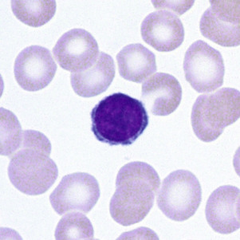

Figure 31-30 

Small lymphocyte with high nuclear/cytoplasmic ratio, condensed chromatin, and scant basophilic cytoplasm (Wright-Giemsa, 1000×). 

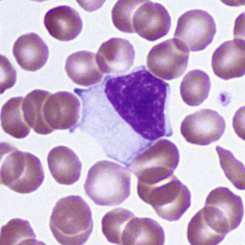

Figure 31-31 

Atypical lymphocyte with a large nucleus, finer chromatin, and abundant basophilic cytoplasm scalloping around adjacent red blood cells (Wright-Giemsa, 1000×). 

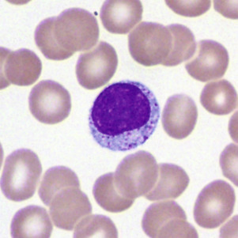

Figure 31-32 

Large granular lymphocyte with azurophilic cytoplasmic granules (Wright-Giemsa, 1000×). 

**Plasma cells** have abundant blue cytoplasm, often with light streaks or vacuoles, an eccentric round nucleus, and a well-defined clear (Golgi) zone adjacent to the nucleus. The nucleus of the plasma cell has heavily clumped chromatin, which is sharply defined from the parachromatin and is often arranged in a radial or wheel-like pattern ( [ Fig. 31-33 ](<#f0170>) ). 

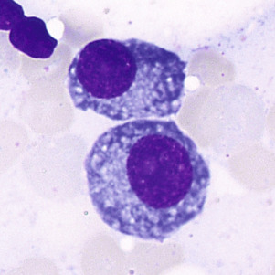

Figure 31-33 

Plasma cells with an abundant basophilic cytoplasm, eccentric nucleus, and perinuclear clear Golgi zone (Wright-Giemsa, 1000×). 

,,
