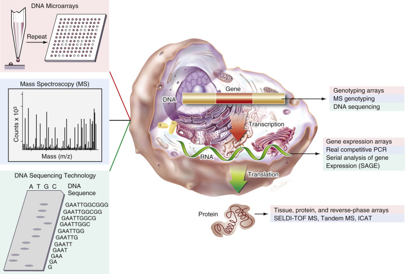
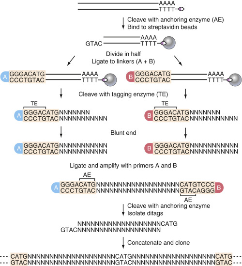
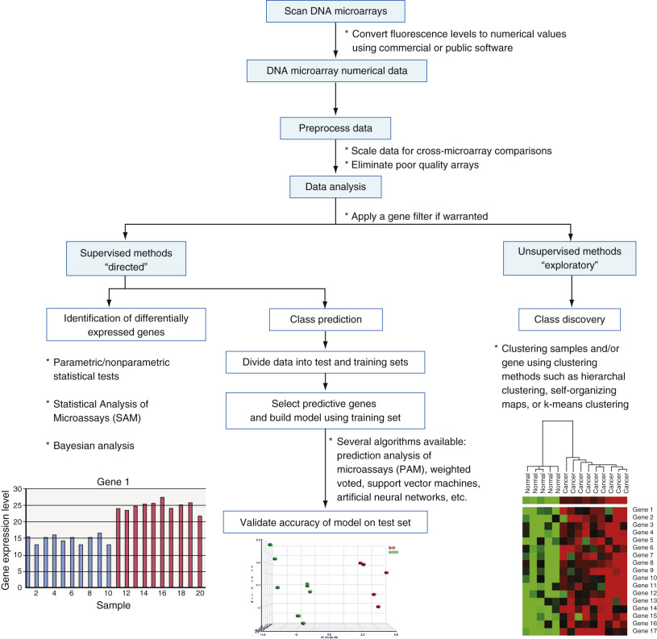
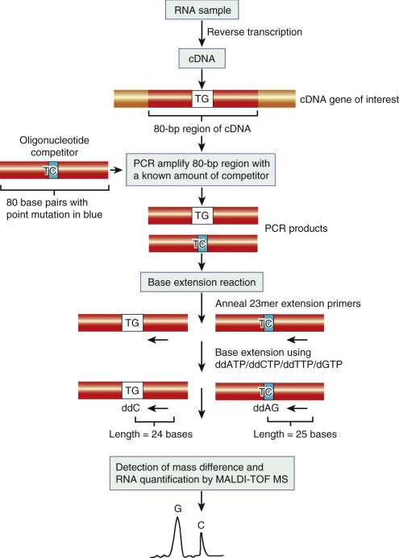
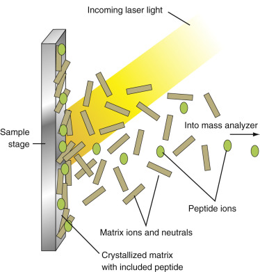
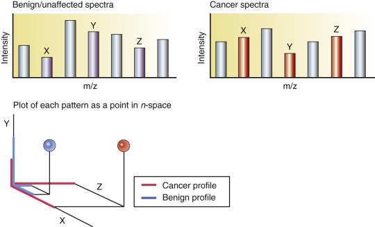

## Key Points

  * •

Completion of the human genome project has provided scientists with a detailed map of the human genome and predicted coding regions that have facilitated the emergence of high-throughput genomic and proteomic technologies. 

  * •

A number of mature platforms exist for high-throughput profiling of gene expression in human tissue, including serial analysis of gene expression (SAGE), DNA microarrays, and real competitive polymerase chain reaction. 

  * •

Proteomic technologies, including mass spectrometry and protein arrays, have begun to explore the dynamic and complex protein composition of healthy and diseased human tissue. 

  * •

DNA microarray and SAGE technologies have identified diagnostic gene-expression signatures for a number of hematologic and solid malignancies that are often difficult to distinguish using traditional histologic analysis. 

  * •

Prognostic gene and protein expression profiles have been identified in a large number of cancer settings, including lymphoma, lung cancer, breast cancer, and acute myeloid leukemia, among others. 

  * •

Validation in large clinical trials, standardization of techniques and controls, and inclusion of analytic standards are needed before widespread clinical implementation of these technologies can be achieved. 

,  

##  Overview 

With the complete sequence of human and other genomes recently elucidated, we have witnessed an explosion of information and high-throughput tools that are profoundly altering biomedical research and the culture of science. This revolution, which began in the mid-1980s, emerged from developments in three areas: 1) molecular biology, most notably, breakthroughs in rapid DNA sequencing; 2) information technology, in particular, the ability to store and analyze unprecedented quantities of data; and, most important, 3) progress in human genetics, especially the identification of thousands of single-gene human disorders. The convergence of these technological and scientific advances raises promise for the rapid identification of disease-related genes, leading to improved diagnostic tests and more effective therapies. 

Detailed maps of human and other genomes provide the information needed to chart a course toward understanding and treating many diseases, but this course remains a long and difficult one. Although progress will come most readily for disorders following Mendelian patterns of inheritance, even these disorders will pose significant difficulties. For example, although the biology and genetics of sickle cell anemia have been reasonably well understood for more than half a century—a single valine replaces glutamic acid at position 6 in the β-hemoglobin chain—effective treatment has been slow to develop. The penetrance of genetic diseases thought to be due to single mutations often relies on more complex interactions between the mutation and a variety of concurrent gene polymorphisms, such as those seen in the genes encoding surface proteins on postcapillary venule endothelial cells, which, in part, account for sickle cell disease severity. 

Many common diseases, in particular, cardiovascular disease, mental illness, and almost all cancers, stem from multigenic causes. In addition, these diseases invariably have strong environmental components, presenting a substantial challenge to the development of effective and economical diagnostic and prognostic tests. Even in the absence of a confounding environmental influence, linking the quantifiable phenotype of a disease to a set of distinct alleles is a complex undertaking. Further complicating matters, many disorders do not have sharply defined, quantifiable phenotypes. 

In a chapter filled with information on promising technologies, we make these sobering remarks to emphasize that greater understanding never guarantees cures or therapies. However, greater understanding does aid the development of rational strategies to detect and control disease. The reference genome allows us to rapidly characterize polymorphisms across the human population; it also enables molecular fingerprinting technologies that permit identification of the precursors and consequences of normal and pathologic changes in gene and protein expression. We can feel confident that the power of genomic technologies is well beyond anything previously available, and that it will make possible during the next several decades a host of new diagnostics and therapeutics for cancer and other common diseases, profoundly altering the practice of medicine. As discussed in [ Chapter 73 ](<##!/content/3-s2.0-B9780323295680000735?scrollTo=%23c00073>) , genomic technologies have already made an impact in the area of pharmacogenomics, in which drug protocols are being designed from the cytochrome P450 genetic profiles of patients, allowing for maximally effective therapeutic regimens for each patient. 

This chapter focuses on several high-throughput genomic and proteomic technologies that have the potential to influence disease classification and prognostication ( [ Fig. 78-1 ](<#f0010>) ). These molecular tools have affected virtually all forms of human pathology; however, given the public health implications and the preponderance of recent publications in the field, we will concentrate on diagnostic and prognostic applications related to cancer, although we will mention other salient disease states where applicable. After presenting a brief overview of the human genome project and resultant high-throughput technologies, we will discuss examples of applications in the setting of several hematologic and solid malignancies. The scope of the chapter has been constrained to focus on high-throughput technologies; therefore, this chapter does not represent a comprehensive overview of all technologies being used in clinical genomic and proteomic studies. In addition, among the technologies presented, some are highlighted in greater detail because of their widespread use. As more data are produced using these technologies, strategies combining data sets may become powerful approaches to developing accurate clinical tools. Along with measuring gene and protein expression levels, understanding human genetic variation in DNA will be important in elucidating disease markers and mechanisms. A discussion of high-throughput genotyping technologies to assay single-nucleotide polymorphisms is, however, beyond the scope of this chapter (for reviews, see  Syvanen, 2001  ;  Ding & Jin, 2009  ). 

Figure 78-1 

High-throughput platforms and the central dogma of biology. 

The three major technologies responsible for rapid analysis of biological systems include mass spectrometry, sequencing, and microarrays. Examples of each technology have been listed as applied to each broad stage of biological information, that is, DNA, RNA, and protein. _ICAT,_ Isotope-coded affinity tags; _MS,_ mass spectroscopy; _SELDI-TOF-MS,_ surface-enhanced laser desorption ionization, time-of-flight mass spectroscopy. 

(Adapted with permission from Kufe DW, Holland JF: _Cancer medicine,_ ed 6, Hamilton, Ontario, 2003, BC Decker; Wilson J, Hunt T: _Molecular biology of the cell,_ ed 4, New York, 2003, Garland Science; Brown TA: _Genomes,_ ed 2, New York, 2002, John Wiley & Sons.) 

,  

##  The Human Genome Project 

 

##  Public Sequencing Effort (Hierarchical Shotgun Sequencing) 

Sequencing of the human genome was a 15-year, $3 billion project, initiated in 1990 as a joint effort between the U.S. Department of Energy and the National Institutes of Health (  Collins et al, 2003  ). From the time of the project's inception through 1995, genetic and physical maps of human and mouse genomes were constructed, and yeast and worm genomes were sequenced. These initial projects, coupled with advances in sequencing technology and sequence data analysis, outlined cost-effective strategies and techniques, while demonstrating the feasibility of sequencing the human genome. In March 1999, the effort to sequence the human genome commenced in earnest, and sequencing was set to be completed in two phases: the first phase would include completion of a draft sequence, and the second would be a finishing phase for resolution of misassembled regions and filling in of sequence gaps. By June 2000, centers involved in the project were producing raw sequence data at a rate of about 1000 nucleotides per second, 24 hours a day, 7 days a week (  Lander et al, 2001  ). 

The first phase of the Human Genome Project, a collaborative endeavor of 20 groups in six countries, was completed and published in February 2001 in the journal _Nature_ (  Genome International Sequencing Consortium, 2001  ;  Lander et al, 2001  ). The draft sequence covered about 96% of the euchromatic part (gene-rich) of the human genome and 94% of the entire genome, with an average of fourfold coverage (i.e., each base sequenced an average of four times). The International Human Genome Sequencing Consortium employed a sequencing strategy referred to as _hierarchical shotgun sequencing_ (also known as _map-based, bacterial artificial chromosome (BAC)-based,_ or _clone-by-clone sequencing_ ) (  Olson, 2001  ). Genomic DNA obtained from volunteers from a variety of racial and ethnic backgrounds was partially digested with restriction endonucleases. Fragments of 1 to 2 Mb in length were cloned into BACs. Eight DNA libraries containing overlapping insert clones were created, representing 65-fold coverage of the genome (each base is represented on average 65 times, as seen on examination of all eight libraries). 

BACs containing fragments of the human genome are inserted into bacteria and are replicated as the bacteria grow and divide. Each BAC clone is completely digested with a restriction enzyme to produce a unique pattern of DNA fragments, known as a _fingerprint_ . The fingerprints from different BAC clones can be compared to allow selection of a set of overlapping BAC clones that cover a portion of the genome (a large region of the genome covered by overlapping clones is called a _contig_ ). Contigs can be positioned along the chromosome by using known markers from previously constructed genetic and physical maps of the human genome. Selected BAC clones are sheared into smaller overlapping fragments, subcloned, and sequenced. Subcloning is necessary because each sequencing reaction can reliably read only about 500 base pairs (bp). The sequence of the BAC clone can be reconstructed from the set of sequences obtained from the subclones, and BAC fingerprints guide the assembly of several BAC clones into contigs. 

Draft sequences were required to obtain an average of fourfold coverage with 99% accuracy as determined by software (i.e., PHRED, PHRAP; CodonCode Corporation, Dedham, Mass.) that assigns base quality scores and assembles sequences according to the scores. Throughout the duration of the project, sequences longer than 2 kb were required to be deposited in public databases within 24 hours (data are available from the Genome Browser of the University of California at Santa Cruz, [ www.genome.ucsc.edu ](<http://www.genome.ucsc.edu>) ; the GenBank of the National Center for Biotechnology Information, [ http://www.ncbi.nlm.nih.gov/genbank/ ](<http://www.ncbi.nlm.nih.gov/genbank/>) ; and Ensembl of the European Bioinformatics Institute and the Sanger Centre, [ www.ensembl.org ](<http://www.ensembl.org>) ). Assembly of the draft sequence was a three-part process that involved filtering the sequence data to eliminate bacterial and mitochondrial sequences, constructing a layout of clones along the genome, and merging overlapping clones to produce a draft sequence. 

The hierarchical shotgun sequencing approach was chosen by the public consortium for several reasons. Dividing the work among sequencing centers was straightforward with the use of clones. Also, the assembly of clones to produce a draft sequence probably would enhance accuracy because approximately 46% of the human genome comprises repeat sequences and exhibits widespread individual sequence variation. In addition, this approach could address cloning bias, and underrepresented sequences could be targeted for sequencing. 

 

##  Private Sequencing Effort (Whole-Genome Shotgun Sequencing) 

In 1998, a private company, Celera Genomics (Alameda, Calif.), led by Craig Venter, announced its intention of sequencing the human genome in 3 years using a different approach, known as _whole-genome shotgun sequencing._ Celera's draft of the human genome sequence was reported in the February 2001 issue of _Science_ (  Venter et al, 2001  ). Celera generated 14.8 billion bp of DNA sequence in 9 months to produce a 2.91 billion–bp consensus sequence of the euchromatic part of the human genome with an average of fivefold coverage. The company used genomic DNA obtained from three females and two males of the following ethnogeographic groups: African American, Asian-Chinese, Hispanic-Mexican, and Caucasian. A total of 16 different DNA libraries were constructed with three different insert sizes: 2 kb, 10 kb, and 50 kb. Both ends of the insert from clones chosen at random were sequenced to produce “mate pair” sequencing reads. The average distance between mate pairs was known because the range of insert sizes for a clone taken from a particular library could be characterized by calculating the distance between mate pairs in previously sequenced stretches of the genome. Celera generated a set of 27.26 million reads with an average length of 543 bp. 

Celera combined its sequence data with all data from the publicly funded efforts available up to September 2000 in GenBank and pursued two different assembly strategies. The whole-genome assembly strategy involved “shredding” the publicly funded sequences into small fragments, combining these fragments with Celera's reads, identifying overlapping sequences, and joining them to produce long, continuous consensus sequences. These contigs were ordered, and gaps between contigs were quantified using information obtained from the mate pair reads. A variant of the process described previously, known as _compartmentalized shotgun assembly,_ yielded slightly better results because sequences were first clustered, based on mapping information, to a region of the chromosome, before the process already described was performed. 

Analyses of draft sequences performed by the two groups yielded similar results. Some genes were derived from bacteria or transposable elements, and large segmental duplications were apparent throughout the genome. The distribution of genes, CpG islands, recombination sites, and repeats was found to be highly variable across the genome. Widespread genetic variation was apparent, and about 2.1 million single-nucleotide polymorphisms—1 per 1250 bp—were discovered. One of the most surprising results revealed by completion of the draft sequence was the estimate that the genome contained about 30,000 protein-coding genes, considerably fewer than the 100,000 or more that had been postulated. The number is only one-third greater than that of the worm; however, probably a much larger number of different proteins were noted because of alternative splicing (  Claverie, 2001  ). Scientists used many gene-prediction methods to arrive at the gene estimate of 30,000. Gene-prediction algorithms predict the location of unknown genes in the genome using sequence characteristics learned from known genes, including codon and nucleotide composition within coding regions and conserved sequences at exon/intron boundaries and within promoter regions. The human genome sequence has a low signal-to-noise ratio because the coding regions represent only about 3% of the genome; therefore, algorithms produce a large number of false-positives. Most algorithms, however, use two other important sources of information: similarity to known human proteins and expressed transcripts, and homology to proteins and sequences characterized in other organisms. (For a review of gene prediction algorithms, see  Mathe et al, 2002  .) 

 

##  Finishing the Sequence of the Human Genome 

In October 2004, in the journal _Nature,_ the International Human Genome Sequencing Consortium published an article entitled, “Finishing the Euchromatic Sequence of the Human Genome” (  International Human Genome Sequencing Consortium, 2004  ). This article reported that the draft sequence was missing about 10% of the euchromatic portion of the genome, contained about 150,000 gaps, and had many sequence segments that had not been assigned an order or orientation. The current sequence contains 2.35 billion nucleotides, covers about 99% of the genome, and has only 341 gaps (with an error rate of 1 mistake every 100,000 bases). The sequence revision predicts between 20,000 and 25,000 protein-coding genes; this discrepancy in number is due to differences in gene prediction algorithms. The newly published sequence reveals that segmental duplications cover about 5.3% of the euchromatic portion, providing insight into the evolution of the human genome and aiding the study of diseases caused by deletions and rearrangements of these regions (e.g., DiGeorge syndrome) (  Stankiewicz & Lupski, 2002  ). This latest sequence also makes it possible to trace the birth and death of genes—genes recently born as a result of gene duplication and genes lost as a result of mutation. 

Sequencing of the human genome is a monumental achievement that “holds an extraordinary trove of information about human development, physiology, medicine, and evolution” (  Lander et al, 2001  ). It has provided the infrastructure for sequencing other genomes and for understanding the structure and complexity of human genetic variation. This detailed map of the human genome and predicted coding regions has facilitated the emergence of several high-throughput technologies, through which scientists have begun to explore the complete set of gene and protein expressions in healthy and diseased human tissue. These technologies promise to revolutionize the classification of human disease and to usher in an era of individualized molecular medicine. 

,  

##  High-Throughput Technologies 

 

##  Genomic 

An intimate understanding of cellular machinery represents the first step toward unraveling the complexity of human disease. Important insights into the function of a gene can be deduced by determining the cell type and conditions under which a gene is expressed, and by quantifying the level of message transcribed. A technique commonly used to assay the level of expression of a single gene (represented by messenger RNA [mRNA]) across a few different conditions is a Northern blot. This “gene-by-gene” approach began to change in the early 1990s as a result of the success of the Human Genome Project and various technological advances that enabled the development of high-throughput gene-expression analyses whereby several genes could be assayed simultaneously. Three different genomic high-throughput technologies are discussed here. SAGE (  Velculescu et al, 1995  ) and DNA microarrays (  Schena et al, 1995  ;  Lockhart et al, 1996  ) were both developed in the 1990s and are currently in widespread use; real competitive polymerase chain reaction (PCR) using matrix-assisted laser desorption ionization time-of-flight mass spectroscopy (MALDI-TOF-MS) was first published in 2003 (  Ding & Cantor, 2003  ). The basic principles underlying DNA microarrays are discussed in [ Chapter 68 ](<##!/content/3-s2.0-B9780323295680000681?scrollTo=%23c00068>) ; those underlying real competitive PCR are discussed in [ Chapter 67 ](<##!/content/3-s2.0-B978032329568000067X?scrollTo=%23c00067>) . 

Depending on the experimental design, samples are obtained from cell cultures or surgical tissues, and total RNA is isolated. Techniques such as laser capture microdissection (  Emmert-Buck et al, 1996  ) are often used before RNA isolation to obtain a homogeneous population of cells from tissue specimens. After total RNA or mRNA is obtained and is reverse transcribed to make complementary DNA (cDNA), each technology uses a different protocol to rapidly measure the transcript levels of the genes in each sample. The principles of each method, as well as corresponding advantages and disadvantages, are outlined in the following sections. 

 

##  Serial Analysis of Gene Expression 

SAGE measures the expression level of genes in a sample by isolating and sequencing several thousand short 10- to 14-bp tags isolated from cDNA. Two important pieces of information can be deduced from the output: the sequences of the tags usually allow identification of their corresponding genes, and the number of times a particular tag is sequenced is a measure of transcript abundance. The ability to uniquely identify a transcript using as short a sequence as 9 bp resides in the probability of defining this sequence from others. Such a sequence can distinguish 262,144 transcripts (4  9  )—a number greater than current estimates of the number of transcripts in the human genome (  Velculescu et al, 1995  ;  Pennisi, 2000  ). 

The SAGE protocol involves isolating RNA from a sample of interest. RNA is converted to double-stranded cDNA using a biotinylated oligo primer for first-strand synthesis. SAGE then uses two types of restriction enzymes. The first one, called an _anchoring enzyme,_ recognizes a specific 4-bp sequence (e.g., NlaIII). Any 4-bp–recognizing enzyme may be used because, on average, enzymes cleave every 256 bp (4  4  ). The anchoring enzyme leaves a short, overhanging, single-stranded piece of DNA at the 5′ end of the site of cleavage. The biotinylated fragment, which represents the 3′ end of the gene, then is bound to streptavidin beads, capturing only digested cDNA fragments that contain a portion of the poly(A+) tail. Captured fragments are purified and are randomly split equally into two pools. The second enzyme, called the _tagging enzyme,_ behaves differently and cleaves DNA 14 to 15 bp immediately 3′ of its recognition sequence (e.g., BsmFI). The recognition sequence for the tagging enzyme is engineered into the sequence of linkers described in the following section. 

After the purified fragments are split into two pools, two different oligonucleotide linkers, each containing a different PCR primer sequence (for purposes of discussion, the linkers will be labeled A and B)—the tagging enzyme recognition sequence and a single-stranded DNA overhang that is part of the anchoring enzyme recognition sequence—are designed and synthesized. Linker A is ligated to the 5′ ends of cDNA fragments in one pool, and linker B is ligated to the 5′ ends of cDNA fragments in the other pool. Ligation proceeds by means of base pairing between complementary single-stranded overhanging DNA ends on both cDNA fragments and linkers, creating an intact anchoring enzyme recognition sequence. The cDNA fragments in each pool are then cut with the tagging enzyme, resulting in a new fragment that contains the linker plus a short, 10-bp region of cDNA, known as a _tag_ (the remaining cDNA fragment and the poly[A+] portion of the tail are removed). The two pools of cDNA fragments are ligated together, creating ditags (the new sequences are as follows: linker A–tag–tag–linker B). Ditags are amplified by PCR using primers designed on the basis of sequences in linkers A and B. 

Creation of the ditags is important for several reasons. First, ditags can be amplified by PCR for subsequent cloning steps. Second, each tag within a ditag is linked tail to tail and is flanked by anchoring enzyme–recognition sequences, providing important orientation information used to identify the genes corresponding to each tag. Finally, even if tags are highly abundant, the probability of creating identical ditags is extremely low. As a result, the occurrence of identical ditags indicates PCR bias, and these ditags are excluded from the final analysis to ensure accurate quantification of transcript abundance (  Velculescu et al, 1995  ;  Yamamoto et al, 2001  ). 

After amplification, the anchoring enzyme is used to cleave the linkers from the ditags. Ditags from different reactions are ligated together end to end to form strings of 10 to 50 tags. The concatenated strings of ditags are cloned into plasmids and are sequenced. Typically, about 50,000 tags are sequenced for each sample of interest, using a high-throughput sequencer. (For additional details on the method, see the review by  Madden et al, 2000  .) The absolute expression levels of genes in the sample are quantified by counting the number of sequenced tags that corresponds with each gene. [ Figure 78-2 ](<#f0015>) provides a visual scheme of the procedure. 

Figure 78-2 

Serial analysis of gene expression (SAGE) is a technique that measures the expression levels of genes in a sample of interest. 

RNA is isolated from the sample, complementary DNA (cDNA) is synthesized, and several thousand short base pair (bp) tags are isolated. SAGE uses two types of restriction enzyme: one, called the _anchoring enzyme_ (i.e., NlaIII), recognizes a specific 4-bp sequence and cleaves DNA every 256 bp, immediately 5′ of the sequence tag. The second enzyme, called the _tagging enzyme_ (i.e., BsmFI), behaves differently and cleaves DNA 14 to 15 bp immediately 3′ of its recognition sequence. First, cDNA fragments are cut with the anchoring enzyme, captured using streptavidin-biotin affinity chromatography, purified, and split into two pools—A and B. Second, two different linkers (A and B) are ligated to the 5′ ends of the cDNA fragments in their respective pools. The cDNA fragments in each pool are then cut with the tagging enzyme, resulting in a new fragment that contains the linker plus a short 10-bp region of the cDNA, known as a _tag_ . The two pools of cDNA fragments are ligated together, creating ditags, which are amplified by polymerase chain reaction (PCR) using primers designed on the basis of sequences in linkers A and B. After amplification, the anchoring enzyme is used to cleave the linkers off the ends of the ditags. Ditags from different reactions are ligated together to form strings of 10 to 50 tags. The concatenated strings of ditags are cloned into plasmids and sequenced. Sequences of the tags are used to identify the corresponding genes and represent a measure of transcript abundance. 

(Adapted with permission from Yamamoto M, Wakatsuki T, Hada A, et al: Use of serial analysis of gene expression [SAGE] technology, _J Immunol Methods_ 250:45–66, 2001.) 

SAGE technology has continued to mature, and technologies have been used to refine this technology toward its application, including an increase in sequencing efficiency (deepSAGE), improved tag-to-transcript mapping of SAGE tags (longSAGE), and reduction of the amount of required input RNA (microSAGE). The expansion of SAGE application from solely transcriptosome-based analysis to genomic analysis has given rise to Serial Analysis of Chromatin Occupancy, which identifies genomic signature tags that pinpoint transcription factor–binding sites. Because of the advent of microSAGE, small amounts of material obtained from needle biopsies and from specific cell types (obtained via fluorescence-activated cell sorting or laser microdissection) are sufficient to allow characterization of global gene expression (  Datson, 2008  ). 

The Cancer Genome Anatomy Project of the National Cancer Institute has chosen SAGE technology to sequence more than 5 million tags across more than 100 different human cell types. Data are stored in a public database known as SAGEmap (  Lal et al, 1999  ;  Lash et al, 2000  ), and several tools such as SAGE Genie (  Boon et al, 2002  ) are available for reliably assigning tags to genes and for performing data analysis and visualization. Additional information and details can be obtained at [ http://cgap.nci.nih.gov/SAGE ](<http://cgap.nci.nih.gov/SAGE>) or [ http://www.sagenet.org ](<http://www.sagenet.org>) . 

SAGE differs from microarray in that the former employs a sequence-based sampling technique that is not contingent on hybridization and does not require well-defined known genes or sequences. Through this approach, novel genes or gene variants can be elucidated. Furthermore, SAGE provides better gene quantification because it directly counts the number of gene transcripts and is less subject to background “noise” of the microarray; however, it is more expensive. Modifications of SAGE, such as longSAGE, utilize different restriction endonucleases as the tagging enzyme that cuts 17 bp 3′ from the anchoring site, generating a tag with a uniqueness probability of >99% and providing the ability to tag a greater proportion of the unannotated genome. Other modifications that require minimal quantities of mRNA for library construction (SAGE-Lite and Micro-SAGE) have also been described (  Datson et al, 1999  ;  Patino et al, 2002  ). 

 

##  Microarray 

DNA microarrays are orderly arrays of spots, each composed of DNA representing a single gene and immobilized onto a solid support such as a glass slide, as described in [ Chapter 68 ](<##!/content/3-s2.0-B9780323295680000681?scrollTo=%23c00068>) . DNA microarrays take advantage of Watson-Crick base pairing; therefore, only strands of DNA that are complementary will hybridize and produce a signal that can be used as a measure of gene expression. Production and use of microarrays requires several steps, including creation of probes, array fabrication, target hybridization, fluorescence scanning, and image processing to produce a numeric readout of gene expression. Throughout this chapter, a _probe_ will refer to a nucleic acid sequence that is attached to a solid support, and the _target_ will be a complementary free sequence of nucleic acids measured for its abundance with the use of microarrays. A detailed description regarding the fabrication of cDNA and oligonucleotide arrays, along with how the RNA is prepared and hybridized to these platforms, is found in [ Chapter 68 ](<##!/content/3-s2.0-B9780323295680000681?scrollTo=%23c00068>) . 

DNA microarray experiments can produce millions of data points; this requires a suite of data-processing steps to select relevant genes. Although no standard protocol is available, the following steps usually are included in analysis of a DNA microarray experiment ( [ Fig. 78-3 ](<#f0020>) ). Image files are converted to numeric values that are normalized and summarized using a software program (both free and commercially available programs such as Affymetrix [Affymetrix Inc., Santa Clara, Calif.] and Agilent [Agilent Technologies, Wilmington, Del.], among others, may be used) (  Li & Wong, 2001  ;  Irizarry et al, 2003  ); poor-quality arrays are removed from the analysis; genes that are not accurately detected by the array and genes that show little variation across samples are filtered out; and a variety of computational and statistical analyses are performed. Exploratory data analyses, including classification and identification of differentially expressed genes, can be divided into two categories: _supervised_ and _unsupervised_ methods. Supervised methods, such as class-prediction algorithms, use predefined groups of samples (referred to as the _training set_ ) to identify genes that can distinguish between groups to accurately classify unknown samples (referred to as the _test set_ ). A large number of supervised class-prediction algorithms have been applied to microarray data, including linear or quadratic discriminant analysis (  Dudoit, 2002  ), k-nearest neighbors (  Simon & Lam, 2004  ), weighted voting (  Golub et al, 1999  ), artificial neural networks (  Khan et al, 2001  ), support vector machines (  Brown et al, 2000  ), and shrunken centroids (  Tibshirani et al, 2002  ). Supervised algorithms such as significance analysis of microarrays (SAM) (  Tusher et al, 2001  ), as well as parametric and nonparametric statistical tests between groups of samples, can be used to identify differentially expressed genes. Unsupervised methods, also known as _class-discovery methods,_ can be used to find previously unknown classes, such as novel cancer subtypes, within a dataset. Various clustering techniques, such as hierarchal clustering (  Eisen et al, 1998  ) and self-organizing maps, are commonly used class-discovery algorithms (for a general review, see  Kaminski & Friedman, 2002  ; for a cDNA array analysis review, see  Leung & Cavalieri, 2003  ; and for an oligonucleotide array analysis review, see  Tumor Analysis Best Practices Working Group, 2004  ). 

Figure 78-3 

Analysis of DNA microarray data. 

The schematic diagram outlines the various steps required in the analysis of DNA microarray data. Image files are converted to numeric values; normalized, poor-quality arrays are removed from the analysis; and genes that are not accurately detected by the array and genes that show little variation across samples are filtered out. Downstream computational and statistical analysis of the data can be divided into two categories: supervised and unsupervised methods. Supervised methods, such as _class prediction algorithms,_ use predefined groups of samples to identify genes that can distinguish between groups and can accurately classify unknown samples. Unsupervised methods, also known as _class discovery methods,_ try to find previously unknown classes, such as novel cancer subtypes, within a data set. 

The Gene Expression Omnibus database (GEO; available at [ http://www.ncbi.nlm.nih.gov/geo ](<http://www.ncbi.nlm.nih.gov/geo>) ) is a central repository for high-throughput gene-expression data, through which a wide range of microarray data from published experiments is publicly available. All microarray data deposited in GEO adhere to the Minimum Information About a Microarray Experiment guidelines established to provide basic information about experimental designs, samples, and types of technology used. In addition to GEO, a wide range of bioinformatics tools is available for microarray data analysis (  Quackenbush, 2001  ;  Zhang et al, 2009  ). No standards for analyzing microarray data have been established, and various methods can often produce different results (for a discussion, see  Tumor Analysis Best Practices Working Group, 2004  ). Validation studies with larger sample sizes or using a different technology are usually necessary to confirm significant findings. 

 

##  Real Competitive Polymerase Chain Reaction 

Real competitive PCR combines conventional competitive PCR techniques with single base extension and MALDI-TOF-MS to measure gene-expression levels. The principles of mass spectroscopy are discussed in [ Chapters 4 ](<##!/content/3-s2.0-B9780323295680000048?scrollTo=%23c00004>) and [ 23 ](<##!/content/3-s2.0-B9780323295680000231?scrollTo=%23c00023>) , and the use of mass spectroscopy in proteomics in cancer detection is discussed in [ Chapter 75 ](<##!/content/3-s2.0-B9780323295680000759?scrollTo=%23c00075>) . The use of MALDI-TOF-MS in high-throughput genomic studies is a recent innovation that is capable of absolute gene quantification with extremely high sensitivity and produces results consistent with real-time PCR and DNA microarrays. The basic principles underlying real-time PCR are discussed in [ Chapter 67 ](<##!/content/3-s2.0-B978032329568000067X?scrollTo=%23c00067>) . 

Analogous to real-time PCR, use of this technique requires previous knowledge of the sequences of the genes of interest. Through this approach ( [ Figs. 78-4 ](<#f0025>) and [ 78-5 ](<#f0030>) ), total RNA from a sample is reverse-transcribed using random hexamers or gene-specific primers. An 80- to 100-bp region is selected from the gene of interest, and primers are designed to amplify this region in a PCR reaction. A known concentration of an 80- to 100-bp DNA oligonucleotide of the same length and sequence, except for a single point mutation (known as the _competitor_ ), is added to the PCR reaction for amplification with the gene of interest. The competitor and the gene of interest will be amplified with the same kinetics because their sequences are almost identical; as a result, the concentration of the gene of interest can be calculated on the basis of the amount of competitor present in the PCR reaction. A series of PCR reactions are performed with different concentrations of the oligonucleotide competitor to accurately titrate the final concentration of the candidate gene. Next, each PCR reaction is subjected to a base extension reaction. A short base extension primer (approximately 23 nucleotides long) is designed to anneal to both 80-bp amplified PCR products adjacent to the site of the single point mutation. A base extension reaction is then carried out with three dideoxydinucleotide-triphosphates and one deoxynucleotide-triphosphate to produce two extension products that differ in their terminal nucleotide. As a result of this one-nucleotide difference, MALDI-TOF-MS is able to identify and quantify the two products on the basis of their different molecular weights. The throughput of the assay can be increased by a technique known as _multiplexing,_ whereby several genes are quantified in a single PCR and primer extension reaction using unique primers, competitors, and extension oligonucleotides for each gene. 

Figure 78-4 

Real competitive polymerase chain reaction (PCR) coupled with matrix-assisted laser desorption ionization time-of-flight mass spectroscopy (MALDI-TOF-MS) is a technique used to measure the transcript abundance of a gene in a sample of interest. 

RNA is isolated, complementary DNA (cDNA) is synthesized from a sample, and a region (≈80 bp) of the gene of interest is selected for PCR amplification. A known concentration of an oligonucleotide competitor of the same length and sequence except for a single point mutation is added to the PCR reaction for amplification. A short base extension primer (≈23 bp) is designed to anneal to both amplified products adjacent to the site of the single point mutation. A base extension reaction is then carried out with three dideoxydinucleotide-triphosphates (ddNTPs) and one deoxynucleotide-triphosphate (dNTP) to produce two extension products that differ in their length by one base. As a result of this difference of one nucleotide, MALDI-TOF-MS is able to identify and quantify the two products on the basis of their different molecular weights. 

(Adapted with permission from Ding C, Cantor CR: A high-throughput gene expression analysis technique using competitive PCR and matrix-assisted laser desorption ionization time-of-flight MS, _Proc Natl Acad Sci U S A_ 100:3059–3064, 2003.) 

Figure 78-5 

Matrix-assisted laser desorption ionization time-of-flight mass spectroscopy (MALDI-TOF-MS). 

A laser pulse provides energy for the matrix solution to ionize peptides and oligonucleotides, which travel downstream to the mass analyzer. 

(Redrawn from Kintner M, Sherman NE: _Protein sequencing and identification using tandem mass spectrometry,_ New York, 2000, John Wiley & Sons.) 

This system, initially developed for high-throughput genotyping, was adapted for gene-expression analysis in 2003 (  Ding & Cantor, 2003  ) and was marketed by a California-based company (Sequenom, Inc., San Diego); thus public data and analysis resources are in the process of development. Applications of the technique include measurement of expression levels for three genes in RNA isolated from buccal mucosal cells obtained from smokers versus nonsmokers (  Spira et al, 2004  ), measurement of allele-specific expression of _ABCD1,_ a gene involved in X-linked adrenoleukodystrophy (  Ding et al, 2004  ), as well as for the detection of infectious diseases (  Arbefeville et al, 2014  ;  McIver et al, 2014  ). Variations of this methodology, such as phage display-mediated immunopolymerase chain reaction (PD-IPCR) and competitive quantitative real-time polymerase chain reaction (cqPCR) have also been applied to the food industry to detect toxins (  Liu et al, 2014  ) and allergens (  Holzhauser et al, 2014  ), respectively. 

The three genomic high-throughput technologies highlighted previously use very different techniques to measure the abundance of gene transcripts; each technique has a unique set of advantages and disadvantages. A brief overview comparing the three different platforms can be found in [ Table 78-1 ](<#t0010>) . The major limitation of SAGE is that it requires many laborious PCR and sequencing reactions per sample and thus is high-throughput in terms of genes, not samples. Another drawback of SAGE is that it requires a large amount of starting RNA. However, as noted earlier, several modifications have been made to the protocol, and a new technique known as microSAGE requires only 1 to 5 ng of poly(A+) RNA (  Datson, 2008  ). Advantages of the technology include that it is not based on prior sequence information, and that it is capable of discovering novel transcripts. The output from SAGE consists of sequence data that allow direct transcript identification with the use of public sequence databases. 

TABLE 78-1 

Comparison of High-Throughput Genomic Technologies 

|  SAGE  |  DNA Microarray  |  Real Competitive PCR   
---|---|---|---  
Equipment needed  |  Sequencer  |  Arrayer (cDNA only), array scanner  |  Nanodispenser, MALDI-TOF-MS   
Throughput  |  |  |   
Genes  |  Medium, ≈2000-20,000 tags/day, depending on sequencer  |  Highest, ≈40,000/array  |  Medium, ≈100/day   
Samples  |  Low, ≈1/week  |  Medium, ≈10-20/day  |  High, ≈100/day   
Cost  |  $1500-$2500/sample if between 50,000 and 100,000 tags are sequenced  |  $500-$1000/chip  |  $1-$2/gene/sample   
Amount of starting material required  |  500-1000 µg total RNA/sample  |  1-15 µg total RNA/sample, as little as 10-100 ng total RNA/sample can be used with a modified protocol  |  5 ng total RNA/gene/sample   
Gene sequences need to be known a priori  |  No  |  Yes  |  Yes   
Absolute gene quantification  |  Yes  |  No  |  Yes   
  
_cDNA,_ Complementary DNA; _MALDI-TOF-MS,_ matrix-assisted laser desorption ionization time-of-flight mass spectroscopy; _PCR,_ polymerase chain reaction; _SAGE,_ serial analysis of gene expression. 

DNA microarrays, on the other hand, are higher-throughput than SAGE in terms of genes and samples. DNA microarrays are practical for studies assaying clinical samples for which high throughput of samples is required and only small amounts of starting RNA can be obtained. The gene-expression levels obtained from DNA microarrays are only relative transcript levels (in contrast to absolute levels with SAGE) that are dependent on probe selection, consequently making cross-platform comparisons difficult. 

Finally, with the use of real competitive PCR, it is difficult to assay several thousand genes, because each gene requires the design of specific primers for the PCR and base extension reactions. Once the assay has been designed, however, the technique can be high-throughput in terms of samples. As a result, real competitive PCR probably will not be used as a discovery platform in the way that SAGE and DNA microarrays are used; rather, it will serve as a validation tool and a potential clinical tool for assaying relatively small numbers of genes across large numbers of individual samples. Continuously evolving ultra high–throughput genomic technologies offered by various vendors (Illumina/Solexa, San Diego, Calif.; ABI/SOLiD, Foster City, Calif.; 454/Roche, Branford, Conn.; and Helicos, Cambridge, Mass.) will likely be able to provide even greater throughput at reduced cost. 

 

##  Multiplex PCR 

Multiplex PCR (mpPCR) consists of multiple primer sets within a single PCR mixture to produce amplicons of differing sizes that specifically identify different DNA sequences. Primer sets are designed so that their annealing temperatures are optimized to work correctly within a single reaction. The resultant amplicons are different enough in size to form distinct bands when visualized by gel electrophoresis. By its original design, this assay is typically efficient for elucidating the presence and relative concentrations of from 2 to 20 distinct messages and is limited by the resolution capacity of electophoretic gel separation (for a review, see  Bluth & Bluth, 2013  ). 

 

##  xTAG Technology 

xTAG technology (Luminex Corp, Austin, Tex.) is a next-generation form of multiplexing that overcomes the resolution limits of mpPCR by combining the methods of multiplex amplification with particle-based flow cytometry. Like mpPCR, multiple reactions can be carried out in a single reaction; however, because of the added flow component, many more tests can be run and resolved at the same time. 

Using a viral panel as an example, after obtaining a biologic sample, the mRNA is reverse transcribed to cDNA. The cDNA is then amplified using a panel of primers that can specifically amplify many different pathologic/pathogenic nucleic acid sequences at the same time. Each pathogen-specific primer used is tagged with a unique oligonucleotide sequence (called the tag) as well as a fluorophore. After the multiplex amplification step is completed, the reaction is mixed with microscopic beads that are internally tagged with varying amounts of fluorescent molecules at the time of production. Each different type of bead is also labeled with a unique oligonucleotide sequence that is complementary to the unique tag on the pathogen-specific primer (called the _anti-tag_ ). If both the tag and the anti-tag are present, then hybridization occurs, binding the fluorophore-labeled amplicon to its appropriate fluorophore-labeled bead. The beads are then processed and placed in a special flow-enabled luminometer equipped with two lasers for reading. The first laser identifies the bead based on its internal dye content, and the second laser detects how much, if any, tagged amplicon is bound to its surface. 

This technology allows for the resolution of 100 or more tests from one sample at one time in one tube. It is adaptable to perform tests on nucleic acids, peptides, and proteins in a variety of sample matrixes (for a review, see  Bluth & Bluth, 2013  ). 

 

##  High-Resolution Melting Analysis 

High-resolution melting analysis (HRM) is a technique for fast, high-throughput post-PCR analysis of genetic mutations or variance in nucleic acid sequences. It enables researchers to detect and categorize genetic mutations rapidly (e.g., SNPs), identify new genetic variants without sequencing (gene scanning), or determine the genetic variation in a population (e.g., viral diversity) before sequencing. 

The first step of the HRM protocol is the amplification of the region of interest, using standard PCR techniques, in the presence of a specialized dsDNA binding dye (e.g., SYBR Green). This specialized dye is highly fluorescent when bound to dsDNA and poorly fluorescent in the unbound state. This change allows the user to monitor the DNA amplification during PCR (as in real-time or quantitative PCR). After completion of the PCR step, a high-resolution melt curve is produced by increasing the temperature of the PCR product, typically in increments of 0.008 to 0.2° C, thereby gradually denaturing an amplified DNA target. Because SYBR Green is only fluorescent when bound to dsDNA, fluorescence decreases as duplex DNA is denatured, which produces a characteristic melting profile; this is termed _melting analysis._ The melting profile depends on the length, GC content, sequence, and heterozygosity of the amplified target. When set up correctly, HRM is sensitive enough to allow the detection of a single base change between otherwise identical nucleotide sequences (for a review, see  Bluth & Bluth, 2013  ). 

 

##  Proteomic 

Current proteomic technology offers a variety of promising high-throughput approaches to the investigation of cellular biology. As one moves from the slowly changing, relatively static genome to RNA transcription, and ultimately to protein translation and additional downstream modifications, the information becomes increasingly more dynamic. An estimated 30,000 genes (  Lander et al, 2001  ) are present in the human genome and are translated into more than 1 million proteins (  Anderson & Anderson, 2002  ); the complexity of this system belies simple global analysis (  Oh et al, 2004  ). Inability to amplify proteins often necessitates working with small quantities of biological samples. In addition, the range of protein concentrations, spanning several log units, can obscure signals of clinical utility. 

 

##  Mass Spectrometry 

Mass spectrometry (MS) is the tool used most often to investigate the protein composition of complex biological samples. (The principles of mass spectroscopy are discussed in [ Chapters 4 ](<##!/content/3-s2.0-B9780323295680000048?scrollTo=%23c00004>) and [ 23 ](<##!/content/3-s2.0-B9780323295680000231?scrollTo=%23c00023>) , and the use of MS for detection of cancer-related proteins is discussed in [ Chapter 75 ](<##!/content/3-s2.0-B9780323295680000759?scrollTo=%23c00075>) .) Before the discoveries that made MS protein analysis feasible, protein identification depended on more labor-intensive techniques such as Edman sequencing or antibody-based assays. The major obstacle to high-throughput protein analysis using MS has been the technical difficulty of ionizing proteins. The innovations of John Fenn, working with electrospray ionization, and of Koichi Tanaka, who developed laser desorption ionization, opened the door to the field of proteomics. For their contributions to the field, both scientists shared half of the 2002 Nobel Prize in Chemistry. Electrospray ionization creates small, charged droplets of protein in solution. As the droplets move toward a vacuum chamber, the liquid evaporates, leaving behind a charged protein moiety. In laser desorption, a protein is placed in a chemical solution (called a _matrix_ ) in which high-energy electron beams are focused on the protein, resulting in its ionization. Once ionized, the mass-to-charge (m/z) ratio can be determined by migration of the protein in an electrical field. 

Additional analytic problems arise from the elaborate structure of proteins and from the sheer abundance seen in most biological samples. With its secondary, tertiary, and quaternary structures, as well as its posttranslational modifications, protein structure is much more complex and is less predictable than that of DNA or RNA. Advances in protein analysis have allowed more rapid identification; however, many of these methods are subject to variation because of the context in which the protein is found, in particular, its shape and the protein environment in which it is analyzed. Separation remains an important step in reducing complex biological specimens into more manageable samples. Most of proteomic experiments rely on separation of constituent proteins over a two-dimensional gel, a time- and labor-intensive method that slows the discovery process and requires relatively large amounts of starting sample. Other techniques used to improve the resolution of data include proteomic analysis of whole-cell lysate, usually separated by high-pressure liquid chromatography, and multidimensional liquid chromatography. 

Although the quantity of a peptide in a sample can increase the amplitude of the m/z spike seen on MS, other factors such as propensity of a peptide to ionize or surrounding ions at the time of measurement can also affect amplitude, making it difficult to comparatively quantify similar samples from different experimental conditions. The use of isotope-coded affinity tags allows quantitative comparison of samples. The tag consists of a biotin marker and a link, which contains eight hydrogens or eight deuteriums. To compare the amount of a single protein present in two different samples, one would label one sample with a light marker, the other with a heavy marker. This is done before MS analysis is performed, which would then show a series of paired peaks for individual peptide fragments, with heavy tag samples having an m/z 8 units greater than light tag samples. One can then compare the relative amplitude of the two samples. 

Multidimensional protein identification technology allows identification of proteins in a digested sample. Protein fragments are introduced through high-pressure liquid chromatography into a tandem mass spectrometer. The m/z ratio for each peptide is measured in the first MS chamber, after which the peptide is fragmented. By comparing the relative weights of these fragments, one can determine the amino acid responsible for the change, in effect, sequencing the peptide. Measured peptide sequences are then matched to predicted fragments of known proteins, generating the identity of a large number of proteins from a complex biological sample. 

 

##  Protein Arrays 

Tissue microarrays produce a compact arrangement of sections from frozen or paraffin-embedded tissue, combining samples onto a single platform. Before the sampling advances described by  Kononen and colleagues in 1998  , the number of sections that could be arranged in parallel limited the simultaneous investigation of multiple tissue sections. Currently, a tissue microarray can hold up to 1000 samples, which can be tagged and labeled via in situ hybridization or immunohistochemical assay (  Kononen et al, 1998  ;  Russo et al, 2003  ). Such large-scale parallel inquiry may provide a more rapid means of answering questions about the biological mechanisms involved in progression from normal tissue to neoplasia (  Kononen et al, 1998  ), or the pathways related to variable prognoses among tumors of similar histology (  Bubendorf et al, 1999  ), providing a ready means of validating results from other genomic or proteomic experiments (  Chen et al, 2003  ), as well as tumor classification (  Djidja et al, 2010  ). 

Paweletz and colleagues pioneered the development of reverse-phase protein microarrays. Rather than spotting small sections of tissue, these slides hold arrays of whole-cell lysate from a specific cellular portion of tissue (  Paweletz et al, 2001  ). Under the microscope, scientists can “hand pick” those cells of interest, capturing them with a small, focused laser that binds cells to an overlying transfer film. 

In contrast to arrays containing tissue or cells of interest, other arrays can hold material designed to bind proteins from a sample applied to the surface of the array. Antibodies, DNA, RNA, and ribosomes—any substance with an affinity for a protein—can be used as a probe on the surface of the array. Manufacturing of these slides uses spotting technology similar to that described for oligonucleotide arrays (see earlier in the chapter). 

 

##  Secretome 

A subset of the proteome includes the secretome characterized as proteins that are secreted externally by the cells (  Mukherjee & Mani, 2013  ). Such secretory proteins are important for maintaining cell-cell communication and proliferation. Secretory proteins include growth factors, enzymes, and hormones, as well as stimulating and inhibiting growth factors, among others. They often operate in a transmembrane manner, where amino and carboxyl termini facilitate key signals and enzyme/cleavage instructions via the endoplasmic reticulum and golgi apparatus. Various methods have been employed to assess the secretome including but not limited to microarray, mass spectrometry, nucleic acid sequencing, SAGE, as well as antibody- and bead-based arrays (  Mukherjee & Mani, 2013  ). Understanding of the human secretome has demonstrated promise toward the identification of novel biomarkers in malignancy, including lung, breast, and colorectal carcinoma (  Schaaij-Visser et al, 2013  ), as well as facilitating a better understanding of stem cell regeneration for application to cardiovascular, neurodegenerative, and genitourinary diseases (  Tran & Damaser, 2015  ). 

,  

##  Molecular Markers for the Diagnosis of Human Neoplasia 

 

##  Genomic 

One clinically relevant application of genomic high-throughput techno­logies is the identification of diagnostic molecular markers for human diseases such as cancer. Histologic analysis complemented by immunohistochemistry, electron microscopy, and molecular analysis of chromosomal abnormalities is frequently used to classify cancers. Definitive diagnoses can be difficult to determine but are important because they often influence patient treatment, response, and prognosis. The first paper to use DNA microarrays in clinical samples to develop gene-expression profiles for cancer classification was published in 1999 by Golub and colleagues (  Golub et al, 1999  ). Since that time, DNA microarrays have been used extensively across a wide range of malignant and normal tissue specimens in an attempt to develop diagnostic and prognostic tests. 

As mentioned in [ Chapter 76 ](<##!/content/3-s2.0-B9780323295680000760?scrollTo=%23c00076>) , a pioneering study has been performed using DNA microarrays to distinguish acute myeloid leukemia (AML) from acute lymphoblastic leukemia (ALL). In this study, Affymetrix GeneChips containing approximately 6800 human genes were employed to measure gene expression of bone marrow mononuclear cells obtained from patients with either of these diseases (  Golub et al, 1999  ). In this study, the choice of acute leukemia, a hematologic malignancy, was important for several reasons. Previous DNA microarray experiments had obtained reproducible results on cell lines; however, clinical specimens introduce additional noise that may obscure differences. Mononuclear cells reduce noise because they are a relatively homogeneous cancer cell population, in contrast to biopsies of solid tumors that exhibit varying quantities of surrounding stromal cells. In addition, distinction between acute leukemia subtypes is difficult with existing techniques, and the discovery of additional molecular markers would enhance the accuracy of diagnosis, ultimately influencing the choice of a therapeutic regimen. 

To explore whether differences in gene expression could be detected between 27 ALL and 11 AML samples in this study, a method called _neighborhood analysis_ was used. This method ranks genes whose expression patterns across patients are highly correlated with the class of the sample (ALL or AML). A gene that is expressed at high levels across all patients but at low levels in AML patients, for example, would be highly ranked. Significance, or how likely the correlation is by chance, was assessed by randomly assigning class labels to each of the samples and repeating the analysis. Approximately 1100 genes were significantly correlated with class labels, and the top 50 genes were subsequently used in a weighted-vote class prediction algorithm that predicts the class of unknown samples. Each of these 50 genes casts a vote indicating the class of the new sample. Each gene's “vote”—AML or ALL—was determined by calculating whether the expression value for the gene in the unknown sample was closer to the mean expression value for the gene across all or all AML patients. Votes were then weighted according to the strength of the correlation between gene-expression levels and class vector. The votes for each class were summed, and the unknown sample was assigned to the class with the larger total vote. An additional metric, known as _prediction strength,_ can be calculated to determine the margin of victory. (For additional details, see  Reich et al, 2004  .) The accuracy of this prediction method was evaluated by “leave-one-out” cross-validation, wherein one of the 38 samples is withheld, the analysis is repeated, and the class of the left-out sample is predicted. Using this approach, this study found that 36 of the 38 samples were classified correctly, and 2 were classified as uncertain on cross-validation. The predictor was tested on an independent set of 34 additional samples and was correctly classified in 29 of the 34 samples. The committee of 50 genes contained known markers of lymphoid versus myeloid cell lineage, as well as genes related to carcinogenesis. 

In addition to identifying markers capable of distinguishing AML and ALL, Golub and colleagues used an unsupervised clustering method known as _self-organizing maps (SOMs)_ to evaluate whether the two subtypes of leukemia could be found within the gene-expression data without prior knowledge of the two leukemia classes. SOM group samples were divided into a user-defined number of clusters based on gene-expression pattern similarities. Two-cluster SOMs produced one cluster containing 24 of the 25 ALL samples and another cluster with 10 of the 13 AML samples. A four-cluster SOM was capable of distinguishing among T-lineage ALL, B-lineage ALL, and AML. The success of this initial experiment and its exciting implications, as well as improvements in DNA microarray technology, analysis, and availability, have resulted in an exponential increase in the number of clinical studies using microarrays. Additional information can be found in [ Chapter 76 ](<##!/content/3-s2.0-B9780323295680000760?scrollTo=%23c00076>) . 

 

##  Proteomic 

In [ Chapter 75 ](<##!/content/3-s2.0-B9780323295680000759?scrollTo=%23c00075>) , an intriguing approach to the early detection of several different types of cancer based on patterns of protein expression, called _proteomics,_ is discussed as showing great potential. This approach does not search for specific known proteins but rather searches for differences in patterns of protein expression (the identity of many of these proteins is unknown) based on the use of MS. We will discuss this approach further here to illustrate the power of high-throughput postgenomic methods in cancer detection. As noted, this approach does not identify the proteins involved but instead relies on the varying amplitudes of several different m/z ratios present across samples ( [ Fig. 78-6 ](<#f0035>) ). Given the more favorable prognosis seen with malignancies diagnosed at earlier stages, a great deal of interest has been expressed in using proteomic tools to search for diagnostic markers in readily available biological samples such as blood, urine, or saliva. 

Figure 78-6 

Proteomic pattern diagnostics. 

Pattern analysis identifies m/z ratios with the “most fit” combination of proteins for distinguishing between clinical states of interest. 

(Redrawn from Petricoin EF, Zoon KC, Kohn EC, et al: Clinical proteomics: translating benchside promise into bedside reality, _Nat Rev Drug Discov_ 1:683–695, 2002.) 

Patients with ovarian cancer frequently suffer a worse prognosis than those with other malignancies, in part because of the advanced stage of disease at diagnosis. In an attempt to develop a screening test for high-risk women, Liotta and colleagues used an MS-based platform to analyze serum samples of patients with ovarian cancer compared with controls and found that their model was able to distinguish between sera of women with and without ovarian cancer with a remarkably high degree of accuracy (  Petricoin et al, 2002  ). 

Their method utilizes SELDI-TOF-MS: surface-enhanced laser desorption ionization (SELDI) coupled with a mass spectrometer that measures the time of flight of ionized proteins from laser to detector. Serum samples are placed on a chip with embedded weak cations, which provide the “surface enhancement” of SELDI. Excess serum is washed off, and proteins bound to weak cations remain on the chip, where they are combined with a matrix solution and ionized when exposed to a laser. 

Each serum sample results in approximately 15,000 m/z values of varying amplitude. The bioinformatic tools used to parse through such a complicated data set rely on class prediction based on a genetic algorithm. Class prediction involves a “training” set of known cancer and noncancer samples. The genetic algorithm selects a panel of m/z values and tests its ability to differentiate between cancer and control. The “genetics” of a genetic algorithm represents a biological analogy describing repeated mixing and matching of the most successful m/z values, allowing “survival of the fittest” values in successive generations of testing, ultimately producing the most discriminatory panels, which are then tested on a “masked” group of patients and controls (i.e., the condition of each patient is withheld before the test result is obtained). 

Although the panel used in this study resulted in a test with 100% sensitivity and 95% specificity, validation in a more realistic clinical setting remains to be done. The idea of studying a group of markers in parallel would seem appropriate, given the complexity of tumor biology and its interaction with the host. The absence of protein identification with this technique constrains the test. It is not clear whether the values included represent participants in tumor biology shed into the bloodstream or nonspecific markers of inflammation. With 15,000 data points to choose from in each serum sample, the risk of overfitting any model so that it would have little clinical utility in a practical setting is significant. In addition, array-based assessments may not correlate with classical diagnostic approaches (immunohistochemistry) or with survival (  Dahl Steffensen et al, 2010  ) and may differ depending on the choice of specimen interrogated (  Sanchez-Carbayo, 2010  ). 

,  

##  Diagnostic Cancer Applications 

 

##  Small, Round Blue Cell Tumors 

Another cancer that is difficult to accurately diagnose using a variety of histologic and specialized molecular analyses is small, round blue cell tumor (SRBT) of childhood (see [ Chapter 77 ](<##!/content/3-s2.0-B9780323295680000772?scrollTo=%23c00077>) ), which includes neuroblastoma, rhabdomyosarcoma, non-Hodgkin lymphoma, and the Ewing family of tumors (EWS). Ewing's sarcomas are discussed in [ Chapter 77 ](<##!/content/3-s2.0-B9780323295680000772?scrollTo=%23c00077>) , where we noted that the most common characteristic finding is the t(11;22) translocation, which juxtaposes the _FLI1_ and _EWSR1_ genes, giving rise to chimeric _(EWSR1-FLI1)_ mRNAs and protein. 

Khan and colleagues were among the first to identify molecular markers predictive of SRBT subtypes (  Khan et al, 2001  ). Predictive genes were chosen using artificial neural networks (ANNs), which are pattern-recognition computer programs modeled after the neural structure and behavior of the human brain. Similar to the human brain, ANNs are capable of learning from experience. A neuron can accept many inputs but has only one output, and, in an analogous manner, artificial neurons output a signal based on several inputs. ANNs consist of several connected artificial neurons that can recognize patterns in training data through optimization of several parameters (weights assigned to the links between neurons) to accurately predict the tumor type of unknown samples. 

Khan and colleagues used a cDNA microarray containing 6567 genes to measure the gene expression of 63 samples, which included both tumor biopsies (13 EWS and 10 rhabdomyosarcoma) and cell lines (10 EWS, 10 rhabdomyosarcoma, 12 neuroblastoma, and 8 Burkitt lymphoma, a subset of non-Hodgkin lymphoma). Using a filtered set of 2308 genes, the 63 samples representing four SRBT diagnostic categories were used to train linear ANN models. A total of 96 probes corresponding to 93 genes were selected on the basis of ANN models because they minimized the misclassification error rate to 0%. The algorithm was validated on a test set of 25 samples that consisted of a mixture of cell lines, tumor biopsies, and five non-SRBTs. In all, 17 SRBT test samples were classified correctly, and the remaining three SRBTs, along with the five non-SRBTs, could not be assigned a subtype. It is interesting to note that even though only data from neuroblastoma cell lines were used in the training set, the model accurately predicted neuroblastoma tumor biopsy specimens in the test set. Results suggest that the use of cell lines may be beneficial in reducing noise created by stromal contamination of tumor specimens. 

Many of the 96 predictive genes reported in the study just discussed were expressed at high levels in one, two, or three of the four diagnostic categories. One marker, MIC2, is currently used to diagnose EWS, although this is not so specific as the _(EWSR1-FLI1)_ fusion genes and their products. Also, MIC2 was highly expressed in EWS and in some rhabdomyosarcomas, suggesting that the marker may lack specificity when used alone. Another molecular marker, FGFR4, a tyrosine kinase receptor related to myogenesis and upregulated only in rhabdomyosarcoma samples, was investigated by immunostaining across a variety of tissues. FGFR4 was found to be upregulated in some other cancers and normal tissues, providing clues to its potential biological importance, while reducing its potential as a specific molecular marker. This finding illustrates that a compendium of genes, instead of a single molecular marker, may increase diagnostic sensitivity and specificity. This complements the conclusions of [ Chapter 75 ](<##!/content/3-s2.0-B9780323295680000759?scrollTo=%23c00075>) on oncoproteins in tumor diagnosis: arrays of oncoproteins are more effective than individual oncoproteins in early tumor detection. 

 

##  Barrett's Esophagus 

In addition to these studies, several other DNA microarray and SAGE experiments have been conducted to develop diagnostic tests for human cancers that are difficult to classify using conventional histologic methods. Barrett's esophagus, in which the lining of the esophagus is replaced with a metaplastic columnar lining, is a condition associated with gastroesophageal reflux disease that can lead to the development of squamous cell carcinoma or adenocarcinoma. Esophageal cancer is usually difficult to detect at an early stage and has a high mortality rate. Hierarchical clustering and ANNs were used to discover gene-expression profiles measured by cDNA microarrays that could distinguish between esophageal cancer and Barrett's metaplasia specimens (  Selaru et al, 2002  ;  Xu et al, 2002  ). The expression levels of a small subset of predictor genes were quantified with Taqman quantitative reverse-transcriptase (RT)-PCR (Applied Biosystems, Inc., Carlsbad, Calif.) in 39 patients with Barrett's metaplasia or esophageal cancer to assess their clinical usefulness (  Brabender et al, 2004  ). Other studies have demonstrated the utility of micro-RNA expression in prognosticating patients with Barrett's esophagitis (  Mathe et al, 2009  ). In those studies, miR-21, miR-223, miR-192, and miR-194 expression was elevated, whereas miR-203 expression was reduced, in cancerous compared with noncancerous tissue obtained from the same patient (tissue pairs), and reduced levels of miR-375 were strongly correlated with worse prognosis in Barrett's patients. Collectively, these studies illustrate the potential of array-based interrogation toward diagnostic and prognostic application. 

 

##  Thyroid Carcinoma 

In [ Chapter 77 ](<##!/content/3-s2.0-B9780323295680000772?scrollTo=%23c00077>) , we discuss the most common genetic lesions that have been found in thyroid carcinomas. About half of follicular thyroid carcinomas contain oncogenic _ras,_ and many also express the _PAX8-PPAR γ _ fusion gene and its products. A high percentage of papillary thyroid carcinomas express mutant _BRAF_ and _RET/PTC_ gene rearrangements. Medullary thyroid carcinomas express mutant forms of _RET_ (as opposed to fusion gene products). 

 

##  Distinguishing Follicular Thyroid Carcinoma from Adenoma 

New diagnostic molecular markers are needed to distinguish between follicular-patterned thyroid lesions as to whether they are benign or malignant. Papillary thyroid carcinoma is usually diagnosed with fine-needle aspiration (FNA) after detection of a thyroid nodule and can be further characterized by its expression of the markers noted previously and in [ Chapter 77 ](<##!/content/3-s2.0-B9780323295680000772?scrollTo=%23c00077>) ; however, FNA cannot differentiate between follicular thyroid adenoma (FTA) and follicular thyroid carcinoma (FTC); a more invasive surgical biopsy is usually warranted. Cerutti and colleagues have attempted to develop a preoperative diagnostic test by constructing and analyzing three SAGE libraries using an FTA, an FTC, and a normal thyroid specimen (  Cerutti et al, 2004  ). More than 360,000 tags were sequenced among the three libraries, and 305 genes were significantly differentially expressed between the three groups. A subset of these genes was chosen for validation with RT-PCR on independent samples that included 10 FTAs, 13 FTCs, and 8 patient-matched normal thyroid tissues. RT-PCR was performed on a subset of the 305 genes: 12 of the most highly expressed genes in FTC and 5 of the most highly expressed genes in FTA/normal thyroid were chosen for validation with RT-PCR. Four genes ( _DDIT3, ARG2, ITM1,_ and _C1orf24_ ) validated the SAGE results and were able to predict 19 of the 23 samples correctly on leave-one-out cross-validation. In addition, immunohistochemistry was performed on 32 FTA and 27 FTC paraffin-embedded tissues using antibodies against two of the four genes, _DDIT3_ and _ARG2. DDIT3_ and _ARG2_ showed staining for FTCs and negative staining for ARG2 in most samples, suggesting that these markers might improve the preoperative diagnosis of thyroid nodules. Thus these four genes, in addition to expression of oncogenic _ras,_ are promising for use in the diagnosis of FTC. 

 

##  Adenocarcinoma 

Histologic identification of the primary tumor site in patients presenting with metastatic adenocarcinoma can also be difficult. SAGE data sets suggest that primary and metastatic adenocarcinomas cluster together according to their site of origin. A variety of RNA quantification methods, including DNA microarrays and SAGE, as well as the literature, were used to select tumor- and site-specific molecular markers (  Dennis et al, 2002  ). Buckhaults and colleagues analyzed a set of 11 SAGE libraries of ovarian, breast, pancreatic, and colon adenocarcinomas to select five genes that could discriminate among these carcinomas of different tissue origins (  Buckhaults et al, 2003  ). A class prediction algorithm, known as a _two-dimensional gene-expression –based classification map, _ was able to correctly classify tissue origin in 81% of 62 independent samples of ovarian, breast, pancreatic, and colorectal carcinomas based on RT-PCR data from the five genes. A related study, aimed at identifying molecular markers of metastasis in primary tumors, compared gene-expression profiles of unpaired primary adenocarcinomas and metastatic nodules from different individuals across a broad spectrum of tumor types. A total of 128 genes were identified whose expression patterns could distinguish primary from metastatic adenocarcinoma (  Ramaswamy et al, 2003  ). Ramaswamy and colleagues demonstrated that a subset of the 128 genes was associated with metastasis in independent data sets from primary lung, breast, and prostate adenocarcinomas, as well as from medulloblastomas and large B-cell lymphomas. These findings challenge the hypothesis that metastatic potential arises in a few cells in the primary tumor, and suggest that the ability to metastasize is preexistent in the primary tumor. If this is correct, gene-expression patterns in primary tumors could potentially predict future risks for distant metastasis. 

 

##  Pancreatic Cancer 

In [ Chapters 75 ](<##!/content/3-s2.0-B9780323295680000759?scrollTo=%23c00075>) and [ 77 ](<##!/content/3-s2.0-B9780323295680000772?scrollTo=%23c00077>) , it was noted that more than 90% of pancreatic cancers express the oncogenic k- _ras_ gene and its ras-p21 protein product. Other common genetic lesions include aberrant methylations of a series of genes, including _p16/CDKN2A, APC, TSLC/IGSF4, SOCS-1, cyclin D2, RASSF1A, WWOX, RUNX3, CDH13, DUSP6, HHIP,_ and _SLC5A8_ . In addition, mutations in _SMAD4, PI3K,_ and _p53_ genes have been found in these cancers. 

Microarray, semiquantitative PCR, and SAGE methods have been further applied to identify differentially expressed genes in pancreatic cancer (  Iacobuzio-Donahue et al, 2002  ;  Hustinx et al, 2004  ;  Watanabe et al, 2005  ). Such prostate stem cell antigens as mesothelin and osteopontin were identified as overexpressed in pancreatic carcinoma, the latter of which demonstrated a sensitivity of 80% and a specificity of 97% for pancreatic cancer (  Koopmann et al, 2004  ). Nonogaki and colleagues developed a three-dimensional microarray technology to assess RNA from endoscopic ultrasound-guided FNA (EUS-FNA) samples obtained from patients with pancreatic cancer (  Nonogaki et al, 2010  ). They found that CDK2A, CD44, S100A4, and MUC1 were differentially expressed between cancer and noncancer groups subsequent to two orders of hierarchical clustering analysis. Furthermore, cDNA microarray analysis identified that the secreted protein acidic and rich in cysteine _(SPARC)_ gene (also known as _osteonectin,_ or _BM-40_ ) and its ligand _(SPARCL1)_ are overexpressed in pancreatic cancer tissues, but not in their noncancerous counterparts (  Jinawath et al, 2004  ). Specific SPARC protein antigens are now being evaluated as candidates for immunotherapy for pancreatic and other cancers (  Inoue et al, 2010  ). These genes may therefore be important in the diagnosis of pancreatic carcinoma. 

 

##  Other Cancers 

High-throughput genomic technologies have been used to aid in disease diagnosis and identification of novel disease subtypes in a variety of other diseases, including bladder carcinoma (  Dyrskjot et al, 2003  ) (see [ Chapter 75 ](<##!/content/3-s2.0-B9780323295680000759?scrollTo=%23c00075>) ), central nervous system embryonal tumor (  Pomeroy et al, 2002  ), ovarian cancer (  Sawiris et al, 2002  ;  Tinelli et al, 2009  ), breast cancer (  Perou et al, 2000  ;  Porter et al  2001  ;  Vera-Ramirez et al, 2010  ), lung cancer (  Bhattacharjee et al, 2001  ;  Ocak et al, 2009  ), hepatocellular carcinoma (  Zender et al, 2010  ), and colorectal cancer (  Buckhaults et al, 2001  ). The use of high-throughput genomic technologies to develop disease diagnostics is an inherently difficult problem because predictive genes identified by a training set are based on histopathologic diagnoses. The histologic methods used for classification of certain cancers, however, may be imperfect, making it difficult to assess the true accuracy of the molecular markers. In addition, it is difficult to verify the existence of novel disease subtypes found in DNA microarray experiments if no complementary histologic evidence is available. In the future, pathologists probably will use high-throughput genomic technology to facilitate accurate diagnosis in difficult cases. A majority of studies using genomic high-throughput methods have chosen, therefore, to focus on identifying gene-expression profiles predictive of disease prognosis, given the limited number of histologic or clinical indicators of disease outcome (see later in the chapter). 

Application of proteomics in the search for a clinically useful biomarker has been reported in patients with breast (  Kuerer et al, 2002  ), prostate (  Ornstein et al, 2004  ), colorectal (  Zhou et al, 2010  ), and lung cancers (  Chen et al, 2003  ), among others (  Djidja et al, 2010  ). When these techniques of detection and analysis are applied to prostate cancer, preliminary data from men with an indeterminate elevation of prostate-specific antigen (PSA) suggest that an _ion signature_ is present (see [ Chapter 75 ](<##!/content/3-s2.0-B9780323295680000759?scrollTo=%23c00075>) ) that distinguishes between men with prostate cancer and those with benign prostatic hyperplasia with 100% sensitivity and 67% specificity (  Ornstein et al, 2004  ). 

Because the serum represents a particularly complicated specimen for two-dimensional polyacrylamide gel electrophoresis (2D-PAGE)–based proteomic analysis, other specimens in proximity to the tissue in question may be more readily available and simpler to work with. Nipple aspirate fluid is easily obtained and, in the case of unilateral disease, allows for a simple paired sample from the unaffected breast. Kuerer and colleagues used 2D-PAGE in an initial descriptive study comparing protein expression in the nipple aspirate from both breasts in patients with unilateral breast cancer and a healthy volunteer (  Kuerer et al, 2002  ). Their results showed highly concordant protein electrophoresis patterns when nipple aspirate fluid was compared from each breast in the control subject, as opposed to samples obtained from patients with breast cancer, which exhibited a larger number of proteins unique to the affected breast compared with the unaffected breast in the same patient. This finding suggests that localized breast malignancy significantly alters protein expression in nipple aspirate fluid, raising the possibility of a diagnostic marker pattern. 

,  

##  Prognostic Molecular Markers of Disease 

 

##  Genomic 

Patients diagnosed with the same type of cancer and treated using similar protocols often respond differently and have varying survival rates. Several clinical and histologic variables such as age, serum protein levels, and stage or grade of tumor can be used to assess a patient's prognosis with variable accuracy. Many studies have utilized genomic high-throughput technologies, especially DNA microarrays, as described at length in [ Chapter 68 ](<##!/content/3-s2.0-B9780323295680000681?scrollTo=%23c00068>) , to identify gene-expression signatures that predict patient survival or relapse rates. Instead of comparing two different disease states, as detailed earlier in the technologies section, the experimental design for the development of molecular prognostic indicators usually attempts to stratify a particular cancer into subtypes according to outcome, using unsupervised or supervised computational approaches (see [ Fig. 78-3 ](<#f0020>) ). The marker associated with poor prognosis may provide clues about the biological mechanisms underlying resistance to chemotherapeutics and may aid in the identification of new drug targets. 

 

##  Diffuse Large B-Cell Lymphoma (see also [ Chapter 76 ](<##!/content/3-s2.0-B9780323295680000760?scrollTo=%23c00076>) ) 

Identifying molecular markers that predict patient survival involves distinguishing subtle differences between specimens; as previously noted in the technologies section, many studies have been conducted on hematologic malignancies in which a homogeneous population of cells can be isolated easily. Diffuse large B-cell lymphoma (DLBCL), the most common adult lymphoid neoplasm, accounts for 30% to 40% of all non-Hodgkin lymphomas. DLBCLs commonly contain _BCL6_ gene fusions, as discussed in [ Chapter 76 ](<##!/content/3-s2.0-B9780323295680000760?scrollTo=%23c00076>) . Response to chemotherapy is highly variable, and less than half of treated patients achieve long-term remission. Currently, the International Prognostic Index (IPI) is used to approximate the outcome of patients diagnosed with DLBCL based on several clinical factors such as serum lactate dehydrogenase and stage. 

As noted in [ Chapter 76 ](<##!/content/3-s2.0-B9780323295680000760?scrollTo=%23c00076>) , a paradigm shift has occurred in the classification of DLBCLs based on the use of gene arrays. Here we discuss this approach further. Alizadeh and colleagues constructed a specialized cDNA microarray, known as the _lymphochip,_ which included 17,856 probes chosen from germinal center B-cells, DLBCLs, and other lymphoma cDNA libraries (  Alizadeh et al, 2000  ). In all, 128 lymphochips were used to assay 96 normal and malignant samples from leukemia and lymphoma cell lines and from patients with DLBCL, follicular lymphoma, and chronic lymphocytic leukemia. Hierarchical clustering of the microarrays revealed three subgroups of DLBCL samples based on genes related to proliferation: T cells, lymph node biology, and germinal center B cells. DLBCLs are thought to arise at different stages of B-cell differentiation, and hierarchical clustering of just DLBCL samples across the genes related to germinal center B cells separated the sample into two distinct clusters: germinal center B cell–like DLBCLs and activated B cell–like DLBCLs, as discussed in [ Chapter 76 ](<##!/content/3-s2.0-B9780323295680000760?scrollTo=%23c00076>) . The two subtypes were shown to have statistically different overall survival (72% of germinal cell B cell–like DLBCL subjects were alive after 5 years in comparison with 16% of activated B cell–like DLBCL subjects), and the two classes could be used to further stratify patients identified as low risk by the IPI. This study was one of the first to relate tumor subtypes identified by global gene-expression profiling to patient outcome. Use of the DNA microarray in diagnosing this condition and further subtyping it into the germinal center B cell–like group and the activated B cell–like group is discussed in [ Chapter 76 ](<##!/content/3-s2.0-B9780323295680000760?scrollTo=%23c00076>) . 

A follow-up study by Shipp and colleagues tested whether a gene-expression profile could be identified, without prior discovery of subtypes, which predicted survival in DLBCL patients (  Shipp et al, 2002  ). Affymetrix HuGeneFL microarrays containing approximately 6800 probes were used to measure global gene-expression profiles across 58 patients with DLBCL (32 patients with cured disease, 26 patients with refractory/fatal disease). The weighted vote class prediction algorithm with cross-validation was used to identify a gene-expression signature of 13 genes capable of distinguishing between patients with cured disease and those with fatal disease. The prediction model was also able to stratify patients into good and poor prognosis groups within categories defined by the IPI. As additional validation, results of the current study were compared with previous findings reported by Alizadeh's group. The studies used microarray platforms that interrogated two different but overlapping sets of genes. Genes used to distinguish the two subtypes of DLBCL in the Alizadeh study that were also present on the HuGeneFL microarray separated the 58 DLBCLs into two groups, but the groups did not correlate with overall survival rates. However, of 13 predictive genes identified by Shipp and colleagues, 3 were present on the lymphochip and correlated with survival across patients in the Alizadeh study. 

In a related study, Rosenwald and colleagues used the lymphochip to study 240 patients with untreated DLBCL who subsequently received anthracycline-based chemotherapy (  Rosenwald et al, 2002  ). Using a training set of 160 samples, gene-expression levels were correlated with survival times using the Cox proportional hazards model. A total of 670 genes had expression patterns that were significantly correlated with prognosis, and these genes were clustered to identify sets of genes with similar expression patterns. Highly correlated genes were involved in similar biological processes, and four sets of correlated genes related to proliferation, major histocompatibility complex class II, lymph node biology, and germinal center B cells were used to develop a class prediction model. The gene-expression levels of genes within each set were averaged, and these composite values were used to build a multivariate prediction model. The model was capable of assigning each sample in the test set a score related to the risk for succumbing to the disease. Scores assigned by the model to the entire set of samples were stratified into quartiles, with a 5-year survival of 73% in the first group compared with 15% in the fourth group. 

 

##  Follicular Lymphoma 

A similar survival prediction model was used to predict the prognosis of patients with follicular lymphoma, a cancer similarly arising from germinal-center B cells (  Dave et al, 2004  ). Treatment may involve chemotherapy, immunologic therapy, or hematopoietic stem cell transplantation; however, no consensus has been reached as to which regimen is superior, and outcome is highly variable. Tumor biopsies from 191 patients with follicular lymphoma were divided into training and test sets. With use of the Cox proportional hazards model to correlate genes with survival, two highly correlated sets of genes were chosen to build a multivariate predictive model. The set associated with a favorable prognosis contained genes highly expressed in T-cells and macrophages, whereas the set associated with poor prognosis contained genes expressed in macrophages and dendritic cells. In additional experiments on biopsy specimens separated into malignant and nonmalignant fractions, two sets of gene signatures culled from the initial 10-set gene signature patterns were highly predictive of survival. These findings support the notion that immune-related responses by way of gene signatures reflect biological characteristics that may predict length of survival. 

The lymphoma studies already discussed demonstrate that microarrays may be successful in accurately predicting patient prognosis and may complement currently used methods such as the IPI. Results imply that biopsies obtained at the time of diagnosis can be used to predict prognosis and could influence treatment decisions. As noted earlier, however, disagreement between studies has resulted from several factors, including the DNA microarray platform used, patient population, differences in treatment regimens, sample size, the variable quality of long-term follow-up data, and choice of prediction methods (see the “ [ Pitfalls of Molecular Markers for Both Prognostics and Diagnostics ](<#s0185>) ” section later in the chapter). The follicular lymphoma study also shows the importance of the tumor microenvironment—something that is not typically explored in DNA microarray studies. 

 

##  Acute Myeloid Leukemia 

In [ Chapter 76 ](<##!/content/3-s2.0-B9780323295680000760?scrollTo=%23c00076>) , patterns of oncogene expression in different phenotypes of AML that are currently used for therapeutic and prognostic purposes are discussed. Certain patterns of expression of these oncogenes suggest not only possible effective therapeutic regimens but also prognosis. For example, oncogenes found frequently in promyelocytic leukemia include the retinoic acid receptor-alpha (PML-RARα) fusion genes, whose presence suggests a favorable prognosis and indicates that treatment with all- _trans_ retinoic acid (aTR) will be of therapeutic benefit. However, the presence of _RAR_ fusion genes with other, non-PML genes, including _ZBTB16(PLZF)-RARA_ , t(11;17)/ _NUMA1-RARA_ , t(5;17)/ _NPM1-RARA,_ and t(17;17) _STAT5B-RARA,_ is a strong indicator that aTR will not be so effective, and that the prognosis is not favorable. In addition, core-binding domain fusion genes such as _RUNX1-RUNX1T1_ and _CBF β-MYH11 _ are expressed in other AMLs (such as myelomonocytic leukemia) and correlate with specific chromosomal abnormalities. The presence of these fusion genes suggests susceptibility of the tumor to high-dose cytarabine regimens and often indicates a favorable prognosis. On the other hand, the presence of the _FLT3_ oncogene alone or together with these other fusion genes suggests a less-favorable prognosis, despite the suggested chemotherapeutic regimen. Additional aspects of gene mutations that affect therapeutic responses can be found in [ Chapter 73 ](<##!/content/3-s2.0-B9780323295680000735?scrollTo=%23c00073>) . 

Overall, the presence of specific fusion genes in AML does not always reflect the molecular heterogeneity of the disease because the presence or absence of other fusion oncogenes or mutations in proto-oncogenes may not be detected, and other genes, not thus far identified, may also be involved in the cell transformation process. To attempt to identify which genes may be involved in cell transformation in AML and to detect patterns of gene expression in AML that correlate with prognosis and suggest effective therapies, several studies using gene-expression microarrays from patients with AML have been carried out. Despite potential problems with this type of approach, discussed in the preceding section, two studies published in the _New England Journal of Medicine_ identified gene-expression profiles that can be used as prognostic indicators in AML (  Bullinger et al, 2004  ;  Valk et al, 2004  ). 

Bullinger's group used cDNA microarrays (≈39,000 probes) to obtain global gene-expression profiles for 116 patients with AML, and Valk's group used Affymetrix human U133A microarrays (≈22,000 probes) to assay 285 patients with AML. Unsupervised hierarchical clustering in both studies revealed clusters that correlated with cytogenetic and molecular abnormalities present in the tumors. Using the Cox proportional hazards model implemented in SAM software (  Tusher et al, 2001  ), Bullinger and colleagues identified gene-expression patterns that correlated with survival. K-means clustering was used to divide the training samples into two groups, representing good and bad outcomes, based on genes selected by SAM. The prediction analysis of microarrays (PAM) algorithm was used to develop an outcome predictor using 133 genes based on the two identified groups in the training set. PAM was applied to the test samples and was able to separate them into two groups that differed significantly in terms of survival times. In this study, it was found that expression of so-called “forkhead” genes such as the forkhead box _O1A_ gene ( _FOXO1A,_ also known as _FKHR_ ) in AML is associated with a favorable prognosis. On the other hand, expression of such genes as _MAP7, GUCY1A3, TCF4,_ and _MSI_ prognosticates a less-favorable prognosis. Overexpression of genes involved in homeobox regulation such as _HOXB2, HOXB5, PBX3, HOXA,_ and _HOXA10_ has occurred in multiple different phenotypic AMLs, suggesting their importance in leukemogenesis. Expression of mutant or overexpressed _FLT3_ was associated with a poor outcome, as discussed in [ Chapter 76 ](<##!/content/3-s2.0-B9780323295680000760?scrollTo=%23c00076>) (  Bullinger et al, 2004  ). 

Valk's group used similar methods to identify genes that could classify samples into disease subgroups previously identified by clustering analysis. These subgroups were associated with cytogenetic and molecular abnormalities, as well as with patient prognosis (  Valk et al, 2004  ). Both studies demonstrated the usefulness of global gene-expression analysis in dissecting the heterogeneity that exists within tumors of the same type. The high degree of overlapping results between these two studies shows the potential that microarray technology has to distinguish between subtle tumor subtypes and to add prognostic information to current clinical practice. 

 

##  Breast Cancer 

Although similar prognostic biomarker studies have been carried out in prostate cancer (  Dhanasekaran et al, 2001  ), lung adenocarcinoma (  Beer et al, 2002  ), and multiple myeloma (  Tian et al, 2003  ), identification of prognostic biomarkers in breast cancer best demonstrates how successful high-throughput genomic studies can translate into important clinical tools. In [ Chapter 77 ](<##!/content/3-s2.0-B9780323295680000772?scrollTo=%23c00077>) , we discuss how the use of gene arrays has been successful in enabling prognosis and treatment of different breast cancers. The most important markers for these purposes are estrogen receptor (ER), progesterone receptor (PR), the proliferation marker protein, Ki67, and the _HER2/neu_ oncogene. 

Additional prognostic molecular markers were identified from gene-expression studies using primary breast cancer biopsies from patients younger than 55 years of age with sporadic node-negative disease that did and did not develop metastases within 5 years. The predictive power of these molecular markers was deemed to be greater than that of other clinical and histologic factors such as tumor grade, size, angioinvasion, or ER status (  van't Veer et al, 2002  ). Similar studies on breast cancer were subsequently conducted (  van de Vijver et al, 2002  ;  Huang et al, 2003  ;  Sotiriou et al, 2003  ), and a recent paper describes the development of a predictive model that uses gene-expression, clinical, and histologic data to more accurately estimate prognosis (  Pittman et al, 2004  ). 

One bottleneck to performing DNA microarray studies is the dearth of snap-frozen tissues obtained from patients with long-term follow-up. Snap-freezing tissue preserves the integrity of the RNA and is ideal for DNA microarray experiments; however, most tissue banks and clinical trials have collected paraffin-embedded tissue. Paraffin-embedded tissue contains partially degraded RNA that usually is insufficient to allow high-quality DNA microarray results (although advances in this area are ongoing;  Drury et al, 2010  ). Technologies such as real competitive PCR and real-time PCR are being used to measure gene-expression levels in these tissues, but the amount of RNA obtained from tissue blocks often limits assays to a few hundred genes. Using RT-PCR, Paik and colleagues studied 21 genes (16 cancer-related and 5 reference genes for normalization) chosen from the breast cancer DNA microarray studies outlined previously. Samples included 675 paraffin-embedded tissue blocks obtained from patients enrolled in the National Surgical Adjuvant Breast and Bowel Project B-14 trials (  Paik et al, 2004  ). All tissue blocks were obtained from tamoxifen-treated patients who had node-negative, ER-positive primary breast cancer. Expression levels of the 16 cancer-related genes were used to calculate a score representing the risk for cancer recurrence at a distant site. Patients were stratified into low-, intermediate-, and high-risk groups based on the recurrence score. The recurrence score provided significant predictive information beyond tumor grade, age, and tumor size. The simplified 21-gene assay can be translated easily into a clinical prognostic test designed to help physicians decide which tamoxifen-treated, node-negative, ER-positive breast cancer patients should receive additional chemotherapy. 

Prognostic molecular markers for breast cancer have been identified using SAGE technology. SAGE, unlike DNA microarrays, cannot be used to assay hundreds of clinical samples; however, it is not restricted to known genes, nor is it limited by the selection of probes on a microarray. SAGE is capable of identifying novel transcripts that have not been described previously, possibly because of their tissue-specific expression (an advantage in developing therapeutics). Two studies using SAGE libraries obtained from normal tissue, as well as from ductal carcinoma in situ (DCIS), invasive, and metastatic breast tumors, were used to identify transcripts that changed between disease states (  Porter et al  2001  ). Several DCIS or invasive/metastatic “specific” genes were assayed by mRNA in situ hybridization using 18 frozen DCIS and invasive breast cancer samples, and by immunohistochemistry using 769 DCIS, invasive, and metastatic breast tumor samples. S100A7, a member of the S100 family of calcium-binding proteins, was preferentially expressed in DCIS (with highest levels restricted to high-grade comedo DCIS) versus normal or invasive/metastatic tumors. Although S100A7 is expressed less strongly in invasive tumors, its levels are higher in ER-negative, poorly differentiated, lymph node–positive tumors, suggesting that its expression in DCIS may be a useful prognostic indicator. In a follow-up study, Porter and colleagues further characterized dermcidin, identified in previous studies as preferentially expressed in invasive and metastatic tumors. Dermcidin is a 110 amino acid–containing protein that is expressed mainly in sweat glands and the pons of the brain (  Porter et al, 2003b  ) and is proteolyzed to a 47 amino acid–containing peptide. The marker was expressed in a subset of invasive tumors by immunohistochemistry, and its expression correlated with larger tumor size and the presence of metastatic lymph nodes. In a subset of cases, higher expression levels were attributable to gene amplification at the gene locus on chromosome 12. Dermcidin was shown to enhance cell growth and survival and may be a promising prognostic indicator of overall and distant metastatic-free survival. 

 

##  Integrating Genomics and Proteomics 

The development of high-throughput technology allows one not only to look at how multiple genes or proteins might predict a clinical feature of interest, but also to study overlap in transcriptional activity and protein translation. Chen and colleagues looked at the ability of genetic profiling and protein translation in lung adenocarcinoma to predict survival (  Chen et al, 2003  ). After filtering low-abundance genes, they found approximately 5000 genes consistently expressed across a cohort of 86 adenocarcinoma samples and 10 normal tissue samples. Hierarchical clustering and leave-one-out cross-validation generated a list of the 50 genes that were most effective in dividing patients into high- and low-risk groups for mortality over several years of follow-up. Of particular interest was the observation that stage I patients, those most likely to experience a surgical cure of their disease, could also be divided into high- and low-risk groups, potentially identifying a novel group that would benefit from adjuvant chemotherapy. 

A total of 76 tumor samples underwent both microarray and proteomic analysis. In the examples of genes found along with their corresponding protein products, correlation peaked at 0.39. Although statistically significant, the low degree of correlation underlines the point that the oversimplified model of transcription and translation is in reality a much more elaborate system of translational regulation, glycosylation, phosphorylation, and additional downstream modifications. As the authors conclude, many of the transcripts probably do not correlate well with their protein counterparts as a result of this continued posttranslational development. Extension of their investigation to include genomics and proteomics uncovered a significant cohort of genes and proteins involved in the glycolytic pathway and upregulated among patients with a high risk for mortality, suggesting that this integration of genomics and proteomics has particular value in shedding light on the molecular pathogenesis of disease states. 

,  

##  Pitfalls of Molecular Markers for Both Prognostics and Diagnostics 

 

##  Microarray Data Sets 

Diffuse large B-cell lymphoma studies conducted by  Alizadeh and Shipp (2000)  identified subsets of genes that specified two subtypes of DLBCL patients who differed in terms of survival. Shipp and colleagues also identified two subtypes of DLBCL patients; however, these types did not correlate with survival. The example presented earlier illustrates one of many DNA microarray studies in which little or no overlap of results is evident. Several potential causes seen in the experimental design and analysis of DNA microarray results may account for the widespread discrepancies (  Simon et al, 2003  ). Two different studies performed using similar tissue samples may involve slightly different patient populations and sample sizes. Tissue heterogeneity is also a problem. Biopsies obtained from different locations have varying numbers of normal cells contaminating the tumor samples. Additionally, no “standard” is used for preprocessing and analyzing microarray data. New computational approaches are continually emerging, and two groups analyzing the same data set will often produce disparate gene lists. Finally, methods used to compare data sets generated using different DNA microarray platforms are currently being developed, and similar studies with nonoverlapping results may have employed inadequate methods of comparison. 

 

##  “Overfitting” The Predictor 

Traditionally, clinical studies aim to associate a handful of variables across several hundred patients, whereas DNA microarray studies contain thousands of variables (gene-expression levels) across relatively small numbers of patients (typically, 20 to 200 patients). Many class prediction algorithms yield accurate results for samples in the study from which they were derived, but when they are applied to an independent patient sample, performance drops significantly—a phenomenon known as _overfitting_ (  Ransohoff, 2004  ). Results of DNA microarray studies therefore are most robust when the data are divided into a training set and a test or validation set (  Ntzani & Ioannidis, 2003  ). In addition to the need for independent sample validation, it is important for investigators to validate gene-expression levels using different technology. To realize the true promise of these technologies, it is critical to develop methods that combine several gene-expression studies to identify markers that are consistently correlated with disease class or outcome, and then to validate these markers using different technology and a different cohort of patients. 

 

##  The “Bystander” Effect 

Miklos and Maleszka compared DNA microarray studies measuring prefrontal cortex gene expression in patients with and without schizophrenia versus nonmicroarray studies that included genetic, RNA, and protein measurements obtained through a variety of approaches (  Miklos & Maleszka, 2004  ). Little overlap was noted between DNA microarray and nonmicroarray experiments. One reason for this may be that genes identified using DNA microarray studies are “bystander,” that is, not involved in the pathogenesis of the disease state. Genes identified by genetic linkage studies are usually causally related to a disease; however, expression levels of these genes may remain constant because the genetic alteration affects only mRNA splicing or posttranscriptional regulation. Also, DNA microarray technologies may not be sensitive enough to accurately measure gene-expression changes in genes expressed at low levels. 

Despite the suggested cautions, DNA microarray studies in the recent literature have begun to explore the biological significance and therapeutic potential of promising genes in greater depth using in vitro and in vivo models. For example, using DNA microarrays,  Tian and colleagues (2003)  identified a gene, _DKK1,_ which was differentially expressed in multiple myeloma patients with and without focal bone lesions. Patients with bone lesions expressed higher levels of _DKK1_ RNA and protein. _DKK1_ is involved in bone formation through the Wnt signaling pathway, and marrow plasma from patients with bone lesions was shown to block osteoblast differentiation in vitro, indicating a causal role in disease progression and a potential therapeutic target. Another study, using cDNA microarrays to study liver samples from patients with hepatitis B–positive hepatocellular carcinomas with and without intrahepatic metastases, found that paired primary and metastatic tumors had similar gene-expression patterns (  Ye et al, 2003  ). Many differentially expressed genes, however, were identified between primary carcinomas that did and did not metastasize. Osteopontin, a glycoslyated phosphoprotein that acts as a cytokine, was overexpressed in primary tumors with metastasis. Additional experimental studies showed that cellular invasiveness was reduced in hepatoma-derived cell lines treated with neutralizing osteopontin antibody. In addition, nude mice injected with hepatocellular carcinoma cells had a reduced incidence of metastasis when treated with osteopontin-specific antibody. 

 

##  Limitations of Proteomic Techniques 

Proteomic studies suffer from problems similar to those outlined previously for DNA microarrays, including tissue heterogeneity, overfitting of predictive models, and identification of causative disease proteins. Specific criticism of proteomic techniques for the diagnosis of cancer focuses largely on the SELDI-TOF-MS technique.  Diamandis (2004a  2004b)  , the most widely published critic of this approach, has outlined several shortcomings of the technology. Although several papers have published impressive diagnostic yields using a panel of mass spectra, or “ion signatures,” few positive identifications of proteins responsible for those peaks have occurred. Some of the proteins identified have been studied previously as tumor markers but were dismissed as acute phase reactants. The absence of more positive protein identification limits the interpretation of published results, which potentially record differences attributable to something other than the underlying cancer, such as generalized inflammation. 

The narrow dynamic detection range of MS technology also limits proteomic studies. In the case of serum samples, minimal preprocessing generally occurs prior to MS analysis; this involves surface enhancement attained through incubation on a weakly cationic protein chip—a nonspecific process that would likely bind only to the most abundant proteins in the sample, failing to detect potentially informative low-abundance proteins. One would likely not expect the proteins shed from a malignancy such as prostate cancer to be the most abundant proteins in a serum sample. By some estimates, SELDI-TOF-MS could not detect proteins at less than 1 µg/dL—a concentration many times higher than that of most known tumor markers (  Diamandis, 2003  ). 

,  

##  Conclusion and Future Challenges 

The recent completion of the Human Genome Project and advances within the biotechnology sector offer unprecedented opportunities for identification of biomarkers associated with cancer and other pathologies. Genome sequence data combined with high-throughput biomarker discovery will facilitate the correlation of genetic variation with disease diagnosis and biological outcomes. The emerging fields of functional genomics and functional proteomics offer the opportunity to translate these advances into a full comprehension of the pathophysiology of cancer and other complex multigenic diseases. 

High-throughput genomic and proteomic technologies have the potential to transform clinical practice and are likely to lead to the supplementation or replacement of traditional diagnostic and prognostic biomarkers. Many of the studies detailed in this chapter have demonstrated the utility of gene-expression profiles for the classification of tumors into distinct, clinically relevant subtypes and for the prediction of clinical outcomes. In addition, emerging proteomics platforms have just begun to add another layer of molecular information to the study of human disease. These technologies should lead to a new era of individualized molecular medicine, whereby all patients will be treated on the basis of genetic changes in their tumors and their own genetic makeup, resulting in more effective and less toxic therapy. 

These high-throughput platforms offer the promise of influencing the practice of medicine. However, a number of obstacles to widespread clinical implementation of these technologies remain. Genomic and proteomic biomarkers are an emerging class of laboratory tests that present special implementation challenges for the clinical laboratory, including analytic, bioinformatics, and bioethical issues. Considerable efforts are required to provide the necessary clinical laboratory infrastructure for standard high-throughput analyzers capable of detecting genomic and proteomic alterations within a variety of biological samples and within various high-performance computing and advanced data-management capabilities. Significant improvements in analytic tools are needed, as are efforts to standardize techniques, controls, and reference standards. The application of such information to medical diagnosis and treatment will require considerable changes in the training of physicians. The most pressing need, however, is for extensive independent validation of the profiles described in the previous sections using large, statistically powered data sets. Inclusion of genomic- and proteomic-based molecular profiling techniques into clinical trial protocols will be needed to realize the potential of this technology to improve diagnosis and to tailor treatment of human disease. 

,,
