## Key Points

  * •

Major histocompatibility complex (MHC) class I molecules include HLA-A, HLA-B, and HLA-C; MHC class II molecules include HLA-DRB1, HLA-DQB1-DQA1, and HLA-DPB1-DPA1; these are the classic “transplantation” antigens. 

  * •

MHC genes are closely linked and segregate en bloc to offspring. 

  * •

Characterization of human leukocyte antigen (HLA) and alleles has been combined with clinical protocols to maximize donor and recipient compatibility, and to minimize the impact of the immune response on the transplanted organ. Advances in this area have contributed to the development of transplantation as a successful treatment modality for the replacement of diseased tissue. 

  * •

HLA matching usually includes evaluation of at least three loci: HLA-A, HLA-B, HLA-C and HLA-DR, HLA-DQB1, HLA-DQA1, HLA-DPB1, HLA-DPA1. Individuals matched, at whatever resolution, for all three loci are termed 6/6 matches or 0 mismatches. 

  * •

Patients can be sensitized to specific foreign HLA molecules through transfusion, pregnancy, or prior transplantation. Assessment of compatibility between the recipient and the possible donor includes testing for this sensitization. 

  * •

Several methods are available for HLA typing, including serologic and cellular typing approaches and DNA-based molecular typing. DNA-based typing has significant advantages over the other methods. 

Survival depends on the ability of the immune system to recognize and respond to a multitude of foreign substances (antigens). Although this defense mechanism is basic to survival in a hostile world of microorganisms, this same defense system has a negative impact when tissue is transplanted from one individual to another, or when malfunctioning triggers autoaggressive reactions. The MHC genes encode proteins that are essential to immune recognition: the class I and class II molecules ( [ Fig. 49-1 ](<#f0010>) ). In the human, class I molecules plus β 2  macroglobulin (heterodimers) include HLA-A, HLA-B, and HLA-C, and class II molecules (alpha-beta heterodimers) include HLA-DR, HLA-DQ, and HLA-DP. These molecules are the classic transplantation antigens. Other molecules encoded within the MHC are the class III molecules (Chapter 49). These include the MHC-linked complement components (C2, C4, and Bf), 21-hydroxylase (CYP21), heat-shock protein (HSP)70, and tumor necrosis factor (TNF). 

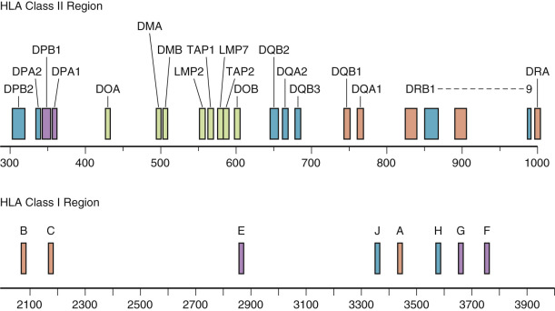

Figure 49-1 

Map of the major histocompatibility complex (MHC) gene on chromosome 6. 

HLA-DPB2 in the human leukocyte antigen (HLA) class II region is located closest to the centromere. HLA-F is the most telomeric. The region between HLA-DRA and HLA-B is not shown. 

(With permission from the Anthony Nolan Bone Marrow Trust, Available at: [ www.anthonynolan.org.uk/hig ](<http://www.anthonynolan.org.uk/hig>) .) 

During an infection, the invading microorganism may infect or be engulfed by cells, and then may be degraded into peptide fragments. Inside the cell (in the endoplasmic reticulum, class I, and HLA class II compartment), nascent HLA class I or class II molecules bind antigenic fragments derived from the microorganism. Once antigenic fragments have bound to the HLA molecules and have translocated to the cell surface, receptors on T lymphocytes interact with the complex of antigen fragment–HLA molecule (immune synapse), triggering humoral and cellular immune responses ( [ Fig. 49-2 ](<#f0015>) ). T cell–specific cell surface molecules, CD4 and CD8, act to strengthen this cellular interaction and to transmit intracellular activation signals. Other cell surface molecules act to increase the affinity of cellular interactions (e.g., CD2 and its ligand, CD58 [LFA-3], or CD11a/CD18 [LFA-1] and its ligand, CD54 [ICAM-1]), and to transmit costimulatory signals (e.g., CD28 and its ligands, CD80/CD86 [B7], or CD40 and its ligand, CD154). Polymorphism in MHC genes that specify HLA class I and class II alleles affects the antigen-binding specificity of the molecules, resulting in differences in immune responses among members of the species. The same pattern of interactions between a cell bearing an MHC class I or class II antigen fragment complex and a T lymphocyte occurs not only in recognition of invading pathogens but also in recognition of foreign HLA class I and class II molecules (alloantigens) and in recognition of self-antigens (autoantigens) (see [ Chapter 50 ](<##!/content/3-s2.0-B9780323295680000504?scrollTo=%23c00050>) ). 

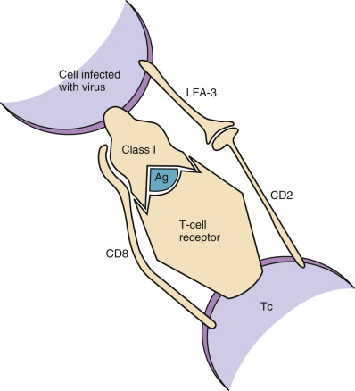

Figure 49-2 

Model of the molecular interactions involved in antigen recognition. 

Because donor HLA class I and class II molecules are recognized by the recipient's immune system as foreign antigens, it is beneficial to ensure that donor and recipient are histo- (i.e., tissue) compatible (i.e., HLA-matched). HLA class I and class II molecules have great allelic diversity within a population, so ensuring compatibility between donor and recipient is often a difficult task that requires collaboration among medical staff, clinical HLA-typing personnel, and donor tissue coordinators (e.g., large organ-sharing networks, registries, or banks of hematopoietic progenitor cell donors). 

The genetics, structure, function, nomenclature, and techniques of detection of human MHC gene products—HLA-A, -B, and -C (class I) and HLA-DR, -DQ, and -DP (class II)—are discussed in this chapter. Also discussed is the importance of HLA matching for transplantation. In addition to references listed at the end of the chapter, [ Table 49-1 ](<#t0010>) presents helpful websites that provide both reference material and updates of clinical outcomes. 

TABLE 49-1 

Websites on HLA Transplantation 

Address  |  Information   
---|---  
[ www.ashi-hla.org ](<http://www.ashi-hla.org>) |  American Society for Histocompatibility and Immunogenetics, HLA typing standards   
[ www.ebi.ac.uk/imgt/hla ](<http://www.ebi.ac.uk/imgt/hla>) |  HLA sequence database, tools for allele submission and sequence manipulation   
[ www.anthonynolan.org.uk/hig ](<http://www.anthonynolan.org.uk/hig>) |  World Health Organization nomenclature information   
[ www.ihwc.org ](<http://www.ihwc.org>) or [ www.ihwg.org ](<http://www.ihwg.org>) |  International Histocompatibility Workshop   
[ www.marrow.org ](<http://www.marrow.org>) |  National Marrow Donor Program   
[ www.bmdw.org ](<http://www.bmdw.org>) |  Bone Marrow Donors Worldwide   
[ www.worldmarrow.org ](<http://www.worldmarrow.org>) |  World Marrow Donor Association   
[ www.cibmtr.org ](<http://www.cibmtr.org>) |  Center for International Blood & Marrow Research   
[ www.ctstransplant.org ](<http://www.ctstransplant.org>) |  Collaborative Transplant Study   
[ www.unos.org ](<http://www.unos.org>) |  United Network for Organ Sharing   
[ www.nhgri.nih.gov ](<http://www.nhgri.nih.gov>) |  National Human Genome Research Institute   
  
,  

##  Genetics of the Major Histocompatibility Complex 

 

##  Basic Genetics 

Mendel's first law, the law of segregation, is based on the principle that hereditary traits are determined by factors that are distributed to progeny. In any one individual, these factors, or _genes_ as they are now called, are present on chromosomes ( [ Chapter 68 ](<##!/content/3-s2.0-B9780323295680000681?scrollTo=%23c00068>) ). Each gene may have multiple forms (i.e., alleles). Because humans are diploid, two genes are included per pair of homologous chromosomes. In meiosis, the chromosomes segregate randomly during formation of the gametes (ova or sperm) so that only one of each pair of chromosomes (i.e., a haploid number) is transmitted by any given gamete. The double, or diploid, number of chromosomes is restored when the male and female gamete fuse to form the zygote. Thus, for a trait determined by one gene, there will always be four possible genetic combinations in the offspring, each with equal probability of occurrence. These laws of segregation and random assortment apply to genes of the MHC system. Following are definitions for genetic terms that will be used in this chapter (  Crow, 1976  ; [ www.nhgri.nih.gov ](<http://www.nhgri.nih.gov>) ): 

  * **Gene:** Unit factor of inheritance 

  * **Chromosome:** Carrier of the unit factors of inheritance 

  * **Locus:** Position of a gene on a chromosome 

  * **Allele:** An alternative form of a gene at a single locus 

  * **Homozygous:** Having identical alleles at a locus, one on each chromosome 

  * **Heterozygous:** Having different alleles at a locus, one on each chromosome 

  * **Codominance:** The state in which the allele at each locus expresses its characteristic effect equally in the heterozygote 

  * **Genotype:** Genetic composition of an organism or individual 

  * **Phenotype:** Observable characteristics produced by the genes 

  * **Polymorphic:** Having two or more common distinct genotypes maintained in a population 

  * **Homologous chromosomes:** The two members of a chromosome pair that have corresponding gene loci, one derived from each parent 

  * **Crossing over:** Exchange of segments between homologous chromosomes; also termed _recombination_ . 

  * **Allo-(antigen, graft):** Refers to antigenic differences between individuals of a single species 

  * **Auto-(antigen, graft):** Refers to tissue or antigens of the same individual (i.e., self) 

 

##  Composition of the MHC 

The major histocompatibility gene complex in humans is located on the short arm of chromosome 6 (i.e., 6p21). It spans 3600 kb (kilobases) and includes 224 identified gene loci, of which 128 are predicted to be expressed. Approximately 40% of the expressed genes are estimated to have an immune system function (  Aguado et al, 1999  ). MHC genes are located in six subregions: HLA-A, HLA-C, HLA-B, HLA-DR, HLA-DQ, and HLA-DP (see [ Fig. 49-1 ](<#f0010>) ). Each subregion encodes a minimum of one cell surface glycoprotein. With only one exception, the MHC genes are highly polymorphic, that is, each MHC gene has multiple alleles in the human population. Indeed, the MHC genes are the most polymorphic loci known in man (  Parham et al, 1995  ; [ Table 49-2 ](<#t0015>) ; [ www.anthonynolan.org/uk/hig ](<http://www.anthonynolan.org/uk/hig>) ). Because MHC genes specify molecules that play an important role in the immune response, polymorphism is believed to be essential to survival of the species and to be maintained in the population by selection; the introduction of molecular typing techniques in the 1980s allowed determination of the variability of the MHC region. As of October 2014 ( [ http://hla.alleles.org/nomenclature/stats.html ](<http://hla.alleles.org/nomenclature/stats.html>) ), more than 9232 class I and more than 3010 class II alleles had been identified ( [ Fig. 49-3 ](<#f0020>) ; [ http://hla.alleles.org/nomenclature/nomenclature_2009.html ](<http://hla.alleles.org/nomenclature/nomenclature_2009.html>) ). In this newly found genetic variation, the HLA-B locus presents the greatest variability with 3693 alleles, followed by the HLA-A locus with 2946 and the HLA-C locus with at least 2466 alleles. In contrast, for class II alleles, the most variable locus is the DRB1 locus with 1582 alleles, followed by the DQB1 locus with 712, the DPB1 locus with 472, and the DQA1 locus with 52 alleles. 

TABLE 49-2 

Examples of WHO-Recognized HLA Antigens (Specificities) Defined by Serologic Typing and HLA Alleles Defined by DNA Sequencing [ † ](<#hl0000351>)

HLA-A Antigens  |  HLA-DQ Antigens  |  HLA-A Alleles [ ‡ ](<#hl0000354>) |  HLA-DQA1 Alleles [ § ](<#hl0000357>) |  HLA-DBQ1 Alleles [ § ](<#hl0000357>)  
---|---|---|---|---  
A1  |  DQ1  |  A*0101-0104N  |  DQA1*0101-*0105  |  DQB1*0501-*0504   
A2  |  DQ2  |  A*02011-*0230  |  DQA1*0201  |  DQB1*06011-*0615   
A203  |  DQ3  |  A*03011-*0304  |  DQA1*03011-0303  |  DQB1*0201-*0203   
A210  |  DQ4  |  A*1101-*1105  |  DQA1*0401  |  DQB1*03011-*0309   
A3  |  DQ5(1)  |  A*2301  |  DQA1*05011-*0505  |  DQB1*0401-*0402   
A9  |  DQ6(1)  |  A*2402101-*2420  |  DQA1*06011-*06012  |   
A10  |  DQ7(3)  |  A*2501-*2502  |  |   
A11  |  DQ8(3)  |  A*2601-*2612  |  |   
A19  |  DQ9(3)  |  A*2901-*2904  |  |   
A23(9)  |  |  A*3001-*3007  |  |   
A24(9)  |  |  A*31012-*3104  |  |   
A2403  |  |  A*3201-*3203  |  |   
A25(10)  |  |  A*3301-*3304  |  |   
A26(10)  |  |  A*3401-*3402  |  |   
A28  |  |  A*3601  |  |   
A29(19)  |  |  A*4301  |  |   
A30(19)  |  |  A*6601-*6603  |  |   
A31(19)  |  |  A*68011-*6809  |  |   
A32(19)  |  |  A*6901  |  |   
A33(19)  |  |  A*7401-*7403  |  |   
A34(10)  |  |  A*8001  |  |   
A36  |  |  |  |   
A43  |  |  |  |   
A66(10)  |  |  |  |   
A68(28)  |  |  |  |   
A69(28)  |  |  |  |   
A74(19)  |  |  |  |   
A80  |  |  |  |   
  
_HLA,_ Human leukocyte antigen; _WHO,_ World Health Organization. 

Adapted from [ www.anthonynolan.org.uk/hig ](<http://www.anthonynolan.org.uk/hig>) , with permission of SGE Marsh. 

 † Each column of the table is independent. Numbers in parentheses indicate the broad serologic specificity. The serologic type may be listed without the broad specificity. For example, both A23(9) and A23 are correct designations. 

 ‡ HLA-A alleles specify HLA-A antigens. The antigen A1 is specified by either A*0101 or A*0102 or A*0103 alleles. A*0104N is a null or nonexpressed allele. 

 § HLA-DQA1 and HLA-DQB1 alleles specify HLA-DQ antigens. The antigen DQ5 (1) is specified by several different DQA1 and DQB1 combinations, including (1) DQA1*0101 and DQB1*0501 and (2) DQA1*0101 and DQB1*0502 alleles. In the past, serologic split designations were given to specificities that appeared to identify the antigen specified by a single HLA allele (e.g., A2 splits A203, A210; B7 splits B703; B39 splits B3901 and B3902). It is now recognized that other alleles may also encode antigens that carry these serologic specificities, and the WHO Nomenclature Committee has recommended that these splits be discontinued. 

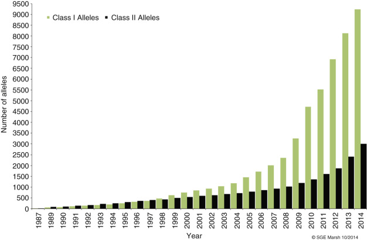

Figure 49-3 

Numbers of class I and II alleles discovered from 1987 to 2009. 

The increase in the number of discovered alleles during this period was made possible by the introduction of DNA typing methods; class I alleles include HLA-A, -B, and -Cw, and class II alleles include HLA-DRB1, -DQB1, -DQA1, and -DPB1. 

(Data from Anthony Nolan Research Institute. Available at: [ http://hla.alleles.org/nomenclature/nomenclature_2009.html ](<http://hla.alleles.org/nomenclature/nomenclature_2009.html>) .) 

 

##  Localization of MHC Genes 

The genes of the MHC were assigned to the short arm of chromosome 6 (6p) on the basis of cytogenetic studies of aberrant chromosomes (i.e., chromosomes that have undergone a translocation). The map order and positioning of the MHC genes were determined by meiotic linkage analyses (i.e., studies of crossing over in families) and molecular biology techniques, including gene cloning, DNA sequencing, and pulsed field gel electrophoresis. The latter technique detects the presence of genes on single long fragments of DNA. The map order of genes within the MHC is HLA-A, -C, -B, -DR, -DQ, and -DP, with HLA-A being distal to the centromere (see [ Fig. 49-1 ](<#f0010>) ). 

 

##  Inheritance 

The MHC genes are closely linked, that is, they segregate en bloc to the offspring. The complex of linked genes that resides on one of the pair of homologous chromosomes and that segregates en bloc to the offspring is termed a _haplotype_ . Each individual inherits two MHC haplotypes—one from each parent—and thus has two alleles for each of the genes. These alleles are codominantly expressed. The inheritance of the MHC genes follows the rules of segregation set down by Mendel. Within a family, each child inherits one MHC haplotype from the mother and one from the father. By convention, the paternal haplotypes are designated a and b, and the maternal haplotypes c and d. Thus, there are four possible MHC genotypes in the offspring: ac, ad, bc, and bd. Because the chance of inheriting a given haplotype is random, the probability of occurrence of any one of the four genotypes is one in four for each mating. In a family with five children, at least two of the children will be HLA-identical (assuming no crossing over). Although the MHC genes are closely linked, families have been reported in which a crossover has occurred. The frequency of crossing over between two linked genes was thought to be a measure of the distance separating the genes; however, molecular data have suggested the existence of recombination “hot” spots in the intervening DNA that can increase or decrease the likelihood of recombination during meiosis (  Uematsu et al, 1988  ). 

 

##  Linkage Disequilibrium 

The observation that alleles at different genetic loci occur in the population on the same haplotype significantly more frequently than would be expected on the basis of chance alone is called _linkage disequilibrium._ The expected frequency of two alleles (f  1  , f  2  ) is the product of the gene frequency of each allele in that population (f  expected  = f  1  × f  2  ). The observed frequency is determined from family studies within the same population. Linkage disequilibrium is a hallmark of the human MHC and extends from HLA-A through HLA-DQ. The best known example of linkage disequilibrium is the A1,Cw7,B8,DR17(3),DR52,DQ2 haplotype in Caucasians, which is observed approximately four times more frequently than expected. The significance of linkage disequilibrium as it applies to immune competence and disease is discussed in Chapter 49 in the “Extended Haplotypes” section. 

 

##  Ethnic Variation 

Accumulated data from the study of the world population groups (  Dausset & Colombani, 1973  ;  Imanishi et al, 1992  ;  Cadavid & Watkins, 1997  ;  Bugawan et al, 1999  ) demonstrate that the frequencies of HLA alleles differ significantly among ethnic population groups. MHC haplotypes and linkage disequilibrium of alleles also differ. These observations were taken into account when unrelated allograft hematopoietic progenitor cell donor registries and banks such as the U.S. National Marrow Donor Program (NMDP) were established (  Perkins & Hansen, 1994  ). Both allele and haplotype frequencies dictate the number of volunteers required to find an HLA-matched unrelated donor for any patient. Some patients (e.g., those with rare or unusual types) cannot find closely matched unrelated donors from among the more than 11 million volunteers listed in the NMDP registry as of 2013 ( [ Fig. 49-4 ](<#f0025>) ). Currently, patients are more likely to find a match because the number of donors has increased, as has the use of umbilical cord blood units for transplantation ( [ Fig. 49-5 ](<#f0030>) ). It appears that cord blood transplantation may be more tolerant of HLA mismatches; this may be a result of reexposure to noninherited maternal antigens (NIMAs) found in the graft (van  Rood et al, 2009  ). Improvement in methods used for engraftment of progenitor cells from partially HLA-mismatched donors may allow transplantation in patients for whom close matches cannot be found ( [ Chapter 38 ](<##!/content/3-s2.0-B9780323295680000383?scrollTo=%23c00038>) ). 

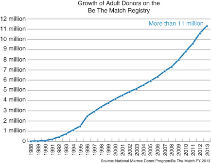

Figure 49-4 

More than 11 million donors for hematopoietic stem cell and bone marrow transplantation were registered by the National Marrow Donor Program in 2013. 

(©National Marrow Donor Program, 2014. Used with permission. Accessed at [ BeTheMatchClinical.org ](<http://BeTheMatchClinical.org>) .) 

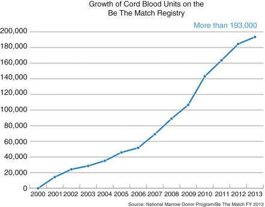

Figure 49-5 

The number of umbilical cord units has increased in the last decade, primarily for the treatment of blood malignancies in pediatric patients. 

More than one HLA mismatch and more than one cord unit can be used in umbilical cord transplantation. 

(©National Marrow Donor Program, 2014. Used with permission. Accessed at [ BeTheMatchClinical.org ](<http://BeTheMatchClinical.org>) .) 

,  

##  Class I Molecules—HLA-A, HLA-B, AND HLA-C Subregions 

The HLA-A and -B molecules were the first MHC molecules to be described in humans (  Dausset, 1981  ; van  Rood, 1993  ). Because these molecules were defined by antibody responses to white blood cells (WBCs), they were called human leukocyte **antigens.** Leukocyte antibodies were observed in humans as early as the 1920s, but it was not until the 1950s that a systematic study began. In 1952, Dausset convincingly demonstrated the existence of leukocyte antibodies (leukoagglutinins). Because these leukoagglutinins did not react with leukocytes from the antibody producer but did react with a percentage of leukocytes from red cell group O unrelated individuals, he suggested that leukoagglutinins were alloantibodies. Shortly thereafter,  Payne and colleagues (1964)  reported that sera from patients who had febrile nonhemolytic blood transfusion reactions frequently contained leukoagglutinins that demonstrated allospecificity. In 1958, Dausset described the first HLA alloantigen MAC (now HLA-A2 + HLA-28) and showed it to be genetically determined. 

Originally, leukocyte specificities were thought to be the products of a single locus. A two-locus model, each locus with multiple alleles, was established through HLA studies in families by the identification of recombinational events that separated the two allelic series. These two allelic series were called the first, or LA (now HLA-A), and the second, or four, series (now HLA-B). These names were derived from descriptions of the LA 1, 2, 3 allelic series by Payne in 1967, and of the 4a, 4b allelic series by van Rood in 1969. A third locus was first proposed in 1970; however, it was not confirmed until 1975, when a family with a recombination between HLA-B and the new locus was identified. This third locus was designated HLA-C following the 1975 International Histocompatibility Workshop.  Dausset (1981)  was awarded the Nobel Prize for Medicine in 1980 for his original work on the human HLA system. 

 

##  Structure of Class I Molecules 

The classical class I molecules, termed _HLA-A, HLA-B,_ and _HLA-C_ in the human, are heterodimers consisting of a transmembrane glycosylated polypeptide (heavy chain, 44-kDa) noncovalently associated with β 2  -microglobulin (12-kDa) ( [ Fig. 49-6 ](<#f0035>) ) (  Bjorkman & Parham, 1990  ). The heavy chain of the class I molecule spans the cell membrane and is oriented with its amino-terminus on the outside of the cell. β 2  -microglobulin is associated with the extracellular region of the heavy chain and is necessary for cell surface expression. The extracellular region of the class I heavy chain is divided into three domains designated α1, α2, and α3, each consisting of about 90 amino acid residues. The amino-terminal α 1  domain contains a glycosylation site at the asparagine residue in position 86. The transmembrane segment of approximately 24 amino acids is mostly hydrophobic, whereas the intracellular carboxy-terminal segment of the molecule consists mainly of hydrophilic residues with a cluster of basic residues adjacent to the cytoplasmic surface of the cell membrane. 

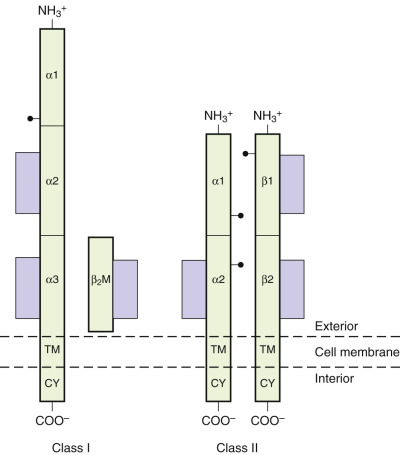

Figure 49-6 

A schematic model of the structure of class I and class II molecules. 

Polymorphism of class I molecules (see [ Table 49-2 ](<#t0015>) and [ Fig. 49-3 ](<#f0020>) ) (  Bodmer et al  1997  ) is defined by the use of (1) class I–specific antibodies (alloantisera and monoclonal antibodies) that bind to the HLA molecules; (2) cytotoxic T lymphocytes (CTLs) that recognize and kill in response to stimulation by foreign or allogeneic class I molecules in vitro; (3) isoelectric focusing of isolated class I molecules; (4) polymerase chain reaction (PCR)-based DNA typing of class I alleles; and (5) nucleotide sequencing of class I alleles. Most of the class I polymorphism arises from amino acid sequence differences clustered in the α 1  and α 2  domains of the heavy chain. The α3 domain is highly conserved among HLA class I molecules. 

Fresh insights into the structure of the HLA molecule came when the three-dimensional structure of the class I molecule was defined using x-ray crystallography (  Bjorkman et al, 1987  ). The structure of the extracellular portion is shown in [ Figure 49-7 ](<#f0040>) . The molecule consists of two pairs of structurally similar domains: α1 has the same tertiary conformation as α 2  -, and α 3  \- and β 2  -microglobulin have similar tertiary conformations. The α 3  \- and β 2  -microglobulin domains are each composed of two antiparallel β-pleated sheets—one with four strands and one with three strands, connected by a disulfide bond. The α 3  and α 2  domains interact with one another through these β-pleated sheets, and their structure closely resembles that described for an immunoglobulin constant region domain. The α 1  and α 2  domains are paired to form an eight-strand β-pleated sheet. This sheet is topped by two α-helices forming a groove at the top of the molecule. This groove is the site for binding of antigenic peptide fragments by the class I molecule (see [ Fig. 49-7 ](<#f0040>) ). The sides and bottom of the groove are formed by side chains of the amino acids that constitute the helices and β-pleated sheets. Many of the amino acids that line this groove are polymorphic, creating allele-specific differences in antigen-binding specificity among the different class I allelic products (  Stern & Wiley, 1994  ). Other residues in the helical regions of the groove interact with the T cell receptor during recognition of the class I antigenic fragment complex by a T lymphocyte (see [ Fig. 49-2 ](<#f0015>) ). 

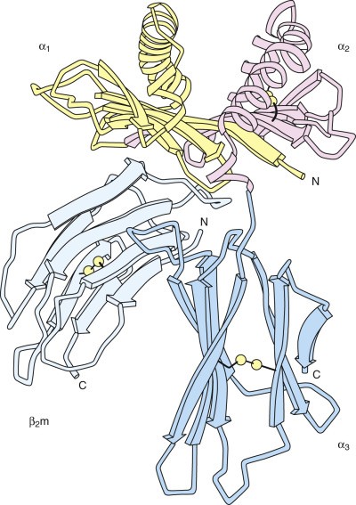

Figure 49-7 

Three-dimensional model of the extracellular portion of a class I molecule. 

(With permission from Bjorkman PJ, Saper MA, Samraoui B, et al: Structure of the human class I histocompatibility antigen, HLA-A2, _Nature_ 329:506, 1987.) 

 

##  Organization of Class I Genes 

The HLA heavy chains are encoded within the MHC on chromosome 6 (see [ Fig. 49-1 ](<#f0010>) ) (  Shiina et al, 1999  ) and are highly polymorphic, whereas β 2  -microglobulin is encoded on chromosome 15 and is not known to be polymorphic in humans. The typical class I gene is encoded by eight exons. The first exon encodes the 5′ untranslated region and a hydrophobic leader peptide. Exons 2 to 4 encode the three extracellular domains; exon 5 encodes the transmembrane region. The sixth and seventh exons encode the cytoplasmic region, and the eighth exon encodes the 3′ untranslated region, including the poly(A) addition site. Intervening sequences (termed _introns_ ) between the exons are transcribed into RNA but are removed during messenger RNA (mRNA) splicing. 

 

##  Regulation of Class I Gene Expression 

HLA class I molecules are expressed as transmembrane glycoproteins on the surface of many cell types. However, the level of surface expression can vary extensively (  Singer & Maguire, 1990  ). The resting level of class I molecules is highest on β 2  -microglobulin lymphoid cells, and HLA-C expression is 10 times less than that of HLA-A or HLA-B (  Le Bouteiller, 1994  ); this is a result of inefficient association and a mutated cis-regulatory element of transcriptional control found in region I of the HLA-C promoter (enhancer A) that reduces its expression (  Neefjes & Ploegh, 1988  ). Differential expression of HLA molecules appears to reflect the level and antigenic specificity of the allogeneic sensitization seen in patients awaiting kidney transplantation, because these patients are subjected to multiple random blood transfusions while on dialysis; additionally, posttransplant, more kidneys are rejected because of the presence of HLA-A or -B or both A and B donor specific antibody, and far fewer are rejected by only HLA-Cw donor specific antibodies; class I molecules are undetectable on the membranes of certain other cell types such as brain cells, muscle cells, and sperm cells. Sequence elements located upstream of class I genes bind regulatory factors that control the cell surface expression of class I molecules. During an immune response, the cell surface expression of class I genes can be upregulated by binding of cytokine (e.g., interferon-γ and TNF) to upstream regulatory elements. Tumors and certain viruses (e.g., human immunodeficiency virus) can suppress class I expression (  Brodsky et al, 1999  ). 

 

##  Function of Class I Molecules 

The HLA-A, -B, and -C molecules play key roles in an immune response. First, in the adaptive immune response, class I molecules bind peptides derived from proteins degraded or synthesized in the cytosol and display them on the cell surface for perusal by the antigen receptors on T lymphocytes (see [ Chapter 45 ](<##!/content/3-s2.0-B9780323295680000450?scrollTo=%23c00045>) ). Presentation of antigen by class I molecules allows T cells to detect and mount a cytotoxic response to foreign material (e.g., a virus, abnormal proteins from a malignant cell). In the cytosol, intracellular antigens (including self-proteins and viral or abnormal proteins) are broken down into peptide fragments (  Rock & Goldberg, 1999  ). These peptide fragments are transported to the endoplasmic reticulum, where they bind to the groove at the top of newly synthesized class I molecules and then are carried to the cell surface (  Hansen & Lee, 1997  ;  Pamer & Cresswell, 1998  ) (see [ Fig. 49-2 ](<#f0015>) ). Four genes, located in the class II region of the MHC (see [ Figs. 49-1 ](<#f0010>) and [ 49-8 ](<#f0045>) ), are involved in this process. Two of these genes ( _LMP2_ and _LMP7_ ) encode components of the proteosome complex, a macromolecular structure that degrades proteins within the cytosol (  Tanaka et al, 1997  ). The other two genes ( _TAP1_ and _TAP2_ ) encode components of peptide transporters that move peptides from the cytosol into the endoplasmic reticulum (  Momburg & Hammerling, 1998  ). CD8  \+  CTLs recognize the processed peptide in conjunction with the class I molecule (  Jorgensen et al, 1992  ). In the experimental system used to dissect this mechanism, CTLs were generated by in vitro stimulation with virally infected autologous cells. Recognition and lysis of the target cell were specific for the priming virus strain. Recognition also was affected by allelic polymorphism of class I molecules because only virally infected target cells sharing the appropriate class I allelic product(s) with the responder were lysed (  Zinkernagel  1997a  ). The latter requirement is termed **MHC restriction.** Zinkernagel and his collaborator Doherty were awarded the Nobel Prize for Medicine in 1996 in recognition of the importance of the concept of MHC restriction to immunology. 

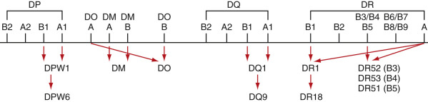

Figure 49-8 

Map of the class II region of the human major histocompatibility complex (MHC). 

Gene products encoded by each subregion are listed. Not all genes are included. 

Second, surface expression of class I molecules has a protective function in the innate immune response by preventing target cell lysis effected by natural killer (NK) cells and their killer cell activating and inhibitory receptors (KIR). Unlike CTLs, NK cells do not require activation through the recognition of peptide bound to the class I molecule but can lyse and destroy target cells lacking classical HLA class I molecule expression on the cell surface. Through this innate mechanism, NK cells play an important role in surveillance against viruses and tumor cells that downregulate expression of the class I molecule to avoid recognition by CTLs (  Lanier, 1998  ;  Long, 1999  ). 

There are two groups of NK receptors: (1) the C-type lectin receptor CD94/NKG2, whose genes reside on chromosome 12, and (2) the killer cell immunoglobulin-like receptors (KIRs) encoded by genes on chromosome 19. NK cell function appears to be regulated by a balance between positive signaling receptors that initiate and inhibitory receptors that suppress cell activation. Both groups of receptors recognize HLA class I ligands. For example, the KIR2D receptors differentiate between HLA-C ligands based on the presence of specific amino acid residues at codons 77 and 80 (i.e., asn77lys80 vs. ser77asn80). Another NK receptor, KIR3D, recognizes the HLA-Bw4/Bw6 polymorphism. A third NK receptor, CD94/NKG2, recognizes the HLA-E molecule complexed with the HLA leader peptide from some of the allelic products of HLA-A, -B, -C, and -G molecules (  Brooks et al, 1999  ). 

NK cells can specifically recognize and lyse allogeneic cells that do not express the specific class I molecules expressed by the effector cell (i.e., “missing self”) (  Valiante et al, 1997  ). This could occur even in apparently HLA-matched transplant pairs where one member of the pair is homozygous and the other is heterozygous (e.g., donor: Bw4,Bw6; recipient: Bw6). Thus Bw4-specific NK cells from the donor might lyse cells without Bw4 from the recipient in a hematopoietic progenitor cell graft. This response may be unidirectional in some settings. In the example, the donor does not lack any HLA molecule present in the recipient; thus, the recipient NK cells will not detect any missing self. Because NK cells are relatively radioresistant and make up a subpopulation of about 10% to 15% of peripheral blood lymphocytes, the NK response could be substantial; however, the extent of the role of NK activity in affecting transplant outcome is not known at present (  Ruggeri et al, 1999  ). Since then, based on new knowledge of NK cell function, several donor selection strategies have been used in an attempt to improve the outcome of unrelated donor transplantation (  Benjamin et al, 2010  ). These strategies include (a) the receptor-ligand model, (b) the missing ligand model or donor-recipient KIR ligand mismatch, (c) natural cytotoxicity model, and (d) the KIR gene-gene model or donor selection based on B haplotype content. These strategies have yielded a variety of outcomes that may depend on the type of malignancy; for example, donor selection based on the KIR gene-gene content of donor natural killer cell receptor has been shown to improve survival in acute myelogenous leukemia (AML) but not acute lymphoblastic leukemia (ALL) (  Cooley et al, 2010  ). Also, haploidentical NK expanded cell transplantation using the KIR-HLA ligand mismatched model was used to successfully treat children with AML using a low intensity protocol (  Rubnitz et al, 2010  ), 

 

##  Other Class I Genes 

As many as 20 additional nonclassical or class Ib genes have been identified within the class I region of chromosome 6p by gene cloning (  Aguado et al, 1999  ). Many of these are pseudogenes; however, several encode and express class I–like mRNA and/or molecules HLA-E, HLA-F, and HLA-G. These molecules may be key mediators of both adaptive and innate immune responses (  O'Callaghan & Bell, 1998  ). Their genes are homologous to classical class I genes in structure, and the polypeptides encoded by these loci also associate with β 2  -microglobulin. However, just as a high level of allelic polymorphism is a hallmark of the HLA-A, HLA-B, and HLA-C loci, a low level of polymorphism of the HLA-E, HLA-F, and HLA-G loci is a defining feature of these genes. In addition, by comparison with classical class I molecules, the cell surface expression of nonclassical class I molecules is low, and the distribution of these class Ib molecules on specific cell types varies. 

 

##  HLA-G 

HLA-G is expressed principally on extravillous cytotrophoblast cells at the fetal/maternal interface, where it is thought to play a role in maternofetal tolerance (  Le Bouteiller & Blaschitz, 1999  ). HLA-G, as a ligand for at least three NK and other cell inhibitory receptors, protects the invading placental tissue from the cytolytic action of NK cells. Although HLA-G has the capability to bind and present processed antigen (i.e., peptides) to T cells, the diversity of peptides bound by HLA-G appears to be less than the diversity of peptides bound by classical class I molecules. Regulation of expression of HLA-G also differs from that of classical class I genes, as the gene contains no interferon response signal; thus, it is not interferon-inducible. It has been hypothesized that the soluble forms may act as specific immunosuppressors during pregnancy (  Le Bouteiller & Blaschitz, 1999  ). Recent evidence supports this hypothesis. HLA-G transcripts are present in great numbers in placental extravillous membranes in the first trimester, but at term, transcript numbers decline sharply, in keeping with the theory that HLA-G provides protection for the allogeneic embryo from maternal NK cell surveillance (  Agrawal & Pandey, 2003  ). This putative role raises the possibility that HLA-G may play a role in tolerance for transplanted tissues. Along these lines, it is interesting to note that liver-kidney transplant recipients with high concentrations of HLA-G in their sera had low numbers of acute rejection episodes and therefore may require less immunosuppressive therapy (  Creput et al, 2003  ). 

 

##  HLA-E 

HLA-E may play a role in protecting a target cell from NK cell–mediated lysis. HLA-E molecules bind a set of almost identical hydrophobic peptides derived from the leader sequences of the classical class I and HLA-G heavy chains. HLA-E displays these bound peptides at the cell surface for recognition by NK cells, providing a check for the integrity of the antigen-presenting pathway (  Lee et al  1998a  ;  O'Callaghan & Bell, 1998  ). Skin grafting in a transgenic mouse model suggests that HLA-E may be recognized as a transplantation antigen (  Pacasova et al, 1999  ). Recent studies suggest that host NK cells may be able to recognize HLA-E on allogeneic cells and possibly tolerate it, even when it is bound to donor peptides. With this finding comes the potential for exploiting this tolerance in pursuit of preventing NK cell–mediated graft rejection and graft-versus-host disease (GVHD) (  Matsunami et al, 2002  ). 

 

##  HLA-F 

The role of HLA-F is unknown. Computer modeling predicts that certain amino acid residues of HLA-F could contribute to a putative peptide-binding groove, consistent with a role in antigen presentation by HLA-F (  O'Callaghan & Bell, 1998  ). To date, HLA-F appears to be normally expressed only on the surfaces of extravillous trophoblasts that have invaded the maternal decidua, and has also been found on the surfaces of lymphoblastoid cell lines infected with Epstein-Barr virus (  Ishitani et al, 2003  ). 

,  

##  Class II Molecules—HLA-DR, HLA-DQ, and HLA-DP Subregions 

The class II molecules in humans were first recognized by their ability to stimulate allogeneic T cells in the mixed leukocyte culture (MLC). During the 1975 International Histocompatibility Workshop, the MLC was used to define the HLA-D allelic series (  Thorsby & Piazza, 1975  ). Because MLCs required 7 days before results could be obtained, rapid serologic detection of HLA-D was sought. In 1975, it was determined that alloantisera contained antibodies reactive with molecules closely associated with the specificities previously identified as HLA-D by cellular techniques (  Dausset, 1981  ). Following the 1977 International Histocompatibility Workshop, these serologic specificities were termed _DR,_ for D-related specificities, because HLA-D and HLA-DR were observed to be associated but not identical to each other. Serologic testing coupled with genetic and immunochemical studies identified additional class II molecules: DR52, DR53, DR51, and DQ. Cellular techniques identified still another class II molecule in the late 1970s (  Shaw et al, 1981  ). This molecule (now termed _HLA-DP_ ) was initially described as a secondary B cell antigen (SB) because it was usually weak or undetectable in a primary MLC and required secondary phase stimulation in culture for detection. Subsequently, the DNA coding sequences and locations of these genes within the MHC were further characterized using molecular biology techniques (  Beck & Trowsdale, 1999  ). 

 

##  Structure of Class II Molecules 

The class II HLA-DR, -DQ, and -DP molecules are heterodimers consisting of two noncovalently associated transmembrane glycoproteins: an α chain (33 to 35 kDa) and a β chain (26 to 28 kDa) (  Gorga, 1992  ). Both polypeptide chains span the cell membrane and are oriented with their amino-termini on the outside of the cell. The extracellular regions of the α and β polypeptides are each divided into two domains, designated α 1  and α 2  and β 1  and β 2  , and each domain consists of approximately 90 amino acid residues. The α chain has two carbohydrate moieties, one high-mannose and one complex-type glycan, at amino acids 78 and 118, respectively. β chains have one complex-type oligosaccharide at amino acid 19. The amino-terminal α 1  and β 1  domains of α and β chains contain the polymorphic residues, while the membrane proximal α 2  and β 2  domains are highly conserved and are homologous to immunoglobulin constant region domains. A region of approximately 12 amino acids in length connects the second extracellular domain to the hydrophobic transmembrane region (23 amino acids) and a small intracytoplasmic domain (8 to 15 amino acids). 

Based on crystallography, the class II molecule is similar in structure to the class I molecule (  Brown et al, 1993  ) (see [ Fig. 49-7 ](<#f0040>) ). In the class II molecule, the α 1  and β 1  domains of the α and β chains form an eight-stranded β-pleated sheet topped by two α helices to form the antigen-binding groove at the top of the molecule. The α 2  and β 2  domains each form two antiparallel β-pleated sheets that support the groove at the top. As with class I, many of the amino acids that line the antigenic peptide-binding groove are polymorphic, creating differences in peptide-binding specificities for the different class II allelic products. 

Similar to the class I molecules, the class II molecules are highly polymorphic (see [ Table 49-2 ](<#t0015>) and [ Figure 49-3 ](<#f0020>) ) (  Bodmer et al  1997  ;  Marsh et al, 2002  ). Class II polymorphism is defined by (1) class II–specific antibodies (alloantisera and monoclonal antibodies), which bind to class II molecules; (2) alloproliferative T cells that recognize and proliferate in response to foreign class II molecules in vitro; (3) two-dimensional gel electrophoresis of isolated class II molecules; (4) hybridization of restriction endonuclease digests of DNA-encoding class II genes using locus-specific probes (a technique that detects restriction fragment length polymorphism); (5) PCR-based DNA typing of class II alleles; and (6) nucleotide sequencing of class II genes. Most of the class II polymorphism arises from amino acid sequence differences localized in the α 1  and β 1  domains of the two polypeptide chains. 

 

##  Organization of Class II Genes 

In contrast to the class I molecules, both the α and β chains of class II molecules are encoded within a 1100-kb section of the MHC region (see [ Figs. 49-1 ](<#f0010>) and [ 49-8 ](<#f0045>) ) (  Beck & Trowsdale, 1999  ). The class II region includes three subregions—DR, DQ, and DP—each of which encodes at least one expressed A (encoding an α chain) and B (encoding a β chain) gene. Sequence comparisons suggest that both class I and class II genes arose through a successive series of gene duplications during the evolution of this gene complex. The original duplication in the class II region most likely gave rise to primordial A and B genes. More recent gene duplications generated the DR, DQ, and DP subregions containing multiple genes. 

A typical A gene contains five exons encoding (1) the 5′ untranslated region and leader sequence; (2) the α 1  domain; (3) the α 2  domain; (4) the connecting peptide, transmembrane region, cytoplasmic tail, and a portion of the 3′ untranslated region; and (5) the remainder of the 3′ untranslated region, including the poly(A) addition signal. A typical β-chain gene is similar to the α-chain gene but has an extra exon for the cytoplasmic tail. 

 

##  DR Subregion 

The DR subregion encodes one or two DR molecules, depending on the haplotype (  Bodmer et al  1997  ). The subregion contains a single expressed DRA gene that is similar in different haplotypes, differing only in a single conservative amino acid substitution found in the cytoplasmic domain. 

The most centromeric DRB gene, _DRB1_ ( [ Fig. 49-8 ](<#f0045>) ), encodes a highly polymorphic β chain that, when associated with the α chain, exhibits serologic specificities DR1 to DR18. This molecule is the predominant class II molecule on the cell surface, accounting for well over half of total cell surface class II molecules. There are multiple nucleic acids, hence amino acid sequence differences among DRB1 alleles. 

The second expressed DRB gene, present only in some class II haplotypes, is located between the DRB1 locus and the DRA locus (see [ Fig. 49-8 ](<#f0045>) ). In cells expressing DR alleles, DRB1*03, *11, *12, *13, and *14, the second DRB gene is termed _DRB3._ (HLA nomenclature is described subsequently.) The _DRB3_ gene is polymorphic, although at present the number of identified alleles is approximately 10 times less than the number of DRB1 alleles. The DRB3 product combined with the DRA product forms the DR molecule, which carries DR52 serologic specificity. In cells expressing DRB1*04, *07, and *09 alleles, the second DRB gene is termed _DRB4._ The DRB4 product combined with the DRA product forms the molecule that carries the serologic specificity DR53. Last, in cells expressing DRB1*15 and *16 alleles, the second DRB gene is termed _DRB5._ This DRB5 product combined with the DRA product carries DR51 serologic specificity. Haplotypes expressing DRB1*01, *08, or *10 alleles do not usually carry a second expressed DRB locus. There are exceptions to these associations. For example, a haplotype carrying DRB1*15 without a DRB5 locus has been described (  Wade et al, 1993  ). 

 

##  DQ Subregion 

One set of A and B genes, _DQA1_ and _DQB1,_ encode the DQ heterodimer that carries DQ1 to 9 serologic specificities (see [ Table 49-2 ](<#t0015>) and [ Fig. 49-8 ](<#f0045>) ) (  Bodmer et al  1997  ). DQ molecules represent approximately 15% to 20% of the total class II molecules expressed on the cell surface. Because both _DQA1_ and _DQB1_ loci are polymorphic, and because the protein products can associate in trans as well as in cis, heterozygotes may potentially express four different DQ molecules on their cell surfaces ( [ Fig. 49-9 ](<#f0050>) ). Other DQ-like A and B genes in the DQ subregion such as _DQA2_ and _DQB2_ are very similar to the _DQA1_ and _DQB1_ genes; however, no functional protein products are expressed. 

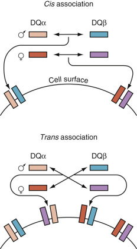

Figure 49-9 

Model of the cis and trans associations of DQα and DQβ chains. 

 

##  DP Subregion 

The DP subregion contains two sets of A and B genes (see [ Fig. 49-8 ](<#f0045>) ). One set, _DPA1_ and _DPB1,_ encodes the DP protein product; the other set is made up of pseudogenes. Both _DPA1_ and _DPB1_ genes are highly polymorphic (  Bodmer et al  1997  ). The level of DP expression on the cell surface is very low. 

 

##  Linkage Disequilibrium of Genes in the Class II Region 

Specific combinations of DRB1/DRB3, DRB1/DRB4, DRB1/DRB5, and DQA1/DQB1 alleles are common. The DQA1/DQB1 combinations found may be controlled in part by the ability of α and β chains to pair (  Kwok et al, 1993  ). In addition, certain DR and DQ alleles are inherited together more frequently than expected, resulting in linkage disequilibrium in a population. The frequency of these combinations differs strikingly among different ethnic population groups. For example, both the DRB1*1101, DQB1*0501 (DR11[5]), DQ5[1] and the DRB1*0901, DQB1*0303(DR9, DQ9[3]) haplotypes frequently are found in populations of direct African heritage, whereas these DR-DQ combinations are rarely found in populations of Caucasian heritage. Crossing over between the DP loci and the DR/DQ loci is common. Thus, minimal linkage disequilibrium is noted between the DR/DQ and DP alleles. Lists of common DRB1/DQA1/DQB1 haplotypes have been published (  Begovich et al, 1992  ;  Imanishi et al, 1992  ). 

 

##  Regulation of Class II Gene Expression 

Class II molecules, HLA-DR, -DQ, and -DP, are constitutively expressed on antigen-presenting cells (APCs) of the immune system, including monocytes, macrophages, dendritic cells, B lymphocytes, and neoplastic cells. HLA class II expression is highest for HLA-DR, intermediate for HLA-DQ, and lowest for HLA-DP (  Glimcher & Kara, 1992  ;  Guardiola & Maffei, 1993  ); as with class I, differential expression of HLA class II molecules is reflected in the antigenic specificity of allosensitization seen in patients awaiting kidney transplantation; more kidneys are rejected because of the presence of an HLA-DR– or HLA-DQ–specific antibody, and fewer are rejected because of an HLA-DP–specific antibody. DNA sequences found upstream of the coding sequences in class II genes are critical to expression. Binding of proteins to these regions regulates the expression of class II genes. Alterations in the ability of DNA-binding proteins to interact with the 5′ regulatory DNA sequences eliminating the expression of class II genes lead to an immunodeficiency called the **bare lymphocyte syndrome** (  Kovats et al, 1994  ;  Mach et al, 1996  ). Class II genes are inducible by interferon (IFN)-γ in many cell types (  Glimcher & Kara, 1992  ;  Mach et al, 1996  ), and expression may be affected by other cytokines (  Guardiola & Maffei, 1993  ). Expression of class II molecules in APCs may be modulated, particularly in dendritic cells, following antigen deposition and inflammation. The level of antigenic peptide class II complex expression and the presence of a costimulatory signal on the mature APC may play an important role in transplantation and in autoimmune disease (  Nepom & Erlich, 1991  ;  Banchereau & Steinman, 1998  ) (Chapter 49). 

 

##  Function of Class II Molecules 

Class II molecules act as antigen receptors in the immune response (see [ Fig. 49-2 ](<#f0015>) ), binding antigenic peptide fragments processed from exogenous antigens such as bacteria. The exogenous antigens enter the cell through the endocytic pathway and are degraded into peptide fragments in late endosomes, where they encounter and bind to the newly assembled class II molecules (  Watts, 1997  ). Binding of processed protein peptide fragments to the class II molecule is facilitated by two proteins encoded within the class II region of the MHC: DM and DO (see [ Fig. 49-8 ](<#f0045>) ). Peptide binding is affected by polymorphic residues located in the groove of the class II molecule. The complex of antigenic fragment bound to the class II molecule is transported to the cell surface for display to and recognition by circulating T cells. 

Antigen receptors on CD4  \+  T lymphocytes interact with the class II-antigenic fragment complex, triggering activation of the cell (  Jorgensen et al, 1992  ). In the experimental system used to dissect this mechanism, effector T lymphocytes were stimulated in vitro with autologous APCs previously incubated with antigen. As observed for class I, recognition of the antigenic fragment by the effector T cell is influenced by MHC allelic polymorphism. The effector T cell is specific for the priming antigenic peptide in conjunction with the particular class II allelic product that originally presented the antigen (MHC restriction) (  Rosenthal & Shevach, 1973  ). 

Each T cell activated by recognition of the complex of antigen fragment bound to class II molecule can perform one or several functions (  Paul & Seder, 1994  ). The CD4  \+  T cell can help B lymphocytes differentiate to antibody-producing plasma cells, or it can help other T lymphocytes differentiate to either cytotoxic cells or cells with suppressor function. In addition, the T cell itself can function either as a cytotoxic cell, directly killing cells with the appropriate target (i.e., cells expressing class II MHC molecules complexed with the specific antigen), or as a cell with suppressor function, causing a dampening of the immune response. T cells also produce a number of biologically important molecules (such as IFN-γ) that augment the immune response and increase the expression of MHC molecules on target cells. In addition, T cells produce growth factors such as interleukin (IL)-2. These growth factors affect a wide range of cells from hematopoietic progenitor cells to mature lymphocytes. 

 

##  Other Class II Genes 

At least four other class II genes— _DOA, DOB, DMA,_ and _DMB_ —have been described that express protein products (see [ Fig. 49-8 ](<#f0045>) ). The proteins encoded by the _DMA_ and _DMB_ genes form the DM heterodimer. The proteins encoded by the _DOA_ and _DOB_ genes form the DO heterodimer. These gene products are not detected on the cell surface, but rather are expressed inside the cell, localized to specialized intracellular compartments where newly synthesized class II (DR, DQ, DP) molecules bind their antigenic peptides. The DM molecule regulates peptide binding to HLA-DR, -DQ, and -DP, serving both chaperone-like and editor-like functions (  Morris et al, 1994  ) that favor the presentation of stably bound peptides. The DO molecule negatively regulates the function of DM (van  Ham et al, 1997  ). 

,  

##  Characteristics of Antigenic Fragments Bound by MHC Class I and Class II Molecules 

The function of class I and class II molecules as antigen-binding receptors is similar; however, the peptides they bind have different characteristics (  Cresswell, 1994  ;  Engelhard, 1994  ). Peptides derived from proteins synthesized de novo in the cell (endogenous antigens such as viral antigens) associate with class I molecules in the endoplasmic reticulum. In contrast, peptides from soluble and particulate antigens taken up by the cell into the endocytic pathway (exogenous antigens) bind with class II molecules in an endosomal compartment. Both class I and class II molecules can alternatively bind self-peptides found in these compartments. Self-peptides result from the normal degradation of cellular proteins. Some of these self-peptides are fragments of histocompatibility molecules themselves. Usually, the self-peptides bound to MHC molecules do not trigger T lymphocytes, as they are molecules to which the immune system of the individual is tolerant. However, these self-peptides may trigger immune responses, initiating a self-destructive process leading to autoimmunity (  Nepom & Erlich, 1991  ) ( [ Chapter 51 ](<##!/content/3-s2.0-B9780323295680000516?scrollTo=%23c00051>), [ Chapter 52 ](<##!/content/3-s2.0-B9780323295680000528?scrollTo=%23c00052>), [ Chapter 53 ](<##!/content/3-s2.0-B978032329568000053X?scrollTo=%23c00053>) ). 

Peptide binding to MHC molecules occurs only when the peptide fragment is of a suitable length and contains a particular amino acid sequence or motif that allows it to bind to one or more of the MHC molecules expressed in that individual. Examples of motifs for a peptide that binds to the HLA molecule encoded by A*02:01 is leucine (or methionine or isoleucine) at residue 2 of the peptide, a hydrophilic amino acid at residue 3, and a valine (or leucine or isoleucine or alanine) at residue 9. The amino acids that make up the motif are referred to as **anchor** residues of the peptide. Different HLA molecules, either molecules encoded by different alleles at the same locus (HLA-A*02:03, *02:11, or *03:01) or molecules encoded by different loci (B*40:01 or DRB1*04:06), bind peptides with different motifs. The amino acids forming the peptide motif bind to the MHC molecule in pockets found within the antigen-binding groove (  Stern & Wiley, 1994  ). The polymorphic amino acids of the MHC molecules line this groove and thus create differences in peptide-binding specificities for the different MHC molecules. 

The peptides bound to class I molecules are 9 to 10 amino acids in length. Both the carboxy- and amino-terminal ends of the peptide are buried in the class I–binding groove, forming a **closed** peptide–MHC complex. The peptides bound to class II molecules vary in length from 12 to 30 amino acids. While maintaining the requirement for specific motif residues nested in the central portion of the peptide, both the carboxy- and amino-terminal ends of the peptide extend outside the class II–binding groove, forming an **open** peptide–MHC complex (  Stern & Wiley, 1994  ). 

,  

##  Recognition of Foreign MHC Molecules 

Allorecognition involves the recognition by a T lymphocyte of a foreign MHC molecule on a cell from a second (allogeneic) individual. Upon recognition, the interaction triggers a series of events, resulting in activation of the T cell and initiation of an immune response not unlike the recognition of pathogens. Based on data from models of vascularized organ transplantation, two pathways of allorecognition have been hypothesized (  Sayegh & Carpenter, 1996  ). The direct pathway for allorecognition involves the stimulation of recipient T cells by the donor MHC–peptide complex (i.e., direct recognition of intact foreign MHC molecules). The second route of allorecognition, the indirect pathway, involves stimulation of recipient T cells by self-MHC molecules presenting peptide fragments from donor cells. Indirect presentation occurs when antigen-processing cells of the recipient ingest cellular material from the grafted tissue, degrade the material intracellularly, and display the allogeneic peptide(s) complexed with self-MHC molecules. Peptides derived from polymorphic regions of donor MHC molecules are the major candidates for stimulation of the indirect immune response (  Suciu-Foca et al, 1998  ;  Gould & Auchincloss, 1999  ;  Harris & Cortesini, 1999  ). 

,  

##  Tandem Repeats and Single-Nucleotide Polymorphisms in the MHC 

More than 300 short tandem repeats (STRs) have been identified within the human MHC region (  Foissac et al, 1997  ). Multiple single nucleotide polymorphisms (SNPs) are also present. A study by  Abbal and colleagues (1997)  examined six STR loci within the MHC in a population of unrelated individuals and found strong linkage disequilibrium between specific HLA haplotypes and the STR markers. Because these markers cover a larger region of the MHC than the classical HLA markers now used, they may provide a more comprehensive approach to identifying MHC-identical individuals. These markers might, for example, be used to identify a recombinant MHC haplotype within a family (  Carrington & Wade, 1996  ) or to enhance the probability that any unidentified histocompatibility genes in the MHC are matched. Molecular methods have been developed to identify both STRs and SNPs that are accurate and reproducible (  Carrington et al, 1998  ). 

,  

##  Minor Histocompatibility Molecules 

Minor histocompatibility antigens (mHags) are immunogenetic peptides that bind to MHC molecules and can be recognized by T cells to cause undesirable GVHD, but in the setting of leukemic recipients can produce the beneficial condition graft-versus-leukemia. Achieving the proper balance of acceptable GVHD and sufficient graft-versus-leukemia is problematic. In MHC-identical progenitor cell grafts, GVHD may be induced by mHag differences between the recipient and donor (  Mutis et al, 1999  ). The mHags can be any polymorphic gene product encoded outside the MHC that differs between donor and recipient and that stimulates a T cell response (  Goulmy, 1997  ;  Simpson et al, 1998  ). Similar to other protein antigens, the polymorphic protein must be processed into antigenic fragments, and the polymorphic peptide fragment(s) must bind within the groove of MHC molecules. Because of the requirement for antigen presentation by MHC molecules, any polymorphic peptide must carry a motif suitable for MHC-specific binding. Thus, not all individuals can present and respond to all mHags even if there is a difference between donor and recipient. Most mHags are presented to CD8  \+  T cells by MHC class I molecules. T cell responses are initiated when the T cell receptor recognizes complexes formed by the polymorphic peptides of the mHags bound to the MHC molecules expressed on APCs. 

The mHags were originally defined by skin graft rejection and by cytotoxic assays with T cell clones. These polymorphic peptides have restricted binding to class I MHC molecules, so biochemical definition of the minor histocompatibility antigenic peptide components was accomplished by elution, purification, and sequencing of the mHag peptide bound to a specific MHC molecule (den  Haan et al, 1995  ). Recent studies have demonstrated the potential significance of mHags in clinical transplantation (  Goulmy, 1997  ;  Goulmy et al, 1996  ;  Martin, 1997  ;  Dupont, 1998  ). mHag-specific cytotoxic T lymphocytes have been demonstrated in patients with GVHD (  Mutis et al, 1999  ). Recipient disparity for one mHag (HA-1) was associated with increased risk for acute GVHD after marrow transplantation using genotypically HLA-identical sibling donors, although this may not always be the case. Recently, HA-1 disparity has been shown to be associated with ongoing graft-versus-leukemia and suppression of progenitor leukemia cells in some patients (  Kircher et al, 2004  ;  Kloosterboer et al, 2004  ). The importance of matching for other mHags (HA-2, HA-3, HA-4, HA-5, H-Y) is less clear. DNA-based techniques to detect differences in mHags have been developed (  Tseng et al, 1998  ;  Wilke et al, 1998  ) and are being used in studies to measure the impact of these disparities on the outcome of transplantation. 

,  

##  HLA Nomenclature 

 

##  Serologic and Cellular Specificities 

HLA terminology is designated by the World Health Organization (WHO) Committee for HLA Nomenclature (see [ Table 49-2 ](<#t0015>) ) (  Bodmer et al  1997  ). Historically, serologic and cellular defined specificities localized on the HLA protein molecules were assigned according to the results of international workshops during which typing reagents were exchanged among participating laboratories (13th International Histocompatibility Workshop website; see [ Table 49-1 ](<#t0010>) ). (The 14th HLA and Immunogenetics Workshop convened during November 2005 in Melbourne, Australia.) Assignments included the name of the HLA molecule and a numeric designation based on the order in which the serologically defined specificity was defined. For example, HLA-A1 (or just A1) was the first HLA-A specificity to be assigned, and HLA-A80 was the most recent. Over time, older serologically defined specificities were “split,” as the definition became more discriminating. The narrowest definition of the specificity is called the subtypic or private specificity. The broader, shared specificities are called _supertypic specificities._ For example, B44 and B45 are subtypic specificities of the supertypic specificity B12. Thus, a cell that is either B44  \+  or B45  \+  must also be positive for B12. 

In serologic testing, some alloantisera bind to more than one HLA allelic product—a phenomenon termed _cross-reactivity._ This serologic cross-reactivity among allelic products of HLA-A and HLA-B loci has been extensively studied and has been used to cluster molecules within cross-reactive antigen groups (CREGs) (  Rodey & Fuller, 1987  ). Class I molecules within a CREG share one or more determinants that are not shared by molecules in another CREG. An antigenic determinant (epitope) shared among members of a CREG is called a _public specificity._ Some of the CREG reactivity can be explained by the sharing of amino acid sequences among the HLA molecules in a CREG (  Terasaki et al, 1992  ). Inclusion of HLA specificities within a CREG is not standard, as different sets of antibodies produce unique reaction patterns, and two different investigators with different sets of reagents may identify slightly different CREG groups. However, the various CREG groupings overlap considerably (  Ellison et al, 1994  ). To be able to appropriately name newly discovered HLA alleles, a more logical format for HLA nomenclature assignment was implemented in 2010. This change was defined by the Update to HLA Nomenclature, 2009. The WHO Nomenclature Committee for Factors of the HLA System met during the 15th International Histocompatibility and Immunogenetics Workshop in Buzios, Brazil, in September 2008, and introduced colons into the naming scheme. These colons will allow for the discovery of more than 100 alleles in a given group; the following examples of these changes were listed in the WHO 2008 Workshop Report, available at: [ http://hla.alleles.org/pdf/nomenclature_2009.pdf ](<http://hla.alleles.org/pdf/nomenclature_2009.pdf>) : 

  * A*01010101 becomes A*01:01:01:01. 

  * A*02010102L becomes A*02:01:01:02L. 

  * A*260101 becomes A*26:01:01. 

  * A*3301 becomes A*33:01. 

  * B*0808N becomes B*08:08N. 

  * DRB1*01010101 becomes DRB1*01:01:01:01. 

For _antigen groups_ that have more than 100 alleles such as the A*02 and B*15 groups, it will be possible to encode these in a single series. Thus the A*92 and B*95 alleles will now be renamed into the A*02 and B*15 allele series. For example, 

  * A*9201 becomes A*02:101. 

  * A*9202 becomes A*02:102. 

  * A*9203 becomes A*02:103. 

The HLA-Bw4 and -Bw6 specificities are broad, public epitopes that reside on the same molecule as the HLA-B locus subtypic specificities, but at a different site. Thus Bw4 and Bw6 are a diallelic system, and all B locus (and some A locus) molecules carry either Bw4 or Bw6 specificities. The region of the HLA molecule carrying the Bw4/Bw6 specificities has been identified in the α1 helix between amino acid residues 77 and 83 (  Parham & Lawlor, 1991  ). 

The WHO-designated serologic specificities localized to the class II molecules, HLA-DR and -DQ, have been assigned as described for the class I molecules (  Bodmer et al  1997  ) (see [ Table 49-2 ](<#t0015>) ). Six HLA-DP types were originally defined by cellular techniques. Class II HLA-DP molecules are not adequately defined serologically. 

Twenty-six HLA-D specificities were identified by MLC. All HLA-D specificities retain the “w” designation because these specificities are defined functionally by the measurement of stimulation of a responder cell. This stimulation is generated by differences in the DR molecules expressed on a stimulator cell and, to a lesser extent, by additional stimulation by the DQ and DP molecules. 

 

##  DNA-Based Allele Designations 

Nucleotide sequencing has been used to identify the many different alleles encoding the HLA molecules. Currently, a single, serologically defined specificity may reside on two to more than 25 different allelic products (see [ Table 49-2 ](<#t0015>) ). Each HLA allele is designated by the name of the gene locus followed by an asterisk and a four- to seven-digit number indicating the allele. For example, A*0201 is an allele of the _HLA-A_ gene; B*1510 is an allele of the _HLA-B_ gene; DPB1*0101 is an allele of the _HLA-DPB1_ gene; and DQA1*0601 is an allele of the _HLA-DQA1_ gene. 

The first two numbers in the numeric designation of each allele are frequently based on the serologic type of the resultant molecule and/or the nucleotide sequence similarity to other alleles in the group. For example, the HLA-A molecule expressed by the A*0201 allele bears the A2 serologic specificity defining the HLA-A2 antigen. However, the HLA-B molecule expressed by the B*1510 allele does not bear the B15-associated serologic specificity, but rather the B71 serologic specificity defining the B71 antigen. It was designated B*1510 because of its predicted amino acid sequence similarity to B15 antigens. Cells expressing DRB1*0103 were serologically typed as DR-blank, DR1, or even DR13. Nucleotide sequencing identified an allele with a similar DNA structure to alleles bearing the DR1 serologic specificity (e.g., DRB1*0101 and *0102), and the name of this allele was based on that structural similarity. When a unique serologic specificity was later identified, the DR antigen determined by DRB1*0103 was given the DR103 serologic designation. The third and fourth numbers in the allele designation refer to the order in which the allele was described. For example, A*0201 was the first A2 allele to be sequenced, and A*0203 was the third. 

Some alleles may differ in the DNA sequence of their coding regions, but their predicted amino acid sequence does not differ (often termed a _silent_ or _synonymous_ substitution). These combinations of alleles are identified by a five-digit designation. The first four numbers are shared, and the fifth digit is used to distinguish the unique nucleic acid sequences of the alleles (e.g., B*27051 and B*27052). In addition, two or more alleles may have a seven-digit name in which the first four digits are shared (e.g., DRB4*0103101 and DRB4*0103102). Digits five through seven indicate that the two alleles differ only outside the protein coding region. In the example listed here, the difference affects the RNA splice site of DRB4*0103102, resulting in loss of expression of the allele (  Sutton et al, 1989  ). Finally, alleles that are not expressed as proteins at the cell surface may have an N added to their names (e.g., A*0215N, DRB4*0103102N) to indicate “null.” Because each allele has a unique numeric designation, the N designation is not always written (i.e., A*0215 and A*0215N are the same allele). 

New alleles are described in regular reports of the WHO HLA Nomenclature Committee (see [ Table 49-1 ](<#t0010>) ; [ www.anthonynolan.com/hig/nomenc.html ](<http://www.anthonynolan.com/hig/nomenc.html>) ;  Bodmer et al, 1999  ), and the nucleotide sequences of all alleles are deposited in a computerized databank (GenBank, EMBL, IMGT/HLA databases). Currently, for example, more than 349 HLA-A alleles have been assigned. New alleles are continually being identified and can be accessed through the website. 

,  

##  Techniques for Identifying HLA Polymorphism 

Histocompatibility testing or HLA typing or tissue typing is performed in a limited number of laboratories because it uses specialized procedures and reagents. Commercially available kits can be obtained for both DNA-based and serologic testing; however, interpretation of the test results requires considerable experience and knowledge. Histocompatibility laboratories usually are found in medical centers that have organ and/or hematopoietic progenitor cell transplantation programs. HLA testing techniques are discussed in general in this section. For detailed procedures, the reader should refer to the  American Society for Histocompatibility and Immunogenetics (ASHI) Laboratory Manual, 4th edition (2001)  (see [ Table 49-1 ](<#t0010>) for the ASHI website). HLA testing laboratories are accredited through ASHI, the European Foundation for Immunogenetics, and other organizations. 

 

##  DNA-Based Typing of Class I and Class II Alleles 

Although serologic and cellular typing of HLA antigens has been extremely useful, there are a number of technical drawbacks to these techniques. With the advent of rapid and reliable methods for the isolation and characterization of class I and II genes and the determination of nucleotide sequences of class I and II alleles, it has become possible to use DNA-based methods for HLA typing (Sequence Based Typing [SBT], Sequence Specific Primers [SSP], Sequence Spepecific Oligonucleotyde Probe [SSOP], and Next Generation Sequence [NGS]). DNA-based typing of HLA alleles is now a commonly used technique in HLA typing laboratories (  Hurley, 1997  ;  Middleton, 1999  ). 

In contrast to other forms of testing, DNA-based typing has five significant advantages as follows: 

  * 1.

It is specific. The specificity of each DNA typing reagent (i.e., synthetic oligonucleotide primers and probes) is clearly defined and is based on a specific, known nucleotide sequence. Because the oligonucleotides used as DNA typing reagents are synthetic, reagents are not limited and there should be no lot-to-lot variation in specificity. 

  * 2.

It is flexible. New reagents can be designed as new alleles are discovered and unique nucleotide sequences identified. Testing can be carried out at several levels of resolution, depending on the typing requirements and the time available for testing. 

  * 3.

It is more robust than other techniques. DNA typing does not require viable lymphocytes and is not influenced by the health of the patient. Furthermore, DNA-based testing is highly reproducible when standard methods such as sequence-specific oligonucleotide probe (SSOP) testing are used in conjunction with a standard test protocol (  Ng et al, 1996  ;  Hurley et al, 2000a  ). 

  * 4.

It can be used for large-scale typing (SSOP, SBT, and NGS). The batching of samples facilitated by automated and computerized methods reduces cost and errors. DNA-based methods are particularly applicable for the HLA typing of large numbers of volunteers for donor registries. 

  * 5.

It can discriminate by detecting the full extent of HLA diversity. HLA alleles can specify HLA proteins that are indistinguishable using serologic typing. For example, an individual carrying the DRB1*0401 allele would have the same serologic type (DR4) as an individual carrying the DRB1*0412 allele (DR4). Thus, DRB1*0401 and DRB1*0412 are splits of the broad specificity DR4. These splits are identified by DNA typing. Serologic reagents specific enough to define this split are not available. Currently, more than 30 subdivisions of DR4 have been defined. There are many other examples of splits defined using DNA typing that cannot be identified using serologic typing; some are listed in [ Table 49-2 ](<#t0015>) . 

The problems with serologic typing are particularly acute when typing some population groups. For example, populations of direct African origin can express class I and class II antigens that are difficult to identify with currently available serologic reagents (  Bozon et al, 1997  ;  Yu et al, 1997  ;  Mytilineos et al, 1998  ). DNA-based HLA typing has greatly improved the ability to define HLA types in these populations. 

 

##  Preparation and Amplification of DNA 

Any cell with a nucleus can be used as a source of DNA. Although red blood cells do not contain nuclei, other cells in the blood, such as lymphocytes, are a good source of DNA. Cell lines such as Epstein-Barr virus–transformed B lymphocytes are also a good source of DNA. Because transformed cells can be grown in culture in the laboratory, they provide a replenishable supply of DNA and are used to provide reference DNA for quality control of typing procedures. 

DNA is usually prepared from a small quantity (0.2 to 1 mL) of whole blood. Many different protocols can be used to isolate DNA from cells, and commercial kits are available for the preparation of DNA. The sensitivity of detection of HLA types is enhanced greatly by the amplification of DNA-encoding HLA genes using the PCR technique (  Saiki et al, 1988  ). A pair of synthetic oligonucleotides (primers) should be complementary to sequences flanking a specific HLA gene and are utilized to generate millions of copies of that gene for use in the HLA typing reaction. Some typing reactions utilize primer sequences that are shared by all alleles at an HLA locus; other typing procedures utilize primer sets that are shared by only a subset of alleles at a locus. Annealing of the primers to sample DNA during the PCR reaction uses reaction conditions that guarantee that the primers will bind to perfectly matched sequences (target sequences) and not to sequences of other loci or other alleles that are not matched. By adjusting the temperature of the annealing component of the PCR reaction, the typing laboratory can control the specificity of the amplification. 

 

##  Sequence-Specific Priming 

One method of identification of HLA alleles uses sequence-specific primers (SSPs) in the PCR reaction (  Olerup & Zetterquist, 1992  ;  Bunce et al, 1995  ). These primers anneal to denatured DNA containing the HLA alleles from which the primer sequences were derived. In the subsequent PCR reaction, only these selected alleles are amplified. DNA amplified by the primers is identified by gel electrophoresis or, if the DNA is labeled with a dye during amplification, by fluorescence. This procedure is useful in typing a small number of samples within a short time period. Commercial kits utilizing this method are available. 

 

##  Sequence-Specific Oligonucleotide Hybridization 

It has been possible to use hybridization of SSOPs to amplified DNA to identify alleles (  Gao et al, 1991  ;  Williams et al, 1997  ;  Cao et al, 1999  ). The use of several different oligonucleotide probes to define a specific HLA allele or the use of sequence-specific priming coupled with hybridization with panels of probes is usually required. A set of oligonucleotides capable of identifying each allele is hybridized to denatured PCR-amplified DNA attached to a solid support. Hybridization conditions are adjusted so that the probes will anneal to denatured DNA containing the HLA alleles from which the oligonucleotide sequence was derived. The oligonucleotides are labeled with a tag for detection of hybridization. For example, the oligonucleotide might be coupled to an enzyme such as alkaline phosphatase. Following addition of a substrate, alkaline phosphatase cleaves the substrate to yield a colored compound or to produce light (chemiluminescence). After visualization, the pattern of hybridization can be read to determine the alleles present. [ Figure 49-10 ](<#f0055>) illustrates the approach using an oligonucleotide probe for the DQB1 allele, DQB1*0302, to identify patients with insulin-dependent diabetes who carry this allele (  Todd et al, 1987  ). The SSOP method is highly accurate, specific, and reliable (  Ng et al, 1996  ;  Hurley et al, 2000a  ). It is often used in situations in which many samples are typed in large batches. Commercial kits using this method are available. 

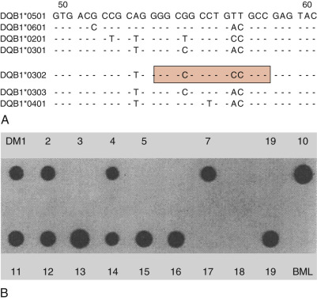

Figure 49-10 

**A,** Nucleotide sequences of several DQB1 alleles. The sequences presented cover the codons for amino acids 50 to 60. A dash indicates that the nucleotide is identical to the top sequence. An oligonucleotide that is specific for the DQB1*0302 sequence is boxed. **B,** Oligonucleotide dot blot analysis of 17 insulin-dependent diabetes mellitus patients (DM1 to 19) and one control, BML. Amplified DNA containing class II DQB1 sequences for the patients was attached to a membrane and hybridized to the labeled oligonucleotide specific for the DQB1*0302 sequence (described previously). Positive hybridization signals indicate the patients who carry this DBQ1 gene sequence (patients DM1, 2, 4, 7, 10 to 16, 19). 

(With permission from Todd JA, Bell J, McDevitt HO: HLA-DQ β gene contributes to susceptibility and resistance to insulin-dependent diabetes mellitus, _Nature_ 329:599, 1987.) 

In a related procedure, called the _reverse format,_ the oligonucleotide probes are bound to a solid support (  Bugawan et al, 1994  ). DNA from the samples to be tested is amplified using primers labeled with, for example, biotin. The amplified DNA is then hybridized to the immobilized probes, which contain sequences found in the alleles present in the DNA. After visualization (using an avidin-linked detection system), the pattern of hybridization can be read to determine the alleles present. This procedure is useful for typing both small and large numbers of samples. Commercial kits utilizing this method are available. 

 

##  Sequence-Specific Conformational Polymorphism or Heteroduplex Analysis 

Another, although little used, method of identification of HLA alleles analyzes the mobility of amplified DNA, either denatured (sequence-specific conformational polymorphism [SSCP]) or as a renatured DNA duplex (heteroduplex analysis), following electrophoresis (  Arguello et al, 1996  ). The mobility of the DNA is compared with the mobility of amplified DNA from known HLA alleles to define an HLA allele. This procedure is useful in typing a small number of samples, particularly in comparisons between individuals, for example, within a family. 

 

##  Nucleic Acid Sequencing 

A final method of identification of HLA alleles involves direct determination of the DNA sequences of the HLA alleles carried by an individual (sequence-based typing [SBT]). Alleles may be identified following PCR amplification to separate the alleles based on SSPs, or as a mixture of two alleles. Sequencing is labor-intensive and highly complex but is used frequently to determine the HLA match at an allele level between hematopoietic progenitor cell transplant patients and their prospective donors (  Petersdorf & Hansen, 1995  ;  Rozemuller & Tilanus, 1996  ;  Scheltinga et al, 1997  ). Efforts to develop automated SBT methods have yielded several potentially promising high-throughput approaches. These include the use of denaturing high-performance liquid chromatography (HPLC), which is reported to provide greater typing resolution than can be achieved by PCR-based sequencing approaches (  Etokebe et al, 2003  ), and the so-called _pyrosequencing technique._ Pyrosequencing is a real-time, nonelectrophoretic DNA sequencing method that uses luciferase-luciferin light emission as a detection signal as nucleotides are incorporated into target DNA. A unique signal is created for each allelic variant, which is distinguished by recognition software (  Nordstrom et al, 2000  ). Pyrosequencing by means of high-throughput systems permits processing of hundreds of individual specimens daily. In addition, reference-strand–mediated conformational analysis (RSCA) has been employed in high-throughput systems to achieve discrimination between HLA alleles differing by as little as one nucleotide. The technology detects differences between alleles by measuring their conformation-dependent mobility in polyacrylamide gels after they have been labeled with locus-specific fluorescent tags (  Arguello et al, 1998  ). 

 

##  Resolution of DNA-Based Typing 

The level of resolution (i.e., the ability to discriminate among alleles) obtained by DNA typing methods is controlled by the choice and number of primers and/or probes used in the assay and the typing method. This choice may depend on the time available for performing the typing, the cost of the typing, the expertise of the laboratory personnel, and the purpose of the typing. Large-scale donor registry typing is usually carried out at low to intermediate resolution, while typing of a potential hematopoietic progenitor cell donor for a specific patient is carried out at allele-level resolution. 

A multistep approach is often used to identify HLA alleles by DNA-based typing. For this reason, HLA types defined by DNA-based typing may be reported at different levels of resolution. Low-resolution (or generic or serologic)-level DNA-based typing produces a result that is similar in appearance and detail to a serologic type. For example, a DNA-defined type, DRB1*11 or DRB1*11XX, is the approximate equivalent of the serologic type DR11. The “XX” indicates that the allele was not further defined. At this level of resolution, it is not possible to determine which of the more than 30 DRB1*11 alleles is carried by the individual being tested. Although serologic typing can be as informative as low-resolution typing, results are more reliable with DNA-based testing. Intermediate-resolution–level DNA-based typing may narrow the choices by listing several different possibilities for the type of an individual (e.g., DRB1*1101 or DRB1*1104). Finally, high-resolution–level (or allele-level) DNA-based typing identifies the specific allele carried by an individual (e.g., DRB1*1104); for class II, a common strategy to resolve this type of ambiguity is to use reverse primers near polymorphisms at codon 86 (  Williams et al, 2004  ). Furthermore, because identification of HLA alleles may be based on partial sequence information, it is possible that interpretation of the results will miss alleles that were unknown at the time of the typing (  Hurley et al, 1997  ). For this reason, laboratories are cautioned to maintain their raw typing data (i.e., which primers and probes were positive and negative and the nucleotide sequences of the reagents) so that the results can be reinterpreted as new alleles are described. 

 

##  Serologic Detection of Class I and Class II Molecules 

Lymphocyte microcytotoxicity testing, which originally was used in the mouse system by Gorer and Amos and later was modified by Terasaki and McClelland for use in the human system, has been used for HLA typing since the 1960s. Serologic testing for HLA-A, -B can be reproducible under controlled, standardized conditions; however, in large-scale testing (e.g., for registries), error rates may increase (  Bozon et al, 1997  ;  Yu et al, 1997  ). The reproducibility for serologically determined HLA-C and class II specificities is much lower. HLA-DP is not usually defined by serology. The microcytotoxicity serologic assay still is used fairly widely for class I specificities (HLA-A, -B) but has been supplanted by DNA-based testing for HLA-C and for class II specificities (HLA-DR, -DQ, -DP) in most typing laboratories. DNA-based testing with its greater resolution is used to determine the HLA type of unrelated individuals and of family members, especially if the segregation of HLA cannot be accurately discriminated by serology (e.g., families where parents are not available, families where parents share an HLA antigen). For example, an offspring inherits DR4 from each parent and so is DR4 antigen homozygous (DR4,DR4). However, high-resolution DNA typing might identify two distinct alleles of the DR4 antigen, DRB1*0401 and DRB1*0403 (DRB1*04 allele heterozygote), providing informative data for haplotype segregation analysis. 

 

##  Lymphocyte Preparation 

Lymphocytes used routinely in HLA serologic typing assays are readily obtained from peripheral whole blood by layering onto a Ficoll-Hypaque gradient to separate the blood cells by density centrifugation. The separated peripheral blood lymphocytes (PBLs) can be used for HLA-A, -B, -C typing. To test for HLA-DR, -DQ serologic specificities, it is necessary to enrich for B lymphocytes, or to use a special two-color fluorescent technique to simultaneously differentiate between unseparated B cells and T cells. 

 

##  Lymphocyte Microcytotoxicity Assay 

The HLA phenotype is determined by testing the unseparated lymphocyte preparation (PBL) or T lymphocytes (for HLA-A, -B, -C) or the enriched B lymphocytes (for HLA-DR, -DQ) against a panel of well-characterized HLA alloantisera. The assay is a two-stage test. During the sensitization stage, the lymphocytes are incubated with the antisera. Prescreened and standardized rabbit serum as a source of complement is added in excess, and the mixture is incubated for an additional period. If the lymphocytes carry a cell surface molecule recognized by complement-fixing antibodies in the alloantiserum, the antibodies bind to the cells and the cells are subsequently lysed following the addition of complement. The assay is terminated with the addition of fluorescein diacetate and ethidium bromide for fluorescent detection procedures, or of eosin and formalin or trypan blue and ethylenediaminetetraacetic acid for dye visualization methods. Reactions are read for percentage lysis and are numerically graded. 

 

##  HLA Typing Sera Trays 

HLA typing reagents are derived from the sera of alloimmunized individuals (multiparous women, transplant recipients, multitransfused patients, and planned immunization of humans). Multiwell plates of human alloantisera (i.e., HLA typing trays) are commercially available. Because of the antigenic complexity of HLA antigens, several antisera should be used to define each specificity. Most laboratories use trays from at least two different vendors or may use locally derived alloantisera. Because many alloantisera are not truly monospecific and many exhibit some cross-reactivity, the reactivity of each antiserum must be thoroughly tested and known to the individual interpreting the results. This requires stringent quality control of each new lot of typing trays with well-characterized reference cells. The titer and the specificity of antibody formed by a sensitized individual may not remain constant over time; therefore, supplies of antisera are limited. In an attempt to create a consistent and unlimited supply of reagents, some companies have produced monoclonal antibodies. These monoclonal reagents are not available for all HLA specificities. 

 

##  Cross-Reactivity 

HLA alloantisera may react with more than one HLA allelic product. This phenomenon can result from polyspecificity of the antisera and/or from cross-reactivity and is responsible for the complex reactivity patterns of some alloantisera. Polyspecific sera contain two or more HLA-specific antibodies that can be adsorbed to remove one antibody with little effect on the reactivity of the other(s). Cross-reactive antisera contain, most frequently, a single antibody that reacts with an antigenic determinant shared among several different HLA allelic products (i.e., CREG or broad determinants, as previously discussed) (  Rodey et al, 1994  ). Cross-reactions occur most frequently among allelic products encoded by the same locus but can occur between allelic products encoded by different loci (e.g., A2 + B17). 

 

##  Cellular Detection of Class II Molecules 

The response of one cell in tissue culture to the alloantigens on the surface of a second cell is called the _mixed leukocyte culture_ or _mixed lymphocyte reaction_ (  Hartzman et al, 1971  ). The MLC is considered an in vitro measure of class II disparity between individuals that recognizes determinants found on class II molecules, which are known collectively as _HLA-D._ The T cell response is made unidirectional by preventing cells from one of the two individuals from replicating by treating those cells with radiation or mitomycin C prior to addition to the culture. The MLC represents a summation response of a responder cell to differences in the multiple determinants on HLA class II molecules (DR, DQ, and DP) encoded by the irradiated stimulator cell haplotypes. The response to DR molecules appears to predominate. 

Use of the MLC in clinical laboratories to determine histocompatibility has declined because of limitations inherent in the technique. The MLC can be influenced by the health of the patient, the type of disease, and the history of prior transfusion (  Mickelson et al, 1996  ). For these reasons, the MLC assay has been replaced by more precise DNA-based typing methods. Currently, in some transplantation centers, the MLC is used to identify renal allograft recipients with specific hyporeactivity to donor HLA molecules following transplantation as a guideline for tapering of immunosuppression (  Reinsmoen & Matas, 1993  ). 

Limiting dilution analysis to define the frequency of donor cytotoxic or helper T lymphocytes has been used to predict the extent of allorecognition in hematopoietic progenitor cell transplantation (  Madrigal et al, 1997  ). The correlations of these frequencies with subsequent events such as the extent of GVHD is still controversial. 

,  

##  Tissue/Organ Transplantation 

Long-term survival of solid organ and hematopoietic progenitor cell grafts represents one of the most challenging goals in medical science. Renal transplantation is the therapy of choice for most patients with end-stage renal disease. Hematopoietic progenitor cell, heart, lung, liver, and pancreas transplantation is gaining wide acceptance as a therapeutic procedure with successful outcomes. The primary obstacle to solid organ and to hematopoietic progenitor cell transplantation is immunologically mediated rejection of the foreign tissue. Therefore, the success of allografting is dependent on the ability to deter the immune reaction, which may be accomplished by (1) histocompatibility matching between the donor and recipient; (2) immunosuppressive therapy of the recipient (see [ Table 49-3 ](<#t0020>) for a list of common immunosuppressive drugs and laboratory approaches used to monitor them) (  Suthanthiran et al, 1996  ); and (3) ultimately achieving specific unresponsiveness to donor alloantigen(s) (i.e., tolerance) (  Remuzzi et al, 1995  ). 

TABLE 49-3 

Therapeutic Drugs, Mechanisms of Action, and Monitoring Methods 

Drug  |  Mechanisms of Action  |  Monitoring Methods [ * ](<#hl0000401>)  
---|---|---  
Azathioprine  |  Purine antagonist; blocks cell proliferation  |  Routine labs, pharmacokinetic studies, pharmacodynamic studies   
Glucocorticoids  |  Blocks cytokine gene transcription; inhibits T cell proliferation and T cell–dependent immunity  |  Routine labs, pharmacokinetic studies   
Cyclosporine  |  Inhibits expression of nuclear regulatory proteins and T cell–activation genes  |  Routine labs, pharmacokinetic studies, pharmacodynamic studies   
FK506  |  Inhibits expression of nuclear regulatory proteins and T cell–activation genes  |  Routine labs, pharmacokinetic studies   
Mycophenolate mofetil  |  Inhibits purine biosynthesis, thereby suppressing T and B cell proliferation  |  Routine labs, pharmacokinetic studies, pharmacodynamic studies   
Rapamycin  |  Inhibits DNA and protein synthesis, blocking T cell proliferation; inhibits antigen-driven B cell proliferation  |  Routine labs, pharmacokinetic studies, pharmacodynamic studies   
  
Adapted from Massey D, King A, Riley R: Renal allograft dysfunction in kidney transplant. American Society for Clinical Pathology, _Clinical Chemistry Check Sample_ 43:19–38, 2003. 

 * Routine laboratory tests include serum creatinine, blood urea nitrogen (BUN), complete blood count (CBC), liver enzymes, and so on. Pharmacokinetic studies include measurement of trough levels and calculation of area under the curve (AUC). Pharmacodynamic study refers to measuring the biologic effects of the drug at its target site. 

 

##  Genetic Basis of Transplantation 

The genetic basis of transplantation was first determined in 1916 as a result of tumor transplantation experiments in mice and was subsequently extended to transplants of normal tissue (  Snell, 1981  ). It was demonstrated that skin grafts within inbred strains that were homozygous at histocompatibility loci (i.e., syngeneic grafts) were successful, but grafts between two different inbred strains (allografts) were rejected. Furthermore, allografts from either parent inbred strain (two copies of the same MHC genes; homozygous) to first-generation (F1) hybrids (one copy of each of the two different sets of MHC genes from two homozygous parents) survived in all animals, whereas grafts from F1 hybrid offspring to either parent (one haplotype mismatch) did not survive. These observations established the laws of transplantation. In 1948, the factors or genes determining the fate of allografts were named _histocompatibility_ or _H genes._ Also in 1948, the major histocompatibility locus in the mouse, H-2, was defined by Gorer (  Snell, 1981  ). There are other histocompatibility or H antigens, which are termed _mHags._ Although called minor, mismatching for these antigens can have major effects (  Goulmy, 1997  ;  Dupont, 1998  ). 

Because convincing evidence already existed in experimental animal models that molecules encoded by the MHC represent the major genetic barrier to successful allografting, HLA typing was used in humans to determine and to optimize compatibility between graft donor and recipient. Initially, the influence of HLA antigens on graft survival was investigated by grafting of nonvascularized skin between family members. As in studies with inbred mice, skin grafts between HLA-identical siblings survived significantly longer than grafts between one-haplotype–matched siblings, parents, or unrelated donors. These observations were extended to renal transplantation during the late 1960s and early 1970s. The most recent data from the international Collaborative Transplant Study (CTS) in Heidelberg and from the United Network for Organ Sharing (UNOS) Registry in the United States (analyzed at the University of California, Los Angeles) confirm the MHC as the major genetic barrier to transplantation for renal grafts (  Cecka, 1999  ;  Opelz et al, 1999  ) ( [ Fig. 49-11 ](<#f0060>) ); for current updates, see the websites listed in [ Table 49-1 ](<#t0010>) . The data for hematopoietic progenitor cell transplantation also reaffirm the role of the MHC in transplant outcome as measured by both patient survival and GVHD (  Hansen et al, 1999  ) ( [ Fig. 49-12 ](<#f0065>) ). 

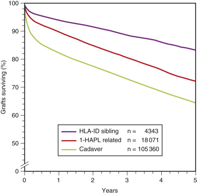

Figure 49-11 

Five-year renal allograft (first transplant) survival of three categories of histocompatibility: human leukocyte antigen (HLA)-identical siblings; one-haplotype living-related; and cadaver donor. 

Grafts from HLA-identical sibling donors (both HLA chromosomes matched) have the best outcomes. Numbers of transplants studied are indicated (regression, p <0.0001). 

(With permission from Opelz G, Wujcak T, Dohler B, et al: HLA compatibility and organ transplant survival, _Rev Immunogenet_ 1:334, 1999.) 

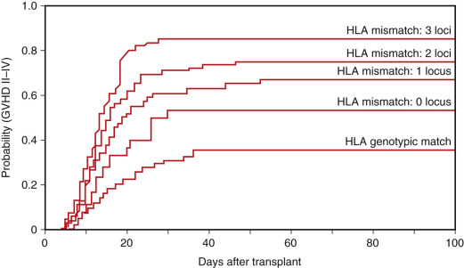

Figure 49-12 

Probability of grades II to IV acute graft-versus-host disease (GVHD) in human leukocyte antigen (HLA)-identical sibling (HLA genotypic match) and haploidentical related marrow donor transplants variably matched for HLA-A, -B, or DR/Dw (HLA mismatch: 3 loci, 2 loci, 1 locus, or 0 loci). 

Matching for HLA-A, -B, and -DR was defined by serology, and matching for HLA-Dw was defined by mixed leukocyte culture (MLC) or by typing for HLA-DRB1 alleles with sequence-specific oligonucleotide probe (SSOP). All patients received unmodified marrow (without T cell depletion) following a conditioning regimen that included total body irradiation. Cyclosporine and methotrexate were given for GVHD prophylaxis. 

(With permission from Hansen JA, Yamamoto K, Petersdorf E, et al: The role of HLA matching in hematopoietic cell transplantation, _Rev Immunogenet_ 1:359, 1999.) 

 

##  Histocompatibility Matching 

 

##  HLA Matching 

Although the level of HLA match is an important element in transplant outcome, histocompatibility matching means different things in different settings, and strategies for matching vary. Criteria differ with variables that include the type of graft (e.g., solid vascularized organ vs. hematopoietic progenitor cell), the disease (e.g., chronic myelogenous leukemia vs. aplastic anemia), the age of the patient, and the clinical protocol (e.g., marrow vs. umbilical cord blood; T cell depletion of marrow vs. non–T cell depletion) ( [ Chapter 38 ](<##!/content/3-s2.0-B9780323295680000383?scrollTo=%23c00038>) ). 

Matching usually includes evaluation of at least three loci: HLA-A, HLA-B, and HLA-DR. Individuals matched, at whatever resolution, for all three loci are termed _6/6 matches_ or _0 mismatches. Zero mismatches_ (a term used in solid organ transplantation) may also refer to donor/recipient pairs in which the donor has no detectable HLA differences from the recipient, that is, where the donor is homozygous for the alleles at one or more of the loci (e.g., homozygous donor: A*01:01; B*08:01; DRB1*03:01; heterozygous recipient: A*01:01, A*03:01; B*08:01, B*07:02; DRB1*03:01, DRB1*15:01). Individuals matched for four of six alleles or antigens are termed _4/6 matches._ Apparent differences in the level of match can arise because of the typing method used to assign HLA types (e.g., serologic vs. DNA-based typing). The serologic and DNA nomenclatures, although they are related, can differ. The definition of a match can also vary depending on the typing resolution. A patient and a donor may appear to be matched at the serologic level (e.g., recipient: A2, A26; donor: A2, A26); however, the pair may be mismatched at the level of HLA alleles (e.g., recipient: A*02:01, A*26:01; donor: A*02:05, A*66:01). 

Matching for classical HLA molecules at the allele level could optimize outcome for all grafts (both vascular organs and hematopoietic progenitor cells) (  Petersdorf et al, 1998  ;  Opelz et al, 1999  ). However, because of the extremely large number of HLA alleles, allelic-level matching is difficult. Therefore, the level of matching that ensures a good outcome for the largest number of patients of all ethnic populations must be considered. 

Following hematopoietic progenitor cell transplantation, subtypic determinants or allelic differences initiate important cytotoxic T cell responses leading to graft rejection and GVHD. Indeed, studies have shown that high-resolution matching for class I and class II alleles of the donor and recipient can improve outcome after unrelated marrow transplantation. Recent data suggest that multiple mismatches are detrimental to outcome; however, the impact of neither single mismatches nor specific loci has not yet been well defined (  Petersdorf et al, 1998  ;  Sasazuki et al, 1998  ;  Hansen et al, 1999  ). With respect to single-allele mismatches and their impact on transplantation, a report by  Flomenberg and colleagues (2004)  describes a differential impact of HLA mismatches at specific loci between donor and recipients. This multivariate analysis of more than 1800 donor-recipient pairs showed that single-allele mismatches at HLA-C adversely affected engraftment; mismatches at HLA-A, -B, -C, and -DR were significant in terms of grade III to IV acute GVHD incidence, and that the highest effect on this disease was given by mismatches at HLA-A, whether this was acute or chronic GVHD; mismatches at HLA-A, -B, -C, and -DR showed significant effects on mortality, and again HLA-A mismatches demonstrated the largest impact on survival, perhaps because single-allele mismatches at this locus appeared to induce resistant GVHD. Only a minority of patients awaiting transplantation will receive grafts from fully allele-matched donors (  Hurley et al, 2000b  ). To enable all patients to benefit from lifesaving transplantation, identifying allele mismatches that are well tolerated would allow the selection of mismatched donors to be prioritized according to the biologic risk of specific HLA mismatches. 

Optimal matching for solid organ grafts may differ from matching requirements for hematopoietic progenitor cell transplantation. Recent data suggest that both the HLA loci matched and the level of resolution of HLA testing contribute to renal graft outcome (  Opelz et al, 1999  ). Currently, UNOS facilitates sharing of cadaveric kidneys based on subtypic specificities. Because subtypic matches are infrequently identified, it has been proposed that the HLA class I molecules should be matched for the broader CREG determinants. CREG may define immunodominant determinants recognized in the humoral immune response.  Rodey and colleagues (1994)  showed that 80% to 90% of the HLA alloantibodies formed by kidney recipients following transplantation are directed to CREG determinants. CREG determinants are shared among different class I HLA molecules and, in contrast to subtypic specificities, have a similar distribution among ethnic population groups. Rare subtypic specificities are included within the CREG. Because the number of CREGs is less than the number of subtypic specificities, the probability of a CREG-level match is greater than for a subtypic or allele-level HLA class I match. Therefore, allocation of organs based on CREG matching should result in a higher probability of matched grafts being distributed equitably to recipients of all ethnic populations. CREG matching for the allocation of kidneys has been characterized as immunologically flawed, and its observed positive effect in prolonging graft survival and reducing immunosuppressant requirements has been attributed entirely to the effect of HLA matching (  Egfjord et al, 2003  ). Others cite a positive role for CREG matching in reducing HLA sensitization among minority recipients of renal transplants (  Crowe, 2003  ). 

Other strategies focus on matching for biologically relevant fragments of MHC molecules (e.g., epitope matching) (  Suciu-Foca et al, 1998  ;  Harris & Cortesini, 1999  ). Until recently, direct recognition of alloantigens was thought to be the main pathway for graft rejection responses. However, studies suggest that the indirect response plays a significant role in graft rejection, at least of solid organ grafts (  Sayegh & Carpenter, 1996  ). If the indirect pathway is activated, then the peptide epitopes generated by proteolytic breakdown of the HLA molecule and not the HLA molecule itself would be the immunogenic stimulus. Therefore, new innovative strategies can be designed for defining allowable mismatches based on recognition of the peptide fragments. For example, a strategy could consider whether the mismatched donor HLA molecules would be perceived as immunogenic in the recipient (i.e., whether the recipient HLA molecules would bind and present these epitopes). Theoretically, one could identify foreign HLA peptide sequences not presented by specific recipient HLA molecules and thus define allowable mismatches for given HLA molecules. The introduction of solid-based methods (Luminex, enzyme-linked immunosorbent assay [ELISA], and flow cytometry methods) for detecting antibodies to HLA molecules, in which eluted HLA molecules from cells are bound to polystyrene beads (or polystyrene microtiter plates), has allowed the more accurate identification of antibodies generated by patients awaiting transplantation. It is now possible to group HLA molecules based on the immunogenic epitope that is shared among them, thus allowing for better selection of donors for transplantation. The level of sensitization is more accurately interrogated by beads carrying HLA molecules of a single specificity (single-antigen beads), and absorption of alloantisera with these beads elucidates the epitope that the antibody is directed to and can be inferred by testing the unabsorbed and the absorbed serum with a panel of single-antigen beads; reduced panel reactivity in the absorbed serum defines the epitope specificity. Based on these absorption experiments,  Marrari & Duquesnoy (2009a  2009b)  and  El-Awar and colleagues (2007)  have reported several epitopes or Eplets shared by multiple HLA class I and II molecules. More recently, confirmed epitopes on HLA molecules can be found in the HLA Epitope Registry ( [ http://epregistry.ufpi.br/ ](<http://epregistry.ufpi.br/>) ); see also the Workshop report: a website for the antibody-defined HLA epitope registry (  Duquesnoy et al, 2012  ). Some laboratories are currently using this epitope registry to determine unacceptable antigens in donors based on the patient's immune reactivity assessed using single-antigen Luminex bead methods and the HLAMatchmaker algorithm (  Valentini et al, 2007  ), which predicts some of these epitopes. 

The inherent complexity in interpretation of HLA typing results and in selection of a donor makes it critical to include an expert in histocompatibility testing. Experts in HLA typing will know the strengths and weaknesses of each method of typing, as well as the frequency of alleles and haplotypes in the population; this information is important in both the search for and the selection of a suitable donor. 

 

##  HLA-Specific Antibody Detection in Recipient Serum 

Patients can be sensitized to specific foreign HLA molecules through transfusion, pregnancy, or prior transplantation. Assessment of compatibility between the recipient and the possible donor includes testing for this sensitization. Recipient serum is tested prior to transplantation on a panel (lymphocytes or immobilized soluble HLA molecules) of known HLA profile to measure panel reactive antibody (PRA). At the time of transplantation, the recipient serum is tested with the prospective donor lymphocytes to identify specific reactivity to the potential donor in the donor-specific cross-match. Although the techniques used to detect antibody binding may differ among laboratories, the purpose remains to obtain a profile of the immunologic risk factors of a recipient on the waiting list, which will aid the medical team in both pretransplantation and posttransplantation decisions. Binding of antibody in the current serum of the recipient to the T lymphocytes of the donor is a contraindication to renal transplantation. 

 

##  Serum Screening (PRA) 

Thorough characterization of the antibody profile in patients awaiting transplantation aids in interpretation of the pretransplantation donor-specific cross-match. The goals of a PRA screen are as follows: 

  * 1.

To identify the level of presensitization of the patient to HLA antigens. A patient with PRA in excess of 60% (i.e., serum from the patient reacts to specificities found in at least 60% of the panel) has a decreased likelihood of a negative donor-specific cross-match and thus of receiving a transplant from an unrelated transplant. 

  * 2.

To identify the HLA specificity of the antibodies to predict the HLA antigen(s) to be avoided when donors are selected. 

  * 3.

To identify patients with irrelevant antibodies (e.g., immunoglobulin [Ig]M autoantibodies) so that appropriate techniques may be selected to avoid false-positive readings at the time of the donor-specific cross-match. 

Characterization of HLA-specific antibody present in the recipient serum requires testing on a selected panel of well-defined HLA specificities. Lymphocytes or soluble antigen from a sufficient number of individuals must be included in the screening panel to ensure that all but the rarest HLA-directed antibody will be detected. As far as possible, the screening panel should remain the same so that results are comparable over time. Renal transplantation recipients frequently form antibodies to CREGs rather than to subtypic specificities (  Rodey et al, 1994;  1997  ), so the analyses of panel reactivity should consider identification of CREG, as well as of subtypic specificities. Identification of antibody specificities in patients awaiting transplantation aids in preselecting a potential donor for whom the recipient will have a negative final cross-match. Computer programs assist in this selection (  Claas et al, 1999  ;  Duquesnoy et al, 1999  ). 

The frequency of screening and the selection of assays used for the screening procedure are decisions based on the immunologic profile of the individual recipient. Decreased use of blood transfusions has negated the requirement for screening monthly serum samples on all patients (ASHI website; see [ Table 49-1 ](<#t0010>) ). The presence of both HLA class I– and class II–specific antibodies is detected by serum testing on a panel of lymphocytes (e.g., by direct complement-dependent cytotoxicity or antiglobulin-augmented cytotoxicity assays) or on a panel of soluble HLA molecules immobilized on plates (i.e., ELISA) or on beads (i.e., flow cytometry). (The assays are described in detail in the ASHI Manual [2001].) An advantage of the solid-phase soluble antigen assay is that it can be designed to detect only IgG, HLA class I–specific antibodies. 

Serum samples from potential recipients should be stored at −70° C and protected from carbon dioxide and from evaporation. The stored characterized serum samples will be used in the donor-specific cross-match to assess compatibility with a prospective donor. 

 

##  Donor-Specific Cross-Match 

The lymphocyte cross-match tests for the presence of antibodies, if any, in the serum of the potential recipient that react with lymphocytes of the specific donor. In the cross-match test, the lymphocyte is the target cell of choice because it expresses high levels of HLA molecules and is easy to isolate. This test is probably the most important contribution of the HLA tissue typing laboratory to clinical renal transplantation. The purpose of the cross-match is to prevent hyperacute rejection and to detect antibodies that identify immunologic risk factors in patients awaiting transplantation. The occurrence of hyperacute rejection is significantly correlated with a positive direct complement-dependent cytotoxicity (CDC) cross-match between donor T lymphocytes and recipient serum at the time of transplantation. Reactivity of current valid serum of the recipient to the T lymphocytes of the donor is a contraindication to renal graft transplantation. Detection of donor-reactive antibodies in noncurrent recipient serum samples is not a contraindication but may represent risk for graft loss other than immediate hyperacute rejection (  Cardella et al, 1982  ;  Geddes et al, 1999  ). A donor-specific cross-match also is used in some centers to predict hematopoietic progenitor cell graft failure (  Hansen et al, 1997  ). 

Requirements and methods for the donor-specific cross-match are stated in the standards of the American Society for Histocompatibility and Immunogenetics (see [ Table 49-1 ](<#t0010>) ) and in the ASHI Procedure Manual (2001). Acceptable techniques at present include the Amos-modified CDC, the extended incubation-time CDC, the antiglobulin-augmented CDC, and flow cytometry. 

 

##  Antibody-Detection Techniques 

Different laboratories may use different combinations of assays to detect antibody. The level of sensitization detected will vary with the assay. The antibody specificity detected will vary with the target cell. 

 

##  Direct Complement-Dependent Cytotoxicity 

Direct CDC includes all assays that use the addition of complement to detect the direct binding of antibody to lymphocytes. Fixation of complement by the antibody-antigen complexes on the cell surface results in cell death or cytotoxicity. CDC methods include the basic technique (no wash step before addition of complement), the Amos-modified technique (wash step added before addition of complement), and extended-time incubation techniques. The wash step removes serum, which may contain substances that hinder complement activation. The advantages of direct CDC techniques are that they are reproducible, and that correlation with the incidence of hyperacute rejection is excellent. 

 

##  Indirect Cross-Match Techniques 

Indirect techniques include the antiglobulin augmented lymphocytotoxicity assay technique (also known as _anti-human globulin cytotoxicity assay_ ), and flow cytometry. Both use a reagent specific for human immunoglobulin to augment detection of HLA-directed antibody. Indirect techniques detect the presence of antibodies specific for CREGs that frequently go undetected in direct CDC assays. Advantages of the flow cytometry assay include discrimination of the subclass of the cell-bound immunoglobulin (IgG vs. IgM) and characterization of the target cell binding the alloantibody (T lymphocyte vs. B lymphocyte vs. monocyte). 

 

##  Autoantibodies 

The presence of circulating autoantibodies in the recipient is not known to be deleterious. Thus, an auto–cross-match should be performed, preferably when the patient is put on the transplantation waiting list. If autoantibodies are present, the sera used for donor cross-matching should have the autoreactivity removed. Autoantibodies are primarily IgM, and HLA-specific antibodies are primarily IgG (  Barger et al, 1989  ). Either heat inactivation at 63 ± 1° C or reduction with the chemical agent dithioerythritol or dithiothreitol (DTT) of any potential IgM antibodies is used to differentiate between IgM and IgG antibodies in the serum samples. If the heat-inactivated or DTT-treated serum sample is negative even though the untreated sample is positive, most centers will proceed with transplantation. However, DTT or heat inactivation should be used with caution because not all HLA-specific antibodies are IgG, and because if they are not properly controlled, both procedures can remove IgG activity, as well as IgM. 

 

##  B Cell Antibodies 

A cross-match using donor B lymphocytes (B cell cross-match) may be performed in sensitized patients in some centers. A positive donor-specific B cell cross-match is not a contraindication to transplantation. The clinical significance has not been resolved, but a positive test may be a risk factor, particularly in patients who have previously been transplanted. Antibodies detected in a B cell cross-match can be (1) class II, HLA-DR, -DQ–specific, (2) weak HLA-A, -B, -C–specific antibodies (B cells have a higher density of class I molecules and are more sensitive to complement-dependent assays than are T cells), and/or (3) non–HLA-specific antibodies (e.g., autoantibodies). To interpret a positive B cell cross-match, it may be necessary to adsorb recipient sera with platelets before performing the donor cross-match. (Platelets express class I but not class II molecules.) The two most commonly used B cell cross-match techniques are the CDC and flow cytometry assays. 

 

##  Selection of Recipient Serum Samples for Donor Cross-Match 

For patients with no detectable sensitization (i.e., 0% PRA), the most recent serum sample available can be used for the donor-specific cross-match. If the patient has preexisting antibodies or has had a recent sensitizing event, a current serum sample (i.e., within 48 hours of transplantation) should be collected. For sensitized recipients, representative samples, including the most reactive or “peak” serum sample, are tested in most centers; a donor-positive noncurrent sample may be considered to be a risk factor, particularly in a patient who rejected a primary graft early in the posttransplantation period (  Mahoney et al, 1996  ). 

 

##  Renal Transplantation 

Current practice is to select donors for recipients who are ABO compatible, T cell, donor-specific, cross-match negative with appropriate recipient sera and the best available HLA match. The original finding that kidney grafts transplanted between HLA-identical siblings survive significantly longer than grafts transplanted between HLA-mismatched siblings or parent-sibling combinations has been consistently confirmed. [ Figure 49-11 ](<#f0060>) shows a recent analysis of 5-year survival of renal allografts from the international CTS registry among three categories of donors: (1) HLA-identical sibling, 84% survival; (2) one-haplotype living-related, 73% survival; (3) all cadaver, 66% survival. The impact of matching for MHC in living-related transplantation is clearly observed by comparing categories 1 and 2. Similar results are observed in the UNOS database (  Cecka, 1999  ). 

Although outcome analyses of living-related grafts confirm the role of the MHC as the major genetic barrier to successful graft outcome, demonstration and acceptance of a positive influence of HLA matching in graft outcome for unrelated cadaveric transplantation have been more controversial. However, long-term survival data from collaborative multicenter studies are consistent in showing a highly significant effect of HLA matching on graft survival in cadaveric renal transplantation (  Cecka, 1999  ;  Opelz et al, 1999  ). Moreover, two recent single-center studies—one from Europe (Oslo) and one from North America (Toronto)—have reported significant improvement in graft survival as a function of HLA match (  Geddes et al, 1999  ;  Leivestad et al, 1999  ). A single center may require prioritization based on HLA match to transplant sufficient recipients with well-matched grafts to achieve statistical significance in outcome analysis. Although the numbers are smaller, a highly significant influence of HLA matching has been observed on the outcome of kidney grafts from living-unrelated donors (  Opelz et al, 1999  ). 

Closely matched grafts from cadaver donors survive significantly better than and approximately as well as grafts from HLA-identical siblings (see [ Fig. 49-11 ](<#f0060>) ); thus, UNOS, based on high PRA (99% and 100%), recommends the sharing of highly matched kidneys regionally and nationally, respectively. Graft survival in patients following first kidney transplantations decreases stepwise as the number of mismatches increases from 0 MM to 6 MM (  Cecka, 1999  ;  Opelz et al, 1999  ). However, to ensure equitable sharing of organs for all recipients, including those with rare HLA haplotypes, new algorithms for prioritizing recipients on the waiting list have been adopted by organ-sharing programs (  Opelz et al, 1999  ). The most recent outcome data for both graft and patient survival can be accessed through the CTS website ( [ www.ctstransplant.org ](<http://www.ctstransplant.org>) ). 

Matching of the initial graft not only increases survival time for that graft, but it decreases the probability of recipient sensitization and facilitates retransplantation. Accumulation of highly sensitized patients on the waiting list is a significant problem in many centers, as patients wait for long periods of time and may present difficult clinical management problems (  Sanfilippo et al, 1992  ). 

 

##  Nonrenal Organ Transplantation 

Survival of heart, liver, lung, and pancreas grafts is good, with between 58% and 67% of first grafts surviving at 5 years. Donors usually are not matched for HLA type, and a pretransplant donor cross-match is not routinely performed. Serum antibody screens are recommended to identify the state of sensitization as an immunologic risk factor for the recipient. If feasible, the graft recipients and cadaveric donors of nonrenal vascularized grafts should be typed for HLA to allow for retrospective analyses. Recent international CTS data show no effect of HLA matching on outcomes of liver transplantation; however, the CTS data do show a significant impact of matching for HLA-A, -B, and -DR on outcomes of first heart transplants (  Opelz et al, 1999  ). The acceptable period for cold ischemia preservation may limit the extent of HLA matching possible for heart transplantation. 

 

##  Allogeneic Hematopoietic Progenitor Cell Transplantation 

Allogeneic hematopoietic progenitor cell transplantation is performed for hematologic malignancies and disorders, bone marrow failure, certain inherited metabolic disorders such as lipid storage diseases, and congenital immunodeficiency syndrome. From a histocompatibility standpoint, the best donor is either self (autogeneic transplant), if the malignancy is not one that involves the bone marrow or the disease is not genetic, or an identical twin (syngeneic transplant). Progenitor cells from an HLA-identical sibling donor are a frequent source. These donor cells usually will be genetically identical to cells of the patient across the entire MHC region. Use of a sibling donor also increases the probability that non-HLA genes that might affect transplantation success and that are not well defined (i.e., minor histocompatibility genes) will be matched (  Goulmy, 1997  ). Haploidentical family members may also be chosen as donors (  Aversa et al, 1998  ), although a greater risk for severe GVHD is associated with mismatched HLA donors. Based on data from the International Bone Marrow Transplant Registry (IBMTR) (see [ Table 49-1 ](<#t0010>) ), more than 16,000 allogeneic bone marrow transplants were performed from 1996 to 1997; 75% used related donors. 

Most patients (≈70%) do not have an HLA-matched sibling and may be considered for transplantation with cells from an HLA-matched, unrelated donor. To facilitate the search for a matched donor, national registries of unrelated donors have been developed around the world (  Hansen, 1996  ). The NMDP in the United States is such a registry and contains more than 3.9 million HLA-typed donors, making it the largest unrelated donor registry in the world (  Perkins & Hansen, 1994  ; see [ Table 49-1 ](<#t0010>) ; [ www.marrow.org ](<http://www.marrow.org>) ). 

Hematopoietic progenitor cell grafts are among the most difficult of all clinical procedures for several reasons (  Hansen et al, 1997  ;  Madrigal et al, 1997  ). First, at the time of transplantation, the recipients are nearly totally immunodeficient, either because of inherited deficiency (severe combined immunodeficiency) or because of pretransplantation conditioning (cytotoxic chemotherapy and irradiation). Conditioning is required to eliminate malignant cells and to prevent the immune system of the recipient from rejecting the donor progenitor cells, which are infused several days after conditioning. The amount of cytotoxic pretreatment is great enough to eliminate circulating leukocytes, nearly eliminate platelets, and abrogate production of new erythrocytes. Thus, the recipient is profoundly susceptible to all types of infection and would certainly die if not rescued by extraordinary medical care and transfused progenitor cells. 

The second risk is the potential for immunologic attack of the recipient by the transplanted allogeneic progenitor cells, resulting in GVHD. GVHD has several forms and can be fatal. In spite of associated difficulties, a number of transplant centers have achieved exceptional success. Recent reports from single institutions and the IBMTR suggest leukemia-free survival of 40% to 60% at 5 years after unrelated hematopoietic progenitor cell transplantation of patients with chronic myelogenous leukemia in chronic phase (see [ Table 49-1 ](<#t0010>) ) (  Hansen et al, 1998  ). Survival for patients with severe aplastic anemia transplanted with cells from unrelated donors varies from 30% to 50% at 5 years, depending on patient age (see [ Table 49-1 ](<#t0010>) , NMDP, at [ www.marrow.org ](<http://www.marrow.org>) and [ www.ibmtr.org ](<http://www.ibmtr.org>) ); survival rates of nearly 90% have been reported at some centers (  Deeg et al, 1998  ). 

In addition to marrow as a source of hematopoietic progenitor cells, collection of hematopoietic progenitor cells from growth factor–mobilized peripheral blood (  Anderlini et al, 1997  ) or umbilical cord blood progenitor cells (  Cairo & Wagner, 1997  ) increases the availability of unrelated donors. New approaches to immunosuppression, including less aggressive conditioning protocols (e.g., “minitransplants”) (  Storb et al, 1999  ), may extend the availability of progenitor cell transplantation as a therapeutic procedure to patients presently excluded by age or by organ dysfunction. Hematopoietic progenitor cell transplantation can also be used to generate immune responses directed at malignant cells. Relapse of disease following transplantation is greater for patients receiving an HLA-matched graft, suggesting that some degree of mismatching may be beneficial in stimulating an immune response against tumor cells (  Beatty et al, 1993  ). As problems surrounding this most difficult procedure are overcome, hematopoietic progenitor cell transplantation may become one of the most widely used methods for the treatment of a variety of diseases ( [ Chapter 38 ](<##!/content/3-s2.0-B9780323295680000383?scrollTo=%23c00038>) ). 

 

##  HLA Typing for Progenitor Cell Transplantation 

Many factors, including histocompatibility, influence the outcome of hematopoietic progenitor cell transplantation (  Madrigal et al, 1997  ). The pretransplantation workup includes HLA-A, -B, and -DR typing of all available members of the immediate family to identify a matched related donor and to establish inheritance of haplotypes. DNA-based typing for class II genes has become standard, and DNA-based typing for class I genes has been implemented in many centers. Typing of the extended family, allele-level (i.e., high-resolution) typing of specific HLA class I and class II loci, typing of other loci within the MHC (i.e., short tandem repeats or complement loci), or use of other tests (e.g., cross-matching, cytotoxic T cell precursor measurements) to measure compatibility may also be appropriate (  Hurley et al, 1999  ). 

The level of HLA typing resolution required differs for hematopoietic progenitor cells and renal transplantation. It is likely that higher-resolution HLA typing is required to match the donor and recipient for progenitor cell transplantation than is required for renal transplantation because progenitor cell transplantation involves the transfer of an entire immune system to the patient. Current research is focused on defining the loci that must be considered in donor selection, the level of resolution that must be used for matching, and the additive effect of multiple mismatches. The level of matching required may vary for each disease or protocol. Evidence suggests that matching unrelated donor and recipient for HLA-A, -B, -DRB1 alleles is related to improved outcomes. The impact of matching at other HLA loci (e.g., HLA-C, HLA-DQ) is under evaluation. Single mismatches may be tolerated; however, multiple mismatches appear to have a negative impact on outcome (  Petersdorf et al  1995  ;  Hansen et al, 1997  ;  Madrigal et al, 1997  ;  Sasazuki et al, 1998  ). Furthermore, the positive effect of histocompatibility matching on outcome must be balanced by the positive impact of transplantation early in the course of the disease. Data from the IBMTR and the NMDP show that survival following transplantation is reduced as the disease phase advances (data on websites listed in [ Table 49-1 ](<#t0010>) ). 

,  

##  Summary 

The HLA class I and class II molecules encoded within the major histocompatibility complex have a significant role in the specificity and character of immune responses. Extensive polymorphism of these molecules provides the diversity needed to ensure survival in an environment of hostile and adaptive pathogens. Unfortunately, this ability of the immune system to distinguish self from nonself extends to the recognition of foreign HLA molecules following tissue transplantation. Definition and characterization of HLA alleles and molecules have been combined with clinical protocols to maximize compatibility and to minimize the impact of the immune response on foreign tissue. These advances have contributed to the development of transplantation as a successful treatment modality for the replacement of diseased tissue. 

,, 

## Selected References

* Aguado B, Bahram S, Beck S, et. al.: Complete sequence and gene map of a human major histocompatibility complex. Nature 1999; 401: pp. 921.
* _Contains the first complete sequence and gene map of an MHC region and represents the collaborative effort of an international group of researchers._
* Arguello JR, Little AM, Bohan E, et. al.: High resolution HLA class I typing by reference strand mediated conformation analysis (RSCA). Tissue Antigens 1998; 52: pp. 57-66.
* _Describes the use of RSCA in separating polymorphic HLA alleles using an automated technology that may provide rapid high-throughput HLA analysis with the additional advantages of time and cost savings._
* Etokebe GE, Opsahl M, Tveter AK, et. al.: Physical separation of HLA-A alleles by denaturing high-performance liquid chromatography. Tissue Antigens 2003; 61: pp. 443-450.
* _Describes the application of HPLC to the task of identifying polymorphic HLA-A alleles in an automated high-throughput setting._
* Nordstrom T, Ronaghi M, Forsberg L, et. al.: Direct analysis of single-nucleotide polymorphism on double-stranded DNA by pyrosequencing. Biotechnol Appl Biochem 2000; 31: pp. 107-112.
* _Describes the technology behind pyrosequencing and its specific application to the tasks of sequencing and verifying the presence of single nucleotide polymorphisms in double-stranded DNA._
,
