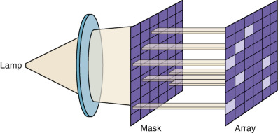
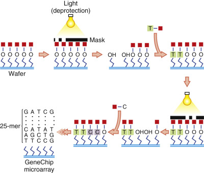
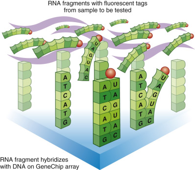
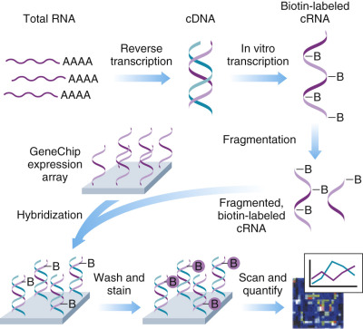
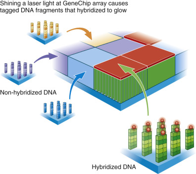
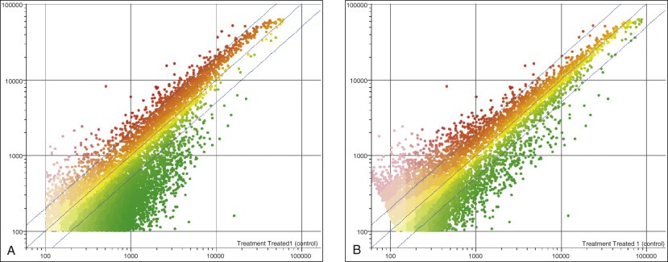
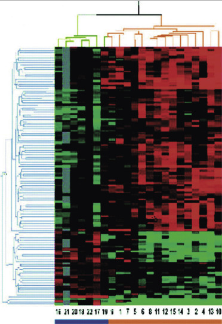

## Key Points

  * •

Array technology provides a unique and powerful approach to screen a sample for dozens to thousands of genes. 

  * •

Current array fabrications allow for diverse platforms with better detection and reduced cost for high-density applications. 

  * •

Positive signals are generated when a tagged nucleic acid moiety hybridizes with its complementary probe localized on a solid support (i.e., “chip”). 

  * •

Care must be taken when performing and interpreting microarray experiments, because numerous factors must be considered in analysis. 

  * •

Numerous applications of array technology have been proposed in the past few years, ranging from molecular staging of tumors to the identification and characterization of microbial agents. 

  * •

Improvement of quality and yield of nucleic acid extraction from fixed and frozen tissues combined with continued miniaturization and cost reduction of platforms are making array technology more commonplace and user friendly. 

In only a few short years, hybridization array technology, which enables the performance of thousands of simultaneous hybridization reactions on a solid substrate within a single analytical procedure, has gone from theoretical construct to practical reality. Such massively parallel determinations offer previously unimaginable opportunities for diagnostic application, ranging from gene sequencing and detection of genetic polymorphisms to measurement of gene expression profiles in cancer cells. Microarray-based systems offer a platform for quantifying the expression of thousands of genes at the same time. Therefore, an unprecedented advantage of this technology is that it affords analysis of whole cassettes of genes, or patterns of gene expression, rather than analysis of one, two, or three genes at a time. The general schema for microarray processing includes the generation of nucleic acid (i.e., deoxyribonucleic acid [DNA]) complementary to genes of interest that is laid out in microscopic quantities on solid surfaces at defined positions (the “probe”) nucleic acid (genomic DNA or complementary DNA [cDNA]) from samples is added over the surface—cDNA binds and the presence of bound DNA is detected by fluorescence following laser excitation (for a general review, see  Friend & Stoughton, 2002  ). 

It is clear that hybridization array technology has revolutionized the way we approach the study of disease. The one gene–one protein–one function approach is no longer the mainstay of scientific design. Array technology introduced a complicated mirror image of this approach—in other words, multiple functions, multiple proteins, multiple genes. The power of this technology lies in the “screening” capability that it provides. Under defined experimental conditions, one now has the ability to determine changes in the patterns of genes, identifying multiple genes acting in concert. These patterns can then be “mined” through various computer algorithms, grouped into functional categories (e.g., respiratory genes, inflammatory genes), and used to derive signatures diagnostic of disease or to generate novel hypotheses about pathogenesis and cell function. The relationship of these genes to one another (increased versus decreased expression) are determined and generally expressed as fold-change. Microarray findings of differential gene expression require confirmation by other techniques such as quantitative reverse-transcriptase polymerase chain reaction (RT-PCR) or additional independent microarray studies. 

Once candidate genes or groups of genes are identified, classic approaches to gene function (i.e., gene knockout or gene knockdown) can then be employed to elucidate or validate gene function. More importantly, hybridization array technology, with subsequent data mining, allows genes not previously known to be associated with the disease to be considered, generating new paradigms for future study. Similar platforms can be used to sequence large genes and to scan the genome for single nucleotide polymorphisms and methylation sites. This chapter reviews the theoretical basis for the various matrix hybridization platforms and provides a perspective on their clinical application, both currently and in the future. 

,  

##  Array Technologies 

A hybridization array is the molecular equivalent of a spreadsheet, where each cell or address reveals a specific piece of data, usually inferred from the binding of a ligand to its specific target. The first array-based methods were exploited in immunoassays (  Ekins & Jackson, 1987  ;  Ekins & Chu, 1999  ), and arrays also have been proposed for parallel studies of diverse targets such as proteins, lipids, carbohydrates, and small molecules (  Fodor et al, 1991  ;  Pirrung et al, 1992  ;  Southern, 1996a  ;  Guschin et al, 1997  ;  Schena et al, 1998  ). Similar to antigen–antibody interactions on immunoarrays, the fundamental principle of nucleic acid arrays is detection of specific hybridization between complementary strands. The principles of nucleic acid hybridization and an overview of various platforms are covered in [ Chapter 66 ](<##!/content/3-s2.0-B9780323295680000668?scrollTo=%23c00066>) . The effectiveness of solid-support hybridization formats was pioneered with the use of nitrocellulose membranes (  Gillespie & Spiegelman, 1965  ) for dot blots (  Kafatos et al, 1979  ), line probes, and Southern blots (  Southern, 1975  ). Changing the labeled entity from the probe to the sample was first referred to as _reverse line-blot_ (or _dot blot_ ) hybridization, and led to the beginning of interrogating one sample for multiple potential targets. Moving from dozens to thousands of targets has come about rapidly over the last few years, driven in part by the unique convergence of microfabrication, robotics, and bioinformatics technologies and the demand for high-throughput genetic analysis resulting from the Human Genome Project. 

The field is bursting with potential, and many investigators foresee diagnostic and prognostic applications in tumor classification, chemotherapeutic responsiveness, pathogen detection, monitoring antibiotic resistance, and characterizing inflammatory responses. Array technology may make the dream of personalized molecular medicine, where the genes of an individual patient may be assessed for risk factors and disease susceptibility and to predict response to therapy, a reality. Studies using gene expression profiling to predict diseases include identifying which trauma and burn patients will develop sepsis and multisystem organ failure ( [ www.gluegrant.org ](<http://www.gluegrant.org>) ); genes involved in the pathogenesis of chronic obstructive pulmonary disease (  Wang et al, 2008  ); and which patients would likely have recurrence of cancer (  Potti et al, 2006  ), among others. However, challenges of reproducibility and laboratory quality control remain to be addressed before this enormous potential is realized. 

 

##  Macroarrays 

The term _macroarray_ has been applied to formats in which areas of probe localization, often called _features_ , are large enough to be visualized without magnification. These have been manufactured on nylon or nitrocellulose membranes or as plastic strips with linear arrays of bound target. Because of the size of the features, the density of macroarrays is much lower than microarrays, ranging from a few dozen to hundreds or even thousands of probes. They are usually deposited onto the membrane by printing or dot blotting, and then dried and stored for future use. 

Nylon, plastic, and glass (silicon wafer) are standard supports to make macroarrays. Nylon suffers several drawbacks when compared to silicon, which is a preferred matrix for hybridization arrays. Besides its porous nature, nylon displays high autofluorescence, limiting the sensitivity of fluorescence-based detection because of high background values. The latter also precludes the possibility to develop ratiometric (or two-color) assays. This approach uses two targets, each labeled with a different fluor. Most commonly, one is a constant reference control used in direct comparison to the unknown sample, with results expressed as a ratio of the two emitted fluorescent signals (  Duggan et al, 1999  ). 

Macroarrays are currently used for targeted applications. For example, some commercial arrays target all the known cytokine genes or those within specific signal transduction pathways that are activated during infectious and inflammatory processes. Other arrays, targeting the genes altered during oncogenesis, have been used in cancer research (e.g., Atlas Human Arrays, Clontech, Palo Alto, Calif., or GeneFilters, Research Genetics, Huntsville, Ala.). Other commercial applications, usually in kit format, are used to detect and type specific PCR products, such as in the cystic fibrosis mutation screen, human leukocyte antigen typing, or human papillomavirus typing. Furthermore, nylon-based arrays have been used to detect bacterial colony–based gene expression (  Barsalobres-Cavallari et al, 2006  ) and thyroid cancer detection (  Durand et al, 2008  ). The advantages of macroarrays include the ability to use standard hybridization equipment, simplified reading or scanning, and affordability. 

Some groups have been successful in producing high-density nylon arrays on a custom basis for gene discovery purposes (  Gress et al, 1992  ;  Takahashi et al, 1995  ;  Granjeaud et al, 1996  ;  Pietu et al, 1996  ;  Clark et al, 1999  ;  Durand et al, 2008  ). Even in high-density configurations, the size of the nylon arrays requires a relatively large volume of hybridization fluid, a practical limitation with respect to generating a probe from small amounts of diagnostic material. Because microarrays, rather than macroarrays, represent the high-density, high-throughput platform of choice, the bulk of this chapter focuses on applications of microarrays. 

 

##  Microarrays 

Assay miniaturization saves time while cutting costs in biomedical diagnostic applications and research. Working with smaller volumes reduces reagent consumption, increases sample concentration, and improves reaction kinetics. These improvements allow the investigator to determine hundreds or thousands of results in the time formerly required for a single experiment. Microarrays are now available from several commercial suppliers, along with reading and fabrication equipment for custom manufacture of dedicated arrays for specific research or diagnostic applications. 

 

##  Microarray Substrates 

A major distinction between microarrays and macroarrays consists of the choice of a nonporous solid support. By preventing diffusion of the target nucleic acids, nonporous surfaces (plastic, glass, or silicon substrates) allow faster hybridization kinetics and easier washing steps. In order to allow spatial discrimination of numerous reactions performed simultaneously, the molecular probes are bound to a solid surface in defined arrays. Deposition of probes on a solid substrate is also more amenable to automation and enables higher array densities with optimal image definition. These features apply to any type of microarray, from synthetic oligonucleotides to cloned cDNAs or PCR products (  Southern et al, 1999  ). Most microarrays are now developed on glass. As opposed to plastic derivatives, glass transparency and lack of autofluorescence allows low-background, fluorescence-based detection. However, as materials science becomes more involved in array technologies, alternative substrates, including coated glass and plastic substrates, may become available. 

 

##  Microarray Fabrication 

3′-End functionalization (i.e., chemical modification) of nucleic acids—oligonucleotides, PCR products, cDNAs, or peptide nucleic acid oligomers—is required for covalent immobilization on either glass or polypropylene surfaces (  Matson et al, 1995  ;  Beier & Hoheisel, 1999  ). For example, treatment of glass slides with silane allows amino-covered glass to bind amino-linked probes, using bifunctional molecules such as a dialdehyde or a diisothiocyanate (  Case-Green & Southern, 1994  ;  Guo et al, 1994  ). Alternatively, glass coating with a polycation (e.g., polylysine) allows direct charge-coupled binding of polyanionic DNA probes (  Maskos & Southern, 1993a  ); an ultraviolet photo-cross-linking step adds covalent bonds to the ionic interaction. Covalent binding is essential to permit stringent washes and therefore accurate discrimination of hybridized species. Several protocols have been published to address surface activation (  Maskos & Southern, 1992  ;  Beattie et al, 1995  ;  Matson et al, 1995  ;  Beier & Hoheisel, 1999  ). An interesting alternative consists of deposition of small patches of activated polyacrylamide to which presynthesized oligonucleotides are attached by microinjection (  Khrapko et al, 1991  ;  Yershov et al, 1996  ;  Guschin et al, 1997  ). 

Packing density of probes attached to solid surfaces will influence greatly the performance of hybridization matrices. Poor coupling efficiency, which is often encountered on glass matrices, can result in low probe density and low signal : noise ratios. On the other hand, overly dense packing of oligonucleotides onto a solid surface causes spatial hindrance. This problem may be even more formidable with longer biomolecules such as cDNAs. Hybridization yields can be increased by up to two orders of magnitude by introducing spacers between the surface and the oligonucleotides (  Southern et al, 1999  ). The longer the spacer, the better the hybridization, but, interestingly, there is an optimal spacer length beyond which hybridization yield declines (  Shchepinov et al, 1997  ;  Duggan et al, 1999  ). For example, a 40-carbon atom spacer provides a reported 150-fold hybridization enhancement (  Shchepinov et al, 1997  ). The density of oligonucleotides is approximately 0.1 pmol/mm  2  on a glass surface, two orders of magnitude less than on aminated polypropylene. Thus a potential advantage of glass over plastic matrices at present is an optimal oligonucleotide density associated with lower spatial hindrance (  Southern et al, 1999  ). Improved surface chemistries may one day allow production of arrays on plastic sheets or films, which may dramatically reduce production costs. To this end, film-based chip arrays have recently been described (  Erali et al, 2009  ). 

The terminal composition (5′ end) of the oligonucleotides influences their duplex yield as measured by relative intensity. As expected, G : C rich 5′ extremities lead to a better yield than their homologues (same composition but different sequences) (  Maskos & Southern, 1993b  ). Approaches to modify the 5′ end of oligonucleotides (e.g., covalent addition of a degenerated linker) can therefore be considered to minimize this contribution. Alternatively, knowledge that mismatches at the ends are less destabilizing and therefore more difficult to discriminate by hybridization (  Southern et al, 1999  ) has led to clever improvements for detection of hybridization events. Because polymerases and ligases are most sensitive to terminal (as opposed to internal) mismatches, enzymatic methods have been developed with improved detection stringency (solid-phase minisequencing [  Pastinen et al, 1997;  1998  ;  Syvanen, 1999  ], genetic-bit analysis [  Nikiforov et al, 1994  ], or ligation-assays [  Landegren et al, 1988  ;  Nickerson et al, 1990  ]). 

Commercially available arrays have been previously reviewed by  Marshall and Hodgson (1998)  . Fabrication of microarrays falls into two broad categories: those made by direct probe delivery onto the solid surface and those made by in situ synthesis. A third method, which was developed by Nanogen (San Diego), consists of prefabricated oligonucleotides captured onto electroactive spots on silicon wafers (  Edman et al, 1997  ;  Sosnowski et al, 1997  ;  Cheng et al, 1998  ;  Heller et al, 1998  ;  Jang et al, 2009  ). Modification of the electric field through independent, spatially addressable electrodes can speed up hybridization and, when the polarity is reversed, provide stringent washing (  Edman et al, 1997  ). Recently, large single-stranded, circular-sense molecules were used as probes for DNA microarrays and showed stronger binding signals than those of PCR-amplified cDNA probes (  Doh et al, 2010  ). 

 

##  Delivery Technologies 

Deposition of presynthesized biomolecules was initiated by Pat Brown and colleagues (  Schena et al, 1995  ;  Shalon et al, 1996  ). Biochemical substances (e.g., proteins, peptides, oligonucleotides, cDNAs) are prepared, purified, and stored in microtiter plates. Small quantities of molecules are mechanically delivered on precisely defined locations on a solid surface, using different precision robotic systems. This method is very flexible in terms of biochemical composition, microarray topology (e.g., size and density of the spots, replicate spots for each molecule), and ease of prototyping, allowing for design alteration for different applications. Mechanical methods allow the synthesis of moderate- to high-density microarrays (up to about 16,000 probes/cm  2  [  Graves, 1999  ]). It is the method of choice when large numbers of microarrays are needed with the same composition, as well as for long sequences using PCR products. Several companies are now manufacturing and selling premanufactured arrays (e.g., MicroMax, NEN Life Science, Boston) or arrayers based on deposition (  Cheung et al, 1999  ) as an alternative to building an arrayer (  Brown et al, 2000  ). 

Delivery procedures consist of different microprinting systems. Most arrayers use fountain pen–like microdispensing tips (e.g., Cartesian Technologies, Irvine, Calif.), but some original systems such as the pin-and-ring technique have been developed (Genetic MicroSystems, Woburn, Mass.). In general, because of surface tension, static, and other effects, the reproducibility of printed arrays is lower than in situ synthesis and must be corrected by separate experiments (repeats), replicate spots (on the same slide), multicolor fluorescence detection, and/or other specific detection algorithms (  Chen et al, 1997  ;  Jang et al, 2009  ). Because of its flexibility and availability, printed array technology will probably have the largest impact on research and clinical laboratories over the next few years. 

 

##  In Situ Synthesis 

In situ synthesis allows higher yields, lower chip-to-chip variation, and higher probe densities. These methods also permit the manufacture of true “random access” arrays, meaning that each oligonucleotide in any position can have any chosen sequence (  Southern et al, 1999  ). _Combinatorial strategies_ refer to methods developed to make microarrays containing all sequences of a given length (also referred to as _generic arrays_ ). Combinatorial arrays have been promoted mostly to study large-scale hybridization behavior (  Southern et al, 1994  ) or for solid-state nucleic acid sequencing (  Macevicz, 1991  ;  Strezoska et al, 1991  ;  Drmanac & Crkvenjakov, 1993  ;  Drmanac et al, 1993  ;  Lipshutz, 1993  ;  Drmanac et al, 1998  ;  Drmanac & Drmanac 1999  ). 

Manufacturing techniques include photolithographic masks to control chemical activation by photodeprotection steps (  Fodor et al, 1991  ), ink-jet deposition (  Stimpson et al, 1998  ), and physical barriers to sequential flooding of precursors (  Maskos & Southern, 1993c  ). Affymetrix has coupled photochemical deprotection to solid-phase DNA synthesis by adapting techniques from the semiconductor industry (  Pease et al, 1994  ;  Lockhart et al, 1996  ;  Lipshutz et al, 1999  ). Synthetic linkers modified with photochemically removable protecting groups are attached to silicon wafers. By shining ultraviolet light through a photolithographic mask, localized photodeprotection occurs and permits specific chemical building blocks (hydroxyl-protected deoxynucleosides) to react with the deprotected groups (  Fodor et al, 1991  ) ( [ Fig. 68-1 ](<#f0010>) ). Cycles alternating photodeprotection and incubation with different chemical building blocks allow light-directed synthesis of polydeoxynucleotides ( [ Fig. 68-2 ](<#f0015>) ). The synthesized oligonucleotides have a maximum practical length because of the limited efficiency of the photodeprotection (80% to 95% at each cycle) (  Forman et al, 1999  ). Therefore, the proportion of 20-mers displaying the predefined sequence is between 1% and 36% (0.8E20 and 0.95E20) (  Fodor et al, 1991  ). 

Figure 68-1 

Photolithographic synthesis. 

Ultraviolet light is transmitted through a photolithographic mask, allowing localized photodeprotection of specific chemical building blocks. 

(Courtesy Affymetrix.) 

Figure 68-2 

Diagram of GeneChip array manufacture using a unique combination of photolithography and combinatorial chemistry. 

(Courtesy Affymetrix.) 

Mechanical masks or barriers permit confinement of surface areas before flooding with defined precursors. Physical masks of different shapes (circular, diamond) allow in situ synthesis of a given precursor in known locations. Sequential displacement of masks followed by the flooding of another precursor allows synthesis of large combinatorial deoxynucleotide arrays (  Southern et al, 1992  ;  Southern, 1996b  ;  Maskos & Southern, 1993c  ). To date, Affymetrix is able to synthesize up to 400,000 different polydeoxynucleotides in a 1.6 cm  2  area (  Fodor et al, 1991  ). Critical to this step is the precise alignment of the mask with the wafer before each synthesis step. To ensure that this critical step is accurately completed, chrome marks on the wafer and on the mask are perfectly aligned. Although the process is highly efficient, some activated molecules fail to attach the new nucleotide. To prevent these outliers from becoming probes with missing nucleotides, a capping step is used to truncate them. In addition, the side chains of the nucleotides are protected to prevent the formation of branched oligonucleotides ( [ www.affymetrix.com ](<http://www.affymetrix.com>) ). Despite the high cost, this is the method of choice for large-scale differential gene expression studies because of sensitivity, reproducibility, and redundancy of information. 

Ink-jet technologies owe their development to the printer industry and are in continuous development by several companies such as Incyte Pharmaceuticals (Palo Alto, Calif.), Protogene (Palo Alto, Calif.), and Rosetta Inpharmatics (Kirkland, Wash.) (  Blanchard et al, 1996  ). This technology is also commercially available (Ink-Jet, Packard Instruments, Meriden, Conn.; Piezoelectric pump, GeSiM, Grosserkmannsdorf, Germany). This technology gave rise to the ability to place an oligonucleotide or other entity (i.e., small molecule or tag) in two-dimensional space. Such an approach offers versatility in the biomolecules being delivered and eliminates the need for physical contact with the surface of the array; this last property may be of relevance for the development of arrays coated with thin layers of metals and using different detection methods (  Heyse et al, 1998  ;  Schmid et al, 1998  ). Light scattering from microparticles tagging target sequences can be detected as an evanescent wave immediately above the surface of the glass. This method allows real-time affinity measurement with a very low background (  Stimpson & Gordon, 1996  ). 

 

##  Oligonucleotide Microarrays 

Thermodynamics, kinetics of hybridization, and quantitative aspects of oligonucleotide hybridization have been extensively studied (reviewed by  Wetmur, 1991  ;  Hoheisel, 1996  ;  Pozhitkov et al, 2007  ). Oligonucleotide arrays have a lower sensitivity than cDNA arrays for detection of rare messages or hybridization targets and poor predictability of hybridization characteristics because hybridization potential, and therefore the expected signal intensity, does not correlate well with the G : C content or the melting temperature (  Lockhart et al, 1996  ;  Graves, 1999  ). On the other hand, oligonucleotide arrays are easier to construct using deposition of synthesized product or in situ synthesis described earlier. In addition, hybridization conditions can be more homogeneous than on a cDNA array, provided that the array is designed with oligonucleotides of equivalent sizes. 

Oligonucleotide arrays have applications in gene expression profiling as well as in DNA sequencing. For sequencing applications, they can be divided into two fields: generic arrays (representing a random oligonucleotide matrix) or dedicated arrays (for molecular variants of a predetermined target). Generic arrays have been proposed as an inexpensive alternative to sequencing. Using all possible combinations of an n-mer allows “walking” at every position along a nucleotide sequence. This type of array is the only one capable of detecting sequences that are lacking in large electronic libraries. In contrast, dedicated arrays are used for repetitive sequencing (resequencing) of the same target for detection of nucleotide polymorphisms or functional mutations. This implies knowledge of the targets and their most frequent variants in order to incorporate predetermined sets of oligonucleotides on the diagnostic array. This approach has been used for detection of genetic polymorphisms associated with human immunodeficiency virus (HIV) drug resistance and other polymorphisms. Oligonucleotide arrays can also be used to define single nucleotide polymorphisms (  Guo et al, 1994  ), even by comparing two samples with multicolor fluorescence (  Chee et al, 1996  ). Further examples and applications of polymorphism to disease treatment and management are described later in this chapter and in [ Chapter 73 ](<##!/content/3-s2.0-B9780323295680000735?scrollTo=%23c00073>) . 

The search for oligomers of higher affinity has opened the way for chemical modifications of the oligonucleotide probe and template in order to improve the kinetics and thermodynamics of binding. Peptide nucleic acid probes (PNAs) allow hybridization to be performed at a higher stringency, because of the high-stability of PNA–DNA duplexes (  Corey, 1997  ) and are able to recognize exclusively single strands of DNA and ribonucleic acid (RNA) in antiparallel fashion (  Moggio et al, 2007  ). Methylated RNA probes (  Corey, 1998  ) display relatively similar affinities. However, PNAs display more rapid hybridization conditions than their nucleic acid counterparts, primarily because of their neutral backbone structure (  Freeman & Gioia, 1999  ). Overall, it can be said that, although the reduction of the hybridization time from hours to minutes would be a clear asset, the problem of unpredictability of the melting points of these high-affinity oligomers must be overcome before implementation on microarrays (  Weiler et al, 1997  ). In addition to probes, targets can be chemically modified to locally enhance signals. Pyrimidine-rich target regions can generate higher hybridization signals by incorporating 5-methyluridine during in vitro transcription (  Woski et al, 1998  ). 

 

##  CDNA Microarrays 

Microarrays of cDNA sequences allow hybridization-based monitoring of the expression of the cognate genes. Therefore, this strategy implies access to clones or the possibility of generating PCR products. To date, the best strategies use two-color fluorescence detection to discriminate between a sample and its control and check for differential level of expression. This method has been pioneered and validated by Pat Brown and colleagues at Stanford University (  Schena et al, 1995;  1996  ;  Shalon et al, 1996  ). Advantages of this approach are calculating a ratio on every probe, to control for the quality of the probe, the specific hybridization properties of each target/probe pair, and the labeling efficacy. Synteni (a subsidiary of Incyte, Palo Alto, Calif.) has developed its Gene Expression Micro-arrays for this purpose (  Schena et al, 1998  ). NEN Life Science is selling glass slides prespotted with 2400 known human genes (MicroMax), and continuous miniaturization is allowing for greater gene representation in a smaller area. 

Although they appear to be inherently less reproducible, cDNA microarrays currently offer the greatest versatility in terms of probe deposition and accessibility of the technology. Several companies now offer equipment for array manufacture and reading of hybridized matrices. It is likely that cDNA arrays and high-density oligonucleotide arrays will play complementary roles in research laboratories over the next few years; high-density arrays will be used primarily for the discovery of diagnostically relevant loci, and dedicated arrays will be used increasingly for the medium- to low-density analysis of diagnostically relevant loci discovered by high-density array analysis. 

 

##  Sequencing Arrays 

Nucleic acid sequence data are fundamental to modern molecular biology. Conventional methods (  Maxam & Gilbert, 1977  ;  Sanger et al, 1977  ) are time-consuming, labor intensive, and costly. Alternative sequencing methods using solid-phase hybridization were proposed on a theoretical basis (  Bains & Smith, 1988  ;  Khrapko et al, 1989  ) within 15 years of the discovery of these methods (  Southern, 1975  ). The theoretical articles were followed shortly by data confirming the principles of array-based sequencing for short artificial templates (  Southern et al, 1992  ;  Pease et al, 1994  ;  Parinov et al, 1996  ). A well-written review of microarray sequencing methods was published in 1999 (  Hacia, 1999  ). The reader might note, however, that much of the work published and cited in this area is provided by researchers with some financial interest in one or more of the proprietary devices evaluated in these publications. Rather than endorsing a particular device or method, this chapter acquaints the reader with basic principles involved in the assay. 

Any nucleic acid sequence can in theory be broken down into subsets of length n. All the possible oligonucleotides of length n (n-mers) can then be placed at fixed locations on a solid surface. Nucleic acid to be sequenced (the template) is amplified if necessary, labeled with a direct (fluorescent, luminescent, radioactive) or indirect (affinity) label, and allowed to hybridize to the bound collection of n-mers. Detection of a label allows the sequencer to verify a match with an n-mer at a particular locus on the solid surface. The intensity of the signal at that locus should be directly proportional to the number of domains in the template corresponding to the n-mer at that locus. Methods for all these steps are outlined in preceding sections of this chapter. 

For sequencing applications, the n-mers that match the template are then assembled into a definite order by analysis of n-mers with overlapping sequence, similar in principle to the arrangement of contigs by large-scale sequencing programs. Consider a nonanucleotide template that, under stringent conditions, is bound only to the loci containing the following four tetramers on an array with all 256 possible tetramers: 

Tetramer  |  Intensity   
---|---  
5′ ACTG  |  2   
5′ CTGA  |  2   
5′ TGAC  |  15′  
GACT  |  1   
  
It is trivial to reason from the areas of overlap that the nonanucleotide template was 5′ ACTGACTGA. Computational analysis of this kind is straightforward. Because the computation, the scanning of the array to detect the label, the labeling itself, and to some extent even the extraction and amplification of the DNA can be automated, it is lovely to envision a “black box” that accomplishes all this in an afternoon. Consider, however, a nonanucleotide that binds to loci containing the following tetramers: 

Tetramer  |  Intensity   
---|---  
5′ TCTA  |  1   
5′ CTAC  |  1   
5′ TACT  |  1   
5′ ACTT  |  1   
5′ CTTC  |  1   
5′ TTCT  |  1   
  
This could represent 5′ TCTACTTCT or 5′ TTCTACTTC; there is no computational way to resolve it. Where _n_ is less than half the length of the template, repeats of the same length as n/2 can render the data ambiguous. Computation becomes increasingly difficult as template length becomes an increasingly higher multiple of n, so it is desirable to have as long an n as possible for sequencing unknown domains. The practical length of n remains limited by technology, however, because 4  n  (the number of loci required for universal representation) exceeds 1 million for n = 10. This approaches the current limits of the number of distinct oligonucleotides that can be differentiated on a photolithographic chip (  Lipshutz et al, 1999  ). 

 

##  Hybrid Capture 

Hybrid capture is a nucleic acid hybridization technology that can precede signal amplification and often uses fluorophore or chemiluminescent detection. To date, human papillomavirus (HPV) cannot be cultured in vitro, and immunologic tests are inadequate to determine the presence of HPV cervical infection. Indirect evidence of anogenital HPV infection can be obtained through physical examination and by the presence of characteristic cellular changes associated with viral replication in Papanicolaou smears or biopsy specimens. Alternately, biopsies can be analyzed by nucleic acid hybridization to detect the presence of HPV DNA directly. In the case of modern molecular-based HPV tests, specimens containing the target DNA hybridize with a specific HPV RNA probe cocktail. The resultant RNA:DNA hybrids are captured onto the surface of a solid media (i.e., a microplate well coated with antibodies specific for RNA:DNA hybrids or covalently linked to beads). Immobilized hybrids are then reacted with alkaline phosphatase–conjugated antibodies specific for the RNA:DNA hybrids that bind to a different nonoverlapping determinant site recognized by the capture antibody and detected with a chemiluminescent substrate. 

Several alkaline phosphatase molecules are conjugated to each antibody. Multiple conjugated antibodies bind to each captured hybrid, resulting in substantial signal amplification. As the substrate is cleaved by the bound alkaline phosphatase, light is emitted that is measured as relative light units on a luminometer. The intensity of the light emitted denotes the presence or absence of target DNA in the specimen. In the case of HPV, although this technique can elucidate the presence and load of the virus, it cannot determine which specific types of HPV are present. For the identification of the HPV strains present in the sample, PCR with HPV strain–specific primers would be required (for a review, see  Bluth & Bluth, 2013  ) 

 

##  Reverse Line-Blot Hybridization 

Reverse line-blot hybridization, also called “spacer oligonucleotide typing” (spoligotyping), is a method that can detect and identify pathogens based on the presence and comparison of pathogen-specific genes and is useful for confirming the presence of specific pathogens and a proper course of treatment based on possible multidrug resistance. For example, wild-type _M tuberculosis_ is a slow-growing bacterium, requiring 2 to 6 weeks to culture, and is sensitive to treatment with rifampicin (RIF). Mutations in the _rpoB_ gene can render it resistant to RIF. Using this information, the mutation hot-spot region of the _rpoB_ gene is first amplified by mpPCR, using as many as 20 different biotinylated primers, which yield labeled amplified products. The PCR products are hybridized to a set of wild-type and mutant oligonucleotide probes, which are covalently bound to a membrane, by reverse line blotting. It is called “reverse” because in contrast to Southern or northern blotting where the sample is transferred onto a membrane and then probed, the probe is first systematically bound to the membrane, and the sample is then hybridized to it. 

Positive hybridization is detected on film after streptavidin-peroxidase incubation and enhanced chemiluminescence. RIF-sensitive strains only hybridize with the wild-type probes, whereas resistant strains will fail to hybridize with one or more wild-type probes and show additional hybridization signals for the mutant probes. The resultant hybridization pattern elucidates the genotype of the _M tuberculosis_ and thus a proper treatment protocol (for a review, see  Bluth & Bluth, 2013  ). 

 

##  Hybridization, Detection, and Image Analysis 

A critical component of microarray assays is the quality and labeling of the probe. Because the sample carries the label, sample-to-sample variation in probe preparation and labeling can be anticipated. When microarrays are used for gene expression profiling, this step is even more critical because of the difficulties in obtaining high-quality messenger RNA (mRNA). Insufficient, degraded, or poor-quality RNA can deliver erroneous results that lead, after data mining, to improper conclusions (  Russo et al, 2003  ). Although there are many protocols available for high yield of RNA, a final yield of at least a few micrograms of mRNA per experiment has been desirable in most applications, although protocols have used smaller amounts of RNA with subsequent amplification using cDNA intermediates that incorporate an RNA promoter and allow amplification with an RNA polymerase. Initial approaches (  Auffray & Rougeon, 1980  ) converted mRNA to a fluorescent cDNA probe with direct incorporation of fluorescent nucleotides. Currently, most approaches use total RNA, and there are numerous variations of incorporation of a label into cDNA or RNA probes, including indirect affinity labels such as biotin with detection using antibody/avidin/streptavidin tagged with fluors or light-scattering gold particles ( [ Figs. 68-3 ](<#f0020>) and [ 68-4 ](<#f0025>) ). Each step of probe preparation from extraction through labeling must be carefully controlled to ensure reproducible results. 

Figure 68-3 

Cartoon depicting hybridization of tagged probes to Affymetrix GeneChip microarray. 

(Courtesy Affymetrix.) 

Figure 68-4 

Standard eukaryotic gene expression assay. 

Labeled complementary DNA or RNA targets derived from the messenger RNA (mRNA) of an experimental sample are hybridized to nucleic acid probes attached to the solid support. By monitoring the amount of label associated with each DNA location, it is possible to infer the abundance of each mRNA species represented. 

(Courtesy Affymetrix.) 

The usual consideration of time, temperature, stringency, and probe concentration determine the conditions of the microarray hybridization. Arrays often include negative control probes to allow optimal stringency to be determined. Because of the extremely high complexity of the probe used in gene expression profiling, hybridization times are generally extended to allow low-abundance messages to hybridize. Washes are designed to remove nonspecifically bound probe and reduce background. All steps need to be optimized and standardized. After a successful hybridization, labeled nucleic acid is bound to complementary sequences that are tethered to the array ( [ Fig. 68-5 ](<#f0030>) ). Some form of image analysis is used to capture a signal. In most approaches, the entire slide is scanned (fluorescence, autoradiographic or light scattering), and an algorithm is used to link features with intensities and gene lists. Software associated with the scanner can generate a “mask” to align the image with a grid used to construct the array. Data acquisition generates large data sets (one image uses typically 10 to 50 megabytes) that have to be stored under standard formats (e.g., BMP, GIF, JPG). Image processing software will become increasingly automated to ensure proper grid adjustment, detect artifacts, and identify features to extract meaningful information. 

Figure 68-5 

Cartoon depicting scanning of tagged and untagged probes on an Affymetrix GeneChip microarray. 

(Courtesy Affymetrix.) 

Microarray technology has grown over the past decade to incorporate miniaturization of fabrication platforms, enhancement of high-throughput automation (see also [ Chapter 78 ](<##!/content/3-s2.0-B9780323295680000784?scrollTo=%23c00078>) ), and cost reduction. Many platforms exist to support individual user needs whether they be interrogation of an entire genome, exonic mRNA expression, or limited to a subset of genes involved in specific pathways of interest. Affymetrix ( [ www.affymetrix.com ](<http://www.affymetrix.com>) ) pioneered mass application of array technology to the scientific community and continues as a leader in the field. Illumina ( [ www.illumina.com ](<http://www.illumina.com>) ) has facilitated RNA analysis of specific genes or regions of interest, with the development of its cDNA-mediated Annealing, Selection, extension, and Ligation (DASL) assay (  Fan et al, 2004  ). This assay reportedly allows for RNA profiling of up to 1536 targets using partially degraded RNA as found in formalin-fixed, paraffin-embedded (FFPE) samples. Array technology has also been adapted to interrogate single nucleotide polymorphisms, copy number variations, and structural variants, which differ among individuals and populations (  Coulombe-Huntington et al, 2009  ;  Stankiewicz & Lupski, 2010  ). Such variations influence how individuals differ in their risk of disease and their response to therapeutic treatments (see [ Chapter 73 ](<##!/content/3-s2.0-B9780323295680000735?scrollTo=%23c00073>) ). Other improvements across the industry include the ability to detect low-abundance transcripts, reduced requirements for the quantity of a sample to a few hundred nanograms or less of total RNA (versus micrograms), automation for low per-sample pricing, and improved consistency in methodology and quality control (  Yauk et al, 2005  ). As a result of the variations in array technologies and differences in sample preparation and signal processing, the Minimal Information About a Microarray Experiment (MIAME) guidelines have been implemented to ensure that all relevant experimental information is presented in a consistent and complete manner that will ensure that published data and publicly available microarray data sets can be interpreted accurately (  Yauk et al, 2004  ). 

 

##  Bioinformatics 

The most challenging aspect of microarrays starts here, when large data sets have been assembled and purged of artifacts and background noise and are awaiting analysis (  Draghici, 2003  ;  Parmigiana et al, 2003  ;  Gopalappa et al, 2009  ;  Zhang et al, 2009  ). The approach depends on the nature of the question and design of the experiment. An initial exploration of the data set is used to evaluate the quality, usually including an assessment of background and mean intensity of the features on the array. To facilitate statistical comparisons between arrays, intensities are commonly log transformed and arrays are “normalized” to each other. 

A popular approach to normalizing gene expression is predicated on the assumption that the conditions being compared (e.g., normal versus tumor or infected versus noninfected) would affect the gene expression of relatively few genes, leaving most unaffected. In the absence of systematic bias, the median intensity of all features on the array should be unchanged. Thus a common normalization method is to divide each intensity measurement on the array by the median intensity of the array (  Kano et al, 2003  ). These assumptions are reasonable when the array contains a large number of genes that represent a wide range of biological function. 

One caveat of the total intensity normalization methods arises from its implicit assumption that systematic variation is constant across the entire range of expression intensities of the array. However, as data from technical replicate arrays show, systematic variation is often intensity dependent, or nonlinear. In other words, systematic variation observed at low expression intensities differs from systematic variation observed at medium and high intensities (  Simon, 2005  ). Thus linear adjustments, such as dividing each measurement on an array with the median intensity of the array, would not be appropriate for some genes. For perhaps 80% of the arrays, systematic variation is close enough to linear so that total intensity normalization methods are sufficient. However, for the remaining 20% of the arrays, nonlinear normalization methods are required (  Genomics and Bioinformatics Group, 2005  ). 

Quantile normalization is a nonlinear normalization method that is often performed on microarrays. In addition to assuming that most genes are unchanged in their expression across experimental conditions, quantile normalization also makes the strong assumption that the distribution of gene expression intensities must also be invariant across the arrays (  Irizarry et al, 2003  ). Thus not only should the median intensity be the same for each array, but the intensity at every quantile of the array should also be the same. Given this assumption, quantile normalization sorts all intensity values on the array by increasing intensity values and adjusts the intensities so that the smallest intensity value on each array is identical, the second smallest values are identical, and so forth. The gene with the smallest intensity value on one array may be different from the gene with the smallest intensity value on another array. 

Intensity-dependent systematic variation has also been shown for two-color technology arrays. Intensity-dependent dye bias was first identified by Terry Speed's laboratory, where it was observed that low-abundance genes appear to be upregulated in the Cy5 channel and that moderately expressed genes appear to be upregulated in the Cy3 channel (  Yang et al, 2002  ). This systematic artifact can be effectively corrected by performing a locally weighted linear regression (lowess) ( [ Fig. 68-6 ](<#f0035>) ). The validity of using housekeeping genes for normalization has been called into question in the past few years. In this method, it is assumed that the expression levels of housekeeping genes are constant across experimental conditions. Thus intensity measurements of an array can be normalized to the mean intensities of these genes. However, the expression levels of some housekeeping genes have been shown to vary considerably across some experimental conditions (  Thellin et al, 1999  ). 

Figure 68-6 

Lowess intensity-dependent normalization is used for two-color data. 

It is a type of within-slide normalization scheme that adjusts for intensity-dependent variation due to dye properties. Dye bias is caused by inconsistencies in the relative fluorescence intensity between Cy5 and Cy3. These inconsistencies often result in nonlinear relationship between the two dyes and a curve occurs in a scatter plot. **A,** Data before normalization. **B,** By applying lowess normalization, a locally weighted regression is fitted to the data to adjust the control value for each measurement. As a result, the plot of signal versus control value will be linear. 

(Courtesy Agilent Technologies.) 

Once data have been normalized, quality control is performed at both the sample level and the gene level. Sample-level quality control assesses sample data globally to identify outliers or, in cases where replicate reproducibility is generally observed, one or a few samples that may represent outliers. Potential outliers may be identified as those that do not cluster with replicate samples or those that do not correlate highly with replicate samples. Hierarchical clustering, principal component analysis, class prediction algorithms, and similarity metrics are often used to perform sample-level quality control (  Grewal et al, 2003  ). 

Gene-level quality control filters out genes for which the large proportion of measurements fall within the noise range to create a restricted set of genes for further analysis. Genes that are removed correspond to those that are not expressed in the tissues of concern or whose expression levels are so low that the technology is not sufficiently sensitive to detect differences in expression. Removal of such genes generally reduces noise, the likelihood of false-positive reactions in subsequent differential expression filters, and the severity of multiple testing corrections required in downstream statistical analyses. 

Once normalization and quality control of imported data have been completed, one can perform analyses to isolate the genes of interest. One basic objective in a microarray experiment is to identify genes that may be differentially expressed among the different experimental conditions. Researchers rely on many different variants of common statistical tests to identify differentially expressed genes. One caveat to using statistical tests to identify differentially expressed genes is that the number of false-positive reactions from the statistical analysis is proportional to the number of tests that are performed. Because hundreds or thousands of genes are often tested at once, the number of false-positive reactions from the analysis can potentially dominate the list of candidate genes that are thought to be differentially expressed. Thus it is important to limit the number of false-positive reactions in a statistical analysis by performing multiple testing correction. Two categories of multiple testing correction are those that determine the family-wise error rate (FWER) and those that determine the false discovery rate (FDR). FWER tests control the overall chance that at most one gene is incorrectly identified as being differentially expressed after the statistical analysis and after performing the multiple testing correction (  Grewal et al, 2003  ). Examples of FWER tests are the Bonferroni, Holms–Bonferroni step-down, and Westfall and Young Permutation. FDR tests confine the probability of false-positive reactions to be proportional to the number of genes that pass the statistical test instead of the total number of genes tested by the statistical analysis. An example of an FDR test is the Benjamini and Hochberg false discovery rate (  Benjamini & Hochberg, 1995  ). Several excellent statistical packages are available online (e.g., BRB Tools, SAM, Focus, D Chip, R Bioconductor Library, PAM). 

Clustering analysis ( [ Fig. 68-7 ](<#f0040>) ) is suitable for grouping genes that behave similarly across multiple conditions of an experiment. Clustering has many applications in expression data analysis. It allows one to infer the previously unknown function of a gene from the functions of the genes that it clusters with. This is based on the assumption that genes that share similar functions share similar expression behavior across experimental conditions. Clustering may also be useful in finding genes that may be coregulated. This is based on the assumption that genes that are coregulated share similar expression profiles. Thus it may be useful to analyze the promoter regions of genes that cluster together to find common regulatory elements (  Grewal et al, 2003  ;  Gollub & Sherlock, 2006  ). 

Figure 68-7 

Hierarchical clustering dendrogram of duodenal genes from different celiac disease (orange bar) and control (blue) biopsy samples. 

Clustering of 109 genes across 22 samples clusters the seven control samples (blue bar) separately from the 15 celiac disease patients (orange bar). Each column represents a celiac disease or a control sample and each row represents an individual gene. For each gene, a green signal represents underexpression, black signals denote similarly expressed genes, a red signal represents overexpressed genes, and gray signals denote missing data. 

(Adapted with permission of the BMJ Publishing Group from  Diosdado B, Wapenaar MC, Franke L, et al  : A microarray screen for novel candidate genes in coeliac disease pathogenesis, _Gut_ 53:944, 2004.) 

The generated genes of interest can then be integrated with known biology. The ability to cross-reference gene lists from differential expression analysis and/or clustering analysis against gene ontology or other gene function lists to ascertain significance of overlap is available in some programs (e.g., Agilent/GeneSpring). Other popular programs include Bioconductor—an open source and open development software project for the analysis and comprehension of genomic data, based on the R programming language (  Zhang et al, 2009  ); the oligonucleotide centric DChip ( [ www.Dchip.org ](<http://www.Dchip.org>) ); TIGRsuite ( [ www.tigr.org ](<http://www.tigr.org>) ), and BeadStudio (array platform– and manufacturer-specific; [ www.illumina.com ](<http://www.illumina.com>) ). (For a review, see  Gollub & Sherlock, 2006  ;  Platts et al, 2006  ). In addition, genes can be referenced to known biological pathways and/or public databases (GenBank, LocusLink, UniGene, serial analysis of gene expression [SAGE]). 

Thus, because of the intensive need for pattern recognition, multidimensional data interpretation, and cross-platform comparison, microarray technology will enjoy a close relationship with bioinformatics, and coevolution of both hardware and software appears to be inevitable (see [ Chapter 77 ](<##!/content/3-s2.0-B9780323295680000772?scrollTo=%23c00077>) ). 

 

##  Intellectual Property Issues 

Microarray technology is a rapidly moving field with fierce competition. It is therefore important to emphasize that numerous patents have been filed, some of which are directly relevant to clinical diagnosis. Therefore, intellectual property remains an important concern in this ever-evolving field (  Rouse & Hardiman, 2003  ). For instance, Affymetrix ( [ www.affymetrix.com ](<http://www.affymetrix.com>) , Santa Clara, Calif.) possesses broad patent rights on high-density oligonucleotide arrays (  Chee et al, 1998  ;  Holmes, 1998  ), regardless of the means by which they are made. Assuming that a laboratory decides to develop in-house moderate-density arrays for tumor testing and to charge for such a service, this array might infringe Affymetrix's patents if it exceeds 400 features/cm  2  , regardless of the synthesis method (  Fodor et al, 1998  ). Array technologies using micromatrices of polyacrylamide gel pads (three-dimensional gel elements) represent a new approach that might not infringe on Affymetrix claims (  Khrapko et al, 1991  ;  Yershov et al, 1996  ;  Guschin et al, 1997  ). Furthermore, the intellectual property related to the methodology and application of DNA array technology to identify medicinal versus toxic components in natural remedies, species-specific fingerprinting, and identification of unknown DNA has generated additional patent applications (  Shaw et al, 2009  ). It is hoped that, as occurred with nucleic acid amplification technologies, competition among manufacturers will bring down costs of high- and medium-density arrays and allow for the democratization of this powerful technology. 

,  

##  Clinical Applications of Array Technology 

Numerous applications of microarray technology have been proposed in the past few years, ranging from molecular staging of tumors to the identification and characterization of microbial agents. This has led many to speculate that array technology represents the next wave of technologic advances to have a practical impact on the diagnosis of human disease, second only to PCR as a core technology in the clinical molecular diagnostics laboratory. This section focuses on current and future applications of array technology. 

 

##  Array Technology in the Clinical Laboratory 

Although not currently widespread, clinical laboratory utilization of array technology appears to be on the horizon.  Roth and colleagues (2004)  have employed array analysis to detect common respiratory pathogens and compared this with conventional culture from middle ear fluid samples. The sensitivities of the array assay compared to culture for _Haemophilus influenzae_ , _Moraxella catarrhalis_ , _Streptococcus pyogenes_ , and _Streptococcus pneumoniae_ were 96% (93% for culture), 73% (93% for culture), 93% (80% for culture), and 100% (78% for culture), respectively. Furthermore, tissue microarrays have been used as a tool for internal quality control to improve the interpretation of immunohistochemical staining (  Packeisen et al, 2002  ;  Gulmann et al, 2004  ). The U.S. Food and Drug Administration has granted 501(k) clearance to Roche Molecular Systems to market its AmpliChip CP450 Genoptyping test to determine cytochrome P450 2D6 and 2C19 genotypes using the Affymetrix instrumentation system (  Malone, 2005  ). As cytochrome genes code for liver enzymes important in drug metabolism, clinician will use the results to optimize drug dosing and minimize side effects on the basis of individual genotype. This is the first time a microarray chip has been given marketing clearance as a diagnostic device for use in the clinical laboratory, heralding the potentially new era of personalized medicine. Furthermore, recent reports demonstrate the promise of applying hybridization array technology to pre-, peri-, and postnatal screening and pediatrics diagnosis (  Kang & Koo, 2012  ;  Wei et al, 2013  ). 

Small-scale, automated, microfluidic array instruments that have the technical discrimination and dynamic range required to detect RNA species at a frequency of 1 : 100,000 with a short turnaround time and low coefficient of variation (0.09-0.11) have also been described (  Baum et al, 2003  ). However, methodologic consistency, quality control, and disease-specific application will have to be addressed prior to implementation as a routine test to the clinical laboratory. 

 

##  Array Technology in Clinical Disease 

Microarray technology has provided the ability to screen genes that are differentially regulated in experimental and clinical disease and allow further correlation of select genes with their function. For example,  Ji and colleagues (2003)  used microarray technology to screen for genes that are upregulated in the early stage of acute pancreatitis using two different experimental models of the disease. Many genes were upregulated in both experimental systems, suggesting their importance in the human condition. However, one gene in particular, EGR1, further analyzed through classical approaches (gene knockout), was shown to be a key regulator that may be important in the development of early acute pancreatitis. Others (  Iacobuzio-Donahue et al, 2003  ) have performed a comprehensive evaluation and comparison of gene expression profiles of 39 samples of pancreatic cancer and identified between 6 and 40 genes that were highly expressed when examined by multiple methods (oligonucleotide arrays, cDNA arrays, or SAGE). These may eventually be translated into clinically useful targets for therapy or diagnosis. 

Microarray analysis of cells and tissues as a means to identify key therapeutic candidates continues to evolve. Malignancies or their tissue components that have been analyzed in the quest for identifying key targets, diagnostic or prognostic indicators (  Ma et al, 2009  ), or novel pathways include melanoma (  Nambiar et al, 2004  ), leukemias (  Moos et al, 2002  ;  Jaakson et al, 2003  ;  Shivarov & Bullinger, 2014  ), lymphomas (  Hedvat et al, 2002  ;  Kobayashi et al, 2003  ;  Azambuja et al, 2009  ), myelodysplastic syndromes (  Pellagatti et al, 2004  ;  Ahmad & Iqbal, 2012  ), and carcinomas of prostate (  Pettus et al, 2004  ), bladder (  Dyrskjot, 2003  ), kidney (  Moch et al, 1999  ), colon/rectum (  Frederiksen et al, 2003  ), breast (  Jeffrey et al, 2002  ;  Wilson & Dering, 2004  ), ovary (  Rosen et al, 2004  ;  Yang et al, 2009  ), and endometrium (  Saidi et al, 2004  ;  DeRycke et al, 2009  ). 

Other clinical applications that utilize the gene screening capability of microarray technology include the study of the effect of ionizing radiation (  Amundson et al, 1999  ); detection of microbial (  Dunbar et al, 2013  ), viral (  Sun et al, 2004  ;  Striebel et al, 2003  ), and other pathogens (  Hanson et al, 2004  ); karyotyping of cell-free DNA in amniotic fluid (  Larrabee et al, 2004  ); providing molecular markers for allergic (  Jahn-Schmid et al, 2003  ), urologic (  Cheung et al, 2009  ), cardiac (  Bostjancic et al, 2009  ), and inflammatory disorders (  Bennett et al, 2003  ); Alzheimer's disease (  Pasinetti, 2001  ); multiple sclerosis (  Whitney et al, 1999  ); dystonia (  Walter et al, 2010  ); diabetes (  Sreekumar et al, 2002  ;  Mootha et al, 2003  ); transplant rejection (  Flechner et al, 2004  ); and pulmonary hypertension (  Geraci et al, 2001  ). The ability to predict adverse drug reactions (  Guzey & Spigset, 2002  ), response to therapy (  Sotiriou et al, 2002  ), drug sensitivity (  Stein et al, 2004  ), and toxicity profiles (  Waring et al, 2001  ), among others (  Cox, 2001  ;  Day et al, 2009  ;  Stankiewicz & Lupski, 2010  ), have also been reported. 

 

##  Limitations 

Despite the excitement and increase in the potential clinical application of microarray technology, care must be taken in its interpretation. Clinical application will require procedures for quality control and quality assurance. The challenge to ensuring reproducibility of the high-density data presented in microarrays is unprecedented in the clinical laboratory. Each of the large number of steps from sample extraction, labeling, hybridization, image analysis, and data analysis contributes to difficulties in data reproducibility and can differ among commercially available systems (  Kothapalli et al, 2002  ;  Yauk et al, 2004  ;  Pozhitkov et al, 2007  ). Furthermore, factors such as varying the method used for nucleic acid isolation (  Feezor et al, 2004  ) or detection, tissue type (solid, glandular, or blood derived), type of specimen (FFPE versus frozen tissue) (  Penland et al, 2007  ), and time to processing can affect results of gene expression profiling. 

Approaches to further validate and confirm array-based results include verification of each clone sequence before printing the microarray; performing experiments in duplicate or triplicate where possible; and verification of candidate genes by classic methods (e.g., PCR, northern blotting, RNase protection assay). Some investigators (  Rajeevan et al, 2001  ) have shown that the majority of array results were qualitatively accurate in cross-validation experiments using real-time RT-PCR. However, for genes showing less than a fourfold difference on the arrays, consistent cross-validation with real-time RT-PCR was not achieved. It is also very important to determine whether the difference in mRNA expression translates to a difference in the expression levels of the corresponding protein products. Currently, how frequently a difference in mRNA level translates to a difference in protein expression level is not clear. 

Caution must also be exercised in interpreting differentially regulated genes during tumor progression (staging microarray). Any nucleic acid source derived from biopsy tissue is made up of many different cell populations and may represent homogeneous tissue only after the tumor mass has reached a large enough size (i.e., late stage). While certain methods are available to isolate specific cells of interest in smaller tumors (e.g., laser capture microdissection), they are technically demanding, time-consuming, and not universally available. 

Like all sequencing strategies, microarrays have limited sensitivity for minority alleles, although newer platforms and analysis approaches claim to improve detection in this regard (  Coulombe-Huntington et al, 2009  ;  Stankiewicz & Lupski, 2010  ).). An example of sequence-based identification of drug resistance in HIV will be particularly instructive. Microarray sequencing of clinical isolates can correctly predict some instances of drug resistance on the basis of specific mutations (  Race et al, 1998  ) and is evolving toward standard practice (  Perez-Olmeda et al, 1999  ). Even making the optimistic assumption that sequencing can detect a resistance allele when represented in 1% of the viral population or more, however, there is reason to doubt the predictive value of a test that is negative for resistance. Few virologists would argue that 0.5% prevalence of drug resistance is unimportant in a virus that generates more than a billion copies a day. Therefore, it should be understood that the power of this technology currently lies in its ability to screen for the regulation of genes in defined parameters (  Russo et al, 2003  ) with the incorporation of appropriate standardization (  Enkemann, 2010  ). 

Further advances in diagnosis, classification, and prognosis await discovery by microarray-based methods in the near future. As emphasized earlier, it is not merely improvements in apparatus that make this possible but more sophisticated analytic strategies, detection sensitivity, throughput, automation, miniaturization, ease of use, and cost that evolve to keep up with the more complex data generated by these devices (  Bassett et al, 1999  ;  Zhang et al, 2009  ). 

,,
