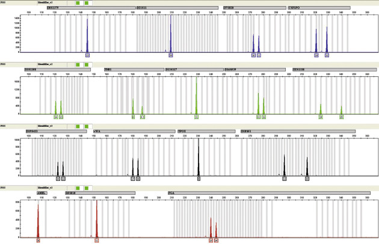
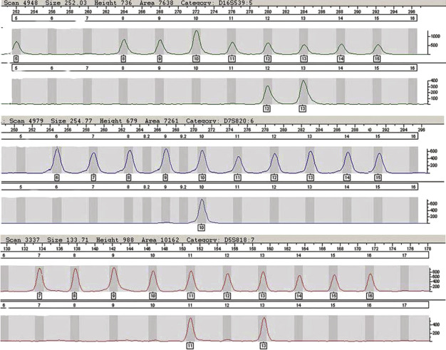
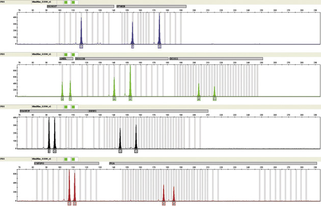
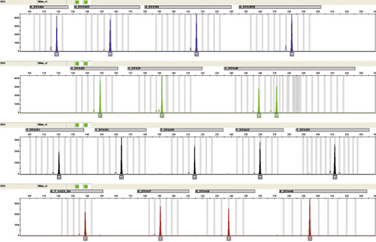
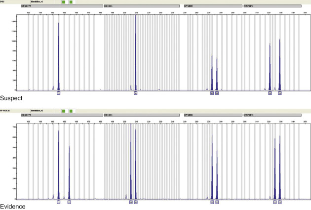
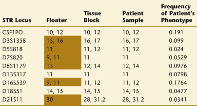
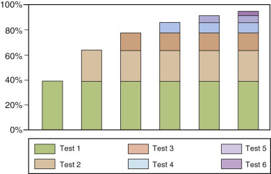
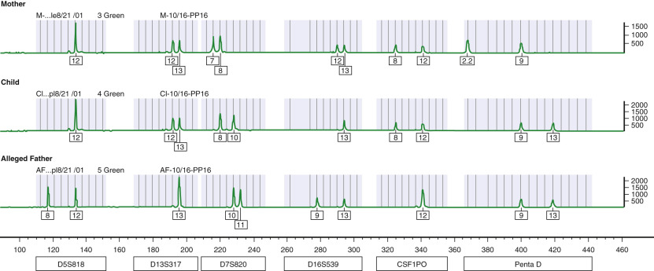
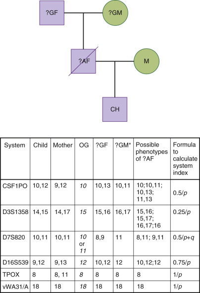
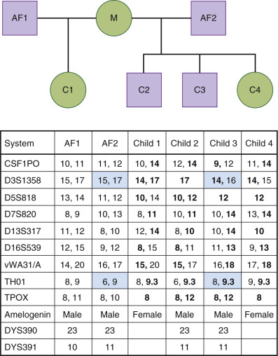

## Key Points

  * •

Standardized marker systems with known allelic polymorphisms are used in testing panels. Alleles with short tandem repeats form the basis of commercially available kits. 

  * •

Forensic testing requires documentation of all steps taken during collection, extraction, and testing so results can withstand legal challenges. 

  * •

Deoxyribonucleic acid (DNA) can be obtained from any sample that contains cellular material. The stability of DNA allows it to withstand harsh environmental conditions and long postmortem intervals. 

  * •

Care must be taken to maintain the integrity of DNA evidence and to avoid contact or exposure of the evidence to any conditions that may contaminate and/or further degrade the original stain/evidence. 

  * •

Mitochondrial DNA can be extracted from bone and teeth after hundreds and even thousands of years because it is small and present at hundreds to thousands of copies per cell. Mitochondrial DNA is maternally inherited and can be useful for identifying remains. 

  * •

DNA is used in identification of remains and can be used to link a suspect to a crime, to exculpate falsely accused suspects, to recognize serial crimes, and to distinguish copycat crimes, or to aid in accident reconstruction (e.g., to determine who was driving a car by the identification of the bloodstains on the driver's side of the windshield). 

  * •

Pathology laboratories can use DNA testing to resolve specimen mix-ups such as when samples are inadvertently switched or pathologic material floats onto a histologic or cytologic slide. 

  * •

Standards and quality assurance guidelines for identity testing laboratories have been developed by the American Association of Blood Banks (for parentage testing), the U.S. Department of Justice Federal Bureau of Investigation's Working Groups, the Forensic Science Standards Board, and the International Society for Forensic Standards (for forensic testing). 

In parentage testing, samples obtained from multiple individuals are compared for inherited similarities; most often in forensic DNA testing, crime scene samples are evaluated for an exact match with a suspect. In the identification of human remains and missing persons, both comparisons of inherited similarities and direct match comparisons are used. 

* The author would like to acknowledge Victor Weedn, MD, JD, and Herbert Polesky, MD, for material from chapters in a previous editions, as well as contributions by Arthur Eisenberg, PhD, and Shubhra Nandi. 

A frequently quoted early reference to disputed parentage appears in the Bible (1 Kings 3 : 16 to 27), in which Solomon makes a decision about the maternity of a disputed child by threatening to use his sword to provide each claimant with a portion of the child. When paternity is in dispute, the arbiter of truth often is faced with the dilemma similar to that faced by Solomon: lack of witnesses to the event and the likelihood that the principals might not know or tell the truth. Similarly, short of eyewitnesses or confession, identifying a person at a crime scene is difficult to accomplish, and most evidence merely suggests a suspect linkage. The availability of biologic evidence, such as DNA, provides information that can lead to clear resolution of disputed facts. 

,  

##  Historical Background 

The discovery of the ABO blood group system by Landsteiner in 1900 (  Landsteiner, 1901  ) and the recognition that these measurable characteristics followed the genetic rules described by Gregor Mendel (  Mendel, 1866  ) provided objective laboratory evidence that could be used by courts to aid in deciding when a person had been falsely accused of paternity. In the United States, laws addressing the use of genetic markers for proving non-paternity were enacted in 1935 (  Schatkin, 1952  ). In the ensuing years, knowledge about useful genetic marker systems increased dramatically. By 1976, joint guidelines developed by an American Medical Association–American Bar Association committee recommended seven systems for routine blood group investigations in cases of disputed parentage: ABO, Rh, MNSs, Kell, Duffy, Kidd, and HLA (  Miale et al, 1976  ). Other genetic systems such as polymorphic serum proteins and red cell enzymes were also recognized as useful. Many of these same genetic markers were used to match crime scene evidence with suspects or victims; however, today, DNA testing is used almost exclusively. 

In 1980, Botstein and colleagues described DNA restriction fragment length polymorphism (RFLP) (  Botstein et al, 1980  ). Sir Alec Jeffreys is credited with the first report in the scientific literature to suggest that DNA typing might be useful for forensic identification, and coined the term _DNA fingerprint_ in his _Nature_ article in 1985 (  Jeffreys et al  1985a  ). Commercial laboratories began using DNA testing for parentage and criminalistic casework in 1986, and government crime laboratories began using DNA testing in 1989 (  Weedn & Roby, 1993  ). Today, several hundred laboratories worldwide use DNA testing for the criminal justice system. In 1990, when the first edition of _Standards for Parentage Testing Laboratories_ (American Association of Blood Banks [AABB], 1990) was published, specific requirements for RFLP testing were included along with the _classic systems_ (red blood cell surface antigens, human leukocyte antigens, red cell enzymes, and serum protein genetic markers). DNA testing has replaced traditional serologic techniques. The forensic DNA testing community has endured many iterations of DNA methods and technologies, and has standardized its testing with a set of core short tandem repeat (STR) loci as the current mainstay of testing in order to build its international offender databases. The original 13 Combined DNA Index System (CODIS) core loci have recently been expanded to include 7 additional loci for a total of 20 CODIS core loci. The core set of loci were expanded to reduce the number of adventitious matches, increase international capability, and increase the power of discrimination for criminal and missing persons cases (  Hares  2015  2012a  ). This core set of loci is supplemented by other DNA testing, gender analysis (Amelogenin), Y chromosome markers, and mitochondrial DNA (mtDNA) sequencing. Capillary electrophoresis is the main instrument platform with fluorescence detection. 

These same technologies are used to identify victims of war or mass disasters (  Budowle et al, 2005  ), whether the disaster is natural, man-made, or industrial, and in cases of wildlife forensics. DNA testing is also used for accident reconstruction, in medical cases of sample mix-ups, and in animal husbandry. DNA technology is here to stay; newer technologies will be adopted that offer higher powers of discrimination, lower costs, enhanced sensitivity, increased efficiency, and even information on the physical traits (e.g., eye color, hair color) and ancestry origin of the remains or biologic material left at a crime scene. As these newer technologies evolve and are validated, so will the field of forensic science. 

,  

##  Advantages of DNA 

DNA permits the direct identification of the individual source; it is personal and manifests biologic variation. The human genome is approximately 99.9% the same between individuals; it is the 0.1% difference of the human genome that forensic scientists interrogate to individually identify stains, remains recovered from accidents and mass disasters, and biologic relatives. DNA is useful as an identity marker because it is (1) present throughout all cells of the body (except mature red blood cells); (2) the same in all cells of the body; (3) the same throughout life from the time of conception; and (4) different in all individuals. There are exceptions to the previously mentioned points, in order: (1) DNA is not recovered from mature red blood cells; (2) haploid sex gametes have half of the DNA material as compared to the other cells in the body; (3) progenitor stem cell transplantation can result in the presence of the donor's DNA rather than the recipient's inherited DNA; and (4) identical twins have the same DNA. DNA tests have a sensitivity that is far superior to the previously mentioned traditional serologic markers. With the use of polymerase chain reaction (PCR)–based testing, DNA results can be obtained from minute samples and even invisible trace DNA deposits. DNA is a robust molecule resistant to strong acids, alkalis, detergents, and environmental factors (  Kobilinsky, 1992  ). The typing information from DNA is found within the sequence of nucleotides. Consequently, DNA testing is more successfully performed than serology tests on specimens that are older and that have been exposed to greater environmental insults. 

Much of the casework for crime laboratories in the United States is from sexual assaults. Vaginal swabs contain bacteria and female epithelial cells as well as the male sperm. DNA from sperm can be separated from non-sperm DNA by a differential lysis procedure because of the protective capsule of spermatozoa (see the “ [ DNA Extraction and Quantification ](<#s0030>) ” section later in the chapter). This allows for individualization of the source of the semen without the confounding data of the non-semen evidence. DNA targets are also generally human- or primate-specific, so the presence of bacterial DNA is of no consequence. 

Additionally, other advantages to DNA testing include Y chromosome testing where a mixture of a female and a male can reveal only the male's DNA type from his Y chromosome. This testing technique is extremely useful in the presence of mixed DNA when predominantly female DNA is present in the sample. 

,  

##  Genetic Markers 

Multiple genetic systems are used for parentage and identity testing. Ideally, the system should have multiple alleles distributed in the population so that there is a high power of exclusion and the least common phenotype has a frequency that can be determined reliably. All markers in the system should be expressed (no null alleles) as codominant, mutation rates should be known, and phenotypes should be stable under usual storage conditions. Methods for detecting the markers should be reliable, reproducible, and feasible for a large number of laboratories. The genetics of the system must be known and follow established inheritance patterns (Mendelian laws). The system should be independent of other markers routinely tested. If the system is intended for calculating estimates of paternity or identity, the gene frequencies in various populations must be established (  Budowle et al, 2001  ). 

The DNA from every human (except identical twins) is unique, because of the presence of polymorphisms, which are differences in the DNA between individuals. However, the vast preponderance of the DNA sequence is identical between individuals. On average, only 1 in 1300 nucleotide bases differs between individuals. Nonetheless, this amounts to an average of 3 million bases that differ between any two individuals and accounts for the tremendous genetic variation among individuals. Although the diversity in the coding regions of DNA (genes) is significant, the noncoding regions of DNA also provide for a great deal of diversity. 

Length-based polymorphisms are found in repetitive DNA. More than 90% of the human genome is composed of noncoding, or “junk,” DNA, of which approximately 20% to 30% is composed of repetitive regions. Many of the repetitive regions vary in the number of core repeats between individuals—so-called _variable number of tandem repeat (VNTR)_ loci. DNA fragments containing VNTRs vary in length and are thus useful for analysis. Dinucleotide repeats are most common, but larger core repeats are more useful for forensic purposes since interpretation is much easier than dinucleotide repeats. RFLP, amplified DNA fragment length polymorphisms, and STRs are examples of fragment length-based analytic techniques. Sequence polymorphisms exist within the DNA sequence of similarly sized DNA fragments. Sequence polymorphisms consist of differences in one or more bases in the DNA sequence at a particular location in the genome. Sequence variations can manifest as regions of alternative alleles or base substitutions, additions, or deletions. Most sequence polymorphisms are mere point mutations within repetitive and nonrepetitive regions and are known as single nucleotide polymorphisms (SNPs). SNPs, sequence-specific oligonucleotides, and mitochondrial DNA (mtDNA) tests are examples of sequence-based tests as well as the introduction of next-generation sequencing for forensic genomics. Identity testing has not yet adopted the power of the more than 2 million SNPs in the human genome, but this is clearly on the forefront of the technology. 

,  

##  Samples and Specimen Collection 

Samples such as buccal swabs, bloodstains on filter paper, and fresh whole blood are most frequently used for parentage testing and building databases. For forensic evidence recovered from a crime scene, emergency department, or autopsy, identifying the proper sample and specimen collection are extremely important. In order to visualize the biologic fluids and stains, oftentimes chemicals and/or alternate light sources are used. Blood spatter pattern analysis is also employed to help the investigator interpret and intelligently collect specimens from large pools of blood and bloodstains. When a biologic fluid has been deposited on a surface or an item that cannot be collected, the fluid should be sampled with a clean sterile swab. For large items where the biologic fluid is dry, the sterile swab should be moistened with sterile distilled water, the evidence wiped with the swab, and allowed to air dry prior to packaging. For collection of DNA from bitemarks on bodies, a double swab technique (  Sweet et al, 1997  ) that involves rubbing the bitemark area with a wet swab followed by a dry swab is often used. Control swabs are also collected from an unstained area adjacent to the fluid stain. These items (e.g., blood on clothing, collection swab) should be collected one item at a time, packaged separately, and clearly labeled. 

Even though mature red blood cells are devoid of DNA (both nuclear and mitochondrial), ample DNA is present from circulating white blood cells for testing. Despite inhibition of the PCR reaction by heme, blood is a good source of DNA for PCR testing because the inhibitory activity of heme can easily be diluted and removed. Ethylenediaminetetraacetic acid (EDTA) and citrate phosphate dextrose (CPD) are often the anticoagulants used and requested for DNA testing. Heparin-anticoagulated blood is not recommended for DNA testing. 

In postmortem settings, sources of DNA other than blood are preferred if there is significant putrefaction. Virtually any tissue may be successfully used for DNA typing purposes. Some tissues that may be intuitively thought to be better sources of DNA because they are more densely cellular and would contain higher concentrations of DNA, are in fact, less optimal because of higher rates of postmortem degradation (  Kobilinsky, 1992  ). Among soft tissues, the DNA recovered from liver tissue degrades quickly due to the presence of autolytic enzymes, whereas brain tissue is a relatively good source in the intermediate postmortem period. Bone and teeth are stable sources of postmortem tissue DNA. Informative DNA is routinely obtained from skeletal remains that are decades old. Generally, the greater the body decomposition and the longer the postmortem period, the greater the degradation of the DNA from cadaveric tissues. 

Great care should be taken to prevent contamination of the specimen and stains by other sources of DNA. Specimens should be collected using gloves and pristine instruments. When possible, nonexposed tissue should be collected by an incisional biopsy technique. The specimens should be kept cold or preferably frozen (although repeated freezing and thawing is destructive of large DNA fragments). Desiccation, even simple air-drying, may be an adequate method of storage of some DNA specimens (e.g., bloodstains and bone). Tissues in formalin are not optimal; however, results are usually obtained with PCR-based DNA testing techniques. No tissues or biologic fluids should be discarded as inadequate without first attempting DNA testing. 

DNA in most specimens will undergo progressive random fragmentation or degradation, reducing the high molecular weight DNA to lower molecular weight DNA (  Kobilinsky, 1992  ). As time progresses, high molecular weight DNA can become degraded even after a short time from fresh tissues and fluids. Likewise, high molecular weight DNA may be obtained for years after a fresh sample has been frozen or desiccated. Residual smaller DNA fragments may persist despite considerable degradation. Because of its high copy number (hundreds to tens of thousands of copies per cell), mtDNA often survives when no nuclear DNA is recovered. Consequently, mtDNA testing is routinely used to identify old skeletal remains (  Ivanov et al, 1996  ;  Núnéz et al, 2011  ). 

Rapid DNA degradation or damage may occur under certain conditions (  Parsons & Weedn, 1997  ). Chemical hydrolysis of DNA is normally quite slow. Tests have shown that mixing DNA with detergents, oil, gasoline, and other adulterants does not alter the DNA result. However, metal ions may catalyze oxidative hydrolysis. Ultraviolet radiation is known to cause thymidine dimerization, and fragmentation of ancient DNA sequences is primarily due to depurination that creates abasic sites leading to DNA breaks. 

Results from testing these items of evidence are often used in legal proceedings. Thus, all aspects of the procedures should be well documented since they may be subject to legal challenges by one of the parties. It is important to ensure documentation of the identification of the tested individuals, the collection of the evidence, and the labeling of samples. Although many parentage disputes are civil actions, some jurisdictions require documents showing the chain of custody of samples similar to those used in criminal matters. AABB-accredited laboratories are required to obtain a history of any recent transfusion (in the preceding 3 months) or a hematopoietic stem cell transplant. A photographic identification and appropriate informed consent must also accompany each sample. The consent for a minor should be from an individual with legal rights to the custody of the child. Likewise, the forensic sample must be properly collected, packaged, sealed, and stored and demonstrate evidence of proper chain of custody documentation. 

,  

##  DNA Extraction and Quantification 

The first and most critical step for evidence is the extraction of DNA from blood, biologic stains, or other biologic sources. DNA from a bloodstain, a vaginal swabbing, or other source must be isolated from other cell components and environmental contaminants. Numerous DNA extraction methods are used in both the parentage and forensic laboratories. The classic organic chloroform/phenol extraction with ethanol precipitation, although not automated, is an efficient and reliable method that separates proteins and other cellular materials from the DNA molecules. Solid-phase column extraction methods (e.g., Qiagen columns) and magnetic resin particles are used for DNA extraction, particularly in conjunction with automated techniques. The column extraction and magnetic particle methods yield DNA that is highly purified for forensic samples. Contaminants such as those found in cigarette butts and certain dyes may be removed. Silicon beads are another excellent method to purify DNA when inhibitors need to be removed. Many laboratories eliminate the extraction step altogether, mostly on reference samples, by performing PCR directly from a punch of a bloodstained item or a buccal collector. 

As mentioned earlier, vaginal swabs require special conditions for extraction using a differential lysis procedure because of the need to separate the male DNA in sperm from the female DNA in epithelial cells (  Crouse et al, 1993  ). The female fraction (the vaginal epithelial cells) is separated by standard extraction procedures. The male fraction (spermatozoa) is then extracted by centrifugation or simple pipetting and breaking the disulfide bridges of the protective capsule of spermatozoa with a dithiothreitol solution. Sensitive PCR-based systems often exhibit female source DNA in the male fraction, producing mixed DNA profiles. 

Once the samples are extracted, quantification is performed. The forensic standards require quantification of forensic evidence, when possible. When performing quantification and knowing the amount of DNA in a sample, amplification is usually more successful. Too little or too much DNA in a PCR-based assay results in non-optimal amplification, which can produce poor results. In addition, having _a priori_ information on the total human male DNA and a qualitative assessment of the total human DNA is extremely useful in determining which assays to perform in the downstream analysis. Today, real-time quantitative PCR is multiplexed to simultaneously obtain quantitative and qualitative assessment of total human and human male DNA in a single assay. In addition, real-time quantitative PCR can be used to quantitate mitochondrial DNA (  Sprouse et al, 2014  ). Real-time quantitative PCR techniques provide for a more sensitive and objective assay (  Green et al, 2005  ). Early quantification methods that are not as sensitive include absorbance at 260 nm using a spectrophotometer; agarose gel electrophoresis and visualization with an intercalating dye such as ethidium bromide; and DNA bound on a nylon membrane and hybridized with a human-specific probe (  Walsh et al, 1992  ). 

,  

##  Test Methods and Marker Systems 

 

##  Short Tandem Repeats 

Loci consisting of repeat units of three to seven nucleotides occur throughout the genome (  Weber & May, 1989  ). Alleles at these STR loci are defined by the number of repeat units in the PCR-amplified product. The basic PCR techniques employed are discussed in [ Chapter 67 ](<##!/content/3-s2.0-B978032329568000067X?scrollTo=%23c00067>) . Extracted sample DNA is added to a PCR reaction mix containing _Thermus aquaticus_ (Taq) polymerase, a specific forward and reverse primer for each locus tested, deoxynucleoside triphosphates, magnesium, a buffer solution, and bovine serum albumin. The PCR reaction mixture is amplified in a thermal cycler using carefully defined parameters to maximize detection of the alleles. Several primers with different fluorescent labels are used in a multiplex reaction to detect alleles at several loci in a single amplification. The PCR products, which vary in length, are separated by capillary electrophoresis. Detection is performed using a laser to excite the labeled fluorophore that has been incorporated in the primer. The loci in the multiplex reaction differ by size and color ( [ Fig. 72-1 ](<#f0010>) ). Sizing is accomplished by mixing a size standard with each sample injected in the capillary and using sizing software algorithms; phenotyping of each peak is achieved by comparing the peaks in the sample to an allelic ladder accounting for most alleles for each locus and using sophisticated genotyping software algorithms for allele calls that adjust for minor variations in electrophoresis for each injection ( [ Fig. 72-2 ](<#f0015>) ). 

Figure 72-1 

The results of the kit-included positive control 9947A amplified with the AmpFLSTR Identifiler PCR Amplification Kit (Applied Biosystems, Foster City, Calif.) (  Collins et al, 2004  ) and electrophoresed on the ABI P  rism  3130 _xl_ Genetic Analyzer (Applied Biosystems) and typed with GeneMapper _ID_ Software v. 3.1.2 (Applied Biosystems). The results for the 15 autosomal STR loci and Amelogenin, a sexing marker, are visualized. This image displays the phenotype of the positive control amplified in this multiplex. The locus name is shown in the gray bar above the peaks; the allele call(s) for each locus is just below the highlighted peak. 

Figure 72-2 

The results of a sample electrophoresed on the ABI P  rism  3100 Genetic Analyzer (Applied Biosystems) and amplified with the AmpFLSTR Identifiler PCR Amplification Kit. The ladders and accompanying results for three loci, D16S539 (alleles 12, 13), D7S820 (allele 10), and D5S818 (alleles 11, 13), are visualized in these images. The images demonstrate excellent resolution in the electrophoresis. 

The most commonly used markers in forensic and parentage laboratories in the United States are the 13 STR loci (CSF1PO, D3S1358, D5S818, D7S820, D8S1179, D13S317, D16S539, D18S51, D21S11, FGA, TH01, TPOX, VWA) that have been standardized for use in obtaining genetic profiles of individuals who have been convicted of various criminal offenses. These were identified by a consortium of scientists sponsored by the Federal Bureau of Investigation (FBI) for use in CODIS. Today, CODIS laboratories are preparing to implement seven additional loci (D1S1656, D2S441, D2S1338, D10S124, D12S391, D19S433, and D22S1045) (  Hares, 2015  ). The STR marker systems have discrete alleles and are not as polymorphic as the RFLP marker systems. An STR locus may have three or four common alleles (frequencies of 0.15 to 0.25) and several rare alleles (frequencies of <0.01). Thus, in order to obtain a high cumulative probability of exclusion (CPE) and combined paternity index (PI), it is usually necessary to test at least six or more STR loci. In a series of 50 paternity cases tested in parallel by both RFLP and nine STR loci, Alford and colleagues reported (  Alford et al, 1994  ) that both methods excluded the same 13 alleged fathers (based on two or more loci). The likelihood of paternity for the 37 non-excluded men based on the STR systems was more than 99% in 36 cases. When 13 CODIS STR loci are obtained, the average random match probability is rarer than 1 in 1 trillion among unrelated individuals (  Chakraborty et al, 1999  ). 

MiniSTRs are autosomal STRs in multiplex kits where the primers have been moved closer to the tandem repeat to achieve a smaller amplicon product size. Typically, fewer markers are included in the miniSTR kits compared with standard kits ( [ Figs. 72-3 ](<#f0020>) and [ 72-4 ](<#f0025>) ). Those samples that are severely degraded may produce a miniSTR result when the standard kits fail (  Mulero et al, 2008  ). Furthermore, the miniSTRs are useful in recovering alleles where allele dropout has occurred and reduced sensitivity is observed from multiplexes with larger amplicons (  Butler et al, 2003  ). 

Figure 72-3 

The results of the kit-included positive control 007 amplified with the AmpFLSTR MinFiler PCR Amplification Kit (Applied Biosystems) (  Mulero et al, 2008  ), electrophoresed on the ABI P  rism  3130 _xl_ Genetic Analyzer, and typed with GeneMapper _ID_ Software v. 3.1.2. The results for the 8 STR loci are visualized. The locus name is shown in the gray bar above the peaks; the allele call for each locus is just below the highlighted peak. The loci in this kit are smaller (the size of the peaks can be measured on the _x_ -axis) than the corresponding loci in the AmpFLSTR Identifiler PCR Amplification Kit (see [ Fig 72-1 ](<#f0010>) ). 

Figure 72-4 

The results of the kit-included positive control 9948 amplified with the AmpFLSTR Yfiler PCR Amplification Kit (Applied Biosystems, Foster City, Calif.) (  Mulero et al, 2006  ), electrophoresed on the ABI P  rism  3130 _xl_ Genetic Analyzer, and typed with GeneMapper _ID_ Software v. 3.1.2. The results for the 17 Y-STR loci are visualized. This image displays the phenotype of the positive control amplified in this mega-multiplex. The locus name is shown in the _gray bar_ above the peaks; the allele call for each locus is just below the highlighted peak. 

 

##  X and Y Chromosome Markers 

Sex determination is now commonly performed using the Amelogenin locus (see [ Fig. 72-1 ](<#f0010>) ). The primer for this locus amplifies an X-specific band (Xp22.1 to 22.3) and a Y-specific band. This locus is coamplified and coanalyzed with many multiplexed STR systems. Sex determination marks a departure from all other routine identity markers, in that it provides specific phenotypic information about the source individual. It may also be important in the investigation of potential suspects as well as in the categorization of specimens as originating from a victim or suspect. 

Although polymorphic Y chromosome markers (see [ Fig. 72-3 ](<#f0020>) ) are not used for sex determination, they are extremely useful in the typing of casework when there is a mixture of a male and female and a mixture of males. For example, an excellent use of Y-STRs is sexual assault evidence that displays a mixture of both the female epithelial cell DNA and male sperm DNA. When the quantity of male DNA is much less than the female DNA, Y-STRs are excellent in obtaining a profile of the male subject with no interference from the female subject since Y-STR results are only obtained from males. They also are used to characterize the paternal lineage in human remains identifications. The characterization of the Thomas Jefferson family lineage was accomplished using Y chromosome markers (  Foster et al, 1998  ), an example of a historical and genealogic study. Data from extensive Y-STR typings have shown that certain haplotypes are indicative of ethnic origin and can be used for human migration and evolutionary studies. A haplotype is generated from Y-STRs versus a phenotype in autosomal STRs; haplotypes do not afford the same level of discrimination as autosomal STR profiles. 

 

##  Mitochondrial DNA Sequencing 

Mitochondrial DNA (mtDNA) sequencing is most applicable when extremely small quantities of sample DNA are present or when the DNA is extremely degraded, such as in shed hairs (which have virtually no detectable nuclear DNA) and skeletal remains (  Butler & Levin, 1998  ;  Holland & Parsons, 1999  ). Hundreds to thousands of copies of mtDNA are present within a single cell with only one copy of nuclear DNA. Accordingly, an mtDNA profile can often be obtained when a nuclear DNA profile cannot. Further, mtDNA testing is used when distant relatives are used as references to compare to a sample. A single distant relative in the maternal line may be used as a reference when reference samples are limited, because nuclear DNA testing generally requires multiple close relatives. 

Mitochondrial DNA is composed of a circular piece of DNA 16,569 base pairs (bp) in length. Because no significant regions of repetitive DNA exist in mtDNA, only sequence differences are reported. The region of mtDNA that is analyzed for human identification is the noncoding displacement loop (D-loop), also known as the _control region_ . This locus spans approximately 1100 bp and contains two hypervariable regions. At present, direct sequencing is the method used to obtain mtDNA results. 

Mitochondria are maternally inherited, so mtDNA has no paternal contribution. Unlike nuclear DNA, which is present in pairs of chromosomes, generally only a single mtDNA sequence is present in the cell (homoplasmic) and consequently no genetic recombination occurs. An exact mtDNA sequence match can be traced through the maternal lineage of a family for many generations. However, the discriminatory power of mtDNA sequencing is limited—on the order of one in a few thousand. This testing is expensive and time-consuming. 

 

##  Other Systems 

Methods to detect SNPs are used to determine a single base change in a sequence at a specific location. Because of the limited variability at these loci, as many as 70 SNPs need to be tested to get the same level of information about relatedness, power of discrimination, and mixture resolution as provided by a multiplex of several STR loci. There are millions of SNPs in an individual. SNPs could be very powerful for identity testing. SNPs may provide information when traditional STRs may not because they can be designed to amplify smaller amplicons. In addition, specific SNPs may be used to provide information regarding the physical traits of an individual, and they can be designed to predict ethnic origin (  Wollstein & Lao, 2015  ). 

Next-generation sequencing (NGS) technology (see [ Chapter 78 ](<##!/content/3-s2.0-B9780323295680000784?scrollTo=%23c00078>) ) was introduced to genetic research applications over 10 years ago. Today, whole-genome sequencing is being conducted at a greater rate and reduced cost than was imagined at the time of sequencing of the first human genome (  Venter et al, 2001  ). As the technology, instrumentation, and quality of the sequence improves with NGS, its application to forensic sciences is being realized. SNPs can be detected, STRs can be measured with precision not available with size-based capillary electrophoresis, and other applications such as molecular autopsies can be performed. Illumina, Inc. (San Diego, Calif.) has introduced an NGS system, the ForenSeq DNA Signature Prep Kit used in conjunction with the MiSeq FGx Forensic Genomics System to evaluate STRs (autosomal, Y-STRs, and X-STRs) and 173 SNPs. Included in these SNPs are phenotypic-informative SNPs for eye color and hair color and ancestry-informative SNPs. 

,  

##  Analysis and Use of Test Data 

 

##  DNA in the Crime Laboratory 

DNA evidence is routinely admitted into court. In the United States, a large percentage of criminal DNA tests involves sexual assault, and a significant proportion involves homicide. Approximately one third of DNA tests exonerate wrongfully accused suspects ( [ Fig. 72-5 ](<#f0030>) ), one fourth are inconclusive, and somewhat less than half result in a match of the suspect to a crime. Only a fraction of the cases in which DNA evidence is tested are actually litigated, because most cases result in a plea bargain. In the criminalistics context, DNA can be used to link a suspect to a crime, to exculpate falsely accused suspects, to recognize serial crimes and to distinguish copycat crimes, or to aid in accident reconstruction (e.g., to determine who was driving a car by the identification of the bloodstains on the driver's side of the windshield). In addition to the use of DNA for associative evidence at scenes of crimes, DNA is used in the identification of human remains. 

Figure 72-5 

Exclusion of suspect when compared to crime scene evidence. The profile for the evidence at D8S1179, D21S11, and CSF1PO is clearly different from the suspect's profile. The evidence could not have been contributed by the suspect. 

 

##  DNA in the Pathology Laboratory 

DNA identity tests can be used to resolve specimen mix-ups (  Weedn, 1993  ), such as when samples are inadvertently switched or pathologic material floats onto a histologic or cytologic slide. A small fragment of cancerous tissue (“floater”) on a glass microscope slide can be determined to be from someone other than the patient ( [ Table 72-1 ](<#t0010>) ). DNA testing may be used to confirm or refute mislabeling of biopsy specimens. In addition, urine drug tests that have been challenged on the basis of alleged sample switching may be resolved by DNA testing (  Weedn et al, 1996  ). 

TABLE 72-1 

Identification of a Possible “Floater”

Shaded results indicate the DNA results from the floater are different than the DNA from the patient and the tissue block. The chance that the tissue block has the same genetic markers as the patient compared to a random Caucasian individual is greater than 1.86 × 10  10  . 

STR markers are also used to evaluate engraftment of marrow after transplantation (  Scharf et al, 1995  ). When the donor is related to the recipient, testing of multiple markers may be required to find an informative locus since related people share many alleles. 

,  

##  Exclusion of Parentage 

The primary goal of genetic marker testing in cases of disputed parentage is to identify the biologic parent of a given child. Although this cannot be done with absolute certainty, genetic marker tests can provide objective evidence of non-parentage. By using multiple genetic systems, it is possible to exclude most (>99%), but not all, non-parents. 

In systems that follow the rules of Mendelian genetics, exclusions are identified by finding exceptions to the expected inheritance pattern. Interpretation of test results when paternity is in question usually depends on assuming that the sample defined as maternal is from the child's biologic mother. The child's and mother's phenotypes should be compared to determine whether results are consistent with expected inheritance patterns. An allele present in the child but not in the mother is referred to as the _obligatory paternal gene_ (OG), or the obligatory paternal allele. If both alleles in the child and mother are identical, then there are alternative (two) possibilities for the paternal gene. 

If the tested man does not have the possibility of passing the OG and the marker for the gene is absent in the presumed mother, the exclusion observed is termed _direct exclusion_ ( [ Table 72-2 ](<#t0015>) ). An exclusion at a single locus is not considered enough evidence to establish non-paternity (  AABB, 2013  ) due to the mutation rate observed in DNA testing. A direct exclusion also occurs when the child or the tested male is heterozygous (two alleles present) and the two markers are absent in the other person. This type of direct exclusion sometimes is referred to as a _two-haplotype exclusion_ . When only the child and one alleged parent are available for testing, if the tested individual or child has two haplotypes, neither of which is in the other, it is possible to establish non-parentage. 

TABLE 72-2 

Exclusion of Parentage: Phenotype (Genotype) 

Type of Exclusion  |  Child  |  Mother  |  Tested Man  |  Obligatory Gene(s)   
---|---|---|---|---  
Direct  |  AB (ab)  |  A (aa, a?)  |  C (cc, c?)  |  b   
AC (ac)  |  AB (ab)  |  AD (ad)  |  c   
AB (ab)  |  C (cc, c?)  |  AC (ac)  |  b (maternal)   
Two-haplotype  |  A (aa, a?)  |  A (aa, a?)  |  BC (bc)  |  a or ?   
A (aa, a?)  |  AB (aa, ab)  |  BC (bc)  |  a or ?   
AB (ab)  |  AB (ab)  |  CD (cd)  |  a or b   
AB (ab)  |  Not available  |  CD (cd)  |  a or b   
Indirect [ * ](<#hl0000159>) |  A (aa, a?)  |  A (aa, a?)  |  B (bb, b?)  |  a or ?   
B (bb, b?)  |  AB (ab)  |  A (aa, a?)  |  b or ?   
B (bb, b?)  |  C (cc, c?)  |  AB (ab)  |  b or ? (maternal)   
B (bb, b?)  |  Not available  |  A (aa, a?)  |  b or ?   
  
Examples of direct, two-haplotype, and indirect exclusions of the tested man. The capital letters represent the phenotype, and the small letters in parentheses represent the possible genotype. The question mark (?) represents a possible null, or silent, allele. 

 * Mutation must be considered. 

Absence of an expected genetic marker in a child when the parent in question appears to be homozygous (one allele present) for the gene is called an _indirect exclusion_ . This is sometimes also known as _reverse homozygosity._ One indirect exclusion is not sufficient evidence to conclude that the tested individual is not the parent. Interpretation of reverse homozygosity as an indirect exclusion presumes that the tested subjects both have two identical alleles at the locus. In PCR testing of STRs, this absence of an expected allele may occur if there is a binding site mutation (  Harrison et al, 2004  ;  Leibelt et al, 2003  ) in one of the tested individuals, or it is possible that a rare null allele (or other undetected allele) or mutation is present in the child as well as the parent in question. The finding of indirect exclusions in at least two independent systems usually is sufficient evidence to reach a conclusion of non-paternity. 

 

##  Probability of Exclusion 

Before testing, it is possible to provide an estimate of the average chance that testing will prove non-parentage if the accused is not the parent. This is referred to as the _probability of exclusion (PE)_ , and is defined as the probability of excluding a random individual from the population given the alleles of the child and the mother; the genetic information of the tested man is not considered. For each genetic system, an average PE can be calculated based on the gene frequencies ( _p_ and _q_ ) for the alleles in the system. Weiner reported the general equation for a two-allele system (  Wiener et al, 1930  ). When a system has multiple alleles, more complex formulas are required (  Walker, 1978  ). A highly polymorphic system has a greater power of exclusion than a system with only a few alleles or one that has one or two common alleles and many rare alleles. 

 

##  Combined Probability of Exclusion 

The individual probability of exclusion (PE) is calculated for each of the genetic systems (for each locus) analyzed. The overall combined probability of exclusion (CPE), or the probability of excluding a falsely accused man in a given case, can be calculated by using the following formula: 

 CPE  =  1  − [  (  1  − PE  1  )  × (  1  − PE  2  )  × (  1  − PE  3  )  × … × (  1  − PE  N  )  ] 

where PE is the probability of exclusion for each system used. As shown in [ Figure 72-6 ](<#f0035>) , as more and more systems are used, fewer and fewer individuals are excluded by each additional test. With an appropriately selected battery of DNA marker systems, a CPE of 0.995 or greater is easily achieved. 

Figure 72-6 

Combined probability of exclusion (each added test; PE = 0.4). The percentage of the population excluded by each additional test becomes smaller and smaller. The overall exclusion probability of the six tests is 95.3%. If a seventh test with PE = 0.5 was performed, only an additional 2.4% of the population would be excluded ([1 − 0.953] × 0.5 = 0.0235). 

,  

##  Inclusion of Parentage 

If, after testing multiple independent systems, the parent in dispute is not excluded ( [ Fig. 72-7 ](<#f0040>) ), then an estimate of the possibility that the tested person could be the biologic parent should be calculated. If the tested male is not excluded, it always can be argued that the amount of testing was inadequate, that evidence for exclusion will be found by testing another genetic system, or that the true parent is a close relative of the tested man. This line of reasoning could be correct only if the tested male has been falsely accused. In addition to the average probability of exclusion described previously, it also is possible to calculate the frequency with which a random male will not be excluded based on a mother-child pair exhibiting the observed phenotypes (  Salmon, 1983  ). This value is related to the actual probability of exclusion for the tests performed. 

Figure 72-7 

Example of family analysis using short tandem repeats testing. Note the alleles shared between the mother _(top panel)_ and the child _(middle panel)._ The alleles from the tested man _(bottom panel)_ also match the child. The tested man is not excluded as the biologic father of this child. 

In providing estimates of inclusion of paternity, appropriate gene frequency tables are used. In general, this means that a population of random persons of the same race has been phenotyped, that the size of the sample is large enough to provide gene frequencies with minimum errors of estimation for the alleles in the system, and that the tested male and biologic father are from the same population. When multiple systems have been tested, the differences observed in gene frequencies in populations from various geographic locations become unimportant in calculations of the likelihood of paternity (  Hummel & Claussen, 1981  ). When the tested male is of mixed racial background or from a population for which there are inadequate frequency tables, it may be impossible to provide a precise estimate of paternity. However, when multiple systems with a high power of exclusion have been used and the PI value using a reference population is high, there is a minimal chance that frequencies from a more-defined population will have a significant effect on the conclusion of parentage. In these situations, comparisons with frequencies for several defined racial groups may also be helpful. 

 

##  Paternity Index Calculation 

In cases in which a trio has been tested, a general approach referred to as the _comparison of sperm method_ is usually applied (  Walker, 1978  ). This calculation compares the chance ( _x_ ) that a sperm from a male of the phenotype of the tested male could have fertilized the ovum of the presumed mother to the chance ( _y_ ) that a sperm from an untested male in the random population could have produced the child. Likelihood ratios ( _x/y_ ) are calculated for each independent genetic system by comparing the tested male to the frequencies for the obligatory gene or alternate paternal genetic contribution in the random population of the same race of the tested male. These values are then multiplied to derive the PI, which reflects the genetic odds in favor of paternity, given the phenotypes of the trio. [ Table 72-3 ](<#t0020>) displays the formulas for calculating the indexes with various phenotype combinations. [ Table 72-4 ](<#t0025>) is an example using these formulas to determine the possible father of a fetus in a possible rape case. In this example, Tested Man 2 is clearly excluded as the biologic father of this fetus. 

TABLE 72-3 

Calculation of the System [ * ](<#hl0000282>) Likelihood Ratio (Paternity Index) 

Mother  |  Child  |  Obligatory Gene(s)  |  Tested Man  |  X  |  Y  |  Formula for Y Frequency  |  X/Y   
---|---|---|---|---|---|---|---  
A  |  A  |  a  |  A  |  1  |  0.25  |  p  |  4   
A  |  A  |  a  |  AB  |  0.5  |  0.25  |  p  |  2   
A  |  AB  |  b  |  B  |  1  |  0.4  |  q  |  2.5   
A  |  AB  |  b  |  AB  |  0.5  |  0.4  |  q  |  1.25   
AB  |  AB  |  a or b  |  A  |  1  |  0.65  |  p + q  |  1.54   
AB  |  AB  |  a or b  |  B  |  1  |  0.65  |  p + q  |  1.54   
AB  |  AB  |  a or b  |  AB  |  1  |  0.65  |  p + q  |  1.54   
AB  |  AC  |  c  |  AC  |  0.5  |  0.3  |  r  |  1.67   
BC  |  BC  |  b or c  |  BC  |  1  |  0.7  |  q + r  |  1.43   
AC  |  AD  |  d  |  BD  |  0.5  |  0.05  |  s  |  10   
  
_X,_ Chance that tested male is the biologic father; _Y,_ chance that an untested male in the random population is the biologic father; _X/Y,_ likelihood ratio. 

 * Hypothetical locus with four codominant alleles a, b, c, and d. 

TABLE 72-4 

Determining Parentage from Fetal Tissue 

STR Locus  |  Fetal Tissue [ * ](<#hl0000412>) |  Mother  |  Tested Man 1 (TM 1)  |  Tested Man 2 (TM 2)  |  Paternity Index TM 1  |  Paternity Index TM 2   
---|---|---|---|---|---|---  
CSF1PO  |  10  |  10  |  10  |  10, 12  |  3.74  |  1.87   
D3S1358  |  15, 16  |  15  |  16  |  14  |  4.49  |  0 [ † ](<#hl0000415>)  
D5S818  |  11, 12, 13  |  12, 13  |  10, 11  |  10  |  1.27  |  0 [ † ](<#hl0000415>)  
D7S820  |  8, 9  |  8, 9  |  8, 9  |  10, 11  |  3.31  |  0 [ † ](<#hl0000415>)  
D8S1179  |  11, 15  |  11, 15  |  12, 15  |  11, 15  |  2.60  |  5.19   
D13S317  |  10, 12, 13  |  12, 13  |  10  |  11, 12  |  14.81  |  0 [ † ](<#hl0000415>)  
D16S539  |  9, 13  |  13  |  9, 12  |  9, 14  |  4.65  |  4.65   
D18S51  |  12, 17  |  12  |  12, 17  |  17  |  4.76  |  9.52   
D21S11  |  31  |  31  |  31  |  31  |  18.18  |  18.18   
vWA31/A  |  16, 17, 18  |  16, 18  |  14, 17  |  14, 18  |  2.0  |  0 [ † ](<#hl0000415>)  
|  |  |  |  CPI  |  2.19 × 10  6  |  0 [ † ](<#hl0000415>)  
  
_STR,_ Short tandem repeat. 

 * Fetal tissue sample is contaminated with maternal tissue; mixture present. 

 † Tested man excluded at that locus. 

PI values in cases where no exclusion is observed can have a numeric value greater than zero to a number approaching infinity. The current  AABB Standards (2013)  require that, to determine parentage, the testing should result in a PI of at least 100. This means that the odds (likelihood ratio) for the tested man being the father are 99 to 1. 

 

##  Likelihood of Parentage 

Another useful estimate, the likelihood of parentage, combines the genetic testing with assumptions about prior events.  Essen-Möller (1938)  described this calculation based on Bayes' theorem ( [ Box 72-1 ](<#b0010>) ). The estimate uses the PI to summarize the genetic information and _p_ (a value for the prior probability) to account for the following assumptions: 

  * 1.

The tested man was not sterile. 

  * 2.

The tested man had access during the conceptive period. 

  * 3.

The tested man is not a close (first-degree) relative of the father. 

  * 4.

Other possible fathers are from a population with similar gene frequencies. 

Box 72-1 

Formula for the Likelihood of Parentage (W) 

Bayes' theorem is used to combine _p_ with PI: 

 W  =  (  p  )  (  PI  )  [  (  p  )  (  PI  )  \+  (  1  − p  )  ] 

where _p_ = prior probability of nongenetic events, and PI (paternity index) = summary of testing results. 

If a _p_ of 0.5 is used, this assigns an equal prior chance to the tested man and one untested man. Using this value, the likelihood of paternity _(W)_ is equal to  . Other values for the prior probability can be used in this calculation, but they introduce a bias against the tested man if greater than 0.5, and against the mother if less than 0.5. 

The mathematical values obtained from the calculation of the PI or likelihood have special significance because in many jurisdictions the reported value may change the legal standing of the parties. For example, the Minnesota Statute Section 257.55 (  Parentage Act, 2004  ) shifts the burden of disproving paternity to the man if the testing indicates a greater than 99% likelihood that he is the father. 

 

##  Estimating Parentage with an Absent Parent 

If one of the parents is unavailable for testing, it is still possible to provide an estimate of parentage. The most common situation is one in which a sample is available from the child and alleged father, but not the mother. In this situation, the child must share at least one gene at each locus with the tested man. Formulas ( [ Table 72-5 ](<#t0030>) ) to estimate the paternity index and likelihood of paternity are similar to those used when a trio is tested (see [ Table 72-3 ](<#t0020>) ) except that the estimates must include an adjustment for the frequency of the allele passed by the absent mother (  Brenner, 1993  ). The calculation is more complicated if the missing mother and untested man are of different races (  Traver, 1996  ). If the tested man or child has two alleles at a locus, neither of which is present in the other tested individual, then the tested man is excluded. If reverse homozygosity is present in the child and tested man, this also suggests non-paternity. 

TABLE 72-5 

Calculation of the System [ * ](<#hl0000485>) Likelihood Ratio (Parentage Index) When Only One Parent Is Tested 

Child  |  Tested Parent  |  Parental Gene(s) in Child  |  Obligatory Gene(s) in Other Parent  |  Formula to Calculate System Ratio   
---|---|---|---|---  
A  |  A  |  a  |  a  |  1/p   
A  |  AB  |  a  |  a  |  1/2p   
A  |  BC  |  |  a  |  Exclusion   
AB  |  B  |  b  |  a or b  |  1/2q   
AB  |  AB  |  a or b  |  a or b  |  (p+q)/4pq   
AC  |  AB  |  a  |  a or c  |  1/4p   
BC  |  A  |  |  b or c  |  Exclusion   
AD  |  BD  |  d  |  a or d  |  1/4s   
  
 * Hypothetical locus with four alleles A, B, C, and D (frequency of genes a = p, b = q, c = r, and d = s). 

 

##  Reconstruction of Families 

Many situations occur in which it is important to establish a relationship between individuals. This happens when individuals are trying to gain status as an immigrant or discover whether they share a parent, or when there is a question related to inheritance. DNA testing can be informative in identifying parents of fetal material found in a dumpster or products of conception in rape cases. Reconstruction is also very important when trying to identify bodies or body parts following a mass disaster. Because only a parent and child will share at least one allele at each locus, relatives may have systems in which they do not share any alleles. Formulas taking into account that alleles may be shared by descent are used to estimate the closeness of the relationship of two individuals (  Wenk et al, 1986  ). Full siblings have a 0.25 chance of not sharing an allele in a system, whereas half siblings, aunts, or uncles have a 0.5 chance. In cases in which the alleged father is deceased, his probable phenotype can be reconstructed if testing is performed with his biologic parents (  Mayr, 1983  ). The child and putative grandparents must share the obligatory paternal genes in all systems. A PI can be calculated using a frequency for _x_ that takes into account the chance that the deceased could pass the allele ( [ Fig. 72-8 ](<#f0045>) ). Reconstructions can also be conducted by using data from multiple presumed relatives as shown in [ Figure 72-9 ](<#f0050>) . 

Figure 72-8 

Family testing to establish paternity. Interpretation assumes that the deceased ?AF is the child of the persons tested (?GF, ?GM) and p and q are the frequencies of the obligatory paternal gene(s). In this case, the presumed parents of the deceased alleged father were tested to reconstruct his probable phenotype. In each of the systems tested, the obligatory paternal gene (OG) is present in one of the child's presumed grandparents. Note: For D7S820, either allele in the child could be the maternal obligatory gene. The combined paternity index and likelihood of paternity are obtained by multiplying the values for the individual systems. 

Figure 72-9 

Family study—presumed mother (M) is deceased. All four children in this family study could have the same mother. The probable maternal allele in each system is shown in bold. Note: In some systems, either marker could be maternal in one of the children (D3S1358 in child 1). Alleged father 1 (AF1) shares an allele with child 1 in all systems and is excluded as the possible father of children 2, 3, and 4 in several systems. AF2 is excluded as the father of child 1 in every system except D3S1358 and TPOX. AF2 is also excluded as the father of child 3 in two systems (D3S1358 and TH01). The finding of a possible match in nine of 11 systems, including two Y-STRs, suggests that the true father of child 3 might be a relative of AF2, or two mutations have occurred. 

,  

##  Software Systems 

Software systems are used in both the forensic and parentage laboratories. These software systems include expert systems programs that display rule firings, or flags, when specific laboratory-defined thresholds have not been met. Currently, expert systems are used by laboratories for the review of single-source reference standard samples. In addition, some forensic laboratories use mixture deconvolution software tools to assist the forensic analyst in the review of mixed data as is often observed with sexual assault evidence. Identity testing laboratories worldwide have implemented sophisticated software programs to perform kinship analyses. Laboratory Information Management Systems (LIMS), are also used to assist a laboratory in managing its casework. 

,  

##  Quality Assurance Standards 

Laboratories that perform forensic (parentage and criminalistic) DNA testing must follow appropriate standards, obtain accreditation, and participate in proficiency testing programs. The possibility of significant judicial scrutiny of every step of the procedures and practices used from collection of samples to reporting of results is to be expected. Challenges to the validation of the methods, the source of the databases used in statistical reports, and the qualification of the personnel are not uncommon. There is general agreement as to proper laboratory procedures that should be used in DNA testing and, although the DNA typing methods are not specifically standardized, procedures are remarkably uniform. 

The FBI's Technical Working Group on DNA Analysis Methods, now known as the Scientific Working Group on DNA Analysis Methods, promulgated early guidelines for DNA analytic procedures that became de facto standards (  Technical Working Group  1989  ). These standards were modified by the FBI's DNA Advisory Board and adopted by the FBI Director pursuant to the DNA Identification Act, a component of the Crime Bill passed in 1994. These standards apply to crime laboratories that submit DNA results to the FBI's National DNA Index System or that accept certain federal grants. The American Society of Crime Laboratory Directors–Laboratory Accreditation Board has an accreditation program for crime laboratories. The American Board of Criminalists certifies criminalists and has a subspecialty category for DNA analysts. Analysts who work on casework samples must have college credit (or equivalent) in genetics, biochemistry, and molecular biology and 1 year of forensic biology experience. Each of these standards calls for proficiency testing by each analyst twice a year. 

The AABB began developing standards and accrediting parentage testing laboratories in 1984. The 11th edition, _Standards for Relationship Testing Laboratories,_ was published in 2013 (  AABB, 2013  ). All aspects of parentage testing from laboratory organization to process control and improvement are covered. The Standards include requirements for documents and records, report content, and interpretation of results. Laboratories are required to participate in graded proficiency testing. 

,  

##  Conclusion 

Scientific evidence that will aid in resolving cases of disputed parentage, questions of relatedness, and identity can be obtained from testing multiple DNA systems. Current technology provides test results that exclude more than 99.9% of falsely accused individuals in parentage and criminal cases. It is not possible to prove paternity or guilt by laboratory tests. The mathematical estimates derived from genetic marker tests when no exclusion is found or there is a match between sample and suspect are a significant source of data that can be used to establish parentage or guilt. 

,,
