

##  Immunoassays and Immunochemistry 

 

##  General Characteristics of Antigen–Antibody Reaction 

Biological ligands based on the affinity between molecules, such as enzyme and substrate, hormone and receptor, antigen and antibody, play an important role in living organisms. Specific recognition characteristics of immunoassays (antigen–antibody [Ag–Ab] reactions) have become widely used as analytic tools, adding to the wide range of methods available in clinical laboratory testing. 

Immunoassays can be used for the detection of antigens or antibodies. For antigen detection, the corresponding specific antibody should be prepared as one of the reagents. The reverse is true for antibody detection. The sensitivity of immunoassays has been enhanced through the development of new types of signal detection systems and solid-phase technology. Immunoassays have been optimized to detect less than 0.1 pg/mL of antigen present in blood. They can be applied to the detection of haptens as small molecules; proteins and protein complexes as macromolecules; and any antibody to allergens, infectious agents, and autologous antigens. 

 

##  Characteristics of Antigens 

An _antigen_ can be defined as any substance that can represent antigenic sites (epitopes) to produce corresponding antibodies, from small molecules such as haptens and hormones to macromolecules such as proteins, glycoproteins, glycolipids, and other natural products. Artificial chemical compounds can also be antigens acting as haptens. Antigens should have at least one epitope. Epitopes that can be recognized by antibodies include amino acid sequences of peptides in proteins and high-dimensional protein structures such as neoantigenic sites. 

 

##  Characteristics of Antibodies 

Immunoglobulin, an important plasma protein, refers to antibodies in the context of the biological functions of immunoglobulin specific to antigens. Antibodies, therefore, are produced in response to antigenic stimulation. Antibodies are formed of both functional and heterogeneous molecules that bind antigens via the antigen-combining site. Five classes (isotypes) of immunoglobulin have been identified: IgG, IgM, IgA, IgD, and IgE. IgG is further divided into four subclasses, and both IgA and IgM have two subgroups. All known antibody molecules have a heavy chain with a κ or a λ light chain. The molecular structure of antibodies is composed of variable regions and constant regions. The hypervariable domain (epitope-binding spot) can be assembled to interact with a wide variety of epitopes (antigen determinants). In laboratory medicine, two categories of antibodies can be distinguished: antibodies as reactants and antibodies as analytes. Antibodies as analytes are often classified by IgG, IgM, and IgA subtypes. Antibodies as reactants are prepared from antiserum obtained through animal immunization with purified antigen. 

 

##  Polyclonal Antibodies 

A polyclonal antibody can be obtained through immunization with an antigen, which presents various epitopes. In other words, the antibody generated is specific against each epitope. The avidity of a polyclonal antibody to a complex antigen is usually stronger than a single monoclonal antibody. Carrier proteins may be needed for the immunization of smaller molecules, such as haptens or hormones. 

 

##  Monoclonal Antibodies 

Monoclonal antibodies (  Koehler & Milstein, 1975  ) have been developed using the biotechnologies somatic cell fusion, selection of the resulting hybridoma, and limiting dilution to ensure the clone is derived from a single cell. They are defined as uniform homogeneous antibodies directed to specific epitopes. An established cell line allows the secretion of all reactive immunoglobulin specific to single epitopes. Monoclonal antibodies have made it possible to analyze molecules on an epitope-to-epitope basis because of their narrow specificity. Yet, monoclonal antibodies, in contrast to polyclonal antibodies, do not have the ability to recognize the entire molecule. For monoclonal antibodies, different antigens with a common epitope appear to be the same antigen. CA 19-9 antibody (  Magnani et al, 1983  ) as a tumor marker can detect different sizes and shapes of molecules that have common carbohydrate epitopes. Monoclonal antibodies enable identification of isoenzymes, subtypes, and isotypes of protein, and conformational changes in molecules because they can discern the slightest differences in molecules. 

Monoclonal antibodies may be cross-reactive with different antigens. This cross-reactivity can be explained by the probable existence of the same amino acid sequences, carbohydrates, or lipids on different molecules. Monoclonal antibody technology has allowed the development of extremely useful and nearly ideal immunoassay systems for clinical laboratory testing. 

The production methods and applications of monoclonal antibodies have been extensively reviewed (  Nakamura, 1983  ;  Zola, 1987  ). Advantages of monoclonal antibodies are as follows: 

  * •

Monoclonal antibodies provide a well-defined reagent. 

  * •

Monoclonal antibody production can yield an unlimited quantity of homogeneous reagent with highly consistent affinity and specificity. 

  * •

Monoclonal antibodies can be prepared through immunization with a nonpurified antigen. 

  * •

Monoclonal antibodies have certain limitations in their use, as follows: 

    * •

Insufficient reactivity is seen in precipitation or agglutination because network formation in the immunocomplex is weak or does not occur when single monoclonal antibodies are used. 

    * •

Antigens with multiple heterogeneous epitopes are more difficult to characterize immunochemically with a single monoclonal antibody. 

 

##  Antibody Production by Recombinant Technology 

Skerra and Pluckthun (1988)  developed an expression system for the Fv fragment of variable domains of an antibody specific to phosphoryl choline using recombinant technology in _Escherichia coli_ . This technology makes it possible to produce chimeric antibody fused to an enzyme. 

A new technology called phage display has emerged for the production of antibodies (  Winter et al, 1994  ). In this method, antibody fragments of predetermined binding specificity are constructed from a repertoire of antibody variable ( _V_ ) genes, thereby eliminating the need for immunization and hybridoma technology. The _V_ genes can be assembled in vitro. The phage selected from the repertoire by binding to antigen and antibody fragments is expressed in infected bacteria. Furthermore, the binding affinity of the antibodies is improved through mutation. In the near future, this technology will allow the use of specific antibodies with high avidity. 

 

##  Kinetics of Antigen–Antibody Reaction 

Certain aspects of equilibrium or the law of mass action in chemistry can be applied to the Ag–Ab reaction. The kinetics of the reversible Ag–Ab reaction is as follows (  Steward, 1986  ): 

 A  g  \+  A  b  ⇄ K  2  K  1  AgAb 

where: 

  * _Ag_ = free antigen 

  * _Ab_ = free antibody sites 

  * _AgAb_ = antigen–antibody complex concentration 

  * _K_ 1  and _K_ 2  = association and disassociation rate constants, respectively 

The rate of formation of the antigen–antibody complex is represented as follows: 

 d  [  AgAb  ]  /  d  t  =  K  1  [  A  g  ]  [  A  b  ]  − K  2  [  AgAb  ] 

and at equilibrium, the net rate is zero. Therefore, 

 K  1  /  K  2  =  [  AgAb  ]  /  [  A  g  ]  [  A  b  ]  =  K  a 

> (association equilibrium constant or affinity constant). 

_K_ a  is the parameter limited to site-to-site reactions, although antigens and antibodies often have multiple binding sites on the molecule. The apparent association constant for multiple antigen and antibody reactions may be referred to as _avidity_ instead of affinity. The _K_ a  value may be obtained from the following equations and experimental data: 

 [  A  b  ]  =  [  A  b  ]  t  − [  AgAb  ] 

where: 

  * [ _Ab_ ] = antibody concentration at equilibrium 

  * [ _Ab_ ] _ t  _ = total original antibody concentration 

 K  a  =  B  /  (  [  A  b  ]  t  − B  )  F 

where: 

  * _F_ = free antigen or analyte 

  * _B_ = bound antigen or analyte 

A Scatchard plot is produced when the amount of antigen bound ( _B_ ) is plotted on the _x_ -axis and the bound over free ( _B/F_ ) ratio of analytes is plotted on the _y_ -axis. The two parameters that can be determined from the Scatchard plot are the dissociation or affinity constant from the slope of the line and the concentration of antibody-binding sites from the X-intercept (  Scatchard, 1949  ). 

,  

##  Overview of General Principles of Immunoassays 

 

##  Classes of Immunoassays 

A brief classification and a list of features of various immunoassays appear in [ Table 44-1 ](<#t0010>) . Precipitation immunoassays provide the simplest method for antigens and antibodies to react with each other without involving the detection of any labels. The resulting Ag–Ab complex in gel or liquid phase may be observed qualitatively as a precipitant by the naked eye and quantitatively with a detector. 

TABLE 44-1 

Classification of Various Immunoassays and Their Characteristics 

|  Labels (Reporter Groups)  |  B/F Separation [ * ](<#hl0000280>) |  Signal Detection  |  Sensitivity   
---|---|---|---|---  
Precipitation immunoassays  |  Not required  |  Not required  |  Naked eye, turbidity, nephrometry  |  ~10 µg/mL  1   
Particle immunoassays  |  Blood cells, artificial particles (gelatin, particles, latex, etc.)  |  Not required  |  Naked eye, pattern analyzer, spectrophotometry, particle counting  |  ~5 ng/mL  2   
Radioimmunoassays  |  Radioisotopes (  125  I,  3  H)  |  Required  |  Photon counting  |  ~5 pg/mL   
Enzyme immunoassays  |  Enzymes  |  Required  |  Spectrophotometry, fluorometry photon counting (CL-EIA)  |  ~5 pg/mL   
~0.1 pg/mL  3   
Fluorescence immunoassays  |  Fluorophores  |  Required  |  Photon counting  |  ~5 pg/mL  4   
Chemiluminescence immunoassays  |  Chemiluminescent compounds  |  Required  |  Photon counting  |  ~5 pg/mL  4   
  
_B/F,_ Bound over free. 

Data from Ritchie R: _Automated immunoanalysis, Part I and Part II_ , New York, 1978, Marcel Dekker; Haux P, Dybois H, McGovern M, et al: Evaluation of the TIna-quant ferritin assay on the Boehringer Mannheim/Hitachi 704 System, _Clin Chem_ 34:1174, 1988. Abstract; Isomura M, Ueno M, Shimada K, et al: Highly sensitive chemiluminescent enzyme immunoassay with gelatin-coated ferrite solid phase, _Clin Chem_ 40:1830, 1994; and Sgoutas DS, Barton EG, Hammarstrom M, et al: Four sensitive thyrotropin assays critically evaluated and compared, _Clin Chem_ 25:1785–1789, 1989. 

 * Washing step for separation of bound labels in immunocomplex from free labels. Homogeneous assays included are not required for B/F separation. 

The particle agglutination immunoassay (  Kasahara, 1992b  ) uses inert particles as labels, as opposed to direct precipitation of the Ag–Ab complexes. Antigens or antibodies attached to particles such as erythrocytes, latex, or metal sol react with the analyte in the specimen. As a result of this immune reaction, large particles show significant agglutination patterns that may be seen by the naked eye.  Yalow and Berson (1959)  reported on the development of a radioimmunoassay (RIA) using radioisotopes as labels. This breakthrough allowed for the quantitative detection of a trace level of analytes and contributed to the advancement of basic research and clinical medicine. Insulin, for example, was quantified by RIA, which subsequently replaced the insulin bioassay. RIA may be formatted in a solid-phase procedure for easy separation of bound and free labels. Since the development of RIAs, the search for alternative labels to hazardous radioisotopes has intensified, with the aim of developing nonisotopic immunoassays using enzymes, fluorescent labels, and other reporter groups. 

The enzyme immunoassay (EIA), using enzymes as labels, was developed in the early 1970s (  Engvall & Perlman, 1971  ;  Van Weeman & Schuurs, 1971  ) and rapidly gained wide popularity. Enzymes can amplify signals, depending on the turnover of enzyme catalytic activity. Efforts to improve substrates and to increase sensitivity have led to the introduction of chromophore, fluorophore, and later chemiluminescent compounds. Depending on the substrate chosen, the assay method can be defined as a fluorescent enzyme immunoassay or as a chemiluminescent enzyme immunoassay (  Thorpe et al, 1984  ). 

Fluorescent immunoassays (FIAs) use fluorophores as labels. Fluorophores require optimal wavelength light energy for their excitation to produce detectable emission light. FIA sensitivity is likely to decrease because of the nonspecific background fluorescence present in biological specimens. Fluorophores that have a delayed fluorescence emission time of 100 ns (nanoseconds) are suitable for application on time-resolved FIA. The introduction of a new class of fluorescent compounds has resulted in improvements in FIA such as the elimination of background noise. Sophisticated instrumentation has been introduced that can detect low concentrations (10  −15  M) of analytes using FIAs. 

Chemiluminescent immunoassays use chemiluminescent compounds as labels. Chemiluminescent compounds include chemically synthesized molecules as well as natural products such as aequorin. Unlike fluorophores, most chemiluminescent compounds require chemical rather than light energy to generate emission light. The reduction–oxidation reaction is a process common to all chemiluminescent assays. Signal amplification is not expected of chemiluminescent labels because chemiluminescent molecules generate just one photon through molecular decomposition. A series of new and innovative compounds for electrochemiluminescence have proved suitable for application on immunoassays. Metal chelate with tribiphenyls emits light through a continuous reduction–oxidation reaction on the surface of electrodes (  Blackburn et al, 1991  ). 

In the various types of assays mentioned earlier, the main factors affecting assay sensitivity are the association constant (affinity or avidity) of the reactant, the signal intensity of the labels, and the signal/noise ratio of the detection signal reduced by background from the signals themselves or by a nonspecific reaction. 

Iodine-125 (  125  I) requires about 7 million molecules to generate 1 photon/second, based on half-life calculations of radioisotopes (  Bounaud et al, 1987  ). Chemiluminescent substrates to enzymes can increase events by an order of magnitude six times greater than that of iodine-125. This is attributable to the catalytic amplification capacity of enzymes. 

 

##  Conjugation Chemistry 

Depending on the assay chosen, the method of conjugation that couples one molecule to others, enzymes (or cofactors) to antigens (or antibodies), or antigens (or antibodies) to solid phase may vary. The coupling reaction applied should be performed under conditions that avoid the reduction of any of the biological activities of the protein. In the glutaraldehyde method (  Avrameas et al, 1978  ), glutaraldehyde, along with two (or possibly more) aldehyde groups as coupling reagents, has been used for conjugation of protein amino groups. This method is based on mixed reactions, including aldol condensation at high pH (the pKa of the NH residue is 8.6 to 10.8). With this method, shown in [ Figure 44-1 ](<#f0010>) , the resulting conjugate has different forms because of the existence of multiple active sites for coupling. The periodate oxidation method (  Nakane & Pierce, 1966  ) for the conjugation of antibodies uses horseradish peroxidase, which contains carbohydrates in its molecules. The methods mentioned earlier are not suitable for regulation of site-specific reactions, such as when configurational stereospecificity of conjugates is required. 

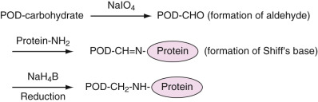

Figure 44-1 

Coupling scheme for conjugation of protein with horseradish peroxidase (POD) based on the Nakane method. 

As shown in [ Figure 44-2 ](<#f0015>) , new coupling methods (  Kato et al, 1975  ;  Kitagawa et al, 1978  ) have been developed using a sophisticated coupling reagent,  m  -maleimidobenzyl- _N_ -hydroxysuccinimide ester (MBS). The MBS is a bivalent reagent consisting of an activated ester and maleimide, and it can react with an NH  2  group and an SH group, respectively. The carboxy group can also be used as a specific site for conjugating with α\- or ε-NH  2  residues of proteins using _N_ -hydroxysuccinimide (NHS) as the coupling reagent. The NHS coupling reagent extends to conjugate protein or the carboxyl group introduced on the solid phase. 

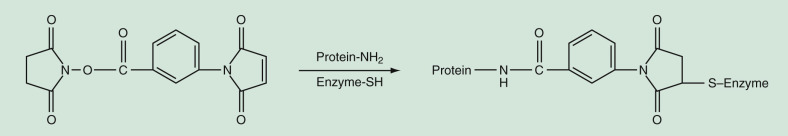

Figure 44-2 

Preparation of enzyme–protein conjugate using hetero-bifunctional coupling reagent. 

 

##  Characteristics of the Solid Phase 

All heterogeneous immunoassays using conjugate with labels, including radioisotopes, require at least one separation step to distinguish the reacted immunocomplex (bound) from unreacted materials (free). Immobilization of antigens or antibodies for solid phase is performed by covalent binding or physical adsorption through noncovalent interactions. Gel particles made of agarose, polyacrylamide, and plastic beads, or titer plates composed of polystyrene, have been used as the solid phase, as well as particles coated with iron oxide that can be separated by a magnetic field. 

The inner wall of a tube or a microtiter well is commonly used as a solid phase. With these relatively large solid phases, shaking of the reaction mixture may be needed to shorten the time required for the immune reaction to take place. The prozone phenomenon or hook effect caused by high concentrations of the analyte is likely to be observed in one-step immunoassay when limited quantities of solid-phase antibody or labeled antibody are employed. Microtiter or strip-type plates may cause an “edge effect.” This effect can be explained by the different kinetics of the immune reaction or enzyme activity with variations in temperature. A difference in temperature may be present between the wells located at the edge of the microtiter plate and the center of the plate. A difference of about 2° C may be observed with an infrared thermometer between the edge and the center of wells at ambient temperature. The size and shape of the solid phase are critical factors affecting the immunoreaction kinetics and the capturing capacity of solid-phase antibody or antigen. Small spherical magnetic particles or latex particles with 3000 Å diameters provide a larger total surface area for immunoabsorbency than is usually obtained with other solid phases. The larger total surface area helps shorten the immunologic reaction time (  Nishizono et al, 1991  ). 

The particles used for the particle agglutination assay are listed in [ Table 44-2 ](<#t0015>) . The phenomenon of particle agglutination (direct agglutination) caused by an immunoreaction was first observed in tests after incubation with infected patient serum. Agglutination of erythrocytes after incubation with serum led to the discovery of ABO blood types. Particle immunoassays are based on the agglutination principle and use the reactant of an antibody or an antigen attached to the inert particle as a label, as opposed to direct precipitation of an Ag–Ab immunocomplex. As a label, the particle can significantly increase the immunoassay sensitivity, regardless of whether the resulting agglutination is detected by the naked eye or with spectrophotometric instruments for quantification. 

TABLE 44-2 

Particles Used as Labels for Particle Agglutination Immunoassay 

|  Assay Method  |  Supply   
---|---|---  
Human erythrocyte  |  Direct hemagglutination (Landsteiner)  |  ABO blood type   
|  Erythrocyte antibody hemagglutination: titer plate/slide  |  Human immunodeficiency virus antibody   
Avian erythrocyte  |  Direct hemagglutination  |  Human influenza virus antibody   
Fixed animal erythrocyte  |  Passive hemagglutination: titer plate  |  _Treponema pallidum_ antibody   
|  Reverse passive hemagglutination: titer plate  |  Hepatitis B surface antigen (HBsAg)   
Latex  |  Reverse passive agglutination: slide  |  Chorionic gonadotropin   
|  Reverse passive agglutination: turbidimetry  |  Immunoglobulin (Ig)E   
|  Reverse passive agglutination  |  Ferritin   
Latex (color)  |  Immunochromatography  |  Human chorionic gonadotropin (hCG)   
Microcapsule  |  Passive agglutination: titer plate  |  _T. pallidum_ antibody   
Gelatin particle  |  Passive agglutination: titer plate  |  HIV, _T. pallidum_ antibody   
|  Reverse passive agglutination: charge-coupled device (CCD) camera  |  Human hemoglobin (hHb)   
Polypeptide particle  |  Passive and reverse agglutination  |  _T. pallidum_ antibody, HBs antibody   
Silicate particle  |  Passive agglutination: titer plate/CCD camera  |  _T. pallidum_ antibody   
Gold particle  |  Reverse agglutination enhancement photometry  |  Total estrogen   
Metal sols  |  Reverse agglutination  |  hCG, hHb   
  
From Nakamura RM, Kasahara Y: Heterogeneous enzyme immunoassays. In Nakamura RM, Kasahara Y, Rechnitz GA, editors _: Immunochemical assays and biosensor technology for the 1990s,_ Washington, DC, 1992, American Society for Microbiology. Reproduced with permission. 

Erythrocytes, gelatin particles, liposomes, metal sols, and various kinds of latex particles, including latex modified with iron oxide or dyes, are all suitable solid phases. The diameter of these particles used for agglutination reactions varies from 0.01 to 7 µm. No single theory can explain the kinetics of agglutination (  Kasahara, 1992a  ) because of the wide variety of particle sizes used as labels. Brownian motion is not significant at room temperature for dispersed particles larger than 3 to 5 µm. However, the theory of potential energy of interaction between particles, or the theory of colloidal coagulation reaction, can apply to small particles such as latex microparticles. The IgM antibody, being multivalent, is estimated to be 750 times more efficient than the bivalent IgG antibody in an agglutination reaction. The distance between particles in flocculation should be less than or equal to 120 Å because of the molecular length of the antibody. In summary, important factors to consider in an immunoreaction are the surface properties of particles, such as charge and hydrophobicity, and the stability of dispersion. 

,  

##  Precipitin and Nephelometric Immunoassays 

 

##  Background and Principles of Precipitin Reaction 

The precipitate that forms when large complexes of antigen and antibody combine to form an insoluble lattice has been widely used to identify and quantify immunoprecipitin reactions. The modes of application of precipitin techniques have the advantages of sensitivity, specificity, and simplicity. The sensitivity limitation of these assays is a major consideration. Even under the best conditions of enhanced sensitivity afforded by newer light-scattering techniques, the lower limit of sensitivity of immunoprecipitin assays remains in the range of 0.1 to 0.5 mg/dL. This lower limit of sensitivity appears to be sufficient for the quantification of many major serum proteins. The precipitin reaction forms the basis for many quantitative and qualitative immunochemical techniques now used in the clinical laboratory (  Kabat, 1961  ). 

Factors affecting the precipitin reaction were extensively investigated by Heidelberg in 1935, who found that the relative proportions of reactants; conditions of temperature, pH, and ionic strength of the medium; and antibody characteristics of avidity and affinity were all important in the formation of the immune precipitate (  Heidelberg & Kendall, 1935  ). On the pattern of precipitin formation, it can be noted that there is a point at which precipitation is maximum or optimal, which is designated as _the point of equivalence._ Continued addition of antigen once the point of equivalence has been reached produces a solubilizing effect on the precipitate. The dynamic range suitable for the determination of analytes should be up to the zone of equivalence. Optimization of the antibody concentration as a reactant is necessary, in addition to optimization of buffer solutions. Typical precipitant reaction methods are as follows: 

  * 1.

Qualitative Precipitant Assay Methods 

    * •

Single immunodiffusion (  Williams & Chase, 1970  ) 

    * •

Double immunodiffusion (  Garvey et al, 1977  ) 

    * •

Double immunodiffusion in two dimensions (  Williams & Chase, 1970  ) 

    * •

Electroimmunodiffusion reaction (  Ritzmann & Daniels, 1975  ) 

    * •

Immunoelectrophoresis (  Rose, 1973  ) 

  * 2.

Semiquantitative Precipitant Assay Methods 

    * •

Single radial immunodiffusion (  Fahey & McKelvey, 1965  ;  Mancini et al, 1965  ) 

    * •

Single-dimension electroimmunodiffusion (“rocket” electrophoresis) (  Axelsen, 1975  ) 

 

##  Nephelometric Immunoassays 

A number of techniques for immunoprecipitin analysis have been developed that use light-scattering devices (  Ritchie, 1978  ). The occurrence of immune complex formation has been related to the amount of such light scattering and has been used as a basis for antigen quantitation. Sophisticated instruments have been designed to rapidly measure light scattering. Measurements of scattered light are generally referred to as _turbidimetry_ or _nephelometry._

,  

##  Particle Immunoassay 

 

##  Principle of Particle Agglutination 

The agglutination reaction may be used to detect antibodies in specimens with specific antigens sensitized to a particle (passive or direct agglutination; [ Fig. 44-3, _B_ ](<#f0020>) ). Reverse agglutination using a corresponding antibody sensitized to particles can be employed to detect soluble antigens in the specimen ( [ Fig. 44-3, _A_ ](<#f0020>) ). A hapten unit single-binding site (for drugs, hormones, or small particles) does not form a cross-linking structure and thus cannot become agglutinated unless it is immobilized on the solid phase. As shown in [ Figure 44-4, _A_ and _B_ ](<#f0025>) _,_ when a particle or carrier immobilized with a hapten is used as a reactant, an agglutination inhibition reaction occurs that allows detection of the hapten. This assay is based on a competitive-type principle in which agglutination of hapten particles with a limited amount of antibody, whether free or sensitized on particles, is inhibited by the hapten present in the specimen. Also, labeled particles can react with reactants fixed on the solid phase of the membrane. After immunoreaction, particles within the immunocomplex can be developed to show color on part of the membrane. This type of assay has been popular as a simple device for the qualitative detection of human chorionic gonadotropin (hCG) and other analytes. 

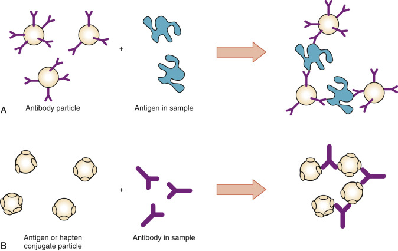

Figure 44-3 

Principles of passive particle agglutination immunoassay for detection of antigen with multiple 

**A,** epitopes or **B,** antibodies. 

(From Nakamura RM, Kasahara Y, Rechnitz GA, editors: _Immunochemical assays and biosensor technology for the 1990s,_ Washington, DC, 1992, American Society for Microbiology.) 

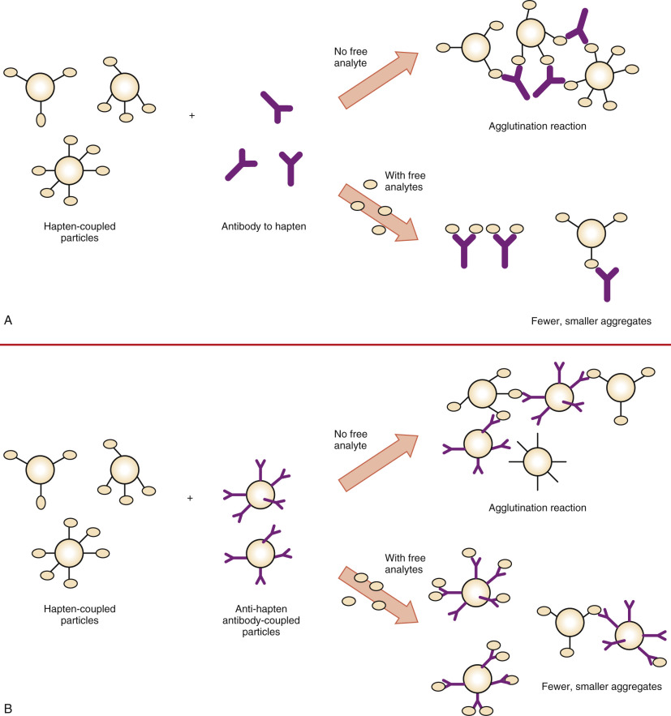

Figure 44-4 

Principles of particle inhibition immunoassay for detection of antigen with single epitope (hapten), using antigen particle with **(A)** free or **(B)** fixed antibody. 

(With permission from Nakamura RM, Kasahara Y, Rechnitz GA, editors: _Immunochemical assays and biosensor technology for the 1990s,_ Washington, DC, 1992, American Society for Microbiology.) 

 

##  Hemagglutination 

Hemagglutination tests (  Boyden, 1951  ) are simple to perform and do not require special equipment. For this reason, both advanced and developing countries have adopted a variety of hemagglutination tests. A popular worldwide hemagglutination test is used for the detection of antibody to _Treponema pallidum_ , marketed as Serodia-TP, by Fujirebio, Inc. (Tokyo, Japan). In the United States, the hemagglutination test for _T. pallidum_ was approved in 1981 by the Centers for Disease Control and Prevention. It was also recommended by the World Health Organization because of its superiority over other tests in terms of specificity and sensitivity (  Kasahara, 1992b  ). 

In the _T. pallidum_ agglutination test, the reagent consists of sensitized and unsensitized sheep red cells, as well as a serum diluent solution for the reconstitution of lyophilized sensitized cells as a positive control. Both qualitative and semiquantitative tests can be carried out using the following serum dilution protocol and a titer plate as a reaction container as follows: Using a 25-µL pipette dropper, place four drops 100 µL of serum diluent in well 1 ( [ Fig. 44-5 ](<#f0030>) ) and one drop in wells 2 to 4 for the qualitative assay (wells 2 to 8 are used for the quantitative assay). The resulting agglutination patterns are shown in [ Figure 44-6 ](<#f0035>) . Negative patterns, indicating that immunoreaction has not taken place, show condensed flocculation particles with a cross-packing structure at the bottom of the microtiter well. On the other hand, positive patterns, indicating that immunoreaction has occurred, show an expanded agglutination pattern of particles. Agglutinated particles cannot be sedimented any further to obtain condensation as negative patterns, because their global shape is lost on account of the agglutination of particles. In the first and second rows, serum and unsensitized cells (negative control) were used, respectively. Specimens 1 and 2 show negative results. Specimens 3 to 8 show negative or positive results, depending on the specimen dilution. A positive result is observed for both specimens 7 and 8 up to 1 : 2560 (rows 3 to 8). 

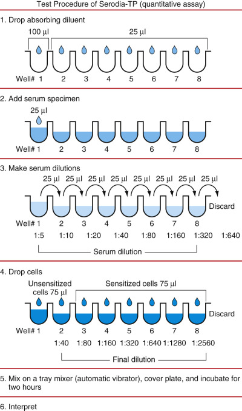

Figure 44-5 

Hemagglutination assay for detection of _Treponema pallidum_ antigen (Serodia-TP, Fujirebio, Inc., Tokyo, Japan) based on semiquantitative test protocols. 

(With permission from Nakamura RM, Kasahara Y, Rechnitz GA, editors: _Immunochemical assays and biosensor technology for the 1990s,_ Washington, DC, 1992, American Society for Microbiology.) 

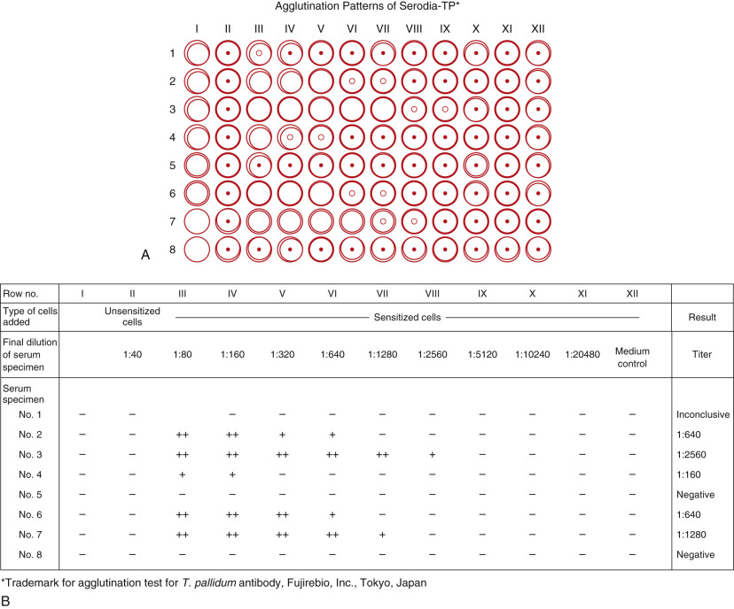

Figure 44-6 

Hemagglutination patterns for detection of **(A)** anti–Treponema pallidum antibody, and **(B)** interpretation as positive or negative at final serum dilution. 

(From Nakamura RM, Kasahara Y, Rechnitz GA, editors: _Immunochemical assays and biosensor technology for the 1990s,_ Washington, DC, 1992, American Society for Microbiology.) 

Hemagglutination kits are now available for the detection of antibodies to hepatitis type B virus (HBV), hepatitis type C (HCV), human immunodeficiency virus (HIV1/2), thyroglobulin, thyroid microsome, and other substances. Reverse hemagglutination tests are used for the detection of HBV surface antigen, α-fetoprotein (AFP), human hemoglobin in stool specimens, and so forth. The sensitivity of hemagglutination tests is approximately 50 ng/mL for antigen (analyte) detection.  Kemp and colleagues (1988)  developed a hemagglutination assay that uses a mouse monoclonal antibody specific to the surface antigen of human erythrocytes. The antibody can recognize an epitope common to different types of red cells or to abnormal cells, such as those found in sickle cell anemia. As shown schematically in [ Figure 44-7 ](<#f0040>) , blood cells in the specimens are used as solid-phase particles, and the resulting agglutination can be observed by the naked eye. Bivalent antibodies are conjugated chemically, so one antibody specifically reacts with the surface epitopes of the blood cell and the other is specific to the target antigen or analyte. The assay is applied for the detection of antibody to HIV, as well as for the detection of various antigens. Unlike conventional agglutination formats, the separation of plasma or serum is not required. This assay is simple, saves time, and offers safety advantages because it eliminates the need for serum separation for hazardous HIV- or HBV-positive specimens. 

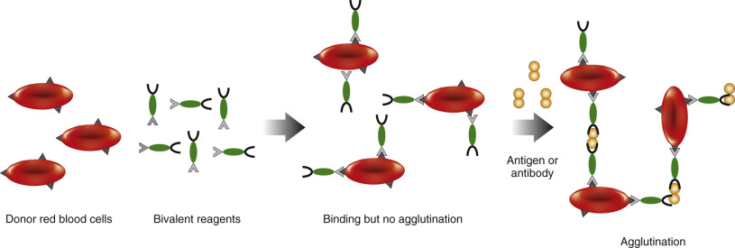

Figure 44-7 

Schematic presentation of an assay based on autologous erythrocyte agglutination, using erythrocytes in the specimen as particles. 

(With permission from Nakamura RM, Kasahara Y, Rechnitz GA, editors: _Immunochemical assays and biosensor technology for the 1990s,_ Washington, DC, 1992, American Society for Microbiology.) 

 

##  Gelatin Particle Agglutination 

The development of a special gelatin particle with a highly hydrophilic surface that is able to prevent nonspecific binding of materials present in a specimen has provided an alternative to erythrocytes (  Ikeda, 1984  ). This particle is made by phase separation and three-dimensional cross-linkage at 40° C and optimum pH. The resulting particle is fixed with formaldehyde or glutaraldehyde, and its diameter is about 3 µm. The physical properties of gelatin particles in comparison with those of erythrocytes are shown in [ Figure 44-8 ](<#f0045>) . A gelatin particle has no antigenicity and is therefore free from problems associated with heterophilic antibodies when erythrocytes are used as particles. This type of artificial particle requires much less serum dilution to avoid nonspecific binding and guarantees a more sensitive detection than with blood cells. Other synthetic particles (  Hirayama et al, 1991  ) made from block copolymer composed of  l  -glutamic acid and derivatives have been developed by  Hirayama and colleagues (1991)  as alternatives to gel particles. These synthetic particles can be stained with dye of any color because the particles themselves are colorless, as are gelatin particles. The gelatin particle agglutination test was initially applied to the detection of antibodies to human T-cell lymphotropic virus, which was first discovered as a retrovirus in humans. This agglutination test (  Ikeda, 1984  ) soon became very popular for blood screening for HIV, HBV, and HCV because of its high sensitivity and specificity and its simplicity, and the fact that strict temperature control is not required to perform the tests. Gelatin particle agglutination can replace any assay based on hemagglutination, with the exception of assays that use red blood cells in specimens as particles. 

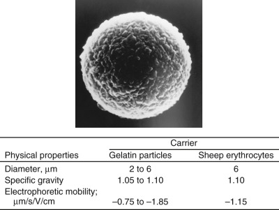

Figure 44-8 

Electron micrograph (×25,000) and physical properties of gelatin particles in comparison with sheep erythrocytes. 

(With permission from Nakamura RM, Kasahara Y, Rechnitz GA, editors: _Immunochemical assays and biosensor technology for the 1990s,_ Washington, DC, 1992, American Society for Microbiology, p 139.) 

 

##  Latex Agglutination 

Latex agglutination (  Galvin, 1984  ), using latex as particles, has been employed for the detection of various analytes, such as hCG for qualitative pregnancy tests, and for the quantitative detection of other plasma proteins with or without instrumentation. The format of this qualitative assay is simple. For example, one might have to mix only a couple of drops of latex sensitized with reactant and specimen using a stick on a black slide. Two to three minutes later, phase inversion agglutination resulting from the immunoreaction can be observed by the naked eye. Latex agglutination was adapted for quantitative assays using light detection methods based on turbidimetry (light absorption) or nephelometry (light scattering). With these techniques, latex agglutination achieves an enhanced sensitivity of subnanograms per milliliter, while the sensitivity of the assay measuring intact precipitation of the Ag–Ab complex remains below 0.5 µg/mL. 

 

##  Latex Turbidimetric Assay 

Light adsorption (light loss by scattering on the surface of a particle) is proportional to the diameter of the particle and depends on the wavelength of light used. Most latex reagents commercially available use latex with a diameter of less than 1 µm and are applied in automated chemistry analyzers using photometric measuring principles. To further improve sensitivity, efforts were made to upgrade reagents and instrumentation and to optimize particle size, selection of appropriate wavelength, and improvements in computer software for integration of data. Automated systems now use latex particles that can perform about 200 tests per hour at a subnanogram-per-milliliter sensitivity. 

 

##  Particle-Counting Immunoassay 

The particle-counting immunoassay (PACIA) (  Masson & Holy, 1986  ) uses optical cell counting to assess the decrease in the number of unagglutinated particles after an immunoreaction. In the PACIA format, the rate assay—that is, the rate of decrease in the number of unagglutinated particles—or the endpoint of the assay reaction can be measured. The endpoint assay can be used to obtain a sensitivity at the nanogram-per-milliliter level; however, a longer incubation time is required for an endpoint immunologic reaction. 

 

##  Other Particle Immunoassays 

Quasielastic scattering immunoassays were developed using a measurement of the change in response to particle size distribution (  Yarmush et al, 1987  ). This technique uses a laser light beam to measure the reduction in the mean diffusion coefficient of particles as a result of immunoreaction. Other methods measure the change in angular anisotropy of scattered light with the increasing average size of the particle. Particles with diameters about equal to the size of a wavelength achieve a size-dependent angular variation of scattered light. 

 

##  Summary 

Indirect hemagglutination and gelatin particle agglutination tests using microtiter plates are popular procedures for qualitative and semiquantitative determination of various analytes. These tests do not require additional instrumentation or strict temperature control. Most important, they guarantee a sensitivity equal to or greater than conventional enzyme immunoassays when applied to antibody detection of infectious agents. Latex as a solid phase provides great kinetic advantages, such as a shorter immunoreaction time. For this reason, it was possible to adapt latex for use in existing or sophisticated instruments by applying different principles, resulting in an assay sensitivity of about three orders of magnitude greater than standard immunoprecipitation assays. Latex is susceptible to interferences from unknown factors present in specimens. To eliminate this problem, various absorbents have to be used in both the reagent and the incubation medium. The great advantage of particle immunoassay is its simplicity, because it does not require separation of bound and free reactants. 

,  

##  Radioimmunoassay 

 

##  Background 

Since radioimmunoassay (RIA) technology using radioisotopes as labels was first developed by  Yalow and Berson (1959)  , it has been improved dramatically in sensitivity and precision. Numerous variations in the method have been introduced into the clinical laboratory. Two main RIA techniques, competitive and noncompetitive heterogeneous formats, require washing steps to separate bound and free labels (conjugates). The competitive assay follows the law of mass action, which specifies the reaction between analytes and binding proteins, receptors, and antibody. The key factor in assay optimization is the binding affinity of the antibody. The Scatchard plot of the ratio of bound to free antibody to analyte concentration is commonly used to evaluate antibody performance. [ Figure 44-9 ](<#f0050>) shows the Scatchard plot for cyclosporine determination. As described earlier in the Kinetics of Antigen-Antibody Reaction section, from the following equation: 

 B  /  F  =  K  a  (  [  A  b  ]  t  − B  ) 

the _y_ -axis is the _B/F_ ratio that is proportional to free [ _Ab_ ] from [ _Ab_ ] _ t  _ − _B_ , equal to free [ _Ag_ ]. Therefore, _K a  _ represents the slope of the plot. In [ Figure 44-9 ](<#f0050>) , the affinity constant _K a  _ is 8.1 × 10  9  L/M for the antibody specific to cyclosporine. Radioactive emissions, such as γ-rays of iodine-125 labels, can be measured in terms of counts per minute (CPM) using a γ-scintillation counter. Typical radioisotopes used as labels and their properties are shown in [ Table 44-3 ](<#t0020>) . The choice of label affects the assay protocol considerably. For example, the most popular label, iodine-125, requires a rather short time for signal counting but has a limited shelf life because of its short half-life. On the other hand, the tritium (  3  H) label requires a longer time for counting, thereby increasing the total assay time. Most RIAs now use iodine-125 as labels to expedite the conjugation process and to retain the biological activity of the reactants. A commonly used method for conjugation of iodine-125 with proteins is the chloramine-T method (  Hunter & Greenwood, 1962  ). Tyrosine, in particular, has greater reactivity with iodate because of its hydroxy group at the para-position on the aromatic ring. The signal can be measured in terms of CPM as γ-ray emissions. Unlike enzymes, isotopes as labels with a small Stokes radius are not likely to disrupt antigenic activity because of the lack of steric hindrance when isotopes are conjugated with small antigens (haptens). 

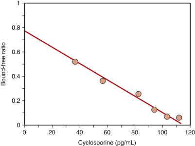

Figure 44-9 

Scatchard plot of cyclosporine antibody binding characteristics ( _K a  _ = 8.1 × 10  9  L/M). 

TABLE 44-3 

Properties of Radioisotopes Used as Labels for Radioimmunoassays 

Isotope  |  Half-Life  |  Type of Decay  |  Specific Activity (mCi/mmol)   
---|---|---|---  
125  I  |  60 days  |  γ |  2200   
131  I  |  8.1 days  |  β – , γ |  16,100   
3  H  |  12.3 years  |  β – |  29   
14  C  |  5760 years  |  β – |  6062   
32  P  |  14.3 days  |  β – |  9120   
  
 

##  Assay Principles and Methods 

Various methods (antigen excess) based on the competitive binding reaction (  Ekins, 1960  ) to antibodies between labeled antigens and nonlabeled antigens (analytes present in the specimen) have been developed for a wide variety of analytes. A conventional competitive method is shown in [ Figure 44-10 ](<#f0055>) . At first, known amounts of labeled antigen and antigen in the specimen are mixed and reacted competitively with a constant amount of antibody coated on a solid phase, such as sepharose beads or the inner wall of plastic tubes. After the immune reaction reaches its equilibrium, the mixture is washed to remove unreacted conjugates and antigens, and the immune complex trapped on the solid phase is separated. The washing step is referred to as B/F separation. Applying the competitive principle, the plot of antigen-bound percentage against logarithmic concentration of analyte provides the standard curve shown in [ Figure 44-10 ](<#f0055>) . The CPM plot on the standard curve gives the concentration of analytes. 

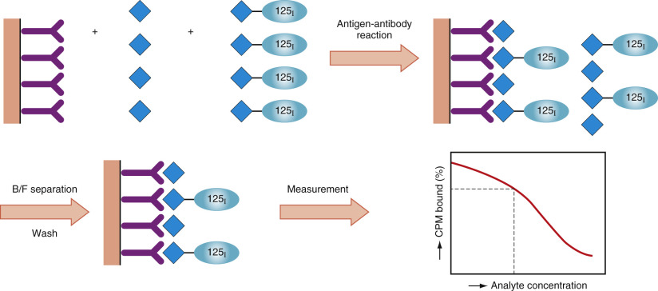

Figure 44-10 

Assay principle of competitive radioimmunoassay (RIA) using first antibody as solid phase. 

A second antibody method is shown in [ Figure 44-11 ](<#f0060>) . The first antibody specific to a particular antigen (analyte) reacts competitively with both the conjugate and the antigen. Then, the immune complex is captured by the second antibody specific to the first antibody, on the solid phase. When the second antibody is coated on a fine solid phase, the immune complex on the second reaction can be separated as a precipitant from the unreacted molecules. For antibody determination, labeled antibody and antibody in the specimen react competitively with the antigen (analyte) fixed on the solid phase. The steeper slope of the standard curve provides more precise data. Competitive methods require lesser amounts of antibody or antigen (analyte) than the sandwich-type assays described later. Noncompetitive assays, originally demonstrated by  Miles and Hales (1968)  , have recently gained greater popularity. 

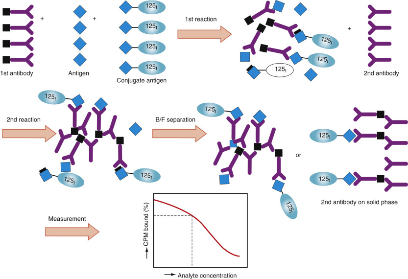

Figure 44-11 

Assay principle of competitive radioimmunoassay (RIA) method using second antibody for B/F (bound/free) separation. 

Immunoradiometric assays and sandwich assays ( [ Fig. 44-12 ](<#f0065>) ) have alternative relationships between analyte and antibody. The classical competitive assay achieves an immunologic response with a minimum amount of antibody; the sandwich assay uses a large amount of antibody on the solid phase. Monoclonal antibody technology has made it possible to manufacture large quantities of specific antibodies at moderate costs, thereby allowing the sandwich assay to be exploited. The sandwich assay, which uses excess antibody, is more sensitive than the competitive assay. When background noise is completely omitted, the ultimate theoretical sensitivity of the sandwich assay is one molecule of analyte, which is possible when the amount of antibody used in the assay system approaches infinity. As shown in [ Figure 44-12 ](<#f0065>) , the antibody on the solid phase first captures the antigen (analyte) in the specimen. Following B/F separation, the conjugate reacts with the antigen (analyte) fixed on the solid phase; the signal can then be counted after the elimination of free conjugates through a washing step. This assay requires antigens with more than two antigenic sites. When two different antibodies (i.e., a solid-phase antibody specific to one antigenic site and a conjugate antibody specific to another antigenic site) are used, the assay protocol can be simplified by performing a one-step sandwich. Thus the solid phase can mix together with the antigen in the specimen and the conjugate simultaneously. Interference does not occur because the antibodies on both the solid phase and the conjugate are capable of recognizing different antigenic sites. In this assay, the signal generated is proportional to the analyte concentration present in the specimen, as in the two-step sandwich assay. This assay method can be applied to antibody detection with an assay format using antigen as the solid phase or labeled antigen. For a two-step format, antigen as the solid phase or labeled antibody specific to the target antibody can be used. Using the sandwich format, assay sensitivity (  Rodriguez-Espinosa et al, 1987  ) is high. An example is seen when an immunoradiometric assay is used for determination of the peptide hormone thyroid-stimulating hormone (TSH); the level of assay sensitivity is below 0.07 µU/mL of TSH, as compared with about 0.7 µU/mL with conventional competitive antigen-labeled assay. 

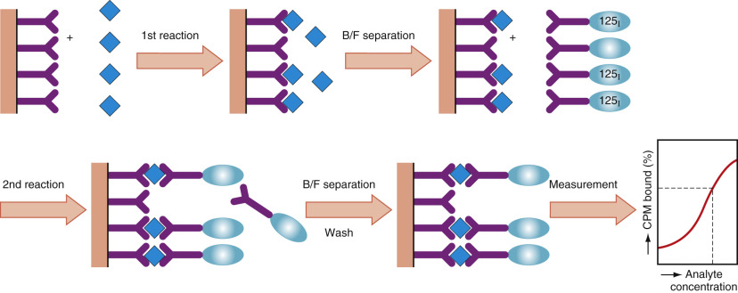

Figure 44-12 

Assay principle of sandwich radioimmunoassay (RIA) method using solid phase, also referred to as immunoradiometric assay. 

_B/F,_ Bound/free. 

 

##  Summary 

Compared with other immunoassays, RIAs are advantageous for a number of reasons, including precision and high sensitivity, ease of isotope conjugation, signal detection without optimization, and stability against interference from the assay environment, among others. Disadvantages of RIAs are the short shelf-life of the reagents and the need to protect against hazardous radioactivity. Furthermore, as discussed later, RIAs may not be applied to homogeneous immunoassays because signals from isotopes cannot modulate Ag–Ab reactions. 

,  

##  Enzyme Immunoassay 

 

##  Background and Classification 

Quantitative immunoassays using enzymes as labels were developed as alternatives to radioisotopes (  Avrameas & Guilbert, 1971  ;  Engvall & Perlman, 1971  ;  Van Weeman & Schuurs, 1971  ). The most widely used are the enzyme-linked immunosorbent assay (ELISA), the EIA, and the enzyme-multiplied immunoassay technique (EMIT), which is a registered trade name of SYVA Co. (Dade Behring Inc., Cupertino, Calif.) (  Rubenstein et al, 1972  ). Essentially, heterogeneous EIAs are similar to RIAs, except that they use enzymes as labels. Enzymes make it possible to develop homogeneous EIAs, eliminating the otherwise necessary washing steps for B/F separation. [ Table 44-4 ](<#t0025>) compares the features of heterogeneous and homogeneous EIAs versus RIAs. Improvements in EIAs have provided many innovative formats with different degrees of speed, sensitivity, simplicity, and precision. Advantages and disadvantages of EIAs are listed in [ Box 44-1 ](<#b0010>) (  Nakamura & Kasahara, 1992  ). 

TABLE 44-4 

Comparison of Radioimmunoassay, Heterogeneous Enzyme Immunoassay, and Homogeneous Enzyme Immunoassay 

Assay  |  Immunologic Reaction Steps  |  Enzyme Reaction Steps  |  Signal Detection Steps   
---|---|---|---  
**Radioimmunoassay**   
Sample + (labeled analyte or Ab) − 125  I  |  Immunoreaction with washing steps for separation  |  Not required  |  Radioactive decay (γ-ray)   
**Heterogeneous enzyme immunoassay**   
Sample + (labeled analyte or Ab) − enzyme  |  Immunoreaction with washing steps for separation  |  Enzyme reaction with additional reagent  |  Optical density   
Fluorescence   
Luminescence   
**Homogeneous enzyme immunoassay**   
Sample + (labeled analyte or Ab) − enzyme or cofactors  |  Immunoreaction and/or systemic reaction is carried out in one solution, which includes reagent for signal development of enzyme.  |  Immunoreaction and/or systemic reaction is carried out in one solution, which includes reagent for signal development of enzyme.  |  Optical density   
Fluorescence   
Luminescence   
  
_Ab,_ Antibody. 

Box 44-1 

Advantages and Disadvantages of Enzyme Immunoassay 

  * A.

Advantages 

    * 1.

Sensitive assays can be developed by the amplification effect of enzymes. 

    * 2.

Reagents are relatively cheap and can have a long shelf life. 

    * 3.

Multiple simultaneous assays can be developed. 

    * 4.

A wide variety of assay configurations can be developed. 

    * 5.

Equipment can be inexpensive and is widely available. 

    * 6.

No radiation hazards occur during labeling or disposal of wastes. 

  * B.

Disadvantages 

    * 1.

Measurement of enzyme activity can be more complex than measurement of the activity of some types of radioisotopes. 

    * 2.

Enzyme activity may be affected by plasma constituents. 

    * 3.

Homogeneous assays at the present time have the sensitivity of 10  −9  M and are not as sensitive as radioimmunoassays. 

    * 4.

Homogeneous EIAs for large protein molecules have been developed but require complex immunochemical reagents. 

_EIA,_ Enzyme immunoassay. 

From Nakamura RM, Kasahara Y: Heterogeneous enzyme immunoassays. In Nakamura RM, Kasahara Y, Rechnitz GA, editors: _Immunochemical assays and biosensor technology for the 1990s,_ Washington, DC, 1992, American Society for Microbiology. Reproduced with permission. 

 

##  Heterogeneous Enzyme Immunoassays 

The assay principle of heterogeneous EIAs is similar to that of RIAs, except that enzyme activity, not radioactivity, is measured. EIAs require a secondary process to obtain signals through the catalytic reaction of enzymes. Microtiter plate wells, plastic beads, plastic tubes, magnetic particles, and latex with filters, among others, can be used as the solid phase for the separation of bound and free conjugates. The use of small magnetic particles and latex allows shortening of the immunoreaction time, thereby reducing the total assay time. The development of substrates to be cleaved by enzymes was marked by the introduction of colorimetric and fluorometric substrates, and later chemiluminescent substrates, which increased the signal sensitivity. The enzymes commonly used in various hetero­geneous EIAs are horseradish peroxidase, alkaline phosphatase, β-galactosidase, glucose oxidase, urease, and catalase. The most widely used enzymes and their characteristics are listed in [ Table 44-5 ](<#t0030>) . Assay sensitivity using enzymes may be determined by the turnover rate of each enzyme and by selection of signal measurement in which chemiluminometry is the most sensitive method. 

TABLE 44-5 

Characteristics of Typical Enzymes Used as Labels for Enzyme Immunoassay 

Enzyme Characteristic  |  Peroxidase (EC1.11.1.7)  |  β-Galactosidase (EC3.2.1.23)  |  Alkaline Phosphatase (EC3.1.3.1)   
---|---|---|---  
Source  |  Horseradish  |  _Escherichia coli_ |  Bovine intestine   
Molecular weight, daltons  |  40,000  |  530,000  |  100,000   
Specific activity  |  250 U/mg  |  600 U/mg  |  2500-5000 U/mg   
Turnover rate [ * ](<#hl0000520>) |  10,000  |  318,000  |  250,000   
Measurement of enzyme  |  Colorimetry, fluorometry, luminometry  |  Colorimetry, fluorometry, luminometry  |  Colorimetry, fluorometry, luminometry   
Highly sensitive measurement  |  Luminometry  |  Fluorometry  |  Luminometry   
Method for enzyme labeling  |  Periodate oxidation (Nakane method)  |  Dimaleimide method, cross-linking reagent [ † ](<#hl0000523>) |  Glutaraldehyde method, cross-linking reagent [ † ](<#hl0000523>)  
  
 * Number of substrate molecules produced by a molecule of enzyme for 1-minute reaction; molecule number/minute. 

 † The reagent contains chemically reactive groups such as maleimide and succinimide. 

The assay format of heterogeneous EIAs, similar to RIAs, can be divided into competitive and noncompetitive assays ( [ Fig. 44-13 ](<#f0070>) ). Competitive assays (analyte excess) use antigen–enzyme conjugates ( [ Fig. 44-13, _A_ ](<#f0070>) ), and noncompetitive assays (reactant excess) include two-site immunometric sandwich assays ( [ Fig. 44-13, _B1_ ](<#f0070>) ) and indirect assays to measure antibodies ( [ Fig. 44-13 ](<#f0070>) , _B2_ ). Immunometric sandwich assays have gained much popularity for the determination of antigens such as tumor markers, plasma proteins, and infectious agents. Indirect assays for antibody measurement ( [ Fig. 44-13, _B2_ ](<#f0070>) ) have been adopted for the detection of antibodies to infectious agents (e.g., HIV, HBV, HCV) and to autoantibodies. 

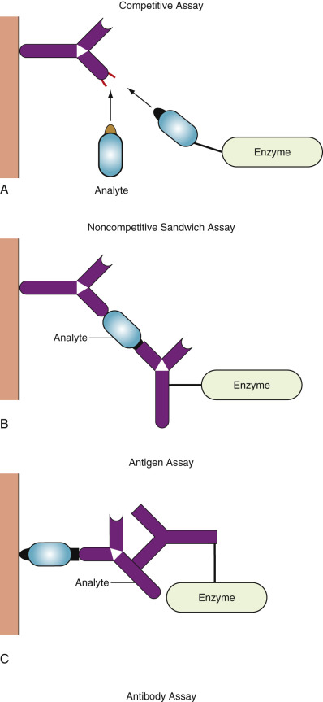

Figure 44-13 

Assay principles of heterogeneous enzyme immunoassay (EIA) using solid phase. 

**A,** Competitive assay. **B** and **C,** Noncompetitive sandwich assay. 

Heterogeneous EIA (see [ Fig. 44-13 ](<#f0070>) ) consists of the following steps: 

  * 1.

The solid phase with the attached reactants is mixed with analyte, regardless of whether the assay is based on the competitive or the noncompetitive format. 

  * 2.

Following the addition of conjugate and incubation, washing steps are performed with a buffer solution containing a detergent, one or two steps after the immunoreaction. The immunoreaction should reach certain yields to obtain a stable and precise assay. 

  * 3.

The solid phase, with the immunocomplex containing enzyme-labeled antigen or antibody, is incubated at constant temperature with the enzyme–substrate solution. 

  * 4.

The enzyme reaction is stopped (stopping is not needed in rate assay), and the substrate reaction product is measured with various detectors, depending on the substrate used. 

 

##  Colorimetric Enzyme Immunoassay 

In this assay, enzyme reaction is performed by using chromogenic substrates to develop a color by prime catalytic reaction—for example, horseradish peroxidase, catalyzing ABTS (diammonium salt of 2,2′-azino-di[{3-ethyl-benzothiazoline-6-sulfonate}]) with H  2  O  2  to form a green color, and alkaline phosphatase specific to the _p_ -nitrophenylphosphate to form a yellow color. Both enzymes are the most commonly used types of colorimetric enzyme immunoassays. A spectrophotometer is used to measure the optical density of the resulting chromogen. Many instruments are available for the measurement of optical density in tubes or microtiter plates, ranging from a fully automated system that performs sample pipetting and data printout to simpler manual devices. When the EIA reaction is performed on nitrocellulose membrane (Western blotting method) or other membranes, substrates that generate insoluble dyes are utilized. An hCG pregnancy test with an immunoassay format that is sold as an over-the-counter test commonly uses benzidine derivatives to react with peroxidase or indoxyl phosphate derivatives to react with alkaline phosphatase to generate insoluble dyes. The dye accumulating on the solid phase through enzyme reaction can be read by the naked eye. Theoretically, the measurement of optical density is limited to a range of 0 to 2.0. Therefore, the determination of optical density for analytes that require determination of a wide dynamic range can be problematic, even when an excess amount of conjugate and a solid phase with sufficient capturing capacity are used with a sandwich-type assay. 

Efforts to improve EIAs, the milestone of nonisotopic immunoassays, have brought to light several disadvantages of RIAs, such as hazardous isotopic waste, radiolysis of labeled analytes, and the short half-life of iodine-125.  Ishikawa and Kohono (1989)  developed an ultrasensitive EIA capable of detecting 3 fmol of specific IgG antibody. But to achieve this level of sensitivity, several tedious steps are required, such as immunocomplex transfer from a first solid phase to another solid phase to reduce background signals. 

 

##  Fluorescent Enzyme Immunoassay 

Fluorescent EIAs are identical to other EIAs, except that they use fluorescent substrates. In the fluorescent EIA, a fluorophore is generated by an enzyme reaction. Following excitation of the fluorophore at its optimal light excitation wavelength, light at a characteristic wavelength is emitted. Instruments such as a fluorometer require both a supplier of the excitation light source and a photomultiplier tube as a detector of the emission fluorescence. Substances that emit fluorescent light may be present in the specimen. These substances may increase the background signal, which may interfere with the assay's sensitivity. Thus close attention should be paid to the selection of substrates for EIAs to avoid interfering factors. Compared with colorimetric EIAs, fluorescent assays generate a signal intensity that is at least one order of magnitude greater. 

 

##  Chemiluminescent Enzyme Immunoassay 

Chemiluminescent enzyme immunoassays (CL-EIAs) use chemiluminescent substrates that react with various enzymes employed as labels. The chemiluminescent enzymatic reaction generates light, similar to bioluminescence, which involves the use of natural substrates such as luciferin–adenosine triphosphate. Over the past 20 years, much attention has been paid to the application of chemiluminescence in immunoassays, and a variety of systems consisting of substrates and enzymes have been developed. Current systems using luminol derivatives to peroxidase with an enhancer or dioxetane derivatives to alkaline phosphatase achieve highly sensitive immunoassays. These assays are effective tools in practical diagnosis. The enzymatic oxidation reaction of luminol analogs has long been used for CL-EIA. Use of peroxidase with H  2  O  2  is a common method that is interchangeable with an alternative coupling enzyme producing H  2  O  2  , such as glucose oxidase or uricase. The discovery of enhancers by  Thorpe and colleagues (1985)  for luminol-based chemiluminescence remarkably improved the assay's sensitivity. Enhancers include phenol derivatives and aromatic compounds. For example, luminol-peroxidase with _p_ -iodophenol as an enhancer achieves a light emission increase of up to 2800-fold in the optimized reaction mixture. This assay is able to detect TSH at 0.04 µU/mL when serum is used as the specimen. However, oxidative reactions, such as those for luminol, are likely to be interfered with by multiple factors that cause increased nonspecific background signals (noise). 

Bronstein and colleagues (1989a)  developed a chemiluminescent substrate for alkaline phosphatase that differs considerably from other compounds. This new substrate is known as AMPPD (disodium 3-(4-methylspiro [1,2-dioxetane-3,2′-tricyclo-[3.3.1.1]decan]-4-yl) phenyl phosphate), an adamantyl dioxetane derivative. It requires no additional molecules for the emission of chemiluminescent light, unlike luminol, which needs oxidative compounds from outside the luminol molecules. AMPPD is a novel molecule that is a complete substrate because it is composed of the adamantyl group as a stabilizer of the entire molecule, the dioxetane bond as an energy source, and phosphoryl ester as a cleavage site of the enzyme, along with a phenyl group for chemiluminescence—all assembled within one molecule. The structure of the molecule and the reaction process for light generation are shown in [ Figure 44-14 ](<#f0075>) . Cleavage of the phosphoester bond of AMPPD by alkaline phosphatase triggers chemically initiated electron exchange luminescence by releasing electron-rich dioxetane. A chemiluminescent signal with maximum wavelength of 477 nm can be detected within a couple of minutes to a few hours, depending on the substrate concentration. The alkaline phosphatase with AMPPD assay system has a sensitivity of less than 10  −20  mol (  Bronstein et al  1989b  ;  Kricka, 1991  ). 

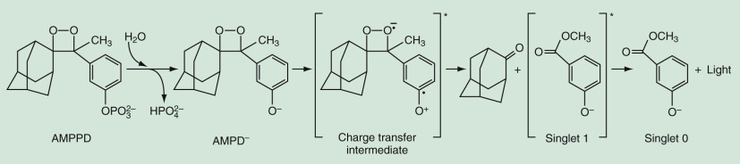

Figure 44-14 

Adamantyl 1,2-dioxetane phenyl phosphate (AMPPD): a chemiluminescent substrate for alkaline phosphatase (ALP) detection. 

Hydrolytic phosphate cleavage by ALP triggers chemically initiated electron exchange luminescence (CIEEL) decomposition of AMPPD by releasing the electron-rich dioxetane phenolate (AMPD  – ). Charge transfer from the phenolate to the dioxetane ring takes place, forming the charge transfer (CT) intermediate and subsequent breakdown of the cyclic peroxide. Release of energy occurs with light emission. 

CL-EIA uses AMPPD as a substrate to react with alkaline phosphatase, which is used as the enzyme label. CL-EIA can be performed on a fully automated instrument. This novel substrate made it possible to develop an extremely sensitive chemiluminescent enzyme immunoassay system. Ferrite particles 0.3 µm in diameter as the solid phase shorten immunoreaction time to within 30 minutes and provide a larger surface area for the immunoabsorbent. The relationship between the chemiluminescent signal and the concentration of analytes is linear up to about seven orders of dynamic range. The sensitivity of CL-EIA (  Nishizono et al, 1991  ) was tenfold greater than that of conventional RIAs when AFP was assayed; AFP was detected at a level of 30 pg/mL, with an assay time of 30 minutes. Thus the new chemiluminescent EIA systems are a definite improvement over RIAs in terms of sensitivity, time efficiency, and procedural simplicity, and they are increasing in popularity. 

 

##  Homogeneous Enzyme Immunoassays 

 

##  Background 

Two options are available to eliminate tedious assay procedures. One is to design fully automated instruments to access heterogeneous types of reagents, and the other is to develop innovative reagents that do not require complicated washing steps, such as those needed for heterogeneous EIAs. Enzymes and their cofactors are advantageous labels in homogeneous EIAs because enzyme activity can be modulated easily by changing factors in the microenvironment of the Ag–Ab reaction. This is not the case when radioisotope decay is used as the signal. At present, homogeneous EIAs are generally less sensitive than their heterogeneous counterparts. Conventional heterogeneous EIAs have equal sensitivity to RIAs in many applications, whereas homogeneous EIAs (  Nakamura & Robbins, 1988  ) remain one or two orders of magnitude less sensitive than RIAs. Homogeneous EIAs may require complex immunochemical reagents, but the assay systems are rapid and simple and are adaptable to conventional instruments. Various types of homogeneous EIAs are available. In each of these assays, the Ag–Ab interaction modulates the activity of the enzyme or enzyme label in the presence of the substrate. Modulation of the enzyme activity reflects the degree of the immunochemical reaction. [ Table 44-6 ](<#t0035>) lists the characteristics of typical homogeneous EIAs. Homogeneous EIAs can be classified as competitive and noncompetitive binding assays. Competitive assays usually consist of enzyme-labeled antigens. However, the antigen (analyte) may be conjugated to the substrate or to a prosthetic group of the enzyme in other assay formats. In contrast, noncompetitive binding assays use a conjugate of antibody labeled with enzyme. Among the various methods reported, five homogeneous EIAs deserve our attention. 

TABLE 44-6 

Classification and Characteristics of Typical Homogeneous Enzyme Immunoassays [ * ](<#hl0000608>)

Name and Assay Type  |  Conjugate  |  Manner of Modulation   
---|---|---  
**Competitive**  
EMIT  |  Antigen with lysozyme, G6PD [ * ](<#hl0000608>) |  Steric hindrance   
SLFIA  |  Antigen with substrate  |  Steric hindrance   
ARIS  |  Antigen with prosthetic group  |  Steric hindrance   
Enzyme-channeling immunoassay  |  Antigen with G6PDH [ * ](<#hl0000608>) and hexokinase [ * ](<#hl0000608>) |  Enhancement by proximity   
Biotin-enzyme avidin immunoassay  |  Antigen with avidin  |  Steric hindrance   
CEDIA  |  Antigen with fragments of subunit  |  Steric hindrance   
**Noncompetitive**  
Hybrid antibody immunoassay  |  Hybrid antibodies specific to antigen and to inhibitor  |  Steric hindrance   
Proximal linkage immunoassay  |  Antibody with G6PDH [ * ](<#hl0000608>) and hexokinase [ * ](<#hl0000608>) |  Substrate cascade by proximity   
EIHIA  |  Antibody with amylase [ * ](<#hl0000608>) |  Steric hindrance   
Enzyme enhancement immunoassay  |  Antibody with β-galactosidase [ * ](<#hl0000608>) and succinyl antibody  |  Charge effect   
AEST  |  Antibody with peroxidase  |  Stabilization   
  
_ARIS,_ Apoenzyme reactivation immunoassay; _CEDIA,_ cloned enzyme donor immunoassay; _EIHIA,_ enzyme inhibitory homogeneous immunoassay; _EMIT,_ enzyme-multiplied immunoassay technique; _G6PD,_ glucose-6-phosphate dehydrogenase; _SLFIA,_ substrate-labeled fluorescent immunoassay. 

From Kasahara Y: Principles and applications of particle immunoassay. In Nakamura RM, Kasahara Y, Rechnitz GA, editors: _Immunochemical assays and biosensor technology for the 1990s,_ Washington, DC, 1992, American Society for Microbiology. Reproduced with permission. 

 * Enzyme discussed in detail in the text. 

 

##  Enzyme-Multiplied Immunoassay Technique 

EMIT, the first homogeneous EIA, was developed by  Rubenstein and Schneider (1972)  . The EMIT system is illustrated in [ Figure 44-15 ](<#f0080>) . In EMIT, the conjugation of enzymes to haptens does not disrupt enzyme activity; however, the binding of hapten-specific antibodies to haptens results in inhibition of enzyme activity. Free haptens in the standard or sample relieve this inhibition by competing for antibodies. Thus in the presence of antibodies, enzyme activity is proportional to the concentration of free haptens. As a general rule, the antibody inhibits the enzyme by inducing or preventing conformational changes necessary for enzyme activity (  Rowley et al, 1975  ). The exception to this inhibition mechanism is the EMIT thyroxine assay, which uses malate dehydrogenase. In this assay, the thyroxine-malate dehydrogenase conjugate is enzymatically inactive, but it becomes activated when it is bound by thyroxine antibody (  Ullman et al, 1979  ). It is believed that conjugated thyroxine inhibits the enzyme by binding to the active site, thus increasing the “apparent” _K_ m  of the substrate. The antibody reactivates the enzyme by “pulling” the thyroxine out of the active site. In the EMIT assay system, malate dehydrogenase and glucose-6-phosphate dehydrogenase have been found to be most useful because they are less likely to be affected by serum constituents. These assays generally measure drugs at a concentration of milligrams per liter. However, the digoxin assay has a much lower limit of sensitivity in the range of 0.8 to 2 µg/L. 

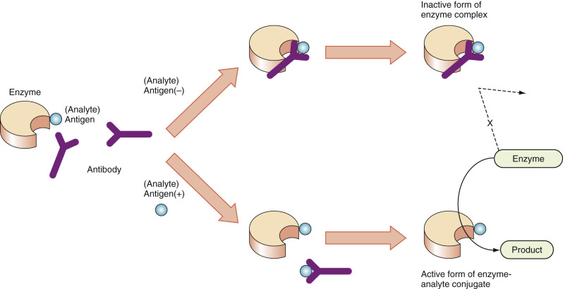

Figure 44-15 

Enzyme-multiplied immunoassay technique (EMIT) system diagram. 

The activity of an enzyme as a label is inhibited by the binding of antibody to antigen (analyte) conjugated with enzyme. The analyte is usually a hapten. Glucose-6-phosphate dehydrogenase (G6PD) and lysozyme are usually used as enzymes. In the assay, enzyme activity is proportional to the concentration of the analyte. 

(With permission from Nakamura RM, Kasahara Y, Rechnitz GA, editors: _Immunochemical assays and biosensor technology for the 1990s,_ Washington, DC, 1992, American Society for Microbiology.) 

 

##  Substrate-Labeled Fluorescent Immunoassay 

The substrate-labeled fluorescent immunoassay (SLFIA) (  Burd et al, 1977  ) uses a characteristic fluorogenic substrate, umbelliferyl β-galactoside, attached to the antigen (analyte) as a conjugate. Umbelliferone is the fluorescent product produced when the substrate is cleaved with the enzyme β-galactosidase, which cannot cleave the substrate–antigen complex when it is reacted with the specific antibody. The free antigen (analyte) in the specimen solution competes with the antigen conjugated with the substrate to form the immunocomplex ( [ Fig. 44-16 ](<#f0085>) ). The antigen concentration in the sample is proportional to the fluorescent intensity of the cleaved fluorescent product. SLFIA can be used to assay drugs and haptens, as well as protein ligands such as IgG and IgM. A disadvantage of this method is that the amplification properties of the enzyme are not utilized, and thus the assay system has limited sensitivity in the range of 10  −9  to 10  −10  molar concentration of the analyte. 

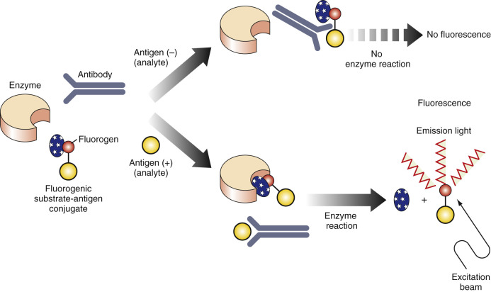

Figure 44-16 

Substrate-labeled fluorescent immunoassay (SLFIA). 

The substrate β-galactosylumbeliferone is conjugated with the antigen (analyte) and forms a nonfluorescent substrate. The substrate can be cleaved by the enzyme β-galactosidase to form a fluorescent product. However, when the substrate–antigen conjugate is allowed to react with specific antibody to the antigen, no cleavage of the substrate complex with the β-galactosidase enzyme occurs. In this assay, the concentration of the antigen (analyte) is directly proportional to the fluorescent intensity measured. 

(With permission from Nakamura RM, Kasahara Y, Rechnitz GA, editors: _Immunochemical assays and biosensor technology for the 1990s,_ Washington, DC, 1992, American Society for Microbiology.) 

 

##  Apoenzyme Reactivation Immunoassay 

The apoenzyme reactivation immunoassay (ARIS) is a homogeneous assay developed by  Morris and colleagues (1981)  , using the prosthetic group consisting of flavin adenine dinucleotide (FAD)-conjugated antigen (analyte) and glucose oxidase apoenzyme. As shown in [ Figure 44-17 ](<#f0090>) , the antigen (analyte) and a constant amount of analyte–FAD conjugate compete for a limited amount of specific antibody. At equilibrium, the level of free conjugate is proportional to the amount of antigen (analyte) in the specimen. The apoenzyme combines with the free but not with the antibody-bound form of conjugate to reactivate glucose oxidase activity in proportion to the amount of free conjugate in the mixture. Active enzyme is generated in the procedure, and an amplification mechanism is built into this assay. ARIS has been used to assay for theophylline and IgG (  Morris et al, 1981  ;  Morris, 1985  ). This FAD-labeled conjugate assay is readily adapted to the measurement of high-molecular-weight proteins (e.g., thyroid binding globulin) (  Schroeder et al, 1985  ), as well as other haptens such as phenytoin and hormones. 

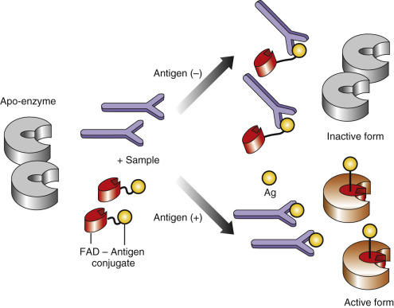

Figure 44-17 

Apoenzyme reactivation immunoassay (ARIS). 

Flavin adenine dinucleotide (FAD) attached to the antigen is used. The apoenzyme is apoglucose oxidase, which requires FAD cofactor for activity. In the assay, the concentration of antigen (analyte) is proportional to the enzyme activity generated. 

(With permission from Nakamura RM, Kasahara Y, Rechnitz GA, editors: _Immunochemical assays and biosensor technology for the 1990s,_ Washington, DC, 1992, American Society for Microbiology.) 

 

##  Enzyme Inhibitory Homogeneous Immunoassay 

The enzyme inhibitory homogeneous immunoassay (EIHIA), developed by  Ashihara and colleagues (1988)  , consists of antibody conjugated with enzyme and insoluble substrate. This assay is most suitable for the determination of large antigens (analytes). The EIHIA can be made to be homogeneous because the immunocomplex of conjugate with large antigen blocks the enzyme reaction with the solid substrate ( [ Fig. 44-18 ](<#f0095>) ). α-Amylase has been used as a labeled enzyme for the determination of ferritin and AFP. The immunoreaction of analyte with enzyme-labeled antibody can reach a plateau within 10 minutes; thus EIHIA based on a noncompetitive binding assay requires less incubation time to achieve a sensitive detection level. Using this method, the measuring range of ferritin in serum is 10 to 800 ng/mL, and for AFP, it is 5 to 200 ng/mL. Dextranase has been used as an alternative enzyme (  Nishizono et al, 1988  ). EIHIA has also been applied to a simple dry-film format (  Ashihara et al, 1991  ). The dry film consists of three major layers, each containing a developing zone for immunologic and enzymatic reaction, a barrier zone, and a color-developing zone. An inhibitor specific to human amylase present in serum is used to prevent serum background. The assay for serum C-reactive protein is completed in only 6 minutes by simply placing the specimen on the slide using dry chemistry instrumentation. Nevertheless, the sensitivity of the system remains inadequate for application to analytes such as tumor markers. 

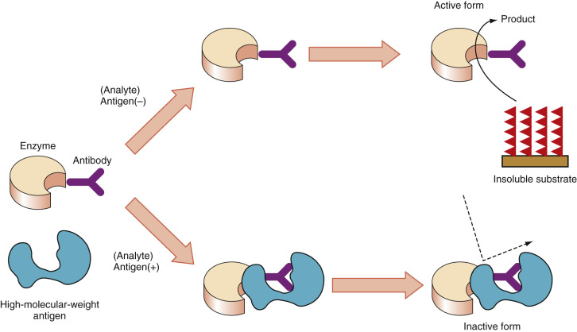

Figure 44-18 

Enzyme inhibitory homogeneous immunoassay (EIHIA). 

The enzyme α-amylase from _Bacillus subtilis_ or dextranase from _Chaetomium gracile_ is conjugated to the specific antibody to the high-molecular-weight antigen. The high-molecular-weight antigen can be ferritin or α-fetoprotein. The α-amylase enzyme is inactive when the enzyme antibody conjugate reacts with specific antibody. The active enzyme form can react with the starch-insoluble substrate. The antigen concentration is directly proportional to the enzyme activity of the assay reaction. 

(With permission from Nakamura RM, Kasahara Y, Rechnitz GA, editors: _Immunochemical assays and biosensor technology for the 1990s,_ Washington, DC, 1992, American Society for Microbiology.) 

 

##  Cloned Enzyme Donor Immunoassay 

The cloned enzyme donor immunoassay was first achieved through the application of recombinant DNA technology to homogeneous immunoassays by  Henderson and colleagues (1986)  . Microgenics Corp. (Concord, Calif.) was able to engineer β-galactosidase protein into a large polypeptide (an enzyme acceptor [EA]) and a small polypeptide (an enzyme donor [ED]). EAs and EDs assemble to form enzymatically active tetramers. In the assay ( [ Fig. 44-19 ](<#f0100>) ), a hapten antigen (analyte) is attached to an ED, and an analyte-specific antibody is used to inhibit spontaneous assembly of the active enzyme. The antigens (analytes) in patient serum compete with the analytes in the analyte–ED conjugate for antibody, modulating the amount of active β-galactosidase formed. The signal generated by enzyme substrates is directly proportional to the analyte concentration in the patient serum. The test for digoxin is a colorimetric assay that requires no serum pretreatment or predilution. The assay system is suitable for use with automated chemistry analyzers. 

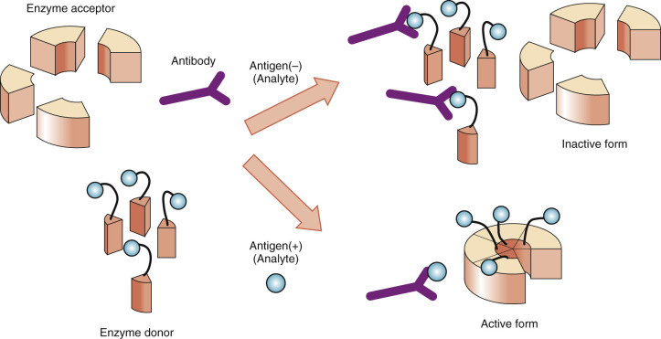

Figure 44-19 

Cloned enzyme donor immunoassay (CEDIA). 

Enzyme acceptors associate with enzyme donors to form an active β-galactosidase tetramer. The antibody inhibits the association of enzyme acceptor with enzyme donor–antigen conjugate. 

(With permission from Nakamura RM, Kasahara Y, Rechnitz GA, editors: _Immunochemical assay and biosensor technology for the 1990s,_ Washington, DC, 1992, American Society for Microbiology.) 

 

##  Summary 

EIAs can be applied to all Ag–Ab systems, including those involving serum protein, hormones, drugs, and other antigens and the antibodies directed against pathogens. Heterogeneous EIAs using chromogenic substrates can have a sensitivity comparable with that of RIAs, and they have gained wide acceptance for application in various immunoassays. Heterogeneous EIAs using sophisticated substrates that generate chemiluminescent light and small particles as the solid phase are sensitive enough to detect less than 1 pg/mL of analytes. Their sensitivity is thus much higher than that of RIAs. In addition, the assay manipulation is greatly simplified by fully automated instruments. Compared with heterogeneous EIAs, homogeneous EIAs have certain limitations in sensitivity, dynamic range, and large analyte application. Also, high background signals (noise) and relatively low assay signals are inevitable because of elimination of the washing steps for the separation of bound and free conjugates. Homogeneous EIAs are advantageous because they are based on a simple assay format and can be adapted to existing automatic instrumentation. At this time, heterogeneous EIAs with fully automated instruments remain the best choice in terms of sensitivity and simplicity, as well as for safety reasons, because they do not require the use of radioisotopes. 

,  

##  Fluorescent Immunoassay 

 

##  Background and Classification 

Coons and colleagues (1941)  first introduced the use of fluorescent compounds as immunochemical labels to detect antigens in tissue sections. Immunofluorescence assays on tissue sections are currently very well established in the pathology laboratory. Over the past several years, many FIA procedures have been developed to detect the concentrations of drugs, hormones, and a wide variety of proteins and polypeptides (  Nakamura & Kasahara, 1992  ). In the initial stages of development, analytic FIAs were hindered by a decrease in sensitivity caused by background fluorescence of biological samples. Gradually, the sensitivity of fluorometric methods improved, and detection of analytes at concentrations of 10  −15  M became possible. Further advancements were achieved through improvements in instrumentation and the introduction of unique substrates with various immunochemical and enzymatic reactions. 

Selection of the fluorochrome label is important. The label should be stable and should demonstrate high molar extinction coefficiency and quantum yield. It should also emit at appropriate wavelengths without interference with ligand–antibody reactions. When most fluorophores or fluorescent molecules are irradiated with light at appropriate wavelengths, an electron in the ground state is transited into the excited state of the molecule. As the electron returns to the ground state, physical energy is released in the form of a photon of lower energy (longer wavelength) than the exciting light. The fluorescence spectrum reveals a wavelength of maximal emission, characteristic of a particular fluorescent compound. One of the typical labels, fluorescein isothiocyanate (FITC), has a less than 1-nanosecond time interval between excitation and emission, whereas other compounds (e.g., europium) exhibit delayed fluorescence with an interval of several hundred nanoseconds. The various FIAs may be classified as heterogeneous and homogeneous, ligand or antibody labeled, competitive or noncompetitive, and solid or nonsolid phase. The most common methods are discussed here. 

 

##  Heterogeneous Fluorescent Immunoassay 

Heterogeneous FIA procedures include a washing step to separate bound from free fluorescent labels. The assay procedure is similar to that of heterogeneous enzyme immunoassays and RIAs. Most commercially available assays use a solid-phase antigen or antibody system. The assay can be competitive or noncompetitive—a property shared by RIAs and EIAs. 

 

##  Fluoroimmunometric Method 

With the fluoroimmunometric method, the analyte reacts with excess labeled antibodies in the solution. Residual labeled antibodies bind to excess solid-phase bound antigens. The solid-phase matrix is washed, and fluorescence intensity is inversely related to the analyte concentration. This method can be adapted to the assay of haptens and complex proteins. Solid-phase FIA procedures were developed for the serologic assay of antibodies to rubella, toxoplasmosis, viral antigens, and antinuclear antibodies. Heterogeneous FIA methods for antigen determination were developed for serum proteins and hormones, including immunoglobulins, cortisol, progesterone, and thyroxine. The major advantage of heterogeneous FIAs is the significant reduction in interference by naturally fluorescent substances in patient samples, caused by the physical removal of interference factors during the separation step. 

 

##  Radial Partition Immunofluorometric Assay 

In radial partition immunoassays, radial chromatography is used and the assay is carried out on glass-fiber filter papers (  Giegel et al, 1982  ). This procedure has been automated for the assay of hCG and several other analytes in serum (  Rogers et al, 1986  ). 

 

##  Time-Resolved Fluoroimmunoassay 

This method uses special instrumentation and fluorescent labels to increase assay sensitivity. It involves the use of fluorescent labels exhibiting delayed fluorescence with a time period of 100 ns or longer between excitation and emission. Because most substances responsible for background fluorescence have a short decay period, measurement of the delayed fluorescence signal will significantly reduce the effects of background fluorescence. This is accomplished with the time-resolved fluorometer, a special instrument that produces a fast light pulse that excites the fluorophore. Fluorescence is measured a little while after excitation. Thus the effect of nonspecific background, which generally decays in less than 10 nanoseconds, can be removed (  Halonen et al, 1973  ;  Soini & Kojola, 1983  ). Fluorophores exhibiting delayed fluorescence that have been used in these assays (  Soini & Hemmila, 1979  ) include the following: 

  * •

Pyrene derivatives with a decay time of almost 100 ns 

  * •

Rare earth metal chelate labels with a very long decay time of almost 50 to 100 µs. These include europium (Eu  3+  ), samarium (Sm  3+  ), and terbium (Tb  3+  ). 

  * •

Time-resolved fluoroimmunoassays have been developed to measure many analytes, including hCG, IgG, cortisol, insulin, and others. 

 

##  Homogeneous Fluorescent Immunoassay 

By definition, these immunoassays are performed on homogeneous specimen samples. They do not require the separation of bound from free conjugates and usually are not sensitive to background interference in the samples. Homogeneous FIAs also have the advantage of being quick to perform. However, when compared with heterogeneous assays, they show certain disadvantages. Homogeneous FIAs have a limited sensitivity near 10  −10  m/L with standard instrumentation. Labeled impurities in the sample may increase background interference. The assays require relatively pure labeled antigen or specific antibody, as well as special instrumentation, to achieve higher sensitivity. 

 

##  Fluorescence Polarization Assay 

A polarizing lens or prism can resolve light into rays in a single plane. When viewed at the right angle of an excitation beam of vertically polarized light, fluorescent compounds in solutions emit partially polarized fluorescence. The fluorescence polarization principle was first applied to immunoassay procedures by Dandliker and colleagues (  Dandliker & de Saussure, 1970  ;  Dandliker et al, 1973  ). Polarized light transmitted through the sample can excite the fluorescent label, regardless of binding to antibody. However, as shown in [ Figure 44-20, random ](<#f0105>) thermal motion causes small molecules labeled with a hapten to tumble freely in solution, losing their polarized orientation. When the labeled antigen is bound to antibody with a molecular mass greater than 160 kDa, the molecular motion is slowed enough to increase the polarized signal. 

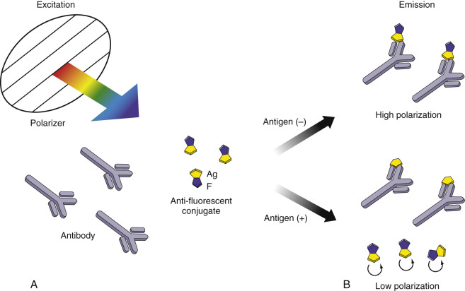

Figure 44-20 

Assay principle of fluorescence polarization immunoassay (FPIA). 

**A,** A polarized beam can excite both an unbound conjugate and the conjugate bound to antibody (Ab) existing at the same angle as the irradiating beam. The conjugate consists of hapten (H) with a fluorescent molecule (F). **B,** Orientation of the molecules at the time of fluorescence emission. Small hapten conjugates free of antibody can quickly change their orientation and emit fluorescence at different angles that is not detected. However, the conjugate bound to the antibody still remains at the same angle because of its very slow movement, and it emits fluorescence that is detected. 

Studies using labeled antibody or antibody fragments showed no change in polarization upon mixing antigen and labeled antibody, even though immunoreaction had occurred. This method is most useful for the measurement of small antigens and haptens (  Jolley, 1981  ). Abbott Laboratories has adapted this approach for the assay of many therapeutic and abused drugs on the TDx (Abbott Diagnostics, Abbott Park, Ill.). They developed a next-generation analyzer, the IMx, to measure molecules with large masses such as tumor markers, hormones, and infection-related antigens or antibodies (  Fiore et al, 1988  ). They combined two assay principles: fluorescence polarization and microparticle enzyme immunoassay. The demand for random access capabilities led Abbott to develop a fully automated, high-throughput random access analyzer named the AXSYM. This system is being used in clinical laboratories (  Smith et al, 1993  ). 

 

##  Fluorescence Excitation Transfer Immunoassay 

The fluorescence excitation transfer immunoassay (FETI) method (  Ullman et al, 1976  ) uses two labels: fluorescein as the donor fluorescent label and rhodamine as the acceptor or quencher. FITC has a maximum emission of 525 nm, and tetraethylrhodamine has a strong absorption peak at 525 nm. Therefore, when FITC-labeled antigen and rhodamine-labeled antibody bind, quenching of FITC fluorescence occurs. This phenomenon involves an energy transfer from an electronically excited fluorescent dye to an acceptor dye. The rate of energy transfer is inversely proportional to the sixth power of the distance between donor and acceptor molecules. For adequate reduction of fluorescence with quenching, the donor–acceptor distance between labels should be about 50 to 70 Å. This method is useful for the assay of antigen with multivalent antigenic determinants. Separate portions of specific antibody are labeled with fluorescein and rhodamine. The mixture of differently labeled fluorescein-tagged antibody and rhodamine-labeled antibody reduces the intensity of the fluorescein label by adjusting the ratio and amount of donor and acceptor molecules so they can react in close proximity to permit energy transfer. These problems have been overcome using new fluorescent compounds. The FETI method has been improved with the use of a fluorescence marker such as europium (III) (Eu[III]) trisbipyridine cryptate as a donor, and a fluorophore such as allopycocyanin as an acceptor (  Alpha et al, 1987  ;  Mathis, 1995  ). These transient compounds reveal a large Stokes shift in which the excited europium at 337 nm transfers energy through an acceptor molecule at an excitation of 620 nm and eventually emits fluorescent light at 665 nm, as in the time-resolved mode.  Mathis (1993)  developed the fluorescence resonance energy transfer using cryptate-chelating rare metal and applied it to the detection of AFP and carcinoembryonic antigen (CEA) in serum. CIS Bio International (Ceze, France) developed an automated homogeneous immunoassay system, KRYPTOR, for the detection of cancer markers such as CEA, CA 19-9, CA 125, and AFP, using the time-resolved amplified cryptate emission. The sensitivity for AFP was 0.25 ng/mL for 9 minutes' incubation. 

 

##  Fluorescent Protection Immunoassay 

In this assay (  Nargessi et al, 1979  ), the protein antigen is labeled with fluorescein and then is reacted with specific antibody to the antigen. The antigen-specific antibody will sterically inhibit the reaction of a second antibody specific to fluorescein, which functions to quench the fluorescence of fluorescein when it binds to the fluorophore. The ability of the specific antifluorescein antibody to interact with fluorescein coupled to the surface of the antigen will decrease. The procedure may be used to assay for antibody concentration or for antigen (analyte) concentration in a homogeneous system. 

,  

##  Chemiluminescent Immunoassay 

 

##  Background 

Chemiluminescent immunoassays (CLIAs) use chemiluminescence-generating molecules as labels, such as luminol derivatives, acridinium esters, or nitrophenyl oxalate derivatives and ruthenium tri-bipridyl [Ru(bpy)  3  2+  ] with tripropylamine for electrochemiluminescence. Basically, the assay method does not differ from that of heterogeneous immunoassays, RIAs, and FIAs. Light generation of luminol derivatives requires OH  – /H  2  O  2  as a chemical trigger or H  2  O  2  with peroxidase as an enhanced chemiluminescent trigger. Acridinium esters chemically triggered with OH  – /H  2  O  2  display a relatively high chemiluminescent quantum yield for light emission compared with luminol. Other chemiluminescent molecules include aequorin, a natural compound (  Actor et al, 1998  ). Labels of chemiluminescent compounds produce light electrochemically on the surface of electrodes and can be applied to homogeneous assay formats. Both CLIAs using acridinium esters and electro-CLIAs are applicable for practical diagnostic testing. Their characteristics are described in the following section. 

 

##  Chemiluminescent Immunoassay Using Acridinium Esters as Labels 

In this method (  Weeks et al, 1983  ), acridinium esters ( [ Fig. 44-21 ](<#f0110>) ) are directly conjugated with protein molecules. Acridinium esters can oxidatively react with H  2  O  2  under alkaline conditions to produce high-energy intermediates that decompose to the excited fragment, generating light. The light emission of acridinium esters is extremely fast, within 5 to 10 seconds after initiation of the oxidation reaction. Flash-type chemiluminescence, as this process is called, has a much steeper spectrum of light emission to reactive time than glow-type chemiluminescence triggered by enzymes. The sensitivity of this assay is higher than that of RIA, and testing is less time consuming. The solubility of acridinium esters and the stability of conjugates with proteins in storage have been improved through modification of the molecule and conjugation chemistry. This technology is likely to bring improvements in the assay of haptens, such as hormones. 

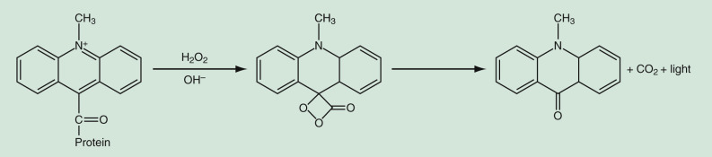

Figure 44-21 

Chemiluminescent immunoassay mechanism with acridinium ester based on oxidative decomposition. 

 

##  Electrochemiluminescent Immunoassay 

Electrochemiluminescent immunoassay (ECLIA) uses electrochemical compounds that generate light electrochemically, linked with the cycle reaction of the oxidative reduction. With optimization of reaction solutions, selection of appropriate conjugation method, and development of suitable compounds such as Ru(bpy)  3  2+  and TPA, it became possible to apply electrochemiluminescent technology to immunoassays (  Blackburn et al, 1991  ). Ru(bpy)  3  2+  has a reaction site for the conjugation of analytes using activation reagent such as NHS. Ru(bpy)  3  2+  , thus conjugated with antibodies, can be applied to sandwich-type assays for large molecules. The conjugate generates light on the surface of gold electrodes. Ru(bpy)  3  2+  on solid phase and TPA are oxidized on the surface of electrodes to form Ru(bpy)  3  2+  and TPA  \+  , respectively. TPA  \+  spontaneously loses electrons. Ru(bpy)  3  3+  can generate emission light at 620 nm when it returns to Ru(bpy)  3  2+  as a ground state through reduction with TPA. The efficiency of light generation (quantum yield) depends on the proximity between the electrode and the conjugate, and thereby on the diffusion mobility of the conjugate. Free conjugates can generate more light than conjugates fixed on the solid phase as a result of immunoreaction. This allows easy access to the homogeneous assay format, but relatively high background noise interferes with assay sensitivity, as it does in other homogeneous assays. The assay protocol for the determination of analytes is as follows: Magnetic microparticles coated with antibody as the solid phase and sample mix together for immunoreaction. After washing for bound and free conjugates by magnetic separation according to the assay format, the solid-phase suspension is introduced into the detector with the electrode to measure chemiluminescence. The detection limit of ECLIAs has been reported as 0.2 to 0.4 ng/mL for CEA and 0.4 ng/mL for AFP. This assay does not require complicated instruments. A further advantage is that ECLIAs requires less time for signal detection, similar to FIAs and other CLIAs. 

,  

##  Noncompetitive Immunoassay for Small Molecules 

 

##  Background 

Haptens such as hormones, vitamins, drugs, or toxins play a wide variety of roles in biology, and their accurate measurement is essential in biomedical fields. Haptens have mainly been measured using competitive immunoassays, because in general their limited molecular size impedes the simultaneous binding of two antibodies to one hapten molecule for sandwich immunoassays, already mentioned in the Assay Principles and Methods section. Several methodologies have been developed for smaller haptens, including idiometric assay using anti-idiotype antibodies (  Barnard & Kohen, 1990  ;  Kobayashi et al, 2000  ); open-sandwich immunoassay (  Lim et al, 2007  ); and antimetatype antibody–based immunoassay (  Towbin et al, 1995  ;  Voss, 1996  ). The general assay principle for each of these methods is shown in [ Figures 44-22 ](<#f0115>) and [ 44-23 ](<#f0120>) . 

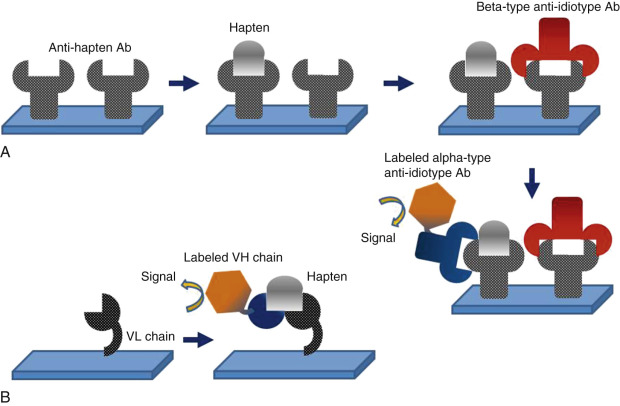

Figure 44-22 

Assay principle of two kinds of hapten immunoassays. 

**A** , Idiometric assay using anti-idiotype antibodies. **B** , Open sandwich immunoassay 

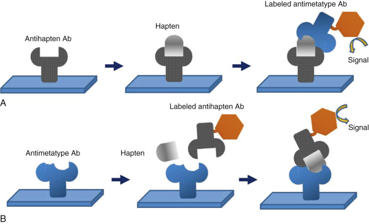

Figure 44-23 

Hapten Immunoassay procedure using antimetatype antibody. 

**A,** Combination of antihapten antibody for the solid phase and labeled antimetatype antibody for the conjugate. **B** , Combination of antimetatype antibody for the solid phase and labeled antihapten antibody for the conjugate. 

 

##  Anti-Idiotype Antibody-Based Immunoassay 

The idiometric assay needs two main types of anti-idiotype antibodies. The alpha-type recognizes an epitope within the variable region of the primary antihapten antibody, but it can bind to the primary antihapten antibody in the presence or absence of the hapten analyte at the binding site. On the other hand, the beta-type antibody competes with the hapten at the binding site. Briefly, after the hapten in samples reacts with primary antihapten antibody on the solid phase, the beta-type antibody reacts with the binding sites of the primary antihapten antibody that are not occupied by haptens. Then the labeled alpha-type antibody results in the binding of the primary antihapten antibody with hapten.  Kobayashi and colleagues (2000)  applied it to detect UDCA 7-NAG and 11-deoxycortisol (  Kobayashi et al, 2003  ). Recently, it was reported that an idiometric assay for cortisol was threefold more sensitive than a competitive assay and could determine normal urinary cortisol levels. 

 

##  Open-Sandwich Immunoassay 

The open-sandwich immunoassay is based on the association of separated VH and VL chains from the variable domain of antibodies by the presence of antigen (  Ihara et al, 2009  ;  Islam et al, 2011  ). As shown in [ Figure 44-22, _B_ ](<#f0115>) _,_ the VL fragment on the solid phase was incubated with the labeled VH fragment and antigen in sample. This assay was also developed to detect hapten molecules in the homogeneous assays without the washing step. 

 

##  Antimetatype Antibody–Based Immunoassay 

The antimetatype antibody–based immunoassay is the only nonconventional sandwich immunoassay that enables the simultaneous recognition of a hapten by two antibodies. Generating an antimetatype antibody is a key benefit of developing sensitive and specific immunoassays for hapten. Few studies have so far confirmed that antimetatype antibodies for haptens such as digoxin and angiotensin II can be established by classical immunization procedures (  Towbin et al, 1995  ). The development of antimetatype antibodies by classical immunization procedures suitable for wide application is highly improbable because the hapten-antibody immune-complex structure is very difficult to maintain. 

A recent report describes the development of a novel and widely applicable sandwich assay for haptens based on antimetatype antibodies (  Omi et al, 2015  ). Omi and colleagues employed an ex vivo antibody development system (Autonomously Diversifying Library system) generated from chicken DT40 B-lymphocyte line (  Seo et al, 2005;  2006  ). In this system, antimetatype antibodies recognizing hapten-primary antibody immunocomplexes were selected from artificial antibody libraries using a magnetic beads–based affinity isolation method; this led to the successful development of sandwich assays for two haptens: estradiol and 25-OH vitamin D. This sandwich assay proved sensitive and specific enough for routine diagnostic use. A reagent allowing for equal detection of 25-OH vitamin D  2  and 25-OH vitamin D  3  on an automated immunoassay instrument was further developed commercially as the first sandwich-type immunoassay reagent with antimetatype antibody. Therefore, this method provides a simple, practical approach for the routine assay of haptens, a development that is expected to facilitate major advances in analytic and clinical chemistry. 

,  

##  Sensitive Immunoassay Using Specimen-Pretreatment Methods 

 

##  Background 

Nowadays, nucleic acid amplification detection technologies are very sensitive for virus genome detection and useful for virus infection diagnosis. On the other hand, the sensitive immunoassay for viral antigen has several merits when compared with nucleic acid amplification detection systems. Immunoassay can generally detect quantities with lower variance, it is not expensive, and it has less contamination risk. In addition, targeted antigens in immunoassay remain more stable in long-term storage than virus RNA as an analyte. 

However, in general, the viral antigens lie on the surface or capsid of the virus particle, and antibodies to the viral antigens are produced in the blood. It has to overcome these factors of obstruction for the quantitative approach of viral antigen. New highly sensitive immunoassays for viral antigens in the presence or absence of antiviral antigen antibody have been reported using a simple specimen-pretreatment method for clinical application. (  Aoyagi et al, 1999;  2001  ;  Kimura et al, 2002  ). 

 

##  Highly Sensitive Immunoassay for Viral Antigen Using Specimen-Pretreatment Method 

Hepatitis C virus (HCV) core antigen is a suitable candidate for the detection of the HCV protein ( [ Fig. 44-24 ](<#f0125>) ). The core antigen exists as a capsid protein in free HCV particles or HCV particles associated with immunoglobulins or very-low-density lipoproteins. In the blood of HCV-infected patients, there are numerous anti-HCV core antibodies that inhibit the detection of the core antigen. Therefore, for the detection of HCV core antigen in blood to be successful, the targeted viral antigen needs to be freed from all associated materials; this can be achieved by the destruction of the complex containing the HCV particles and the inactivation of the anti-HCV core antibody present in the blood. To individually isolate the proteins, including targeted viral antigen and antiviral antigen antibodies in blood,  Aoyagi and colleagues (1999;  2001)  developed a simple specimen-pretreatment method using a higher concentration of detergent or denaturant such as sodium dodecyl sulfate. They then demonstrated that this simple pretreatment method allowed for the highly sensitive detection of the viral antigen using monoclonal antibodies recognizing the denatured antigen. The limitation of detection in this assay was 0.06 pg of recombinant HCV core antigen/mL. In addition, because the high correlation with commercially available quantitative nucleic acid reagent was shown in anti-HCV antibody positive sera, the pretreatment process has sufficient function to inactivate the anti-HCV antibody in sera. 

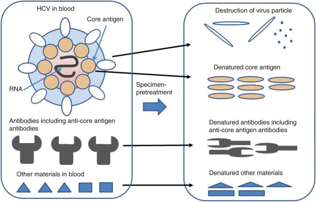

Figure 44-24 

Effect of the specimen-pretreatment method for the detection of HCV core antigen. 

This specimen-pretreatment method was also applied to the detection of hepatitis B virus (HBV) core antigen or HBV core-related antigen, thereby highlighting new clinical utilities (  Kimura et al, 2003  ;  Rokuhara et al, 2003  ;  Tanaka et al, 2008  ). Specifically, the HBV core-related antigen assay can detect HBV core antigen, p22 core-related antigen, and HBV envelope antigen simultaneously using monoclonal antibodies that recognize these denatured antigens by specimen-pretreatment methods (  Kimura et al, 2002  ). This assay reflects the HBV load in the liver and is useful for monitoring HBV patients undergoing various drug therapies. The highly sensitive detection of denatured and free-formed antigens by dissociation from most associating materials through specimen-pretreatment process will be applied to other target antigens or proteins. 

,  

##  Instrument Automation and Modulation of Assay Systems 

 

##  Homogeneous Assay Systems 

Although many homogeneous immunoassays have been developed for manual protocol as described in this chapter, most have not yet been automated. For the EMIT method, fully automated generic chemistry analyzers can be adapted to use these (  Boyd et al, 1985  ). A few instruments are available for homogeneous FIAs, and these assay systems are not interchangeable with one another. The BRAHMS KRYPTOR system, which is the newest, has been developed with special features, including the use of a time-resolved fluorescence detector. It uses a two-wavelength method for internal standard correction of fluorescence intensity at 620 nm and 665 nm, making it possible to increase the sensitivity of the detection limit. 

 

##  Heterogeneous Immunoassay Systems 

Until the early 1980s, most heterogeneous labeled immunoassays were manually performed. Then Boehringer Mannheim (which merged with Roche Diagnostics in 1998) developed a fully automated random access analyzer, the ES-600, based on colorimetric enzyme immunoassays, using horseradish peroxidase as the enzyme (  Wu et al, 1987  ). From the late 1980s onward, many companies endeavored to develop fully automated EIA systems, which were high-throughput, sensitive, randomly accessible systems. Antigens associated with early onset of infectious disease, cytokines, growth factors, and hormones such as calcitonin exist at extremely low concentrations in serum, thus requiring a highly sensitive detection method for measuring these analytes (  Nishizono et al, 1991  ;  Isomura et al, 1994;  1999  ). Among the various methods, chemiluminescent immunoassays and their enzymes are the most sensitive assay systems capable of detecting analytes present at very low concentrations. 

The fully automated instruments currently available are also capable of using fluorescent enzyme immunoassays. These assay systems are classified into several groups based on the generation and detection of signals and the type of solid phase. With respect to the detection signal, the AIA2000, 360 (Tosoh, Tokyo, Japan) and the AxSYM (Abbott, Abbott Park, Ill.) employ a fluorescent method of the EIA that uses alkaline phosphatase and a specific substrate, 4-methylumbelliferylphosphate. Three types of systems are available for chemiluminescent enzyme immunoassays. Lumipulse (Fujirebio, Tokyo, Japan), Access (Beckman Coulter, Brea, Calif.), and Immulite (Siemens Healthcare, Erlangen, Germany) have used a stable chemiluminescent substrate, phenyl phosphoryl adamantyl dioxetane, for alkaline phosphatase (  Babson et al, 1991  ;  Nishizono et al, 1991  ;  Patterson et al, 1994  ). Acridinium ester as a chemiluminescent label was applied to the ADVIA Centaur XP (Siemens Healthcare, Erlangen, Germany) and Architect i2000 (Abbott Diagnostics, Lake Forest, Ill.), and later to the Centaur (Siemens Healthcare, Erlangen, Germany). In the Cobas e411 (Roche Diagnostics, Basel, Switzerland), Ru(bpy)  3  2+  is used as an electrochemiluminescent label (  Erler, 1998  ). 

 

##  Practical Flow of the Immunoassay in the Analytic System 

The market demands that instrumentation be able to perform a large number of tests with random access capability. To meet these criteria, it is necessary to improve reagents and avoid tediousness in performing heterogeneous immunoassays. To simplify the system for application in a fully automated assay system, individual cartridges of prepackaged reagents or predispensed reaction cuvette reagents were designed. A generic system for heterogeneous labeled immunoassays is depicted schematically in [ Figure 44-25 ](<#f0130>) . The operator selects the desired test items by means of a computer program and loads reagent cartridges or bottles for each test. For a particular analyte, the cartridges and the reaction cuvette are fed automatically into the instrument. Samples are transported to the appropriate position for dispensing. The assay is designed to use reaction trays or carousels that automate mixing and separation steps that depend on performance through first and second immunoreactions and the signal generation reaction. All steps of the assay are carried out sequentially on the reaction line, and the signals generated are measured by a detector. Test results are printed out within 20 to 40 minutes and are sent automatically online to the host computer. The system can treat about 60 to 200 tests per hour, processing 10 to 20 analytes in each sample specimen by the random access manner. 

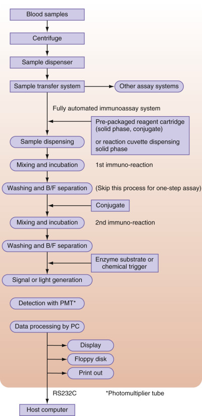

Figure 44-25 

Brief diagram of fully automated immunoassay system in clinical laboratory automation. 

 

##  Instrumentation and Key Points for Heterogeneous Immunoassay 

Although the assay principle is similar in many instruments, big differences among instruments may be noted with respect to sampling format, heating control, B/F separation, carryover, waste flow, and so forth. Thus we should pay attention to how well the instrument performs after implementation. 

 

##  Reaction Cuvette 

In an immunoassay system, the design of cuvette features is very important to obtain reproducible data. Manufacturers use certain types of cuvettes to achieve easy access and rapid handling of reagents. An all-in-one–type cuvette containing the reagents and the reaction cell has been introduced in the Lumipulse system. The Immulite system utilizes a unique reaction cell for B/F separation. The AxSYM (Abbott, Abbott Park, Ill.) uses another unique reaction vessel consisting of a reagent, an incubation well, and a sample well within a cuvette for B/F separation. The system combines the content of this assay cuvette into a matrix cell. The latter can be used to capture the solid latex phase followed by B/F separation and the second immunoreaction of the labeled antibody and the solid phase. 

 

##  Sampling and Fluid Delivery Type 

In general, fluid delivery is selected from two different types: a disposable chip or a fixed-probe nozzle. Cross-contamination of samples should be avoided in all assay systems. The disposable chip can completely prevent cross-contamination. In the case of the fixed-probe system, even though the original sample is divided into several small aliquots, cross-contamination still occurs. Therefore, the disposable chip system is the best way to avoid cross-contamination and to minimize biohazardous waste. On the other hand, the running cost of using chips for the assay is higher than that of the probe assay. Environmental effects of the disposable chips must be considered. 

 

##  Carryover 

Carryover from an extremely high concentration of analyte in one sample to the next sample sometimes causes misjudgment in clinical diagnosis. A disposable plastic tube is the simplest way to prevent this problem. On the other hand, the fixed-probe nozzle has several cost advantages, as mentioned earlier. Thus most of the technologies concerned with sample engineering have focused on minimizing sample carryover through washing and tip maintenance steps. Now, several fixed-probe tips have made it possible to limit carryover to less than the order of 10  −7  . Even with such low carryover, some samples still create problems (e.g., a hepatitis B surface antigen [HBsAg] strong positive sample followed by a negative). In this case, a software system can be used to check the subsequent result by automatically retesting weakly positive values following strong positive results. 

 

##  Bound/Fixed Separation and Washing Systems 

In a heterogeneous immunoassay, the bound conjugate has to be separated from the free label. This B/F separation depends on the characteristics of the solid phase. The IMx and AxSYM systems use latex microparticles as the solid phase and employ a porous membrane to entrap the latex for separation of particles of the solid phase from particles of the liquid phase. The Diagnostics Product Corporation has developed a unique cell for B/F separation systems, in which the reaction solution spins out from an inner cell to an outer waste cell, while the bound phase stays in a solid-phase bead (  -inch bead). Advantages of this format are the avoidance of cross-contamination or carryover from one reaction mixture to the next and the fact that no excess washing process is required. All other systems use magnetic particles and magnetic beads, for which easy and rapid separation can be achieved by applying a magnetic field. 

 

##  High-Throughput Fully Automated Heterogeneous Immunoassay Systems 

[ Table 44-7 ](<#t0040>) compares several of the commercial high-throughput immunoassay systems that have been introduced in the past few years. It shows the instrument specifications of each analyzer. By reducing the incubation and reaction times, a rapid result can be obtained in 10 to 25 minutes. Thus a high-throughput machine performing approximately 200 tests/hour is possible. Furthermore, several manufacturers have demonstrated a new system concept that aligns the different analytic systems needed in a clinical laboratory. Many clinical laboratories have introduced an automated sample transporting line, which is connected to different analytic instruments controlled independently. However, several analyzers are not amenable to this approach because the speed of the instrument throughput or cycle time cannot be harmonized easily. To solve these problems, ARCHITECT (Abbott, Abbott Park, Ill.) is an example of a new machine concept in which one system computer can control several immunoassay analyzers connected to one chemistry analyzer called a _modular system_ . Several other combinations still under development are based on this concept, which will make it possible to simplify the clinical laboratory and to lower total assay cost. 

TABLE 44-7 

High-Throughput Fully Automated Heterogeneous Immunoassay Systems 

|  AIA-2000, Tosoh  |  ADVIA Centaur XP, Siemens  |  ARCHITECT i2000, Abbott  |  Lumipulse Presto II, Fujirebio  |  Cobas e411, Roche   
---|---|---|---|---|---  
Package of reagent  |  Freeze-drying in portion package  |  Reagent pack (solution)  |  Solution in bottle  |  Solution in bottle  |  Reagent pack (solution)   
Reaction cuvette  |  Reagent cup  |  Disposable cuvette  |  Disposable cuvette  |  Disposable cuvette  |  Disposable cuvette   
Reaction principle  |  Fluorescent enzyme immunoassay  |  Chemiluminescent immunoassay  |  Chemiluminescent immunoassay  |  Chemiluminescent enzyme immunoassay  |  Electrochemiluminescent immunoassay   
Labeled substance  |  Alkaline phosphatase  |  Acridinium ester  |  Acridinium ester  |  Alkaline phosphatase  |  Ruthenium   
Enzyme substrate  |  4-Methylumbelliferyl phosphate  |  None  |  None  |  Adamantyl 1,2-dioxetane phenyl phosphate  |  None   
Detector signal  |  Fluorescence  |  Chemiluminescence  |  Chemiluminescence  |  Chemiluminescence  |  Chemiluminescence   
Assay format  |  S-1, S-2, competitive  |  S-1, S-2, competitive  |  S-1, S-2, competitive  |  S-1, S-2, competitive; delayed S-1  |  S-1, S-2, competitive; delayed backtitration   
Pretreatment  |  Yes  |  Yes  |  Yes  |  Yes  |  Yes   
Reaction flow  |  Turntable  |  Turntable  |  Turntable  |  Turntable  |  Turntable   
Cycle time, seconds  |  30  |  15  |  18  |  15  |  42   
Reaction time, minutes  |  10, 20, or 40  |  18  |  29  |  20  |  9, 18, or 27   
Reaction temperature  |  37° C  |  37° C  |  37° C  |  37° C  |  37° C   
Maximum analyte number  |  48  |  30  |  25  |  24  |  18   
Throughput, tests/hour  |  200  |  240  |  200  |  240  |  86   
Solid phase  |  Magnetic bead  |  Magnetic particle  |  Magnetic particle  |  Magnetic particle  |  Magnetic particle   
First result time, minutes  |  ~18  |  18  |  15/29  |  32  |  9   
B/F separation  |  Magnetic field  |  Magnetic field  |  Magnetic field  |  Magnetic field  |  Magnetic field   
Sampling method  |  Disposable chip  |  Disposable chip  |  Fixed probe  |  Disposable chip  |  Disposable chip   
Sample auto dilution  |  Yes  |  Yes  |  Yes  |  Yes  |  Yes   
  
_B/F,_ Bound over free. 

 

##  Remote Maintenance 

The daily maintenance of immunoassay analyzers has traditionally been a manual task assigned to laboratory technicians. However, certain system abnormalities are difficult to identify, especially with the sampling unit, reaction units, signal detection unit, and data storage. Recent progress in software development and information systems has recently made it possible to ensure high-quality system performance (  Truchaud et al, 1997  ). Using a remote tracking system via the Internet, system conditions can be collected for data reliability analysis and troubleshooting. IVD systems make it possible for users to monitor system reliability in terms of data reproducibility, system performance, and quality control by using specifically assigned control values supplied by IVD system suppliers or third parties. Remote maintenance allows users to prevent daily glitches that would otherwise affect hospital management. Remote maintenance makes it possible to do the following: 

  * 1.

Monitor daily performance 

  * 2.

Detect parts abnormalities and conduct replacement 

  * 3.

Minimize downtime 

  * 4.

Improve mean time between failures 

  * 5.

Detect data abnormalities 

  * 6.

Provide system improvement information 

A number of versatile software supplied by third parties can be used for remote maintenance. Under a customer agreement, IVD system manufacturers provide versatile software to ensure the system's safe management for security, including software validation compliance and personal information. 

,  

##  Rapid and Simple Test Devices for Point-of-Care Testing 

 

##  Background 

A strong demand for a home test (e.g., hCG for pregnancy diagnosis) has simplified the immunoassay format: The test must be simple, rapid, and reproducible. With these goals in mind, many hCG tests have been developed and have resulted in the first-generation test format with a flow-through enzyme immunoassay. 

 

##  Immunochromatographic Devices 

To eliminate stepwise reagent additions in these two formats, further improvement has been accomplished with the use of immunochromatographic techniques that ensure a simpler and quicker immunoassay. Immunochromatography consists of simultaneous B/F separation and signal generation followed by lateral flow on porous materials such as a nitrocellulose membrane or a glass-fiber sheet. Through the capillary action of the membrane, the analyte in the sample can migrate from the proximal end to the distal end, where an absorbent pad is set to maintain a constant capillary flow rate. The sample loading zone, labeling zone, and detection zone are set between the two ends. The immunochromatographic method is classified into several formats ( [ Figure 44-26 ](<#f0135>) ). The proximal end is employed as the sample loading port connected to a pad containing labeled antigen or antibody, under which a nitrocellulose membrane is in contact with the pad, which serves as a fixed detection zone. The distal end of the membrane is attached to the absorbent pad as a source of capillary force. The sample, loaded by means of a dropper, reconstitutes the conjugate antibody or antigen labeled with colloidal gold or colored latex, which forms an immunocomplex with the analyte being detected, and the complex migrates to the detection zone. The antibody or antigen immobilized in the detection zone can capture the complex and form a positive red or blue line. Excess labeling substance migrates to the absorbent pad. The mobile phase for sample migration is the sample itself. Therefore, samples strongly colored owing to the presence of a high concentration of bilirubin or hemoglobin may interfere with judgment in reading the results with the naked eye. In this format, the signal to be read is produced directly in the detection zone as a concentrated zone of colored particles. 

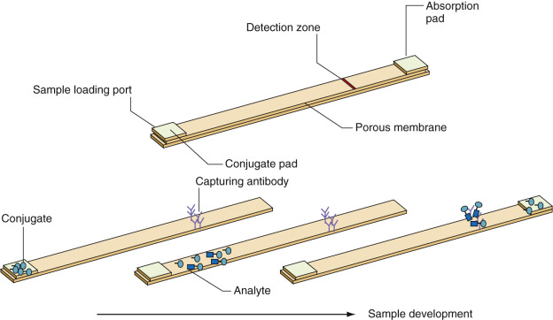

Figure 44-26 

Typical immunochromatographic test strip by sample loading. 

Assay flows are illustrated in the lower part of the figure. In general, the proximal end of the lateral flow serves as the sample loading portion consisting of a pad containing antibody or antigen labeled with colored latex or colloidal gold. Analyte in the sample forms a complex with the conjugate and migrates to the detection zone, thereby immobilizing the capturing antibody to form a positive colored line. Excess amounts of conjugate and sample migrate to the distal end of the strip. 

Yamauchi and colleagues (1997)  established a novel platform format in which EIA can be performed automatically, including a washing procedure. The device is depicted schematically in [ Figure 44-27 ](<#f0140>) . In this format, the positioning of each of the zones is completely different from that of other immunochromatography formats mentioned previously. The proximal end has a developer solution, which makes it possible to carry out the washing process to take place spontaneously with capillary force. The sample is applied to a pad that is set in the center portion of the device and that contains the labeled conjugate in dry form. The distal end connects to an absorbent pad. Two drops of sample are dropped on the sample pad to react with the conjugate following reconstitution of the dried conjugate. The reaction mixture containing the immunocomplex formed between the analyte and the labeled antibody can spread to both ends. Once the reservoir of developing solution is ruptured, the dried substrate is reconstituted to become the soluble enzyme substrate in the detection zone. At this time, fluidic flow is directed toward the distal end. Serum components and excess nonreacted conjugate can be washed away to the absorbent. If the sample contains analyte, then the immobilized antibody captures the complex in the detection zone to form a colored line. This method has a number of advantages over other immunochromatographic devices developed by the sample. With such devices, hemolytic serum or lipemic serum may interfere with assay judgment by the naked eye, owing to high background color. However, with this new device, which is equipped with a connected reservoir, interference by colored components does not occur. This device has been useful in detecting HBsAg, anti-HBs antibody (  Yamauchi et al, 1997  ), and antibody to _T. pallidum_ (  Hasegawa et al, 1995  ). Most of its components, such as the membrane, the absorbent pad, and the sample compartment, have built-in molded plastic housing. 

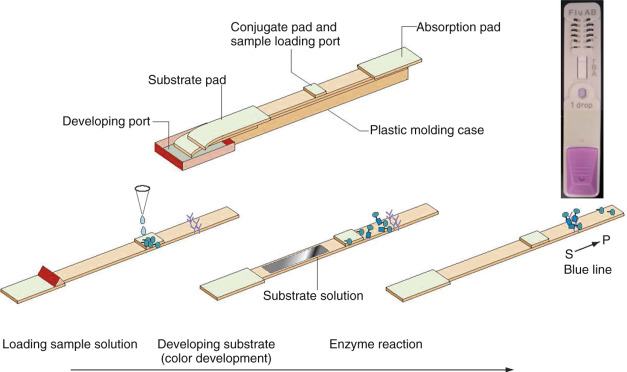

Figure 44-27 

Immunochromatographic device using enzyme immunoassay (EIA). 

A sensitive amplification method is applied for immunochromatography using an enzyme. The sample is applied to the sample loading portion at the center of the strip. With this method, a developing solution is employed as the mobile phase and can serve as a washing buffer. The picture on the right part of the figure shows the plastic molded housing and assay results for _Treponema pallidum_ (TP) antibody. 

 

##  Magnetic Biosensor Assay 

Bruls and colleagues (2009)  developed a magnetic actuated immunosensor using magnetic nanoparticles as both coated solid phase with ligand such as antibodies or antigens and signal. Ten microliters of blood sample are injected into the inlet of the cartridge and mixed with beads coated with antibody; the beads are then actuated by magnetic fields using a handheld instrument. The bead-captured antigens are then separated on the active device wall whose surface is coated with second capturing antibodies by a magnetic field. Then the second magnetic fields are set on the opposite side of the wall. Unbound beads are migrated to the opposite wall without any washing step. The signals on the active wall are detected by counting nanoparticles with a combination of an LED and a photodetector, using the FTIR principle. Magnetic particles on the surface are cut off from the LED beam. Reduced beams correspond to magnetic particles. This method can detect pico molar levels of intact PTC with less than 10 minutes incubation. Recent data show that TnI in blood have been detected at levels of subpico molar at 5 minutes' incubation. 

 

##  Summary 

Rapid and simple immunoassay devices can be classified into three major types: flow-through, dipping, and immunochromatography, along with combination formats of these three types. Several immunochromatographic formats are summarized in [ Table 44-8 ](<#t0045>) . Most immunochromatographic devices employ direct-labeled conjugate, colloidal metal, or colored latex. These types of formats are actually well suited for direct migration of the immunocomplex, along with migration of the sample solution. However, many of these devices require a large volume of sample, in the range of 100 to 200 µL. On the other hand, the EIA-type device allows the assay to be carried out using a smaller amount of sample—25 µL—but a developer is required. The current stream of rapid tests for point-of-care testing (POCT) is strongly oriented toward devices using immunochromatography because, unlike other immunoassay devices, special skills are not required to perform the test correctly; one simply needs to follow the manufacturer's directions for genetic testing, and a certain number of protein assays could be shifted to nucleic acid assays, even in the field of POCT, particularly for the diagnosis of infectious diseases. 

TABLE 44-8 

Simple and Rapid Immunoassay Device Specifications 

Assay Principle  |  Kit Name (Analyte)  |  Sample Specimens  |  Sample Volume, µL  |  Mobile Phase  |  Reaction Time, min  |  Sensitivity  |  Housing  |  Manufacturer   
---|---|---|---|---|---|---|---|---  
**Immunochromatographic Format**  
One step (all in one)  |  Biocard Troponin I test  |  Serum  |  150-200  |  Serum  |  15  |  0.1 ng/mL  |  MP  |  ANIBIOTECH OY   
QuickVue hCG  |  Urine  |  3 drops (75)  |  Urine  |  3  |  25 mIU/mL  |  MP  |  QUIDEL   
Cardiac TROP T sensitive  |  Blood  |  150  |  Plasma  |  5-20  |  0.1 ng/mL  |  MP  |  Roche Diagnostics   
Determine HBsAg  |  Blood/serum  |  50  |  Plasma/serum  |  15  |  2.0-3.5 IU/mL  |  TS  |  Alere   
Alere Triage Cardiac Panel  |  Blood  |  250  |  Plasma  |  15  |  — |  MP  |  Alere   
Espline Flu AB  |  Nasal passage  |  20  |  Developer  |  15  |  1.1 × 10  4  pfu/mL (A/New Caledonia/20/99)  |  MP  |  Fujirebio Inc.   
OraQuick ADVANCE Rapid HIV-1/2 Antibody Test  |  Oral fluid, plasma, blood  |  — |  Developer  |  20-40  |  — |  MP  |  OraSure Technologies, Inc.   
ImmunoCard ST HpSA  |  Stool  |  100  |  Developer  |  10  |  64 ng/mL  |  MP  |  Meridian Bioscience, Inc.   
  
_MP,_ Molded plastic housing; _TP,_ test strip. 

,  

##  Simultaneous Multiple Immunoassays 

 

##  Background 

Recent immunoassay advancements have led to the development of novel technology concepts that allow simultaneous multiple detection as a way to reduce the reagent cost. This means that anywhere from 5 to 100 analytes can be detected simultaneously in an individual sample. These technologies are classified into two broad categories in terms of the type of solid phase used. The first, microsectioning technology, is adapted to immunoassays using a microchip as the solid phase, and the second uses microparticles as the solid phase. In the second, two technologies have been applied to the recognition of individual assay analyte parameters. One is direct recognition of the solid phase using fluorolabeled latex, and the other involves the use of particles of different sizes. In the latter case, limited recognition is possible because the resolution is dependent on particle size. Miniaturized technologies such as these are considered highly advantageous for minimizing the cost of reagents, saving energy, and protecting the environment, because of the small mass of reagent and sample volumes required. 

 

##  Microspot Assay 

The microchip solid surface is fractionated into small areas using microdotting technology. A total of 100 to 200 reaction sites are produced in a 3-mm-diameter area of a polystyrene flat plate (  Ekins, 1998  ). In each site, a spotting area 80 µm in diameter receives a volume of less than 1 nL of solution ink-jetted automatically. With this method, the ambient assay theory established by Ekins has been applied, and the sensitivity and the detection limit depend on the antibody occupancy but not on the surface area on the solid phase. The detection limit for TSH was found to be 0.01 mIU/L in an 18-hour assay, using this ambient analyte assay method. Therefore, it is evident that a highly sensitive assay can be achieved even on the microspot area. Boehringer Mannheim, which later merged with Roche Diagnostics, applied an avidin-coated solid phase uniformly to the surface area and then ink-jetted biotin-binding antibody or antigen on the spot. Multiple parameters, including HIV antibody, HBsAg, anti–hepatitis C antigens, and rubella, can be detected simultaneously on the microchip made of polystyrene. The assay format is a three-step fluorescent immunoassay. Finally, a confocal laser scanner detects the fluorescent signal on the chip. This chip assay is also available for the application of DNA detection. 

 

##  Multianalyte Microarray Immunoassay 

Silzel and colleagues (1998)  developed an analyte mass assay that measures total analyte mass within a sample. Therefore, the basic concept of this method is different from that of the ambient assay, which measures analyte concentration. A polystyrene film was used as the solid phase. An 80-pL droplet was ink-jetted onto the film, and DBCY5 was adopted as the labeling marker because of the long Stokes shift from the excitation wavelength at 670 nm to the emission wavelength at 710 nm, with near-infrared fluorescence emission. The detection apparatus used in this method consists of a microscope attached to a Pelitier-cooled charge-coupled device camera and a GaAlAs diode laser. In this format, 10  5  molecules of DBCY5 per 80 pL area could be detected in calibration solutions. The IgG subclass was applied to the present system for multiparameter detection. Four parameters—IgG1, 2, 3, and 4—were detected, and the sensitivity was shown to be comparable with that of ELISA, although a much smaller amount of antibody (100 times less) sufficed to cover the surface area as compared with an ELISA plate. 

Protein chips microfabricated with highly dense spotting sites having 1250 reaction sites per 1 × 2 cm have been developed by Zyomyx (Hayward, Calif.) The protein chip is composed of silicon-based substrate as a solid phase and six lanes with a 5 × 50 array/lane (  Peluso et al, 2003  ). Isomura employed the chip and applied a simultaneous fluorescent sandwich immunoassay for some target proteins (e.g., AFP, interleukin [IL]-6, Erk-2, c-Jun, Grb2, c-Src, H-Ras) (  Isomura & Okamura, 2003  ). As shown in [ Figure 44-28 ](<#f0145>) , reaction sites are microfabricated to a pillar structure and then are coated with titanium oxide. The surface is coated with poly  l  -lysine polymer linking with polyethylene glycol-biotin. After binding of streptavidin to biotin, the solid streptavidin can bind to biotinylated antibodies. The assay can be performed in a flow device. The detection limit for IL-6 was found to be 5 to 50,000 ng/L in a 3-hour assay with the use of this protein biochip assay method. 

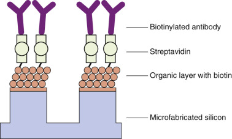

Figure 44-28 

Protein biochip using fluorescence immunoassay (FIA). 

Sandwich FIA is applied for multiple detections using microfabricated silicon as a solid substrate. The surfaces of more than 1000 pillars are coated with an organic polymer layer containing biotin. Streptavidin that is bound to biotin then binds to biotinylated antibody specific to analyte and reacts with antigen in the sample. The silicon device containing different antibodies specific to different antigens is set in a molded plastic device. 

Efforts to find better diagnostic markers are ongoing. The proteomics assay based on matrix-assisted laser desorption/ionization is expected to serve as a tool for the discovery of new markers. Advancements in glycomics (  Finkelstein, 2007  ), the systematic study of the structure and physiologic function of carbohydrates, should lead to the development of new markers as well. The combination of these with existing markers will be evaluated for the enhancement of multiple marker assays. 

 

##  Flow Cytometric Immunoassay 

Luminex (Austin, Tex.) has developed a simultaneous multiparameter fluorescent immunoassay using flow cytometric technology in which two types of fluorophores for recognition of the analyte serve to mark the latex particles used as solid phase (  Fulton et al, 1997  ;  Oliver et al, 1998  ). Two different types of fluorophores and fluorescence intensities mark the analyte mapping of each particle. More than 60 analytes can be detected simultaneously in principle. The assay procedure is as follows. The sample is mixed with antibody labeled with R-phycoerythrin, and a second antibody is immobilized on latex as the solid phase. The mixture is incubated for 10 to 30 minutes and then is injected into the flow system. A total of 1000 particles are separated, as in flow cytometry, and both an enhanced fluorescence signal from the excited R-phycoerythrin as a result of the labeling and two fluorescence signals on the particle are detected simultaneously by laser scanner.  Carson and Vignali (1999)  applied this approach to the simultaneous detection of 15 cytokines such as IL-1, IL-2, IL-4, and IL-6. Simultaneous detection was less sensitive than the assay of individual cytokines. However, it is still a sensitive assay compared with conventional ELISA, and sensitivity was 100 pg/mL for IL-2, 10 pg/mL for IL-4, 100 pg/mL for granulocyte-macrophage colony-stimulating factor, and 200 pg/mL for interferon-γ. 

From the point of view of clinical application, simultaneous multiple assays may not appear as attractive as might have been expected. In some cases, the sensitivity and specificity of this technique need to be assessed more carefully. However, simultaneous multiple assays based on miniaturization technology should be the ultimate goal for laboratory diagnostics, given the advantages they offer in terms of cost containment, reduction of burden on patients from phlebotomy, and clinical utility. 

The logistic regression model, using multiple markers, has improved the sensitivity and accuracy of diagnostic immunology but has met with only limited success. Recent advancements in laboratory pharmacogenomic testing for selection of the appropriate therapeutic drug in the right dosage for the right patient require further statistical calculation to obtain additional valuable test results. Pharmacogenomic testing is useful for protein assay as well. The Multivariate Index Assay by Vermillion Inc. (Fremont, Calif.), which was approved by the FDA in 2009, is a multiple-protein assay that comprises five conventional biomarker assays developed with certain types of algorithms. Several genetic testing methods based on algorithms have been approved by the FDA for laboratory testing, but not as kits. Genetic testing for multiple markers, as well as protein or carbohydrate testing, is likely to provide reliable options for diagnostics and for selection of therapeutic drugs. 

 

##  Microchannel Assay Using Compact Discs 

Gyros AB (Uppsala, Sweden) developed a simultaneous microfluidic fluorescent immunoassay using a compact disc (CD) as microlaboratory technology in which the microfluidic flow can be obtained by centrifugal force (  Poulsen et al, 2004  ). On the CD, 104 assays can be performed simultaneously by fluorescent column immunoassay. The solid phase consists of plastic microparticles bound to streptavidin. Specific antibody binding with biotin is applied to the column. A total of 100 nL of sample can be automatically metered by separation of the hydrophobic breaking valve in which the wall has been coated with hydrophobic polymer. The valve can open by centrifugal force, and several types of break settings in the channel of the CD make it possible to perform a rapid and simple assay by changing the rpm to control reactions. This assay has been applied to the detection of human IgG, with a sensitivity of 1 ng/mL. 

SAMSUNG (Seoul, Korea) commercialized a unique compact disc–type POCT system that consists of multianalyte tests and a small fully automated immunochemistry analyzer, LABGEO  IB10  . Five hundred µL whole blood samples are pipetted onto and spun down the disc of a handheld instrument, triggering a centrifugal force that separates plasma and blood cells. After a period of 20 minutes, the signal for D-dimer can be detected (  Song et al, 2014  ). Three analytes can be tested simultaneously as multiple assays, including Troponin I, NT-proBNP, CK-MB, and myoglobin as cardiac markers (  Belenky et al, 2013  ). Assay performance for troponin-I shows 50 to 30,000 ng/L of measurable range and 9.2% to 12.6% of whole assay C.V. 

 

##  Summary 

Remarkable technological advancements have been made in the development of micro-channel assays in the past 10 to 15 years. Moreover, recent progress made in assay miniaturization has made it possible to overcome several difficulties with microfluidic movement of sample and reagent and sample evaporation using capillary flow, small vacuum pumps, and capillary electrophoresis in combination with a handheld instrument. 

,  

##  Single Molecule Detection 

 

##  Background 

Current various immunoassay systems have made it possible to produce high sensitivity at atto-molar levels in 10 to 40 minutes' reaction time in clinical laboratories. However, it is still difficult to detect clinical markers in very low concentrations of less than atto-molar levels. Due to recent advances in highly sensitive measurement technology, we may soon be able to determine the normal distribution values of TNF-alfa and interleukins, which is very difficult to define in blood. 

 

##  Single-Molecule ELISA 

Rissin and colleagues (2010)  developed a single-molecule ELISA for serum protein detection at subfemtomolar concentrations. This is an enzyme-linked immunosorbent assay, which differs from conventional ELISA, defined as digital ELISA (D-ELISA), in which a single bead as solid phase can be set in each well in the plate. In digital ELISA, femtoliter well arrays are used as reaction vessels to obtain a single signal, while in conventional ELISA, 96 well plates are used as direct solid phase binding capture antibodies. In femtoliter well arrays, each of the wells can accommodate a single bead. Magnetic particles with a 2.7-µm diameter as solid phase are used in D-ELISA. The procedure is almost identical to that of conventional ELISA—namely, 100 µL of sample is incubated with 200,000 beads for 2 hours at 23° C. Then, B/F separation using conventional magnet equipment is performed by a washing procedure. β-galactosidase–labeled second-captured antibodies are added and incubated in wells for 45 minutes, and the second B/F step is performed. After reaction with streptavidin-enzyme, D-ELISA requires one additional step: concentrated beads in 10 µL buffer are transferred into femtoliter well arrays and reacted with fluorescent substrate. Signals in each well are detected using image CCD camera (558 nm excitation, 577 emission). TNF-α and PSA were measured in this platform and showed extremely high sensitivity for PSA, LOD of 200 aM in whole serum; for TNF-α, it was 600 aM in whole serum. 

 

##  Single-Fluorescent Immunoassay 

Singulex (Alameda, Calif.) developed the Erenna Immunoassay System on the basis of the fluorescent immunoassay. In this system, single molecules of fluorescence can be detected by releasing a fluorescent conjugate from the immune-complex consisting of solid-phase antibodies, antigens, and fluorescent-labeled antibodies (  Todd et al, 2007  ). The immunoassay platform itself is a conventional fluorescent immunoassay that uses magnetic particles as solid phase and fluorescent dye–labeled antibodies. The fluorescent dye released by elution buffer is loaded into the capillary flow cell, and the fluorescent signal as a single molecule is detected by a confocal microscope. The immunoassay reaction lasts 1 to 2 hours. The linear response for interleukin (IL)-17 is shown from 60 pg/mL to 1 µg/mL. In the case of cTnl, the frequency distribution in 100 normal plasma samples appears from 0.3 to 9 ng/L. LOD and 10% CV were 0.2 ng/L and between 0.78 and 1.6 ng/L, respectively. By releasing fluorescent antibodies from the magnetic particles, the nonspecific binding signal coming from the fluorescent conjugate on the particles could be minimized, resulting in extremely sensitive detection. 

 

##  Summary 

Single-molecule detection immunoassays made it possible to demonstrate reference values of various cytokines or cTnI in serum or plasma. However, the single-molecule detection platforms still require longer incubation times, needing more than 1 hour and several assay steps. Further research and development efforts will achieve shortened assay times and simpler procedures. 

,,
