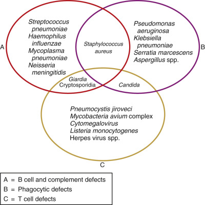
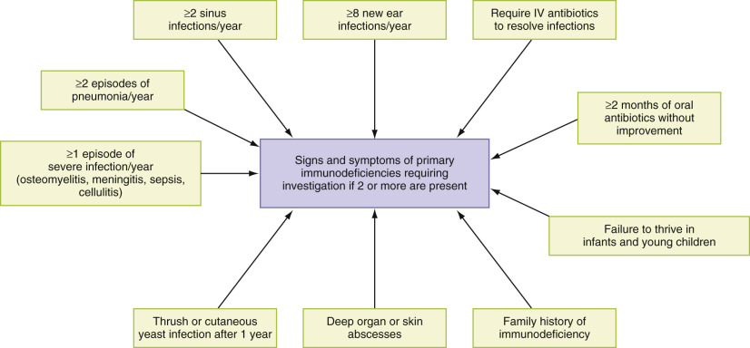
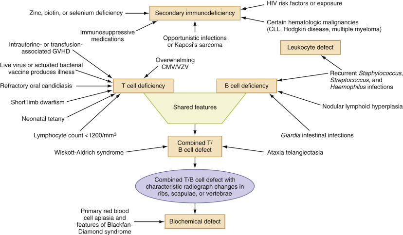
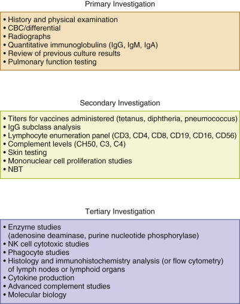
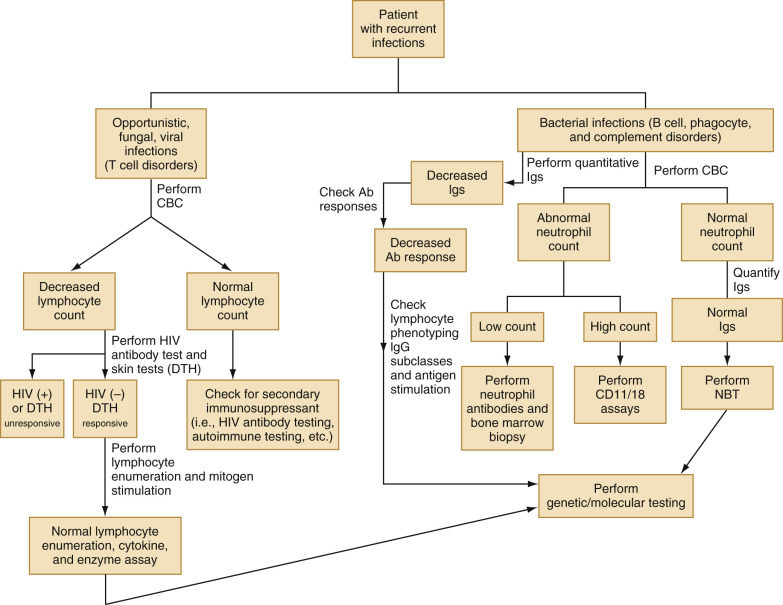
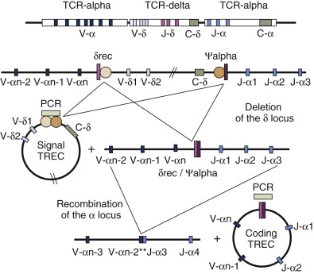

## Key Points

  * •

Primary immunodeficiencies are a group of single-gene disorders. 

  * •

Because of the complexity of diagnosing a primary immunodeficiency, the cooperation of the clinician, the research scientist, and the clinical pathologist is required. 

  * •

A logical approach to the diagnosis of primary immunodeficiency disorders based on staged diagnostic testing is necessary because of the complex nature of the immune system. 

  * •

Preparation for specimen collection, handling, and delivery to a specialty laboratory is required for performing complex immunologic assays. 

  * •

As a result of technological advances, molecular genetic testing is increasingly employed in diagnosing primary immunodeficiency disorders and will be paramount in guiding future treatment. 

Primary immunodeficiencies are a group of single-gene disorders that result in defects in the immune system. The manifestations can vary in terms of degree of severity, types of symptoms exhibited, or both. These conditions, when unrecognized and left untreated, can result in death from infection. A genetic defect may result in loss of a critical enzyme, may cause developmental arrest in one aspect of the immune system, may cause loss of a structural component, or may create a nonfunctional protein. Most of these disorders are X-linked, resulting in a disproportionate number of affected males—approximately 70% of patients with primary immunodeficiency disorders (  Puck, 1997a  ). A majority of primary immunodeficiencies are detected before 20 years of age, but diagnosis can be delayed because recognition requires a high degree of clinical suspicion. More than 100 primary immunodeficiency disorders have been described; however, more than 90% of such patients are affected by fewer than 20 primary immunodeficiency disorders (  Puck, 1997a  ). Whereas primary immunodeficiency disorders are due to single gene mutations, secondary immunodeficiencies may be due to malnutrition, viral infection, hematologic and other types of malignancy, chemotherapeutic treatment for malignancy, and immunosuppressive medication for treatment of a variety of disorders. 

The natural physical barriers of the body are the first line of defense against invading microbes and include skin, mucus at exposed mucosal surfaces, and ciliated cells of the respiratory, intestinal, and genital tracts. In addition to physical barriers, immunologic functions of the body exert continual surveillance through acquired and innate modes of action. The acquired immunologic response is specific, requiring previous antigen exposure for sensitization, and improves with each subsequent challenge from a given antigen. These responses are the result of a proliferation of antigen-specific B and T cells, which are stimulated after cellular receptors bind to antigens. B cells produce antigen-specific antibodies to eliminate extracellular antigens. T cells assist B cells to produce antigen-specific antibodies and also kill cells that are virally infected. Innate responses do not require prior antigen exposure and comprise phagocytic cells (macrophages, neutrophils, and monocytes), complement, cytokines, and acute phase reactants (  Delves & Roitt, 2000  ). 

The immune system is an interlocking group of immune cells and immune functions, in which any defect may result in an immunodeficiency. The incidence of primary immunodeficiency diseases in the United States is estimated at about 1 in 200,000 liveborn infants, excluding selective immunoglobulin (Ig)A deficiency (  Winkelstein et al, 2000  ). The most common immunodeficiency, selective IgA deficiency, has an incidence of 1 in every 1200 healthy blood donors, with IgA levels less than 0.05 mg/dL (  Sandler et al, 1994  ). As a whole, the estimated incidence of diagnosed primary immunodeficiency disease is 1 in 10,000 (  Immune Deficiency Foundation, 1992  ;  Shearer et al, 1994  ;  Smith et al, 1999  ). Data from Australia and Norway estimate the incidence of primary immunodeficiency at 2.1 per 100,000 (  Baumgart et al, 1997  ) and 6.8 per 100,000, respectively (  Ryser et al, 1988  ;  Stray-Pedersen & Abrahamsen, 1997  ;  Matamoros et al, 2000  ). 

For unknown reasons, approximately half of reported immune defects involve defective antibody production due to low numbers of B cells or B cells with decreased production of antigen-specific antibody. Decreased antigen-specific antibody production most frequently manifests as recurrent pulmonary or sinus infection, as well as bacterial septicemia (  Noroski & Shearer, 1998  ). These infections are typically caused by encapsulated bacteria such as _Streptococcus pneumoniae_ or _Haemophilus influenzae._ Defective T cell immunity is characteristically associated with opportunistic, viral, and fungal infections, such as _Candida albicans, Mycobacterium avium-intracellulare_ (MAI), and _Pneumocystis (carinii) jiroveci_ (  Buckley, 2000  ). The type of infection a patient acquires may point toward the type of cellular immune defect that is present ( [ Fig. 51-1 ](<#f0010>) ). Primary immunodeficiency disorders are also associated with autoimmune diseases, as well as malignant neoplasms and especially lymphomas (  Smith et al, 1999  ). 

Figure 51-1 

Infections associated with cellular immune defects. 

,  

##  Clinical Signs and Symptoms of Immunodeficiency 

Most frequently, increased susceptibility to recurrent infection is the first clinical indication of an immune defect. The type of recurrent infection provides insight into the immune defect and helps guide the clinician in evaluating the patient. Therefore, the most critical part of the medical evaluation is obtaining a complete medical history. Identifying children with immunodeficiency presents a significant challenge to pediatricians, because infections are a common occurrence in normal childhood but can be the principal manifestation of a primary immunodeficiency. Therefore, frequent and prolonged infections, coupled with failure to thrive, or opportunistic infections require a thorough immunologic workup (  Puck, 1999  ). A confirmed report of an immunodeficiency disease occurring in a sibling or first-degree relative should also prompt careful clinical assessment and laboratory investigation, even without a history of severe or unusual infections. In one study of 70 patients with primary immunodeficiency disorders, approximately 18.6% had a family history of an immunodeficiency (  Kobrynski, 2002  ). 

Awareness of common clinical presentations can aid physicians in identifying individuals who are more likely to have a primary immune defect. Clinical signs and symptoms of primary immunodeficiency are presented in [ Figure 51-2 ](<#f0015>) . In addition to these warning signs, the physician should be alerted by elements in the history that are unusual, such as a history of autoimmune disease, significant lymphadenopathy, the need for an adult to have a myringotomy, severe herpes zoster or herpes zoster appearing in a young child, or intractable diarrhea or ulcerative colitis diagnosed in a child younger than 1 year of age. These additional signs and symptoms should prompt evaluation for a possible immune defect. 

Figure 51-2 

Clinical signs and symptoms of primary immunodeficiencies. 

It is not practical to investigate all immunologic systems in all patients, so the clinical picture and age of the patient will point the investigator to the portion of the immune system that is most likely to be affected. Taking a careful history and performing a thorough physical examination can narrow the possibilities to defects involving T cells, B cells, granulocytes, or the complement system. The roles of these host defenses and their correlation with different immunodeficiency disorders are presented in [ Figure 51-3 ](<#f0020>) . 

Figure 51-3 

Patterns of immunodeficiency disorders. 

_CLL,_ Chronic lymphoid leukemia; _CMV,_ cytomegalovirus; _GVHD,_ graft-versus-host disease; _HIV,_ human immunodeficiency virus; _VZV,_ varicella zoster virus. 

It is also important to pay attention to the clinical circumstances and not to dwell exclusively on the number or severity of infectious episodes (  Atkinson et al, 2000  ). For example, when an infectious process involves the same anatomic site repeatedly, the cause is more likely to be structural, not failure of one of the host defenses. Examples include chronic osteomyelitis in one location, recurrent episodes of pneumonia that affect only one lobe of the lung, and recurrent infection of a surgical wound. Additionally, some primary immunodeficiency disorders, such as chronic granulomatous disease, may present later in life than expected; however, it is still important to keep these disorders in the differential diagnosis (  Lukela et al, 2005  ). 

,  

##  Evaluation of the Immune System 

Based on the previous considerations, when an immune defect is suspected, evaluation of the immune system is best approached in stages, with basic screening tests performed first and more complex testing conducted as indicated. For example, if a patient presents with strong clinical symptoms suggestive of a B or T cell disorder but a normal lymphocyte count, further investigation by a lymphocyte enumeration panel is warranted. An overview of this staged approach is given in [ Figure 51-4, ](<#f0025>) and a basic testing algorithm for immunodeficiencies is provided in [ Figure 51-5 ](<#f0030>) . 

Figure 51-4 

Staged approach for laboratory investigation of primary immunodeficiency. 

_CBC,_ Complete blood count; _NBT,_ nitroblue tetrazolium slide test; _NK cell,_ natural killer cell. 

Figure 51-5 

Testing algorithm for immunodeficiency. 

_Ab,_ Antibody; _CBC,_ complete blood count; _DTH,_ delayed-type hypersensitivity skin test; _HIV,_ human immunodeficiency virus; _Ig,_ immunoglobulin; _NBT,_ nitroblue tetrazolium slide test. 

 

##  First-Level Investigations 

 

##  Clinical History, Physical Examination, and Initial Blood Count 

A thorough clinical history provides the primary clues in diagnosing a primary immunodeficiency disorder. The typical history includes recurrent, persistent infections or infections caused by unusual microbes. The clinician will be guided by the types of infection the patient has acquired. Patients with immunoglobulin deficiencies typically report an increased number of bacterial infections. Repeated viral, fungal, or other opportunistic infections are associated with T cell immunodeficiencies. Patients with phagocytic defects usually report a history of infections with catalase-positive bacteria, such as _Staphylococcus_ spp. Complement deficiencies are most frequently associated with _Streptococcus pneumoniae_ or _Neisseria_ spp. infections (see [ Fig. 51-1 ](<#f0010>) ) (  Lindegren et al, 2004  ). 

The physical examination may reveal findings that are characteristic for particular primary immunodeficiency disorders. Patients with primary immunodeficiency diseases are pale and lethargic, and appear chronically ill. Infants and young children affected with primary immunodeficiency disorders may present with failure to thrive, so monitoring height and weight is important. Small or absent peripheral lymph nodes, tonsils, or adenoids are indicative of X-linked agammaglobulinemia (  Lindegren et al, 2004  ). In addition to respiratory infection, the infant may experience rhinitis, conjunctivitis, or hematologic, gastrointestinal, and autoimmune disorders (  Fleisher, 2003  ). In contrast, patients with chronic granulomatous disease (CGD) and common variable immunodeficiency present with normal or enlarged peripheral lymph nodes (  Buckley, 2000  ). The genetic defect in Wiskott-Aldrich syndrome causes immunodeficiency and thrombocytopenia, resulting in the combination of increased bruisability, petechiae, and eczematous skin rashes (  Zhu et al, 1997  ). 

The first test performed to examine the immune system is the complete blood count. A white blood count and differential will provide information on the morphology and number of small lymphocytes (diameter <10 µm). Normal parameters vary, based on the age of the patient, and therefore must be interpreted using age-appropriate normal ranges. At a minimum, regardless of age, one expects more than 1200 small lymphocytes per cubic millimeter. Because few (≈10%) of the lymphocytes are B lymphocytes, an absolute lymphocyte deficiency primarily reflects T cell deficiency. Part of the first visit should include obtaining all previous medical records, including pathology reports or slides, and results of previous cultures and radiographs. 

 

##  Immunoglobulins 

Because antibody deficiency diseases are more common than other immune defects, first emphasis should be placed on investigation of immunoglobulins and their production (  Stiehm & Conley, 1996  ). Approximately half of primary immunodeficiency disorders are related to inadequate antibody production or nonfunctional antibodies (  Noroski & Shearer, 1998  ). Quantitative immunoglobulin assays are readily available in all commercial and larger hospital laboratories and require only small volumes of serum to perform ( [ Chapters 19 ](<##!/content/3-s2.0-B978032329568000019X?scrollTo=%23c00019>) and [ 46 ](<##!/content/3-s2.0-B9780323295680000462?scrollTo=%23c00046>) ). Because immunoglobulin values increase with age, comparison with age-matched normal ranges is necessary for correct interpretation. 

For the first few months of life, IgG is the major immunoglobulin found in infant serum and is maternal in origin. At approximately 3 months of age, dissipation of maternal IgG concentration, combined with a lag in production by the infant, creates a nadir in IgG levels. However, primarily IgM and secondarily IgA are synthesized by the infant; thus, the presence of these two immunoglobulins provides convincing evidence that X-linked agammaglobulinemia, characterized by pan-hypogammaglobulinemia, is not present. Therefore, IgA, IgM, and IgG should be quantified simultaneously. 

Often, IgA is not present in significant amounts until 6 months of age; however, after 1 year of age, IgA levels that remain decreased indicate that this is a permanent defect (  Plebani et al, 1986  ). IgA-deficient patients may be asymptomatic or may have mild symptoms such as increased respiratory or gastrointestinal infection; however, patients may experience severe or fatal anaphylactic reactions to plasma in blood products that contain IgA (  Lindegren et al, 2004  ). Such patients, once confirmed for IgA deficiency, would require plasma from other IgA-deficient individuals to avoid future anaphylactic reactions. 

Hyper-IgM syndrome, an X-linked T cell inherited disorder, is characterized by normal to elevated levels of IgM with markedly low levels of IgA, IgG, and IgE (  Levy et al, 1997  ;  Ramesh et al, 1998  ;  Buckley, 2000  ). In contrast, marked elevations of IgE are almost always part of the hyper-IgE syndrome (  Buckley & Becker, 1978  ) and are common in immunodysregulation, polyendocrinopathy, enteropathy, immunodysregulation polyendocrinopathy enteropathy X-linked syndrome (IPEX), atypical complete DiGeorge syndrome, Wiskott-Aldrich syndrome (WAS), and Omenn syndrome (  Ozcan et al, 2008  ). WAS characteristically shows marked elevation of serum IgA combined with low IgM concentrations (  Ochs, 1998  ). Patients with decreased levels of IgM are often found in the context of generalized immune deficiency/dysregulation and autoimmune diseases. However, some patients with selective IgM deficiency possess a 22q11.2 chromosome deletion, reduced or lacking IgM+ B cells, or impaired IgG antibody responses against pneumococcus polysaccharides (  Louis & Gupta, 2014  ). 

A simple way to assess functional antibody levels in children is to check for isohemagglutinins, commonly of the IgM isotype, directed against ABO antigens that the patient lacks (i.e., assessing anti-A antibodies in a patient with the B blood type), because their presence will indicate active functional antibody production (  Fleisher, 2003  ). Isohemagglutinins are naturally occurring antibodies that form at some point after 2 to 3 months of age; however, testing for these antibodies is not valid for children 4 to 6 months of age because of the persistence of maternal immunoglobulin. Additionally, because of relative immaturity, or perhaps inadequate exposure, children with normal immunity may have low concentrations of isohemagglutinins until 5 to 10 years of age (  Cooling, 2008  ). 

Selective IgE deficiency is rare as reduced IgE levels are commonly found in a hypogammaglobulinemic state with decreased production of other immunoglobulin isotypes. However, patients with selective reduction of IgE (<2.5 IU/mL) had increased complaints of arthralgias and chronic fatigue, a higher prevalence of hyperreactive (nonallergic) airway disease, chronic sinusitis, otitis media, as well as other autoimmune and oncological diseases (  Magen et al, 2014  ;  Smith et al, 1997  ). 

 

##  Radiologic Imaging 

Radiographs, computed tomography (CT), and magnetic resonance imaging (MRI) studies can be helpful in assessing immunodeficiencies. Chronic interstitial pneumonia is common in infants, children, and adults with T cell deficiencies, and should be confirmed on chest radiograph. With time, many patients with primary B cell deficiency (agammaglobulinemia, common variable immunodeficiency) may develop chronic pulmonary fibrosis or bronchiectasis (  Sweinberg et al, 1991  ;  Cunningham-Rundles, 1999  ). Chest CT in a patient who has recurrent respiratory tract infection is the best means of investigating for bronchiectasis; if these changes have developed, further investigation is clearly warranted. 

In the past, lateral views of the neck were used to assess pharyngeal lymphoid tissue in children. However, radiographs are not recommended for evaluation of cervical lymphoid tissue because the information they provide is more easily obtained by alternative methods. Frontal views of the chest may reveal an absence of the thymic shadow in infants, but because the thymus can shrink easily because of stress, evaluation of thymic size by this method is not reliable. Bony abnormalities, however, can alert the radiologist to an immunologic problem presenting in childhood. A subset of patients with immunodeficiencies involving abnormalities of T cells, or both T and B cells, have short-limbed dwarfism. These patients show characteristic lesions, usually in the metaphyseal regions of the long bones. Patients with infant-onset adenosine deaminase deficiency show readily identifiable skeletal abnormalities of ribs and hips (  Lindegren et al, 2004  ). Bony abnormalities may be present in patients with hyper-IgE syndrome; these abnormalities include diffuse osteoporosis, fractures that occur with little trauma, craniosynostosis, and midline bony defects (  Grimbacher et al, 1999  ). 

 

##  Pulmonary Functions 

Immunodeficiency, especially if it has persisted for some time, will often affect the pulmonary system and its function, as previously mentioned. Therefore complete lung volumes, with forced expiratory volumes, should be tested, even if the chest radiograph is normal. Patients with both T and B cell defects are subject to pulmonary infection, often resulting in bronchospasm, restrictive or obstructive disease, or combinations of these abnormalities. Those patients who are both IgA and IgG2 deficient have significantly abnormal pulmonary function tests, and a causal relationship may be seen between these deficiencies and deterioration of lung function (  Bjorkander et al, 1985  ). 

 

##  Second-Level Investigations 

 

##  Antibody Production 

Investigation of specific antibody production may require only monitoring of immune response to vaccine antigens and is the most direct method by which to assess B cell function. This is a useful approach for patients with a history of recurrent bacterial infection and low-normal quantitative immunoglobulin concentrations. The definitive method used to assess decreased quantitative immunoglobulins consists of measurement of antigen-specific preimmunization levels and postimmunization antibody levels approximately 4 weeks later. If the child or adult has received the usual immunizations in the past, antibody titers for these vaccine antigens can be measured. The most useful vaccine responses to assess are those associated with tetanus, diphtheria, _Haemophilus,_ and _Pneumococcus;_ many commercial laboratories have developed sensitive tests such as enzyme-linked immunosorbent assays (ELISAs) that can be used to assess antibody production. Evaluation of immune responses to vaccine must include preimmunization serum antibody concentrations and the patient's age, because these factors affect antibody response. The testing laboratory provides guidelines for appropriate antibody responses. In general, a fourfold increase in protein antigens and a twofold increase in polysaccharide antigens are expected. 

Antibody responses to tetanus toxoid and diphtheria toxoid are useful in evaluating responses to T cell–dependent protein antigens. Assessment of B cell function requires evaluation of responses to carbohydrate antigens, which activate B cells directly. It is important to use carbohydrate antigens that are not conjugated to proteins, such as meningococcal and pneumococcal polysaccharide antigens (  Balmer et al, 2003  ). Children younger than 2 years of age will not respond to unconjugated carbohydrate antigens (  Barrett et al, 1984  ), and no live virus vaccines should be administered to the child or any family member until immunodeficiency is ruled out (  Go & Ballas, 1996  ). 

 

##  IgG Subclasses 

IgG consists of four subclasses, IgG1 through IgG4, which are distinguished by both structural and biological differences (  Normansell, 1987  ;  Schur, 1987  ). Although individual roles for each of the IgG subclasses have not been established, antibodies to carbohydrate antigens are concentrated in the IgG2 subclass, and many bacterial cell wall antigens are composed of carbohydrates (  Scott et al, 1988  ). Thus, absence of an IgG2 response could result in failure to develop protection against bacterial infection. This relationship is most convincing in the occasional patient with IgA deficiency who also has a deficiency of IgG2 subclass and lacks an antibody response to vaccines for _Pneumococcus._ IgG subclass deficiency has also been implicated as the cause of recurrent infection in patients with normal or near-normal IgG levels (  Oxelius, 1979  ;  Wedgwood et al, 1986  ;  Shackelford et al, 1990  ;  Gross et al, 1992  ;  Popa, 1994  ). 

The biological significance of IgG subclass deficiency is not always clear, and some individuals who completely lack genes for IgG2, IgA, and IgE are healthy (  Lefranc & Lefranc, 1982  ;  Migone et al, 1984  ). IgG1 is the first type of subclass response to carbohydrate antigens, and conversion to an IgG2 response occurs as the individual matures (  Scott et al, 1988  ). No evidence indicates that those who are restricted to only IgG1 responses are at any disadvantage. Patients with selective IgG3 deficiency were reported to have recurrent upper respiratory tract infections, atopic diseases (allergic rhinitis or asthma), and some patients had impaired responses to various pneumococcal serotypes; such patients often respond to treatment with IVIG (  Abrahamian et al, 2010  ). To determine the biological significance of IgG subclass deficiency, testing of specific antibody production, usually by administering vaccines such as tetanus, diphtheria, _Haemophilus,_ or a pneumococcal vaccine, is mandatory. Only patients with a clear antibody deficiency for multiple antigens would be considered to have a significant immune defect. 

 

##  T Cell Immunity 

Migration of stem cells from the bone marrow to the thymus results in development of T cells (  Kruisbeek, 1999  ). During development of T cells in the thymus, many surface molecules are turned on and off in a regulated manner. These surface molecules are identified by their cluster of differentiation (CD). CD markers help distinguish the stage of maturation and the function of lymphocytes (  Buckley, 2000  ). Despite regression of the thymus over time, T cell development persists throughout life (  Jamieson et al, 1999  ). Unlike antibodies produced by B cells, which recognize antigens in their natural state, T cells recognize peptides along with MHC molecules after processing by antigen-presenting cells through CD3, the T cell receptor (  Buckley, 2000  ). 

Monoclonal antibodies are useful for detection of CD markers on lymphocytes and enable rapid enumeration of T cells and T cell subsets. This can be done by using small volumes of whole blood. The CD designation subdivides T cells (as a group, CD3  \+  ) into two major subsets: CD4  \+  and CD8  \+  T cells. CD4  \+  T cells are referred to as “helper” cells and are involved in initiation of immune reactions, cytokine secretion, and augmentation of B cell responses. CD8  \+  T cells also release cytokines and are associated with cytolytic (killer) functions. CD4  \+  and CD8  \+  markers on T cells serve as signaling molecules and work in conjunction with major histocompatibility complex (MHC) class I and II antigens to amplify and stabilize engagement of T cell receptors (TCRs) with antigens. CD4  \+  cells recognize antigens that are presented in the context of MHC class II antigens, and CD8  \+  cells recognize antigens presented in context with MHC class I antigens (  Buckley, 2000  ). Immunodeficiency diseases resulting from defective generation of T cells may result in total loss or low numbers of CD3  \+  T cells, thereby creating similar effects on T cell subsets, CD4  \+  and CD8  \+  cells. For example, DiGeorge syndrome results in low numbers of CD3  \+  cells (  Hong, 1998  ). MHC class II deficiency results in a low number of CD4  \+  cells (  Klein et al, 1993  ), and an abnormality of Zap-70, a signaling molecule integral to the activity of the T cell receptor, leads to reduced numbers of CD8  \+  T cells (  Elder, 1998  ). If an immune defect is suspected, a panel of T cell markers is examined by flow cytometry, and the percentage and absolute count of cells in each set are compared with age-appropriate normal ranges (  Illoh, 2004  ). 

T regulatory cells are defined as a specialized subset of T helper cells that are able to promote and maintain immune tolerance and subsequently prevent autoimmune diseases. CD4 and CD25 (also known as _IL-2 receptor_ ) cell surface markers are both used to identify Treg cells. However, a major progress in our understanding of Treg cells came after the recognition of the transcription factor FOXP3, which has been shown to be critical both for the development and function of Treg cells. The induction of genetic mutation in _foxp3_ in mice leads to suppression of Treg function and the development of lethal autoimmune disease. In humans, a genetic mutation in _foxp3_ will result in the defective development of CD4/CD25 regulatory T cells and manifest clinically by immunodysregulation, polyendocrinopathy, and enteropathy; this is attributed to an X-linked disorder known as IPEX syndrome, first described in 1982, which usually manifests in the first few months of life and results in death within the first 2 years. 

In general, Treg cells can be classified into two major types based on the site of their formation: naturally occurring T regulatory cells (nTreg), which are produced in the thymus and are thought to control reactivity toward self-antigens, and adaptive or induced T regulatory cells (iTreg), which are induced in the periphery after encountering an antigen from a commensal bacteria or a food antigen in a specific immune microenvironment. It is well established that both types are highly dependent on IL-2 for their proliferation and suppressive function. Tregs have been further characterized into other subsets (Tr1, Th3); are affected by various nutritional (vitamins A and D), cytokine (IL-10), and costimulatory factors (CD80, CD86); and suppress other immune cells by inducing immunologic tolerance. Dysregulation of T regulatory cells can result in autoimmunity, malignancy, and other disease states (  Mahdi & Bluth, 2015  ). 

 

##  T Cell Functional Assessment 

A clinical history of opportunistic infections and a decreased absolute lymphocyte count in a complete blood count should prompt further investigation of a patient's T cell function (  Fleisher, 2003  ). Mucocutaneous candidiasis, another indication of defective T cell function, is characterized by extension of infection from the mucous membranes onto contiguous skin and may involve the fingernails with granulomatous inflammation (  Atkinson et al, 2000  ;  Lilic & Gravenor, 2001  ). Delayed-type hypersensitivity (DTH) skin tests are commonly used as measures of T cell function because they measure the ability to recall, recognize, and present antigen, mobilize T cells, and generate a specific inflammatory response. Despite a normal absolute lymphocyte count, DTH skin tests should be performed when a T cell defect is suspected. However, these tests are difficult to interpret in infants because they may not have had sufficient exposure to respond to antigens to mount an immunogenic response, and a reduced or absent response may be normal. Hypersensitivity skin testing should incorporate more than one antigen (  Kniker et al, 1985  ). To ensure proper administration and appropriate interpretation of test results, personnel must be well trained (  Fleisher, 2003  ). 

Insight into the capability of T cells can be gained by performing functional assessments of in vitro proliferative responses to different stimuli. Mitogens, antigens, and alloantigens are stimuli that cause proliferation of T cells. Mitogens are usually plant extracts that lack specificity and stimulate both CD4  \+  and CD8  \+  T lymphocytes. Alloantigens on unrelated donor cells also stimulate CD4  \+  and CD8  \+  cells in a relatively nonspecific way. Patients with significant T cell deficiency may still show proliferative responses to these stimulators, indicating the presence of T cells but not their ability to clear infectious agents from the host. Nonetheless, a proliferative response to specific antigens is a good indicator of the host's ability to resist infection (  Lane et al, 1985  ). In the case of specific antigens, tetanus, diphtheria, and _Candida_ are commonly used, although sufficient exposure to these antigens is required. Therefore, these are not reliable antigens for testing infants during the first year of life. A measure of specific T cell responses that is useful in infants consists of culturing peripheral blood mononuclear cells with mitogenic concentrations of anti-CD3 monoclonal antibody. This stimulator normally causes proliferation of all CD3  \+  T cells, and absence of proliferation demonstrates a severe T cell defect (  Hong, 1996  ). 

 

##  Polymorphonuclear Killing Assays 

Testing neutrophil function requires careful planning because specimens may be transported over long distances to large reference laboratories for testing. Blood collected from a patient should be submitted to the investigating laboratory as soon as possible because neutrophils undergo apoptosis rapidly after collection. If the blood must be stored or transported, it should be collected in a preservative such as ethylenediaminetetraacetic acid (EDTA) or citrate in a polypropylene tube and maintained at room temperature (20° to 25° C). This decreases metabolic activity and minimizes adhesion of cells to the wall of the tube. Even under optimal conditions, cells can be maintained only for approximately 24 to 36 hours (  Kuijpers et al, 1999  ). 

Neutropenia or neutrophil dysfunction results in recurrent bacterial or fungal infection in the skin, lymph nodes, liver, lungs, or bones. This most commonly occurs with myelosuppressive therapies used to treat malignant neoplasms. These disorders must be distinguished from CGD, in which phagocytosis is normal, but intracellular killing of infectious organisms is defective, resulting in abscess or granuloma formation in the liver, bones, and lungs (  Lekstrom-Himes & Gallin, 2000  ). CGD inheritance is most commonly X-linked or autosomal recessive owing to mutations involving chromosome locations 16p24, 7q11.23, and 1q25. These changes result in defects in one of the four subunits of nicotinamide adenine dinucleotide phosphate (NADPH) oxidase, the enzyme that catalyzes the formation of hydrogen peroxide. This error causes failure of the metabolic burst in granulocytes following phagocytic ingestion of bacteria (  Meischl & Roos, 1998  ). As a result, molecular oxygen is not reduced to superoxide and other free radicals, such as hydroxyl radical and hydrogen peroxide, which are important components of the intracellular mechanism of bacterial death (  Babior, 1978  ). Therefore, CGD is characterized by recurrent infection with catalase-producing organisms, such as _Staphylococcus aureus,_ which are capable of destroying the hydrogen peroxide produced by granulocytes. Therefore, catalase-positive organisms survive intracellular ingestion, multiply, and cause a granulomatous tissue response that, when excessive, can obstruct the gastrointestinal and genitourinary tracts. Chronic infection with _Serratia_ spp., _Klebsiella_ spp., _Burkholderia cepacia,_ and _Aspergillus_ spp. is particularly problematic (  Gallin, 1983  ;  Gallin & Malech, 1990  ). However, patients with CGD do not experience this problem with catalase-negative organisms. 

The fundamental biological characteristic of CGD leukocytes is that they will phagocytose bacteria normally but will not kill them. This provides the basis for a bacterial killing assay for CGD. Historically, the nitroblue tetrazolium (NBT) slide test has been the laboratory assay used to screen for CGD and is performed by reference laboratories (  Park et al, 1968  ). In this assay, the patient's neutrophils are incubated with NBT, a pale yellow dye that is then activated by phorbol-myristate acetate (PMA), a strong, receptor-independent activation stimulus. Functional neutrophils phagocytose, reduce, and precipitate the NBT dye, forming intracellular deposits of black formazan. These deposits are indicative of rapid activation of NADPH-oxidase enzyme, causing reduction of oxygen by NADPH to superoxide that is subsequently catalyzed to hydrogen peroxide by superoxide dismutase (SOD). A technician then microscopically scores neutrophils that contain intracellular black formazan deposits (  Kuijpers et al, 1999  ). However, the NBT slide test has been replaced in many laboratories by a flow cytometry test that detects intracellular oxidation of dichlorofluorescein diacetate or dihydrorhodamine 123 (  O'Gorman & Corrochano, 1995  ). These nonfluorescent dyes, once oxidized, will produce intracellular fluorescent products that are detected by flow cytometry. Flow cytometry is a more objective and reliable method of identifying intracellular products. 

The hyper-IgE syndrome (HIES) is phenotypically similar to CGD, with a classic triad of pneumonia, recurrent cutaneous and pulmonary abscesses, and elevated IgE levels; however, defective polymorphonuclear leukocyte function is not a predominant finding (  Buckley & Becker, 1978  ;  Ozcan et al, 2008  ). In addition, this syndrome includes bone abnormalities, unusual facies, and cutaneous candidiasis. Demonstration of IgE levels greater than 2000 IU/mL (and even as high as 20,000 to 60,000 IU/mL) with the appropriate clinical manifestations points toward the diagnosis. HIES is actually two distinct entities—autosomal dominant and autosomal recessive—based on inheritance patterns and nonimmunologic features. Each entity is characterized by different genetic mutations. Autosomal dominant HIES (AD-HIES) has been related to dominant-negative mutations of the signal transducer and transcription activator 3 (STAT3), causing impaired signaling of cytokines interleukin (IL)-6 and IL-10. However, signaling for IL-12 and interferon (IFN)-α remains intact. Patients with STAT3 mutations fail to generate helper T cells that secrete IL-17, which is important in providing epithelial and mucosal immunity against fungal and bacterial organisms. It also plays an important role in producing neutrophil chemoattractants. Autosomal recessive HIES (AR-HIES) is a distinct disease entity separated from AD-HIES by four major criteria: (1) The inheritance pattern is distinctly different; (2) patients lack connective tissue abnormalities; (3) the incidence of central nervous system complications is higher, and these patients have a higher frequency of varicella-zoster; and (4) herpes simplex virus occurs at a younger age with more complications (  Renner et al, 2004  ). Of note is a case report of a patient with AR-HIES and a homozygous tyrosine kinase 2 (TYK2) mutation that resulted in a premature termination codon and absence of TYK2 protein. TYK2 belongs to the Janus kinase family, which is important in multiple cytokine signaling pathways, including type 1 IFN, IL-6, IL-10, IL-12, and IL-23. The patient exhibited severe defects in response to these cytokines and had impaired Type 1 helper T cells (T  H  1) and accelerated Type 2 helper T cell (T  H  2) differentiation. To date, this mutation has not been identified in any other patient with AR-HIES, which suggests that other, as yet undiscovered genetic mutations can result in this syndrome (  Fischer, 2007  ;  Ozcan et al, 2008  ). 

 

##  Complement Evaluation 

A number of congenital defects of the complement system have been described, although this is not a frequent cause of primary immunodeficiency disorder. The defects are typically associated with absence of one of the complement molecules or a nonfunctional complement protein, thereby reducing the ability of complement to bind to the surface of invading microorganisms. Individual defects lead to distinct clinical syndromes such as hereditary angioedema or paroxysmal nocturnal hemoglobinuria, a propensity for recurrent bacterial infection, or autoimmune disease (  Schneider & Wurzner, 1999  ). Many of the genetically based deficiencies of the classical activating pathway (C1, C2, C3, C4) and of the terminal components (C5, C6, C7, C8, and C9) can be detected by using antibody-sensitized sheep erythrocytes in a total hemolytic complement assay (CH50). This assay tests for the functional integrity of C1 to C9. Many commercial laboratories perform this assay, but to get accurate results, freshly drawn serum or plasma that is then frozen must be used. Therefore, logistics must be carefully coordinated if specimens must be sent to a distant location. Deficiencies of alternative pathway component factors D, H, and I and properdin are uncommon but can be detected by a hemolytic assay using unsensitized rabbit erythrocytes as potent activators of the alternative pathway. If one of these assays is abnormal, identification of individual deficient components rests on specialized functional and immunochemical tests that are specific for each component ( [ Chapter 47 ](<##!/content/3-s2.0-B9780323295680000474?scrollTo=%23c00047>) ). 

 

##  Third-Level Investigations 

 

##  Enzyme Measurements for Metabolic Defects 

Deficiencies of the enzymes adenosine deaminase and purine nucleoside phosphorylase are related to purine metabolism and result in immunodeficiency. Patients with adenosine deaminase deficiency have findings similar to those of severe combined immunodeficiency (SCID) syndrome, a collection of genetic disorders characterized by a severe defect in the function or development of B and T cells. In contrast to SCID, patients deficient in adenosine deaminase have chondro-osseous dysplasia, resulting in skeletal abnormalities, and more severe lymphopenia. Deficient adenosine deaminase is caused by mutation of the gene located on chromosome 20q13.2–q13.11, resulting in toxic accumulation of metabolites that inhibit cell replication and cause apoptosis of lymphocytic cell lines (  Buckley, 2000  ). Lack of adenosine deaminase initially causes loss of T cells (CD4  \+  T cells in particular) and subsequently B cells, leading to the common form of severe combined T and B cell deficiency (SCID) (  Hirschhorn, 1995  ). As with many primary immune defects first recognized in the severe homozygous form, adenosine deaminase deficiency has been diagnosed as a heterozygous partial deficiency in adults with CD4 lymphopenia and significant T cell defects (  Shovlin et al, 1994  ). 

Purine nucleoside phosphorylase deficiency is characterized by recurrent infection, lymphopenia, neurologic abnormalities, and autoimmune disorders (  Myers et al, 2004  ). This enzyme deficiency causes a decrease in T cells with minimal or no effect on B cells. Purine nucleoside phosphorylase enzymes are usually measured in erythrocyte lysates (  Kizaki & Sakurada, 1977  ), but if blood products have been administered within the previous 3 months, the assay may be unreliable. More recently, capillary electrophoresis has been proposed as an alternative inexpensive assay that offers high separation flexibility in diagnosis of errors of metabolism and is capable of determining purine nucleoside phosphorylase or adenosine deaminase enzyme activity and the presence of toxic metabolites (  Carlucci et al, 2003  ). 

 

##  Natural Killer Cell Assays 

Natural killer (NK) cells are a subset of lymphocytes that often function with T cells to eradicate intracellular organisms. Complete deficiency of NK cells is rare and is characterized by recurrent herpes infection (  Fleisher, 2003  ). NK cells have the morphology of a large granular lymphocyte and express a unique group of cellular surface markers: CD16, CD56, and CD57 (  Trinchieri, 1989  ). NK cells can be quantified easily by detecting these surface markers using flow cytometry. However, to assess the functional activity of NK cells, chromium release assays, which use chromium-51–loaded K-562 cell lines, have traditionally been performed (  Biron et al, 1989  ). This older assay has limitations, in that it is more labor-intensive, incorporates radioactive materials, and cannot identify the cellular mechanisms for cell death of the target cells. These disadvantages have driven the development of newer, non–radioactive-based methods, including fluorescent labeling techniques in combination with flow cytometry, to assess NK cell function. Another technique uses a colorimetric substrate to detect granzyme B, the serine protease found in the granules of cytotoxic T lymphocytes and NK cells, and plays a key role in granule-mediated apoptosis by cleaving cellular substrates (  Hoppner et al, 2002  ;  Ewen et al, 2003  ). 

 

##  Additional Phagocyte Analyses 

Genetic defects of the innate immune system are related to the formation or function of granules within neutrophils. Myeloperoxidase is the predominant enzyme detected in the primary granules of granulocytes and catalyzes the formation of hypochlorous acid (HOCl), which is capable of killing microorganisms (  Kuijpers et al, 1999  ). However, its absence usually is not associated with clinical symptoms, with the notable exception of patients with diabetes mellitus, who experience increased susceptibility to disseminated candidiasis (  Lanza, 1998  ). Myeloperoxidase deficiency, inherited as an autosomal recessive defect, is one of the most commonly inherited disorders of neutrophils, but its clinical significance is unknown (  Lehrer & Cline, 1969  ;  Klebanoff, 1999  ). Approximately half of affected patients have a deficiency of myeloperoxidase, and the remainder have normal concentrations, along with a structural defect in the enzyme (  Nauseef, 1998  ). 

Chédiak-Higashi syndrome and specific granule deficiency are congenital defects resulting in phagocyte granular disorders. Chédiak-Higashi syndrome is an autosomal recessive disorder in which all lysosome-containing cells have giant abnormal granules. In neutrophils, fusion of primary and secondary granules occurs, resulting in delay of fusion with phagosomes and recurrent bacterial infection. Patients with Chédiak-Higashi syndrome have a mild neutropenia, normal immunoglobulin levels, peripheral nerve defects, mild cutaneous and ocular albinism, mild platelet dysfunction, and periodontal disease (  Introne et al, 1999  ). 

Neutrophil-specific granule deficiency is a rare disorder characterized by recurrent bacterial infection of the skin and lungs. Patients lack secondary or specific granules of the neutrophils, which play an important role in acute inflammation and do not allow for proper migration of neutrophils. Morphologic examination of stained neutrophils shows characteristic abnormalities in specific granule deficiency (  Ganz et al, 1988  ). 

Patients with leukocyte adhesion deficiency (LAD) type 1 (a defect in the integrin CD18, the common β chain of LFA-1, Mac-1, and p150,95 molecules) (  Anderson & Springer, 1987  ) are susceptible to all infections seen in CGD patients, along with otitis media and poor wound healing. Normally, because pathogens cause tissue damage and inflammation, adhesion molecules on vascular endothelium are upregulated and recognized by passing neutrophils bearing the appropriate counterligands, ultimately leading to accumulation of neutrophils at sites of inflammation ( [ Chapter 47 ](<##!/content/3-s2.0-B9780323295680000474?scrollTo=%23c00047>) ). Patients with LAD lack the adhesion molecules necessary for diapedesis, resulting in tissue neutropenia and therefore more infection (  Arnaout & Michishita, 1993  ). This abnormality starts after birth and is marked by delayed cord separation, chronic skin ulcers, periodontitis, impaired wound healing, and leukocytosis. Deficient leukocytes demonstrate defects of adherence and adhesion-dependent functions such as spreading, phagocytosis, and chemotactic orientation (  Anderson & Springer, 1987  ). 

LAD type 2 predominantly affects neutrophils and macrophages, with faulty expression of the selectin ligand sialyl-LewisX and failure to convert GDP mannose to fucose, resulting in a clinical syndrome similar to type 1. It is also responsible for expression of the rare Bombay blood group (LAD-2) on red blood cells (  Etzioni et al, 1993  ). 

Leukocyte mobility is usually evaluated by directed migration through membrane filters or under agarose (  Nelson et al, 1975  ;  Cates, 1981  ). Counting the number of cells at a particular endpoint or “stop filter” microscopically, or radioactive labeling, has the disadvantage of measuring only the fastest cells. This may give an inaccurate assessment of most of the patient's neutrophils. It is actually better to count the number of cells at different points along the filter (  Kuijpers et al, 1999  ). Injections of epinephrine and steroids, which cause polymorphonuclear leukocytes to demarginate and leave the marrow reserves, are used to further assess polymorphonuclear leukocyte mobility. A disorder of actin important in polymorphonuclear leukocyte migration has been described (  Southwick et al, 1988  ). 

Adhesion proteins on the surface of neutrophils can be functionally tested with different immobilized ligands bound to a monolayer of endothelial cells attached to a glass slide, and can be measured after pretreatment with chemoattractants. Rolling, attachment, and migration of neutrophils can be monitored over time by a video camera. Phagocytosis can now be assessed by flow cytometry, in which the neutrophils are incubated with fluorescence-labeled microorganisms, the sample is washed to remove labeled undigested microorganisms, and the cells with ingested labeled microorganism are counted (  Kuijpers et al, 1999  ). Much in the same fashion, flow cytometry may be used to assess killing of microbes by employing vital dyes that distinguish live from dead organisms after incubation with neutrophils (  Martin & Bhakdi, 1992  ). Degranulation may be assessed by measuring expression of granule membrane proteins on the neutrophil cell surface by means of flow cytometry (  Kuijpers et al, 1999  ). 

 

##  Cytokines and Cytokine Receptors 

Immune responses are regulated by soluble mediators called _cytokines_ that produce a multiplicity of immune events through interactions with appropriate cytokine receptors on tissue and inflammatory cells. Cytokines play an important role as messengers within the immune system and in conjunction with the rest of the body to regulate immune responses (  Mire-Sluis & Thorpe, 1998  ). By studying immunodeficient patients and gene knockout mice, our understanding of the role cytokines play in our host defenses has expanded. Deficiencies in IL-12 and IFN-γ increase susceptibility to _Salmonella_ and mycobacterial infections (de  Jong et al, 1998  ). Impaired secretions or responses to IL-12 impair granuloma formation and therefore allow unregulated growth of mycobacterial organisms (  Jouanguy et al, 1999  ). Recent studies show that the pathophysiology of many of these disorders may be the result of defective cytokine signaling, which causes dysfunction or arrested development of B, T, and NK cells (  Kelly & Leonard, 2003  ). Most notably, human X-linked SCID is associated with defects in the interleukin receptor gene _(IL2RG),_ which codes for a common γ chain (γc), a shared component of several cytokine receptors such as IL-4F, IL-7R, IL-9R, and IL-15R. Impaired production of γc leads to cytokine dysfunction and lack of development of affected lymphoid cells (  Malek et al, 1999  ). Additionally, the _JAK3_ gene encodes for a tyrosine kinase used in signal transduction through γc-containing cytokine receptors. Defects in this gene have been identified in patients with autosomal recessive SCID. IL-7 is a cytokine with a key role in T cell development, and a genetic defect in the α subunit of the IL-7 receptor has been identified in patients with a rare disorder of B  \+  SCID (  Notarangelo et al, 2000  ). 

 

##  Additional Cell Surface Markers 

 

##  MHC Class I and II Molecules 

Congenital mutations affecting MHC class I and class II expression have been described. Class II molecules are found primarily on the antigen-presenting cells, which initiate the acquired immune response. As one might predict, genetic defects of MHC class II (from mutations involving MHC class II gene transcriptional activation) result in a profound immunodeficiency state (  Klein et al, 1993  ) known as _MHC class II deficiency,_ according to World Health Organization nomenclature. This is referred to as _bare lymphocyte syndrome type II_ and is characterized by lack of expression of MHC II molecules on cellular surfaces. Thymic education and selection of immature T cells are compromised because of loss of antigen processing by MHC class II molecules. Quantities of B and T cells are normal in patients with bare lymphocyte syndrome; however, CD4  \+  counts are decreased as a result of loss of proper antigen processing. Patients thus are unable to respond to foreign antigens and present with recurrent bacterial, fungal, viral, and protozoal infections. They do not respond to skin testing (type IV DTH), have a decreased ability to respond to mixed lymphocyte reactions, and have pan-hypogammaglobulinemia (  Nekrep et al, 2003  ). An interesting facet of this syndrome is that there is no genetic defect of the MHC class II genes. Instead, a defect occurs in one of the four genes that encode the four regulatory factors essential for surface expression of MHC class II antigens (  Reith & Mach, 2001  ). 

Elimination of foreign antigen can be accomplished by CD8  \+  T cell binding to MHC class I antigens expressed on nearly all nucleated cells. It is strange to note that immune defects resulting from MHC class I deficiency, a mutation involving either of the MHC class I cytoplasmic peptide transporters TAP-1 or TAP-2, produce an immune defect characterized by severe lung disease that becomes apparent in later childhood (  Donato et al, 1995  ; de la  Salle et al, 1999  ). This immunodeficiency was previously named _type I bare lymphocyte syndrome,_ or _human leukocyte antigen (HLA) class I deficiency,_ and is characterized by a decrease in CD8  \+  cells and NK cell activity (  Yabe et al, 2002  ). Diagnosis of both defects involves examining expression of these MHC antigens on peripheral blood lymphoid cells by flow cytometry (  Illoh, 2004  ). 

 

##  Treatment by Targeting Cell Surface Receptors 

Recent case reports describe therapies that target cell surface receptors to treat complications associated with primary immunodeficiency disorders. An example is anti-CD20 (rituximab), a monoclonal antibody directed against the CD20 antigen found on B lymphocytes and used to deplete peripheral benign and malignant B lymphocytes. Successful treatment using these monoclonal antibodies has been reported for IgM autoantibody (reactive at 37° C)–mediated autoimmune hemolytic anemia in a child with common variable immunodeficiency, and for lymphoproliferative disorder in a child with WAS caused by depleting peripheral B cells in patients (  Sebire et al, 2003  ;  Wakim et al, 2004  ). 

 

##  Using Novel Immunogens to Assess Antibody Production 

Another valuable tool to evaluate specific antibody responses is vaccination with neo-antigens such as the bacteriophage ΦX174 and keyhole limpet hemocyanin. These neo-antigens may also be used to evaluate patients receiving immunoglobulin replacement therapy, because monitoring antibody responses to standard vaccines while receiving passive infusion of pooled immunoglobulins is not possible. Primary and secondary responses may be monitored because the neo-antigens provoke a primary IgM response, and then, upon reexposure, cause a secondary IgG response (  Curtis et al, 1970  ;  Ochs & Davis, 1971  ). Using ΦX174 clearance patterns and isotypes, a patient's response can be measured, thereby further defining various degrees and subsets of B cell deficiency (  Ochs & Davis, 1971  ). Currently, this evaluation is available only in some academic institutions using research protocols (  Fleisher & Oliveira, 2004  ). 

 

##  Molecular Genetics and Prenatal Diagnosis 

A number of the genes involved in the primary immunodeficiency syndromes have now been identified, cloned, and sequenced (  Conley, 1992  ;  Puck et al, 1993  ;  Derry et al, 1994  ;  Ramesh et al, 1998  ;  Vihinen et al, 1999  ;  Fischer, 2007  ;  Zhang et al, 2009  ). In many cases, mouse knockout models have been produced to further study the effects of genes on immune function. In the past, more traditional methods of screening for genetic mutations responsible for immunodeficiencies were used, such as dideoxy fingerprinting and single-strand conformational polymorphism (  Sarkar et al, 1992  ;  Sheffield et al, 1993  ;  Puck et al, 1997b  ). More recent advances using fluorescence-based sequencing, which uses fluorescently labeled dideoxynucleotide terminators, allow for simple and sensitive identification of deoxyribonucleic acid (DNA) sequence variations in individuals. Automated multichannel capillary sequences serve as an automated method of rapidly detecting fluorescence-based sequences for multiple patients within hours, and make direct sequencing for genetic mutations responsible for immune deficiencies practical (  Niemela et al, 2000  ). Identification of mutated genes facilitates genetic counseling for prenatal diagnosis and aids in the detection of carrier status for defective genes. It also assists in the evaluation of previously undefined immune disorders. An excellent example of how these advanced techniques are enhancing our understanding of primary immunodeficiency disorders is exhibited by hyper-IgM syndrome. Previously, this was categorized as a single disorder, but genetic sequencing has revealed five distinct genetic defects affecting B or T cells with variable phenotypes (  Durandy et al, 2004  ). 

Analysis of immunodeficiencies with known genetic defects involves testing specific sites on DNA to detect specific mutations. Different methods such as polymerase chain reaction (PCR) may be used to detect the presence or absence of a particular gene, and immunoblotting or flow cytometry can be used to detect protein products and to confirm a diagnosis of primary immunodeficiency when the gene product is absent. High-resolution comparative genomic hybridization arrays detect microdeletions associated with complex immunodeficiency syndromes. For example, genomic hybridization arrays and targeted gene sequencing were performed on eight families with variant features of combined immunodeficiency characterized by recurrent sinopulmonary infection, cutaneous viral infection, and elevated serum IgE levels. The analysis revealed novel point mutations in the gene responsible for encoding the dedicator of cytokinesis 8 protein (DOCK8). Homozygous or compound heterozygous deletions in this gene lead to absence of DOCK8 protein in lymphocytes that regulate cytoskeletal rearrangements responsible for cell structure, adhesion, and migration, as well as other functions, resulting in this combined immunodeficiency (  Zhang et al, 2009  ). An example of when it is important to determine the cause of an immunodeficiency is seen in SCID, a heterogeneous group of immunodeficiencies characterized by a number of different molecular defects. Distinguishing between various molecular defects in SCID has implications for treatment, antenatal diagnosis, and carrier testing. It is important to determine whether a patient has X-linked SCID because this may be treated using gene therapy. JAK3-deficient SCID is clinically indistinguishable from X-linked SCID, but gene therapy is not effective (  Cavazzana-Calvo et al, 2000  ). Previously, testing to distinguish between these molecular defects took several weeks to complete because JAK3-deficient SCID is encoded by 23 exons. DNA analysis using single-stranded conformational polymorphism analysis and sequencing of all affected exons was required. More rapid screening methods can now be used to arrive at an expeditious diagnosis, with time-consuming genetic analysis being performed for subsequent confirmation. These protein-based assays employ flow cytometric analysis of γc, immunoblotting for JAK3 and γc, and detection of IL-2–induced tyrosine phosphorylation of JAK3 (  Gilmour et al, 2001  ). However, with defects characterized by nonfunctional protein products, these assays are not useful. [ Table 51-1 ](<#t0010>) lists the currently identified mutated genes and affected proteins associated with primary immunodeficiencies. [ Table 51-2 ](<#t0015>) provides a summary of gene mutations with associated susceptibilities to pathogens. 

TABLE 51-1 

Gene Mutations, Affected Proteins, and Primary Immunodeficiencies 

Disease  |  Natural Mutant  |  Protein  |  Function   
---|---|---|---  
Agammaglobulinemia  |  |  Btk  |  Cell activation   
APECED  |  |  AIRE  |  Negative selection of T cells   
AT  |  |  ATM  |  DNA lesion sensing   
Atypical complete DiGeorge syndrome  |  |  Base pair deletion on 22a11.2  |  Oligoclonal T cells   
CGD  |  |  gp91phox, p22phox, p47phox, p67phox  |  NADPH oxidase   
DC  |  |  Dyskerin  |  Telomere maintenance   
FHLH  |  |  Munc 13-4  |  Exocytosis of lytic granules   
FHLH  |  |  Syntaxin11  |  Cytotoxicity   
Griscelli  |  Ashen  |  Rab27a  |  Exocytosis of lytic granules   
HIES AD/AR  |  |  STAT3/TYK2  |  Defective cytokine signaling   
HIGM  |  |  CD40L  |  Activation of Ig CSR   
HIGM  |  |  AID  |  Ig CSR and SHM   
IPEX  |  Scurfy  |  FOXP3  |  Treg function   
LAD  |  |  β 2  integrin  |  Adhesion   
NBS  |  |  Nibrin (NBS1)  |  DNA repair   
Omenn syndrome  |  |  RAG, ARTEMIS, IL-7R, RMPR, IL-2Rγ, ZAP70, ADA, DNA ligase IV mutations  |  Oligoclonal T cells and absence of B cells   
|  SCID  |  DNA-PKcs  |  VDJ (NHEJ)   
SCID  |  |  Artemis  |  VDJ (NHEJ)   
SCID  |  |  Cernunnos, XLF  |  VDJ (NHEJ)   
SCID  |  |  γc, JAK3  |  T (NK) cell development   
SCN  |  |  HAX-1  |  Prevention of apoptosis   
T cell deficiency  |  |  Orai-1, CRACMI  |  Ca channel   
T cell deficiency (HLA II expression)  |  |  RFXAP, ANK, RFX5, CIITA  |  HLA class II transcription   
Variant combined immunodeficiency  |  |  DOCK8  |  Cytoskeletal arrangements in lymphocytes   
WAS  |  |  WASP  |  Cell cytoskeleton, migration   
XLP  |  |  SAP  |  Coactivation (SLAM family), NKT   
XLP2  |  |  XIAP  |  Control of apoptosis (NKT)   
|  lpr, gld  |  fas, fasL  |  Apoptosis   
|  Moth-eaten  |  SHP-1  |  Phosphatase regulation   
  
_AD,_ Autosomal dominant; _ADA,_ adenosine deaminase deficiency; _AID,_ activation-induced deaminase; _APECED,_ autoimmune polyendocrinopathy candidiasis ectodermal dysplasia; _AR,_ autosomal recessive; _AT,_ ataxia telangiectasia; _Btk,_ Bruton tyrosine kinase; _CGD,_ chronic granulomatous disease; _DC,_ dyskeratosis congenita; _DNA,_ deoxyribonucleic acid; _DNA PKcs,_ DNA-dependent protein kinase, catalytic subunit; _DOCK8,_ dedicator of cytokinesis 8 protein; _FHLH,_ familial hemophagocytic lymphohistiocytosis; _gld,_ generalized lymphadenopathy disease; _HIES,_ hyper-IgE syndrome; _HIGM,_ hyper-IgM syndrome (Ig class switch recombination deficiency [CSR]); _HLA,_ human leukocyte antigen; _IPEX,_ immunoproliferative enteropathy X-linked syndrome; _LAD,_ leukocyte adhesion deficiency; _lpr,_ lymphoproliferation; _NADPH,_ nicotinamide adenine dinucleotide phosphate; _NBS,_ Nijmegen breakage syndrome; _NHEJ,_ nonhomologous end-joining; _NK,_ natural killer; _SAP,_ SLAM-associated protein; _SCID,_ severe combined immunodeficiency; _SCN,_ severe congenital neutropenia; _SHM,_ somatic hypermutations; _Treg,_ regulatory T cells; _VDJ,_ V(D)J recombination; _WAS,_ Wiskott-Aldrich syndrome; _WASP,_ Wiskott-Aldrich syndrome protein; _XIAP,_ X-linked inhibitor of apoptosis; _XLF,_ XRCC4-like factor; _XLP,_ X-linked proliferative syndrome; _XLP2,_ X-linked proliferative syndrome type 2. 

TABLE 51-2 

Gene Mutations and Susceptibility to Pathogens 

_CD40L, CD40_ |  _Pneumocystis jiroveci, Toxoplasma, Cryptosporidium_  
---|---  
_IL12p40, IL12R β, IFNγR, STAT1 _ |  Mycobacteria   
_IRAK4_ |  Encapsulated pathogens   
_SAP, XIAP_ |  EBV   
_UNC93B, TLR-3_ |  HSV encephalitis   
Complement _C5-C9_ |  _Neisseria_  
_EVER 1,2, γc, JAK-3 _ |  HPV-epidermodysplasia verruciformis   
  
_EVER 1,2,_ Epidermodysplasia verruciformis 1, 2 genes; _ γc, _ common cytokine γ chain; _IFN γR, _ receptor of the interferon γ receptor; _IL12p40,_ p40 subunit of interleukin-12; _IL12R β, _ β chain of the IL-12 receptor; _IRAK4,_ interleukin-1 receptor–associated kinase 4; _JAK-3,_ Janus-associated kinase; _SAP,_ SLAM-associated protein; _STAT1,_ signal transducer and activator of transcription 1; _TLR-3,_ Toll-like receptor 3; _UNC93B,_ polytopic endoplasmic reticulum CERI-resident membrane protein; _XIAP,_ X-linked inhibitor of apoptosis. 

Data from Fisher A: Human primary immunodeficiency diseases, _Immunity_ 27:835–845, 2007. 

With advances in technology, the ability to detect prenatally a wider range of immune defects is possible. If the specific mutation is known, or if the inheritance pattern is known to be X-linked, analysis of linked polymorphic markers or detection of specific mutations can be performed. Chorionic villous samples, amniocyte DNA prepared directly from fetal cells, or cultured and expanded cell lines can be analyzed (  Durandy et al, 1985  ). In addition to prenatal testing, newborn blood screening (NBS), traditionally used to screen for genetically inherited metabolic disorders, is now used to screen for inherited immunodeficiencies. 

In May 2010, SCID screening was added to the recommended uniform newborn screening panel by the Secretary of the U.S. Department of Health and Human Services (  Routes et al, 2009  ). Population-based newborn screening for severe combined immunodeficiency (SCID) and related disorders has been instituted in 25 states, with several more planning to add this testing to their newborn screening panels. Early results of T cell receptor excision circle (TREC) testing newborns in pilot states indicate that this addition to the newborn screening panel can be successfully integrated into state public health programs. The TREC test has clinical validity, and TRECs are an excellent biomarker of poor T lymphocyte production in the thymus or increased lymphocyte loss resulting in T cell lymphopenia (  Chan & Puck, 2005  ). A variety of cases with typical SCID genotypes and other conditions have been detected in a timely manner and referred for appropriate early treatment. 

Early detection of primary immunodeficiency is recognized as important for avoiding infectious complications that compromise outcomes. Routine screening of all newborns with the TREC test, implemented as part of an integrated public health program, can achieve presymptomatic diagnosis of SCID and other disorders with T cell lymphopenia, allowing prompt and effective treatment and leading to a better understanding of the spectrum of these disorders and how to manage them. T cell development occurs in the thymus, where T cell antigen receptor (TCR) gene rearrangements involve cutting and splicing of the DNA encoding the alternate variable, diversity, and joining (VDJ) segments to generate a wide repertoire of unique T cells with diverse specificities. Formation of TRECs from excised DNA occurs during the programmed gene rearrangements in the thymus. The excision involves delta-coding segments that are nestled in the T cell receptor alpha (TRA) locus between the TRAV and TRAJ genes, which must be removed in order to allow the generation of the TRA chain. Subsequent ligation of blunt DNA signal ends yields an excised circularized segment of DNA that forms a signal joint (SJ) within the stable circular excision products (termed _TRECs_ ), which are formed during the process of TRA chain VJ recombination (  Serana et al, 2013  ). The circles are stable, not replicated during mitosis, and therefore become diluted as T cells proliferate. Thus, the number of TREC copies per cell population correlates with the production of naïve T cells by the thymus, and a normal TREC number is a biomarker for adequate autologous T cell production. 

TRECs are detected from the dried blood spot collected by the birthing hospital using quantitative RT-PCR ( [ Fig. 51-6 ](<#f0035>) ). Newborns with screening assays with strong or borderline positive results are referred to coordinating centers within each state for confirmatory follow-up evaluation. The follow-up evaluation consists of complete blood count with differential and flow cytometry to evaluate T cells (CD3, CD4, CD8, CD45RA, CD45RO), B cells (CD19), and NK cells (CD16, CD56). 

Figure 51-6 

T cell receptor excision circle (TREC) screening. 

Many of the primary immunodeficiencies are rare disorders that can be difficult to diagnose; in these cases, genetic mutation detection is the most reliable method. These specialized tests are not readily available, and physicians may have difficulty locating laboratories to perform the necessary genetic analyses. Mutation registries and databases are available to provide information about tests for clinical data, immune status, antibody response, cellular function, and enzyme assays. Additionally, some online registries contain information about laboratories that perform these assays, which increases awareness of testing availability and the ability to obtain an exact and prompt diagnosis (  Samarghitean et al, 2004  ). 

,  

##  Novel Approaches to Treating Immunodeficiency Disorders 

Genetic analysis of primary immunodeficiencies is important not only for diagnosis of the disorder but as a guide for therapy. Understanding the pathophysiology of each immunodeficiency disorder will aid clinicians in providing the missing component and ameliorating symptoms. For example, enzyme replacement therapy has been used in the past to treat enzyme-deficient forms of SCID, such as adenosine deaminase and purine nucleoside phophorylase SCID; however, this requires prolonged treatment, and results are variable, including decreased thymic output, lymphopenia, and increased viral infection (  Gaspar et al, 2006  ). Direct genetic intervention may become a more suitable treatment as increasing numbers of successful case reports describe using autologous CD34  \+  hematopoietic stem cells transduced with a retroviral vector containing the normal gene. In children affected with adenosine deaminase deficiency–deficient SCID and SCID-X1, direct genetic intervention is a safe and effective treatment, resulting in reinitiation of thymopoiesis, restoration of cellular immunity, and correction of the metabolic disorder, without enzyme replacement therapy (  Gaspar et al, 2006  ;  Aiuti et al, 2009  ). 

Other future strategies may include using chemicals to modify protein glycosylation to prevent protein unfolding and degradation resulting in primary immunodeficiency disorders (  Vogt & Vogt, 2007  ). Although these strategies have been demonstrated only in in vitro models, if the medications can be introduced at nontoxic levels with appropriate bioavailability in humans, clinical application may be practical in the future. Other medications such as gentamicin and ataluren (formerly known as PTC124) prevent premature translation termination at a premature stop codon and may be employed to treat disorders such as muscular dystrophy and cystic fibrosis, characterized by nonsense mutations resulting in absence of a critical protein causing the disorder. Although these treatments are still experimental, the hope of treating primary immunodeficiencies effectively lies in defining the genetic mutation and utilizing mutation-related strategies for treatment (  Fischer, 2007  ). 

,  

##  Summary 

Assessment of host defenses is an extraordinarily complex process entailing the cooperation of the clinician, the research scientist, and the clinical pathologist. A logical approach, based on appreciation of the multiple systems involved in host defense and various diagnostic options, can lead to identification of the underlying disorder. The impressive success of modern therapy, incorporating new antimicrobials, recombinant DNA technology, bone marrow transplantation, and gene therapy, allows more precise delineation and characterization of the immunologic deficiency state. This in turn improves recognition, and ultimately treatment, of these patients. 

,,
