## Key Points

  * •

Blood group antigens play a variety of physiologic roles as membrane structures involved in maintaining erythrocyte cytoskeleton integrity, as well as in membrane transport, cell signaling, and immune complement regulation, and as receptors/modulators of disease. 

  * •

The ABO histo-blood group antigens are widely expressed throughout the body and are the single most important blood group for selection and transfusion of blood products, as well as a major consideration in solid organ and bone marrow transplantation. 

  * •

The recipient immune response to exposure to foreign red cell antigens through transfusion or pregnancy may include antibody production and complement activation, resulting in hemolysis (e.g., transfusion reaction, hemolytic disease of the fetus and newborn). 

  * •

Pretransfusion and perinatal blood testing is performed to prevent transfusion reactions and hemolytic disease of the fetus and newborn, and must include the key serologic evaluations of ABO and Rh antigen typing, antibody detection/identification, and crossmatching. 

  * •

Antihuman globulin reagents as used in direct or indirect testing are integral to virtually all red cell antibody detection and identification techniques. 

  * •

Patients with complex serologic problems, such as antibodies to high-frequency antigens and autoantibodies, may require utilization of a variety of special immunohematologic studies (enzymes, adsorption, elution) to identify compatible blood for transfusion. 

,  

##  Basic Immunohematologic Concepts 

The term _immunohematology_ refers to the serologic, genetic, biochemical, and molecular study of antigens associated with membrane structures on the cellular constituents of blood, as well as the immunologic properties and reactions of blood components and constituents. Fundamental discoveries in the area of immunohematology have played an integral role in the development of transfusion medicine, which includes the transfusion of blood, its components, and its derivatives (see [ Chapter 36 ](<##!/content/3-s2.0-B978032329568000036X?scrollTo=%23c00036>) ). In this integrated relationship, immunohematologists perform and interpret a wide variety of serologic and molecular assays to aid in the diagnosis, prevention, and management of immunization associated with transfusion, pregnancy, and organ transplantation. Over the years, research in the field of immunohematology has contributed significantly to the fundamental understanding of human genetics and immunology, with broad applications to membrane physiology and function, epidemiology, anthropology, and forensic science. 

 

##  Blood Group Antigens 

The term _blood group_ refers not only to genetically encoded erythrocyte antigens but also to the immunologic diversity expressed by other blood constituents, including leukocytes, platelets, and plasma. Most blood group genes, with few exceptions, are located on the autosomal chromosomes and are inherited following Mendelian rules of inheritance. A majority of blood group alleles demonstrate codominance as well, meaning that genetic heterozygotes at a particular locus will express both gene products. 

Many membrane-associated structures on blood cells may be defined as antigens because they have the capability of reacting with a complementary antibody or cell receptor. A majority of these antigens are also immunogens, in that they are able to elicit an antibody-mediated immunologic response in a responsive host. Each antigen may have a variety of different epitopes or specific antigenic determinants. Epitopes are discrete, immunologically active regions of the antigen, whose molecular configuration can interact with specific lymphocyte membrane receptors or secreted complementary antibody. Clinically, about a dozen antigen systems are significant and are commonly encountered on the transfusion service. In general, these antigens demonstrate polymorphic epitopes with varied distribution, often along racial or ethnic lines, in the population. Patients who lack certain antigens may form antibodies when exposed to them, and these antibodies may be detected on routine testing in the blood bank. 

 

##  Immunogenicity 

The ability of an antigen to elicit an immune response is known as its _immunogenicity_ . The immunogenicity of an antigen is determined not only by certain innate characteristics of the antigen itself but also by the host's genetically determined immune responsiveness. Characteristics of antigens that determine their immunogenicity include degree of foreignness; molecular size and configuration, which may change with temperature, pH, and ionic environment; and antigenic complexity, as measured by the number of available epitopes or antigenic determinants. 

Blood group antigens vary greatly in their ability to elicit an immune response. The A, B, and RhD antigens are certainly the most immunogenic; thus all blood transfused must be matched for these antigens between the blood donor and the recipient. Approximately 50% to 75% of D-negative individuals would produce anti-D if transfused with only one unit of D-positive blood. After the D antigen, K is the next most immunogenic, followed by Fy  a  and common Rh antigens, based on the frequency with which their corresponding antibodies are encountered. Using the same criteria, other common blood group antigens such as Fy  b  , Jk  a  , Jk  b  , and s are much less immunogenic. The relative immunogenicities of some clinically important red cell antigens are listed in [ Table 35-1 ](<#t0010>) . 

TABLE 35-1 

Relative Immunogenicity of Selected Clinically Important Blood Group Antigens [ * ](<#hl0000276>)

Antigen  |  Relative Potency  |  Antigen  |  Relative Potency   
---|---|---|---  
D  |  0.70  |  K  |  0.10   
C  |  0.041  |  E  |  0.0338   
k  |  0.030  |  e  |  0.0112   
Fy  a  |  0.0046  |  C  |  0.0022   
Jk  a  |  0.0014  |  S  |  0.0008   
Jk  b  |  0.0006  |  s  |  0.0006   
  
 * These figures represent the approximate percentage of persons negative for a specific antigen who, if transfused with one unit of corresponding antigen-positive blood, would develop antibodies to that specific antigen. When the relative potency of K antigen is 0.1, as estimated by  Kornstad and Heisto (1958)  , the relative potency of other blood groups can be estimated as shown by  Klein and Anstee (2006)  . 

 

##  Chemical Characteristics 

The chemical composition, complexity, and molecular size of an antigen determine most of its physical and biological properties, including immunogenicity. As a general rule, pure polysaccharides are not immunogenic except in certain species such as humans and mice (  Virella & Bierer, 2001  ). Pure lipid and nucleic acids are not immunogenic but can be antigenic because they can serve as haptens. Haptens are well-defined chemical groupings that are too small to be immunogenic by themselves but can induce an antibody response when attached to a carrier protein. 

Although pure protein may be immunogenic, the most potent immunogens are usually complex macromolecular glycoproteins and lipoproteins. Thus it is not surprising that red blood cell (RBC) antigens are glycoproteins, lipoproteins, and glycolipids. Experiments with peptide chain polymers have shown that aromatic amino acids, such as tyrosine and phenylalanine, can contribute significantly to overall immunogenicity (  Virella & Bierer, 2001  ). In glycoproteins, immunogenicity may also be influenced by the extent of branching in the polysaccharide side chains. Whereas the immunogenicity of an antigen relates to the total complex molecular structure, the areas where antigen combines with specific antibody (i.e., the epitopes) are usually limited to one or a few simple structures (terminal sugars, amino acids) exposed on the exterior, mobile surface of the molecule. These are often referred to as _immunodominant structures_ because they determine the specificity and optimal binding energy of antigen–antibody interactions. 

 

##  Antigen Density 

The number of antigenic sites on a foreign substance, whether a complex molecule or a cell, will contribute to the strength of an immunologic response. Studies of blood group antigens have demonstrated that antigen density contributes to the efficiency of antibody binding and the extent of complement activation, thus determining the likelihood of RBC hemolysis. 

Various techniques have been used over the years to determine the number of copies of specific blood group antigens on the RBC membrane. Historically, radioimmunoassay, enzyme-linked immunosorbent assay, electron microscopy using ferritin-labeled anti-immunoglobulin, and flow cytometry have been used to indirectly calculate the number of antigen sites on RBC membranes. [ Table 35-2 ](<#t0015>) lists the estimated densities of common RBC antigens. 

TABLE 35-2 

Number of Membrane Sites for Selected Native Erythrocyte Antigens Estimated by Radioimmunoassay [ * ](<#hl0000415>)

Antigen  |  Phenotype  |  Number of Antigenic Sites  |  Antigen  |  Phenotype  |  Number of Antigenic Sites   
---|---|---|---|---|---  
A  |  A  1  adult  |  810-1170 × 10  3  |  D  |  DCce  |  9.9-14.6 × 10  3   
Newborn  |  250-370 × 10  3  |  |  Dce  |  12-20 × 10  3   
A  2  adult  |  240-290 × 10  3  |  |  DcEe  |  14-16.6 × 10  3   
Newborn  |  140 × 10  3  |  |  DCe  |  14.5-19.3 × 10  3   
A  1  B adult  |  460-850 × 10  3  |  |  DcE  |  15.5-33.3 × 10  3   
Newborn  |  220 × 10  3  |  |  DCcEe  |  23-21 × 10  3   
A  2  B adult  |  140 × 10  3  |  |  D– – |  110-202 × 10  3   
B  |  B adult  |  750 × 10  3  |  |  Weak D (D  u  )  |  0.8-3 × 10  3   
A  1  B adult  |  430 × 10  3  |  c  |  c+C– |  70-85 × 10  3   
I  |  I+  |  500 × 10  3  |  |  c+C+  |  37-53 × 10  3   
K  |  K+k– |  6.1 × 10  3  |  e  |  e+E– |  18.2-24.4 × 10  3   
K+k+  |  3.5 × 10  3  |  |  e+E+  |  13.4-14.5 × 10  3   
|  |  E  |  e–E+  |  0.45-25.6 × 10  3   
  
 * Figures taken from  Klein and Anstee (2006)  . 

 

##  Blood Group Alloantibodies and Autoantibodies 

A majority of clinically significant blood group antibodies are IgG or IgM, although occasionally an IgA antibody is encountered. Blood group antibodies are usually classified as (1) an _alloantibody,_ which reacts with a foreign antigen not present on the patient's own erythrocytes, or (2) an _autoantibody,_ which reacts with an antigen on the patient's own cells. RBC autoantibodies are discussed later in this chapter. 

Some alloantibodies to erythrocyte antigens are called _naturally occurring_ —that is, the antigenic stimulus is unknown. Naturally occurring antibodies may appear regularly in the serum of persons who lack the corresponding antigen, such as in the ABO blood group system. Other naturally occurring antibodies are produced only in a small subset of individuals. 

Most blood group alloantibodies are produced as the result of immunization to foreign erythrocyte antigens by exposure through transfusion of blood components or through pregnancy. Alloantibodies to RBCs frequently require the selection of specific antigen-negative components for transfusion. Identification of alloantibodies and selection of compatible blood components remain the most important functions of a transfusion medicine service. 

 

##  The Complement System and Blood Banking 

Complement plays a key role in the pathophysiology of hemolysis through its involvement in the sensitization and destruction of transfused RBCs by alloantibody or the destruction of autologous RBCs by autoantibody. Complement is also important in immunohematologic testing. 

 

##  Role of Complement in Erythrocyte Destruction 

Antibody binding to RBC antigens is the most common reason for complement activation on the RBC membrane in vivo. Complement may also be activated on RBCs via a carrier–hapten antibody complex such as penicillin-coated RBCs and antipenicillin antibodies. Complement components may also be attached to the membrane via a nonspecific mechanism induced by certain drugs, or when erythrocytes are innocent bystanders in another immune reaction. 

RBC–antibody complexes usually activate complement by the classical pathway. However, the mode of destruction and the extent of RBC hemol­ysis depend primarily on the class of Ig involved and the activity of an individual's reticuloendothelial (RE) system. 

 

##  Intravascular Hemolysis 

Intravascular RBC hemolysis is usually caused by antibodies directed against the ABO antigens. Rarely, other IgM blood group antibodies, as well as some complement-fixing IgG antibodies (e.g., anti-Kidd antibodies), can induce intravascular hemolysis. Intravascular lysis occurs when large amounts of complement are rapidly activated, resulting in complete activation of the complement cascade with assembly of the terminal membrane attack complex (C5b6789). This complex polymerizes to form pores in the RBC membrane, so extracellular fluid enters the cell, causing it to swell and burst by osmotic lysis. 

 

##  Extravascular Hemolysis 

IgG antibodies cause the majority of extravascular hemolysis via the RE system, which removes complement-coated RBCs. When IgG antibodies bind RBCs and activate complement, complement regulatory proteins generally stop the activation process at the C3/C4 level. RBC-bound C3b is degraded to iC3b, which is enzymatically inactive, by factor I and factor H. iC3b is further degraded to C3c and C3dg by factor I and CR1, a cofactor and C3b/C4b receptor (  Freedman & Semple, 1994  ) ( [ Fig. 35-1 ](<#f0010>) ). Decay accelerating factor (DAF) participates by inhibiting C3 convertase (C4b2b) formation and by promoting C3 convertase degradation. On RBCs, CR1 and DAF carry the Knops and Cromer blood group antigens, respectively. 

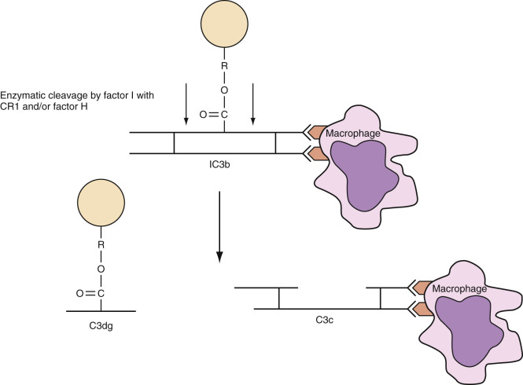

Figure 35-1 

Action of factor I in the release of C3b-coated erythrocytes from reticuloendothelial system sequestration. 

Initially, C3b/iC3b-coated RBCs are rapidly sequestered in the liver by monocytes and macrophages, which have receptors for C3b ( [ Table 35-3 ](<#t0020>) ). Although phagocytic cells also have receptors for C4b, the role, if any, of C4b in immune hemolysis of erythrocytes is not defined (  Freedman & Semple, 1994  ). A portion of the RBCs sequestered in the liver are immobilized and destroyed by phagocytosis with a half-life of about 2 minutes (  Klein & Anstee, 2006  ). Within 15 to 20 minutes, however, destruction slows, and many of the cells escape extravascular destruction through the action of the complement regulatory protein, factor I, as previously described. C3dg, the iC3b fragment produced by factor I cleavage, remains attached to RBCs but has no enzymatic or opsonic properties. As a result, sequestered C3dg-coated RBCs are released back into the circulation and survive normally (see [ Fig. 35-1 ](<#f0010>) ). In the circulation, C3dg is cleaved, leaving C3d attached to the RBC membrane. 

TABLE 35-3 

Complement Receptors on Human Cells 

Receptor  |  Ligand  |  Distribution   
---|---|---  
CR1 (CD35)  |  C3b, C4b  |  Erythrocytes, neutrophils, monocytes, macrophages, B lymphocytes, follicular dendritic cells   
CR2 (CD21)  |  C3d, C3dg, iC3b  |  B cells   
CR3 (CD11b/CD18) [ * ](<#hl0000451>) |  iC3b  |  Monocytes, macrophages, neutrophils, natural killer cells   
CR4 (CD11c/CD18) [ * ](<#hl0000451>) |  iC3b  |   
  
 * Members of the integrin receptor family. 

In the absence of complement activation, IgG-coated RBCs are removed by phagocytic cells via Fcγ receptors. Although phagocytosis is not complement dependent,  Mollison (1989)  demonstrated that RBCs coated with both IgG and complement tend to show accelerated removal by the liver, whereas RBCs coated only with IgG tend to be destroyed more slowly in the spleen, displaying a linear pattern of removal with a minimum half-life of 20 minutes. Theoretically, RBCs coated only with IgG antibody could also be the targets of antibody-dependent cellular cytotoxicity mechanisms (  Klein & Anstee, 2006  ), because natural killer cells possess Fcγ receptors. 

,  

##  Erythrocyte Antigens and Antibodies 

More than 700 erythrocyte antigens have been reported in the literature and have been organized into 35 blood group systems by the International Society of Blood Transfusion (ISBT) ( [ Table 35-4 ](<#t0025>) ). Many described erythrocyte antigens are high-frequency or public antigens expressed by most donors (>90% to 99%), whereas others are extremely rare (private antigens). In the following section, we review the more common RBC antigens and antibodies encountered on the transfusion service. [ Table 35-5 ](<#t0030>) summarizes several commonly encountered RBC alloantibodies according to their Ig class, serologic phase of detection, clinical significance, and statistics on finding compatible blood. 

TABLE 35-4 

Terminology for Blood Group System Genes and Gene Products 

TRADITIONAL NOMENCLATURE  |  ISBT NOMENCLATURE  |  ISGN NOMENCLATURE  |   
---|---|---|---  
Name  |  Symbol  |  Symbol  |  Number  |  Gene  |  Chromosome  |  Gene Product Name   
ABO  |  ABO  |  ABO  |  001  |  _ABO_ |  9q34.1  |  α1,3 _N_ -acetyl-galactosaminyltransferase (A antigen)   
|  |  |  |  |  α1,3-galactosyltransferase (B antigen)   
MNS  |  MNS  |  MNS  |  002  |  _GYPA_ |  4q28.2  |  Glycophorin A (CD235 A)   
|  |  |  _GYPB_ |  |  Glycophorin B (CD235B)   
|  |  |  _GYPE_ |  |  Glycophorin E (CD235E)   
P1Pk  |  P1  |  P1  |  003  |  _A4GALT1_ |  22q13  |  P1 antigen   
Rh  |  Rh  |  RHD  |  004  |  _RHD_ |  1p36.1  |  RhD protein (CD240)   
|  RHCE  |  |  _RHCE_ |  |  RhCE protein   
Lutheran  |  Lu  |  LU  |  005  |  _LU_ |  19q13.3  |  Lutheran glycoprotein, B-CAM   
Kell  |  K  |  KEL  |  006  |  _KEL_ |  7q34  |  Kell glycoprotein   
Lewis  |  Le  |  LE  |  007  |  _FUT3_ |  19p13.3  |  α-3/4-fucosyltransferase   
Duffy  |  Fy  |  FY  |  008  |  _DARC_ |  1q23  |  Duffy-associated receptor cytokine glycoprotein   
Kidd  |  Jk  |  JK  |  009  |  _SLC14A1_ |  18q12  |  Urea transporter (HUT11)   
Diego  |  Di  |  DI  |  010  |  _SLC4A1_ |  17q21.3  |  Anion exchanger 1 (AE1, Band 3)   
Yt  |  Yt  |  YT  |  011  |  _ACHE_ |  7q22  |  Acetylcholinesterase   
Xg  |  Xg  |  XG  |  012  |  _XG_ |  Xp22.3  |  Xg glycoprotein (CD99)   
Scianna  |  Sc  |  SC  |  013  |  _ERMAP_ |  1p34  |  Human erythroid membrane–associated protein   
Dombrock  |  Do  |  DO  |  014  |  _ART4_ |  12p13.2  |  ADP-ribosyltransferase (CD297)   
Colton  |  Co  |  CO  |  015  |  _AQPI_ |  7p14  |  Aquaporin-1 (CHIP)   
Landsteiner-Wiener  |  LW  |  LW  |  016  |  _LW_ |  19p13.3  |  ICAM (CD242)   
Chido/Rodgers  |  Ch/Rg  |  CH/RG  |  017  |  _C4A, C4B_ |  6p21.3  |  C4A, C4B complement glycoproteins   
Hh  |  Hh  |  H  |  018  |  _FUT1_ |  19q13.3  |  α1,2-fucosyltransferase   
Kx  |  Kx  |  XK  |  019  |  _XK_ |  Xp21.1  |  Kx glycoprotein   
Gerbich  |  Ge  |  GE  |  020  |  _GYPC_ |  2q14  |  Glycophorin C and glycophorin D (CD236)   
Cromer  |  Cromer  |  CROM  |  021  |  _DAF_ |  1q32  |  Decay-accelerating factor (CD55)   
Knops  |  Kn  |  KN  |  022  |  _CR1_ |  1q32  |  Complement receptor 1 (CD35)   
Indian  |  In  |  IN  |  023  |  _CD44_ |  11p13  |  CD44   
Ok  |  Ok  |  OK  |  024  |  _CD147_ |  19p13.3  |  CD147Basigin   
Raph  |  Raph  |  RAPH  |  025  |  _CD151_ |  11p15.5  |  Tetraspanin (CD151)   
John Milton Hagen  |  JMH  |  JMH  |  026  |  _SEMA7A_ |  15q24.3  |  Semaphorin (CD108)   
I  |  I  |  I  |  027  |  _GCNT2_ |  6p24.2  |  β1,6 _N_ -acetylglucosaminyltransferase   
Globoside  |  P(Gb4)  |  GLOB  |  028  |  _B3GALNT1_ |  3q26  |  β1,3 _N_ -acetylgalactosaminyltransferase   
GIL  |  Gill  |  GIL  |  029  |  _AQP3_ |  9p13  |  Aquaglyceroporin   
RHAG  |  RHAg  |  RHAG  |  030  |  _RhAG_ |  6p21-qter  |  Rh-associated glycoprotein (CD241)   
Forssman  |  Fors  |  FORS  |  031  |  _GBGT1_ |  9q34.13  |  α1,3 _N_ -acetylgalactosaminyltransferase   
Jr  |  Jr  |  JR  |  032  |  _ABCG2_ |  4q22  |  ATP-binding cassette, G family   
Lan  |  Lan  |  LAN  |  033  |  _ABCB6_ |  2q36  |  ATP-binding cassette, B family   
Vel  |  Vel  |  VEL  |  034  |  _SMIM1_ |  1p36.32  |  Small integral membrane protein 1   
CD59  |  CD59  |  CD59  |  035  |  _CD59_ |  11p13  |  Membrane inhibitor of reactive lysis   
  
_ADP,_ Adenosine diphosphate; _CHIP,_ channel-forming integral protein; _ICAM,_ intercellular adhesion molecule; _ISBT,_ International Society of Blood Transfusion; _ISGN,_ International Society for Gene Nomenclature. 

From  Daniels (2002)  ,  Daniels et al (2004)  ,  Reid & Lomas-Francis (2012)  , and the International Society of Blood Transfusion. 

TABLE 35-5 

Serologic Characteristics and Clinical Significance of Red Cell Alloantibodies 

|  Usual Ig Class  |  MOST COMMON PHASE OF REACTIVITY  |  CLINICAL SIGNIFICANCE  |  APPROXIMATE % OF COMPATIBLE DONORS   
---|---|---|---|---  
Antibody  |  Sal  |  Alb  |  AGT  |  HTR  |  HDFN  |  Caucasian  |  Black   
D  |  IgG  |  Few  |  X  |  X  |  Yes  |  Yes  |  15  |  8   
C  |  IgG  |  |  X  |  X  |  Yes  |  Yes  |  30  |  68   
E  |  IgG  |  Few  |  X  |  X  |  Yes  |  Yes  |  70  |  98   
c  |  IgG  |  |  X  |  X  |  Yes  |  Yes  |  20  |  1   
e  |  IgG  |  |  X  |  X  |  Yes  |  Yes  |  2  |  2   
Cw  |  IgG/IgM  |  Some  |  X  |  X  |  Yes  |  Yes  |  98  |  100   
K  |  IgG  |  Rare  |  |  X  |  Yes  |  Yes  |  91  |  97   
k  |  IgGX  |  |  |  |  Yes  |  Yes  |  0.2  |  0.1   
Kp  a  |  IgG  |  Rare  |  |  X  |  Yes  |  Yes  |  98  |  99.9   
Kp  b  |  IgG  |  |  X  |  |  Yes  |  Yes  |  <0.1  |  0.1   
Js  a  |  IgG  |  |  X  |  |  Yes  |  Yes  |  >99.9  |  81   
Js  b  |  IgG  |  |  X  |  |  Yes  |  Yes  |  <0.1  |  1   
Fy  a  |  IgG  |  |  X  |  |  Yes  |  Yes  |  34  |  90   
Fy  b  |  IgG  |  |  X  |  |  Yes  |  Yes  |  17  |  77   
Jk  a  |  IgG  |  |  X  |  |  Yes  |  Yes  |  23  |  9   
Jk  b  |  IgG  |  |  X  |  |  Yes  |  Yes  |  28  |  5   
M [ * ](<#hl0001207>) |  IgM  |  X  |  |  |  Few  |  Yes  |  22  |  30   
N  |  IgM  |  X  |  |  |  Rare  |  Rare  |  28  |  26   
S  |  IgG/IgM  |  |  Some  |  X  |  Yes  |  Yes  |  45  |  69   
s  |  IgG  |  |  |  X  |  Yes  |  Yes  |  11  |  3   
U  |  IgG  |  |  |  X  |  Yes  |  Yes  |  0  |  1   
Lu  a  [ † ](<#hl0001210>) |  IgM  |  X  |  |  |  ?  |  Yes  |  92  |  96   
Lu  b  [ † ](<#hl0001210>) |  IgG  |  |  X  |  |  Yes  |  Mild  |  <0.1  |  <0.1   
P1 [ ‡ ](<#hl0001213>) |  IgM  |  X  |  Some  |  |  Rare  |  No  |  21  |  6   
P  |  IgM  |  X  |  Some  |  Some  |  Probable  |  Yes  |  <0.1  |  0.1   
PP  1  P  k  [ † ](<#hl0001210>) |  IgG/IgM  |  X  |  Some  |  Some  |  Probable  |  Yes  |  <0.1  |  0.1   
Le  a  [ ‡ ](<#hl0001213>) |  IgM  |  X  |  Some  |  |  Yes  |  No  |  78  |  77   
Le  b  [ ‡ ](<#hl0001213>) |  IgM  |  X  |  |  |  Yes  |  No  |  28  |  45   
I  |  IgM  |  X  |  Few  |  |  Rare  |  No  |  <0.1  |  <0.1   
i  |  IgM  |  X  |  Few  |  |  ?  |  No  |  <0.1  |  <0.1   
  
_AGT,_ Antihuman globulin test _; Alb,_ albumin; _HDFN,_ hemolytic disease of the fetus and newborn; _HTR,_ hemolytic transfusion reaction; _Sal,_ saline. 

 * Most examples of anti-M also have a small but significant IgG component. 

 † Exhibits characteristic mixed-field agglutination pattern. 

 ‡ May occasionally show in vitro hemolysis. 

 

##  ABO and H Blood Group Systems (ISBT No. 001 and 018) 

Originally discovered in 1900, the ABO blood group system is the single most important blood group for the selection and transfusion of blood. As histo-blood group antigens, ABO epitopes are found on many tissues and body fluids, including RBCs, platelets, and endothelial cells (  Issitt & Anstee, 1998  ). Because they are so widely expressed, ABO antigens are a major consideration in solid organ and bone marrow transplantation (  Rowley et al, 2011  ). 

The ABO blood group system consists of two antigens—A and B—and four phenotypes—groups A, B, AB, and O. A and B are autosomal codominant antigens (ISTB No. 001) and are expressed on group A, B, and AB red cells, respectively. In contrast, the group O phenotype is an autosomal recessive phenotype, reflecting the absence of a functional ABO gene. Group O individuals express the H antigen (ISBT No. 018), the biosynthetic precursor of both A and B antigens ( [ Fig. 35-2 ](<#f0015>) ). Group O is the most frequent ABO phenotype in most populations tested, particularly among Native Americans. Expression of ABO antigens on RBCs is usually accompanied by the presence of naturally occurring antibodies against the missing antithetical antigen(s). [ Table 35-6 ](<#t0035>) shows the serologic reactions and frequencies of the four major ABO phenotypes. 

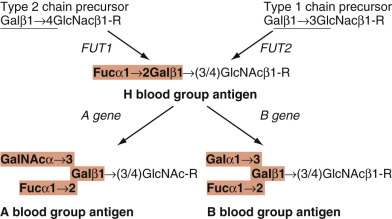

Figure 35-2 

Synthesis of type 1 and type 2 chain H and AB antigens. 

Type 1 chain and type 2 chain precursors _(underlined)_ are fucosylated by _FUT1_ and _FUT2_ fucosyltransferases to form H antigen. H antigen then serves as a substrate for _A_ and _B_ glycosyltransferases. The terminal carbohydrate epitopes denoting blood group H, A, and B antigens are highlighted in amber. _Fuc,_ Fucose; _Gal,_ galactose; _GalNAc, N_ -acetylgalactosamine; _R,_ other oligosaccharide. 

TABLE 35-6 

Routine ABO Grouping Results and Phenotype Frequencies 

CELLS AGAINST KNOWN ANTISERA  |  SERUM AGAINST RED CELLS OF KNOWN PHENOTYPE  |  |  FREQUENCIES IN U.S. POPULATION, %   
---|---|---|---  
Anti-A  |  Anti-B  |  A  |  B  |  O  |  Interpretation  |  Caucasian  |  Black  |  Native American  |  Asian   
– |  – |  \+  |  \+  |  – |  O  |  45  |  49  |  79  |  40   
\+  |  – |  – |  \+  |  – |  A  |  40  |  27  |  16  |  28   
– |  \+  |  \+  |  – |  – |  B  |  11  |  20  |  4  |  27   
\+  |  \+  |  – |  – |  – |  AB  |  4  |  4  |  <1  |  5   
– |  – |  \+  |  \+  |  \+  |  Bombay  |  rare  |  rare  |  rare  |  rare   
  
Composite figures calculated from  Mourant et al (1976)  . 

 

##  Null and Weak Phenotypes 

The ABO system also contains several phenotypes associated with weakened, anomalous, or complete absence of ABO antigen expression. The most common ABO subtypes encountered in the blood bank are A  1  and A  2  . A  1  red cells are distinguished from A  2  (and other weak A subtypes) by agglutination with the lectin _Dolichos biflorus_ . Comparison of A  1  , A  2  , and other weak A subtypes indicates both quantitative and qualitative differences in A antigen expression (  Issitt & Anstee, 1998  ;  Swensson et al, 2005  ). A  2  is the most commonly encountered weak subtype in whites, accounting for nearly 20% of all group A donors. The ABO system contains additional weak A and weak B phenotypes, including several that can cause ABO discrepancies during routine testing (  Fung, 2014  ). 

Anomalous ABO expression can be inherited ( _cis_ -AB, B[A]) or acquired (acquired B). In the _cis_ -AB phenotype, A and B antigens are synthesized by the same enzyme and are inherited as a single, autosomal dominant allele. Likewise, the B(A) phenotype, an autosomal dominant phenotype characterized by trace A antigen expression on group B RBCs, is due to synthesis of A antigen by the _B_ -gene enzyme. The acquired B phenotype, on the other hand, is an acquired enzymatic modification of group A  1  red cells in vivo. The acquired B phenotype usually occurs in the setting of bacterial infection or cancer and reflects enzymatic deacetylation of group A antigen to form a B-like antigen on RBCs. The _cis_ -AB, B(A), and acquired B phenotypes are usually detected because of discrepancies in ABO typing (  Issitt & Anstee, 1998  ;  Fung, 2014  ). 

Bombay and para-Bombay are two rare null phenotypes characterized by an absence of all ABH antigens on RBCs. In the classic Bombay phenotype (O  h  ), neither AB nor H antigens are present on RBCs or in secretions. Para-Bombay also shows few or no ABH antigens on RBCs, sometimes accompanied by normal expression of ABH antigens in secretions and body fluids. 

 

##  Biochemistry 

The ABO antigens are carbohydrate antigens and, therefore, represent a posttranslation modification of glycoproteins and glycolipids. On RBC glycoproteins and polylactosaminylceramides, ABO antigens are usually expressed on type 2 chain oligosaccharides, characterized by repeating lactosaminyl (Galβ1–4GlcNAcβ1–3)  n  motifs (see [ Fig. 35-2 ](<#f0015>) ). On glycosphingolipids, ABO antigens can be expressed on multiple (type 1, 2, 3, and 4 chain) oligosaccharide precursors. ABH antigens expressed on RBC glycoproteins and most glycosphingolipids (type 2, 3, and 4 chain) are of RBC origin. In contrast, type 1 chain ABO antigens are synthesized by gastrointestinal mucosa, secreted into plasma, and passively adsorbed onto red cell membranes. Synthesis of type 1 chain ABO antigens is linked to the Lewis blood group system. 

The first step in the synthesis of ABH antigens is the synthesis of the H or group O antigen, the immediate biosynthetic precursor of both A and B antigens. The H antigen is formed by the addition of fucose (Fuc), in an α1–2 linkage, to a terminal galactose. This reaction is catalyzed by two different enzymes, depending on whether the fucose is being added to a type 1 or type 2 chain oligosaccharide acceptor. Fucosyltransferase type 1 ( _FUT1_ ), the product of the H or _FUT1_ gene, catalyzes the formation of type 2 chain H antigen. In contrast, fucosyltransferase type 2 ( _FUT2_ ), the product of the _Secretor_ gene, catalyzes the transfer of fucose to type 1 chain precursors to form type 1 chain H or Le  d  antigen (  Lowe, 1994  ). Inactivating mutations in _FUT1_ are responsible for the Bombay and para-Bombay phenotypes (  Kelly et al, 1994  ). Bombay and para-Bombay nonsecretors also have inactivating mutations in _FUT2_ (  Reid & Lomas-Francis, 2012  ). 

Once H antigen is formed, it can serve as a substrate for _A_ gene and _B_ gene glycosyltransferases. The A antigen is formed by _A_ gene ( _ABO*A_ ) glycosyltransferase, which adds an _N_ -acetylgalactosamine (GalNAc), in an α1–3 linkage, to the subterminal galactose of H antigen. Likewise, the B antigen is formed by the addition of an α1–3 galactose (Gal) to the same galactose by the _B_ gene ( _ABO*B_ ) glycosyltransferase. Biochemically, the A and B antigens are very similar, differing only by the presence of an _N_ -acetyl group. It is fascinating that such a minor chemical modification should have such profound immunologic consequences. Removal of the _N_ -acetyl group on A antigen by circulating deacetylase enzymes is responsible for the acquired B phenotype (  Issitt & Anstee, 1998  ). 

 

##  Molecular Biology 

_FUT1_ ( _H_ gene) and _FUT2_ ( _Se_ gene) are located together on chromosome 19q13.3 and reflect a gene duplication (  Lowe, 1994  ). FUT1 is a 365 amino acid, type II transmembrane glycoprotein, composed of a large, 240 amino acid, carboxy-terminal catalytic domain, which is anchored within the Golgi lumen by a short transmembrane and a cytosolic domain. _FUT1_ mRNA is widely expressed in most tissues, with the exception of salivary and parotid glands (  Yamamoto et al, 2003  ). The last is the basis for testing saliva to determine ABH secretor status. ISBT currently lists more than 40 mutant _FUT1_ alleles, including 19 null alleles and 23 weak alleles (  Reid & Lomas-Francis, 2012  ). 

The _ABO_ gene locus is located on chromosome 9q34 and encodes the A and B glycosyltransferases (  Yamamoto, 1995  ). The gene is large, spanning 19.5 kb, and contains seven exons, although exons 6 and 7 encode the majority of the active enzyme (66%). The product of the _ABO_ gene is a 41-kD, 354 amino acid type II transmembrane glycoprotein. Comparison of A and B enzymes shows nearly 98% identity, differing by four key amino acids at residues 176, 235, 266, and 268 ( [ Table 35-7 ](<#t0040>) ). Amino acids 235, 266, and 268 are critical in determining A versus B enzyme activity: The polymorphism at 176 is not biologically active. Because both A and B recognize the type 2 chain acceptor, any differences in amino acids 235, 266, and 268 dictate whether the enzyme will recognize UDP-GalNAc or UDP-Gal nucleotide sugar donor. Crystallography data indicate that the amino acids associated with _ABO*A_ gene product are smaller and able to accommodate the larger UDP-GalNAc donor. To date, more than 200 ABO alleles have been identified. 

TABLE 35-7 

Key Amino Acids in Distinguishing A, B, and Hybrid Glycosyltransferases [ * ](<#hl0001413>)

ABO Allele  |  AMINO ACID NUMBER OF A/B GLYCOSYLTRANSFERASE  |  Gene Type [ † ](<#hl0001420>)  
---|---|---  
176  |  234  |  235  |  266  |  268   
ABO*A.01  |  Arg  |  Pro  |  Gly  |  Leu  |  Gly  |  AAAA   
ABO*B.01  |  Gly  |  Pro  |  Ser  |  Met  |  Ala  |  BBBB   
ABO*cisAB.01  |  Arg  |  Pro  |  Gly  |  Leu  |  **Ala** |  AAAB   
ABO*cisAB.04  |  **Gly** |  Pro  |  Gly  |  **Met** |  Gly  |  AABA   
ABO*cisAB.02  |  **Gly** |  Pro  |  **Ser** |  Leu  |  Ala  |  BBAB   
ABO*BA.03  |  **Gly** |  Pro  |  Gly  |  **Met** |  **Ala** |  BABB   
ABO*BA.02  |  **Gly** |  **Ala** |  **Ser** |  **Met** |  **Ala** |  BBBB   
ABO*O.02  |  Arg  |  Pro  |  Gly  |  Leu  |  **Arg** [ ‡ ](<#hl0001423>) |  AAAX   
  
 * Modified from  Reid & Lomas-Francis (2004)  and  Daniels (2002)  . Amino acids that differ from the _ABO*A.01_ (A  1  type) consensus allele are highlighted in bold. 

 † Gene type refers to amino acid positions 176, 235, 266, and 268. These four positions differ between A (AAAA) and B alleles. Amino acids at 235, 266, and 268 strongly influence substrate specificity. Hybrid glycosyltransferases have amino acids matching both A and B consensus alleles at these positions. 

 ‡ _ABO*O.02_ allele (historically _O 2  , O03 _ ), associated with a group O phenotype, possesses an inactivating missense mutation at amino acid 268. 

The cloning and sequencing of the _ABO_ gene locus have also uncovered the molecular basis of group O and weak ABO subtypes. Group O is an autosomal-recessive phenotype due to homozygosity for amorph _ABO_ alleles ( _ABO*O_ ). There are many _ABO*O_ alleles described to date; however, most ABO alleles can be classified as either _O 1  _ or _O 2  _ . Alleles belonging to the _O 1  _ family ( _ABO*O1_ ) share a nucleotide deletion and frameshift (G251D, fs88stop) and account for 95% of all ABO*O alleles. _O 2  _ alleles ( _ABO*O2; O03_ ) carry a G802>A, leading to Gly268Arg in the translated protein (see [ Table 35-7 ](<#t0040>) ). _O 2  _ and related alleles (Aw08) have been linked to ABO typing discrepancies by an absence of anti-A and/or anti-B in these individuals (  Wagner et al, 2005  ). It has been suggested that the absence of anti-A or anti-B is the result of weak residual enzyme activity (  Seltsam et al, 2005  ); however, this has not been confirmed (  Yazer et al, 2008  ). 

Weak ABO subtypes are the result of mutations at the _ABO_ gene locus. Most mutations are located within exon 7, which encodes the catalytic domain of the molecule. The majority of described mutations are single-nucleotide polymorphisms (SNPs), although nonsense, frameshift, and translation-initiator mutations are known (  Yamamoto, 1995  ;  Seltsam et al, 2006  ;  Reid & Lomas-Francis, 2012  ). A2, the most common weak A subtype, is the result of a single nucleotide deletion (nucleotide 1060) and frameshift, resulting in the loss of a stop codon and synthesis of a longer A enzyme with decreased enzyme activity. The _cis_ -AB and B(A) phenotypes are the consequence of hybrid alleles, with characteristics of both _A 1  _ and _B_ gene consensus alleles. cis-AB and B(A) individuals can synthesize both A and B antigens (see [ Table 35-7 ](<#t0040>) ) (  Yamamoto, 1995  ;  Reid & Lomas-Francis, 2012  ). 

 

##  ABO Antibodies 

Antibodies against ABO antigens are the most important antibodies in transfusion medicine. The practicing pathologist should note that the routine antibody screen does not test for ABO antibodies. All reagent cells in the antibody screen are group O. Patients demonstrate anti-A or anti-B on reverse typing (vide infra). A valid ABO type requires agreement between the forward and reverse types. 

In general, ABO antibodies are naturally occurring. It is believed that the immune stimulus for the formation of ABO antibodies may be exposure to ABH-like substances found in nature, particularly on the bacterial polysaccharides (  Cooling, 2015  ). It is interesting that ABO titers have progressively decreased over the past 2 decades with increasing consumption of pasteurized, commercially packaged foods that are relatively sterile (  Mazda et al, 2007  ). This trend may be reversed with increasing use of probiotic nutritional supplements that contain live bacteria. The latter have been shown to stimulate ABO antibodies, with marked increases in ABO titers within several months (  Daniel-Johnson et al, 2009  ). 

ABO antibodies are weak or absent in the sera of newborns until 3 to 6 months of age. Adult levels of ABO antibodies are reached by 5 to 10 years of age and decrease only slightly with advancing age (  Auf der Maur et al, 1993  ). Anti-A,B is found exclusively in group O individuals and appears to recognize an epitope common to both A and B antigens. Before the development of anti-A and anti-B monoclonal antibody typing reagents, anti-A,B was useful in identifying weak and B subgroups. Anti-A,B is still used for typing donor units and cord samples (see [ ABO Grouping ](<#s1035>) section). 

In general, ABO antibodies are detected as room temperature, saline agglutinins with optimal reactivity at 4° C (see [ Table 35-5 ](<#t0030>) ). Most naturally occurring ABO antibodies are of IgM isotype, although IgA and IgG antibodies with ABO specificity are also present (  Rieben et al, 1991  ). ABO IgG antibodies, reactive at 37° C, can also occur following immune stimulation by transfusion or pregnancy. These antibodies generally are of higher titer and are less readily neutralized by soluble blood group substances. ABO antibodies can fix complement and can cause hemolysis in vivo and in vitro. 

Clinically, ABO antibodies are a cause of hemolytic transfusion reactions and hemolytic disease of the fetus and newborn (HDFN). ABO antibodies are also a cause of acute rejection in solid organ transplantation. As a result, solid organ transplants should be ABO compatible with the recipient's sera. Rare exceptions to the latter are heart transplantation in children younger than 6 to 8 months of age, who have not yet developed ABO antibodies (  West & Platt, 2010  ), and transplantation of A  2  organs, which have very weak ABO expression on epithelium and vascular endothelium (  Hurst et al, 2010  ). In ABO-incompatible bone marrow transplantation, ABO antibodies can result in hemolysis and a delay in erythroid and megakaryocyte engraftment (  Rowley et al, 2011  ;  Cooling & Gorlin, 2012  ). For additional information on ABO-incompatible marrow and organ transplants, see the section on Antibody Titers. 

 

##  Less Common ABO Antibodies 

 

##  Anti-A  1  . 

Anti-A  1  is a naturally occurring antibody found in the sera of some A  2  , A  2  B, and other weak A subtypes. Anti-A  1  hemagglutinates A  1  RBCs, but not A  2  and other weak A phenotypes. Although uncommon, anti-A  1  has been implicated in transfusion reactions and solid organ rejection. 

 

##  Anti-H. 

Anti-H is usually a benign, naturally occurring antibody in the sera of A  1  and A  1  B nonsecretors. Anti-H reacts most strongly with group O erythrocytes, followed by A  2  , B, A  2  B, A  1  , and A  1  B (see [ Table 35-41 ](<#t0210>) ). Because H antigen is present to some degree on all RBCs, anti-H is an autoantibody in most individuals. In contrast, alloanti-H is a clinically significant alloantibody in Bombay (O  h  ) and para-Bombay individuals. These individuals require transfusion of rare O  h  red cells. 

 

##  Biological Role 

The biological role of ABH antigens is still not known. Multiple studies have linked specific ABO types with a higher incidence of many diseases, including autoimmune, neoplastic, and infectious disorders. A and B antigen expression may stabilize the clustering and spatial organization of sialoglycoproteins (  Cohen et al, 2009  ). Depression of A and B antigen expression can occur in malignancy and is often associated with increased metastatic potential. Group A,B and AB individuals also have a twofold higher risk of thrombotic events, including venous thrombosis and pulmonary embolism (  Franchini & Mannucci, 2014  ). This may correlate to ABO differences in circulating von Willebrand factor, LDL, cholesterol, and P- and E-selectin. _Plasmodium falciparum_ has been shown to bind A and B antigens with rosette formation, a possible risk factor in cerebral malaria (  Cooling, 2015  ). Group O is a receptor for many gastrointestinal pathogens, including norovirus, rotavirus, _H. pylori, C. jejuni,_ and _V. cholerae_ El Tor (  Cooling, 2015  ). Group O may be protective against some infections due to anti-A and anti-B, including some enveloped viruses (HIV, SARS-CoV), schistosomiasis, _E. coli,_ and other gram-negative organisms (  Cooling, 2015  ). 

 

##  MNS Blood Group System (ISBT No. 002) 

Discovered in 1927, the MNSs blood group was the second blood group system identified after ABO. Today, the MNSs blood group system consists of more than 46 antigens, although only four (M/N and S/s) are commonly encountered in the clinical setting (  Reid, 2009  ). As shown in [ Table 35-8 ](<#t0045>) , the M and N antigens are fairly evenly distributed in both blacks and Caucasians, with approximately 25% of donors homozygous for M or N antigen. In contrast, the S antigen is nearly twice as frequent in Caucasians (57%) as in blacks (30%). In a minority (<1%) of blacks, an S–s– or null phenotype can be observed. As with Rh antigens, the MNSs blood group antigens are expressed only on RBCs. Approximately 1 million M/N and 170,000 to 250,000 S/s epitopes are present per RBC. 

TABLE 35-8 

Phenotypes of the MNSs System 

GLYCOPHORIN A ANTIGENS  |  GLYCOPHORIN B ANTIGENS  |  |  PHENOTYPE FREQUENCIES, %   
---|---|---|---  
M  |  N  |  En (a)  |  “N” |  S  |  s  |  U  |  Phenotype  |  Caucasian  |  Black   
\+  |  0  |  \+  |  |  |  |  |  M+N– |  28  |  26   
\+  |  \+  |  \+  |  |  |  |  |  M+N+  |  50  |  44   
0  |  \+  |  \+  |  |  |  |  |  M–N+  |  22  |  30   
|  |  |  \+  |  \+  |  0  |  \+  |  S+s–U+  |  11  |  3   
|  |  |  \+  |  \+  |  \+  |  \+  |  S+s+U+  |  44  |  28   
|  |  |  \+  |  0  |  \+  |  \+  |  S–s+U+  |  45  |  69   
**Null Phenotypes**  
0  |  0  |  0  |  \+  |  +/0  |  +/0  |  \+  |  En (a–)  |  Rare  |  Rare   
0  |  0  |  0  |  0  |  0  |  0  |  0  |  M  k  M  k  |  Rare  |  Rare   
|  |  |  0  |  0  |  0  |  0  |  S–s–U– |  Rare  |  <1   
|  |  |  0  |  0  |  0  |  wk+  |  S–s–U  var  (23% Henshaw+)  |  Rare  |  <1   
  
 

##  Null Phenotypes 

Three major null phenotypes are present in the MNSs system: U–, M  k  , and En (a–). The U– phenotype is the most common and is observed exclusively in blacks. In S–s–U– individuals, complete loss or a recombination of glycophorin B occurs, leading to altered expression of S/s and U antigens. Recombinant glycophorin B, such as the Henshaw phenotype, can react weakly with some examples of human anti-U and are known as U variants (S–s–U  var  ). The En (a–) phenotype is the result of recombination between glycophorin _A_ and _B_ genes to form a Lepore-type A-B hybrid (exons A1-B2-B5) lacking most of glycophorin A (GYPA). The M  k  M  k  phenotype lacks all MNSs antigens, including En(a), as the result of recombination and deletion of glycophorins A and B (GYPA and GYPB). Loss of GYPA can coincide with loss of Wr  b  expression, an antigen on Band 3. It is believed that Wr  b  requires an electrostatic interaction between a glutamic acid (Glu658) on Band 3 and the ENEP antigen on glycophorin A (  Poole et al, 1999  ). 

 

##  Biochemistry 

The M/N antigens reside on GYPA (CD235A), a major RBC membrane glycoprotein. In the membrane, GYPA is present as a dimer, usually in association with Band 3, the erythrocyte anion exchanger (  Burton & Bruce, 2011  ). Following cleavage of a 19 amino acid leader sequence, the mature GYPA is a 31-kD, 131 amino acid, type 1 glycoprotein composed of a large, 72 amino acid extracellular domain, a transmembrane domain, and a short cytoplasmic tail ( [ Fig. 35-3 ](<#f0020>) ). The molecule is heavily glycosylated, possessing 15 _O_ -linked and one _N_ -linked carbohydrate side chain. The _O_ -linked glycans consist predominantly of a disialotetrasaccharide linked to a serine or threonine residue. Because of the large number of sialylated _O_ -linked glycans on GYPA, nearly 60% and 50% of the total molecular weight is carbohydrate and sialic acid, respectively. Not surprisingly, GYPA is the major sialomucin on RBCs and contributes significantly to the overall negative charge or ζ potential (  Huang & Blumenfeld, 1995  ). The M and N antigens reside on the extreme amino-terminus of GYPA. 

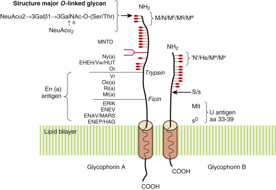

Figure 35-3 

Glycophorin A (GYPA) and B (GYPB). GYPA and GYPB possess 11 to 15 _O_ -linked glycans (  ), consisting predominantly of a disialotetrasaccharide (78%), along the amino-terminal half of the extracellular domain. 

GYPA also possesses a single, biattenary _N_ -glycan, indicated by a branched structure. The single transmembrane domain for both molecules is indicated by a solid amber cylinder. The allelic antigens, M and N, reside at the extreme amino-terminus of GYPA and differ by only two amino acids at residues 1 and 5. The N antigen is also present at the amino-terminus of GYPB and is designated “N” antigen. The S/s antigens are located at amino acid 29 of GYPB. The locations of high- and low-incidence antigens are shown. The En (a) and U antigens involve large stretches of protein near the lipid bilayer and are missing in deletion and recombinant glycophorins. 

The S/s and U antigens reside on GYPB(CD235B), a related RBC glycoprotein (see [ Fig. 35-3 ](<#f0020>) ). Like GYPA, GYPB undergoes posttranslational processing, resulting in a 20-kD, 72 amino acid glycoprotein composed of a large, extracellular _N_ -terminal domain containing 11 _O_ -linked glycans. Although GYPB shares considerable homology with GYPA at the amino-terminus, GYPB is smaller, lacking both an _N_ -glycan and a cytoplasmic tail. In the membrane, GYPB appears to be closely associated with Diego at the AE1-ankyrin and junctional complexes, often as a heterodimer with GYPA (  Burton & Bruce, 2011  ). The S/s epitope (Met48Thr) is located at amino acid 29 in the mature protein (  Reid & Lomas-Francis, 2012  ). 

 

##  Molecular Biology 

The genes for GYPA ( _GYPA_ ) and GYPB ( _GYPB_ ) reside on chromosome 4q28-q31 as part of a 330-kb gene cluster encoding _GYPA_ , _GYPB_ , and glycophorin E ( _GYPE_ ) (5′-A-B-E-3′). Studies indicate that _GYPB_ and _GYPE_ arose from GYPA by gene duplication and nonhomologous recombination. Similar to many erythroid-specific genes, the promoter region contains consensus sequences for Sp1 and GATA-1, an erythroid transcription regulatory binding factor (  Rahuel et al, 1994  ). The greater stability of _GYPA_ mRNA (>24 hours) over _GYPB_ mRNA (<17 hours) may explain the four- to fivefold greater numbers of GYPA on RBCs (  Rahuel et al, 1994  ). 

There are 18 allelic GYPA variants reported to date that are responsible for several high- and low-incidence antigens. The biochemical nature of the MNSs antigens has long been known. The M and N antigens lie at the extreme amino-terminus of GYPA (amino acids 1 to 5) and include both protein and carbohydrate as part of the immune epitope. It is amino acid differences at positions 20 and 25 (1 and 5 in the mature protein), however, that define the M/N antigens ( [ Table 35-9 ](<#t0050>) ). It is not surprising that several low-incidence M and N antigen variants are the result of different amino acid substitutions (M  g  , M  c  ) and/or altered expression of _O_ -linked glycans (M  1  , Tm, Can). In addition to GYPA, the N antigen is expressed on the extreme amino-terminus of GYPB. The latter is referred to as the “N” antigen to distinguish it from N antigen on GYPA (  Issitt & Anstee, 1998  ). 

TABLE 35-9 

MNSs Blood Group Alleles 

ISBT No.  |  Antigen  |  Glycophorin  |  Allele  |  Amino Acid Change [ * ](<#hl0001711>)  
---|---|---|---|---  
MNS1  |  M  |  GYPA  |  _GYPA*01_ |  Ser  20  -Ser-Thr-Thr-Gly  24  [ * ](<#hl0001711>)  
MNS2  |  N  |  GYPA  |  _GYPA*02_ |  Leu  20  -Ser-Thr-Thr-Glu  24  [ * ](<#hl0001711>)  
MNS8  |  Mc  |  GYPA  |  _GYPA*08_ |  Ser  20  -Ser-Thr-Thr-Glu  24   
MNS11  |  Mg  |  GYPA  |  _GYPA*11_ |  Ser  20  -Ser-Thr-Asn  23  -Gly   
MNS30  |  “N” |  GYPB  |  _GYPB*01_ |  Leu  20  -Ser-Thr-Thr-Glu  24   
MNS6  |  He  |  GYPB  |  _GYPB*06_ |  Trp  20  -Ser-Thr-Ser  23  -Gly  24   
MNS3  |  S  |  GYPB  |  _GYPB*03_ |  Met48 [ * ](<#hl0001711>)  
MNS4  |  s  |  GYPB  |  _GYPB*04_ |  Thr48 [ * ](<#hl0001711>)  
Null phenotypes  |  |  |  |   
MNS: -1, -2  |  M-N-  |  No GYPA  |  _GYPA*01N_ |  Δ _GYPA_ Exons 2-7   
En (a–)  |  Δ _GYPB_ Exon 1   
MNS: -3, -4, -5  |  S-s-U-  |  No GYPB  |  _GYPB*01N_ |  Δ _GYPB_ Exons 2-5   
MNS: -1, -2, -3, -4, -5  |  M-N-  |  No GYPA  |  _GYP*01N_ |  Δ _GYPA_ Exons 2-7   
MkMk  |  S-s-U-  |  No GYPB  |  |  Δ _GYPB_ Exons 1-5   
  
 * The first 19 amino acids are cleaved, with the mature glycophorin A and B starting at amino acid 20. M/N antigens reside along the first 5 amino acids on the mature GYPA protein (aa1 to aa5). Likewise, the S/s polymorphism resides at amino acid 29 on the mature GYPB protein. Allele nomenclature per ISBT. 

Eleven _GYPB_ alleles are recognized, responsible for S/s, Mv+, Mit+, S  D  +, and U  var  phenotypes. Unlike the complexity of the M/N antigens, the S/s antigen is a single amino acid polymorphism on GYPB (Met29Thr on mature protein). The U antigen is a high-incidence antigen (amino acids 33 to 39 on mature GYPB). Loss of S, s, and U antigens can be observed with M  k  and some recombinant _GYPB_ alleles such as Henshaw. It is estimated that 90% Henshaw+ RBCs are U– or U  var  and account for 23% of all S–s–U– patients. 

Over 20 deletion and recombinant _GYPA_ and _GYPB_ alleles are known. Recombination and gene conversion are responsible for several rare MNS antigens that were historically part of the Miltenberger system. These include misalignments with single crossovers leading to A-B Lepore-type (e.g., Hil) and B-A anti-Lepore (Dantu) variants, as well as double crossover events, in which segments of one glycophorin are inserted into the other to form B-A-B and A-B-A hybrids (  Reid, 2009  ;  Reid & Lomas-Francis, 2012  ). Deletion mutants include En(a–), a GYPA null phenotype due to a Lepore A-B hybrid. The M  k  allele is characterized by a large deletion of GYPA and GYPB due to recombination between _GYPA_ and _GYPE_ . Mutant GYP molecules are frequently accompanied by loss of high-frequency MNS antigens and can display unusual resistance or sensitivity to enzyme treatment (  Reid, 2009  ). Some mutant GYPs are associated with increased AE1/Band 3 (Diego) expression (  Hsu et al, 2009  ). 

 

##  MNSs Antibodies 

 

##  Anti-M and Anti-N 

Antibodies against M and N antigens are naturally occurring antibodies of IgM isotype, usually detected as room temperature saline agglutinins (see [ Table 35-5 ](<#t0030>) ). Anti-M and anti-N may show dosage, reacting more weakly with heterozygous (M/N) cells than with homozygous (M/M or N/N) cells. Because the M and N antigens reside on GYPA, the reactivity of anti-M and anti-N is destroyed by pretreatment of RBCs with proteolytic enzymes or neuraminidase. Some examples of anti-M and anti-N can be enhanced by acidification of serum to pH 6.5, use of an albumin diluent, or preincubation of RBCs in a glucose-containing solution. 

Clinically, anti-M is a commonly encountered antibody in the blood bank. In contrast, anti-N is distinctly uncommon, despite the fact that 25% of patients are negative for N antigen (M homozygous). The rarity of anti-N is due to the presence of “N” antigen on GYPB. When observed, anti-N is usually an autoantibody, reacting with both N and “N” antigens. An autoanti-N (anti-N  f  ) was reported in hemodialysis patients in the past, caused by the use of formaldehyde to sterilize membranes. Formaldehyde reacted with the terminal leucine on N and “N” antigens, creating a neoantigen (  Issitt & Anstee, 1998  ). In general, anti-M and anti-N are clinically insignificant antibodies and only rarely cause hemolytic transfusion reactions or HDFN. In contrast, potent hemolytic alloanti-N is observed in patients lacking GYPB (M+N–S–s– phenotype). In these patients, severe hemolytic transfusion reactions and HDFN can occur after transfusion of N+ RBCs. 

 

##  Anti-S, -s, and -U 

Unlike anti-M and anti-N, antibodies against S, s, and U antigens are always clinically significant (see [ Table 35-5 ](<#t0030>) ). All are antibodies of IgG isotype, reactive at 37° C, arising from immune stimulation. Some examples of anti-S and anti-s show dosage. Enzymatic modification of RBCs with proteases, but not neuraminidase, can decrease the reactivity of some anti-S and anti-s. The reactivity of anti-U is resistant to proteolytic digestion. Anti-S, -s, and -U are causes of hemolytic transfusion reactions and HDFN. 

 

##  Biological Role 

Despite the prevalence of GYPA and GYPB on RBCs, their biological role is still unknown: Their absence is not associated with any known hematologic or pathologic sequelae. Because they are rich in _O_ -glycans and sialic acid, GYPA and GYPB contribute significantly to the ζ potential of red cells, decreasing homotypic and heterotypic red cell adhesion. GYPA also facilitates transport and expression of Band 3 (AE1/Diego), a critical protein in gas exchange. Increased Band 3 expression and osmotic resistance can be observed with Miltenberger type III red cells, a GYP B-A-B hybrid (  Hsu et al, 2009  ). Finally, GYPA and GYPB play a role in _Plasmodium falciparum_ infections. _P. falciparum_ can adhere to RBCs via sialic acid, which is highly expressed on glycophorins. Glycophorin-deficient phenotypes, such as En (a–) and U-, are relatively resistant to _P. falciparum_ in vitro. Similar results can be obtained after neuraminidase treatment of RBCs (  Cooling, 2015  ). GYPA is also a receptor for Babesia, another intra-erythrocytic parasite (  Cooling, 2015  ). 

 

##  P1PK, GLOB, and FORS Blood Group Systems (ISBT No. 003, 028, and 031) 

Historically, the P blood group system consisted of three antigens; P  1  , P  k  , and P. With the cloning of the glycosyltransferases necessary for their synthesis, the “P group” is now classified into three separate blood group systems containing six antigens. The antigens are assigned based on the last glycosyltransferase necessary for their synthesis. The P1PK system (ISBT 003) encompasses P  k  , P  1  , and NOR antigens, which all share a terminal α1,4-Gal. GLOB (ISBT 028) contains P and PX2 antigens, which share a terminal β1,3-GalNAc. FORS (ISBT 031) contains a single antigen, Forssman, present on rare Apae RBC. The LKE or Luke antigen is still classified under GLOB collection 209. Related antigens include globo-ABH (type 4 chain ABH) and galactosylgloboside (Gb5). Globo-A is a characteristic feature of A  1  RBC and may account for antigenic differences between A  1  and A  2  RBC. 

Similar to the Lewis system (see later), the P blood group antigens are glycosphingolipids, consisting of an antigenically active carbohydrate moiety covalently linked to a ceramide lipid tail. P  k  and P antigens are high-frequency antigens on most donor RBCs (>99.9%). RBCs are particularly rich in P antigen, which makes up nearly 6% of the total RBC lipid (  Van Deenen et al, 1974  ). P  k  and P antigens are also expressed on nonerythroid cells, including lymphocytes, platelets, plasma, kidney, lung, heart, endothelium, placenta, uroepithelium, fibroblasts, and synovium. In contrast, the P  1  antigen is uniquely expressed on RBCs. Approximately 79% of Caucasian and 94% of black donors express P  1  on their RBCs ( [ Table 35-10 ](<#t0055>) ). P  1  strength is variable between individuals and can be lost with in vitro storage. 

TABLE 35-10 

P Blood Group System 

|  |  |  MOLECULAR BASIS  |  FREQUENCIES, %   
---|---|---|---|---  
RBC Phenotype  |  RBC Antigens  |  Possible Antibodies  |  _A4GalT1_ |  _B3GALNT1_ |  Caucasian  |  Black   
P  1  |  P  k  , P, P  1  |  None  |  Normal  |  Normal  |  79  |  94   
P  2  |  P  k  , P  |  Anti-P  1  |  Alternate start codon, intron 1 SNPs [ *  ](<#hl0001839>) |  Normal  |  21  |  6   
**Null Phenotypes**  
P  1  k  |  ↑P  k  , P  1  |  Anti-P  |  Normal  |  Null allele [ † ](<#hl0001846>) |  Rare  |  Rare   
P  2  k  |  ↑P  k  |  Anti-P, anti-P  1  |  Alternate start codon, intron 1 SNPs [ *  ](<#hl0001839>) |  Null allele [ † ](<#hl0001846>) |  Rare  |  Rare   
p  |  None  |  Anti-P  k  PP  1  (Tj  a  )  |  Null allele [ ‡ ](<#hl0001851>) |  Normal  |  Rare  |  Rare   
**Weak Phenotypes**  
Variant P  k  |  ↑P  k  , ↓P  |  Anti-P  |  Unknown  |  Unknown  |  Rare  |  Rare   
Weak P  |  ↓P  k  , ↓P  |  None  |  Unknown  |  Unknown  |  Rare  |  Rare   
  
_RBC,_ Red blood cell. 

 * Recent studies suggest that P  1  is transcribed by an alternate _A4GALT1_ transcript and/or regulated by polymorphisms in intron 1 (  Thuresson et al, 2011  ;  Lai et al, 2014  ). 

 † Multiple inactivating mutations have been identified in _B3GALNT1_ open reading frame associated with the P  k  phenotype. 

 ‡ Multiple inactivating mutations have been identified in _A4GALT1_ open reading frame associated with the p phenotype (  Steffensen et al, 2000  ). 

 

##  Null/Weak Phenotypes 

Several P blood group phenotypes have been described (see [ Table 35-10 ](<#t0055>) ). The P  1  and P  2  phenotypes account for more than 99% of donors. Both possess P  k  and P antigens and differ only in expression of the P  1  antigen. Three autosomal recessive null phenotypes have been identified, as well as weak variants (  Kundu et al, 1978;  1980  ;  Issitt & Anstee, 1998  ). The molecular basis for the null phenotypes has been elucidated (  Steffensen et al, 2000  ;  Reid & Lomas-Francis, 2012  ). An association between the P  k  variant and Luke (LKE)-negative phenotype has been noted in some donors (  Cooling & Kelly, 2001  ;  Cooling et al, 2003a  ). Because they lack P antigen, p and P  k  individuals are resistant to parvovirus B19 (  Brown et al, 1994  ). 

 

##  Biochemistry 

Synthesis of the P  k  , P, and P  1  antigens proceeds from the stepwise addition of sugars to lactosylceramide, a ceramide dihexose (CDH) ( [ Fig. 35-4 ](<#f0025>) ). The first step is the synthesis of the P  k  antigen, the ultimate precursor of all globo-type glycosphingolipids. To make P  k  antigen, Gb  3  synthase (α4GalT1) adds a galactose, in an α1–4 linkage, to CDH. The P  k  antigen can then serve as a substrate for Gb  4  synthase (β3GalNAcT1). In some cells, including RBCs, the P antigen is further elongated to form additional, globo-family antigens such as Luke (LKE), Forssman, NOR, and type 4 chain ABH antigens (globo-ABH) (  Fung, 2014  ). 

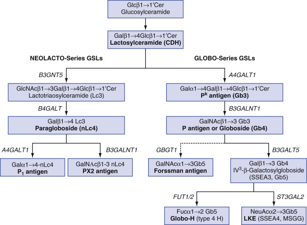

Figure 35-4 

Synthesis of P blood group antigens. 

_Cer,_ Ceramide; _Gal,_ galactose; _GalNAc, N_ -acetylgalactosamine; _Glc,_ glucose; _GlcNAc, N_ -acetylglucosamine; _SSEA,_ stage-specific embryonic antigen; _NeuAc,_ acetylneuraminic acid. 

Unlike P  k  and P antigens, the P  1  antigen is not a globo-glycosphingolipid but is a member of the neolacto-family (type 2 chain glycosphingolipids). In P  1  individuals, a terminal α1,4 galactose is added to paragloboside to form P  1  . The P  1  antigen is not expressed on RBC glycoproteins despite the presence of multiple type 2 chain precursors (polylactosamine) on _N_ -linked glycans (  Yang et al, 1994  ). PX2 is a related neolacto-GSL formed by the action of β3GalNAcT1. PX2 is expressed by rare p cells and can react with alloanti-P. 

 

##  Molecular Biology 

The genes responsible for P  k  , P  1  , and P have been cloned. As noted, P  k  , P  1  , and NOR antigens are synthesized by α4GalT1, an α1,4 galactosyltransferase (  Steffensen et al, 2000  ;  Iwamura et al, 2003  ). The _ α4GalT1 _ gene resides on chromosome 22q13 and is organized into three exons, of which only one (exon 3) encodes the enzyme. The α4GalT1 enzyme is a 353 amino acid type II glycoprotein containing two _N_ -glycosylation sites and five cysteine residues. Similar to many metal-dependent galactosyltransferases, it possesses a DXD motif or a UDP-Gal binding site. A point mutation (C631>G), leading to a Q211E in the mature enzyme, is responsible for the NOR phenotype (  Kaczmarek et al, 2014  ). The p phenotype is the result of null _A4GALT1_ alleles, leading to a loss of all globo-GSL synthesis. To date, over 30 null alleles are reported due to either missense or frameshift mutations (  Reid & Lomas-Francis, 2012  ;  Kaczmarek et al, 2014  ). 

The molecular basis for the P  1  and P  2  phenotypes is still under investigation. It was originally reported that P  2  was a consequence of a mutation in the _A4GALT1_ promoter leading to decreased transcription (  Iwamura et al, 2003  ); however, subsequent studies questioned these findings (  Tilley et al, 2006  ). A later study identified a minor _A4GALT1_ mRNA arising from an alternate exon and transcription start site. The minor transcript included an additional 28 amino acid peptide and contained a single SNP linked to lower _A4GALT1_ transcription and P  2  phenotype (  Thuresson et al, 2011  ). This study has now been challenged by a third group.  Lai and colleagues (2014)  identified 11 SNPs within intron 1, including 8 that showed a linkage with the P  1  /P  2  phenotypes. One SNP (G3084>T; rs4741348) was associated with P  2  and lower _A4GALT1_ transcription. It is hypothesized that intron 1 contains transcription factor binding sites that regulate P  k  and P  1  synthesis. 

Globoside or P antigen, a β1,3 _N_ -acetylgalactosaminyltransferase, is the product of _B3GALNT1_ (β3GalT3 in original literature;  Okajima et al, 2000  ). The gene resides on chromosome 3q25 and contains six exons, although only exon 6 encodes the enzyme. A member of the β1,3 galactosyltransferase family, β3GalNAcT1 possesses seven conserved domains common to most β1,3 galactosyltransferases, as well as a DXD motif. The gene is ubiquitously expressed in most tissues. Seven null alleles have been reported associated with the P  k  phenotype (  Reid et al, 2014  ). In mice, the absence of _ β3GALNT1 _ is lethal (  Vollrath et al, 2001  ). 

Forssman antigen is the product of _GBGT1_ , an α1,3 galactosaminyltransferase related to the ABO gene (  Yamamoto et al, 2012  ). Forssman antigen is expressed on many animal species but is typically absent from humans and old world apes. In humans, _GBGT1_ is located on 9q24 as a pseudogene. _GBGT1_ mRNA can be identified in tissues; however, Forssman antigen is not expressed due to two inactivating mutations (Gly230Ser, Gln296Arg) in the translated enzyme. Forssman expression can be observed in the rare weak Apae phenotype. Apae individuals possess an Arg296Gln mutation that restores partial enzyme activity (  Yamamoto et al, 2012  ). Forssman antigen can react with human polyclonal anti-A due to the terminal α1,3-GalNAc epitope. 

 

##  P Blood Group Antibodies 

 

##  Anti-P  1 

Clinically, the most common antibody observed is anti-P  1  , which is detected in one quarter to two thirds of P  2  donors (  Issitt & Anstee, 1998  ). Anti-P  1  is a naturally occurring antibody of IgM isotype and is often detected as a weak, room temperature agglutinin. Rare examples of anti-P  1  are reactive at 37° C or show in vitro hemolysis. Because P  1  expression varies in strength among individuals, anti-P  1  may not react with all P  1  -positive cells tested. Anti-P  1  can bind complement and may be detected in the indirect antiglobulin test (IAT) if polyspecific antihuman globulin (AHG) is used. Antibody reactivity can be eliminated by prewarming sera or by adding soluble P1 substance from hydatid cyst fluid, earthworms, and bird eggs. Anti-P  1  titers are often elevated in patients with hydatid cyst disease or fascioliasis (liver fluke) and in bird fanciers (  Issitt & Anstee, 1998  ;  Cooling, 2015  ). Some examples of anti-P  1  have I blood group specificity (anti-IP  1  ). 

In general, anti-P  1  is not clinically significant, and its presence rarely requires transfusion of antigen-negative blood. The exception is seen in patients with an anti-P  1  showing in vitro hemolysis. Because of the risk of immediate and delayed hemolytic transfusion reactions, these patients should receive P  1  -negative (P  2  ), crossmatch compatible units. Anti-P  1  is not a cause of HDFN. 

 

##  Alloanti-PP  1  P  k 

Anti-PP  1  P  k  (historically known as anti-Tj  a  ) is a separable mixture of anti-P, anti-P  1  , and anti-P  k  in the sera of p individuals. These antibodies are naturally occurring and may be IgM only or IgM plus IgG (IgG3). Because anti-PP  1  P  k  antibodies are potent hemolysins, patients can be transfused only with p RBCs. In women, alloanti-PP  1  P  k  and alloanti-P are associated with HDFN and spontaneous abortion. Early and frequent plasmapheresis has been used with therapeutic success in alloimmunized pregnant women of the p and P  k  phenotypes (  Kaczmarek et al, 2014  ). 

 

##  Alloanti-P 

Anti-P is also a naturally occurring IgM alloantibody in the serum of P  k  (and p) individuals. It is a potent hemolysin and can cause in vivo hemolysis following transfusion of P-positive (P  1  and P  2  ) RBCs. Some alloanti-P can react with PX2 present on p red cells with hemolysis. Alloanti-P is a cause of HDFN and is associated with spontaneous abortions. 

 

##  Auto-Anti-P (Donath-Landsteiner) 

An autoantibody with anti-P specificity is seen in patients with paroxysmal cold hemoglobinuria (PCH), a clinical syndrome that may occur in children following viral infection. In PCH, autoanti-P is an IgG, biphasic hemolysin capable of binding RBCs at colder temperatures, followed by intravascular hemolysis at body temperature. This characteristic can be demonstrated in vitro in the Donath-Landsteiner test. See a full description in later sections on immunohematologic methods. 

 

##  Biological Role 

Unlike many antigens, the physiologic role of the P blood group antigens is not known. As GSLs, they are frequently organized into glycolipid-enriched microdomain (GEM) or lipid rafts in the outer cell membrane. GEMs can function as a glycosynapse as well as an organizing platform for glycoproteins, cell adhesion, and cell signaling (  Cooling, 2015  ). Not surprisingly, globo-GSLs demonstrate differential expression during embryogenesis, cellular differentiation, and neoplastic transformation (  Jacewicz et al, 1995  ;  Cooling et al, 2003b  ). In mice, P and extended globo-GSLs are necessary for embryonic development (  Vollrath et al, 2001  ). The P  k  antigen is a marker of apoptosis in germinal center B cells, Burkitt lymphoma, and lymphoblastic leukemia (  Mangeney et al, 1991  ). LKE is a marker of embryonic and mesenchymal stem cells (  Gang et al, 2007  ) and is implicated in adhesion, cell signaling, and metastasis in renal cell and breast carcinoma (  Satoh et al, 1996  ;  Steelant et al, 2002  ). 

Several P blood group antigens are receptors for microbial pathogens. The P blood group antigen is the receptor for parvovirus B19, a single-stranded DNA virus associated with multiple clinical sequelae, including aplastic crises (  Brown et al, 1994  ;  Cooling, 2015  ). P  k  can bind human immunodeficiency virus (HIV) and may confer resistance to HIV infection (  Lund et al, 2009  ). P, P  k  , and LKE blood group antigens on uroepithelium are cell receptors for P-fimbriae, a bacterial adhesin and colonization factor expressed on uropathogenic _Escherichia coli_ strains. The P antigen was recently found to bind the LPS receptor TLR4-MD2 complex, acting as an antagonist to LPS and blunting inflammation (  Kondo et al, 2013  ). 

The P  1  and P  k  antigens are receptors for shiga toxins, produced by _Shigella dysenteriae_ and enterohemorrhagic _E. coli_ (EHEC) strains (  Cooling, 2015  ). In addition to gastroenteritis, EHEC infection is the most common cause of community-acquired hemolytic-uremic syndrome, probably reflecting toxin binding to P  k  antigen on glomerular vascular endothelium and platelets (  Mayer et al, 2012  ). The P  k  antigen also serves as a receptor for _Streptococcus suis_ (  Cooling, 2015  ). 

 

##  Rh and RhAg Blood Group Systems (ISBT No. 004 and 030) 

The first and most clinically important characterization of the Rh system antigens came when  Landsteiner and Wiener (1940)  published studies of animal experiments involving the immunization of guinea pigs and rabbits with rhesus monkey RBCs. The resulting antiserum agglutinated 85% of human RBCs, and the antigen defined was called the Rh (rhesus) factor. This anti-Rh was later reported to have the same specificity as antibodies studied earlier by  Levine and Stetson (1939)  that were responsible for HDFN. It is interesting to note that the anti-Rh developed by Landsteiner and Wiener was later shown to recognize a different blood group antigen, named LW for its discoverers. 

Today, the Rh system is probably the most complex red cell antigen system in humans, encompassing over 50 antigens, many phenotypic variants, and complex serologic relationships. Hence, the following review is basic and highlights the most current information. For a detailed, historical review of the Rh system, readers should consult  Issitt and Anstee (1998)  and  Daniels (2002)  . 

 

##  Theories of Rh Inheritance and Classification System 

Using five basic antisera—anti-D, anti-C, anti-E, anti-c, and anti-e—Wiener identified five different factors or antigens ( [ Table 35-11 ](<#t0060>) ) that, from population and family studies, appeared to be inherited as two complexes of up to three factors each. Eight possible combinations of three-factor complexes were identified if one included “d” as designating the lack of D, because no anti-d had ever been demonstrated. Wiener proposed a single-locus inheritance system with eight alternative common alleles coding for two Rh agglutinogens, capable of expressing up to three different antigenic determinants. Wiener's nomenclature for the eight different genes and allelic frequencies is provided in [ Tables 35-12 ](<#t0065>) and [ 35-13 ](<#t0070>) . 

TABLE 35-11 

Comparison of Wiener, Fisher-Race, and Rosenfield Nomenclatures for Antigens of the Rh Blood Group System 

Wiener  |  Fisher-Race  |  Rosenfield   
---|---|---  
Rho  |  D  |  RH1   
rh′ |  C  |  RH2   
rh″ |  E  |  RH3   
hr′ |  c  |  RH4   
hr″ |  e  |  RH5   
  

TABLE 35-12 

Wiener and Fisher-Race Nomenclatures for the Rh Haplotypes and Their Population Frequencies [ * ](<#hl0001977>)

|  |  FREQUENCIES IN U.S. POPULATION  |   
---|---|---|---  
Wiener  |  Fisher-Race [ † ](<#hl0001981>) |  Caucasian  |  Black  |  Native American  |  Asian   
R0  |  Dce  |  0.04  |  0.44  |  0.02  |  0.03   
R  1  |  DCe  |  0.42  |  0.17  |  0.44  |  0.70   
R  2  |  DcE  |  0.14  |  0.11  |  0.34  |  0.21   
Rz  |  DCE  |  0.00  |  0.00  |  0.06  |  0.01   
r  |  ce  |  0.37  |  0.26  |  0.11  |  0.03   
r′ |  Ce  |  0.02  |  0.02  |  0.02  |  0.02   
r″ |  cE  |  0.01  |  0.00  |  0.01  |  0.00   
r  y  |  CE  |  0.00  |  0.00  |  0.00  |  0.00   
  
 * Composite figures calculated from  Mourant et al (1976)  . 

 † In historical Fisher-Race nomenclature, RhD-negative was designated as “d.” At this time, RhD-negative phenotypes using Fisher-Race denote only the RHCE antigens present on red cells. 

TABLE 35-13 

Frequencies of Common Rh Phenotypes [ * ](<#hl0002330>)

REACTION WITH ANTI- [ † ](<#hl0002334>) |  PHENOTYPE  |  GENOTYPE  |  FREQUENCIES, n (%) [ ‡ ](<#hl0002337>)  
---|---|---|---  
D  |  C  |  c  |  E  |  e  |  Rh  |  DCE  |  Rh  |  DCE  |  Caucasian  |  Black  |  Native American  |  Asian   
\+  |  \+  |  \+  |  \+  |  \+  |  Rh  1  Rh  2  |  DCcEe  |  R  1  R  2  |  DCe/DcE  |  0.1176 (89)  |  0.0374 (100)  |  0.2992 (89)  |  0.294 (97)   
|  |  |  |  |  |  |  R  1  r″ |  DCe/cE  |  0.0084 (6)  |  |  0.0088 (3)  |   
|  |  |  |  |  |  |  r′R  2  |  Ce/DcE  |  0.0056 (5)  |  |  0.0135 (4)  |  0.0084 (2.8)   
|  |  |  |  |  |  |  rR  z  |  ce/DCE  |  |  |  0.0132 (4)  |  0.0006 (0.2)   
\+  |  \+  |  \+  |  – |  \+  |  Rh  1  rh  |  DCce  |  R  1  R  0  |  DCe/Dce  |  0.0168 (5)  |  0.1495 (63)  |  0.0176 (15)  |  0.042 (50)   
|  |  |  |  |  |  |  R  1  r  |  DCe/ce  |  0.3108 (95)  |  0.0884 (37)  |  0.0968 (85)  |  0.042 (50)   
\+  |  – |  \+  |  \+  |  \+  |  Rh  2  rh  |  DcEe  |  R  2  R  0  |  DcE/Dce  |  0.0112 (10)  |  0.0968 (63)  |  0.0136 (15)  |  0.0126 (50)   
|  |  |  |  |  |  |  R  2  r  |  DcE/ce  |  0.1035 (90)  |  0.0572 (37)  |  0.0748 (85)  |  0.0126 (50)   
\+  |  \+  |  – |  – |  \+  |  Rh  1  Rh  1  |  DCe  |  R  1  R  1  |  DCe/DCe  |  0.176 (91)  |  0.029 (81)  |  0.194 (92)  |  0.490 (93)   
|  |  |  |  |  |  |  R  1  r′ |  DCe/Ce  |  0.017 (9)  |  0.007 (19)  |  0.017 (8)  |  0.028 (7)   
\+  |  \+  |  – |  \+  |  \+  |  Rh  1  Rhz  |  DCEe  |  R  1  R  z  |  DCe/DCE  |  |  0.053 (100)  |  |   
\+  |  – |  \+  |  \+  |  – |  Rh  2  Rh  2  |  DcE  |  R  2  R  2  |  DcE/DcE  |  0.02 (88)  |  0.012 (100)  |  0.116 (94)  |  0.044 (100)   
|  |  |  |  |  |  |  R  2  r″ |  DcE/cE  |  0.003 (12)  |  |  0.007 (6)  |   
\+  |  \+  |  \+  |  \+  |  – |  Rh  2  Rhz  |  DCcE  |  R  2  R  z  |  DcE/DCE  |  |  |  0.041 (100)  |   
\+  |  – |  \+  |  – |  \+  |  Rh  0  Rh  0  |  Dce  |  R  0  R  0  |  Dce/Dce  |  0.0016 (5)  |  0.1936 (46)  |  0.0004 (8)  |  0.0009 (33)   
|  |  |  |  |  |  |  R  0  r  |  Dce/ce  |  0.0296 (95)  |  0.2286 (54)  |  0.0044 (92)  |  0.0018 (67)   
– |  – |  \+  |  – |  \+  |  rhrh  |  ce  |  rr  |  ce/ce  |  0.1369 (100)  |  0.0676 (100)  |  0.0121 (100)  |  0.0009 (100)   
– |  \+  |  \+  |  – |  \+  |  rh′rh  |  Cce  |  rr′ |  ce/Ce  |  0.0055 (100)  |  0.0014 (100)  |  0.0044 (100)  |  0.0012 (100)   
– |  – |  \+  |  \+  |  \+  |  rh″rh  |  cEe  |  rr″ |  ce/cE  |  0.0028 (100)  |  |  0.0022 (100)  |   
  
 * Estimated from haplotype frequencies (p, q from [ Table 35-12 ](<#t0065>) ), using p2 for homozygotes and 2pq for heterozygotes. 

 † +, Positive; –, negative. 

 ‡ %, Percentage of genotypes within a given phenotype. 

Fisher and Race later proposed a different inheritance theory and nomenclature system based on genetic evidence of the antithetical or allelic nature of the C/c and E/e antigens (  Race, 1948  ). These investigators proposed a system of three closely linked loci or subloci on each chromosome, which were inherited as a block of genes (haplotype). They also introduced the DCE nomenclature to name the alleles, including the use of “d” to designate the lack of D locus (see [ Table 35-11 ](<#t0060>) ). Rosenfeld proposed a numeric system of naming the antigens in 1962, because the increasing number of Rh antigens rendered an alphabetic notation impractical ( [ Table 35-14 ](<#t0075>) ). It was also appreciated that this nomenclature contained no inferences as to the genetic inheritance of the antigens. 

TABLE 35-14 

Molecular Basis for RH and RHAG Antigens 

ISBT  |  Name  |  Frequency, %  |  RH Protein (D or CE)  |  Molecular Basis (Protein or Gene Exon)  |  Comments   
---|---|---|---|---|---  
RH (ISBT 004)  |  |  |  |  |   
RH1  |  D  |  85-92  |  D  |  RHD, loops 3,4,6  |   
RH2  |  C  |  68% Caucasians   
27% blacks  |  CE  |  Ser103 + Cys16  |  Antithetical RH4   
RH3  |  E  |  22-29  |  CE  |  Pro226  |  Antithetical RH5   
RH4  |  c  |  80  |  CE  |  Pro103  |  Antithetical RH2   
RH5  |  e  |  80  |  CE  |  Ala226   
Dependence on Arg229  |  Antithetical RH3   
RH6  |  f  |  65  |  CE  |  Pro103 + Ala226   
Dependence on Arg229  |  Compound antigen   
RH7  |  Ce  |  27-28  |  CE  |  Ser103 + Ala226  |  Compound antigen   
RH8  |  C  w  |  1-2  |  CE  |  Gln41>Arg  |  Antithetical RH51   
RH9  |  C  x  |  <0.01  |  CE  |  Ala36>Thr  |  Antithetical RH51   
RH10  |  V  |  30% blacks  |  CE  |  Leu235>Val, +Gly336  |  Often with RH20   
RH11  |  E  w  |  <0.01  |  CE  |  Met167>Lys  |  E variant type I   
RH12  |  G  |  84-92  |  D, CE  |  Ser103  |  Anti-C+D   
RH17  |  Hr  0  |  100  |  CE  |  RHCE loops 3,4,6  |   
RH18  |  Hr  |  100  |  CE  |  Met238  |   
RH19  |  hr  S  |  98  |  CE  |  Ala226, Met238  |   
RH20  |  VS  |  40% blacks  |  CE  |  Leu226>Val  |  Often with RH10   
RH21  |  C  G  |  68  |  CE  |  Ser103  |   
RH22  |  CE  |  1  |  CE  |  Ser103 + Pro226  |  Compound antigen   
RH23  |  D  w  |  <0.01  |  Partial D  |  Gln233, RHD loop 3,6  |   
RH26  |  c-like  |  80  |  CE  |  Gly96 + Pro103  |   
RH27  |  cE  |  22-28  |  CE  |  Pro103 + Pro226  |  Compound antigen   
RH28  |  hr  H  |  <0.01  |  ?  |  Unknown  |   
RH29  |  Total Rh  |  100  |  CE + D  |  RHD + RHCE  |  Made by Rh  null   
RH30  |  Go  a  |  2% blacks  |  Partial D  |  On DIV  a  |   
RH31  |  hr  B  |  98  |  CE  |  Unknown  |  Missing on R2R2   
RH32  |  RN  |  <1% blacks  |  Partial D  |  Exons D4–CE5  |  Antithetical RH46   
RH33  |  Har  |  <0.01  |  Partial D  |  Exons CE4–D5  |  R  0  Har   
RH34  |  Hr  B  |  100  |  D + CE  |  Cys336  |   
RH35  |  1114(CeMA)  |  <0.01  |  CE  |  Unclear; CeMA is JAL+  |  Weak C,e   
RH36  |  Be  a  |  <0.1  |  CE  |  Pro221>Arg  |  Weak c,e,f   
RH37  |  Evans  |  <0.01  |  D–CE hybrid  |  Exons D6–CE7  |   
RH39  |  C-like  |  100  |  ?  |  Unknown  |  On C– and C+ RBCs   
RH40  |  Tar  |  <0.01  |  D  |  Leu100>Pro  |   
RH41  |  Ce-like  |  70  |  CE  |  Exon 2, Ala226  |   
RH42  |  Ce  S  |  2% blacks  |  Partial D  |  Leu245>Val  |  Associated dCce  S   
RH43  |  Crawford  |  0.7% D- blacks  |  CE  |  Gln223>Glu, VS+  |  ce  S  variant; VS+, V+   
RH44  |  Nou  |  100  |  ?  |  Unknown  |   
RH45  |  Riv  |  <0.01  |  Partial D  |  On DIVa  |   
RH46  |  Sec  |  100  |  CE  |  CE exon 4  |  Antithetical RH32   
RH47  |  Dav  |  100  |  CE  |  Exon 7  |   
RH48  |  JAL  |  <0.01  |  CE  |  Arg114>Trp or Glu  |  Antithetical RH57   
RH49  |  STEM  |  0.4% Indians  |  CE  |  W16C,M238V, L278V  |   
RH50  |  FPTT  |  <0.01  |  Partial D  |  Exons CE4–D5  |   
RH51  |  MAR  |  >99  |  CE  |  Ala36, Gln41  |  Antithetical RH8,9   
RH52  |  BARC  |  <0.01  |  Partial D  |  Exons CE6–D7  |   
RH53  |  JAHK  |  <0.01  |  CE  |  Exon D2 (Ser103), no Cys16  |   
RH54  |  DAK  |  <0.01  |  Partial D  |  Unknown  |   
RH55  |  LOCR  |  <0.01  |  CE  |  Gly95>Ser  |  Weak c,e,f ; Rh26±  
RH56  |  CeNR  |  <0.01  |  CE–D hybrid  |  Complex epitope  |  D– –; RH32+   
RH57  |  CEST  |  >99  |  CE  |  Arg114  |  Antithetical RH48 (Jal)   
RH58  |  CELO  |  <0.01  |  CE  |  Trp16,Gln233,Leu245  |  Antithetical RH43   
RH59  |  CEAG  |  <0.01  |  CE  |  Ala85  |  RH31(-), partial e   
RHAG (ISBT 030)  |  |  |  |   
RHAG1  |  Duclos  |  >99  |  RhAg  |  Gln106>Glu  |   
RHAG2  |  Ol  a  |  <0.01  |  RhAg  |  Ser227>Leu  |  Weak Rh expression   
RHAG3  |  DSLK  |  >99  |  RhAg  |  Lys164>Gln  |   
RHAG4  |  RHAG4  |  <0.01  |  RhAg  |  Val270Ile  |   
  
_ISBT,_ International Society of Blood Transfusion. 

From  Wagner and Flegel (2004)  , Reid (2012), and  Westhoff et al (2004)  . 

 

##  Biochemistry 

Tremendous progress has been made in deciphering the biochemistry and molecular biology of the Rh blood group system. It is now clear that the Rh complex consists of three integral membrane proteins: RhD, RhCE, and Rh-associated glycoprotein (RhAg). RhD and RhCE are highly homologous proteins, differing by approximately 30 amino acids. Both are 30-kD, 416 amino acid multipass proteins containing 12 transmembrane domains, six extracellular loops, and a cytoplasmic amino- and carboxy-terminus ( [ Fig. 35-5 ](<#f0030>) ). Both proteins possess two to three molecules of palmitate (C16 fatty acid) covalently linked to transmembrane cysteine residues. Palmitoylation of Rh proteins may help maintain the phospholipid asymmetry of the RBC membrane (  Avent, 1999  ). 

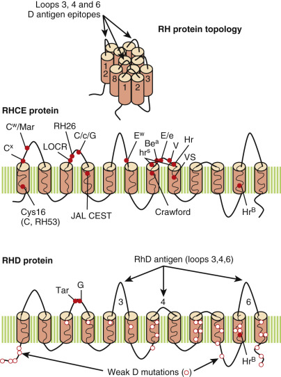

Figure 35-5 

RH proteins. 

Both RHD and RHCE proteins are multipass proteins with 12 transmembrane domains, indicated by solid amber cylinders. The location of Rh antigens denoted by single–amino acid polymorphisms is denoted by _red circles_ . The RhD epitope is a complex antigen involving structures on the third, fourth, and sixth extracellular loops. Missense mutations in RHD, leading to weak D expression, are indicated by open circles (o). 

RhAg is a 45- to 70-kD multipass glycoprotein, evolutionarily related to RhD and RhCcEe glycoproteins. RhAg is a 409 amino acid glycoprotein with 12 transmembrane domains and a single, large _N_ -linked carbohydrate side chain on the first extracellular loop. Overall, approximately 170,000 molecules each of Rh and RhAg proteins are present per RBC. RhD, RhCE, and RhAg are erythroid-specific proteins (  Avent, 1999  ). 

In the RBC membrane, RhD, RhCE, and RhAg proteins exist as a trimer, composed of three molecules of Rh (RhD and RhCE) and RhAg (  Eyers et al, 1994  ). The importance of RhAg for the expression and correct assembly of Rh proteins cannot be understated. In the absence of functional RhAg protein, neither RhD nor RhCE proteins will be expressed (Rh  null  and Rh  mod  phenotypes). In addition to RhAg, Rh proteins may be topologically associated with CD47 (Lutheran), ICAM4 (LW), DARC (Duffy), Band 3 (Diego), and GYPB. At least two non-Rh antigens, Fy5 and U, may require noncovalent interactions between Rh, DARC glycoprotein (Fy5), and GYPB (U), respectively (  Ridgwell et al, 1994  ). Rh is associated with the Band 3-ankyrin metabolon. 

 

##  Molecular Biology 

The genes for RhD ( _RHD_ ) and RhCE ( _RHCE_ ) proteins span 65 kb on chromosome 1p34-36.1 and share nearly 92% sequence identity. The two genes are separated by only 30 kb and have opposite orientations, facing each other at their 3′ ends ( [ Fig. 35-6 ](<#f0035>) ). The _RHD_ gene is also flanked by two homologous sequences known as rhesus boxes. The _RHAG_ gene ( _RHAG_ ) resides on chromosome 6p11.1 and shares 36% homology with the _RHD_ and _RHCE_ genes. All three genes possess 10 exons and at least one GATA-1 consensus sequence in the promoter region (  Cherif-Zahar et al, 1994  ;  Iwamoto et al, 1998  ). It is believed that _RHAG_ and _RH_ genes arose by gene duplication 250 to 350 million years ago. A second gene duplication 8 to 11 million years ago resulted in the ce and D alleles (cDe or R  0  haplotype). The remaining RHCe alleles are believed to be the product of point mutations, recombination, and gene conversion of the _RHD_ and _RHCE_ genes (  Avent, 1999  ). 

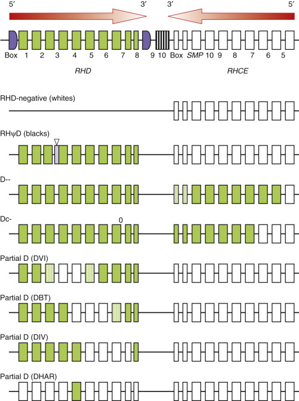

Figure 35-6 

The _Rh_ gene cluster. 

_RHD_ and _RHCE_ genes are closely situated and face each other at their 3′ ends. The _RHD_ gene is also flanked by Rh boxes. _SMP_ is an unrelated gene. RHD-negative phenotype can result from deletion of the _RHD_ gene or, in blacks, a 37–base pair (bp) insertion leading to a frameshift (pseudogene). Also shown are examples of partial D and CE phenotypes that are the result of recombination between _RHD_ and _RHCE_ genes. 

 

##  D Antigen 

The cloning of _RHD_ and _RHCE_ genes opened the door to understanding the complex immunology of many Rh antigens and phenotypes. The D antigen, the most immunogenic of all the Rh antigens, resides on the RHD protein. Current evidence suggests that D is a highly complex antigen, depending on both specific amino acids and the tertiary structure of the RHD protein itself. At least nine “D-specific” amino acids (Met169, Met170, Ile172, Phe223, Ala226, Glu233, Asp350, Ala353, and Gly354) have been identified as functional D epitopes. The nine amino acids lie along the third, fourth, and sixth external loops of the RHD protein, creating six distinct D-epitope clusters or footprints (see [ Fig. 35-5 ](<#f0030>) ). How the immune system recognizes these clusters remains a matter of intense investigation (  Avent, 1999  ). 

 

##  Weak D Antigen 

Approximately 1% of D-positive individuals type as weak D (historically known as D  u  ), characterized by weak or absent RBC agglutination by anti-D during routine serologic testing. In weak D individuals, the D antigen usually requires enhancement with AHG owing to a quantitative decrease in RhD protein. In these individuals, the number of RhD molecules is decreased 40- to 100-fold, ranging from 66 to 5200 molecules per red cell (  Reid & Lomas-Francis, 2012  ). 

A weak D phenotype can occur with many partial D phenotypes, Ce _in trans_ with suppression of _RHD_ , in the Rh  mod  phenotype, and via autosomal recessive inheritance of two weak _RHD_ alleles. The latter accounts for the majority of weak D phenotypes present in the general population. To date, 17 different weak D phenotypes and more than 40 different weak RhD alleles are recognized. Nearly all possess missense mutations, leading to amino acid substitutions, along the transmembrane and cytoplasmic domains (see [ Fig. 35-5 ](<#f0030>) ). Because of their location, it is hypothesized that these mutations may interfere with the assembly or efficient insertion of the RhD protein. Furthermore, because all the mutations are intramembranous or intracellular, it is assumed they do not significantly alter the presentation of D epitopes on the extracellular loops (  Wagner et al, 1999  ). This may explain why most weak D individuals do not make alloanti-D when transfused with D-positive blood (see later). 

 

##  Partial D Antigen 

Partial D antigens are RHD proteins with missing D epitopes. Although they type as D-positive, persons with partial D antigens can make alloanti-D antibodies reactive with allogeneic, but not autologous, RBCs. The alloanti-D produced by these individuals recognizes D-specific epitopes missing on their own RBCs (see [ Fig. 35-6 ](<#f0035>) ). Partial D can result from missense mutations or from genetic recombination of _RHD_ and _RHCE_ genes (  Avent, 1999  ). Partial D phenotypes arising from genetic recombination are frequently associated with the generation of new, low-incidence antigens (see [ Table 35-14 ](<#t0075>) ). 

 

##  Rh-Negative Phenotype 

Rh-negative (D–) occurs in approximately 15% of white donors, almost always in association with a ce/ce or rr phenotype. In most Caucasians, D– reflects a deletion of the entire _RHD_ gene (see [ Fig. 35-6 ](<#f0035>) ). In blacks, D– can result from gene deletion or from inheritance of an _RHD_ pseudogene. Nearly 60% of D-negative black people inherit a mutant RHD allele (RHψD) containing a 37–base pair (bp) internal duplication, frameshift, and premature stop codon (  Avent, 1999  ). _RHD_ genes containing nonsense mutations and nucleotide deletions have also been reported in some D-negative Japanese and Caucasian donors (  Daniels, 2002  ;  Reid & Lomas-Francis, 2012  ). 

 

##  C/c, E/e, and Compound Rh Antigens 

In contrast to the complexity of the D antigen epitope, the C/c and E/e antigens are single–amino acid polymorphisms on the RhCE protein (see [ Fig. 35-5 ](<#f0030>) ). Three additional amino acid polymorphisms (Cys16Trp, Ile60Leu, and Ser68Asn) may help stabilize the C and c antigens. Arg229 appears critical to e and f expression (  Chen et al, 2004  ). Because C/c and E/e epitopes are present on the same protein, alloantibodies dependent on the expression of both C/c and E/e antigens can occur. Four alloantibodies with “compound” Rh specificity have been described: anti-ce (f or RH6), anti-Ce (RH7), anti-cE (RH27), and anti-CE (RH22). These antibodies react only with RBCs carrying the appropriately paired antigens, in _cis_ , on the same RhCE protein (see [ Table 35-14 ](<#t0075>) ). The RHCE protein is home to several additional high- and low-incidence antigens. 

 

##  G Antigen 

The G antigen (RH12) is a high-frequency antigen present on virtually all D-positive and C-positive RBCs. G has been identified as Ser103, a C-type antigen, on RHD and RHCE proteins (see [ Fig. 35-5 ](<#f0030>) ). It is not surprising that anti-G alloantibodies have both anti-C and anti-D specificity (anti-C + D) and are frequently accompanied by anti-C (anti-G + anti-C) (  Shirey et al, 1997  ). 

 

##  Weak and Deletion C/c and E/e Phenotypes 

Similar to D, phenotypes with weakened or absent C/c and E/e are known. _RHCE_ alleles with point mutations, deletions, and recombinations can lead to weakened CcEe expression. African ethnic groups, in particular, show significant molecular diversity in _RHCE_ alleles. A recent study reported partial C [(C)ce  S  ] phenotype in nearly 25% of sickle cell patients (  Noizat-Pirenne et al, 2009  ). Although these patients serologically type as C+c+, rare patients can produce an alloanti-c (  Ong et al, 2009  ;  Pham et al, 2009  ). Likewise, point mutations and rearrangements resulting in weakened e expression and alloantibody formation (anti-e, hr  S  ) are well known (  Reid & Lomas-Francis, 2012  ;  Vege et al, 2009  ). 

The deletion phenotypes D••, D–– (↑D+, C–c–E–c–), DC–, and Dc– are the result of genetic recombination between _RHCE_ and _RHD_ genes to yield RHCE-D-CE hybrids (see [ Fig. 35-6 ](<#f0035>) ). As a consequence, total ablation of Ee and/or Cc epitopes occurs, with many recombinants expressing new low-frequency Rh antigens (see [ Table 35-14 ](<#t0075>) ). Furthermore, many recombinants (e.g., D••, D––) demonstrate exalted D antigen expression on serologic testing owing to a double dose of some D epitopes on both RHD and mutant RHCE-D-CE proteins. For a detailed summary, the reader is referred to  Reid and Lomas-Francis (2004)  . 

 

##  RHAG Alloantigens 

RHAG is a separate blood group system with three antigens: Ol  a  , Duclos, and DSLK (  Tilley et al, 2010  ;  Reid & Lomas-Francis, 2012  ). All three are the result of an amino acid polymorphism in the RhAg protein. Both Duclos and DSLK are associated with weak U expression, suggesting an interaction between RhAg and GYPB. 

 

##  Rh  null  Phenotype 

Rh  null  erythrocytes lack all Rh antigens as a result of an apparent absence of RhD and RhCE proteins. In addition, Rh  null  erythrocytes lack the high-frequency antigens Fy5 and LW and may have markedly decreased expression of S/s and U antigens. The absence of these non-Rh antigens reflects the complex topologic association of Duffy, LW, and GYPB proteins with Rh proteins on RBC membranes. 

Extremely rare (<1 in 6 million), Rh  null  cells have abnormalities in RBC morphology (spherocytes, stomatocytes), water content, cell volume, cation fluxes, carbon dioxide (CO  2  ) permeability, and phospholipid asymmetry (  Issitt & Anstee, 1998  ;  Endeward et al, 2006  ). Rh  null  cells show increased osmotic fragility and a shortened circulating half-life, often accompanied by a mild hemolytic anemia (Rh deficiency syndrome). Because Rh  null  individuals can become sensitized to multiple Rh antigens, including high-frequency antigens, transfusion support can be quite difficult. Some alloimmunized Rh  null  individuals can produce anti-RH29, which reacts with all RBCs except Rh  null  . 

The Rh  null  phenotype can arise from two distinct genetic backgrounds: regulator and amorph. The Rh  null  -amorph type is the result of nonsense mutations in the _RHCE_ gene in D-negative people. Because of the absence of RhD and RhCE proteins, Rh  null  -amorph RBCs have reduced (but not absent) expression of RhAg protein (  Daniels, 2002  ). The Rh  null  regulator type arises from mutations in _RHAG_ (  Reid & Lomas-Francis, 2012  ). 

 

##  Rh  mod  Phenotype 

Mutations in _RHAG_ are also observed in the Rh  mod  phenotype. Rh  mod  RBCs have markedly decreased Rh and RhAg expression, detectable only by careful adsorption and elution studies. Similar to Rh  null  individuals, persons with Rh  mod  may have laboratory evidence of Rh deficiency syndrome with a mild hemolytic anemia. Three Rh  mod  samples have been studied, each containing a single, different missense mutation in the _RHAG_ gene (  Reid & Lomas-Francis, 2012  ). 

 

##  Rh Antibodies 

Antibodies against Rh antigens are routinely encountered in the blood bank (see [ Table 35-5 ](<#t0030>) ). D is the most immunogenic Rh antigen, followed by c, E, C, and e (  Harmening, 2012  ). In general, antibodies against Rh antigens are the result of immune stimulation by transfusion or pregnancy. Exceptions include some examples of anti-C  w  and anti-E, which can be naturally occurring. Most antibodies against Rh antigens are of IgG isotype (IgG  1  and IgG  3  ), although rare examples of IgM and IgA are known. Anti-Rh antibodies are reactive at 37° C and are usually detected in the AHG phase of testing. The reactivity of anti-Rh antibodies can be enhanced with enzyme-treated RBCs. The gel method is extremely sensitive for the detection of Rh antibodies (  Weisbach et al, 2006  ). 

Clinically, antibodies against Rh are associated with hemolytic transfusion reactions. However, because Rh antibodies do not fix complement, incompatible RBCs are almost always cleared through extravascular destruction. To prevent sensitization to the D antigen, Rh-negative patients should be transfused with Rh-negative RBCs. This is particularly true for young girls and women of childbearing age. For transfusion in alloimmunized patients, RBC units should be negative for the Rh antigen of interest and crossmatch compatible with the recipient's serum through the AHG phase of testing. One possible exception may be R  1  R  1  (DCe/DCe) patients who have developed anti-E alloantibodies. Because these patients are at increased risk of delayed hemolytic transfusion reactions because of the subsequent development of anti-c, many blood bankers advocate transfusing only R  1  R  1  units to R  1  R  1  patients (  Shirey et al, 1994  ). 

Antibodies against Rh antigens are also a major cause of HDFN. All Rh-negative women should receive Rh immune globulin (IgG anti-D) prophylactically in midpregnancy, following an invasive procedure (i.e., amniocentesis) and immediately after delivery to prevent alloimmunization. Rh immune globulin prophylaxis is also recommended in women with partial D phenotypes because these women can be at risk for D alloimmunization (  Ansart-Pirenne et al, 2004  ). Rh immune globulin may also be given following transfusion of RhD+ platelet concentrates or after accidental transfusion of RhD+ RBCs. In the latter, Rh immune globulin is given after two-volume RBC exchange with RhD-negative RBCs (  Nester et al, 2004  ). Administration of one vial of Rh immune globulin is recommended for every 30 mL whole blood or 15 mL packed RBCs transfused (  Fung, 2014  ). Rh immune globulin should be given within 72 hours of exposure to prevent active immunization. Rh immune globulin is not given to Rh-negative women who are already immunized to D antigen (i.e., have anti-D). 

It is also recommended to give Rh immune globulin to Rh-negative women with anti-G alloantibodies. As stated earlier, anti-G behaves as an anti-C + anti-D because of recognition of a Ser103 or C-type antigen on both RhD and RhCE proteins. In general, HDFN secondary to anti-G or anti-C + anti-G is mild when compared with HDFN due to anti-D. However, because these women may still become immunized to D-specific epitopes on the RhD protein, many blood bankers advocate giving Rh immune globulin to Rh-negative women with anti-G antibodies (  Shirey et al, 1997  ). Separation of anti-G from a true anti-C + anti-D is very laborious, requiring sequential adsorption and elution (  Yesus & Akhter, 1985  ). One clue suggesting the presence of anti-G is an anti-C titer at least fourfold higher than anti-D (  Shirey et al, 1997  ). It is not necessary, however, to separate anti-G from anti-C + anti-D for routine transfusion. With very rare exceptions, RBCs negative for D and C antigens are also negative for G antigen. 

 

##  Biological Role 

The specific physiologic function of the Rh proteins is still unclear; however, there is a strong belief that Rh proteins may constitute a membrane transporter. The Rh proteins are homologous with ammonium transporters of the Mep/Amt family. In addition, Rh-like homologues have been discovered in invertebrate life forms such as the nematode worm _Caenorhabditis elegans_ and a marine sponge, _Geodia cydonium_ (  Avent, 1999  ). Evidence suggests that RhAG is capable of facilitating NH  4  transport. 

 

##  Lutheran Blood Group System (ISBT No. 005) 

The Lutheran (Lu) blood group system contains 19 antigens, including four pairs of allelic antigens and 11 high-incidence antigens. Lutheran is a minor constituent of RBC membranes, averaging only 2000 to 5000 molecules per cell, and can vary in strength between donors (  Issitt & Anstee, 1998  ). Even within a single individual, considerable heterogeneity in Lutheran expression is seen, with only 40% to 50% of red cells positive for Lutheran antigens by flow cytometry (  El Nemer et al, 1998  ). Lutheran appears on red cells at the orthochromatic erythroblast stage, concurrent with binding of red cells to laminin (  Daniels, 2009  ). Lutheran antigens are ubiquitously expressed on human tissues. In addition to RBCs, Lutheran glycoprotein is expressed by colon, small intestine, ovary, testis, prostate, thymus, spleen, pancreas, kidney, skeletal muscle, liver, lung, placenta, brain, heart, and bone marrow (  Rahuel et al, 1996  ). 

 

##  Null/Weak Phenotypes 

A Lu(a–b–) phenotype can occur in three settings with distinct patterns of inheritance: autosomal recessive, autosomal dominant ( _In[Lu]_ ), and X-linked recessive ( [ Table 35-15 ](<#t0080>) ). The autosomal recessive phenotype is a true null phenotype, characterized by complete absence of all Lutheran antigens on RBCs. As a consequence, these individuals can make an alloantibody to Lutheran glycoprotein (anti-Lu3) that reacts with all Lu-positive RBCs. The Lu  null  phenotype is extremely rare and is not associated with altered expression of other red cell antigens. 

TABLE 35-15 

Phenotypes of the Lutheran System 

REACTIONS WITH ANTI-  |  |  FREQUENCY IN U.S. POPULATION, %  |   
---|---|---|---  
Lu  a  |  Lu  b  |  Lu-3  |  Phenotype  |  Caucasian  |  Black  |  Comments   
\+  |  0  |  \+  |  Lu (a+b–)  |  0.1  |  0.1  |   
\+  |  \+  |  \+  |  Lu (a+b+)  |  7  |  5  |   
0  |  \+  |  \+  |  Lu (a–b+)  |  93  |  95  |   
**Null Phenotypes (Lu null  ) **  
0  |  0  |  0  |  Lu (a–b–)  |  Very rare  |  Very rare  |  Autosomal recessive   
Normal CD44, i/I, CD75   
Make an anti-Lu-3   
0/W [ * ](<#hl0002887>) |  0/w [ * ](<#hl0002887>) |  w [ * ](<#hl0002887>) |  Lu (a–b–)  |  Very rare  |  Very rare  |  In (Lu), autosomal dominant   
↓CD44, I/i; ↑CD75   
_ELKF_ mutation   
0/W [ * ](<#hl0002887>) |  0/w [ * ](<#hl0002887>) |  w [ * ](<#hl0002887>) |  Lu (a–b–)  |  Very rare  |  Very rare  |  X-linked recessive, GATA1 mutation   
nl CD44, i, P1   
  
 * Weak Lu antigens detected only by adsorption and elution techniques. 

The autosomal dominant and X-linked recessive forms are characterized by very weak Lutheran expression, often detected only after adsorption and elution. _In(Lu)_ is an autosomal dominant Lu  mod  phenotype with an incidence of 0.02% to 0.12% (  Daniels, 2009  ). In addition to Lutheran antigens, _In(Lu)_ red cells can show weakened expression of P  1  , i, Indian/CD44, and Knops/CD35 antigens and enhanced expression of CDw75 (  Daniels, 2009  ). The X-linked Lu  mod  phenotype has weakened Lutheran; enhanced i and CDw75; and normal P  1  , i, and CD44 expression. Because both _In(Lu)_ and X-linked recessive Lu  mod  phenotypes express some Lutheran antigen on RBCs and other tissues, neither is associated with the development of anti-Lu3. _In(Lu)_ RBCs can display subtle abnormalities, including increased poikilocytosis and increased hemolysis, during in vitro storage (  Ballas et al, 1992  ). 

 

##  Biochemistry 

The Lutheran antigens reside on two isomeric, type 1 glycoproteins: Lu-glycoprotein (85kD) and epithelial cancer antigen (B-CAM, 78kD) (  Daniels, 2009  ). The 85-kD glycoprotein is the predominant isoform found on RBCs and normal tissues. Members of the Ig superfamily, the 78- and 85-kD glycoproteins share a common, large (518 amino acid) extracellular domain with five Ig regions and five potential _N_ -glycosylation sites ( [ Fig. 35-7 ](<#f0040>) ). Three Ig domains are of the constant-region-2 (C2) type, whereas the remaining two are variable-region (V) domains. A laminin binding site resides in a flexible hinge region between C2 and V domains. 

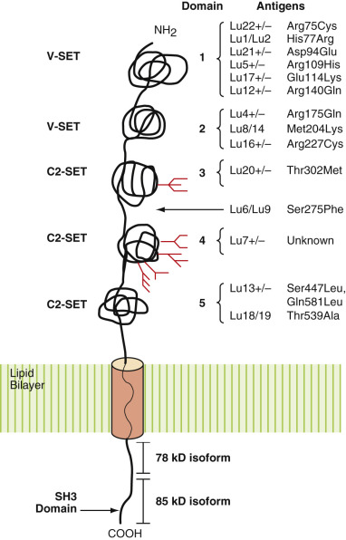

Figure 35-7 

Lutheran glycoprotein. 

The Lutheran antigens reside on one of five immunoglobulin domains (V, C2-like). The transmembrane domain is indicated by a solid amber cylinder. The length of the cytoplasmic domain can vary from 19 amino acids (78-kD isoform) to 59 amino acids (85-kD isoform). The latter also possesses a consensus-binding motif for Src protein (SH3 domain). 

The 7-kD difference between the 78-kD and 85-kD isoforms reflects the length of the COOH-terminal cytoplasmic tail. In addition to its longer length, the cytoplasmic domain of the 85-kD isoform possesses an SH3 motif, a potential binding site for Src protein. The cytoplasmic domain also interacts with spectrin, a cytoskeletal protein (  Kroviarski et al, 2004  ). Because it is a highly folded protein, stabilized by disulfide bonds, Lutheran is destroyed by sulfhydryl-reducing agents and many proteases. 

 

##  Molecular Biology 

The gene for Lutheran ( _LU_ ) resides on chromosome 19q13.2-13.3. It is a 12.5-kb gene containing 15 exons: Alternate splicing of exon 13 is responsible for the 78-kD minor isoform (  Rahuel et al, 1996  ;  El Nemer et al, 1997  ). Although no TATA or CAAT boxes are present in the 5′ flanking or promoter region of the gene, it does possess consensus sequences for several _cis_ -regulatory elements, including the ubiquitous Sp1, AP2, EGR-1, EKLF, Ets, and GATA-1, an erythroid transcription binding protein (  El Nemer et al, 1997  ;  Singleton et al, 2008  ). 

The molecular basis for most Lutheran antigens is now known (see [ Fig. 35-7 ](<#f0040>) ). Lub is the consensus allele ( _LU*02_ ). Most Lu antigens are the result of SNPs including Lu  a  (His77) and Lu  b  (Arg77) (  Daniels, 2009  ). The autosomal recessive, true Lu  null  phenotype arises from inheritance of two silent amorph _LU_ alleles due to nonsense mutations and deletions (  Daniels, 2009  ;  Reid & Lomas-Francis, 2012  ). The molecular basis for the autosomal dominant _In(Lu)_ phenotype was finally identified in 2008. Most _In(Lu)_ individuals are heterozygous for a mutant _EKLF_ gene, an erythroid transcription factor active in late erythroid differentiation (  Singleton et al, 2008  ). The _In(Lu)_ phenotype, therefore, is the result of reduced transcriptional activation and expression of LU glycoprotein. Reduced EKLF activity likely accounts for decreased expression of other blood group antigens. The basis for the X-linked recessive (XS2) has been identified as mutations in the transcription factor GATA1, which resides on the X chromosome. 

 

##  Lutheran Antibodies 

In general, Lutheran antibodies are not clinically significant and are only rarely associated with HDFN and hemolytic transfusion reactions. Anti-Lu  a  is the most common Lutheran alloantibody encountered in the blood bank and is often an IgM, room temperature agglutinin. Because not all RBCs express detectable Lu antigens (  El Nemer et al, 1998  ), anti-Lu  a  can display mixed field agglutination. Antibodies against Lu  b  and other Lutheran antigens are most often of IgG isotype, reacting best in the IAT. Reactivity of anti-Lu  a  , Lu  b  , and other Lutheran antibodies can be inhibited by pretreatment of RBCs with chymotrypsin, trypsin, 2-aminoethylisothiouronium bromide (AET), and dithiothreitol (DTT). 

 

##  Biological Role 

Biologically, Lutheran is a high-affinity receptor for laminin, a basement membrane protein involved in cell differentiation, adhesion, migration, and proliferation. Overexpression of LU glycoprotein in ovarian carcinoma and other cancers is hypothesized to facilitate tumor cell adhesion and metastasis (  Rahuel et al, 1996  ). In sickle cell patients, increased Lutheran expression on reticulocytes and sickle cells may contribute to the pathophysiology of vaso-occlusive crises. Patients with sickle cell disease have indirect evidence of chronic vascular injury with shedding of microvascular endothelial cells and exposure of vascular basement membrane (  Solovey et al, 1997  ). In these patients, increased exposure of laminin on the thrombotic subendothelium, coupled with increased expression of laminin receptor on reticulocytes and sickle cells, may promote red cell adhesion and circulatory stasis (  El Nemer et al, 1998  ;  Parsons et al, 2001  ). Likewise, LU glycoprotein may contribute to thrombosis in polycythemia vera. The _JAK2_ mutation was shown to increase phosphorylation of LU glycoprotein and red cell adhesion (  Daniels, 2009  ). In normal erythropoiesis, LU may play a role in migration of maturing erythroid cells out of the marrow (  Daniels, 2009  ). 

 

##  Kell and Kx Blood Group Systems (ISBT No. 006 and 019) 

First identified in 1945, the Kell (KEL) blood group system currently consists of 34 high- and low-frequency antigens ( [ Tables 35-16 ](<#t0085>) and [ 35-17 ](<#t0090>) ). Eleven Kell antigens belong to five sets of allelic antigens, whereas the remainder are predominantly high-incidence antigens (>99% of the population). Many low-incidence Kell antigens (K, Js  a  , Ul  a  , Kp  a  , Kp  c  ) show distinct racial differences. The Kell antigen is found on RBCs, erythroid and megakaryocyte progenitors, skeletal muscle, and testis. RBCs express approximately 2000 to 6000 copies of Kell protein per cell (  Reid & Lomas-Francis, 2012  ). 

TABLE 35-16 

Kell and XK Blood Group Antigens [ * ](<#hl0002993>)

ANTIGEN (HIGH FREQUENCY)  |  Percent Donors  |  Amino Acid Change (High→Low Frequency)  |  Percent Donors  |  ANTIGEN (LOW FREQUENCY)   
---|---|---|---|---  
ISBT  |  Name  |  Name  |  ISBT   
KEL2  |  k  |  99.8  |  Thr193>Met   
Thr193>Ser  |  9   
Rare  |  K  |  KEL1   
Ala423>Val  |  Unknown  |  |  Weak KEL2   
KEL4  |  Kp  b  |  99.9  |  Arg281>Trp  |  2  |  Kp  a  |  KEL3   
Arg281>Gln  |  <0.1  |  Kp  c  |  KEL21   
KEL7  |  Js  b  |  >99.9  |  Leu597>Pro  |  <1% Caucasians   
19.5% blacks  |  Js  a  |  KEL6   
KEL5  |  Ku  |  >99.9  |  Heterogeneous  |  0.8  |  K  0  |  K  null   
Heterogeneous  |  Rare  |  K  mod  |   
KEL20  |  Km  |  >99.9  |  unknown  |  |  |   
XK1  |  Kx  |  >99.9  |  Mutation XK protein  |  Rare  |  McLeod  |   
  
_ISBT,_ International Society of Blood Transfusion. 

 * As referenced in  Daniels (2002)  ,  Daniels et al (2004  2007)  , and  Reid & Lomas-Francis (2012)  . 

TABLE 35-17 

Phenotype Frequencies in the Kell System 

REACTIONS WITH ANTI-  |  |  FREQUENCY IN U.S. POPULATION, %   
---|---|---  
K  |  k  |  Kp  a  |  Kp  b  |  Js  a  |  Js  b  |  Ku  |  Km  |  Kx  |  Phenotype  |  Caucasian  |  Black   
\+  |  0  |  |  |  |  |  ++  |  ++  |  w  |  K+k– |  0.2  |  Rare   
\+  |  \+  |  |  |  |  |  ++  |  ++  |  w  |  K+k+  |  8.8  |  2   
0  |  \+  |  |  |  |  |  ++  |  ++  |  w  |  K–k+  |  91  |  98   
|  |  \+  |  0  |  |  |  ++  |  ++  |  w  |  Kp(a+b–)  |  Rare  |  0   
|  |  \+  |  \+  |  |  |  ++  |  ++  |  w  |  Kp(a+b+)  |  2.3  |  Rare   
|  |  0  |  \+  |  |  |  ++  |  ++  |  w  |  Kp(a–b+)  |  97.7  |  100   
|  |  |  |  \+  |  0  |  ++  |  ++  |  w  |  Js(a+b–)  |  0  |  1   
|  |  |  |  \+  |  \+  |  ++  |  ++  |  w  |  Js(a+b+)  |  Rare  |  19   
|  |  |  |  0  |  \+  |  ++  |  ++  |  w  |  Js(a–b+)  |  100  |  80   
**Null Phenotypes**  
0  |  0  |  0  |  0  |  0  |  0  |  0  |  0  |  ++  |  K  0  |  Exceedingly rare  |   
0/w  |  0/w  |  0/w  |  0/w  |  0/w  |  0/w  |  w  |  w  |  ++  |  K  mod  |  Rare  |   
0/w  |  0/w  |  0/w  |  0/w  |  0/w  |  0/w  |  0/w  |  0  |  0  |  McLeod  |  Rare  |   
  
++, Strong reactivity; _w,_ weak reactivity. 

 

##  Null and Weak Phenotypes 

K  0  K  0  is an autosomal recessive, null phenotype that completely lacks all Kell antigens (see [ Table 35-22 ](<#t0115>) ). As a consequence, these individuals can make an alloantibody to the Kell glycoprotein (anti-Ku). Unlike McLeod RBCs (see later), K  0  K  0  RBCs have enhanced expression of Kx antigen, present on the XK protein. Unlike Rh  null  red cells, K  0  K  0  red cells have no decrease in CO  2  permeability (  Endeward et al, 2006  ). A K  0  K  0  RBC can be produced in the laboratory by treating Kell-positive RBCs with sulfhydryl-reducing agents. 

Kell antigens are significantly depressed/absent on McLeod RBCs, an X-linked recessive phenotype characterized by the absence of XK protein on RBCs (Kx antigen, XK1; ISBT 019), acanthocytes, and neuromuscular disorders. Because McLeod individuals lack XK and Kell proteins, these individuals can make alloantibodies directed against both proteins. As a consequence, McLeod individuals are incompatible with both Kell-positive and K  0  K  0  RBCs. Depressed Kell expression is also observed on K  mod  and Gerbich-negative RBCs, two autosomal recessive phenotypes. As with the K  0  K  0  phenotype, some Kell  mod  individuals have increased Kx (KEL15) expression and can develop an anti-KEL5 (anti-Ku) following RBC transfusion. Transient depression and masking of Kell antigens have been reported in septic patients and in autoimmune hemolytic anemia due to anti-Kell autoantibodies (  Judd et al, 1981  ;  Issitt & Anstee, 1998  ;  Bosco et al, 2009  ). Kell antigens are also depressed (up to 80%) in alleles bearing KEL3 in _cis_ (e.g., KKp  a  , KEL*1,3; kKp  a  , KEL*2,3) (  Poole et al, 2006  ;  Kormoczi et al, 2009  ). 

 

##  Biochemistry 

The Kell antigens (ISBT No. 006) reside on a 93-kD, 732 amino acid glycoprotein (CD238), possessing a short 47 amino acid amino-terminal cytosolic domain; a single transmembrane domain; and a large, 665 amino acid extracellular domain that includes the carboxy-terminus and 4-5 _N_ -linked glycans ( [ Fig. 35-8 ](<#f0045>) ). In the KEL1 phenotype, a Thr183>Met substitution voids a glycosylation site, resulting in only four _N_ -linked glycans (  Lee, 1997  ). 

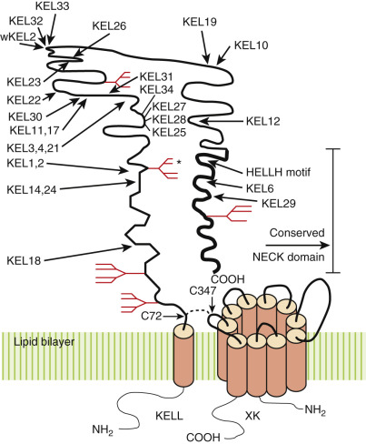

Figure 35-8 

Diagram of KELL and XK protein. 

KELL is covalently linked to the XK protein by a disulfide bond (- - - -) through Cys72 of Kell and Cys347 of XK. The sites of different Kell antigens are indicated by solid lines. The highlighted area at the carboxy-terminus of KELL represents the domain sharing the most homology to other NECK family proteins (NEP-24.11, ECE-1, PEX). The zinc-binding motif (HELLH) is a consensus sequence shared by zinc-dependent metalloproteinases. The transmembrane domains of KELL and XK protein are indicated by solid amber cylinders. The _N_ -glycosylation sites are indicated by branched structures. The _N_ -glycosylation site marked by an asterisk is not present in individuals of the KEL1-positive phenotype. 

Overall, the molecule has a complex, folded tertiary structure due to the formation of multiple disulfide bonds by the 15 cysteine residues present in the extracellular domain of the molecule (  Lee, 1997  ). Because of its highly folded nature, the Kell glycoprotein is fairly resistant to proteolytic digestion but is exquisitely sensitive to sulfhydryl-reducing agents such as DTT, AET, 2-mercaptoethanol (2-ME), and ZZAP, a combination of DTT and cysteine-activated papain. 

In the RBC membrane, the Kell glycoprotein is covalently linked to the XK protein (ISBT No. 019), a 444 amino acid, nonglycosylated, multipass protein containing 10 transmembrane domains. Encoded by a gene on chromosome Xp21, the XK protein is hypothesized to be a membrane transport protein. On RBCs, the XK protein is covalently linked to the Kell protein through a disulfide bond at C347 on the fifth extracellular loop of XK protein and C72 of Kell. In the absence of XK protein (McLeod phenotype), Kell expression is decreased on RBCs, suggesting that XK protein may help transport Kell. Transfection studies in COS cells, however, show normal transport and folding of the Kell protein in the absence of XK protein (  Russo et al, 1998  ). Nor is expression of XK dependent on Kell expression. The XK protein is expressed on several nonerythroid tissues, including liver, skeletal muscle, heart, brain, and pancreas (  Ho et al, 1994  ). 

 

##  Molecular Biology 

Cloned in 1991, the Kell gene ( _KEL_ ) contains 19 exons spanning 21.5 kb on chromosome 7q34 near the cystic fibrosis gene. The promoter region and exon 1 contain several consensus-binding sequences for GATA-1, an erythroid transcription regulatory binding factor. Kell is a member of the M13 neprilysin family of zinc neutral endopeptidases and shares homology with common acute lymphocytic leukemia antigen (CALLA, CD10), endothelin-converting enzyme-1 (ECE-1), neutral endopeptidase 24.11 (NEP-24.11), and PEX. The region of greatest homology lies in the carboxy-terminal half of the molecule (amino acids 550 to 652) and is sometimes referred to as the _NECK domain_ (N-24.11, EC-1, K family). This relatively conserved region shares 34% to 36% homology with the carboxy-terminal catalytic domains of NEP-24.11 and ECE-1, as well as a pentameric zinc-binding motif (HELLH), a common feature of zinc-dependent metalloproteinases (  Lee, 1997  ). 

With cloning of the Kell gene, the molecular and biochemical basis of several Kell antigens became possible. As shown in [ Table 35-16 ](<#t0085>) , all the Kell alloantigens identified and sequenced are single–amino acid polymorphisms in the translated Kell protein, generally in the amino half of the molecule (  Lee, 1997  ). The consensus allele _KEL*02_ encodes 20 high-frequency antigens including k, Kp  b  , and Js  b  (  Reid & Lomas-Francis, 2012  ). 

Several individuals with absent or depressed Kell expression have also been studied. K  0  K  0  phenotype arises from homozygosity for a silent _KEL_ amorph gene. Thirty _K 0  _ alleles ( _KEL*02N_ ) are recognized, including splice-site mutations and premature stop codons (  Reid & Lomas-Francis, 2012  ). K  mod  is the result of missense mutations and may occur on either K1 or k background. Twelve K  mod  alleles are recognized by ISBT. Several mutations have been identified in the _XK_ protein on Xp21, responsible for the McLeod phenotype (  Russo et al, 2002  ). At present, 29 mutant _XK_ alleles have been described, including deletion mutants (15), splice site (5), and nonsense mutations (6). The molecular basis for decreased Kell antigen expression with Gerbich-negative phenotypes is unknown. It is speculated that Kell and glycophorin C (Gerbich) may be near neighbors on the RBC membrane. 

 

##  Kell Antibodies 

Alloantibodies against antigens in the Kell blood group system are clinically significant (see [ Table 35-5 ](<#t0030>) ). They can be associated with both immediate and delayed hemolytic transfusion reactions. Anti-Kell antibodies are also associated with HDFN. HDFN secondary to maternal anti-Kell antibodies is often characterized by reticulocytopenia, with little or no bilirubinemia. It is now known that maternal anti-Kell (anti-KEL1 or K1) directly suppresses erythroid progenitors, leading to a severe reticulocytopenic anemia in the fetus (  Vaughan et al, 1998  ) with up to 30% of affected infants presenting with fetal hydrops (  Van den Akker et al, 2008  ). Anti-K1 is present in approximately 1% of pregnancies, with HDFN affecting 40% of K1-positive infants (  Finning et al, 2007  ). Several centers now routinely screen and refer prenatal patients with Kell antibodies, with improved perinatal outcomes (  Kamphuis et al, 2008  ). Reports have also described neonatal thrombocytopenia due to suppression of marrow megakaryocytes (  Wagner et al, 2000  ). In general, thrombocytopenia is mild, with only 2% of infants having platelet counts of less than 100 × 10  9  /L (  Van den Akker et al, 2008  ). Similar to RHD, fetal genotyping can be performed on maternal plasma (  Finning et al, 2007  ). 

The most commonly encountered antibody against the Kell blood group system is anti-K1, which is second only to Rh D in immunogenicity. Antibodies against Kell antigens are of IgG isotype, arising from immune stimulation via transfusion or pregnancy. There are rare reports of naturally occurring anti-K1 antibodies following severe bacterial infections and may be the result of crossreactive antibodies against bacterial neprilysin homologues (  Cooling, 2015  ), although examples of naturally occurring anti-Kell alloantibodies are known (  Judd et al, 1981  ). Because Kell antigens are sensitive to sulfhydryl-reducing agents, the activity of anti-Kell antibodies can be eliminated by pretreatment of RBCs with AET, DTT, 2-ME, or ZZAP. 

 

##  Biological Role 

Kell cleaves endothelin-3, a vasoactive peptide that functions in endothelial cell migration, neovascularization, axonal growth, and neural crest development. In a murine Kell  null  model, absence of Kell led to only subtle effects, including decreased blood pressure, blunting endothelin-3 activation of Ca  ++  -dependent K  \+  channels, decreased microvascular formation, and mild changes in motor function (  Zhu et al, 2009  ). Because endothelin-3 is also cleaved by ECE-1, a related endothelin converting enzyme, Kell may have only a minor physiologic role in endothelin-3 homeostasis. The ability of anti-Kell to suppress fetal erythropoiesis also suggests a possible role for Kell during erythroid differentiation and maturation (  Vaughan et al, 1998  ); however, only minor differences in mean corpuscular volume, mean corpuscular hemoglobin, hemoglobin (Hg), and reticulocyte counts were observed in Kell  null  mice (  Zhu et al, 2009  ). 

In contrast to Kell, the absence of XK protein is strongly associated with several abnormal clinical and laboratory findings. McLeod RBCs have shortened survival, decreased permeability to water, and abnormal morphology (acanthocytes). The McLeod syndrome, characterized by both hematologic and neuromuscular abnormalities, typically presents with areflexia, dystonia, and choreiform movements late in life. Late-onset muscular dystrophy and cardiomyopathy can also be seen. Both hematologic and neuromuscular defects in McLeod patients are believed to result from the absence of XK protein on red cells, brain, heart, and skeletal muscle (  Ho et al, 1994  ). It is interesting that the Huntington's disease gene, another neurodegenerative disorder, is located near the _XK_ gene on the X chromosome (  Issitt & Anstee, 1998  ). In fact, modern historians have hypothesized that a K1+ McLeod phenotype might explain Henry VIII's physical and psychological decline late in life, as well as his wives' high miscarriage rate (  Whitley & Kramer, 2010  ). 

The McLeod phenotype can also be associated with chronic granulomatous disease (CGD), a functional neutrophil defect resulting in severe, recurrent, life-threatening bacterial infections. In two thirds of patients, CGD results from a deletion or mutation of the cytochrome _b_ gene _(CYBB)_ on the X chromosome. Because of the proximity of the _CYBB_ and _XK_ genes on the X chromosome, approximately 7% of patients with X-linked CGD also express a McLeod phenotype (  Curnutte & Bemiller, 1995  ). 

 

##  Lewis Blood Group System (ISBT No. 007) 

The Lewis blood group system is unusual in that the Lewis antigens are not of erythroid origin. It primarily consists of two antigens: Lewis  a  (Le  a  , LE1) and Lewis  b  (Le  b  , LE2). Four additional antigens (Le  ab  , Le  bH  , ALe  b  , BLe  b  ) reflect the influence of ABO on Lewis synthesis and antigenicity. On RBCs, the Lewis antigens reside on glycosphingolipids, composed of a Lewis-active carbohydrate head group linked to a ceramide ( _N_ -acyl sphingosine) lipid tail. Lewis antigens are synthesized in the gastrointestinal tract and passively adsorbed onto RBCs from a soluble pool of secreted Lewis substance in plasma (  Hauser, 1995  ). Tissues and fluids expressing Lewis include plasma, saliva, RBCs, platelets, lymphocytes, endothelium, uroepithelium, and bowel mucosa. In some tissues, Lewis antigens are expressed on glycosphingolipids, glycoproteins, and mucins (  Cooling, 2015  ). 

Three Lewis phenotypes are observed in adults: Le (a+b–), Le (a–b+), and Le (a–b–). The Le (a+b+) is only rarely observed, usually on RBCs of very young children and some individuals of Polynesian, Japanese, or Taiwanese ancestry (  Issitt & Anstee, 1998  ). As shown in [ Table 35-18 ](<#t0095>) , the Le (a–b–) phenotype is five times more common in blacks than in Caucasians. The Le (a–b–) phenotype is also increased in neonates owing to developmentally delayed expression of the _Lewis_ and _Secretor_ genes. By 5 years of age, most children will express adult levels of Lewis antigens on their RBCs. The amount of Lewis antigen on RBCs is also influenced by ABO type. Le (a–b+) RBCs from group O donors appear to have more Le  b  than A  1  and B cells. As will be discussed later, group A  1  and B donors can convert Le  b  to ALe  b  and BLe  b  , respectively (  Issitt & Anstee, 1998  ). 

TABLE 35-18 

The Lewis Blood Group System 

|  FREQUENCIES IN U.S. ADULTS, %  |  POSSIBLE GENOTYPE  |  ABH AND LEWIS SUBSTANCES IN SALIVA AND PLASMA   
---|---|---|---  
Phenotype  |  Caucasian  |  Black  |  _Le_ Gene  |  _Se_ Gene  |  Group O  |  Group A  |  Group B   
Le (a+b–)  |  22  |  23  |  _Le/Le_ or _Le/le_ |  _se/se_ |  Le  a  |  Le  a  |  Le  a   
Le (a–b+)  |  72  |  55  |  _Le/Le_ or _Le/le_ |  _Se/Se_ or _Se/se_ |  Type 1H  |  Type 1H, A  |  Type 1H, B   
|  |  |  |  Le  a  , Le  b  |  Le  a  , Le  b  , ALe  b  |  Le  a  , Le  b  , BLe  b   
Le (a–b–)  |  6  |  22  |  _le/le_ |  _Se/se_ |  Type 1H  |  Type 1H, A  |  Type 1H, B   
|  |  _le/le_ |  _se/se_ |  Type 1 chain precursor (Le  c  )  |  Type 1 chain precursor (Le  c  )  |  Type 1 chain precursor (Le  c  )   
  
 

##  Biochemistry 

Although biosynthetically related to each other, the Le  a  and Le  b  antigens are not allelic antigens. They represent the complex interaction of two distinct glycosyltransferases: fucosyltransferase type II (FUT2) and fucosyltransferase type III (FUT3). FUT3 is the product of the Lewis gene _(Le/FUT3)_ and is an α1–3/4 fucosyltransferase. FUT2, the product of the _Secretor_ gene _(Se),_ is an α1–2 fucosyltransferase related to the _H_ gene, FUT1. How _Le, Se,_ and _ABO_ genes interact to yield the different combinations of RBC and plasma phenotypes is shown in [ Table 35-18 ](<#t0095>) and [ Figure 35-9 ](<#f0050>) . 

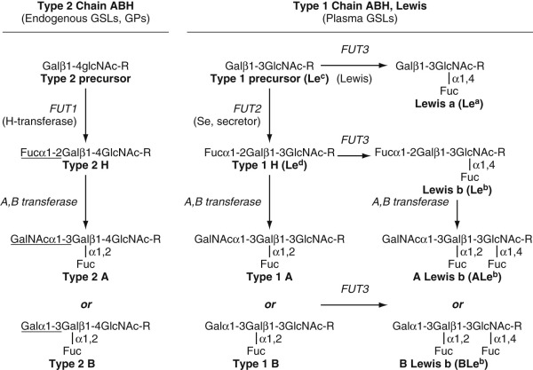

Figure 35-9 

Synthesis of Lewis and type 1 chain ABH antigens. 

_Fuc,_ Fucose; _Gal,_ galactose; _GalNAc, N_ -acetylgalactosamine; _Glc,_ glucose; _GlcNAc, N_ -acetylglucosamine; _Le,_ Lewis; _R,_ ceramide. 

The precursor molecule for Lewis and related antigens is a type 1 chain precursor, historically known as the Le  c  antigen. In Le (a+b–) donors, FUT3 or Lewis adds an α1–4 linked fucose to Le  c  to form the Le  a  antigen. Because these donors lack the _Se/FUT2_ gene _(se/se),_ no type 1 chain H (Le  d  ) is made. As a result, only Le  a  antigen is present in plasma, saliva, and RBCs. The Le (a–b+) red cell phenotype results from the inheritance of both _Le_ and _Se_ genes. FUT3 still converts a small amount of type 1 chain precursor to Le  a  antigen. However, most Le  c  substance is converted to type 1 chain H or Le  d  by FUT2 (see [ Fig. 35-9 ](<#f0050>) ). FUT3 subsequently adds a second fucose to form Le  b  antigen (  Lowe, 1994  ). In group A and B persons, type 1 chain H is further modified by the A/B glycosyltransferase to form type 1 chain A and B antigens. Similar to type 1 chain H and Le  c  antigens, these molecules can serve as substrates for FUT3 to form ALe  b  and BLe  b  (see [ Fig. 35-9 ](<#f0050>) ). In group A  1  donors, ALe  b  is the major Le  b  antigen found in plasma (  Lindstrom et al, 1992  ). 

The Le (a–b–) red cell phenotype occurs in individuals who lack the _Le/FUT3_ gene. Individuals who are negative for both _Le_ and _Se_ alleles _(le_ / _le_ , _se_ / _se)_ are unable to synthesize Le  a  antigen or type 1 chain H antigens. As a result, only type 1 chain precursor or Le  c  antigen is present in secretions and plasma. In contrast, individuals who inherit at least one Se allele can express type 1 chain glycolipids with ABH activity. 

 

##  Molecular Biology 

The _FUT3_ or _Lewis_ gene resides on chromosome 19p13.3 near two other α1–3 fucosyltransferase genes: _FUT5_ and _FUT6_ . All three α1–3 fucosyltransferases are highly homologous, consistent with gene duplication (  Weston et al, 1992  ). The gene encodes a 361 amino acid type II glycoprotein with both α1→4 (Le  a  ) and α1→3 (LeX) fucosyltransferase activity. _FUT3_ is highly expressed in colon, stomach, small intestine, lung, and kidney, with weaker expression in salivary gland, bladder, uterus, and liver. _FUT6_ is coexpressed with _FUT3_ in most tissues (  Cameron et al, 1995  ). 

The Le (a–b–) or null phenotype arises from inactivating mutations in _FUT3_ . More than 37 _FUT3_ null alleles have been reported, with most (89%) possessing at least two mutations (  Blood Group Antigen Gene Database, 2015  ). Many alleles show distinct geographic and ethnic distributions. In Caucasians, Le (a–b–) is most commonly associated with alleles containing mutations at Trp68Arg and Thr105Met ( _le 202,314  _ ). In contrast, _FUT3_ null alleles common in Asia include _le 59  _ , _le 59,508  _ , and _le 59,1067  _ (  Cooling, 2015  ). The Lewis weak (Le  w  ) phenotype, often characterized by a Le (a–b–) RBC phenotype and the presence of Lewis-active substance in saliva, is due to a single missense mutation in the transmembrane domain (T59>G). The latter has decreased Golgi retention and reduced activity with glycolipid substrates, leading to discrepant Lewis expression on red cells, saliva, and gastrointestinal tissues (  Mollicone et al, 1994  ;  Nishara et al, 1999  ). Le  w  and a Le (a–b–) RBC phenotype can also be a consequence of gene dosage: _Le/le_ heterozygous individuals show 50% decreased FUT3 activity in saliva and tissues (  Cooling, 2015  ). 

The _FUT2 (Se)_ gene resides on chromosome 19q13.3 as part of a 100-kb gene cluster that includes the _H_ gene ( _FUT1_ ) and _Sec1_ , an inactive _FUT2_ -like pseudogene (  Kelly et al, 1995  ). Multiple null alleles have been reported, with distinct geographic and ethnic distributions. Most null alleles are the result of nonsense mutations (  Reid & Lomas-Francis, 2012  ). There are also examples of recombination among _FUT1_ , _FUT2_ , and _Sec1_ (  Koda et al, 1996  ;  Soejima et al, 2008  ). Weak _FUT2_ alleles are known and common in Asia (  Reid & Lomas-Francis, 2012  ;  Cooling, 2015  ). The most common partial secretor phenotype has been linked to an Ile129>Phe mutation and is associated with a Le (a+b+) phenotype (  Yu et al, 1995  ). 

 

##  Lewis Antibodies 

Similar to ABO, antibodies against Le  a  and Le  b  antigens are naturally occurring IgM antibodies (see [ Table 35-5 ](<#t0030>) ), but unlike ABO antibodies, anti-Lewis antibodies are seldom clinically significant. Most examples are detected as room temperature agglutinins; however, some examples are reactive in the IAT. Although uncommon, some examples demonstrate in vitro hemolysis. Because Le  a  and Le  b  are glycosphingolipids, antibody reactivity can be enhanced by pretreatment of RBCs with enzymes. Antibody reactivity is neutralized by the addition of commercially available soluble Lewis substance or plasma containing the soluble Lewis antigen of interest. Anti-Le  b  can be observed in individuals of Le (a+b–) or Le (a–b–) phenotype, whereas anti-Le  a  is observed only in Le (a–b–) individuals. Anti-Le  a  is not observed in the Le (a–b+) phenotype because these individuals synthesize a small amount of Le  a  . It is interesting to note that some Le (a–b+) women can transiently become phenotypically Le (b–), with the development of anti-Le  b  , during pregnancy. Some examples of anti-Le  b  can demonstrate ABH specificity (anti-LebH, anti-ALe  b  , anti-BLe  b  ), reacting more strongly with Le  b  -positive RBCs of specific ABO types. 

They are not associated with HDFN and are only rarely associated with hemolytic transfusion reactions. It is speculated that they could play a role in renal graft rejection in black, Le (a–b–) individuals (  Spitalnik et al, 1984  ). For transfusion, patients with anti-Lewis antibodies reactive only at room temperature may be safely transfused with crossmatch–compatible RBCs. In contrast, rare examples of anti-Le  a  or anti-Le  b  that are hemolytic in vitro should receive antigen-negative, crossmatch-compatible RBCs. If antigen-negative blood is not available, infusion of plasma containing the soluble Lewis antigen of interest may be helpful in neutralizing or inhibiting circulating antibody before RBC transfusion (  Klein & Anstee, 2006  ). 

 

##  Biological Role 

The Lewis blood group antigens play an important role in disease. Le (a–b–) is linked to a twofold increased risk of atherosclerotic disease and coronary death, with the strongest association observed in Le (a–b–) individuals carrying the _le 59  _ allele (  Ellison et al, 1999  ;  Djousse et al, 2007  ). Aberrant expression of sialyl-Le  a  occurs in many gastrointestinal and uroepithelial cell cancers and may contribute to tumor metastasis. Sialyl-Le  a  is a ligand for the endothelial adhesion molecule E-selectin and may mediate tumor cell–endothelium interactions (  Takada et al, 1993  ). Sialyl-Le  a  is also the epitope for the tumor marker CA 19-9, a useful serologic marker for monitoring patients with gastrointestinal and other malignancies. 

Secretor status is a host susceptibility factor in several infectious diseases. _Helicobacter pylori_ , a causative agent of gastritis and ulcers, binds H, Le  b  , and Le  y  antigens via BabA recognition of a terminal Fucα1–2Gal epitope (  Boren et al, 1993  ;  Cooling, 2015  ). The latter might explain the increased incidence of ulcers and stomach cancer among blood group O secretors (  Yamaoka, 2008  ). A Lewis null and/or nonsecretor phenotype has also been linked with a higher incidence of recurrent _Candida_ vaginitis and urinary tract infection (  Cooling, 2015  ). Le  b  and type 1 H antigen are also receptors for most norovirus and rotavirus strains. Several epidemiologic studies have shown that nonsecretors have inherent resistance against infection (  Cooling, 2015  ). In contrast, nonsecretor was recently identified as a risk factor for necrotizing enterocolitis and sepsis in premature infants (  Morrow et al, 2011  ). 

 

##  Duffy Blood Group System (ISBT No. 008) 

The Duffy (FY) blood group system was discovered in 1951 and contains five antigens: Fy  a  , Fy  b  , Fy3, Fy5, and Fy6. Fy  a  and Fy  b  are autosomal codominant antigens, whereas Fy3, Fy5, and Fy6 are high-incidence antigens present on all RBCs except the Duffy null phenotype. The Fy4 antigen, originally described on Fy (a–b–) RBCs, is now thought to be a distinct, unrelated antigen and is no longer included in the FY system. 

Fy  a  and Fy  b  antigens are common in Caucasians, whereas the Duffy null or Fy (a–b–) phenotype is the predominant phenotype in blacks ( [ Table 35-19 ](<#t0100>) ). Fy  x  is generally characterized by extremely weak Fy  b  expression. In addition to RBCs, the Duffy antigens are expressed on cerebellar Purkinje cells and postcapillary venule endothelial cells. Duffy antigens have also been reported on endothelial cells of renal glomeruli, vasa recta, thyroid, and pulmonary capillaries, as well as on alveolar type 1 squamous cells and epithelial cells of renal collecting tubules (  Chaudhuri et al, 1997  ;  Hadley & Peiper, 1997  ). RBCs possess approximately 12,000 to 14,000 copies of DARC glycoprotein (DARC) per cell (  Reid & Lomas-Francis, 2012  ). 

TABLE 35-19 

Phenotype Frequencies in the Duffy System 

REACTIONS WITH ANTI-  |  |  CAUCASIANS  |  BLACKS   
---|---|---|---  
Fy  a  |  Fy  b  |  Fy3  |  RBC Phenotype  |  Frequency [ * ](<#hl0003414>) |  Genotypes [ † ](<#hl0003417>) |  Frequency [ * ](<#hl0003414>) |  Genotypes [ † ](<#hl0003417>)  
\+  |  – |  \+  |  Fy (a+b–)  |  17  |  _FY*A/FY*A_ |  9  |  _FY*A/FY*A_   
_FY*A/FY*B ES  _  
\+  |  \+  |  \+  |  Fy (a+b+)  |  49  |  _FY*A/FY*B_ |  1  |  _FY*A/FY*B_  
– |  \+  |  \+  |  Fy (a–b+)  |  34  |  _FY*B/FY*B_ |  22  |  _FY*B/FY*B_   
FY*B/FY*B  ES   
– |  – |  – |  Fy (a–b–)  |  Very rare  |  _FY*amorph_ |  68  |  _FY*B ES  /FY*B  ES  _  
+/– |  w  |  w  |  Fy (a+b  w  )   
Fy (a–b  w  )  |  <0.1%  |  _FY*A/FY*X_   
_FY*X/FY*X_ |  Very rare  |  _FY*A/FY*X_   
_FY*X/FY*B ES  _  
  
++, Strong reactivity; _w,_ weak reactivity. 

 * Frequency (%) U.S. population. 

 † _FY*A,_ Fy allele; _FY*B,_ Fy allele; _FY*B ES  , _ FY*B allele carrying a GATA-1 promoter mutation; _FY*X, FY*B_ gene containing missense with weak Fy  b  expression; _FY*amorph,_ silent _FY_ gene containing disruptive mutations (deletion, frameshift, nonsense). See accompanying text. 

 

##  Biochemistry 

The Duffy antigens reside on DARC or Duffy antigen receptor for chemokines ( [ Fig. 35-10 ](<#f0055>) ). The latter is a 338 amino acid, integral membrane glycoprotein, containing a 62 amino acid extracellular amino-terminus, seven transmembrane domains, and an intracellular carboxy-terminus rich in serine and threonine residues. The amino-terminal domain possesses three _N_ -glycans (  Czerwinski et al, 2007  ) and is linked to the third extracellular loop by a disulfide bond to form a hepatohelical structure. A second disulfide bond exists between the first and second extracellular loops. DARC exists as a homodimer or as a hetero-oligomer with CCR5, a β-chemokine receptor that plays a role in HIV internalization (  Chakera et al, 2008  ). 

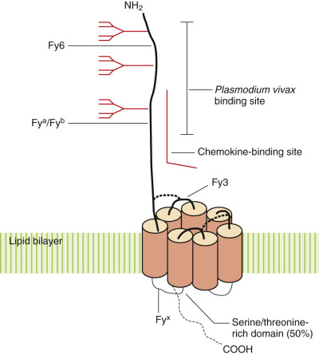

Figure 35-10 

Duffy glycoprotein or Duffy antigen receptor for chemokine molecule (DARC). 

DARC contains a 62 amino acid, extracellular amino-terminal domain and seven transmembrane domains, indicated by solid amber cylinders. A disulfide bond exists between the amino-terminal domain and the third extracellular loop. A second disulfide bond exists between the first and second extracellular loops. Three _N_ -glycosylation sites are indicated by branched structures. The sites of the Fy3, Fy6, and Fy  a  /Fy  b  antigens are shown where indicated. The binding site for _Plasmodium vivax_ exists between amino acids 8 and 44 and includes the Fy6 and Fy  a  /Fy  b  antigens. The chemokine-binding site lies in a cleft between the amino-terminal domain and the third extracellular loop. The mutation leading to the Fy  x  phenotype, characterized by weak Fy  b  expression, is present in the first cytoplasmic loop. 

The Fy  a  , Fy  b  , and Fy6 antigens reside on the amino-terminal domain of DARC and are sensitive to proteolytic cleavage. The negatively charged amino-terminal domain is the binding site for _P. vivax_ PvDBP ligand. Site-directed mutagenesis has confirmed that amino acids 19 to 26, the Fy6 epitope, are critical for _P. vivax_ binding (  Tournamille et al, 2005  ). The high-incidence antigen Fy3 is believed to reside on the third extracellular loop (  Hadley & Peiper, 1997  ;  Wasniowska et al, 2004  ). 

 

##  Molecular Biology 

Located on chromosome 1q22-23, the Duffy gene _(FY)_ is a 1014-bp gene containing two exons, a small upstream exon encoding the first seven amino acids, and a second exon encoding the rest of the molecule (  Hadley & Peiper, 1997  ). The promoter region contains consensus sequences for multiple _cis_ -regulatory elements, including AP-1, Sp1, and GATA-1, an erythroid transcription activator-binding protein that controls transcription of DARC in erythroid cells (  Iwamoto et al, 1996  ). Phylogenetic studies indicate that _FY*B_ is the ancestral gene of human and nonhuman primates (  Li et al, 1997  ). Genetic studies have identified four Duffy alleles— _FY_ * _A_ , _FY_ * _B_ , _FY_ * _B ES  _ , and _FY_ * _X_ —responsible for the Fy  a  , Fy  b  , Fy  null  , and Fy  x  phenotypes, respectively (see [ Table 35-19 ](<#t0100>) ). The codominant alleles, _FY_ * _A_ and _FY_ * _B_ , differ by a single amino acid (Gly42Asp). The Fy  x  phenotype _(FY_ * _X),_ characterized by extremely weak Fy  b  expression (10% normal), arises from an R89C substitution in the first cytoplasmic loop, leading to protein instability (  Yazdanbakhsh et al, 2000  ;  Reid & Lomas-Francis, 2012  ). Although rare, an _FY*A_ allele bearing the R89C and weak Fy  a  expression has been identified (  Cooling, 2015  ). 

Three distinct mechanisms are responsible for the Fy  null  or Fy (a–b–) serologic phenotype. In Caucasians, the _FY_ gene is disrupted _(FY_ * _amorph),_ leading to complete absence of DARC on all tissues (  Reid et al, 2014  ). As a result, these individuals can make alloantibodies to all Duffy antigens, including high-incidence antigens (Fy3, Fy5). In contrast, black Fy (a–b–) individuals are homozygous for _FY_ * _B ES  , _ an _FY_ * _B_ variant that possesses a point mutation in the _FY_ gene promoter (–33T>C) that abrogates the consensus binding site for GATA-1. As a result, there is a selective loss of _FY_ transcription in RBCs; however, FY transcription is retained in endothelial and epithelial cells, which utilize other promoter enhancer elements. Because Fy  b  is expressed on nonerythroid cells, black Fy (a–b–) individuals do not make anti-Fy  b  and only rarely make anti-Fy3. Finally, there is increasing recognition that some individuals, particularly donors, who historically typed as Fy (a–b–) by serology are actually Fy (a–b  +w  ) on genotyping ( _FY*B ES  /FY*X _ ). 

 

##  Duffy Antibodies 

Antibodies against Fy  a  , Fy  b  , and other Duffy antigens are clinically significant. They are associated with HDFN and both immediate and delayed hemolytic transfusion reactions. They are usually of IgG isotype, reactive at 37° C, and are detected only in the IAT. Antibodies against Fy  a  , Fy  b  , and Fy6 antigens, which reside on the long amino-terminal domain of DARC, can be inhibited by prior protease digestion of RBCs. In contrast, Fy5 and Fy3 antigens are relatively resistant to protease digestion. Antibodies against Duffy antigens can demonstrate dosage. 

Clinically, anti-Fy  a  is the most common alloantibody encountered and can be observed in Fy (a–) individuals of all races. Anti-Fy  b  is relatively uncommon and is observed primarily in nonblacks. Alloantibodies against the high-incidence antigens Fy3 and Fy5 are relatively rare, occurring predominantly in white, Fy  null  individuals. Anti-Fy3 behaves like an anti-Fy  a+b  , reacting with all Duffy-positive RBCs. Occasionally, potent anti-Fy3 can be produced by sickle cell, Fy (a–b–) patients despite the expression of Fy  b  on nonerythroid tissues (  Castilho et al, 2009  ). Anti-Fy5 also reacts like an anti-Fy  a+b  but requires the presence of Rh antigens for reactivity. Anti-Fy6 has not been observed clinically but is the epitope for an anti-Duffy monoclonal antibody that blocks _P. vivax_ binding (  Tournamille et al, 2005  ). 

 

##  Biological Role 

DARC is a chemokine-binding protein, capable of binding several inflammatory chemokines from the C-X-C and C-C families (  Gardner et al, 2004  ), including interleukin-8, RANTES (regulated upon activation, normal T cell–expressed and presumably secreted), and monocyte chemotactic protein-1 (see [ Fig. 35-10 ](<#f0055>) ). Because DARC lacks a DRY motif, DARC does not transmit an intracellular signal upon binding chemokines. DARC can form heterodimers with the β-chemokine and HIV receptor CCR5, suppressing CCR5 signaling (  Chakera et al, 2008  ). DARC may facilitate leukocyte recruitment to sites of inflammation by establishing a chemokine gradient and transporting chemokines across activated endothelium (  Horne & Woolley, 2009  ). In murine models, DARC functions in chemokine homeostasis and neutrophil recruitment, particularly during inflammatory insults. It is interesting to note that the absence of DARC in mice was protective against acute lung injury (  Zarbock et al, 2010  ). 

In humans, no distinct clinical syndrome is associated with a Fy  null  phenotype; however, the Fy  null  phenotype has been linked to lower neutrophil counts, susceptibility to infection, renal disease, and reduced graft survival following renal transplantation. Studies have linked low neutrophil counts in people of African ancestry to the _FY_ * _B ES  _ allele (  Reich et al, 2009  ), leading to speculation regarding the impact of the Fy  null  phenotype and recovery from chemotherapy and other marrow insults. The role of DARC and Fy phenotype in renal transplantation is mixed, with some studies showing an increase in rejection and chronic lesions (  Lerut et al, 2007  ;  Horne et al, 2009  ). In patients with sickle cell disease, the Fy  null  phenotype is associated with increased chronic organ damage and proteinuria (  Afenyi-Annan et al, 2008  ). In contrast, it is believed that lower neutrophil counts could be beneficial against cerebral malaria (  Cooling, 2015  ). 

DARC is also the receptor for _P. vivax_ , which binds DARC via PvDBP protein at the Fy6 epitope. Fy  null  individuals are resistant to most _P. vivax_ strains, providing a selective advantage to populations living in malaria endemic areas (  Howes et al, 2011  ). Fy  a  may also be protective against _P. vivax_ and may account for the high incidence of Fya in Asia. Fy  a  is a less efficient receptor, binding 40% to 50% less PvDBP than Fy  b  . In the Amazon, the Fy(a+b–) phenotype is associated with a 250% lower risk of _P. vivax_ infection (  King et al, 2011  ). Finally, the Fy  null  phenotype FY*BES/FY*BES) may play a role in HIV susceptibility; however, there are conflicting reports regarding the latter (  Cooling, 2015  ). 

 

##  Kidd Blood Group System (ISBT No. 009) 

The Kidd (JK) blood group system is strongly associated with delayed hemolytic transfusion reactions and with intravascular hemolysis (recall that most hemolysis with non-ABO antibodies is extravascular). It consists primarily of two allelic antigens: Jk  a  and Jk  b  . Inheritance is autosomal codominant with three predominant phenotypes ( [ Table 35-20 ](<#t0105>) ). A fourth phenotype, Jk  null  or Jk (a–b–), is very rare, except among Polynesians (≤1%) and Finns. Weak or altered Jk expression due to novel _JK_ alleles is also known (  Whorley et al, 2009  ). In addition to RBCs, Kidd antigens are expressed along descending vasa recta endothelial cells of the renal medulla. Evidence suggests low-level, constitutive expression of Kidd on heart, skeletal muscle, colon, small intestine, thymus, brain, pancreas, spleen, prostate, bladder, and liver (  Olives et al, 1996  ). More than 14,000 Kidd epitopes are present per human RBC (  Lucien et al, 2002  ). 

TABLE 35-20 

Phenotypes of the Kidd System 

REACTIONS WITH ANTI-  |  |  FREQUENCY (%) U.S. POPULATION  |   
---|---|---|---  
Jk  a  |  Jk  b  |  Jk3  |  Phenotype  |  Caucasian  |  Black  |  Comments   
\+  |  0  |  \+  |  Jk (a+b–)  |  28  |  57  |  Autosomal codominant   
\+  |  \+  |  \+  |  Jk (a+b+)  |  49  |  34  |  Sensitive 2M urea   
0  |  \+  |  \+  |  Jk (a–b+)  |  23  |  9  |   
**Null Phenotypes (Jk null  ) **  
0  |  0  |  0  |  Jk (a–b–)  |  Very rare  |  Very rare  |  Autosomal recessive   
Resistant 2M urea   
0/w [ * ](<#hl0003512>) |  0/w [ * ](<#hl0003512>) |  w [ * ](<#hl0003512>) |  Jk (a–b–)  |  — |  — |  _In (Jk)_ , autosomal dominant   
Rare, Japanese only   
Partially resistant 2M urea   
  
 * Weak Jk antigens detected only by adsorption and elution techniques. 

 

##  Null Phenotypes 

Jk  null  is autosomal recessive, reflecting homozygosity for a JK  null  or amorph allele (see [ Table 35-20 ](<#t0105>) ). _In(Jk)_ is a second Jk (a–b–) phenotype that is characterized by very weak Kidd expression. Similar to _In(Lu)_ , the _In(Jk)_ phenotype is autosomal dominant owing to a suppressor gene at a distant, unrelated locus. It is interesting to note that Jk  null  RBCs are resistant to lysis by 2M urea, a lytic agent used by some automated hematology analyzers. _In(Jk)_ RBCs have intermediate resistance to urea (  Issitt & Anstee, 1998  ). No change in gas permeability is seen with Jk  null  cells (  Endeward et al, 2006  ). 

 

##  Biochemistry 

Apparent resistance to urea by Jk  null  RBCs became clear with cloning and isolation of the human erythroid urea transporter (UT-B). The latter is a 43- to 45-kD multipass glycoprotein, which shares 60% homology with the vasopressin-sensitive urea transporter of rabbits (UT2) and humans (HUT2, UT-A) (  Lucien et al, 1998  ). The molecule is a 391 amino acid protein with 10 transmembrane domains and a cytosolic amino- and carboxy-terminus ( [ Fig. 35-11 ](<#f0060>) ). A single _N_ -glycan is present on the third extracellular loop (Asn222) and expresses ABO antigens (  Lucien et al, 2002  ). The Jk  a  /Jk  b  antigens reside on the fourth extracellular loop at amino acid 280. The third extracellular loop may play a key role in urea transport. 

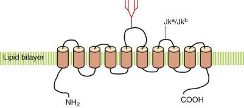

Figure 35-11 

The Kidd/urea transporter glycoprotein. 

The site of Jk  a  /Jk  b  polymorphism at residue 280 is indicated. The _N_ -glycosylation site is indicated by a branched structure on the third extracellular loop. The 10 transmembrane domains are represented by amber cylinders. 

 

##  Molecular Biology 

The Kidd glycoprotein is encoded by a 30-kb gene _(JK, SLC14A1, UT-B)_ on chromosome 18q12-21. This is the same location as the human _HUT2/UT-A_ urea transporter (61% homology), suggesting that the two genes arose by gene duplication. The _JK_ gene is organized over 11 exons, although only exons 4 to 11 encode the mature protein (  Lucien et al, 1998  ). Similar to many blood group genes, the promoter region contains a GATA-1 consensus sequence, as well as other _cis_ -regulatory elements (AP-2, AP-3, NF-ATp, Sp1, Ets-1). A single-bp transition (G823A) is the molecular basis of the Jk  a  /Jk  b  polymorphism, resulting in an Asp280 (Jk  a  ) or Asn280 (Jk  b  ) (  Lucien et al, 2002  ). Seven alleles containing missense mutations are responsible for weak Jk  a  ( _JK*01W_ ) and Jk  b  ( _JK*02W_ ) expression, and 14 null alleles ( _JK*0N_ ) are recognized by ISBT. The etiology of the _In(Jk)_ phenotype is unknown. 

 

##  Kidd Antibodies 

Clinically, anti-Jk or Kidd antibodies are a common cause of hemolytic transfusion reactions, accounting for nearly one-quarter of all delayed hemolytic transfusion reactions and 75% of those with true hemolytic sequelae (  Ness et al, 1990  ). They are usually of IgG1 or IgG3 isotype and are capable of activating complement (see [ Table 35-5 ](<#t0030>) ). Antibody reactivity can be enhanced with enzyme-treated RBCs and by the presence of complement. Anti-Jk is not enhanced by polybrene. An anti-Jk3, which reacts with all RBCs except Jk  null  , is observed in Jk  null  individuals (see [ Table 35-20 ](<#t0105>) ). Anti-Jk3 is reported to react with some Jk(a+  w  ) phenotypes (  Whorley et al, 2009  ). Jk(a+  w  ) and Jk(b+  w  ) can also give discordant typing with commercial typing reagents (  Whorley et al, 2009  ). 

Anti-Jk antibodies can be difficult to detect or identify in the blood bank. Anti-Jk antibodies are often of low titer with weak avidity and can display dosage in vitro. Furthermore, anti-Jk antibodies are frequently transient, disappearing rapidly after immune stimulation. As a consequence, patients previously sensitized to Kidd antigens may be negative for anti-Jk antibodies in later blood samples. Following transfusion of crossmatch-compatible, Jk-positive RBCs, sensitized patients can mount a brisk anamnestic antibody response with rapid and extensive in vivo hemolysis as RBCs are cleared by extravascular and intravascular hemolysis. Although uncommon, anti-Jk can cause a mild HDFN. 

 

##  Biological Role 

Biologically, JK/UT-B functions in the facilitated transport of urea. In kidney, transport of urea by JK/UT-B on vasa recta endothelial cells is thought to help stabilize osmotic gradients in the renal medulla during the concentration of urine. On RBCs, JK/UT-B may help preserve the osmotic stability of RBCs as they pass through the kidney. Although Jk  null  individuals exhibit a slightly decreased capacity to concentrate urine, the absence of JK/UT-B is not associated with a clinical syndrome. It is likely that other mechanisms exist to compensate or reduplicate the function of JK/UT-B on tissues (  Lucien et al, 1998  ). Because Jk antigens are strongly expressed by kidney, there is some suggestion they could act as alloantigens in renal transplant patients. Four case reports describe the concurrent allograft rejection with new Jk alloantibodies several years after transplantation and transfusion exposure (  Rourk & Squires, 2012  ). 

 

##  Diego Blood Group System (ISBT No. 010) 

The Diego blood group system (DI) consists of 22 antigens, including five sets of allelic antigens: Di  a  /Di  b  (DI1/DI2), Wr  a  /Wr  b  (DI3/DI4), Hg(a+)/Mo(a+) (DI12/DI11), Wu/DISK (DI9/DI22), and Sw(a)/SW1 (DI14/DI22). Most antigens (20/22) are rare, low-incidence antigens present on less than 1% of donors. In general, there are no apparent racial differences except Di  a  , which is rare in all populations except those of Mongolian ancestry, Asians, and native South American Indians. In some South American Indian populations, the frequency of Di  a  can reach 50% (  Reid & Lomas-Francis, 2012  ). In addition to RBCs, Diego antigens are expressed by human kidney along the collecting ducts (  Tanner, 1993  ). One million copies of Diego glycoprotein (AE1) are present per RBC. 

 

##  Biochemistry 

The Diego blood group system resides on Band 3, also known as AE1. AE1 is a 100-kD, 991 amino acid glycoprotein containing two functionally distinct domains: a large 40-kD amino-terminal cytoplasmic domain and a transmembrane domain comprising the carboxy-terminal half of the molecule ( [ Fig. 35-12 ](<#f0065>) ). On RBCs, AE1 is an oligomer, usually existing as a dimer or tetramer through the formation of intramolecular disulfide bonds. The carboxy-terminal is associated with carbonic anyhydrase, whereas the amino-terminal cytoplasmic domain binds several key cytoskeletal proteins (band 4.1, band 4.2, and ankyrin) and glycolytic enzymes: glutaraldehyde-3-phosphate dehydrogenase, aldolase, and phosphofructokinase. Binding of hemochromes or denatured Hg to the extreme amino-terminus of AE1 is believed to play a role in Heinz body formation. AE1 is a critical element in both ankyrin and junctional complexes that provide vertical and lateral stability to the membrane, respectively (  Burton & Bruce, 2011  ). 

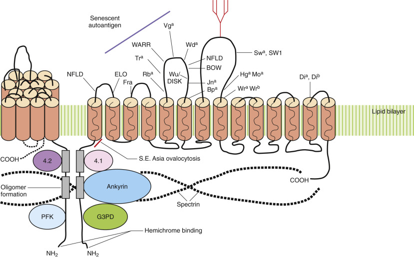

Figure 35-12 

Structure of anion exchange protein AE1 (Band 3). 

AE1 is a multipass glycoprotein with 14 transmembrane domains, indicated by solid amber cylinders. The Diego blood group antigens reside along the extracellular loops and are indicated by solid lines. The AE1 senescent autoantigen is on the third extracellular loop between Rb  a  and Vg  a  antigens. The massive _N_ -glycan is shown by a branched structure on the fourth extracellular loop. The large cytoplasmic domain has binding sites for cytoskeletal proteins 4.2, 4.1, and ankyrin, as well as the glycolytic enzymes phosphofructokinase (PFK) and glutaraldehyde-3-phosphate dehydrogenase (G3PD). In the red cell membrane, AE1 exists as oligomers (dimers, tetramers) linked by interchain disulfide bonds along the amino-terminal cytoplasmic domain _(solid rectangles)._ An 8 amino acid deletion at the boundary of the amino-terminal cytoplasmic domain and the first transmembrane domain is responsible for Southeast Asia ovalocytosis (SAO). 

The remainder of AE1 is membrane associated, containing 12 to 14 transmembrane domains, which constitute the carboxy-terminal half of the molecule. Whereas the amino-terminal domain is involved in membrane stability, the carboxy-terminal domain functions as an anion transporter, facilitating transfusion of Cl  − and HCO  3  − anions across the cell membrane (  Tanner, 1993  ). AE1 is closely associated with several membrane proteins important to red cell function that is often referred to as a _band 3 metabolon_ or _macrocomplex_ (  Burton & Bruce, 2011  ). Other proteins physically associated with AE1 include Rh complex, glycophorins, aquaporin, glucose transporter, CD47, and carbonic anhydrase. The extracellular domain is also the site of all the Diego antigens described to date. There is a single _N_ -glycosylation site, which displays a massive, highly branched, polylactosaminoglycan with both ABO and I blood group activity (  Cooling, 2010  ). It is estimated that nearly half of all ABO epitopes on RBCs are associated with AE1. 

 

##  Molecular Biology 

AE1 is the product of a 20-exon, 17-kb gene _(SLC4A1)_ on chromosome 17q21-q22. Di(b+) is considered the reference allele (DI*02). Every Diego antigen identified to date is the result of an amino acid polymorphism in the translated protein (see [ Table 35-26 ](<#t0135>) and [ Fig. 35-12 ](<#f0065>) ). The Diego system also contains two examples of allelic, low-incidence antigens: Mo  a  /Hg  a  and Jn  a  /KREP. In each case, two distinct amino acid substitutions at the same amino acid residue lead to different alloantigens. A similar example exists in the Kell system (Kp  a  , Kp  b  , and Kp  c  ). 

The most interesting Diego antigen, however, is Wr  b  . As stated earlier, AE1 is topically associated with GYPA in the RBC membrane. RBCs lacking GYPA (En [a–] phenotype) are phenotypically Wr (a–b–), implying that Wr  b  is on GYPA. Available evidence now suggests that Wr  b  is formed by an electrostatic interaction between GYPA and the Wr  b  antigen (Glu658) (  Poole et al, 1999  ). Which specific amino acid on GYPA is critical to Wr  b  formation is still a matter of debate, but clearly part of the Wr  b  epitope involves amino acids on GYPA (see [ Fig. 34-3 ](<##!/content/3-s2.0-B9780323295680000346?scrollTo=%23f0020>) ). 

 

##  Diego Antibodies 

Antibodies against Diego blood group antigens can be immune stimulated or naturally occurring. Antibodies against Di  a  , Di  b  , Wr  b  , and ELO are usually immune stimulated. These antibodies are of IgG isotype and are detected in the AHG phase of testing. Anti-Di  a  , Di  b  , and Wr  b  can be associated with decreased red cell survival, hemolytic transfusion reactions, and HDFN. Anti-Wr  b  is also associated with autoimmune hemolytic anemia (  Issitt & Anstee, 1998  ). 

In contrast, antibodies against the majority of other Diego antigens are usually naturally occurring, room temperature, saline agglutinins. Anti-Wr  a  is particularly common, occurring in 1 in 100 donors. Antibodies against Wd  a  and WARR are also fairly common, with anti-WARR reported in 13% to 18% of donors (  Issitt & Anstee, 1998  ). 

 

##  Biological Role 

Functionally, AE1 plays a critical role in gas transport and acid-base equilibrium. To facilitate the removal of CO  2  , RBCs hydrate CO  2  via carbonic anhydrase to form bicarbonate ion (HCO  3  – ), which is readily soluble in plasma. As the level of intracellular HCO  3  − rises, RBCs exchange HCO  3  − ions for Cl  − in plasma (the Cl  − shift, or Hamburger shift). This process is mediated by AE1 as RBCs pass through capillaries and small capillary venules. Because of the high copy number of AE1 on the RBC membrane, anion exchange is 90% complete within 0.4 to 0.5 second. An increase in HCO  3  − capacity and osmotic resistance is observed with Miltenberger III red cells owing to significantly higher AE1 expression (  Hsu et al, 2009  ). In the kidney, AE1 is expressed along the basolateral membrane of type A intercalated cells of renal collecting ducts, where it functions in acid secretion and bicarbonate readsorption (  Tanner, 1993  ). Given the physiologic importance of AE1, it is not surprising that Diego null phenotype is considered embryonic lethal. 

AE1 also plays a role in the RBC cytoskeleton, impacting membrane stability and red cell circulation (see [ Fig. 35-12 ](<#f0065>) ). Not surprisingly, mutations in AE1 are associated with red cell abnormalities. Southeast Asia ovalocytosis (SAO) is due to a 27 bp deletion (SLC4A1Δ27) in the amino-cytoplasmic domain and is common in malaria-endemic areas of the Pacific. Affected individuals are heterozygous for the mutation and have an apparent increased resistance to severe malaria (  Cooling, 2015  ). The mutation affects AE1 oligomerization, membrane diffusion, and rigidity, suggesting that SAO red cells may be more susceptible to splenic clearance. AE1 is a target of senescent autoantibodies (  Kay, 1994  ). In addition, red cell damage is often accompanied by AE1 clustering, facilitating removal of red cells damaged by malaria, cold storage, or other insults (  Karon et al, 2009  ;  Cooling, 2015  ). 

Finally, AE1 was recently identified as a receptor for _Bartonella_ , the cause of Oroya fever, trench fever, bacillary angiomatosis and “cat scratch” disease (  Cooling, 2015  ). Unlike malaria, _Bartonella_ does not impact red cell survival or function, leading to prolonged and chronic bacteremia. There is no correlation between _Bartonella_ and Di  a  phenotype, despite the high incidence of both in some areas of South America. 

 

##  Cartwright Blood Group System (ISBT No. 011) 

Discovered in 1956, the Cartwright (Yt) blood group system consists of two autosomal codominant antigens: Yt  a  and Yt  b  . Yt  a  is a high-incidence antigen expressed by 99.8% of Caucasian donors. The incidence of Yt  b  varies by race, ranging from 0% in Japanese to 24% to 26% in the Mideast (  Issitt & Anstee, 1998  ). Yt antigens are missing on PNH III RBCs, which are devoid of all glycophosphoinositol (GPI)-linked glycoproteins. In addition to RBCs, Cartwright antigens are expressed on neural synapses and neuromuscular junctions (  Masson et al, 1994  ). A total of 7000 to 10,000 molecules of Yt glycoprotein are present per RBC. 

 

##  Biochemistry 

The Cartwright antigens are located on acetylcholinesterase (AChE), a β-carboxyesterase responsible for degradation of the neurotransmitter acetylcholine. Several different molecular forms of AChE have been isolated, including large heteromeric forms composed of several catalytic subunits covalently linked to collagen. On RBCs, AChE is expressed as a palmitoylated, GPI-linked glycoprotein ( [ Fig. 35-13 ](<#f0070>) ) (  Li et al, 1991  ). Human erythrocyte AChE is unique in the palmitoylation or covalent linkage of a palmitic fatty acid to the inositol ring, which renders the molecule resistant to phospholipase C. In RBC membranes, AChE usually exists as a 160-kD dimer and possesses both _N_ \- and _O_ -linked glycans. 

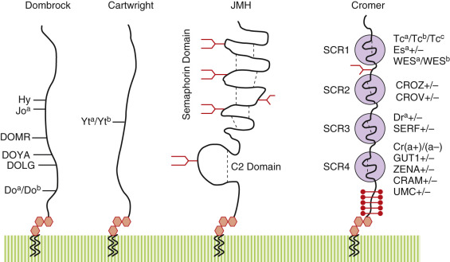

Figure 35-13 

Blood group antigens on glycophosphoinositol-linked glycoproteins. 

 

##  Molecular Biology 

The gene for AChE possesses four exons, spanning 4.5 to 4.7 kb, on chromosome 7q22. Alternate splicing of exon 3 is responsible for the GPI-linked form of AChE observed in RBCs (  Li et al, 1991  ). The Yt  a  and Yt  b  antigens represent a single–amino acid polymorphism at residue 322, where His322 is Yt  a  and Asn322 is Yt  b  (  Bartels et al, 1993  ). The Yt  a  /Yt  b  polymorphism is not located near the catalytic site of the enzyme and has no effect on enzyme activity (  Masson et al, 1994  ). 

 

##  Cartwright Antibodies 

In general, anti-Yt  a  and anti-Yt  b  are usually clinically benign, although shortened red cell survival and even delayed hemolytic transfusion reactions have been reported. Neither antibody is associated with HDFN (  Issitt & Anstee, 1998  ). Anti-Yt  a  and anti-Yt  b  are of IgG isotype, arising from immune stimulation, and are usually detected in the IAT. Despite the high incidence of Yt  a  in the general population, anti-Yt  a  is more common than anti-Yt  b  , suggesting that Yt  a  is the more immunogenic antigen. Anti-Yt  a  is also more likely to cause a positive monocyte-monolayer assay with decreased red cell survival (  Arndt & Garratty, 2004  ). 

 

##  Biological Role 

AChE is a critical enzyme required for the rapid degradation of acetylcholine on postsynaptic membranes of nerves and muscles. The role of AChE in RBCs is unknown. 

 

##  Xg Blood Group System (ISBT No. 012) 

The Xg blood group system contains a single antigen, Xg  a  . As a result, only two phenotypes are known: Xg  a  -positive and Xg  a  -negative. Because the Xg  a  antigen is encoded by a gene on the X chromosome, the incidence of the Xg  a  -positive phenotype is higher among women. Among Caucasians, approximately 89% of women and 66% of men are Xg  a  -positive. Similar results have been found in other ethnic populations (  Johnson, 2011  ). Xg appears to be specific for RBCs. Approximately 9000 molecules of Xg  a  are present per RBC (  Reid & Lomas-Francis, 2012  ). 

 

##  Biochemistry and Molecular Biology 

The Xg  a  antigen is located on a 24- to 29-kD, 180 amino acid glycoprotein named XG protein. A type 1 glycoprotein, XG protein possesses a large, 117 amino acid, amino-terminal extracellular domain; a single transmembrane domain; and a short, carboxy-terminal cytoplasmic tail. Of 11 potential _O_ -glycosylation sites, only three appear to be glycosylated. The protein is encoded by a 2.4-kb gene _(XG)_ located on the X chromosome at the pseudoautosomal boundary/X-specific boundary (pAB1X). 

In the RBC membrane, the XG protein is associated with a second 32 kD sialoglycoprotein, MIC2 or CD99, possibly as a heterodimer. Evidence suggesting a near-neighbor relationship of the XG and MIC2 proteins includes MIC2 inhibition of anti-Xg  a  antibodies and coimmunoprecipitation of MIC2 by anti-Xg  a  . In women, Xg(a–) is always associated with low CD99 expression. Conversely, CD99 is elevated in Xg(a–) men (  Johnson, 2011  ). 

 

##  Xg  a  Antibodies 

Anti-Xg  a  is not associated with hemolytic transfusion reactions or HDFN (  Johnson, 2011  ). Anti-Xg  a  may be immune stimulated or naturally occurring. Most examples are of IgG isotype, including some capable of activating complement. Because of differences in Xg  a  -positive phenotype between men and women, most examples (>85%) of anti-Xg  a  are observed in men. 

 

##  Scianna Blood Group System (ISBT No. 013) 

The Scianna (Sc) blood group system contains seven antigens. Sc1 and Sc2 are antithetical antigens, with most individuals typing as Sc:1,-2. Sc2 and Sc4/Rd are low-incidence antigens, whereas Sc3, Sc5, Sc6, and Sc7 are high-incidence antigens ( [ Table 35-21 ](<#t0110>) ) (  Brunker et al, 2011  ). Sc3 is a high-incidence antigen present on all RBCs except Sc  null  (Sc: –1, –2, –3). Sc-1,2 is more common among oceanic populations of the Pacific Ocean, whereas Sc4 is found most often in Slavic and Ashkenazi Jews. Scianna appears to be specific for RBCs and erythropoietic tissues. 

TABLE 35-21 

Scianna Blood Group Antigens 

Antigen (High Frequency)  |  Percent Donors  |  Amino Acid Change (High→Low Frequency)  |  Percent Donors  |  Antigen (Low Frequency)   
---|---|---|---|---  
Sc1  |  99  |  Gly57>Arg  |  0.7  |  Sc2   
Sc3  |  100  |  307delGA   
Arg332stop  |  Rare  |  SC  null   
|  |  Pro>Ala  |  Rare  |  (Rd) Sc4   
Sc5 (STAR)  |  100  |  Glu>Lys  |  |   
Sc6 (SCER)  |  100  |  Arg81>Gln  |  |   
Sc7 (SCAN)  |  100  |  Gly35>Ser  |  |   
  
From  Reid and Lomas-Francis (2012)  . 

 

##  Biochemistry 

Scianna antigens reside on _er_ ythrocyte _m_ embrane- _a_ ssociated _p_ rotein (ERMAP), a 60- to 68-kD, 446 amino acid glycoprotein. Similar to Lutheran, Ok, and LW proteins, ERMAP is a member of the Ig superfamily. The molecule is a type 1 single-pass transmembrane protein possessing a single IgV domain and a large cytoplasmic domain that is likely involved in signal transduction. The latter possess both SH3 and B30.2 domains, as well as multiple phosphorylation sequences for protein kinase C, tyrosine kinase, and casein kinase II. The molecule possesses 11 cysteine residues and is sensitive to sulfhydryl-reducing agents. 

 

##  Molecular Biology 

The _ERMAP_ gene resides on chromosome 1p34 and consists of 11 exons spanning 19 kb. Most Sc antigens are the result of an SNP and amino acid polymorphism (see [ Table 35-21 ](<#t0110>) ). Two Sc-null alleles are reported: _SC01N.01_ , which contains a nucleotid deletion and frameshift, and _SC01N.02_ , which contains a nonsense mutation (R332Stop). An additional amino acid polymorphism (His26>Tyr) has been identified in the leader sequence, which is not expressed on the mature red cell protein (  Brunker & Flegel, 2011  ). Approximately 25% of Caucasians are positive for the His26>Tyr polymorphism. 

 

##  Scianna Antibodies 

Anti-Scianna antibodies are rare and generally benign. They are usually of IgG isotype, with some examples binding complement. Most examples are immune stimulated; however, naturally occurring anti-Sc2 antibodies are known. The antigens are relatively resistant to enzymes but can be weakened with DTT and AET. They are not a cause of transfusion reactions but can lead to delays due to difficulty in finding crossmatch-compatible blood. Anti-Sc4 and anti-Sc2 have been associated with HDFN. Autoantibodies against Sc1 and Sc3 antigens have been associated with warm autoimmune hemolytic anemia (  Brunker & Flegel, 2011  ). Anti-Scianna antibodies can be neutralized with soluble recombinant ERMAP protein (  Seltsam et al, 2009  ). 

 

##  Biological Role 

The biological role of ERMAP is unknown, although its structure suggests that it may play a role in RBC adhesion and signaling. The IgV domain possesses a C1q recognition sequence that may mediate adhesion between marrow macrophages and erythroblasts in erythroid islands. Because ERMAP shares homology with the B7 family of proteins (CD80, CD86) and neural autoantigens, it is speculated that ERMAP could be involved in immune recognition and autoimmune anemia (  Brunker & Flegel, 2011  ). 

 

##  Dombrock Blood Group System (ISBT No. 014) 

The Dombrock blood group system contains seven antigens. Do  a  (DO1) and Do  b  (DO2) are autosomal codominant antigens expressed by 67% and 82% of white donors, respectively ( [ Table 35-22 ](<#t0115>) ). Gy  a  , Hy, Jo  a  , DOYA, and DOMR are high-incidence antigens found on virtually all donors. In addition to RBCs, Dombrock mRNA has been identified in fetal liver and spleen (  Gubin et al, 2000  ). 

TABLE 35-22 

Phenotypes of the Dombrock System 

REACTIONS WITH ANTI-DOMBROCK ANTIBODIES  |  |  |  Amino Acid Change  |  FREQUENCY (%) U.S. POPULATION   
---|---|---|---|---  
Do  a  |  Do  b  |  Gy  a  |  Jo  a  |  Hy  |  D06  |  D07  |  Phenotype  |  ISBT  |  Caucasian  |  Black   
\+  |  0  |  \+  |  \+  |  \+  |  \+  |  \+  |  Do (a+b–)  |  DO1  |  Asn265  |  18  |  11   
\+  |  \+  |  \+  |  \+  |  \+  |  \+  |  \+  |  Do (a+b+)  |  |  |  49  |  44   
0  |  \+  |  \+  |  \+  |  \+  |  \+  |  \+  |  Do (a–b+)  |  DO2  |  Asp265  |  33  |  45   
**Null/Weak Phenotypes**  
0  |  0  |  0  |  0  |  0  |  0  |  0  |  Gy(a–) or Do  null  [ † ](<#hl0003758>) |  DO3  |  Loss exon 2 [ * ](<#hl0003754>) |  Rare  |  Rare   
0  |  w  |  w  |  0/w  |  0  |  w  |  \+  |  Hy(–)  |  DO4  |  Gly108>Val  |  Rare  |  Rare   
w  |  0/w  |  \+  |  0  |  w  |  w  |  0/w  |  Jo(a–)  |  DO5  |  Thr117>Ile  |  Rare  |  Rare   
0  |  0  |  w  |  w  |  w  |  0  |  ?  |  DOYA(–)  |  DO6  |  Tyr183>Asp  |  Rare  |  Rare   
0  |  \+  |  0  |  w  |  w  |  ?  |  0  |  DOMR(–)  |  DO7  |  Ala144>Glu  |  Rare  |  Rare   
\+  |  0  |  \+  |  \+  |  \+  |  ?  |  ?  |  DOLG (-)  |  DO8  |  Leu225Gln  |  Rare  |  Rare   
\+  |  0  |  \+  |  \+  |  \+  |  \+  |  ?  |  DOLC (-)  |  DO9  |  Thr189Met  |  Rare  |  Rare   
  
_ISBT,_ International Society of Blood Transfusion. 

 * Loss of exon 2 has been associated with splice-site, frameshift, and nonsense mutations (  Reid & Lomas-Francis, 2004  ). 

 † Also associated with PNH III red blood cells (RBCs), which lack all glycophosphoinositol (GPI)-linked glycoproteins, including Dombrock, Cartwright, Cromer, JMH, and CD59 antigens. 

 

##  Null/Weak Phenotypes 

The Do  null  or Gy(a–) phenotype is a rare, autosomal recessive phenotype (see [ Table 35-28 ](<#t0145>) ). An acquired Do  null  phenotype can be observed in paroxysmal nocturnal hemoglobinuria type III (PNH-III). A hematopoietic stem cell disorder, PNH III is characterized by chronic hemolysis due to an absence of all GPI-linked glycoproteins, including Cromer, Dombrock, and Cartwright antigens. 

Loss of one high-incidence Dombrock antigen is often accompanied by weakened expression of other Dombrock antigens (see [ Table 35-22 ](<#t0115>) ). This is due to the heterogeneity of Dombrock alleles, which carry different combinations of Dombrock antigens (  Reid, 2005  ;  Baleotti et al, 2006  ). Hy(–) and DOMR(–) individuals typically have weakened Do  b  and Gy  a  and weak/absent Jo  a  expression, whereas Jo(a–) is often associated with weak Do  a  , Hy, and Gy expression (  Reid, 2005  ;  Costa et al, 2009  ). The one example of DOYA(–) types as Co(a–-b–), with weakened expression of Gy, Hy, and Jo  a  (  Reid & Lomas-Francis, 2012  ). 

 

##  Biochemistry 

Dombrock antigens reside on an adenosine diphosphate (ADP)-ribosyltransferase (CD297), which catalyzes the transfer of ADP-ribose from nicotinamide adenine dinucleotide (NAD) to a protein acceptor. The cloned molecule is a 47- to 58-kD, 314 amino acid glycoprotein that is anchored into the RBC membrane via a GPI glycolipid tail (GPI-linked; see [ Fig. 35-13 ](<#f0070>) ). The molecule has five potential _N_ -glycosylation sites, two myristoylation sites, and five cysteine residues (  Gubin et al, 2000  ;  Daniels, 2002  ). As a consequence, Dombrock can be destroyed by disulfide-reducing agents and phosphatidylinositol phospholipase C, which cleaves GPI-linked proteins (  Gubin et al, 2000  ). 

 

##  Molecular Biology 

The gene for Dombrock _(ART4)_ spans 14 kb on chromosome 12p13.2-12.1. The gene consists of three exons, although exon 2 encodes more than 70% of the translated protein and includes all seven Dombrock antigens. Do  a  , Do  b  , Jo  a  , Hy, DOYA, and DOMR are the result of a single–amino acid polymorphism (see [ Table 35-22 ](<#t0115>) ). The Do  null  or Gy(a–) phenotype is the result of mutations that abolish exon 2 (  Reid, 2005  ). 

 

##  Dombrock Antibodies 

Anti-Dombrock antibodies can be clinically significant, although many examples are benign. They are commonly found in mixtures of alloantibodies and can be difficult to identify. Anti-Dombrock antibodies are capable of causing shortened RBC survival and acute and delayed hemolytic transfusion reactions. Transfusion reactions and accelerated clearance due to anti-Dombrock antibodies can be missed in routine testing, with implicated units often testing as crossmatch-compatible, even in a full IAT crossmatch. Moreover, a posttransfusion direct antiglobulin test and eluate can be negative with no observable rise in antibody titer with time (  Reid, 2005  ;  Baumgarten et al, 2006  ). Anti-Dombrock is not associated with HDFN. 

Antibodies against Dombrock antigens are usually of IgG isotype, arising from immune stimulation by transfusion or pregnancy. Antibody reactivity can be enhanced by the use of papain- or ficin-treated RBCs. Conversely, antibody reactivity is reduced or abolished by the treatment of red cells with sulfhydryl-reducing agents (DTT, AET), trypsin, chymotrypsin, and pronase. Anti-Dombrock can deteriorate with in vitro storage, complicating pretransfusion testing (  Baumgarten et al, 2006  ). In addition, Dombrock titers may decrease over time in vivo, falling below the level of detection (  Reid, 2005  ). 

 

##  Biological Role 

Although Dombrock is an ADP-ribosyltransferase, no enzyme activity has been reported on RBC membranes (  Reid, 2005  ). No known clinical syndrome is associated with a Do  null  phenotype. It has been hypothesized that Dombrock may play a role in clearing circulating NAD+ and/or posttranslational modification of proteins (  Reid, 2005  ). Dombrock may also contribute to integrin-mediated cell adhesion via an RGD motif at the Do  b  antigen; the RGD motif is abolished in the Do  a  phenotype. 

 

##  Colton Blood Group System (ISBT No. 015) 

The Colton blood group system was initially identified in 1967 and consists of two autosomal codominant antigens, Co  a  and Co  b  , and a third high-incidence antigen (“TOR”) (  Arnaud et al, 2008  ). Co  a  is a high-incidence antigen present on 99.7% of donors. Co  b  is expressed by less than 11% of donors, with only 0.3% being Co (a–b+). Although very rare, a Co (a–b–) or null phenotype is reported. Colton antigens are expressed on RBCs, renal proximal tubules, thin descending limb of Henle, renal vasa recta endothelium, choroid plexus, ciliary body, microvessels, gallbladder, placenta, and some epithelial cells. More than 120,000 to 160,000 molecules of Colton glycoprotein are present per RBC. 

 

##  Biochemistry 

The Colton blood group antigens reside on aquaporin 1 (AQP-1) or channel-forming integral protein, a water-selective membrane channel ( [ Fig. 35-14 ](<#f0075>) ). Cloned in 1991, AQP-1 is a 269 amino acid multipass integral membrane protein containing six transmembrane domains. Crystallographic studies suggest that the first intracellular and third extracellular loops fold back into the plasma membrane, overlapping at two Asp-Pro-Ala (NPA) sequences to form a water channel. A single _N_ -glycosylation site (Asn42), capable of expressing ABH antigens, is found in the first extracellular loop near the Co  a  /Co  b  and TOR epitopes (residues 45 and 47). The latter is variably glycosylated in vivo, leading to a spectrum of AQP-1 glycoforms, ranging from 40 to 60 kD (  Agre et al, 1994  ). In RBC membranes, AQP-1 exists as a homotetramer, a square array of AQP-1 monomers, which may help stabilize the structure and functional integrity of individual monomers (  Knepper, 1994  ). AQP-1 co-localizes with AE1-ankyrin metabolon complex (  Burton & Bruce, 2011  ). 

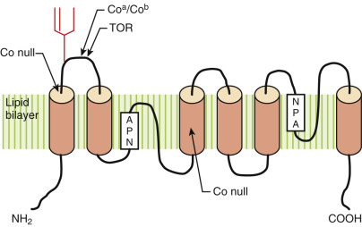

Figure 35-14 

Structure of aquaporin-1 (AQP-1, channel-forming integral protein [CHIP]). 

AQP-1 is a multipass protein containing six transmembrane domains, indicated by solid amber cylinders. The first cytoplasmic and third extracellular loops fold back into the lipid bilayer, overlapping at two Asp-Pro-Ala (NPA) motifs, to form a water channel. The _N_ -glycosylation site is indicated by a branched structure on the first extracellular loop. The Co  a  /Co  b  polymorphism at amino acid 45 is indicated by a solid line. TOR is a rare antigen adjacent to the Co  a  /Co  b  polymorphism at amino acid 47. The sites of two mutations leading to a Colton null phenotype are also shown. 

 

##  Molecular Biology 

AQP-1 is a 17-kb gene on chromosome 7p14. The gene has four exons and both TATA and Sp1 consensus sequences in the promoter region (  Moon et al, 1993  ). The Co  a  and Co  b  antigens are the result of an A314T polymorphism, leading to Ala45 (Co  a  ; _CO*01_ ) or Val45 (Co  b  ; _CO*02_ ) (  Smith et al, 1994  ). A third polymorphism (Gln47>Arg) just distal to the Co  a  /Co  b  polymorphism was recently identified in an alloimmunized Turkish patient (TOR) with an apparent anti-Co3 (  Arnaud et al, 2008  ). Six CO-null alleles are described, as well as a Co-3 weak allele (Co  mod  ; Pro38>Leu). An acquired Co  null  phenotype is also reported in rare patients with monosomy 7 and congenital dyserythropoietic anemia (  Agre et al, 1994  ). 

 

##  Colton Antibodies 

Anti-Colton antibodies can be clinically significant: They can be associated with shortened RBC survival, hemolytic transfusion reactions, and HDFN (see [ Table 35-5 ](<#t0030>) ). Antibodies to Co  a  and Co  b  are usually of the IgG isotype, resulting from immune stimulation by transfusion or pregnancy. Some examples of anti-Co  a  and anti-Co  b  are reported to bind complement. Anti-Colton antibodies are detectable in the AHG phase of testing and are enhanced with protease-treated RBCs. Rare Co  null  and “TOR-negative” individuals can make an anti-Co3 (anti-Co  a+b  ), an alloantibody that reacts with both Co (a+b–) and Co (a–b+) RBCs (  Reid & Lomas-Francis, 2012  ;  Arnaud et al, 2008  ). 

 

##  Biological Role 

Biologically, AQP-1 is a major molecular water channel on RBCs that facilitates the concentration of urine in kidney (  Verkman, 2009  ). Co  null  red cells also have decreased CO  2  permeability (  Endeward et al, 2006  ). Despite its importance in water regulation, Colton-null individuals show few or no adverse clinical effects. Co  null  RBCs appear morphologically normal in appearance and number, although mild decreases in RBC life span are reported (  Mathai et al, 1996  ). The absence of any clinically significant hematologic sequelae in Co  null  individuals is most likely due to the presence of a second aquaporin, AQP-3. A glycerol and, perhaps, urea transporter, AQP-3 (GIL blood group) is moderately permeable to water and appears to account for the residual water permeability on Co  null  RBCs (  Roudier et al, 1998  ;  Verkman, 2009  ). 

 

##  LW Blood Group System (ISBT No. 016) 

Named in honor of its discoverers, the LW, or Landsteiner-Wiener, blood group system is most important for its role in the history of the Rh blood group system. Landsteiner and Wiener originally developed antibodies against the LW antigens by immunizing rabbits with rhesus monkey red cells. The resulting “anti-Rh” antibodies were initially believed to recognize the RhD antigen; however, later investigators proved that the antibodies developed by Landsteiner and Wiener recognized a non-Rh (LW) antigen. 

The LW blood group system consists of two allelic antigens: LW  a  and LW  b  . LW  a  is a high-frequency antigen (99% of white donors). Expression of LW antigen is dependent on RhD protein expression, with the highest expression observed on RhD-positive red cells and weaker expression on RhD-negative cells. LW antigens are absent from Rh  null  erythrocytes. An LW (a–b–) or null phenotype can also be seen in very rare individuals who are homozygous for a silent LW allele. The LW antigen is expressed on RBCs and placenta. Approximately 3600 to 5000 molecules of LW glycoprotein are present per RBC (  Reid & Lomas-Francis, 2012  ). 

 

##  Biochemistry 

The LW antigens reside on intracellular adhesion molecule type 4 (ICAM-4, CD242), a 40- to 47-kD type 1 glycoprotein. The protein undergoes processing with cleavage of a 30 amino acid leader sequence, resulting in a mature 241 amino acid protein. A member of the Ig superfamily, ICAM consists of two extracellular C2-like domains: a single transmembrane domain and a short cytoplasmic tail. Four _N_ -glycosylation sites are present, along with evidence of _O_ -glycosylation, which may influence adhesion (  Toivanen et al, 2008  ). Although several amino acids are critical for ICAM-4/integrin binding, the first C2 or Ig domain is most critical (  Toivanen et al, 2008  ). The molecule has three disulfide bonds and is sensitive to reducing agents such as DTT (  Reid & Lomas-Francis, 2012  ). 

 

##  Molecular Biology 

The _ICAM4_ gene resides on chromosome 19p13. The LW  a  and LW  b  antigens arise from an SNP (A308G), leading to Gln100 (LW  a  ) or Arg100 (LW  b  ). Of two LW  null  individuals studied, one possessed a 10-bp deletion in the coding sequence (  Hermand et al, 1995  ). 

 

##  LW Antibodies 

Clinically benign, anti-LW antibodies are rarely a cause of hemolytic transfusion reactions or HDFN. They usually are of IgG isotype and are detected in the IAT. Antibody activity can be reduced by ethylenedia­minetetraacetic acid (EDTA) and pretreatment of RBCs with sulfhydryl-reducing agents (DTT, AET). In addition to anti-LW  a  and anti-LW  b  , LW  null  individuals can make an anti-LW  ab  , which reacts with both LW (a+b–) and LW (a–b+) erythrocytes. 

 

##  Biological Role 

LW glycoprotein is a potential counterreceptor for the β2-integrin protein Mac1 (CD11b/CD18), LFA-1 (CD11a/CD18), and platelet GPIIb/IIIa. It is hypothesized that the LW glycoprotein may participate in adhesive interactions during early erythroid development. Mice lacking ICAM-4 have a decrease in erythroblastic islands in their marrow, although peripheral red cell mass is normal (  Toivanen et al, 2008  ). LW expression is elevated in sickle cell patients and may be involved in microvascular occlusion (  Reid & Lomas-Francis, 2012  ). LW glycoprotein may also be involved in red cell senescence by binding to CD11/CD18 integrin on splenic macrophages (  Toivanen et al, 2008  ). 

 

##  Chido/Rodgers Blood Group System (ISBT No. 017) 

The Chido/Rodgers (Ch/Rg) blood group system contains 10 antigens, including two pairs of antithetical antigens and three conformational antigens. The latter require coexpression of two spatially distinct Ch/Rg antigens that together generate a third, conformational antigen ( [ Table 35-23 ](<#t0120>) ). Most Ch/Rg antigens are high-incidence antigens (>90%). Similar to Lewis blood group antigens, Ch/Rg antigens are of plasma origin and are passively adsorbed onto RBC membranes. Ch/Rg antigens are weakly expressed on cord RBCs and some GYPA-deficient RBCs (  Issitt & Anstee, 1998  ). 

TABLE 35-23 

Chido/Rodgers Blood Group Antigens 

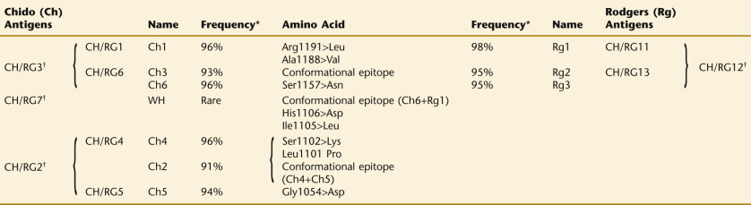

*Calculated from  Giles (1987)  and  Issitt and Anstee (1998)  . 

† Conformational epitopes I require the presence of two Ch/Rg antigenic determinants. 

 

##  Biochemistry/Molecular Biology 

Ch/Rg antigens are antigenic determinants on the C4d fragment of the C4 complement molecule. C4 is the product of two highly homologous genes (99% identity), _C4A_ and _C4B_ , on chromosome 6p21.3 near the HLA locus. At present, more than 50 C4 alleles have been identified, including null alleles, making the genetics of this system difficult. Each gene spans approximately 22 kb and is organized into 41 exons. Four amino acids in exon 26 are responsible for distinguishing C4A from C4B. Most Ch/Rg antigens are determined by amino acid polymorphisms encoded in exons 25 and 28 (  Giles et al, 1988  ). In general, Chido antigens are on C4B, and Rodgers antigens are on C4A, although examples of C4B-expressing Rodgers antigens (and vice versa) are known (  Giles, 1987  ;  Giles et al, 1988  ). On protein electrophoresis, C4A migrates faster than C4B. 

 

##  Chido/Rodgers Antibodies 

Antibodies against Ch/Rg antigens do not cause hemolytic transfusion reactions or HDFN. Rare reports have described anaphylaxis following transfusion of plasma and platelets (  Westhoff et al, 1992  ). Anti-Ch/Rg antibodies are of IgG isotype and are usually detected with AHG. Antibody reactivity can be enhanced by incubating RBCs in a low–ionic sucrose solution. Antibody reactivity can be inhibited by plasma or by treatment of RBCs with proteases (  Reid & Lomas-Francis, 2012  ). 

 

##  Biological Role 

C4 deficiency is associated with autoimmune disorders and susceptibility to bacterial meningitis. Specific C4 allotypes have been linked to several autoimmune disorders, including rheumatoid arthritis and Graves' disease. 

 

##  Gerbich Blood Group System (ISBT No. 020) 

The Gerbich (Ge) blood group system contains 11 antigens: 6 high-frequency (>99%; [ Table 35-24 ](<#t0125>) ) and 5 low-frequency antigens. The Gerbich glycoproteins (GPC/D; [ Fig. 35-15 ](<#f0080>) ) are on fetal and adult RBCs, platelets, and kidney and fetal liver. Between 180,000 and 250,000 molecules of Gerbich are present per RBC (  Reid & Lomas-Francis, 2012  ). 

TABLE 35-24 

Gerbich Blood Group Antigens 

HIGH FREQUENCY  |  |  |  Amino Acid Change (High→Low)  |  |  LOW FREQUENCY   
---|---|---|---|---|---  
ISBT  |  Name  |  Frequency  |  GP [ * ](<#hl0003959>) |  Frequency  |  Name  |  ISBT   
GE2  |  Ge2  |  >99%  |  GYPD  |  aa 1-19  |  |  |   
GE3  |  Ge3  |  >99%  |  GYPC  |  aa 43-50  |  |  |   
|  |  |  GYPD  |  aa 22-29  |  |  |   
GE4  |  Ge4  |  >99%  |  GYPC  |  N-terminus  |  |  |   
|  Wb(–)  |  >99%  |  GYPC  |  Ser8>Asn, loss of _N_ -glycan  |  Rare  |  Webb  |  GE5   
|  |  |  GYPC+D  |  Duplication of exon 3  |  2% blacks  |  Ls  a  |  GE6   
|  |  |  |  |  1.5% Finnish  |  |   
|  An(a–)  |  >99%  |  GYPD  |  Ser2>Ala  |  0.01%  |  An  a  |  GE7   
|  Dh(a–)  |  >99%  |  GYPC  |  Leu14>Ala  |  <0.01%  |  Dh  a  |  GE8   
|  |  |  GYPC+D  |  Thr32Asn (GYPC), Thr11Asn (GYPD)  |  Very rare  |  GEIS  |  GE9   
GE10  |  GEPL  |  >99%  |  GYPC+D  |  Pro45Leu (GYPC), Pro24Leu (GYPD)  |  Rare  |  GEPL(–)  |   
GE11  |  GEAT  |  >99%  |  GYPC  |  Asp19Val  |  Rare  |  GEAT(–)  |   
GE12  |  GETI  |  >99%  |  GYPC+D  |  Thr27Ile (GYPC), Thr6Ile (GYPD)  |  Rare  |  GETI (–)  |   
**Gerbich Null Phenotypes** [ † ](<#hl0003962>)  
|  |  |  GYPC  |  Deletion exon 2  |  Rare  |  Yus  |  (Ge–2, 3, 4)   
|  |  |  GYPC  |  Deletion exon 3  |  10% to 50% Melanesians  |  Gerbich  |  (Ge–2, –3, 4)   
|  |  |  GYPC  |  Deletion exons 3+4  |  Rare  |  Leach  |  (Ge–2, –3, –4)   
  
_ISBT,_ International Society of Blood Transfusion. 

 * Glycophorin C (GYPC) or glycophorin D (GYPD). 

 † Yus and Gerbich phenotypes are the result of mutant GPC alleles. No GPD is found in Yus, Gerbich, or Leach phenotypes. 

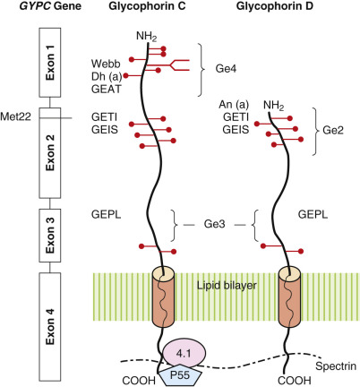

Figure 35-15 

Gerbich antigens on glycophorin C (GYPC) and glycophorin D (GYPD). 

_O_ -linked (  ) and _N_ -linked glycans are shown. Also shown is the relationship of the _GYPC_ gene to both proteins. GYPD is the result of alternative translation at Met22 in exon 2. Deletions of different exons are responsible for the three Gerbich null phenotypes. GYPC and GYPD may interact with spectrin, protein 4.1, and p55 of the cytoskeleton. 

 

##  Null/Weak Phenotypes 

Three autosomal recessive phenotypes are associated with the loss of high-incidence Gerbich antigens: Yus (Ge-2,3,4), Gerbich (Ge-2,-3,4), and Leach (Ge-2,-3,-4). The Gerbich phenotype (GYPCΔex3) is common in New Guinea, a holoendemic area for malaria. All three null phenotypes are associated with ovalocytosis. Gerbich antigens are also decreased in patients with hereditary elliptocytosis due to mutations in actin and other cytoskeletal proteins (  An & Mohandas, 2008  ). 

 

##  Biochemistry 

Gerbich antigens are expressed on two biosynthetically related type 1 glycoproteins: glycophorin C (GYPC; see [ Fig. 35-15 ](<#f0080>) ) and glycophorin D (GYPD). GYPC is a 40-kD, 128 amino acid glycoprotein bearing one _N_ -linked and 12 _O_ -linked glycans. GYPD is a 107 amino acid variant, lacking 21 amino acids at the amino-terminus (  Reid & Lomas-Francis, 2012  ). GYPC and GYPD are members of the RBC junctional complex, which is responsible for maintaining the lateral stability of the membrane (  Burton & Bruce, 2011  ;  An & Mohandas, 2008  ). The cytoplasmic domain interacts with AE1 and several cytoskeletal proteins, including spectrin, protein 4.1, and p55. Defects in junctional complex proteins can lead to ovalocytosis. 

 

##  Molecular Biology 

GYPC and GYPD are the products of a single gene, _GYPC,_ on chromosome 2q14-121. The gene spans 13.5 kb and is organized into four exons. Exons 1 to 3 encode the extracellular domain; exon 4 is responsible for the transmembrane domain and the cytoplasmic tail. The promoter region contains classical CCAC and TATA sequences, as well as transcription factor binding sites for Sp1, GATA-1, and NF-E6. GYPD is the product of leaky translation at a downstream, alternative AUG residue (Met22). 

As shown in [ Table 35-24 ](<#t0125>) , the high-frequency antigens Ge2 and Ge4 are the NH  2  -termini of GYPD and GYPC, respectively. Ge3 is encoded by exon 3 and is shared by both molecules. With the exception of Ls  a  , low-frequency Ge antigens are the result of single–amino acid polymorphisms. The Leach phenotype results from deletion of exons 3 and 4. As a result, no GYPC or GYPD protein is expressed (see [ Fig. 35-15 ](<#f0080>) ). The Yus and Gerbich phenotypes (GYPCΔex3) are deletion mutants characterized by variant GYPC synthesis and complete loss of GYPD synthesis. As a result, Yus and Gerbich can express high-incidence antigens present on GYPC (Ge3, Ge4) but not on GYPD (Ge2). Gerbich-negative red cells also show altered glycosylation, with expression of an immature, high-mannose _N_ -glycan and decrease in sialylated _O_ -glycans (  Mayer et al, 2006  ). The formation of an upstream start codon with synthesis of GYPC is relatively new and is limited to humans (  Wilder et al, 2009  ). 

 

##  Gerbich Antibodies 

Anti-Gerbich antibodies are usually, but not always, clinically significant. Reports have described shortened RBC survival and delayed hemolysis following transfusion of Gerbich-incompatible RBCs. One report described severe HDFN. Autoantibodies against Gerbich antigens have been associated with severe autoimmune hemolytic anemia (  Reid & Lomas-Francis, 2004  ). 

Anti-Gerbich antibodies can be of IgM or IgG isotype. Most are immune stimulated, although naturally occurring anti-Ge are known. They may be detected at room temperature and are enhanced by AHG. Gerbich antigens are resistant to chymotrypsin but are sensitive to other proteases (trypsin, pronase). 

 

##  Biological Role 

GYPC and GYPD, in conjunction with AE1, help anchor the membrane to the underlying cytoskeleton. GYPC is also a receptor _P. falciparum_ EBA140/BAEBL protein, a sialic acid-dependent invasion protein that recognizes the _N_ -glycan on GYPC. Gerbich-negative RBC (GYPCΔex3) show increased resistance to _P. falciparum_ infection in vitro. It is hypothesized that the high incidence of Gerbich-negative is a selective advantage against severe malaria, although this has not yet been demonstrated (  Cooling, 2015  ). Because they are rich in sialic acid, GYPC and GYPD can also bind influenza virus. 

 

##  Cromer Blood Group System (ISBT No. 021) 

The Cromer system (Cr/CROM) contains 16 antigens, including 5 antithetical antigens, 10 high-incidence antigens, and 23 possible phenotypes ( [ Table 35-25 ](<#t0130>) ; [ Fig. 35-13 ](<#f0070>) ). Cromer antigens are present on DAF (CD55), which is widely expressed on tissues and in secretions. DAF has been identified on all hematopoietic cells, vascular endothelium, gastrointestinal and genitourinary epithelium, brain, and body fluids (  Storry & Reid, 2002  ). Cromer is expressed on cord RBCs and placental trophoblasts. 

TABLE 35-25 

Cromer Blood Group Antigens 

HIGH-FREQUENCY ANTIGENS  |  Amino Acid Change (High→Low)  |  LOW-FREQUENCY ANTIGENS   
---|---|---  
ISBT  |  Name  |  Frequency  |  Frequency  |  Name  |  ISBT   
CROM1  |  Cr  a  |  >99%  |  Ala227>Pro  |  Rare  |  |   
CROM2  |  Tc  a  |  >99%  |  Arg52>Leu  |  6% blacks   
0% Caucasians  |  Tc  b  |  CROM3   
|  |  |  Arg52>Pro  |  Rare  |  Tc  c  |  CROM4   
CROM5  |  Dr  a  |  >99%  |  Ser199>Leu  |  Rare  |  Dr(a–)  |   
CROM6  |  Es  a  |  >99%  |  Ile80>Asn  |  Rare  |  |   
CROM7  |  IFC  |  >99%  |  Heterogeneous  |  Rare  |  Inab  |   
CROM9  |  Wes  b  |  >99%  |  Leu82>Arg  |  2% blacks   
<0.5% Caucasians  |  Wes  a  [ * ](<#hl0004116>) |  CROM8   
CROM10  |  UMC  |  >99%  |  Thr250>Met  |  Rare  |  |   
CROM11  |  GUT1  |  >99%  |  Arg240>His  |  15% Muapuche Indians  |  GUT1(–)  |   
CROM12  |  SERF  |  >99%  |  Pro216>Leu  |  1% Thai  |  SERF(–)  |   
CROM13  |  ZENA  |  >99%  |  His242>Gln  |  |  |   
CROM14  |  CROV  |  >99%  |  Glu156>Lys  |  |  |   
CROM15  |  CRAM  |  >99%  |  Gln247>Arg  |  |  |   
CROM16  |  CROZ  |  >99%  |  Arg130>His  |  Rare  |  CROZ(–)  |   
  
_ISBT,_ International Society of Blood Transfusion. 

 * Because of their proximity, Wes  a  weakens Es  a  expression. 

 

##  Null/Weak Phenotypes 

Inab or Cromer null phenotype is a rare autosomal recessive phenotype, characterized by complete absence of all Cromer antigens but normal expression of CD59 and other GPI-linked glycoproteins. Many individuals with the Inab phenotype suffer from chronic gastrointestinal disorders, particularly a chronic protein-losing gastroenteropathy. CD55/Cromer is also missing on PNH III RBCs, which lack all GPI-linked glycoproteins. Weak Cromer expression (40% normal) is observed in the Dr(a–) phenotype. 

 

##  Biochemistry 

CD55/DAF is a highly glycosylated, 319 amino acid, 70-kD GPI-linked glycoprotein (see [ Fig. 35-13 ](<#f0070>) ). The extracellular domain consists of four short consensus repeat (SCR) domains, capable of binding complement components (C3b/C4b), followed by a 70 amino acid, rigid stalk-region rich in _O_ -linked glycans (50% serine/threonine) that may protect the molecule from proteolysis. Each SCR domain contains four highly conserved cysteine residues, resulting in two intrachain disulfide bonds per SCR. As a consequence, DAF is sensitive to sulfhydryl-reducing agents. The molecule contains a single _N_ -glycosylation site near SCR1 (  Medof et al, 1987  ). SCR2 and SCR3 are the binding sites for the C3 convertase complexes C3bBb or C4b2a (  Lublin, 2005  ). All four SCR domains are home to Cromer antigens. 

 

##  Molecular Biology 

The _DAF_ gene spans 40 kb on chromosome 1q32 and is organized into 11 exons. Cr  a  is the reference allele ( _CROM*01_ ). Most Cromer antigens reflect single–amino acid polymorphisms (see [ Table 35-25 ](<#t0130>) ; see [ Fig. 35-13 ](<#f0070>) ) (  Hue-Roye et al, 2007  ;  Reid & Lomas-Francis, 2012  ). The Inab phenotype is the result of nonsense and frameshift mutations. The Dr(a–) phenotype is the consequence of a SNP (596C>T) that leads to both an Ser199>Leu polymorphism and an alternative splice site. In Dr(a–) individuals, two mRNA species are observed, encoding a truncated mutated protein arising from alternate splicing (major transcript) and the full DAF bearing the Leu165 polymorphism (minor transcript). Dr(a–) RBCs have weakened expression of DAF and all Cromer antigens (  Storry & Reid, 2002  ). 

 

##  Cromer Antibodies 

The clinical significance of anti-Cromer antibodies is variable. In some individuals, anti-Cromer antibodies are associated with decreased RBC survival and hemolytic transfusion reactions. Cromer antibodies do not cause HDFN owing to adsorption of antibodies by DAF on trophoblast epithelium (  Storry & Reid, 2002  ;  Lublin, 2005  ). In several cases, a transient loss of anti-Cromer antibodies was noted in the second and third trimesters, with reappearance of the antibody following delivery (  Hue-Roye et al, 2007  ). 

Anti-Cromer antibodies are usually of IgG isotype, arising from immune stimulation. They are detected in the IAT and can give weak, variable results (historically, high-titer, low-avidity [HTLA] antibodies). Anti-Cromer can be inhibited by plasma, urine, and platelet concentrates. Antibody reactivity is highly sensitive to pretreatment of RBCs with chymotrypsin and pronase, but not with other proteases. Cromer antigens are weakened, but not destroyed, by AET and DTT. 

 

##  Biological Role 

CD55/DAF protects cells from complement by promoting the decay of two C3 convertases: C4b2a and C3bBb. In murine models of induced autoimmune disease, CD55 knockout mice demonstrate increased disease severity (  Lublin, 2005  ). CD55 is also a receptor for intestinal _E. coli_ strains bearing Afa/Dr adhesins, which recognize SCR3. CD55 is an alternate ligand for _H. pylori_ and is upregulated in chronic infections. CD55 is also a receptor for several viruses, including hantavirus, coxsackie virus, enterovirus ENV70, and multiple echovirus strains (  Cooling, 2015  ). 

 

##  Knops Blood Group System (ISBT No. 022) 

The Knops blood group contains 9 allelic antigens, including six antithetical antigens (see [ Table 35-32 ](<#t0165>) ). Several Knops antigens (Kn  b  , Mc  b  , Sl  a  , KCAM) are racially segregated. Knops antigens are present on adult and cord RBCs, neutrophils, B lymphocytes, and dendritic cells (  Reid & Lomas-Francis, 2012  ). Knops can vary in strength between individuals (200 to 1200 molecules/RBC), with approximately 1% of donors showing extremely weak Knops expression (50 to 150 molecules/RBC, Helgeson phenotype). Knops/CR1 can be decreased in the setting of infection and autoimmune disorders due to high levels of circulating immune complexes (  Moulds, 2010  ). 

 

##  Biochemistry 

Knops resides on complement receptor 1 (CR1, CD35), a 220-kD glycoprotein (  Moulds, 2010  ). The extracellular domain consists of 30 SCRs, arranged into four long homologous regions (LHRA-D), each containing 7 SCR. LHRA-C each contain a complement binding domain that is capable of binding C4b, C3b, and C5a, as well as malaria (  Cooling, 2015  ) The KNOPS antigens reside in SCR25 and 26 in LHRD. LHRD is also a receptor for mannose-binding lectin. The molecule also possesses six to eight _N_ -glycosylation sites. 

 

##  Molecular Biology 

The _CR1_ gene resides on chromosome 1q32. Four CR1 isoforms (CR*1 to 4) are possible, but CR1*1 is the most common (  Moulds, 2010  ). Variation in CR1 strength and copy number is a genetically determined trait and may have arisen due to selective pressure by malaria. To date, all Knops antigens arise from amino acid polymorphisms ( [ Table 35-26 ](<#t0135>) ;  Covas et al, 2007  ;  Moulds, 2010  ). SL3 is a conformation antigen that requires Sl1 and S14 coexpression. 

TABLE 35-26 

Knops Blood Group Antigens 

HIGH FREQUENCY  |  |  Amino Acid Change (High→Low)  |  |  LOW FREQUENCY   
---|---|---|---|---  
ISBT  |  Name  |  Frequency  |  Frequency  |  Name  |  ISBT   
KN1  |  Kn  a  |  99%  |  Val1561>Met  |  4% Caucasians  |  Kn  b  |  KN2   
KN3  |  Mc  a  |  99%  |  Lys1590>Glu  |  45% blacks  |  Mc  b  |  KN6   
KN4  |  Sl1 (Sla)  |  98% Caucasians   
52% blacks  |  Arg1601>Gly  |  Blacks only  |  Sl2 (Vil)  |  KN7   
|  Sl4 [ * ](<#hl0004219>) |  100% blacks   
96% Caucasians  |  Ser1610>Thr  |  4% Caucasians  |  Sl5 [ * ](<#hl0004219>) |   
KN8  |  Sl3 [ † ](<#hl0004222>) |  |  Arg1601+Ser1610  |  |  |   
KN9  |  KCAM  |  80% to 98% Caucasians  |  Ile1615>Val  |  70% to 80% West Africans, Afro-Brazilians  |  KCAM(–)  |   
KN5  |  Yk  a  |  92% Caucasians   
98% blacks  |  Unknown  |  |  |   
  
_ISBT,_ International Society of Blood Transfusion. 

 * Sl4 and Sl5 are theoretical antigens not formally added to the Knops family at this time. 

 † Sl3 is a conformational antigen that requires the presence of both Sl1 (Arg1601) and “Sl4” (Ser1610). 

 

##  Knops Antibodies 

Knops antibodies are clinically insignificant. Knops-incompatible RBCs have normal survival following transfusion. Knops antibodies are of IgG isotype, arising from immune stimulation, and are usually detected only with AHG. Historically classified as an HTLA antibody, Knops antibodies are notoriously difficult to work with because of their low avidity, biological variation in Knops expression, antigen degradation, and the common presence of additional alloantibody specificities. Knops antigens are resistant to proteases but are weakened by sulfhydryl-reducing agents (AET, DTT). 

 

##  Biological Role 

A complement regulatory protein, CR1 can bind C3b/C4b immune complexes, promoting their degradation to iC3b and iC4b by factor 1. CR1 also binds C5a and can accelerate the decay of C3 and C5 convertases. CR1 also enhances phagocytosis of C3b/C4b-coated particles. The latter may promote bacterial adhesion and/or intracellular uptake by _Leishmania_ and _S. pneumoniae_ (  Li et al, 2010  ;  Cooling, 2015  ). It is hypothesized that CR1 may play a role in _Mycobacterium_ infections, possibly via LHRD and mannose-binding lectin (  Cooling, 2015  ). 

CR1 is a receptor for the _P. falciparum_ invasion protein PfRH4. PfRH4 recognizes the C3b/C4b binding site in LHRA (SCR1-3) (  Tham et al, 2010  ). Several genomic studies have confirmed that low CR1 expression is protective against malaria (  Cooling, 2015  ). CR1 can also bind some PfEMP variants. PfEMP is a malarial protein expressed on infected RBC and is responsible for RBC rosetting. Some older studies have reported associations between malarial risk and select Knops antigens (Kn  b  , McC  b  , Sl2), but these have not been observed in recent genomic studies. Furthermore, in vitro studies using CR1 constructs bearing specific combinations of McC and Sl antigens found no difference in PfRH4 binding (  Tetteh-Quarcoo et al, 2012  ). 

 

##  Indian Blood Group System (ISBT No. 023) 

The Indian (IN) blood group contains two autosomal codominant antigens: In  a  (IN1) and In  b  (IN2). In  b  is a high-frequency allele (99% Caucasians), whereas In  a  is relatively rare except among Indian (4%) and Arab populations (11% to 12%). Three additional high-incidence antigens are known: IN3, IN4, and AnWj. Rare IN3- and IN4- have been identified only in Moroccans and Pakistanis, respectively (  Poole et al, 2007  ). Indian antigens are carried by the CD44 glycoprotein and are widely expressed on all hematopoietic cells, epithelial cells, and neural tissue. Approximately 6000 to 10,000 CD44 molecules are present per RBC (  Byrne & Byrne, 2004  ;  Reid & Lomas-Francis, 2012  ). 

 

##  Null/Weak Phenotypes 

Indian antigens, including AnWj, are depressed on _In(Lu)_ RBCs. They are transiently depressed on cord RBCs during pregnancy and autoimmune hemolytic anemia as a result of autoanti-AnWj (  Daniels, 2002  ). 

 

##  Biochemistry 

Indian antigens are present on CD44, a ubiquitous glycoprotein on many cell membranes. CD44 is heterogeneous between tissues owing to tissue-specific differences in mRNA processing and glycosylation. In RBCs, CD44 is an 80- to 85-kD, 341 amino acid type 1 glycoprotein bearing a large, heavily glycosylated extracellular domain containing six cysteine residues, six _N_ -glycans, three chondroitin sulfate glycans, and several _O_ -linked glycans. The globular head domain is the binding site for hyaluronic acid. The carboxyterminal cytoplasmic domain interacts with the cytoskeleton (band 4.1, ankyrin, ezrin, moesin, radixin) and intracellular signaling molecules (Src, Lck, Fyn, protein kinase C) (  Ponta et al, 2003  ). 

 

##  Molecular Biology 

_CD44_ resides on chromosome 11p13. The gene spans 50 kb and contains 20 exons, which are able to generate an array of splice-form variants. In RBCs, CD44 is encoded by exons 1 through 5, 16, 17, 18, and 20. A single–amino acid polymorphism is responsible for the In  a  (IN1, P46) and In  b  (IN2, R46) antigens. Missense mutations are responsible for the loss of high-incidence antigens IN3 (H85Q) and IN4 (T163R) (  Poole et al, 2007  ). The basis of the AnWj antigen is unknown, but the antigen may reside along the O-linked stalk of the molecule, proximal to the lipid bilayer. 

 

##  Indian Antibodies 

Antibodies against both Indian and AnWj antigens can be clinically significant, with shortened RBC survival and transfusion reactions. They are not associated with HDFN. Autoimmune anemia due to autoanti-AnWj has been reported. Anti-Indian antibodies are usually of IgG isotype, arising from immune stimulation. They can present as saline agglutinins and are enhanced by AHG. With the exception of AnWj, Indian antigens are destroyed by proteases and AET. Anti-Indian antibodies are also inhibited by plasma, which contains soluble CD44. 

 

##  Biological Role 

CD44 is a major adhesion molecule on leukocytes. CD44 binds a spectrum of extracellular matrix proteins, including collagen, fibronectin, laminin, and hyaluron. In bone marrow, CD44 may participate in the adhesion of erythroid progenitors to stromal fibroblasts. In leukocytes, CD44 may facilitate white blood cell (WBC)–endothelial adhesion, helping to localize WBC to sites of inflammation. CD44 has been implicated in tumor metastasis, wound remodeling, and embryonic differentiation. CD44 is a receptor for invasive _S. pyogenes_ via the hyaluronic acid–binding domain, leading to disruption of the cytoskeleton and tissue penetration (  Cooling, 2015  ). Similarly, CD44 plays a critical role in _Shigella_ and _Listeria_ invasion. The AnWj antigen is believed to be a receptor for _H. influenzae_ type b. 

 

##  OK Blood Group System (ISBT No. 024) 

The OK system resides on CD147 or Basigin and contains three high-frequency antigens: Ok  a  , OKGV, and OKVM. CD147 is widely expressed on epithelium, blood cells, retina, and neural cells (  Muramatsu, 2012  ). There are approximately 3000 molecules of CD147 per RBC. CD147 is highest on red cells but decreases with red cell age. 

 

##  Biochemistry and Molecular Biology 

Ok  a  resides on CD147, a 35- to 68-kD, 251 amino acid _N_ -linked glycoprotein. A member of the Ig superfamily, CD147 possesses IgC2 and IgV domains. In the membrane, CD147 is present as a homodimer, often in complex with other proteins, including CD44 (Indian), β1-integrins, caveolin, and monocarboxylic acid transporters (  Muramatsu, 2012  ). 

The gene for CD147 resides on chromosome 19p13.2-pter and shows a high degree of conservation in primates. The Ok(a–) phenotype arises from a E92K polymorphism (  Daniels, 2002  ). Single–amino acid polymorphisms are also responsible for the OKVM- (Val60Met) and OKGV-negative phenotypes (Gly59Val) (  Reid & Lomas-Francis, 2012  ). Four additional amino acid polymorphisms are known but have not been implicated in alloantibody formation to date (  Wanaguru et al, 2013  ). 

 

##  CD147 Antibodies 

Anti-Ok  a  is rare and has been described only in Japan. Anti-Ok  a  is of IgG isotype, arising from immune stimulation, and is associated with shortened RBC survival following transfusion of Ok  a  -incompatible RBCs. It is not associated with HDFN. The Ok  a  antigen is resistant to enzymes, sialidases, and sulfhydryl-reducing agents. Three monoclonal antibodies against Ok  a  were recently developed by the New York Blood Center (  Tian & Halverson, 2009  ). 

 

##  Biological Role 

On WBCs, CD147 is a leukocyte activation–associated protein and may participate in cell adhesion, tumorigenesis, and wound healing via stimulation of enzymes required for remodeling of the extracellular matrix (  Muramatsu, 2012  ). CD147 also plays a role in red cell trafficking and splenic recirculation; its loss with aging is associated with splenic clearance of senescent red cells (  Coste et al, 2001  ;  Khandelwal & Saxena, 2006  ). More important, CD147 is the receptor for PfRH5, a malarial adhesion protein absolutely essential for _P. falciparum_ infection and may underlie _P. falciparum_ 's tropism for humans (  Wanaguru et al, 2013  ). CD147 is also a receptor for cyclophilin A and B. Cyclophilins are incorporated into several viral proteins and facilitate infection by HIV, SARS-coronavirus, and measles (  Cooling, 2015  ). 

 

##  RAPH Blood Group System (ISBT No. 025) 

The RAPH blood group system contains a single antigen, RAPH or MER2, located on CD151 or tetraspanin (TM4). CD151 is widely expressed on epithelium, fibroblasts, endothelium, muscle, renal glomeruli and tubules, CD34 cells, early erythroid precursors, megakaryocytes, and platelets. CD151 is strongly expressed in early erythroblasts but is progressively lost with increasing maturation. As a result, MER2 expression is variable among adult donors, with 92% typing MER2-positive and 8% typing MER2-negative. MER2-negative donors strongly express CD151 on other cell lines such as platelets and lymphocytes. 

 

##  Null Phenotypes 

A MER2-negative, autosomal recessive phenotype was identified in three individuals of Indian ancestry (  Crew et al, 2004  ). All three individuals had nephrotic syndrome with end-stage renal disease and neurosensory deafness. In addition, two individuals had severe pretibial epidermolysis bullosa, bilateral lacrimal duct stenosis, and nail dystrophy. Renal biopsies revealed splitting and fragmentation of the tubular and glomerular basement membranes, respectively. Likewise, skin biopsies showed classic separation of the epidermis with focal edema. 

 

##  Biochemistry 

CD151 or tetraspanin is a 253 amino acid, 28- to 32-kD multipass protein with four transmembrane domains, four cysteine residues, two extracellular loops, and a single _N_ -glycosylation site. The second, large extracellular loop contains a QRD motif for integrin binding (aa 194) and is the site of polymorphisms associated with alloantibody formation (  Crew et al, 2008  ). In the cell membrane, tetraspanins are associated with integrins (α3β1, α6β1, α7β1) and are implicated in cell adhesion, tumor metastasis, and signaling. 

 

##  Molecular Biology 

CD151 (TSPAN24) is located on chromosome 11p15 and consists of eight exons: Exons 2 through 8 encode the translated protein. The MER2 null phenotype with renal disease has been linked to a nucleotide insertion (exon 5, G383) and a frameshift mutation, leading to a 140 amino acid, nonfunctional protein (  Crew et al, 2004  ). In addition, two SNPs (R171C, R178H) have been identified in three individuals with MER2 alloantibodies (  Crew et al, 2004;  2008  ). 

 

##  MER2 Antibodies 

Six examples of anti-MER2 are known in patients of Indian, Turkish, and Pakistani origin (  Crew et al, 2004;  2008  ). All were of IgG isotype, arising from transfusion and pregnancy. Three examples fixed complement. Reactivity is sensitive to disulfide-reducing agents and most proteases except papain (  Crew et al, 2004  ). No reports have described HDFN due to anti-MER2. MER2 can cause hemolytic transfusion reactions in some patients. A monocyte-monolayer assay may be helpful in determining the clinical significance of anti-MER2 antibodies (  Crew et al, 2008  ). 

 

##  Biological Role 

The occurrence of renal disease and neurosensory deafness in all three patients with frameshift mutations suggests that CD151 is critical for basement membrane assembly in the kidney and inner ear. The clustering of tetraspanin (CD151) and β1 integrins, which are important in laminin adhesin, also supports a role for CD151 in basement membrane function and assembly (  Crew et al, 2004  ). Raph is a receptor for HPV and HCV and facilitates _Neisseria meningitidis_ adhesion (  Cooling, 2015  ). 

 

##  JMH Blood Group System (ISBT No. 026) 

The JMH (John Milton Hagen) system contains six high-incidence antigens and can vary in strength among individuals. In addition to RBCs, JMH is found on lymphocytes, activated macrophages, thymus, brain, respiratory epithelium, placenta, testes, and spleen (  Reid & Lomas-Francis, 2012  ). 

 

##  Variant and Null Phenotypes 

JMH weak, JMH variant, and JMH negative have been described (  Seltsam et al, 2007  ). An acquired, JMH weak to negative phenotype can occur in the elderly, accompanied by the occurrence of JMH autoantibodies. Five distinct, autosomal recessive JMH variants have been described as the result of single missense mutations. At least one example of an autosomal dominant, JMH-negative phenotype, has been described. 

 

##  Biochemistry 

JMH is carried on CD108 (SEMA7A), a semaphorin family glycoprotein (see [ Fig. 35-13 ](<#f0070>) ). The protein is a 666 amino acid protein composed of a large 500 amino acid SEMA domain, a C2-type Ig domain, and five _N_ -glycosylation and six myristoylation sites. The molecule contains an RGD sequence essential for promoting axonal growth (  Seltsam et al, 2007  ). The molecule is anchored into the cell membrane by a GPI tail (GPI-linked) and is absent on PNH III RBCs. The molecule contains 19 cysteine residues and is sensitive to sulfhydryl-reducing agents. 

 

##  Molecular Biology 

_SEMA7A_ resides on chromosome 15q24.1 and consists of 14 exons ranging from 42 to 362 bp in size (  Seltsam et al, 2007  ). JMH variants are the result of missense mutations at two mutational hotspots in propellar 3 (R203W, R203H) and propellar 7 domains (R460H, R461C). All four mutations may lead to conformational changes based on molecular modeling. An additional missense mutation has been identified in four Native Americans (R347L;  St-Louis et al, 2009  ). 

No mutations were identified among JMH-weak and JMH-negative samples. It is interesting to note that _SEMA7A_ mRNA can be identified in reticulocytes from JMH-negative individuals, suggesting that the absence of JMH on red cells is posttranscriptional. The absence of JMH on red cells was not due to PNH or related defects in GPI biosynthesis: CD55 and CD59 expression on JMH-negative red cells was normal (  Seltsam et al, 2007  ). 

 

##  JMH Antibodies 

Anti-JMH antibodies do not cause hemolytic transfusion reactions or HDFN, although shortened RBC survival has been documented in some patients. The latter may reflect true alloantibodies in JMH-variant individuals. The antibodies are of IgG isotype and can be naturally occurring. The JMH antigen is sensitive to proteases and DTT. An assay for detection of anti-JMH antibodies was recently developed for gel using immobilized recombinant SEMA7A on polystyrene beads (  Seltsam et al, 2008  ). 

 

##  Biological Role 

Semaphorin proteins are implicated in cell signaling. In hematopoietic cells, SEMA7A can modulate cellular immunity via effects on T cells, monocytes, and natural killer (NK) cells. SEMA7A inhibits NK cell proliferation (  Figueiredo et al, 2009  ) and is a negative regulator of T cell activation. Conversely, SEMA7A stimulates chemotaxis, secretion of inflammatory cytokines, and dendritic cell maturation in monocytes (  Ji & Ivashkiv, 2009  ). SEMA7 was recently identified as a possible receptor for the _P. falciparum_ invasin protein MTRAP, which is expressed by merozoites (  Bartholdson et al, 2012  ). 

 

##  I Blood Group System (ISBT No. 027) 

The I blood group system contains two biosynthetically related antigens: I and i. The system was named “I” for “individuality” after an extensive search of 22,000 individuals identified only five I– adult donors (  Cooling, 2010  ). The biosynthetic precursor to I antigen, i antigen, is strongly expressed on cord cells because of developmental delays in the enzyme responsible for I antigen synthesis. By 3 months of age, there is a perceptible decrease in i antigen, accompanied by increased I antigen, with an adult I+i– phenotype by 18 to 24 months of age (  Marsh, 1961  ). Increases in I antigen are accompanied by parallel increases in A and B antigens (  Cooling, 2010  ). Both I and i antigens are ubiquitously expressed on glycolipids and glycoproteins on red cells and other tissues. 

 

##  Null Phenotype 

The i  adult  phenotype is a rare, autosomal recessive phenotype found in fewer than 1 out of 10,000 donors. In Asia, the i  adult  phenotype can be associated with congenital cataracts (  Inaba et al, 2003  ;  Yu et al, 2003  ). Elevated i antigen is also observed on cord RBCs and reticulocytes and in megaloblastic anemia, leukemia, and chronic hemolytic states as a sign of stressed erythropoiesis (  Cooling, 2010  ). Elevated i antigen is also observed in HEMPAS (hereditary erythroblastic multinuclearity with positive acidified-serum test), a congenital dyserythropoietic anemia associated with chronic hemolysis, binucleated erythroblasts, and altered red cell glycosylation (  Denecke & Marquardt, 2009  ). The molecular basis of HEMPAS was recently identified as altered Golgi trafficking due to mutations in SEC23B, a COPII protein (  Schwarz et al, 2009  ). 

 

##  Biochemistry 

Type 2 chain oligosaccharides, both i and I antigens, terminate in a Galβ1→4GlcNAc or lactosaminyl epitope and differ only in complexity and multivalency. As shown in [ Figure 35-16 ](<#f0085>) , the i antigen is a linear oligosaccharide containing at least two successive lactosamine epitopes. The I antigen is derived from i antigen by the action of a β1–6 _N_ -acetyl­glucosaminyltransferase, a first step in the synthesis of large, branched multivalent complex polylactosamines (see [ Fig. 35-16 ](<#f0085>) ). Both i and I can be further modified by other glycosyltransferases to yield ABH, LeX, and related antigens (  Cooling, 2010  ). 

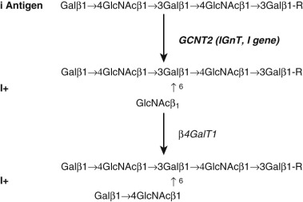

Figure 35-16 

Structure of the I and i antigens. 

The I antigen is composed of two successive lactosaminyl subunits _._ I antigen requires the action of GCNT2, a 1-6- _N_ -acetylglucosaminyltransferase. _Gal,_ Galactose; _GlcNAc, N_ -acetylgalactosamine; _R,_ other oligosaccharide. 

 

##  Molecular Biology 

The I antigen, a β1–6 glucosaminyltransferase, is the product of the _GCNT2_ or _IGnT_ gene. The gene spans approximately 100 kb in an Alu-rich region on chromosome 6p24. The gene contains five exons, including three tissue-specific exons 1 ( [ Fig. 35-17 ](<#f0090>) ). As a consequence, three different _GCNT2_ splice-forms are possible, depending on which exon 1 is utilized (  Inaba et al, 2003  ). _GCNT2*A_ is ubiquitously expressed, whereas _GCNT2*B_ is primarily expressed in human lens epithelia, fetal brain, and cerebellum (  Yu et al, 2003  ). _GCNT2*C_ , composed of exons E1C, E2, and E3, is the predominant transcript in erythroblasts and reticulocytes. In hematopoietic stem cells, erythroid differentiation is accompanied by transcriptional upregulation of _GCNT2*C_ (  Twu et al, 2007  ). The promoter for _GCNT2*C_ contains transcription factor binding sites for Sp1, Oct-2, and C/EBPα. C/EBPα phosphorylation and binding is critical for transcriptional activation (  Twu et al, 2007  ). 

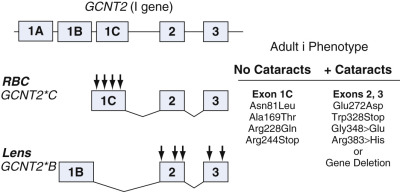

Figure 35-17 

The _I_ gene, showing three different exons 1. 

In human red blood cells (RBCs) and lens, a different _GCNT2_ mRNA is translated, based on which exon 1 is utilized. Mutations in the _GCNT2_ gene can result in an i  adult  phenotype and cataracts. In Europeans, mutations usually are seen only in exon 1C and affect I antigen synthesis in RBCs. In Asia, i  adult  phenotype involves gene deletion or mutations in exons 2 and 3. As a result, loss of GCNT2 activity is seen in all tissues. 

The translated GCNT2 protein consists of 402 amino acids with five _N_ -glycosylation sites and 9 conserved cysteine residues. Unlike most galactosyl- and glucosaminyltransferases, GCNT2 does not contain a DXD motif. The enzyme is likely highly folded, based on crystallography data from C2GnT, a closely related β1,6 glucosaminyltransferase (  Pak et al, 2006  ;  Cooling, 2010  ). Sequence differences in exon 1, which encodes 77% of the translated enzyme, may account for the enhanced enzyme activity observed with the GCNT2*C isoform (  Yu et al, 2003  ). Oligosaccharide analysis and enzyme studies indicate that the minimum acceptor for enzyme activity is a tetrasaccharide composed of two lactosamine motifs (  Cooling, 2010  ). 

Both the i  adult  phenotype and congenital cataracts have been linked to mutations in _GCNT2._ In i  adult  individuals without cataracts, missense mutations have been found in exon E1C, leading to an isolated loss of GCNT2*C activity in RBCs (  Inaba et al, 2003  ;  Cooling, 2010  ). In contrast, i  adult  with cataracts is the result of mutations in exon E2 or E3 or a major deletion of the _IGnT_ gene. As a result, GCNT2 activity is lost in all tissues, including RBC and lens (  Yu et al, 2003  ;  Cooling, 2010  ). Loss of GCNT2*B activity in the lens is believed to underlie the formation of cataracts in humans; however, a direct causal link has yet to be established. No increase in cataracts was observed in a _GCNT2_ -knockout mouse model (  Chen et al, 2005  ). 

 

##  Anti-I and Anti-i Antibodies 

Anti-I and anti-i are antibodies of IgM isotype, reactive at room temperature (see [ Table 35-5 ](<#t0030>) ). Autoantibodies to I are relatively common and are usually low-titered cold agglutinins. Some anti-I can have IH specificity, reacting stronger with group O and A  2  RBC (refer to [ Table 35-41 ](<#t0210>) ). Although generally benign, hemolysis secondary to high-titered anti-I is observed in cold autoimmune hemolytic anemia (CAIHA). CAIHA can occur in the setting of malignancy and occasionally infection (e.g., _Mycoplasma pneumoniae_ ). These antibodies display high thermal amplitude, often agglutinating RBCs at temperatures of 30° to 34° C. In contrast, alloanti-I is relatively rare and is found as a naturally occurring antibody in i  adult  individuals. Anti-i is also uncommon but has been reported in CAIHA, infectious mononucleosis, choriocarcinomatosis, and alcoholic cirrhosis. 

 

##  Biological Role 

Despite the common occurrence of major maternal-fetal ABO incompatibility, severe HDFN due to ABO incompatibility is rare (0.04%). It is hypothesized that the developmental delay in I antigen synthesis may play a protective role against HDFN-ABO by minimizing the number of ABH antigens expressed on fetal red cells (  Cooling, 2010  ). This is supported by parallel increases in I and ABH during the first 2 years of life. Additional evidence comes from extended studies of the _N_ -glycan on Band 3, which accounts for 50% of the ABH antigen on red cells. Adult red cells had a fourfold increase in ABH expression on Band 3 owing to chain extension and branching (  Cooling, 2010  ). 

Ii are oncofetal antigens and can show variable expression with malignancy. _GCNT2_ is overexpressed in metastatic breast cancer and was recently identified as a possible disease modifier in breast cancer (  Gaudet et al, 2013  ). The i antigen is a marker of human mesenchymal stem cells and may serve as a ligand for galectin-3 (  Hirvonen et al, 2012  ). Galectin-3 is a soluble lectin protein that recognizes polylactosamines (  Salomonsson et al, 2010  ). It is hypothesized to play a role in the immunosuppressive properties of mesenchymal cells, chronic inflammation, and neutrophil activation. 

 

##  GIL Blood Group System (ISBT No. 029) 

The GIL blood group system contains one high-incidence antigen: GIL (100% donors). The GIL protein is highly expressed on RBCs, kidney, small intestine, stomach, colon, spleen, eye, and respiratory tract (  Reid & Lomas-Francis, 2012  ). 

 

##  Biochemistry 

GIL is carried by aquaglyceroporin (AQP-3), a member of the major intrinsic protein family of water channels. Similar to Colton (AQP1), AQP3 is a 46-kD, 292 amino acid multipass protein containing six transmembrane domains and a single _N_ -glycosylation site. The molecule is present in the cell membrane as dimers, trimers, and tetramers (  Daniels, 2002  ). 

 

##  Molecular Biology 

The _AQP3_ gene spans 6 kb on chromosome 9p13 and is organized into six exons. The one example of a GIL-negative phenotype is the result of splice site and frameshift mutations, resulting in a truncated 218 amino acid protein. In general, AQP3 is highly conserved; no missense mutations in the translated protein were identified in a recent study of European and African individuals. Two SNPs were identified in the promoter region (A-14G, C-46A); however, neither polymorphism had an impact on AQP3 mRNA levels (  Bahamontes-Rosa et al, 2008  ). 

 

##  GIL Antibodies 

Anti-GIL is associated with hemolytic transfusion reactions. No reports have described clinical HDFN due to anti-GIL despite a positive DAT. Anti-GIL is usually of IgG isotype, reactive at 37° C, and enhanced with AHG. The antigen is resistant to proteases, sialidases, and DTT. 

 

##  Biological Role 

AQP3/Gil is a membrane channel capable of transporting urea and glycerol. On red cells, AQP3 may play a role in malaria infection. AQP3 was shown to be internalized during _P. falciparum_ infection as part of the parasitophorous vacuole (  Bietz et al, 2009  ). Because AQP3 protects against hydroxyl radicals and osmotic stress, internalization and loss of AQP3 from the red cell extracellular membrane could accelerate red cell damage (  Bahamontes-Rosa et al, 2008  ). 

AQP is present on immature dendritic cells and is implicated in the uptake of soluble antigen by micropinocytosis. AQP3 is highly expressed in epidermis and cutaneous T cells, where it plays a role in skin differentiation, hydration, and inflammation (  Boury-Jamot et al, 2009  ). 

 

##  JR Blood Group System (ISBT No. 032) 

Jr is a high-prevalence RBC antigen present on ABCG2 (ATP-binding cassette, subfamily G, member 2) (  Zelinski et al, 2012  ). At this time, Jr contains a single high-incidence antigen Jr(a). Jr/ABCG2 is widely expressed, including cord and mature RBC, stem cells, placenta, cerebral endothelium, lung, renal proximal tubules, liver, breast, and intestinal epithelium (  Castilho & Reid, 2013  ). ABCG2 is a membrane transporter implicated in folate, porphyrin, urate transport, multidrug resistance, and removal of toxic metabolites. 

 

##  Biochemistry 

ABCG2 is a 655 amino acid, 72-kDa glycoprotein. Like Diego/AE1, ABCG2 has two functional domains: a membrane transporter domain consisting of six transmembrane domains and a long intracellular amino-terminal signaling domain containing three nucleotide-binding motifs. Similar to other RBC transporters (AE1, Colton, GIL), ABCG2 probably exists as dimers and tetramers in the RBC membrane. ABCG2 has a single _N_ -glycan site on the third extracellular loop. 

 

##  Molecular Biology 

The _ABCG2_ gene is located on chromosome 4q22 and is organized over 16 exons. The gene is highly polymorphic with nearly 1300 SNPs reported (  Castilho & Reid, 2013  ). The Jr(a–) phenotype is an autosomal-recessive phenotype due to _ABCG2_ -null alleles. Nearly 20 Jr(a–) and Jr(a  w  ) alleles are described, including nonsense (8), frameshift (6), and deletion (1) mutants. The Jr(a  +w  ) phenotype is a consequence of heterozygous inheritance of a null and Jr(a) weak allele (Jr(a  +w  /–). Of the three Jr(a) weak alleles described, all contain an amino acid polymorphism in the third extracellular loop (  Castilho & Reid, 2013  ). 

 

##  Jr Antibodies 

The Jr(a–) phenotype is rare with the highest incidence in Japan (0.03 to 0.12%) (  Castilho & Reid, 2013  ). Anti-Jr  a  is generally of IgG isotype and arises as a result of immune stimulation by transfusion or pregnancy. Antibody reactivity can be enhanced by enzyme treatment. Anti-Jr  a  can cause shortened RBC survival and delayed hemolytic transfusion reactions. Anti-Jr  a  is associated with mild to severe HDFN, presumably due to suppression of erythropoiesis (  Castilho & Reid, 2013  ). 

 

##  LAN Blood Group System (ISBT No. 033) 

Lan is a high-incidence antigen expressed on ABCB6 (ATP-binding cassette, family B, member 6) (  Helias et al, 2012  ). The system contains a single antigen: Lan. ABCB6 is expressed on RBC, including early precursors, fetal liver, heart, and skeletal muscle. ABCB6 is found on cell membranes and intracellular organelles, including lysosomes and Golgi. Defects in ABCB6 have been associated with familial pseudohyperkalemia and ocular coloboma (  Reid et al, 2014  ). 

 

##  Biochemistry and Molecular Biology 

ABCG6, like ABCG2/Jr, is a large (842 amino acid) multipass, glycoprotein that is present as homodimers in the cell membrane. The gene resides on chromosome 4q22 and is organized over 19 exons. Fifteen null alleles have been described to date due to frameshift (9), nonsense (5), deletion (1), and splice site mutations (  Reid et al, 2014  ). An additional 4 alleles are associated with weak Lan expression. 

 

##  Lan Antibodies 

Anti-Lan are generally of IgG isotype arising from immune stimulation. Anti-Lan can be enhanced by enzyme-treated RBC. Anti-Lan are a cause of hemolytic transfusion reactions and HDFN. 

 

##  VEL Blood Group System (ISBT No. 034) 

The Vel blood group system contains a single high-incidence antigen (Vel). Vel resides on SMIM1 or small integral membrane protein 1. SMIM1 is highly expressed on erythoblasts and red cells but not other hematopoietic cells and may be an erythroid-specific protein. In zebra fish, _smim1_ expression is associated with erythropoiesis, with reduced erythrocyte production in smim1-knockdown zebra fish (  Cvejic et al, 2013  ). Likewise, there is a correlation between _SMIM1_ mRNA and mean hemoglobin content in human RBCs. It is hypothesized that SMIM1 plays a role in the formation and hemoglobinization of RBC (  Cvejic et al, 2013  ). 

 

##  Biochemistry and Molecular Biology 

SMIM1 is a small, 78 amino acid, 18-kDa glycoprotein containing 1 _N_ -glycan, several _O_ -glycans, 3 cysteine residues, and a GXXXG transmembrane motif (  Ballif et al, 2013  ;  Storry et al, 2013  ). Current evidence suggests that SMIM1 is a type I transmembrane protein with a 50 amino acid extracellular domain (  Storry et al, 2013  ). SMIM1 likely is present as a homodimer in the membrane (  Ballif et al, 2013  ). 

_SMIM1_ gene resides on chromosome 1p36 near the _RHD_ gene (  Ballif et al, 2013  ;  Storry et al, 2013  ). The gene contains four exons and several GATA1 sites in the promoter region (  Cvejic et al, 2013  ). Most Vel(–) individuals possess a 17-nt deletion in the transmembrane region (  Ballif et al, 2013  ;  Cvejic et al, 2013  ;  Storry et al, 2013  ). Vel-weak individuals tend to be heterozygous for the common _SMIM1_ -null allele. There is also evidence of a modifier allele regulating _SMIM1_ expression. Genome-wide association studies have found an SNP located in intron 2 (rs1175550) associated with decreased _SMIM1_ mRNA levels (  Cvejic et al, 2013  ). Some heterozygous Vel-weak individuals (SMIM1–/+) also carried a Met51Arg missense mutation: It is unknown whether this polymorphism impacts membrane expression or alters an immune epitope (  Cvejic et al, 2013  ). 

 

##  Vel Antibodies 

The Vel negative phenotype occurs in 0.0002% to 0.0006% of donors (  Ballif et al, 2013  ). Anti-Vel antibodies are highly significant, capable of causing acute and delayed HTR, as well as HDFN. Anti-Vel was historically considered a high-titer, low-avidity antibody and can be missed in routine testing. Rare Vel-negative units are required for transfusion support. 

 

##  CD59 Blood Group System (ISBT No. 035) 

CD59 (membrane inhibitor of reactive lysis, membrane attack complex inhibitory factor) is a high-incidence antigen on RBC, white cells, placenta, seminal fluid, and other tissues (  Kimberely et al, 2007  ). It plays a critical role in protecting cells from complement-mediated lysis through inhibition of the terminal C5b-C9 membrane attack complex. CD59 is also implicated in T cell activation, LPS binding, apoptosis, and reproduction. 

 

##  Biochemistry and Molecular Biology 

Like CD55 (DAF, Cromer blood group), CD59 is a GPI-linked glycoprotein and is missing on PNH-red cells. CD59 is a globular glycoprotein with one _N_ -glycan, several _O_ -glycans, and several sulhydryl bonds, and it is sensitive to DTT (  Anliker et al, 2014  ). The gene for CD59 spans over 20 kb on chromosome 11p13 and contains a GC-rich promoter and four exons. Exons 2 through 4 encode the translated protein. 

 

##  CD59 Antibodies 

There are rare cases of isolated CD59 deficiency due to _CD59_ -null alleles. There is one recent case report of an alloanti-CD59 in a patient with inherited CD59 deficiency (  Anliker et al, 2014  ). The antibody was an IgG, enhanced by enzymes and inhibited by soluble CD59. It is presumed that the antibody is clinically significant. 

,  

##  Immunohematology Tests and Procedures 

 

##  Basic Principles—Hemagglutination 

Specific hemagglutination is the single most important in vitro immunologic reaction in blood banking because it is the endpoint of almost all test systems designed to detect RBC antigens and antibodies. The hemagglutination process actually occurs in two stages. The first stage, often referred to as _RBC sensitization,_ is simply the combination of paratope and epitope in a reversible reaction that follows the law of mass action and has an associated equilibrium constant. Antigen and antibody are held together by noncovalent attractions. In stage two, multiple RBCs with bound antibody form a stable latticework through antigen-antibody bridges formed between adjacent cells. This latticework is the basis of all visible agglutination reactions. 

Formation of the latticework during the second stage of hemagglutination is naturally impeded by the fact that RBCs in solution normally repel one another. This is due to the net negative charge of the RBC membrane created by sialic acid. If RBCs are suspended in an ionic medium such as normal saline, cations arrange themselves around each cell to form an ionic cloud. Cations closest to the cell membrane are firmly bound and move with the RBC, whereas the outer cations move freely. The difference in charge at the surface between the inner and outer cation layers, called the surface of shear, creates an electrical potential named the ζ potential ( [ Fig. 35-18 ](<#f0095>) ). The ζ potential keeps RBCs in solution about 25 nm apart (  Harmening, 2012  ). Another factor that may be important in keeping RBCs apart is the water of hydration. Proponents of this theory suggest that the hydrophilic polar heads of lipid molecules making up the outer cell membrane bilayer attract water molecules. The water thus creates a surface tension that helps to keep the cells apart. 

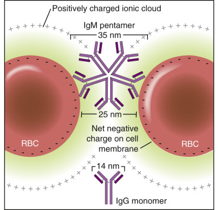

Figure 35-18 

Erythrocytes are kept apart in an ionic medium by the ζ potential, which in turn influences the agglutinating capacity of immunoglobulin (Ig)G and IgM. 

One situation whereby the natural influence of the ζ potential to keep RBCs apart is circumvented is the phenomenon of rouleaux formation or “pseudoagglutination.” Patients with multiple myeloma, Waldenström's macroglobulinemia, and hyperviscosity syndromes have high concentrations of abnormal serum proteins that change the net surface charge on the RBC membrane. The cells thus cluster together in clumps that resemble macroscopic hemagglutination. Plasma expanders, such as dextran and hydroxyethyl starch, as well as some intravenous x-ray contrast materials, can also cause rouleaux formation. Rouleaux can be differentiated from true agglutination by direct microscopy (1) by the classical “stacked-coin” formation in rouleaux and (2) by the loss of rouleaux after washing and resuspension in saline. Nonspecific agglutination can also be seen in cord blood samples contaminated with Wharton's jelly. The presence of hyaluronic acid and albumin in cord blood is responsible for this problem. 

 

##  Factors Affecting Specific Hemagglutination 

The extent of RBC sensitization and the facilitation of second-stage latticework formation are influenced first by inherent characteristics of the specific antigens and antibodies involved. In most immunohematology procedures, IgM antibodies can facilitate the second stage of hemagglutination because of their large diameter (35 nm) and multivalency, which allows them to span the distance between two adjacent RBCs in solution (see [ Fig. 35-18 ](<#f0095>) ). Because of their innate agglutinating ability, IgM antibodies are frequently referred to as _direct agglutinins_ . Most IgG antibodies, on the other hand, are considerably smaller (14 nm) and are unable to induce visible agglutination without the assistance of secondary enhancing reagents. Thus IgG antibodies are commonly referred to as _indirect agglutinins_ . 

The density and accessibility of specific antigens on the RBC membrane are also critical in second-stage latticework formation. This can be illustrated by comparing the ABO and Rh antigens. Approximately 1 million ABO antigens are present per RBC, displayed on large _N_ -glycans of extramembranous glycoproteins. Because of their high density and easy accessibility, ABO antibodies can readily bind exposed ABO antigens and agglutinate RBCs. In contrast, only 10,000 to 30,000 Rh antigens are readily accessible per RBC and, as multipass integral membrane proteins, are considered intramembranous. As a consequence, Rh antigens are less easily agglutinated by Rh antisera. In another example of the influence of antigen density, RBCs that are homozygous for a particular blood group gene will often give stronger reactions than heterozygous cells. This is because homozygotes express twice as many copies, or a double dose, of antigen per cell. In immunohematologic testing, this phenomenon is frequently referred to as _dosage_ . 

Secondarily to inherent antigen and antibody characteristics, the first and second stages of the hemagglutination reaction may also be influenced by manipulating various physical and/or chemical parameters of the reaction environment. An outline of how these various parameters may be controlled is shown in [ Table 35-27 ](<#t0140>) . 

TABLE 35-27 

Factors Affecting the Hemagglutination Reaction 

Reaction Parameter  |  Effect  |  Manipulation   
---|---|---  
Temperature  |  Influences the equilibrium constant and/or reaction rate, depending on the class of antibody involved  |  Decreasing the temperature to 24° C or even to 4° C enhances the reaction of IgM antibodies   
Prewarming or maintaining a reaction temperature of 37° C provides the optimum temperature for detection of IgG antibodies, while preventing most IgM antibodies from reacting   
Incubation time  |  Different Ag/Ab reactions reach equilibrium over different time periods  |  Increasing the time of incubation in a given test system may enhance the detection of a weakly reactive antibody   
pH  |  At a pH range of 6.5 to 7.5, chemical groups on Ag and Ab are oppositely charged, providing optimal ionic forces of attraction for most blood group antibodies  |  Changing the pH affects the equilibrium constant for selected antibodies that may react preferentially in a more acidic environment (e.g., anti-M, anti-Pr)   
Ionic strength  |  In an isotonic saline medium, sodium cations and chloride anions cluster around erythrocyte Ag and blood group Ab, respectively, acting to neutralize Ag/Ab attractive forces  |  Addition of LISS reduces the shielding effect on oppositely charged Ab and Ag, thus increasing the rate of reaction and the equilibrium constant for red cell sensitization   
Antibody concentration  |  Can affect first- and second-stage agglutination by influencing the number of antibody molecules attached to each erythrocyte  |  Increasing the serum-to-cell concentration increases the rate and/or affects the equilibrium constant of red cell sensitization by IgG antibodies   
May help to induce second-stage agglutination by IgM antibodies   
Addition of PEG, a large space-occupying molecule, effectively increases the relative concentrations of ag and ab respective to the volume of the reaction, greatly increasing the rate of reaction; is used only in AHG testing to detect IgG antibodies   
ζ Potential  |  Causes red cells to repel one anothe in solution; if the ζ potential can be reduced or the red cells brought together by physical means, second-stage agglutination of sensitized red cells can be facilitated  |  Centrifugation—forcing cells closer together facilitates latticework formation   
Enzymes—cleave sialic acid residues to lower the ζ potential and improve accessibility of certain blood group antigens   
Albumin—reduces ζ potential and/or water of hydration to allow red cells to approach one another more closely   
Polybrene/protamine—provides an excess of cations that neutralize the repulsive force between red cells, producing both nonspecific aggregation and antibody-mediated latticework formation; the final addition of sodium citrate disperses nonspecific aggregates, while specific ag/ab agglutinates remain   
  
_ab,_ Antibody; _ag,_ antigen; _AHG,_ antihuman globulin; _LISS,_ low–ionic strength saline; _PEG,_ polyethylene glycol. 

 

##  Grading of Hemagglutination Reactions 

Hemagglutination in blood bank testing is observed and graded according to the strength of the reaction. Currently, three methods are available for evaluating visual hemagglutination reactions: tube testing, column agglutination (gel technology), solid-phase, and/or microtiter plate technology. In test tube reactions, reagents and patient sample are added to a test tube and centrifuged, creating a cell button at the bottom of the test tube. The cell button is gently dislodged while observing for macroscopic agglutination. Column agglutination or gel technology utilizes a dextran acrylamide gel microtube prepared by the manufacturer. The gel traps agglutinates at the top of the chamber if hemagglutination has occurred, while unagglutinated cells pass through the gel layer and form a pellet at the bottom of the microtube. Microtiter plate technology uses serologic techniques in micro well plates instead of test tubes. In solid-phase technology, a microplate is the vessel for the reaction. Reagent or reagent cells (as a monolayer of cells or cell stroma) coat the well, to which patient sample is added. Following incubation and washing, indicator cells are added. When hemagglutination occurs, there is a diffuse adherence of RBC to the well. If no reaction occurs, the RBCs settle to the bottom of the well. 

Automated testing systems use column agglutination and solid-phase and microtiter-plate technologies to process samples for ABO, Rh, crossmatch, DAT, and so on. Depending on the instrument, some or all of the testing processes are controlled by the system's computer. Parameters set in the software may determine reaction or require a human interface to review the reaction. 

 

##  Tube Reactions 

Hemolysis is considered the strongest positive reaction that can occur and indicates the presence of a potent, complement-fixing antibody. After recipient serum and reagent RBCs are incubated and centrifuged at 37° C, the serum should first be examined for hemolysis before the cell button is resuspended. When reading for agglutination, the tube should be shaken, using a gentle wrist action, until all cells are dislodged. This is most easily accomplished by gently holding the test tube at the top in a vertical fashion and using the wrist to gently dislodge the cell button, while watching closely for agglutinates. As the cell button begins to resuspend, tip the tube gently to observe for agglutinates. Proper illumination with a concave mirror is an invaluable aid for macroscopic reading. By placing the tube about 2.5 inches above a 3-inch concave mirror, aggregates can be differentiated easily from the free cells by looking at the mirror, not at the tube. 

[ Table 35-28 ](<#t0145>) lists two protocols for evaluating the strength of agglutination using numeric grading and/or scoring. [ Figure 35-19 ](<#f0100>) shows the appearance of different agglutination grades. Although the agglutination grade gives an approximate idea regarding the potency or strength of a particular antibody, the scoring method is much more useful in semiquantitative procedures, particularly when used in conjunction with titration to compare the relative antibody strengths of two different sera. 

TABLE 35-28 

Grading and Scoring of Hemagglutination 

Grade  |  Appearance  |  Score   
---|---|---  
H  |  Hemolysis—presence of free hemoglobin in the serum  |  10   
4+  |  One solid aggregate  |  10   
3+  |  Several medium to large aggregates  |  8   
2+  |  Many small to medium aggregates with a clear background  |  5   
1+  |  Many small aggregates with a turbid background  |  3   
\+ or w  |  Few small aggregates with many unagglutinated cells  |  2   
± m  or +  m  |  Aggregates visible only under microscopic magnification  |  1   
0  |  Negative—absence of aggregates; all cells unagglutinated  |  0   
mf  |  Mixed-field agglutination—presence of minor population of agglutinated cells superimposed on a negative background  |  NA   
R  |  Rouleaux—nonspecific aggregation appearing like a stack of coins; disappears with addition of saline  |  NA   
  
_NA,_ Not applicable. 

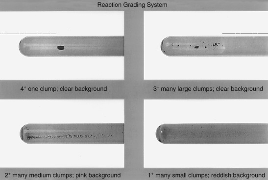

Figure 35-19 

Agglutination grading system showing macroscopic hemagglutination reactions. 

Unlike tube testing, microcolumn gel technology and solid-phase red cell adherence reactions are fixed after the centrifugation phase. The card or well is ready to read without the need to dislodge the cell button. (See [ Figures 35-22 ](<#f0115>) and [ 35-23 ](<#f0120>) for examples of reactions in gel and solid phase.) 

 

##  The Antihuman Globulin Test 

Many IgG antibodies are not able to directly produce detectable hemagglutination, even after centrifugation and the use of enhancement media and techniques such as polyethylene glycol, low–ionic strength saline (LISS), albumin, or enzymes. To visualize reactions by these antibodies, AHG reagents, which contain specific antibodies to human Igs or complement components, must be utilized. The antibodies in AHG sera act as bridges between RBCs already sensitized with antibody or complement to produce the characteristic latticework of second-stage hemagglutination ( [ Fig. 35-20 ](<#f0105>) ). This is the basis of the AHG test. 

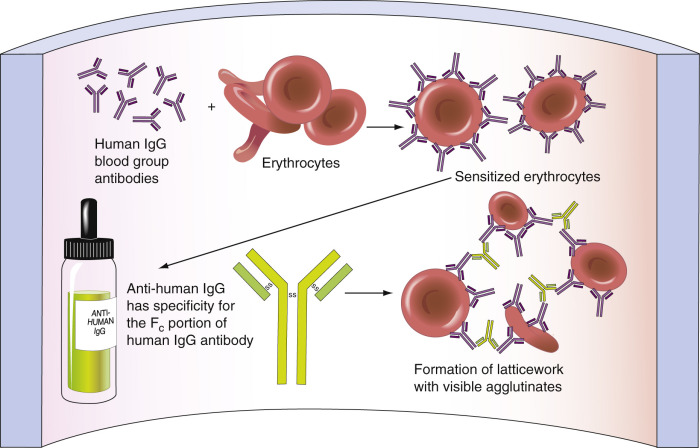

Figure 35-20 

Antihuman globulin antibodies form a bridge between adjacent erythrocytes sensitized with human immunoglobulin (Ig)G or complement components. 

The AHG test is also called the Coombs test, in honor of one of the investigators who first developed the test for laboratory use (  Coombs et al, 1945  ), although the principle was actually described much earlier (in 1908) by Moreschi (  Harmening, 2012  ). When the test is used to detect antibodies or complement bound to RBCs in vivo, it is called the direct antiglobulin test (DAT). When the test is used to detect the reaction of antibody and RBCs in vitro after an appropriate incubation phase, it is called the indirect antiglobulin test (IAT). The red cell antibody screen is an example of an IAT. 

 

##  Antihuman Globulin Reagents and Procedures 

Various preparations of AHG sera are available for blood bank testing, depending on the application (direct or indirect) and whether one wishes to detect RBC sensitization by IgG, complement, or both. 

 

##  Polyspecific Reagents 

Polyclonal, polyspecific AHG reagents are produced by hyperimmunizing animals, usually rabbits, with purified Ig or complement to produce high-titered, high-avidity IgG antibodies. For a given batch of reagent, animal sera are harvested, pooled, adsorbed to remove heterophil agglutinins, and then titrated to ascertain the dilution necessary for optimal reactivity in routine use. Conventional polyspecific (also called broad-spectrum) AHG contains polyclonal IgG antibodies to the spectrum of human IgG subclasses and the C3 complement cleavage products C3b and C3d. Some anti-C4b and anti-C4d activity may also be present. However, most manufacturers adsorb out anti-C4 activity from their polyspecific AHG reagents because it has been shown that in vitro complement activation by clinically insignificant cold agglutinins results in much more C4d than C3d binding (  Klein & Anstee, 2006  ). Excluding anti-C4 activity thus reduces the number of false-positives in both DAT and IAT testing using polyspecific reagents. Because immunization against IgG will also produce anti–light chain antibodies in a polyclonal response, one should remember that polyclonal antiglobulin sera may cross-react with IgA or IgM light chains unless the manufacturer specifies that the anti-IgG component is heavy chain specific. 

At present, the most commonly used polyspecific AHG reagents consist of rabbit polyclonal anti-IgG blended with murine monoclonal antibodies to C3b and C3d complement components. AHG is a polyspecific reagent derived exclusively from murine monoclonal antibodies to IgG, C3b, and C3d is available. The activity of anti-IgG and anticomplement in polyspecific antisera, whether polyclonal or monoclonal, will vary somewhat among different manufacturers and among lots produced by the same manufacturer. However, all AHG sera must contain levels of anti-IgG and anti-C3d activity that meet or exceed the reference standards of the FDA (21CFR660.52;  Code of Federal Regulations  2001a  ). 

 

##  Monospecific Reagents 

Commercially available FDA-licensed monospecific reagents include anti-IgG, anti-C3b+C3d, and anti-C3d. Monospecific anti-IgG or anticomplement may also be polyclonal or monoclonal in origin. For monoclonal anti-IgG, manufacturers must blend monoclonals against a variety of IgG epitopes or select a clone with specificity for an epitope common to all variants of IgG to ensure that the spectrum of human IgG subclasses will react with their reagent. With polyclonal monospecific anti-IgG, again one should keep in mind that it may contain anti–light chain activity unless the manufacturer labels it as heavy chain specific. Production of murine monoclonal blends of monospecific anticomplement has allowed manufacturers to develop reagents containing quantities of purified anti-C3b and anti-C3d of known potency that are less likely to give false-positive results by other anticomplement activities found in polyclonal reagents (  Harmening, 2012  ). 

 

##  Choosing Which AHG Reagent to Use 

The DAT is an important diagnostic serologic technique used for the detection of antibody binding to RBC membranes in vivo. Laboratory indications include testing cord cells for HDFN, investigation in HTR, and in AIHA studies. The reason for the testing will indicate the type of reagent that should be used. Polyspecific AHG reagents containing both anti-IgG and anticomplement activity are typically used for initial DAT evaluation. This is especially important when the DAT is being performed to aid in the diagnosis of CAIHA and some forms of drug-induced hemolytic anemia in which complement may be the only evidence of immune-mediated hemolysis. Circulating red cells that have been involved in complement activation will have mostly C3d on their surface as the result of complement regulatory protein degradation of C3b (see [ Fig. 35-1 ](<#f0010>) ). Therefore, polyspecific AHG sera used in DAT testing must contain anti-C3d reactivity and usually contain some anti-C3b reactivity as well. One notable exception to the use of polyspecific AHG for DAT testing is cord blood. Because _only_ IgG can cross the placenta, the DAT may be performed with an anti-IgG reagent only (see [ Prenatal and Postnatal Testing ](<#s1140>) section). 

A positive DAT with all reagents tested (polyspecific, IgG, C3) may indicate spontaneous agglutination or autoagglutination. Cells already heavily coated with IgG can agglutinate upon centrifugation in the absence of AHG reagent. IgM cold autoagglutinins that were not dissociated during the washing procedure can also cause autoagglutination. All positive DAT tests should be tested with an inert control such as saline or 6% albumin before positive test reactions are concluded. 

The IAT is used for detection of in vitro antibody binding to RBCs, regardless of the antibody's ability to fix complement. Laboratory indications include antibody detection (crossmatch and antibody screening), antibody identification, antibody titration, and RBC phenotyping. It is unclear whether polyspecific AHG, which contains anticomplement reactivity, improves serum antibody detection by the IAT. Rare reports have described antibodies that were detected only by their ability to bind complement in vitro and would have been missed with the use of monospecific anti-IgG reagents (  Fung, 2014  ;  Harmening, 2012  ). In addition, polyspecific AHG can yield stronger reactions in the IAT than monospecific anti-IgG alone (  Wright & Issitt, 1979  ). A major disadvantage of polyspecific AHG is unwanted detection of complement activation by clinically insignificant cold-reactive autoagglutinins or alloantibodies. As a result, many laboratories choose to use monospecific anti-IgG in antibody detection and identification tests and in crossmatch procedures. 

[ Table 35-29 ](<#t0150>) compares various applications for DAT and IAT techniques. Antiglobulin testing may be performed using test tubes, capillary tubes, microtiter plates, or gel microtube techniques (see later section on [ Compatibility Testing ](<#s0985>) ). These procedures may be semiautomated or fully automated, particularly in facilities that perform large-volume testing, such as blood collection centers. Unless otherwise specified, procedures referred to in this chapter employ tube testing. _The AABB Technical Manual_ (  Fung, 2014  ), _Judd 's Methods in Immunohematology _ (  Judd et al, 2008  ), and _Immunohematology Methods_ (  Mallory, 1993  ) are excellent general references for most common procedures, as well as more specialized techniques. 

TABLE 35-29 

Applications for Direct and Indirect Antiglobulin Techniques 

|  Applications  |  Purpose  |  What Is Detected   
---|---|---|---  
Direct antiglobulin test (DAT)  |  Investigation of HTR  |  To detect circulating donor red cells that are sensitized with recipient antibody. A positive DAT is the first immunohematologic evidence of a hemolytic reaction after transfusion  |  DAT positive owing to IgG and/or C3d depending on the antibodies responsible   
Diagnosis of HDFN  |  To detect maternal antibodies that have crossed the placenta to sensitize fetal red cells  |  DAT almost always positive as a result of IgG; occasionally C3d if ABO antibodies involved   
Diagnosis of AIHA  |  To detect autoantibody sensitizing a patient's own red cells  |  Warm autoantibodies: DAT almost always positive owing to IgG   
Cold autoantibodies: DAT may be due to C3d only   
Investigation of drug-induced hemolysis  |  To detect antidrug/red cell antibodies and/or subsequent activation of the complement system  |  DAT may be positive owing to IgG, C3d, or both, depending on the mechanism involved (see under [ Investigation of Autoimmune Hemolytic Anemia ](<#s1210>) section)   
Indirect antiglobulin test   
Antibody detection (or antibody screen)  |  To detect clinically significant IgG alloantibodies in the recipient  |  Recipient IgG antibodies bound to reagent screening cells [ * ](<#hl0004397>)  
Antibody identification  |  To specifically identify those antibodies detected by reagent screening cells or by donor red cells  |  Recipient IgG antibodies bound to reagent cells from a panel of 10-12 donors [ * ](<#hl0004397>)  
Crossmatching  |  To detect antibodies that may have been missed by the antibody screen because of absence of the corresponding antigen or presence of a dosing antibody  |  Recipient IgG antibodies bound to donor red cells [ * ](<#hl0004397>)  
Red cell antigen typing  |  To type patient or donor red cells for antigens that can be detected by IgG antisera reactive only by the AGT. A common example of this would be the weak D test  |  Specific binding of reagent IgG antibodies to red cells positive for the corresponding antigen   
  
_AGT,_ Antihuman globulin test; _AIHA,_ autoimmune hemolytic anemia; _HDFN,_ hemolytic disease of the fetus and newborn; _HTR,_ hemolytic transfusion reaction; _Ig,_ immunoglobulin. 

 * If complement is fixed in vitro, it may be detected if polyspecific antiglobulin is used. 

 

##  Quality Control of the Antihuman Globulin Test 

To standardize antiglobulin sera and to confirm true-negative antiglobulin reactions, two types of quality control RBCs are normally used: those coated with IgG and those coated with C3b and/or C3d. To sensitize RBCs with IgG, Rh antibodies are usually used. RBCs coated with C3b are prepared by incubation of whole blood in low ionic strength saline (LISS) or with human anti-Le  a  or anti-I. C3d-coated RBCs are prepared by incubating C3b-coated cells with fresh serum or trypsin to split C3b→C3d. IgG or complement-coated control cells should give a 1+ to 2+ reaction (see [ Fig. 35-19 ](<#f0100>) ) when tested with anti-IgG or anti-C3b+C3d. 

Quality control cells for the antiglobulin test are referred to as _check cells_ or _Coombs control cells_ . In a true-negative test, free active antiglobulin reagent should remain. Control cells, sensitized with IgG and/or C3, are added to all negative tests and centrifuged. Hemagglutination of check cells confirms both the presence and the reactivity of the AHG reagent, thus validating a negative test result. If the control cells fail to agglutinate in any tube, the tests must be repeated because they are invalid and may have yielded false-negative results. False-negative tests can occur for a variety of reasons and are listed in [ Table 35-30 ](<#t0155>) . 

TABLE 35-30 

Basic Procedures for Direct and Indirect Antiglobulin Testing by Tube Method 

|  |  REASONS FOR INVALID REACTIONS IN ANTIGLOBULIN TESTING   
---|---|---  
Procedure  |  |  False-Positive  |  False-Negative   
Direct antiglobulin test (DAT)  | 

  * 1. Prepare a 3% to 5% suspension in normal saline of the red cells to be tested. 
  * 2. Add 1 drop of red cell suspension to a tube and wash three to four times with saline. 
  * 3. Blot the tube after the last wash. 
  * 4. Add 2 drops of polyspecific AHG (anti-IgG + anticomplement). 
  * 5. Centrifuge and examine for agglutination.  * 
  * 6. Add check cells to all negative tubes (see [ Quality Control of the Antihuman Globulin Test ](<#s0975>) section). 

  
Note: For DAT, blood samples should be collected in EDTA to prevent fixation of complement in vitro by clinically insignificant cold autoagglutinins.  | 

  * • Overcentrifugation 
  * • Direct agglutination by strong cold agglutinins 
  * • Overincubation with enzyme-treated cells 
  * • Improper use of PEG or polycation enhancement reagents 
  * • Inadequate resuspension of cell button 
  * • Rouleaux formation  ‡
  * • Dirty glassware 
  * • Small fibrin clots may trap cells and mimic agglutination 
  * • Cells with a positive DAT will yield false-positive results in any indirect antiglobulin test 

| 

  * • AHG reagent failure  †
  * • Failure to add AHG reagents  †
  * • Improper or inadequate washing  †
  * • Delayed washing (elution of weakly attached antibody) 
  * • Serum/cell ratio too low 
  * • Failure to add test serum or enhancement reagents 
  * • Undercentrifugation 
  * • Resuspension of cell button too vigorous 

  
Indirect antiglobulin test (IAT)  | 

  * 1. Add 2 to 3 drops of patient serum or the recommended number of drops of commercially prepared antisera to each tube. 
  * 2. Place 1 drop of the 3% to 5% red cell suspension to be tested in a tube (e.g., donor cells, reagent screening cells). 
  * 3. Add recommended number of drops of enhancement media (e.g., LISS, PEG) if indicated. 
  * 4. Incubate at 37° C for the time period indicated for the assay being performed (from 15 to 60 minutes). 
  * 5. If indicated in the procedure, centrifuge and examine the serum for hemolysis and the cells for agglutination. 
  * 6. Whether step 5 is performed or not, continue by washing the tube(s) three to four times with normal saline. 
  * 7. Blot tubes dry after the last wash. 
  * 8. Add 2 drops of antiglobulin sera (polyspecific or monospecific anti-IgG) to all tubes. 
  * 9. Centrifuge and examine for agglutination.  * 
  * 10. Add check cells to all negative tubes, 

|  |   
  
_AHG,_ Antihuman globulin; _EDTA,_ ethylenediaminetetraacetic acid; _Ig,_ immunoglobulin; _LISS,_ low–ionic strength saline; _PEG,_ polyethylene glycol. 

 * Protocol may include optional microscopic examination to confirm macroscopically negative tests. 

 † Will be detected by the use of Coombs control cells. 

 ‡ Rouleaux will cause false-positive results in indirect tests read after 37° C incubation. 

 

##  Sensitivity of the Antihuman Globulin Test 

Although the antiglobulin test is extremely sensitive, a negative test does not exclude the possible presence of antibodies on RBCs. It is estimated that 200 to 500 IgG or C3 molecules bound per cell are required for detection by antiglobulin antibodies (  Issitt & Anstee, 1998  ). A negative reaction can occur with small quantities of bound IgG and C3. In addition, AHG sera may possess greater activity against some subclasses of IgG than against others. Consequently, certain AHG sera may produce negative results with RBCs coated by a particular IgG subclass. 

 

##  Compatibility Testing 

The term _compatibility testing_ has historically been used synonymously with the serologic crossmatch test. In its broader context, however, compatibility testing is an entire quality process composed of many procedures designed to provide the safest blood product possible for the recipient of a transfusion. These procedures include proper record keeping, accurate donor and recipient identification, and actual serologic testing of the recipient specimen before transfusion. Under certain conditions, an electronic crossmatch may be performed instead of a serologic crossmatch. Outlined in the following sections and in [ Table 35-31 ](<#t0160>) are the steps in compatibility testing required by the AABB Standards for Blood Banks and Transfusion Services (  Levitt, 2014  ), referred to henceforth as the AABB Standards. 

TABLE 35-31 

Required Steps in Pretransfusion Compatibility Testing [ * ](<#hl0004656>)

Physician (or other authorized health professional) order  |  Written (paper or electronic) order for type and screen test   

  * • Type and screen 
  * • Crossmatch red blood cells 
  * • Special requests such as irradiation, cytomegalovirus (CMV)-negative, antigen-matched, etc. 
  * • Oral orders may be accepted if followed by the written request 

  
---|---  
Phlebotomy/recipient identification  |  Phlebotomist must positively identify the recipient and the recipient's blood sample   

  * • Transfusion request and labeled patient blood sample must contain at least two pieces of independent identifying information for that patient (e.g., name, hospital number, date of birth) 
  * • Mechanism to identify the date of sample and the phlebotomist (paper or electronic) 
  * • Transfusion service will ensure that identifying information on the requisition and sample label are in agreement 

  
Recipient testing  |  Perform ABO and Rh typing on recipient's blood specimen—red cell and serum or plasma testing are required   
Review previous records for comparison with current typing results   

  * • Clinically significant antibodies 
  * • Significant adverse events to transfusion 
  * • Special transfusion requirements 
  * • Previous ABO group and Rh type 
  * • Difficulty in blood typing 

  
Test recipient's serum or plasma to detect clinically significant antibodies   

  * • Method must include 37° C incubation with conversion to antihuman globulin using reagent red cells that are not pooled 

  
Donor testing  |  Confirm ABO and Rh types on donor red cell units as required   

  * • Confirmation testing for ABO group required on all units (serum testing not required) 
  * • Confirmation of Rh type required only on those units labeled as Rh-negative (weak D testing is not required) 

  
Crossmatch  |  Select ABO- and Rh-compatible red cell components for transfusion   
Perform serologic or electronic crossmatch of red cell components   

  * • Full antiglobulin crossmatch required if current antibody screen is positive or the patient has a known history of clinically significant antibodies 

  
Labeling  |  Label all red cell products or other components with the recipient's identifying information   

  * • Label must contain at least two independent patient identifiers, donor unit number, and compatibility test results, if performed 

  
  
 * Requirements paraphrased from  Fung (2014)  . See AABB Standards (  Levitt, 2014  ) for specific wording. 

 

##  Specimen Requirements 

 

##  Recipient Sample Identification 

A physician order is required before blood is drawn for a type and screen. The order may be verbal (followed by a written order), on paper, or electronic. Proper identification of patient blood samples and donor units is absolutely essential in blood banking. Recipient blood specimens must be labeled by the phlebotomist at the bedside directly from information on the patient's wristband. If the patient's wristband is not attached for any reason, signed confirmation of the patient's identity by nursing staff should be obtained before the blood is drawn. The recipient's blood specimen label should be legible and should include at least the patient's full name, hospital identification number, and specimen collection date, and it should be securely attached to the specimen tube when it is accepted by blood bank personnel. Unlabeled or improperly labeled blood specimens are unacceptable under any circumstances. During testing, all test tubes or other types of aliquot or reaction containers must be accurately identified directly from the label on the recipient sample. 

Each pretransfusion blood sample should be accompanied by an appropriate order or requisition, containing at least the patient's full name and hospital identification number. The signature or initials of the phlebotomist should be on the requisition, because the test requisition is a permanent record of that particular specimen collection. With increasing use of electronic order entry, a computer-based system may record the physician order and capture the person performing the phlebotomy. The phlebotomist, however, should still sign the specimen for verification and matching against the electronic record. Upon specimen receipt, the label on the tube is compared with the information on the requisition for any discrepancies. If there is any doubt as to the proper identity of the sample, another sample must be obtained. 

 

##  Type of Sample 

Although serum has traditionally been the preferred specimen for compatibility testing, plasma is increasingly used owing to newer testing technologies (e.g., gel test). If serum is used, blood samples should be collected in siliconized plain tubes without serum separator gel. Other test methods, such as gel column agglutination, microtiter plates, and automated testing systems, may require a specific type of sample per manufacturer instructions. 

Problems with plasma in conventional antiglobulin techniques are primarily technical. Plasma can be associated with small fibrin clots that can trap RBCs and resemble agglutination. Fibrin may also trap serum and cause neutralization of AHG reagent if not removed before washing. Finally, plasma can enhance rouleaux formation if fibrinogen levels are particularly high. 

 

##  Appearance 

Most blood bank laboratories have policies in place to reject grossly hemolyzed recipient blood samples as unacceptable for pretransfusion testing unless there is no other choice. Using serum that is already hemolyzed may mask antibody-induced hemolysis that would ordinarily be detectable in antibody screening tests. Lipemia may rarely cause difficulty in evaluating agglutination results, although lipemia is not usually a cause for rejection of a pretransfusion sample. Automated instruments may have additional specifications regarding sample appearance. For example, a grossly hemolyzed or lipemic sample can give false-positive readings with an automated gel technology instrument. 

 

##  Age of Sample 

According to AABB Standards, a pretransfusion specimen for testing and red cell transfusion is valid for 72 hours. After 72 hours, a new sample must be drawn. Requiring a new pretransfusion sample every 72 hours on previously transfused or pregnant individuals ensures that the sample being tested is fairly representative of the patient's current immune status. 

In elective surgery patients, some facilities will extend the age of a preoperative sample up to 1 month provided that the patient (1) has a negative antibody screen, (2) has no history of clinically significant antibodies, (3) is not pregnant, and (4) has not been transfused within the preceding 3 months. Patients failing to meet these criteria are required to have a sample drawn within 72 hours of planned surgery (  Banderanko, 2014  ). 

 

##  Sample Storage 

AABB Standards require that all pretransfusion samples be stored at 1° to 6° C for at least 7 days after testing is completed, along with at least one representative segment from each of the donor units crossmatched on the recipient. The purpose of this is to ensure that repeat or additional testing of the donor or patient may be performed later if the patient experiences a delayed hemolytic reaction or other adverse effect of transfusion. 

 

##  Documentation and Record Keeping 

 

##  General Considerations 

All blood banks must have a manual or computerized system of record keeping that contains the results or outcomes of all tests and activities carried out in the blood bank. Records must be complete and retrievable within a reasonable time frame. Transfer or dissemination of information from any patient records must conform to requirements of the institution's confidentiality policies in accordance with federal and state laws and regulations. Records must be preserved for different periods of time, depending on federal, state, and accrediting agency requirements. 

Documentation of the entire compatibility testing process must include records of patient identification, order entry, individual special transfusion needs, date and time of testing, results of patient testing, identity of the technologist who performed the testing, and blood component issues. A computerized system is ideal for capturing this information and enables rapid and easy retrieval of these data for a given patient, including records of ABO and Rh type, antibody problems, transfusion history, and requirements for special types of blood products. From a more global perspective, computerized retrieval of data for groups of patients also greatly enhances the monitoring of blood product utilization within the facility, including blood ordering and transfusion practices of physicians. 

Results and interpretations of all patient testing should be documented on appropriate manual worksheets or entered into the computer immediately upon observation of the results. In a manual record-keeping system, all forms should be filled out with ink, not pencil. If results must be changed on manual worksheets, original results must not be obliterated; a single line should be placed through them, and the new results dated and initialed by the technologist making the change. A continuously updated list of initials used by all personnel working in the blood bank on all shifts must be part of the permanent blood bank records. Changes to computerized results must also be completely documented as part of the computerized result record with ability to track both original and corrected data (  Fung, 2014  ). 

 

##  Check of Previous Records 

Manual or computerized records must be checked for previous results on a given patient when a new sample is received. ABO and Rh tests on the current specimen should be checked against previous results, if available, to help verify that the specimen was collected from the correct individual. Information on any unexpected antibodies identified previously is also extremely important because the titer of an antibody may fall to levels that cannot be detected by antibody screening procedures. If a clinically significant antibody was previously identified, the patient must receive RBCs negative for the corresponding antigen (antigen-negative) even if current antibody screening tests are negative. Previous significant adverse events to transfusions and special requirements should also be reviewed before crossmatching is done. 

 

##  ABO Grouping 

Antisera and reagent RBCs for ABO grouping are standardized and readily available commercially. Most blood bank laboratories use monoclonal reagent antisera derived from antibodies produced by hybridoma cell lines. ABO grouping consists of two parts, commonly referred to as _red cell grouping_ (forward type) and _serum grouping_ (back type). In forward grouping, a 3% to 5% RBC suspension is tested with commercially prepared anti-A and anti-B to test for antigens on the RBC membrane. In reverse grouping, patient or donor serum is tested against reagent cells of known A  1  and B phenotype to test for the expected ABO antibodies in the patient's serum (see [ Table 35-6 ](<#t0035>) ). ABO grouping is carried out at room temperature, with only an immediate-spin centrifugation step required to promote a macroscopic agglutination reaction. The manufacturer's directions must be followed for all commercial reagents. 

 

##  ABO Grouping of Donors 

The collecting facility is required to perform a forward and reverse ABO type on all donors. The transfusion service or other laboratory responsible for compatibility testing must confirm the ABO group of all units of RBCs or whole blood received. RBC forward grouping is performed from an integral segment attached to each donor unit. For units labeled as group O, anti-A,B alone may be used for donor confirmatory testing because only group O RBCs will fail to hemagglutinate with anti-A,B. 

 

##  ABO Grouping of Recipients 

Every pretransfusion patient blood specimen must also be tested for ABO group. Both cell and serum groupings are required for initial ABO testing of all patient samples, and the results of RBC and serum testing should agree with each other (see [ Table 35-6 ](<#t0035>) ) before any results are reported and blood is transfused. 

Some blood banks routinely include the use of anti-A,B in the RBC grouping procedure, although this reagent does not usually yield any additional useful information except for the detection of A  x  or B  x  weak subgroups. Anti-A,B is used as a convenient reagent in repeat testing to confirm initial typing of a group O patient. Anti-A,B may be used for confirmatory typing with neonate and infant samples, especially when the infant has been transfused with group O RBCs. Infant red cells may show weaker reactions on forward typing owing to the decreased number of ABO antigens on infant red cells (see [ ABO ](<#s1035>) and [ I Blood Group ](<#s0805>) sections). 

 

##  ABO Grouping Discrepancies 

Interpretation of ABO blood grouping results is generally straightforward. In the event that the results of RBC and serum grouping do not agree, testing is repeated to rule out any clerical or technical error. If results still disagree, an ABO discrepancy is present owing to problems with the patient's serum or cells that must be resolved before an ABO type can be confirmed. [ Table 35-32 ](<#t0165>) lists some of the many reasons for ABO discrepancies. Several references are available that provide a complete description of these problems and the protocols for resolution (  Harmening, 2012  ;  Fung, 2014  ). 

TABLE 35-32 

Some Causes of ABO Grouping Discrepancies 

|  Problems with Red Cell Testing  |  Problems with Serum Testing   
---|---|---  
Unexpected positive reactions  |  Acquired B antigen associated with colon and gastric cancers, intestinal obstructions   
Cord cells contaminated with Wharton's jelly   
Autoagglutination caused by cold autoantibodies   
Cells heavily coated with warm autoantibody   
Polyagglutination   
Acriflavine antibody (against dye used in anti-B)   
Genetic chimerism [ * ](<#hl0004721>)   
Bone marrow transplants [ * ](<#hl0004721>)   
Administration of red cells outside ABO group [ * ](<#hl0004721>)   
B(A) phenomenon   
Fetomaternal hemorrhage [ * ](<#hl0004721>) |  Rouleaux-forming proteins present (e.g., plasma expanders, monoclonal gamma globulins)   
Room temperature alloantibody present (e.g., anti-M, N, P1)   
Room temperature alloantibody in immunoglobulin (Ig)M phase (e.g., anti-c)   
Cold autoagglutinin present (e.g., anti-I, IH)   
Passively acquired ABO antibodies, (e.g., incompatible plasma transfusion)   
Passenger lymphocyte-derived antibody associated with minor incompatible bone marrow or solid organ transplant   
Subgroup of A with anti-A1 in serum   
_Cis_ -AB with weak anti-B in serum   
Unexpected negative reactions  |  A or B subgroups   
Antigen depression due to leukemia or other disease state   
High levels of soluble blood group substances   
Massive transfusion with compatible red cells outside of ABO group   
Bone marrow transplants  |  Age of patient (elderly, newborn)   
Hypogammaglobulinemia or agammaglobulinemia   
Immunosuppression   
Bone marrow transplants   
ABO subgroups   
Long-term parenteral nutrition   
  
 * Look for mixed-field appearance of reactions with reagent antisera. 

If a blood transfusion is needed emergently and an ABO discrepancy occurs that cannot be resolved in a timely manner, group O packed RBCs, AB plasma components, or both may be given. However, it is important to be certain that a sufficient pretransfusion blood specimen is obtained from the patient so that the workup may be continued. In some cases, it may be necessary to send a pretransfusion specimen to a reference laboratory for further evaluation. 

 

##  Rh Typing 

Several types of antisera are available for detection of the RhD antigen. Today, the most commonly utilized anti-D typing reagents in tube testing are monoclonal blends from several different clones. Some reagents also contain a blend of IgM and IgG anti-D to allow for immediate spin testing and indirect antiglobulin testing for weak D with the same reagent. Manufacturers may offer a control reagent as well to be used with the anti-D reagent. The anti-D used for column agglutination testing is a monoclonal IgM. It is crucial to understand the different anti-D reagents in order to select the appropriate reagent for the facility, patient population and laboratory use. The manufacturer's instructions detail the specifics of their reagent, uses, and contraindications. 

Direct typing for the D antigen is carried out at room temperature by the immediate spin technique, after mixing one drop of saline-suspended 3% to 5% RBCs and one drop of commercial anti-D. If weak D testing is necessary, RBCs are tested by IAT with an IgG anti-D. A parallel test with a negative diluent control is always included for the weak D test. 

 

##  Rh Typing of Donors 

As required by the AABB Standards, all whole blood donor units are tested by the collecting facility for the D antigen by direct agglutination methods. All donor units testing as Rh-negative by direct agglutination are tested for a weak D phenotype by the IAT. If routine D testing or weak D testing is positive, the unit is labeled Rh-positive. The transfusion service must reconfirm the D type of all RBC units labeled Rh-negative by testing red cells from an integral attached segment by a direct anti-D agglutination method. Repeat testing of donor units by the transfusion service for weak D is not required by the AABB Standards. 

 

##  Rh Typing of Recipients 

Every pretransfusion recipient blood specimen must be tested for the D antigen by direct typing. Indirect testing for weak D in recipients is not necessary: Patients who fail to agglutinate after direct agglutination are typed as Rh-negative. Some blood banks do perform weak D testing for prenatal specimens; however, more recent data show that many individuals typing as weak D possess a partial D phenotype and are at risk for RhD alloimmunization. Erythrocyte typing for the C, c, E, and e antigens of the Rh system is not performed routinely but may be done to determine the most probable Rh genotype in the evaluation of antibody problems, in parentage studies, and in patients with long-term transfusion requirements. 

 

##  Antibody Detection 

All specimens submitted for pretransfusion testing must be screened for clinically significant antibodies in the recipient serum (antibody screen). Because clinically significant antibodies typically react at body temperature, most laboratories omit room temperature incubation entirely. AABB Standards require that the method used incorporate incubation at physiologic or body temperature (37° C), followed by conversion to the IAT. If a method other than the IAT is used, it must have documented and validated equivalent sensitivity in its ability to detect clinically significant antibodies (  Fung, 2014  ). A variety of antibody screening protocols, utilizing different technologies, are in use today. 

 

##  Reagent Red Blood Cells 

Reagent RBCs or screening cells used for the detection and identification of antibodies in a patient's serum are usually obtained from commercial manufacturers. AABB Standards require that antibody detection in recipients be performed using reagent cells that are not pooled. Typically, antibody screening cells consist of two to three group O reagent cells selected from different donors of known phenotype. Sets of cells are prepared so that all antigens to the most commonly encountered blood group antibodies are represented and must include C, c, D, E, e, Fy  a  , Fy  b  , Jk  a  , Jk  b  , K, k, Le  a  , Le  b  , P  1  , M, N, S, and s antigens. An _antigram_ that lists the blood group antigenic makeup of each cell ( [ Fig. 35-21 ](<#f0110>) ) accompanies each lot of screening RBCs. When possible, cells that are homozygous for selected antigens are used, which increases the likelihood of detecting weak or dose-dependent antibodies. A three-cell screening panel ensures homozygosity for more antigens such as Jk  a  , Jk  b  , Fy  a  , Fy  b  , S, and s, against which the corresponding antibodies are likely to exhibit dosage, but the additional cell adds expense to pretransfusion testing. Several studies (  Cordle et al, 1990  ;  Judd, 2002  ) have shown that using three red blood samples for antibody detection rarely reveals a clinically significant antibody not detected by a two-cell screening procedure. 

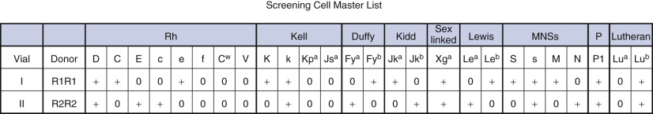

Figure 35-21 

The “antigram” accompanying each lot of reagent screening red blood cells. 

 

##  Antibody Detection Protocols 

 

##  Tube Tests 

In conventional test tube methods, one volume 3% to 5% screening reagent cells and two volumes patient serum (giving an average volume/volume ratio of serum to cells of approximately 50 : 1) are incubated at 37° C with an enhancement medium for the time specified by the manufacturer and are centrifuged and examined for hemolysis or agglutination. The screening cells are then washed three to four times with saline, and AHG reagent is added for final detection of IgG alloantibodies. 

Because different blood group antibodies commonly show characteristic reaction patterns by IAT technique (see [ Table 35-5 ](<#t0030>) ), close examination at different phases of testing in this conventional protocol may yield helpful information in evaluating cases in which the screen is positive: 

  * •

Direct agglutination of the cells in albumin or LISS after 37° C incubation frequently indicates the presence of an Rh antibody. 

  * •

IgM antibodies possessing a wide thermal range, such as anti-I, anti-P  1  , and Lewis antibodies, may show reactions in albumin or LISS. However, these reactions generally become much weaker after conversion to the IAT. 

  * •

With rare exceptions, in vitro hemolysis of reagent cells after 37° C indicates the presence of Lewis, Kidd, Ii, P, PP  1  P  k  , or Vel antibodies. 

  * •

The vast majority of IgG antibodies, with the exception of Rh, will not be detected until after washing and conversion to the IAT. 

  * •

Reactions of different screening cells in multiple phases or with varying strengths usually indicate that more than one antibody is present. 

 

##  Column Agglutination Technologies 

Column agglutination is an alternative method for alloantibody detection used by many transfusion services. This technology utilizes the differential migration of RBC agglutinates through a small microtube containing a dextran acrylamide size exclusion gel column (  Lapierre et al, 1990  ). A plastic card with six to eight microtubes per card can be used to perform antibody screening or identification, crossmatching, and DAT testing. Gel cards for ABO/Rh typing are also available. 

For testing, precisely measured volumes of screening reagent RBCs (0.8% suspension in LISS) and plasma are incubated at 37° C in the reaction chamber above the column matrix. Following incubation, the plastic cards are centrifuged under carefully controlled conditions. IgG-coated RBCs agglutinate as they come into contact with the AHG reagent in the matrix and are trapped. Reaction strength and size determine the migration of the agglutinates, ranging from the largest (4+) agglutinates at the top to migration of weaker, smaller agglutinates farther into the gel column ( [ Fig. 35-22 ](<#f0115>) ). Unagglutinated RBCs pass easily through the column and are found as a pellet at the bottom. Because the plasma or serum remains in the reaction chamber above the matrix, repeated washing steps and addition of control cells to check the activity of the AHG reagent are unnecessary. The endpoint hemagglutination reactions are very stable, allowing the cards to be kept for supervisory review of questionable reactions. The cards can be photocopied or digitally photographed and downloaded as permanent laboratory data. Dual populations of cells produce a striking picture with two distinct populations: unagglutinated cells at the bottom of the tube and agglutinated cells at the top of the well. 

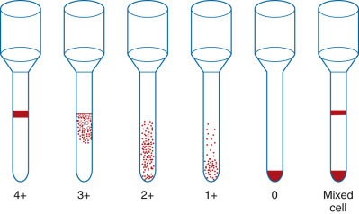

Figure 35-22 

Appearance of reaction patterns and grading for gel or column agglutination technology. 

Column agglutination or gel technology has equivalent sensitivity to standard LISS tube testing for antibody detection and is particularly sensitive for detection of anti-Rh antibodies (  Weisbach et al, 2006  ). Gel testing can offer several advantages over conventional tube procedures. It is more standardized than conventional tube testing with a reliable, stable agglutination endpoint, making it an attractive method for small facilities with cross-trained generalists. It is also less sensitive to clinically insignificant cold antibodies, eliminating unnecessary antibody workups. Additional time savings are achieved through the elimination of repetitive washing steps and manual macroscopic and/or microscopic readings. Finally, testing can be automated, permitting high-throughput testing, electronic interpretation and validation, and digital documentation of results. 

 

##  Solid-Phase Adherence Tests 

Another alternative to tube tests for alloantibody detection is indirect solid-phase adherence test systems. In this application, reagent RBCs are bound to the bottom of microplate wells. Serum and an enhancement reagent are added and incubated at 37° C, allowing the alloantibody to bind to the solid phase. After washing to remove unbound serum globulins, indicator RBCs coated with antihuman IgG are added, and the plates are centrifuged. If a reaction has occurred between the reagent cells and the serum alloantibody, the antiglobulin-coated indicator cells will bind and cover the bottom surface of the well, whereas a discrete button in the bottom of the well indicates a negative reaction ( [ Fig. 35-23 ](<#f0120>) ). Wells may be read manually or with an automated reading device. As with column agglutination, positive reactions are very stable, so the plate may be covered, stored at 2° to 8° C, and read up to 2 days later. 

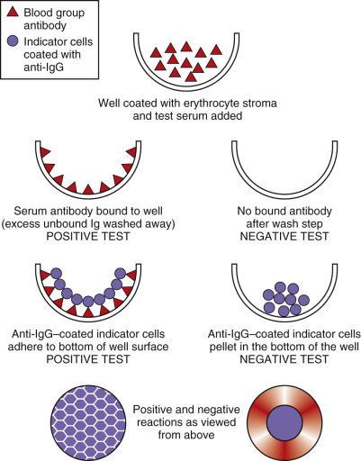

Figure 35-23 

Principle of solid-phase adherence technology with appearance of positive and negative reactions. 

Direct solid-phase test systems are also available for applications such as ABO and Rh typing of red cells. For these tests, microplate wells are coated with the appropriate antibodies. Test cells are added and incubated, and the plates are then centrifuged. For positive reactions, the RBCs adhere to the entire bottom surface of the antibody-coated well; negative reactions result in a tightly packed cell button in the bottom of the well. Instrumentation is available for automated and semiautomated testing using solid-phase technology. 

 

##  Antibody Identification 

When red cell alloantibodies are detected in the serum of a prospective blood recipient, as indicated by a positive antibody screen, the antibody must be identified so that antigen-negative blood can be provided for transfusion, if required. Antibody identification is accomplished by first testing an extended panel of reagent RBCs of known phenotype against the recipient's serum by the IAT technique. An autocontrol is always included as part of the testing to help differentiate whether autoantibody, alloantibody, or both are present. The immunohematologist then compares the pattern of positive and negative serum reactions against the antigen phenotype pattern on the printed worksheet that accompanies each panel to find a match. 

 

##  Interpreting the Results of Antibody Identification 

[ Table 35-33 ](<#t0170>) is a simple example of an antibody panel. Serum Y reacts with cell numbers 1 through 3, which are positive for the D antigen, but it does not react with cell numbers 4 through 6, which are negative for the D antigen. The pattern of positive and negative serum reactions matches the phenotype pattern for the D antigen; therefore, serum Y appears to contain anti-D. Similarly, the pattern of reactivity for serum Z matches the phenotype pattern for the E antigen; thus serum Z appears to contain anti-E. Before such identification can be conclusively stated, one must be sure that enough cells of differing antigenic composition are tested to definitively identify a single antibody or combination of antibodies in a given serum. 

TABLE 35-33 

Simple Panel Example 

Cells in A Panel  |  KNOWN ANTIGENIC COMPOSITION  |  TEST SERUM   
---|---|---  
D  |  C  |  c  |  E  |  e  |  Y  |  Z   
No. 1  |  \+  |  \+  |  \+  |  0  |  0  |  \+  |  0   
No. 2  |  \+  |  \+  |  0  |  \+  |  \+  |  \+  |  \+   
No. 3  |  \+  |  0  |  \+  |  0  |  \+  |  \+  |  0   
No. 4  |  0  |  0  |  \+  |  0  |  \+  |  0  |  0   
No. 5  |  0  |  0  |  \+  |  0  |  \+  |  0  |  0   
No. 6  |  0  |  \+  |  0  |  \+  |  \+  |  0  |  \+   
  
Fisher's exact method has traditionally been used to statistically calculate the probability that a single antibody has been correctly identified within a confidence interval of 95% (i.e., the probability that the same results would be obtained by random chance because of a different antibody is 1 in 20). This method compares the numbers of positive and negative results against the number of cells tested that express or lack the corresponding antigen and against the total number of cells tested (  Race & Sanger, 1975  ). 

[ Table 35-34 ](<#t0175>) lists the probability values calculated by Fisher's exact method that are achieved with differing combinations of positive and negative cells in the total number tested. It can be seen that a _p_ value of 0.05 can be achieved with a minimum of six cells, with three cells being positive for an antigen reacting with the antibody, and three cells negative for the antigen failing to react with the antibody. Most manufacturers supply reagent cell panels with 10 or 11 cells, with at least one of the combinations of positive and negative cells from [ Table 35-34 ](<#t0175>) , for most of the antigens to which unexpected antibodies are commonly encountered. Consequently, most simple antibody identifications are valid at a _p_ value considerably less than 0.05, except in cases where there are antibodies to low- or high-frequency antigens, or where multiple antibodies are present in the same serum. In these situations, additional cells from other panels may have to be tested to achieve identification within the 95% confidence interval. 

TABLE 35-34 

Probability Values Based on Fisher's Exact Method 

Total Number of Cells Tested  |  Antigen-Positive Cells That React with Antibody  |  Antigen-Negative Cells That Do Not React with Antibody  |  _p_ Value   
---|---|---|---  
5  |  3  |  2  |  0.100   
6  |  4  |  2  |  0.067   
6  |  3  |  3  |  0.050   
7  |  5  |  2  |  0.048   
7  |  4  |  3  |  0.029   
8  |  6  |  2  |  0.036   
8  |  5  |  3  |  0.018   
8  |  4  |  4  |  0.014   
9  |  7  |  2  |  0.028   
9  |  6  |  3  |  0.012   
10  |  8  |  2  |  0.022   
10  |  7  |  3  |  0.008   
10  |  6  |  4  |  0.005   
10  |  5  |  5  |  0.004   
  
[ Figure 35-24 ](<#f0125>) shows the results of a panel tested against patient serum with a conventional tube antiglobulin testing method and examined for agglutination after the 37° C incubation phase, and finally after the addition of AHG. In a quick overview of the panel results, an immunohematologist will at once notice that there is agglutination with different cells after centrifugation in both phases of the test, indicating the probable presence of multiple antibodies. 

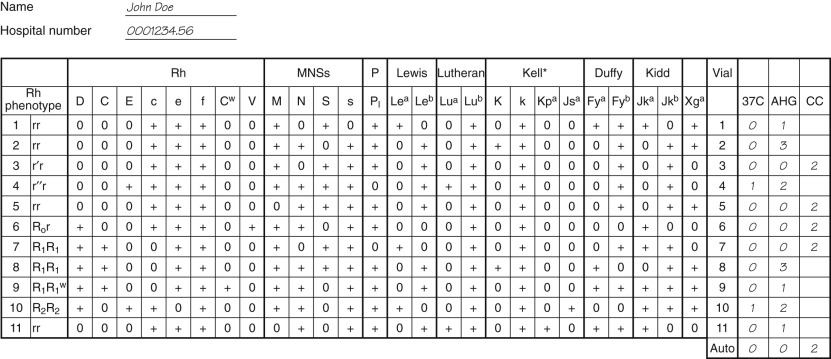

Figure 35-24 

A typical panel worksheet showing an example of antibody identification results. 

_AHG,_ Antihuman globulin; _CC,_ Coombs control cells. *Unless otherwise specified, it is understood that all cells are positive for the high-frequency antigens Kp  b  and Js  b  . 

Following is an outline of the strategy used in evaluating antibody identification results: 

  * 1.

The autocontrol is negative, indicating that the serum reactivity is most probably due to alloantibodies. However, if the autocontrol is positive, it is important that DAT testing be performed to confirm or rule out prior in vivo sensitization of the patient's cells. The DAT should be examined closely for the appearance of mixed-field agglutination. In recently transfused patients, attachment of alloantibody to a minor population of transfused donor RBCs causes classic mixed-field agglutination and is frequently the first sign of a developing immune response that may result in a delayed hemolytic transfusion reaction. In a massively transfused patient, only a small percentage of cells may be DAT-positive. 

  * 2.

The first step that is performed by many immunohematologists in evaluating antibody identification results is to rule out those antibodies where the serum has failed to react with a cell known to carry the corresponding antigen. Although not required, whenever possible it is best to rule out antibodies based on lack of reactivity with cells demonstrating the homozygous form of an antigen, so as not to erroneously rule out weakly reactive antibodies that show dosage. Using the homozygous “rule of thumb” for ruling out antibodies, cell numbers 3, 5, 6, and 7 are not reactive with the serum and may be used to rule out anti-D, anti-C, anti-c, anti-e, anti-M, anti-N, anti-s, anti-P  1  , anti-Lu  b  , anti-k, anti-Fy  b  , anti-Jk  a  , and anti-Jk  b  . Expression of the antigens f, V, Le  a  , Le  b  , and Xg  a  cannot be characterized as homozygous owing to the mechanisms of their inheritance, but because at least one of the four cells above is positive for these antigens and the serum did not react with them, the corresponding antibodies may be eliminated from consideration. 

  * 3.

Because of reactions seen in different phases and demonstrating different agglutination strengths, at least two antibodies are likely present in the serum: 

    * •

Cell numbers 4 and 10 show direct agglutination in the 37° C phase, followed by stronger agglutination in the AHG phase, which is very typical of Rh system antibodies. These are the only two cells on the panel positive for the E antigen, which has not been ruled out. Thus it is likely that anti-E is one of the antibodies involved. 

    * •

Cell numbers 2 and 8 show very strong agglutination in the AHG phase only. Upon examining the antigens across the top of the panel that have not been ruled out, one sees that the phenotype of the panel cells for the K antigen fits the serum reactivity of these two cells. Thus it is likely that anti-K is a second antibody involved. 

    * •

The remaining serum reactions with cells numbers 1, 9, and 11 cannot be explained by anti-E or anti-K but may be explained by anti-Fy  a  , because all three of these cells are positive for the Fy  a  antigen, and Fy  a  has not been ruled out. 

  * 4.

Anti-S should be ruled out by testing another cell positive in the homozygous state for S antigen that at the same time is negative for Fy  a  , K, and E antigens. 

  * 5.

Antibodies to low-frequency antigens such as C  w  , Lu  a  , Kp  a  , and Js  a  may be ruled out by testing appropriate cells if available. When antibodies to low-frequency antigens are not ruled out, an antiglobulin crossmatch is used to detect any potential incompatibility between donor cells and the theoretical presence of one or more of these antibodies in the patient's serum. 

  * 6.

Ruling out of additional antibodies may sometimes be accomplished by typing the patient's cells for selected antigens. This is particularly helpful when a patient's serum contains multiple antibodies and the reagent cell resources available to the blood bank are limited. If one of the antibodies that must be ruled out in a mixture of antibodies is anti-Jk  b  , for example, the patient's cells may be typed for the Jk  b  antigen with specific antisera. If the patient expresses the Jk  b  antigen, then the presence of an alloantibody to Jk  b  can be conclusively eliminated. 

  * 7.

On the panel in [ Figure 35-24 ](<#f0125>) , there are at least three cells negative for all three antigens—Fy  a  , K, and E—that do not react with the serum. However, to conclusively identify all three antibodies within the 95% confidence interval, three separate cells must be positive only for Fy  a  antigen, three positive only for K antigen, and three positive only for E antigen that do react with the serum. Thus anti-Fy  a  can be identified with confidence; however, two more cells positive for K antigen and one more cell positive for E antigen must be tested with the serum to conclusively identify the presence of anti-K and anti-E. 

  * 8.

If antibody identification is being performed for the first time on a particular patient, it is common practice to type patient RBCs for the antigens to which he or she has developed antibodies as a confirmation of the antibody identification. The patient's RBCs should lack the antigens corresponding to the antibodies present. 

 

##  Crossmatching 

For many years, a major serologic crossmatch was required before the transfusion of whole blood or packed RBCs. This protocol required a 37° C incubation, followed by conversion to the IAT. In 1984, this requirement was eliminated by the AABB Standards as long as (1) the current antibody screen on the patient is completely negative, and (2) there is no past history of clinically significant antibodies. For patients who meet these criteria, an abbreviated procedure designed to detect ABO incompatibility may be used. This may consist of an immediate spin crossmatch or an electronic crossmatch. 

 

##  Immediate Spin Serologic Crossmatch 

The serologic test to detect ABO incompatibility commonly consists of an immediate spin protocol employing a 3% to 5% saline suspension of donor RBCs prepared from an integral segment taken from the selected donor unit. Cells usually are washed once to remove any anticoagulant or plasma protein that could interfere with the testing. A drop of donor cell suspension is mixed with recipient serum, centrifuged immediately, and examined for hemolysis and/or agglutination. This procedure has come to be known as the abbreviated or immediate-spin crossmatch. 

Use of the immediate-spin crossmatch procedure in clinical settings has shown it to be a safe and cost-effective alternative to the antiglobulin crossmatch (  Judd et al, 1988  ;  Cordle et al, 1990  ;  Shulman, 1990  ), although reports indicate that this technique may fail to detect ABO incompatibility when recipient ABO antibodies are of low titer or when donor cells belong to a weak ABO subgroup (  Berry-Dortch et al, 1985  ;  Shulman et al, 1987  ). Rare false-negative results can occur as the result of a prozone effect in group O/group A major incompatibility, particularly if a delay in centrifugation occurs (  Judd et al, 1988  ). The prozone/delay apparently allows for the fixation of C1 complement on RBC membranes, which sterically hinders hemagglutination. Suspension of donor cells in EDTA-saline eliminates this problem by chelating calcium necessary for formation of the C1 complement complex. In addition to false-negatives, the immediate-spin crossmatch can cause false-positive results due to rouleaux, cold-reactive antibodies, and fibrin—all of which may cause delays in issuing the blood for transfusion. In a multicenter study involving 1.3 million immediate-spin crossmatches, the observed risk of acute hemolytic reaction using the immediate-spin crossmatch technique was 0.0004% (  Shulman, 1990  ). 

 

##  Electronic Crossmatch 

In 1994,  Butch and colleagues  first reported on a proposed standard operating procedure that would replace the immediate-spin serologic crossmatch with a computer electronic crossmatch, or EXM. Similar to the immediate-spin crossmatch, the electronic crossmatch may be used only for patients who have no currently detected clinically significant antibodies or any history of alloantibodies. The EXM reduces human error by assigning final verification of ABO compatibility between donor and recipient by the laboratory computer system (  Judd, 1991  ). In addition, it eliminates time-consuming investigation of false-positive serologic reactions. 

The EXM is permissible provided that specific testing criteria are met and extensive validation of the blood bank information system has been performed to meet current AABB Standards and FDA requirements as outlined in a 1997 FDA internal document (  Judd, 2002  ). Critical elements required in computer validation for the EXM (  Judd, 1998  ) include updated hardware, instrumentation interfaces, historical records checks, reaction interpretation algorithms, prevention functions and warnings for ABO assignment/release, and personnel competency assessment. Because the safety of this procedure will be only as good as the electronic information that is entered and stored in the system, maximal use of bar codes to identify both donors and patients should be implemented. After extensive experience with electronic crossmatching at the University of Michigan,  Judd (1998)  recommended that bar-coded patient identification be mandatory, both at the time of sample collection and prior to transfusion, and that pretransfusion specimen labels be generated at the bedside from the bar code on the patient identification wristband. [ Box 35-1 ](<#b0010>) summarizes the AABB Standards requirements. 

Box 35-1 

Requirements for Implementation of the Electronic Crossmatch [ * ](<#fn0010>)

* Requirements paraphrased from _Standards for blood banks and transfusion services,_ 29th edition (  Levitt, 2014  ). 

  * •

Computer system has been validated onsite to ensure that only ABO-compatible whole blood or red blood cell components are selected for transfusion. 

  * •

There have been at least two determinations of the recipient's ABO group, one of which is from the current sample and the second by one of the following methods: 

    * •

Testing a second current sample 

    * •

Comparison with previous records 

    * •

Retesting the same sample 

  * •

The system contains the following data items: 

    * •

Donation identification number 

    * •

Component name 

    * •

ABO/Rh type of component 

    * •

Confirmed unit ABO group 

    * •

Two unique identifiers for recipient 

    * •

Recipient's ABO group/Rh type 

    * •

Recipient's current antibody screen results [ † ](<#fn0015>)

† The electronic crossmatch can be used only if current antibody detection tests on the recipient are negative and there is no known history of clinically significant blood group antibodies. 

    * •

Interpretation of compatibility 

  * •

A method exists to verify the correct entry of data prior to the release of components. 

  * •

The software contains logic to warn user of discrepancies between donor ABO group and Rh type on the unit label and those determined by blood group confirmatory tests, and to ABO incompatibility between the recipient and donor unit. 

 

##  Antiglobulin Crossmatch 

If the pretransfusion antibody screen detects a clinically significant antibody, or a check of patient records indicates that such antibodies have been detected previously, an antiglobulin crossmatch must be performed. In the antiglobulin crossmatch, compatibility between recipient serum and donor red cells is tested by the antiglobulin method that is routinely used by the laboratory. Red cell units chosen for transfusion should lack the antigen of interest (antigen-negative) by phenotyping units with commercially available antisera. When commercially available antisera is not available, donor genotyping may be approved for use by the medical director. 

Some blood bank laboratories still choose to perform a full antiglobulin crossmatch for all transfusions, regardless of history and pretransfusion testing results. For patients with a negative antibody screen, the full crossmatch may _rarely_ detect alloantibodies to low-frequency antigens not present on the screening cells (e.g., Kp  a  , Wr  a  ). In addition, antibody detection tests could theoretically fail because of the presence of an antibody displaying dosage, deterioration of antigen from the reagent cells during storage, or technical error. Despite these concerns, the actual incidence of missing a clinically significant antibody with an abbreviated crossmatch is very low: less than 0.05% (  Mintz et al, 1982  ;  Cordle et al, 1990  ). 

 

##  Compatibility Testing in Emergencies 

In urgent situations, blood may have to be released for transfusion before the completion of compatibility tests or even before a patient blood specimen is available. If the ABO and Rh types of the patient are not known, group O–packed RBCs are released. Practice varies when selecting the Rh of emergency blood components. Some facilities use Rh-negative only for females under 50 years of age, whereas others may start with Rh-negative and switch to Rh-positive after 4 (or more) units. If a blood specimen is available and there is time to perform ABO and Rh typing, type-specific blood may be released. All units must be conspicuously labeled to indicate that they are uncrossmatched and that the patient's serum has not been screened for unexpected antibodies. In these situations, the patient's physician must sign a release form stating that the clinical situation warrants the release of uncrossmatched blood. In such cases, the antibody screen is promptly completed, and crossmatches are performed according to the laboratory's protocol. In the event of a positive screen or incompatible crossmatch, the physician should be notified immediately of any antibodies or incompatibility detected. 

Massive transfusion occurs when the number of emergently transfused RBCs equals or exceeds the patient's blood volume in a relatively short time frame (<24 hours). Under these circumstances, many blood banks initiate a massive transfusion policy that permits switching to an immediate-spin or electronic crossmatch, even in a patient with known RBC alloantibodies. In these instances, serum antibody is typically diluted and undetectable in vitro owing to the large volume of donor blood and fluids transfused. Most protocols for massive transfusion return to use of the routine crossmatch procedure within 24 hours of the time the patient is stabilized. Transfusion of antigen-positive units could result in an increase in antibody titer and lead to a delayed hemolytic transfusion reaction in patients with alloantibodies. Communication with the patient's physician is critical in such cases to monitor the patient for hemolysis. 

 

##  Preoperative Crossmatch Protocols 

Most transfusion services have adopted a type and screen–only protocol for elective surgical procedures that do not routinely require transfusion. Blood orders for elective surgical procedures requiring transfusion are set at a level that reflects actual usage patterns for a given operative procedure at a particular institution. The type and screen–only protocol, when used in conjunction with preoperative blood ordering guidelines (maximum surgical blood order schedule [MSBOS]); (  Friedman et al, 1976  ;  Henry et al, 1977  ;  Banderanko, 2014  ), allows for much more efficient blood inventory management and reduction in the crossmatch/transfusion (C/T) ratio. The MSBOS should undergo periodic review and revision, using electronic data from the LIS and EMR, as new surgical procedures are adopted and techniques are refined (  Frank et al, 2013  ). 

The preoperative type and screen protocol requires no further serologic work as long as the patient's antibody screen is negative and there is no known history of clinically significant antibodies. If a patient unexpectedly requires transfusion during surgery, ABO- and Rh-compatible units are selected, and an immediate-spin crossmatch or EXM may be performed. If no ABO incompatibility is detected, the blood can be safely released to the operating room with a minimal turnaround time. If the preoperative antibody screen is positive, or if previous records indicate a known clinically significant antibody, standard operating procedures should specify a minimum number of antigen-negative units that would be held by the blood bank for use by the patient during surgery. These units must be crossmatched with the patient's serum using a full antiglobulin crossmatch procedure prior to transfusion. 

 

##  Prenatal, Postnatal, and Infant Testing 

All women should be screened as soon as possible for red cell alloantibodies and the potential for HDFN. The initial test is generally a blood type and antibody screen. If clinically significant antibodies are detected, the pregnancy is monitored with titration studies and other clinical diagnostic tests at specific intervals. Note that RhD-negative women who have received Rh immune globulin prophylaxis can have a weak anti-D on testing. In addition, Rh immune globulin can cross the placenta and cause a positive antibody screen in fetal and cord samples. 

At birth, all cord samples are typed for ABO, RhD, and DAT, if indicated: A type and screen is not routinely performed because cord samples are frequently contaminated with maternal blood. Because only IgG antibodies cross the placenta, the DAT can be tested with anti-IgG only. A comparison should be made between mother and infant blood type to evaluate the potential for ABO HDFN. If the mother has clinically significant antibodies, the cord should have a DAT and be phenotyped for the corresponding antigens of interest. An antibody identification should be performed using maternal or cord sample, although maternal blood is often used owing to insufficient serum/plasma in cord samples. If the cord DAT is positive, and the mother does not have clinically significant antibodies, the laboratory should decide whether an eluate procedure should be routinely performed. The cord sample may be used for antibody identification and for eluates if needed. 

In RhD-negative women, special precautions and testing are taken both prepartum and postpartum in an effort to prevent RhD alloimmunization (see Rh System). Prepartum, the father may be typed for RhD to determine the risk for HDFN. Alternatively, the fetus may be genotyped to determine RhD status (  Finning et al, 2007  ). Unless the fetus or the father is confirmed as RhD-negative, the mother must receive prophylatic Rh immune globulin at 28 weeks and after invasive procedures. Once delivery has occurred, a fetal RhD type is performed on cord blood to determine the need for additional Rh immune prophylaxis. If the infant is RhD-negative or if the mother has become sensitized, Rh immune globulin is not given. However, if the infant is RhD-positive and the mother is not sensitized, the mother should receive additional Rh immune globulin. To determine how much Rh immune globulin should be administered postpartum, the mother should be screened for a possible maternal fetal bleed. 

The most common screening test for a possible fetal bleed in an RhD-negative mother is the rosette test, which can detect approximately 10 mL of fetal cells in the mother's circulation (  Bayliss et al, 1991  ). To perform the test, maternal blood is incubated with anti-D, which will bind circulating RhD-positive fetal red cells but not maternal RhD-negative red cells. After incubation and washing, indicator red cells are added, and the sample is centrifuged and then examined under a microscope. If fetal red cells are present, indicator red cells will bind to anti-D on fetal red cells, forming a rosette. If no fetal red cells are present, the mixture will be smooth without rosettes. 

If the fetal bleed screen is positive, additional studies are necessary to quantitate the extent of the bleed. The Kleihauer-Betke test and flow cytometry are two methods used to calculate the quantity of fetal red cells in maternal circulation. The Kleihauer-Betke test is based on the resistance of fetal Hg to acid, which looks bright pink in a sea of adult red cell ghosts on a peripheral blood smear. The percentage of fetal red cells present is manually determined and then multiplied by 50 to determine the volume (mL) of fetal blood present (  Fung, 2014  ). Flow cytometric methods are less labor intensive and are used to calculate the percentage of RhD-positive fetal cells by immunofluorescence (  Radel et al, 2008  ). Once the size of the bleed is determined, the mother should receive sufficient Rh immune globulin to neutralize all circulating fetal red cells. Calculations to determine the size of the fetal bleed and the number of Rh vials required are available in the _AABB Technical Manual_ (  Fung, 2014  ). In general, one vial of Rh immune globulin will suppress immunization of 15 mL of RhD-positive red cells. 

 

##  Special Antibody Identification Techniques 

Patients who have undergone repeated transfusions may respond by forming multiple unexpected blood group antibodies. Autoantibodies and alloantibodies to high-frequency antigens will react with all cells tested, including all RBCs used for antibody identification, making it extremely difficult to detect other underlying alloantibodies. When complicated problems such as these are encountered, special techniques are required to resolve the problem and find compatible units for transfusion. Special techniques used in antibody identification frequently involve (1) an attempt to eliminate selected antibody reactivity that is interfering with identification of other specificities in the same serum or (2) an effort to enhance or more clearly characterize the reactivity of an antibody that thus far has escaped definitive identification. Some of these techniques are outlined later in this chapter, as well as in [ Tables 35-35 ](<#t0180>) and [ 35-36 ](<#t0185>) . The reader is also referred to the _AABB Technical Manual_ (  Fung, 2014  ), _Applied Blood Group Serology_ (  Issitt & Anstee, 1998  ), _Judd 's Methods in Immunohematology _ (  Judd et al, 2008  ), and _Immunohematology Methods_ (  Mallory, 1993  ) as excellent references for most common procedures, in addition to more specialized techniques. 

TABLE 35-35 

Special Techniques in Antibody Identification: Serum Procedures [ * ](<#hl0004943>)

|  Procedure  |  Application/Effect   
---|---|---  
Hemagglutination inhibition  |  Inhibit antibody reactivity by mixing serum with a specific soluble antigen source in parallel with a dilution control; retest against known antigen-positive cells  |  Confirm specificity by neutralizing the following antibodies: anti-P1, anti-Le  a  and Le  b  , anti-Sd  a  , anti-ABH, anti-I, anti-Ch/Rg. May also allow for easier identification of other antibodies in a mixture   
Serum adsorption  |  Adsorb serum antibodies with autologous cells, selected allogeneic cells, or rabbit erythrocyte stroma (REST) at appropriate temperature for reactivity of antibody  |  Physically removes broadly reactive autoantibodies or alloantibodies from serum by reacting with absorbing cells to allow for detection of underlying IgG antibodies—particularly useful in cases of WAIHA. May be combined with elution in complicated cases involving identification of multiple antibodies   
Sulfhydryl reagents  |  Pretreat serum with sulfhydryl reagents such as 2-mercaptoethanol (2-ME) or dithiothreitol (DTT)  |  Destroys pentameric structure of agglutinating IgM antibodies, effectively bypassing cold-reactive autoantibodies and alloantibodies to allow for detection of underlying IgG alloantibodies   
Titration  |  Prepare serial twofold dilutions of serum and test against antigen-positive indicator cell  |  Aids in identification of HTLA antibodies (titer of 1 : 64 or greater)   
Used to measure increase in production of IgG antibodies during pregnancy   
ABO-incompatible organ transplantation   
May rarely be useful in identifying alloantibodies of a higher titer present with a warm autoantibody   
Prewarming  |  Keep all test components (test tubes, cells, serum, saline) at 37° C prior to testing; use monospecific anti-IgG AHG reagents  |  Bypasses reactivity of cold autoagglutinins or alloagglutinins of limited titer and thermal amplitude—prevents direct agglutination of test cells and/or in vitro complement activation in antibody detection and identification tests   
Saline replacement  |  For tests in which patient or test red cells are suspended in serum and are suspected to have formed rouleaux, the serum is removed and replaced with equal volume of saline  |  Useful in obtaining valid results in ABO serum grouping or evaluating the presence of apparent agglutination when examining screening cells after 37° C incubation and centrifugation. Pseudoagglutination due to rouleaux will be dispersed by removal of the offending proteins and addition of a high–ionic strength medium   
  
_AHG,_ Antihuman globulin; _HTLA,_ high-titer, low-avidity; _Ig,_ immunoglobulin; _WAIHA,_ warm autoimmune hemolytic anemia. 

 * See also [ Table 35-30 ](<#t0155>) for effects of antibody concentration, pH, incubation time, etc. 

TABLE 35-36 

Special Antibody Identification Techniques: Red Cell Procedures 

|  Procedure  |  Application/Effect   
---|---|---  
Enzyme treatment  |  Two-stage procedure (preferred):   

  * • Incubate test red cells with enzyme solution at 37° C. 
  * • Wash cells thoroughly to remove enzyme completely and retest cells with serum being investigated 

| 

  * • Eliminates some antibody reactivity by destroying corresponding antigen structures—MNS, Duffy, Ch/Rg; may be easier to pick out different specificities in a serum containing multiple antibodies 

  
  
  * • Enhances sensitization, agglutination, and/or hemolysis by other antibodies—Rh, Kidd, many IgM blood group antibodies; may allow for easier identification of weakly reactive antibodies 

  
AET/DTT  |  Pretreat test red cells with AET or DTT; wash away reagent and retest cells with serum being investigated  |  Effectively creates Kell “null” cells for use in identifying alloantibodies in a mixture containing antibody to a high-frequency antigen in the Kell system   
Elution  |  Remove and recover antibody from red cells by techniques such as glycine acid, organic solvents  |  Concentrates antibody that was coating red cells into a solution suitable for further identification procedures. Used in investigating positive DAT in cases of HDFN, HTR, autoimmune hemolytic anemia   
Chloroquine diphosphate  | 

  * • Washed packed red cells are incubated in a 1 : 4 ratio with chloroquine at room temperature 
  * • Reagent is removed by multiple saline washes 

|  Dissociates IgG from patient red cells with a positive DAT so that they may be typed with blood grouping reagents that require an indirect antiglobulin technique. Only anti-IgG should be used as the AHG reagent, as complement proteins are not dissociated with chloroquine.   
ZZAP  |  For adsorption purposes, aliquots of washed, packed red cells are incubated with ZZAP at 37° C. Cells are then washed with large volumes of saline to remove ZZAP. The combination of DTT and enzymes destroys coating of IgG autoantibodies.  | 

  * • Removal of autoantibodies from patient cells provides free antigen sites for adsorption of autoantibody from the serum 
  * • ZZAP also can be used to destroy Kell, Cartwright, Gerbich, and Dombrock system antigens 

  
Dispersal of IgM-mediated autoagglutination  |  Incubate cell suspension with sulfhydryl reagents or wash cells multiple times with 37° C saline  |  Dissociation of cold autoagglutination permits valid ABO red cell typing and may aid in evaluating DAT results   
Lectin typing  |  Reagents commonly derived from plant seeds are used to test for the presence or absence of a specific blood group antigen on the red cell membrane—used in place of an antibody reagent  |  Useful in typing for specific antigens such as A  1  , H, and N and in classifying different polyagglutinable red cell conditions   
Cell separation techniques  | 

  * • Washed cells from the patient are centrifuged in microhematocrit tubes, and the top 5 mm containing the lightest cells is harvested 

|  Useful in the following:   

  * • Phenotyping of autologous cells in recently transfused individuals 

  
  
  * • Differential agglutination may be performed based on known differences in antigen phenotype between donor and recipient 

| 

  * • Evaluating whether a DHTR may be evolving in a patient with autoimmune hemolytic anemia 
  * • Estimating survival of transfused cells 

  
  
_AET,_ 2-Aminoethylisothiouronium bromide; _AHG,_ antihuman globulin; _DAT,_ direct antiglobulin test; _DHTR,_ delayed hemolytic transfusion reaction; _DTT,_ dithiothreitol; _HDFN,_ hemolytic disease of the fetus and newborn; _HTR,_ hemolytic transfusion reaction; _Ig,_ immunoglobulin; _ZZAP,_ combination of DTT and cysteine-activated papain. 

 

##  Serum Procedures to Eliminate Antibody Reactivity 

 

##  Hemagglutination Inhibition 

Hemagglutination inhibition is used to neutralize selected blood group antibodies with their corresponding antigen found in soluble form in human saliva, serum, or other body fluids, as well as in substances in nature ( [ Table 35-37 ](<#t0190>) ). Recently, reagents for antibody neutralization have been synthesized using modern molecular techniques (  Seltsam et al, 2009  ). The identity of a suspected antibody is confirmed if it no longer agglutinates antigen-positive reagent cells after addition of soluble antigen. Hemagglutination inhibition may be particularly useful when working with a serum specimen containing multiple specificities. The principle of hemagglutination inhibition is also used to determine the secretor status of individuals with weak ABO subgroups. Care must be taken in interpreting results because weak reactions may be diluted by the inhibition substance. A control set of tubes containing an inert substance (typically saline) should be used in parallel to verify that a negative reaction was the result of inhibition and not of sample dilution. 

TABLE 35-37 

Sources of Soluble Antigens for Hemagglutination Inhibition 

Soluble Substance  |  Source   
---|---  
ABH  |  Secretor saliva   
Le  a  , Le  b  |  Secretor saliva   
P1  |  Hydatid cyst fluid or pigeon eggs   
Sd  a  |  Human or guinea pig urine   
Ch, Rg  |  Plasma from Ch/Rg (+) individuals   
I  |  Human milk   
  
 

##  Antibody Adsorption 

Adsorption is a process used to physically remove antibodies from sera. The adsorption procedure may be performed using washed and/or enzyme-treated autologous RBCs, phenotypically matched allogeneic cells, cells selected to be positive for a specific combination of blood group antigens, or RBC stroma. The incubation temperature and times used in the adsorption process depend on the Ig class and the thermal range of the antibodies being adsorbed. In general, using a low antibody/cell ratio will increase adsorption efficiency. 

Adsorption using allogeneic cells is helpful in separating multiple alloantibodies in a complex mixture (differential adsorption) or in eliminating the reactivity of an alloantibody to a high-frequency antigen. In patients with autoantibodies, adsorption with autologous RBCs, phenotypically matched cells, and rabbit erythrocyte stroma (REST) is often used to selectively remove warm- and cold-reactive autoantibodies, respectively. Removal of autoantibodies is necessary to identify any potential underlying alloantibodies that the patient may have (see later in [ Investigation of Autoimmune Hemolytic Anemia ](<#s1210>) section; [ Fig. 35-25 ](<#f0130>) ). 

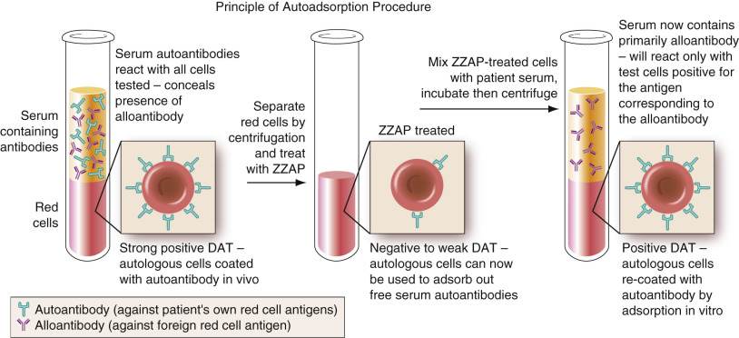

Figure 35-25 

Autoadsorption procedure used to evaluate whether underlying alloantibodies are present in a patient with autoimmune hemolytic anemia. 

It is crucial to verify transfusion information before performing an adsorption because recently transfused individuals will have multiple red cell populations. In these patients, circulating donor cells could adsorb an alloantibody of interest. If the patient's phenotype is available, testing can be performed with allogeneic phenotype-matched red cells. If the phenotype is not known, three separate adsorptions with R  1  R  1  , R  2  R  2  , and rr cells can be performed and tested, and the results compared. 

 

##  Thiol Reagents 

Sulfhydryl compounds such as 2-ME or DTT cleave disulfide bonds and are frequently used to inactivate the agglutinating capacity of IgM antibodies by cleaving intersubunit disulfide bonds, as well as bonds linking IgM subunits to the J-chain (  Klein & Anstee, 2006  ), thus destroying the pentameric structure of the IgM molecule. These reagents are useful in investigating the presence of clinically significant IgG alloantibodies in a serum that contains broadly agglutinating IgM cold autoantibodies. They can also be used to dissociate autoagglutination caused by cold antibodies that may interfere with ABO/Rh typing and DAT testing. In prenatal studies, sulfhydryl reagents are frequently utilized to evaluate a serum containing an antibody such as anti-M that commonly has both IgM and IgG components. By destroying the agglutinating anti-M, the serum can be tested for IgG anti-M that is capable of crossing the placenta to cause a mild HDFN. 

 

##  Serum Antibody Titration 

Serum titration is a method used to semiquantitatively determine the amount of antibody present in a given serum/plasma. Serial twofold dilutions of serum are prepared and then tested with RBCs possessing the corresponding antigen. Each dilution is read for macroscopic agglutination, and the titer of the antibody is expressed as the reciprocal of the highest serum dilution that gives macroscopic agglutination. Titers are performed in obstetric patients, ABO-incompatible solid organ and bone marrow transplantation, and, occasionally, antibody identification studies. 

In prenatal studies, clinically significant IgG alloantibodies capable of causing HDFN are titrated periodically in the maternal serum during pregnancy (  Judd, 2005  ). An increasing titer usually indicates that fetal cells possess the corresponding antigen and are stimulating the mother to produce more antibody, thus providing valuable information to the physician regarding how the pregnancy should be managed. Because of the clinical importance of consistency in prenatal titer reporting, some laboratories require that the initial titer be performed by two technologists for agreement. If a discrepancy exists, a third technologist should perform the titration. The intial sample should be frozen for future studies. When the next titer request is submitted, the initial sample should be tested in parallel with the new sample. 

Titers are also performed in the rare setting of major ABO-incompatible solid organ transplantation, which has risen in popularity with improvements in immunosuppressive therapy. ABO-incompatible heart transplants can be performed in children younger than 6 to 8 months, owing to low-titer ABO antibodies in early infancy (  West & Platt, 2010  ). ABO-incompatible living donor kidney transplants, once unthinkable because of the risk of hyperacute rejection, have also been performed in adult patients. To prevent hyperacute rejection, intended recipients undergo an aggressive course of immunosuppression and therapeutic apheresis before and after transplant to reduce ABO titers below a critical threshold (  Fehr & Stussi, 2012  ). Similar to obstetric patients, these patients require a series of ABO titers to monitor treatment efficacy and screen against humoral rejection. Finally, ABO titers may be necessary in ABO-incompatible allogeneic bone marrow transplants. In contrast to peripheral blood stem cells, bone marrow contains significant quantities of red cells and can place the recipient at risk for severe acute HTRs. ABO titers are performed before transplant to assess the risk of hemolysis and the need for pretransplant therapeutic apheresis (  Rowley et al, 2011  ;  Cooling & Gorlin, 2012  ). 

Antibody titration can also be used in the presumptive identification of so-called “HTLA” antibodies. These antibodies are often directed against Ch/Rg, JMH, and Knops antigens. HTLA antibodies characteristically give the same weak (+/− or +/  –m  ) reactions at multiple serum dilutions, often reacting at dilutions equal to or greater than 1 : 64\. In contrast, other weak alloantibodies will seldom react at dilutions greater than 1 : 2\. If an HTLA antibody is suspected, a titration is performed to demonstrate that the weakly reactive antibody is still reactive at a high dilution, thus allowing its classification as an HTLA. 

It is important to note that both serologic technique and cell selection can affect titer results. For example, if the initial titer was tested against a cell with homozygous antigen expression, all subsequent titers should also be tested with a homozygous cell. Likewise, some laboratories use a tube technique without additives (saline), and others may use a LISS, tube, or gel method—all of which can yield significantly different end titers in parallel testing. Each laboratory should have a policy regarding appropriate cell selection and should perform titers using a technique approved by the laboratory director with proper validation. Titer results and their meaning should be communicated clearly to the physician. Any change in procedure or method _must_ be communicated because this can affect titer results and have a direct impact on patient care. 

 

##  Special Red Cell Procedures for Antibody Identification 

Reagent or patient RBCs can be modified in various ways by the immunohematologist to abolish or enhance the reactivity of corresponding antibodies. Patient cells are also subjected to procedures designed to remove antibody that has bound in vivo so that the antibody may be recovered and identified (eluate) and/or may provide RBCs for further testing. 

 

##  Destruction of Red Cell Antigens 

Several reagents are available for treating RBCs, including various proteolytic enzymes (e.g., papain, ficin, trypsin), neuraminidase (removes sialic acid), ZZAP, AET, and DTT. In a serum containing multiple alloantibodies, selective pretreatment of RBCs with enzymes can destroy specific antigens, eliminating specific alloantibody reactivity. Enzymes are also thought to remove the water of hydration and decrease the ζ potential, allowing RBCs to more closely approach one another. As a result, they can enhance the reactivity of a weak, potentially significant antibody and facilitate its identification. [ Table 35-38 ](<#t0195>) lists antibodies whose reactivity will be enhanced or eliminated by enzyme treatment of test RBCs. Note: AET and DTT can be used to create RBCs negative for all antigens of the Kell blood group system (except Kx); these reagents may also destroy certain antigens reacting with HTLA antibodies. 

TABLE 35-38 

Effect on Antigen Expression/Antibody Reactivity by Enzyme [ * ](<#hl0005152>) Treatment of Test Cells 

Effect  |  Antigens   
---|---  
Destroyed  |  Fy  a  , Fy  b    
M, N   
HTLA- Ch/Rg, JMH   
Pr   
Xg  a   
Variable  |  Lu  a  , Lu  b    
S, s   
Yt  a  , Yt  b   
Enhanced  |  ABH   
I/I   
Jk  a  , Jk  b    
Le  a  , Le  b    
P1   
Rh   
U   
Di  a  , Di  b   
Usually unaffected  |  Kell   
  
_HTLA,_ High-titer, low-avidity; _JMH,_ John Milton Hagen. 

Data from  Issitt and Anstee (1998)  ,  Judd et al (2008)  , and  Fung (2014)  . 

 * Using ficin or papain. 

 

##  Antibody Elution 

Elution is the process used to remove antibodies bound to RBCs, as indicated by a positive DAT. Elution is commonly used to concentrate and solubilize antibodies from RBCs for subsequent identification studies. The elution of an antibody with known blood group and/or drug specificity can be diagnostic in the evaluation of acute and delayed hemolytic transfusion reactions, HDFN, autoimmune hemolytic anemia, and immune hemolytic anemia induced by medication. 

Elution may be accomplished by a variety of methods that alter or reverse the forces of attraction that hold the antigen and antibody together. Various methods involve adding heat, disrupting antigen structure by exposing the RBC membrane to freezing and thawing, using organic solvents, and altering the pH to dissociate RBC–antibody complexes. Freeze-thaw and heat elution techniques work well for removal of cold-reactive antibodies, whereas organic solvents and pH alteration are used to remove warm-reactive IgG antibodies. Because organic solvents are carcinogenic, many laboratories have a commercially available acid elution kit. 

All methods require numerous washes before elution to remove any serum containing unbound antibody. To ensure the complete removal of serum antibody, the saline from the last wash must be tested against appropriate cells to detect any residual unbound antibody. The last wash control should show an absence of antibody reactivity before the elution procedure is performed. Optimally, eluates should be tested on the same day they are prepared but may be stored at –20° C or lower if there is a delay in testing. [ Table 35-39 ](<#t0200>) lists some of the common elution methods and their applications. For a more comprehensive listing and specific descriptions of elution procedures, see  Mallory (1993)  and  Judd and colleagues (2008)  . 

TABLE 35-39 

Antibody Elution Techniques 

Method  |  Principle [ * ](<#hl0005205>) |  Application   
---|---|---  
Heat  |  Addition of heat changes equilibrium constant of antigen–antibody reaction, and antibodies are released  | 

  * • Recovery of ABO antibodies in cases of ABO HDFN 
  * • Gentle heat elution (at 45° C) may be useful for removing antibody from cells that is causing false-positive direct hemagglutination tests 

  
Freeze-thaw  |  Damage to the red cell membrane by hemolysis alters complementary fit between antigen and antibody  |  Recovery of ABO antibodies in cases of ABO HDFN   
Acid (e.g., digitonin acid, glycine acid/EDTA)  |  At an acid pH, antigen and antibody become negatively charged and repulse each other  | 

  * • Good recovery of most IgG blood group antibodies (may be less sensitive for Kidd) 
  * • Glycine/EDTA also used to dissociate antibody but leaves red cells intact for phenotyping 

  
Organic solvents (e.g., chloroform, xylene, ether)  |  Disrupts lipid bilayer of red cell membrane, altering complementary fit and/or reversing selected attractive forces between antigen and antibody  |  High-yield recovery of most IgG blood group antibodies   
  
_EDTA,_ Ethylenediaminetetraacetic acid; _HDFN,_ hemolytic disease of the fetus and newborn; _Ig,_ immunoglobulin. 

 * From  Issitt and Anstee (1998)  . 

 

##  Removal of Antibody from Red Cells to Facilitate Antigen Typing 

Many antisera used for RBC antigen typing require the IAT technique. As a result, RBC samples with a positive DAT cannot be used for antigen typing because these cells are already coated with IgG antibody and will yield a false-positive result. Most elution methods that remove blood group antibodies from the surface of erythrocytes destroy the cells or the antigens. However, treatment of antibody-coated RBCs with chloroquine diphosphate dissociates antibody, while leaving the antigens relatively intact (  Edwards et al, 1982  ). Glycine/EDTA can also be used under carefully controlled conditions to dissociate IgG from RBCs, but overtreatment with this reagent can cause irreversible damage to the RBC membrane. After chloroquine or glycine treatment, RBCs can be antigen typed with AHG-reactive antisera. Note that glycine/EDTA treatment destroys Kell protein. As a result, glycine/EDTA cells cannot be phenotyped for Kell system antigens. 

Care should be exercised when interpreting antigen typing results with chloroquine-treated cells. Reports indicate that Rh antigens, and possibly other blood group antigens, can be weakened, resulting in false-negative reactions. Saline-reactive antisera, including monoclonal grouping reagents, should not be used with chloroquine-treated cells (  Gamma Biologicals Inc., 2001  ). For chloroquine or glycine/EDTA, it is prudent to treat known antigen-positive cells in parallel as a control. Only monospecific anti-IgG should be used in the IAT because complement components are not dissociated by chloroquine from DAT-positive RBCs. 

 

##  Red Blood Cell Typing with Lectin Reagents 

Lectin typing reagents contain proteins that will recognize specific carbohydrates on the RBC membrane, causing direct hemagglutination. Lectin reagents are usually derived from plant seeds, but these receptor proteins are also found in some invertebrate animals and lower vertebrates. Because the potency of lectin reagents may vary with the preparation, each lot should be standardized before use. Although many lectins have been described, only a few have been found useful in blood banking (  Bird, 1988  ). Sources for selected lectin reagents and their applications are listed in [ Table 35-40 ](<#t0205>) . Procedures for preparation of purified lectins may be found in _Judd 's Methods in Immunohematology _ (  Judd et al, 2008  ). 

TABLE 35-40 

Lectins Useful in Immunohematologic Testing 

Lectin  |  Activity Inhibited by  |  Serologic Specificity  |  Application   
---|---|---|---  
_Ulex europaeus_ |  α\-  l  -Fucose  |  Anti-H  |  Secretor status testing, classification of weak A subgroups, investigation of possible Bombay phenotype   
Vicia graminea  |  _O_ -linked _N_ blood group tetrasaccharides (galactose [β1,3] _N_ -acetyl-galactosamine)  |  Anti-N  |  Red cell antigen typing   
Griffonia simplicifolia I [ * ](<#hl0005319>) |  α\-  d  -galactose  |  Anti-B, Tn  | 

  * • Red cell antigen typing 

  
  
  * • Investigation of acquired B/polyagglutination 

  
Dolichos biflorus  |  Terminal α\- _N_ -acetyl-  d  -galactosamine  |  Anti-A, Tn, Cad  |  Classification of A subgroups, investigation of polyagglutination   
Griffonia simplicifolia II [ * ](<#hl0005319>) |  α\- or β\- _N_ -acetyl-  d  -glucosamine  |  Anti-Tk  |  Confirmation of Tk polyagglutination   
Helix pomatia  |  α\- _N_ -acetyl-  d  -galactosamine  |  Anti-A, Tn, Cad  |  Gives distinctive mixed-field reaction with VA polyagglutination   
Arachis hypogaea  |  β\-  d  -Galactose  |  Anti-T, Tk, Th, Tx  |  Investigation of polyagglutination   
Glycine soja (max)  |  α\- _N_ -acetyl-  d  -galactosamine  |  Anti-T, Tn  |   
Leonurus cardiaca  |  α\- _N_ -acetyl-  d  -galactosamine  |  Anti-Cad specific at appropriate dilution  |   
Salvia sclerea  |  α\- _N_ -acetyl-  d  -galactosamine  |  Anti-Tn specific  |   
Salvia horminum  |  α\- _N_ -acetyl-  d  -galactosamine  |  Anti-Tn, Cad (separable)  |   
Vicia cretia  |  Galactose (β1,3) _N_ -acetyl-galactosamine  |  Anti-T, Th  |   
  
 * Formerly known as _Bandeiraea simplicifolia_ I and II. 

 

##  Separation of Autologous from Transfused Red Cells 

In transfused patients, it may be necessary to separate autologous from transfused cells. Autologous RBCs for antigen typing may be necessary (1) in a transfused patient with multiple alloantibodies, (2) with a warm autoantibody and possible alloantibodies, or (3) with an antibody to a high-incidence antigen. Performing a DAT, and possibly even elution, on separated autologous and/or transfused cells can help determine whether a recently transfused individual with a warm autoimmune hemolytic anemia (WAIHA) is developing a delayed hemolytic transfusion reaction (DHTR) due to new alloantibodies. In rare cases, DAT testing on separated autologous RBCs may be required to differentiate a WAIHA from a DHTR involving a high-incidence antigen. In a final application, one could roughly estimate the proportion of surviving, transfused RBCs when a DHTR is suspected. 

Two basic techniques for separating autologous from transfused RBCs are differential agglutination and density separation using centrifugation. In the first technique, antibodies are used to agglutinate only one population of cells, based on known antigenic differences between recipient and donor. Unagglutinated cells are physically removed from the agglutinates and are sequentially reacted with more antisera until no more agglutinates are formed. In the second technique, washed and packed RBCs are centrifuged in multiple sealed microhematocrit tubes. Transfused cells are older, smaller, and denser than newly formed autologous cells (reticulocytes) and will spin toward the bottom of the tube. After centrifugation, the top 5 mm of each tube is cut away, and the cells are harvested from these small segments. These sections will contain the larger and lighter autologous cells. This method will be effective only if the patient is producing normal or high numbers of reticulocytes. When testing separated red cells, nonseparated cells should be tested in parallel as a control. The separated red cells should show clear positives and negatives, and the nonseparated cells should show mixed field agglutination. 

Hypotonic cell lysis is a third method that is available for harvesting autologous red cells in patients with sickle cell disease. The method is based on the resistance of Hg S red cells to hypotonic saline. The patient sample is repeatedly washed with 0.3% hypotonic saline to lyse normal donor red cells until gross hemolysis is no longer present. The cells are then washed and resuspended in 0.9% saline for antigen typing. Because sickle cell patients are regularly transfused, this technique is useful for facilities that provide antigen-matched red cells for their sickle cell patients. 

 

##  Molecular Typing 

Because most common blood group antigens are the consequence of SNPs, several commercial and home-brew assays have been developed to genotype donors and patients. The ability to genotype individuals for blood group antigens is extremely useful for multitransfused patients in whom standard serologic typing cannot be performed as a result of circulating donor red cells. Several transfusion services routinely genotype all hemoglobinopathy patients (e.g., sickle cell anemia, β-thalassemia) who have long-term transfusion needs and require antigen-negative units. Genotyping is also useful in patients with multiple alloantibodies or autoantibodies, in whom it can be difficult to exclude an antibody to a high-incidence antigen because of the lack of commercial reagents (e.g., Dombrock). Likewise, serologic phenotyping often cannot be performed in patients with a positive DAT because many reagents require the addition of anti-IgG for typing. Genotyping is commonly used in prenatal testing to identify a fetus at risk for HDFN. Fetal genotyping can often be performed with a maternal blood sample, offering a significant safety advantage over serologic testing, which requires fetal blood sampling (  Finning et al, 2007  ). Finally, large-scale genotyping of donors has the potential to increase the availability of antigen-negative units for patients with clinically significant alloantibodies (  Montpetit et al, 2006  ). 

Several methods have been developed for red cell and platelet genotyping, including restriction fragment length polymorphism, allele-specific PCR, real-time PCR, direct sequencing, and microarray technology (see [ Chapter 65 ](<##!/content/3-s2.0-B9780323295680000656?scrollTo=%23c00065>), [ Chapter 66 ](<##!/content/3-s2.0-B9780323295680000668?scrollTo=%23c00066>), [ Chapter 67 ](<##!/content/3-s2.0-B978032329568000067X?scrollTo=%23c00067>) ). High-throughput screening methods, such as microarray, are amenable to semiautomated processes and permit extended typing for high- and low-incidence antigens. It is important to stress that genotype does not always reflect red cell phenotype because most genotyping methods focus on known common polymorphisms. Unknown polymorphisms may alter protein or gene expression not detected by the primers used. A well-known example is Fy(a–b–) phenotype in blacks, who genotype as _FY*B ES  _ but lack Fy expression on red cells because of a promoter mutation. Likewise, many partial RhD and RhCE phenotypes can lead to discrepancies between phenotype and genotype (see Rh section). 

 

##  Investigation of Autoimmune Hemolytic Anemia 

Autoantibodies, in general, are produced by an individual's own immune system against self or an antigen that is present in that same individual. Although produced against self-antigens, these antibodies typically react with the same antigen found in other normal individuals. If the antibodies produced are against blood cell constituents, the pathologic result could be hemolytic anemia, thrombocytopenia, or leukopenia. In many cases, these autoantibodies cause no demonstrable clinical symptoms. 

The DAT is integral to the diagnosis of autoimmune hemolytic anemia (AIHA) because it can confirm the presence of antibody that has attached to the patient's own red cells in vivo. The DAT can help differentiate AIHA from congenital anemias caused by abnormalities in RBC cytoskeleton, enzymes, or Hg. The DAT may be positive owing to IgG and/or complement components, depending on the class or subclass of autoantibody involved. A positive DAT by itself, however, does not mean that an individual has AIHA. Approximately 8% of hospitalized patients have a positive DAT without any signs of hemolysis (  Petz, 1993  ). In patients with suspected AIHA, the antibody screen may also be positive because of free autoantibody in the serum. 

Autoantibodies are categorized as cold (usually IgM) or warm (usually IgG), based on the temperature of in vitro reactivity in the IAT. In some cases, patients may have mixed-type AIHA with both cold and warm reactive autoantibodies. The causative antibodies of these categories of anemias will be described here; additional information regarding the origin and pathophysiology of AIHA is provided in [ Chapter 32 ](<##!/content/3-s2.0-B9780323295680000322?scrollTo=%23c00032>) . 

 

##  Warm Autoimmune Hemolytic Anemia 

Individuals with warm reactive autoantibodies account for approximately 70% to 80% of cases of AIHA, having an overall incidence of about 1 in 50,000 to 1 in 80,000 (  Issitt & Anstee, 1998  ). WAIHA may be classified as primary or idiopathic (of unknown origin), or as secondary. Secondary WAIHA is often observed in autoimmune diseases (frequently systemic lupus erythematosus), in lymphoproliferative disorders, and following viral infections. With the advent of improved diagnostic procedures, the percentage of WAIHA classified as idiopathic has dropped to about 30% of cases (  Issitt & Anstee, 1998  ). Patients with warm autoantibodies and a positive DAT will not all present with symptomatic anemia but may exist in a chronic compensated state for some time before progressing to overt clinical anemia. 

 

##  Serologic Characteristics 

Autoantibodies in WAIHA are usually IgG and polyclonal in nature, showing optimal in vitro reactivity at 37° C. A vast majority of warm autoantibodies present in serum and/or recovered in eluates from patients' RBCs can be demonstrated only by the IAT technique. The DAT will be positive in approximately 80% of cases. The DAT profiles in several large studies show that 40% to 50% are due to IgG only, 45% to 60% are caused by IgG and complement, and 0 to 15% are the result of complement only (  Issitt & Anstee, 1998  ). In those instances where the DAT is negative, the use of more sensitive techniques, such as radioisotope or enzyme-labeled DAT, can demonstrate low levels of IgG or, less frequently, IgM and IgA on red cells (  Englefriet et al, 1992  ). 

Ig subclass studies in WAIHA indicate that causative antibodies are predominantly IgG1 and/or IgG3. Despite the ability of these subclasses to activate complement, immune destruction of the patient's autologous cells occurs largely through the spleen and liver via extravascular pathways. Patients whose RBCs are coated with IgG3 antibodies are more likely to show overt anemia, apparently because of the greater capacity of IgG3 for binding to Fc receptors on macrophages (  Englefriet et al, 1992  ). A more recent study shows that the presence of multiple IgG subclasses, rather than a single subclass, has a synergistic effect on the severity of hemolysis (  Fabijanska-Mitek et al, 1997  ). 

In general, warm autoantibodies display a broad specificity, reacting with all normal RBCs. Many broadly reactive antibodies can show Rh specificity, as evidenced by weak or absent reactivity to Rh  null  red cells. On occasion, autoantibodies will demonstrate Rh pseudospecificity such as anti-e (most frequently), anti-c, and anti-E. Studies with recombinant cell lines show that in most instances, these antibodies are broadly reacting with the RhCE, RhD, and Band 3 proteins, regardless of Rh phenotype (  Iwamoto et al, 2001  ). Notable exceptions to the latter are African Americans with partial RhCE proteins, who serologically type as c- and/or e-positive, but can produce true alloanti-c and alloanti-e after immune stimulation (see Rh section). Autoantibodies with apparent specificity for Kell, Kidd, MNSs, ABO, Vel, and LW antigens have also been reported. Relatively few individuals with WAIHA will show a single simple specificity (  Issitt & Anstee, 1998  ). 

 

##  Serologic Testing beyond the DAT 

Transfusion is usually avoided for as long as possible in patients with WAIHA. If transfusion is necessary, it is important to characterize the autoantibody and exclude the presence of RBC alloantibodies (  Eder, 2005  ). Typical investigation strategies should always include adsorption of the serum, followed by antibody detection and identification on the adsorbed serum. Subsequent testing can also be performed on eluted antibody, although it seldom yields further useful information _unless_ the serum is nonreactive. 

 

##  Autoadsorption. 

Because a strong, broadly reactive serum autoantibody can mask the presence of significant alloantibodies, adsorption studies should be performed in these patients. Autoadsorption using autologous cells can be performed on patients who have not been recently transfused (within the last 3 months). For patients who have a strong positive DAT, autologous cells should be treated with ZZAP (  Branch & Petz, 1982  ) before adsorption. ZZAP contains DTT, which reduces disulfide bonds in the IgG autoantibodies coating the RBCs. This destabilizes the Ig structure, rendering the autoantibodies susceptible to digestion by cysteine-activated papain, the second component of ZZAP. By stripping bound autoantibody from cells, ZZAP treatment increases the adsorptive capacity of autologous RBCs (see [ Fig. 35-25 ](<#f0130>) ). If the serum contains a high concentration of autoantibody, multiple, sequential autoadsorptions may be necessary to remove all autoantibody activity. If available in sufficient quantity, autoadsorbed serum may be used to perform crossmatching, particularly if antibody detection studies reveal the presence of underlying alloantibodies. 

If the patient has had recent RBC transfusions, and the patient's red cell phenotype is known, adsorption may be performed using allogeneic cells of the same phenotype as the patient. Alternatively, if the patient's RBC phenotype is unknown, differential adsorptions may be performed on three separate aliquots of the patient's serum with different red cell samples of R  1  , R  2  , and rr phenotypes. One of the red cell samples should lack Jk  a  and one should lack Jk  b  (  Fung, 2014  ). ZZAP treatment of the adsorbing cells will effectively destroy Fy  a  , Fy  b  , all Kell system antigens, and the M, N, S, and s antigens, thereby conferring on the adsorbing cell samples the capacity to remove autoantibody activity, while preserving potential alloantibodies in the serum. The different aliquots of serum are then tested against cells of known phenotype to detect and/or identify alloantibody specificity. 

 

##  Elution. 

In most cases of WAIHA, an eluate of the patient's cells will demonstrate the same broadly reactive antibody seen in serum. In the rare instances where the serum is only weakly reactive or negative, an eluate may concentrate the warm autoantibody to facilitate identification and evaluation of its spectrum of reactivity. If the eluate is nonreactive with normal reagent RBCs, the presence of drug-induced autoantibodies should be investigated (see later). 

 

##  Cold Autoimmune Hemolytic Anemia 

Cold autoantibodies may be detected in the serum of many normal individuals if tested under the right conditions. However, most of these antibodies are benign cold agglutinins that show optimal reactivity at 4° C and little or no reactivity at 37° C. Cold agglutinins are often a nuisance that can interfere with ABO/Rh typing, antibody detection, and crossmatching when polyspecific AHG is used. Although usually ignored as clinically insignificant, cold agglutinins may become pathologic by virtue of expanded thermal amplitude and a significant increase in titer, frequently in association with certain disease states. DAT, serum titration, and characterization of thermal amplitude are the most important serologic tests in evaluating a possible diagnosis of CAIHA. [ Table 35-41 ](<#t0210>) outlines some of the serologic differentiating characteristics of various cold agglutinating autoantibodies, both pathologic and benign. 

TABLE 35-41 

Differentiating Characteristics of Cold Red Cell Autoagglutinins 

Antibody Specificity  |  Clinical Significance  |  IAT Antibody Screen [ * ](<#hl0005424>) |  Ig Class  |  RELATIVE REACTION STRENGTHS WITH SELECTED RED CELLS AT ROOM TEMPERATURE [ † ](<#hl0005429>)  
---|---|---|---|---  
O adult  |  O cord  |  A  1  adult  |  A  2  adult  |  Autologous   
I  |  Acute CAD associated with _Mycoplasma pneumoniae_ with antibody titers >1000 at 4° C  |  Pos  |  IgM  |  3+  |  w+  |  3+  |  3+  |  3+   
i  |  Acute CAD associated with mononucleosis  |  Pos  |  IgM  |  w+  |  3+  |  w+  |  w+  |  Weaker than O cord   
Pr  |  Rare cause of CAD [ ‡ ](<#hl0005432>) |  Pos  |  Reported cases of IgM, IgA, IgG  |  3+  |  3+  |  3+  |  3+  |  3+   
P  |  PCH associated with certain viral infections in children  |  Neg  |  IgG [ § ](<#hl0005435>) |  Negative in routine agglutination tests; autoanti-P is a biphasic hemolysin (Donath-Landsteiner antibody)   
H  |  Benign except as alloantibody in Bombay phenotype  |  Weak to neg  |  IgM  |  3+  |  3+  |  1+  |  2+  |  0 to w+   
IH  |  Benign  |  Weak to neg  |  IgM  |  3+  |  1+  |  1+  |  2+  |  0 to w+   
  
_CAD,_ Cold agglutinin disease; _Ig,_ immunoglobulin; _Neg,_ negative; _PCH,_ paroxysmal cold hemoglobinuria; _Pos,_ positive. 

 * Antigen expression: O adult (I+i– H+s); O cord (I–i+ H+s); A  1  (I+i– H+w); A  2  (I+i– H+). 

 † Reagent cells showing agglutination in 37° C phase may be much weaker after conversion to indirect antiglobulin test (IAT). 

 ‡ May be differentiated from anti-I by enzymes or increasing pH; anti-Pr reactivity is decreased by both techniques. 

 § Autoanti-P is the only pathologic cold autoantibody known to be routinely of the IgG class to IAT. 

 

##  Cold Agglutinin Disease 

Cold agglutinin disease (CAD) accounts for about 20% of total cases of AIHA (  Issitt & Anstee, 1998  ). As with WAIHA, CAD may be idiopathic or secondary following infection or malignancy. Anti-I is the most frequent autoantibody in idiopathic CAD and _M. pneumoniae_ infections. In contrast to the anti-I cold agglutinins found in normal sera (usually less than 1 : 64 when tested at 4° C), anti-I in CAD is often of very high titer, with ranges of 1 : 10,000 to 1 : 1,000,000 (  Cooling, 2010  ). The antibody also has expanded thermal amplitude, reacting with RBCs at temperatures in the range of 30° to 34° C in vitro, especially in tests with albumin-suspended RBCs (  Issitt & Anstee, 1998  ). The DAT is typically positive with polyspecific and anti-C3 reagents. 

In vivo hemolysis is the result of binding of antibody to a patient's RBCs in the peripheral vessels of the extremities, which are cooler (32° C and lower). As the cells recirculate to the body core and warm to 37° C, complement is activated and cells are destroyed. Hemolysis of cells may occur intravascularly but occurs more commonly via extravascular (C3b) pathways by macrophages in the reticuloendothelial system. Hemolysis may be chronic or episodic, depending on the thermal range of the antibody, and may be triggered by exposure to cold temperatures. 

Because anti-I reacts broadly with virtually all adult RBCs, the antibody can cause great difficulty in compatibility testing. As with warm autoantibodies, one of the primary concerns is to detect and identify any potential underlying IgG alloantibodies. Techniques to circumvent the autoanti-I in serum testing may include prewarming, cold autoadsorption, adsorption with REST, or treatment of the serum with sulfhydryl reagents such as DTT or 2-ME (see [ Special Antibody Identification Techniques ](<#s1145>) section). 

Anti-i and anti-Pr are two additional specificities associated with CAD. Anti-i can be observed in patients with infectious mononucleosis and certain lymphoproliferative disorders. Up to 10% to 20% of patients with infectious mononucleosis will have elevated cold agglutinin titers; however, few will actually develop clinical hemolysis (  Eder, 2005  ;  Cooling, 2010  ). Anti-i is usually an IgM, reacting more strongly with cord cells than with adult cells. Distinguishing anti-i from anti-I may require titrating patient sera with group O adult and cord red cells at 4° C, 24° C, and 37° C (  Fung, 2014  ). 

Anti-Pr specificities may initially react similarly to anti-I, but may be differentiated by equally strong reactions with cord and adult RBCs ( [ Table 35-42 ](<#t0215>) ). In addition, anti-Pr is sensitive to trypsin and ficin and is nonreactive with enzyme-treated red cells, unlike anti-I and anti-i, which are enhanced by enzyme treatment. It is believed that anti-Pr recognizes the O-linked tetrasaccharide on glycophorin A and B (  Issitt & Anstee, 1998  ;  Cooling, 2015  ). Anti-Pr in patients with severe CAD is usually monoclonal and may be IgG, IgM, or IgA (  Issitt & Anstee, 1998  ). 

TABLE 35-42 

Selected Drugs Associated with a Positive DAT and/or Hemolysis Due to Drug-Induced Autoantibodies 

Reported Mechanism  |  Drug   
---|---  
Drug-independent autoantibody induction  |  Cladribine, fludarabine, levodopa, mefenamic acid, methyldopa, procainamide   
Drug-dependent (reactivity with drug-coated cells)  |  Aminopyrine, amoxicillin, carbromal, cefamandole, cefazolin, cephalexin, erythromycin, insulin, nafcillin, penicillin, tetracycline, tolbutamide   
Drug-dependent (reactivity with uncoated cells)  |  Acetaminophen, amphotericin B, antazoline, butizide, ceftriaxone, chlorpropamide, diethylstilbestrol, etodolac, 9-hydroxy-methyl-ellipticinium, naproxen, phenacetin, probenecid, propyphenazone, quinine, sodium pentothal, stibophen, sulfamethoxazole, sulfasalazine, trimethoprim   
Nonimmunologic protein adsorption  |  Clavulanate potassium, diglycoaldehyde, sulbactam sodium, suramin, tazobactam sodium   
Combination mechanisms  |  Ampicillin, carbimazole, carboplatin, cefixime, cefotaxime, cefotetan, cefoxitin, ceftazidime, ceftizoxime, cephalothin, chlorinated hydrocarbons, chlorpromazine, cisplatin, cyanidanol, diclofenac, dipyrone, fenoprofen, fluorescein, hydrochlorothiazide, isoniazid, mefloquine, methotrexate, nomifensine, oxaliplatin, piperacillin, quinidine, ranitidine, rifampicin, streptomycin, sulindac, suprofen, teicoplanin, teniposide, ticarcillin, tolmetin, triamterene, zomepirac   
  
_DAT,_ Direct antiglobulin test. 

Data from  Fung (2014)  . 

 

##  Paroxysmal Cold Hemoglobinuria 

PCH is an autoimmune hemolytic syndrome most often seen in children following infection by mumps, chickenpox, measles, and other viruses. Historically, PCH was also seen in syphilitic patients. It can present suddenly with severe hemolysis with an initial Hg of 7 g/dL or lower. In addition to laboratory findings of intravascular hemolysis, PCH patients may have erythrophagocytosis on peripheral blood smear. The latter is highly unusual and should trigger an investigation for possible PCH (  Eder, 2005  ). 

Autoanti-P, also known as the Donath-Landsteiner (DL) antibody, is the most common causative antibody in PCH. It is an IgG, biphasic autohemolysin capable of binding to RBCs at cold temperatures and causing intravascular hemolysis of those cells at body temperature (see [ Table 35-41 ](<#t0210>) ). This characteristic can be demonstrated in vitro by the diagnostic DL procedure to aid in the confirmation of PCH. In this test, three sets of tubes containing patient serum and group O cells are incubated—one at 4° C followed by 37° C, one only at 4° C, and one only at 37° C. If the first set shows hemolysis, but the other two do not, this indicates the presence of the biphasic hemolysin characteristic of PCH. The DL test requires that a fresh blood sample be used to ensure that an adequate supply of complement is available, because complement is relatively unstable and deteriorates during storage. The sample should be drawn and immediately stored at 37° C until clot formation. It is also important not to draw the blood into an anticoagulant such as EDTA because chelation of calcium ions will prevent complement activation and thus in vitro hemolysis. 

Because the autoantibody in PCH rarely reacts above 4° C in vitro, routine antibody detection tests are usually negative, and crossmatches are compatible. Patient RBCs sensitized by the DL antibody will most commonly give a positive DAT, owing to C3 only. In addition, the DAT is positive only during or immediately after an episode of hemolysis (  Eder, 2005  ). Because the antibody dissociates easily from RBCs during washing, the DAT is usually negative with anti-IgG. IgG may be detected, however, if the cells are washed with cold saline and tested with cold anti-IgG reagent (  Fung, 2014  ). 

Because the antibody is biphasic, many clinicians recommend keeping the patient warm and utilizing a blood warmer for transfusion. Although PCH is due to an autoanti-P, it is not necessary to transfuse the patient with rare, P-negative red cells. Most patients will have an acceptable transfusion response with routine allogeneic red cells (  Eder, 2005  ). 

 

##  Mixed-Type AIHA. 

A “mixed” AIHA occurs in less than 10% of patients and is characterized by the presence of warm and cold autoantibodies (  Eder, 2005  ). The DAT is usually positive with both C3 and IgG, and the patient's serum will react in all phases of testing (at room temperature and at 37° C) in the IAT. The cold-reactive antibody is typically anti-I or anti-i, and the warm-reactive antibody is typically a 37° C reactive IgG autoantibody. To adsorb autoantibody in a mixed AIHA, the sample is sequentially adsorbed at 37° C to adsorb warm-reactive autoantibody, followed by incubation in an ice bath for 30 minutes to adsorb cold-reactive antibody. Clinically, mixed AIHA usually is similar to WAIHA, although some patients may have symptoms of both WAIHA and CAD. 

,  

##  Positive Direct Antiglobulin Tests and Hemolytic Anemia Induced by Medication 

At this time, more than 130 drugs have been implicated in drug-induced hemolytic anemia, with an incidence of 1 in 1 to 2 million individuals (  Salama, 2009  ). An even larger number of therapeutic drugs can be associated with a positive DAT (see [ Table 35-42 ](<#t0215>) ). It is also well documented that a positive DAT may be produced in patients receiving high-dose intravenous gammaglobulin therapy, owing to passively acquired specific blood group antibodies, as well as nonspecific binding to RBCs by IgG dimers and aggregates in the gammaglobulin preparation (  Knezevic-Maramica & Kruskall, 2003  ). Several theories regarding the immunologic process underlying drug-induced antibodies have been put forth, many of which remain unproven. Moreover, some drugs appear to work by more than one mechanism, further complicating the picture. An example of the latter is the group of cephalosporins, which now account for 93% of drug-induced hemolysis (  Garratty, 2004  ). 

Historically, drug-induced hemolytic anemia has been subclassified into four types, based on its serologic characteristics. Drug-independent antibodies do not require the addition of drug into the test system for detection, even though the drug is responsible for inducing hemolytic anemia. Drug-dependent antibodies, on the other hand, require the presence of the drug for serologic reactivity. Drug-dependent antibodies can be subclassified into two types, depending on whether antibody reactivity requires drug-coated red cells or simply the presence of drug in serum. Antibody reactivity against drug-coated red cells appears to be directed against the drug itself. Alternatively, reactivity observed after concurrent incubation of red cells, serum, and free drug is believed to reflect immune complex formation between drug and “antidrug” antibody. Finally, nonimmunologic protein adsorption proposes that a change in the red cell membrane causes immune globulins and other plasma proteins to be adsorbed nonspecifically to the red cell membrane. 

A unifying model has been suggested that may be applicable to many different drugs thought to be operating via the mechanisms mentioned previously (  Garratty, 2004  ). The hypothesis suggests that the immune process is initiated by a primary interaction between RBCs and the drug or its metabolites, even though the drug may be only loosely bound to RBCs in vivo. This provides the composite determinants (or neoantigen) necessary for production of drug-dependent antibodies, as in the drug adsorption and immune complex mechanisms, or of drug-independent autoantibodies that recognize subtle alterations in the RBC membrane. 

 

##  Stimulation of Red Cell Autoantibody Production 

 

##  Drug-Induced Immune Hemolytic Anemia (DIIHA) 

Rarely, individuals develop antibodies after receiving therapeutic drugs. There are at least 120 drugs that have been described in the literature associated with DIIHA. The DAT may be positive with IgG and/or C3. The antibodies are classified into four types: drug-dependent (two subtypes), drug-independent, and nonimmunologic protein adsorption. 

 

##  Drug-Independent Autoantibodies 

Drug-independent autoantibodies can be detected without the presence or addition of the drug to the test system. The best-known example is methydopa (Aldomet), a hypertensive drug still used in obstetrics. About 20% of hypertensive patients who receive methyldopa for longer than 3 to 6 months will eventually develop a positive DAT, but only 0.8% will develop a hemolytic anemia (  Petz, 1993  ). The DAT gradually becomes negative after stopping methyldopa treatment, although it may take months to longer than 2 years. Serologically, autoantibodies eluted from RBCs, or free in the serum, are indistinguishable from autoantibodies found in patients with WAIHA. The antibodies are usually of the IgG class, with both κ and λ light chains, and many show Rh specificity. Drug-independent antibodies may be found alone as warm autoantibodies (methyldopa, procainamide, and fludarabine) or in combination with drug-dependent antibodies (cefotetan). About 10% of patients with Parkinson's disease receiving  l  -dopa, a closely related drug, develop RBC autoantibodies, but these rarely result in overt hemolysis (  Petz, 1993  ). 

 

##  Drug-Dependent Autoantibodies (Two Types) 

 

##  Reactivity with Drug-Coated Cells 

About 3% of patients receiving large doses of penicillin intravenously (>10 × 10  6  IU/day) develop a positive DAT, although only a few of these patients will have hemolytic anemia (  Salama, 2009  ). Breakdown products of benzyl penicillin exhibit a high binding affinity for the RBC membrane, which results in the formation of haptenic benzylpenicilloyl determinants. Certain patients can form high-titered antibodies against penicillin metabolites and, to a lesser extent, red cell membrane components. The resulting antibody–drug–RBC complex yields a positive DAT with IgG and sometimes with anti-C3. The DAT becomes negative again within days to several weeks after discontinuing penicillin. Both the patient's serum and eluates prepared from the patient's RBCs usually react only with penicillin-coated RBCs in in vitro testing. 

Penicillin antibodies may consist of IgM or IgG. IgM antibodies are very common if a sensitive method is used for detection. Those antibodies associated with immune hemolytic anemia are usually of IgG isotype (  Salama, 2009  ). Hemolysis occurs usually through extravascular destruction mediated by cells of the RE system, although rare cases of complement-mediated intravascular hemolysis have been reported. Several cases of acquired hemolytic anemia have also been reported in association with cephalosporins through a mechanism similar to that of penicillin (  Garratty, 2004  ;  Salama, 2009  ). 

 

##  Reactivity with Uncoated Cells 

A wide variety of drugs may cause hemolytic anemia via the so-called immune complex mechanism (see [ Table 35-42 ](<#t0215>) ). In the unifying concept, these drugs loosely bind to the RBC membrane with subsequent formation of antibodies reacting with both drug and membrane components. The cell–drug–antibody complex then may stimulate activation of the complement cascade. Drugs acting by this mechanism most often are associated with episodes of acute intravascular hemolysis with hemoglobinemia and hemoglobinuria that may prove fatal (  Petz, 1993  ). The DAT in these cases is usually positive with anti-C3d only. The antibodies implicated may be IgM or IgG (  Fung, 2014  ). They can be detected only in test systems where serum/eluate, test cells, and free drug are all present simultaneously. Although the mechanism leading to antibody production may be similar to that of so-called drug adsorption, the drugs in this category are classified separately primarily by the DAT result (C3d+) and characteristic severe intravascular hemolysis. 

 

##  Nonimmunologic Adsorption of Serum Proteins 

Patients taking high-dose cephalothin (6 to 14 g/day) for prolonged periods have been reported to develop a positive DAT, with a frequency ranging widely from 3% to 81% (  Garratty, 2004  ). Hemolysis is rarely, if ever, associated with the phenomenon (  Fung, 2014  ). It was subsequently shown that RBCs exposed to cephalothin in vitro are able to nonspecifically adsorb plasma and serum proteins (albumin, Igs, complement). In the case of some cephalosporins, a decrease in CD55 and CD58 can be documented (  Garratty, 2004  ). These proteins can be detected by polyspecific AHG sera in the DAT. It has been hypothesized that adsorption occurs because of a change in erythrocyte membrane properties induced by cephalothin and other drugs. 

,,
