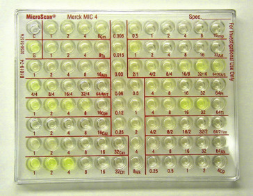
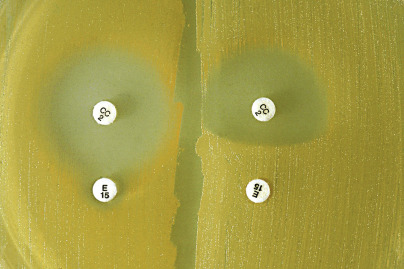
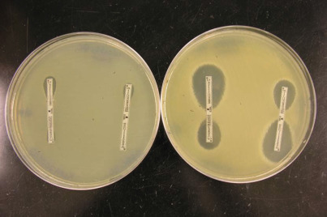
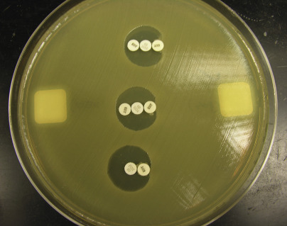

## Key Points

  * •

The _minimum inhibitory concentration (MIC)_ is defined as the lowest concentration of antibiotic that inhibits the visible growth of an organism, in vitro. It is distinguished from the _breakpoint,_ which is the concentration of antibiotic that determines whether an isolate is categorized as susceptible, intermediate, or resistant. 

  * •

MIC values are determined by inhibitory methods in the laboratory, which include broth dilution, agar dilution, and gradient diffusion (using the Epsilometer, also known as the _E-test_ ). Disk diffusion testing, which is a qualitative rather than a quantitative test, does not directly result in an MIC value, but is based on direct correlation of inhibitory zone sizes with MIC values. Molecular testing also does not result in an MIC but is increasingly being used to rapidly determine the presence of resistance genes in an organism. Whatever method of testing is chosen, it must be remembered that resistance mechanisms are complex and can evolve quickly; therefore, it is imperative that the laboratory director remain informed of the most current literature and guidelines. 

  * •

Whatever method of susceptibility testing is used, standardized conditions related to media, inoculum concentration, incubation time, atmosphere, and temperature are necessary to produce accurate and reproducible results. Standards for these variables are published by the Clinical and Laboratory Standards Institute (CLSI) and represent standards of practice for microbiology laboratories. 

  * •

Commercial automated instrument systems are available for rapid, high-volume susceptibility testing; however, despite the advantages of speed and efficiency that these systems allow, it must be remembered that the systems may have weaknesses. In addition to the expense of the systems, some are associated with problems in accurately detecting specific resistance phenotypes. Expert rules can be programmed into the software to help streamline some of these issues for more accurate reporting. It is the responsibility of the laboratory director to be aware of the weaknesses in the systems used, and to find alternative or supplemental approaches of testing, as appropriate. 

  * •

Both the indications for susceptibility testing and the selection of which antimicrobials to test and report should be determined by individual laboratories on the basis of recommendations published by the CLSI and in close consultation with the medical and infectious disease staff of the institution served by the laboratory. In general, susceptibility testing is warranted when the susceptibility of an organism causing an infection cannot be predicted reliably from its identity. 

  * •

Cumulative antimicrobial susceptibility reports (antibiograms) should be published by laboratories, based on CLSI guidelines, on at least an annual basis. These compilations are important for use by physicians in initiating appropriate empirical treatment before testing results are available, are helpful for pharmacists in monitoring the use and need of specific antimicrobials and in attempting to control drug costs, and are helpful in trending susceptibility patterns in a particular hospital or region over time. 

We gratefully acknowledge the contribution of Michael B. Smith, P. Rocco LaSala, and Gail L. Woods, who authored this chapter in previous editions. 

Selection of an antibiotic by a physician to treat an infection in a patient involves consideration of numerous factors, including but not limited to the known or most likely infecting organism(s), local patterns of drug resistance on the part of the organism(s), the site of infection, pharmacodynamic and pharmacokinetic properties of the drug, overall health of the patient, and the cost of the antibiotic. Although in many cases initial selection of an antimicrobial agent is empirical, in vitro laboratory testing of the susceptibility of isolated pathogen(s) to antibiotics is an important aid in subse­quent management of the patient. Modification of therapy may be desirable if (1) the infecting organism(s) is resistant to current therapy, (2) the dose of antibiotic is not appropriate, (3) an equally effective but less expensive agent can be used, or (4) de-escalation of antibiotic therapy can occur (i.e. if the organism is found to be more susceptible than anticipated). 

,  

##  Introduction and Definitions 

In vitro antibiotic susceptibility testing (AST) in clinical laboratories is primarily performed with the use of phenotypic methods. Phenotypic methods have traditionally required isolation of the pathogen being tested, followed by exposure of the pathogen to the antimicrobial and subsequent evaluation of the expression, or lack of expression, of resistance to the antibiotic. This process can be labor-intensive and time-consuming, which may be disadvantageous under some circumstances to the patient, the laboratory, or both. Despite this fact, phenotypic methods, which include broth dilution, agar dilution, disk diffusion, and gradient diffusion (E-test), are at present the most prevalent and in many cases the most cost-effective way to accomplish susceptibility testing. Commercial systems, based on phenotypic methods, have reduced the labor and the time necessary to detect the expression of antibiotic resistance and are used in many laboratories. Finally, newer methods of testing (primarily molecular), some of which can be performed directly on patient specimens, have recently gained popularity, as they eliminate the delay associated with pathogen isolation. 

Antimicrobial susceptibility tests may be categorized according to the endpoint used, that is, inhibition of growth or killing. In most cases, inhibition of growth is the parameter used in the laboratory, with only limited use of a killing endpoint for very specific circumstances. 

The inhibitory parameter that forms the basis for the majority of phenotypic susceptibility tests is the **minimum inhibitory concentration (MIC)** , which is the lowest concentration of antibiotic that inhibits the visible growth of an organism in an in vitro system ( [ Fig. 59-1 ](<#f0010>) ). MIC results are dependent not only on the interaction between the antimicrobial agent and the organism, but also on test conditions. These conditions include pH and ion concentrations of testing media, the temperature at which the test system is incubated, the incubation atmosphere, the amount of organism used in testing, and the length of time the system incubates. To allow intralaboratory and interlaboratory reproducibility, these test conditions have been standardized. Various standards organizations in a variety of venues throughout the world have set and published these parameters, and in the United States, **the Clinical and Laboratory Standards Institute (CLSI),** fulfills this role. 

Figure 59-1 

MIC by broth microdilution. 

Seen in this figure is a commercially prepared microtiter tray containing different concentrations of antibiotics in the various sets of wells; the concentrations in mcg/mL are marked by the numbers listed under each well, and the different antimicrobial agents are indicated by abbreviations seen nearest the well with the highest drug concentration. The organism is manually inoculated into the wells and read by direct visualization. Growth is indicated by turbidity (in the present figure, there is also pigmentation seen), and the organism will grow in the wells containing concentrations of antibiotics to which it is resistant. The MIC value is determined by the lowest concentration without visible growth. In cases in which all wells in the series of a given antibiotic are negative, the MIC is resulted as lower than the lowest concentration of that drug; conversely, when there is growth in all wells in the series of a given antibiotic, the MIC is resulted as higher than the highest concentration of that drug. In the present figure, the last antibiotic agent in the lowest row on the right is Ciprofloxacin (Cp), with an MIC ≤0.25 mcg/mL. Cefotetan (Cft) is on the lower left, with clear growth in the wells marked 1, 2, and 4, and no growth in the well-marked 8, making the MIC for this drug 8 mcg/mL. For comparison (as well as for use as an indicator of test validity), the negative (C) and positive control (G) wells can be seen on the upper left. 

Although the MIC is a very useful and reproducible indicator of the interaction of an antibiotic with a specific organism, the information it provides to a physician in the context of the infected patient by itself is limited. The MIC is a “snapshot” assessment of the interaction of a constant concentration of drug with the organism at a specific point in time under specified conditions in vitro. The MIC must be correlated with the complex and changing environment of the physiology of the patient to allow the physician to predict whether therapy with a particular antibiotic will be successful. This is accomplished through the use of **breakpoints,** which allow assessment of the efficacy of killing or inhibition of growth of the organism by the antimicrobial. Several types of breakpoints, including microbiological, pharmacokinetic/pharmacodynamic, and clinical, have been identified. Clinical breakpoints, which are intended to separate strains of organisms into categories that predict whether therapy in a patient will be successful, are breakpoints relevant to this short review and are the only type of breakpoint discussed here. Determining clinical breakpoints is complex, difficult, and subjective. The process can involve numerous clinical trials, and clinical breakpoints may vary with the determining standards organization; breakpoints also change over time, as they are reassessed and revised according to the most recent guiding literature. Breakpoints also vary based on the clinical site of infection; for example, the breakpoint set for meningitis due to _S. pneumoniae_ is different from that set for pneumonia caused by the same organism. In the United States, clinical breakpoints for specific antibiotic-organism combinations are set and published for use by clinical laboratories by the CLSI, and they are updated yearly (  CLSI document M100-S24, 2014  ). Breakpoints established by the CLSI may differ for a variety of reasons from those set by the European Committee on Antimicrobial Susceptibility Testing (EUCAST) or other standards organizations. One such reason involves different dosing and administration schedules used for the same drugs in different countries. In the United States, challenges also arise when breakpoints differ between the CLSI and the Food and Drug Administration (FDA), as the breakpoints and interpretations of the FDA are the ones to which the manufacturers of the automated testing systems must adhere, while the breakpoints and interpretations of the CLSI guide clinical microbiologists, and are based on the most recent and relevant literature and hence updated regularly. Finally, breakpoints are not perfectly clinically predictive for various reasons, such as differences in patient characteristics and immunity, as well as differences in organism virulence and type and site of infection. Excellent discussions of breakpoints and their determination, maintenance, and relevance can be obtained by referring to several review articles (  Doern & Brecher, 2011  ;  Jenkins & Jerris, 2011  ). 

Interpretive categories have been established that allow simplified and easily understood reporting of susceptibility results by laboratories. Many laboratories report these categories, in addition to reporting an MIC or, in some cases, in lieu of reporting an MIC. Although highly knowledgeable infectious disease physicians may be able to make informed management decisions with the MIC, this is unlikely to be the case for physicians who do not specialize in this area. Treating physicians depend on guidance from the laboratory regarding interpretation of the actual breakpoints. The basic interpretative categories include **susceptible, intermediate,** and **resistant.** There is also a **nonsusceptible** category and most recently, a new **susceptible dose dependent (SDD)** category for antibacterial AST (  CLSI, 2014  ). _Susceptible_ implies that therapy with the recommended dosage of a particular antibiotic is likely to be effective in eradicating the infection, and _resistant_ indicates that the antibiotic in the appropriate dose has not been shown to have a high likelihood of treatment success in clinical trials. 

Reporting an interpretative category of intermediate has several implications. It suggests that the isolate tested may be less inhibited by the usual dose of the antibiotic than those isolates that are categorized as susceptible. It also implies that therapy with higher doses of antibiotic may be effective and that therapy may also be effective if used in anatomic sites in which the antibiotic is concentrated. An example of this latter situation is the use of β-lactam antibiotics in treating urinary tract infection. This category also includes a **buffer zone,** which is intended to prevent technical factors from resulting in a major interpretive error. SDD implies that susceptibility of an isolate is dependent on a higher dosing regimen (higher doses and/or more frequent dosing intervals) than typically used, and that the dose to which the patient is exposed is higher than that used when the susceptible breakpoint was established. This category has been in use for antifungal AST but is now used for antibacterial AST because it was noted that _intermediate_ was often misinterpreted as _resistant_ by clinicians, thereby limiting their choices for therapy. 

The nonsusceptible category is intended for cases in which intermediate and resistant isolates have not been found or categories of intermediate and resistant have not been defined. It is utilized primarily for new antibiotics. If testing of an isolate yields an MIC value that is above the cutoff concentration established for the breakpoint for a susceptible category, the laboratory can report the isolate as nonsusceptible. This does not necessarily imply that resistance to the antibiotic exists, but it means that experience with isolates that demonstrate MICs at this level is limited, so no definitive assessment can be made. 

Although reporting of antimicrobial susceptibility testing and categorization of an isolate into one the interpretative categories are helpful to physicians in managing patients with infection, it must be remembered that antimicrobial activity in vivo depends on many factors. In addition to drug dosage, route of administration, pharmacokinetic/pharmacodynamic characteristics of the drug, and site of infection, patient-specific factors such as immune status, hepatic and renal function, diet, and concomitant therapy with other pharmaceuticals also determine a patient's response to therapy and must be considered in planning treatment. Antimicrobial susceptibility testing is thus an adjunct to patient management and does not in itself predict response to therapy. 

,  

##  Inhibitory Methods for Susceptibility Testing 

 

##  Dilution Testing 

In dilution testing, a standardized amount of organism is inoculated into a series of tubes, wells, or dishes that contain a range of concentrations of antimicrobial in a vehicle, such as broth or agar, usually starting with an integral of 2 (e.g., 128 µg/mL) and decreasing on a log  2  basis to the lowest concentration tested. For the purposes of convenience and economy, it has become common to limit the range of concentrations of each antimicrobial tested to those concentrations that encompass the breakpoints that distinguish between susceptible and resistant. 

The broth macrodilution method is performed using standard test tubes, and the tubes are viewed by the unaided eye to determine whether growth is present. The broth macrodilution system is no longer used by most laboratories because of its labor-intensive nature, but this method is the foundation of most modern susceptibility testing systems. Similarly, the agar dilution method, where the antibiotic being tested is incorporated into solid agar in Petri dishes, is an older, labor-intensive method that is rarely used by modern laboratories for routine testing. However, because the isolate being tested is placed onto the agar as a single spot, the agar dilution method can allow the testing of multiple isolates on a single plate. Additionally, some species that do not grow well in broth, or for which the broth method has not been shown to be sufficiently reproducible, can be tested by this method. For example, with the exception of the _Bacteroides fragilis_ group, agar dilution is the reference method recommended by the CLSI for susceptibility testing of anaerobic bacteria (  CLSI, 2012a  ). 

Broth microdilution is the most common dilution method used in the modern microbiology laboratory, and this method is the basis for most commercial systems. Commercially prepared and disposable microtiter trays containing antibiotics exist as standalone devices, which are manually inoculated and read by visualization (see [ Fig. 59-1 ](<#f0010>) ). Because of the labor associated with preparing microtiter trays in-house, and the extensive quality assurance testing necessary when preparing the trays, commer­cially prepared trays and systems are very popular. They can be expensive, however, and the antibiotics available on a given tray may not conform to local needs. Customized trays may also be available but usually are associated with additional expense. The antibiotic-containing microtiter trays are also components of automated systems that are read by spectrophotometric and fluorometric methods. Several systems have been in existence for a number of years, have extensive databases built over the years, offer computerized software that allows collection of antibiogram data, and include “expert” systems that assist in interpretation of susceptibility results. **Expert systems** in the automated instruments allow for rules to be programmed into the software such that AST reporting can be as automated and as accurate as possible. These rules involve actions to be taken on the basis of defined susceptibility results. They are based on clinical breakpoints as well as a compilation of other important information such as known intrinsic resistance of organisms, unusual resistance profiles, and interpretive rules (the inference of resistance mechanisms from AST results) (  Leclercq et al, 2013  ). 

 

##  Epsilometer 

The Epsilometer, or E-test (bioMérieux SA, Marcy-l'Etoile, France), is based on a combination of the concepts of both dilution and diffusion. The E-test strip is a plastic strip with a gradient of antibiotic on one side and a continuous MIC scale on the opposite side; therefore, as with broth dilution, the MIC can be determined. The strip is placed on the surface of an agar plate that has been inoculated with the test isolate. Like disk diffusion, antibiotic from the strip will diffuse into the surrounding agar, with the difference being that in this method, diffusion will occur in a gradient corresponding to the gradient on the strip. If the isolate is susceptible, an ellipse of inhibition will occur in growth of the bacterium on the surface of the plate, and the point on the MIC scale of the strip where the ellipse of inhibition intersects is the MIC ( [ Fig. 59-2 ](<#f0015>) ). The MIC obtained using the E-test has been shown to correlate well with the MIC obtained with the agar or broth dilution for many antibiotic–bacterial species combinations (  Baker et al, 1991  ). This method is useful because it allows the testing of single antibiotics against isolates, which has particular utility if testing of an isolate against a drug not on the laboratory's pre­constructed antibiotic panel is necessary, or if testing of one or a few drugs against fastidious species that require special media is required (e.g., _Haemophilus influenzae_ ). 

Figure 59-2 

Epsilometer, or E-test. 

A gradient of antibiotic (penicillin in this example) is incorporated into the plastic strip, which is placed on the agar surface on which an organism has been streaked _(Streptococcus pneumoniae)._ The intersection of the zone of inhibition with the numeric scale on the strip is read as the minimum inhibitory concentration (MIC) _(arrow)._

 

##  Disk Diffusion 

In the disk diffusion test (Kirby-Bauer), largely limited to rapidly growing aerobic and facultatively anaerobic bacteria, a paper disk containing a specified amount (not concentration) of antimicrobial is applied to an agar surface that has been streaked with a standardized inoculum of the test isolate. Testing is done on a 150-mm–diameter agar plate that allows testing of up to 12 antibiotics at once. The antibiotic diffuses into the agar medium from the disk, resulting in a zone of growth inhibition at the point at which a critical concentration of the antimicrobial in the medium inhibits growth of the bacteria after a standardized time period (16 to 24 hours) ( [ Fig. 59-3 ](<#f0020>) ). The diameter of the zone of growth inhibition has been shown to be inversely correlated with the MIC. The relationship between the two can be expressed as a linear regression line, and zone diameter equivalents of susceptible, intermediate, and resistant interpretations can be extrapolated from their intercepts on the regression line with corresponding MIC values. Of note, the diameters that correspond to the interpretive breakpoints differ for the various drug-bug combinations, such that a 13-mm diameter for one drug-bug combination may be interpreted as susceptible, whereas for another it might be considered resistant. 

Figure 59-3 

Disk diffusion. 

The zone of inhibition around the antibiotic disk (vancomycin in this case) on the agar surface on which the organism _(Streptococcus pneumoniae)_ has been streaked is measured. The result may be susceptible, intermediate, or resistant, based on the zone size. 

Disk diffusion is a simple method that provides a qualitative susceptibility result. It allows easy modification of the choice of antibiotics being tested and is inexpensive relative to a number of other methods. It is primarily a manual method, although a video-assisted plate reader as part of a susceptibility data management system, the BIOMIC System (Giles Scientific, Santa Barbara, Calif.), has been available for a number of years. For laboratories with a high volume of testing, dependence on manual labor may prohibit the use of disk diffusion as the routine method of susceptibility testing. Additionally, certain fastidious species may require special media or conditions for performing disk diffusion that may prohibit routine testing in some laboratories, as it may not be cost-effective to keep the necessary media on hand for the infrequent times when testing is necessary. Referral of the isolate to a reference laboratory for susceptibility testing is sometimes a more cost-effective approach in these situations. 

 

##  Direct Tests for β-Lactamase 

Direct β-lactamase tests are not inhibitory tests but are phenotypic tests that detect the presence of β-lactamase production by an organism. They are mentioned with the inhibitory tests because they, like the inhibitory tests, are commonly used in clinical laboratories. These tests are useful in detecting penicillinase enzymes in gram-positive and a few gram-negative species. Three types of β-lactamase direct tests may be used: acidometric, iodometric, and chromogenic. The chromogenic test is the most sensitive, the most specific, and the easiest to use; it has replaced the other types in usual laboratory use and is the only type discussed here. The chromogenic test consists of a paper disk impregnated with a chromogenic cephalosporin (nitrocefin). A loopful of bacteria to be tested is simply smeared onto the disk, and if the organism is producing β-lactamase, hydrolysis of the chromogenic cephalosporin will occur and the disk color will change from yellow to red, usually within 1 minute; however, a final observation of the disk at 15 minutes is necessary for slowly developing reactions. The test can be used to detect β-lactamase production in several species, including _Haemophilus_ species, _Moraxella catarrhalis, Staphylococcus_ species, _Enterococcus_ species, and gram-negative anaerobes (excluding the _B. fragilis_ group, which are assumed to be β-lactamase producers). A positive test indicates that the organism will not be inhibited by a penicillinase-susceptible penicillin. A positive nitrocefin test for an isolate of _H. influenzae_ or _M. catarrhalis_ indicates that infection due to the isolate will not respond to ampicillin or amoxicillin. For many gram-positive species, the enzymes require induction by exposure to a β-lactam antibiotic before the enzyme is expressed and can be detected. For example, a simple and appropriate method for testing a staphylococcal isolate for β-lactamase production is accomplished by selecting growth from around the edges of a β-lactam–containing disk on a disk-diffusion plate. Further, for _S. aureus_ , the induced nitrocefin β-lactamase test is less sensitive than other tests for the detection of penicillinase production _;_ therefore, a more sensitive test, like the penicillin disk zone edge test, should be performed when the nitrocefin test is negative (  CLSI, 2014  ). In the penicillin disk zone edge test, a sharply demarcated zone of inhibition around a penicillin disk along with individual colonies within the zone of inhibition indicates a positive test for β-lactamase production, whereas a “fuzzy,” or gradually tapered zone, implies sensitivity to penicillin (  CLSI, 2014  ). It should be noted that direct β-lactamase tests cannot be used to predict susceptibility to β-lactam antibiotics used in the treatment of infection caused by certain gram-negative aerobes or facultative anaerobes such as _Pseudomonas_ spp. or the _Enterobacteriaceae_ . Also, a negative β-lactamase test does not exclude resistance to penicillin, because there are other mechanisms of β-lactam resistance, such as penicillin binding protein modifications, as found in _Neisseria gonorrhoeae_ . 

 

##  Technical Considerations in Susceptibility Testing 

Whichever method of dilution or disk-diffusion testing a laboratory selects (and laboratories usually select a combination of methods to accommodate their needs), utilization of a standardized procedure is of the utmost importance in producing accurate and reproducible results. A variety of standards organizations throughout the world have published performance standards for these procedures, and in the United States, professional organizations (e.g., the American Society for Microbiology, Infectious Disease Society of America), private industry, and governmental organizations have worked together within the Subcommittee on Antimicrobial Susceptibility Testing under the Area Committee on Microbiology of the CLSI to establish the necessary standards. The CLSI has published a series of documents that describe standardized procedures for susceptibility testing of aerobic and facultatively anaerobic bacteria (  CLSI documents M100-S24, 2014  and  M45-A2, 2010  ), anaerobic bacteria (  CLSI M11-A8, 2012a  ), mycobacteria and aerobic actinomycetes (  CLSI M24-A2, 2012b  ), filamentous fungi (  CLSI M38-A2, 2008b  ), and yeasts (  CLSI M27-A3, 2008  and  M27-S4, 2012c  ). The Subcommittee on Antimicrobial Susceptibility Testing revises the text of most documents on a 3-year cycle and reviews and revises on a yearly basis tables detailing MIC breakpoints or zone-diameter breakpoints. Standardized procedures published by the CLSI represent the standard of laboratory practice in the United States, and laboratories should ensure that the most current tables and texts are on hand, and that revisions in the tables and texts are incorporated into the methods and policies of the laboratory when they become available. 

 

##  Testing Media 

It has been demonstrated that testing components with which susceptibility testing is carried out may have an effect on the results. With respect to testing media, the CLSI currently recommends Mueller-Hinton agar or broth because they demonstrate good batch-to-batch reproducibility; are low in sulfonamide, trimethoprim, and tetracycline inhibitors; and support the growth of most nonfastidious bacteria (  CLSI  2012d  ). Stringent quality control must be adhered to in preparation of the media when media are prepared commercially or “in-house,” as many physical properties of the media directly influence testing. Variations in ion concentrations and pH will affect testing (  CLSI  2012d  ). For example, excess calcium and magnesium will cause _Pseudomonas aeruginosa_ isolates to appear more resistant when tested against aminoglycosides, but decreased levels may demonstrate false susceptibility. The level of calcium will also affect daptomycin susceptibility results for those species against which the drug is tested, and zinc ion levels influence carbapenem results. As another example, the pH of the media will also directly affect testing, and it must be between 7.2 and 7.4 for accurate results. A more acidic pH will cause some drugs such as aminoglycosides, quinolones, and macrolides to lose potency, and some drugs such as penicillin to have increased activity. A higher pH can have the opposite effect. 

For some fastidious species, supplements must be added to the Mueller-Hinton media, or specialized media containing required growth factors are necessary. For example, streptococci do not grow well in or on unsupplemented Mueller-Hinton media; this problem can be overcome by adding defibrinated sheep blood to a final concentration of 5% for disk diffusion or lysed horse blood to the medium at a final concentration of 2.5% to 5% for broth dilution. _Haemophilus influenzae_ requires _Haemophilus_ test medium when performing broth dilution, and _Neisseria gonorrhoeae_ testing requires GC agar base medium with growth supplement (  CLSI, 2010  ). For susceptibility testing of anaerobes, _Brucella_ agar supplemented with laked sheep blood, hemin, and vitamin K  1  (Wadsworth method) is necessary to allow testing using the agar dilution method (  CLSI, 2012a  ). An exception is seen with the _B. fragilis_ group, which can be tested using the microbroth dilution method with _Brucella_ broth with hemin, vitamin K  1  , and 5% lysed horse blood. 

Additional medium parameters may influence testing. For example, agar depth in plates used in disk-diffusion testing must measure 4 mm; otherwise, the diffusion gradient of the antibiotic will be affected. False resistance may occur if the agar is too deep, and false susceptibility may occur if the agar is not deep enough. When Mueller-Hinton is supplemented with blood, the zones of inhibition may be smaller by 2 to 3 mm than those obtained with unsupplemented agar. 

 

##  Inoculum 

Intuitively, it is evident that the quantity of bacteria present will influence results of susceptibility testing when a finite amount of antibiotic is used in the testing process. To ensure consistency in the quantity of organisms inoculated into the test system, the CLSI has mandated that the prepared inoculum suspension must have a turbidity equivalent to a 0.5 McFarland turbidity standard, which contains approximately 1 to 4 × 10  8  colony-forming units/mL. These standards can be purchased commercially, or a BaSO  4  suspension can be prepared in the laboratory, the instructions for which are detailed in CLSI documents (  CLSI  2012d  ). 

Inoculum preparations can be made by several methods by directly suspending 18- to 24-hour-old colonies from nonselective media in broth or saline until turbidity of 0.5 McFarland is achieved, or by suspending several colonies of the organism to be tested into nutrient broth and incubating for several hours until growth results in turbidity equivalent to 0.5 McFarland. The direct colony suspension method is necessary for very fastidious species that require special supplements or media for growth, although the growth method is preferable for species that are difficult to suspend uniformly and when 18- to 24-hour plates are not immediately available. For most commonly isolated species, the two methods are equivalent. 

 

##  Incubation Conditions 

Test systems must be incubated under standardized temperature and atmospheric conditions to ensure uniform results. These conditions have been described and published by the CLSI for U.S. laboratories. General conditions for disk diffusion and broth dilution of bacteria include a temperature of 35° C ± 2° C with an atmosphere of ambient air for a period of 16 to 24 hours (  CLSI  2012d  ). Many exceptions to this have been noted, however. For example, for disk diffusion, _Streptococcus_ spp. and _Haemophilus_ spp. require incubation in an atmosphere of 5% carbon dioxide, and although zones of inhibition of _Haemophilus_ spp. are measured after 16 to 18 hours of incubation, those for _Streptococcus_ spp. should not be determined until after 20 to 24 hours. Similarly, although susceptibility testing for most antibiotics against _Staphylococcus_ spp. and _Enterococcus_ spp. requires 16 to 18 hours, when oxacillin and vancomycin against _Staphylococcus_ spp. and vancomycin against _Enterococcus_ spp., respectively, are tested, a full 24 hours of incubation is necessary. Differences in testing and incubation parameters among aerobic, facultative anaerobic, anaerobic, mycobacterial, filamentous fungi, and yeast species require that the relevant CLSI documents be studied carefully prior to testing. 

 

##  Commercial Automated Instrument Systems 

Most microbiology laboratories in the United States use automated commercial microbroth dilution systems as their predominant testing systems (  Jones, 2001  ). There is efficiency gained from replicate inoculation of combined systems for identification and susceptibility testing, and there are benefits of data management software that is an integral component of most of these instruments, such as the expert systems described in the previous sections. Another benefit is the ability of these instruments to directly communicate with the laboratory's information system (LIS), such that results can automatically cross over into the patient's medical record without much manual intervention. This increases workflow efficiency in larger laboratories and minimizes the chance of clerical errors associated with manually entering AST results. Additionally, these systems allow for expanded panels of antimicrobial agents as well as reporting of the MIC value, which may be preferred to simply reporting the interpretive categories generated by disk-diffusion testing. Though inhibitory zone measurements have been accurately correlated with MIC values statistically, most physicians, with the exception of infectious disease specialists, do not know how to utilize the MIC. Selection of the methods to be used for antibiotic susceptibility testing, whether automated or manual, can be done based on workflow, convenience, economic reasons, or preferences of the medical staff without significant differences in accuracy. 

A variety of systems are available for selection. Before deciding to purchase a system, the laboratory director should consider whether the advantages of replicate inoculation and of data management systems outweigh the costs of the commercial system, which involve both an up-front outlay of cash and an ongoing expense related to consumable components of the system, compared with the economy and simplicity offered by the disk-diffusion test. The tendency is to consider the disk-diffusion test archaic and too unsophisticated for modern laboratory practice; however, this method can provide accurate results that are easily understood by health care providers and that suffice in many clinical situations; it is also economical and flexible. The labor-intensive nature of the test compared with automated systems may be limiting in high-volume laboratories, however. 

Selection of a particular automated system is based on a list of considerations. Systems differ somewhat in terms of some of these parameters, and it is incumbent on the laboratory director to find the best fit for his or her laboratory. The list of parameters for evaluation includes the volume the system can handle; the technical expertise required to operate the system; the utility and usability of the data management system; the cost of the hardware; the cost of disposable supplies, reagents, and service contracts; and the space occupied by the system. Information on performance characteristics of the system is, of course, imperative. With the Vitek System (Vitek bioMérieux Inc., Durham, N.C.), antimicrobial agents are contained in wells within a plastic card and are inoculated with the isolate in a filler-sealer module, placed in an incubator-reader, and read after incubation, with data managed by the computer module and displayed on the data terminal or printed, or both. The original system (Legacy system, bioMérieux) was very popular in clinical laboratories but now has been superseded by the Vitek 2 system. The updated system has automated some of the procedures in the original system that required manual performance, and employs turbidimetric optics to repetitively monitor organism growth at 15-minute intervals, allowing results to be generated in hours. 

Microscan (Siemens Medical Solutions USA, Inc., Malvern, Pa.) is a suite of systems that may be utilized in manual mode when frozen or lyophilized panels are inoculated, and then may be read manually after overnight incubation. The semiautomated version, the Microscan Walkaway, can perform traditional overnight MIC testing in which the results are read with a spectrophotometer, or a more rapid method can be used that is based on the generation of fluorescence from the utilization of substrates by inoculated organisms. 

The Phoenix system (Becton, Dickinson, Sparks, Md.) uses a redox indicator to assess bacterial growth in inoculated wells. Similar to Vitek 2 and Microscan Walkaway, this system has the capability to provide results within hours. 

The ability to report antimicrobial susceptibility results faster is heavily promoted by manufacturers as a benefit of automated susceptibility systems. The concept behind this is that switching a patient to an antibiotic that has been demonstrated to be susceptible by in vitro susceptibility testing sooner rather than later will improve the outcome of treatment. It has been demonstrated in some studies that physicians will alter antibiotic therapy based on more rapid reporting of susceptibility results. In a nonrandomized study,  Matsen (1985)  gave physicians the results of rapid (2- to 5-hour) susceptibility system and disk-diffusion testing, and then questioned physicians as to whether the rapid result influenced their choice of therapy. In 32% of cases, the physicians indicated that based on the rapid results, they chose a different antibiotic for initial therapy than they otherwise would have chosen. A more recent study involving 1498 inpatients with infection of sterile body fluids (70% bloodstream infections) demonstrated similar findings.  Kerremans and colleagues (2008)  showed that reporting rapid results using the Vitek 2 (a mean of 20 hours sooner than the conventional group) resulted in faster alterations in therapy when compared with conventional results reported with the Vitek Legacy, including a reduction in the number of doses of antibiotics (defined daily doses). Similar to the previous study, a reduction in mortality between the two groups was not seen. 

Although  Barenfanger and colleagues (1999)  were not able to demonstrate a reduction in mortality when comparing outcomes of patients for whom rapid identification and susceptibility results were reported compared with those for whom conventional results were reported, this meaningful study demonstrated that there can be a significant contribution with respect to outcomes aside from mortality, in that it was demonstrated that rapid reporting of identification and antibiotic susceptibility testing can result in a significant decrease in length of hospital stay. A mean decrease in length of stay of 2 hospital days ( _P < _ .0006) was noted for those patients for whom rapid testing results were available, with a concomitant significant resultant decrease in total cost of the hospital stay ( _P < _ .04). In an earlier study involving demographically equivalent inpatients who were randomly assigned to a group in which rapid identification and antibiotic susceptibility testing were performed and a control group in which conventional testing was done,  Doern and colleagues (1994)  did not demonstrate a decrease in hospital stay, but did show a statistically significant decrease in the following: elapsed time between adjustments of antibiotics, in medical procedures and imaging performed, and in overall costs related to hospitalization. Most importantly, this study demonstrated a statistically significant decrease in mortality in the rapid testing group. 

In theory, the faster that antibiotic susceptibility results are available, the greater is the potential for effective therapy, and hence the greater is the likelihood of improving outcome. This potential will vary with the disorder in question, the specific pathogen, the patient population, and the environment. In a retrospective cohort study of 2731 patients with septic shock in medical and surgical intensive care units,  Kumar and colleagues (2006)  found that time from presentation to the institution of appropriate antimicrobial therapy was the major factor that influenced outcome. After initial presentation of hypotension, for every hour over the next 6 hours that appropriate antimicrobial therapy was delayed, survival decreased by 7.6%. The potential contribution of faster susceptibility testing in certain environments using other types of outcomes measures has been well demonstrated (e.g., reducing the cost of hospitalization), facilitating faster switching or focusing of antibiotic therapy as the most effective and/or least expensive alternative antimicrobial. This is of great importance in the current cost-conscious health care environment in this country, and can also play a role in reducing the prevalence of resistant isolates in an institution and preventing the emergence of specific nosocomial pathogens, such as vancomycin-resistant enterococcci (VRE) or _Clostridium difficile_ . As newer molecular and proteomic technologies are becoming widely used, the reporting of susceptibility results is getting even faster, but it goes without saying that stewardship efforts play an important role in whether an action is taken based on the rapidly available result. The impact on patient outcomes as a result of rapidly available AST results using these newer techniques (i.e., molecular and mass spectrometry) is discussed further in the “ [ Molecular-Based and Newer Methods of Antimicrobial Susceptibility Testing ](<#s0065>) ” section later in the chapter. 

Although there may be benefits of automated susceptibility systems in certain environments, it should be remembered that these systems, like all systems, are not infallible and do have weaknesses. In addition to the expense associated with purchase of the systems and their supplies, the automated systems may have difficulty in producing accurate results for specific antimicrobial-pathogen combinations. Difficulties may be specific to a given system or, more frequently, common to many of the automated systems.  Tenover and colleagues (2006)  reported that the Phoenix system, the Microscan system, and Vitek 2 all had difficulty in detecting carbapenem resistance in _Klebsiella pneumoniae_ isolates, although the Phoenix and Microscan performed better than the Vitek 2 in this study. Similarly,  Wiegand and colleagues (2007)  compared the ability of these systems to detect extended-spectrum β-lactamase (ESBL) production in species of _Enterobacteriaceae_ and found that issues existed for all systems, but of a slightly different nature. The Phoenix system had a high sensitivity (99%) but a lower specificity (52%), while the systems with a higher specificity of 78% (Vitek 2) had a lower sensitivity (86%). All systems showed variability in performance depending on the species of _Enterobacteriaceae_ and the specific antimicrobials tested, as differences can also result because not all systems have the same antimicrobials available on their panels. Variability in such studies has also resulted from differences in the reference or comparator methods chosen and the breakpoints used (i.e., CLSI vs. EUCAST) for interpretation. Because of these and other issues related to the complexities of the numerous mechanisms of antibiotic resistance, automated systems were not recommended to be used alone in detecting ESBLs and other resistance mechanisms, and confirmatory testing was required; however, since the CLSI lowered its breakpoints in 2010 for many of the antimicrobials tested against the _Enterobacteriaceae,_ this issue is being reexamined with renewed interest, and is discussed in detail in the “ [ Selection of Antibiotics for Testing and Important Resistance Phenotypes ](<#s0075>) ” section later in the chapter. Despite their shortcomings, these systems have an important role in antimicrobial susceptibility testing in many laboratories, especially those with high volume, as long as the laboratory director is familiar with the weaknesses of a given system and compensates for them through additional methods of testing or review. 

,  

##  Molecular-Based and Newer Methods of Antimicrobial Susceptibility Testing 

Molecular-based methods (e.g., nucleic-acid amplification tests [NAATs]) have good applicability in the detection and identification of a number of pathogens in the clinical laboratory. Low detection limits, quick speed of the test (hours in many cases, particularly when performed directly from patient specimens), and the ease with which the tests are adapted to high-volume testing, have made them particularly useful when the pathogen in question grows in culture slowly, like the _Mycobacterium tuberculosis_ complex (MTBC), or when speed of detection is of great help in managing the patient, as in sepsis, where every hour counts for patient outcome. The ability to rapidly identify a pathogen and to determine its susceptibility profile can therefore be critically important for patient management, infection-control measures, and antimicrobial stewardship efforts. 

The use of NAAT and other molecular-based methods in attempting to detect the presence of antimicrobial resistance in an organism is rather more complicated than identification, for a number of reasons. First, although identification can be accomplished by amplifying and detecting a particular species-specific segment of genome, resistance to a particular antimicrobial may be due to a variety of mechanisms; therefore testing for a number of genes may be required to exclude the potential for resistance. This is particularly true for resistance in gram-negative organisms. Second, the presence of a target resistance gene does not necessarily imply that the gene is being expressed and manifesting the phenotype of drug resistance. Third, many NAATs require the use of specific primers and probes, and will therefore detect only known resistance mechanisms, not allowing for the ability to detect novel resistance mechanisms. 

Fewer mechanisms for antimicrobial resistance exist in gram-positive organisms and, in some cases, resistance to a particular drug is almost wholly due to the expression of a single gene. This has made this group more amenable for the initial development and deployment of molecular tests to detect antimicrobial resistance. Commercially available molecular tests to detect oxacillin or methicillin resistance in _Staphylococcus aureus_ are the best example. For example, oxacillin resistance in _Staphylococcus_ spp. is most often due to production of an altered penicillin binding protein (PBP) known as PBP 2a or PBP2′, a product of the _mecA_ gene. Molecular assays targeting the _mecA_ resistance gene or the staphylococcal cassette chromosome _mec_ (SCC _mec_ ), a mobile genetic element that carries _mecA_ , in conjunction with a gene or genes specific for _S. aureus_ are increasingly used in the clinical laboratory, thereby differentiating methicillin-resistant _Staphylococcus aureus_ (MRSA) from methicillin-resistant coagulase-negative staphylococci (CoNS) as well as MRSA from methicillin-sensitive _Staphylococcus aureus_ (MSSA). There are a number of commercially available molecular assays for the detection of MRSA in clinical samples, most using a real-time polymerase chain reaction (PCR) method. Two such assays are the StaphSR (BD GeneOhm, Becton, Dickinson, Franklin Lakes, N.J.) and the Xpert MRSA (Cepheid, Sunnyvale, Calif.), that have been approved for use in diagnosing infections with MRSA or in screening patients for nasal colonization with MRSA, respectively. Both assays can be performed directly from patient specimens. The StaphSR and the Xpert MRSA/SA (a version of the assay used with soft-tissue and blood specimens) have been evaluated in the literature for the detection of MRSA in blood cultures, the rapid identification of which directly from blood culture bottles would allow more appropriate utilization of antibiotics up to 48 hours sooner than without the molecular test; both performed well. The StaphSR showed sensitivity and specificity of 100% and 98.4%, respectively, in a study using positive blood cultures from patients (  Stamper et al, 2007a  ). The Xpert MRSA/SA showed sensitivity and specificity of 98.3% and 99.4%, respectively, from blood cultures (  Wolk et al, 2009  ). Moreover, it is run on the GeneXpert Dx (Cepheid Inc., Sunnyvale, Calif.), a fully-automated closed system that uses single-use disposable cartridges with minimal hands-on time, making it similar to a point-of-care device. 

The performance studies using the various available molecular assays for detection of _S. aureus_ have illustrated some of the issues associated with molecular testing for antibiotic resistance (e.g., whether identification of a specific but very focused genomic segment correlates with a particular species or resistance phenotype). In particular, false-positive results were noted from revertant MRSA isolates that had residual SCC _mec_ extremity fragments but without functional _mecA_ genes (  Blanc et al, 2011  ), as well as from a specimen with a mixture of a methicillin-resistant CoNS and an SCC _mec_ empty cassette variant (  Wolk et al, 2009  ;  Blanc et al, 2011  ). The risk for false positives decreases when additional targets are used, like those used in the Xpert MRSA/SA SSTI assay (Cepheid, Sunnyvale, Calif.) that targets not only _SCCmec_ but also the presence of _mecA_ , specifically. False-negative results can result from different _SCCmec_ variants, the large diversity of the _orfX-SCCmec_ junctions ( _orfX_ being a conserved open reading frame in _S. aureus_ at which _SCCmec_ inserts), as well as from those rare isolates that express _mecC_ , a _mecA_ homologue that also results in oxacillin resistance but is not detected by tests directed at _mecA_ or PBP 2a. For these reasons, molecular assays must be reevaluated with some regularity, to ensure continued optimal performance. 

A newer assay, the Verigene Gram-Positive Blood Culture Nucleic Acid Test (BC-GP) (Nanosphere, Northbrook, Ill.), is a microarray-based qualitative assay that simultaneously detects multiple pathogens and three resistance determinants, including MRSA, directly from a positive blood culture bottle. It has a reported sensitivity of greater than 95% for _S. aureus_ (  Liesenfeld et al, 2014  ). 

The issue of specificity for a particular gene has been particularly well illustrated with the BD GeneOhm VanR assay (BD Diagnostics, Spark, Md.), an amplification test that detects the presence of the _vanA_ and _vanB_ genes associated with glycopeptide resistance in _Enterococcus_ species. This assay is intended to allow screening of patients for vancomycin-resistant enterococci (VRE) colonization. It is very effective for its intended purpose when screening in institutions with a high prevalence of VRE due to isolates with the _vanA_ gene, but it suffers from specificity issues in situations in which _vanB_ is highly prevalent because of the apparent ability of other species, such as _Clostridium_ spp., to acquire the gene (  Stamper et al, 2007b  ). The Xpert vanA/vanB assay (Cepheid, Sunnyvale, Calif.) has also shown false positives for _vanB_ but when performed on enriched inoculated broths with an adjusted cutoff cycle threshold value, the performance of the assay is greatly improved and false-positive results are limited (  Zhou et al, 2014  ). Both assays can detect the genes within hours, and  Birgand and colleagues (2013)  found that this led to a significant impact on infection-control measures and cost savings in a French hospital. 

Development of the multiplex-PCR method, an innovation allowing concurrent amplification of multiple nucleic acid segments using multiple primers, is central to the performance of assays like the Xpert MRSA/SA SSTI, which targets several nucleic acid segments, and is particularly necessary for any attempt to assess resistance in gram-negative organisms. Relative to gram-positive bacteria, antimicrobial resistance in gram-negative bacteria is complex, as resistance to a given drug may be due to multiple genes, as well as to alterations in cell porins, efflux pumps, drug-inactivating enzymes, or modifications of the target of the drug. This variety in drug-resistance mechanisms had complicated the development of rapid tests based on molecular methods detecting antimicrobial resistance in gram-negative organisms, and it limited widespread availability of these tests to laboratories. However, by using multiplex PCR to target multiple sites, by focusing on specific resistance mechanisms that can be difficult to assess by classical phenotypic methods, and by analyzing using a convenient DNA microarray detection system, some investigators have shown that molecular diagnostic methods have the potential to improve resistance detection for gram-negative organisms.  Zhu and colleagues (2007)  used these techniques to determine whether any of 10 different extended-spectrum β-lactamase– (ESBL) and AmpC β-lactamase–resistance genes (discussed in detail in the “ [ Selection of Antibiotics for Testing and Important Resistance Phenotypes ](<#s0075>) ” section later in the chapter) were present in clinical isolates of _Enterobacteriaceae_ . Their assay showed “complete agreement with complementary sequencing results” and >95% correlation with phenotypic susceptibility testing for isolates of _K. pneumoniae_ and _Escherichia coli_ , although the authors noted that correlation of the phenotypic assays and the molecular assay was not as good for _Enterobacter cloacae_ isolates that possessed the chromosomal _AmpC_ gene. Additionally, four _K. pneumoniae_ isolates that demonstrated _ESBL_ genes through the assay were “susceptible to all the antibiotics tested,” again illustrating occasional disagreement between detection of a gene for a resistance mechanism and results obtained by phenotypic testing. Further, the ESBL screen described by  Zhu and colleagues (2007)  may have performed more poorly in another locale if the circulating ESBL enzymes in that region are different. 

Molecular methods of AST for the _Enterobacteriaceae_ have become more widely used in clinical laboratories in recent years.  Lupo and colleagues (2013)  have published a review describing the molecular detection of resistance mechanisms in this group of organisms. Specifically, the authors suggest that when choosing the best rapid molecular AST assay for these organisms, certain resistance genes deserve more attention than others, based on the frequency with which they have been noted in epidemiologic reports. These include the _blaCTX-M, blaSHV_ , and _blaTEM_ genes for the detection of ESBLs; _blaCMY_ for the detection of AmpCs; _blaKPC, blaNDM_ , and _blaOXA-48_ for the detection of **carbapenem-resistant _Enterobacteriaceae_ (CRE); ** as well as the _gyrA_ and _parC_ genes for the detection of quinolone resistance. 

For such an assay to be optimized, the authors also highlight the need for rapid and accurate results, low cost and ease of use, multiplexing the reactions into a single assay, and maintaining a level of versatility to accommodate changes in resistance genes and patterns over time. Such assays should also have the ability to detect resistance genes expressed at low levels. 

Rapid molecular AST assays for _Enterobacteriaceae_ have recently become commercially available. The NucliSENS EasyQ KPC assay (bioMérieux SA, Marcy l'Etoile, France) is a real-time nucleic acid sequence–based amplification (NASBA) assay for the detection of _blaKPC_ in CRE from stool samples and rectal swabs; results are available within hours. One study comparing it to phenotypic identification methods reported a sensitivity and specificity of 93.3% and 99.0%, respectively (  McEwan et al, 2013  ). Other assays have used multiplexing technology to interrogate numerous genes simultaneously. One such group of assays is the Hyplex series (Amplex Diagnostics, Gars, Germany), which uses multiplex PCR followed by reverse probe hybridization and immobilization on ELISA-microwell plates to rapidly detect the common genes encoding ESBLs (hyplex ESBL ID), KPCs (hyplex SuperBug ID), metallo–β-lactamases (hyplex MBL ID), and the OXAgenes (hyplex CarbOXA ID) directly from patient samples. Studies evaluating their performance have shown good overall sensitivities and specificities, in the high 90% range (  Avlami et al, 2010  ;  Gazin et al, 2012  ). The Check-Points assays (Check-Points Health, Wageningen, the Netherlands) are based on DNA amplification followed by detection by tube microarray, and can detect the main genes encoding ESBLs and _Klebsiella pneumoniae_ carbapenemases (KPC) within hours; there are numerous iterations of these assays such as the CheckKPC/ESBL and the Check-MDR CT103 (there are also the 101 and 102 earlier versions of this assay, with each newer version including additional resistance genes), the latter having a reported sensitivity and specificity of 100% for each gene tested (  Cuzon et al, 2012  ;  Lascols et al, 2012  ). 

Finally, the newer assays for detection of resistance determinants in the _Enterobacteriaceae_ include the Biofire FilmArray (BioFire, Salt Lake City, Utah), and the Verigene Gram Negative Blood Culture Test (Nanosphere, Northbrook, Ill.), both FDA-cleared systems that can identify organisms directly from blood culture specimens. The Biofire FilmArray is a closed system that performs multiplex PCR for the detection of multiple pathogens as well as the KPC and _mecA_ resistance genes. The Verigene Gram Negative Blood Culture Test is a microarray system that detects, in addition to numerous pathogens, the _KPC, NDM, OXA, VIM, IMP,_ and _CTX-M_ genes. For the pathogens and resistance genes they share, the systems performed comparably well in a head-to-head comparison (  Bhatti et al, 2014  ). The Xpert MDRO is also a multiplex PCR that detects the _KPC, NDM,_ and _VIM_ genes in a closed system and has a reported sensitivity and specificity for the KPC gene of 100% and 99.0%, respectively (  Tenover et al, 2013  ). Each of these methods has a hands-on time of minutes, and results are available in 1 hour or less. 

For a detailed discussion of mechanisms of resistance in the _Enterobacteriaceae,_ the reader is referred to the “ [ Selection of Antibiotics for Testing and Important Resistance Phenotypes ](<#s0075>) ” section later in the chapter. 

Along with variability in mechanisms of resistance, geographic variation in prevalence may affect the performance of a molecular-based test for susceptibility testing. This has been the case for the commercially available molecular tests for resistance in the _Mycobacterium tuberculosis_ complex (MTBC). A few such commercial, standardized tests exist, including the INNO-LiPA Rif.TB (Innogenetics, Ghent, Belgium) and the Genotype MTBDRplus assay (Hain LifeScience, Nehren, Germany), both line probe assays (LPA) involving DNA amplification and detection by reverse hybridization using standard immobilized probes on nitrocellulose strips. Both assays predict resistance to rifampin (RIF) by detecting mutations in the _rpoB_ gene, but the Genotype MTBDRplus assay also detects resistance to isoniazid (INH) by detecting mutations in regions of _katG_ and _inhA_ genes. Sensitivity of the Genotype MTBDRplus for detecting resistance to rifampin has been uniformly high in published studies (range, 95% to 100%), and sensitivity for detecting resistance to isoniazid has had a wider range (range, 72% to 92%) (  Hillemann et al, 2007  ;  Huang et al, 2009  ;  Nikolayevskyy et al, 2009  ;  Kalokhe et al, 2013  ). Although most (approximately 95%) rifampin resistance is due to mutations in a few codons of the _rpoB_ gene, greater variability in possible sites for mutation have led to isoniazid resistance. Although the most common mutation imparting isoniazid resistance is found at codon 315 of the _katG_ gene, mutations in the _inhA_ , _aphC-oxyR_ intergenic region and others may also be responsible (  Hillemann et al, 2007  ). Several authors have pointed out that the wide variation in sensitivity for detection of isoniazid resistance by this assay is attributable to geographic variation in the incidence of specific genetic mutations (  Huang et al, 2009  ;  Nikolayevskyy et al, 2009  ). 

At present, molecular AST methods for MTBC play an important complementary role to phenotypic culture-based testing and have been endorsed for use by the  World Health Organization (WHO, 2014b  ). The WHO specifically endorses the use of the Xpert MTB/RIF (Cepheid, Sunnyvale, Calif.), an assay that simultaneously detects MTBC and rifampin resistance directly from patient specimens, within hours. Though it can be used regardless of smear findings, its sensitivity in smear-positive cases is reported at 98%; in smear-negative but culture-positive samples, its sensitivity is lower (55% to 76.9%) (  Rufai et al, 2014  ). However, in one study in the high-MTBC-burden country of India, the sensitivity of the Xpert MTB/RIF in detecting rifampin resistance was much lower, at 64%, possibly due, at least in part, to the inability of the assay to properly interrogate the circulating MTBC strain in the region (  Rufai et al, 2014  ). Additionally, though this assay does not detect resistance to INH, RIF resistance can be used as a surrogate marker for resistance to INH, because it is known that if the isolate is RIF resistant, it is likely also INH resistant (  Rufai et al, 2014  ). Regarding MTBC infections, rapid results have been shown to positively impact time to appropriate therapy, clinical outcome, and infection-control practices (  Kipiani et al, 2014  ). Limitations of the use of some of these rapid methods include cost, the inability to detect mutations outside of a specific target region, the inability to differentiate silent mutations, the dependence on bacillary load, and the particular circulating MTBC strain in a given geographic region (  Kalokhe et al, 2013  ). Finally, some of these assays appear to detect nonviable MTBC DNA in culture-negative samples, thereby limiting their use to initial diagnosis and not to treatment monitoring, though the WHO does endorse their use for treatment monitoring in certain circumstances  (WHO, 2014a)  . 

In summary, the use of molecular techniques, particularly amplification and hybridization-based techniques, to rapidly detect the presence of antimicrobial resistance genes is an important innovation that has led to standardized, commercially available tests for use by clinical laboratories. Whole genome sequencing is also a molecular technology that is being studied for its potential use in AST, though at present, it has primarily been used for epidemiologic strain typing in outbreak investigations, as it allows for rapid determination and tracing of a bacterial genome (  Mellmann et al, 2011  ). Though it has shown high concordance with phenotypic testing in studies demonstrating genetic determinants of antibiotic resistance (  Zankari et al, 2013  ), its routine use in clinical laboratories for identification and susceptibility testing is currently limited by the need for robust bioinformatics, and the higher cost and lengthier turnaround time than that of some of the other available techniques. 

Additional technologies being evaluated and gaining popularity in the world of AST include hybridization techniques such as fluorescence-in situ-hybridization (FISH) as well as spectrophotometric and proteomic techniques. These have shown promise in being highly sensitive and specific, as well as rapid, compared to the phenotypic susceptibility tests. 

Susceptibility testing by Matrix Assisted Laser Desorption Ionization Time-of-Flight Mass Spectrometry (MALDI-TOF MS) is being investigated widely for its use in rapid AST. The MALDI-TOF identifies molecules based on their mass-to-charge ratio and time of flight as compared to a reference database. This methodology can identify molecules with a wide range of molecular masses and can detect a variety of molecules including resistance enzymes, antibiotics and their products of hydrolysis, bacterial cell wall components, and antibiotic target sites. One of the advantages of the MALDI-TOF is the detection of actual expression of resistance, as opposed to detection of the potential for resistance (i.e., detection of a resistance gene). Using MALDI-TOF,  Hrabak and colleagues (2011)  detected carbapenemase activity in _Enterobacteriaceae_ by meropenem degradation, reporting a sensitivity and specificity of 96.67% and 97.87%, respectively. Also,  Kempf and colleagues (2012)  determined that the use of imipenem to identify carbapenem resistance in _A. baumannii_ isolates showed a sensitivity and specificity of 100%. However, this method cannot detect other carbapenem resistance mechanisms, such as porin alterations and efflux mechanisms. Nonetheless, it provides rapid results, which can allow for earlier directed therapy and avoidance of inappropriate empiric therapy, and may also provide useful information for purposes of epidemiologic infection control. 

With further optimization of newer technologies for AST, as well as decreasing costs and turnaround times, it is likely that their use for AST will become more mainstream in the clinical laboratory. Some of these techniques are even culture-independent, and can be tested directly from the patient specimen, allowing for even more rapidity in generating results. However, until the full implications of detecting or not detecting a specific gene using a particular molecular technique are fully understood, these tests will serve in a supporting role to phenotypic antimicrobial susceptibility testing in many clinical laboratories. Moreover, as this section is by no means a comprehensive review of all available commercial assays, the reader is also referred to  Pulido (2013)  and  Liesenfeld and colleagues (2014)  for additional discussion on new and emerging technologies for AST. 

Few studies have demonstrated that the rapidity of results as a result of these newer antimicrobial susceptibility tests has improved patient outcomes (  Huang et al, 2013  ,  Beuving et al, 2015  ); nonetheless, it is known that a delay in the initiation of appropriate antibiotic therapy is associated with higher patient mortality in certain infections (  Zarkotou et al, 2011  ).  Huang and colleagues (2013)  found that the rapid organism identification using MALDI-TOF along with AST intervention decreased time to effective and optimal antibiotic therapy. More studies are needed to assess the threshold at which rapid results are truly clinically impactful, as analytic turnaround time requires intervention by providers to truly impact patient outcomes, as shown in the reports in which rapid results were combined with stewardship interventions. 

,  

##  Indications for Susceptibility Testing 

Whether antimicrobial susceptibility testing on a particular isolate is necessary varies with the infecting species. If the susceptibility of a bacterial species to a particular antimicrobial is unpredictable, then testing is necessary. If the susceptibility profile is predictable, it is not necessary, in most cases, to do testing on an isolate. For example, resistance to penicillin in _Streptococcus pyogenes_ pharyngitis has not been reported in the United States, so it is appropriate to treat a patient with _S. pyogenes_ pharyngitis without susceptibility testing. However, if a patient is allergic to, or cannot take, the primary choice of antibiotic to treat an infection caused by a particular pathogen or if, for another reason, the susceptibility profile of the alternative choice antibiotic is unpredictable, testing must be done. If the patient in the previous example were allergic to penicillin, and the physician wished to treat the patient with a macrolide, such as azithromycin, susceptibility testing of the isolate against macrolides should be done because a high proportion of _S. pyogenes_ isolates have tested resistant to macrolides for a number of years (  Jacobs et al, 2003  ). It must also be remembered that testing should be limited to those isolates that are definite pathogens, because testing of isolates that are “contaminants” or “normal flora” is expensive and time-consuming and may lead to unnecessary administration of antibiotics (  Bates et al, 1991  ). With increasing numbers of severely immunocompromised patients, however, species generally considered to be normal flora or contaminants may be pathogenic, and in these patients susceptibility testing against these species may be warranted. Close consultation with infectious disease physicians is necessary in these cases. 

Several years ago, antibiotic therapy for infections caused by anaerobes was often empirical, because the susceptibility profiles of these pathogens were thought to be relatively predictable, susceptibility testing was not standardized, and only limited proof suggested that susceptibility testing correlated with outcome. In recent years, however, it has been demonstrated that the susceptibility patterns of many anaerobic pathogens are changing, and that at least for some species, in vitro antibiotic susceptibility testing correlates with clinical outcome. This is particularly true of _Bacteroides fragilis_ and closely related species (  Nguyen et al, 2000  ;  Boyanova et al, 2015  ). _B. fragilis,_ the most frequently isolated species from anaerobic infections, has the greatest number of antimicrobial resistance mechanisms, as well as the highest rates of antimicrobial resistance, among anaerobic bacterial pathogens (  Boyanova et al, 2015  ). For example, resistance to the cephalosporins, the β-lactam/β-lactamase inhibitor combinations, moxifloxacin, clindamycin, and even the carbapenems is increasing globally for _Bacteroides_ and _Parabacteroides_ species _,_ as well as some of the other gram-negative anaerobes (  Snydman et al, 2011  ;  Boyanova et al, 2015  ). Resistance to moxifloxacin is also increasing in some _Clostridium_ species, and many non–spore-forming gram-positive anaerobic rods are resistant to metronidazole. Further, multidrug-resistant _B. fragilis_ strains have been identified (  Boyanova et al, 2015  ). 

Though members of the _Bacteroides_ group are presumed to be resistant to the penicillins and do not warrant β-lactamase testing, other anaerobes can be tested for the presence of β-lactamase with a chromogenic cephalosporin, though other mechanisms of resistance may also exist. The CLSI recommends testing of anaerobic isolates from specific types of infections, including brain abscess, endocarditis, osteomyelitis, joint infection, infection of prosthetic or vascular devices, and bacteremia (  CLSI, 2012a  ). Additionally, certain species that have a high incidence of resistance or are highly virulent warrant testing, including species of _Bacteroides, Prevotella, Fusobacterium, Bilophila,_ and _Sutterella_ , and members of the _Clostridium_ species. Despite this, in the United States, only 21% of laboratories performing anaerobic culture perform anaerobic susceptibility testing in-house; another 20% utilize reference laboratories for this purpose (  Boyanova et al, 2015  ). Currently, the CLSI-recommended susceptibility testing method for anaerobes is the agar dilution method; the exception is the _B. fragilis_ group, for which broth microdilution can also be performed (  CLSI, 2012a  ). As the agar dilution method is labor-intensive and time-consuming, laboratories may validate alternate methods, like the Etest, for the testing of anaerobes (  Jenkins & Schuetz, 2012  ). Importantly, disk diffusion should not be used, as results do not correlate well with the CLSI reference method (  CLSI, 2012a  ). 

For other isolates not already discussed, batch susceptibility testing of archived isolates of anaerobes can be performed, either locally or by a reference laboratory, on a periodic basis (recommended annually by the CLSI) in a surveillance protocol to detect local changes in resistance patterns. An effort should be made to include some of the more common anaerobic bacterial isolates in hospital antibiograms, to assist in the choice of therapy for patients. 

Unlike anaerobes, all initial isolates from newly diagnosed cases of tuberculosis should be tested for susceptibility to primary antituberculous drugs; if clinical evidence reveals therapeutic failure or failure of cultures to convert to negative after 3 months, testing should be repeated (  CLSI, 2012b  ). Testing of initial isolates is crucial, because treatment of patients with antitubercular medications without initial susceptibility can lead to poor clinical outcomes including treatment failure, relapse, and the development of further drug resistance if the initial isolate is drug resistant (  Lew et al, 2008  ). In 2013, an estimated 45% of patients with multidrug-resistant tuberculosis (MDR-TB) were tested for resistance; this is up from only 17% in 2009 and is, in large part, due to the availability of rapid diagnostics (  WHO 2014b  ). Additionally, though culture-based susceptibility testing is considered the gold standard, results can take up to 2 months, with the delay contributing to poor outcomes and increased disease transmission. In fact, there are still nearly half a million new cases of MDR-TB in the world every year, and extensively drug-resistant TB (XDR-TB) has been confirmed in 100 countries (  WHO 2014a  ). MDR-TB is defined as resistance to the best first-line agents, isoniazid and rifampin, and XDR-TB is defined as MDR-TB plus resistance to at least one fluoroquinolone and a second-line agent, like amikacin, kanamycin, or capreomycin (  WHO 2014b  ). This is why molecular diagnostics for _Mycobacterium tuberculosis_ are now endorsed by the  World Health Organization (WHO 2014b)  , and the reader is referred to the “ [ Molecular-Based and Newer Methods of Antimicrobial Susceptibility Testing ](<#s0065>) ” section earlier in the chapter for a detailed discussion. 

Guidelines also exist for testing some of the slow-growing ( _Mycobacterium avium_ complex, _Mycobacterium kansasii_ , _Mycobacterium marinum_ ) and rapidly growing nontuberculous mycobacteria, and for some of the aerobic actinomycetes ( _Nocardia_ spp., _Actinomadura_ spp., _Rhodococcus_ spp., _Gordona_ spp., _Tsukamurella_ spp., _Streptomyces_ spp.). In general, testing of nontuberculous mycobacteria and aerobic actinomycetes involves variations in the broth dilution method, and commercial systems can be used for a few species. It should be emphasized that some of these species can exist as transient colonizers of the respiratory tract, or they may be recovered as contaminants; for these reasons, and because the drugs tested and the methods of testing vary with the species, adherence to criteria outlined in CLSI document M24-A2 (  CLSI, 2012b  ) is strongly recommended. 

Similarly, both yeasts and molds may exist as transient colonizers or contaminants; however, with the increase in the number of immunocompromised patients over the past several decades, the prevalence of fungal infection has increased. Additionally, many new antifungal agents have become available, and resistance to these as well as to the older agents has been described. For predictable or intrinsic resistance patterns, such as _Aspergillus terreus_ against amphotericin B, susceptibility testing is not warranted. However, laboratory determination of resistance may be useful for other species such as _A. fumigatus,_ considered a public health threat in Europe, as it is becoming increasingly azole-resistant and has been associated with treatment failures and even death (  Pham et al, 2014  ). Mutations in the _cyp51A_ gene are largely responsible for the triazole resistance. For _Candida_ spp., good correlation between in vitro antifungal resistance and treatment failure has been demonstrated in certain patients with acquired immunodeficiency syndrome (  Kanafani & Perfect, 2008  ). Further, receipt of appropriate antifungal therapy early has been associated with a significant survival benefit (  Grim et al, 2012  ) in _Candida_ bloodstream infections. For example, _C. glabrata,_ the second most common cause of invasive candidiasis in many countries, has been reported to display cross-resistance to fluconazole as well as the echinocandins (  Pfaller et al, 2012a  ), thereby necessitating susceptibility testing. Susceptibility testing is helpful in the selection of primary therapy but is also of benefit for the de-escalation of therapy, from the echinocandins to fluconazole, when the organism is found to be susceptible. 

Susceptibility testing by both broth dilution and disk diffusion methods has been standardized for yeasts, excluding the yeast phases of dimorphic fungi such as _Blastomyces dermatitidis_ . Breakpoints are available to interpret results of amphotericin B, the azoles, and echinocandins for _Candida_ species; in recent updates, MIC values have been lowered and breakpoints revised for the echinocandins and azoles for some of the more common _Candida_ species, increasing the reported rates of resistance (  CLSI  2008a  ). 

With molds, the situation involving susceptibility testing is more complex. Though procedures for both broth dilution and disk diffusion have been standardized and published by the CLSI (  CLSI, 2008b  ), there is limited evidence for correlation of AST with clinical outcome, and that is primarily limited to _Aspergillus_ spp. (  Pham et al, 2014  ). Many factors, including whether the patient is immunosuppressed, the burden of fungal organisms when treatment is started, the site of infection, and the patient's underlying disease, are involved in determining whether antifungal therapy will be successful in a patient with a systemic mold infection (  Kanafani & Perfect, 2008  ). Further, CLSI breakpoints have not been established for antifungals and molds, though EUCAST has developed a limited number of breakpoints for the _Aspergillus spp_ . (  Arendrup et al, 2013  ). However, by using epidemiologic cutoff values (ECVs), which have been established for some antifungals, laboratories can detect isolates that show reduced susceptibility to an antifungal relative to “wild-type” isolates, or isolates with no acquired phenotypically detectable resistance. It is important to consider, however, that ECVs are not clinical breakpoints, and an isolate may respond to therapy despite having an MIC above the ECV. Nonetheless, an infectious disease specialist may consider this information helpful in his or her management of a patient with systemic mold infection, particularly if he or she is able to compare susceptibility results versus a cohort of the same species tested at the same institution as the patient (i.e., if there is a local antibiogram of the particular species). The CLSI has recommended determining MIC values on mold species to use as an aid in managing invasive infection when the utility of antifungal therapy is uncertain, or to establish antibiograms at a particular institution (  CLSI, 2008b  ). 

,  

##  Selection of Antibiotics for Testing and Important Resistance Phenotypes 

Selection of antimicrobial agents for testing is complicated by the expanding spectrum and number of antibiotics available and by the growing list of resistance phenotypes that are being identified in pathogenic bacteria. Testing of all agents available in an institution's formulary is neither practical nor warranted. The antimicrobial testing menu should be established in consultation with the medical staff, infectious disease specialists at the institution, and the Pharmacy and Therapeutics Committee, so that the therapeutic needs of the patient population can be best coordinated with the practical limitations of the institution, the pharmacy, and the clinical laboratory. This coordination is important for a variety of reasons. First, many laboratories utilize commercial automated testing systems for susceptibility testing. Manufacturers offer a variety of preconfigured antibiotic testing panels in systems designed to correspond to hospital formularies; however, disparities between the preconfigured panel and the hospital formulary often exist. The laboratory may be faced with an added expense of modifying a preconfigured panel, or of adding testing methods to the laboratory to accommodate testing of additional agents. Second, testing multiple representatives of the same antibiotic class is not usually necessary except for when it is required to deduce mechanisms of antimicrobial resistance or allow for flexibility in different routes of administration (e.g., intravenous, oral); in many cases, results derived by testing a representative drug of the class can be inferred for the other members of the class. Discussion and coordination with the medical staff and infectious disease specialists relative to which antibiotics are necessary to allow the providers to manage their patients may save the laboratory these added expenses. Also, for some drug-bug combinations, there are no established interpretive criteria; however, these drugs may still be considered for treatment as the last resort in cases of multidrug or pan-resistant infections. The handling of such cases also requires detailed discussion with the clinical providers. 

The yearly CLSI informational supplement (  CLSI document M100-S24, 2014  ) lists in a table the antimicrobial agents that are recommended for testing for highly prevalent and important nonfastidious pathogens, including _Enterobacteriaceae, Pseudomonas aeruginosa, Staphylococcus_ spp., _Enterococcus_ spp., _Acinetobacter_ spp., _Burkholderia cepacia,_ and _Stenotrophomonas maltophilia_ . A separate table lists recommended antibiotics for more fastidious pathogens such as _Haemophilus_ spp., _Neisseria gonorrhoeae, Streptococcus pneumoniae, Streptococcus_ β-hemolytic spp., and _Streptococcus_ viridans group spp. The antibiotics are listed in four groups, with group A containing drugs recommended for testing and reporting on all isolates, and group B containing agents suggested for testing against all isolates but reported only under certain circumstances (e.g., when the isolate is resistant to drugs in Group A). Group C lists antibiotics that are considered supplemental and could be used in institutions that have a high prevalence of highly resistant isolates, when unusual pathogens are isolated, or by infection-control practitioners as epidemiologic tools. Finally, group U lists antimicrobials that should be tested and reported only on isolates from urine. 

Within each group—A, B, C, or U—more antibiotics are listed than need be tested or reported. Within boxes in the tables, drugs that usually have similar interpretive results and clinical efficacy are grouped together, and if an agent is listed with another agent separated by “or,” this implies almost identical cross-resistance or susceptibility between drugs; the results of testing one drug will predict the susceptibility result for the other. In the absence of the “or,” even though the antibiotics listed in the same box have similar clinical efficiency and similar interpretive results, stringent statistical criteria for comparable testing results were not met when a large number of isolates were tested with the antibiotics in question, or the data were not available, so equivalence for testing results cannot be confidently inferred. For example, for _Enterobacteriaceae_ , Table 2A (  CLSI, 2014  ) notes that testing of cephalothin will predict the susceptibility profile of certain other first-generation cephalosporins but that cefazolin is the preferred agent to test for predicting results for oral cephalosporins, for uncomplicated urinary tract infections. In contrast, in group B, the third-generation cephalosporins cefotaxime and ceftriaxone are separated by an “or,” indicating that their susceptibility profiles are virtually interchangeable, and that only one of the two needs to be tested if the isolate is a member of _Enterobacteriaceae_ . 

In some institutions, 25% to 50% of _S. aureus_ and up to 75% of CoNS isolates are resistant to methicillin or oxacillin (  Miller et al, 2005  ). These isolates are resistant to all currently available β-lactam antimicrobials (and β-lactam/β-lactamase inhibitor combinations) with the exception of some of the newer cephalosporins with anti-MRSA activity. Because of this, vancomycin is often used as empiric therapy for staphylococcal infections. Therefore, the proper detection of resistance in such isolates is crucial for therapeutic management. Most commonly, oxacillin resistance in _Staphylococcus_ spp. is due to production of an altered PBP protein (PBP 2a, also called PBP2′) a product of the _mecA_ gene that is involved in peptidoglycan synthesis; therefore, testing for β-lactamase production will not predict methicillin susceptibility in these organisms. 

Methicillin resistance may be expressed homogeneously or heterogeneously. Although isolates that express the gene homogeneously can be relatively easily detected, those that express it heterogeneously may be more problematic, and they may appear phenotypically sensitive by dilution testing using oxacillin (  Sakoulas & Gold, 2001  ;  Swenson et al, 2001  ;  Felten et al, 2002  ). When a dilution technique is used, sensitivity for detecting these heteroresistant strains can be improved by adding NaCl (2% weight/volume to the medium) (  CLSI, 2012e  ). Cefoxitin can be used to screen staphylococci for _mecA_ -mediated resistance, and is often tested as a surrogate for oxacillin for _S. aureus_ and for the CoNS; of note, oxacillin disk testing is not reliable (  CLSI, 2014  ). Further, oxacillin MICs may be elevated in the CoNS despite a lack of _mecA,_ and cefoxitin is superior to oxacillin dilution testing for CoNS _._ This high performance level extends to the automated susceptibility systems, which have incorporated cefoxitin MIC testing for _Staphylococcus aureus_ into their testing and expert systems, with studies showing close to 100% agreement on detection of MRSA compared with reference methods such as _mecA_ gene detection (  Junkins et al, 2009  ;  Kaase et al, 2009  ). Cefoxitin dilution testing can be used for _S. aureus_ and _S. lugdunensis,_ but only disk testing can be used for the other CoNS, to predict _mecA_ -mediated β-lactam resistance. 

There are also tests using chromogenic media to detect the presence of MRSA. However, tests that directly detect the _mecA_ gene or PBP 2a protein are considered the most accurate of the available tests, and they provide a more rapid result than culture-based techniques (  CLSI, 2014  ). Tests used to detect the _mecA_ gene were discussed in detail in the “ [ Molecular-Based and Newer Methods of Antimicrobial Susceptibility Testing ](<#s0065>) ” section earlier in the chapter and will not be discussed further here. With respect to detection of PBP 2a, several tests based on a latex agglutination (LA) format (MRSA-Screen, Denka Seiken Co., Tokyo, Japan; Oxoid PBP2′ latex agglutination test, Oxoid, Basingstoke, United Kingdom) have been approved for use with _S. aureus_ colonies and can be used to separate MRSA from methicillin-susceptible isolates. Studies have shown sensitivities of 98.5% to 100% with a specificity of 100% for detecting MRSA (  Louie et al, 2000  ;  Arbique et al, 2001  ;  Sakoulas & Gold, 2001  ). LA can also be used to detect methicillin resistance in CoNS, though better results are obtained when testing is performed after induction of the _mecA_ gene, because of the heterogenous expression of the gene in these species (  Hussain et al, 2000  ). 

MRSA and methicillin-resistant CoNS have become significant problems in hospital environments, with MRSA accounting for 59.5% of _S. aureus_ and methicillin-resistant CoNS accounting for 89.1% of CoNS isolates in intensive care environments (  National Nosocomial Infections Surveillance [NNIS], 2004  ); the increased prevalence of community-acquired MRSA has further increased the importance of detection of methicillin resistance in these species. The situation with _Streptococcus pneumoniae_ is similar, with alterations in PBPs leading to resistance to penicillin and cephalosporins. The longitudinal PROTEKT surveillance study showed that although the incidence of high-level (MIC ≥2 µg/mL) penicillin resistance decreased from 26.5% to 16.5%, the level of intermediate resistance (MIC 0.12 to 1 µg/mL) increased from 12.5% to 20% over the period of the report (2001 to 2004) (  Jenkins et al, 2008  ). The incidence of multidrug resistance (resistance to penicillin and two other antibiotics) remained at about 30% over this period. The CDC has estimated that there are greater than 1.2 million cases and 7000 deaths due to multi-drug resistant _S. pneumoniae_ in the United States annually (  CDC, 2013  ). 

Susceptibility testing of _S. pneumoniae_ is mandatory when isolated from sterile sites. The oxacillin screen disk diffusion method can be used, with isolates having a zone of inhibition ≥20 mm, indicating that the isolate is susceptible to penicillin and to other β-lactams listed in the  CLSI M100-S24 (2014)  . This applies only to nonmeningitis isolates, as MIC testing is recommended for isolates from this source. Further, zone sizes _ < _ 19 mm on the oxacillin screen require additional testing using an MIC method because a zone of inhibition of this size may be seen with isolates that are resistant, susceptible, or intermediate to penicillin; therefore, it may be most effective to proceed directly to MIC testing when an isolate is obtained from a source (meningitis, blood) for which a delay in susceptibility testing may be potentially dangerous. It should be noted that interpretive standards for penicillin and the third-generation cephalosporins differ, depending on whether the isolate is a CSF isolate or not; the CLSI recommends that both interpretations be reported unless the isolate is obtained from the CSF, in which case only the meningitis interpretive category is reported. Testing methods are determined by the antibiotics tested for _S. pneumoniae,_ as disk diffusion cannot be performed for drugs such as ampicillin, cefotaxime, ceftriaxone, imipenem, and meropenem, to name several (  CLSI, 2014  ). The commercial automated systems—Phoenix (Becton, Dickinson Diagnostic Systems, Sparks, Md.) Vitek 2 (bioMérieux Inc.), and MicroScan (Siemens Medical Solutions USA, Inc., Malvern, PA)—offer antibiotic testing panels for _S. pneumoniae;_ their performance has been favorable in published studies (  Ligozzi et al, 2002  ;  Richter et al, 2007  ). 

Penicillin or ampicillin resistance is of importance in enterococci, and though the penicillin susceptibility profile will predict the profile of ampicillin, the reverse is not true (  CLSI, 2014  ). Most penicillin resistance in the enterococci, usually seen in _Enterococcus faecium,_ is due to the production of low-affinity PBPs, so testing for β-lactamase production in this genus will not predict ampicillin susceptibility (  CLSI, 2014  ). In some cases, however, β-lactamase production is the cause of the resistance. It is important to note that dilution procedures will not detect β-lactamase production, which is the reason why the CLSI also recommends testing isolates from select cases, as in those from blood or CSF, with the nitrocefin β-lactamase test (  CLSI, 2014  ). Additionally, a synergistic action of penicillin or ampicillin with aminoglycosides is often effective therapy for serious infections. This synergistic effect can occur even when the penicillin or ampicillin MIC is at a high level, above the resistant interpretive category (  CLSI, 2014  ). 

Aminoglycosides are clinically ineffective against enterococci by themselves, and susceptibility testing with this class of drugs is performed only for the possible synergistic effect when combined with penicillin, ampicillin, or a glycopeptide. Testing is performed only with high concentrations of the aminoglycoside, 500 µg/mL gentamicin, or 1000 µg/mL of streptomycin, using broth dilution (different concentrations are used for disk diffusion). Enterococci causing serious infection therefore require testing against penicillin or ampicillin, high-level aminoglycoside screening, and testing for susceptibility to a glycopeptide, which is usually vancomycin in the United States. 

Enterococci can express two types of glycopeptide resistance. The first is intrinsic resistance, which is a low-level resistance to vancomycin seen in _Enterococcus gallinarum_ and _E. casseliflavus/E. flavescens_ isolates. This is a nontransferable type of resistance and therefore does not have implications for infection control. The second is acquired resistance because of plasmid-derived acquisition of genes. This type of resistance is seen most often in _E. faecium_ and _E. faecalis_ and is less commonly seen in other species of enterococci. 

Glycopeptide resistance in enterococci is mediated by the production of altered pentapeptide peptidoglycan precursors, which results in a greatly reduced affinity for binding of vancomycin by 1000-fold. Binding of vancomycin to the pentapeptide prevents cross-linking with other precursors, resulting in prevention of the production of a stable cell wall. Altered precursors are the result of specific genes, of which the two most relevant are _vanA_ and _vanB_ . When these genes are detected (typically in _E. faecium_ and _E. faecalis),_ the isolates are termed _vancomycin-resistant enterococci (VRE)._ Isolates with _vanA_ carry high-level resistance (high MICs) to vancomycin and teicoplanin, and those with _vanB_ demonstrate lower-level vancomycin resistance and susceptibility to teicoplanin. Additional genes, _vanD_ and _vanE,_ have also been described to cause moderate resistance to these drugs. The _vanC_ gene is usually found in _E. casseliflavus_ or _E. gallinarum,_ causing a low level of vancomycin resistance and, in contrast to _vanA_ and _vanB,_ is not transferable, is less frequently associated with serious infections, and has not been associated with large outbreaks. 

Screening for VRE can be done using agar or broth dilution or a screening agar consisting of brain heart infusion with 6 µg/mL of vancomycin. During testing, it is important that the previously mentioned testing systems be incubated for a full 24 hours, because reading at 16 to 20 hours may produce an erroneous result (  CLSI, 2014  ). Modern commercial test systems have performed well in detecting VRE, with all isolates with the VRE phenotype detected by the Phoenix (BD Diagnostic Systems) and the Vitek 2 (bioMerieux) in published studies (  Ligozzi et al, 2002  ;  Abele-Horn et al, 2006  ;  Carroll et al, 2006  ). 

Vancomycin susceptibility testing of _S. aureus_ has become an important concern for clinical microbiology laboratories since the detection of isolates with reduced susceptibility to the drug (i.e., vancomycin-intermediate _Staphylococcus aureus_ [VISA] with MIC values of 4 to 8 µg/mL, and vancomycin-resistant _Staphylococcus aureus_ [VRSA] with MIC ≥16 µg/mL). Although the mechanism of resistance in VRSA isolates appears to be linked to acquired _vanA_ from enterococcal isolates harboring the gene (  CDC, 2014  ), the mechanism associated with elevated MIC values appears to be linked to increased cell wall thickness and vancomycin-binding peptides (  Cui et al, 2000  ). Detection of these isolates is important because most are also MRSA, and vancomycin is often used to treat these organisms. Additionally, increased vancomycin MICs have been associated with increased MICs to daptomycin, further limiting treatment options (  Dhand and Sakoulas, 2012  ). To date in the United States, there have been 13 confirmed cases of vancomycin resistant _Staphylococcus aureus_ (VRSA) infection since 2002 (  CDC, 2014  ). Though rare, these remain important resistance threats. In fact, there have been reports of poorer clinical outcomes with infections caused by vancomycin-susceptible MRSA isolates with higher vancomycin MICs that fall within the susceptible range; this has been termed the _MIC creep_ (  Dhand & Sakoulas, 2012  ). More information is needed regarding the true impact of the MIC creep on patient outcomes. 

VRSA isolates can be identified by microbroth dilution or vancomycin screening agar. Brain-heart infusion agar with 6 µg/mL vancomycin can be used, as long as the test systems are incubated a full 24 hours at 35° C ± 2° C (  CLSI, 2014  ). For VISA, the issue is problematic because disk diffusion is not an effective screening method, and the vancomycin screening agar is not reliable for isolates that have MIC values on the lower end of the spectrum (  CLSI, 2014  ;  Swenson et al, 2009  ). Commercial automated and nonautomated systems similarly have difficulty detecting certain VISA isolates, and these systems all have their own peculiarities with respect to testing of these isolates; laboratories should be aware of these peculiarities if consideration is given to using a particular system (  Swenson et al, 2009  ;  Riedel et al, 2014  ). In the study by  Swenson and colleagues (2009)  , manual microbroth dilution, which was the most reliable testing method for detecting VISA, had difficulty with VISA isolates with MIC values on the low end of the intermediate resistance spectrum. The issue of VISA is further complicated by the existence of so-called vancomycin heteroresistant _S. aureus_ (hVISA) isolates, which are vancomycin-susceptible isolates that contain subpopulations of organisms with MIC values in the VISA and VRSA ranges. Like VRSA and VISA, there are reports that hVISA appears to be associated with treatment failure when vancomycin is used (  Tenover & Moellering, 2007  ). Additionally, although VRSA and VISA isolates are infrequent, studies have suggested that hVISA isolates are not rare and may account for up to 18% of isolates in some geographic locations (  Tenover & Moellering, 2007  ). Unfortunately, no current susceptibility testing method is exceptionally reliable for detecting hVISA, making epidemiologic reports of hVISA difficult to establish. 

For streptococci other than _S. pneumoniae_ or the enterococci, antimicrobials to be tested and reported depend on the species. As mentioned earlier in the chapter, for _Streptococcus pyogenes_ (Lancefield group A), susceptibility testing for penicillin and other β-lactams and vancomycin is not necessary because resistant strains have not been reported (  CLSI, 2014  ). Testing is only necessary if the patient is penicillin allergic and consideration is given to treatment with a macrolide. Moreover, results obtained with erythromycin may be generalized to azithromycin, clarithromycin, and dirithromycin (  CLSI, 2014  ). Similarly, current recommendations are that β-lactam susceptibility testing for _S. agalactaie_ (Lancefield group B) is not necessary; however, recent literature has reported the occurrence of isolates with MIC values above the breakpoints for susceptibility for penicillin and cephalosporins from the Far East and from the United States (  Dahesh et al, 2008  ;  Kimura et al, 2008  ). Altered PBPs, similar to those found in _S. pneumoniae,_ were identified by molecular studies. Additional studies are necessary to determine the implications, both clinically and with respect to laboratory testing, before the clinical relevance of these reports is known. 

It is also recommended that for pregnant women who are colonized with group B streptococci and who are allergic to penicillin, testing for clindamycin and erythromycin should be carried out (  CLSI, 2014  ). Isolates that are resistant to erythromycin but susceptible to clindamycin should be tested for “inducible” resistance to clindamycin that is mediated by the _erm_ gene (MLS  B  resistance: macrolide, lincosamide, streptogramin B), using broth microdilution or the **D-zone approximation test,** with closely approximated diffusion disks of both clindamycin and erythromycin (  CLSI, 2014  ) ( [ Fig. 59-4 ](<#f0025>) ). Only clindamycin results should be reported. “Inducible” clindamycin resistance can also occur in staphylococci, β-hemolytic streptococci, and _S. pneumoniae_ , and the prevalence may vary among geographic areas (  Desjardins et al, 2004  ;  Richter et al, 2005  ) or with the origin of the isolate in a given geographic area, such as whether the _S. aureus_ isolate is hospital or community acquired (  Patel et al, 2006  ). 

Figure 59-4 

Disk induction or “D” test. 

The _Staphylococcus aureus_ isolate on the left demonstrates erythromycin (E) resistance but susceptibility to clindamycin (CC). The _S. aureus_ isolate on the right demonstrates inducible clindamycin resistance with blunting of the zone of inhibition around the clindamycin disk adjacent to the erythromycin disk. 

For the viridans streptococci, any isolate derived from a sterile body site and implicated in a serious infection, such as endocarditis or sepsis, should be tested for penicillin or ampicillin susceptibility (  CLSI, 2014  ). Interpretive standards for diffusion testing of penicillin and ampicillin do not exist for viridans streptococci, as the method is unreliable for this pathogen-antimicrobial combination, so testing is accomplished using an MIC method (  CLSI, 2014  ). Viridans streptococci are important pathogens causing sepsis in patients with neutropenia and native valve endocarditis, and studies have demonstrated increasing rates of resistance to penicillin and the cephalosporins (  Gordon et al, 2002  ;  Prabhu et al, 2004  ). Fluoroquinolones are often used prophylactically in neutropenic patients, and since the development of fluoroquinolone resistance in viridans streptococci (  Prabhu et al, 2005  ), testing of fluoroquinolones in this patient population is indicated despite an overall low prevalence of fluoroquinolone resistance in viridans streptococcal isolates in general (  Gordon et al, 2002  ). This illustrates a situation wherein a specific patient population served by an institution dictates testing and reporting of specific antimicrobials. 

Although resistance to the β-lactam antibiotics in gram-positive organisms in many cases involves altered PBPs **,** in gram-negative organisms, resistance is ofen mediated by the production of β-lactamase enzymes. For some gram-negative species, it may be possible to test for β-lactamase production using the chromogenic cephalosporin test. The prevalence of β-lactamase–positive _Haemophilus influenzae_ in the United States approaches 30%, while the prevalence of β-lactamase–negative, ampicillin-resistant (BLNAR) strains, which are not detected by the β-lactamase test, is low, though geographic variation has been noted (  Tomic & Dowzicky, 2014  ). For non–life-threatening infections with _H. influenzae,_ the nitrocefin test will predict susceptibility to ampicillin and amoxicillin. It may be possible for a laboratory to utilize the nitrocefin test alone in this situation, saving time and money, because susceptibility testing of _Haemophilus_ spp. requires specialized media ( _Haemophilus_ test medium), which have a short shelf life. In areas with a high prevalence of BLNAR, however, this strategy would not be effective. In the case of life-threatening infection, such as meningitis, the CLSI recommends that susceptibility testing be performed, and that only ampicillin, a third-generation cephalosporin, chloramphenicol, and meropenem should be reported (  CLSI, 2014  ). 

In contrast to _H. influenzae,_ penicillin resistance in _Neisseria meningitidis_ is due primarily to altered PBPs, although occasional isolates with β-lactamase production do occur (  Jorgensen et al, 2005  ). Both MIC interpretive standards and disk diffusion breakpoints for susceptibility testing of _N. meningitidis_ have been published in CLSI documents (  CLSI, 2014  ). Although resistance to penicillin has been reported in the United States, resistance to cefotaxime and ceftriaxone, used in the treatment of infections due to this species, has not been reported; resistance to rifampin, used for prophylaxis, is rare (  Jorgensen et al, 2005  ). Therefore, testing protocols for this particular species may be determined with input from local medical staff or infectious disease specialists. It is important to remember that if testing is undertaken, appropriate safety precautions, including the use of a biological safety cabinet, must be utilized by testing personnel to avoid the occurrence of laboratory-acquired meningococcal infection, which has a high fatality rate (  CLSI, 2014  ). 

β-Lactam antibiotics are used in high frequency for treatment of infection due to the gram-negative _Enterobacteriaceae;_ this group of bacteria, however, has developed the capacity to produce a wide array of β-lactamase enzymes that can inactivate the antibiotics. There have been hundreds of identified β-lactamase enzymes identified to date; β-lactamases can be classified by their structure (i.e., the amino acid motif in the enzyme's active site), known as the _Ambler method of classification,_ or by their resistance phenotype, known as the _functional classification_ (  Bush & Jacoby 2010  ). The Ambler method categorizes the enzymes into four molecular groups, A through D. Groups A, C, and D have a serine at their active site, while those in group B are metalloenzymes that use zinc at their active site ( [ Table 59-1 ](<#t0010>) ). Some of the more important β-lactamases found in the _Enterobacteriaceae_ include the **extended-spectrum β-lactamases (ESBLs) ** , the AmpC β-lactamases, and the carbapenemases. ESBLs are plasmid-derived and hence highly transferable enzymes that produce resistance to penicillins, the first- through third-generation cephalosporins, and aztreonam, but generally remain susceptible to inhibition by β-lactamase inhibitors (clavulanate, sulbactam, tazobactam, avibactam) and do not hydrolyze the cephamycins (  Paterson & Bonomo, 2005  ). In the United States, they are found primarily in _K. pneumoniae, K. oxytoca, E. coli,_ and _P. mirabilis — _ species previously recommended by the CLSI to be screened for the presence of ESBLs—but they may be found in other species as well, including _Enterobacter_ spp., _Citrobacter_ spp., _Serratia_ spp., and _Salmonella_ spp. (  Paterson & Bonomo, 2005  ;  Moland et al, 2006  ). 

TABLE 59-1 

Classification scheme for β-lactamases in the _Enterobacteriaceae_

β-lactamase Category  |  Molecular (Ambler) Class  |  Examples  |  Key Features of the Class  |  Found in   
---|---|---|---|---  
ESBL  |  A (serine)  |  CTX-M   
SHV   
TEM  |  Activity against penicillins, first- through third-generation cephalosporins and aztreonam; susceptible to clavulanic acid and cephamycins  |  _Enterobacteriaceae_ ; other gram-negative organisms such as _N. gonorrhoeae_ and _H. influenza_  
AmpC  |  C (serine)  |  ACC, FOX   
LAT, MOX  |  Activity against cephamycins (cefoxitin); resistant to clavulanic acid; susceptible to cefepime and carbapenems; inhibited by boronic acid and cloxacillin; can be induced by β-lactam agents  |  SPACE bugs (discussion in text)   
_E. cloacae_  
Carbapenemase (have activity against the carbapenems and cephamycins and are resistant to inhibition by clavulanic acid); all are serious infection-control threats  |  A (serine)  |  KPC, IMI, SME  |  Weaker carbapenem hydrolyzers; may be inhibited by boronic acid and partially inhibited by clavulanic acid  |  _Enterobacteriaceae_ esp _K. pneumoniae_ and _E. coli;_   
SME in _Serratia; A. baumannii; P. aeruginosa_  
B (metallo β-lactamases, “MβLs”; zinc at active site)  |  NDM, VIM, IMP, GIM, SPM-1  |  Strong carbapenem hydrolyzers; do not inactivate aztreonam; inhibited by EDTA but not clavulanic acid or boronic acid  |  _A. baumannii; P. aeruginosa; Enterobacteriaceae_  
D (serine)  |  OXA  |  Weak carbapenem hydrolysis; high activity against oxacillin and temocillin; susceptible to aztreonam; not inhibited by EDTA, boronic acid, or clavulanic acid; may show in vitro susceptibility to the cephalosporins (if no co-production of ESBLs)  |  _A. baumannii; P. aeruginosa; Enterobacteriaceae_  
  
Notes: This is not an all-inclusive table, and is meant to cover the highlights and more common trends seen among members of the various Ambler classes. Exceptions exist within the various groups, as discussed in the text. Interpretations can also be challenging because of the presence of multiple resistance mechanisms in a given isolate (i.e., AMPCs that are also resistant to imipenem not because of carbapenemase enzymes but rather because of porin mutations, the presence of efflux pumps, and so on). 

Adapted from Bush K, Jacoby GA: Updated functional classification of beta-lactamases, _Antimicrob Agents Chemother_ 54(3):969–976, 2010. 

There are many families of ESBLs, the most common of which are CTX-M, SHV, and TEM, though prevalence of each type is geographically variable (  Thomson, 2010  ). The importance of these enzymes is twofold: first, by in vitro testing, isolates that have them may appear susceptible to antimicrobials that they are capable of hydrolyzing; second, there is a chance of clinical failure when therapy using one of these antimicrobials is provided, even when MIC values are in the susceptible range (  Paterson & Bonomo, 2005  ;  Livermore et al, 2012  ). Moreover, the different families of ESBLs are variable in their preferred substrates; for example, many of the CTX-M enzymes are better at inactivating ceftriaxone and cefotaxime, while the TEM enzymes are better at inactivating ceftazidime (  Bush & Jacoby, 2010  ). Some members of this group are also not as well-inhibited by the β-lactamase inhibitors, complicating matters even more (  Bush & Jacoby, 2010  ). 

Isolates with ESBLs accounted for approximately 5% of _Enterobacteriaceae_ isolates in one survey study in the United States; now there are an estimated 26,000 cases and 1700 deaths annually (  CDC, 2013  ) with a high predilection for intensive care unit environments. They are associated with prolonged hospital stays, indwelling medical devices, and prior therapy with a variety of antimicrobials (  Paterson & Bonomo, 2005  ;  Moland et al, 2006  ). The incidence of ESBLs and other even more concerning β-lactamases in gram-negative bacteria is increasing worldwide, and there has been an emergence of community-acquired infections due to organisms harboring ESBLs (  Kassakian & Mermel, 2014  ). 

CLSI documents have provided procedures for screening using disk diffusion or broth microdilution, as well as confirmation utilizing the characteristic that these enzymes are typically inhibited by β-lactamase inhibitors (  CLSI, 2014  ). Until just a few years ago, the following standardized procedure for screening and confirmation of ESBLs in _Enterobacteriaceae_ (specifically for _K. pneumoniae, E. coli,_ and _P. mirabilis_ ) was endorsed by the CLSI: standard susceptibility tests suggesting decreased susceptibility to the extended-spectrum cephalosporins (cefotaxime, ceftazidime, ceftriaxone) or the monobactams would constitute a positive ESBL screen, resulting in the need to perform a confirmatory test. Of note, the organism might still fall in the susceptible or intermediate category, but the MIC would be higher than that of wild-type isolates. The ESBL confirmatory test involved the use of both cefotaxime and ceftazidime, each tested with and without clavulanic acid (  Paterson & Bonomo, 2005  ; (  CLSI, 2009a  ). The confirmatory test is based on the characteristic that ESBL producers are inhibited by β-lactamase inhibitors; therefore, a positive confirmatory test results when the susceptibility of the test organism increases (therefore the MIC decreases) in the presence of a β-lactamase inhibitor, compared to the result obtained using a third-generation cephalosporin alone. In these procedures, a combination of drugs is often used because for screening and confirmation, using the results obtained with more than one antimicrobial improves sensitivity and specificity for each test, respectively. 

As discussed in the “ [ Commercial Automated Instrument Systems ](<#s0060>) ” section earlier in the chapter, automated susceptibility systems include tests that can be used to detect ESBLs; however, sensitivity issues for some systems and issues with expert software have suggested that manual methods should remain an important part of confirmatory testing for ESBLs in the clinical microbiology laboratory (  Thomson et al, 2007  ;  Snyder et al, 2008  ). An example of a method that can be used is the E-test, shown in [ Figure 59-5 ](<#f0030>) . The premise of this test is the same as described earlier: ESBL production is determined by a ≥3 twofold-concentration decrease (or a ratio of ≥8) in the MIC of cefotaxime or ceftazidime in the presence of clavulanic acid. Of note, the phenotypic confirmatory tests could instead be included in the automated AST instrument used in the laboratory, such that ESBL screening and confirmation could be performed at the same time by the instrument, by comparing the MICs obtained from testing a third-generation cephalosporin with and without a β-lactamase inhibitor. This would result in a shorter turnaround time to results than would be possible by manual confirmatory tests. 

Figure 59-5 

E-test showing one possible phenotypic test for the detection of ESBLs. 

The left agar plate shows an ESBL-producing _K. pneumoniae_ isolate. The right plate shows a non-ESBL–producing _E.coli_ . On each plate, the E-test strip on the left contains cefotaxime (CT) on one end and cefotaxime with clavulanic acid (CTL) on the other. The E-test strip on the right contains ceftazidime (TZ) on one end and ceftazidime with clavulanic acid (TZL) on the other. ESBL production is determined by a ≥3 twofold-concentration decrease in the MIC of CT or TZ in the presence of clavulanic acid. A positive test also occurs when a “phantom zone” or deformed CT or TZ ellipse is present. In the _K. pneumoniae_ example on the left, the CT is 0.75 and the CTL is 0.25 for a ratio of 3, not indicative of an ESBL; however, the TZ is >32 and the TZL is 0.75 for a ratio of 43; this is therefore a positive ESBL test because the TZ/TZL ratio is ≥8, indicating an effect of the β-lactamase inhibitor on the susceptibility of the test organism. The _E.coli_ on the right does not show such an effect by clavulanic acid. 

Previously, in cases of a negative screening test, β-lactam susceptibilities would be interpreted and reported according to their tested MIC. In cases of a positive ESBL confirmatory test, all penicillins, cephalosporins, and monobactams would be reported as resistant, regardless of the MIC value; such changes might be made manually or automatically, using expert rules in the instrument software to change the interpretations of those drugs to “resistant.” However, since the CLSI lowered many of the MIC breakpoints for the cephalosporins and carbapenems for the _Enterobacteriaceae_ in 2010, phenotypic testing for ESBLs is now no longer required for clinical purposes, and organisms can be reported according to their tested MIC, without interpretations being altered by expert rules (  CLSI, 2014  ). A continued discussion of the effects of these breakpoint changes will follow the discussion of carbapenemases later in the chapter. 

A false-negative on the ESBL phenotypic confirmation test as described by the CLSI may be produced by an organism that is producing another type of β-lactamase that is of high interest—AmpC β-lactamase—in addition to an ESBL. **AmpC** enzymes are essentially extended-spectrum cephalosporinases and exist in two forms, the first type having the gene located on a chromosome. Among the _Enterobacteriaceae,_ chromosomally-mediated and inducible AmpC enzymes are sometimes referred to by the acronym “SPACE,” which stands for _**_S_ ** erratia marcescens, indole-positive **_P_ ** roteae (Providencia _ spp., _Morganella morganii_ , and _Proteus vulgaris_ ), _**_A_ ** eromonas _ spp., _**_C_ ** itrobacter freundii, **_E_ ** nterobacter cloacae, _ and _**_E_ ** nterobacter aerogenes _ ; this is not an exhaustive list, as there are additional organisms that express the chromosomal AmpC β-lactamase (  Jacoby, 2009  ). Nonetheless, the SPACE organisms are inherently AmpC-positive and are therefore automatically assumed to be resistant to broad-spectrum penicillins, the extended-spectrum cephalosporins except cefepime (at the conventionally tested inoculum), the monobactams, and, in contrast to ESBLs, the cephamycins like cefoxitin. Therefore, testing for AmpC in these organisms is not necessary, and susceptibility reports can automatically reflect resistance to the antimicrobials listed. Also, in contrast to ESBLs, AmpC producers are not inhibited by commercially available β-lactamase inhibitors; this is one reason for a negative ESBL confirmation test in light of a positive ESBL screen (  Thomson, 2010  ). Further, the chromosomal AmpC enzyme can be induced by β-lactam antibiotics as well as β-lactamase inhibitors, The laboratory director may therefore choose to include a statement of caution on the AST report—a warning to the effect that therapy with β-lactam and β-lactamase inhibitors may induce the AmpC enzyme present in the given pathogen. 

AmpC may also be plasmid derived, and is often found in _Klebsiella_ spp., _E. coli,_ and _Salmonella_ spp., though it has also been detected in _Citrobacter_ spp. _, Enterobacter aerogenes,_ and _P. mirabilis_ . It is important to recognize these, because isolates that produce this enzyme will be resistant to the same antimicrobials as those expressing the chromosomal enzyme but, because this is plasmid-based resistance, it is transferable to other organisms and is therefore an infection-control risk. Similar to ESBL-producing isolates, an AmpC-producing isolate may appear susceptible to one of the aforementioned antimicrobials when tested, but treatment with the antimicrobial may result in treatment failure and, in some cases, increased mortality (  Pai et al, 2004  ). For a comprehensive review of AmpC β-lactamases, the reader is referred to  Jacoby (2009)  . 

The prevalence of AmpCs is unknown, as surveillance is limited to laboratories equipped to detect them. Possible screens for the presence of an AmpC β-lactamase–producing isolate include the presence of cefoxitin resistance and a positive ESBL screen but a negative ESBL confirmatory test in the presence of carbapenem susceptibility (  Black et al, 2005  ). Of note, cefoxitin is a better screen than cefotetan, the other cephamycin, and cefoxitin screens may be best done with a disk test as opposed to an MIC method (  Polsfuss et al, 2012  ). Unfortunately, the screens are nonspecific, cefoxitin resistance may also be due to porin loss, confirmatory tests for the presence of AmpC are problematic, and some AmpC producers that also have a porin mutation can test resistant to the carbapenems (  Thomson, 2010  ). In fact, some have reported that positive ESBL screens may be due to AmpCs more often than to ESBLs (  Munier et al, 2010  ). It is evident that the complex nature of β-lactamase resistance and the many mechanisms that can all result in similar phenotypes makes testing in the laboratory all the more challenging. Cefoxitin-resistant non–AmpC β-lactamase–producing isolates can be separated from those producing AmpC β-lactamase by a few different methods, some taking advantage of the fact that AmpC producers are inhibited by boronic acid and cloxacillin, like in the AmpC Etest (bioMérieux SA, Marcy-l'Etoile, France) and the AmpC cefoxitin-cloxacillin disk test. Alternatively, one can use the AmpC cefoxitin-EDTA double disk test, which utilizes the ability of Tris-EDTA to permeabilize the test bacterium and release the resistance enzymes into the agar causing inactivation of cefoxitin ( [ Fig. 59-6 ](<#f0035>) ) (  Peter-Getzlaff et al, 2011  ). However, these tests are prone to subjectivity and false positive results can be due to carbapenemases. Currently, there is no CLSI-recommended test to detect or confirm AmpC β-lactamase production in an isolate, and phenotypic tests cannot reliably differentiate between chromosomal and plasmid-mediated AmpC producers (in such cases, molecular approaches can be used, as described by  Pérez-Pérez & Hanson, 2002  ) . Revision of interpretive breakpoints for the antimicrobials affected by both ESBLs and AmpC β-lactamases was implemented by the CLSI as a way to deal with these problematic issues, but these changes have introduced new concerns, discussed in more detail, following the discussion of carbapenemases later in the chapter. 

Figure 59-6 

AmpC cefoxitin-EDTA test. 

This AmpC test is performed as described by  Black and colleagues (2005)  . Briefly, a lawn of cefoxitin-susceptible _E. coli_ is inoculated onto the surface of a Mueller-Hinton agar plate. EDTA disks are moistened, and the test isolates are smeared on the surface of the disks, which are placed organism-side-down onto the agar down next to a 30 g cefoxitin disk. EDTA increases the permeability of the cell wall of the test isolate, allowing for release of β-lactamases into the agar. After an overnight incubation, if AmpC β-lactamase is present in the test isolate, the _E. coli_ will grow in toward the cefoxitin disk, showing either an indentation or a flattening of the zone of inhibition, reflecting the enzymatic inactivation of cefoxitin (positive result). The absence of a distortion indicates that cefoxitin was not inactivated (negative result). In the figure, the top set of disks shows an AmpC-negative _E. coli_ on the EDTA disk to the left of the cefoxitin disk and an AmpC-positive _E. cloacae_ to the right. The middle set of disks shows an AmpC-negative _K. pneumoniae_ on the EDTA disk to the left of the cefoxitin disk and an AmpC-positive _E. coli_ to the right. The bottom set of disks shows a weak positive Amp-C producing _K. pneumoniae_ on the EDTA disk to the right of the cefoxitin disk. 

_Enterobacteriaceae_ that produce an ESBL or AmpC β-lactamase (or both) may often be treated with a carbapenem, as resistance to this class is not a consequence of the production of either β-lactamase. Unfortunately, several groups of carbapenemase β-lactamases may be acquired by gram-negative bacteria. A carbapenemase of current interest and importance globally with respect to _Enterobacteriaceae_ is a group of serine carbapenemases, the **_Klebsiella pneumoniae_ carbapenemase (KPC) enzymes ** . These β-lactamases produce resistance to all β-lactams, including extended-spectrum cephalosporins and carbapenems, as well as to β-lactamase inhibitors, dramatically decreasing treatment options. Despite this, in vitro susceptibility testing has shown that the carbapenem MIC may be only mildly elevated and in the susceptible category; nonetheless, treatment of an infection with a carbapenem might result in treatment failure (  Weisenberg et al, 2009  ;  Livermore et al, 2012  ). KPC enzymes may be found in a variety of species of _Enterobacteriaceae,_ and are most often found in _K. pneumoniae_ and _E.coli_ in the United States, though they are also found in many other species including _K. oxytoca,_ and _Enterobacter spp._ The genes for production of the enzymes are plasmid-borne, and clonal expansion can occur easily. KPC enzymes first appeared in the United States in New York City, and a survey of four hospitals in Brooklyn, N.Y., over 2 months in 2004 demonstrated that 24% of _K. pneumonaie_ isolates had one of two _KPC_ genes (  Walther-Rasmussen & Høiby, 2007  ). The spread of KPC enzymes has since become a global epidemic (  Tzouvelekis et al, 2012  ). In the United States alone, more than 9000 infections and 600 deaths are caused by carbapenem-resistant _Enterobacteriaceae_ (CRE) bacteria each year (  CDC, 2013  ). The prevalence of CRE, especially KPC organisms, is 20% to 40% in areas of endemicity (  Tzouvelekis et al, 2012  ). CRE are resistant to all or nearly all available antibiotics and are associated with increased length of stay in the hospital and increased mortality rates, ranging from 24% to 70% (  Tzouvelekis et al, 2012  ). Moreover, patients with CRE require that certain infection-control practices, including contact precautions and patient cohorting, must be implemented upon identification of the organism as CRE. The Centers for Disease Control and Prevention (CDC) has published specific guidelines on practices for the control of CRE transmission in health care settings (CRE Toolkit,  CDC, 2012  ). 

Prior to 2010, the following standardized procedure for screening and confirmation of carbapenemases in _Enterobacteriaceae_ was endorsed by the CLSI (  CLSI, 2009a  ): for isolates testing resistant to one or more third-generation cephalosporin and having an increased MIC to one or more carbapenem, the laboratory would screen for the presence of carbapenemases with an ertapenem or meropenem disk, or with ertapenem, meropenem, or imipenem broth microdilution. Using the imipenem MIC does not work for screening in _Proteus, Providencia, and Morganella_ species, because this group has elevated imipenem MICs due to mechanisms of resistance other than the production of carbapenemases. Following a positive screen, a confirmatory test, such as the Modified Hodge Test (MHT), would be performed. The test involves streaking an isolate of interest perpendicularly to a centrally placed carbapenem disk (meropenem) on a Mueller-Hinton agar plate that has been streaked with a susceptible strain of _E. coli,_ to produce confluent growth. Enhanced growth of the _E. coli_ in the zone of inhibition along the streaked test isolate of _Enterobacteriaceae_ indicates that the latter is producing a carbapenemase that has inhibited the carbapenem and has allowed the _E. coli_ to grow where it normally would not, as depicted in [ Figure 59-7 ](<#f0040>) . 

Figure 59-7 

The Modified Hodge Test (MHT). 

The MHT is performed by first streaking a susceptible strain of _E. coli_ onto the surface of a Mueller-Hinton agar plate. A Meropenem disk is placed in the middle of the plate. Test isolates are streaked in a line from the Meropenem disk to the edge of the plate. If the test organism is positive for KPC production, the meropenem is hydrolyzed allowing the susceptible _E. coli_ to grow in toward the Meropenem disk in a characteristic cloverleaf-like indentation. In the figure, a KPC-producing _K. pneumoniae_ is seen at the left of the meropenem disk (MHT-positive test). The other two isolates seen are species of the _E. cloacae_ complex and are MHT-negative, as there is no indentation of growth toward the meropenem disk. 

The modified Hodge test is a sensitive test for the detection of carbapenemases, but cannot differentiate among the various types of carbapenemases. The MHT is also a subjective test and can be difficult to interpret. Further, false-positive results can occur with AmpC or ESBLs in combination with other mechanisms of resistance, such as porin alterations; of note, such organisms have higher MICs to ertapenem, which is therefore a less specific indicator for the presence of carbapenemases (though it remains one of the better screening agents for carbapenemases, as KPC-producing organisms may be resistant to ertapenem while testing susceptible to the other carbapenems). False negatives can occur with NDM-1 and other metallo β-lactamase (MBL)-producing organisms that have weaker carbapenemase activity. Therefore, testing of the isolate with a carbapenem disk with and without an inhibitor can help differentiate the types of carbapenemases; for differentiation, boronic acid can be used to inhibit and therefore help detect class A while EDTA can be similarly used for class B carbapenemases (  Tsakris et al, 2009  ;  Stuart & Leverstein-van Hall, 2010  ). Boronic acid inhibits KPC-carbapenemases, resulting in an increase in the zone of inhibition diameter around the carbapenem–boronic acid disk relative to the carbapenem-only disk. 

Additional phenotypic tests for detecting carbapenemases include chromogenic tests such as the Carba NP, a rapid chromogenic test based on hydrolysis of imipenem (  Nordmann et al, 2012  ), and the Rosco disks (KPC-MBL confirm kit, Rosco, Taastrup, Denmark), which use a carbapenem in combination with an inhibitor, allowing for the differentiation of carbapenemase types. The chromogenic screening agar, used in conjunction with a confirmatory assay, have performed well, with a reported combined sensitivity of 89.8% and a specificity of 100% in one study that evaluated multiple chromogenic screening agar media and confirmatory methods for the detection of carbapenemase production in gram-negative bacilli (  Simner et al, 2015  ). Other such assays have also performed well in published studies, with slightly variable results (  Huang et al, 2014  ). Molecular tests for CRE are discussed separately in the “ [ Molecular-Based and Newer Methods of Antimicrobial Susceptibility Testing ](<#s0065>) ” section earlier in the chapter. 

Prior to 2010, if an isolate tested resistant to a carbapenem on routine susceptibility testing, the interpretation would be reported, irrespective of whether or not a carbapenemase was subsequently identified by confirmatory testing, because there are other mechanisms of carbapenem resistance; the CLSI recommended that in cases in which a carbapenemase was identified, and some carbapenems tested susceptible by listed breakpoints, the MIC values should be reported without an interpretation (  CLSI, 2009a  ). Many laboratories chose to report all carbapenems as resistant in such cases. 

In 2010, the CLSI lowered the cephalosporin and carbapenem breakpoints for _Enterobacteriaceae_ and revised their recommendations, such that screening and confirmation for mechanisms of antibiotic resistance in these organisms was no longer deemed necessary for clinical purposes, and such testing was considered useful only for epidemiologic and infection-control purposes (  CLSI, 2014  ) . With the lowered MICs, it was thought that automated instruments would now be more sensitive in detecting ESBLs and CREs, and therefore isolates could be directly categorized as susceptible or resistant based on how the MIC tested, as opposed to after adjustment using confirmatory testing and expert rules. Therefore, carbapenemase producers that test susceptible to some of the cephalosporins and carbapenems and resistant to others would be reported as such, using the new guidelines. The clinical significance of this is not fully understood, but one might imagine that treatment failures could result in cases in which a physician treats an infection with a drug for which the MIC tested in the susceptible range, but that was ineffective because the organism produced an ESBL or carbapenemase. 

Moreover, not all MICs were changed, complicating matters further. For example, the MIC breakpoint for cefepime was not changed at the time (of note, it has since been lowered) (  CLSI, 2014  ); therefore, KPC-producing isolates could show MICs in the susceptible range and be reported as such, whereas, in the past, the interpretation would have been changed to resistant, based on detection of a carbapenemase. Additional complications arose because manufacturers of the automated systems and panels had to adhere to the FDA breakpoints which, having been implemented upon approval of the testing devices, were different from the newly revised CLSI breakpoints. Finally, EUCAST and CLSI did not set the same breakpoints for the various drugs, thereby potentially confounding epidemiologic resistance reports from various regions around the world. 

The rationale for the 2010 changes included data from MIC distributions, pharmacokinetic and pharmacodynamic modeling, and examples from clinical cases in which infections caused by ESBL- and CRE-producing organisms were successfully treated with certain cephalosporins and carbapenems, respectively, if the MICs were lower than those near the breakpoint; this implied that the MIC was more important than the resistance mechanism and should therefore guide treatment (  Paterson et al, 2001  ;  Daikos et al, 2009  ). Adding to this is the fact that the presence of a weakly active β-lactamase does not always imply that the drug will not be clinically effective. Moreover, there are a variety of resistance mechanisms within the ESBL and CRE categories, and they do not all have the same strength of activity against the same drugs, even those within the same class. 

This rationale has been called into question, however. First, the clinical evidence is limited, and it is not entirely clear that a patient can be successfully treated with a drug to which the infecting organism has a resistance mechanism. In fact, cases in which treatment failures have occurred despite using drugs with apparently susceptible MICs have been documented (  Paterson et al, 2001  ;  Livermore et al, 2012  ). Additional arguments from those opposed to the rules associated with the revised breakpoints include the consideration of other factors that can influence the MIC such as testing inoculum, and issues involving precision and reproducibility of testing. For example, there is an allowed variability of one doubling dilution in the assessment of MICs, such that an MIC determined to be 2 µg/mL really means that the MIC lies somewhere between 1 and 4 µg/mL (  Doern & Brecher, 2011  ;  Livermore et al, 2012  ). Moreover, at low MICs there is greater imprecision than that which exists at higher MICs. This implies that a low MIC may not be as reliable as one might think, and this is particularly concerning if the tested MIC is near a breakpoint. Further adding to the controversy is the sometimes problematic detection of carbapenemase production by automated systems, the discordant results that can be obtained by different systems, and the fact that some of the MICs on the AST panels do not have the testing range needed to interpret the revised breakpoints (  Bulik et al, 2010  ;  Thomson et al, 2011  ;  Livermore et al, 2012  ). Add to this other variables, such as achievable drug concentrations, differences in patient populations, and types of virulence and infection, and what tested as a susceptible organism in vitro may act as a resistant organism in vivo. 

Finally, published reports have evaluated the effects of applying the new breakpoints and associated rules for ESBL and CRE-producing organisms. Regarding ESBLs,  McWilliams and colleagues (2014)  reported that more than 89% of ESBL-producing _E.coli_ would have been reported as susceptible or intermediate for aztreonam and/or ≥1 cephalosporin, using the new breakpoints. Further, nearly 68% of ESBL-producing _K. pneumoniae_ isolates would have been reported as susceptible or intermediate to aztreonam and/or ≥1cephalosporin, though the subsequent lowered cefepime breakpoints of 2014 did help to increase the reporting of the resistant category for both species. Another report found that approximately 21% of _E. coli,_ 25% of _K. oxytoca,_ and 79% of _P. mirabilis_ isolates tested susceptible to ceftazidime but were ESBL-positive, suggesting that the CLSI breakpoints for this drug may still be too high to detect ESBLs (  Morrissey et al, 2014  ). 

The post-breakpoint reports regarding CRE detection raise different issues than those for ESBLs. Using the updated breakpoints will likely increase the sensitivity of identifying KPC-positive isolates, as it was well documented that KPC-producers often had imipenem and meropenem MICs in the susceptible range when the old breakpoints were in use.  Landman and colleagues (2011)  caution against the use of ertapenem for screening with the revised breakpoints, however, as ertapenem resistance can also be found in AmpC organisms with porin mutations; these AmpC organisms nonetheless remain susceptible to the other carbapenem agents. One would not want to misclassify these as KPC producers and eliminate carbapenems as treatment options, in such cases. This group also found that though nearly all KPC producers tested were resistant to ertapenem, the vast majority remained susceptible to imipenem and meropenem, using the new breakpoints (  Landman et al, 2011  ).  Bulik and colleagues (2010)  noted that among the carbapenems, automated systems showed the greatest intermethod variability in meropenem MICs, and false-susceptible results could be obtained in KPC producers. On the contrary,  Thomson and colleagues (2011)  found that when using the Vitek2, meropenem was more sensitive at detecting KPC producers.  Ho and colleagues (2011)  found that overall susceptibility would be reduced by 6.6% using the new breakpoints, but this figure is highly species-dependent, ranging from a small decrease in imipenem susceptibility rates for _E.coli_ and a modest decrease for _Klebsiella spp_ . _,_ to a dramatic decrease of up to 61% for other groups, such as _Providencia spp_ . and _Morganella spp_ (of note, these recategorized organisms were not necessarily shown to have produced significant resistance mechanisms). 

In sum, implementation of the new breakpoints and elimination of confirmatory testing for mechanisms of resistance in the _Enterobacteriaceae_ may result in fewer treatment failures in some cases and in greater treatment failures in other cases, depending on the organism, the resistance mechanism, and the testing system used. There is also concern that if these changes result in increasing numbers of gram-negative bacilli reported as multidrug resistant, this may unnecessarily limit therapeutic options, and even facilitate the progression of the multidrug-resistant organism (MDRO) epidemic that the Centers for Disease Control and Prevention (CDC) calls “one of the most serious and growing threats to public health” (  CDC, 2014  ). Therefore, more studies are needed to assess the clinical and epidemiologic outcomes related to this change and, to-date, the literature remains controversial. 

Carbapenems are an important group of drugs used in the treatment of anaerobic infections, and susceptibility data related to this drug class, the most common anaerobic cause of sepsis, the _Bacteroides fragilis_ group, illustrates one of the important points related to anaerobic bacteria; that is, that their susceptibility profile can vary greatly with geographic area, and even within different institutions within the same geographic region. This is due, in part, to the prevalence of circulating strains but also to local patterns of antibiotic consumption. Multicenter studies in the United States demonstrated very low rates of resistance in _B. fragilis_ to the carbapenems (1.1% to 2.5%), though these rates have increased over time; low but increasing rates of carbapenem resistance have also been documented in Europe and Asia (  Liu et al, 2008  ;  Snydman et al, 2011  ;  Boyanova et al, 2015  ). Antibiotic resistance is predictable in some species, such as _Bilophila wadsworthia,_ and is common in many species, such as _Prevotella_ spp., with nearly 50% of isolates resistant to penicillin; on the whole, the antibiotic susceptibility profiles of many anaerobes are unpredictable and variable, but resistance is increasing in many species (  Wybo et al, 2007  ;  CLSI, 2012a  ;  Boyanova et al, 2015  ). This fact, in addition to findings from studies demonstrating that in vitro susceptibility testing results for anaerobes can have a direct correlation with favorable outcome (  Nguyen et al, 2000  ), has pointed to the importance of antimicrobial susceptibility testing for anaerobes in cases in which a clear pathogen is isolated, and not in the polymicrobial cultures commonly received in the laboratory. CLSI recommendations are that susceptibility testing should be performed for specific infections caused by anaerobes, with suggested groupings of antibiotics (  CLSI, 2012a  ). Given that this may be difficult for some laboratories because of the method required, referral to a reference laboratory in specific cases is an option; surveillance testing of collected isolates in a given geographic area or institution to generate an antibiogram on which physicians can base empiric therapy is also recommended (  Wybo et al, 2007  ;  Liu et al, 2008  ). 

For _Mycobacterium tuberculosis_ (MTBC), all new isolates should be tested for susceptibility to the four primary antituberculosis drugs: isoniazid (INH), rifampin (RIF), ethambutol (ETH), and pyrazinamide (PZA) (  CLSI, 2012b  ). Additionally, if the patient fails to respond to therapy, or cultures fail to become negative by 3 months after initiation of therapy, testing should be repeated. Results must be available as soon as possible, and it is recommended that laboratories provide results within 15 to 30 days of receiving the initial specimen. 

Drug susceptibility to MTBC was determined primarily by the agar proportion method using solid agar (Middlebrook 7H10 or 7H11). This method is performed by inoculating dilutions of a standard inoculum onto the agar-based medium with and without the drug to be tested. The number of colony-forming units (CFU) is then compared between the drug-containing and the drug-free media and is expressed as a percentage. Resistance is defined as “growth of greater than 1% of an inoculum of bacterial cells in the presence of a critical concentration of antituberculous drugs;” the critical drug concentrations reflect the lowest drug concentrations that will inhibit 95% of wild-type strains that are naïve to the drugs, while not inhibiting resistant strains (  CLSI, 2012b  ). Results of in vitro susceptibility testing of the primary drugs correlates well with clinical effectiveness in patients with TB, when using the critical drug concentrations. The agar proportion method is, however, slow and not satisfactory for testing PZA, for which a radiometric method is the recognized reference method. This, however, is likely going to change because the manufacturer of the radiometric method is no longer supporting it. There are now alternative methods such as the modified agar dilution method and liquid broth methods available for testing, even for PZA. For example, the BACTEC 460TB (Becton, Dickinson, Sparks, Md.) allowed a faster turnaround time, but the system was only semiautomated and required handling and disposal of radioactive waste. Automated liquid-based systems that do not require the use of radioactivity are now in widespread use, examples of which include the VersaTREK (Trek Diagnostic Systems, Westlake, Ohio) and the BACTEC Mycobacteria Growth Indicator Tube (MGIT) 960 (Becton, Dickinon), the latter of which uses fluorescent light emission as the indicator of mycobacterial growth. Comparison studies between the proportion method and BACTEC 460 and the other automated systems have demonstrated generally good correlation, and the automated systems have become popular in laboratories in the United States where the cost of the systems is not prohibitive (  Garrigó et al, 2007  ;  Kalokhe et al, 2013  ). Though considered to be the gold standard for MTBC susceptibility testing, phenotypic methods are labor-intensive and do not provide rapid results. For a discussion of rapid AST for MTBC, the reader is referred to the “ [ Molecular-Based and Newer Methods of Antimicrobial Susceptibility Testing ](<#s0065>) ” section earlier in the chapter. 

The recommended method for testing nontuberculous mycobacteria (NTM) is broth microdilution. Susceptibility testing for NTM is only recommended for isolates isolated from sterile sites or those considered to be otherwise clinically relevant. For the _Mycobacterium avium_ complex (MAC), in vitro testing with only the macrolides (azithromycin and clarithromycin) has demonstrated correlation with clinical response; clarithromycin is the recommended agent for testing. For the rapidly growing mycobacteria (RGM), inducible resistance to the macrolides can be caused by the _erm_ gene; therefore, detection for this resistance is performed by testing susceptibility to clarithromycin. A positive result at 14 days indicates inducible macrolide resistance, and this has been associated with delayed treatment response and possible treatment failure in patients with _M. abscessus_ (  Koh et al, 2011  ). 

Susceptibility testing with antifungal agents is predominantly performed on yeasts in certain institutions that perform testing, with CLSI breakpoints available for the common species of _Candida_ spp. with fluconazole, voriconazole, and the echinocandins (  CLSI  2008a  ); for amphotericin B, one can add a “likely resistant” interpretation if the MIC is >1 µg/mL (  CLSI, 2012c  ). Though there are guidelines for testing invasive filamentous fungi and molds, as well as the dermatophytes, interpretive breakpoints are not available from the CLSI for any species of filamentous fungi for any antifungal drug, because the relationship between in vitro and in vivo data has not been evaluated in humans. Nonetheless, there are patterns and MICs that may reflect clinically relevant resistance and can be reported as such, such as those outlined for amphotericin B or for some of the azoles with _Aspergillus spp.;_ further, the CLSI suggests that routine testing is not recommended and fungal AST must be considered by each institution separately (  CLSI, 2008b  ). 

For antifungal AST, testing options are limited with disk diffusion, and the reference microbroth dilution method is labor-intensive, so many have turned to commercial testing systems such as the Sensititre YeastOne (Trek Diagnostic Systems, Cleveland, Ohio), a manual colorimetric microdilution panel; the Etest (bioMérieux SA, Marcy-l'Etoile, France), or the automated VITEK 2 (Vitek bioMérieux Inc., Durham, N.C.), which offers a yeast susceptibility testing card. The Sensititre YeastOne is a comprehensive manual system that offers all drugs for which CLSI breakpoints exist, including the echinocandins. Performance in published evaluation studies has been good, and the Sensititre was found to be essentially equivalent to the CLSI reference microbroth dilution method (  Pfaller et al, 2012b  ). The VITEK 2 yeast susceptibility test has also shown good performance for _Candida_ spp., and has the additional advantages of being fully automated and providing results in 12 to 15 hours, although the menu of drugs that can be tested is limited (  Pfaller et al  2007a  ). Molecular and other methods such as the MALDI-TOF MS are also increasingly being used in susceptibility testing of resistance determinants for yeasts and molds. Though not in mainstream clinical use in most clinical laboratories, their use is likely to increase in the near future. 

,  

##  Selecting Antibiotics to be Reported 

Policies for reporting of antibiotics for isolates should take into account not only the results of testing, but a variety of factors. For example, the laboratory should not report susceptibility results for antimicrobials that are not effective in treating a given infection. As many drugs (including first- or second-generation cephalosporins, macrolides, clindamycin, fluoroquinolones, tetracyclines, and orally administered drugs) are not appropriate in the treatment of CSF infections, they should not be reported for isolates from the central nervous system (  CLSI, 2014  ). Similarly, drugs that may test susceptible in vitro but have been shown to be ineffective in vivo for particular species, such as cephalosporins or trimethoprim-sulfamethoxazole for _Enterococcus_ spp., also should not be reported (  CLSI, 2014  ). Drugs that are effective only for urinary tract infection (e.g., nitrofurantoin) should not be reported on isolates from any site other the urinary tract. Many institutions utilize **cascade** reporting to encourage the use of antimicrobials that are effective based on in vivo susceptibility testing but may be less expensive than the “newest” or most heavily commercially promoted drug, to try to lower pharmacy costs. For example, third-generation cephalosporins might be reported, barring other considerations such as isolate source, only if first- or second-generation cephalosporins are resistant upon testing. 

A close working relationship between the clinical microbiology laboratory and the infectious disease service is important in effective **antibiotic stewardship** programs that guide an institution's caregivers in the most appropriate use of antibiotics. These programs are instituted to save money or, more important, to combat the increasing problem of antibiotic resistance; they may involve the use of mandatory prescribing and treatment guidelines, reporting or nonreporting of specific antibiotics on susceptibility profiles, and **gatekeeper** providers such as infectious disease physicians, whose approval is required before specific antibiotics can be used. As an example, it has been demonstrated in prospective studies (Project ICARE: Intensive Care Antimicrobial Resistance Epidemiology) that the frequent use of vancomycin and third-generation cephalosporins is associated with increased prevalence of VRE in ICUs, and that by limiting the use of vancomycin, the prevalence can be decreased (  Fridkin et al  2001  ). Similarly, in a multicenter retrospective analysis,  Pakyz and colleagues (2009)  showed that restricting the use of carbapenems resulted in lower incidences of carbapenem-resistant _Pseudomonas aeruginosa_ than were seen in hospitals that did not restrict carbapenem use. 

Finally, reports from several centers in different parts of the world have detailed outbreaks of a highly virulent strain of _Clostridium difficile_ that resulted in high morbidity and mortality. These outbreaks have been determined to be associated with the use of specific antibiotics, particularly the fluoroquinolones, to which this particular strain is highly resistant; containment of the outbreaks has required a number of measures, including strict antibiotic stewardship programs that in some cases completely prohibited fluoroquinolone use (  Valiquette et al, 2007  ;  Labbé et al, 2008  ;  Debast et al, 2009  ). These examples demonstrate the importance of knowing how and what antibiotics are reported by the laboratory, as well as the importance of the clinical laboratory working closely with the infectious disease service in addressing issues created by patterns of antibiotic use. A multicenter survey of U.S. hospitals showed that the most frequently prescribed antibiotic class from 2002 to 2006 was the fluoroquinolones, and that carbapenem use was increasing significantly (  Pakyz et al, 2008  ); these issues are directly relevant to the examples given here and show that the management of antibiotic use in hospitals, including what antibiotics the clinical laboratory reports, will be a continuing and increasingly complex issue in the coming years. 

,  

##  Cumulative Antimicrobial Susceptibility Reports 

Susceptibility patterns for specific species against antimicrobials can vary with geographic locale, type of medical institution, and antibiotic usage patterns, and it is the responsibility of the clinical microbiology laboratory to monitor susceptibility patterns and keep the medical staff informed of current patterns. This is usually accomplished by monitoring susceptibility data on isolates over time, compiling these data for a specific time period, calculating the percentage of a specific species that is susceptible to a given drug, putting all the data into an easily accessible format, and making it available to the medical staff. These reports, usually referred to as _antibiograms,_ can be used by the medical staff to treat infections empirically while awaiting specific culture and susceptibility results. They can also be used by hospital epidemiology and infection control to monitor resistance trends, identify outbreaks, and formulate infection-control policy; they may also be referred to by the pharmacy and therapeutics committee of the institution when making policy or formulary decisions (  Zapantis et al, 2005  ). By including antibiotic cost data in the antibiogram, institutions may encourage providers to utilize less-expensive but still effective drugs. 

The CLSI provides guidance to institutions on the preparation of antibiograms in  CLSI document M39-A3 (2009b)  and includes suggestions on use of terminology; obtaining, analysis, and presentation of data; statistical considerations; and specific limitations of the antibiogram. Examples and templates are included in the document.  Hindler and Stelling (2007)  summarized many of the essential considerations discussed in the CLSI document, and they discussed issues that must be considered and decided upon when compiling an institution's antibiogram. For example, how multiple isolates from a single patient are counted in compiling the data can have a marked effect on the percentage of a specific species that appears susceptible to a given antibiotic. If all isolates are counted, this will bias the result toward isolates that are submitted from patients who have multiple cultures submitted over time (e.g., those patients with infection due to resistant organisms, who remain hospitalized for long periods, or who do not respond to therapy) (  Hindler & Stelling, 2007  ). Whether duplicate isolates from the same patient are all counted (isolate-based algorithm), whether they are excluded and only the first one counted (patient-based algorithm), are counted only if they represent a new clinical episode (episode-based algorithm), or are counted only if they show a new resistance phenotype (phenotype-based algorithm) directly affects the percentages of susceptibility for an antimicrobial; which algorithm is best for a given institution should be decided upon consultation with the medical staff and/or the pharmacy and therapeutics committee, and then adhered to during subsequent compilations, so comparisons between individual time periods are valid. 

The data management associated with antibiograms and the information that can be obtained from these data may be complex and difficult to manage and manipulate. The World Health Organization (WHO) Collaborating Centre for Surveillance of Antimicrobial Resistance has made available a software program that can be downloaded and utilized at no charge to accomplish useful data management (  WHO, 2006  ). The software program (WHONET) has a module that allows a laboratory to input which antimicrobials are reported and what patient care areas are served by the laboratory, and allows alerts for important organisms or phenotypes. A second module permits the entry, retrieval, correction, and printing of clinical reports. Finally, a third module allows a variety of analyses to be generated from the institution data, including but not limited to organism frequencies over time, antimicrobial susceptibility statistics, disk diffusion zone diameter or MIC histograms, antimicrobial scatterplots, and regression curves. Additionally, a software component, BacLink, can be obtained that can upload data from an institution's current system directly into WHONET, avoiding manual data entry. Both WHONET and BacLink software can be downloaded directly from the Internet at no cost (  WHO, 2006  ). The WHONET software is being used by laboratories in more than 90 countries worldwide. 

,  

##  Bactericidal Testing 

Bactericidal testing of antimicrobial agents is infrequently performed in the current clinical laboratory environment. Many tests are labor-intensive and complicated, and until relatively recently, the procedures were not standardized. The three major categories of bactericidal antimicrobial testing are 1) determination of the minimum concentration of an antimicrobial necessary to kill 99.9% of an inoculum of the isolate, that is, the minimum bactericidal or lethal concentration (MBC or MLC); 2) determination of the killing rate (time-kill curve or killing curve) at which an antibiotic kills an inoculum of the isolate; and 3) determination of the highest dilution of the serum of a patient receiving antibiotic(s) necessary to kill 99.9% of an inoculum of isolate, otherwise known as the _serum bactericidal titer (SBT)_ or _serum lethal titer._

Publication of an approved guideline by the CLSI for performance of the MBC has addressed one of the criticisms leveled at the performance of this test—that it is not standardized (  National Committee for Clinical Laboratory Standards [NCCLS]  1999a  ). To determine the MBC, serially diluted (on a log  2  basis) antimicrobial in broth is inoculated with a standardized suspension of the isolate of interest, in the same way as when determining the MIC. After incubation at 35° C for 24 hours, those dilutions demonstrating no visible growth are subcultured onto antimicrobial-free agar medium. After incubation, the number of colonies on the agar medium is counted, and the number of viable organisms per milliliter of antimicrobial dilution is calculated. The MBC or MLC is the lowest concentration of the antimicrobial agent that is lethal or bactericidal to the original inoculum, with the endpoint defined as a 99.9% decrease in viable organisms relative to the original inoculum. 

Although in theory, one could see how the MBC could be very useful for certain types of infection, determination of the MBC often is not straightforward and can be confounded by several factors. One such factor is the persistence of a small number of organisms of the inoculum (“persisters”) that survive the antimicrobial exposure but remain susceptible if retested against the antimicrobial. In the case of cell wall–active agents, such as the β-lactams and vancomycin, at least some may represent cells that are in a dormant or nongrowing phase of the cell cycle. These cells have been termed _indifferent_ to the effects of the antibiotic by some authors, rather than _resistant_ (  Jayaraman, 2008  ). Second is the paradoxical effect (Eagle phenomenon), which is an unexplained increase in the number of surviving organisms as the concentration of the antimicrobial increases above the MBC. Third is tolerance, a phenomenon in which bactericidal agents have reduced bactericidal activity against a particular strain of a bacterial species. The mechanism behind tolerance currently is not understood, but as pointed out by  Jayaraman (2008)  , _tolerance_ on the part of an isolate is clearly different from _indifference,_ or dormancy. Some authors have given a more practical (at least for the laboratory) definition of _tolerance_ on the part of an isolate, that is, if the MBC/MIC ratio is ≥32, the isolate is defined as tolerant to the test antimicrobial (  Sherris, 1986  ). 

In determining the time-kill curve, a single dilution of the test antimicrobial, usually at a concentration at or near what can maximally be achieved in a patient, is inoculated with a standardized inoculum of the isolate in question; then quantitative cultures are performed at regular intervals over a 24-hour period. The amount of bacterial growth evident on quantitative culture at each time period over 24 hours is graphed to generate the time-kill curve. The test essentially determines the rate and duration of killing by the antimicrobial at a specified concentration. This test is very useful in animal models of specific infections and in pharmacologic research, but its labor-intensive nature is one of the factors that make it difficult for laboratories to offer it as a clinical test. 

The basic premise of the MBC and the time-kill study can be applied to the serum bactericidal titer, with the addition of serum from the patient receiving antibiotics to the test system. As with the MBC, serum bactericidal tests have been standardized by the CLSI (  NCCLS, 1999b  ). The modification involves obtaining two serum specimens from the patient—a specimen when the antibiotic is at its lowest concentration in the body (“trough” specimen), usually just before the patient receives a dose of the antimicrobial, and a specimen when the antibiotic is at its highest (“peak specimen”), a specified time after a dose of the antimicrobial is given, with the time depending on the route of administration. Serial log  2  dilutions are made of each specimen and are inoculated with a standardized inoculum of the isolate of interest; the dilutions are incubated at 35° C for 24 hours. Similar to the MBC, those dilutions in which no visible growth is seen are subcultured to agar medium for quantitative culture and are reincubated. The **serum bactericidal titer** is the lowest concentration of antimicrobial that results in a 99.9% decrease in viable organisms relative to the original inoculum. The theory behind the SBT is that it takes into account factors such as the effects of absorption and metabolism of the antimicrobial, effects of metabolites or breakdown products of the antimicrobial on the isolate, protein binding of the antimicrobial, and the effects of interaction with any other medications the patient is taking (  NCCLS, 1999b  ). The SBT can provide an assessment of bactericidal activity by determining the antibiotic concentration relative to the MBC, and can allow an assessment of how many half-lives of the antimicrobial bactericidal activity will persist in the patient's serum (  NCCLS, 1999b  ). Finally, if a time-kill study is performed using the patient's serum, the serum bactericidal rate or the rate of killing over time can be determined, or, if the area under the curve is examined, the magnitude and duration of bactericidal activity can be ascertained (  NCCLS, 1999b  ). 

In addition to the labor-intensive nature of the bactericidal tests, which a laboratory must address if it is decided that these tests will be performed, another consideration is the clinical relevance of the tests. At various times in the past, bactericidal tests have been recommended as contributory in the prediction of therapeutic success or failure in bacterial endocarditis, osteomyelitis, sepsis in immunocompromised patients, infected prosthetic implants, and infections for which therapeutic guidelines are poorly described (  Petersen & Shanholtzer, 1992  ). Many of the studies supporting these recommendations were performed before standardization of the procedure, and subsequent studies have failed to support the claim that the tests are directly predictive of therapeutic success or failure (  Petersen & Shanholtzer, 1992  ). Despite this, studies that suggest that bactericidal tests have a role in predicting prognosis in specific infections or in infections in special patient populations continue to appear.  Liao and colleagues (2007)  suggest that for nosocomial infections with multidrug-resistant _Acinetobacter baumannii,_ the SBT is useful in determining prognosis and the need for therapeutic alterations.  Cahen and colleagues (1993)  state that they demonstrated that the SBT is directly predictive of cure or failure in acute pulmonary exacerbation in cystic fibrosis patients. The clinical utility of the tests remains controversial; however, what is not controversial is the resources that the clinical microbiology laboratory must invest to accurately perform these tests. Based on this, the recommendation put forth by both  Petersen and Shanholtzer (1992)  and the  CLSI (NCCLS  1999a  ) indicates that if consideration is given to requesting this test on the part of the clinical staff, the clinical microbiology laboratory director should be consulted to determine whether the test can be contributory to patient care, what method should be used, and how the results should be interpreted. 

In conclusion, the CDC estimates that “more than two million people are infected with antibiotic-resistant organisms, resulting in approximately 23,000 deaths annually” (  CDC, 2014  ). Many more die from other conditions complicated by an antibiotic-resistant infection. MDROs add significant financial burden to patients and families, as well as to the health care system. The yearly cost in the United States' health care system alone due to MDROs has been estimated at nearly $34 billion, along with more than 8 million additional days in the hospital (  WHO, 2014a  ). As the use of antibiotics is the most important factor leading to antibiotic resistance, and as an estimated half of all the antibiotics prescribed are unnecessary or inappropriate (  CDC, 2014  ), this is a critical time in the fight against drug resistance. Therefore, the need is now greater than ever for the most accurate susceptibility testing and reporting, as well as for the implementation of robust infection-control measures and antibiotic stewardship programs, in which the microbiology laboratory plays a key role. 

,,
