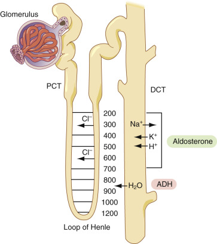
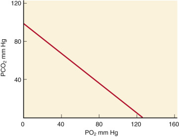
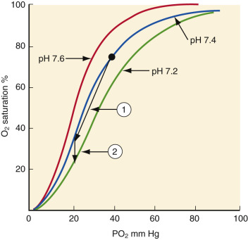

## Key Points

  * •

Accurate differential diagnoses can be made from a systematic study of the laboratory profiles of patients in a large majority of cases. 

  * •

There are basically four types of anemia: iron deficiency, anemia of chronic disease, hemolytic anemia, and macrocytic/nutritionally deficient anemia. These can be readily distinguished from one another both by the hematologic profile and simple laboratory testing. 

  * •

By examining the urinary sodium, potassium, and osmolarity, the causes of hyponatremia and hypernatremia can be readily determined. 

  * •

Liver function tests can distinguish among six different diseases of the liver: hepatitis, cirrhosis, biliary disease, space-occupying lesions of the liver, passive congestion, and fulminant hepatic failure. 

  * •

Renal failure can be readily diagnosed by observing elevated BUN (urea) and creatinine; it is possible to pinpoint the site of renal failure—that is, glomerular or tubular—from the ratio of serum to urine osmolality. 

  * •

Blood gas results allow determination of the causes of metabolic versus respiratory acidosis or alkalosis; there is a critical relationship between the partial pressure of oxygen and carbon dioxide such that, in respiratory diseases, high levels of carbon dioxide block oxygenation of venous blood, leading to respiratory crisis. 

  * •

Elevation of cardiac troponin in serum, in the proper clinical context, is diagnostic of myocardial infarction. 

  * •

Elevations of serum C-reactive protein indicate inflammatory disease. 

  * •

Elevations of serum amylase and lipase point to acute pancreatitis. 

  * •

Two types of endocrine disease are discussed: thyroid and adrenal. Serum levels of T4 (or, better, free T4) and thyroid-stimulating hormone (TSH) can be used to diagnose primary or secondary hypothyroidism or hyperthyroidism; serum levels of cortisol and adrenocorticotropic hormone (ACTH) can be used to diagnose primary or secondary hypoadrenalism or hyperadrenalism. 

,  

##  Interpreting and Correlating Abnormal Laboratory Values 

 

##  General Considerations 

The major purpose of performing analyte determinations in the clinical laboratory is to aid in the diagnosis and management of disease and in health assessment. In this regard, the clinical pathologist is often called upon as a consultant to explain abnormal laboratory values, especially those that do not seem to correlate with one another, and to recommend or even to order laboratory tests that may lead to the correct diagnosis in the workup of patients for particular medical problems. In addition, evaluation of laboratory test results on individual patients by the clinical pathologist cannot only reveal the (infrequent) occurrence of laboratory errors but can help in the selection of appropriate, cost-effective tests from a wide variety of increasingly complex test choices (  Witte et al, 1997  ;  Dighe et al, 2001  ;  Bonini et al, 2002  ). 

For evaluation of test results, the laboratory computer is an invaluable aid. Virtually all such systems perform daily checks for patient values that lie significantly outside of their established reference intervals or that have undergone large changes over a 24-hour period. These are often reported as “failed delta checks.” Thus patients with significant laboratory findings can be identified. 

This chapter presents an approach to the interpretation of laboratory values that will enable laboratorians to aid in the establishment of clinical diagnoses and to assist in clinical management. This discussion is by no means comprehensive and cannot possibly cover every conceivable illness afflicting patients. Rather, this presentation is concerned with general approaches to interpreting abnormal values and discussion of the most common causes of such findings, so that the reader has a framework for interpreting abnormal values. 

The reader may prefer to complete the Clinical Chemistry (Part 2) and Hematology (Part 4) sections of this book before reading this chapter, which gives an overview of both of these vital diagnostic areas. Alternatively, the reader may decide to read this chapter before the several chapters on chemistry and hematology to benefit from the overview here. 

 

##  Fundamental Principles in Interpretation of Values 

Before embarking on a discussion of specific conditions giving rise to abnormal values, certain precepts should always be followed: 

  * 1.

Never rely on a single out-of-reference range value to make a diagnosis. It is vital to establish a trend in values. A single sodium value of, for example, 130 mEq/L does not necessarily indicate hyponatremia. This single abnormal value may be spurious and may reflect such factors as improper phlebotomy technique, laboratory variability, and so on. Rather, a series of low sodium values in successive serum samples from a given patient does indicate this condition. Thus it is vital to follow trends in particular values. 

  * 2.

Osler's rule. Especially if the patient is under the age of 60 years, try to attribute all abnormal laboratory findings to a single cause. Only if there is no possible way to correlate all abnormal findings should the possibility of multiple diagnoses be entertained. 

,  

##  Abnormalities in the Hematology Profile 

Often, in laboratory reports, the first section contains the hematology profile, including the CBC or complete blood count. Comprehensive discussions of clinical hematopathology are given in Part 4. Here, we discuss very basic patterns of abnormalities to provide an overall reference frame for interpreting values and for the ordering of further examinations. Though this part of the book is concerned with clinical chemistry or chemical pathology, we discuss the hematology profile because the interpretation of hematopathologic results often depends on the results of quantitative determinations performed in clinical chemistry. 

 

##  Anemias 

Anemia, a common hematologic disorder, is defined pathophysiologically as a decrease in the oxygen-carrying capacity of the blood. All oxygen-carrying capacity of the blood is due to the binding of oxygen to hemoglobin contained uniquely in red blood cells. Because anemia can cause tissue hypoxia, it often produces such symptoms as fainting, fatigue, pallor, and difficulty in breathing. 

Practically, the best indicator for this condition is a low red blood cell count or number of red blood cells per volume of whole blood. Although the reference range for the red cell count varies with age, sex, and population, it encompasses values from around 4 to 6 × 10  6  red blood cells per cubic millimeter (cu mm) or microliter. This range may change somewhat depending on population. Red blood cell counts below the lower limit of the reference range suggest the presence of anemia. In addition, red blood cells occupy a well-defined range in terms of the percent of the volume that they occupy of whole blood or the hematocrit. Generally, normal adult hematocrit values range from about 36% to 45% (normal values for females are generally slightly lower than those for males). In addition, the concentration of hemoglobin in whole blood is about 12 to 15 g/dL or approximately 33 to 36 g/dL in red blood cells—that is, the mean corpuscular hemoglobin concentration. Normal values are also dependent on patient age and altitude of residence. Normally, the hematocrit is about three times the value of the hemoglobin concentration, which, in turn, is about three times the value of the red blood cell count. 

If anemia has been diagnosed, it is then mandatory to determine the cause of the anemia. An excellent history and physical examination are required for appropriate test selection, diagnosis, and the best possible patient care and treatment. In addition, a review of the peripheral blood film with respect to red and white cell morphology is often helpful. 

To narrow further the differential diagnosis and to facilitate appropriate test selection, a number of classification schemes for anemia have been developed, with no single ideal scheme available. A particularly useful approach utilizes the common red cell indices of mean corpuscular volume (MCV), measured in femtoliters (fL), or 1 × 10  −15  L, in conjunction with the red cell distribution width (RDW) and the reticulocyte count (percent reticulocytosis) or reticulocyte production index (RPI). A further aid in diagnosis is the chromicity of the red cells—that is, the intensity of the red color of the cells due to intracellular hemoglobin. The chromicity is measured quantitatively by the mean corpuscular hemoglobin concentration or MCHC. Taken together, these indices help to form a working hypothesis for the underlying cause of the anemia. 

Electronic determination of MCV directly from red cell distribution data allows for classification on the basis of red blood cell size as macrocytic (MCV generally >100 fL), microcytic (MCV generally <80 fL), or normocytic (MCV generally between 80 and 100 fL). The sizes (volumes) of red cells vary within a certain range in which the number of cells of particular volumes form a bell-shaped or Gaussian distribution (see [ Chapter 9 ](<##!/content/3-s2.0-B9780323295680000097?scrollTo=%23c00009>) ); the standard deviation of the cell volumes divided by the mean cell volume gives what is called the red cell distribution width, or RDW, measured as a percent. As it happens, the RDW is a parameter that helps to further classify an anemia because it reflects the variation of red blood cell size. RDW generally varies between about 12 and 17 and is dependent on the patient's age, sex, and ethnic subgroup. It can be helpful in differentiating causes of microcytosis, because moderate to severe iron deficiency anemia is associated with an increased RDW, whereas thalassemia and anemia of chronic disease (ACD) are associated with a normal RDW. 

Peripheral blood reticulocytosis is a measure of bone marrow response in the face of anemia. A similar measure, the reticulocyte proliferation index, or RPI, corrects the reticulocyte count with respect to the proportion of reticulocytes present in a patient without anemia and the premature release of reticulocytes into the peripheral circulation. Bone marrow response to anemia may be appropriate (hyperproliferative), with an RPI over 3 generally indicating marrow red cell hyperproliferation; however, the anemia may be due to defective red blood cell production or marrow failure (hypoproliferative), which is generally indicated by an RPI less than 2. Thus, although these red cell indices are not pathognomonic of the cause of a particular type of anemia, the combination of MCV, RDW, and RPI examined together will often significantly narrow the differential diagnosis and facilitate further test selection. [ Table 8-1 ](<#t0010>) illustrates common examples of anemia and their diagnostic workup using these red cell indices as well as other helpful analytic abnormalities. 

TABLE 8-1 

Common Types of Anemias and Their Diagnostic Workups [ * ](<#hl0000202>)

Anemia  |  Cause  |  Common Analyte Abnormality   
---|---|---  
  
  * 1. Hypoproliferative, microcytic 

|  Iron deficiency  | 

  * Low ferritin 
  * Increased IBC 
  * Decreased serum iron 
  * Reduced Fe/TIBC ratio 
  * Generally increased RDW 

  
  
  * 2. Hypoproliferative, microcytic 

|  Anemia of chronic disease  | 

  * Generally high ferritin 
  * Normal IBC 
  * Decreased serum iron 
  * Normal Fe/TIBC ratio 
  * Generally normal RDW 

  
  
  * 3. Hyperproliferative, normocytic 

|  Hemolytic anemia  | 

  * Schistocytosis 
  * Increased reticulocytes 
  * Low haptoglobin 
  * Elevated carboxyhemoglobin 
  * Elevated LD and potassium 
  * Elevated indirect bilirubin 
  * Generally increased RDW 

  
  
  * 4. Hypoproliferative, normocytic 

|  Aplastic anemia  | 

  * Leukopenia 
  * Thrombocytopenia 
  * Hypocellular bone marrow 
  * Generally normal RDW 

  
  
  * 5. Hypoproliferative, normocytic 

|  Renal failure  | 

  * Elevated BUN and creatinine 
  * Low erythropoietin 
  * Burr cells may be present 
  * Generally normal RDW 

  
  
  * 6. Hypoproliferative, macrocytic 

|  |   
  
  *     * A. Megaloblastic 

|  Vitamin B  12  and/or folate deficiency  | 

  * Low vitamin B  12  and/or folate 
  * Hyperlobulated polymorphonuclear leukocytes 
  * Macro-ovalocytes 
  * Increased RDW 

  
  
  *     * B. Nonmegaloblastic 

|  Hypothyroidism  | 

  * Elevated TSH 
  * Normal RDW 

  
  
_IBC,_ Iron-binding capacity; _TIBC,_ total IBC; _RDW,_ red cell distribution width; _Fe,_ iron; _LD,_ lactate dehydrogenase; _BUN,_ blood urea nitrogen; _TSH,_ thyroid-stimulating hormone. 

 * Low is equivalent to depressed, and high is equivalent to elevated. Ferritin, haptoglobin, LD, bilirubin, BUN, creatinine, erythropoietin, TSH, and T4 are all expressed as concentrations. All of these analytes are measured in serum. 

 

##  Microcytic Anemia 

Common microcytic anemias include iron deficiency anemia (IDA) and the thalassemias. Some hemoglobinopathies and the anemia of chronic disease (ACD) may also be microcytic. In our discussion, we focus on iron deficiency anemia and the anemia of chronic disease, a common differential diagnosis for patients with microcytic anemia. Both anemias appear to be disorders involving iron metabolism. 

In IDA, there is a primary deficiency of iron available to the red cell (usually due to blood loss, but other causes include dietary deficiency, malabsorption, and pregnancy); chronic blood loss should always lead to further investigation because it is commonly associated with malignancy. ACD, however, appears to be due to defective iron utilization/metabolism and is associated with chronic nonhematologic disorders such as chronic infections, connective tissue disorders, malignancy, and renal, thyroid, and pituitary disorders. Because iron levels in red cells are low, hemoglobin levels are also low in both of these conditions. Thus the MCHC mentioned above tends to be low, giving rise to what is termed a hypochromic (low red color in red cells or low MCHC), microcytic (low MCV) anemia. 

To distinguish between IDA and ACD, a number of different laboratory measurements are very useful in addition to the RDW. The diagnosis is typically made using additional serum or whole blood laboratory tests. However, because IDA is always accompanied by loss of iron that is stored bound to the protein ferritin in bone marrow macrophages, the diagnosis can always in principle be made with a bone marrow biopsy with an iron stain—that is, nitroprusside—that shows the absence of marrow iron. This procedure is, of course, invasive and should only be performed as a last resort. 

 

##  Serum Ferritin Levels 

Normally, there is an equilibrium between intracellular and extracellular ferritin. The lower the stored iron becomes, the lower the intracellular ferritin is, and, consequently, the lower the extracellular ferritin becomes. The level of extracellular ferritin can be directly measured by determining the serum ferritin level, which is readily and accurately performed on serum aliquots, using ELISA (enzyme-linked immunosorbent assay) techniques, described in [ Chapter 43 ](<##!/content/3-s2.0-B9780323295680000437?scrollTo=%23c00043>) . Overall, therefore, serum ferritin levels give an excellent measure of available iron stores, noninvasively. Because, in ACD, iron stores are abundant, serum ferritin levels are characteristically normal to elevated. In contrast, in IDA, in which iron stores become depleted, serum ferritin levels are characteristically decreased. Thus serum ferritin level is one assay that can be used in differentiating IDA from ACD. 

One caveat in using serum ferritin values to provide this distinction is the fact that ferritin also happens to be an acute phase reactant. Acute phase reactants are proteins (discussed in [ Chapter 19 ](<##!/content/3-s2.0-B978032329568000019X?scrollTo=%23c00019>) ) that rise in response to an acute process, usually an acute inflammatory condition. So if a patient has an acute infection, the serum ferritin level may be spuriously elevated. The net effect may be a ferritin in the reference interval. Usually, in IDA, accompanied by an acute process, this level is in the low reference range. 

 

##  Use of Serum Iron and Iron-Binding Capacity 

In addition to ferritin levels, serum iron and serum iron-binding capacity (IBC) can be measured. On average, serum iron is, of course, reduced in iron deficiency anemia and normal or sometimes low in the anemia of chronic disease. The IBC is a direct measure of the protein transferrin, which transports iron from the gut to iron storage sites in bone marrow. In iron deficiency anemia, the serum iron is reduced, and the IBC increases. 

However, both serum iron and transferrin are subject to wide fluctuations because of such factors as diet, and they do not always reliably reflect iron stores. Also, transferrin is a beta-protein—that is, it migrates in the beta-region in serum protein electrophoresis—and is an acute-phase reactant—that is, its serum levels change (usually decrease, as a so-called “negative acute phase reactant”) in inflammatory conditions. There is considerable overlap between serum levels of iron and iron-binding capacity in iron deficiency anemia and the anemia of chronic disease. A somewhat more reliable discriminating measure of iron deficiency anemia is the ratio of serum iron to the IBC, known as the transferrin saturation (TS). This ratio is around 1 : 3 for normal individuals, while in iron deficiency anemia it is significantly reduced to values of around 1 : 5 or lower. Again, there is considerable overlap even in this ratio for patients with iron deficiency anemia and the anemia of chronic disease, so the values should always be interpreted with care. 

 

##  Use of Red Blood Cell Distribution Width 

Finally, use of automated procedures for determination of cell counts and indices enables us to obtain average erythrocyte sizes and size distributions. In iron deficiency anemia, there is a marked dispersion in cell volumes (sizes) so that the red cell distribution width (RDW) increases, whereas it generally remains within normal limits in the anemia of chronic disease. Normal RDWs occur in the range of 12% to 17%. Unfortunately, the standard deviations for normal subjects and for patients with iron deficiency anemia or the anemia of chronic disease can overlap significantly, tending to limit the validity of using the RDW exclusively for distinguishing between these conditions. 

The major laboratory findings that distinguish IDA from ACD are summarized as entries 1 and 2 in [ Table 8-1 ](<#t0010>) . Note that most of the major tests used to distinguish these two conditions are performed in the clinical chemistry laboratory. This emphasizes the strong interdependence of both of these services in obtaining definitive diagnoses through laboratory measurements. 

 

##  Normocytic Anemia 

In these anemias, the red cells show normal MCVs and MCHCs—that is, they are normocytic and normochromic. Common causes of normocytic anemia include acute hemorrhage, hemolytic anemia, marrow hypoplasia, renal disease, and ACD. It may seem paradoxical that acute hemorrhage presents as normocytic anemia because it involves major blood loss that is associated with loss of iron stores. However, iron depletion requires time to develop; acutely, major blood loss presents as normocytic anemia. 

A very useful measurement in determining the cause of normocytic anemia is the reticulocyte count. Reticulocytes are newly formed red blood cells that have recently lost their nuclei but retain high levels of cytosolic mRNA dedicated to the synthesis of hemoglobin. This RNA reacts with the dye, methylene blue, to give a bright green color, making it possible to perform reticulocyte counts. In addition, reticulocytes and other red blood cell precursors react with the Wright stain to give dark-staining cytoplasm, in contrast to the cytoplasm of mature red blood cells. This darker staining of the cytoplasm of precursors is termed _polychromasia_ . In cases, prominently in hemolytic anemia, where there is a loss of red blood cells due to peripheral destruction of these cells, there is an increased synthesis in bone marrow of red blood cells and an early release of red blood cell precursors, especially reticulocytes. 

 

##  Hyperproliferative Normocytic Anemias 

Hyperproliferative normocytic anemias, associated with an increased reticulocyte count, include both hemolytic anemia and the anemia associated with acute blood loss, while hypoproliferative anemias, associated with a decreased reticulocyte count, include such causes as renal disease, ACD, and, variably, bone marrow aplasia/hypoplasia. Renal disease can affect juxtaglomerular cells that are involved in the synthesis of erythropoietin, the growth factor that induces differentiation of bone marrow hematopoietic stem cells into the red cell line. Bone marrow aplasia/hypoplasia can give rise to low reticulocyte counts if caused by agents, such as chemotherapeutic agents, that kill bone marrow hematopoietic stem cells. In such conditions as myelofibrosis, clonal expansion of cancer cells such as occurs in leukemia, lymphoma, myeloma, and metastatic cancer, there may be a release of early red and white blood cell precursors from bone marrow (the leukoerythroblastic picture discussed below), leading to increased nucleated red blood cell and reticulocyte counts. 

As mentioned above, a history and a complete physical, as well as an examination of the patient's peripheral blood film, are helpful in establishing a differential diagnosis. In this section we focus on the most common causes of normocytic anemia: hemolytic anemia, aplastic anemia, and the anemia associated with renal disease. 

 

##  Hemolytic Anemia 

Hemolysis is defined as the destruction of the red cell membrane, causing hemoglobin release. This may occur slowly as a normal physiological process or may be accelerated in pathologic states. Many different underlying causes exist for the decrease in survival/increase in destruction of red blood cells. These include membrane defects (e.g., hereditary spherocytosis), enzyme defects (e.g., glucose-6-phosphate dehydrogenase [G6PD] deficiency), hemoglobinopathies (e.g., sickle cell disease or beta-thalassemia), immune destruction (e.g., autoimmune hemolytic anemia or hemolytic transfusion reaction), and nonimmune destruction. Immune and nonimmune destruction include destruction due to infectious agents, toxic agents/drugs, physical agents, hypersplenism, and microangiopathic hemolytic anemias. Microangiopathic hemolytic anemias are caused by the mechanical destruction of red blood cells, mainly in bone marrow where they are synthesized, from such factors as fibrin deposition in the blood vessels of the bone marrow microvasculature, fibrosis, or malignancies such as leukemia, lymphoma, and metastatic cancer. In addition, mechanical destruction can result from extramedullary causes such as prosthetic heart valves. 

Hemolytic anemia can be recognized from hemoglobin in plasma/serum and breakdown products of heme. Specific laboratory measurements that readily confirm the diagnosis of hemolytic anemia are based on the natural events that occur subsequent to hemolysis. After erythrocyte membrane breakdown, hemoglobin is extruded. Thus plasma and urine may contain free hemoglobin or its degradation products. Free hemoglobin may be present acutely in the plasma (hemoglobinemia) or urine (hemoglobinuria), while hemosiderin may be present in the urine (hemosiderinuria) in more chronic episodes of hemolysis. Extruded hemoglobin becomes bound to the alpha-2 fraction protein, haptoglobin. The hemoglobin–haptoglobin complex becomes catabolized by macrophages that engulf these complexes by receptor-mediated endocytosis. Thus an excellent indicator for hemolytic anemia is a _low haptoglobin value_ . Extremely sensitive and rapid ELISA tests for haptoglobin are available for this purpose. 

Because the red cell contents are extruded into the plasma, besides hemoglobin, there are other indicators of red cell damage: high serum potassium because intracellular potassium concentration is much higher in red cells than in the extracellular fluid, and serum elevations of the enzyme lactate dehydrogenase (LD). As discussed in [ Chapters 18 ](<##!/content/3-s2.0-B9780323295680000188?scrollTo=%23c00018>) and [ 20 ](<##!/content/3-s2.0-B9780323295680000206?scrollTo=%23c00020>) , this enzyme has five major isozymes, labeled LD1 through LD5. Peculiarly, the predominant isozyme of LD in red cells is LD-1 that occurs predominantly in cardiac tissue. 

Carbon monoxide and unconjugated bilirubin become elevated in blood in hemolytic anemia. When hemoglobin is extruded, large amounts of it become oxidized to methemoglobin. The heme portion dissociates and then becomes oxidized ultimately to bilirubin. The first step in this process is the oxidative opening of the porphyrin ring of heme with the attendant liberation of carbon monoxide (CO). CO may be measured easily by gas chromatographic techniques, or even more conveniently by co-oximetry, based on spectrophotometry (see [ Chapter 4 ](<##!/content/3-s2.0-B9780323295680000048?scrollTo=%23c00004>) ), as carboxyhemoglobin (see [ Chapter 29 ](<##!/content/3-s2.0-B9780323295680000292?scrollTo=%23c00029>) ). Elevated CO levels in normochromic, normocytic anemias are an excellent indicator of hemolytic anemia. 

Because there is an increased production of bilirubin, which is unconjugated (see [ Chapter 21 ](<##!/content/3-s2.0-B9780323295680000218?scrollTo=%23c00021>) ), there will be at least a transient elevation of serum indirect bilirubin. This elevation, in the presence of normal liver function, will be modest, usually in the range of about 2 to 2.5 mg/dL. (The upper limit of normal is around 1.2 mg/dL.) 

Hemolytic anemia is almost always accompanied by an increased reticulocyte count and by evidence of red cell damage. As mentioned above, the reticulocyte count will be elevated (increase in polychromasia on the blood film), with erythroid hyperplasia present in the bone marrow, indicative of increased red cell production. In addition, the peripheral blood film may show evidence of the particular type of red cell damage associated with the particular type of hemolytic anemia (e.g., sickle cells in sickle cell disease or schistocytes/helmet cells in microangiopathic hemolytic anemia). There is also a noticeable difference in red cell size (anisocytosis) and shape (poikilocytosis) due to the presence of damaged and/or young cells. Because of the often-marked changes in size and/or shape, the RDW is usually elevated. A number of nucleated red blood cells may also be identified. 

Other findings in hemolytic anemia can identify the cause. A direct antiglobulin test (DAT)/direct Coombs test can be used to detect immunoglobulin attached to the red cell surface that identifies immune hemolytic anemia as the cause of red cell destruction. In this case, red cells are incubated with antihuman immunoglobulin. If the red cells are coated with antibody, they will agglutinate in the presence of the antihuman immunoglobulin, but if not coated with antibody, they will not agglutinate. A positive test suggests an autoantibody or alloantibody may be responsible for the anemia. A positive screening test for G6PD deficiency will identify this enzyme deficiency as the cause of the hemolytic anemia. The selection of these tests will be dependent on the clinical evaluation as well as the preliminary laboratory data. 

Laboratory findings that are diagnostic of hemolytic anemia are summarized in entry 3 in [ Table 8-1 ](<#t0010>) . Note that virtually all of the quantitative diagnostic testing for hemolytic anemia—that is, serum and urine hemoglobin, haptoglobin, carboxyhemoglobin, indirect bilirubin, and LD—are performed in the clinical chemistry laboratory, again emphasizing the strong interdependence of the clinical chemistry and hematology laboratories. 

 

##  Microangiopathic Hemolytic Anemia 

As previously mentioned, red cell fragments (schistocytes) may be present on peripheral blood films due to mechanical (e.g., prosthetic heart valve) or thermal (severe burns) destruction. Mechanical rupture of red cells within the microvasculature may also occur by physical damage to red cells in the microvasculature of bone marrow. This may be due to space-occupying lesions, such as metastatic tumors or leukemia or lymphoma, to myelofibrosis, or to the intravascular deposition of fibrin strands upon endothelial cell surfaces. Because red blood cells are damaged and destroyed, this process leads to so-called microangiopathic (i.e., lesions in the microvasculature) hemolytic anemia (MHA). 

Besides space-occupying lesions, other causes of this type of anemia include disease states in which fibrin is deposited on endothelial surfaces, also resulting in the shearing and fragmentation of newly synthesized red blood cells, as in disseminated intravascular coagulopathy (DIC) (discussed more later and in [ Chapter 38 ](<##!/content/3-s2.0-B9780323295680000383?scrollTo=%23c00038>) ). In this condition, there is an abnormal activation of the coagulation process in which fibrin-platelet clots form intravascularly and embolize to virtually any tissue. These clots block the microvasculature of tissues, including that of bone marrow, resulting in the destruction of newly synthesized red cells. In addition, other disease states may give rise to microangiopathic hemolytic anemia, in which there may be an immunologic component—that is, antibodies to determinants on endothelial cells or on other structures in the microvasculature, resulting in immune complex deposits with or without fibrin deposits. 

In thrombotic thrombocytopenic purpura (TTP), the microvascular disease is caused by platelet thrombi. A prominent cause of this condition is dysfunction due to the absence of a critical chymotrypsin-like protease known as ADAMTS13 (A Disintegrin And Metalloproteinase with a Thrombospondin type 1 motif, member 13) that hydrolyzes large multimer forms of von Willebrand factor (vWF) into lower molecular mass forms; the high molecular mass forms promote platelet aggregation, leading to this condition. However, this condition can also arise, rarely, in patients with no known abnormality of ADAMTS13 in cases of acquired TTP. Because the microvasculature is blocked in this condition, there is multiple system pathology—prominently renal failure—evidenced by high serum levels of creatinine and BUN (blood urea nitrogen), as described in the Abnormalities in Clinical Chemistry section, neural signs and symptoms due to cerebral infarctions and thrombocytopenia, and widespread purpura from local hemorrhaging. 

In the closely related condition called the hemolytic anemic/uremic syndrome (HUS), which occurs mainly in children, bacterial infection by certain toxin-producing strains of organisms such as _E. coli_ , _S. pneumoniae_ , and _Shigella_ induce platelet aggregation. This is believed to arise in part from toxin-induced inhibition of ADAMST13, although the full pathophysiology of this condition still remains unexplained. Here, as in TTP, there is renal failure anemia, and, though less prominent than in TTP, neural symptoms. 

MHA may also occur with other immune-mediated disorders—for example, connective tissue disorders such as disseminated lupus erythematosus, where endothelial damage from the attachment of immune complexes and complement produces fibrin deposition on endothelial surfaces. More important, because microangiopathic hemolytic anemia results from traumatic destruction of newly formed red blood cells in the microvasculature where both red and white blood cell precursors are being formed, often both red and white blood cell precursors are released into the circulation. Thus all of the findings of hemolytic anemia are present, in addition to which a significant number of precursor cells are seen in the peripheral blood, such as nucleated red blood cells, myelocytes, and metamyelocytes, a pattern termed the leukoerythroblastic picture. 

As discussed below, in DIC and occasionally in TTP, laboratory findings include thrombocytopenia and increased prothrombin time, activated partial thromboplastin time, thrombin time, fibrin degradation products, and D-dimer levels (described below); fibrinogen levels, however, are low. As discussed above, BUN and creatinine are also elevated. 

 

##  Hypoproliferative Normocytic Anemias 

 

##  Bone Marrow Hypoplasia/Aplastic Anemia 

This is a hypoproliferative anemia, with MCV and RDW usually within normal limits, that typically affects all peripheral blood elements (red cells, white cells, and platelets; see below). Immature white cells and red cells are not usually present on peripheral blood films. Bone marrow biopsy is commonly performed to obtain the diagnosis and typically shows severely hypoplastic/aplastic marrow with severe depletion of all hematopoietic marrow precursors. Aplastic anemia may be primary/inherited or secondary/acquired, with the latter due to chemotherapy, chemical toxins, infection, radiation, or immune dysfunction. Serum iron may be elevated due to lack of erythropoiesis. The typical hematologic findings in this condition are summarized in entry 4 in [ Table 8-1 ](<#t0010>) . More important, _none of the quantitative serum diagnostic tests for hemolytic anemia, such as haptoglobin, carboxyhemoglobin, and indirect bilirubin elevation, are positive in this condition._

 

##  Myelodysplastic Syndrome 

Another less common condition, but nonetheless an important cause of hypoproliferative normocytic anemia, is myelodysplastic syndrome (MDS). This syndrome, which often presents as a normocytic anemia, although it can also on occasion present as a mildly macrocytic or microcytic anemia, is refractory to treatment such as transfusions of packed red blood cells. It may present simply as a refractory anemia in its early stages and is thought to progress then to refractory anemia with ringed sideroblasts and eventually to so-called preleukemic stages, in particular refractory anemia with an excess of blasts in bone marrow (generally in the myeloid or lymphoid lines) and an excess of blasts in transformation. The condition may also present initially as a refractory cytopenia that involves all three (erythroid, granulocytic, megakaryocytic) hematopoietic cell lines. As might be surmised from this latter observation, MDS appears to be a clonal stem cell disorder that is characterized by ineffective hematopoiesis. Further discussion of this fascinating disease can be found in [ Chapter 32 ](<##!/content/3-s2.0-B9780323295680000322?scrollTo=%23c00032>) . 

 

##  Anemia of Renal Failure 

Another normocytic, hypoproliferative anemia is the anemia of chronic renal failure. Loss of the kidneys' excretory function produces an increase in BUN and creatinine, as discussed below, as well as a buildup of metabolic by products. The resulting uremia appears to be responsible for changes in red cell shape, with burr cells (echinocytes) and ellipsoidal cells commonly present on peripheral blood films. Identification of burr cells on peripheral blood films during the course of illness may signal the development of renal dysfunction. In addition to a decreased excretory function, there is a decrease in the kidneys' ability to produce erythropoietin, resulting in impaired erythropoiesis, such that the marrow's response to hypoxia becomes inadequate. Distinguishing this condition from aplastic anemia (entry 4 in [ Table 8-1 ](<#t0010>) ), white cell and platelet counts usually remain within normal limits. The typical findings in this condition are summarized in entry 5 in [ Table 8-1 ](<#t0010>) . Again, as in bone marrow hypoplasia/aplastic anemia (entry 4, [ Table 8-1 ](<#t0010>) ), none of the quantitative serum diagnostic tests for hemolytic anemia (e.g., haptoglobin, carboxyhemoglobin, indirect bilirubin elevation), are positive in this condition. 

 

##  Macrocytic Anemia 

Macrocytic anemia can be diagnosed from the hemogram from a low red blood cell count and a high mean corpuscular volume (MCV), often exceeding 100 fL. By far the most common cause of macrocytic anemia is nutritional deficiency, such as vitamin B  12  and/or folate deficiency. Lack of either factor is thought to disrupt DNA synthesis but not RNA synthesis, such that the nucleus and cytoplasm of the cell no longer mature in synchrony. Morphologically, the cell cytoplasm matures, while the nucleus remains immature, and the cell appears megaloblastic. This lack of synchrony produces hypersegmented neutrophils (five-lobed nuclei in more than 5% of the neutrophils or any neutrophil with six or more lobes) and large, oval-shaped red cells termed macroovalocytes, both of which are present on blood films of patients with megaloblastic anemia. In addition, the RDW is typically increased, and the reticulocyte count is decreased. 

If macrocytic anemia is diagnosed, the first serum analytes whose concentrations should be determined are B  12  and folate, for which rapid and accurate ELISA tests are performed. If these analytes are both found to be within the reference range, assays for thyroid function should be performed because hypothyroidism is a cause of macrocytosis. As discussed below in the [ endocrine function testing ](<#s0240>) section, elevated thyroid-stimulating hormone (TSH) with low or normal thyroxine (T4) serum levels confirm the diagnosis of primary hypothyroidism. Because certain therapeutic drugs, particularly azathymidine (AZT) used in the treatment of acquired immune deficiency syndrome (AIDS), are known also to induce macrocytic anemia, it is important to ascertain whether a patient is being treated with such drugs. 

In this era of the automated complete blood count (CBC), it is possible also that red cell precursor forms, such as nucleated red blood cells, may be counted as mature erythrocytes. Therefore, in a patient with a “macrocytic” anemia with normal B  12  , folate, and thyroid hormone levels, it is important to check the reticulocyte and nucleated red blood cell count to determine if these are significantly elevated. If so, the possibility of a hemolytic anemia should be considered. Thus the diagnostic workup for hemolytic anemia described in the preceding section should be instituted. 

Other possible causes of macrocytic anemia include posthemorrhagic states (differentiated by an elevation of the reticulocyte count and polychromasia), alcoholism (associated with folate deficiency), liver disease, and myelodysplasia. Note again that the definitive tests for determining the cause of macrocytic anemia—that is, B  12  , folate, and thyroid function tests—are often performed in the clinical chemistry section. 

Major clinical laboratory findings for macrocytic anemia are summarized as entries 6A and B in [ Table 8-1 ](<#t0010>) . Note that macrocytic anemias are divided into megaloblastic (entry 6A), typical of B  12  and folate deficiency, and nonmegaloblastic (entry 6B), typical of hypothyroidism. Whether the macrocytic anemia is megaloblastic can be determined only by bone marrow biopsy. This procedure is not necessary in most cases because the cause of the macrocytosis can be determined by the assays described above. 

[ Table 8-1 ](<#t0010>) summarizes some of the pertinent findings and specific determinations used to distinguish and diagnose common anemias previously discussed. Note that this table is a guide as to what specific tests should be ordered and, by implication, what tests need not be ordered. For example, a microcytic anemia should be worked up with orders for ferritin levels, IBC, and Fe/IBC ratios, but generally there is no need to order B  12  and folate levels. Conversely, there is no need to order ferritin, IBC, and so on for a macrocytic anemia, for which B  12  and folate levels should be ordered. 

 

##  Quantitative White Blood Cell Abnormalities 

The white blood cell count (WBC) encompasses several types of commonly circulating nucleated cells: granulocytes (principally mature neutrophils, basophils, and eosinophils), lymphocytes, and monocytes. It should be noted that absolute concentrations (and not percentages) of these cells are significant in interpreting the WBC. An increase above the normal physiologic level in the WBC, termed leukocytosis, may primarily involve any of these white cells, depending on which cell type is chiefly elevated (i.e., neutrophilia, basophilia, eosinophilia, monocytosis, and lymphocytosis). Occasionally, plasma cells may be found in the peripheral blood. Likewise, a decrease in the WBC, termed leukopenia, may also center on a single cell series (i.e., neutropenia, monocytopenia, and lymphocytopenia). Absolute decreases in the eosinophils and basophils are difficult to identify because of the low numbers present normally. Certain differential diagnoses are commonly associated with certain WBC changes (e.g., infection and/or inflammation with neutrophilia; allergic reactions and parasitic infections with eosinophilia). In addition, elevations may be due to a benign process (e.g., infection) or a malignant process (e.g., leukemia). Here, we note several quantitative patterns and their associations that correlate with abnormal chemical findings. 

Again, clinical history and physical findings are important in diagnosis and management of the patient. In addition, the complete blood count (CBC) and white cell differential are important laboratory findings used, in conjunction with the clinical impression, to formulate the differential diagnosis. In adults, the reference range for the WBC is approximately 4000 to 7000 white cells/µL; approximately two thirds of the white cells are neutrophils, and slightly less than one third are lymphocytes. 

 

##  Infection 

Infection is the most common cause of an elevated WBC. An elevated WBC of between about 10,000 and 20,000/µL commonly points to an infectious/reactive process. In general, neutrophilia is associated with infection (bacterial, fungal, viral), inflammatory states (trauma, surgery), certain drugs (e.g., corticosteroids), and myeloproliferative conditions. Exceptions to the neutrophilia seen in bacterial infections are tuberculosis; brucellosis; pertussis, where the predominant cells are lymphocytes; and infections, mainly in newborns, with _Listeria monocytogenes_ , for which a monocytic response is predominant. 

Eosinophilia is commonly associated with allergic reactions, parasitic infections, and hematologic malignancies (  Brito-Babapulle, 2003  ;  Fischbach et al, 2008  ;  Brigden & Graydon, 1997  ;  Rothenberg, 1998  ). Basophilia is also commonly associated with hematologic malignancies (e.g., chronic myelogenous leukemia [CML]), but it may be seen in some inflammatory states and allergic reactions. Lymphocytosis is commonly associated with acute viral infections, such as infectious mononucleosis (EBV infection); chronic infections, such as tuberculosis, brucellosis, and pertussis; and hematologic disease and immune stimulation. Monocytosis is commonly associated with hematologic disease, such as acute monocytic leukemia (M5 by the French-American-British, or FAB, classification system), acute myelomonocytic leukemia (M4, in the FAB system), or chronic myelomonocytic leukemia, as well as with some infectious processes, such as tuberculosis, rickettsia, and listeria. 

 

##  Elevated WBC Due to Leukemoid Reaction 

In patients who do not have leukemia, very high white blood cell counts (generally >50 × 10  3  /µL) may produce a peripheral blood film appearance similar to leukemia. This is termed a _leukemoid reaction_ . The more common type of leukemoid reaction is granulocytic, although lymphocytic reactions may also occur. The granulocytic type usually reveals reactive neutrophils present in the peripheral blood film, with a left shift in the neutrophil series (i.e., immature forms such as bands, metamyelocytes, and myelocytes). Changes in the cells' cytoplasmic appearance, such as toxic granulation and Döhle body production (see [ Chapter 32 ](<##!/content/3-s2.0-B9780323295680000322?scrollTo=%23c00032>) ), are also commonly present. Causes of the granulocytic type of reaction include bacterial infection (e.g., diphtheria), malignancy (Hodgkin's disease), and reactive conditions such as rebound granulocytosis. Although these changes are helpful, C-reactive protein (CRP), an acute phase plasma protein, rapidly rises and falls with the onset and resolution of inflammation. CRP appears to be an earlier and more sensitive indicator of acute inflammation and infection (  Seebach et al, 1997  ;  Dantzer et al, 2008  ) and can now be quickly measured using present-day analyzers. Leukemoid reaction must be distinguished from chronic myelogenous leukemia (CML) and other myeloproliferative conditions. More important, the enzyme _neutrophil alkaline phosphatase_ will be normal or elevated in a granulocytic leukemoid reaction but is decreased in CML. 

 

##  Elevated WBC Due to Chronic Myelogenous Leukemia 

At present, definitive diagnosis of chronic myelogenous leukemia (CML) rests on the demonstration of the Philadelphia chromosome (i.e., the BCR/c-abl translocation between chromosomes #9 and #22) by either cytogenetics or molecular techniques (e.g., see  George & Arber, 2003  ;  Hughes & Branford, 2003  ;  Sattler & Griffin, 2003  ;  Silver, 2003  ;  Ross & Hughes, 2008  ; see [ Chapter 33 ](<##!/content/3-s2.0-B9780323295680000334?scrollTo=%23c00033>), [ Chapter 68 ](<##!/content/3-s2.0-B9780323295680000681?scrollTo=%23c00068>), [ Chapter 75 ](<##!/content/3-s2.0-B9780323295680000759?scrollTo=%23c00075>) ). Detection of molecular or cytogenetic abnormalities is also of diagnostic (and can be of prognostic) significance in other hematologic diseases, including acute myeloid leukemia, acute lymphoblastic leukemia, T cell leukemia/lymphoma, and myelodysplasia (  Swerdlow et al, 2008  ). Molecular techniques are also currently utilized to detect very early stages of disease, as well as to detect minimal residual disease—that is, disease that may only be apparent at the molecular level. For example, quantitative polymerase chain reaction can be used to monitor BCR/c-abl translocation levels in CML patients being treated with the kinase inhibitor imatinib (Gleevec) (  Ross & Hughes, 2008  ). 

 

##  Elevated WBC Due to Chronic Lymphocytic Leukemia 

When the lymphocytes appear normal but are significantly increased in number in an older individual, the possibility of chronic lymphocytic leukemia (CLL) must be considered. Again, molecular techniques, such as flow cytometric, immunophenotypic, and cytogenetic/fluorescence in situ hybridization analysis (  Oscier et al, 2004  ;  Shanafelt & Call, 2004  ) can help establish the diagnosis. In CLL, the neoplastic B lymphocytes will be found to express an unusual (but characteristic) human leukocyte differentiation antigen designated CD5, which is typical for this disease. Other CD antigens can also be detected by flow cytometry and have become useful in resolving other hematologic diagnostic problems. 

 

##  Leukocytosis Due to Acute Leukemias 

Both acute myeloid and lymphoid leukemias present often as markedly elevated white cell counts. In lymphoblastic leukemia, numerous lymphoblasts are seen on the peripheral smear. The myeloid leukemias can present in a myriad of forms, including myeloblastic, promyelocytic, monoblastic/monocytic, myelomonocytic, erythroblastic, and megakaryoblastic. Again, flow cytometric, immunophenotypic, and karyotypic/molecular analysis can help establish the diagnosis, as well as define prognosis (  Winton & Langston, 2004  ). These are discussed fully in [ Chapters 33 ](<##!/content/3-s2.0-B9780323295680000334?scrollTo=%23c00033>) and [ 75 ](<##!/content/3-s2.0-B9780323295680000759?scrollTo=%23c00075>) . Here, we point out that blast forms of any kind on a peripheral blood smear raise the strong diagnostic possibility of an acute leukemia. 

 

##  Low White Cell Counts 

 

##  Aplastic Anemia 

Low WBCs, if accompanied by marrow hypoplasia and two out of three of anemia (with corrected reticulocyte count <1%), neutropenia (neutrophil count <500/µL), and thrombocytopenia (platelet count <20,000/µL) may be part of generalized pancytopenia secondary to marrow failure (  Guinan, 1997  ;  Marsh et al, 2003  ;  Marsh, 2005  ). Also known as aplastic anemia, this condition may be primary/inherited or acquired/secondary. Known causes of the acquired type include chemotherapy, drugs/toxins, infections (including hepatitis), radiation, and immune dysfunction (  Gordon-Smith et al, 2002  ). Cytogenetic study may be utilized to rule out myelodysplasia; if unsuccessful, molecular techniques such as fluorescent in situ hybridization (FISH) may be necessary for chromosome analysis (  Guinan, 1997  ). The primary/inherited types may not always be present at birth (i.e., congenital), and diagnosis of this type of marrow failure relies heavily on clinical assessment in conjunction with appropriate laboratory evaluation (  Alter, 1999;  2002  ). 

 

##  Gram-Negative Sepsis as a Cause of Leukopenia 

Leukopenia may also be seen in other conditions, including gram-negative sepsis. Interestingly, gram-negative sepsis with a low WBC is often accompanied by a cholestatic pattern in the liver (i.e., a mild rise in bilirubin and alkaline phosphatase), discussed below and in [ Chapter 21 ](<##!/content/3-s2.0-B9780323295680000218?scrollTo=%23c00021>) . 

 

##  Coagulation Disorders 

This vast and complex topic is discussed in Part 5. For our review, we focus on four hematologic parameters that may be important in correlation with test results in chemistry determinations: the platelet count; the bleeding time; the activated partial thromboplastin time (APTT), reflecting the function of the intrinsic coagulation system; and the prothrombin time (PT), reflecting the function of the extrinsic coagulation system. Diminished values of the platelet count and/or abnormalities in platelet aggregation can lead to abnormal bleeding times. Elevated PTs and/or APTTs are not generally associated with abnormal bleeding times except mainly in factor VIII deficiency with concomitant deficiency of von Willebrand factor. This latter factor is needed for platelet aggregation. 

**Bleeding Time Measures Platelet Function.** Historically, the bleeding time (BT) was utilized as a screening test for platelet function. It should be noted that the BT is not felt to correlate accurately with or to predict bleeding (  DeCaterina et al, 1994  ;  Gerwirtz et al, 1996  ) and is now uncommonly used to screen for platelet function abnormalities (  Kottke-Marchant & Corcoran, 2002  ;  Posan et al, 2003  ). 

**Major Causes of Increased PT or aPTT.** The anticoagulant heparin, which accelerates the inactivation of thrombin and other coagulation factors (such as factor Xa), preferentially blocks the intrinsic system, leading to prolonged APTTs but not significant elevations in PTs. On the other hand, the vitamin K antagonist Coumadin preferentially blocks factor VII in the extrinsic system, leading to prolonged PTs but not APTTs. 

**International Normalized Ratios for Patients Being Treated with Coumadin.** The PTs of patients who are being anticoagulated on Coumadin must be followed carefully to ensure that the therapeutic effect is occurring but that the effective levels of Coumadin are not sufficiently elevated as to initiate hemorrhage. Thus it is important to establish a therapeutic range for PTs for patients on Coumadin. Because different methods for determining PTs exist, somewhat different reference ranges for PTs among different laboratories have resulted, making it difficult on occasion to compare PT results from different laboratories for a given patient. To attempt to correct for these differences, the PT values are used in a formula that standardizes these “raw” values. This formula takes the ratio of the observed PT to the mean value for the PT reference range of the particular laboratory and then raises the resulting ratio to the power of what is termed the ISI or international standardized index. This index is determined from the slope of a correlation plot of the logarithm of a laboratory's PTs for blood samples that contain different Coumadin concentrations against the logarithm of the PTs determined by a reference (“gold standard”) method. Thus the international normalized ratio (INR) is (PTpat/PTmean)  isi  , where PTpat is the measured PT for the patient and PTmean is the mean value for the laboratory's reference range (  Kamath & Kim, 2009  ). In most circumstances, INR values of 2 to 3 are considered to be therapeutic for patients who have atrial fibrillation and 3 to 4 for patients with prosthetic heart valves, while values over 4 are considered to require lowering of the Coumadin dose or temporary cessation of treatment. Note that INRs are appropriate principally for patients who are being treated with Coumadin. 

**The Other Cause of Isolated PT or aPTT Is Coagulation Factor Deficiency** . If the PT or APTT becomes elevated, in the absence of treatment with heparin or Coumadin, and the platelet count is normal, it is important to perform mixing studies of the patient's plasma with normal plasma to determine if the coagulation time normalizes—that is, whether there is a factor deficiency. A not infrequent cause of factor deficiency is liver failure, discussed subsequently and in [ Chapter 21 ](<##!/content/3-s2.0-B9780323295680000218?scrollTo=%23c00021>) . Thus liver function measurements should also be checked in these instances. If mixing studies do not completely correct the prolonged coagulation times, the presence of coagulation inhibitors, such as _circulating lupus anticoagulant_ or _antifactor antibodies_ , should be suspected. 

**The Major Cause of Elevated PT and aPTT Is DIC.** If the platelet count diminishes and the APTT and PT both rise, the diagnosis of disseminated intravascular coagulation (DIC) should be entertained. This diagnosis is confirmed by the finding of elevated D-dimer, discussed in [ Chapter 39 ](<##!/content/3-s2.0-B9780323295680000395?scrollTo=%23c00039>) , the D–D fragment of fibrin that results from the proteolytic action of plasmin upon the fibrin clot that forms during intravascular coagulation. D-dimer is detected in an assay utilizing a very specific monoclonal antibody to this cross-linked fibrin degradation product. This method has largely replaced the less specific assay for fibrin split products (FSP), which are likewise elevated in this condition. DIC is an extremely dangerous condition and must be diagnosed rapidly, as indicated above 

In this condition, there is an abnormal activation of both coagulation cascades and a consumption of platelets. This activation may be caused by gram-negative sepsis (activation of the cascades may be from bacterial endotoxins), cancer, chronic inflammatory states such as in collagen vascular diseases, leukemia (especially acute promyelocytic leukemia), complications of pregnancy, blood transfusion complications, liver failure, and physical trauma such as burns, drowning, and CNS injuries. DIC causes the formation of microemboli that can result in widespread tissue infarction or ischemia with attendant abnormal chemical values—for example, elevated liver function enzymes; elevated BUN and creatinine, suggestive of renal failure; and even elevation of cardiac troponin, indicating myocardial damage. Thus low platelet counts, elevated APTT and PT, together with chemical abnormalities suggestive of multisystem dysfunction, strongly suggest DIC. Anticoagulant therapy must be instituted rapidly to block further embolization and tissue destruction. 

,  

##  Abnormalities in Clinical Chemistry: Chemical Pathology 

 

##  Electrolyte Abnormalities 

This topic is treated at length in [ Chapter 14 ](<##!/content/3-s2.0-B9780323295680000140?scrollTo=%23c00014>) and in  Oh (2003)  . Here we present an overview of the regulation of the serum levels of critical electrolytes to enable accurate formulation of the possible causes of abnormalities in their serum levels. [ Figure 8-1 ](<#f0010>) summarizes the basic mechanisms by which the kidneys control electrolyte and water balance. Functionally, keep in mind that the purpose of the kidneys is to conserve fluids or, tantamount to this, to concentrate the urine. The mechanism by which this conservation of fluids is effected is by the building up of high-sodium chloride gradients in the interstitial space between the descending and ascending limbs of the loop of Henle, using the countercurrent multiplier mechanism. In this mechanism, sodium chloride is extruded into the interstitial space such that NaCl concentrations become greater toward the tip of the loop of Henle. The ascending limb of the loop of Henle is impermeable to water, as are the distal convoluted tubules and collecting ducts. However, under the effect of antidiuretic hormone (ADH), the collecting ducts are made permeable to water, allowing it to flow into the interstitial space and to penetrate the vasa recta. The entire driving force for this process is the high concentrations of NaCl in the interstitium. Any interference with the countercurrent multiplier will block reabsorption of water because the ion gradients are eliminated. 

Figure 8-1 

A schematic representation of a nephron showing the fundamental mechanism of water and salt conservation by the kidneys. 

Filtration occurs at the glomerulus (upper left, showing capillaries in red), and the filtrate passes through the proximal convoluted tubule (PCT), where about 70% of the total filtered sodium is reabsorbed. In the loop of Henle, the countercurrent multiplier mechanism is operative. Chloride ion (Cl  − ) is extruded from the ascending limb into the interstitial space (shown in the upper middle part of the figure). Sodium ion passively follows. The cells of the ascending limb of the loop of Henle are impermeable to water, and the cells of the descending limb are impermeable to chloride ions. The result of this system is that high concentrations of NaCl are built up at the tip of the loop of Henle. The numbers beside the loop of Henle are osmolalities at different levels along the loop that, in humans, reach a maximum of 1200 mOsm/kg, as shown in the figure. At the top of the loop, the filtrate becomes isotonic (where the 300 mOsm/kg mark occurs) and then hypotonic due to the continuous extrusion of chloride ion. The hypertonic interstitium allows water to diffuse in from the collecting ducts provided that antidiuretic hormone (ADH, labeled and highlighted in color in the figure) is secreted. More sodium ion can be conserved in the distal convoluted tubule (DCT), provided aldosterone (labeled and highlighted in color) is secreted, resulting in the one-to-one exchange of Na  \+  for K  \+  and H  \+  . 

As also shown in [ Figure 8-1 ](<#f0010>) , sodium ion, 70% of which is reabsorbed in the proximal convoluted tubule, can be further reabsorbed in the distal convoluted tubules and collecting ducts under the effect of aldosterone from the zona glomerulosa of the adrenal cortex. This hormone promotes the 1 : 1 exchange of sodium for potassium or hydrogen ion. Sodium levels in serum depend almost completely on the interplay between aldosterone and ADH. With these simple considerations in mind, the most common causes of hyponatremia and hypernatremia are now summarized with an explanation of how to identify them. It should be kept in mind that normal renal function is assumed. If renal failure occurs, the kidneys ultimately fail to be able to concentrate the urine so that hyponatremia will result, as is discussed in the [ Renal Disease ](<#s0160>) section below. 

 

##  Hyponatremia 

The four most common causes of hyponatremia are given in [ Table 8-2 ](<#t0015>) , together with a fifth, rare, cause: Bartter's syndrome. A sixth, metabolic cause, diabetes mellitus, is also presented in this table. In all forms of hyponatremia, the chloride ion concentration is also generally low because chloride is the chief counterion for sodium. 

TABLE 8-2 

Common Causes of Hyponatremia and Electrolyte Patterns in Serum and Urine with Normal Renal Function [ * ](<#hl0000296>)

Cause  |  Serum Na  |  Urine Na (UNa)  |  Urine Osmolality  |  Serum K  |  24-Hour UNa   
---|---|---|---|---|---  
  
  * 1. Overhydration 

|  Low  |  Low  |  Low  |  Normal or low  |  Low   
  
  * 2. Diuretics 

|  Low  |  Low  |  Low  |  Low  |  High   
  
  * 3. SIADH  †

|  Low  |  High  |  High  |  Normal or low  |  High   
  
  * 4. Adrenal failure 

|  Low  |  Mildly elevated  |  Normal  |  High  |  High   
  
  * 5. Bartter's syndrome 

|  Low  |  Low  |  Low  |  Low  |  High   
  
  * 6. Diabetic hyperosmolarity  ‡

|  Low  |  Normal  |  Normal  |  High  |  Normal   
  
 * All Na and K values are concentrations, except for 24-hour UNa, which is the total number of milliequivalents of Na excreted in 24 hours in the urine. 

 † Secretion of inappropriate levels of antidiuretic hormone. 

 ‡ In this condition, serum glucose is markedly elevated. 

**Basic Principle.** All confirmed serum sodium abnormalities must be followed up with urinalysis on the patient who should be fluid restricted. This urinalysis should include the urine sodium and urine osmolality. For conditions 1 and 2 in [ Table 8-2 ](<#t0015>) , the serum sodium tends to correct over a 24-hour period when the patient is fluid restricted. 

**Overhydration.** In this condition, the most common cause of which is the consumption of large amounts of water or hypotonic fluids due to such causes as psychogenic polydipsia, serum sodium is reduced below 135 mEq/L. Because the consumed water is excreted by the kidneys, the urine is also dilute in this ion. In fact, the osmolality of urine will be low—that is, less than 300 mOsm/kg. Often accompanying hyponatremia in overhydration are low values of the hematocrit and low values of BUN, discussed subsequently. This triad of findings strongly suggests overhydration as the cause. Urinalysis in the fluid-restricted patient will reveal urinary sodium of less than 25 mEq/L and low osmolalities. The potassium may also be low, although it often remains within the reference range. Because mainly water is excreted in urine in this condition, the total 24-hour sodium excretion will be low (cause number 1 in [ Table 8-2 ](<#t0015>) ). 

**Use and/or Abuse of Diuretics.** Loop diuretics block the chloride pump in the loop of Henle, thereby blocking the formation of the ion gradients via the countercurrent multiplier, necessary for water conservation. Thus water is lost. Also, because sodium is no longer retained because it follows chloride in the loop, it also is depleted from serum. Thus, unlike in overhydration, the total 24-hour sodium excretion is high (compare 24-hour UNa for entries 1 and 2 in [ Table 8-2 ](<#t0015>) ). Except for this difference, the pattern for diuretics resembles overhydration (dilute serum and urine), except that loop diuretics cause severe potassium depletion unless the diuretic is combined with a potassium-sparing diuretic like triamterene. Combined hyponatremia and hypokalemia with a high urinary sodium and potassium 24-hour excretion point to diuretic use. Of course, a history will generally also reveal use of diuretics. 

**Syndrome of Inappropriate ADH (SIADH) Secretion (entry 3,** [ **Table 8-2** ](<#t0015>) **).** In this condition, secondary to head trauma, seizures, other CNS diseases, and neoplastic conditions, especially lung, breast, and ovarian cancers that secrete ADH-like hormones, the serum sodium is depressed due to the excess retention of water in the collecting ducts. This results in depletion of water in the renal tubules, thereby concentrating the urine. Therefore, while the serum is dilute in sodium (hypotonic), the urine is concentrated to levels of over 40 mEq/L and the urine osmolality exceeds 300 mOsm/kg, while the serum osmolality is less than 280 mOsm/kg. This pattern clearly is diagnostic of SIADH. 

**Aldosterone Deficit (entry 4,** [ **Table 8-2** ](<#t0015>) **).** This condition is secondary to Addison disease and AIDS-related hypoadrenalism. Without aldosterone, the Na  \+  –K  \+  and Na  \+  –H  \+  exchange in the distal convoluted tubules and collecting ducts does not occur. Therefore, serum sodium concentration is reduced, while serum potassium concentration increases, and there is a mild metabolic acidosis. Urinary sodium increases but not to the high levels seen in SIADH, and the osmolality of urine is also not so elevated as in SIADH. 

**Bartter 's Syndrome (entry 5, ** [ **Table 8-2** ](<#t0015>) **).** This rare condition resembles diuretic use, except that the hyponatremia is not corrected with fluid restriction. This syndrome is actually a complex of diseases, each of which is caused by deleterious mutations of genes that encode ion transporter proteins in the thick portion of the ascending loop of Henle. There are two forms of neonatal Bartter's syndrome, caused by absence or mutations of the Na-K-2Cl symporter protein ( _SLC12A2_ or NKCC2 gene) or the ROMK/KCNJ1-encoded potassium channel protein. In so-called classic Bartter's syndrome, the CLCNKB gene–encoded chloride channel protein is defective. In a form of Bartter's syndrome that is associated with hearing loss (sensorimotor loss–associated Bartter's syndrome), the BSND gene–encoded accessory chloride channel protein is dysfunctional. In another Bartter's variant, the CASR (calcium-sensing receptor) gene–encoded calcium transporter protein is defective, leading to Bartter's syndrome with superimposed hypocalcemia. In Gitelman's syndrome, which parallels Bartter's syndrome but is a milder form of disease, mutations in the NCC gene–encoded sodium-chloride symporter protein, also termed the thiazide-sensitive Na  \+  -Cl  − cotransporter protein (  Pedersen et al, 2010  ), cause malfunction of reabsorption of sodium and chloride ions from the tubular fluid into the cells of the distal convoluted tubule. In all forms of this disease, as in diuretic use, there is a high 24-hour sodium and potassium excretion. 

**Diabetic Hyperosmolar State (entry 6,** [ **Table 8-2** ](<#t0015>) **).** In patients with diabetes mellitus, if they are in a hyperosmolar state—that is, where the serum glucose is markedly elevated (say, around 700 mg/dL)—the hyperosmolarity of serum causes efflux of cellular water, with a consequent osmotic dilution of serum sodium. Roughly, for each 100 mg/dL increase in serum glucose, there is a 1.6 mEq/L decrease in the serum Na  \+  concentration. Because transport of glucose into cells is accompanied by concurrent transport of potassium into cells, low insulin levels also cause high serum potassium. So the net effect of diabetic hyperosmolar states is a low serum sodium and a high serum potassium. This resembles hypoaldosteronism (entry 4 in [ Table 8-1 ](<#t0010>) ), but the presence of abnormally high glucose levels signals the possibility of diabetes mellitus as the cause. 

 

##  Pseudohyponatremia 

This condition is usually caused by the presence of excess lipids in serum. No sodium ions are dissolved in lipids, which can take up a considerable volume of serum. If the absolute amount of sodium in a given volume of serum is determined, as is performed when using such methods of sodium determination as flame photometry, this value is divided by the sample volume to get the concentration. But part of this volume is lipid that has no sodium, so a falsely low value of sodium can be obtained. This artifact is eliminated by the use of ion-selective electrodes that directly determine the concentration of sodium and do not depend on knowledge of the volume of serum. Note that, although most modern, high-throughput chemistry analyzers measure serum sodium using ion-selective electrodes, they perform a predilution (dilution prior to analysis) of the specimen (so-called _indirect_ potentiometry), and thus the measurement is relative to volume and _is_ susceptible to pseudohyponatremia. 

 

##  Hypernatremia 

[ Table 8-3 ](<#t0020>) summarizes the three basic causes of hypernatremia. Note that each cause is the counterpart of a cause for hyponatremia. These causes are summarized as follows. 

TABLE 8-3 

Common Causes of Hypernatremia and Electrolyte Patterns in Serum and Urine with Normal Renal Function [ * ](<#hl0000359>)

Cause  |  Serum Na  |  Urine Na (UNa)  |  Urine Osmolality  |  Serum K  |  24-Hour UNa   
---|---|---|---|---|---  
  
  * 1. Dehydration 

|  High  |  High  |  High  |  Normal  |  Varies   
  
  * 2. Diabetes insipidus 

|  High  |  Low  |  Low  |  Normal  |  Low   
  
  * 3. Cushing's disease or syndrome 

|  High  |  Low  |  Normal  |  Low  |  Low   
  
 * All Na and K values are concentrations, except for 24-hour UNa, which is the total number of milliequivalents of Na excreted in 24 hours in the urine. 

**Dehydration (entry 1,** [ **Table 8-3** ](<#t0020>) **).** This can be caused by excess renal loss with high positive free water clearance (i.e., loss of water in excess of NaCl), excess sweating, and low water intake. The serum sodium is elevated, as is the hematocrit (possibly masking a true anemia), and the urine sodium is also high due to increased renal excretion of NaCl. 

**Diabetes Insipidus (DI) (entry 2,** [ **Table 8-3** ](<#t0020>) **).** DI may be central (neurogenic) (i.e., due to decreased vasopressin secretion) or nephrogenic (i.e., due to decreased renal response). Functionally, this condition is the reverse of SIADH—that is, water retention in the tubules is not adequate. Although this condition is not completely understood, and may be multifactorial, current research suggests that either mutation and/or changes in protein expression of “water channel molecules” (renal aquaporins) and/or the vasopressin V2 renal collecting tubule cell receptor may play a role in both pathologic water loss, such as in nephrogenic DI, and pathologic water retention, such as in SIADH (  Nielsen et al, 2002  ;  Brown, 2003  ;  Oh, 2003  ;  Schrier & Cadnapaphornchai, 2003  ;  Nguyen et al, 2003  ). The pattern is elevated serum sodium but dilute urinary sodium due to the functionally inadequate levels of ADH. 

**Hyperaldosteronism (entry 3,** [ **Table 8-3** ](<#t0020>) **).** This condition may result from adrenal hyperplasia, Cushing's syndrome, and Cushing's disease (see endocrine section below). The levels of circulating aldosterone are inappropriately high, causing excessive reabsorption of Na  \+  and excretion of K  \+  and H  \+  ions. The patient will be hypernatremic and hypokalemic and exhibit a mild metabolic alkalosis. 

 

##  Hypokalemia 

Many of the causes of hypokalemia overlap with those of hyponatremia, including overhydration; use of loop diuretics; SIADH; and Bartter's syndrome, as discussed above. In addition to these causes overlapping with those of hyponatremia, the following states lead uniquely to hypokalemia: 

  * 1.

Infusion of insulin to diabetics. This results in rather large influxes of potassium into cells, lowering it in serum. 

  * 2.

Alkalosis. Red blood cells are themselves excellent buffers. They are capable of exchanging potassium for hydrogen ions. Thus in acidosis, H  \+  ions enter red cells in exchange for K  \+  ions. Conversely, in alkalosis, H  \+  ions leave red cells (to neutralize excess base), while K  \+  ions enter the red cells. 

  * 3.

Vomiting. The major loss is both H  \+  and K  \+  from the stomach. Loss of K  \+  in gastric fluid may be less important than the overall fluid loss, which causes activation of aldosterone and renal wasting of K  \+  . 

 

##  Hyperkalemia 

Among the major causes are those that also cause hypernatremia—for example, dehydration and diabetes insipidus—acidosis and diabetes mellitus (as discussed above), and hemolysis. Any kind of cell damage, such as rhabdomyolysis, and especially hemolysis of erythrocytes, can cause hyperkalemia. In hemolysis, all of the intracellular K  \+  is extruded into plasma. Another analyte that is concentrated in red cells that rises with K  \+  in hemolysis is lactate dehydrogenase (LD). Concomitant elevations of potassium and LD in serum should be taken as indications of hemolysis either artifactually after a blood sample has been taken from the patient or, less commonly, hemolysis from an underlying hemolytic condition. 

 

##  Renal Disease 

The four analytes that aid in the diagnosis of this condition are BUN, creatinine, calcium, and phosphate. It is amazing that neither BUN nor creatinine has any inherent relationship to kidney function, but both fortuitously are excellent indicators of renal condition (  Schnermann & Sayegh, 1998  ;  Oh, 2003  ). 

 

##  BUN and Creatinine 

BUN is blood urea nitrogen. Urea nitrogen is generally measured in plasma or serum, but it has historically been referred to as BUN. The formula for urea is H  2  N—CO—NH  2  . There are two moles of nitrogen per mole of urea. This is the end product of NH  3  metabolism in the liver, as discussed in [ Chapter 21 ](<##!/content/3-s2.0-B9780323295680000218?scrollTo=%23c00021>) . Urea is excreted by the renal tubules at a rate that is roughly proportional to the glomerular filtration rate (GFR). Note, therefore, that the retained urea—that is, plasma or serum urea or BUN—is approximately inversely proportional to the GFR—that is, 

 BUN  ∝ 1  /  GFR 

Creatinine is secreted but is also reabsorbed to an approximately equal extent over a rather wide range for the GFR so that the net effect is that the amount filtered is the amount excreted. The total amount of creatinine filtered then is its urinary concentration, Ucr × the volume of urine, V, over a given time. The total plasma that delivered this quantity of creatinine to the glomerulus is the total amount of creatinine filtered divided by the plasma concentration, Pcr. This quantity is also the creatinine clearance, Ccr. So the glomerular filtration rate is: 

 GFR  =  Ccr  =  Ucr  × V  /  Pcr 

**Prerenal Disease.** Suppose the BUN is abnormally high (reference range = 10-20 mg/mL). There are two possible reasons for this. The first is prerenal, where renal plasma flow is reduced from such lesions as renal artery stenosis, renal vein thrombosis, and the like. This causes a reduction in the GFR. From [ Equation 8-1 ](<#e0010>) , the BUN will then rise. However, the serum creatinine levels (Pcr in [ Equation 8-2 ](<#e0015>) ), reference range about 0.5 to 1.0 mg/dL, will generally remain within normal limits or may be mildly elevated because, from [ Equation 8-2 ](<#e0015>) , low GFR will result in lower urine flow (V in [ Equation 8-2 ](<#e0015>) ). Pcr and Ucr will remain generally within normal limits. Thus there will be a disproportionate rise in BUN over creatinine. The normal BUN/creatinine ratio is 10:1 to 20 : 1, and in prerenal disease, it rises to well above 20 : 1\. 

**Renal and Postrenal Disease.** The second cause of elevated BUN is true renal disease. Here again there will be a rise in BUN due to low GFR. Now, however, creatinine filtration will be compromised so that its serum level will rise correspondingly. Thus in true renal disease, both BUN and creatinine rise together, maintaining the BUN/creatinine at 10:1 to 20 : 1 (  Oh, 2003  ). This pattern also occurs in so-called postrenal disease, i.e., obstructive uropathy due to renal or ureteral stones (nephro- or urolithiasis), prostatic enlargement from benign prostatic hypertrophy or prostatic carcinoma, urinary tract infection, bladder stasis and urothelial carcinomas. 

**Pinpointing the Lesion.** Suppose a patient is found to have a BUN of 60 mg/dL and a creatinine of 3.5 mg/dL. True renal failure can therefore be diagnosed. Now consider the kidney to be two compartments, one a filtration compartment (glomerulus) and the other a concentration compartment (renal tubules). If renal failure is present, where is the lesion—in the filtration or concentration compartment? As discussed previously, the function of the kidneys is to conserve fluids or to concentrate the urine. Therefore, if a patient is on a fluid-restricted diet, the osmolality of urine (Uosm) should be significantly higher than the osmolality of plasma (Posm). In fact, Uosm/Posm is higher than 1.2 for normal individuals. If a 24-hour urine specimen collection from the above patient on a fluid-restricted diet is measured for Uosm, we can determine where the lesion has occurred. If Uosm/Posm is less than 1.2, then the urine is not being concentrated, so there must be a tubular lesion. On the other hand, if there is a normal ratio, then the lesion must be glomerular. Confirmation of glomerular lesions can be performed by urinalysis, as described in [ Chapter 28 ](<##!/content/3-s2.0-B9780323295680000280?scrollTo=%23c00028>) . The presence of albumin and/or globulins in urine suggests compromise of the filtration function of the glomerulus. Causes of glomerular lesions are many: glomerulonephritis, pyelonephritis, diabetes, and infarction number among these; tubular lesions also have many causes, including pyelonephritis, diabetes, papillary necrosis, acute tubular necrosis (ATN), infarction, shock, and ischemia, among others. It is remarkable that from a blood specimen of only 100 µL and several urine aliquots, not only can we determine the presence of renal failure, but we can localize the lesion, and all of this virtually noninvasively. 

 

##  Calcium and Phosphate 

The kidneys play an important role in the regulation of calcium levels. In renal failure, calcium levels tend to fall, while phosphate levels correspondingly tend to rise. The topic of calcium and phosphorus metabolism is discussed in detail in the context of bone metabolism (see [ Chapter 15 ](<##!/content/3-s2.0-B9780323295680000152?scrollTo=%23c00015>) ) and the endocrine system (see [ Chapter 24 ](<##!/content/3-s2.0-B9780323295680000243?scrollTo=%23c00024>) ). Here, we discuss these two analytes for diagnostic purposes. 

Remember that calcium is the most abundant cation in the body, most of it stored in bone as a calcium hydroxyphosphate in hydroxyapatite crystal. Calcium complexes with phosphate in several different forms, depending on the ionization state of phosphate—that is, 

 H  3  PO  4  ↔ H  2  PO  4  − \+  H  \+ 

 H  2  PO  4  − ↔ HPO  4  2  − \+  H  \+ 

 HPO  4  2  − ↔ PO  4  3  − \+  H  \+ 

The most insoluble calcium phosphate forms are those with the most basic phosphates (i.e., those in [ Equation 8-5 ](<#e0030>) ). Thus alkaline conditions promote calcium deposition in bone, while acidic conditions promote leaching of calcium from bone. Therefore, alkalosis promotes hypocalcemia, while acidosis promotes hypercalcemia. 

Note also that there is an equilibrium between soluble calcium phosphate and insoluble calcium phosphate in bone. We represent this equilibrium as: 

 Ca  \+  P  ↔ (  CaP  )  insoluble 

where P represents all ionic phosphate forms and where the left side is all soluble calcium phosphate salts and the right side is the insoluble salt forms. The equilibrium constant, Ksp, for this equilibrium is: 

 Ksp  =  (  Ca  )  × (  P  )  /  (  CaP  )  insoluble 

Because (CaP) insoluble is constant in concentration, the product of soluble Ca × soluble P is a constant, called the solubility constant or Ksp. Thus there is an inverse relationship between Ca and P. Hypocalcemic states are almost always accompanied by hyperphosphatemic states and vice versa. Of the soluble calcium, in the numerator of [ Equation 8-7 ](<#e0040>) , there are two forms, calcium bound to albumin and globulin, and small molecules in chelate form, and so-called ionized or nonchelated calcium. Biologically active calcium is in the ionized form. Therefore, serum levels of ionized calcium are considered to be the best measure of hypocalcemia, normocalcemia, or hypercalcemia. 

**Causes of Hypocalcemia** . The kidneys are vital in calcium metabolism and regulate calcium levels in two ways. First, parathyroid hormone stimulates the renal tubules to excrete phosphate. By [ Equation 8-7 ](<#e0040>) , the serum calcium level must then rise. Also, the kidneys are vital to the formation of active vitamin D in the synthesis of 1,25-dihydroxycholecalciferol, which is necessary for the absorption of calcium in the gut. In renal disease, where there is tubular failure, phosphate excretion is inhibited due to the nonresponsiveness of the tubules to parathyroid hormone. Therefore, phosphate levels rise, while calcium levels fall. In addition, active vitamin D production is reduced, lowering absorbed calcium. Hypocalcemia and hyperphosphatemia, in the face of elevated BUN and creatinine, indicative of renal disease, strongly suggest tubular failure. 

**Other Causes of Hypocalcemia.** Besides alkalosis and renal failure, hypocalcemia may be caused by hypoparathyroidism, also leading to hyperphosphatemia. Rarely, such as in medullary thyroid carcinomas and other APUD (amine precursor uptake and decarboxylase activity) cell tumors, the elaboration of calcitonin, a well-known calcium-lowering hormone, may lead to decreased serum calcium levels. In addition, vitamin D levels may be low, resulting in diminished reabsorption of calcium for the gut. These causes may be encapsulated in the acronym CHARD (Calcitonin, Hypoparathyroidism, Alkalosis, Renal failure, and vitamin D deficit). 

**Causes of Hypercalcemia.** Besides acidosis, the possible causes of this condition may be summarized by Bakerman's “CHIMPS” mnemonic (  Bakerman & Strausbauch, 1994  ), or Cancer, Hyperthyroidism, Iatrogenic causes, Multiple myeloma, Hyperparathyroidism, and Sarcoidosis. 

 

##  Calcium and Albumin 

About half of calcium circulating in blood is bound to serum protein, mainly albumin; the remainder is either chelated in tight complexes with ions such as citrate and oxalate or is in ionic complexes with counterions such as chloride, so-called “free” calcium. As is true for most hormones in the body, serum levels of PTH are determined by the levels of the free target of the hormone, in this case, free calcium. Also, virtually all of the effects of calcium in the body are induced by free calcium. Free or ionized calcium can be measured directly by an ion selective electrode method. However, most laboratories measure total serum calcium using appropriate chelating dye methods; the concentrations of the calcium-dye complexes can be measured spectrophotometrically. Several formulas, none too reliable, have been developed to compute serum free-calcium concentration from the total calcium ion concentration and serum albumin concentration (  Larsson & Magnusson, 2003  ). More relevant is the computation of the “corrected” calcium concentration, most usually in hypocalcemia (  Labriola et al, 2009  ). Generally, even if serum albumin concentrations fluctuate substantially, resulting in changes in total calcium levels, the ionized calcium levels in serum may remain relatively stable. If a patient has a total serum calcium that is lower than the lowest value for the reference range, and if the serum albumin level is concurrently low, a correction formula is used in which the total calcium is computed as the observed total calcium in mg/dL plus a correction factor. There are several different correction factors, perhaps the most commonly used of which is 0.8 × (4 g/dL—serum albumin concentration in g/dL). This correction is based on the ratio of bound calcium to albumin and the mean “normal” albumin value of 4 g/dL. If the corrected value results in total calcium in the reference range, then it is assumed that the free calcium is in the normal range. In other words, the “lost” calcium was all bound to albumin, so no free calcium was lost. Conversely, dehydration or hemoconcentration may elevate serum albumin, resulting in a falsely elevated total serum calcium. In this case the correction will be a negative one because the albumin levels are elevated above 4 g/dL. 

 

##  Blood Gas Abnormalities 

We have discussed the effects of acidosis and alkalosis on serum calcium levels. The actual diagnosis of acidosis or alkalosis, however, depends on measurement of the pH of arterial blood. This topic is discussed in depth in [ Chapter 14 ](<##!/content/3-s2.0-B9780323295680000140?scrollTo=%23c00014>) . Here we focus on how to interpret abnormal results and to correlate them with other laboratory findings. 

Blood gas determinations refer to the quantitative measurement of the pH of arterial blood, the PCO  2  , the bicarbonate, the PO  2  , oxygen saturation, and base excess. Three of these quantities are interdependent—the PCO  2  , the bicarbonate, and the pH—by the Henderson-Hasselbalch equation—that is, 

 pH  =  6.1  \+  log  [  (  HCO  3  − )  /  (  H  2  CO  3  )  ] 

Because the H  2  CO  3  concentration in blood is directly proportional to the PCO  2  —that is, at room temperature, H  2  CO  3  = 0.03 = PCO  2  — [ Equation 8-8 ](<#e0045>) can be written as: 

 pH  =  6.1  \+  log  [  (  HCO  3  − )  /  (  0.03  × PCO  2  )  ] 

Note that if bicarbonate, in the numerator of [ Equation 8-9 ](<#e0050>) , decreases due to HCO  3  − consumption, as occurs in metabolic acidosis, the respiratory rate will increase, thereby decreasing the PCO  2  , causing the denominator of this equation to fall, resulting in compensation. If the PCO  2  increases as in respiratory acidosis, the kidneys retain bicarbonate so that both numerator and denominator increase so as to maintain the ratio relatively constant. 

In interpreting blood gas results, the first number to note is the pH. Regardless of the values of the bicarbonate and PCO  2  , if the pH is less than 7.4, the patient is acidotic; that is, the hydrogen ion concentration in the blood is elevated, which must reflect acidosis—excessive production or retention of acid. If the pH is greater than 7.4, the patient is alkalemic—that is, there is an abnormally low H  \+  ion concentration in the blood. If the pH is close or equal to 7.4, the patient is neither acidemic nor alkalemic but could still have compensating processes of acidosis and alkalosis. Once the diagnosis of acidosis or alkalosis is made, then the bicarbonate and the PCO  2  can be used to decide whether it is of metabolic or respiratory origin. 

[ Table 8-4 ](<#t0025>) summarizes the four basic abnormal states: metabolic and respiratory acidosis and metabolic and respiratory alkalosis. In metabolic acidosis, the primary problem is production of acid as in diabetic ketoacidosis, lactic acidosis (e.g., from gram-negative sepsis), and renal failure. This acid is buffered by bicarbonate, which is therefore consumed. To compensate for the bicarbonate loss, the breathing rate increases to lower the PCO  2  . So a low pH combined with a low bicarbonate and a low PCO  2  point to metabolic acidosis, as shown in condition 1 in [ Table 8-4 ](<#t0025>) . 

TABLE 8-4 

Patterns of pH, P  co  2  , and Bicarbonate in Different Conditions 

Condition  |  pH  |  Bicarbonate  |  PCO  2  |  Typical Causes   
---|---|---|---|---  
  
  * 1. Metabolic acidosis 

|  <7.40  |  Low  |  Low  |  Diabetic ketoacidosis; lactic acidosis   
  
  * 2. Metabolic alkalosis 

|  >7.40  |  High  |  High  |  Vomiting   
  
  * 3. Respiratory acidosis 

|  <7.40  |  High  |  High  |  COPD; paralysis of respiratory muscles   
  
  * 4. Respiratory alkalosis 

|  >7.40  |  Low  |  Low  |  Anxiety; acute pain   
  
_COPD,_ Chronic obstructive pulmonary disease. 

As shown in condition 2 in [ Table 8-4 ](<#t0025>) , the opposite condition, metabolic alkalosis, results in reversal of the levels shown in condition 1. The most common cause of metabolic alkalosis is vomiting, with a loss of HCl from the stomach and an attendant rise in bicarbonate. 

When CO  2  is abnormally retained by the lungs, as in chronic obstructive pulmonary disease (COPD), the denominator of [ Equation 8-9 ](<#e0050>) increases, causing the pH of blood to fall. To compensate, the kidneys retain bicarbonate, thus increasing the numerator of this equation. If the blood pH is below 7.4 and the CO  2  and bicarbonate are both increased (condition 3 in [ Table 8-4 ](<#t0025>) ), the acidosis is of respiratory origin. Note the mirror image condition (opposite levels) for respiratory alkalosis in condition 4 of this table. Besides COPD, major causes of respiratory acidosis include diseases like myasthenia gravis, in which there is partial paralysis of the accessory muscles of breathing; pneumonia; and central nervous system diseases affecting the brainstem in areas involved in respiratory control. Respiratory alkalosis is due mainly to hyperventilation, often of psychogenic origin. Here, the PCO  2  is reduced because of the rapidity of breathing. 

The pH of blood can affect the levels of electrolytes in serum. In acidosis, besides bicarbonate buffering, red cells also buffer the excess H  \+  ions by exchanging these for intracellular K  \+  ions, the net effect being a mild hyperkalemia. An attendant hypokalemia occurs in alkalosis. Remember also that acidosis can cause a mild hypercalcemia; alkalosis can cause a mild hypocalcemia. 

 

##  Anion Gap 

All sodium ions must be neutralized by counterions, most of which, in blood, are constituted by chloride and bicarbonate ions, and, to a lesser degree, by phosphate, sulfate, and protein carboxylate groups. Normal serum sodium is about 140 mEq/L, chloride is usually around 100 mEq/L, and bicarbonate is around 2 mEq/L. The anion gap is defined as Na  \+  − (Cl  − \+ HCO  3  − ), which, for normal individuals, is around 16. This 16 mEq/L really comprises the other counterions that neutralize sodium but are not measured in serum. 

If an individual has a metabolic acidosis, in which the rise in H  \+  ion concentration is accompanied by a corresponding rise in Cl  − ions, the acid will be buffered by bicarbonate (converted to H  2  CO  3  ). The bicarbonate value will therefore decrease, but there will be a 1 : 1 increase in chloride ion. Thus there will be no change in the anion gap. If the metabolic acidosis is due to the presence of an acid whose counterion is not Cl  − , such as acetoacetic acid (in diabetic acidosis) or lactic acid as in sepsis or hypoperfusion, then bicarbonate is reduced, as above, but there is no corresponding increase in Cl  − . Therefore, there is an increase in the anion gap that can reach values of 25 to 30 mEq/L. The presence of a widened anion gap signifies the presence of a metabolic acidosis due to a non-chloride-containing acid. 

**Low Anion Gaps.** Consistently low anion gaps, typically in the range of 1 to 3 mEq/L, signify the presence of high levels of basic protein, often a monoclonal paraprotein as occurs in plasma cell dyscrasias. Basic protein contains ammonium ions, the counterions for which are chloride. Now the “invisible” ion is ammonium, while there is a measurable increase in chloride ion. This tends to decrease the anion gap. Persistently low anion gaps are a serious sign of possible malignancy—for example, multiple myeloma. 

 

##  Oxygenation 

Blood gases also give an excellent measurement of tissue perfusion through measurement of the PO  2  and the oxygen saturation of hemoglobin. Normal PO  2  values should be 90 to 100 mmHg, while O  2  saturation should be 100%. Low values of either or both of these numbers flag underlying pathology. The major causes of low values for these measurements are myocardial infarction, pulmonary embolus, severe pulmonary interstitial disease (e.g., interstitial pneumonia), and tissue anoxic states secondary to hypoperfusion as in septicemia and severe congestive heart failure. In pulmonary embolus, there is blockage of the pulmonary circulation by the embolus, despite adequate ventilation, giving rise to ventilation/perfusion inequalities. The hallmark of pulmonary embolus is a marked drop in the PO  2  . 

**Hypercarbia as a Cause of Hypoxia.** Another major cause of hypoxic states in arterial blood is CO  2  retentive states as in severe COPD. This occurs because as CO  2  builds up in alveoli, it reduces the volume of O  2  in the air space. At PCO  2  values of over 50 mmHg, the effect on alveolar PO  2  , represented as PAO  2  , becomes important, as illustrated in [ Figure 8-2 ](<#f0015>) . Oxygen, unlike CO  2  , is not soluble in water or membranes, so there is a difference of about 10 to 15 mmHg pressure between alveolar and arterial O  2  (represented as PaO  2  ), called the A–a gradient. Thus the PaO  2  is even lower than the decreased PAO  2  . It is important to remember that the total oxygen breathed in, called the PIO  2  , is partitioned, therefore, between the alveolar sac and the arterial blood. This relationship may be written as: 

 PIO  2  =  PAO  2  \+  PaO  2 

Figure 8-2 

The effect of increased PCO  2  on the PO  2  in the alveolus and in arterial blood. 

This figure demonstrates that as the PCO  2  increases, there is greater than a one-to-one decrease of PO  2  . 

For each mole of O  2  consumed, approximately 0.8 mole of CO  2  is produced. The ratio of CO  2  produced to O  2  consumed is called the respiratory quotient or the RQ. The PaO  2  may therefore be written as PaCO  2  /RQ. Overall, [ Equation 8-10 ](<#e0055>) can be rewritten as: 

 PAO  2  =  PIO  2  − PaCO  2  /  RQ 

For an RQ of 0.8: 

 PAO  2  =  PIO  2  − 1.25  × PaCO  2 

This equation states that, for each increment in the PaCO  2  , there will be a more than one-to-one decrease in the PAO  2  . This will result in severe oxygen deficits. 

[ Figure 8-3 ](<#f0020>) is the oxygen–hemoglobin dissociation curve. Note that the curve is sigmoidal due to the allosteric nature of the binding of oxygen to hemoglobin. For PO  2  values between 70 and 100 mmHg, the saturation of hemoglobin is close to 100%. But at PO  2  values of less than 70 mmHg, there is a steep drop in the saturation fraction so that small drops in PO  2  lead to large decreases in percent saturation. Compounding this effect is the disproportionate decrease in PO  2  whenever PCO  2  increases, as described previously. While these detrimental events transpire, tissue perfusion severely diminishes because of the diminished oxygen saturation of arterial blood. The result is tissue acidosis (mainly from lactic acid as a result of anaerobic metabolism). Acidosis shifts the oxygen–hemoglobin dissociation to the right, as in [ Figure 8-3 ](<#f0020>) , causing even lower saturation for a given PO  2  , causing further diminished tissue perfusion and more tissue acidosis. This vicious circle can be corrected by placing the patient on a respirator to cause increased expiration of CO  2  . 

Figure 8-3 

The effects of decreasing PO  2  in the allosteric zone of the oxygen–hemoglobin dissociation curve. 

On the pH 7.4 (middle, blue) curve, if the PO  2  drops from 80 to 60 mmHg, there is little effect on the oxygen saturation. However, a drop from 40 to 20 mmHg results in a large drop in oxygen saturation from about 80% to 30% (arrow 1 in the figure). With this low oxygen saturation, there is a marked tissue lactic acidosis from anaerobic metabolism. The increased acidosis results in a drop in blood pH to 7.2, shifting the oxygen–hemoglobin dissociation to the right (pH 7.2, green curve). Now, for a PO  2  of 20 mmHg, the oxygen saturation drops even further (arrow 2 in the figure) to about 20%, setting a vicious cycle in motion. 

The pattern of arterial blood gas determinations for this type of patient will be low arterial blood pH, low PO  2  , low oxygen saturation, high PCO  2  , and low bicarbonate. This pattern is not typical of the four basic patterns given in [ Table 8-4 ](<#t0025>) because, on top of a fundamental respiratory acidosis (high PCO  2  ), there is a superimposed tissue metabolic lactic acidosis, causing low bicarbonate. These findings, together with the low PO  2  , indicate the immediate need for ventilation of the patient on a respirator. 

Unlike the two conditions—myocardial infarction and pulmonary embolus—the treatment of the acute hypercarbic state is not to administer oxygen unless the patient is being adequately ventilated. Hypercarbia causes a CO  2  -induced inhibition of the respiratory centers in the pons and the medulla oblongata in the brainstem. In fact, the only impetus to breathe is the hypercarbia-induced hypoxia, causing chemoreceptors in the aortic arch to send signals to the respiratory center in the brain to continue breathing. Administration of oxygen to patients with this condition without ventilation can cause cessation of respiration and the acute demise of the patient. 

 

##  Glucose Abnormalities 

The normal reference interval for fasting serum glucose is generally between 70 and 110 mg/dL. Recently there has been discussion of lowering the upper limit to 100 mg/dL (  Nathan, 2009  ;  American Diabetes Association, 2013  ). As described in [ Chapter 16 ](<##!/content/3-s2.0-B9780323295680000164?scrollTo=%23c00016>) , the two basic abnormalities that occur with serum glucose levels are hyperglycemia, almost always associated with diabetes mellitus, and hypoglycemia due to iatrogenic (overdose with insulin in the diabetic patient) or other underlying causes (such as reactive hypoglycemia due to “hypersensitivity” to insulin, insulinoma, etc.). To establish hyperglycemia, it is vital to determine whether the patient has (1) a fasting serum glucose level greater than or equal to 126 mg/dL, (2) a random serum glucose level greater than or equal to 200 mg/dL, or (3) a 2-hour postload plasma glucose concentration greater than or equal to 200 mg/dL during an oral glucose tolerance test (  Nathan, 2009  ;  American Diabetes Association, 2013  ). Any one of the above findings is diagnostic if it can be confirmed by repeat testing on a subsequent day (  Nathan, 2009  ;  American Diabetes Association, 2013  ). 

In the glucose tolerance test (see [ Chapter 16 ](<##!/content/3-s2.0-B9780323295680000164?scrollTo=%23c00016>) ), after giving the patient, who has not eaten for 12 hours overnight, a well-defined amount of glucose orally, the blood and urine glucose levels are followed. Normally, serum glucose levels rise and then fall within about a 2-hour period. If the glucose levels remain elevated, however, the diagnosis of diabetes mellitus may again be made. Also, if glucose is detected in the urine at any point, evidence for this condition is also obtained, although absence of urinary glucose does not in any way rule out diabetes mellitus. 

Glucose reacts covalently with the α-amino group of the beta chain of hemoglobin to form a Schiff base that is then reduced. This covalent reaction product is called hemoglobin A1c or glycosylated hemoglobin. Levels of glycosylated hemoglobin change slowly over time and therefore constitute a stable and reliable indicator of serum glucose levels over the past 2 to 3 months. Glycosylated hemoglobin levels are measured as a percentage of total hemoglobin; percentage levels that are greater than 6.5% are considered to be indicative of diabetes mellitus (  Nathan, 2009  ;  American Diabetes Association, 2013  ), and efficacy of treatment is gauged by whether this serum level is reduced to less than 6.5%. Of all of the methods for diagnosing, and especially for monitoring treatment of, diabetes mellitus, measurement of glycosylated hemoglobin levels is perhaps the most accurate and should be measured in conjunction with blood glucose determinations (  Blincko & Edwards, 2001  ;  Krishnamurti & Steffes, 2001  ;  Kilpatrick, 2004  ;  Nathan, 2009  ;  American Diabetes Association, 2013  ). 

 

##  Other Abnormal Laboratory Findings in Diabetes Mellitus 

As discussed in the electrolyte section above, under the influence of insulin, whenever glucose is transported into the cell, it is accompanied by potassium. In diabetes, in the absence of insulin, blood glucose is elevated, as is potassium. Due to increased metabolism of fats, there is a buildup of acetoacetic acid, leading to metabolic acidosis. In diabetes where the blood glucose becomes exceptionally elevated—for example, over 300 mg/dL—serum osmolality becomes dangerously high and can cause nonketotic, hyperosmolar coma. In this condition, red (and white) cell water flows from the cells into the vascular volume, tending to dilute analytes such as sodium. Thus the nonketotic, hyperosmolar coma patient may have a hyperosmolar serum, hyperglycemia, hyperkalemia, and hyponatremia. In ketotic states, the patient will have, additionally, a metabolic acidosis and a large anion gap. 

Serum glucose levels of higher than 60 mg/dL on a series of random fasting serum specimens strongly suggest hypoglycemia. The low glucose values should be associated with adrenergic and/or neuroglycopenic symptoms, which are relieved upon administration of glucose (Whipple's triad). Glucose tolerance tests show that after an initial sharp rise of serum glucose levels, there is an abnormally rapid drop to levels substantially below 60 mg/dL. If hypoglycemia is suspected, it is advisable to give the patient a 5-hour glucose tolerance test because the hypoglycemic “dip” often is not seen until after 3 hours. Glucose tolerance tests on patients with suspected hypoglycemia should be performed with great caution because the procedure can induce severe reactive hypoglycemia causing loss of consciousness and even shock. 

 

##  Liver Function Tests 

Liver function is discussed in depth in [ Chapter 21 ](<##!/content/3-s2.0-B9780323295680000218?scrollTo=%23c00021>) . Here we summarize a set of principles that will enable the reader to formulate differential diagnoses of liver disease from the pattern of the so-called liver function tests. The liver may be considered as three systems: 

  * 1.

A chemical metabolic system 

  * 2.

A reticuloendothelial system based on Kupffer cells (macrophages) that line the sinusoids in the vascular system of the liver that are concerned with metabolism of hemoglobin released from red blood cells 

  * 3.

A metabolic system for the secretion of bilirubin, a hemoglobin metabolite, into the biliary tract 

The functioning of the first system can be tested by measuring the serum levels of two critical amino transferases or transaminases: aspartate amino transferase (AST) and alanine amino transferase (ALT). High serum levels of these enzymes occur most commonly in acute hepatitis and/or mechanical damage to the liver. The liver is the site of extensive metabolic processes, including the Krebs cycle and glycolysis that occur in hepatocytes, and a prominent metabolic enzyme is lactate dehydrogenase (LDH). In hepatitis or in other conditions resulting in hepatocytic injury, including mass lesions of the liver, LDH levels increase. 

Because the liver is the site for the synthesis of over 90% of the proteins in the body, including all of the albumin, levels of total protein and albumin also reflect liver function. Unlike with the two amino transferases, however, liver pathology is recognized by _decreases_ in the serum levels of total protein and albumin. These decreases do not occur unless 80% or more of liver tissue is destroyed, as in cirrhosis and fulminant hepatic failure. 

The liver is the only tissue in the body that can metabolize ammonia, the end product of amino and nucleic acid metabolism via the Krebs-Hennseleit cycle, in which ammonia is converted to urea. When more than 80% of liver tissue is destroyed, as in the above-mentioned conditions, serum ammonia rises to toxic levels. 

The functioning of the second system is concerned with circulating hemoglobin from lysed red blood cells. In Kupffer cells, the iron of heme is oxidized to the ferric state, and the heme is released from its complex with globin. The porphyrin ring of heme is opened into a straight chain compound with release of CO (carbon monoxide) called biliverdin that is then further oxidized to bilirubin. 

In the third system, bilirubin enters the hepatocyte, where it undergoes conjugation to glucuronic acid, and is then transported to the interface between the hepatocyte and the epithelial cell of the bile canaliculus, where it is secreted into the canaliculus and then into the bile ductules. Two enzymes are strongly associated with the canalicular system in the liver: on the hepatic surface is gamma-glutamyltransferase (GGT) and on the canalicular surface is the enzyme alkaline phosphatase (AP). Also useful in diagnosis is the enzyme 5′-nucleotidase (5′-N). In cases where there is obstruction of the flow of conjugated bilirubin into the canaliculus, there is an increase in serum bilirubin, most of it conjugated or direct bilirubin, and a rise generally in both alkaline phosphatase and gamma-glutamyltransferase. 

Six patterns of liver function tests are useful in diagnosing the major diseases affecting liver tissue ( [ Table 8-5 ](<#t0030>) ). 

TABLE 8-5 

Six Fundamental Patterns of Liver Function Tests 

Condition  |  AST  |  ALT  |  LD  |  AP  |  TP  |  Albumin  |  Bilirubin  |  Ammonia   
---|---|---|---|---|---|---|---|---  
  
  * 1. Hepatitis 

|  H  |  H  |  H  |  H  |  N  |  N  |  H  |  N   
  
  * 2. Cirrhosis 

|  N  |  N  |  N  |  N–sl H  |  L  |  L  |  H  |  H   
  
  * 3. Biliary obstruction 

|  N  |  N  |  N  |  H  |  N  |  N  |  H  |  N   
  
  * 4. Space-occupying lesion 

|  N or H  |  N or H  |  H  |  H  |  N  |  N  |  N–H  |  N   
  
  * 5. Passive congestion 

|  Sl H  |  sl H  |  sl H  |  N–sl H  |  N  |  N  |  N–sl H  |  N   
  
  * 6. Fulminant failure 

|  Very H  |  H  |  H  |  H  |  L  |  L  |  H  |  H   
  
_H,_ High; _N,_ normal; _L,_ low; _sl,_ slightly; _AST,_ aspartate aminotransferase; _ALT,_ alanine aminotransferase; _LD,_ lactate dehydrogenase; _AP,_ alkaline phosphatase; _TP,_ total protein. 

**Hepatitis and acute injuries and/or necrotic lesions** in the liver cause primarily a marked rise in the levels of the aminotransferases, aspartate aminotransferase (AST), and alanine aminotransferase (ALT). Cell injury and necrosis also cause the rise of other enzymes such as lactate dehydrogenase (LD). These include acute hepatitis (e.g., infectious and chemically induced), infarction, and trauma. The biliary tract is always affected so that direct bilirubin rises from interference with bile flow. Because of biliary tract injury, the enzyme alkaline phosphatase (AP) rises along with gamma-glutamyl transferase (GGT) and 5′-nucleotidase (5′-N). Hepatocyte injury causes loss of conjugation of transported bilirubin, so that indirect (unconjugated) bilirubin also rises. 

Because, generally, in hepatitis, much less than 80% of the liver is destroyed, total regeneration will occur, and enough tissue is present to enable adequate levels of protein synthesis and ammonia fixation as urea. Therefore, the total protein and albumin and ammonia levels remain normal. These typical results are summarized in condition 1 in [ Table 8-5 ](<#t0030>) . 

**Cirrhosis** of the liver is characterized by two cardinal features: fibrosis, preventing regeneration of liver tissue wherever this has occurred, and nodules of regenerating liver tissue, which are the only source of any kind of hepatocytic function. Thus in cirrhosis, as shown in condition 2 in [ Table 8-5 ](<#t0030>) , almost the reverse pattern occurs from the one seen in condition 1 in [ Table 8-5 ](<#t0030>) for hepatitis. Because in panhepatic cirrhosis there is destruction of more than 80% of liver tissue, with no regeneration of damaged liver tissue, the AST/ALT aminotransferases and LD levels (all from the regenerating nodules) tend to be normal or low, or occasionally mildly elevated. However, the total protein and albumin are both abnormally low. Because the liver is the sole site of ammonia detoxification via the urea cycle and because, in this condition, there is loss of hepatocytic function, serum ammonia levels are elevated. Because there is insufficient viable liver tissue remaining, and because fibrosis destroys the cholangioles, both unconjugated (indirect) and conjugated (direct) bilirubin tend to be elevated. 

**Acute biliary obstruction** caused by stones in the biliary tree or by neoplasms that block bile excretion results in elevations in direct bilirubin and biliary tract AP, along with the enzymes GGT and 5′-N (see above). All other liver function test results are normal. For simple biliary obstruction, therefore, the pattern is as shown in condition 3 in [ Table 8-5 ](<#t0030>) . 

**Space-occupying lesions** of the liver are characterized, for reasons that are not well understood, by isolated elevations of the enzymes AP and LD. This pattern is shown in condition 4 in [ Table 8-5 ](<#t0030>) . The most common causes of this condition are metastatic carcinoma to the liver and hepatocellular carcinoma. 

**Passive congestion** of the liver is characterized by a mild elevation of aminotransferases (AST/ALT) and LD and, in more severe cases, elevations of total bilirubin and AP. This pattern is also seen in infectious mononucleosis, where the rise in bilirubin may be marked. The general passive congestion pattern is shown in condition 5 in [ Table 8-5 ](<#t0030>) . 

**Acute fulminant hepatic failure** from a variety of causes, which include Reye's syndrome, hepatitis C (  Gill & Sterling, 2001  ;  Schiodt & Lee, 2003  ), pan-hepatitic hepatitis (mainly from hepatitis B-delta), severe hypoperfusion states, cirrhosis, and multiple abdominal surgeries, is discussed in [ Chapter 21 ](<##!/content/3-s2.0-B9780323295680000218?scrollTo=%23c00021>) . This condition is total liver failure. The overall pattern (  Sunheimer et al, 1994  ) is shown in condition 6 in [ Table 8-5 ](<#t0030>) . It appears as a combination of hepatitis and cirrhosis. Here, AST and ALT reach exceptionally high values, often in excess of 10,000 IU/L. At the same time, total protein and albumin are markedly reduced, and the ammonia levels are abnormally elevated, causing hepatic encephalopathy. LD, AP, and bilirubin are also elevated. Besides the marked rise in AST and ALT, combined with hyperammonemia, there is a characteristic disproportional rise of AST over ALT, further confirming the diagnosis. It is vital to recognize this pattern because the underlying condition is a medical emergency that must be treated promptly. 

 

##  Correlations of Liver Function Test Results with Other Laboratory Findings 

In severe liver failure, secondary to cirrhosis or to fulminant hepatic failure, it is not uncommon to find electrolyte abnormalities and abnormalities in renal function tests and in the coagulation profile. Patients with either condition 2 or 6 in [ Table 8-5 ](<#t0030>) often have ascites, with marked third space fluid loss. This results in increased levels of both ADH and aldosterone to retain intravascular water. Depending on which levels “win out,” the patient may become hyponatremic or hypernatremic. 

Severe liver failure can also cause hepatorenal syndrome—that is, renal dysfunction secondary to hepatic failure. This disease is characterized by the typical patterns shown in conditions 2 and 6 in [ Table 8-5 ](<#t0030>) . As discussed in the renal section above, renal failure results in elevations in BUN and creatinine with a 10:1 to 20 : 1 ratio, indicative of renal failure. The Uosm/Posm ratio is less than 1.2 : 1, indicating tubular dysfunction. 

Severe coagulopathies with elevated APTTs and PTs may be seen due to the absence of production of coagulation factors. Not infrequently, DIC will accompany liver failure. This condition must be distinguished from low coagulation factor production combined with hepatosplenomegaly due to portal hypertension, as in cirrhosis. The splenomegaly may result in sequestration of platelets, so the overall pattern may resemble DIC but not be true DIC. To clinch the diagnosis of DIC, there should be elevations of D-dimer levels. Because in DIC emboli occur in the microvasculature of different tissues, including bone marrow, bone marrow–induced hemolytic anemia may develop, in which schistocytes, burr cells, and fragmented forms appear in the peripheral blood smear. In addition, nucleated red cells and myeloid precursor cells, such as myelocytes and metamyelocytes, may also be seen in the blood smear—the so-called leuko-erythroblastic picture referred to in the Coagulation section above. Also, in severe liver failure, abnormal red cell forms, called target cells, may be seen in the peripheral blood smear. 

Patients with cirrhosis and acute fulminant hepatic failure tend to be immunocompromised. Many of these patients have defective T cell function but produce an excess of (ineffective) immunoglobulin. Thus these patients tend to have low serum albumin levels from diminished albumin synthesis but elevated serum immunoglobulins. 

 

##  Cardiac Function Tests 

 

##  Diagnosis of Myocardial Infarction and Acute Coronary Syndrome 

Myocardial infarction (MI) and acute coronary syndrome are discussed at length in [ Chapter 18 ](<##!/content/3-s2.0-B9780323295680000188?scrollTo=%23c00018>) . Because acute MI (AMI) requires rapid and accurate diagnosis, especially now that new treatment options with thrombolytic agents are available, the clinical laboratory has been called upon to provide serum diagnostic tests that can make this diagnosis at an early stage. Until recently, laboratory diagnosis was based on serial determinations of the MB fraction of creatine phosphokinase (CK-MB). Confirmation of the diagnosis was provided by the so-called “flipped ratio” of the isozymes of lactate dehydrogenase (LD) 24 to 36 hours after the initial acute event and/or by observation of the characteristic time courses for elevations of the three enzymes: CK, aspartate aminotransferase (AST), and LD. 

These approaches have been replaced mainly by two other analytes—cardiac troponin (cTn) (  Aviles et al, 2002  ) and myoglobin (MY)—that provide more rapid and specific diagnostic capabilities (  Morrow et al, 2007  ). MY is an oxygen-binding/transport protein found in both cardiac and skeletal muscle. Its relatively small size and function allow for early release from irreversibly damaged cells. However, current methods of measurement cannot distinguish MY's tissue of origin. Therefore, its use is confined to screening patients for possible AMI; positive results suggest further workup for AMI. 

Troponin is a regulatory protein complex in muscle tissue; it comprises three subunits designated troponin I (TnI), troponin T (TnT), and troponin C (TnC). Different genes encode TnI in skeletal and cardiac muscle, giving rise to isoforms that differ significantly in sequence. In addition, cardiac TnI contains an additional 31 amino acid residues on its N-terminal. Rapid, sensitive, and accurate immunoassays for cardiac TnT and cardiac TnI have been developed (  Thygesen et al, 2012  ). The most useful assays appear to be for TnI because they are specific for the cardiac form, and TnT may be elevated in patients with renal failure without MI (  Diris et al, 2004  ). In AMI, cardiac TnI becomes elevated 4 to 8 hours after onset of chest pain, reaches a peak at about 12 to 16 hours, and remains elevated for 5 to 9 days. Values at or above 1.5 ng/mL are considered to be suggestive of AMI. However, because different assays (all immunoassays) measure different domains of TnT and TnI, reference ranges differ, depending on the antibodies used in the assays. Because cTn levels rise relatively rapidly and remain elevated for prolonged times, troponin determinations have replaced the so-called “flipped ratio” of the two isozymes of LD, LD1, and LD2 (LD2 : LD1 ratio rises to >0.75 and often exceeds 1.0), which occurs only about 36 hours after the onset of symptoms. 

CK-MB is another biomarker that can be used in diagnosing AMI. This is an isozyme of creatine phosphokinase (CK) that has three isozymes composed of two chains (called the M and B chains): MM, MB, and BB. The MB fraction is predominantly found in cardiac muscle (  Roberts, 1997  ). To diagnose AMI from CK-MB serum levels, it is important to show both a rise in the concentration of CK-MB and in the ratio of CK-MB to total CK (also called the cardiac index) (  Thompson et al, 1988  ;  Woo et al, 1992  ). Because there is a small amount of CK-MB in skeletal muscle, diseases of skeletal muscle that cause the level of CK-MM to rise to high values will also cause the levels of CK-MB to rise to high absolute concentrations in serum, which can cause false-positive values for CK-MB. In addition, to increase both the sensitivity and specificity of CK-MB in the diagnosis of acute AMI, it has been found necessary to perform serial determinations of MB fraction (at 3- to 4-hour intervals over a 12- to 16-hour period) that show a progressive rise that reaches a peak, followed by a fall to low levels. This pattern is virtually 100% diagnostic of myocardial infarction (  Lott, 1984  ;  Wu et al, 1999  ). More important, CK-MB generally rises 4 to 6 hours, and sometimes only 2 hours, after the onset of chest pain, and it peaks within 12 hours. Therefore, MY and CK-MB were recommended (  Wu et al, 1999  ;  Alpert et al, 2000  ;  Fromm & Roberts, 2001  ;  Lewandrowski et al, 2002  ) for use as early markers of AMI. However, elevated TnT and TnI levels are more specific for cardiac injury than are elevated CK-MB levels. Like CK-MB, they rise within 4 to 6 hours, and sometimes within 2 hours, after the onset of chest pain. 

Current protocols for the laboratory diagnosis of AMI vary and are evolving as assays for cTn improve (see [ Chapter 18 ](<##!/content/3-s2.0-B9780323295680000188?scrollTo=%23c00018>) ). In some medical centers TnI or TnT is used exclusively, while in other centers, both troponin and CK-MB are used together. 

 

##  Diagnosis of Congestive Heart Failure 

Until recently, this condition was diagnosed strictly on the basis of symptomatology and/or as a result of procedures such as echocardiography, but more recently a biomarker for this condition is the brain form or B-type natriuretic peptide (BNP), which has been approved as a definitive test for this condition and appears to be an excellent marker for early heart failure. This test may also be both diagnostically and prognostically significant in patients presenting with acute dyspnea and chest pain. The differential diagnosis in these patients includes dyspnea caused by chronic heart failure (signs and symptoms of which are typically nonspecific) versus other causes of acute dyspnea (e.g., pneumonia, carcinoma, effusion, asthma). Normal levels (i.e., a high negative predictive value for this test) appear useful in excluding a cardiac etiology in these patients. Levels of BNP may also be an independent predictor of arrhythmia, stroke, and death (  Clerico & Emdin, 2004  ;  Clerico et al, 2012  ;  Ishii et al, 2003  ;  Mueller et al, 2004  ;  Prahash & Lynch, 2004  ;  Wang et al, 2004  ;  Winter & Elin, 2004  ;  Novo et al, 2009  ). Studies suggest that serum BNP levels are useful in evaluating the efficacy of treatment of congestive heart failure (  Novo et al, 2009  ). 

 

##  Skeletal Muscle Function 

As noted in the [ Cardiac Function Tests ](<#s0210>) section above, an elevated serum CK-MB is a useful marker for myocardial disease. The MB fraction is one of three possible isozyme dimer states of the M and B chains. The MM fraction is by far the most prominent of the three isozymes; this isozyme of CK is found in skeletal muscle. Thus diseases affecting skeletal muscle are often accompanied by substantial serum elevations of this CK isozyme. The most common cause of skeletal muscle disease is myositis, a general inflammation of skeletal muscle fibers affecting the sarcolemma. This condition has many causes, including viral causes, especially coxsackie B viral infections that predominantly affect skeletal muscle, autoimmune conditions, and drugs. One of the most common causes of drug-induced myositis is the statin class of cholesterol-lowering drugs such as lovastatin. Another closely related condition is rhabdomyolysis, which is the breakdown of skeletal muscle due to such causes as trauma, drug abuse (especially intravenous drug abuse from needle damage to skeletal muscle), severe, generalized myositis due to viral infections, and third-degree burns. Thus serum CK levels should always be obtained in patients complaining of generalized muscle pain. If these levels are elevated, efficacy of treatment may be followed by serial levels of total CK. 

As noted in the [ Cardiac Function Tests ](<#s0210>) section above, both cardiac and skeletal muscle contain the oxygen transport protein myoglobin. In conditions of acute myositis of skeletal muscle, myoglobin is released from damaged muscle cells, giving elevated levels of this protein in serum. Because this protein has a relative low molecular mass, it is filtered in the kidneys and excreted in the urine, causing myoglobinuria. Because myoglobin is toxic to renal tubules, high serum concentrations of myoglobin can cause renal failure, a potentially serious complication of myositis and especially of rhabdomyolysis (  Melli et al, 2005  ;  Ouyang et al, 2009  ). 

 

##  Pancreatic Function Tests 

Elevations in serum pancreatic amylase and lipase are definitive markers for pancreatic disease. The most common cause for such increases in the serum levels of these enzymes is pancreatitis. In acute pancreatitis, both enzymes are elevated. Because amylase can also be produced by the salivary glands, amylase is less specific than lipase as a marker for pancreatitis. Elevations in the latter enzyme are definitive for pancreatic disease. 

 

##  Markers for Inflammatory Conditions 

As discussed previously in the hematology section, increases in the white blood cell count, especially with a predominance of neutrophils, indicate acute infection. In most acute inflammatory conditions, as noted previously, acute phase reactant proteins are also found to be increased. These proteins occur in the alpha (including alpha-1-antitrypsin, alpha-2-macroglobulin) and beta (including ferritin and C-reactive protein) regions of the serum protein electrophoretogram, as discussed in [ Chapter 19 ](<##!/content/3-s2.0-B978032329568000019X?scrollTo=%23c00019>) on serum protein electrophoresis. In this regard, quantitative determinations for serum C-reactive protein (CRP) are very helpful in recognizing acute inflammatory states. Recently, specific antibodies to CRP have allowed for highly sensitive measurement of CRP (termed high-sensitivity CRP or hs-CRP) at lower concentrations than were previously measurable (  Roberts et al, 2000  ). Currently, elevated levels of hs-CRP appear to serve as an early marker of inflammation and may have utility in assessing cardiovascular risk for stroke and MI (  Abrams, 2003  ;  Ridker, 2003  ;  Libby & Ridker, 2004  ). 

Fibrinogen, also an acute phase reactant, may additionally increase. Often, the platelet count tends to rise, and platelets themselves have been considered as “acute phase reactants.” In addition, in both acute and chronic inflammatory conditions, erythrocytes exhibit increased mobilities. Thus there is an increase in the erythrocyte sedimentation rate (ESR). Recent studies suggest that the best marker for inflammation, especially as a guide to therapeutic efficacy, is CRP (  Crowson et al, 2009  ). 

Finally, one common cause of acute inflammation is gout—that is, hyperuricemia, or elevations of uric acid in serum. Uric acid crystals cause a severe, acute arthritic condition (gout). Serum levels of uric acid over 7.5 mg/dL are indicative of this condition. Less constant findings are the presence of uric acid crystals in the urinary sediment (see [ Chapter 27 ](<##!/content/3-s2.0-B9780323295680000279?scrollTo=%23c00027>) ) or in joint fluid (see [ Chapter 28 ](<##!/content/3-s2.0-B9780323295680000280?scrollTo=%23c00028>) ). 

 

##  Endocrine Function Testing 

We noted that abnormal functioning of the thyroid and adrenal cortex can give rise to important abnormal laboratory findings. Hypothyroidism, for example, can give rise to macrocytic anemia, while hypoadrenalism gives rise to electrolyte abnormalities—that is, hyponatremia and hyperkalemia and an acidosis. Hyperadrenalism produces the opposite effect—that is, hypernatremia, hypokalemia, and an alkalosis. It is therefore important to confirm that these endocrine glands are malfunctioning. The important topic of endocrine function testing is discussed in [ Chapter 24 ](<##!/content/3-s2.0-B9780323295680000243?scrollTo=%23c00024>) . Here we present simple principles for the laboratory diagnosis and identification of the site of origin of thyroid, adrenal, and parathyroid conditions. 

 

##  Principle 

All endocrine systems involve a stimulating hormone that is synthesized and secreted into the blood from one tissue, such as the pituitary, parathyroid glands, and so on. These hormones are delivered to their targets, which may be the thyroid gland, adrenal glands, or a nonendocrine target such as the renal tubules, in the case of the parathyroid glands. In all cases, for normally functioning endocrine systems, elevations of the hormones or, in the case of the parathyroid glands, elevations in serum ionized calcium levels, will result in decreased levels of the primary hormones. Conversely, decreased levels of the target, such as thyroxin (T4) or ionized calcium, will result in increased levels of the stimulating hormones. For example, high levels of circulating thyroxine or T4 will result in low levels of thyroid-stimulating hormone (TSH), a condition called primary hyperthyroidism, and, conversely, low levels of T4 will result in high levels of TSH, a condition called primary hypothyroidism. In contrast, if the pituitary gland secretes an excess of TSH due to an adenoma or other pathological condition, this increase in TSH will result in elevated T4. This condition is also referred to as secondary hyperthyroidism. Thus if both T4 and TSH levels are elevated, a diagnosis of pituitary disease, —that is, pituitary adenoma in which there is hypersecretion of TSH—can be made. Conversely, decreases of both TSH and T4 point to pituitary hyposecretive states, also referred to as secondary hypothyroidism. These considerations may be summed up as the following principle: C _hanges in opposite directions of the stimulating and target hormones (e.g., T4) or effectors (e.g., ionized calcium) point to endocrine target (e.g., thyroid gland) disease, while changes of the two hormones in the same direction point to stimulating hormone gland (e.g., pituitary) disease._

 

##  Thyroid Function 

Thyroid function tests are the most commonly ordered tests for endocrine function. It is important to note that in a hospital population (as opposed to an ambulatory population), thyroid screening tests may be diagnostically misleading. This is due to endocrine stress responses (as well as medications) that may affect hormone levels (  Van den Berghe, 2003  ). As discussed in [ Chapter 24 ](<##!/content/3-s2.0-B9780323295680000243?scrollTo=%23c00024>) , the thyroid gland synthesizes thyroid hormone, tetraiodothyronine, or T4, with four iodines, which requires iodine uptake by the gland. This activity is strongly stimulated by the peptide hormone TSH from the pituitary. In the periphery, T4 is converted to T3 (three iodines). Over 99% of T4 is bound to serum proteins—that is, thyroid-binding globulin (TBG) and albumin. However, it is the free T4 (<1% of total T4) that exerts all biologic effects. Accurate methods exist that directly measure serum free T4. While, most commonly, both total and free T4 rise and fall together in serum, there are circumstances in which total T4 may be elevated but T4-binding proteins may also be elevated so that free T4 levels are normal. This results in a euthyroid state in which TSH levels are also normal. Of prime importance, high T4 (more correctly, high free T4) causes inhibition of TSH secretion, while low T4 (more correctly, low free T4) causes elevation of TSH. In primary hypothyroidism (primary thyroid gland disease), T4 is present at low serum levels, while TSH becomes elevated. More important, often, in subclinical hypothyroidism, T4 can be within the reference range, but TSH is elevated. In ambulatory patients, elevated TSH in the presence of low levels of T4 is diagnostic of primary hypothyroidism. In secondary hypothyroidism, TSH is low due to pituitary failure, resulting in low T4. 

In primary hyperthyroidism (primary thyroid gland disease), excess T4 is secreted by the thyroid gland, which is the source of the problem. As a result, TSH is decreased, and T4 is elevated. If, however, there is a primary lesion in the pituitary gland—for example, hyperplasia or adenoma—then TSH is oversecreted. Because TSH is elevated, T4 secretion is elevated. This is secondary hyperthyroidism (secondary to pituitary disease). These conditions and the patterns of T4 and TSH levels that occur in them are summarized in [ Table 8-6 ](<#t0035>) . 

TABLE 8-6 

Patterns of Serum Levels of TSH and T4 in Different Thyroid Gland Conditions 

Condition  |  T4 (Most Accurate, Free T4)  |  TSH  |  Site of Disease   
---|---|---|---  
Euthyroid  |  Normal  |  Normal  |  None   
Primary hypothyroidism  |  Low  |  High  |  Thyroid gland   
Secondary hypothyroidism  |  Low  |  Low to normal  |  Pituitary   
Primary hyperthyroidism  |  High  |  Low  |  Thyroid   
Secondary hyperthyroidism  |  High  |  High  |  Pituitary   
  
 

##  Adrenal Function 

As discussed in depth in [ Chapter 24 ](<##!/content/3-s2.0-B9780323295680000243?scrollTo=%23c00024>) , the adrenal gland is divided anatomically into two endocrine glands: the adrenal cortex and the adrenal medulla. Adrenal cortical hormones are steroid hormones of three basic types: mineralocorticoids, like aldosterone, that regulate sodium and potassium ions in the distal convoluted tubule, as discussed above; the glucocorticoids, like cortisol, that are gluconeogenic; and the sex hormones—that is, the estrogens and the androgens. The adrenal medulla is a neuroendocrine gland that secretes epinephrine and norepinephrine that act on the sympathetic nervous system. By far the most commonly ordered serum analyte used to measure adrenal cortical function is cortisol. Cortisol secretion by the adrenal cortex is stimulated by the pituitary hormone adrenocorticotropic hormone (ACTH). ACTH secretion, in turn, is stimulated by the hypothalamic hormone corticotropin-releasing hormone (CRH). Its serum levels are under diurnal control such that serum ACTH levels peak at about 200 pg/mL in the morning hours (about 7:00  am  ), while they decline to their lowest values of around 100 pg/mL at midnight. Cortisol secretion follows ACTH secretion such that its serum levels are highest at around 8:00 to 9:00  am  . Cortisol inhibits ACTH secretion by the pituitary gland both by directly blocking pituitary ACTH secretion and by inhibiting CRH secretion by the hypothalamus. 

Therefore, if the adrenal cortex hypersecretes cortisol secondary to such conditions as adrenal hyperplasia, adenoma, or carcinoma, serum cortisol levels increase and block ACTH secretion. This condition is called primary hyperadrenalism. Serum cortisol levels are elevated (Cushing's syndrome), but ACTH levels decrease. 

On the other hand, as with thyroid hormone secretion, if ACTH levels are elevated by an ACTH pituitary tumor (Cushing's disease) or as ectopic ACTH secretion—for example, by a nonpituitary tumor—cortisol levels will also rise, producing secondary hyperadrenalism. Both cortisol and ACTH are elevated in this condition. Here, notice that both cortisol and ACTH change in the same direction (both are elevated), pointing to pituitary, not adrenal, disease. In cases of Cushing's disease or syndrome, the diurnal variation of serum ACTH is absent. 

In addition to measurements of serum cortisol, it is often desirable to measure urinary free cortisol in cases of hypercortisolemia. Normally, almost all cortisol is bound to serum protein, mainly transcortin, while, in hypercortisol states, cortisol exceeds the capacity of transcortin to bind to it and is consequently filtered by the kidneys. The reference range for morning serum cortisol is approximately 10 to 25 µg/dL, and for urinary free cortisol, it is approximately 24 to 108 µg/24hours for healthy males. 

In cases of hypercortisolism, especially where ACTH levels may remain in the reference range or have “borderline” high or low values, it is often desirable to perform the dexamethasone suppression test. Dexamethasone is a potent glucocorticoid that strongly suppresses normal pituitary ACTH secretion. This can be accomplished with low-dose dexamethasone. If low-dose dexamethasone results in diminished serum cortisol levels and low values for urinary free cortisol, pituitary function is most likely normal while the adrenals are hypersecreting cortisol—that is, primary hyperadrenalism. This test may further be used to distinguish the possible source of primary hyperadrenalism—that is, hyperplasia versus adenoma or carcinoma. High-dose dexamethasone will generally lower serum cortisol levels in adrenal hyperplasia, while it will have no effect in adrenal adenoma or carcinoma. 

Conversely, in pituitary failure, serum ACTH levels decrease, as do serum cortisol levels, because ACTH stimulation of the adrenal gland decreases. This condition is referred to as secondary hypoadrenalism. If the adrenal gland function is compromised (primary adrenal insufficiency), serum cortisol levels decrease, resulting in less inhibition of pituitary secretion of ACTH and, consequently, in elevated serum levels of ACTH. This condition is referred to as primary hypoadrenalism or Addison's disease. These conditions and the patterns of serum cortisol and ACTH levels in these conditions, including dexamethasone suppression test results, where relevant, are summarized in [ Table 8-7 ](<#t0040>) . 

TABLE 8-7 

Patterns of Serum Levels of ACTH and Cortisol in Different Adrenal Gland Conditions 

Condition  |  Cortisol  |  ACTH  |  Dexamethasone Suppression, Low Dose  |  Dexamethasone Suppression, High Dose  |  Site of Disease   
---|---|---|---|---|---  
Normal adrenal  |  Normal  |  Normal  |  N/A  |  N/A  |  None   
Primary hypoadrenalism  |  Low  |  High  |  N/A  |  N/A  |  Adrenal gland   
Secondary hypoadrenalism  |  Low  |  Low  |  N/A  |  N/A  |  Pituitary   
Primary hyperadrenalism—high cortisol, low ACTH  |  High  |  Low  |  N/A  |  N/A  |  Adrenal   
Primary hyperadrenalism—high cortisol, borderline low ACTH  |  High  |  Borderline low  |  Positive  |  N/A  |  Adrenal   
Primary hyperadrenalism due to adrenal hyperplasia—high cortisol, borderline low ACTH  |  High  |  Borderline low  |  Negative  |  Positive  |  Adrenal   
Primary hyperadrenalism due to adrenal adenoma/carcinoma—high cortisol, borderline low ACTH  |  High  |  Borderline low  |  Negative  |  Negative  |  Adrenal   
Secondary hyperadrenalism  |  High  |  High  |  N/A  |  N/A  |  Pituitary   
  
 

##  Parathyroid Hormone and Vitamin D 

In the renal section above, it was noted that parathyroid hormone (PTH) induces elevated serum calcium levels by causing increased secretion of phosphate in the renal tubules and by promoting increased calcium ion absorption in the gut. Hypocalcemia with elevated PTH points to causes having to do with calcium metabolism—for example, alkalotic states, decreased albumin, low dietary calcium and/or lack of absorption of calcium from the gut, and low vitamin D levels. Hypocalcemia with low serum PTH levels points to parathyroid gland dysfunction. In rare instances, hypocalcemia that is not responsive to calcium infusions and vitamin D supplements can be caused by secretion of high levels of calcitonin, a serum calcium–lowering peptide that blocks osteoclastic resorption of bone, thereby blocking release of calcium in the circulation. Calcitonin is synthesized and secreted from the medullary cells of the thyroid. In medullary thyroid carcinoma, high levels of calcitonin are sometimes secreted. At high levels of calcitonin, hypocalcemia will result. 

Hypercalcemia with low PTH again points to primary calcium metabolic causes, as in the “CHIMPS” mnemonic mentioned in the renal section above and acidotic states, while hypercalcemia with elevated PTH indicates parathyroid diseases such as adenoma (most commonly) or carcinoma (uncommonly). These conditions and the patterns of serum calcium and parathyroid hormone levels in serum in these conditions are summarized in [ Table 8-8 ](<#t0045>) . 

TABLE 8-8 

Patterns of Serum Levels of Calcium and PTH in Different Conditions 

Condition [ _a_ ](<#hl0000714>) |  Ionized Calcium  |  PTH  |  Cause of Disease   
---|---|---|---  
Normocalcemia  |  Normal  |  Normal  |  None   
“Primary” hypocalcemia  |  Low  |  High  |  CHARD [ _b_ ](<#hl0000721>)  
“Secondary” hypocalcemia  |  Low  |  Low  |  Parathyroid glands   
“Primary” hypercalcemia  |  High  |  Low  |  CHIMPS [ _c_ ](<#hl0000729>)  
“Secondary” hypercalcemia  |  High  |  High  |  Parathyroid glands (e.g., adenoma, carcinoma)   
  
 a The terms _primary_ and _secondary_ are not usually employed for hypocalcemia and hypercalcemia. They are used here to emphasize the site of the disease to keep consistent with the conditions described in [ Tables 8-6 ](<#t0035>) and [ 8-7 ](<#t0040>) . 

 b Mnemonic for **C** alcitonin, **H** ypoparathyroidism, **A** lkalosis, **R** enal failure, and vitamin **D** deficit. 

 c Mnemonic for **C** ancer, **H** yperthyroidism, **I** atrogenic causes, **M** ultiple myeloma, hyper **P** arathyroidism, and **S** arcoidosis 

 

##  Vitamin D 

Vitamin D induces absorption of calcium from the gut by acting on vitamin D receptors in the cells lining the gut. It is produced from 7-­dehydrocholesterol in skin by ultraviolet (UV) light that induces the synthesis of cholecalciferol. In the liver, cholecalciferol is converted to 25-hydroxycholecalciferol, which has a half-life of several weeks. This form is further hydroxylated in the kidneys to 1,25-dihydroxycholecalciferol, the active form of vitamin D. The half-life of active vitamin D is on the order of hours. Thus in serum assays for vitamin D, the analyte whose serum level best reflects vitamin D levels is the precursor, 25-hydroxycholecalciferol (  Zerwekh, 2008  ). This may give falsely elevated levels of vitamin D in cases of renal failure where conversion of the precursor to active vitamin D is impaired. However, 25-hydroxycholecalciferol itself has some effects on calcium reabsorption, although its affinity for the vitamin D receptor is only about one-one thousandth of that for the fully active form. The reference range for serum 25-hydroxycholecalciferol, also called 25-hydroxy vitamin D, is 30 to 100 ng/mL, although this is method-dependent (  Yates et al, 2008  ). 

Over the past few years, there has been a large increase in requests for serum vitamin D levels, especially in the pediatric and geriatric populations. This is due at least in part to the availability of reliable chromatographic, mass spectroscopic, and immunochemical methods that quantitate serum vitamin D levels. In the pediatric population, vitamin D levels are determined and followed for the diagnosis and treatment of vitamin D–dependent rickets. In the elderly, vitamin D levels are determined in the treatment of such diseases as osteoporosis and osteomalcia, because vitamin D supplements have been found to diminish the extent and severity of these diseases. 

The discovery that many cells, besides epithelial cells of the gut—the principal site of vitamin D activity—have abundant receptors for vitamin D suggests that this vitamin has effects that go beyond regulation of calcium homeostasis (  Bilke, 2009  ). Indeed, it has been found that vitamin D induces apoptosis in breast cancer and other malignant cells and has been used to treat such diseases as multiple sclerosis, heart failure, psoriasis, asthma, Crohn's disease, and many other conditions. Thus there has been an increased demand for vitamin D levels for patients with a wide variety of conditions. 

,  

##  Examples of Clinical Cases with Clinicopathological Correlations 

Given the above overview of many salient features of the causes of the more common abnormal laboratory findings, the laboratory results from a number of different patients are now presented to illustrate how analyte levels change in different disease states and how these analyte concentrations are used to diagnose these conditions. 

 

##  Case A: Electrolyte Disorder 

A 64-year-old white male was found unconscious in his home after suffering a cerebrovascular accident (CVA) and brought to the emergency medicine department. His hematocrit was 44%, but his red blood cell count was 4.3 million/µL (lower limit of normal, 4.6 million/µL), with an MCV of 104 fL; a series of serum sodium values ranged from 164 to 175 mEq/L; admission BUN was 33 mg/dL; and creatinine was 1.5 mg/dL. The total serum osmolality was 357 mOsm/kg (upper limit of normal, 290 mOsm/kg), while the urine osmolality was 1008 mOsm/kg (upper limit of normal, 1000 mOsm/kg); the random urine sodium was 228 mEq/L. 

A liver panel showed a marginally elevated AST at 41 IU/L (upper limit of normal, 39 IU/L), elevated but continually decreasing LD (admission value of 426 IU/L; upper limit of normal, 200 IU/L), GGT of 72 U/L (upper limit of normal, 43 IU/L), total protein of 7.8 g/dL (normal), and a low albumin of 2.8 g/dL (normal 3.5-5.0 g/dL). Lipase was mildly elevated at 127 IU/L (upper limit of normal, 60 IU/L). Occult blood was found in his stool, which was found positive for _Clostridium difficile_ . Urine was nitrite positive (indicative of bacteriuria) and was markedly positive for hemoglobin, red cells, and white cells. After infusion of half-normal saline, the hematocrit was reduced to 34% but then rose to 38% with a persistently elevated MCV. The sodium and the BUN were reduced to within the reference range. 

 

##  Evaluation 

The basic diagnosis of this patient's condition is hypernatremia. This patient was dehydrated, as shown by the markedly elevated serum sodium (average value of 169 mEq/L), high normal hematocrit, and elevated BUN. Note that the diagnosis of dehydration was confirmed by the finding of a high serum and urinary (228 mEq/L) sodium and a high urinary osmolality of 1008 mOsm/kg (see [ Table 8-3 ](<#t0020>) ). The red blood cell count was low, which seems to contradict the high normal hematocrit. This apparent discrepancy may be explained by the macrocytosis, causing each erythrocyte to occupy a greater than normal volume. Yet, the total number of cells was reduced. The low red cell count indicates a true anemia. The macrocytosis was caused by a nutritional (vitamin B  12  ) deficiency. All of these findings may be attributed to malnutrition and insufficient fluid consumption, a not uncommon finding in the elderly, especially in this stroke victim. 

Note that the BUN and creatinine were mildly elevated in a pattern with a ratio of over 20 : 1, suggesting a prerenal (low perfusion) etiology. The renal tubules were evidently functioning well, as evidenced by the high urine-to-serum osmolality ratio (1008/357 = 2.8, which is greater than 1.2 : 1). Hypoperfusion may have also caused the mild abnormalities found in some of the liver function tests and the elevated pancreatic lipase. 

Note also that the total protein was normal even though the albumin, the most abundant serum protein, was low. Because of possibly two infectious diseases identified in urine and stool examinations, the patient may have produced elevated levels of immunoglobulins. Accompanying the CVA was a peptic ulcer, so-called Cushing's ulcer, known to be associated with this condition—hence the occult blood in this patient's stool. _C. difficile_ is known to infect patients with chronic debilitating disease. The urinary tract infection was responsible for the high red cell count and hemoglobin in this patient's urine. 

 

##  Case B: Complex Electrolyte Disorder 

A 31-year-old white male patient with known type 1 diabetes mellitus, end-stage renal disease secondary to diabetic nephropathy, and a history of alcoholism was admitted with acute abdominal pain in the midepigastrium, with a serum glucose of 736 mg/dL that rose as high as 933 mg/dL at one point. Serum sodium was 134 mEq/L, which decreased to as low as 124 mEq/L. Potassium was 7.1 mEq/L, BUN was 64 mg/dL, and creatinine was 18 mg/dL. These values were confirmed and found to follow a consistent trend. Serum osmolality was 316 mOsm/kg. Blood gas values on admission were pH of 7.58, PO  2  of 121 mmHg, O  2  saturation of 99%, PCO  2  of 20 mmHg, and bicarbonate of 20 mEq/L. The anion gap rose in one day from 13 (high end of normal) to 20. Serum lipase was elevated at 469 IU/L (upper limit of normal is 60 IU/L). There was no urine output, and the patient was subjected to peritoneal dialysis. 

 

##  Evaluation 

This diabetic patient was evidently in a hyperosmolar state due to abnormally elevated glucose levels. The low serum sodium and high serum potassium might appear to be due to low circulating aldosterone or renal tubular failure. However, there was no urine output, so no filtration could occur. The end-stage renal disease is reflected in the BUN and especially in the creatinine value (18 mg/dL). The BUN/creatinine ratio of about 4 confirms the diagnosis of true renal failure. 

As noted in the discussions above on sodium and glucose, in diabetes mellitus with high serum glucose levels, there is an efflux of cell water that causes dilution of serum analytes such as sodium. Whenever glucose is transported into cells under the influence of insulin, it is accompanied by potassium. Low insulin levels can therefore result in hyperkalemia. This mechanism was operative in this patient. Though the anion gap increased after admission, it was normal on admission. Thus this patient was in a nonketotic, hyperosmolar state but subsequently became ketotic. The admission blood gas picture suggests a respiratory alkalosis because the arterial blood pH was 7.57 (alkalosis), but the PCO  2  was low at 20 mmHg, and the bicarbonate was low at 20 mEq/L (condition 4 in [ Table 8-4 ](<#t0025>) ). This is an unusual finding in a patient with diabetes mellitus, in whom a finding of metabolic acidosis is more frequently encountered. 

An explanation for this finding may be found in the serum lipase, which was markedly elevated, denoting pancreatitis, a common finding in patients with a history of alcoholism. The sharp epigastric pain caused increased respiration (respiratory rate on admission was 25/min) precipitating a lowering of the PCO  2  , which was partially compensated by a lowering of the bicarbonate. 

Treatment of this patient with dialysis, hydration, and insulin corrected the abnormal laboratory findings, and the patient was discharged on chronic dialysis. 

 

##  Case C: Disorders Related to Liver Failure 

A 38-year-old white female with a past medical history of multiple abdominal surgical procedures over a 7-year period, sporadic alcohol abuse, pancreatitis, and a 30 pack/year history of smoking was brought to the emergency department in shock and acute abdominal distress. Significant laboratory values included white blood cell count of 12.1 × 10  3  /µL, red cell count of 3.0 × 10  6  /µL, hematocrit of 34.6%, and red cell indices that showed macrocytosis and hypochromia (low mean corpuscular hemoglobin concentration). Vitamin B  12  and folate levels were normal. The peripheral blood smear showed a leukoerythroblastic pattern. Serum glucose was low at 38 mg/dL; total protein was 4.3 g/dL and albumin was 1.5 g/dL. Lactate levels were elevated. The AP was elevated at 241 IU/L (upper limit of normal, 129 IU/L), and the bilirubin was mildly elevated at 1.6 mg/dL (upper limit of normal, 1.2 mg/dL). Serum ammonia was found to be elevated at 146 µmol/L (upper limit of normal, 30 µM). Screens for hepatitis A, B, and C were all negative. The patient was placed on broad-spectrum antibiotics. Multiple blood, urine, and throat cultures were negative. Exploratory laparotomy revealed abdominal adhesions and cholestasis. Postoperatively, the patient became encephalopathic; her liver function deteriorated, as evidenced by dramatic elevations of AST and ALT from normal levels to 1660 and 545 IU/L, respectively; of LD to 2190 IU/L; bilirubin to 14.5 mg/dL; and ammonia to 177 µM, despite lactulose administration. A liver-spleen scan performed on the fifth hospital day showed no dye uptake in the liver, consistent with functional liver failure. The serum sodium, normal on admission, increased within 5 days to 166 mEq/L, together with chloride levels that rose to 123 mEq/L, a pattern that persisted throughout the hospital course despite aggressive intravenous infusion of half-normal saline. Serum potassium was consistently less than 3.5 mEq/L. The BUN and creatinine both rose to abnormally high levels, with a ratio of over 20 : 1, suggesting renal failure. Plasma aldosterone was elevated at 13.2 ng/dL (upper limit of normal, 8.5 ng/dL). The platelet count dropped rapidly, while the APTT and PT rose to values at least twice those of the corresponding normal controls; her level of fibrin split products (FSP) (this evaluation occurred prior to the standard use of D-dimer) became abnormally elevated. Her condition worsened, and the patient expired on the eighth hospital day. 

 

##  Evaluation 

Although a complex patient presentation, the fundamental problem with this patient lay in the dramatically abnormal liver function test profile. Note how there was an acute elevation in the aminotransferases (transaminases), with the AST/ALT ratios significantly greater than 1. There were concurrent rapid elevations in the bilirubin and the LD. At the same time, the total protein and albumin were abnormally low. The ammonia levels rose rapidly (despite high doses of lactulose). The pattern is that of fulminant hepatic failure shown in condition 6 in [ Table 8-5 ](<#t0030>) . This condition is a medical emergency and is associated with fatal encephalopathy and severe disseminated intravascular coagulopathy (DIC), as evidenced by the low platelet counts, elevated PT and APTT, and FSP levels. This condition can cause multiple system infarcts, resulting in multiple organ failure. 

The patient's peripheral blood picture showed a macrocytosis but, concurrently, a leukoerythroblastic picture. This pattern suggests that the macrocytosis was caused by an increased number of erythrocyte precursor forms. This condition was most likely caused by DIC that causes microangiopathic hemolytic anemia with a leukoerythroblastic picture. It is also possible that with the persistently elevated white cell count and the elevated lactate levels, gram-negative sepsis affecting bone marrow may have contributed to the leukoerythroblastic picture. Though cultures were consistently negative, the patient was being treated with broad-spectrum antibiotics, the effects of which may have blocked growth of the organism(s) in culture. As noted previously, patients with liver failure from either cirrhosis or acute fulminant hepatic failure are generally immunocompromised. In both panhepatic cirrhosis and fulminant hepatic failure, there is severe third-space fluid loss associated with ascites that invariably develops. We noted previously that to retain vascular volume, both aldosterone and ADH rise. It appears that aldosterone became elevated to markedly high values, causing abnormal sodium retention and potassium loss in this patient. Almost always accompanying both cirrhosis and acute fulminant hepatic failure is renal failure, generally manifested by the hepatorenal syndrome. In fulminant hepatic failure, an additional possible cause is acute tubular necrosis (  Sunheimer et al, 1994  ). Also associated with this condition is hypoglycemia (serum glucose was 38 mg/dL), thought to be due to the absence of glycogen stores in liver caused by the massive necrosis of hepatocytes and the resultant absence of enzymes involved in gluconeogenesis. 

 

##  Case D: Severe Rhabdomyolysis 

A 25-year-old previously healthy African American male in the U.S. Navy collapsed while performing running exercises as part of his military training. He reported that he had developed severe bilateral calf and thigh pain prior to this episode. His medical history was significant for sickle trait, and the only medication he had been taking was an over-the-counter “performance-enhancing” dietary supplement, ephedra. In the emergency room, the patient became hypotensive and showed signs of respiratory distress. He reported increasing bilateral lower extremity pain. A provisional diagnosis of anterior compartment syndrome—that is, muscle tissue necrosis on the anterior aspect of the lower extremities—was made. An electrocardiogram showed sinus tachycardia, inferolateral ischemia, and left ventricular hypertrophy. Arterial blood gas revealed a blood pH of 7.16, a PCO  2  of 33.5 mmHg (lower limit, 35.0 mmHg), a pO  2  of 245 mmHg while the patient was receiving 40% O  2  , and a low serum bicarbonate (6.0 mEq/L; lower limit, 24 mEq/L).These findings suggested metabolic acidosis (low blood pH, low bicarbonate, and a modestly decreased pCO  2  ). Further significant findings were elevated creatine kinase (total CK) of 269 IU/L (upper limit, 174 IU/L), elevated creatinine (2.1 mg/dL; upper limit, 1.2 mg/dL), elevated AST (73 IU/L; upper limit, 42 IU/L) and ALT (84 IU/L; upper limit, 40 IU/L), and a high anion gap of 33 mOsm (upper limit, 11 mOsm). Blood lactate was elevated at 11.7 mM (upper limit, 1.5 mM) and reached its highest level of 21 mM on the 26th hospital day. Serum glucose was found to be elevated at 233 mg/dL (upper limit, 115 g/dL). CBC showed elevated white blood cell count (16.6 × 10  3  /µL; upper limit, 11 × 10  3  µL) and red cell count of 4.4 × 10  6  (lower limit, 4.5 × 10  6  ), hematocrit 37.3 (lower limit, 40), and normal MCV and MCHC. Troponin I was found to be elevated at 4.72 ng/mL (positive >0.78 ng/mL), which is strongly suggestive of acute MI. Over several hours, the AST was found to increase to 2035 IU/L, the ALT to 728 IU/L, and the CK to 95,775 IU/L. The serum total protein (lower limit, 6.4 mg/dL) and albumin (lower limit, 3.8 mg/dL) were low, reaching levels as low as 3.8 and 1.9 mg/dL, respectively. The serum sodium concentration was 133 mEq/L (lower limit, 135 mEq/L), and the potassium increased to 7.5 mEq/L. Urinalysis showed severe myoglobinuria, proteinuria, glucosuria, bacteriuria, and elevated white cell count. The patient was transferred to the medical intensive care unit (MICU), where it was further found that the platelet count dropped to 97 × 10  3  /µL (lower limit, 150 × 10  3  /µL). The PT and aPTT were both found to be elevated at 21.3 sec (upper limit, 13.8) and 59.1 sec (upper limit, 38.4 sec), respectively. The D-dimer level was found to be elevated at greater than 5000 ng/mL (upper limit, 230 ng/mL). On the second hospital day, in the MICU, the red cell count dropped to 2.1 × 10  6  /µL, with normal MCV and MCHC values. The patient was intubated and placed on mechanical ventilation, with aggressive hydration therapy. In addition, he was treated with anticoagulant therapy and transfusions of packed red blood cells and fresh frozen plasma. In view of the elevated white blood cell count and a persistent fever, the patient was placed on a broad-spectrum antibiotic regimen. On the twelfth hospital day, cultures of the patient's femoral catheter tip and a urethral swab showed _Pseudomonas aeruginosa_ and _Enterococcus faecium_ . By the seventeenth hospital day, chest x-ray showed cardiomegaly and BNP values that increased from 86 ng/mL (upper limit, 100 ng/mL) 1 week after admission to 422 ng/mL on hospital day 23 and 6300 ng/mL on day 25. The AST and ALT levels increased to as high as 11,443 and 5949 IU/L, respectively, accompanied by large rises in bilirubin, alkaline phosphatase, and LDH; the CK level was as high as 98,000 IU/L. BUN and creatinine increased to as high as 108 and 5.7 mg/dL, respectively, indicative of severe renal failure. After persistent treatment and a bilateral lower extremity fasciotomy to relieve compartment syndrome, the patient improved symptomatically, but after about 1 week, he relapsed, became septic from _Acinebacter baumanii_ , and expired on the twenty-fifth hospital day. 

 

##  Evaluation 

Based on this patient's history—compartment syndrome/rhabdomyolysis—the laboratory results in this complex case are diagnostic of this condition. As with Case C above, there is a key abnormality that can explain the other findings: the initial elevated CK followed by a massive increase of this enzyme level over a short time period. The initial value of CK in the emergency room might have been attributed to acute myocardial infarction, as confirmed by troponin and ECG, but the subsequent values could not have been attributed to this condition alone. Values of CK in the thousands and ten thousands are clearly indicative of severe muscle tissue breakdown, as occurs in rhabdomyolysis and polymyositis. In this condition, as discussed in the section on CK, damaged myocytes release myoglobin into the circulation. This small protein is filtered by the glomerulus and enters the tubules, where it induces tubular damage and tubular necrosis. This results in (often severe) renal disease, thus the rise in BUN and creatinine as was observed in this case. Another major consequence of massive muscle tissue necrosis is the release of potassium, the chief intracellular cation, into the circulation, causing severe hyperkalemia, which is cardiotoxic and was life-threatening to this patient because he already appears to have suffered a myocardial infarction and had an arrhythmia. The patient was therefore treated with insulin, which induces glucose and potassium transport across the cell membranes of viable cells. In this patient, not only did this lower the serum potassium but the serum glucose as well, a beneficial effect because the serum glucose was abnormally elevated. 

Massive tissue necrosis also releases tissue fragments that activate the coagulation cascades. As a result, coagulation factors are consumed, as are platelets in the formation of microemboli that often block the microvasculature, causing further tissue necrosis. This condition of DIC can cause microangiopathic hemolytic anemia, which could explain the normochromic, normocytic anemia. As discussed in the section on elevated PT and aPTT, in this condition, the PT and aPTT are elevated, as is D-dimer, and the platelet count is low, as occurred in this case. Because oxygenation of tissues is compromised by the microemboli, metabolism in these tissues becomes anaerobic, leading to a buildup of lactic acid. This is compounded by rhabdomyolysis that releases large quantities of lactic acid from stressed muscle tissue. This condition gives rise to severe lactic acidosis. In this patient, lactate levels reached as high as 21 mM. 

Accompanying the rise in CK early in this patient's hospital stay was a dramatic rise in the AST and ALT levels to the point that the AST levels were much higher than the corresponding ALT levels. In addition, there were concomitant increases in bilirubin, LDH, and alkaline phosphatase and major decreases in total protein and albumin. From entry 5 in [ Table 8-6 ](<#t0035>) and Case C, this pattern of liver function tests suggests acute hepatic failure. Liver failure in this case may have been caused by the drop in systemic blood pressure experienced by this patient, leading to severe liver hypoperfusion (so-called “shock liver”), a known cause of this condition and/or the DIC, causing microemboli in the microcapillaries of the liver. 

This patient's condition involved three unusual complications: acute myocardial infarction documented by significantly elevated serum levels of troponin and positive ECG findings (i.e., elevated ST wave elevations), severe congestive heart failure documented by severely elevated serum levels of BNP and positive chest x-ray findings, and recurrent bacterial infection and septicemia. The first two findings are rare complications of acute rhabdomyolysis. They suggest that the patient's sickle trait may have contributed to the overall pathophysiology of this disease. The extreme level of military exercise, exacerbated by the use of the drug ephedra, which is now prohibited, given its severe adrenogenic effects, may have precipitated a sickle crisis due to the severe oxygen demand, simulating the events that might transpire in sickle trait patients at high altitudes where oxygen pressures are low. Sickling may have further added to blockade of the microvasculature, including the coronary circulation. 

With respect to bacterial infections, a total of three different gram-negative organisms were cultured from this patient, two— _P. aeruginosa_ and _E. faecium_ —from a catheter tip and a urethral swab and one— _Acinebacter baumanii_ —from blood cultures. Recurrent infections over a short time span suggest the possibility of an immunosuppressive state, due likely to massive tissue necrosis and protein loss, and fulminant hepatic failure as in Case C, although the patient was able to mount a strong white cell response, as indicated by the elevated white blood cell count. An unusual accompaniment of gram-negative sepsis is the Waterhouse-Friderichsen syndrome in which there are petechial hemorrhages on body surfaces and in the adrenal glands, leading to adrenal failure. A sign of this condition is hyponatremia (sodium of 133 mEq and lower values during the course of hospitalization) and hyperkalemia due to low production of aldosterone. Because the patient was found to have both hyponatremia and hyperkalemia, though most of the elevated potassium was most likely due to rhabdomyolysis, the possibility of gram-negative sepsis–induced adrenal failure must be considered. Gram-negative sepsis from _A. baumanii_ is thought to be acquired in immunosuppressed patients in intensive care units. 

,,
