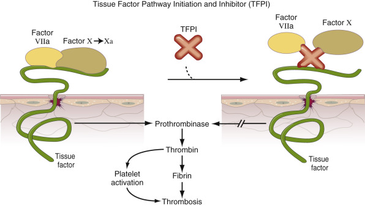
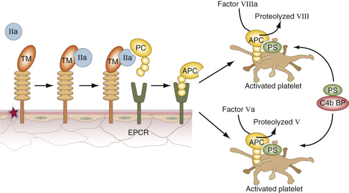
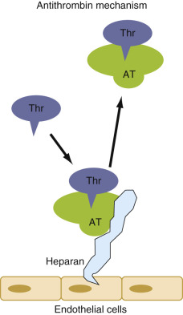
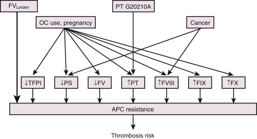

## Key Points

  * •

Several important regulatory mechanisms control the extent of fibrin formation after coagulation is triggered. Under normal conditions, these are designed to achieve hemostasis while preventing intravascular clot formation that would lead to thrombosis and embolism. Major systems include the antithrombin mechanism, the protein C–protein S system, the fibrinolytic system, and the tissue factor pathway inhibitor mechanism. 

  * •

Deficiencies of the main regulatory proteins (antithrombin, protein C, and protein S) increase the risk for venous thrombosis. 

  * •

Increased levels of procoagulant factors or polymorphisms (causing functional change) also increase the risk for venous thrombosis. A polymorphism in factor V (factor V  Leiden  ) reduces the proteolysis of factor Va by activated protein C. Increased levels of prothrombin due to a promoter polymorphism at base pair 20210 and elevated levels of factor VIII also increase the risk for development of venous thrombosis. 

  * •

Other inherited or acquired defects in hemostasis (dysfibrinogenemia and fibrinolysis) and in nonhemostatic systems (homocysteine) also increase the risk of venous thrombosis. 

  * •

Antiphospholipid syndrome is an autoimmune disorder that increases the risk of venous and arterial thrombosis as well as pregnancy complications attributable to a reduction in placental perfusion. The antibodies in this disorder are heterogeneous and are detected with a variety of laboratory abnormalities, including immunoassays and coagulation assays that paradoxically report antibody-mediated inhibition of phospholipid-dependent coagulation reactions. 

  * •

When evaluating a patient for thrombotic risk, it is important to select the appropriate diagnostic tests, to understand their clinical significance, and to plan the timing of testing appropriately because acute thrombosis, anticoagulant therapy, pregnancy, and acute phase reactions can affect the levels of these endogenous anticoagulant factors. 

The authors would like to thank the previous authors, Drs. Mallar, Fink, and Miller, for their contribution to the previous iteration of this chapter. 

Hemostatic regulatory mechanisms limit the amount, location, and duration of clot formation to effectively seal blood vessels at the site of injury and at the same time manage to prevent the growth of the hemostatic plug into an occlusive thrombus. Dysfunction in these regulatory systems may lead to the pathologic condition of excessive clot formation (thrombosis). Both genetic and acquired deficiencies and abnormalities of such regulatory factors are capable of increasing the risk for thromboembolism. This chapter discusses a number of factors that influence the balance toward bleeding or toward thrombosis, as well as the role of the laboratory in identifying abnormalities associated with these factors. 

,  

##  Endogenous Anticoagulant Pathways 

The endogenous anticoagulants play a key role in maintaining a balance between an adequate hemostatic response to injury that would result in bleeding and an excessive response that would lead to thrombosis. (For a schematic overview of physiologic anticoagulant pathways, see also [ Fig. 39-5 ](<##!/content/3-s2.0-B9780323295680000395?scrollTo=%23f0040>) in [ Chapter 39 ](<##!/content/3-s2.0-B9780323295680000395?scrollTo=%23c00039>) .) Coagulation is triggered by tissue factor and a protein named tissue factor pathway inhibitor (TFPI, or TFPI-1) ( [ Fig. 41-1 ](<#f0010>) ) limits the activity of this protein in the manner described below (  Smithies & Weaver, 2004  ;  Crawley & Lane, 2008  ). TFPI has two reactive binding sites: one for factor Xa that has just been activated by the tissue factor–factor VIIa complex, and a second binding site for the tissue factor–factor VIIa complex itself (  Esmon, 2003b  ). TFPI thereby “locks up” the tissue factor–factor VIIa enzymatic machinery, but only after coagulation has generated some factor Xa. In this way, TFPI provides a negative feedback mechanism for downregulating the coagulation process without inhibiting the formation of a quantity of fibrin sufficient to achieve hemostasis. 

Figure 41-1 

Tissue factor pathway initiation and inhibitor mechanisms. 

_TFPI,_ Tissue factor pathway inhibitor. 

A second major antithrombotic regulatory system is the protein C pathway, a multipronged mechanism that includes a major anticoagulant component ( [ Fig. 41-2 ](<#f0015>) ), along with an indirect fibrinolysis promoting component (  Esmon, 2009  ). Protein C, the central player in this system, is a vitamin K–dependent proenzyme that binds to the endothelial cell protein C receptor (EPCR) (  Stearns-Kurosawa et al, 1996  ). The system is initiated when excess thrombin that is not bound to fibrin rapidly binds to an endothelial cell transmembrane glycoprotein, thrombomodulin (TM in [ Fig. 41-2 ](<#f0015>) ). This TM bound-thrombin undergoes a change in substrate specificity that converts it from a potent procoagulant enzyme to specificity for activating protein C that is bound to the EPCR by rapidly cleaving a small activation peptide (  Esmon, 2004  ). This process generates activated protein C (APC), an active serine protease. A second vitamin K–dependent inhibitory plasma protein, protein S (see [ Fig. 41-2 ](<#f0015>) ), serves as a critical cofactor for the enzymatic activity of APC. Protein S is a nonenzymatic cofactor molecule that binds in equilibrium to a large complement protein, C4b-binding protein (  Rigby & Grant, 2004  ). Only the unbound (or “free”) form of protein S possesses APC cofactor activity. The complexes of APC and protein S inactivate factor Va and factor VIIIa, thereby greatly diminishing additional thrombin formation and consequently the rate of fibrin formation (  Esmon, 2003a;  2003b  ). Again, similar to the TFPI system, inhibition of coagulation occurs after its activation—that is, thrombin exhibits anticoagulant properties only after there has been sufficient thrombin to achieve hemostasis. 

Figure 41-2 

Protein C pathway. 

_APC,_ Activated protein C; _C4b BP,_ complement factor 4b-binding protein; _EPCR,_ endothelial cell protein C receptor; _IIa,_ thrombin; _PC,_ protein C; _PS,_ protein S; _TM,_ thrombomodulin. 

In addition to proteolysis of factors Va and VIIIa, the protein C system also appears to exert significant, although indirect, profibrinolytic activity. This appears to involve the thrombin-activated fibrinolytic inhibitor (TAFI) (  Van de Wouwer et al, 2004  ) along with plasminogen activator inhibitor-1 (PAI-1) (  Madden et al, 1991  ;  Meltzer et al, 2010  ). TAFI is a plasma carboxypeptidase that is rapidly activated by the thrombin–thrombomodulin complex (  Van de Wouwer et al, 2004  ). The active form of the carboxypeptidase cleaves C-terminal lysine residues from fibrin that has already undergone proteolytic cleavage by plasmin. Loss of these residues impairs the efficient binding of plasminogen-activating proteins to fibrin, thereby downregulating the fibrinolytic process. APC, via inactivation of factor Va, causes a decrease in thrombin generation, thus also slowing TAFI activation. PAI-1 is inhibited by APC, thereby increasing overall fibrinolytic activity (  Madden et al, 1991  ). In addition to its anticoagulant function, there is evidence suggesting that the protein C system may have other important defense properties, including anti-inflammatory activity and regulation of complement activity (  Castellino & Ploplis, 2009  ;  Esmon, 2003a  ). 

Antithrombin (also known as antithrombin III) is a circulating plasma serine protease inhibitor that regulates thrombin and factor Xa, and to a lesser extent the other serine protease—that is, factors IXa, XIa, XIIa, and VIIa (  Stassen et al, 2004  ). The function of antithrombin is greatly enhanced by glycosaminoglycans on the endothelial cell surface. The enhancement is mediated by cell-bound glycosaminoglycans (heparan sulfate, dermatan sulfate, and small amounts of heparin) ( [ Fig. 41-3 ](<#f0020>) ), while pharmacologically this is accomplished by heparins (discussed extensively in [ Chapter 42 ](<##!/content/3-s2.0-B9780323295680000425?scrollTo=%23c00042>) ). 

Figure 41-3 

Antithrombin inhibitor mechanisms. 

_AT,_ Antithrombin (formally termed _antithrombin III_ ); _Heparan,_ heparan sulfate (a glycosaminoglycan); _Thr,_ thrombin (or another coagulation enzyme such as factor X). 

,  

##  Thrombophilic Proteins or Factors 

An increase in procoagulant factors or a decrease in regulatory factors can tip the balance to excessive fibrin production, resulting in thrombus formation. These imbalances can be caused by genetic or acquired factors or by a combination of the two ( [ Tables 41-1 ](<#t0010>) and [ 41-2 ](<#t0015>) ). A complete assessment of the recognized and established risk factors must be made to determine the overall risk potential for an individual (see [ Table 41-2 ](<#t0015>) ). The following factors are the major known components involved in increased risk for thrombus development (see [ Table 41-1 ](<#t0010>) for a summary of prevalence and relative risk). 

TABLE 41-1 

Prevalence and Estimated Increased Thrombotic Risk of Thrombophilic Factors 

Risk Factors for Thrombosis  |  Prevalence in General Population, %  |  Prevalence in Thrombophilic Population, %  |  Estimated Thrombotic Risk, Fold   
---|---|---|---  
Decreased antithrombin  |  0.02-0.17 [ ** ](<#hl0000172>) |  1-3 [ ** ](<#hl0000172>) |  10-20 [ ** ](<#hl0000172>)  
Decreased protein C  |  0.14-0.5 [ ** ](<#hl0000172>) |  3-5 [ ** ](<#hl0000172>) |  10 [ ** ](<#hl0000172>)  
Decreased protein S  |  0.03-0.13 [ ** ](<#hl0000172>) |  1-5 [ ** ](<#hl0000172>) |  10 [ ** ](<#hl0000172>)  
Factor V  Leiden  (heterozygous)  |  1-5 [ * ](<#hl0000168>) ,  [ ** ](<#hl0000172>) |  10-50 [ ** ](<#hl0000172>) |  5 [ ** ](<#hl0000172>)  
Factor V  Leiden  (homozygous)  |  <0.01%  |  2-4  |  10-15   
Prothrombin G20210A  |  2-5 [ * ](<#hl0000168>) ,  [ ** ](<#hl0000172>) |  6-18 [ * ](<#hl0000168>) |  3   
Elevated factor VIII  |  11 [ ** ](<#hl0000172>) |  25 [ ** ](<#hl0000172>) |  2-4.5   
Elevated fibrinogen  |  5-12  |  20-30  |  2-3   
Dysfibrinogenemia  |  <0.1  |  <1  |  Variable   
Thrombomodulin mutations  |  <0.01  |  0.2-0.8  |  2-4   
Elevated homocysteine  |  5 [ ** ](<#hl0000172>) |  10 [ ** ](<#hl0000172>) |  3 [ ** ](<#hl0000172>)  
Lupus anticoagulant  |  1-5  |  10-30  |  2-10   
Oral contraceptives  |  N/A  |  N/A2-3  |   
Pregnancy  |  N/A  |  N/A  |  4-8   
  
_N/A,_ Not applicable. 

Data also from Abdollahi M, Cushman M, Rosendaal FR, et al: Obesity: Risk of venous thrombosis and the interaction with coagulation factor levels and oral contraceptive use, _Thromb Haemost_ 89:493–498, 2003; Bauer KA, Rosendaal FR, Heit JA: Hypercoagulability: Too many tests, too much conflicting data, _Hematology Am Soc Hematol Educ Program_ 2002;353–368, 2002; Franco RF, Rosendaal FR: Genetic risk factors of venous thrombosis, _Hum Genet_ 109:369–384, 2001; Goldhader SZ, Grodstein F, Stampfer MJ, et al: A prospective study of risk factors for pulmonary embolism in women, _JAMA_ 277:642–645, 1997; Grady D, Wenger NK, Herrington D, et al: Postmenopausal hormone therapy increases risk for venous thromboembolic disease. The heart and estrogen/progestin replacement study, _Ann Intern Med_ 132:689–696, 2000; Heit JA, Silverstein MD, Mohr DN, et al: Risk factors for deep vein thrombosis and pulmonary embolism: A population-based case-control study, _Arch Intern Med_ 160:809–815, 2000; Kim V, Spandorfer J: Epidemiology of venous thromboembolic disease, _Emerg Med Clin North Am_ 19:839–859, 2001; and Overby DW, Kohn GP, Cahan MA, et al: Prevalence of thrombophilias in patients presenting for bariatric surgery, _Obes Surg_ 19:1278–1286, 2009. 

 * Factor V  Leiden  and Prothrombin 20210 prevalence for heterozygosity in Caucasian general population; however, both very low (<0.1%) in African and East Asian populations. 

 ** De Stefano et al, 1996  ;  Rosendaal, 1999  . 

TABLE 41-2 

Estimated Thrombotic Risk for Cooperativeness of Multiple Factors 

Risk Factor 1  |  Risk Factor 2  |  Combined Risk (Fold Greater)   
---|---|---  
Protein C  |  Factor V  Leiden  (heterozygous)  |  25-45   
Protein S  |  Factor V  Leiden  (heterozygous)  |  25-50   
Factor V  Leiden  (heterozygous)  |  Elevated factor VIII  |  12-20   
Factor V  Leiden  (heterozygous)  |  Oral contraceptives  |  8-20   
Factor V  Leiden  (heterozygous)  |  Pregnancy  |  25-40   
  
 

##  Antithrombin 

Both hereditary and acquired deficiencies of antithrombin have been identified (  Egeberg, 1965  ;  Bloemenkamp et al, 2003  ;  Patnaik & Moll, 2008  ). Genetic deficiency of antithrombin is a rare disorder (approximately 1 in 10,000 individuals) in the general population, and about 1% of patients with familial venous thrombosis are diagnosed for this deficiency (  Adcock et al, 1997  ). Antithrombin deficiency is an autosomal trait, having an apparent dominant expression and high penetrance, with a large number of known mutants throughout the gene (  Adcock et al, 1997  ;  Lane et al, 1997  ). Heterozygous individuals have plasma antithrombin levels around 50% of normal and develop thrombosis; this is in contrast to heterozygous carriers for the genes for coagulation factor deficiencies, who are typically asymptomatic. Both type I (decreased activity with concomitant decreased antigen) and type II (decreased activity with normal levels of antigen) antithrombin mutations have been described in antithrombin-deficient individuals (  Lane et al, 1997  ). Except for unique type II mutations in the heparin-binding region, where patients typically manifest venous thrombosis, homozygous antithrombin deficiency is incompatible with life (  Kuhle et al, 2001  ). The most common clinical presentation is deep venous thrombosis in the lower extremities and pulmonary embolus. Thrombi may also occur in the retinal, mesenteric, and splenic veins (  Bloemenkamp et al, 2003  ). Acquired deficiencies of antithrombin occur in disseminated intravascular coagulation (DIC) (  Asakura et al, 2001  ), liver disease, the nephrotic syndrome, the acute period following venous thrombosis, and during heparin therapy (  Marlar & Mastovich, 1990  ). In some cases, acquired defects can cause plasma levels to drop to 30% to 50% of normal and may be mistaken for genetic deficiencies. In the newborn period, antithrombin is also characteristically low, reaching adult levels by the age of 6 months (  Streif et al, 1999  ). 

Both antithrombin activity and antigen levels in plasma can be determined by using commercially available assays. Antithrombin activity is determined by inhibition of thrombin or factor Xa, which can be measured in the presence of heparin (heparin cofactor activity), or in the absence of heparin (progressive antithrombin therapy), or using a chromogenic assay. Advantages to the heparin cofactor activity assay include its sensitivity for all types of antithrombin deficiencies, lack of interferences from lupus anticoagulants, variations in coagulation factors, or heparin. However, there are some disadvantages in that the assay requires an instrument with spectrophotometric capability in which interferences can be observed in the presence of high concentrations of hemoglobin, triglycerides, and bilirubin. On the other hand, antithrombin antigen can be determined by multiple methods, including Laurell electroimmunodiffusion, radial immunodiffusion, or enzyme-linked immunosorbent assay (ELISA), or by nephelometry, in which the latter two are the most common. Care must be taken in distinguishing type I from type II antithrombin deficiency, because both deficiencies exhibit decreased heparin cofactor antithrombin activity, which is the most sensitive method for detecting antithrombin deficiency. In order to distinguish type I from type II antithrombin deficiency, both antithrombin antigen and activity must be performed. However, few medical centers offer this test as part of their routine testing; it is typically found only in specialized reference laboratories. This can result in patients being incorrectly labeled as having type I deficiency as a result of incorrect laboratory evaluation. In addition, the antithrombin antigen assays are often insensitive screening tests because the antigen levels are usually normal in patients with type II antithrombin deficiency. There is no significant difference in clinical presentation between type I and II antithrombin deficiencies. Type II antithrombin deficiency has been further subclassified into IIa (decreased thrombin inactivation, decreased factor Xa inactivation, and decreased heparin affinity), IIb (decreased thrombin inactivation and normal heparin affinity), and IIc (normal thrombin inactivation and factor Xa and decreased heparin affinity) based on the location of the defect on the antithrombin molecule. However, the type of antithrombin deficiency does not influence clinical management. Still, knowledge of the type may provide prognostic information regarding the risk of thrombosis. As an example, type IIb is the most common type and has been associated with lower penetrance for thrombosis. A high risk of venous thromboembolic disease is seen in patients with type I antithrombin deficiency and in patients with type II specifically with defects affecting the thrombin binding domain. The reference ranges for both antithrombin activity and antigen are fairly narrow, usually around 80% to 120% of normal (  Adcock et al, 1997  ;  Kuhle et al, 2001  ) and should be calibrated against the International Reference Standard. 

 

##  Protein C 

Protein C, the central protein in the protein C pathway, is a vitamin K–dependent serine protease zymogen that regulates thrombin generation by inactivating factors Va and VIIIa. Both genetic and acquired deficiencies of protein C can increase the risk for thrombosis. The clinical presentation of severe protein C deficiency includes venous thromboembolism, neonatal purpura, warfarin-induced skin necrosis (  Moll, 2004  ;  Tai et al, 2004  ;  Goldenberg & Manco-Johnson, 2008  ), and fetal loss. As with antithrombin deficiency, two subtypes, type I and II, have been described. Type I is characterized by a decrease in synthesis of a fully functional protein (antigen = activity), while mutations associated with type II protein C deficiency translate into a dysfunctional protein (antigen > activity) (  Marlar & Mastovich, 1990  ;  Marlar et al, 1990  ;  Lane et al, 1996  ). A survey of individuals from the general population reported that 1 in 60 healthy adults have levels consistent with heterozygous deficiency and are not detectably associated with a risk of thrombosis (  Miletich et al, 1987  ). In addition to the hereditary deficiency, a number of conditions can give rise to acquired protein C deficiency, including liver disease, severe infection (including meningococcemia), septic shock, and disseminated intravascular coagulation. 

Testing for protein C function in plasma is performed using clotting activity (end point is fibrin formation) or chromogenic activity (hydrolysis of activated protein C–specific chromogenic substrate) assays; antigen levels are measurable with several types of immunoassays. The key component of the clotting assays is the in vitro activation of protein C by Akistrodon contortix (southern copperhead) snake venom (Protac  ® ), which substitutes for the natural activator thrombin-thrombomodulin. Protein C activation is independent of calcium ion concentration and the degree of protein C gamma carboxylation. The clotting method is typically a two-stage phospholipid assay based on either the activated partial thromboplastin time (aPTT) or thromboplastin (PT)-based coagulation assays. In the first stage, the patient's plasma is incubated with Protac  ® to completely activate protein C; the second stage consists of the addition of an activator (aPTT, PT, or Russell viper venom reagent) to initiate the clotting process. The time until detection of the fibrin clot or hydrolysis of the substrate is proportional to the plasma protein C activity—that is, prolongation of the clotting time correlates with increased protein C activity. The clot-based assays provide some advantages in that there is increased sensitivity for detecting both type I and type II protein C deficiencies, as well as increased sensitivity for most coagulation instruments regardless of fibrin clot detection methods. On the negative side, however, clot-based assays may underestimate protein C, particularly under conditions in which there is a deficiency of other factors involved in protein C activation, such as low protein S, factor V  leiden  , warfarin antagonism, or vitamin K deficiency. In addition, an underestimation can also occur with increased factor VIII activation. Similarly, conditions that prolong the clotting time may result in overestimation of protein C activity; examples include the presence of heparin in the patient's plasma, direct thrombin inhibitors, specific factor inhibitors, or the presence of a lupus anticoagulant. 

The majority of the commercially available assays are ELISA, in which different combinations of capture and detection protein C antibodies are used. These assays exhibit variable sensitivities for uncarboxylated protein C and protein C/inhibitor complexes. All of the immunoassays cross-react with protein C type II mutations and should not be used for screening purposes, but they can help in distinguishing between type I and II in patients with low protein C activity. In type I protein C deficiency, functional activity and antigen level are decreased to about 50% of normal, whereas in type II deficiency, the functional level is decreased on average to 50% of normal, but the antigen level remains normal (  Marlar & Mastovich, 1990  ;  Marlar et al, 1990  ). Type I heterozygous protein C deficiency is the most common of the two and reflects structurally normal protein C. Homozygous type I protein C deficiency reflects a complete absence of the protein. This rare disorder manifests as neonatal purpura fulminans. Type II protein C deficiency reflects a qualitative defect. The chromogenic functional assays are not subject to quantitative or qualitative variations in protein C, coagulation factors, anticoagulants, or inhibitors and are more precise than the clot-based method, but they may erroneously report activity for mutant protein C molecules that only recognize the synthetic chromogenic substrate but are not active in vivo. 

 

##  Protein S 

Both genetic and acquired deficiencies of protein S are associated with increased risk of thrombosis (  Esmon, 2003a;  2009  ). As discussed above, protein S together with activated protein C (APC) binds to the phospholipid surface of a platelet or other cell, enhancing the enzymatic inactivation of factors Va and VIIIa (  Hackeng et al, 1994  ;  van Wijnen et al, 1996  ). About 40% of the protein S is free in plasma, whereas the remaining 60% is bound to the complement system protein, C4b-binding protein (C4b BP) (  Nelson & Long, 1992  ). Several different pathologic and physiologic conditions can alter the ratio of free and bound protein S, thereby effectively modulating the protein C inhibitory pathway (  Mackie et al, 2001  ). The level of protein S characteristically decreases during pregnancy, with values averaging only 60% of those of controls from the tenth week of pregnancy onward (  Cerneca et al, 1997  ;  ten Kate & van der Meer, 2008  ). 

The autosomal gene encoding protein S is expressed with variable penetrance (  Rezende et al, 2004  ). As with antithrombin and protein C, the classical quantitative type I deficiency (decreased protein S activity with concomitant decreased total antigen) and a qualitative type II deficiency (decreased protein S activity with normal levels of free and total antigen) have been reported. A third type of mutation, type III deficiency, is characterized by total protein S antigen measurements within the normal range and selectively reduced concentrations of free protein S and functional activity because of increased binding to C4b BP. Several studies have reported that type III individuals might not have increased risk for thrombosis (  Brouwer et al, 2005  ;  Libourel et al, 2005  ). Homozygous protein S deficiency with severely decreased protein S activity (<1%) has been reported with the same presentation and similar treatment regimens as homozygous protein C deficiency (  Brouwer et al, 2005  ). The clinical presentation includes purpura fulminans and DIC during the newborn period, with ophthalmic and neurologic complications having developed in utero. This disorder requires replacement therapy (i.e., fresh frozen plasma) and anticoagulant therapy soon after birth. 

Plasma protein S levels may be measured with protein S clotting activity assays, as well as with antigenic assays for free protein S and total protein S antigen. Definitive diagnosis of protein S deficiency can be very difficult owing to the complexity of protein S interaction with C4b BP (  Nelson and Long, 1992  ;  Goodwin et al, 2002  ;  Persson et al, 2003  ;  ten Kate & van der Meer, 2008  ). The functional assay methods are based on the activity of protein S to serve as a cofactor for the anticoagulant effects of APC (  Wolf et al, 1989  ;  Preda et al, 1990  ). A major disadvantage of functional protein S assays is poor specificity (false-positive results). However, some of the assays are not specific for protein S because they are also sensitive to the defect that is characterized by activated protein C resistance (APC-R) due to factor V  Leiden  mutation (  Faioni et al, 1993  ) (see below). To eliminate this problem, a screening of the plasma samples for APC-R prior to the performance of the functional protein S assays may be beneficial. The original method for determining free protein S antigen concentrations, which involved precipitation of bound protein S complexes with polyethylene glycol (PEG), has been replaced by immunoassays that measure protein S specifically using monoclonal antibody-based assays or ligand sorbent assays. Two types of antigen assays are available: Assays whose measurement includes both free protein S and the bound fraction are considered to be measuring the total amount of protein S in a plasma sample (total protein S antigen). Assays for free protein S measure only the unbound portion of protein S by employing a monoclonal antibody specific for unbound protein S (  Comp et al, 1986  ;  Goodwin et al, 2002  ;  Persson et al, 2003  ;  ten Kate & van der Meer, 2008  ). Reaching a definitive diagnosis of congenital deficiency of protein S can be challenging, given the complexity of the interaction of protein S with C4b BP, the acquired conditions, which can change the equilibrium of free and bound forms and the presence of vitamin K antagonists (  Simmonds et al, 1998  ;  Mackie et al, 2001  ;  Goodwin et al, 2002  ;  Rezende et al, 2004  ;  ten Kate & van der Meer, 2008  ). Reference intervals for both antigen and activity typically range from 60% to 150%, and separate reference ranges for women who may be on oral contraceptives or pregnant are typically not provided, therefore complicating the interpretation of “low values” in this patient population. 

 

##  Activated Protein C Resistance and Factor V  Leiden 

Activated protein C resistance (APC-R) is reported when the addition of exogenous APC to plasma does not result in the expected anticoagulant effect, as manifested by prolongation of clotting time tests such as the aPTT (  Dahlback, 1999  ;  Castoldi & Rosing, 2010  ). APC-R is most often attributable to factor V  Leiden  , which is considered one of the most common genetic risk factors for venous thrombosis, with a prevalence in individuals with European ancestry of about 4% (  Ridker et al, 1995  ;  Heijmans et al, 1998  ). The polymorphism that renders the site resistant to APC cleavage at one of the cleavage sites in factor Va is an arginine residue substituted by a glutamine residue (R506Q) (  Aparicio & Dahlback, 1996  ). The amino acid substitution is due to a single nucleotide change in the gene for factor V  Leiden  (  Bertina et al, 1994  ). Factor V  Leiden  increases the relative risk of thrombosis about fivefold in the heterozygous condition and tenfold to fifteenfold in the homozygous individual (  Svensson et al, 1997  ;  De Stefano et al, 1999  ;  Castoldi & Rosing, 2010  ). The presence of factor V  Leiden  , even in heterozygotes, will reduce the APC-mediated prolongation of coagulation and thereby produce a reduction of the ratio of clotting times of APC-treated plasma compared to plasma that was not treated with APC. 

There are several variations of these assays, with an exogenous source of factor V–deficient plasma frequently employed to increase specificity for abnormalities attributable to a genetic abnormality of the patient's own factor V. As mentioned, a pair of clotting tests are performed: with and without the addition of APC. If the ratio of clotting time with added APC divided by clotting time in the absence of added APC is sufficiently high (in most assays >1.8 or 2.0), then APC-R or factor V  Leiden  is excluded. Lower ratios, in contrast, suggest that the sample is APC resistant and that the patient may have factor V  Leiden  (or another factor V variant, or possibly acquired APC resistance), which should be confirmed by genetic testing (  Aparicio & Dahlback, 1996  ;  Tripodi et al, 1997  ;  Castoldi & Rosing, 2010  ). Also of potential clinical importance, however, are those cases of acquired APC-R not associated with a genetic abnormality of the patient's factor V molecule. As shown in [ Figure 41-4 ](<#f0025>) , several abnormalities may affect regulation of the coagulation pathways and may additionally exert a prothrombotic influence by virtue of increasing APC-R (  Cumming et al, 1995  ;  Graf et al, 2003  ;  Castoldi & Rosing, 2010  ). Detection of such forms of APC-R will be more frequent when assays are employed that do not include the addition of exogenous factor V–deficient plasma. 

Figure 41-4 

Activated protein C (APC) resistance as a complex phenotype. 

(Redrawn with permission from Castoldi E, Rosing J: APC resistance: Biological basis and acquired influences, _J Thromb Haemost_ 8:445–53, 2010.) 

 

##  Prothrombin g20210a 

This polymorphism in the prothrombin gene at base pair number 20210 results in a guanine-to-adenine substitution in the 3′-untranslated region of the gene (  Colucci et al, 2004  ). Heterozygosity for this polymorphism imparts approximately a threefold greater risk for venous thrombosis (  Eikelboom et al, 1999  ). Heterozygous individuals characteristically have levels of plasma prothrombin approximately 15% to 30% higher than those in individuals lacking this polymorphism, although even these higher levels usually fall within the established reference interval for prothrombin activity of most laboratories. Accordingly, molecular diagnostic procedures are required for the diagnosis of prothrombin 20210 (  Poort et al, 1996  ;  Gruenewald et al, 2000  ). Prothrombin 20210 is a common genetic risk factor for venous thrombosis in populations of European descent (about 3%), with lower prevalence in non-European populations (  De Stefano et al, 1999  ). 

 

##  Elevation of Other Coagulation Factor Levels 

Elevations of several other coagulation factors have also been reported to impart an increased risk of thrombosis. As levels of factors VII, VIII, IX, XI, or fibrinogen are elevated, the relative risks for developing thrombosis are proportionately increased (1.5-fold to 6-fold) (  Kannel et al, 1987  ;  O'Donnell et al, 1997  ;  Kyrle et al, 2000  ;  Meijers et al, 2000  ). The most studied of these reported risk factors is factor VIII. Factor VIII is regulated by genetic mechanisms and additionally by physiologic mechanisms that increase the release of stored factor VIII in times of stress and exercise. Some familial elevation of factor VIII has been reported, but transiently high levels can be seen in patients with a concomitant increase in plasma von Willebrand factor level and in patients with stress due to a variety of clinical conditions (  Vormittag et al, 2009  ). There is a stratified increase of risk, with patients having factor VIII levels of 120% to 150% reported to have a 1.5-fold to 2-fold greater risk of venous thrombosis; levels of 300% to 400% have an increased relative risk of 3-fold to 6-fold (  O'Donnell et al, 1997  ). 

 

##  Tissue Factor Pathway Inhibitor 

Tissue factor pathway inhibitor (TFPI) impedes the early stages of coagulation by exhibiting a high-affinity inhibition of two coagulation proteases: TF-VIIa (  Girard et al, 1989  ;  Baugh et al, 1998  ;  Maroney et al, 2013  ) and factor Xa (  Girard et al, 1989  ;  Maroney et al, 2013  ). Transgenic mice lacking the K1 domain of TFPI succumb to embryonic lethality from an apparent consumptive coagulopathy (  Huang et al, 1997  ). Mice heterozygous for this TFPI mutation appear to exhibit normal growth and development, reproductive capability, and survival, but do exhibit a mild prothrombotic state in an experimental vein injury model (  Maroney et al, 2008  ). Complete absence of TFPI has not been described in humans, suggesting that it may produce embryonic lethality. Partial TFPI deficiency might be a weak prothrombotic risk factor in humans because patients with plasma TFPI levels below 10% of the normal reference range were found to have a slightly increased risk for venous thrombosis (  Dahm et al, 2003  ) and an increased risk for the development of coronary artery disease (  Morange et al, 2004  ). Also, oral estrogen therapy reduces total plasma TFPI concentration and activity in humans by about 25% (  Harris et al, 1999  ) and may be contribute to estrogen-associated thrombosis. 

 

##  Dysfibrinogenemia 

There are few published reports of abnormalities associated with increased risk of thrombosis due to dysfunctional fibrinogen molecules (  Haverkate & Samama, 1995  ;  de Moerloose et al, 2010  ). A recent study that evaluated 101 patients with congenital dysfibrinogenemia concluded that these patients, in addition to their relatives, are not only at a higher risk for major bleeding, including postpartum hemorrhage, but also for a thrombotic event (  Casini et al, 2015  ). The incidence of recognized cases of dysfibrinogenemia in familial thrombosis is about 0.8%. Presently, the assays commonly employed to assess fibrinogen are functional assays of clottability and antigenic assays. As discussed in [ Chapter 39 ](<##!/content/3-s2.0-B9780323295680000395?scrollTo=%23c00039>) , an imbalance in the ratio of such assays provides an indication of a decrease-of-function dysfibrinogenemia. Subtleties in the ability of fibrinogen—and, perhaps more important, of the resulting fibrin—to bind proteins having an influence on the balance of hemostasis and thrombosis (e.g., tissue plasminogen activator) are not detected by such assays. Accordingly, it is possible that the frequency by which dysfibrinogenemias underlie thrombotic events may be higher than is presently recognized. 

 

##  Annexin A5 

Annexin A5 (AnxA5) is a natural anticoagulant, with a high affinity for anionic phospholipids (  Funakoshi et al, 1987  ;  Tait et al, 1988  ), that inhibits the binding and activation of coagulation factors (  Tait et al, 1988  ;  Andree et al, 1992  ;  Reviakine et al, 1998  ). AnxA5 is expressed on trophoblasts and vascular endothelial cells, as well as other cells that have a barrier function, and is therefore in an ideal anatomic location to play a role in thromboresistance. In solution, AnxA5 is monomeric but spontaneously forms tightly bound trimers after interacting with artificial/cell phospholipid membranes (  van Genderen et al, 2008  ). Crystallographic and solution studies indicate that Arg  23  is a major determinant in the binding of AnxA5 to phospholipids, specifically participating in the formation of a salt bridge, which is key for trimer formation (Arg  23  , Lys  27  , and Arg  149  ) on the membrane surface (  Mo et al, 2003  ). The anticoagulant effects of AnxA5 stem from this ability to form two-dimensional crystals on the surface of the phospholipid membranes that form a protective shield against the binding of coagulation enzymes, thereby inhibiting phospholipid-dependent coagulation reactions. 

Although transgenic AnxA5 null mice have been shown to have fetal loss and impaired placental function (  Ueki et al, 2012  ), the clinical correlation to human pregnancy–related morbidity has been inconclusive (  Gris et al, 2000  ;  Arnold et al, 2001  ;  Nojima et al, 2001  ). A recent study by de Jong and colleagues (  de Jong et al, 2015  ) showed no association between AnxA5 genetic variants and the development of deep vein thrombosis (DVT). However, non-M2 carriers (functional AnxA5 promoter activity), including haplotypes H1 and H2, are associated with different AnxA5 concentrations in healthy controls (  Hiddink et al, 2012  ). Although the data regarding the association between plasma concentrations of AnxA5 and DVT are lacking, the differentiation among the non-M2 control group with respect to AnxA5 concentration may be of clinical importance. For example, these differences could play a role in recurrent pregnancy loss in which the clinical features are related to AnxA5 concentration (  Rand et al, 2006  ). On the other hand, antibodies to phospholipids, as are typically found in patients with antiphospholipid syndrome, were shown to interfere with the protective effects of AnxA5 by promoting the competitive binding of anti-β2-glycoprotein I (β2GPI) immune complexes that interfered with ordered crystallization of the shield and exposed anionic phospholipids leading to thrombus formation (  Rand et al, 2008  ). Further work is still needed to elucidate the role of AnxA5 in pregnancy and thrombosis. 

 

##  Hypofibrinolytic Mechanisms 

Impaired function of the fibrinolytic system increases the risk of thrombosis, but there remains a need for robust global clinical assays that allow estimation of the degree of that risk (  Collen, 1999  ;  Meltzer et al, 2009  ). The euglobulin clot lysis time provides a measure of some aspects of the fibrinolytic system (  Sartori et al, 2003  ). In brief, citrated plasma is diluted and acidified, resulting in the selective precipitation of many proteins that include fibrinogen, plasminogen activator, and plasminogen, whereas other molecules, including α 2  -antiplasmin, remain in solution. This precipitated euglobulin fraction is then redissolved in appropriate buffer and clotted by thrombin, and the time to clot lysis is measured. An abnormal rate of euglobulin clot lysis helps to direct the subsequent laboratory evaluation to an underlying abnormality of a critical component of the fibrinolytic system. Such a result adds support to the decision to proceed to more detailed testing of the fibrinolytic system, such as specific assays for plasminogen activator, plasminogen, and other proteins upregulating or downregulating fibrinolysis (  Meltzer et al, 2009  ). In many cases the euglobulin clot lysis test has been replaced by functional assays like the TEG thromboelastography (see below), which are considerably faster and simpler, though more costly. 

Although a variety of defects in the fibrinolytic system might contribute to the increased risk of thrombosis, consensus has been difficult to achieve with respect to assessment through system-based assays, specific component functional assays, or molecular analysis studies with respect to the individual patient. Deficiencies of plasminogen, the zymogen precursor of plasmin—the major enzyme responsible for fibrin clot breakdown (see [ Chapter 39 ](<##!/content/3-s2.0-B9780323295680000395?scrollTo=%23c00039>) )—have been reported, but the association with increased thrombotic risk is not well founded (  Schulman & Wiman, 1996  ). Assessment of the mechanical properties of clots throughout the period of their formation and subsequent lysis with thromboelastography or similar devices represents a different approach, which, with sufficient standardization, may permit the detection of abnormal fibrinolysis (  Kamada et al, 2001  ;  Salooja and Perry, 2001  ;  Vig et al, 2001  ;  Meltzer et al, 2009  ). These types of instruments work by detecting clot rigidity or strength during the clot formation and breakdown process (  Kamada et al, 2001  ;  Salooja & Perry, 2001  ;  Vig et al, 2001  ;  Meltzer et al, 2009  ;  Kupesiz et al, 2010  ) and accordingly may offer the potential for real-time assessment of fibrinolytic state, which could be of particular benefit in conjunction with the monitoring of active antifibrinolytic therapy (  Kupesiz et al, 2010  ). 

,  

##  Acquired Hypercoagulable States 

Numerous acquired conditions have been associated with increased risk of venous thrombosis. The relative risk for many of these has been determined and appears to combine with genetic causes to increase the overall risk for thrombosis. Common conditions that have a strong association with venous thrombosis include trauma, surgery and the postoperative state, pregnancy, immobility, obesity and diet, smoking, and previous thrombosis. Additionally, malignancy, chronic DIC, oral contraceptive use and hormone replacement use, heparin-induced thrombocytopenia, nephrotic syndrome, essential thrombocythemia, polycythemia vera, and inflammatory conditions have all been associated with increased risk of venous thrombosis. Finally, as discussed in [ Chapter 40 ](<##!/content/3-s2.0-B9780323295680000401?scrollTo=%23c00040>) , abnormalities of the enzyme ADAMTS13 have been associated with the thrombotic thrombocytopenic purpura. 

 

##  Antiphospholipid Syndrome and Lupus Anticoagulant 

The antiphospholipid antibody syndrome (APS), a clinical disorder characterized by recurrent arterial and venous thrombotic events, is one of the most common risk factors for thrombosis, pregnancy complications, and fetal loss (  Bizzaro et al, 2005  ;  Palomo et al, 2009  ;  Pengo et al, 2009  ). Venous or arterial thrombosis may occur, with venous manifestations being more common (  Eby, 2009  ). The syndrome is an autoimmune disorder with antibodies directed against protein–phospholipid (PL) complexes. A strong association has been noted between immunoglobulin (Ig)G antibodies directed against domain I of β2GPI and thrombotic and obstetric complications in APS. Autoantibodies directed against additional PL-binding proteins such as prothrombin or annexin A2 may also be seen, although the clinical significance of these antibodies is unclear. The binding of β2GPI to platelet plasma membranes and the subsequent interaction of anti-β2GPI involving both platelet GPIbα and a truncated splice variant of LRP-8 (a member of the low density lipoprotein-receptor family present on platelets, also known as ApoER2) may trigger platelet activation (  de Groot & Derksen, 2005  ;  Giannakopoulos et al, 2007  ;  de Groot et al, 2010  ). 

The term _lupus anticoagulant_ (LA), which is used to describe in vitro phospholipid-dependent inhibitors of coagulation, is misleading because the presence of an LA raises concern for clinical thrombosis rather than for clinical bleeding (hence the term _lupus anticoagulant paradox_ ), and most patients with LA do not have systemic lupus erythematosus. The initial studies identifying the antiphospholipid antibodies (APAs) used cardiolipin in the binding assays (anticardiolipin antibodies [ACAs]). Many of the ACAs are responsible for the false-positive results observed in Venereal Disease Research Laboratory testing for syphilis. In turn, many infections and autoimmune diseases and a variety of medications are associated with a positive ACA (  McCrae et al, 2001  ;  Galli et al, 2003  ;  Riboldi et al, 2003  ). 

In a number of studies, abnormal LA or elevated ACA have been reported to occur in 1% to 5% of an asymptomatic general population, with many of these being transitory (  Biggioggero & Meroni, 2010  ). Patients who maintain a persistent LA together with high titers of anti-β2GPI show the highest correlation with thrombosis (  de Laat et al, 2009  ). The combination of anti-β2GPI, ACA, and LA test positivity has the highest association with recurrent venous thromboembolism (  Pengo et al, 2006  ). 

The mechanisms by which APA affect coagulation and hemostasis are probably multifactorial owing to the diversity of PL-associated proteins. Reports on the in vivo mechanism for hypercoagulability include interference with AnxA5 anticoagulant activity, interference with TFPI, downregulation of TM, interference with protein S, platelet activation, and endothelial perturbation. In particular, platelet-associated binding of antibodies against β2GPI may cause platelet activation (see earlier). Recommendations for standardizing LA assays have been offered (  Pengo et al, 2010b  ). Although there is no uniform approach for in vitro diagnosis of LA, it is clear that because of the heterogeneity of these antibodies, the presence of an LA cannot be excluded by simply failing to detect it in any single assay. Most commonly, the aPTT and the dilute Russell viper venom time (dRVVT) are employed. Because these assays recognize different aspects of PL-dependent coagulation reactions, the combination is best for detecting LA. In the dRVVT test, the coagulation cascade is initiated later than in the aPTT, with direct factor X activation by the venom in a PL-dependent fashion. 

The various aPTT reagents have different sensitivities to LAs. The clotting time of plasma from LA patients is prolonged in these assays. When mixed with equal parts of normal pooled plasma, the plasma from LA patients will prolong the clotting time of the mixture beyond the clotting time of the normal control plasma itself. Whereas specific factor inhibitors, such as those directed against factor VIII, are typically time- and temperature-dependent (see [ Chapter 39 ](<##!/content/3-s2.0-B9780323295680000395?scrollTo=%23c00039>) ), LAs more commonly are immediate-acting even at room temperature. It is important to note that LAs may artifactually interfere with quantitative measurement of coagulation factors assayed in an aPTT-based system, leading to misdiagnosis of factor deficiencies. A telltale pattern that should itself arouse suspicion of an LA is a persisting increase in apparent factor activity, with increasing dilutions of patient plasma used in the assay: Such apparent increases in factor activity, also known as “nonparallelism” or “crossing lines,” result from decreased interference by progressive dilutions of LA. 

Preincubation of LA plasma with an excess quantity of PL will neutralize the LA and result in significant shortening of a subsequently performed clotting time compared to plasmas that do not have the excess PL added. Sources of neutralizing PL that have been used for this purpose include purified PLs, purified hexagonal phase PLs, and complex PLs derived from frozen and thawed washed platelets (platelet neutralization procedure [PNP]) (  Favaloro & Wong  2008  ). 

International consensus statements on investigational criteria for APS (  Miyakis et al, 2006  ;  Favaloro & Wong, 2009  ) combine the clinical criteria of vascular thrombosis and pregnancy complications with laboratory criteria. These laboratory criteria include a positive LA, an ACA of IgG or IgM of greater than 40 IU, and medium- or high-titer IgG or IgM anti–β2GPI antibodies. To establish the diagnosis, the tests should be abnormal when repeated at least 12 weeks apart before a diagnosis of APA is made. The clinical course of high-risk patients diagnosed with APS reveals an extensive increase in recurrence of thrombosis, which can be markedly reduced by adequate anticoagulation (  Pengo et al, 2010b  ). Current approaches deriving from recommendations by the International Society on Thrombosis and Haemostasis related to the diagnosis of APS are shown in [ Box 41-1 ](<#b0010>) . Important considerations in implementing such an approach include (1) processing to ensure that the specimen is platelet-poor; (2) choosing two tests, such as the dRVVT or a silica-activated aPTT with low PL content; (3) eliminating the influence of anticoagulants in mixing studies; (4) correcting prolonged clotting time in the presence of excess PL; and (5) ensuring that specific comments on the laboratory's reference ranges and interpretations accompany the LA profile and the ACA and β2GPI antibody assays (  Ledford-Kraemer, 2008  ;  Pengo et al, 2009  ;  Pengo et al, 2010a  ). 

Box 41-1 

Laboratory Detection of Lupus Anticoagulants (LAs) 

  * A.

Blood collection 

    * 1.

Blood should be collected before the start of any anticoagulant drug regimen or a sufficient period after its discontinuation. 

    * 2.

Fresh venous blood in 0.109 M sodium citrate (ratio 9 : 1) 

    * 3.

Double centrifugation removes residual platelets. 

    * 4.

Quickly frozen plasma required if LA assays are postponed. 

    * 5.

Frozen plasma must be thawed at 37° C. 

  * B.

Initial testing 

    * 1.

Use two separate screening tests based on different principles, each with a _low level of phospholipid_ ( _PL):_

      * a.

Dilute Russell viper venom time (dRVVT) 

      * b.

LA-sensitive activated partial thromboplastin time (APTT) (preferably with silica activator) 

    * 2.

Exclude the presence of heparin, LMW heparin, direct thrombin inhibitors, or factor Xa inhibitors. 

      * a.

Indirect (heparin) and direct thrombin inhibitors should be suspected from prolongation of the thrombin time. 

    * 3.

Results of screening tests are potentially suggestive of LA when their clotting times are longer than the local cutoff value. [ * ](<#fn0010>)

* The cutoff value is the 99th percentile of the distribution of clotting times performed on plasmas from healthy donors. Testing described should be performed with the _local_ reagent/instrument combination on plasmas from at least 40 adult healthy donors younger than 50 years of age. Cutoff values established elsewhere should not be substituted, even if they refer to the same method and instrument. 

  * C.

Mixing studies for prolonged LA-sensitive APTT or dRVVT 

    * 1.

Pooled normal plasma (PNP) for mixing studies should ideally be prepared in-house. Alternatively, adequate commercial frozen or lyophilized PNP can be used. 

    * 2.

Plasma with prolonged screening values should be mixed as 1 part patient plasma with 1 part PNP and reassayed without incubation (i.e., <30 minutes after mixing). 

    * 3.

Results of mixing tests are suggestive of LA when their clotting times are longer than the local cutoff value. [ † ](<#fn0015>)

† In the case of mixing studies, the cutoff value would be the 99th percentile of the distribution of clotting times when plasmas from healthy donors are mixed in equal parts with PNP; alternatively, the distribution may be of a derived “index of circulating anticoagulant” = [(b − c)/a] × 100, where a, b, and c are the clotting times of the patient plasma, mixture, and PNP, respectively. 

  * D.

Confirmatory tests for prolonged APTT or dRVVT 

    * 1.

Confirmatory tests are performed by increasing the PL concentration beyond that used in the screening tests. 

    * 2.

Bilayer or hexagonal (II) phase PL should be used to increase the concentration of PL. 

    * 3.

Results are confirmatory of LA if the % correction is above the local cutoff value. [ ‡ ](<#fn0020>)

‡ In the case of confirmatory testing, a distribution of values for “% correction” = [(screen − confirm)/screen] × 100, based upon testing of plasmas from healthy donors at low (screen) and high (confirm) PL concentrations is first obtained. A patient result above the cutoff value assigned to this distribution (e.g., above the 99th percentile) would then be considered as a positive confirmatory test. Note that the clotting time of the confirmatory test in LA-positive samples is not always shortened to within the normal range of controls. Accordingly, to avoid false-negative results, confirmatory tests are recommended to be performed in all normal controls, and these results should be used to establish the cutoff value. 

  * E.

A report with an explanation of the results should be given. [ § ](<#fn0025>)

§ International Society on Thrombosis and Haemostasis (ISTH) guidelines further state, “Results should be expressed as ratio of patient-to-PNP for all procedures (screening, mixing, and confirm).”

_APTT,_ Activated partial thromboplastin time; _LMW,_ low molecular weight. 

Additional ISTH subcommittee explanations and qualifications are reported in detail in the original source of this table (  Pengo et al, 2009  ). 

Adapted from Pengo V, Tripodi A, Reber G, et al: Update of the guidelines for lupus anticoagulant detection. Subcommittee on Lupus Anticoagulant/Antiphospholipid Antibody of the Scientific and Standardisation Committee of the International Society on Thrombosis and Haemostasis, _J Thromb Haemost_ 7:1737–1740, 2009. 

 

##  Other Coagulation Abnormalities 

Abnormalities in several other coagulation regulatory proteins and platelet proteins have been reported. However, difficulty in assessment of these proteins and lack of conclusive correlation with increased thrombotic risk have not yet established them as important risk factors for venous thrombosis. Thrombomodulin (labeled as “TM” in [ Fig. 41-2 ](<#f0015>) ) defects have been reported by several groups to have good association with thrombosis (2 to 6×). Numerous defects appear to span a large portion of the TM gene (  Ohlin & Marlar, 1995  ;  Ohlin et al, 1997  ), and new advances in gene sequencing technologies may simplify their recognition. Heparin cofactor II, a homologous inhibitor of antithrombin, has not been demonstrated to be associated with increased risk of thrombosis (  Tollefsen, 2002  ). The PLA1/PLA2 polymorphism, as well as other platelet glycoprotein polymorphisms, has been of interest with respect to potential prothrombotic contributory roles (  Lindoff et al, 1997  ;  Heit et al, 2000  ;  Robert et al, 2000  ;  Paganin et al, 2003  ), with ongoing efforts to assess whether or not such variations actually achieve clinical significance (  Ivanov et al, 2008  ;  Zuern et al, 2010  ). Additionally, the non-O types of the ABO blood groups have been reported as increased thrombotic risk factors compared with type O, possibly owing to increased levels of von Willebrand factor and factor VIII (  Wu et al, 2008  ). A gain of function mutation of factor IX, factor IX Padua, has recently been described that is associated with juvenile thrombophilia (  Simioni et al, 2009  ). This mutation involves a substitution of leucine for arginine at position 338 (R338L) in the factor IX gene (factor IX-R338L) and is associated with shortened aPTT as well as markedly elevated factor IX levels. 

 

##  Hyperhomocysteinemia 

Homocysteine is an amino acid that is an intermediate molecule for the production and regulation of the sulfur-containing amino acid methionine (  Guba et al, 1996  ;  Refsum et al, 1998  ;  Cattaneo, 2001  ). Perturbations, genetic or acquired, in the regulatory mechanism of this pathway can lead to elevated levels of homocysteine and to an associated increased risk of thrombosis. The most devastating of these is the cystathione-β-synthetase gene, which, in the homozygous state, leads to severe thrombosis and atherosclerosis (  Mudd et al, 1985  ). Acquired causes mostly associated with diet and vitamin intake also are significant factors raising homocysteine levels in plasma. The associated risk for thrombosis with elevated homocysteine levels may correlate with the degree of elevation in homocysteine. Two common polymorphisms associated with the homocysteine-metabolizing enzyme, methylenetetrahydrofolate reductase (MTHFR), were previously thought to be associated with increased risk of thrombosis, but this hypothesis has not been sustained. More recent studies have failed to establish MTHFR as an independent risk factor for thrombosis in adults (  Tosetto et al, 1997  ;  Franco et al, 1999  ), although a possible relationship with childhood stroke remains less clear (  Prengler et al, 2001  ). Accordingly, it is currently not recommended to evaluate MTHFR polymorphisms as a cause of venous thrombosis (  Legnani et al, 1997  ;  Franco et al, 1999  ) in adults. 

Nevertheless, hyperhomocysteinemia itself is a risk factor for the development of pulmonary embolisms and DVT (  den Heijer et al, 1996;  1998  ;  Ray, 1998  ). Meta-analysis of case-controlled studies have reported an odds ratio of 2.5: 2.95 for venous thromboembolic disease in patients with elevated homocysteine concentration—that is, homocysteine concentrations greater than two standard deviations above the mean of the control group (  den Heijer et al, 1998  ;  Ray, 1998  ). Interestingly, some studies have suggested that the risk of thrombosis increases ten- to fiftyfold in patients who have both homocysteinemia and an inherited thrombophilia (for example, factor V  Leiden  ) (  Ridker et al, 1997  ;  Margaglione et al, 1998  ), but other studies have failed to confirm these findings (  De Stefano et al, 2000  ). At this time, it is fair to conclude that genetic testing for MTHFR variants is unlikely to be helpful, but plasma levels of homocysteine may nevertheless be included as part of an investigation for possible thrombophilia. 

,  

##  General Aspects of the Laboratory Evaluation for Thrombotic Risk 

The laboratory evaluation of thrombophilic conditions is complex, including the appropriate tests to order, on whom to perform them, and the appropriate timing for testing (  Foy & Moll, 2009  ). Among the major issues are (1) there is currently no global test to grade the thrombotic risk status of an individual, so a series of individual tests must be ordered for assessment of risk, and (2) there is a broad range of thrombotic risk among the various thrombophilias—ranging from a very high risk associated with hereditary antithrombin deficiency to a much lower risk associated with carriership for the prothrombin g20210a variant. Several questions must be considered when evaluating patients for testing: Does the patient (and family) history justify an evaluation? Are the tests to be ordered appropriate for addressing major accepted risk factors? Is the timing appropriate to provide proper evaluation? Are there underlying therapeutic, pathologic, or physiologic conditions that interfere with interpretation of results? 

Ideally, evaluations should be performed when the patient is asymptomatic, at least several months after the acute thrombotic event, and off anticoagulant therapy. Unfortunately, during the immediate postthrombotic period before anticoagulation, plasma factors are consumed, thus inviting the potential for erroneous diagnoses. Heparin significantly decreases antithrombin levels, increases protein S levels, and may mask LAs (unless a heparin-neutralizing molecule such as protamine or polybrene, or the enzyme heparinase, is included in the assay). Warfarin decreases protein C and protein S levels. Only genetic risk markers can be evaluated at any time by molecular diagnostic techniques. Attempts have been made to circumvent the test abnormalities produced by oral anticoagulation by using ratios of protein C or protein S to one or another of the vitamin K–dependent coagulation factors. However, the variability of such ratios is considerable, inviting the opportunity for misdiagnosis. Thus this approach is not recommended. An erroneous diagnosis can be made when plasma factor levels decrease during a variety of acquired conditions such as pregnancy, hormone therapy, and after surgery. 

Perhaps even more than in many other areas of clinical medicine, it is of critical importance to communicate the implications of these laboratory results to the referring physician and to the patient in a manner that accurately reflects the patient's risk for thrombosis. Decisions such as whether or not to prescribe oral contraceptives, how to manage pregnancies, and whether or not to recommend long-term anticoagulant therapy are often not straightforward. In the case of inherited disorders, genetic counselors may be a helpful resource for consultation. In all such instances, knowledge not only of available testing but also of limits in interpretation of these tests will contribute greatly toward reaching the most appropriate clinical decisions. 

,,
