## Key Points

  * •

Five different classes of antibody are known—immunoglobulin (Ig)M, IgG, IgA, IgD, and IgE—each with a distinct heavy chain. 

  * •

Two different light chain types have been identified: κ and λ. 

  * •

Antigens react with antibodies at the Fab region, which contains variable regions of both heavy and light chains. 

  * •

The Fc region on the heavy chains determines what other proteins will bind to the antibody (e.g., complement). 

  * •

IgG is prevalent in blood and tissue fluids; IgM is found mainly in the blood; secretory IgA is found primarily on epithelial surfaces; IgD is bound mostly to B cells; and IgE is bound largely to basophils and mast cells. 

  * •

Polyclonal increases in immunoglobulins occur as part of the immune response and may be found in chronic disease. 

  * •

Monoclonal increases in immunoglobulins suggest a plasma cell dyscrasia. 

  * •

Diagnosis of disorders of immunoglobulins is aided by their quantitative measurement, in addition to qualitative measures of their clonality by immunofixation electrophoresis and by determination of free light chain concentrations. 

  * •

Cryoglobulins can arise as excess monoclonal immunoglobulin (type I), which causes hyperviscosity, or as an IgM autoantibody against IgG (types II and III), which forms circulating immune complexes and causes vasculitis. 

  * •

Oligoclonal bands of immunoglobulin in cerebrospinal fluid suggest autoimmune disorders such as demyelinating disease or infection. 

  * •

Antibodies are the effector molecules of humoral (B cell–mediated) immunity. They are immunoglobulins that react specifically and bind with the antigens that stimulated their production. By mass, immunoglobulins make up about 20% of plasma proteins in healthy individuals. Antibody activity is associated with the slowest migrating proteins on electrophoresis: the γ-globulins. The focus of this chapter is to discuss the general structural and functional properties of immunoglobulins, their laboratory evaluation, and their clinical significance. 

,  

##  Structural Properties of Antibodies 

 

##  Antibody Molecules 

The molecular structure of antibodies has been well elucidated (  Padlan, 1991  ;  Poljak, 1991  ;  Tedford & Stimson, 1991  ). An immunoglobulin molecule is a Y-shaped glycoprotein. It has two identical antigen-binding sites at the tips of the Y (Fab region) and binding sites for complement components and/or various cell surface receptors on the tail of the Y (Fc region). Each immunoglobulin molecule is composed of two identical heavy (H) chains and two identical light (L) chains. These polypeptide chains are held together by noncovalent interactions that are stabilized by disulfide bonds. Parts of both the H and L chains form the antigen-binding sites. Each immunoglobulin L and H chain consists of a variable region of about 110 amino acid residues at its amino-terminal end (the tips of the Y), which forms the antigen-binding site, linked to a constant region. The H constant region is three or four times larger than that of the L chain. Each chain is composed of repeating, similarly folded domains: An L chain has one variable region (VL) and one constant region (CL) domain, whereas an H chain has one variable region (VH) and three or four constant region (CH) domains ( [ Fig. 46-1 ](<#f0010>) ). The amino acid sequence variation in the variable regions of both L and H chains is for the most part confined to three small hypervariable regions that come together at the amino-terminal end of the molecule to form the antigen-binding site. Each antigen-binding site is only large enough to bind an antigenic determinant the size of five or six sugar residues. 

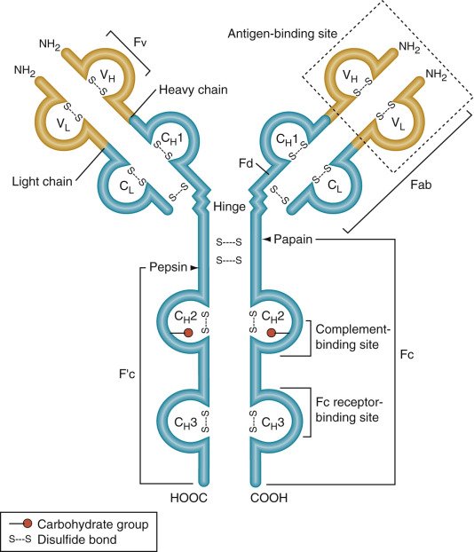

Figure 46-1 

Schematic representation of immunoglobulin G molecule. 

The relative positions of the interchain disulfide bonds and the intrachain disulfide bonds that form the loop regions are shown. Each of the loops delineates the domain of the light and heavy chain labeled accordingly. Probable sites of enzymatic cleavage in the “hinge” region by papain or pepsin are indicated. The papain fragments are designated Fab and Fc. The pepsin fragments are Fc′ and Fab′2 (2 Fab fragments disulfide-linked). Digestion of Fab with pepsin under proper conditions yields the fragment Fv (VH and VL noncovalently associated). The part of the heavy chain that contributes to the Fab fragment is designated Fd. 

Five different heavy chain isotypes (γ, α, µ, δ, ε) and two light chain isotypes (κ and λ) have been identified, with some of the isotypes having further subtypes. For example, γ has subtypes γ1, γ2, γ3, and γ4\. The isotypes are formed as a result of variations in the constant regions of the heavy and light chains. These isotypic designations are the basis for the nomenclature of antibodies. Because the heavy chain alone determines effector functions, immunoglobulins are conveniently referred to by their heavy chain isotype (class) using an English letter terminology (IgG, IgA, IgM, IgD, and IgE). 

Antibodies have two identical antigen-binding sites. An antigen-binding site is made up of amino acids from one H chain class and one L chain class. Thus the four-chain Y monomer molecules (see [ Fig. 46-1 ](<#f0010>) ) possess two identical antigen-combining sites and are said to be **bivalent.** Such antibody molecules can cross-link antigen molecules into a large lattice if the antigen molecules each have three or more antigenic determinants. Once the lattice reaches a certain size, it precipitates out of solution (  Davies & Metzer, 1983  ). This cross-linking is physiologically important because it enhances the engulfment of antigen, such as that expressed by bacteria and by phagocytic leukocytes. It is also involved in activation of the complement system. In addition, cross-linking may be required for the triggering of antibody-producing cells (B lymphocytes) by antigen. The efficiency of antigen-binding and cross-linking reactions by antibodies is greatly increased by a flexible hinge region, where the arms of the Y join the tail, allowing the distance between the two antigen-binding sites to vary. 

Multivalence affects the avidity with which an antibody can bind certain types of antigens. A particulate antigen (such as a bacterium or virus) has repeating antigenic determinants on its surface. An antibody molecule may interact with a single particle in such a manner that both of its antigen-combining sites are bound to antigenic determinants on that particle rather than to antigenic determinants on two adjacent particles. When this type of binding occurs, the effective energy of interaction or avidity is greatly increased compared with that associated with monovalent attachments to two particles. This mechanism has been shown to be physiologically important in the neutralization of viruses by antibodies of relatively low binding affinity. 

The protective effect of immunoglobulins is not due simply to their ability to bind antigen. They engage in a variety of biological activities mediated by the tail of the Y, the Fc region of the molecule. This part of the antibody molecule determines what will happen to the antigen once it is bound. Immunoglobulins with the same antigen-binding capacity can have a variety of different Fc regions and therefore different functional properties, such as activating the complement system and attaching to Fc receptors on macrophages, thereby aiding phagocytosis of antigens. 

Because of its exposed location and loosely folded structure, the **hinge region** is readily attacked by various proteolytic enzymes. As the name suggests, the hinge region confers a certain amount of flexibility on the molecule, allowing it to assume the Y-shaped structure. This permits an antibody to become attached to a single particle (e.g., a bacterium) through both of its antigen-combining sites or, alternatively, to stretch out to its full length to join two particles. The unique properties conferred by the hinge region on Ig molecules are related to its rich content of proline and hydrophilic amino acid residues. The inter–H chain disulfide bonds of IgG, IgA, and IgD molecules are located in the hinge region (see [ Fig. 46-1 ](<#f0010>) ). 

The proteolytic enzymes papain and pepsin cleave antibody molecules into different characteristic fragments that lead to an understanding of the structure–function relationship of the protein. Papain cleavage produces two separate and identical Fab (fragment antigen-binding) fragments, each with one antigen-binding site, and one Fc fragment (so-called because in nonhuman primates, it readily crystallizes). On the other hand, pepsin cleavage produces one F(ab′)2 fragment, so-called because it consists of two covalently linked F(ab′) fragments (each slightly larger than a Fab fragment); the rest of the molecule is broken down into smaller fragments of various sizes (see [ Fig. 46-1 ](<#f0010>) ). Because F(ab′)2 fragments are bivalent, they can still cross-link antigens and form precipitates. This is not true of the univalent Fab fragments. Neither of these fragments (subunits of antibodies) has the other biological properties of intact antibody molecules because they lack the tail (the Fc region) that mediates these properties. However, monovalent Fab is the form of postimmunization monospecific, affinity-purified ovine antibody that is used therapeutically in patients for such applications as removing toxic levels of digoxin (Digibind) or neutralizing crotalid snake venoms (CroFab). 

Each B cell clone makes antibody molecules with a unique antigen-binding site. Initially, the molecules are inserted into the plasma membrane, where they serve as cell surface receptors for antigen. When antigen binds to the membrane-bound antibodies, B cells are activated to multiply, differentiate to a plasma cell, and synthesize a large amount of soluble antibody with the same antigen-binding site, which is secreted into the blood. Humoral antibodies defend humans and animals against infection by inactivating viruses and bacterial toxins via VH/VL domains and by recruiting complement and various cells to kill and ingest invading microorganisms via CL domains in the Fc region of the molecule. The biological properties of the various immunoglobulin domains are summarized in [ Table 46-1 ](<#t0010>) . 

TABLE 46-1 

Biological Properties of Immunoglobulin Domains 

Domain  |  Known or Probable Function   
---|---  
CH3  | 

  * 1. Cytotrophic reactions involving: 
    * a. Macrophages and monocytes 
    * b. Heterologous mast cells 
    * c. Cytotoxic killer (K) cells 
    * d. B cells 
  * 2. Noncovalent assembly of heavy and light chains 

  
CH2  | 

  * 1. Binding of complement (C1q) 
  * 2. Control of catabolic rate 

  
CH1/CL  | 

  * 1. Noncovalent assembly of heavy and light chains 
  * 2. Covalent assembly of heavy and light chains 
  * 3. Spacers between interdomain interactions involving antigen binding and effector functions VH/VL1. 

  
| 

  * 1. Antigen binding 
  * 2. Noncovalent bonding of heavy and light chains 

  
  
Used with permission from Dorrington KJ, Painter RH: Biological activities of the constant region of immunoglobulin G. In Mandel TE, et al, editors: _Progress in immunology III,_ Canberra, 1977, Australian Academy of Science. 

 

##  Antibody–Antigen Interaction 

The binding of an antigen to antibody is reversible. The affinity and the number of binding sites contribute to the strength of an antibody–antigen interaction. This reversible binding is a result of many relatively weak noncovalent forces, including hydrophobic and hydrogen bonds, van der Waals forces, and ionic interactions. These weak forces are effective only when the antigen molecule is close enough to allow some of its atoms to fit into complementary recesses (regions) on the antibody surface. The complementary regions of a four-chain antibody unit are its two identical antigen-binding sites, whereas the corresponding region on the antigen is an antigenic determinant. Most antigenic macromolecules have many different antigenic determinants; if two or more of them are identical, the antigen is said to be multivalent. 

The **affinity** of an antibody molecule reflects the tightness of fit of an antigenic determinant to a single antigen-binding site, and it is independent of the number of antigenic sites. However, the total **avidity** of an antibody for a multivalent antigen, such as a polymer with repeating subunits, is defined as the total binding strength of all of its binding sites together. A typical IgG molecule binds at least 10,000 times more strongly to a multivalent antigen if both antigen-binding sites are engaged than if only one site is involved. 

For the same reason, if the affinity of the antigen-binding sites in an IgG and an IgM molecule is the same, the IgM molecule (because it is a pentamer and thus has 10 binding sites) will have much greater avidity for a multivalent antigen than an IgG molecule (which has two binding sites). This difference in avidity is important in view of the fact that antibodies produced early in an immune response usually have much lower affinities than those produced later. The increase in the average affinity of antibodies produced as time passes after immunization is called **affinity maturation.** This occurs because the antibody response to an antigen is heterogeneous—that is, antibodies with different antigen-combining sites are elicited against the antigen by the responding clones of B lymphocytes. Because of its high total avidity, IgM (the major Ig class produced early in immune responses) can function even when each of its binding sites has only low affinity. 

Avidity of an antibody can be assessed by introducing a chaotropic agent such as urea into the assay mixture to break apart low-energy molecular interactions; under these conditions, high-avidity antibodies remain bound to their antigens, whereas those of low avidity dissociate from their antigens and are not detected. Measurement of IgG antibody avidity is applied clinically for differentiating recent infections from previous infections in cases where the IgM response is prolonged and therefore not useful for this purpose. As an example, West Nile virus infection shows low-avidity IgG antibodies in recent infections (2 to 43 days after onset of symptoms) but high-avidity IgG antibodies at 6 months or more after onset (  Levett et al, 2005  ). Similar use of antibody avidity measurements to distinguish recent/acute from longer-term/chronic infections has been applied to human immunodeficiency viruses (  Keating et al, 2012  ); hepatitis C virus (  Kanno & Kazuyama, 2002  ); toxoplasmosis (  Rodrigues et al, 2015  ); human cytomegalovirus (  De Paschale et al, 2014  ); measles, mumps, and rubella (  Kontio et al, 2012  ); and other infectious agents. 

The size of the antigen–antibody complex is determined by the valence of the antigen and the relative concentrations of the antigen and the antibody. The antigen–antibody precipitation reaction is based on cross-linking of multivalent antigens by bivalent antibodies. If only one species of antibody (a monoclonal response) is present, molecules with only one antigenic determinant cannot be cross-linked. If an antigen is bivalent, it can form small cyclic complexes or linear chains with antibody, whereas an antigen with three or more antigenic determinants can form large three-dimensional lattices that readily precipitate. However, most antisera elicited against an antigen contain a variety of different antibodies (a polyclonal response) that react with different determinants on the antigen and can cooperate in cross-linking the antigen. By contrast, homogeneous (monoclonal) antibodies can precipitate molecules only if they contain repeating identical antigenic determinants. 

Given valence conditions that allow the formation of large aggregates, the size of the antigen–antibody complexes that form depends critically on the relative molar concentrations of the two reactants. If an excess of antigen or antibody is present, large complexes are unlikely to form ( [ Fig. 46-2 ](<#f0015>) ). This property is crucial to understanding seemingly paradoxical reactions in some immunoassays that depend on antigen–antibody complex formation. For example, a vast excess of antigen can completely saturate all antibody-binding sites, leading to a negative signal (i.e., no agglutination). This phenomenon is sometimes referred to as the _prozone effect._ The prozone effect remains a potential problem for modern assay systems, including syphilis testing, in which extremely high-titer antibodies can be missed unless the specimen is tested at dilutions (  Smith & Holman, 2004  ) and even in immunofixation electrophoresis (see later, [ Fig. 46-6, _E_ ](<#f0035>) ). 

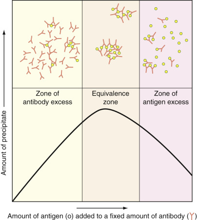

Figure 46-2 

Antibody and antigen concentrations influence the size of antigen–antibody complexes formed. 

The largest complexes are formed when both molecules are present at approximately the same molar concentration (zone of equivalence), whereas the smallest complexes are formed when the antigen is present in great excess. Note that the small complexes formed in antigen excess have only a few antibody molecules per complex; for this reason, they are inefficiently cleared from the extracellular fluids by macrophages. 

The prozone effect, or **hook effect,** occurs in many different immunoassays, particularly those based on sandwich formation involving a capture antibody (usually sold phase) that binds antigen plus a second reporter antibody (typically labeled with an enzyme, a fluorescent or chemiluminescent dye, or radioactivity) also directed against the antigen. When antigen is present in excess, it can saturate both capture and reporter antibodies, thereby preventing sandwich formation. This situation is analogous in part to the right side of [ Figure 46-2 ](<#f0015>) , where signal strength diminishes at high antigen concentration. Assay results can be inappropriately low or even nonreactive with exceedingly high antigen concentrations; as the specimen is further diluted and reassayed, the measured value paradoxically increases as antigen concentration falls back into the assay range. This manifestation of the prozone is termed the _hook effect_ after the shape of the dose response curve, which is directly proportional to antigen concentration in most specimens but reverses and falls off at much higher antigen concentrations. The hook effect occurs in immunoassays in which the antigen concentration can vary over several orders of magnitude. The assay may be configured to measure antigens over only two or three orders of magnitude, but when antigen concentration ranges over 4, 5, or more orders of magnitude, the hook effect will likely occur, giving rise to falsely low results. Immunoassays in which the hook effect can be prominent include those for human chorionic gonadotropin, immunoglobulin A (especially in IgA myeloma), and immunoglobulin light chains. 

The size and composition of antibody–antigen complexes are not only important in influencing precipitation reactions in vitro, but they are crucial in determining the fate of the complexes in the body. Complexes formed at equivalence or in antibody excess have multiple protruding Fc regions and therefore bind strongly to Fc receptors in macrophages, which ingest and degrade them. Small complexes, formed in antigen excess, have only one Fc region per complex. Therefore, they bind poorly to Fc receptors on macrophages and are less efficiently destroyed. Instead, they may be deposited in small blood vessels in the skin, kidneys, joints, and brain, where they may activate the complement system, causing inflammation and the destruction of tissue. 

Although it appears that antigen–antibody complexes have a rigid “lock-and-key” appearance, antibodies are dynamic entities that undergo structural fluctuations (  Karplus & McCammon, 1983  ;  Wilson et al, 1991  ). Conformational changes may even be required for binding. These adjustments include side chain shifts of up to 20 to 30 nm, aromatic ring rotations, conformational changes, and even small rotations between VH and VL domains (  Bhat et al, 1990  ;  Standfield et al, 1990  ;  Herron et al, 1991  ). 

,  

##  The Genetic Basis of Antibody Diversity 

It is estimated that a human is able to make at least 10  6  to 10  9  different antibody molecules. Special genetic mechanisms have evolved to produce the very large number of immunoglobulin molecules that develop in response to antigen stimulation without the need for an excessive number of genes (  Max, 2003  ). 

Immunoglobulin molecules are produced by three separate gene pools encoding the κ, λ, and H chains, respectively. The gene pools for light and heavy chains reside on different chromosomes. In each pool, separate gene segments that encode for different parts of the variable regions of light and heavy chains can be brought together by site-specific recombination events during B cell differentiation. The light chain gene pools contain one or more constant (C) genes and sets of variable (V) and joining (J) gene segments. The H chain gene pool contains a set of C genes and sets of V, diversity (D), and J gene segments. To make an antibody molecule, a VL gene segment is recombined with a JL gene segment to produce a V gene for the light chain, and a VH gene segment is recombined with D and JH segments to produce a V gene for the heavy chain ( [ Fig. 46-3 ](<#f0020>) ). Each of the assembled gene segments is then cotranscribed with the appropriate constant region sequence to produce a messenger RNA molecule that encodes for the complete polypeptide chain. By variously combining inherited gene segments encoding for VL and VH regions, vertebrates can make thousands of different light chains and thousands of different H chains that can associate to form millions of different antibody molecules. 

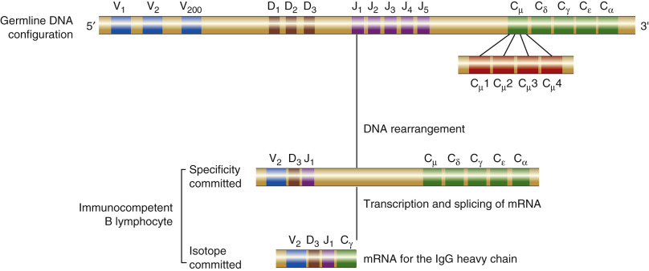

Figure 46-3 

Organization and rearrangement of heavy chain immunoglobulin (Ig) genes (exons) on the mouse 12 chromosome. 

Each VH gene also has a leader sequence, which is not shown. The constant region genes are identified by the heavy chain isotype, and more than one gene exists for the Cγ and Cα isotypes. Unlike Cγ and Cα genes, CH genes are composed of multiple exons, as illustrated for the Cµ gene (Cµ1 to Cµ4 domains). The switch sites are located at the 5′ end of each of the CH genes and are not shown. The solid line represents the intervening sequences (introns) between genes or gene segments. Each heavy chain is encoded by four distinct gene segments: V, D, J, and C. 

(Redrawn with permission from Marcu KB: Immunoglobulin heavy-chain constant region genes, _Cell_ 29:719, 1982. Copyright © by Cell Press.) 

The baseline repertoire of antibody molecules can be expanded still further by somatic hypermutation, which seems to be activated by exposure to antigen. Thus the selective role of antigen in the presence of somatic mutation appears to lead to fine tuning of the immune response and to a virtually unlimited diversity of antibody molecules. Somatic point mutations in immunoglobulin genes occur in B cells (not germ cells) during the lifetime of the animal or of humans (  Tonegawa, 1983  ). The somatic hypermutations are largely confined to the H chain and L chain variable region genes and the introns immediately surrounding them. It is estimated that close to one mutation will occur in the H or L chain V region of an individual cell with each cell division. This not only increases antibody diversity but may cause a change in the affinity with which the antibody binds its ligand. Those emerging B cells that can bind the antigen more avidly have an advantage over other B cells that do not bind the antigen as avidly. As the concentration of antigen falls, those B cells that have more avid receptors dominate the population of responding cells. This results in greater affinity of the antibodies being produced on rechallenge than in the initial response. Thus this process of somatic hypermutation can result in the presence in immunized individuals of high-affinity antibodies that are much more effective on a weight basis. 

All B cells initially make IgM antibodies. Some later switch to make antibodies of other classes (isotypes: IgG, IgA, etc.) that have the same antigen-binding site (idiotype) as the original IgM antibodies ( **allelic exclusion** ) ( [ Table 46-2 ](<#t0015>) ). Such class switching in combination with allelic exclusion allows the same antigen-binding sites (same VH and light chain) to be distributed among antibodies with many different biological properties (secondary effector functions) (  Corcoran, 2005  ). 

TABLE 46-2 

Summary of Immunoglobulin Variants 

Type of Variation  |  Distribution  |  Variant  |  Location  |  Examples   
---|---|---|---|---  
Isotypic  |  All variants present in serum of a normal individual  |  Classes  |  C  H  |  IgM, IgE   
Subclasses  |  C  H  |  IgA1, IgA2   
Types  |  C  L  |  κ, λ  
Subtypes  |  C  L  |  λOz+, λOz−  
Subgroups  |  V  L  , V  H  |  V  κI  , V  κII  , V  HI  , V  HII   
Allotypic  |  Allelic forms not present in all individuals  |  Allotypes  |  Mainly C  H  /C  L    
Occasionally V  H  /V  L  |  Gm group (human γ chain; e.g., IgG1, G1m3, G1m17) b  4  , b  5  , b  6  , b  9  (rabbit light chain)   
Idiotypic  |  Antigenic individuality specific to each Ig molecule  |  Idiotypes  |  V  H  /V  L  |  Determinant identified by antibody specific to an individual immunoglobulin   
  
Modified with permission from Sell S: _Immunology, immunopathology, and immunity,_ ed 4. New York, 1987, Elsevier Science. 

Thus the gene organization mechanism permits the assembly of immunoglobulin molecules with a variety of specificities. Antibody diversity depends on the presence of multiple gene segments, their rearrangement into different sequences, the combination of different light and heavy chains in the assembly of immunoglobulin molecules, and somatic mutations. 

,  

##  General Properties of Immunoglobulins 

The various classes of human immunoglobulins and their properties (  Spiegelberg, 1974  ;  Kolar & Capra, 2003  ) are summarized in [ Tables 46-3 ](<#t0020>) and [ 46-4 ](<#t0025>) . 

TABLE 46-3 

Physical Properties of Human Immunoglobulins 

WHO Designation  |  IgM  |  IgG  |  IgA  |  IgD  |  IgE   
---|---|---|---|---|---  
Heavy chains  |  µ |  γ |  α |  δ |  ε  
Heavy chain subclasses  |  µ 1  , µ 2  |  γ 1  , γ 2  , γ 3  , γ 4  |  α 1  , α 2  |  — |  —  
Light chains  |  κ or λ |  κ or λ |  κ or λ |  κ or λ |  κ or λ  
Molecular formula  |  IgM(κ) (2µ2κ)  5  |  IgG(κ) 2γ2κ |  IgA(κ) (2α2κ)  1-3  |  IgD(κ) 2δ2κ |  IgE(κ) 2ε3κ  
IgM(λ) (2µ2λ)  5  |  IgG(λ) 2γ2λ |  IgA(λ) (1α2λ)  1-3  |  IgD(λ) 2δ2λ |  IgE(λ) 2ε2λ  
|  |  IgA(κ) (2α2κ)  2  S [ † ](<#hl0000432>) |  |   
|  |  IgA(λ) (2α2λ)  2  S  |  |   
Number of four-chain units per molecule  |  5  |  1  |  1-3  |  1  |  1   
Heavy chain molecular weight, kDa  |  70  |  50-60  |  55  |  62  |  70   
Light chain molecular weight, kDa  |  23  |  23  |  23  |  23  |  23   
Sedimentation coefficient, S20W  |  18.0-19.0  |  6.7-7.0  |  6.6-14.0  |  6.9-7.0  |  7.9-8.0   
Molecular weight, kDa  |  900  |  143-160  |  159-447  |  177-185  |  187-200   
Electrophoretic mobility  |  γ1-β1  |  γ2-α1  |  γ2-β2  |  γ1  |  γ1   
Carbohydrate content, %  |  7-14  |  2.2-3  |  7.5-9.0  |  12-13  |  11-12   
Heavy chain allotypes  |  — |  Gm  |  Am  |  — |  —  
Light chain allotypes  |  Km(κ) [ * ](<#hl0000429>) |  Km(κ) [ * ](<#hl0000429>) |  Km(κ) [ * ](<#hl0000429>) |  Km(κ) [ * ](<#hl0000429>) |  Km(κ)   
Valency for antigen binding  |  5 (10)  |  2  |  2.4 (? polymeric forms)  |  2  |  2   
Number of domains on the heavy chains  |  5  |  4  |  4  |  4  |  5   
  
 * Formerly designated Inv marker. 

 † Dimer in external secretions carries secretory component -S. 

TABLE 46-4 

Properties of Human Immunoglobulins 

|  IgM  |  IgG  |  IgA  |  IgD  |  IgE   
---|---|---|---|---|---  
**Physiologic**  
Normal adult serum concentration, mg/mL  |  1.2-4.0  |  8.0-16.0  |  0.4-2.2  |  0.03  |  17-450 ng/mL   
International units/mL  |  69-322  |  92-207  |  54-268  |  — |  <100   
Percentage total immunoglobulin  |  13  |  80  |  6  |  1  |  0.002   
Intravascular distribution, %  |  41  |  48  |  76  |  75  |  51   
Synthetic rate, mg/kg/day  |  2.2  |  35  |  24  |  0.4  |  0.003   
Catabolic rate in serum, % per day (or half-life, days)  |  10.6 (5-6)  |  6 (18-23)  |  24 (5-6.5)  |  37 (2.8)  |  90   
**Biological**  
Agglutinating capacity  |  +4  |  ± |  +2  |  − |  −  
Complement-fixing capacity via classical pathway  |  +4  |  \+  |  − |  − |  −  
Homologous anaphylactic hypersensitivity  |  − |  − |  − |  − |  +4   
Heterologous guinea pig anaphylaxis  |  − |  \+  |  − |  − |  −  
Fixation to homologous mast cells and basophils  |  − |  ± |  − |  − |  +4   
Cytophilic binding to macrophages  |  − |  \+  |  ± |  − |  −  
Placental transport to fetus  |  − |  \+  |  − |  − |  −  
Rheumatoid factor–binding activity  |  − |  \+  |  − |  − |  −  
Present in external secretions  |  ± |  \+  |  +4  |  − |  +2   
**Other Characteristic Properties**  
IgM—Produced early in immune response, first effective defense against bacteremia   
IgG—Combats microorganisms and their toxins in extravascular fluids   
IgA—Defends external body surfaces   
IgD—Present on lymphocyte surface of immunocompetent cells, important for B cell activation and/or immunoregulation   
  
 

##  Immunoglobulin M 

This glycoprotein is the major class of antibody secreted into the blood in the early stages of a **primary** antibody response. Normally, the secreted form of IgM is a pentamer composed of five four-chain units, a macroglobulin with a 19S sedimentation rate, and a molecular weight of 900 kDa. However, in human autoimmune disorders, such as systemic lupus erythematosus (SLE), the monomeric 7S form may be detected in appreciable amounts in serum. Selective IgM deficiency is a rare disorder associated with the absence of IgM and normal levels of other immunoglobulin classes. The cause of this disorder is unknown. 

Because pentameric IgM has a total of 10 antigen-binding sites, it is more efficient than 7S monomeric IgM or IgG molecules in cross-linking antigen and in activating the complement system when bound to antigen. Thus this high efficiency in binding and activating complement, coupled with its early appearance during the course of infection, makes IgM a particularly potent agent in combating microbial invasions. 

Each IgM pentamer contains one copy of another polypeptide chain, called a **J (joining) chain,** which has a molecular weight of 15 kDa. This accessory polypeptide is produced by IgM-secreting cells. It is an acidic glycoprotein with a high content of cysteine residues and thus is disulfide linked between two adjacent IgM monomeric Fc regions at the carboxy-terminal end. Presumably, oligomerization is initiated at this site. 

IgM is also the first class of antibody to be produced by developing B cells. The immediate precursors of B cells, called pre-B cells, make µ chains but not light chains, which accumulate in the cells. Pre-B cells then begin to synthesize light chains, which combine with µ chains to form four-chain monomer IgM molecules. The two µ-chain and two light-chain component is inserted into the plasma membrane, where it functions as a receptor for antigen. At this point, the cells have become B lymphocytes and can respond to antigen. 

Perhaps because of its large size, secreted pentamer IgM is not found to any significant extent in tissue spaces; it is confined to the blood circulation and does not cross the placenta. IgM is a minor component of secretory immunoglobulins at mucosal surfaces and in breast milk. 

IgM is phylogenetically the most primitive of the immunoglobulins, and most variants of the genes from the µ chain appear to have evolved into heavy chain genes for the other immunoglobulin classes. Additional physical and biological properties of IgM, as well as the other classes of immunoglobulin, are given in [ Tables 46-3 ](<#t0020>) and [ 46-4 ](<#t0025>) . 

 

##  Immunoglobulin G 

IgG is the best-studied isotype at both structural and functional levels (  Burton, 1985  ). Antibodies of this class constitute the major immunoglobulin in the blood. They are copiously produced during the **secondary** immune response. The Fc region of IgG molecules binds to specific receptors on phagocytic cells, such as macrophages and polymorphonuclear leukocytes, thereby increasing the efficiency with which the phagocytic cells can ingest and destroy infecting microorganisms that have become coated with IgG antibodies in response to infection. These receptors on antibodies attached to target cells also guide natural killer (NK) lymphocytes to destroy them through the process of antibody-dependent cell-mediated cytotoxicity (ADCC). The best-known function of IgG is complement activation via the classical cascade. The Fc region of IgG can bind to and thereby activate the first component of the complement system, which unleashes a biochemical attack that kills the microorganisms. At least two molecules of IgG are required for complement activation compared with one molecule of IgM, which has five Fc regions. 

IgG molecules are the only antibodies that can pass from mother to fetus. Cells of the placenta that are in contact with maternal blood have receptors that bind the Fc region of IgG molecules and mediate their passage to the fetus. The antibodies first are ingested by receptor-mediated endocytosis and then are transported across the cell and released by exocytosis into the fetal blood. Other classes of antibodies do not bind to these receptors and therefore cannot pass across the placenta. The ability of IgG to cross the placenta provides a major line of defense against infection for the first weeks of an infant's life. Normally, the human fetus begins to receive significant quantities of maternal IgG transplacentally at around 12 weeks' gestation. The quantity increases steadily until, at birth, cord serum contains a concentration of IgG comparable with that of maternal serum. Barring any immunologic disorders, adult levels of IgG are reached by the seventh year of life and remain relatively constant thereafter. 

IgG antibodies have a high diffusion coefficient, which enables them to diffuse into the extravascular body spaces more readily than other Ig classes. IgG, being the predominant immunoglobulin in these spaces, carries the major burden of neutralizing bacterial toxins and of binding microorganisms to enhance their phagocytosis. Furthermore, only IgG antibodies coating target cells, such as tumor cells, can sensitize them for extracellular killing by ADCC; the NK cells responsible for ADCC also possess Fc receptors for IgG. 

There are four subclasses of human IgG. These four subclasses reflect the existence of four antigenetically distinct H chains (γ1 to γ4), which are similar but not identical in amino acid sequence and general properties. For example, IgG1 is the dominant subclass in adult humans. IgG3 is the most effective binder of complement, followed by IgG1 and IgG2. IgG4 in most cases fails completely to bind complement by the classical pathway. All the subclasses except IgG2 have been demonstrated to cross the placenta. A summary of the physical and biological properties of IgG is given in [ Tables 46-3 ](<#t0020>) and [ 46-4 ](<#t0025>) , and for the subclasses in [ Table 46-5 ](<#t0030>) . 

TABLE 46-5 

Properties of Human Immunoglobulin G Subclasses 

|  IgG1  |  IgG2  |  IgG3  |  IgG4   
---|---|---|---|---  
**Physiologic**  
Percentage distribution of total normal serum IgG  |  66 ± 8  |  23 ± 8  |  7.3 ± 3.8  |  4.2 ± 2.6   
Synthetic rate, mg/kg/day in serum  |  25  |  ?  |  3.4  |  ?   
Fraction catabolic rate, % per day (half-life, day)  |  8 (23)  |  6.9 (23)  |  16.8 (7)  |  6.9 (23)   
Ratio of κ/λ |  1.4-2.4  |  1.0-1.1  |  1.1-1.3  |  5.0-7.0   
Allotypic markers (Gm types)  |  a, z, f, x  |  n  |  bo, bi, bz, g, st, etc.  |  ?   
**Biological**  
Complement-fixing capacity via classical pathway  |  +2  |  ± |  +3  |  −  
Heterologous skin-binding capacity  |  \+  |  − |  \+  |  \+   
Placental transport to fetus  |  \+  |  ± |  \+  |  \+   
Macrophage receptor  |  \+  |  − |  \+  |  −  
Reaction with protein A  |  \+  |  \+  |  − |  \+   
**Dominant Antibody Activities**  
Antitetanus toxoid  |  +2  |  \+  |  \+  |  ±  
Antidiphtheria toxoid  |  +2  |  \+  |  \+  |  ±  
Antithyroglobulin  |  +2  |  \+  |  \+  |  ±  
Anti-DNA  |  +2  |  +2  |  ± |  ±  
Anti-Rh  |  +2  |  − |  − |  ±  
Anti-factor VIII  |  − |  − |  − |  \+   
Antidextran  |  − |  \+  |  − |  −  
Antilevan  |  − |  \+  |  − |  −  
Antiteichoic acid  |  − |  \+  |  − |  −  
Number of interheavy chain disulfide bonds in hinge region  |  2  |  4  |  5  |  2   
Position of light–heavy chain disulfide bond on the heavy chain  |  N214  |  N131  |  N131  |  N131   
  
 

##  Immunoglobulin A 

Antibodies of this class constitute the major class of antibody in secretions (milk, saliva, tears, and respiratory and intestinal secretions). It exists as a four-chain monomer (like IgG) or as a dimer of two such monomer units. IgA molecules in secretions are dimers that carry a single J chain, similar to the one associated with pentameric IgM, and an additional glycopolypeptide chain of 70 kDa called **secretory component** (SC). IgA dimers pick up SC from the surface of the epithelial cells lining the intestine, the bronchi, or the milk, salivary, or tear ducts. Secretory component is synthesized by the epithelial cells and is initially exposed on the nonluminal (external) surface of these cells, where it serves as a receptor for binding dimer IgA. The resulting dimer IgA–receptor complexes are ingested by receptor-mediated endocytosis and are transferred across the epithelial cell cytoplasm in the form of a membrane vesicle, which fuses with the plasma membrane on the luminal side of the epithelial cell. The extramembrane portion of the IgA receptor is then enzymatically cleaved and released as part of the secretory IgA molecule ([α 2  ,L  2  ,]  2  − Jα) into the lumen. The amino-terminus of the dimer IgA receptor remaining attached to dimer IgA is the SC ( [ Fig. 46-4 ](<#f0025>) ). Thus the fully assembled dimeric secretory IgA molecule is the synthetic product of two distinct types of cells: plasma cells and epithelial cells. In addition to this transport role, SC may protect the dimer IgA molecules from being digested by proteolytic enzymes in secretions. 

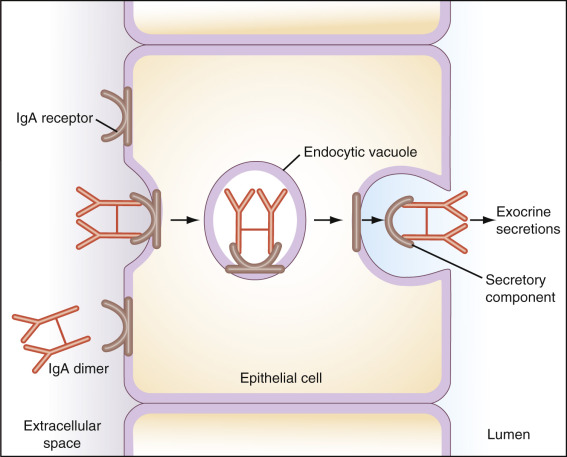

Figure 46-4 

The mechanism by which the secretory component mediates the transport of a dimeric immunoglobulin (Ig)A molecule across an epithelial cell. 

The entire complex is transported from the extracellular fluid into the lumen of the epithelial tube. The secretory component is synthesized by the epithelial cell as a transmembrane glycoprotein and serves as a receptor on its basolateral surface for binding the IgA dimer. The receptor–IgA complex enters the cell in an endocytotic vesicle, which crosses the cell and is exocytosed at the apical surface. Cleavage of the receptor frees the dimer IgA for discharge at the exterior surface (lumen side). The portion of the receptor that remains attached to the IgA dimer is called the secretory component. This transport mechanism is responsible for depositing IgA in various exocrine secretions (e.g., saliva, milk, bile, tears, sweat), as well as in the mucous layer that protects the inner lining of the nasopharyngeal passages, intestine, and genitourinary tract. 

In humans it has been possible to classify IgA antibodies into two subclasses—IgA1 and IgA2—based on differences in antigenic structure and variation in the arrangement of interchain disulfide bridges. Whereas IgA2 is a minor component of serum IgA, this subclass is the dominant form in secretions. Furthermore, secretory IgA reaches adult levels sooner than serum IgA. The IgA system in the intestinal tract of humans, for example, may be fully developed by 2 years of age, whereas serum IgA levels do not normally reach adult concentrations until 12 years of age. 

Because of its presence near external membranes, secretory IgA constitutes a first line of defense against microorganisms in the external environment. It has been postulated that IgA inhibits the adherence of microorganisms to the surface of mucosal cells, thereby preventing their entry into body tissues. One property of secretory IgA that is important in this respect is its multivalence, which is associated with high avidity of binding to antigens; this may be especially relevant in the neutralization of viruses. Antiviral activity by IgA antibodies has been demonstrated in individuals given either of the polio vaccines. Secretory IgA may also combine with certain antigens in food, preventing their absorption into the bloodstream and thus reducing the incidence of allergic reactions. For example, IgA immunodeficiencies can lead to increased levels and incidence of humoral antibodies directed against antigens derived from food and intestinal organisms. 

IgA possesses the following effective properties: It fixes complement through the alternative pathway; through a specific Fc receptor on macrophages, it can serve as an opsonin for phagocytosis, and it can induce eosinophil degranulation through a specific receptor, which has implicated IgA in antiparasitic responses. The physical and biological properties of IgA are listed in [ Tables 46-3 ](<#t0020>) and [ 46-4 ](<#t0025>) . 

 

##  Immunoglobulin D 

Although only a minor component of the serum, IgD is a major membrane immunoglobulin found on the surface of a high proportion of B lymphocytes, especially in newborns. During the course of B cell differentiation, these cells synthesize and display IgD molecules, as well as IgM molecules. Whereas this appears to contradict the “one-cell-one-immunoglobulin” rule, the antigen-binding sites (idiotype) of the two types of molecules and their light chains are identical. Only their CH regions differ. The membrane-bound IgD may serve as one of the receptors with which B cells bind antigen and are stimulated to undergo clonal proliferation. Some evidence suggests that IgM-bearing B cells can respond to certain T-independent antigens and that the acquisition of IgD is needed for B cells (IgM- and IgD-bearing) to respond to the T cell help required for T-dependent antigen responsiveness. 

Furthermore, if IgD molecules are selectively removed from IgM- and IgD-bearing B cells by taking advantage of the much greater sensitivity of the δ chain to papain, these cells are rendered susceptible to becoming tolerant. The precise role played by surface IgD in an immune response remains unknown, but the generally held view is that it turns on, turns off, or modulates (controls) B cell division or differentiation. 

IgD usually is detected in serum at about 6 months of age, and its concentration throughout life is always very low. In disease states, however, IgD concentration can vary greatly. In chronic infection, IgD serum levels increase, as do those of the other immunoglobulins. To date, no specific increase in IgD has been associated with a particular disease. Patients with allergies and autoimmune diseases do not show an abnormal IgD concentration. IgD is usually absent in hypogammaglobulinemic individuals. 

To date, IgD has not been assigned a specific biological role as a humoral antibody. IgD activity against a number of antigens has been reported on occasion. Surface IgD, which has proteins similar to those of surface IgM, is a marker for mature B cells, and its role as a receptor is generally accepted, even though the nature and purpose of the signal it transmits remains controversial (  Carsetti et al, 1993  ;  Roes & Rajewski, 1993  ). IgD does not bind complement, does not cross the placenta, and does not bind to cells through its Fc region. The secreted form of IgD, as well as that of the other immunoglobulins, lacks the carboxy-terminal transmembrane peptide that anchors it to the surface of B cells. [ Tables 46-3 ](<#t0020>) and [ 46-4 ](<#t0025>) list additional properties of IgD. 

 

##  Immunoglobulin E 

Of the various classes of immunoglobulin, IgE is present at the lowest serum concentration (see [ Table 46-4 ](<#t0025>) ). It has the ability to attach to human skin (homocytotropic antibody) and to initiate aspects of the allergic reaction (reaginic antibody). The biological activity of IgE is accounted for by its property of binding through the Fc region to basophils and to their tissue equivalent: mast cells. IgE may also be important in the humoral immune response to parasitic disease because it is often found at high levels in the serum of patients with helminthic infection. IgE may play a part in allowing white blood cells (WBCs), antibodies, and complement components to enter sites of inflammation, leading to an immediate hypersensitivity reaction. IgE antibodies provide a striking example of the **bifunctional** nature of antibody molecules. The Fc portion of the molecule binds to the target cells, whereas the Fab portion binds the allergen (see [ Chapter 55 ](<##!/content/3-s2.0-B9780323295680000553?scrollTo=%23c00055>) for the role of IgE in allergic diseases and related assays). 

As with IgA, IgE is produced mainly in the linings of the respiratory and intestinal tracts and is part of the external secretory system of antibody. A deficiency of IgE has been inconsistently associated with deficiency of IgA in individuals with impaired immunity, who present with undue susceptibility to infection. IgE does not cross the placenta, and IgE–antigen complexes do not bind complement by the classical pathway (see [ Table 46-4 ](<#t0025>) ). 

 

##  Summary 

Five different classes of antibody (IgM, IgG, IgA, IgD, and IgE), four subclasses of IgG antibody (IgG1, IgG2, IgG3, and IgG4), and two subclasses of IgA antibody (IgA1 and IgA2) are present in humans. Each of these antibody isotypes possesses a distinct H chain (µ, γ, α, δ, ε, γ1, γ2, γ3, and γ4, and α1, α2, respectively). The H chains contain the Fc region of the antibody, which determines what other proteins will bind to the antibody and therefore the biological properties of the class and subclass. Either type of L chain (κ or λ) can be associated with any class of H chain. 

Structural differences among the five classes of immunoglobulins correspond to functional differences in their sites of production and action, their relative levels of production in primary and secondary immune responses, and their roles as physiologic effectors. For example, IgG is prevalent in both blood and tissue fluids, whereas IgM is chiefly confined to the blood, and secretory IgA is found primarily on epithelial surfaces. IgD and IgE are principally bound to cells, IgD to B cells, and IgE to basophils and mast cells. 

,  

##  Clinical Significance of Immunoglobulins 

Immunoglobulins play important roles in disease pathogenesis, diagnosis, prevention, and therapy. 

 

##  Disease Pathogenesis 

Monoclonal hyperimmunoglobulinemia is a prominent feature of multiple myeloma and Waldenström's macroglobulinemia. Antibodies against native antigens may result in autoimmune disease, as discussed in [ Chapters 52 ](<##!/content/3-s2.0-B9780323295680000528?scrollTo=%23c00052>) and [ 54 ](<##!/content/3-s2.0-B9780323295680000541?scrollTo=%23c00054>) . Hypoglobulinemia or agammaglobulinemia is often the prime characteristic of some immunodeficiency disorders (see [ Chapter 51 ](<##!/content/3-s2.0-B9780323295680000516?scrollTo=%23c00051>) ). Polyclonal hypergammaglobulinemia can result from chronic inflammation or other disorders such as cirrhosis of the liver due to excess pan–B cell stimulation. 

 

##  Hyperimmunoglobulinemia 

 

##  Serum Immunoglobulin Levels 

Valid interpretation of serum immunoglobulin levels requires recognition of biological variations that exist throughout the life span of individuals. The most important of these variables are age, sex, and race. In neonates, levels of circulating immunoglobulins are much lower than at all other ages, because essentially all immunoglobulins at that stage were passively transferred from mother to fetus in utero. Immunoglobulin levels rise through childhood to more stable concentrations in mature adults. Normal IgG, IgA, and IgM concentrations at any particular age can vary as much as tenfold from lower to upper limits of the reference ranges. A very large study of immunoglobulin concentrations in a northern New England (99% Caucasian) population of 115,017 serum samples demonstrated the expected rise from infancy, more stable values after adolescence, and then in older individuals further slight increase in IgA, nearly stable IgG, and slight reduction in IgM (  Ritchie et al, 1998  ). Little difference was noted between males and females in terms of IgA and IgG median levels, whereas males exhibited lower IgM than females at all ages except the very young. That study might be considered definitive for age and gender through the sheer number of subjects, although the population was not racially diverse. 

A smaller but still reasonably large group of healthy white subjects (3213) from a single community (Tecumseh, Michigan) showed that mean concentrations of IgG and IgA increased with age, with slight but significant differences between the sexes. Females had higher serum levels of IgG and lower levels of IgA. Although these sex differences for IgG and IgA are statistically significant, their biological meaning is not apparent. IgM levels in these subjects remained relatively constant with age. However, females had higher mean levels of IgM (1.06 mg/mL) than males (0.77 mg/mL) (  Cassidy et al, 1974  ). 

Several studies have reported that immunoglobulin levels are higher in persons with pigmented skin. A study of a healthy biracial population in Evans County, Georgia, demonstrated that black people had higher levels of the three major immunoglobulins (IgM, IgG, and IgA) when compared with white people (  Lichtman et al, 1967  ). The most prominent difference was seen in IgG. No urban–rural difference in immunoglobulin levels was noted in this study. White subjects in Rochester, New York, had serum levels of IgM and IgG that were similar to those of white subjects in rural Georgia. A triracial study in Durban, Natal, South Africa, showed that Bantu male adults had significantly higher levels of IgM (32% more), IgG (40% more), and IgA (32% more) in their sera than comparable white male adults in this community who were born in the same year and had the same ABO blood group. Healthy Asiatic male adults had about 20% more IgG, 23% more IgA, and 7% more IgM than comparable white male adults. A study of subjects in the Washington, D.C., metropolitan area revealed that black people had significantly higher IgG levels than white people but similar IgA and IgM levels (  Tollerud et al, 1995  ). Control groups used in these studies were matched for age, sex, and race, as well as for several environmental factors. Increases in gammaglobulin often are first noted after serum protein electrophoresis, measurement of total protein, or measurements of albumin and γ-globulin fractions. 

Increases in immunoglobulins are referred to as monoclonal or polyclonal. Monoclonal immunoglobulins from any one individual are structurally identical and are believed to result from the clonal expansion of a single immunoglobulin-producing lymphoid cell, and thus are specific for a particular antigen. Polyclonal immunoglobulins in the same individual are structurally different from one another in one or more important ways: by class, as polyclonal IgG, IgA, or IgM; by light chain; or by antigen specificity. Polyclonal immunoglobulins arise from the expansion of several to many different immunoglobulin-producing lymphoid cells. 

 

##  Polyclonal Immunoglobulins 

Polyclonal increases in immunoglobulins have been associated with many disease states ( [ Table 46-6 ](<#t0035>) ) (  Cushman & Grieco, 1973  ;  Buckley, 1977  ). Serum protein electrophoresis is often sufficient to establish this condition. Immunoelectrophoresis, immunofixation, and determination of individual immunoglobulins or immunoglobulin light chains may be helpful at times to confirm a polyclonal distribution or an increased concentration in one or more immunoglobulin classes. Increases in serum immunoglobulins may result from decreased catabolism and increased synthesis. The control mechanisms for these events are not well understood. The implications of elevated immunoglobulins are unknown. Most immunoglobulins appear not to be directed toward a definable specific antigenic determinant or set of specific antigenic determinants. It should also be noted that most autoantibodies are not monoclonal but polyclonal. In general, persistent polyclonal increases in gammaglobulin are thought to be related to antigenic stimulation of a chronic nature or loss of immunoglobulin regulation. 

TABLE 46-6 

Polyclonal Hyperimmunoglobulinemias: Some Associated Disease States 

Condition  |  Immunoglobulin (Ig) Classes   
---|---  
**Immunodeficiency Diseases**  
Hyperimmunoglobulin E and recurrent infections  |  IgE   
Wiskott-Aldrich syndrome  |  IgA, IgE   
“Dysgammaglobulinemia type I” |  IgM   
Hyperimmunoglobulin A and recurrent infections  |  IgA   
Acquired immune deficiency syndrome (AIDS)  |  All classes   
**Infections**  
Congenital infections (syphilis, toxoplasmosis, rubella, cytomegalovirus)  |  IgM   
Infectious mononucleosis  |  IgM or all   
Trypanosomiasis  |  IgM or all   
Intestinal parasitism  |  All classes   
Several helminthic infections  |  IgE   
Visceral larva migrans  |  All classes   
Chronic granulomatous disease of childhood  |  All classes   
Leprosy  |  All classes   
Chronic infection in general  |  All classes, with a preference for IgG   
**Liver Diseases**  
Chronic active hepatitis  |  IgG predominates   
Acute hepatitis  |  IgG predominates   
Biliary cirrhosis  |  IgM predominates   
Lupoid hepatitis  |  All classes   
**Pulmonary Disorders**  
Pulmonary hypersensitivity syndrome  |  All classes   
Sarcoidosis  |  All classes   
Berylliosis  |  All classes   
** “Autoimmune” Disorders **  
Systemic lupus erythematosus  |  All classes   
Rheumatoid arthritis  |  IgA or all   
Many “autoimmune” states such as thyroiditis  |  All classes   
Scleroderma  |  All classes   
Cold agglutinin disease  |  IgM   
Anaphylactoid purpura  |  IgA   
**Miscellaneous**  
Down syndrome  |  All classes   
Amyloidosis  |  All classes   
Narcotic addiction  |  IgM   
Renal tubular disease  |  All classes   
  
 

##  Monoclonal Immunoglobulins 

Monoclonal immunoglobulins or fragments of immunoglobulins have been associated with a number of disease conditions ( [ Box 46-1 ](<#b0010>) ) (  Wells & Fudenberg, 1974  ;  Benbassat et al, 1976  ;  Atkinson et al, 1977  ;  Schaefer et al, 1978  ;  Kelly et al, 1985  ). These immunoglobulins have also been referred to as immunoglobulins with restricted heterogeneity. Protein electrophoresis of serum and urine ( [ Fig. 46-5 ](<#f0030>) ) is commonly used to screen for monoclonal gammopathy. 

Box 46-1 

Selected Conditions Associated with Monoclonal Immunoglobulins 

  * •

Multiple myeloma 

  * •

Macroglobulinemia of Waldenström 

  * •

Chronic lymphocytic leukemia 

  * •

Other leukemias 

  * •

Lymphomas 

  * •

“Benign” monoclonal gammopathy 

  * •

Systemic capillary leak syndrome 

  * •

Amyloidosis 

  * •

Chronic liver disease such as chronic active hepatitis, primary biliary cirrhosis 

  * •

Autoimmune disorders, including rheumatoid arthritis, systemic lupus erythematosus, thyroiditis, pernicious anemia, polyarteritis nodosa, Sjögren's syndrome 

  * •

Gaucher's disease 

  * •

Malignancies of various types 

  * •

Hereditary spherocytosis 

  * •

HIV infection, including AIDS 

_AIDS,_ Acquired immune deficiency syndrome; _HIV,_ human immunodeficiency virus. 

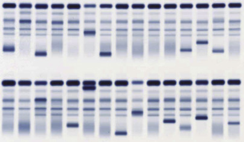

Figure 46-5 

Serum protein electrophoresis performed in agarose gel. 

This gel demonstrates the variation in electrophoretic migration of monoclonal bands as typically encountered in diagnosing and monitoring patients with plasma cell disorders, such as multiple myeloma. This routine analysis of serum specimens from two controls and 28 patients included 14 individuals with monoclonal bands. 

The incidence of monoclonal immunoglobulins (M components) in unselected population studies is estimated to be 0.9% (  Bachman, 1965  ;  Axelsson & Hellen, 1968  ;  Cohen, 1985  ). Of course, a much higher percentage of positive results is found in clinical laboratories where the sera to be tested are preselected. Multiple myeloma, Waldenström's macroglobulinemia, and B cell neoplasms are some of the diseases that are associated with elevated levels of monoclonal immunoglobulins. It was earlier believed that monoclonal gammopathies were rare in cases of chronic lymphocytic leukemia or well-differentiated lymphocytic lymphoma. It has now been shown that when high-resolution electrophoresis and immunofixation are combined to study samples from these patients, most are found to have a monoclonal gammopathy (  Keren et al, 1988  ). Monoclonal gammopathies have also been demonstrated in patients with Burkitt lymphoma and B cell acute lymphocytic leukemia. 

Although the antigen-combining specificities of monoclonal gammopathies generally are not known, some result in paraproteinemic neuropathies. This clinical syndrome is generally due to the interaction of an IgM paraprotein with myelin-associated glycoprotein (MAG), gangliosides (e.g., GM1 in motor neuropathy, GD1b in sensory neuropathy), or other glycosphingolipids (  Ropper & Gorson, 1998  ). 

The term _monoclonal gammopathy of undetermined significance_ (MGUS) was coined by Kyle to categorize individuals in whom a monoclonal component is demonstrated in the serum but who lack other key features for diagnosing a malignant condition (  Kyle, 1982  ). As many as 3% of individuals over the age of 70 have an MGUS (  Kyle & Rajkumar, 2003  ). Subjects with MGUS may have as many as 10% plasma cells in the bone marrow. This is considerably less than the bone marrow plasmacytosis associated with multiple myeloma. About 20% of individuals with MGUS will develop a malignant B cell lymphoproliferative disorder—most commonly multiple myeloma—over a 10-year period. Some of the other cases develop into chronic lymphocytic leukemia, amyloidosis, well-differentiated lymphocytic lymphoma, and other B cell proliferative diseases. Subjects with MGUS have quantities of M component ranging from 300 mg/dL to greater than 3000 mg/dL and usually do not have Bence Jones protein in the urine. It is recommended that such patients be followed with serum protein electrophoresis every 6 to 12 months to determine whether the process is progressing or regressing. 

The risk of progression with MGUS is about 1% per year even after 25 years of a stable condition (  Kyle & Rajkumar, 2003  ). A 31-year follow-up study of MGUS in New Zealand showed progression to hematologic malignancy in 64% of 11 patients originally detected by screening 2192 subjects in a town in 1967 (  Colls, 1999  ). 

A special consideration is MGUS that is observed in organ transplant patients who have received immunosuppressive drugs that alter T lymphocyte functions, including the modulation of B cell responsiveness. These monoclonal gammopathies may be transient in up to 75% of cases (  Radl et al, 1985  ). They may occur in both monoclonal and oligoclonal forms (  Stanko et al, 1989  ), and they may coincide with infections of cytomegalovirus or Epstein-Barr virus (  Drouet et al, 1999  ). Their progression is likely stimulated by high circulating levels of interleukin-6 (  Nickerson et al, 1994  ). 

 

##  Cryoglobulins 

Cryoglobulins are immunoglobulins that precipitate upon storage at refrigerated temperatures (4° C), and as a group are associated with hematologic, autoimmune, and chronic infections such as hepatitis C. Type I cryoglobulins consist of a single monoclonal immunoglobulin that precipitates in the cold without binding other proteins. This type of molecule is typically IgM encountered in Waldenström's macroglobulinemia, where it can produce a hyperviscosity syndrome due to very thick consistency of the circulating blood that can be exacerbated by cold ambient temperatures encountered by the patient. 

Type II cryoglobulins are distinctly different from type I. The abnormality in type II is a monoclonal IgM autoantibody that is directed at the Fc region of normal polyclonal IgG (  Cacoub et al, 2002  ). This autoantibody is the same as rheumatoid factor. It is also referred to as mixed cryoglobulin containing both IgM and IgG. It is commonly encountered in rheumatoid arthritis and in chronic hepatitis C virus infection for unknown reasons. The presence of IgM anti-IgG leads to formation of circulating immune complexes (CICs), with IgG normally occurring in the blood. These CICs then deposit in small blood vessels, causing vasculitis, glomerulonephritis, arthritis, and so forth. 

Type III cryoglobulins have been described as a variant of type II in which the IgM autoantibody against IgG is polyclonal. Type III can be found in chronic infections and inflammatory states. Many such cases in the past could have been confused with type II because of methods that would not permit sensitive typing of the light chains in a minor band of IgM in the presence of large amounts of IgG, because both light chain types would appear in the cryoprecipitate. 

 

##  Disease Diagnosis 

Laboratory evaluation of immunoglobulin levels and functions may be helpful in the diagnosis and management of disease. Complement fixation tests, hemagglutination assays, and other immunoassays can detect an increased or changing titer of antibodies against specific antigens, such as those present on microorganisms. 

Requests to examine sera for the presence of a monoclonal protein usually are generated by a physician who recognizes that a patient has clinical symptoms and signs of such a disorder or by laboratory examination of a serum protein electrophoresis that suggests a monoclonal protein ( [ Fig. 46-6 ](<#f0035>) ). Many times, the physician's suspicion of a plasma cell dyscrasia is triggered by findings of anemia (with one or more cytopenias), elevated total serum protein with elevated globulins, and proteinuria; other findings may include hyperuricemia, hypercalcemia, elevated alkaline phosphatase, bone pain, or lytic lesions of bone on x-ray. If indeed an M component is present in a serum protein electrophoresis, quantitative measurement of immunoglobulins by radial immunodiffusion, nephelometry, or another suitable technique can identify the specific immunoglobulin if only one of the major three classes is increased. Of course, this neither determines the light chain of a monoclonal immunoglobulin nor detects light chain myelomas. Biclonal gammopathies may be confusing. 

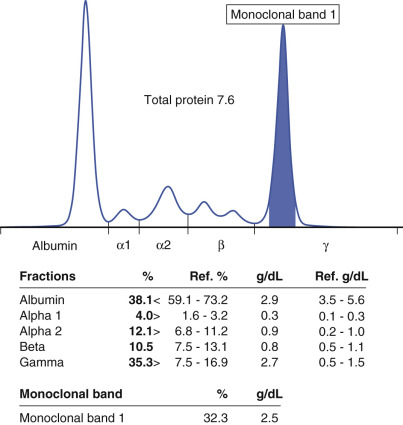

Figure 46-6 

Quantitation of monoclonal band (MCB) concentration from densitometric tracing of serum protein electrophoresis. 

The MCB demarcated as the solid section constituted 32.3% of the area under the entire tracing for all serum fractions. Multiplying 32.3% × total protein of 7.6 g/dL yields the concentration of MCB as 2.5 g/dL. 

Quantitative immunoglobulins are useful in monitoring the course of the disease and its treatment and may be helpful in separating a benign from a malignant condition. Monoclonal IgG levels of 2 g/100 mL or IgA levels of 1 g/100 mL (  Isobe & Osserman, 1971  ) or greater suggest a malignant condition. In many malignant immunocytopathies, the concentration of nonmonoclonal immunoglobulins is reduced. Thus a deficiency of polyclonal immunoglobulins is suggestive of malignancy. Paradoxically, the patient with a malignant immunocytopathy is immunodeficient even though he possesses large quantities of a “nonsense” immunoglobulin produced by a poorly controlled clone of lymphoid cells. 

 

##  Immunofixation 

Confirmation of heavy chain and light chain types of a monoclonal band today is done almost exclusively by immunofixation electrophoresis (IFE). Immunoelectrophoresis (IEP) was an older procedure in which patient and normal serum specimens were electrophoresed in adjacent lanes, followed by diffusion of individual antisera against light and heavy chains from a trough cut into the agarose support medium. After overnight incubation, the pattern of precipitin arcs formed by the antisera with their target immunoglobulins was interpreted as monoclonal or polyclonal distribution. Readers are referred to earlier editions of this book for more information about IEP and pictures of the gels, which are no longer commonly used in modern clinical laboratories. IFE has virtually replaced IEP in the clinical laboratory because of its speed, sensitivity, and ease of interpretation. IFE has greater sensitivity for detecting small monoclonal bands in the presence of polyclonal immunoglobulins. IFE also has the advantage of a more rapid readout because diffusion through gel is not required. Replicate samples of patient serum are subjected to electrophoresis through high-resolution gel before monospecific antisera are applied directly to the separated serum proteins. The gel is washed, and the protein–antibody conjugates are stained and read directly ( [ Fig. 46-7 ](<#f0040>) ). One lane is treated with a precipitating reagent that fixes all proteins in the same pattern as the serum protein electrophoresis. Maintaining all serum proteins in register with the immunofixed immunoglobulins adds to the ease of confirming and identifying monoclonal paraproteins. 

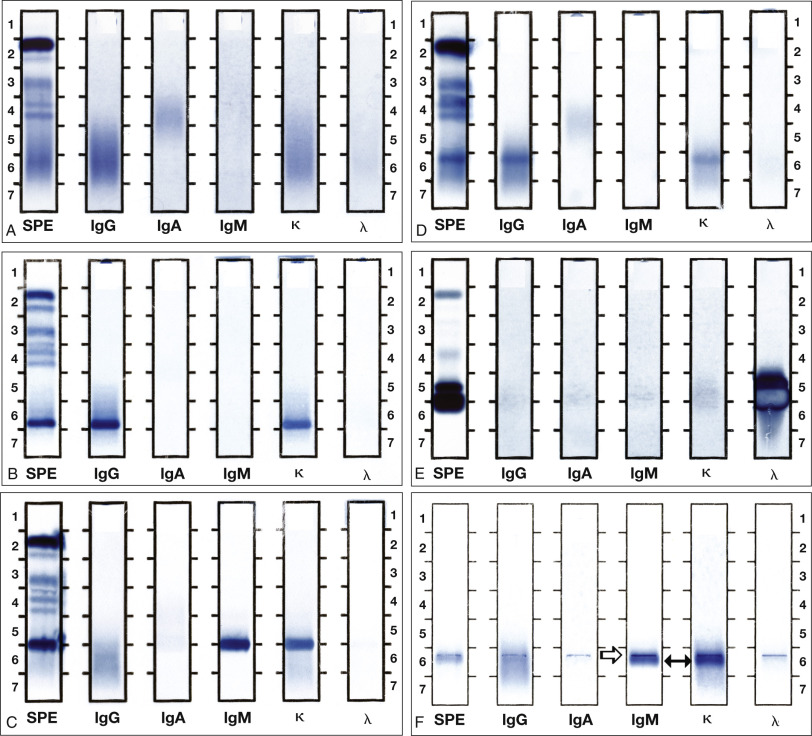

Figure 46-7 

Monoclonal immunoglobulins (Ig) demonstrated by serum immunofixation. 

Replicate samples of patient serum were subjected to electrophoresis through agarose at pH 8.6. The separated proteins were allowed to react with monospecific antisera, and the gels were washed, fixed, and stained. **A,** Normal polyclonal pattern of immunoglobulins. **B,** Monoclonal IgG-κ immunoglobulin (M protein) in serum with loss of most normal polyclonal immunoglobulins. **C,** Monoclonal IgM-κ immunoglobulin in serum. **D,** Minor band of IgG-κ immunoglobulin in serum, along with normal-appearing immunoglobulins—possible monoclonal gammopathy of undetermined significance (MGUS). **E,** Two bands of λ light chains in urine. The lower band demonstrates antigen excess with artifactual clearing in its central region surrounded by a ring of immunofixed protein. The upper smaller band sometimes results from dimerization of free light chains through disulfide bonds. **F,** Type II mixed cryoglobulin precipitated from serum containing monoclonal IgMκ _(solid arrow)_ and polyclonal IgG. Some undissolved cryoglobulin _(open arrow)_ remained at the application point of each lane. _IgA,_ Sample reacted with anti-IgA (α-heavy chain specific); _G_ or _IgG,_ sample reacted with anti-IgG (γ-heavy chain specific); _ κ, _ sample reacted with anti-κ; _ λ, _ sample reacted with anti-λ; _IgM,_ sample reacted with anti-IgM (µ-heavy chain specific); _SPE,_ all proteins in sample precipitated with acid reagent (serum protein electrophoresis). 

Occasionally, the concentration of the monoclonal protein in a patient's serum is so high that it exceeds the capacity of the reagent antibodies to form precipitating complexes by IFE. This phenomenon corresponds to the zone of antigen excess depicted in [ Figure 46-2 ](<#f0015>) . The result is a halo of precipitated complexes (where the concentrations are nearer to equivalence) with a clear central zone of antigen excess (see [ Fig. 46-7, _E_ ](<#f0040>) ). Although this result appears atypical, it is straightforward to interpret and to confirm by repeating the IFE with a greater dilution of patient serum (  Keren, 1999  ). 

Either technique may be applied to other body fluids, most commonly urine. Monoclonal light chains in the urine (Bence Jones protein) may be detected in more than half of patients with multiple myeloma (  Isobe & Osserman, 1971  ;  Wells and Fudenberg, 1974  ). Polyclonal light chains may be detected in patients with other disorders, usually as part of complete immunoglobulin molecules. The original method to detect Bence Jones protein was based on precipitation in urine heated to 40° to 60° C and then redissolution when further heated to 100° C. IFE of urine is more specific and more sensitive than the older Bence Jones assay. IFE may be performed on urine samples with sufficient protein or subsequent to concentration by lyophilization or by selective membranes (Minicon, Millipore Corporation, Billerica, Mass.). 

Immunoglobulins at very high concentrations can significantly increase the viscosity of blood, leading to problems with organ perfusion. Measurements of the viscosity of serum have been done to assess this effect, but they are rarely used today because other methods for quantifying immunoglobulin concentrations, such as nephelometry, are widely practiced. Furthermore, serum viscosity by itself is a poor indicator of whole blood viscosity with cellular elements present, which is really the crucial factor clinically in the patient. 

 

##  Immunoglobulin Free Light Chain Analysis 

The synthesis of immunoglobulin heavy chains and light chains is regulated differently by virtue of their genes being on different chromosomes (heavy chain genes on chromosome 14; κ light chain genes on chromosome 2; λ light chain genes on chromosome 22). Light chains are normally synthesized in slight excess and are cleared from the circulation in a few hours so they do not accumulate in the blood; however, in some monoclonal plasma cell disorders, light chain synthesis can greatly exceed heavy chain production, with the resultant release of variable quantities of free light chains. Because of the relatively rapid renal clearance of small light chains compared with that of an intact immunoglobulin, measurement of free light chains in serum or urine has been used to assess plasma cell mass and growth in monoclonal disorders. Although the concentration of the intact immunoglobulin of an M-spike has long been used in monitoring myelomas, this new and more rapidly responsive marker of light chain release has recently been introduced for clinical use. 

Reagent anti–light chain antibodies used for IFE react with κ or λ light chains both as part of intact immunoglobulins and as free light chains. The principle of specifically measuring free light chains is to use reagent antibodies that react with epitopes on the light chains that are normally hidden by association with heavy chains. Consequently, the free light chain assay gives quantitative information that is complementary to results of quantitative immunoglobulin measurement, as well as protein electrophoresis (PEL) and IFE. One operational advantage of free light chain (FLC) analysis is its automation (  Jaskowski et al, 2006  ). 

Analysis of FLCs entails measurement of both κ and λ light chains in serum and/or urine. Results are abnormal if the κ or λ value is very high and the other is low. To accentuate differences, the ratio of κ to λ measurements is calculated (rFLC). If rFLC is abnormally high, the interpretation is that of plasma cell proliferation with a κ light chain type (i.e., a high κ value in the numerator). If rFLC is below the normal cutoff value, the interpretation is that of proliferation with a λ light chain type (i.e., high λ value in the denominator). Use of rFLC also allows application to patients who have renal disease and do not clear light chains from plasma normally, and so might have elevations of both κ and λ light chains. 

Consensus guidelines for use of serum free light chain analysis have recently been developed by the International Myeloma Working Group (  Dispenzieri et al, 2009  ). They include the following: 

  * 1.

Serum screening for plasma cell disorders. The serum FLC assay combined with serum PEL and IFE is sufficient to screen for pathologic monoclonal plasmaproliferative disorders, except for AL amyloidosis (light chain amyloidosis), for which the additional test of 24-hour urine IFE is essential. This recommendation allows FLC to replace the 24-hour urine IFE for all plasma cell disorders but AL. Avoiding 24-hour collections of urine is considered positively by many physicians and patients. 

  * 2.

Serum FLC for prognosis. This assay should be performed at the time of diagnosis for MGUS, smoldering or active multiple myeloma, solitary plasmacytoma, and AL amyloidosis. The baseline values of FLC predict progression of these disorders and so can help to frame therapy or at least to make recommendations for frequency of monitoring and helping patients to understand the risks of their disease. 

  * 3.

FLC for quantitative monitoring of response. The only recommended indications for routine serial use of FLC are seen in oligosecretory multiple myeloma and in AL amyloidosis. Other potential uses for which data were not sufficient to recommend use include light chain myeloma and measurable intact immunoglobulin disease. Also recommended is use in patients who have achieved a complete response to determine whether it is a stringent complete response. 

The availability of FLC assays is an issue because the reagents have been provided by only one manufacturer, and they are not adaptable to a wide range of immunoassay instruments commonly found in clinical laboratories. Accordingly, these assays typically are sent out to reference laboratories. The commercial promotion of FLC assays has resulted in their use in far more situations than are covered by the recent consensus guidelines. Much more clinical outcome information needs to be accrued before it can be recommended that FLC assays should be used routinely for both diagnosis and monitoring of virtually any plasma cell disorder. However, they have achieved wide use in the diagnosis and monitoring of various plasma cell disorders, including multiple myeloma and amyloid light chain amyloidosis. This includes a role in predicting progression of plasma cell dyscrasias to overt multiple myeloma, and the prognosis for AL amyloidosis at time of diagnosis (  Tosi et al, 2013  ). 

 

##  Heavy–Light Chain Immunoassay 

Heavy–light chain (HLC) immunoassays are designed to quantitate monoclonal immunoglobulin bands by measuring the amount of unique epitopes created where constant regions of heavy chain molecules attach to constant regions of light chain molecules (  Bradwell et al, 2009  ). There are six possible combinations routinely measured—IgGκ, IgGλ, IgMκ, IgMλ, IgAκ, and IgAλ—with ratios calculated for IgGκ/IgGλ, IgMκ/IgMλ, and IgAκ/IgAλ. If a ratio falls outside the reference range, the HLC immunoassay is interpreted as “possible monoclonal band,” and quantitation is performed. This technique does not directly visualize a monoclonal band but rather infers it from the calculated ratio. A recent study performed head-to-head comparison of HLC and serum protein electrophoresis (SPEP) quantitations of monoclonal bands in the serum of 518 patients with multiple myeloma of IgG and IgA types (  Katzmann et al, 2015  ). The intention was to provide better quantitation of monoclonal bands when they overlap with other normal serum proteins that normally migrate in the beta region of the SPEP (e.g., transferrin, beta-lipoprotein, and C3 component of complement). The results showed that the HLC immunoassay held no significant advantage over SPEP in measuring IgG monoclonal bands, all of which in this study migrated in the gamma region, and so had no interferences. Of the 30 IgA bands in the study, all migrated in the beta region, but 7 cases were missed by SPEP, although successfully detected by HLC. This slight advantage of HLC over SPEP suggests that HLC could best be used for patients who have IgA bands migrating in the beta region (  Calderon, 2015  ). However, a large band of IgA should be readily measurable by SPEP regardless of its migration, and so should not require HLC assay. In addition, in monitoring low levels of the paraprotein after chemotherapy or bone marrow transplant, normal polyclonal immunoglobulins of the same HLC combination as the paraprotein will also reappear with reconstitution of normal plasma cells, and they, in principle, should react in the HLC as the paraprotein would, thereby leading to a falsely elevated estimate. It should be taken into consideration that quantitating an IgA paraprotein present at very low levels may have little utility in clinical decision-making following major therapy for plasma cell dyscrasia. 

 

##  Cryoglobulin Testing 

Accurate laboratory test results for cryoglobulins are especially sensitive to improper preanalytic handling, and clinicians must be aware of specimen temperature requirements when ordering these studies to avoid false-negative results (  Shihabi, 2006  ;  Chan et al, 2008  ). Testing for cryoglobulins in serum begins with a period of incubation in the cold (4° C) to detect turbidity or precipitate after 24 or 72 hours compared with an aliquot of the patient's serum kept at 37° C as a control for other precipitating substances not related to cold phenomena. Any cryoprecipitate is sedimented by centrifugation, washed briefly with cold saline to remove other serum proteins, and then redissolved (and dissociated) in warm saline for electrophoresis and immunofixation to identify immunoglobulin components (i.e., heavy and light chains). 

Type I cryoglobulins typically form a relatively large volume of cryoprecipitate (e.g., up to 10% or even 20% of the serum volume—sometimes referred to as the “cryocrit”) ( [ Fig. 46-8, _A_ ](<#f0045>) ). Upon immunofixation electrophoresis, type I cryoglobulins exhibit a single heavy chain and a single light chain type, often monoclonal IgM ( [ Fig. 46-8, _B_ ](<#f0045>) ). The whole serum not treated with cryoprecipitation usually demonstrates a large amount of the same monoclonal band. The concentration of the band should fall after successful plasma exchange. 

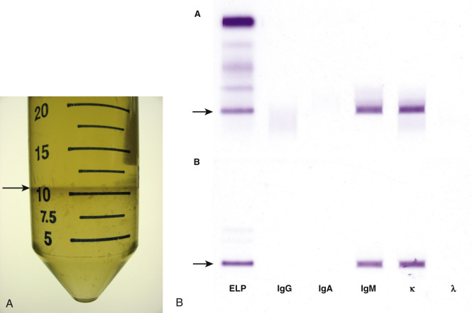

Figure 46-8 

**A,** Type I cryoglobulin in the plasma of a patient undergoing plasmapheresis for hyperviscosity syndrome due to monoclonal immunoglobulin (Ig)M-κ. Plasma removed during plasma exchange was stored at 4° C in a 50-mL tube. The cryoglobulins that precipitated in the cold occupied approximately 20% of this patient's plasma volume. The _arrow_ indicates the top of the cryoglobulin that settled in the tube. **B,** IFE demonstrating IgM-κ monoclonal band in whole serum (upper panel) that formed a type I cryoglobulin in the cryoprecipitate (lower panel). Results in **A** and **B** are from different patients. 

Type II cryoglobulins typically show only a small amount of cryoprecipitate that is less than 1% of the serum volume, and so quantitating the percentage of cryocrit is not analytically valid for serial measurements to monitor a patient's progress. IFE shows a monoclonal band of IgM plus polyclonal IgG (see [ Fig. 46-7, _F_ ](<#f0040>) ). This pattern is observed frequently because of its association with chronic hepatitis C. 

IFE findings in type III cryoglobulin would be similar to those in type II with a relatively small amount of cryoprecipitate that demonstrates both polyclonal IgM and polyclonal IgG. 

 

##  Oligoclonal Immunoglobulin Bands in Cerebrospinal Fluid 

Evaluation of intrathecal synthesis of immunoglobulin is aided by high-resolution electrophoresis of cerebrospinal fluid protein that spreads out the γ region to display individual bands of different immunoglobulin clones. The interpretation of cerebrospinal fluid (CSF) protein electrophoresis requires simultaneous electrophoresis of the patient's serum to ensure that findings in the CSF are unique and do not just reflect the passive transfer of clonal immunoglobulins from the blood. Oligoclonal bands as a marker of synthesis of immunoglobulins in the central nervous system suggest the possibility of an autoimmune process such as a demyelinating disease. Another possibility is an immunologic response to central nervous system infection, so the interpretation of oligoclonal bands in CSF must be made in the context of other diagnostic findings such as cell counts, viral serologies, bacterial cultures, syphilis testing, nucleic acid amplification tests for viruses, and so forth. 

The protein electrophoretic pattern of CSF and serum from a patient with multiple sclerosis is shown in [ Figure 46-9, _A_ ](<#f0050>) _._ The CSF was concentrated, and the serum was diluted to achieve comparable amounts of stainable protein in each application. CSF has a relatively higher concentration of prealbumin than does serum. Albumin is the predominant band in both fluids. The other significant band in CSF is transferrin, because of its small molecular size that permits ultrafiltration from blood into CSF. The higher molecular weight proteins in serum (α2 plus β-lipoprotein) are absent from CSF. C3 is also identifiable in CSF, along with a band of asialotransferrin in the β2 region. After all these landmark proteins of CSF are recognized, oligoclonal bands should be evaluated in the γ region, which normally has only a small quantity of polyclonal immunoglobulins. The oligoclonal bands in [ Figure 46-9, _A_ ](<#f0050>) , are discrete and clearly separate from one another. 

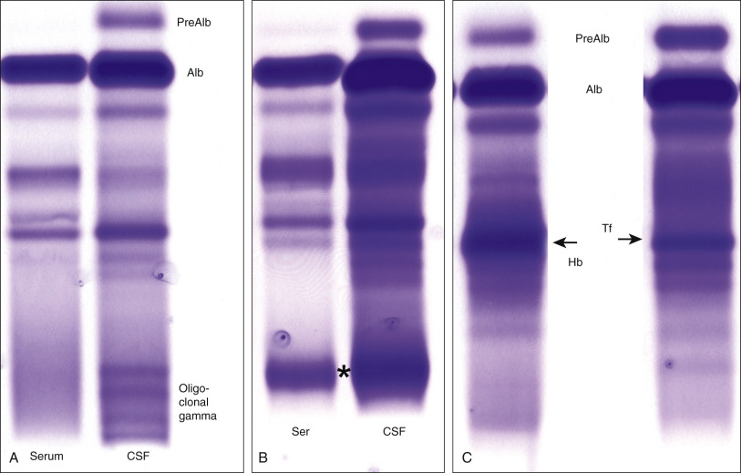

Figure 46-9 

Protein electrophoretic patterns in serum and cerebrospinal fluid (CSF). 

**A,** Serum and CSF from the same patient showing positive oligoclonal bands in the γ region of the CSF but not in the patient's serum. **B,** Monoclonal band of immunoglobulin in both serum and CSF interpreted as negative for oligoclonal bands in CSF. **C,** Artifact of hemoglobin (Hb) in CSF _(left lane)_ adjacent to the position of transferrin (Tf) _(right lane)._

Examination of serum and CSF sometimes shows a clonal band of immunoglobulin present in both ( [ Fig. 46-9, _B_ ](<#f0050>) ); however, this finding is not indicative of intrathecal synthesis and so is not a positive result for oligoclonal bands. Presumably, it represents clonal proliferation of plasma cells in the body with passive movement of the monoclonal antibody from blood into CSF. 

Another distortion of the electrophoretic pattern occurs with release of hemoglobin (Hb) into the CSF, resulting in a major band in the β region close to transferrin ( [ Fig. 46-9, _C_ ](<#f0050>) ). This band of Hb should not be confused with clonal immunoglobulin in CSF. Confirmation that this band is Hb depends on visual examination of the CSF for blood or hemolysis (red color). A band of red Hb can also be seen in the β region before staining of the electrophoretic gel. 

A consensus statement on analysis of CSF was commissioned from experts in multiple sclerosis by the Consortium of Multiple Sclerosis Clinics (  Freedman et al, 2005  ). That group recommended qualitative assessment of CSF for IgG using IEF on unconcentrated CSF compared directly with a serum specimen from the same patient. Interpretation of the pattern should consist of one of the following: 

  * Type 1: No bands in CSF and serum 

  * Type 2: Oligoclonal bands in CSF, not in serum; indicates intrathecal IgG synthesis 

  * Type 3: Oligoclonal bands in CSF plus other oligoclonal bands in CSF and serum; indicates intrathecal IgG synthesis 

  * Type 4: Identical oligoclonal bands in CSF and serum; indicates systemic immune reaction with passive transfer to CSF; no intrathecal IgG synthesis 

  * Type 5: Monoclonal band in CSF and serum; paraprotein; no intrathecal IgG synthesis 

 

##  Problems in Detecting Monoclonal Bands 

Clearly demarcated monoclonal bands are straightforward to identify when they are at high concentration and migrate separately from other serum proteins, particularly when the γ fraction is clear of normal polyclonal immunoglobulins owing to replacement of normal plasma cells with the malignant clone. Several examples of clear-cut monoclonal bands are presented in [ Figure 46-5 ](<#f0030>) . The area under the tracing for such bands can be readily integrated to calculate concentration of a monoclonal protein for monitoring in serial specimens. 

Sometimes the monoclonal bands are much less pronounced and may be difficult to distinguish within a background of normal proteins. [ Figure 46-7, _D_ ](<#f0040>) _,_ shows such a minor band of IgM-κ that can still be readily identified by IFE. However, when small monoclonal proteins migrate in the β or even α2 region, they can escape detection because of overlap with normal proteins such as transferrin or C3 ( [ Fig. 46-10, _B_ ](<#f0055>) ). A monoclonal band migrating between normal serum proteins may also be mistakenly disregarded ( [ Fig. 46-10, _D_ ](<#f0055>) ), so it is very important to interpret such electrophoreses with a firm expectation of where normal bands migrate and what their intensities should be. 

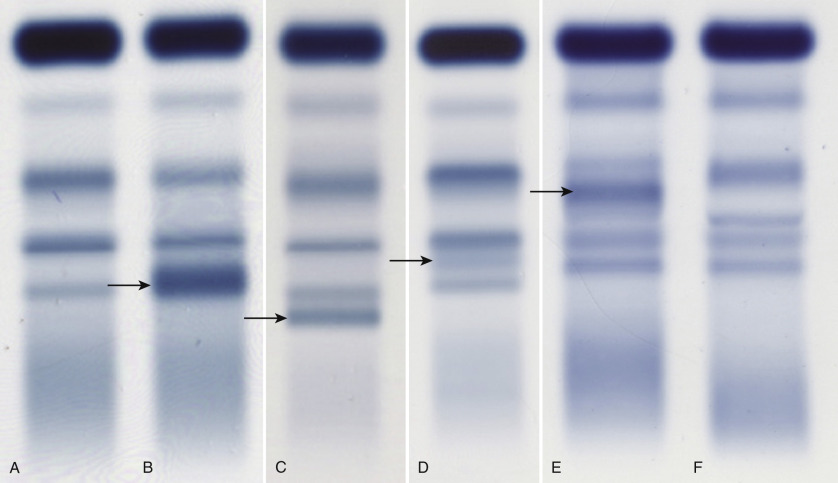

Figure 46-10 

Low-intensity bands of monoclonal and other proteins migrating about the β region. 

**A,** Normal serum protein electrophoresis pattern. **B,** Minor band of immunoglobulin (Ig)A-κ _(arrow)_ overlapping C3. **C,** Fibrinogen _(arrow),_ not to be confused with a monoclonal band. **D,** Minor band of IgA-κ _(arrow)_ migrating between transferrin and C3. **E,** Hemolysed specimen with a minor band of hemoglobin-haptoglobin _(arrow)._ **F,** Redraw of serum without hemolysis from same patient as in **E. E** and **F** were electrophoresed on a different gel system from **A** through **D** ; relative mobilities of normal serum proteins can vary in different systems. 

False-positive interpretations of monoclonal bands can occur owing to the presence of fibrinogen from an unclotted specimen ( [ Fig. 46-10, _C_ ](<#f0055>) ) or when hemolysis occurs as the result of improper specimen collection ( [ Fig. 46-10, _E_ and _F_ ](<#f0055>) ). Confirmation that a small band is a monoclonal paraprotein is typically done with IFE. 

 

##  Oligoclonal Immunoglobulin Bands in Serum 

In contrast to monoclonal immunoglobulin bands that derive from clonal plasma cell disorders such as multiple myeloma, oligoclonal banding patterns occasionally appear in the serum of patients who do not have plasma cell disorders. Oligoclonal patterns may show multiple and distinct bands on SPEP that are revealed on IFE to consist of immunoglobulins with both kappa light chains and lambda light chains in the same specimen, thereby ruling out the possibility of deriving from the same parent clone. They are usually IgG but can also be IgA or IgM, even in the same patient. These likely represent an immune response against an infection or other antigens. They have been observed in immunosuppressed solid organ transplant patients with cytomegalovirus infections (  Myara et al, 1991  ;  Pham et al, 1998  ;  Cakalaroski et al, 2000  ) in some patients with human immunodeficiency virus infection (in which case these bands are directed against HIV proteins) (  Amadori et al, 1990  ;  Konstantinopoulos et al, 2007  ), and in patients after chemotherapy or bone marrow transplant for multiple myeloma ( [ Fig. 46-11, _A_ ](<#f0060>) ) (in which case the antibodies react with tumor antigens on plasma cells) (  Mark et al, 2008  ;  Rahiff et al, 2012  ). For interpretation of oligoclonal banding patterns in serum, it is appropriate to determine the clinical context; such bands might appear prior to a diagnosis of HIV and, if so, should lead to a consideration of that diagnosis; they can also have positive prognostic significance in multiple myeloma patients as an antitumor response. 

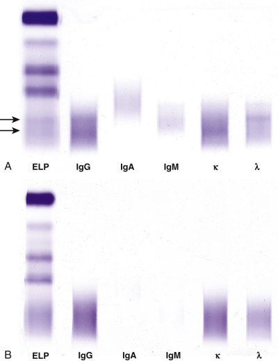

Figure 46-11 

**A,** Oligoclonal bands of IgG-κ and IgG-λ in a patient who received autologous hematopoietic stem cell transplant 2 years earlier for IgG-λ multiple myeloma. Note minor bands of both IgG-κ and IgG-λ. **B,** IFE showing intense staining for polyclonal IgG (κ and λ) with faint amounts of IgA and IgM in a patient who received an autologous hematopoietic stem cell transplant 3 months earlier for IgG-κ multiple myeloma (this band now absent). The polyclonal IgG in this serum is due to intravenous infusions of gamma globulins. _A,_ Sample reacted with anti-IgA (α-heavy chain specific); _G,_ sample reacted with anti-IgG (γ-heavy chain specific); _ κ, _ sample reacted with anti-κ; _ λ, _ sample reacted with anti-λ; _M,_ sample reacted with anti-IgM (µ-heavy chain specific); _ELP,_ all proteins in sample precipitated with acid reagent (serum protein electrophoresis). 

Patients whose multiple myeloma has been successfully treated should show clearance of their monoclonal immunoglobulin bands and can appear to have severe hypogammaglobulinemia. These patients often receive immunoglobulin infusions to guard against infections prior to reconstitution of their own immune systems. The IFE of such a patient might show no monoclonal band but rather polyclonal IgG from infusions that contain no IgA or IgM ( [ Fig. 46-11, _B_ ](<#f0060>) ). 

 

##  Disease Prevention and Therapy 

Passive immunization is the administration of preformed antibodies obtained from another individual of the same species (homologous γ-globulins) or a different species (heterologous γ-globulins); it results in immediate protection against infection. The immunity is short-lived and decays as the antibodies are used and catabolized. Passive protection in neonatal life is based on transfer of maternal antibodies across the placenta or through colostrum (  Pennington, 1991  ). 

Pooled human γ-globulin is useful for temporary protection against several viral and bacterial infections (  Berkman et al, 1990  ;  Hammarström & Smith, 1990  ;  Desai, 1991  ). Depending on the dose used and the time of administration, the disease may be modified to a mild form or entirely prevented. The effect is more complete and more predictable if one uses hyperimmune preparations made from the plasma of individuals who are convalescing from the disease in question or who have recently been immunized against it. Such preparations contain a higher concentration of specific antibodies. Antibodies may also be produced in animals, such as horses, and in the past these antibodies found widespread use. However, prior sensitization to foreign proteins may lead to clinical reactions such as anaphylaxis, serum sickness, pyrexia, and local Arthus reactions. 

Monoclonal antibodies have revolutionized many areas of medicine, including research, diagnostics, and therapy. Murine, human, and humanized monoclonal antibodies have been developed (  Lefrano & Lefrano, 1990  ;  Morrison, 1992  ;  Mountain & Adair, 1992  ;  Ward, 1992  ;  Shin et al, 1993  ). Many monoclonal antibodies, often replacing polyclonal antisera, are used for diagnostic purposes (see [ Chapter 43 ](<##!/content/3-s2.0-B9780323295680000437?scrollTo=%23c00043>) ). Perhaps the most important therapeutic applications of monoclonal antibodies are seen in the fields of transplantation and oncology (  Stevenson et al, 1990  ;  Vitetta et al, 1993  ;  Neame et al, 1994  ). OKT3, a murine monoclonal antibody against the CD3 receptor on lymphocytes, is often used as an antirejection therapy to block the activity of cytotoxic T lymphocytes in renal transplant recipients (  Ortho Multicenter Transplant Study Group, 1985  ). Many potential clinical applications of monoclonal antibodies are being evaluated. A recent example is the use of a monoclonal antibody against tumor necrosis factor-α to prevent Jarisch-Herxheimer reactions resulting from antibiotic treatment of _Borrelia_ infection in sheep (  Fekade et al, 1996  ). Anticytokine and antineutrophil adhesion molecule monoclonal antibodies may be effective in conditions associated with acute inflammation and cytokine release, such as acid aspiration, ischemia, or reperfusion injury (myocardial infarction, hemorrhagic shock, aortic aneurysm repair); antibodies inhibiting neutrophil adhesion may be effective in asthma, pulmonary fibrosis, meningitis, and cerebral malaria; and recently, a monoclonal antibody directed against a component of the complement cascade suggests the possibility of eventual therapeutic regulation of specific arms of the inflammatory response (  DiLillo et al, 2006  ). It seems reasonable to expect that a multitude of therapeutic applications will become available in the future, in which monoclonal antibodies will be designed to modulate the actions of one or more naturally occurring mediators of inflammation, infection, or malignant proliferation. 

,,
