## Key Points

  * •

Humoral immune tests assess production of specific antibody responses to past or recent infections, and cellular immune assays measure current immune responses. 

  * •

The immune system changes with age and nutritional status. Differences in immune responses of test subjects associated with immaturity, immunosenescence, or malnutrition should be taken into account when evaluating the results of specific tests. 

  * •

Primary immunodeficiency may be associated with an increased incidence of malignancy; malignancy, chemotherapy, and radiotherapy can significantly suppress the immune response and alter cellular immune assay results. 

  * •

Evaluation of the cellular immune response is undertaken in a graduated sequence of stages that may include both in vitro and in vivo testing to identify areas of immune deficiency. 

  * •

Measurement of lymphocyte activation may be accomplished in vitro by flow cytometry using activation-specific fluorescent-labeled monoclonal antibodies and vital dyes. The usefulness of this approach has increased significantly with the development of fluorochromes with different excitation spectra. 

The understanding of the immune system is greatly enhanced by the detection of specific abnormalities in patients with suspected immune deficiency. These advances have come from studies of immune cell differentiation and function, experimental gene deletion, and detailed analysis of human immunodeficiency syndromes. New experimental approaches have helped to elucidate the mechanisms and functional basis of immune dysregulation in patients with primary (congenital) genetic mutations of the immune system or secondary (acquired) infections. Because some immune deficiencies cannot be accurately diagnosed by the combination of clinical symptoms and appropriate immune function assays, genetic information is becoming an increasingly important component of diagnostic testing and interpretation. The mission of the clinical immunology laboratory is to translate new research leads into highly standardized and clinically relevant tests for the individual patient. 

Studies of the human cellular immune system have principally focused on three areas: primary immune deficiency, which reveals the impact of congenital immune defects on host defense; acquired immune deficiency, such as human immunodeficiency virus (HIV) infection, in which infection damages the immune system directly; and autoimmune diseases, in which the effect of excessive or inappropriate immune activity is evident. In addition, cellular immune defects in patients with diseases with immune dysfunctional features, such as chronic infection, cancer, malnutrition, or traumatic injury, provide crucial insight into immune-mediated host defense. 

The general concept of **immunity** is often equated with humoral immunity, because antibodies to infectious agents introduced by natural infection or by immunization have been studied for more than a century. Cellular immunology, as currently practiced in the clinical and research laboratory, is a relatively new science (  Silverstein, 1979  ;  Moulin, 1989  ;  Good, 2002  ). The modern science of cellular immunology developed during the 1980s through a series of independent events and major research discoveries, including the use of monoclonal antibodies to identify immune cells, the development of analytic and sorting capabilities of the flow cytometer, the discovery of cytokine regulation of immune response, the birth of molecular immunology, and, above all, the tremendous need to understand and control the emerging HIV epidemic (  Herzenberg, 2004  ). The appearance of HIV occurred virtually in parallel with the potential to identify CD4  \+  T cells. The first analyses of cellular immune functional deficiency in the acquired immunodeficiency syndrome (AIDS) were based on analysis of lymphocyte proliferative response (  Masur et al, 1981  ;  Siegal et al, 1981  ) and have since evolved into a range of functional approaches (  Perfetto et al, 2004  ;  Mittag & Tarnok, 2011  ;  Virgo & Gibbs, 2012  ;  Cossarizza et al, 2013  ). 

In contrast to humoral immunity, cellular immune function is both fundamentally complex and difficult to measure. Basic humoral immune tests measure the specific antibody product of a past response to a specific virus or microbe; by contrast, most cellular immune assays measure current responses. Because a majority of peripheral blood lymphocytes are resting cells, the cellular immune reaction must be recreated or generated freshly within the test system. The system must be capable of triggering the response, supporting the reaction by providing all needed elements available in vivo, and having a measurable endpoint. 

This chapter presents current cellular immunologic tests in light of future trends. Cellular immune assessment is moving away from single assays and single-number fixed endpoints toward an integrated analysis of cell function at several levels that reflect cellular interactions as a dynamic process. 

,  

##  General Principles of Cellular Immunology 

Two main immune cell types are known: T lymphocytes (T cells) and B lymphocytes (B cells) (  Janeway et al, 2004  ;  LeBien & Tedder, 2008  ;  Chaplin, 2010  ;  Masopust & Schenkel, 2013  ;  Bodduluru et al, 2015  ). T lymphocytes are defined by expression of the T lymphocyte receptor, which binds to antigen and CD3, a surface determinant associated with the T cell receptor (TCR) that is essential for activation. T lymphocytes have different, clonally variable receptors for a large range of antigens, require thymic maturation for normal function, and mediate cellular immunity. B lymphocytes are identified by surface immunoglobulin (detected by monoclonal antibodies such as CD19 or CD20) and upon appropriate activation develop into plasma cells secreting specific antibody and thus mediating humoral immunity. Loss of the normal thymus will compromise T lymphocyte function and affect T-dependent B lymphocyte activation. Failure at the bone marrow level can affect both T lymphocyte and B lymphocyte immune responses, although specific linkages may be involved. 

The distinction between a specific and a nonspecific immune response is a fundamental necessity because the system must be able to distinguish between self and nonself (  LeGuern, 2003  ;  Smith, 2004  ). In general, self-recognition is accomplished by incorporating the molecular major histocompatibility complex (MHC) self-antigen system into the antigen recognition phase. Antigen must be processed and presented in the context of self-MHC to be recognized and to lead to response and development of immune memory. The antigen-processing function is carried out by antigen-presenting cells (APCs); the best studied is the monocyte. This response triggers lymphocyte activation and proliferation, and may include production of effector cells and triggering of B lymphocytes to produce antibody. This type of immunity, often termed _adaptive immunity,_ is retained as “memory” and typically is elicited following immunization or natural infection (  LeGuern, 2003  ;  Smith, 2004  ). Lack of expression of MHC class II antigen can be detected on lymphocytes by flow cytometry using monoclonal antibodies against human leukocyte antigen (HLA)-DR or HLA-DQ and is a hallmark of MHC class II deficiency. 

A second fundamental type of immunity can be described as innate immunity. This type of immunity is an ancient host response to infectious agents or self cells with absent or altered self-recognition molecules; it is encoded within the genome, does not have memory, and is not improved by repeated contact (  Janeway & Medzhitov, 2002  ;  Turvey & Broide, 2010  ). The innate immune system consists of external barriers (i.e., skin, mucosal surfaces) to prevent microorganisms from entering the body and a programmed, coordinated series of events to destroy microorganisms that penetrate the external barriers. These events include both chemically mediated (cytokines, complement, interferon) and cellular (phagocytes, natural killer [NK] cells) components. The modern era of discovery about innate immunity began in 1989, when the late Charles Janeway, an immunologist at Yale University, predicted that sentinel cells (i.e., macrophages, dendritic cells) have nonclonal, germline “pattern recognition” receptors that directly recognize some invariant molecular signatures of microbes (pathogen-associated molecular patterns) not found in the host. In 1997, studies of _Drosophila melanogaster_ (fruit fly) identified the toll-like receptor (TLR) as the major effector of the innate immune response in the fly, which has no adaptive immune system. Since that time, multiple TLRs have been found in humans, largely on macrophage and neutrophil membrane, as well as on epithelial cells lining the respiratory and gastrointestinal systems. TLRs can be thought of as a primitive, highly conserved alarm system that recognizes bacterial pathogens and stimulates the expression of molecules that initiate the local inflammatory response and phagocytosis (  Beutler, 2009  ;  Kumar et al, 2009  ). TLRs are highly conserved molecules characterized by an extracellular domain of leucine-rich repeats and an intracellular signaling domain with homology to that of the interleukin (IL)-1 and IL-18 receptor family. TLR signaling initiates the transcriptional expression of genes that constitute a core inflammatory response, including proinflammatory cytokines, such as IL-1α, IL-β, tumor necrosis factor (TNF)-α, and IL-6, as well as numerous chemokines and cell surface receptors that regulate T and B cell immune responses (  Iwasaki & Medzhitov, 2010  ;  Kawai & Akira, 2010  ). 

Other pattern recognition receptors are believed to play a less important role in the binding of bacteria and fungi by phagocytes in preparation for phagocytosis. These include a large family of lectin receptors (including the mannose receptor), some integrins, CD14, and scavenger receptors. Lectin receptors are carbohydrate receptors that specifically bind sugar residues found in the cell walls of certain bacteria. Scavenger receptors bind many anionic bacterial ligands. 

Unlike phagocytic cells, NK cells are not functionally developed at birth, probably because the key cytokine, interferon (IFN)-γ, which is needed for development and maturation of this system, is also downregulated at birth. The NK cell, once called the “K” cell, “null” cell, or “third population,” has neither surface immunoglobulin nor a rearranged TCR (  Sinkovics & Horvath, 2005  ;  Cooper et al, 2009  ;  Bonavida, 2014  ). The NK system is constitutively active and does not have to be primed by antigen to kill (  Yokoyama et al, 2004  ;  Hamerman et al, 2005  ). NK cells make up a diverse population that has eluded conventional classification by cell lineage analysis. However, CD56 is currently considered the most definitive immunophenotypic marker for the NK cell (  Trinchieri, 1995  ). NK cells have been best known as cells that can kill nonspecifically (naturally) virus-infected cells and bacteria, and can prevent tumor cell metastasis. However, NK cells also regulate T and B cell functions, as well as hematopoiesis. These functions of NK cells are probably dependent on their ability to produce lymphokines, particularly IFN-γ. NK cells are important for antigen-independent activation of phagocytic cells early in infection and for favoring the development of antigen-specific T-helper type 1 (Th1) cells. When armed with specific antibody, however, these cells can kill specifically. 

 

##  Lymphocyte Activation and Proliferation 

Although the immune system is classically divided into humoral and cellular components, this separation is in no way absolute, in that considerable interdependence is seen between B and T cells. The most commonly measured functional cellular immune parameter is lymphocyte proliferation (  Perfetto et al, 2002  ). Measurement of lymphocyte activation/proliferation has evolved substantially since the late 1950s and early 1960s, when cell division was determined by counting the number of lymphocytes that had transformed into blasts. The latter method was later replaced by the quantitation of incorporated radiolabeled nucleic acid precursors (tritiated thymidine) into newly synthesized deoxyribonucleic acid (DNA). Although this “bulk assay” remains the most commonly used laboratory procedure for measuring cellular proliferation, new reagents and new procedures have recently become available to assess lymphocyte activation and proliferation. These include commercially available cell surface proliferation markers, the ability to measure the percentages of cells in specific phases of the cell cycle, the quantitation of cell-associated and secreted cytokines/cytokine receptors, and the ability to assess the number of cell divisions in lymphocytes labeled with “tracking dyes.” In this section, we review the molecular events involved in T lymphocyte activation and proliferation, and review some of the new methods that have been developed to assess the functions of the cellular immune system. 

 

##  Unraveling the Biochemical Pathways of Lymphocyte Activation 

Specific interaction of mitogen or antigen/MHC with the appropriate lymphocyte receptors leads to a cascade of cellular processes that include changes in membrane transport, rearrangement of the cytoskeletal system (polarizing the lymphocyte toward APC), and activation of several signaling pathways (  Harding & Neefjes, 2005  ). These changes ultimately lead to a number of outcomes, including T cell differentiation, cytokine secretion, proliferation, anergy, or apoptosis. Ongoing investigations are unraveling the complex molecular and biochemical pathways that drive the activated T cell down these pathways. Specific abnormalities in these pathways are constantly being discovered and underlie many of the primary immunodeficiency diseases. Unfortunately, abnormalities in a bulk proliferation assay indicate only that there is limited or no cell division and provide no information regarding the underlying abnormality in lymphocyte activation. Therefore, more sophisticated assays are required to investigate underlying T cell abnormalities. 

 

##  Antigen-Induced Activation of T Lymphocytes 

Antigen/MHC-induced activation of T lymphocytes involves a series of complex and defined events that differ slightly between the activation of a naive T cell versus the activation of a memory T cell. Antigen is processed by B cells or monocytes, leading to the assembly of immunogenic peptides into class I or class II products of MHC genes (  van der Merwe & Davis, 2003  ). The peptide–MHC complex is presented to T cells bearing the appropriate TCR (  Chakraborty & Weiss, 2014  ). In addition, the APC expresses a series of adhesion and costimulatory molecules that interact with appropriate ligand/counterreceptors on the T cell surface. Ligation of the TCR alone is not sufficient for activation of the T cell, which has led to the development of the “two-signal model” for T cell activation (  Bretscher, 2004  ). The first signal delivered via the T cell antigen receptor/CD4/CD8 modulates transition of the T cell from the early stages of activation (i.e., G  0  to G  1  ). Signal two is delivered via the costimulatory pathways, most notably CD28, and to lesser extents, LFA-3, CD2, CD5, and CD7, and leads to the induction of IL-2 and other cytokine genes required for T cell proliferation and differentiation to effector cells. 

 

##  T Cell Recognition, Activation, and Signal Transduction 

Lymphocytes are unique in that they express surface receptors able to identify virtually any molecule or foreign substance (antigen). Structural diversity within these receptors is created by the differential rearrangement of TCR genes. In general, only a limited number of circulating lymphocytes are able to recognize any single antigen. When a lymphocyte recognizes a foreign antigen in vivo, cells proliferate rapidly in a clonal manner to generate a large number of both effector and memory cells. 

The TCR complex is composed of both a heterodimeric antigen recognition structure (i.e., the TCR) and a noncovalently bound transducing complex referred to as CD3 (  Malissen, 2003  ;  Chakraborty & Weiss, 2014  ). The TCR cannot be expressed on the cell surface without CD3 and has no inherent signaling capabilities of its own. The antigen recognition structure is composed of structurally divergent α and β chains (or, less frequently, γ and δ chains), and the CD3-transducing complex is composed of five invariant polypeptide chains: α, β, ε, η, and a ζ chain dimer. Each of the CD3 proteins contains a motif called the immune tyrosine activation motif (ITAM), which binds the SH2 domains of protein tyrosine kinases. The ζ chain (which exists as a ζ homodimer, a ζ with an η, or a ζ with an Fc ε RI γ chain) contains three ITAMs and is the most significant component of the TCR complex involved in signal transduction from the TCR (  Weiss & Littman, 1994  ;  Alarcon et al, 2003  ). Originally described by Reth, these motifs play an essential role in early events following T cell activation (  Reth, 1989  ;  Irving, 1991  ;  Chakraborty & Weiss, 2014  ). CD4 and CD8 molecules on the surfaces of T cells are also noncovalently attached to the TCR complex. They bind to HLA class II and class I molecules, respectively, on the APC and are also involved in transduction of activation signals ( [ Fig. 45-1 ](<#f0010>) ). Processed antigen is presented to T cells in the context of the MHC antigens. In general, CD4  \+  T cells respond to exogenously processed antigens presented in the context of MHC class II, and CD8  \+  T cells respond to endogenously processed antigens presented in the context of MHC class I. CD4 and CD8 are also associated with tyrosine kinases involved in the early events following T cell activation. In addition to these interactions and the costimulatory molecular interactions, another group of molecules (adhesion molecules) present on both the APC and the responding T cell bind to each other and serve to increase the avidity of the binding. 

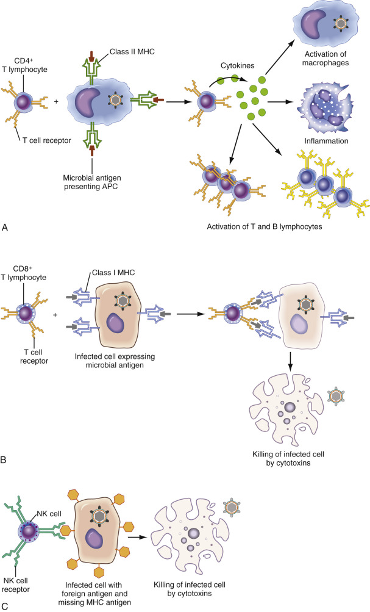

Figure 45-1 

A schematic illustration of immune cell function. 

**A,** Function of helper T lymphocytes. Helper T cells are activated by contact with an antigen-processing cell (APC) that has ingested and processed a foreign or altered self substance and displays processed antigen fragments bound to a class II self–major histocompatibility complex (MHC) receptor. Simultaneous binding of the T cell receptor (TCR) complex in conjunction with a CD4 coreceptor activates the T cell primarily through a complex signaling mechanism involving the SRC kinase family. Activated T cell coordinates the immune response by secreting cytokines that have a multitude of effects, including recruitment and activation of macrophages, activation of the inflammatory system, and activation of cytotoxic T lymphocytes and other helper T lymphocytes. **B,** Function of cytotoxic T lymphocytes. Cytotoxic, CD8-positive cells are activated primarily by contact with infected, damaged, dysplastic, or neoplastic self cells expressing processed microbial or abnormal self-antigens bound to the class I MHC. Activation of the cell occurs via the TCR in conjunction with the CD8 coreceptor that is specific for the class I MHC. The target cell is killed by the release of cytotoxic chemicals, including perforin, granzymes, and granulysin. **C,** Function of natural killer (NK) cells. NK cells are activated by cytokines or interferons and directly recognize “missing-self” virally infected or tumor cells that have only low levels of MHC I self-antigen. Unlike cytotoxic T cells, prior sensitization is not required. Killing of the target cell occurs via the release of cytotoxic chemicals, similar to cytotoxic T lymphocytes. 

(Diagrams courtesy Dr. Peter Ping, Motifolio, Inc., Ellicott City, Md.) 

Costimulatory molecules identified on APCs include B7 (CD80) (  Linsley et al  1991  ), B7.2 (  Azuma et al, 1993  ), and heat-stable antigen (HSA) (  Liu et al, 1992  ), among others (  Wingren et al, 1995  ;  Foletta et al, 1998  ). On T cells, CD28 is the primary costimulatory molecule and binds B7; CTLA-4, on the other hand, binds both B7 and B7.2 and is involved in downmodulating T cell activation (  Linsley et al  1991  ). The receptor on T cells for HSA has not been identified. Antigen presentation in the presence of reagents that block the costimulatory molecules leads to anergic response (tolerance) on subsequent exposure to that specific antigen but does not affect the responses to other antigens (  Tan et al, 1993  ). The ability to make nonimmunogenic transplantable tumors immunogenic by transfecting them with the B7 gene (  Chen et al, 1992  ;  Baskar et al, 1993  ;  Townsend & Allison, 1993  ;  Janeway & Bottomly, 1994  ) suggests that costimulatory molecules play an important role in T cell activation in vivo. 

 

##  Signal Transduction Following Antigen-Specific Stimulation 

The presentation of antigen to T cells leads to aggregation of the TCR–CD3 complexes and activation of protein tyrosine kinases (PTKs). The TCR itself has a small cytoplasmic tail with no known transducing activity. It is the associated ζ chains of the CD3 complex that contain the ITAM motifs and that have been shown to coprecipitate PTK activity. Two well-known classes of cytoplasmic PTK families are involved in the very early events following TCR aggregation: Src and Syk/ZAP-70. Signaling cascades downstream from the TCR–CD3 complex and the CD28 costimulatory pathway are fairly well understood (  Foletta et al, 1998  ;  Samelson, 2002  ). Activation of TCR-associated tyrosine kinases ZAP70, p59  fyn  , and p56  lck  leads to activation of three pathways: p21  ras  , calcium/calcineurin, and protein kinase C (PKC). Activation of p21  ras  activates mitogen-activated protein kinases, which, in turn, phosphorylate several transcription factors, thereby regulating gene expression. Activation of the PTKs also activates phospholipase C, which hydrolyzes phosphatidyl inositol and leads to generation of the second messengers diacyl glycerol (DAG) and inositol triphosphate (IP  3  ). DAG activates PKC, and IP  3  leads to rapid and sustained increases in cytoplasmic calcium. The increase in free calcium activates the calmodulin-dependent phosphatase calcineurin. These events also lead to the induction of DNA-binding proteins and the transcription of numerous genes, including IL-2 and the IL-2 receptor required for T cell proliferation. 

Understanding the pathways leading to T cell activation has led to the discovery of molecular defects in several acquired immunodeficiency diseases and may ultimately help provide therapeutic strategies to correct these deficiencies (  Rosen, 2000  ;  Milner & Holland, 2013  ;  Ochs & Hagin, 2014  ). For example, mutations in the protein tyrosine kinase ZAP-70 have been reported and are associated with the autosomal form of severe combined immunodeficiency (SCID) syndrome in humans (  Elder, 1998  ). Mutations in the common γ chain of the interleukin receptors IL-2, IL-4, IL-7, IL-9, and IL-15 lead to transduction abnormalities and are associated with the X-linked form of SCID (  Noguchi et al, 1993  ). It is interesting to note that another form of autosomally inherited SCID is associated with mutations in the downstream Janus family protein tyrosine Jak3, the only signaling molecule associated with the common γ chain (  Pesu et al, 2005  ). As more and more of the underlying abnormalities leading to T cell immunodeficiency are discovered, including at least 10 different molecular defects for SCID alone (  Fischer et al, 2005  ;  Sponzilli & Notarangelo, 2011  ), it has been proposed that these disorders be classified using a comprehensive system that would identify the disorders according to abnormalities in differentiation, maturation, and function (  Gelfand, 1993  ). These designations would begin to focus on the actual physiologic or biochemical defect and may ultimately provide new options for therapy, including gene therapy (  Buckley, 2004  ;  Conley, 2005  ;  Booth et al, 2011  ;  Ochs & Hagin, 2014  ). 

 

##  T-Cell Responses 

Recently, the designation of T-cell type I versus type II cytokine responses has been preferred for those T-cell responses that lead to cytokine secretion patterns known to be involved in cellular immunity versus cytokine secretion patterns observed in humoral immunity, respectively. Type I responses are characterized by the secretion of cytokines known to enhance inflammation (proinflammatory) and induce activation and proliferation of T cells and monocytes—namely, IL-2, IFN-γ, and IL-12. Type II responses are characterized by the secretion of cytokines that suppress inflammation (anti-inflammatory) and stimulate B cells to divide and differentiate into immunoglobulin-secreting cells (i.e., IL-4, IL-5, IL-10, and IL-13). Evidence suggests that secretion of type I cytokines regulates the secretion of type II cytokines and vice versa (  Paul, 1993  ). For example, in the presence of IL-4 both in vivo (  Chatelain et al, 1992  ) and in vitro (  Seder et al, 1992;  1993  ), T-cells will not develop into IFN-γ–secreting cells (i.e., this environment favors the development of a humoral immune response). It has been suggested that the relative amounts of IL-4 and IL-12 that are present during stimulation of naive T cells will shift the response one way or the other (  Paul & Seder, 1994  ). 

Several factors are involved in regulating the type of T cell response that ensues following antigenic stimulation. In addition to the cytokine environment, evidence suggests that the dose of antigen influences the type of response (  Bretscher, 1992  ;  Madrenas et al, 1995  ). The predominant response that develops following T cell activation has significant clinical implications. It has been postulated that the development of a type I response to HIV infection may lead to protective immunity (  Clerici & Shearer, 1994  ). Clearly, a type II response is not protective, because most infected persons seroconvert and eventually succumb to profound immunosuppression.  Clerici and Shearer (1993;  1994)  argue that repeated exposure to low-dose HIV-1 may lead to protective type I cellular immunity. Results reported by this group indicate that between 39% and 75% of peripheral blood mononuclear cells of HIV-1–seronegative and polymerase chain reaction–negative high-risk individuals (i.e., homosexual men, intravenous drug users, and infants born to HIV-1–positive mothers) secreted IL-2 in response to the env protein in vitro. These scientists propose that seronegative high-risk individuals develop protective cell-mediated immunity as a result of low-dose immunization or infection. 

 

##  B Cell Responses in Cellular Immunity 

Antibody-producing B cells govern the humoral immune response to contain and eliminate primarily extracellular pathogens and, to a lesser extent, intracellular threats. Initiation of B-cell activation involves initial antigen binding and requires costimulatory signals. These signals, in some cases—as in nonpeptide antigens, for example—may be delivered by the antigen itself, by TLRs, by surface immunoglobulin cross-linking, or by other mechanisms (  Mond et al, 1995  ). Alternatively, the Th2 subset of CD4  \+  helper T cells provides important costimulatory triggers to activate B cells in response to peptide antigens ( [ Fig. 45-2 ](<#f0015>) ). 

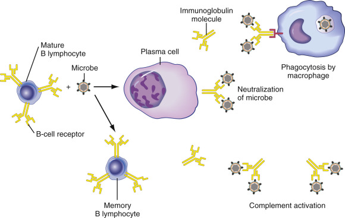

Figure 45-2 

Function of B lymphocytes. 

Each B lymphocyte has a unique variable domain in its surface immunoglobulin molecules (B cell receptor) that permits it to recognize a specific antigen. An encounter with this specific antigen, in conjunction with a cytokine signal from a T helper cell, results in activation of the B cell. An activated B cell can differentiate into an antibody-producing plasma cell or a memory T cell. In the lymph node, the activated B cell may also undergo a germinal center reaction, resulting in hypermutation of the variable region of the immunoglobulin gene. 

(Diagram courtesy Dr. Peter Ping, Motifolio, Ellicott City, Md.) 

Surface immunoglobulin on naive B-cells binds antigen and transmits intracellular signals. It also delivers antigen into the cell, where it is proc­essed into peptide fragments and then distributed and bound to MHC class II surface receptors. Epitopes of these fragments are recognized by specific Th2 class helper T cells primed by related antigen exposure, and costimulatory signals are transmitted between CD40-ligand (CD154) on T cells and CD40 receptor molecules on B cells (  Jones & Janeway, 1981  ). These interactions generate T cell cytoskeletal changes and subsequent release of cytokines, including IL-4, which binds to B cells to favor cell cycle progression and thus clonal expansion, and also promotes isotype switching to immunoglobulin (Ig)G1 and IgE. These engaged T cells also release transforming growth factor (TGF)-β, which has been shown to induce isotype switching to IgG2B and IgA, along with IL-5 and IL-6, which promote B cell differentiation into plasma cells (  Isakson et al, 1982  ). These cellular interactions occur in the T cell/B cell zone borders of primary lymphoid organs. Differentiation into effectors/plasma cells with antibody secretion appears to be sentinel for the primary/early focus of humoral immune response. Some activated B cells migrate into germinal centers and undergo further enhancement, including affinity maturation, IgH variable gene alteration, and isotype switching, to provide what is thought of as a more durable, prolonged response. A subset of memory cells is also produced that provide low-level surveillance with an associated rapid amnestic response upon antigen reexposure. 

,  

##  Flow and Image Cytometry in Evaluation of Cellular Immunity 

Since its development 3 decades ago, laser-based single-cell analysis (flow and image cytometry) has become an essential tool for the medical research laboratory and the standard of laboratory clinical practice in the study of the cellular immune response (  Herzenberg, 2004  ;  Dean & Hoffman, 2007  ;  Pierzchalski et al, 2011  ;  Virgo & Gibbs, 2012  ). Measures of immune competence and immune modulation of specific surface markers and receptors, characterization of lineage by the immunophenotyping of lymphomas and leukemias, the definition of malignancy using specific chromosome probes, and the study of tumor heterogeneity by multiparameter DNA measures are analyses that are commonly performed in many laboratories, as detailed by many authors (  Mittag & Tarnok, 2011  ;  Vajpayee & Mohan, 2011  ;  Jaye et al, 2012  ;  Virgo & Gibbs, 2012  ). Classification of cell types by these means enables the definition of biologic and effector functions on a molecular basis and allows these measures to be related to disease process and definition. These are but a few of the applications that are possible when laser-based technologies are applied. 

Two major technologies are used. The first is flow-through, in which the particles that are being counted and their physical and chemical characteristics are measured by particles passing in a fluid stream in a single-cell suspension (  Keren, 1989  ;  Givan, 2004  ;  Stewart & Stewart, 2004  ). In the second, known as static analysis, the particles are stationary and the stage or the laser moves as in image analysis (  Cossarizza & Radbruch, 2013  ). Image analysis technology is slowly making its mark in the laboratory in the evaluation of touch preparations or cytospins, chromosome preparations, and tissue sections for certain applications, such as DNA and fluorescence in situ hybridization (FISH). Advances in recent years in the availability of fluorescent probes for use in FISH and chromosome painting will make these analyses more relevant and useful tools in the clinical laboratory (  Weinberg, 1993  ;  Stewart et al, 2002  ). As with many techniques, including cell cycle analysis in DNA, each of the new markers and new techniques must be defined and evaluated and correlated with patient outcomes before absolute clinical utility is imparted, or not. There is great interest in instrumentation that combines the strengths of flow cytometry and the static advantages of image analysis. These instruments, known as scanning laser cytometers, use the traditional flow cytometry measures of forward scatter, side scatter, and fluorescence on cells in suspension or fixed onto a glass slide. Experience with these systems will reveal whether this approach offers measurement advantages not available with the current flow cytometric and image system configurations (  Mach et al, 2010  ;  McGrath et al, 2011  ;  Pozarowski et al, 2013  ). Scanning image cytometers and image analysis are not discussed further in this chapter. 

Combined advances in electronic pulse processing, optics, and data storage, along with advances in computer technology and software, have allowed flow cytometry technology to become a routine tool in the clinical and research laboratory. Furthermore, the wide availability of workshop-clustered monoclonal antibodies now numbering 371 (  Engel, 2015  ), labeled in multicolor, directly conjugated, and in premixed formats, has allowed the simultaneous detection of multiple surface antigens, as well as cytoplasmic and nuclear constituents. The ability to perform multiparameter analysis is the greatest strength of flow cytometry (  Mittag & Tarnok, 2011  ;  Pierzchalski et al, 2011  ). Measurement of both phenotypic and intracellular markers is now done routinely in many laboratories. The major manufacturers have turned the art of flow cytometry into a routine laboratory measurement—a “black box” science—much to the dismay of many (  Chapman, 2000  ). As described, this black box approach phenomenon is largely the result of the use of flow cytometry in the phenotyping of T cell subsets in monitoring patients with HIV (  Mandy, 2004  ;  Cossarizza et al, 2013  ). Before the onset of the HIV epidemic, flow cytometry was used in the clinical laboratory primarily for the characterization of leukemias and other hematologic malignancies and for DNA analysis of tumors for synthesis phase (S phase) and DNA index (DI). Although flow cytometry technology may be trending more toward a black box application, the HIV epidemic has brought the power of the flow cytometer to a much larger number of institutions and laboratories. This has allowed the technology to become an integral part of many diagnoses and to be used as an important adjunct in the treatment of patients (  Woo et al, 2014  ). Despite its simplification, many issues with regard to U.S. Food and Drug Administration (FDA) regulation, proficiency testing, data management, and reproducibility of data remain. Although all current flow cytometers can adequately perform routine immunophenotyping and other assays, most laboratory problems are related to the nonavailability of standard quality control reagents and calibrators, and the lack of reliable, rapid methods for data transfer and storage that are compatible with laboratory information systems. More important for clinicians is an understanding of the technology, along with its strengths and pitfalls, and how it can be used for quality control and quality assurance, specimen preparation, and data interpretation. Some of these issues are discussed below, although it is not the purview of this chapter to describe all the nuances of flow cytometic analysis. 

 

##  The Flow Cytometer and Other Tools 

 

##  The Light Source and Signal Processing 

Today's clinical flow cytometer is rarely used for cell separation (i.e., cell sorting); this property continues to be associated with research instruments in the highly specialized laboratory. Most multifaceted clinical flow cytometers use one to three lasers with four or more photomultiplier tubes to perform 5- to 10-color immunophenotypic analysis ( [ Fig. 45-3 ](<#f0020>) ) (  Shapiro, 2004  ;  Zucker & Fisher, 2013  ). Research laboratories interested in performing more than 5 colors of analyses with Hoescht's ultraviolet-stimulated probes use larger water-cooled 5W lasers in combination with air-cooled lasers, although new instrument systems with new lasers are eliminating the need for water-cooled lasers. At present, commercial manufacturers of flow cytometers and cell sorters include ACEA Biosciences, Inc. (San Diego, Calif.), Apogee Flow Systems (Hertfordshire, U.K.), Applied Biosystems (Grand Island, N.Y.), Becton Dickinson (San Jose, Calif.), Beckman Coulter (Fullerton, Calif.), Bio-Rad Laboratories (Hercules, Calif.), CompuCyte Corp. (Westwood, Mass.), EMD Millipore (Billerica, Mass.), Fluid Imaging Technologies, Inc. (Yarmouth, Maine), Luminex Corporation (Austin, Tex.), Miltenyi Biotec (Bergisch Gladbach, Germany), ORFLO Technologies, LLC (Ketchum, Idaho), Sony Biotechnology, Inc. (Champlain, Ill.), Stratedigm Corporation (San Jose, Calif.), Sysmex Partec GmbH (Munster, Germany), and Union Biometrica, Inc. (Holliston, Mass.). Analytic software is provided by the instrument manufacturers, as well as by several independent software companies, including Applied Cytometry (Sheffield, U.K.), CyFlo Ltd. (Turku, Finland), Cytognos S.L. (Santa Marta de Tormes, Spain), De Novo Software (Los Angeles, Calif.), eBioscience, Inc. (San Diego, Calif.), Tree Star, Inc. (Ashland, Ore.), Verity Software House (Topsham, Maine), and Walter and Eliza Hall Institute of Medical Research (Melbourne, Australia). 

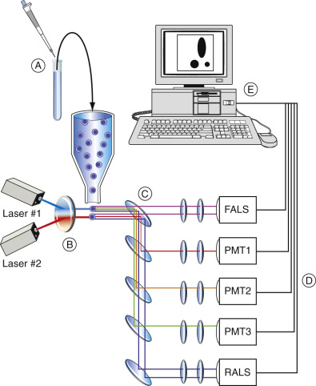

Figure 45-3 

Structural components and function of the flow cytometer. 

**A,** Fluorochrome-labeled monoclonal antibody solutions are added to a cell suspension from peripheral blood, bone marrow aspirate, or a lymph node. The tubes are incubated at room temperature for a short time. **B,** Labeled cell suspensions are passed through the flow cell of a flow cytometer. Many flow cytometers are automated, but some models require the operator to process the tubes individually. More than 10,000 cells from each tube are typically analyzed to produce statistically valid information. **C,** Each cell passes individually through the highly focused laser beam of the flow cytometer, a process termed _single cell analysis_ . The fluorochrome of each labeled monoclonal antibody attached to the cell is excited by the laser light and emits light of a certain wavelength. The cells also scatter light at multiple angles. Photodetectors placed at forward and right angles to the axis of the laser beam collect the emitted or scattered light. Forward and right angle scatter signals, and as many as five fluorochrome signals, can be detected from each cell (multiparametric analysis). **D,** The signals from each photodiode are digitized and passed to a computer for storage, display, and analysis. Typically, all data recorded from each cell are stored for possible later recall for further analysis (list mode data storage). **E,** A variety of histograms for visual display can be generated automatically or at the discretion of the operator. List mode data can also be transferred to a separate computer for analysis. Presently, most commercial flow cytometers utilize a standardized file format for list mode storage, and a variety of computer programs are commercially available for data analysis and display. 

 

##  The Flow Cell and Fluidics 

Two common flow cells are used in the clinical laboratory, but because most clinical instruments are used in the measurement of CD4 cells in the monitoring of HIV disease, a closed system is used as a biohazard precaution (  Bogh & Duling, 1993  ;  Chapman, 2000  ;  McCoy, 2002  ). The first, known as a stream-in-air or flow-in-air flow cell, allows the optical measurement point to be directly on the sample stream. This type of flow cell minimizes the distance between the flow chamber and the sample injector tip and thus minimizes carryover between specimens and the sample wash time necessary between samples. This chamber allows greater sample flow rate variability than a closed system. Other advantages of the stream-in-air tips are important in cell sorting and are not considered here. With the closed system, often referred to as a quartz tip flow cell, the focal point is within the chamber. Disadvantages of these quartz systems include the thickness of the quartz and thus the diffraction of the laser beam or the scattering of the signal. Additionally, the relatively large cross section (200 µm  2  ) makes the flow rate more difficult to control. The success of these quartz flow cells in the clinical system depends on illumination and collection optics. Flow cytometric manufacturers have made many advances in these systems to provide both safety and maximum sensitivity with the use of low-power, laser-based systems (  Austin Suthanthiraraj & Graves, 2013  ;  Sack & Tarnok, 2013  ;  Piyasena & Graves, 2014  ). 

Many terms are used in the definition of flow cytometry systems, including flow rate, sheath pressure, core size, resulting particle velocity, resulting coefficients of variation (CVs), and so forth. However, the most important factor for a laboratory worker to understand is that in DNA analysis, the cells are analyzed at a slow flow rate to increase the time a particle spends in the beam, allowing greater sensitivity and better CVs. In immunophenotyping, sensitivity typically is not an issue, and the particle flow rate can be increased. Most clinical systems were developed with compromises to accommodate the most common application of immunophenotypic analysis (  Baumgarth & Roederer, 2000  ). Research flow cytometers offer much greater flexibility and operator control over sample flow rate, differential pressure, and time. 

 

##  Colors and More Colors: Applications of Fluorochromes 

Most laboratories are still using the most common fluorochromes—fluorescein isothiocyanate (FITC; 530-nm emission) and phycoerythrin (PE; 575-nm emission)—for immunophenotyping, and propidium iodide (PI) (625-nm emission) in the measurement of DNA (  McCoy, 2002  ). FITC and PE are directly conjugated by the antibody of interest and are simultaneously added to a patient's sample. Use of a secondary antibody such as a goat antimouse (GAM) IgG labeled with fluorescein is no longer necessary for extra sensitivity; therefore, the background fluorescence is minimized. Most clinically used antibodies in the study of HIV are premixed and prediluted for use in whole blood technologies. PI can be used simultaneously with cell surfaces made in multiparameter DNA analysis, although this requires preservation of the cell membrane (  Clevenger & Shankey, 1993  ). 

New dyes that have become available to the clinical laboratory allow the simultaneous measurement of five or more colors with directly labeled monoclonal antibodies excited by single or dual lasers (  Sewell & Smith, 2011  ;  Virgo & Gibbs, 2012  ). This availability is revolutionizing the current performance of flow cytometry in laboratory practice. These dyes with a red and far red emission include PE Texas Red tandems (625-nm emission), PE-Cy-5 tandems (675-nm emission), and allophycocyanin (675-nm emission), to name a few ( [ Table 45-1 ](<#t0010>) ). In addition, several violet-excitable dyes, with emission maxima ranging from 450 to 535 nm, have recently become available (  Abrams et al, 2013  ). The early tandems were problematic because of excess free PE in solution, leading to excess background fluorescence. New technologies for the synthesis of these dyes are exploding, solving most of the technical issues, and new dyes are constantly being added for use in the clinical laboratory (  Sewell & Smith, 2011  ;  Virgo & Gibbs, 2012  ). With multiparametric flow cytometric analysis using violet-excitable, red, and far red dyes, complex immunophenotypic studies, such as leukemia analysis, can be performed in several tubes, and HIV subset analysis can be performed in a single tube with greater surety (  Nicholson et al, 1993  ). For example, for HIV subset analysis, a single tube with 100 µL of whole blood is simultaneously stained with CD45 PE-Cy-5, CD3 PE Texas Red, CD8 FITC, and CD4 PE. With the new digitized signal processing, compensation (vide infra) is easily performed, and the analysis is completed using CD45 as a gating agent with side scatter (SSC) and the simultaneous analysis of CD3, CD4, and CD8 ( [ Fig. 45-4 ](<#f0025>) ). 

TABLE 45-1 

Representative Fluorochromes Used in Flow Cytometric Analysis 

Fluorochrome  |  Ex, nm  |  Em, nm  |  Excitation Laser Lines, nm  |  Comment   
---|---|---|---|---  
Hoechst 33342  |  343  |  461  |  355  |  Nucleic acid probe, AT-selective   
DAPI  |  359  |  461  |  355  |  Nucleic acid probe, AT-selective   
Pacific Blue  |  410  |  455  |  360, 405, 407  |   
Pacific Orange  |  400  |  551  |  360, 405, 407  |   
CFSE  |  |  517  |  488  |   
Fluorescein isothiocyanate (FITC)  |  493  |  525  |  488  |  pH sensitive   
Alexa Fluor 488  |  495  |  519  |  488  |  Good photostability   
Acridine orange (AO)  |  510  |  530  |  488  |  Nucleic acid probe   
R-Phycoerythrin (PE)  |  496, 565  |  575  |  488, 532, 561  |  High quantum yield, poor photostability   
PE/Texas Red (Red 613)  |  496, 565  |  613  |  488, 532, 561  |   
Propidium iodide (PI)  |  305, 540  |  620  |  325, 360, 488  |  Nucleic acid probe, DNA intercalating, used as viability dye   
Thiazole orange (TO)  |  510  |  530  |  488  |  Nucleic acid probe   
7-Amino actinomycin D (7-ADD)  |  546  |  647  |  488  |  Nucleic acid probe, GC-selective, used as viability dye   
PE/Cy5 conjugates  |  496, 565  |  670  |  488  |  Tandem dyes, Cychrome, R670, Tri-Color, Quantum Red   
Peridinin chlorophyll protein (PerCP)  |  482  |  675  |  488  |   
PerCP/Cy 5.5  |  482  |  690  |  488  |  Tandem dye   
PE/Cy 5.5  |  496, 565  |  695  |  488  |  Tandem dye   
PE/Cy 7  |  496, 565  |  774  |  488  |  Tandem dye   
Texas Red  |  589  |  615  |  595, 633  |  Sulfonyl chloride   
Allophycocyanin (APC)  |  645  |  660  |  595, 633, 635, 647  |   
Alexa Fluor 647  |  650  |  668  |  595, 633, 635, 647  |   
APC/Cy7 (PharRed)  |  650, 755  |  785  |  595, 633, 635, 647  |   
  
_Em (nm),_ Emission wavelength in nanometers; _Ex (nm),_ excitation wavelength in nanometers. 

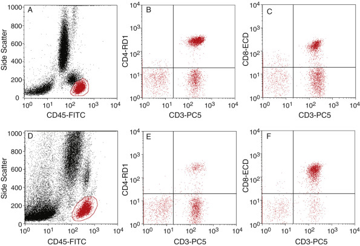

Figure 45-4 

Flow cytometric immunophenotypic lymphocyte subset analysis. 

Use of four-color flow cytometry for the performance of peripheral blood lymphocyte subset enumeration. **A,** A dot-plot histogram of CD45 fluorescence intensity (CD45-FITC) versus side scatter (SS) as a gating strategy to discriminate lymphocytes (gated area) from other peripheral blood cells in a normal control individual. **B** and **C,** Dot-plot histograms of CD3  \+  CD4  \+  and CD3  \+  CD8  \+  cell populations. **D** through **F,** Corresponding histograms from a human immunodeficiency virus (HIV)–infected individual, demonstrating a marked decrease in CD4  \+  lymphocytes and the corresponding relative increase in CD8  \+  lymphocytes. Directly conjugated monoclonal antibodies were conjugated with fluorescein isothiocyanate (FITC), phycoerythrin (PE), energy-coupled dye (ECD), or a PE-Cy5 tandem (PC5). 

Another interesting phenomenon is that these new dyes have allowed the use of fluorescence as a trigger in place of the usual forward light scatter parameter. This is possible because the far red dye spectra are not found in components of most cells, or they do not have autofluorescence competition in nature, as was found with FITC. Furthermore, they can be excited at wavelengths that minimize the autofluorescence from cell constituents such as riboflavin. Therefore, when performing a rare event (cells present at <0.1% of total population) analysis using a fluorescent trigger, many cells can be analyzed very rapidly. This method is also used to label leukocytes in unlysed blood using fluorescence as a trigger. A dye that marks the nuclei or cytoplasm of the leukocytes, and not the erythrocytes, is used. 

The use of multicolor fluorescence has allowed the concept of multiparameter analysis to become a reality in most laboratories. For example, parameters can evaluate different functional subsets of a particular cell population using an intracellular fluorescent probe; the use of multiple colors to identify small clusters of otherwise unidentifiable events (as in detection of minimal residual disease [MRD]); the activation status of cells at a particular disease stage (e.g., use of HLA-DR and CD38 on CD4 and CD8s in HIV staging using an anchor gate approach); and cell surface expression and the DI or S phase of a particular cell population, as in defining the CD19 S phase in acute leukemia. Obviously, the possible combinations are nearly infinite, and their sophistication is enhanced by the specific dyes and DNA/ribonucleic acid (RNA) probes that are now available. A discussion of some of these approaches and techniques follows. 

,  

##  Gating and Data Analysis 

 

##  Immunophenotypic Analysis 

Analysis of cell populations with the flow cytometer uses a combination of parameters that, when applied, define a specific cell population. Flow cytometry uses parameters similar to those that have been used for many years in hematology, including size (forward light scatter), cytoplasmic granularity (side scatter), and affinities for specific dyes, and combines them with the immunologic tools already mentioned. These include multiple fluorescent dyes bound to antibodies or probes, DNA measurements as obtained using PI or 4′6-diamidino-2-phenylindole, and other nuclear markers. The key is the simultaneous detection of these parameters with today's analytic systems. For many years, the clinical laboratory flow cytometer could use only three simultaneous measurements. Staining of cell populations was limited by the unavailability of directly conjugated monoclonal antibodies, necessitating the use of a secondary GAM reagent or the use of biotin-labeled antibodies. Definitions of positive and negative populations in high-background cases made it necessary to use a subtraction channel-by-channel algorithm to differentiate positive from negative (  Bagwell, 1993  ). In cases in which the cell population had a defined boundary between negative and positive, a cursor was set so that no more than 2% of the events considered negative fell to the right of the cursor, thereby defining the positive events when a matched isotypic control was used. Although this approach seemed reasonable at the time (  Lewis, 1993  ) and worked well with bright cell clusters, it has become cumbersome when identifying leukemic cells or performing analyses of cell activation markers. However, hematopoietic neoplasms are particularly problematic because each neoplastic clone has its own “relative” fluorescent intensity, and isotype controls may have little relevance. Applying hard and fast rules to cursor settings led to the underestimation of positive clusters. The failure of this approach is especially dramatic in the analysis of monoclonality by κ and λ light chain expression, where small, but significant, differences were often lost. 

Use of isotype controls in certain situations has been challenged on many fronts, both from technical aberrations associated with their use and from added costs to the laboratory. New software algorithms have the capability of making intensity measurements and defining clusters based on population means intensities, including relative fluorescent intensities, as well as actual molecules of equivalent soluble fluorochrome quantitation (vide infra). Clearly, the need to remember what we are measuring and an understanding of the biology of the population of interest need to be considered in designing an analysis protocol. Fortunately, some sophisticated software approaches and better reagents have allowed us to use multiparameter gating to define populations, rather than trying to make estimates of fluorescence expression using cursor values. Many investigators have used the multiparameter approach in defining cluster and other populations of interest (  Loken et al, 1990  ;  Baumgarth & Roederer, 2000  ;  Kraan et al, 2003  ;  Stewart & Stewart, 2004  ). These approaches take many forms, a few of which are reviewed here. 

With the arrival of multicolor fluorescence came the need to analyze the numbers of cells expressing one or more colors at the same time in a particular cell population defined by forward angle light scatter (FALS) and SSC regions (  Loken, 1976;  1977  ). When this method was first developed, scientists were thinking basically about the mathematics and the accounting of all cells and the numbers of these cells expressing one or more colors. A binary approach to this analysis was developed, known as Prism (Coulter, Hialeah, Fla.). These analysis regions were hard-gated and were set into the instrument by the operator and could not be redefined at a later time using list mode analysis. This approach was later modified to allow some regating, and other manufacturers, as well as third-party software applications, made this Prism binary approach work on a postanalysis basis. Loken then defined bone marrow populations using CD45 versus SSC gating—a unique approach to defining the heterogeneous populations found in bone marrow (  Loken et al, 1990  ;  Stelzer et al, 1993  ). This approach became particularly relevant with the discovery that the vast majority of acute leukemia blast cells, both of lymphoid and myeloid origin, show downregulated CD45 expression, permitting the use of CD45 fluorescence intensity and light scatter to separate acute leukemia populations from lymphocytes, monocytes, and maturing myeloid cells (  Posekany et al, 1991  ;  Borowitz, 1992  ). Loken further promoted the use of CD45 and CD14 dual-parameter analysis gated on the lymphocyte region of FALS versus SSC for peripheral blood. Many agencies embraced this approach for HIV flow cytometry panels to minimize the effects of contaminating monocytes in the lymphocyte population, because they might interfere with a true CD4 lymphocyte count, as monocytes have CD4 receptors on their surface (  Passlick et al, 1989  ). Agencies that promoted this type of analysis included the Centers for Disease Control and Prevention (  Centers for Disease Control, 1992  ), the National Institute of Allergy and Infectious Disease, Division of AIDS (DAIDS) (  Calvelli et al, 1993  ), the National Committee for Clinical Laboratory Standards (NCCLS) (  Standards NCfCL, 1992  ), and the College of American Pathologists (CAP). 

Unfortunately, even though this approach solved a lot of problems, it did not ensure that each tube in the panel had the same contents as the tubes containing CD45 and CD14, and the required purity correction might be overestimated, leading to incorrect values for CD4. These issues were reviewed during a conference held by the CDC a year after the HIV guidelines for the performance of CD4 counts were published (  Stelzer et al, 1993  ). Other analyses of this approach have been performed by the AIDS Clinical Trial Group (ACTG) Flow Advisory Committee in the DAIDS Proficiency CD4/CD8 program (  Kagan et al, 1993  ) and by CAP in its proficiency testing program (  Homburger et al, 1993  ). 

A new approach to gating was evaluated in HIV panels that followed from Loken's original approach to a bone marrow definition of clusters (  Loken et al, 1990  ). The use of CD45 as a gating parameter has simplified the analysis of bone marrow, leukemias, and HIV panels. In bone marrow and leukemia workups, CD45 is usually set as the third or fourth color and is paired with forward light scatter or side scatter; this allows the definition of a blast (potentially malignant) population. The blast population is then defined using a panel of monoclonals and the three available color parameters. In the HIV, one-tube, four-color method, CD45 allows the definition of a large lymphocyte-gated region, which is secondarily gated for CD45. This can also be done without the use of light scatter parameters, as was previously described, or with the use of a two-tube, three-color panel. Newer analytic reagent products from some manufacturers include precounted beads in the monoclonal antibody–containing tube, thus permitting an absolute lymphocyte count, known as a flow differential, to be performed at the same time as the lymphocyte subset enumeration (  van de Geijn et al, 2011  ). This removes the requirement of needing a hematology counter when performing T cell enumerations and avoids the problems of white cell deterioration with shipping and the performance of an accurate differential to get accurate T cell numbers. These methods are just becoming incorporated into ACTG HIV trial work and that of other laboratories. Recently, there is great interest in simplified, inexpensive flow cytometric instruments and protocols for the evaluation of HIV diagnosis and monitoring in resource-limited regions of the world (  Pattanapanyasat, 2012  ;  Koyalta, 2013  ). The inclusion of fluorochrome-labeled DNA primers may also provide a relatively simple, inexpensive procedure for the monitoring of the HIV viral load (  Greve et al, 2009  ;  Lizard, 2009  ). 

Another gating strategy is the use of two- or three-color definition of a particular subset of interest. This approach, commonly referred to now as an _anchor gate,_ uses the particular properties of some cells to investigate another set of parameters. When applied specifically to T lymphocytes, it is referred to as a _T gate_ (  Mandy et al, 1992  ). An anchor gate (  Paxton et al, 1995  ) is especially useful when looking at activation markers, as in the HIV subsets of CD3/CD8 expressing CD38 and HLA-DR, or when looking at the expression of CD45Ra and CD45Ro against CD3/CD4 or CD3/CD8. The advantage of this method is that it is intuitive, and each color acts as a quality control check for the other subset. Furthermore, one has the choice to define the expression of biologically relevant markers in relation to functional or biologically relevant populations. This approach lends itself well to quantitative fluorescence. Although the concept of quantitative fluorescence is not new, the techniques used to measure fluorescence equivalents or fluorescence thresholds or other similar designations are new. Quantitative fluorescence measurements will be described after DNA gating and analysis. 

Another approach to anchor gating involves CD34 harvesting, which uses CD34 and CD45 staining with or without 7-amino-actinomycin D (7-AAD) as a viability assessment in the identification and enumeration of CD34 progenitor cells. With these methods, beads can also be used to obtain the number of cells recovered. These methods have great utility in bone marrow transplantation protocols in which progenitor cells are harvested from cord blood, bone marrow, or peripheral blood (e.g., the International Society for Hematotherapy and Graft Engineering) and reinfused. This approach has become the standard for most laboratories performing transplants. A commercial system called ProCount (Becton Dickinson) uses a similar approach and reagents to automate the process (  Pranke et al, 2006  ). Complex immunophenotypic analysis with five or more monoclonal antibodies is becoming more common in clinical and research laboratories for the detection of minor lymphocyte subpopulations of clinical relevance in patients with autoimmune and immunodeficiency diseases; small, immunologically aberrant subpopulations; and minimal residual disease in patients with hematologic malignancy. In this regard, multiparametric flow cytometric analysis using 17 fluorescent colors has been reported (  Perfetto, 2004  ). 

 

##  DNA Analysis 

 

##  General Aspects 

Conceptually, DNA analysis should be less complex than immunophenotyping analysis, but a review of the literature and its prognostic capabilities, as well as performance by laboratories on proficiency tests, indicates otherwise (  Tirindelli Danesi et al, 1997  ). Because publication of several thousand reports in the 1980s and the early 1990s yielded conflicting findings regarding the diagnostic and prognostic significance of ploidy and S phase activity in various human tumors, a DNA consensus conference was held and the proceedings published in _Cytometry_ (  Shankey et al, 1993  ). This report was a historical review of major tumor types (in fresh, frozen, and paraffin samples) and the clinical value of the performance of ploidy by DI and the value of the S phase. These parameters were analyzed in terms of their effectiveness as prognostic markers. The 1994 CAP Conference looked at the previous markers and some additional potential tumor surrogates. In each case, the DI and the S phase were less predictable as prognostic markers than was hoped. This was largely attributed to the variability in technical performance and analysis of these assays (both instrument and samples preparation) and the inherent risk of tumor heterogeneity and therefore of appropriate sampling of the tumor. Specific recommendations were made with each tumor type for appropriate quality control measures that should be taken and for proper deconvolution of the histograms. Since that time, the routine utilization of DNA analysis in the clinical laboratory has considerably declined. Because of the high degree of variability and the lack of prognostic significance, it was suggested by some that clinical DNA measurements be performed only by expert laboratories or be completely eliminated (  ASCO, 1996  ). The FDA to date has not cleared any methods and still considers this a research test. However, several groups have made significant inroads into solving some of the issues associated with DNA analysis ( [ Fig. 45-5 ](<#f0030>) ) (  Shankey & Rabinovitch, 2002  ;  Corver & ter Haar, 2011  ;  Krueger & Wilson, 2011  ). The future of this technique in clinical medicine is further discussed later in the chapter. 

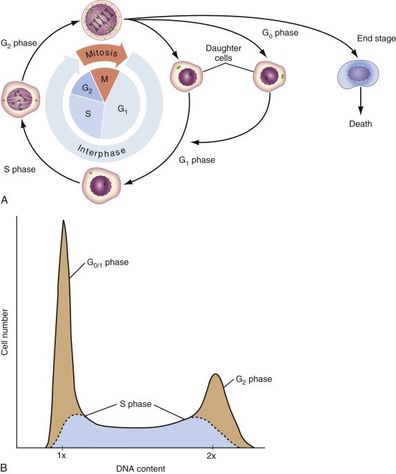

Figure 45-5 

The cell cycle. 

**A,** Schematic illustration of the cell cycle of an asynchronous cell population. Most cells are in the resting (G  0  ) or early proliferative (G  1  ) stage of the cell cycle and have diploid (2N or 2C) DNA content. Cells that are actively synthesizing DNA (S phase) have increased DNA content (2N-4N), and cells in the second gap (G  2  ) phase or undergoing mitosis (M) contain precisely twice the diploid amount of DNA (4N or 4C). **B,** Flow cytometric DNA histogram of a normal proliferating cell population stained with propidium iodide. Cells in the G  0  /  1  , S, and G  2  M phases of the cell cycle can be differentiated by this technique. Resolution of DNA analysis depends on the fluorochrome utilized for staining DNA, resolution of the instrument, and other factors. Mathematical modeling is required for analysis of cell cycle data because of “overlap” of the S phase curve into the G  0  /  1  and G  2  M regions. 

(Reprinted with permission from Riley RS, Mahin EJ, Ross W: _Clinical applications of flow cytometry._ New York, 1993, Igaku-Shoin Medical Publishers.) 

 

##  Sample Preparation 

DNA preparative methods are reasonably simple and inexpensive to perform. Many references for the original methods exist, as do many modifications. The most common methods are those used on fresh and frozen tissues and developed by Krishan, Vindelov, Crissman, Steinkamp, and others (  Rabinovitch, 1993  ;  Vindelov & Christensen, 1994  ) and those used on paraffin blocks (  Hedley et al, 1983  ). In each case, whether the cells are enucleated or the cell membrane is preserved, the DNA dye PI is used most commonly in the majority of clinical laboratories and has already been described. PI staining is straightforward as long as timing, saturation, and removal of RNA parameters are followed. Measures of gross karyotypic abnormalities are made by comparing the peak (fluorescence intensity, PI uptake) of the tumor versus a diploid calibrator. Factors affecting this measurement include the CVs of the peaks for both the calibrator and the suspected tumor, the G  2  /G  1  ratio, the linearity of the instrument, and linearity as measured by the deconvolution software package and the percent of tumor present (sampling) in the sample (  Shankey & Rabinovitch, 2002  ). It is common to find laboratories reporting out a diploid tumor result on a sample containing “no” tumor. Tumors with near diploid values need stringent rules of interpretation, as does the definition of tetraploidy. Additional problems are associated with the definitions of aggregates, doublets, and debris; the treatment of sliced and cut nuclei; and the S phase population. The descriptive and semiquantitative acronym BAD is used by software analysis packages to model the effects of background, aggregates, and doublets (  Rabinovitch, 1993;  1994  ). The impact of this parameter on the analysis is controversial. 

The resulting S phase and DI measurements based on a single-parameter mode of analysis (PI only) are subject to these deconvolution algorithms, leading to great interlaboratory variability (  Coon et al, 1994  ). These deconvolution algorithms for DNA have been studied extensively, but many models used for analysis need further study. The DNA consensus document makes specific recommendations applicable to certain tumor types and suggests that laboratories perform their analyses accordingly, but even with these guidelines, a level of ambiguity remains in the interpretation and performance of the clinical laboratory that contributes to the discordance of results in comparative studies and in proficiency tests (  Coon et al  1988  ;  Wheeless et al, 1991  ). Difficulty in achieving consensus makes interpretation of results more difficult for the novice laboratory, as well as for clinicians who are trying to compare their laboratory results with recent literature on the treatment of their patients. This is especially true in the classification of S phase values. S phase measures are subject to the effects of debris and aggregate modeling as described by Rabinovitch and others (  Bagwell, 1993  ;  Shankey et al, 1993  ;  Rabinovitch, 1994  ). Furthermore, it is critical that decisions made with regard to which mathematical model is used for a particular tumor be kept constant and that the list mode data be retained without modeling in case further analysis is necessary. 

Other approaches using DNA and RNA probes, such as thymidine derivatives, bromodeoxyuridine, and acridine orange (RNA), are used to improve the quality of the models in the estimation of proliferative and kinetic properties of a specific tumor. It is important to remember that proliferation measures are not the same as measures of S phase quantitation, which provide a static model or a picture in time of all cells being analyzed. Integration of the area for the number of cells between 2C and 4C in a DNA histogram is not capable of giving any information with regard to cells “stuck” in S  0  (cells actually stop DNA synthesis), nor of measuring the number of infiltrating normal cells that also might be proliferating. The S phase value may often be higher than the actual proliferative capacity owing to artifacts of tumor heterogeneity. The single-parameter histogram yields reasonable results when dealing with an asynchronous, relatively homogeneous cell population. Pulse labeling is most commonly used in larger academic settings and to measure the effectiveness of radiation and chemotherapy by obtaining true measures of G  0  /G  1  cells and G  2  \+ M compartments, which are not possible to attain using single-parameter measures of S phase. 

Other approaches using nuclear and cytoplasmic probes as well as surface markers can be used to separate a population of interest from a mixture of cell types (  Darzynkiewicz, 2010  ). This type of multiparameter analysis is especially useful in the measure of S phase in hematologic malignancy. Specific blast populations can be identified by FITC fluorescence and FALS, and those events can be analyzed for DNA content and S phase using PI. Staining methods are altered to preserve cell surface properties or nuclear properties (  Clevenger & Shankey, 1993  ;  Ramaekers & Hopman, 1993  ;  Bauer & Jacobberger, 1994  ;  Carothers, 1994  ). These methods usually involve staining the surface marker of interest (e.g., KI-67, cyclin B1, cytokeratin, CD10) with the monoclonal antibody, fixing it in an alcohol (or commercial fixation and permeabilization reagent), and then treating it with a detergent to allow penetration of PI or another nuclear dye. Staining methods are selectively modified to preserve specific membrane and nuclear properties specific to the probe of interest (  Bauer & Jacobberger, 1994  ). Cell fixation with zinc salts has recently been reported as a more optimal technique to permit simultaneous multiparametric analysis of cell surface and intracellular proteins, DNA content, and other measurements, while permitting long-term storage of the labeled cells (  Christensen et al, 2011  ;  Jensen et al, 2010  ). 

 

##  DNA Studies of Interest in Cellular Immunology 

There has been an explosion of literature on the subject of apoptosis (i.e., programmed cell death) and its relevance to traditional DNA parameters and other phenotypic considerations. It is not within the scope of this chapter to handle this topic. Although many studies are ongoing, apoptotic measurements are still not part of the routine clinical laboratory (  Telford et al, 2011  ). 

As mentioned earlier, laboratory DNA analysis has recently come under much scrutiny, and in some regions, these studies are no longer being reimbursed. Several investigators in the field had challenged the wholesale expulsion of this test from the laboratory, as it is useful in certain tumors. The reexamination of a set of retrospective breast cases has been undertaken by  Bagwell and others (2004)  to attempt to develop a unified prognostic model for node-negative breast cancer patients. It is hoped that these studies and others will resurrect what could be a useful prognostic and diagnostic tool that perhaps was previously underestimated in its complexity. 

 

##  Quantitative Flow Cytometry 

The definition of cell types in immunologic terms such as effector cells implies the property of these cells to regulate, whether up or down, specific molecular functions through surface receptors. Known as immunologic phenotypes (  Poncelet et al, 1993  ), these cells need other measurable properties to define their biologic roles in maturation and in disease processes. One of the observed phenomena is the differential expression of cell surface antigens (CDs) in relative terms and in absolute quantitative terms. Before the availability of absolute measures, descriptive terms such as bright or dim, bimodal, and so forth, were used in the literature to describe a visual phenomenon of antigen density differences. Although descriptive, these terms are difficult to define and to standardize between laboratories and between patients. They also lack precision in defining an event and cannot be objectively used to monitor patients' treatment or cell definition (cell type) by measures of CD expression and overlapping expression. Evidence suggests that quantitative differences in antigen expression in chronic lymphocytic leukemia and other leukemias may be important in determining the prognosis (  Poncelet & Carayon, 1985  ). These measures are also used in the definition of MRD and in the investigation of a viral effect or activation in HIV disease (  Poncelet et al, 1991  ). The percent of a specific cell present often does not give the true clinical picture. This is particularly true in leukopenic cases and when the blast population represents a relatively small percentage of total cells present. 

Quantitative flow cytometry is defined as the quantitation of fluorescence intensity (FI) as determined by the antibody-binding capacity of a given fluorochrome antibody conjugate; it is an indirect measure of the amount of cell surface antigen present per individual cell (  Stelzer et al, 1997  ;  Marti et al, 2003  ;  Wang et al, 2011  ). Investigators have described the use of polystyrene beads or cell lines coated with saturating amounts of antibody to determine the absolute numbers of receptors or antigenic sites per cell, also referred to as _antigen density_ (  Poncelet et al, 1993  ). ABC units are defined as a measure of relative antibody-binding capacity. This method does not need to match the fluorescein/protein ratio, because both the cells and the standards are being stained with the same antibody. Use of FI measurements should give the user a means to avoid this situation. More information can be obtained by referring to the 1997 U.S./Canadian consensus document that reviews the necessary parameters for standardization (  Stelzer et al, 1997  ). 

Although early in its development, quantitative phenotypes will help us define cluster analysis software programs for cell quantification and identification by establishing mean channel FI as a means of separating cells of different functional phenotypes. 

,  

##  Clinical Significance of Cellular Immune Testing 

The decision to test the immune response is usually made in the context of the patient's clinical presentation, as described in [ Box 45-1 ](<#b0010>) . The most common reasons for the initiation of a clinical laboratory request include increased or unexplained susceptibility to infection, increased severity of common infections, or an unusual reaction to immunization. Unusual infections, especially those caused by opportunistic agents or severe infections that are unresponsive to treatment, and certain allergic or atopic states, may also prompt immune testing. In recent years, potential HIV infection has replaced possible primary immune deficiency as the leading presumptive diagnosis. Because few, if any, cellular immune tests are totally and specifically diagnostic, and because they may be expensive and time consuming, the request for laboratory evaluation should be approached with caution and a clear understanding of how the result will lead to improved management of the patient. Under these circumstances, the responsibility of the clinical immunology laboratory is to establish a sufficient range of tests to enable judicious testing for determination of the nature and extent of the immune alteration, as well as interpretation of the results in the context of the current clinical presentation and past medical history. 

Box 45-1 

Presentation of Possible Immunodeficiency 

  * •

Frequent bacterial infection 

  * •

Unusually severe systemic reaction to a virus 

  * •

Development of infection with an unusual organism such as fungus or protozoan 

  * •

Systemic reaction following live virus vaccination 

  * •

Family history of recurrent infections 

  * •

Exposure to the human immunodeficiency virus 

The principal task of the clinical immunologist, aided by the laboratory, is often to distinguish the features of primary immune deficiency, or suspected acquired immune deficiency due to HIV infection, from immune changes associated with other clinical conditions that may produce immune changes that could appear phenotypically identical to primary immunodeficiency (  Tebo et al, 2014  ). In this regard, immune changes may accompany many clinical entities such as malignancy, traumatic injury such as burns or accidents resulting in major blood loss or organ damage, hematologic disease such as Fanconi's anemia, hemophilia, immune thrombocytopenia, lymphoproliferative disorders such as histiocytosis, the hemoglobinopathies such as sickle cell anemia, thalassemia, and a fairly wide range of chromosomal abnormalities such as DiGeorge syndrome, Down syndrome, Bloom syndrome, William congenital dyskeratosis, epidermolysis bullosa, and Duncan syndrome (X-linked lymphoproliferative disorder). Autoimmune diseases such as rheumatic disease, mixed connective tissue disease, type 1 diabetes mellitus, systemic lupus erythematosus, amyotrophic lateral sclerosis, multiple sclerosis, and myasthenia gravis may be associated with cellular immune changes and are discussed further elsewhere in this book. 

Primary immune deficiency disorders nearly always present in the context of infection or hematologic change. Laboratory evaluation of these disorders requires a stepwise approach to minimize blood drawing and to logically choose among available tests for the purpose of differential diagnosis. Some presumptive diagnoses may appear to be too frequently suspected—for example, Wiskott-Aldrich syndrome—although this does need to be ruled out in cases of unexplained thrombocytopenia. However, Wiskott-Aldrich syndrome may be missed if response to mitogens alone rather than to antigens as well is not tested, and the immune defect may become more marked with time, so follow-up testing may be needed. 

HIV infection can be readily diagnosed by direct testing, but the clinical immunology laboratory is sometimes used as a proving ground before the patient or guardian is approached for informed consent for HIV testing. This is based on the observation that an inverted CD4/CD8 ratio is virtually always found among HIV-positive adults. Thus as a result of the current AIDS epidemic, the inverted CD4/CD8 ratio has become identified as a marker of HIV infection. However, a number of diseases other than HIV involve the immune system and can produce an inverted CD4/CD8 ratio, or extremely low CD4 cell numbers. These include, but are not limited to, DiGeorge syndrome, benign thymoma, the early phase of hepatitis C virus infection, Kawasaki disease, protein-calorie malnutrition, and malignancy. 

,  

##  Clinical Interpretation of Cellular Immune Testing 

The clinician or laboratorian interpreting cellular immune function assays is often confronted by the issue of how to evaluate the potential clinical significance of an impaired in vitro immune response. Studies of even relatively well-defined disorders have shown that very significant differences in clinical symptoms may occur. However, newer testing strategies can be helpful in subclassifying patients by the level and extent of the defect. 

For example, DiGeorge syndrome (22q11.2 deletion syndrome) (  DiGeorge, 1974  ) is classically a triad of thymic and parathyroid aplasia and conotruncal defects. Patients with DiGeorge syndrome show marked differences in severity of infection in spite of relatively similar findings of reduced numbers of mature T lymphocytes and a poor response to mitogens. Initially, a very high degree of fatality was associated with this syndrome. Improved surgical and anesthesia methods have led to a significant decrease in the incidence of severe infection, although some infants still develop intractable and ultimately fatal infection (  Bastian et al, 1989  ). Recently, it has been possible to use more exact lymphocyte phenotype analysis to determine the severity of the immune defect and to more accurately predict clinical outcome. Using longitudinal testing over several months and a multiple parametric approach, it now seems that severity may be predictable from consistently low CD4  \+  T-cell numbers, an inverted CD4/CD8 ratio, and reduced lymphokine IL-2 production (  Cunningham-Rundles et al, 1994  ). Investigation into the significance of monosomic deletions of chromosome 22q11.2, which are the leading causes of DiGeorge syndrome, velocardiofacial syndrome, and conotruncal anomaly face syndrome, illustrates the importance of new genetic information. Although only DiGeorge syndrome was originally described as an immunodeficiency disorder, new studies looking at the frequency of immunodeficiency in the other clinical syndromes associated with the chromosome 22q11.2 microdeletion have shown that more than 75% of patients have evidence of immunocompromise, the severity of which does not correlate with any particular phenotypic feature (  Sullivan et al, 1998  ). 

T-cell function may be as important, or more important, in HIV infection than the loss of CD4  \+  T cells or the rate of loss. In some viral-associated illnesses, considerable uncertainty exists as to how close the association is between an immune deficit detected ex vivo and the patient's in vivo immune function (  Landay et al, 1991  ;  Lloyd et al, 1992  ). In other diseases, immune abnormalities have been identified as disease markers, but there is no clear understanding of cause and effect. An example is seen in some forms of chronic fatigue syndrome associated with altered orthostatic response (  Rowe et al, 1999  ) and increased plasma levels of TNF-α (  Moss et al, 1999  ). 

 

##  Age and the Immune Response 

Current studies demonstrate that the immune system changes as part of the aging process (  Weiskopf et al, 2009  ;  Nikolich-Zugich, 2012  ;  Montecino-Rodriguez et al, 2013  ;  Fulop et al, 2014  ). Although considerable variation in this is seen, and much is a consequence of altered nutritional status (  Monk et al, 2011  ;  Afacan et al, 2012  ;  Maijo et al, 2014  ), it is essential that the clinical laboratory provide relevant laboratory values for age-matched controls. 

The study of pediatric patients presents particular issues for the laboratory diagnosis of immune deficiency. Development of the immune system in the child is not complete at birth; in addition, children have not been exposed to a wide variety of abnormal environmental agents and may have vulnerability to infection (  Ygberg & Nilsson, 2012  ;  Rytter et al, 2014  ). Congenital viral exposure or prematurity alone may be associated with immune abnormalities. Key differences in the pediatric immune response include marked lymphocytosis and deficit in endogenous antibodies at birth, elevated B cells that show a deficient response to polysaccharide antigen, increased CD4  \+  /CD8  \+  T cell ratio, few NK cells, decreased cytokine production, and oligoclonal T cell expansions (  Wedderburn et al, 2001  ;  Marodi, 2006  ;  Philbin & Levy, 2009  ). These differences are reflected in marked differences in the normal range of lymphocyte subsets and must be taken into account during evaluation of results (  Denny et al, 1992  ;  Bonilla & Oettgen, 1997  ;  Shearer et al, 2003  ;  Tosato et al, 2015  ). Also, marked differences in response to various activators have been noted as compared with adults. The neonatal response of premature infants to certain microbial activators may be stronger than that of adults or full-term infants because of rapid changes in immune regulation (  Veber et al, 1991  ;  Cunningham-Rundles & Nessin, 2000  ) or because of fundamental differences in perinatal programming (  Prescott et al, 1998  ). The immune system of elderly individuals also shows changes in comparison with that of younger adults. In particular, cumulative alterations in critical B and T cell subpopulations, altered cell signaling and cytokine production, and other changes may contribute to the increased incidence of autoimmune disease and cancer in this group (  Hakim et al, 2004  ;  Alvarez-Rodriguez et al, 2012  ;  Montecino-Rodriguez et al, 2013  ). The deterioration of immune responses with increasing age has been designated immunosenescence (  Malaguarnera et al, 2001  ). Zinc deficiency appears to be one of many factors that may lead to immunosenescence (  Maywald & Rink, 2015  ). 

 

##  Malnutrition and the Immune Response 

Although it is generally believed that malnutrition is relatively rare in developed countries, growing evidence suggests that malnutrition is fairly common, especially in certain age groups (  Pennington, 1996  ). Malnutrition is associated with immune deficiency and causes significant vulnerability to infection (  Cunningham-Rundles et al, 1996  ;  Keusch, 2003  ). For example, zinc deficiency can present as a profound immune deficiency that may be related to the primary lack of zinc uptake at the gastrointestinal tract, to acrodermatitis enteropathica, or to lack of adequate zinc in the diet (  Moynahan, 1974  ;  Prasad, 2009  ;  Tuerk & Fazel, 2009  ). Persons with hypogammaglobulinemia and associated malabsorption affecting zinc levels may show poor proliferative response in vitro and infections that resolve with zinc repletion (  Cunningham-Rundles et al, 1981  ). This is associated with the fact that zinc is required for the biologic activity of thymic hormone, is needed for the production of functionally mature T cells and for activation of T cells, and may play a role in intercellular signaling within the immune system (  Cunningham-Rundles & Lin, 1998  ;  Prasad, 1998  ;  Haase et al, 2008  ;  Hirano et al, 2008  ). Increasing evidence suggests that micronutrient imbalance will alter immune response through specific effects on the immune response (  Amati et al, 2003  ;  Savino & Dardenne, 2010  ;  Tilg & Moschen, 2013  ). In many clinical settings, malnutrition may be a complicating factor. The interaction of infection with altered metabolism secondary to the acute phase response can cause temporal shifts in trace elements, leading to transient suppression of the immune response. Physical stress may have a similar effect and may lead to enhanced vulnerability to infection in the context of immune suppression (  Cunningham-Rundles, 1999  ). This is a two-way process. Growth failure may be the first sign of HIV infection in an HIV-positive child (  Peters et al, 1998  ). For this and other reasons, immune evaluation should be an ongoing process in the context of continuing treatment or other testing. 

 

##  Cancer and the Immune Response 

Primary immunodeficiency is associated with an increased incidence of cancer (  Cunningham-Rundles et al, 1987  ), and it is increasingly clear that tumors develop in association with infection by HIV and other viruses and bacteria (  Aoki & Tosato, 2004  ;  Engels et al, 2008  ;  Grivennikov et al, 2010  ). In the patient with cancer, generalized immune deficiency or reduction in response to antigenic challenge may appear in association with the development of primary malignancy, may occur during metastasis, or may be caused by the side effects of therapeutic intervention. Reduced immune response to nonspecific activators studied ex vivo in proliferation assays does correlate with stage of disease and has prognostic significance for survival (  Heimdal et al, 1999  ). An inverted CD4/CD8 ratio and increased suppressor cell activity are often observed in untreated cancer patients, and changes in cytokine production have been observed (  Livingston et al, 1987  ;  Smyth, 2004  ). Experimental studies have shown that tumors may be surprisingly immunogenic but may drive the immune response toward a nonprotective response (  Loose & Van de Wiele, 2009  ). 

The development of new immunotherapeutic approaches is increasing, suggesting that response to tumor-specific antigens will be used more in the future (  Schultes & Nicodemus, 2004  ;  Steinman & Mellman, 2004  ;  Waller, 2004  ). Immune response assays may also be used to track and evaluate response to treatments such as IL-2 (  Lissoni et al, 1999  ) and cancer vaccines (  Yannelli & Wroblewski, 2004  ). In many patients, chemotherapy will produce transient suppression of immune response that resolves within a short time, and radiation may have longer-term effects (  Katz & Fauci, 1993  ). Assessment of immune response in the cancer patient requires highly selective and discriminating use of tests and activators, which reflect relevant processes, as well as specificity of response. 

,  

##  Methodologic Approach to Cellular Immune Testing 

Human studies have been based on observation of peripheral blood immune cells because the peripheral compartment is most accessible and readily measured, but this approach may not reflect regional events. Knowledge of the differences between systemic and mucosal immune response may ultimately explain many current paradoxes that arise when immune response measured in vitro or ex vivo is compared with host defense in vivo (  Xu-Amano et al, 1993  ). Systemic cellular immune function appears to be regulated through functionally distinct T-helper–type cytokine patterns (“the cytokine network”), such that when Th1 cytokines, IL-2, and IFN-γ are produced, cellular immune host defense is favored. When Th2 cytokines, IL-4, IL-5, IL-6, and IL-10 are produced, B lymphocyte response is induced (  Balkwill & Burke, 1989  ;  Yamamura et al, 1991  ;  Muller, 2006  ;  Seillet et al, 2014  ). 

In contrast to systemic immunity, the primary activity of the mucosal immune response is to protect the mucosa by blocking microbial, toxin, and antigen entry through secretion and transport of IgA to the lumen of the gut—a process mediated by the innate immune system and a special type of memory T lymphocyte with reduced proliferative capacity capable of providing B cell help (  Cheroutre, 2004  ;  Nochi & Kiyono, 2006  ;  McDermott & Huffnagle, 2014  ). Both lamina propria T lymphocytes and intraepithelial T lymphocytes develop in relative independence of the thymus and function differently from peripheral blood T cells in using the CD2 signal transduction pathway rather than the TCR/CD3 pathway. 

At present, tests of mucosal immunity usually are not performed in the clinical immunology laboratory, and, with rare exceptions, the immune cells under study are from the peripheral blood compartment. For this reason, use of in vivo skin testing and examination of humoral immune response to previously encountered vaccines are useful to the cellular immunologist, as these provide other means of assessment. In all cases, the use of a stepwise approach and repeated testing is highly informative. 

 

##  Stages of Study: the Screening Stage 

Evaluation of immune function in a patient with a possible immune deficiency is normally achieved in stages ( [ Fig. 45-6 ](<#f0035>) ). The first stage is a screening analysis of possible areas of deficiency in correlation with the medical history, the family history, and physical examination findings ( [ Box 45-2 ](<#b0015>) ). A complete blood count and leukocyte differential count must be obtained in all patients, and the peripheral blood film reviewed. Other critical assays include serum immunoglobulin levels (IgG, IgA, IgM, IgD, IgE), complement levels, and isohemagglutinin titers (  Cassimos et al, 2009  ). These screening studies should be accompanied by appropriate flow cytometric analysis of lymphocyte subpopulations, and in children they must include the use of a B cell marker to assess possible B cell shifts, which may occur transiently in the neonate and may be reflected in low T cell populations. The use of an NK cell marker is also strongly recommended in young children older than 3 months of age, because NK cell levels in this population may be reduced or absent at birth (  Zola et al, 1983  ). 

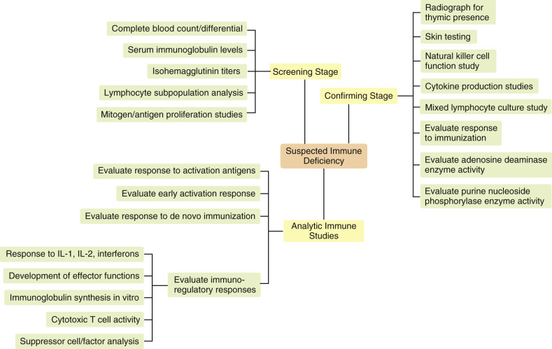

Figure 45-6 

The three phases of the clinical evaluation of a suspected deficiency of cellular immunity. 

Box 45-2 

Basic Screening Immunology Studies 

  * •

Complete blood count with leukocyte differential count 

  * •

Isohemagglutinin titers 

  * •

Lymphocyte subpopulation analysis (numbers and percentages of T and B cells) by flow cytometry 

  * •

Lymphocyte activation in vitro to mitogens and microbial activators 

  * •

Serum immunoglobulins, including immunoglobulin subclasses if evidence of clinical infection with encapsulated bacteria. In some cases, immunoglobulin levels are normal, but heterogeneous nonbinding antibodies are produced; thus additional studies are needed. 

Although there is frequently a limitation on the quantity of blood to be drawn for such studies, it is essential that the first evaluation be performed on blood specimens obtained at the same time. Functional studies need to be performed on fresh anticoagulated blood whenever possible (or blood stored at room temperature in the dark for less than 24 hours) before mononuclear cells are isolated. When blood is being sent by air or transport to a distant laboratory, it is extremely important to include a control specimen drawn in parallel from a healthy person to serve as an internal standard for the shipping process. The type of tube chosen to draw the blood is important. The use of lithium heparin– or ethylenediaminetetraacetic acid–containing tubes is not recommended for any lymphocyte functional studies. Sodium heparin (preservative free) or acid citrate dextrose tubes must be used. Blood collected in heparinized tubes can also be used for flow cytometric analysis, although the timing of specimen preparation and analysis is critical (  Standards NCfCL, 1992  ;  Nicholson & Green, 1993  ). 

The question of when the blood should be drawn is important. In general, most data have been obtained from blood drawn in the morning, and circadian effects may influence results. When this cannot be done, it is helpful to continue to maintain uniformity of drawing time for an individual patient. This is most critical when measuring absolute numbers of T lymphocyte subsets in the monitoring of HIV disease or as part of a clinical trial (  Malone et al, 1990  ). 

The screening stage also includes a panel approach to assess mitogenic and antigenic proliferative response. The proliferative response of lymphocytes to a range of activators continues to be one of the most sensitive tools to assess normal function, and, when this includes an appropriate T cell and B cell activator, it can be useful in defining the areas of defect. Although this is not always done, the use of multiple concentrations of each activator is strongly recommended. 

 

##  Stages of Study: the Confirming Stage 

 

##  General Aspects 

Once the screening of the individual has been achieved and evidence of a potential immune deficiency has been observed, initial findings should be confirmed by repeated tests. Minimally, a positive and a negative (normal range and abnormal range) test should be carried out. Additional tests sometimes may be added to the panel; this may provide the beginning phase of analytic studies. 

It is important to make appropriate arrangements to draw blood when the patient is in the most clinically stable state. Double baseline studies are recommended before intervention is undertaken, and these can encompass the confirming phase. In some cases of apparent immune deficiency, sequestration of immune cells is reflected in low percentages of T lymphocytes in the peripheral compartment. The confirmation stage should also include a careful reevaluation of the patient's medical history and family history. Studies that may be used at this confirming stage are shown in [ Box 45-3 ](<#b0020>) . 

Box 45-3 

Confirming and First-Stage Analytic Studies 

  * Radiograph for thymic shadow 

  * Skin test 

  * Natural killer cell activity (if child is 6 months or older) 

  * Cytokine production in response to activation T-helper 1, T-helper 2 (interleukin [IL]-2, interferon [IFN]-γ, IL-4, and so on) 

  * Mixed lymphocyte culture reaction with patient as stimulator and patient as responder 

  * Response to immunization 

    * •

Test for presence of age-appropriate specific antibodies 

    * •

Naturally occurring antibody response to isohemagglutinins (anti-A and anti-B blood group substances) if patient has A, B, or O blood type 

    * •

Test for adenosine deaminase and purine nucleoside phosphorylase enzyme deficiency 

 

##  Thymic Presence 

The roentgenogram for thymic shadow may be inadequate because the thymus is highly prone to stress depletion and is no longer visible (  Dooley & Liston, 2012  ;  Gui et al, 2012  ;  Simanovsky et al, 2012  ;  Rezzani et al, 2014  ). Although it is difficult to determine with accuracy, the actual size of the thymus assessed by magnetic resonance imaging has been found to correlate with the CD4  \+  T lymphocyte number in HIV infection (  Vigano et al, 1999  ). Recent studies suggest that the human thymus can be thought of as a chimeric organ that comprises both central and peripheral lymphoid tissues. These studies also have shown that thymic involution is an integral part of immunosenescence, mediated by a complex process involving multiple molecular mediators, including cytokines and steroid hormones (  Haynes et al, 2000  ;  Dooley & Liston, 2012  ). As described in the subsequent specific section on flow cytometric evaluation of T lymphocyte subsets, expression of normal maturation antigens acquired during thymic development will suffice to identify the presence of a working thymus. 

 

##  Skin Testing 

The use of a skin test panel can be important at this point. This approach to cellular immune assessment originally served as the departure point for the development of the cellular immune functional tests because it measures delayed-type hypersensitivity directly in vivo. Experience with the delayed-type hypersensitivity skin test has shown good overall correlation between lack of reactivity—termed _anergy_ —and immune deficiency (  Deodhar, 1983  ;  Maas et al, 1998  ), but it has not been useful as an analytic tool to dissect out the reason for lack of response. In addition, the skin test is not very quantifiable. Use of the purified protein derivative skin test to assess the possible presence of _Mycobacterium tuberculosis_ is an exception, although anergic individuals do not respond; in addition, false-positives are seen in persons who have been vaccinated with bacille Calmette-Guérin (  Huebner et al, 1993  ). The relative effectiveness of a standardized _Candida albicans_ skin test product in children has been reported (  Ohri et al, 2004  ). 

Reasons for lack of skin test response are shown in [ Box 45-4 ](<#b0025>) . Some studies have been based on a de novo immunization skin test using dinitrofluorobenzene. Although this once was used rather extensively, the approach is no longer considered useful because of ambiguities in the underlying mechanism of reaction. The introduction of the “skin window” test may ultimately provide a more quantitative and informative measure of in vivo immune response because the reaction can be used to test autologous tumor response (  Black et al, 1988  ). However, despite some reservations, the importance of the skin test as a convincing demonstration that immune defects noted in vitro may have prognostic significance in vivo should not be underestimated. 

Box 45-4 

Causes of Skin Test Anergy 

  * •

Lack of appropriate antigenic history when panel does not include ubiquitous activators 

  * •

Primary immunodeficiency 

  * •

Viral infection 

  * •

Malnutrition 

  * •

Granulomatous disease 

  * •

Neoplasia 

 

##  Stages of Study: Analytic Immune Studies 

Analytic studies are outlined generally in [ Box 45-5 ](<#b0030>) . Although a complete description of these approaches is beyond the scope of this discussion, in general these studies attempt to identify the underlying mechanism of immune defect by proceeding through a series of steps. Although there are different possible ways of doing this, one good way is to assess the general level of defect by following the general plan of assessing the presence of cell types and the relative proportions of all in light of areas of diminished general function, and then to perform studies of effector function. 

Box 45-5 

Analytic and Immunoregulatory Studies 

  * Development of activation antigens during response to stimulation, such as Tac antigen, transferrin receptor, upregulation for MHC class II on T cells, soluble receptors, and so on 

  * Early activation response (e.g., calcium channels) 

  * Immunoregulation 

    * •

Response to IL-1, IL-2, interferons 

    * •

Development of effector functions 

    * •

Immunoglobulin synthesis in vitro 

    * •

Cytotoxic T cell activity 

    * •

Suppressor cell/factor analysis 

  * Gene activation, cell cycle analysis 

  * Response to immunization: de novo immunization 

_IL,_ Interleukin; _MHC,_ major histocompatibility complex. 

If cell populations have been determined to be essentially intact in the absence of activation, the issue of intrinsic failure may be studied by many different approaches, including the use of expanded lymphocyte surface marker analysis, framework determinants to the TCR, and activation antigens such as CD25, CD38, and HLA-DR ( [ Box 45-6 ](<#b0035>) ). Absence of MHC class II upregulation in response to IFN-γ is one example. Although cell populations may express a reference normal differentiation antigen, they may also coexpress others inappropriately, and this may be a key to functional abnormality. For example, CD8  \+  T cells coexpressing CD38 are not functionally the same as CD8 cells that do not express this marker and are expanded in HIV disease (  Giorgi & Detels, 1989  ). Absence of expression of certain molecules, such as CD28, is another important indicator. In some primary immune deficiency syndromes, upregulation of the IL-2 receptor in response to IL-2 may be abnormal. Receptors may not be translocated normally, or receptors may be shed prematurely (  Cunningham-Rundles et al, 1990  ). 

Box 45-6 

Immunophenotyping Lymphocyte Subpopulations 

  * Basic peripheral blood panel (whole blood, lysed red blood cells [ * ](<#fn0010>)

* If low CD3, then repeat and add CD2. Further, monoclonals against TCR paired with CD3 may be added. Monocyte markers also may be evaluated. These may be performed using three- or four-color reagents using CD45 gating. 

) 
    * •

CD45/CD14 

    * •

Isotype mouse immunoglobulin controls 

    * •

CD3/CD19 

    * •

CD3/CD4 

    * •

CD3/CD8 

    * •

CD3/CD56 and 16 

  * Isolated mononuclear cells, activation panel [ † ](<#fn0015>)

† After 2 days of culture, remove cells and wash before staining with monoclonal antibodies listed; analyze control cells containing no activator, then analyze activated cells. Activators may include mitogen, IL-2, and/or interferon-γ. 

    * •

CD45/CD14 

  * Isotype mouse immunoglobulin controls 

    * •

CD3/CD25 (IL-2R) 

    * •

CD3/HLA-DR 

_HLA,_ Human leukocyte antigen; _IL,_ interleukin. 

Development of the immune response may be kinetically abnormal because of delayed secondary recruitment during the amplification phase. This should be tested by doing time course studies. In some cases, cytokines may not be made, or they may be functionally altered. Effector functions may be missing or impaired. Evaluation of this may require a detailed approach. Attempts to restore response by addition of cytokine may be useful, although this may circumvent the lesion through compensation rather than fill in the actual deficiency. New testing strategies may utilize whole blood rather than isolated mononuclear cells (  Bocchieri et al, 1995  ). This system provides an excellent ex vivo mirror of immune response, because the actual relationships among cells are not altered. Furthermore, this system can be used to measure cytokine production (  Petrovsky & Harrison, 1995  ;  Suni et al, 1998  ). 

The cellular immunology laboratory is advised to choose basic analytic studies that are normally done on a routine basis, so a basis for comparison is available. Establishment of laboratory normal ranges and maintenance of reagent quality control, especially for certain variable elements, are essential for the accuracy and sensitivity of these tests. 

,  

##  Laboratory Evaluation of Lymphocyte Function 

Developmental defects, inherited genetic abnormalities, and acquired infections cause profound immunodeficiency states. Additionally, severe burns, trauma, and therapeutic intervention may lead to immunodeficiency. Bulk assays can be used to ascertain whether or not an individual has a decreased T cell proliferative response and have been available for some time, but they are limited both by poor reproducibility and by the limited information garnered from bulk assays. Recent technological developments have allowed for the production of a variety of reagents that can be used to assess multiple activities along the pathway of T cell activation. These reagents include monoclonal antibodies specific for T cell activation markers, reagents and systems for the detection of intracellular cytokines, and tracking dyes and nonradioactive DNA precursors developed to assess lymphocyte proliferation. 

 

##  Lymphocyte Transformation Assays 

 

##  Principles of Lymphocyte Transformation 

The most common in vivo procedure used to assess cellular immunity is a simple skin test. A positive skin test for the detection of a delayed-type hypersensitivity response implies intact cellular immunity, as well as intact monocyte chemotaxis (  Borut et al, 1980  ;  Ananworanich & Shearer, 2002  ). Although skin testing is easily performed, negative results are difficult to interpret, especially in young children, and skin testing is not as sensitive as in vitro lymphocyte stimulation assays (  Borut et al, 1980  ). Other in vivo correlates of cell-mediated immunity include contact sensitivity, granuloma formation, and allograft rejection. 

 

##  Mitogen-Induced Blastogenesis 

Most laboratories assess the proliferative capacity of lymphocytes by measuring the rate of incorporation of radiolabeled DNA nucleosides (tritiated thymidine) following prolonged incubation of peripheral blood mononuclear cell cultures with mitogens (3 to 4 days) or antigens (5 to 10 days) (  Maluish & Strong, 1986  ). In general, only a limited number of T cells respond to any one antigen in vitro; therefore, cells must be cultured from 5 to 10 days to detect a response. In vitro lymphocyte transformation in response to a mitogen was first reported by  Nowell (1960)  . Mitogens and IL-2 in general are the most potent stimuli, because they induce the rapid proliferation of the largest proportion of lymphocytes. For this reason, proliferation can be detected in 3 to 4 days and thus provides an effective screening tool. Of the mitogens, phytohemagglutinin and concanavalin A (Con A) induce T cell blastogenesis, and pokeweed mitogen and staphylococcal protein A trigger B cell activation. The cellular signaling pathways of mitogen-induced B cell activation have recently been described (  Nikitin et al, 2014  ). 

In the standard mitogen-induced blastogenesis procedure, lymphocytes are isolated with Ficoll-Hypaque density gradient centrifugation and cultured for several days with a mitogen or a specific soluble antigen in media enriched with human AB serum. Tritiated thymidine is added to the culture media, and the plates are incubated for an additional 4 to 24 hours. The cells are isolated (harvested) from the plates using a special device (cell harvester) and are transferred to disks of filter paper ( [ Fig. 45-7 ](<#f0040>) ). These disks are placed in scintillation fluid, and radioactive emissions are measured in a liquid scintillation counter. The mitogen-induced blastogenesis technique is classified as a **bulk assay method** because the response of the entire cell population is measured. 

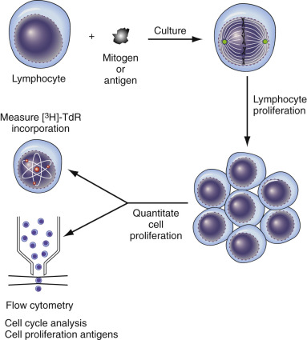

Figure 45-7 

Principle of lymphocyte stimulation assay. 

Lymphocytes are cultured with antigen or mitogen. If stimulation occurs, a proliferative reaction takes place, with the formation of daughter cells. The amount of proliferation can be determined from tritiated thymidine (  3  H-TdR) incorporation, by flow cytometric cell cycle kinetic analysis, or by measuring a cell proliferation antigen such as Ki-67. 

(Reprinted with permission from Riley RS, Mahin EJ, Ross W: _Clinical applications of flow cytometry._ New York, 1993, Igaku-Shoin Medical Publishers.) 

Several controls are necessary in bulk assays of lymphocyte proliferation because the assays may be influenced by the number of cultured cells, incubation time and temperature, mitogen concentration, and various inhibitory factors that may be present. The results are expressed as a stimulation index, which is the ratio of radioisotope incorporation into the test versus control cells. The relative proliferation index is the ratio of the δ counts per minute (cpm) of the test subject (cpm of stimulated cells minus unstimulated control cells) to the δ cpm of a panel of normal individuals tested simultaneously. 

Bulk assays, in addition to their inherent technical problems, provide no information on the specific cell subsets that are responding.  Cram and colleagues (1976)  were among the first to resolve this problem through analysis of blastogenesis at the single cell level by flow cytometry. Since that time, flow cytometry with its inherent multiparameter potential has become the instrument of choice for analysis of lymphocyte transformation and other aspects of the cellular immune response. Comprehensive reviews of flow cytometry and methods used to assess lymphocyte activation and proliferation have been published by Maluish and Perfetto (  Maluish & Strong, 1986  ;  Perfetto et al, 2002  ). 

Precise measurement of the proportion of lymphocytes in the various phases of the cell cycle (i.e., cell cycle analysis) is critical for flow cytometric studies of blastogenesis and lymphocyte proliferation. In general, two distinct approaches are used in cell cycle analysis. In the past, the preferred approach was to measure the level of fluorescence intensity emitted by DNA staining dyes. The most commonly used dye was propidium iodide, a phenanthridinium-based compound that intercalates stoichiometrically into DNA (i.e., the amount or intensity of fluorescence is proportional to the amount of DNA in a cell). Using complex mathematical modeling, the percentages of cells in the G  0  /G  1  , S, and G  2  phases can be determined from the distribution of the fluorescence intensity. Most peripheral blood lymphocytes are in the resting phase of the cell cycle, with fewer than 5% of cells in the S phase. Many fluorescent dyes with different DNA binding affinities and spectral properties have also been used, including ethidium bromide, DAPI, Hoechst 33258, and Hoechst 33342. Bromodeoxyuridine (5-bromo-2-deoxyuridine, BrdU) is another substance used to measure the proliferation of lymphocytes and other cells. BrdU is a synthetic analog of thymidine that is incorporated into the DNA of replicating cells, while substituting for thymidine. Fluorochrome-labeled antibodies specific for BrdU are used to measure BrdU incorporation and cell proliferation. The quantitation of cell cycle–related nuclear proliferation antigens is another approach for the measurement of cell cycling and proliferation in lymphocyte and other cell populations. Ki-67 antigen is a nuclear protein expressed by proliferating cells in all phases of the cell cycle, but not by resting cells (  Sawhney & Hall, 1992  ). Labeled monoclonal antibodies specific for Ki-67 can be measured by flow cytometric or immunohistochemical techniques to obtain the **Ki-67 proliferation index** . 

The use of dyes that stably integrate into the membranes of live lymphocytes or other cells is the most recently described means of measuring lymphocyte proliferation. After washing away excess dye, the lymphocytes are stimulated to divide. With each successive division, the amount of dye per cell is halved. The fluorescence emitted from the cells after culture can be modeled, and the number of cell divisions can be estimated. This method has been standardized into a kit that includes both the software required for analyses and the tracking dye (Sigma Immunochemicals, St. Louis, Mo.). The evaluation of multiple dyes by many investigators has revealed PKH26, PKH67, carboxyfluorescein diacetate succinimidyl ester (CFSE), and CellVue Claret as most suitable for their ability to quantify lymphocyte proliferation (  Tario et al  2007  2011  ;  Gil et al, 2009  ;  Begum et al, 2013  ;  Zolnierowicz, 2013  ;  Tosevski & Mair, 2014  ). This assay may provide the most accurate assessment of cell proliferative response in in vitro culture systems with the substantial advantage over standard bulk assays of allowing the measurement of specific lymphocyte subsets. CFSE indices appear to correlate more closely with TdR assays than measurement of CD69  \+  cells (  Angulo & Fulcher, 1998  ). 

Some laboratories have replaced the tritiated thymidine incorporation assays with a combination of cell surface marker induction assays and measurement of the percentage of cells at various phases of the cell cycle following activation (  Cost et al, 1993  ). 

The recently developed ability to measure the production of cell-associated cytokines at the single-cell level also has significant potential as a clinical tool for evaluation of the cellular immune response (  Nomura et al, 2008  ;  Suni & Maino, 2011  ;  Freer, 2014  ). Cytokine flow cytometry (intracellular cytokine detection) is performed by stimulating target cells for 4 to 6 hours in the presence of membrane transport blocking reagents (brefeldin A or monensin) to prevent the secretion of cytokines. Cells are then labeled with subset-specific monoclonal antibodies, fixed, permeabilized, and labeled with fluorescently tagged monoclonal antibodies specific for the cytokine of interest (  Freer & Rindi, 2013  ;  Qiu et al, 2014  ). The assay has been developed with the presence of costimulatory antibodies for the sensitive detection of antigen responses in whole blood cultures after relatively short incubation periods (  Suni et al, 1998  ). Special attention is being focused on the development of antibodies that recognize the nascent forms of the cytokines (within the Golgi) and optimization of the timing of culture to detect maximal cytokine response (  Mascher et al, 1999  ). Clinical studies have begun to demonstrate the potential utility of this technique. For example, patients suffering very severe burns who show a shift to a Th2 cytokine response may be at increased risk for the development of multiple organ dysfunction syndrome (  Zedler et al, 1999  ), and clinically active multiple sclerosis patients may show increased production of IL-10 (  Inoges et al, 1999  ). Expansion of this technique to incorporate the ability to simultaneously measure proliferation and specific cytokine synthesis at the single-cell level has been reported but has not yet been evaluated in a clinical setting (  Mehta & Maino, 1997  ). 

Clearly, new assays are being developed that measure different events involved in T-cell activation. Methods and reagents are available to measure the earliest phosphorylation/dephosphorylation events through signal transduction, gene transcription, and cell division. As these methods are adapted for routine clinical use, we will have a veritable armamentarium of methods to assess many of the processes involved in lymphocyte activation and proliferation. Although many of these new technologies are still within the domain of research laboratories, the methods are constantly being simplified and adapted for use and evaluation in clinical laboratories. 

 

##  Mixed Lymphocyte Culture 

The mixed lymphocyte culture (MLC) assay is a special type of lymphocyte stimulation assay based on the ability of histoincompatible lymphocytes from one individual to stimulate the lymphocytes of another individual (mixed lymphocyte reaction) (  Bach & Segall, 1974  ;  Dupont et al, 1976  ;  Mickelson & Hansen, 1990  ). Although complex in origin, the D locus of the HLA system is the major determinant of the MLC phenomenon. When two cells share common D loci, they are not able to stimulate each other, but when the D loci are different, the cells are stimulated. The MLC is unilateral (one way) when one group of cells are made incapable of responding (by treatment with radiation or mithromycin); it is bidirectional (two way) when no radiation or mithromycin is utilized. In the one-way MLC, untreated cells are termed the _responder population,_ and treated cells are the _stimulator population_ ( [ Fig. 45-8 ](<#f0045>) ). 

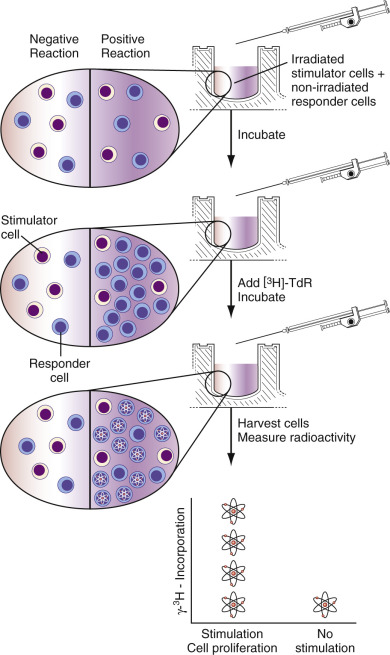

Figure 45-8 

The one-way mixed lymphocyte culture (MLC) assay. 

Irradiated stimulator cells, which are incapable of cell division, are mixed with nonirradiated responder cells, which can proliferate and divide. After incubation under cell culture conditions for approximately 1 week, responder cells proliferate in the presence of a disparity in the human leukocyte antigen (HLA)-D locus _(right side of diagram)_ , but no proliferation occurs if the responder and stimulator cells are HLA-D compatible _(left side of diagram)._ Tritiated thymidine is added to the reaction mixture, and the degree of proliferation is determined by liquid scintillation counting. 

(Reprinted with permission from Riley RS: Basic principles of immunodiagnosis. In McClatchey KD, editor: _Clinical laboratory medicine_ , Baltimore, 1994, Williams & Wilkins.) 

Numerous factors must be considered in performance and interpretation of the MLC. Because the reaction is complex, lack of stimulation between two cell types cannot be considered as conclusive evidence of histocompatibility at the HLA-D locus. Other minor histocompatibility loci may also be involved, as well as some non-HLA loci. In addition, specific and nonspecific serum factors can inhibit the assay, and lymphocytes from diseased individuals may not perform well. Numerous controls (including autologous controls) must be included, and the assay must be performed as expected for the results to be accepted as valid. The principal clinical use of the MLC assay is to assist in the selection of a compatible donor for a bone marrow transplant, because the MLC is a predictor of host response to a transplanted organ. To prevent graft rejection or graft-versus-host disease, donor and recipient cells must be mutually nonstimulatory (  El-Agroudy et al, 2004  ). 

Flow cytometric quantitation of the mixed lymphocyte reaction has been reported. In the method reported by both Cram and Kanda, nuclear DNA content during lymphocyte blastogenesis was determined with a DNA-specific fluorochrome (PI) (  Cram et al, 1976  ;  Kanda et al, 1985  ). With this technique, the proliferative index (percentages of cells in the S phase and G  2  M phase of the cell cycle) is a direct measurement of de novo DNA synthesis. A good correlation (r = 0.9493) was observed between the flow cytometric measurement of the mixed lymphocyte reaction and the results using a traditional MLC with  3  H-thymidine incorporation. Other investigators have utilized BrdU, Ki-67, or CFSE for the flow cytometric quantitation of T cell proliferation in the MLR (  Palutke et al  1987  ;  Bontadini et al, 1990  ;  Marin et al, 2003  ;  Onoe et al, 2003  ;  Tanaka et al, 2005  ). Multiparametric analysis has also been used to measure nuclear DNA content in conjunction with T cell subsets, activation antigens, apoptosis, cytokine secretion, and other parameters during the MLR (  Williams et al, 1984  ;  Uchida et al  1987  ;  Lavergne & del Llano, 1990  ;  Nguyen et al, 2003  ;  Suresh et al, 2005  ). 

 

##  Cytotoxicity Assays 

Cell death (cytotoxicity) is the endpoint commonly used in functional assays of the cellular immune system. In these assays, cell cytotoxicity may occur as the result of complement activity (complement-mediated cytotoxicity) or may be due to the direct effect of one cell on another (cell-mediated cytotoxicity). Conventionally, target cell lysis is determined by the release of a substance such as  51  chromium (  51  Cr) from the target cell upon death or by the incorporation of a vital dye such as eosin or tryptan blue. A variation of these assays, the microlymphocytotoxicity assay, is widely used in the clinical histocompatibility laboratory for human organ transplantation. However, the accuracy and reproducibility of these assays are often compromised by the length and technical complexity of the assays, technical problems such as poor uptake or nonspecific release of the marker, or the need for subjective interpretation of the results. The advent of new markers, in combination with the quantitative and multiparametric abilities of the flow cytometer, has made cytotoxicity assays much more practical for biomedical research studies. Other than in histocompatibility testing, these assays have not achieved widespread utilization in patient care. 

 

##  Cytotoxic T Cell (CTL) Assays 

Cytotoxic T cells (CTLs, T killer cells, cytolytic T cells, CD8  \+  T cells, killer T cells) constitute a subset of T cells that are important in the host defense against altered class I MHC-positive self cells, especially cells infected with a virus or other pathogen. CTLs recognize altered target cells by the presence of peptide fragments produced by processing of the foreign antigen and presented by the class I MHC receptor to the T cell antigen receptor. Recognition of an MHC complex on a target cell by a CTL induces cell death by apoptosis by the granule-exocytosis pathway (granule endocytosis) or the FAS-FAS ligand pathway (  Barry & Bleackley, 2002  ;  Lieberman, 2003  ). 

Transfused  51  Cr-labeled cells, especially red blood cells, have been used since the early 1950s to study cellular in vivo distribution and kinetics. In the mid-1960s,  Goodman (1961)  ,  Sanderson (1964)  , and  Wigzell (1965)  independently described the use of  51  Cr-labeled mouse tumor of lymph node cells to study antibody-dependent complement-mediated cytotoxicity. Since that time, the **chromium release assay** has become the standard technique for the measurement of complement- or cell-mediated cytotoxicity. In the chromium release assay for cytotoxic T cell activity, the binding of CTLs to infected  51  Cr-labeled target cells with virus peptide on syngeneic class I MHC induces apoptosis with the proportional release of  51  Cr into the supernatant ( [ Fig. 45-9 ](<#f0050>) ) (  Levin, 1978  ). Alternatives for the chromium release assay were developed because of the disadvantages of the assay, including its relatively limited sensitivity and use of a radioisotope. The most widely employed alternative techniques include flow cytometry and variations of the enzyme-linked immunosorbent assay (ELISA). 

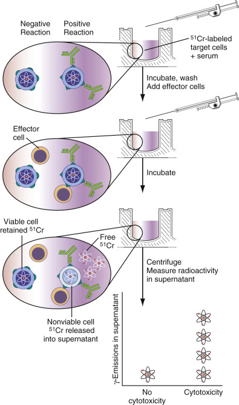

Figure 45-9 

Principle of the antibody-dependent cell-mediated cytotoxicity (ADCC) assay. 

This assay is performed with mononuclear cells from a kidney organ donor or from several unrelated individuals (panel cells), which are stimulated with phytohemagglutinin (PHA) and labeled with  51  Cr. Following incubation with eluate from another nephrectomy specimen or from normal human serum, labeled cells are washed and incubated with effector cells from a normal unrelated individual. Radioactivity (γ-emissions) in the cells at the end of the experiment represents unlysed cells. The results are expressed as % cytotoxicity. 

(Reprinted with permission from Riley RS: Basic principles of immunodiagnosis. In McClatchey KD, editor: _Clinical laboratory medicine_ , Baltimore, 1994, Williams & Wilkins.) 

Measurement of antibody- or cell-mediated cytotoxicity by flow cytometry is based on the discrimination of viable and nonviable cells with fluorescent dyes (  Liu et al, 2004  ;  Alheim, 2013  ;  Popescu et al, 2014  ). In addition to relatively high sensitivity, flow cytometry permits multiparametric analysis, with simultaneous detection of up to 12 markers at the single-cell level. The permeability of the cell membrane is the most widely used parameter of cell viability measured by flow cytometry. Damaged or nonviable cells have altered membrane permeability, and many leak some intracellular substances into the supernatant, while losing the ability to prevent other dyes from penetrating the cell membrane. PI and 7-AAD were the first fluorescent dyes to be used for flow cytometric measurements of cell viability because they are excluded by live cells but rapidly penetrate cells with damaged membranes. Fluorescein diacetate, carboxyfluorescein diacetate (CFDA), and calcein are lipid-soluble, nonfluorescent probes that are metabolized by cytoplasmic esterases to produce a charged, fluorescent product that is retained within the cell if the cell membrane is intact (  Zarcone et al, 1986  ;  Talbot et al, 1987  ). Other dyes used for viability determination include PKH-1 (  Slezak & Horan, 1989  ), hydroxystilbamidine methanesulfonate (Fluoro-Gold [FG]) (  Barber et al, 1999  ), SYTO13 (  Shenkin, 2007  ), Cell Tracker Orange (  Kim et al, 2007  ), and calcofluor white M2R (  Berglund et al, 1987  ). In many cases, the simultaneous use of two or more markers permits the most accurate measurement of cytotoxicity. One example is the use of PKH-1 in conjunction with PI. PKH-1 is a fluorochrome that emits light in the green region of the spectrum, binds avidly to the cytoplasmic membrane, and is not transferred to other cells. In one application, PKH-1 is used to label the target cells, while a second fluorochrome with a red emission signal (PI) is used to detect nonviable cells (  Slezak & Horan, 1989  ). This combination of markers allows statistically valid quantitation of both dead and live effectors and targets, permitting the simultaneous determination of percent target lysis, effector-to-target ratio, viability of the effector cells at the termination of the assay, and viable effector-to-target cell ratios. 

The enzyme-linked immunosorbent spot (ELISPOT) assay is a very sensitive, extremely versatile adaptation of sandwich ELISA (  Kalyuzhny  2005  ). Originally described by  Czerkinsky and colleagues in 1983  to detect individual B cells secreting antigen-specific antibodies, the ELISPOT was rapidly adapted to detect T cell cytokine excretion (  Czerkinsky et al, 1983  ;  Arvilommi, 1996  ;  Schmittel et al, 2000  ;  Stott, 2000  ;  Sedgwick, 2005  ). Because the ELISPOT assay can reproducibly detect the proportion of antigen-specific or cytokine-secreting cells at a sensitivity of  1  /  100,000  to  1  /  1,000,000  , it has achieved widespread use in research involving cancer, infectious disease, immune disease, and solid organ transplantation (  Slota et al, 2011  ;  Augustine & Hricik, 2012  ;  Lehmann & Zhang, 2012  ). Clinically, the ELISPOT is used in immune monitoring and the detection of latent tuberculosis infection (  Achkar et al, 2011  ). The ELISPOT utilizes polyvinylidene fluoride (PVDF)–backed microplates coated with a monoclonal or polyclonal capture antibody specific for the desired analyte, usually IFN-γ (  Kalyuzhny, 2005  ;  Weiss, 2012  ). A cell suspension and appropriate antigens or mitogens are added to the microplates, and they are incubated in a humidified carbon dioxide (CO  2  ) incubator at 37° C for a specified time. The plates are washed to remove cells and debris, a biotinylated polyclonal antibody specific for the analyte is added, the plates are washed a second time to remove unbound antibody, and avidin-horseradish peroxidase and a precipitating substrate are added to develop the assay. Colored spots on the plate represent individual analyte-producing cells ( [ Fig. 45-10 ](<#f0055>) ). The spots can be manually or automatically detected and counted. A variation of this assay using fluorochrome-labeled antibodies (Fluorospot assay) permits the simultaneous detection of two or three cytokines (  Gazagne et al, 2005  ;  Rebhahn et al, 2008  ;  Ahlborg & Axelsson, 2012  ;  Janetzki et al, 2014  ). A variation of the ELISPOT for the detection of granzyme B, rather than IFN-γ, has shown better correlation with the chromium release assay for the measurement of cytotoxic T cell activity (  Salk et al, 2013  ;  Ranieri et al, 2014  ). 

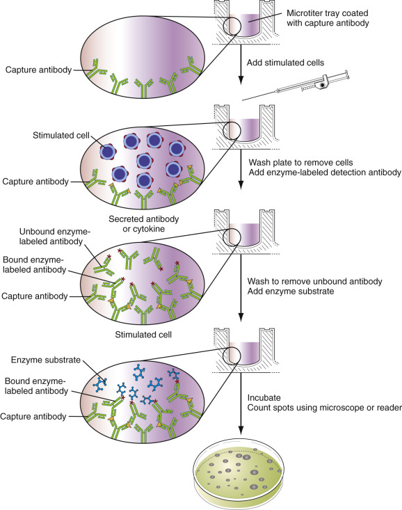

Figure 45-10 

Principle of the enzyme-linked immunosorbent spot (ELISPOT) assay. 

ELISPOT assays bear many similarities to conventional sandwich enzyme-linked immunosorbent assays. A polyvinylidene difluoride (PVDF)–backed microplate is immobilized with an antibody specific for the analyte under evaluation. Immune cells are stimulated with an appropriate antigen or mitogen and then are pipetted into the wells of the microplate. The microplate is incubated in a humidified carbon dioxide (CO  2  ) chamber at 37° C for a specified period of time, during which stimulated immune products, such as cytokines and antibodies, are secreted. The secreted analyte binds to the immobilized antibody on the microplate. The microplate is washed to remove cells and unbound substances, and a biotinylated polyclonal antibody specific for the chosen analyte is added. Unbound biotinylated antibody is removed by washing, and streptavidin conjugated with alkaline-phosphatase conjugate is added. Following another wash to remove unbound enzyme, the reaction is completed by the addition of the enzyme substrate solution (BCIP/NBT). Dark, blue-black precipitate spots mark the original locations of analyte-secreting cells. The spots can be counted manually under a stereomicroscope, or automatically with a commercial automated ELISPOT reader system. 

 

##  Natural Killer Cell–Mediated Cytotoxicity 

NK cells are critical members of the innate immune system characterized by their capability to lyse target cells without prior sensitization, termed **spontaneous cell-mediated cytotoxicity** (  Crome et al, 2013  ;  Moretta et al, 2014  ;  Bodduluru et al, 2015  ). NK cells can be subdivided into two functional and immunophenotypically distinct groups defined by the surface density of CD56 (i.e., CD56bright, CD56dim) (  Morice, 2007  ;  Milush et al, 2009  ;  Bryceson et al, 2010  ;  Lanier, 2014  ). Release of  51  Cr from labeled target cells is the standard method for the characterization of NK cells (  Friberg et al, 1996  ). The chronic myeloid leukemia cell line K562 has been used as the standard target in these assays. A variety of other techniques are under evaluation because the  51  Cr-release technique has many disadvantages, including the use of radioisotopes, low sensitivity, and the spontaneous release of  51  Cr. These methods include the incorporation of radioactive nucleotides during cell proliferation, dye exclusion, target cell enzyme release, and flow cytometry. Flow cytometric analysis has been performed using a wide variety of markers to differentiate live and dead target cells, including CFDA, PI, Hoechst 33342, fluorochrome octadecylamine-fluorescein isothiocyanate (F-18), usually in combination with multiparametric analysis of cell surface makers, degranulation, cytokine production, and other parameters (  Bryceson et al, 2010  ;  Scherbakova et al, 2013  ;  Lee et al, 2014  ;  Mhatre et al, 2014  ;  Ortaldo et al, 2014  ). 

 

##  Microlymphocytotoxicity Assay 

The dye exclusion lymphocytotoxicity assay is the standard technique for the detection of an antibody–antigen interaction on a cell surface. The lymphocytotoxicity assay was introduced by  Terasaki and McClelland in 1964  and was later accepted as the National Institutes of Health standard procedure for histocompatibility testing (  Terasaki & McClelland, 1964  ). In the histocompatibility laboratory, variations of the lymphocytotoxicity assay are used for HLA typing, detection of anti-HLA antibodies, and crossmatch testing (  Duquesnoy & Marrari, 2003  ;  Fidler, 2012  ). 

In the lymphocytotoxicity procedure, viable cells (usually lymphocytes) are incubated with serum-containing antisera. If a cell surface antigen is present that is recognized by antibodies in the sera, an antigen–antibody complex will form on the surface. These complexes are detected by the sequential addition of rabbit complement and a vital dye, such as eosin, to the reaction mixture. The occurrence of complement fixation on the cell membrane leads to activation of the terminal complement components, and eventually to cell lysis and death. Dead cells are detected and counted by phase microscopy after differential uptake of the eosin dye and fixation with formalin. Antibody-bound lymphocytes will die, take up the eosin dye, and give a positive reaction; unbound lymphocytes will remain viable, exclude the eosin dye, and give a negative reaction (dye exclusion) ( [ Fig. 45-11 ](<#f0060>) ). 

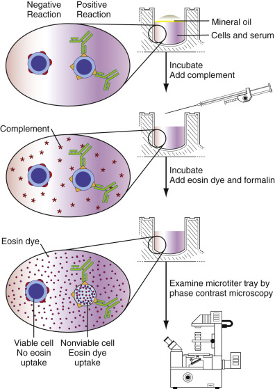

Figure 45-11 

Principle of microlymphocytotoxicity by dye exclusion. 

Cells and serum are incubated together in the wells of a microtiter tray. Mineral oil at the top of the wells prevents fluid evaporation. Complement is added, and a second incubation is performed. The cells are washed, eosin is added, and the cells are fixed with formalin. Cells that fixed antibody and were killed through the action of complement take up eosin and appear dark and nonrefractive under a phase-contrast microscope. In contrast, living cells are refractive and are easily identified by phase-contrast microscopy. Variations of the microlymphocytotoxicity assay are used for human leukocyte antigen (HLA) typing, HLA crossmatch, and detection of anti-HLA antibodies. 

(Reprinted with permission from Riley RS, Mahin EJ, Ross W: _Clinical applications of flow cytometry_ , New York, 1993, Igaku-Shoin Medical Publishers.) 

,  

##  Laboratory Evaluation of Granulocyte and Monocyte Function 

Monocytes and granulocytes are extremely important in the early inflammatory response, and abnormalities in their functions lead to profound deficiencies in cellular immunity. The activity of neutrophils and macrophages is complex and involves activation of the cell, margination and passage through the vessel wall (diapedesis), movement toward an inflammatory stimulus (chemotaxis, chemokinesis), opsonization, engulfment of the offending agent (phagocytosis), and intracellular killing via the generation of toxic oxygen radicals (  Seely et al, 2003  ;  Zarbock & Ley, 2009  ). Until the modern era of flow cytometry, laboratory analysis of these nonspecific immune parameters was difficult to measure, with available assays being subjective and lacking standardized methods and quality control. In contrast to the subjective assays, many flow cytometric studies are rapid, reproducible, and statistically valid. In addition, the multiparametric capabilities of the flow cytometer permit the simultaneous determination of several cell functions, as well as an assessment of the interrelationship between cell function and other parameters (  O'Gorman et al, 2011  ;  Elloumi & Holland, 2014  ). Flow cytometric assays have been described for the measurement of phagocytosis of microorganisms, degranulation and enzymatic activity, intracellular killing and degradation of microorganisms, exocytosis, opsonization, oxidative metabolism, membrane potential, phagosomal pH, calcium mobilization, F-actin assembly, cell volume, apoptosis, receptor expression, adhesion and aggregation, and other parameters (  van Eeden et al, 1999  ;  Elbim & Lizard, 2009  ;  Zarbock & Ley, 2009  ;  Nordenfelt, 2014  ;  Sharma et al, 2014  ). 

 

##  Assays of Neutrophilic Activation 

Neutrophil activation results when stimulatory substances (e.g., chemotactic factors, immune complexes, opsonized particles) bind to surface receptors to initiate metabolic and structural changes in the cell that result in locomotion, degranulation, phagocytosis, the oxidative burst, and other processes. Early studies of neutrophil activation utilized 7-nitrobenz-2-oxa-1,3-diazole-phallacidin, a fluorescent derivative of an acidic phallotoxin isolated from mushrooms of the _Amanita_ genus to measure changes in the equilibrium of F-actin that occur during cell activation (  Belloc et al, 1990  ;  Packman & Lichtman, 1990  ). However, the flow cytometric detection of neutrophil activation antigens, especially CD11b, CD13, and CD64, has become the standard technique for studies of neutrophil activation, usually performed in conjunction with other measurements of intercellular neutrophil function, such as the oxidative burst and measurement of the production and release of neutrophil secretion products such as myeloperoxidase, neutrophil elastase, and lactoferrin (  Alvarez-Larran et al, 2005  ;  Grey et al, 2011  ). 

 

##  Assays of Phagocytosis and Endocytosis 

Conventional analysis of phagocytosis uses particles that are visible within the cell and can be counted after ingestion or an ingestible substance that can be extracted from the cell and measured. Live or heat-killed _Candida albicans_ or staphylococci fulfill the first criterion and permit a simple, convenient means of measuring phagocytosis. Target cells (i.e., neutrophils and monocytes) are incubated with yeast particles in the fresh serum, Giemsa-stained cell preparations are made, and 200 cells are examined and counted for the presence of ingested microorganisms (  Lehrer & Cline, 1969  ;  Lehrer, 1970  ). The results are expressed as the percentage of target cells showing phagocytosis and the number of particles per phagocytic neutrophil. Oil droplets containing dissolved oil red O stain and coated with _Escherichia coli_ liposaccharide and C3 complement have also been used for the measurement of phagocytosis. 

Flow cytometric assays of phagocytosis are quantitative and more accurate than subjective studies using visual counting of phagocytosed microorganisms (  Bjerknes et al, 1989  ). Different investigators have used a variety of labeled targets to study phagocytosis by both neutrophils and monocytes. Labeled targets have included fluorescent beads coated with opsonins (  Dunn & Tyrer, 1981  ;  Steinkamp et al, 1982  ;  Bassøe et al, 1983  ;  Bjerknes, 1984  ;  Bjerknes & Bassøe, 1984  ;  Bassøe & Bjerknes, 1985  ;  Ogle et al, 1988  ), fluorescein-labeled _C. albicans_ (  Busetto et al, 2004  ), FITC-labeled zymosan particles (  Nuutila & Lilius, 2005  ), fluorescein-labeled _Staphylococcus aureus_ (  Carvalho et al, 2009  ), fluorescein-labeled _E. coli_ (  Hirt et al, 1994  ;  Cacciapuoti et al, 2007  ;  Danikas et al, 2008  ), enhanced green fluorescent protein (EGFP)–expressing _E. coli_ (  Gille et al, 2006  ;  Bicker et al, 2008  ), bis-carboxyethyl-carboxyfluorescein pentaacetoxymethylester-labeled _C. albicans_ (  Pattanapanyasat et al, 2007  ), and Oregon Green (  Nordenfelt, 2014  ). For example, green fluorescent microspheres coated with C3b, iC3b, IgG, mixtures of these substances, bovine serum albumin, or human F(ab′)2 are utilized in the technique developed by  Ogle and colleagues (1988)  . In this assay, neutrophils are incubated with coated microspheres alone or in the presence of cytochalasin D to inhibit phagocytosis. Externally bound microspheres are then stained with a red-labeled antibody against the immobilized ligand(s), and flow cytometric analysis is performed. The ratio of red-to-green fluorescence in the cytochalasin D–inhibited mixtures is used to correct the uninhibited mixtures for externally bound, nonphagocytosed particles. Net phagocytosis is thus represented by the corrected green fluorescence. The specificity of this technique was confirmed with the use of fluid phase C3b and iC3b and monoclonal antibodies to the receptors. 

Receptor-mediated endocytosis is a common method for the cellular uptake of viruses, hormones, proteins, toxins, and other ligands. Endocytosis is a complex process that involves capping, internalization of the ligand, intracellular movement, and entry of the ligand into a subcellular compartment. Fluorescent dyes were first used to study endocytosis by  Ohkuma and Poole (1978)  , who studied intralysosomal pH in living cells using a fluorometer and FITC-dextran. Subsequent investigators have used flow cytometry and fluorescent-labeled ligands or liposomes to follow the internalization of various ligands, while others have utilized changes in pH sensitivity to study internalization and/or intracellular movement (  Metezeau et al, 1982  ;  Finney & Sklar, 1983  ;  Truneh et al, 1983  ;  Murphy  1984a  ;  van Deurs et al, 1984  ;  Elguindi et al, 1985  ;  Ruud et al, 1989  ;  Becker et al, 1997  ). A different technique was utilized by Wang Yang (  Wang Yang et al, 1988  ), who used flow cytometric pulse profiles to study capping and endocytosis by mouse B lymphocytes and BCL  1  cells. In this assay, the cells were stained with FITC-labeled anti-immunoglobulin and were permitted to undergo changes in a temperature-controlled flow cytometer sample compartment. Cap formation resulted in decreases in area values from pH-dependent quenching as the internalized antibody entered the acidic subcellular compartments. Fattorossi described a related procedure utilizing FITC-conjugated, heat-killed _C. albicans_ (F-Ca) opsonized with purified antibodies, or normal human serum (  Fattorossi et al, 1989  ). Neutrophils were first incubated with the labeled, opsonized _Candida_ particles and subsequently with ethidium bromide. Although ethidium bromide does not penetrate intact cell membranes, it binds to membrane-bound particles and causes a shift from green to red fluorescence through resonance energy transfer. Because internalized particles retain green fluorescence, the number of internalized or surface-bound particles can be ascertained by contour plot analysis. Fluoresceinated derivatives of α-fetoprotein and transferrin were used by Torres to study the endocytosis of these substances (  Torres et al, 1990  ), and Fibach studied the uptake of a fluorescent fatty acid derivative [12-(1-pyrene) dodecanoic acid] by a variety of peripheral blood cells (  Fibach et al, 1988  ). Flow cytometry and electron microscopy were used by Kershaw to study the endocytosis and intracellular trafficking of chemokine CCR5 (  Kershaw et al, 2009  ). 

 

##  Assays of Enzymatic Activity and Intracellular Killing 

Intracellular killing of microorganisms is mediated by complex enzymatic mechanisms. Oxygen-dependent mechanisms of cell killing are the most important, although oxygen-independent mechanisms have also been described. The increase in oxidative metabolism during phagocytosis is referred to as the **oxidative burst.** During this process, the key event is the activation of a membrane-bound pyridine nucleotide-dependent oxidase (NADPH oxidase), which reduces oxygen to O  2– (superoxide anion) and oxidizes NAD(P)H to NAD(P)  \+  . Subsequently, hydrogen peroxide (H  2  O  2  ), hydroxyl radical (OH), and singlet oxygen are generated. All of these compounds are directly toxic to the cell, with the H  2  O  2– halide-myeloperoxidase system being the most important mechanism of bacterial killing. In the presence of H  2  O  2  and halide ions (I  – , Cl  – ), myeloperoxidase catalyzes direct halogenation of the bacterial cell wall and causes damage to the cell wall by converting amino acids into aldehydes. 

In the clinical laboratory, the nitroblue tetrazolium (NBT) reduction assay is the conventional method for determination of the oxidative capacity of the neutrophil. NBT is a yellow dye in its oxidized state, but when reduced, it forms formazan, a crystalline substance that has a deep blue color ( [ Fig. 45-12 ](<#f0065>) ) (  Urban & Jarstrand, 1979  ). NBT can be attached to latex particles or microorganisms to permit phagocytosis, or it can be ingested in soluble form by neutrophils that have been stimulated by endotoxin or other means. If the normal oxidizing environment in the phagolysosome is present, the resultant blue particles can be detected microscopically, or the formazan can be extracted and measured spectrophotometrically. Approximately 10% of normal unstimulated neutrophils ingest and reduce NBT, but this is increased to 80% with stimulated neutrophils. 

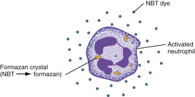

Figure 45-12 

Principle of the nitroblue tetrazolium (NBT) reduction assay. 

Neutrophils are incubated with NBT. Enzymatic activity in the activated neutrophil converts NBT into an insoluble brownish-black precipitate (formazan), which is visible under the microscope. The proportion of neutrophils with intracytoplasmic precipitated material is determined. 

(Reprinted with permission from Riley RS: Basic principles of immunodiagnosis. In McClatchey KD, editor: _Clinical laboratory medicine_ , Baltimore, 1994, Williams and Wilkins.) 

A flow cytometric variation of the NBT assay has been described. With this technique, neutrophils are incubated for a short time with FITC-labeled Con A, rendering the cell membrane fluorescent (  Fattorossi et al, 1990  ). The cells are then incubated with NBT and an agent to trigger respiratory activity, such as phorbol myristate acetate. The formazan that is subsequently produced has a distinct fluorescent peak at 520 nm that corresponds with the peak emission of fluorescein, and fluorescence quenching of surface fluorescence by formazan is proportional to the intensity of the respiratory burst. In addition, simultaneous changes in cell size and forward light scatter occur. 

Bass described one of the first non–NBT-based flow cytometric–based assays to measure neutrophil oxidative metabolism and oxidative burst at the single-cell level (  Bass et al, 1983  ). This technique uses the fluorogenic substrate dichlorofluorescein-diacetate (DCFH-DA) to quantitate H  2  O  2  production during the oxidative burst (  Bass et al, 1983  ). DCFH-DA is a small, nonpolar substance that is actively taken up by the cell and deacetylated by intracellular esterases into a nonfluorescent compound (2′,7′-dichlorofluorescein [DCFH]), which is trapped within the cell. In the presence of H  2  O  2  and peroxidase, DCFH is oxidized into dichlorofluorescein, which is highly fluorescent in the green region of the spectrum ( [ Fig. 45-13 ](<#f0070>) ) (  Bass et al, 1983  ). Other fluorochromes that have been used to directly measure the oxidative burst include dihydrorhodamine 123, dihydrotetramethylrosamine, 4-carboxydihydrotetramethylrosamine succinimidyl ester, and hydroethidine (  Smith & Weidemann, 1993  ;  Model et al, 1997  ;  Walrand et al, 2003  ;  Elbim & Lizard, 2009  ;  Chen & Junger, 2012  ). 

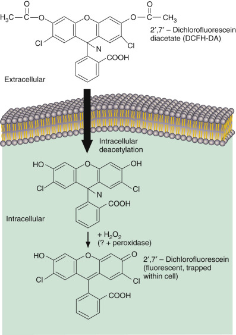

Figure 45-13 

Flow cytometric analysis of the oxidative burst of polymorphonuclear leukocytes. 

In this assay, dichlorofluorescein-diacetate (DCFH-DA) is taken up by the cell and is trapped by deacetylation, with the formation of 2′,7′-dichlorofluorescein. During the oxidative burst, nonfluorescent 2′,7′-dichlorofluorescein is converted into the fluorescent product dichlorofluorescein. The fluorescent intensity in the green region of the spectrum is proportional to the oxidative capacity of the cell. 

(Reprinted with permission from Bass DA, Parce JW, Dechatelet LR, et al: Flow cytometric studies of oxidative product formation by neutrophils: a graded response to membrane stimulation, _J Immunol_ 130:1910–1917, 1983.) 

Flow cytometric measurements of the oxidative burst have been combined with the quantitation of other metabolic or antigenic changes in the phagocytic cell to fully utilize the multiparametric power of the flow cytometer. In particular, several investigators have described flow cytometric techniques for the simultaneous measurement of phagocytosis and intracellular killing. In one of the earliest studies, phagocytic activity was determined by the internalization of viable, FITC-labeled _C. albicans_ (  Bjerknes & Bassøe, 1984  ). At selected intervals, fungi were extracted from the cells, and the fraction of killed fungi was measured by the uptake of PI. Later variations of this technique were developed to simultaneously measure phagocytosis and the oxidative burst (  Trinkle et al, 1987  ;  Prodan et al, 1995  ;  Lehmann et al, 1998  ;  McCloskey & Salo, 2000  ;  Carvalho et al, 2009  ). 

A technique for the assessment of surface antigen expression, phagocytosis, and cell proliferation in human bone marrow cells was described by Lund-Johansen (  Lund-Johansen et al, 1990  ). With this technique, incubation of leukocytes with ethidium monoazide–labeled _C. albicans_ , followed by staining with an FITC-labeled monoclonal antibody, permitted correlation of surface antigen expression with phagocytic capacity. After incubation with the labeled _C. albicans_ , aliquots of the cells were fixed and stained with PI for cell cycle analysis. Haynes reported a novel method to measure protein digestion within the phagocytic vacuole based on the fluorescent quenching that occurs when rhodamine is attached to albumin at a high molar ratio (  Haynes et al, 1990  ). In the phagocytic vacuole, digestion of albumin releases free rhodamine and restores fluorescence. This method was affected less by vacuole pH than fluorescein-based methods and measured digestion even in the presence of abnormal phagocytosis. 

 

##  Assays of Opsonization 

Phagocytosis of microorganisms and other foreign bodies is greatly enhanced by the presence of certain chemical substances (opsonins) on the surface of the foreign body. In patients with certain immunoglobulin and complement deficiencies, increased susceptibility to infection results in part from decreased opsonization. Opsonins in the serum can be detected by incubating the serum with normal neutrophils and yeast particles and by visually quantitating phagocytosis of yeast particles by normal neutrophils. In addition, flow cytometric methods have been used for the measurement of serum opsonin function (  Bassøe & Bjerknes, 1984  ;  Sjursen et al  1987a  ;  Sjursen et al, 1989  ). In this assay, live FITC-labeled _Neisseria meningitidis_ organisms were preopsonized by incubation with serum for 7.5 minutes and then were incubated with human polymorphonuclear neutrophilic leukocytes (PMNLs) for 5 minutes at a bacteria-to-PMNL ratio of 20:1. Results were expressed in the number of bacteria incubated per phagocyte. 

 

##  Assays of Membrane Permeability 

Fluorescein diacetate has been extensively utilized to monitor changes in membrane permeability. In this regard, fluorescein diacetate is enzymatically hydrolyzed within the cell, with the production of fluorescein. Free fluorescein is released into the extracellular environment across the cell membrane through a process that follows energy-dependent, first-order kinetics and that is dependent on membrane integrity and permeability. The efflux of fluorescein is inhibited by metabolic poisons and glucose depletion, and it has been used to study the effects of a variety of agents on the cell membrane (  Prosperi et al, 1985;  1986  ). Prosperi showed that the fluorescein efflux is also related to the ionic gradient (membrane potential) of the cell (  Prosperi, 1990  ). 

,  

##  Quality Control and Quality Assurance in the Cellular Laboratory 

Throughout this chapter, we have tried to point out areas where the clinician and laboratory staff must pay particular attention to the methods used and the interpretations made in evaluation of the cellular response. Quality assurance and quality control parameters are not well defined in this area of the laboratory, and few absolute standards exist as compared with chemistry analytes or humoral antibody measures. The success of the cellular laboratory rests in its approach to the problem and the longitudinal assessment of the condition being diagnosed. It was clearly pointed out that baseline studies need to be repeated if the original evaluation is performed at a time of immunologic stress. 

Basic parameters of diurnal variations in lymphocyte subsets are obvious but are often forgotten or overlooked.  Malone and colleagues (1990)  pointed out that variability in CD4 measures of absolute counts is 50% owing to biology, with the other 50% related to other technical issues.  Fei and colleagues (1993)  reviewed the factors affecting the longitudinal evaluation of CD4 absolute counts in a clinical trial setting. Furthermore,  Fahey and colleagues (1990)  reviewed the prognostic value of both humoral and cellular assays in HIV. With other clinical cellular assays, variability is inherent in the assay, owing to lack of standard formats and methods, as well as reagents. Furthermore, instrument calibration and sensitivity are not well monitored. Cytotoxic T lymphocyte assays are particularly difficult to standardize. Historic assays such as mitogen proliferation are also fraught with variability between laboratories. Therefore, laboratories that offer these immunologic tests must have an extensive database by which they can interpret an individual patient's result. Cellular laboratories must establish normal ranges for their assays and must be aware that adult normal ranges are not applicable to pediatric assays. This is particularly problematic because pediatric normal ranges are difficult to determine, owing to lack of available subjects in the first year of life, and correct interpretation of laboratory results depends on these normal values. Data between laboratories should be compared carefully. 

When available, a cellular immunology laboratory must use available standards in the performance of flow cytometry and DNA analysis and should be aware of state and federal regulations with regard to the laboratory, including the Human Health and Services Clinical Laboratory Improvement Act of 1988. Furthermore, laboratory staff should participate in proficiency testing, when available, and should be involved in continuing education seminars, including competency evaluations for all personnel involved in testing. All assays performed in the laboratory must include a normal control and, when possible, in-process controls to establish the validity of the assay. Shipped samples must be carefully monitored for exposure to heat and cold and time since patient procurement. A clinical history should accompany the samples for particular studies being ordered so that the laboratory director can take the correct approach to testing. 

A consensus document with recommendations on the immunophenotypic analysis of hematologic neoplasia by flow cytometry has been published (  Braylan et al, 1997  ). This document was painstakingly developed by concerned providers in the medical community to cover laboratory procedures, selection of antibodies for identification of neoplasms, data analysis and interpretation, medical reporting, and indications in the absence of standardized kits and other devices. The FDA has put into effect the Analyte Specific Regulation, which moves reagents such as monoclonals from research use status to ASRs (  Analyte Specific Regulation, 1997  ). This rule does not allow manufacturers to tell laboratory users how to use their reagents. They cannot specify intended use. The ASR rule does provide for stable, well-defined reagents manufactured under good manufacturing practices. All laboratories using these reagents as a “home brew test” must perform their own clinical trial and validation studies and must use a disclaimer in the final report. The consensus document allows a laboratory to perform its assays in a consistent manner and in keeping with the definition of clinical significance used across a large number of laboratories and institutions. The document is not a standard but is consistent with other published standards from NCCLS that are already in use. 

The cellular laboratory is faced with a more difficult job of interpretation because the data are not easily standardized. Furthermore, quality assurance of the sample and the evaluation being performed depends on careful documentation of biologic and logical parameters that may influence the results. The future of tests used in evaluation of the cellular component of the immune response resides in the development of new methods that may lend themselves to better standardization. 

,,
