## Key Points

  * •

For statistical analyses, nominal variables can take on only a limited number of values (or categories), whereas continuous variables are used to report quantitative data. 

  * •

Independent variables are considered input (cause), and dependent variables are considered output (effect). 

  * •

Distributions of continuous data are described by a measure of central tendency (e.g., mean or median) and dispersion (standard deviation). Gaussian distributions derive from a mathematical formula and thus are parametric. A common application of descriptive statistics is to establish reference ranges. 

  * •

Statistical tests such as comparisons of different groups of data points may be parametric (i.e., assume Gaussian distributions; example is Student _t_ -test) or nonparametric (i.e., make no assumption of distributions; example is test based on rank order). 

  * •

Confidence intervals are preferable over point estimates to express level of certainty in the calculation of any statistical parameter. 

  * •

Nominal data are conveniently analyzed with proportions using the chi-square test. 

  * •

The effects of multiple factors in a model system can be assessed through analysis of variance. 

  * •

Regression analysis between two continuous variables is usually done by least squares fit to a straight line. Applications of regression analysis are common when different analytic methods for validation are compared in clinical laboratories. 

The quantification of information in meaningful summaries and comparisons is the domain of statistical analysis. The first task in analysis is to provide a description of the magnitude of the observations and how close the different measurements are to one another. Descriptive statistics provides a consistent framework for calculating or estimating the central tendency of continuous data in the familiar forms of mean, median, and mode. The variation in data is generally described by the mathematical calculations of variances and standard deviations, or by the simple allocation of data points into a range of percentiles (e.g., interquartile range). These approaches are everyday phenomena in clinical laboratories for the monitoring of all quantitative assays. Reference ranges are initially set up with these techniques. Methods of quality control for precision and proficiency testing for accuracy also are based on these principles. For data that are not continuous but take on only two or a few discrete values (e.g., positive or negative), the analysis might consist of counting the number in each category and looking at the proportions of all values by category. 

Comparison of data typically asks the question whether one group is different from another group. These comparisons are usually done by _t_ -test or by analysis of variance, depending on whether two or more groups of continuous data are compared. If the data are discrete, comparison is done by chi-square analysis. When data can take on a range of different values, it is convenient to do a correlation between two different data sets with a straight line fit. The newcomer to statistical analysis frequently poses the question “Which statistical test is best?” The question of which test to use depends largely on whether the data are continuous or discrete and whether continuous data follow particular distributions. However, statistics is based on convention, so the investigator should try very diligently to understand the importance of differences between tests and whether possible findings and conclusions are likely to reflect accurately the nature and significance of the question being asked. In contrast to the investigator who is interested in finding the right test for data already collected, the statistician is more interested in helping the investigator plan the experiment and collect data so statistical tests are most valid. This chapter relies heavily on common clinical laboratory examples for which specific statistical tests are applied to demonstrate some useful choices. 

,  

##  Definitions 

  * •

_Variables:_ The things that we measure, count, or otherwise delineate are termed _variables_ because the values they can assume vary. Variables are usually considered to fall into one of the following scales: 

    * •

_Nominal scale_ is where a variable can take on only a limited number of values, usually called categories (or characters). Examples of nominal variables are gender (male or female) and risk factors (e.g., smoker or nonsmoker). 

    * •

_Ordinal scale_ is where the variable takes on specific values that have some inherent order such as magnitude but without equivalent distances between categories (e.g., trace amount, 1+, 2+, etc., of protein in urine). 

    * •

_Interval scale_ is where a variable takes on values in a quantitative range with defined differences between points. It is conventional to treat most numeric laboratory measurements as continuous variables, even though they may be reported as discrete values (e.g., glucose values of 123 or 124 mg/dL, but not 123.857… mg/dL). 

  * •

_Coefficient of variation (CV)_ is the standard deviation of a set of data points divided by the mean result expressed as a percentage or as a decimal fraction. 

  * •

_Confidence interval (CI)_ is the interval that is computed to include a parameter such as the mean with a stated probability (e.g., commonly 90%, 95%, 99%) that the true value falls into that interval. 

  * •

_Degrees of freedom (df)_ is a parameter related to the sample size (n). df indicates the number of quantities free to vary and is usually n − 1 for applications such as the _t_ -test. For the chi-square test, it is the number of rows minus one times the number of columns minus one. df is employed in calculating the _p_ value for a statistical test. 

  * •

_Gaussian (normal) distribution_ is a spread of data in which elements are distributed symmetrically around the mean, with most values close to the center. It is explicitly described by a mathematical equation and so is a parametric distribution. Random scatter or random selection of a population often results in a Gaussian normal distribution. This type of distribution is often a criterion for completely valid application of many parametric tests. 

  * •

_Linear regression_ is the mathematical process for calculating the best straight line to fit the relationship observed between two variables measured on the same items. _Simple_ or _least squares linear regression_ yields the best fit for x and y data sets by minimizing the sum of the squared _y_ -axis (vertical distance) differences between each data point _(x, y)_ and the line. This approach assumes the _x_ -axis data to be nearly perfect or without error. Uneven distribution of data points across the entire range may significantly alter the reliability of linear regression. _Deming linear regression_ does not assume the _x_ -axis data to be free of error, but instead uses the weighted sum of squared _y_ -axis and _x_ -axis differences between the data points and the line. The _correlation coefficient (r)_ describes how well the line fits the data ( _r_ ranges from −1 to 1). 

  * •

_Mean_ is the sum of all results divided by the number of results. Also related are the _median,_ which is the middle value that divides the distribution of data points into upper and lower halves (also called the 50th percentile), and the _mode_ , which is the most common value. The mean, median, and mode are all measures of central tendency. The _geometric mean_ is calculated as the _n_ th root of the product of a distribution of _n_ numbers; its use for estimating central tendency minimizes the effects from extreme values such as are found in a log-normal distribution. 

  * •

_Parametric statistics_ are statistical measures that are calculated based on the assumption that the data points follow a Gaussian distribution and include parameters such as mean, variance, and standard deviation. _Nonparametric statistics_ are based on rank or order of data. 

  * •

_Null hypothesis (H 0  ) _ is the proposal that there is no difference in a comparison. The alternative hypothesis is that there is a difference. When the critical value of a statistic is exceeded, rejection of the null hypothesis occurs, thereby favoring the acceptability of the alternative hypothesis. 

  * •

_Significance level (p or α) _ is the probability that a difference between groups occurred by chance alone, by convention set at less than 0.05. 

  * •

_Statistical power (1 − β) _ is the probability that a difference between groups will be detected by the study, generally set to at least 80%. 

  * •

_Standard deviation (SD)_ is the square root of the sum of the squared differences of each data point from the mean divided by _n − 1 _ for samples (divided by _n_ for populations). The SD is a predictable measure of dispersion from the mean in a Gaussian normal distribution. 

  * •

_Standard deviation index (SDI)_ is the difference between the value of a data point and the mean value divided by the group's SD. The _z-transformation_ is the expression of a result from the mean in SD units. The _Z_ -value is the probability of a result being _z_ SDs from the mean value. The SDI is commonly used in reporting performance in proficiency testing for an individual laboratory compared with peers. 

  * •

_Student_ t- _test_ is a statistical test for comparing means between two sample groups. The test can be paired (e.g., two separate measurements on the same individuals before and after some intervention) or unpaired. Values of _t_ and _df_ yield a level of statistical significance ( _p_ value). 

  * •

_Type I error (alpha error, α) _ is incorrectly rejecting the null hypothesis and stating that two groups are statistically different when they really are not. 

  * •

_Type II error (beta error, β) _ is incorrectly failing to reject the null hypothesis and stating that two groups are not statistically different when they really are. 

,  

##  Variables 

Statistical questions are often posed in terms of input versus output, cause and effect, or correlation between two or more variables. The input or cause is considered an _independent variable_ because it is already determined and so is not influenced by other factors. Examples of independent variables are age, gender, temperature, and time. In contrast, _dependent variables_ are those things that might change in response to the independent variable. Examples of dependent variables are blood glucose concentration, enzyme activities, and the presence or absence of malignancy. Of course, we can change our thinking and switch which is the independent and which is the dependent variable if the experimental question changes. For graphical display, the independent variable is plotted along the horizontal _(x)_ axis or abscissa, while dependent variables are plotted along the vertical _(y)_ axis or ordinate. With a single independent variable (e.g., time) on the _x_ -axis, more than one dependent variable can be plotted on the _y_ -axis to demonstrate different relationships simultaneously. The relationship observed between an independent variable and dependent variables is used to predict future outcomes of the dependent ones based on what values the independent variable assumes. 

,  

##  Preparing to Analyze Data 

Most statistical calculations today are done automatically by computer with software programs that present multiple sophisticated options for analysis and even graphical displays of the data. To prepare data for these automated analyses, it is always necessary to enter them into readable format for the program. This process can entail automated transfer from one electronic data set to the statistical program or manual entry from printed sheets of data. Manual entry is obviously fraught with opportunity for typographic errors, but even automated transfer of data can result in erroneous entries, especially when translating older data sets that have been stored on media that might have been corrupted (e.g., magnetic tapes reexamined decades later). Even converting data strings to columns and rows of data points can leave some values in the wrong places. Consequently, it is always good practice to examine the data set for accuracy before performing the statistical analysis. This examination could be done by proofreading every entry or by double entry of each value and automatic comparison for discrepancies, although both of these approaches may be impractical when the data sets contain hundreds, thousands, or more values. At the very least, visual examination of the plotted values provides a quick idea of whether some serious data entry errors have occurred. For example, an incorrectly entered value of 50.0 for potassium (instead of 5.0) can be immediately identified by scanning all values on a graphic plot. The person preparing to perform statistical analyses should do this visual test to identify and correct the most obvious errors and to search for any systematic errors that might have arisen in data transfer and entry. 

,  

##  Descriptive Statistics 

When multiple data points are collected, it is useful to provide a summary of those results that makes them easier to understand rather than simply listing all values. The methods used to summarize data are termed _descriptive statistics_ because they describe what the magnitude of results is and how the data points differ from one another. In the case of categorical variables, this description can be a simple count of discrete values (e.g., how many men and how many women had blood drawn in a clinic). For continuous variables, it is conventional to use some measure of _central tendency_ about which the data points cluster and a measure of how far apart they are _dispersed_ from one another (e.g., what are the ages of the patients who had blood drawn). 

 

##  Central Tendency 

The most widely recognized measure of central tendency is probably the mean or average value (also referred to as the _arithmetic mean_ ), which is calculated by adding the values of all the individual data points and dividing that sum by the total number of data points, expressed mathematically as follows: 

 Mean  =  x  ¯ =  (  x  1  \+  x  2  \+  … x  n  )  ÷ n  =  1  n  ∑ i  =  1  n  x  i 

Because this technique derives the mean value from a defined formula, it is termed a _parametric method_ . An alternative measure of central tendency is the _median,_ which divides all data points exactly in half, with one half being higher and one half lower. The median is also called the 50th percentile. It is not calculated from a formula because it is taken from a straight count of the data points, so it is termed a _nonparametric method_ . The third commonly used measure of central tendency is the _mode,_ which is the most common value (i.e., the value of the variable that has the greatest number of data points). The mode is not a very useful measure for describing or comparing data sets, but it does have a role in understanding when a data set consists of two or more different populations that result in more than one mode. If two separate subpopulations are present, it is called a bimodal population. 

Another measure of central tendency is the _geometric mean,_ which has the feature of minimizing the influence from extreme values in a distribution. The geometric mean is calculated as the _n_ th root of the product of all _n_ values from a population, or: 

 Geometric  mean  =  x  1  × x  2  × ⋯ x  n  n 

The following transformation is more convenient for calculating the geometric mean: 

 log  Geometric  mean  =  ∑ i  =  1  n  log  x  i  n 

Thus the log of the geometric mean equals the mean of the logarithm of all observations, and taking the antilog of this summation yields the value of the geometric mean. 

Consider the following distribution of values, which is heavily weighted toward the lower end but with some high values: 

 3  ,  3  ,  4  ,  4  ,  4  ,  5  ,  5  ,  5  ,  6  ,  6  ,  8  ,  9  ,  10  ,  15  ,  21 

The arithmetic mean for these values is 7.2, whereas the geometric mean is 6.09, which better reflects the preponderance of values at the lower end than does the arithmetic mean. 

In general, parametric methods allow numerous additional calculations for application of many different statistical tests that are based on specific formulas. The advantage of nonparametric methods is that they do not assume or require that the data points must follow any particular distribution for them to be applicable. Parametric methods can be applied to data sets that deviate from preferred distributions, but those calculations and conclusions may not be fully warranted if the deviations are extreme. 

 

##  Gaussian (Normal) Distribution 

The Gaussian (also called normal) distribution is a symmetrical, bell-shaped curve centered about the mean value ( [ Fig. 9-1 ](<#f0010>) ). It is described by the following mathematical formula: 

 P  (  x  )  =  1  σ π e  − (  (  x  − x  ¯ )  2  2  σ 2  )  ​ , 

where σ is the standard deviation of the ideal Gaussian population (  Dawson-Saunders & Trapp, 1994  ). It corresponds to the distance from the mean to the _x_ value at which the curve has an inflection point. 

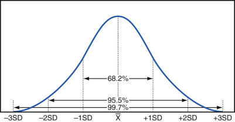

Figure 9-1 

Idealized Gaussian (normal) distribution showing areas under the curve corresponding to mean ±1, 2, and 3 standard deviations (SD). 

The area under this curve within ±1 σ from the mean is approximately 68.2% of the total area, meaning that 68.2% of data points from a Gaussian distribution should fall within ±1 σ of the mean. Similarly, 95.5% of the data points will be within ±2 σ of the mean, and 99.7% will be within ±3 σ of the mean. 

 

##  Dispersion 

A common parametric measure (based on the Gaussian distribution) of the dispersion of data points about the mean value of a population under examination is the standard deviation, mathematically calculated as: 

 S  D  =  ∑ i  =  1  n  (  x  i  − x  ¯ )  2  n  − 1 

The quantity under the square root sign is termed _variance_ . Use of the SD assumes that the data follow a bell-shaped curve that can be described mathematically by the formula for a normal or Gaussian distribution. To the extent that the data are normally distributed, the SD is a good estimate of the dispersion. 

Two additional terms derive from the SD. One is the _coefficient of variation (CV)_ , which is calculated as the SD divided by the mean. The CV is often expressed as a percentage, although it can also be expressed as a decimal fraction less than 1. For a situation where the mean = 25 and the SD = 5, the CV = 20%, or 0.20. The other term is the _standard deviation index (SDI)_ , which is the distance that an individual data point is away from the mean value divided by the SD. The main use for the SDI is in such applications as proficiency testing, where performance of any one laboratory is standardized according to the dispersion of data in the performance by all laboratories. 

A common clinical laboratory application of the normal distribution is to calculate the central 95% of values obtained from a healthy population when trying to establish the reference range for an analyte. This range, of course, is easily calculated as mean ±2 SD for a truly Gaussian normal population. An example of this application is calculation of the central 95% of values of the white blood cell (WBC) count in a group of 85 healthy medical students ( [ Fig. 9-2 ](<#f0015>) ). The bar graph plot is roughly bell-shaped and symmetrical, although there is a slight asymmetry that can probably be ignored. The mean value is 6.60 × 10  9  cells/L, with an SD of 1.457 × 10  9  cells/L, and the calculated central 95% range is from 3.69 to 9.52 × 10  9  cells/L. This is a small group of individuals compared with what might be used for actual reference range calculations, but it does show a few persons with WBCs higher than this range and some lower, so this estimate of central 95% appears appropriate. 

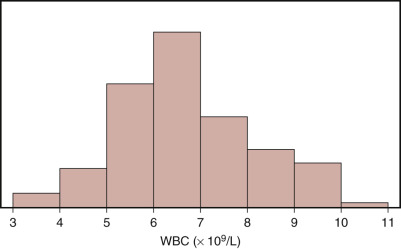

Figure 9-2 

Distribution of white blood cells (WBCs) in the blood of 85 healthy individuals. 

Another way of thinking about these calculations is that the persons tested represent only a sample of all persons to whom we are interested in generalizing these findings (  Daniel, 1999  ). The mean value actually observed would probably be somewhat different if another group of 85 healthy people were tested. Based on the values observed and their spread, a confidence interval can be placed around the mean such that we can be certain by a desired percent that the true mean of WBCs from all healthy persons falls in that range. The confidence limit is calculated as follows: 

 Confidence interval  =  x  ¯ ± z  S  D  n  , 

where the critical factor _z_ derives from transformation of the problem to a standard normal distribution. The quantity  is termed the _standard error of the mean_ . In this example, let the confidence interval be 95%, for which _z_ = 1.96. The 95% confidence interval around the mean value is: 

 6.60  ± 1.96  × 1.457  85  or  6.295  − 6.914  × 10  9  cells  /  L 

Note that this range is the 95% confidence interval on the mean value alone, whereas the earlier calculations yielded the central 95% of all data points. Confidence intervals are used to give an idea of the broadness of the estimate of something. This can be made more certain by using 99% confidence intervals (i.e., 99% confident that the true mean falls in the interval), in which case _z_ = 2.575 for the calculation, and the 99% confidence interval is broader at: 

 6.60  ± 2.575  × 1.457  85  or  6.193  − 7.007  × 10  9  cells  /  L 

 

##  Nonparametric Measures 

The median value of WBC for this group of healthy persons is 6.4 × 10  9  cells/L, which is roughly the same as the mean value. For a perfectly Gaussian normal distribution, values of the mean, median, and mode are exactly the same. Delineation of the range from the 2.5-percentile to the 97.5-percentile also gives an estimate of the central 95% range (for the example of WBC, it is 3.94 to 9.89 × 10  9  cells/L, which is really the exact range for this specific population). This is a nonparametric estimate of the range because it does not use a calculation but only divides the data points according to their order. Many applications of median use the central 50% of data points from the 25th percentile to the 75th percentile (also called interquartile range) to describe central tendency by the nonparametric method. 

Sometimes the parametric method of mean ±2 SD produces an erroneous estimate of the central 95% range. An example of this situation arises with the distribution of alanine aminotransferase (ALT) activities in the serum of apparently healthy individuals ( [ Fig. 9-3 ](<#f0020>) ). In this population, the mean value is 30.1 U, the SD is 12.69 U, and the calculated reference range (mean ±2 SD) is 4.73 to 55.48 U. This range is not appropriate because the actual lowest value observed in the group was much higher (12 U). This estimate of the lower end of the range (4.73 U) is far too low. Similarly, the estimate of the upper end (55.48 U) is too low and excludes about 10% of the data points instead of only 2.5%. Another clue that the parametric method may not work here is that the median value is 27.0 U, which is somewhat different from the mean. The reason for this discrepancy is apparent upon looking at the distribution, which is skewed to the right with many values tailing off at the upper end. In this case, a much more useful estimate of the central 95% can be obtained simply from the 2.5-percentile to the 97.5-percentile range. It is 15.2 to 68.0 U. The form of this distribution for ALT is sometimes termed _log-normal_ , because it can be converted to a normal distribution by using the values of log ALT instead. 

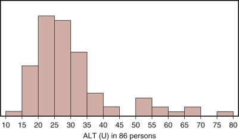

Figure 9-3 

Distribution of alanine aminotransferase (ALT) in the serum of 86 healthy individuals. 

Many laboratory measurements show distinctly non-Gaussian normal distributions. Values of 25-OH vitamin D in 12,434 serum specimens from 2000 through 2008 showed a skewed distribution, with lowest value 0.5 ng/mL and highest value 260.0 ng/mL ( [ Fig. 9-4, _A_ ](<#f0025>) ). The arithmetic mean of these values is 25.55 ng/mL, and the median is 20.90 ng/mL, reflecting the nonnormal distribution. Plotting log 25-OH vitamin D shows a nearly normal distribution with mean value 1.3130 ( [ Fig. 9-4, _B_ ](<#f0025>) ). Then the geometric mean is 10  1.3130  = 20.56 ng/mL, which appears to be a better measure of central tendency for 25-OH vitamin D than the arithmetic mean. 

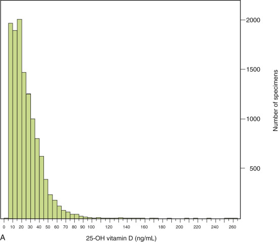

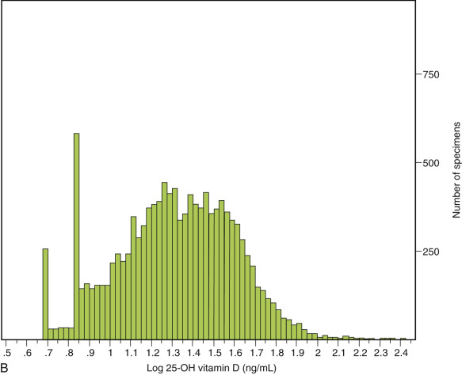

Figure 9-4 

**A,** Distribution of 25-OH vitamin D in 12,434 serum specimens showing skewness to the right at higher values. **B,** Plotting log 25-OH vitamin D shows normal distribution following logarithmic transformation. 

,  

##  Comparative Statistics 

One of the questions frequently asked by statistical means is whether one group is different from another group in some characteristic. The question boils down to a comparison of the central tendency of one group versus that of the other and the scatter that each group exhibits about the central values. If the scatter of data is extreme, then calculated differences between mean values of two groups might not be important but rather the result of adding in the extreme values. Another way to think about these comparisons is that of signal/noise ratio. If there is little noise (scatter of data), then the difference in the signal from each group is more believable. 

 

##  Student _t_ -Test 

The most common method for comparison of a continuous variable between groups is probably the Student _t_ -test (  Dawson-Saunders & Trapp, 1994  ). The pseudonym _Student_ was used by William Gosset, a statistician working for the Guinness brewery, who wanted to keep his work for optimizing productivity unrecognized by competing companies. The _t_ -test is based on a parametric calculation of the _t_ statistic as follows: 

 t  =  x  ¯ 1  − x  ¯ 2  S  D  12  1  n  1  \+  1  n  2 

where: 

  * = mean value in group 1 

  * _n_ 1  = number of values in group 1 

  * = mean value in group 2 

  * _n_ 2  = number of values in group 2 

  * _SD_ 12  = standard deviation of groups 1 and 2 combined 

Fortunately, the calculation of _t_ statistics is conveniently performed by computers in modern times, so the analyst now has the responsibility of vouching for the accuracy of data input and the correct choice of statistical tests and their validity for the situation. 

Some specific assumptions about the data sets are also necessary for applicability. For example, it is necessary to have sufficient numbers of data points in each group to make a valid comparison with approximately equal numbers in each. The spread of the data points should be equivalent (usually assessed by whether the variances of the groups are equivalent). The selection of data points should be independent of one another; for example, it would be inappropriate to include the same patient twice in one group. The issue of independence is usually handled experimentally by a random selection of subjects or patients. Randomization of treatments is an exacting process for important research such as clinical trials. For laboratory use, it is more likely that data come from patients who present themselves to the hospital or clinic for testing, rather than being a random sample of all people in a city or from a country. The more random the selection process, the more likely it is that results can be generalized to a much larger target population for which inference is desired. 

The statistical question for consideration is reduced to two mutually exclusive hypotheses that include all the possible situations. The null hypothesis (H  0  ) states that there is no difference between groups. The alternative hypothesis (H  alt  ) is that the difference between mean values is significant. If the _t_ statistic has a sufficiently high value, we can reject the null hypothesis and consequently must accept the alternative hypothesis that there is a significant difference. If the _t_ value is on the low side, we cannot reject the null hypothesis, but neither can we accept it. This decision is somewhat like that of the verdict from a trial in which the possible outcomes are “guilty” and “not guilty.” The innocence of the defendant is never established, and similarly the null hypothesis is never proven. We could end up thinking that the null hypothesis is correct (particularly because the alternative hypothesis now seems unlikely), but the test we performed did not strictly lead to that conclusion. 

Consider the distribution of hemoglobin (Hb) values in the whole blood of 36 healthy males and 49 healthy females ( [ Fig. 9-5, _A_ and _B_ ](<#f0030>) ). Visual inspection of the bar graphs for Hb shows that the females generally have lower values (mean 13.2 g/dL, SD 0.80 g/dL) than the males (mean 15.1 g/dL, SD 0.96 g/dL). Only a portion of the males and females overlap one another in Hb values. In this example, the value of _t_ = 9.898. One other factor must be taken into account—the degrees of freedom, which is obtained from the total number of data points minus 2 or _df_ = _n_ 1  \+ _n_ 2  _ − _ 2 = 36 + 49 _ − _ 2 = 83. 

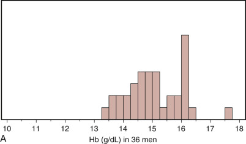

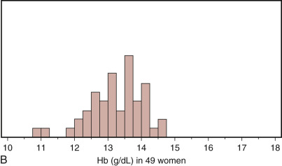

Figure 9-5 

Distribution of hemoglobin (Hb) in the blood of **(A)** healthy men and **(B)** healthy women. 

 

##  Significance 

The value of the _t_ statistic is assessed for significance according to the degrees of freedom. One way to approach the assessment is to look up the value of _t_ for which the degrees of freedom yield a probability ( _p_ ) value that is to be applied for significance using a table of values. More often the software does this calculation automatically. Generally, _p_ values of 0.05 or less are required to claim statistical significance. A _p_ value of 0.05 (also called alpha) means that the difference observed between the two groups could have occurred one time in 20 with the particular spread of data actually observed. The value of alpha is also thought of as the risk that we are willing to take to conclude falsely that there is a significant difference when in fact none exists (type I error). The use of alpha = 0.05 is merely an arbitrary convention, but it is ingrained in the minds of reviewers and protocols for evaluating studies. Of course, if the _p_ value is much smaller, such as 0.01 or 0.001, then the statistical significance of a difference between group means is that much more credible. 

Even though an observed difference between groups might have an extraordinarily impressive _p_ value ( _p_ = 0.001 means that the result should happen by chance only 1 in 1000 times), it is incumbent upon the investigator to conclude whether the observation is clinically significant. The statistical significance of any difference can always be amplified, no matter how insignificant it is for decision making, simply by increasing the number of data points (see the formula for calculating _t_ , [ Equation 9-6 ](<#e0055>) ). 

A potential problem arises when a large number of comparisons are done in studies where no clear hypothesis is stated, but instead the data are mined for whatever might fall out upon examination. In this case, the minimal level of significance should be adjusted to reflect the large number of tests that could conceivably discover “significant results” by chance alone. After all, if a _p_ value of 0.05 is used, then by doing 20 different comparisons, one should find on average some comparison with a statistically significant difference regularly. The Bonferroni correction is done to lower the risk of such false discovery. It consists of dividing the usually accepted _p_ value by the number of comparisons. Thus for five different comparisons, the correction is _p_ value = 0.05/5 = 0.01 as the acceptable threshold value for significance. 

For this particular example, comparing Hb values between males and females, the _p_ value is less than 0.0001, so we can reject the null hypothesis and can conclude that there is a significant difference between groups. Most statisticians would not report this level but would be satisfied with saying that the _p_ value was less than 0.001. Another condition to denote is whether this test is two-sided or one-sided, meaning that the question being asked is whether one group is simply different from the other (two-sided) as opposed to the question of whether one group is only higher than the other group (one-sided). Most journals require the use of two-sided _t_ -tests because they are more demanding. 

 

##  Sample Size 

Suppose the two groups being compared showed a difference that was not quite statistically significant, with a _p_ value of 0.06. One way to achieve statistical significance is to increase the number of subjects studied. This will be the case if the difference remains the same, because the _t_ -value will be increased by a greater _n_ . A pilot study can be done in a clinical trial to establish roughly the difference between groups and the scatter of the data. These pieces of information are then used in a formula to calculate the sample size necessary to bring the results to statistical significance. Calculation of sample size also takes into account another factor called beta, which is the risk one has of missing a true effect by chance (type II error). The power of the study is 1 _ − _ beta. When beta is set to 0.20, the power of the study is 0.80, which says that the number of subjects calculated for use will yield a statistically significant result 80% of the time with the specified difference between groups and scatter of data. 

The _t_ -test used for this example was unpaired because the comparison was between different individuals. If the experimental design included a comparison of values on the same individuals before and after treatment, then it is appropriate to use a paired _t_ -test. A paired test is potentially a more powerful mathematical tool because it looks only at the change between the values within each person and is not influenced by variation in background values between individuals. 

 

##  Nonparametric Tests 

If the assumption about normality of the data is not valid, other nonparametric tests can be used to compare distributions between groups. The _Wilcoxon signed-ranks test_ is such a technique. By this method, all values for both groups are given a numeric rank according to their magnitude. In the case of ties for the same value, both are assigned the intermediate rank (e.g., if 4th and 5th places are tied, then both are given the rank 4.5). All ranks are summed in each group and divided by the number of data points in each group. The difference between the rank scores is then given a probability. This technique is easily done by computer software and may be quite useful when assumptions required for a parametric method are not met by a data set. 

,  

##  Analyzing Discrete Data: Testing Proportions 

Analysis of discrete data takes on a different form from that of continuous variables that can be expressed as distributions. With discrete data, answers are typically dichotomous: Something is present or absent, patient gender is male or female, the patient lived or died. Consider the fictitious example of an intervention to lower contamination rates in blood culture collection. (This is a universal problem in all laboratories, but these data are only hypothetical.) Before the intervention, baseline information over a 2-month period showed that 53 cultures were considered contaminated and 978 were not. After training and implementation of the new collection process, a second 2-month period showed 32 contaminated cultures and 891 that were not. These nominal data are conveniently expressed in a 2 × 2 display termed a contingency table of observed values ( [ Table 9-1 ](<#t0010>) ). These data consist of simple counts in one category or another. The question to be asked is whether the proportion of contaminated cultures was significantly different in the two time periods. 

TABLE 9-1 

Observed Values of Contamination in Blood Cultures 

Result  |  Baseline Period  |  Post Training   
---|---|---  
Number of cultures contaminated  |  53  |  32   
Number of cultures not contaminated  |  978  |  891   
  
 

##  Chi-Square Test 

The statistical test to be used is the chi-square test. It is calculated as: 

 χ 2  =  ∑ (  observed  − expected  )  2  expected 

where the observed values are as listed earlier and the expected values are calculated from the overall assortment of counts (  Dawson-Saunders & Trapp, 1994  ). In this example, the expected number of contaminated cultures in the baseline period is the total number of cultures done in that period (53 + 978 = 1031) times the proportion of contaminated cultures in both time periods together (proportion calculated as [53 + 32]/[53 + 978 + 32 + 891] = 0.0435), or 1031 × 0.0435 = 44.8. Calculation of the other expected values follows similarly, resulting in a contingency table of expected values ( [ Table 9-2 ](<#t0015>) ). Then calculation of the _ χ _ 2  value is done by summing the squares of the differences (this converts all differences to positive values) between expected and observed values and dividing by the expected value in each cell of the table. In this example, 

 χ 2  =  (  53  − 44.8  )  2  44.8  \+  (  978  − 986.2  )  2  986.2  \+  (  32  − 40.2  )  2  40.2  \+  (  891  − 882.8  )  2  882.8  =  3.3 

With one degree of freedom ([number of rows _ − _ 1][number of columns _ − _ 1]), the _p_ value is 0.07, which does not meet the universal threshold of at least 0.05 for statistical significance. It is fair to say that a trend toward less contamination was observed after the intervention but that it was not quite statistically significant. It is important to keep in mind that for _ χ _ 2  testing to be valid, each cell must have a minimum value of five observations. 

TABLE 9-2 

Expected Values of Contamination in Blood Cultures 

Result  |  Baseline Period  |  Post Training   
---|---|---  
Number of cultures contaminated  |  44.8  |  40.2   
Number of cultures not contaminated  |  986.2  |  882.8   
  
,  

##  Trend Evaluation and Correlative Statistics 

The relationship between an independent variable and a dependent variable is demonstrated by plotting them on a scattergram or a plot with the independent (input) variable on the _x_ -axis and the dependent (output) variable on the _y_ -axis. If there is no relationship between the two variables, the data scatter randomly over the graph. If there is a relationship, it can be described mathematically by finding a line that is the best fit through all the data points. This line can be calculated by the least squares approach in which the vertical distances from each point to the calculated line are minimized for the entire population of values. This statistical method is referred to as _linear regression_ (  National Committee for Clinical Laboratory Standards, 2003  ). 

 

##  Linear Regression 

The general form for the equation of a straight line is: 

 y  =  a  \+  b  x 

in which the slope ( _b_ ) indicates how the value of _y_ changes when _x_ changes. When _b_ = 1, the relationship of change between _x_ and _y_ is one-to-one. The intercept ( _a_ ) indicates how the relationship between _x_ and _y_ is offset or biased by a constant factor. The calculation is easily done by any of several statistical programs that also provide information about the goodness of fit of the line. This approach is commonly used when comparing an existing method (A) with a new method (B) for the same analyte ( [ Fig. 9-6, _A_ ](<#f0035>) ). This example shows a strong correlation between method A and method B because the data points fall very close to the line, which is described by the equation: _Method B_ = 0.62 + 0.99 × _Method A_ . The slope of 0.99 is almost perfect, and the intercept of 0.62 is quite small on the scale of possible values. In fact, the 95% confidence limits on _b_ are _ − _ 0.47 to 1.72, which includes the value 0, indicating that the intercept is not significantly different from 0. 

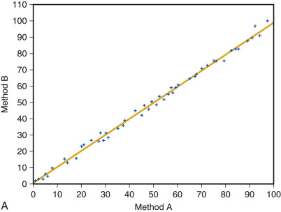

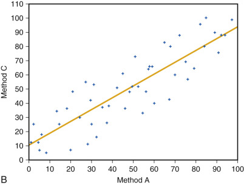

Figure 9-6 

**A,** Regression analysis between method A and method B; strong correlation. **B,** Regression analysis between method A and method C; weaker correlation. 

The vertical ( _y-_ axis) distances from each data point to the best-fit line are termed the _residuals_ . The most valid line fits are associated with relatively constant values of the residuals over the entire range of values. If the residuals grow larger at one end of the graph, then the line fit is less certain in that portion of the range. The _standard error of regression_ (also called standard _error of the estimate_ ), denoted _S y.x  _ , is used to estimate the variation that could be expected from doing the regression again with another sample of data points. The _S y.x  _ is calculated as the square root of the sum of residuals squared, divided by n _ − _ 2\. It is important that data points from patient specimens be spread over the entire analytic range to yield the most valid comparison of methods unbiased by overrepresentation or underrepresentation of data in any region (  National Committee for Clinical Laboratory Standards, 2002  ). 

In laboratory practice, regression or correlation analysis is frequently used to compare the performance of a new method versus an old method. In this situation, the old method could have worse precision than the new one, so it would not be appropriate to base a judgment just on how the new method compares with the old one as a “gold standard.” A common approach to this issue is Deming regression analysis, named for W. Edwards Deming (1900-1993), a mathematician influential in principles of quality improvement. In Deming regression, the best line is obtained by minimizing the sum of squares of both _x_ and _y_ distances from the data points to the line (  Cornbleet & Gochman, 1979  ). In addition, Deming regression applies a weighting factor (λ) that incorporates the relative variances of both _x_ and _y_ data. The result is more heavily weighted in favor of the data set with better precision. 

The relationship between method A and method B is further described by the _correlation coefficient (r)_ , which can range in value from _ − _ 1 to +1. A value of 0 indicates no relationship, and a value of 1 indicates a perfect relationship ( _ − _ 1 is also a perfect but inverse relationship). Other values between _ − _ 1 and +1 indicate intermediate relationships. The square of the correlation coefficient is termed the coefficient of determination ( _r 2  _ ), which describes the amount of variation observed in the dependent variable that is due to the relationship between the two variables. In this example, _r_ = 0.9976 and _r_ 2  = 0.9952, both of which are very high values that show an extremely strong relationship between method A and method B that accounts for 99.52% of the variation. The _p_ value on this correlation is less than 0.0001. 

In contrast with the very good correlation between method A and method B, the performance of method C versus method A ( [ Fig. 9-6, _B_ ](<#f0035>) ) is not nearly as good. By simple visual examination, the data points are scattered farther from the line, and the line is shifted upward. The value of _r_ = 0.8757 is somewhat less than between method A and method B, but it still shows a strong correlation with _p_ value less than 0.0001. The value of _r 2  _ = 0.7668, so 76.68% of the variation can be accounted for by the relationship between method C and method A. The equation for this line is _Method C_ = 10.2 + 0.84 × _Method A_ , so the change in values using method C compared with method A is slightly less (slope of 0.84). A significant upward bias is seen by method C (intercept of 10.2 with 95% confidence limits of 2.8 to 17.6). A special example of regression analysis termed _logistic regression_ is employed when the outcome is a dichotomous or binary variable for continuous independent (predictor) variables. 

 

##  Method Comparisons 

These two examples show somewhat different relationships, although both are statistically significant. It is up to the person assessing the performance to determine which is sufficient for the application. The comparison of method A versus method B is extraordinarily strong both by visual review and by statistical analysis, so it can comfortably be said that these methods are equivalent for the purposes of replacing one with the other in clinical practice. On the other hand, the comparison of method A with method C is messier because of the larger amount of data scatter. The smaller slope suggests that the two methods do not react equivalently with the analyte, and furthermore there is a positive bias by method C. With expectations for excellent precision and accuracy on modern instrumentation, method C would probably be rejected if method B were a viable alternative. And yet the level of correlation observed between method A and method C might be very welcome to researchers trying to ask a different question related to cause and effect between biological processes that have inherently high levels of variation. 

In clinical laboratory applications for method evaluation, the question to be asked is not how certain we are that two things are different but rather how certain we are that a new method yields results comparable to those from an existing method. The Clinical and Laboratory Standards Institute provides the software titled StatisPro, which does such analysis for method comparability with input from the user about tolerances for differences between methods at low and high values and correlation, bias, and scatter of the data that are acceptable for a particular analyte. StatisPro incorporates standard measures of quality control and also regulatory requirements for documenting assay performance in formats that are readily accepted for laboratory inspections. Instead of analyzing for differences between methods, this approach is for their trueness to one another ( [ Fig. 9-7 ](<#f0040>) ). 

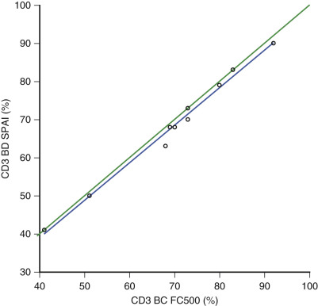

Figure 9-7 

StatisPro analysis of two flow cytometric methods for percent CD3 cells in whole blood. 

The correlation coefficient is excellent ( _r_ = 0.994; 95% confidence interval = 0.897 to 1.069), with an acceptable slightly downward plot (blue line) compared with the line of identity (green line) that has the small value for intercept of 0.33% (95% confidence interval = _ − _ 6.46% to 5.80%). 

 

##  Analysis of Variance 

When the mean values of more than two different groups are to be compared, the process is termed _analysis of variance (ANOVA)_ (  Dawson-Saunders & Trapp, 1994  ). This analysis can be thought of as extending the _t_ -test beyond two independent samples to three or more. The null hypothesis in this situation is that the mean values of all groups are the same. The alternative hypothesis is that not all the means are equal (some could be the same, but others different). The test statistic is the _F_ -ratio of the mean squares among all groups ( _MS A  _ ) to the error mean square ( _MS E  _ ): 

 F  -ratio  =  M  S  A  M  S  E 

It compares the variance of the group means versus the mean of all the data (numerator) and the variance of individual data points within each group (denominator). If the group means differ from one another (signal) more than the variation within groups (noise), then the _F_ -ratio will exceed a critical value for significance. 

An example of ANOVA is the comparison of serum albumin values from patients at two inpatient sites, an outpatient clinic, and a student health clinic ( [ Fig. 9-8 ](<#f0045>) ). One hundred consecutive specimens from each site were recorded. The horizontal line shows the grand mean of all 400 values of 3.17 g/dL. Within each group, the diamonds indicate group means (midline) and 95% confidence intervals on those means (upper and lower vertices). The _F_ -ratio is 279, for which the _p_ value is less than 0.0001, so the null hypothesis can be rejected with the conclusion that at least some of the means are different. This approach is more conservative and realistic than comparing each group with every other group using a series of different _t_ -tests (with four groups, six comparisons could be made). The problem with too many comparisons is the possibility of “accidentally finding significance” that is not true. To extend ANOVA, comparisons of group means by such procedures as Tukey's honestly significant difference (HSD) can be done. In this example, Tukey's HSD indicates that IP1 and IP2 are not different from each other but that OP and SH are both different from all other groups. At this stage, the investigator is free to elaborate on potential reasons for these observed differences without putting further statistical significance on the individual differences. 

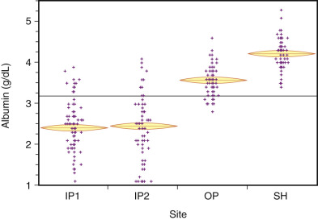

Figure 9-8 

Analysis of variance. 

Serum albumin at different patient sites. _IP1, IP2,_ Inpatient wards 1 and 2; _OP,_ outpatient; _SH,_ student health. 

Some conditions should be met for parametric ANOVA to be completely valid mathematically: 

  * •

The data were collected using random sampling where all observations are independent of one another. 

  * •

The data in each group are normally distributed. 

  * •

Each group has an equal number of data points. 

  * •

Each group has equal variances. 

If this set of ideal criteria is not met, other methods are available for comparisons. The Mann-Whitney test can be used to compare medians. The Wilcoxon and Kruskal-Wallis tests for rank sums are nonparametric alternatives. This example of serum albumin shows greater variances for the inpatient groups than for the outpatients, so nonparametric analysis could be more appropriate. (The Wilcoxon test also showed significant differences among the groups of this example.) This case dealt with one variable, so it was one-way ANOVA. To deal with two variables, the procedure can be extended to two-way ANOVA. 

Linear regression might be used in error to analyze continuous outcome data when the independent variable has the appearance of being continuous but is actually categorical. Such a situation is seen with tumor grade (1 through 4) as an independent variable. Tumor grade is not continuous but rather consists of discrete categories that are not necessarily evenly spaced along a dimension. Although statistical programs would permit calculation of a regression on tumor grade, the proper approach would be one-way ANOVA to look for differences in the dependent variable (e.g., survival time) among groups (e.g., tumor grade). 

 

##  Analysis Involving Multiple Variables 

_Two-way analysis of variance (two-way ANOVA)_ is used when the experimental design has two categorical independent variables (input) and a continuous dependent variable (output). An example is the effects of both gender and different (fixed) drug levels on a physiologic measurement such as blood pressure. In addition to the one-way effects of gender on blood pressure and of drug level on blood pressure, it is necessary to investigate a possible interaction of gender and drug level in two-way ANOVA. If such an interaction is significant, then response to drug level might be different in men versus women. These interactions are conveniently displayed graphically (e.g., a plot of response to drug in men and one for women; noninteraction results in parallel lines; intersection of the lines indicates an interaction). 

_Multiple analysis of variance (MANOVA)_ applies to a model with multiple categorical independent variables and two or more continuous dependent variables. Sometimes the way a comparison is set up by selection of subjects into different groups can lead to a confounding effect from another variable besides the variable of primary interest. In this case, it is revealing to perform _analysis of covariance (ANCOVA)_ to account for potential influence from the covariable. The intention of ANCOVA is to use statistical methods to eliminate effects arising from confounding variables that were not accounted for by random assignment in the original selection of subjects. Typically these effects might be due to an imbalance of subjects with certain characteristics in the experimental group compared with the control group (e.g., the treatment group might have 75% smokers and the control group only 25%; without adjusting for this potential confounding factor, one could not be certain that results from treatment were not in fact merely due to different proportions of smokers in each group). 

As a laboratory example of ANCOVA, consider the comparison of serum calcium measurements in 61 male and 41 female healthy adults to establish whether different reference ranges of calcium would be necessary for males and females. Simple one-way ANOVA similar to that in [ Figure 9-8 ](<#f0045>) yielded a statistically significant ( _p_ = 0.0045) difference between the group means of calcium (males 9.3 mg/dL, females 9.1 mg/dL). (Performing ANOVA with only two groups is equivalent to an unpaired _t_ -test.) This finding was consistent with those of previous studies, so it probably is appropriate to have gender-specific reference ranges for serum calcium, but does this make sense from a physiologic view? It is also well recognized that serum albumin influences total calcium levels by binding some of the calcium. A linear regression for these subjects confirmed this relationship. The effects of gender and of the covariable albumin on calcium are sorted out by ANCOVA. In this example, the effect on calcium from gender was completely accounted for by the effect of albumin on calcium and the different distribution of albumin in males versus females. ANCOVA can be enlightening to discover and eliminate by statistical analysis those covariables that might not be known and planned for in the design of an experiment. Further discussion of ANCOVA can be found in more advanced texts on statistics (  Matthews & Farewell, 1988  ). 

When multiple continuous independent variables ( _x_ 1  , _x_ 2  , _x_ 3  , etc.) are tested to predict a continuous dependent variable ( _y_ ) as outcome, _multiple regression analysis_ is used to calculate the weighting factors ( _b i  _ ) for a linear combination as follows: 

 y  =  a  \+  b  1  x  1  \+  b  2  x  2  \+  b  3  x  3  \+  ⋯

This analysis also allows use of nominal independent variables with so-called “dummy variables” that are arbitrarily given values of 1 or 0 (e.g., 1 for female and 0 for male). Thus if _x 1  _ is gender, the coefficient _b_ 1  is multiplied by 1 for females in calculating the values of _y_ ; however, for males, _b_ 1  is multiplied by 0. This dummy coding permits convenient use of nominal variables in regression analysis. 

_Structural equation modeling (SEM)_ is a method for evaluating linear relationships among multiple variables, with the added value of taking measurement error into account simultaneously instead of linearly. SEM has been used extensively for multivariate analysis in psychological research because it allows for the introduction of latent variables that are not directly observed, although they might have causal relationships with observed outcomes. SEM has the potential to analyze complex relationships among variables and estimate the strength of their correlations. Applications in medicine include epidemiology and genetics (  Beran & Violato, 2010  ). A common platform for SEM analysis is the LISREL (Linear Structural Relationships) software. 

,  

##  Method Validation and Process Control 

Statistical analysis is integral to the validation of new laboratory methods and to the monitoring of analytic and workflow processes in clinical laboratories (  Lott, 1998  ). 

 

##  Reference Ranges 

The examples depicted in [ Figures 9-2, 9-3, 9-4, and 9-5 ](<#f0015>) demonstrate some of the issues encountered when reference ranges are established through application of descriptive statistics. The basic aim is to establish a range of values within which the majority of healthy people will fall, while excluding individuals with disease. The simplest approach is to use the central 95% of data points from healthy individuals by calculating mean ±2 SD whenever the distribution is normal or bell-shaped, as for WBC in [ Figure 9-2 ](<#f0015>) . This parametric approach fails to provide a complete reference range when the data are skewed, as for ALT in [ Figure 9-3 ](<#f0020>) . In this case, the central 95% can be determined nonparametrically by using the range 2.5-percentile to 97.5-percentile, which excludes 2.5% at both the upper and lower ends. The distribution of ALT actually appears to have two subpopulations in these healthy people. Consequently, basing reference ranges solely on observed ranges in apparently healthy persons might not be the best approach. In fact, some new recommendations for ALT set the upper range much lower than wide-based population studies would suggest. The new guidelines try to eliminate persons who might have mild, asymptomatic liver changes such as steatosis (  Prati et al, 2002  ). This approach is similar to the strategy used for setting desirable or healthy levels of cholesterol and lipid fractions (  National Cholesterol Education Program, 2002  ) and of glucose (  Report of the Expert Committee on the Diagnosis and Classification of Diabetes Mellitus, 2003  ). In the future, recommendations from other consensus groups or professional organizations will probably be even more useful in setting desirable ranges for other analytes in place of population-based reference ranges. 

Finally, healthy subgroups of people should be recognized by separate reference ranges whenever major differences occur according to factors such as age or gender (see [ Fig. 9-5 ](<#f0030>) ). 

 

##  Accuracy 

The performance of a new method can be assessed for accuracy (e.g., the ability to correctly detect and quantify an analyte) by assaying patient specimens or interlaboratory survey materials with known values. The example of a strong correlation between methods in [ Figure 9-6, _A_ ](<#f0035>) indicates that the analyte reacts in a nearly one-to-one manner by each method (slope ≈ 1) with essentially no bias (intercept ≈ 0). In contrast, the correlation depicted in [ Figure 9-6, _B_ ](<#f0035>) _,_ has a slope different from 1, indicating that the analyte reacts differently with the two methods. One explanation for this type of discrepancy is found when tumor markers are measured by two immunoassays that employ different antibodies that potentially recognize different epitopes. A bias such as that shown by method C versus method A in [ Figure 9-6, _B_ ](<#f0035>) also suggests a basic methodologic difference that has an impact on accuracy, albeit in a predictable way that could be compensated for with calibration adjustment. 

The accuracy of any assay depends heavily on the calibrators—that is, how they are originally constituted, how they remain stable over time, and how they compare with calibrators from other vendors (see [ Chapter 10 ](<##!/content/3-s2.0-B9780323295680000103?scrollTo=%23c00010>) ). The best situation is to have an assay calibrated against internationally distributed standards such as from the World Health Organization or other professional group. By using calibrators with such traceability and standardized units of measurement, it is feasible to use values from different assays interchangeably for the same patient or to compare outcomes in different groups of patients being monitored with different methods. 

After implementation of a method, periodic proficiency survey testing of unknown specimens is usually reported in terms of SDIs away from the mean of all laboratories. For example, if the mean of creatinine measurements is 11 mg/dL for all participants with SD of 2 mg/dL, then a laboratory reporting a value of 8 mg/dL would have SDI = (8 _ − _ 11)/2 = _ − _ 1.5. 

 

##  Precision 

The reproducibility of an assay is conveniently expressed with the CV that allows the observed SD to be normalized by the magnitude of the signal being measured. It should be kept in mind that assays typically have different CVs for different ranges of analyte values. Therefore, it is good practice to establish CVs for an assay at high-, low-, and midrange values. 

 

##  Analytic Sensitivity 

The lowest value that an assay can reliably detect is termed the analytic sensitivity. A common approach to making this judgment is to measure a zero standard multiple times (e.g., 10 times) and calculate the SD of the signal detected, which is noise. Then set the lowest reliable detection threshold at three or four times the value of the SD. This approach is often individualized within laboratories. This characteristic is also termed the detection limit. Another use of the term _analytic sensitivity_ refers to the change in response of an assay for a given change in the amount or concentration of the analyte (  Giacomo, 1984  ). In this respect, a highly sensitive assay has the characteristic of readily detecting small changes in analyte at concentrations in the midrange of measurement. 

 

##  Analytic Specificity 

The major interferents in laboratory measurements are hemolysis, icterus, and lipemia, due either to interference with optical absorbances (or light scattering) or to actual chemical interactions (e.g., peroxidase activity of Hb in many immunoassays that use horseradish peroxidase as an indicator). Beyond these endogenous interferents, drugs can also interact with various chemical or immunologic assays. The magnitude of these interactions (or lack thereof) is typically documented by the addition of known, large amounts of the substances to serum samples that are tested for recovery of the analyte in the serum. 

 

##  Acceptability of a Method 

The final decision of whether to accept a method as valid depends on a combination of factors. Do the statistical tests show a new method to perform analytically as it should with good accuracy and precision? Does the new method provide useful medical information that is not otherwise available? Is the method feasible to do (easy to perform, low cost, rapid)? Does the maximum error fall within medically acceptable limits? The final decision is a professional judgment based on all of these items. 

,  

##  Resources for Statistical Analysis 

Calculation of descriptive statistics and performance of statistical tests are now widely done using statistical software on computers. In the scientific realm, a few software packages are particularly popular, although applications from other vendors are also available. One of the most popular in the biomedical sciences is from the SAS (originally Statistical Analysis System) Institute, Inc., in Cary, North Carolina. SAS also provides JMP Software that has graphics linked to the statistics for ready visualization of results. Another well-established statistical software product is the Statistical Package for the Social Sciences (SPSS), which is now a part of IBM (SPSS Inc., Chicago, Ill.). SPSS is still recognized for its prominence in the social sciences. Microsoft Excel also can provide statistical analyses along with expanded graphical capabilities. 

An alternative software package for scientific data analysis is the free open-source program named R for the first names of its creators Ross Ihaka and Robert Gentleman from the University of Auckland in New Zealand. While R requires programming abilities, it has the advantage of transparency in its written code for which many users have posted applications on the Internet for others to use at no cost. Statistical analysis using R programs has gained considerable popularity with graduate students as well as with users of standard procedures in pathology (  Cuff & Higgins, 2012  ). 

Resources for performing statistical calculations directly online are available with simple searching. One such site is Martindale's Calculators On-Line Center at [ http://www.martindalecenter.com/Calculators2A_1_Cou.html#STAT-ALL ](<http://www.martindalecenter.com/Calculators2A_1_Cou.html#STAT-ALL>) . A listing of similar sites is available on “Web Pages that Perform Statistical Calculations!” at [ http://www.statpages.org/ ](<http://www.statpages.org/>) . 

When planning statistical analysis of data, in fact, even before planning the experimental design of a project, it is appropriate to consult with a biostatistician to ensure the most efficient design and one that is most likely to provide statistically sound results. A simple review of which statistical tests to employ for different combinations of categorical and continuous variables as independent (input) and dependent (output) variables can be found at The Decision Tree for Statistics at [ http://www.microsiris.com/Statistical%20Decision%20Tree/ ](<http://www.microsiris.com/Statistical%20Decision%20Tree/>) . 

,,
