## Key Points

  * •

Leukocytes are regulated by complex homeostatic mechanisms that direct their responses to infection and inflammation. 

  * •

Leukocytosis often reflects an underlying abnormality; leukopenia, especially neutropenia, places a patient at risk for infection. 

  * •

Hematopoietic neoplasms have been categorized by a World Health Organization classification according to cell of origin, cytogenetic and molecular abnormalities, immunophenotype, and clinical features. 

  * •

Acute leukemias are rapidly progressing neoplasms of precursor myeloid or lymphoid cell origin. An understanding of biology is associated with improvements in therapy. 

  * •

Chronic myeloproliferative disorders and myelodysplastic syndromes are heterogeneous disorders of differentiated myeloid cells. They often are initially indolent but ultimately progress. 

  * •

Non-Hodgkin lymphomas most often arise from mature B cells. They are pathologically and clinically heterogeneous. T cell lymphomas are less common, also heterogeneous, and often difficult to treat successfully. 

  * •

Hodgkin lymphoma is a neoplasm of defective B cells. Much of its pathology is due to an associated inflammatory milieu. 

,  

##  Leukocytes 

Leukocytes, or white blood cells, are found within the bone marrow (BM), the peripheral blood, and the tissues. They protect the body from infection and other foreign insults and include granulocytes, lymphocytes (B and T/NK cells), monocytes, eosinophils, and basophils. Normal leukocyte development is reviewed in [ Chapter 31 ](<##!/content/3-s2.0-B9780323295680000310?scrollTo=%23c00031>) . Leukocyte function and homeostasis are highly complex areas of biology that span several disciplines. 

,  

##  Nonneoplastic Disorders 

Laboratory examination of leukocytes occurs as part of the automated complete blood count (CBC) for almost every patient. The total leukocyte or white blood cell (WBC) count, as well as the relative and absolute concentrations of neutrophils, lymphocytes, monocytes, eosinophils, and basophils is determined and compared to normal values for the patient's age and sex. The absolute concentrations (i.e., the product of the WBC count and the percentage of the respective cell series, such as lymphocytes or neutrophils) are of most value in determining abnormalities. Abnormal results from the automated count are “flagged” and then reviewed by a skilled laboratory technologist. 

These abnormalities include leukocytosis, which is an increase in the total WBC count, and leukopenia, a decrease in the total WBC count, each compared to normal values for age and sex. The differential count, usually first performed on an automated instrument, quantifies the relative and absolute concentrations of the various forms of leukocytes and the maturation state for neutrophils. An increase in the absolute concentration of cells in each series is termed _neutrophilia (neutrophilic leukocytosis), lymphocytosis, monocytosis, eosinophilia (eosinophilic leukocytosis),_ and _basophilia (basophilic leukocytosis)._ A decrease in the absolute concentration is termed _neutropenia, lymphopenia_ (or _lymphocytopenia_ ), _monocytopenia, eosinopenia,_ and _basopenia._ Increased numbers of band neutrophils and/or the presence of immature neutrophils (metamyelocytes and earlier) are noted and enumerated and often confirmed or modified by a manual differential count. 

Nucleated RBCs are also counted and subtracted from the WBC count by an automated or manual method. Abnormalities may occur in both neoplastic conditions (e.g., leukemia or marrow infiltration by metastatic tumor) and nonneoplastic conditions (e.g., infection, drug effect, or nutritional deficiency). Increase in any cell type may be clinically important, but decrease is most significant for neutrophils. Lymphocytopenia is important in immune deficiency syndromes. Isolated monocytopenia, eosinopenia, or basopenia is not usually considered pathologic. Functional neutrophil abnormalities occasionally occur. 

 

##  Granulocytic and Monocytic Disorders 

 

##  Neutrophilia 

Neutrophilic leukocytosis or neutrophilia refers to an absolute concentration of neutrophils in the blood above normal for age. The normal reference interval (established for each laboratory separately) is approximately 1.8 to 7.0 × 10  3  /µL for adults, with a slightly wider range (1.0 to 8.5 × 10  3  /µL) in young children. The neutrophilias are acquired disorders, and key causes of neutrophilia are listed in [ Box 33-1 ](<#b0010>) . 

Box 33-1 

Key Causes of Neutrophilia 

  * •

Acute inflammatory—collagen vascular, vasculitis 

  * •

Acute infectious—bacterial, some viral, fungal, parasitic 

  * •

Drugs, toxins, metabolic—corticosteroids, growth factors, uremia, ketoacidosis 

  * •

Tissue necrosis—burns, trauma, MI, RBC hemolysis 

  * •

Physiologic—stress, exercise, smoking, pregnancy 

  * •

Neoplastic—carcinomas, sarcomas, myeloproliferative disorders 

_MI,_ Myocardial infarction; _RBC,_ red blood cell. 

 

##  Mechanisms 

The primary factors influencing the neutrophil count are (1) the rate of inflow of cells from the bone marrow; (2) the proportion of neutrophils in the marginal granulocyte pool (MGP) (cells adhering to vessel walls) and the circulating granulocyte pool (CGP) (nonadhering cells) of the blood—MGP and CGP are approximately equal in size and in equilibrium in health; and (3) the rate of outflow of neutrophils from the blood. 

Physiologic leukocytosis is produced by factors or situations that are not related to underlying tissue pathology. Severe exercise, hypoxia, stress, or the injection of epinephrine will result in a decrease in the MGP and a corresponding increase in the CGP, resulting in a “pseudoneutrophilia” (i.e., no change in total blood granulocyte pool [TBGP]). This simple redistribution of cells between the CGP and MGP, also known as _demargination,_ is the release and detachment of leukocytes from receptors on vessel luminal walls. Stress of greater severity and presence of endotoxin or corticosteroids also results in an increased inflow of cells to the blood from the marrow maturation/storage pool. 

Pathologic leukocytosis is an increased WBC count that occurs as a result of disease, and usually is a response to tissue damage. This leukocytosis is most often neutrophilia. 

In addition to the random loss of neutrophils from the circulation in body secretions, neutrophils leave the blood by ameboid movement when attracted to a focus of inflammation in tissues, presumably responding to a multitude of chemotactic molecules and gradients. It is from the MGP that the neutrophils leave the blood, pass between capillary endothelial cells, and reach the tissues. 

In acute infection, increased margination of neutrophils and outflow from blood to tissues would lead to neutropenia if there were no flow of neutrophils from the marrow storage compartment into the blood. Because the latter overcompensates, the result is neutrophilia. Usually, production and storage compartments then increase in the marrow and are able to sustain the increased CGP (neutrophilia) and MGP in the face of the increased flow of neutrophils from the blood into the inflammatory site. In these instances, the marrow will show granulocytic hyperplasia (increased myeloid to erythroid [M : E] ratio and increased cellularity), with intact maturation. An increase in immature peripheral blood granulocytes is usually present, often termed _shift to the left._ Increased WBCs with left shift and toxic features (see later) may resemble leukemia and is often termed a “leukemoid” reaction ( [ Fig. 33-1 ](<#f0010>) ). 

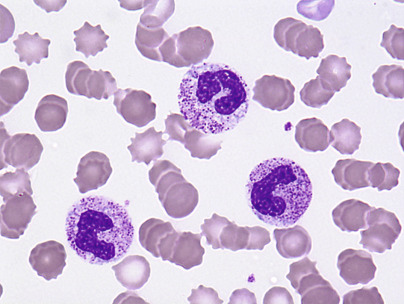

Figure 33-1 

A neutrophil with toxic granulation is pictured, along with two bands. 

Basophilic inclusions (Döhle bodies) are present as well (1000×). 

If the demand for neutrophils is extremely great, as in severe infection, there may be depletion of the marrow storage pool with decreased CGP (neutropenia) and MGP, because the supply of cells is insufficient for the demand. In these instances, the marrow will show increased early neutrophil precursors, through the myelocyte stage, but decreased metamyelocytes, bands, and neutrophils. 

 

##  Determinants 

Host factors modify the degree of neutrophilic response, with children responding more intensely than adults. The degree of neutrophilia may be impaired by iron, folate, or cobalamin deficiency, or marrow failure due to other causes. 

Pyogenic bacteria especially induce neutrophilia. More virulent agents result in higher neutrophil counts, but when the infection is overwhelming, toxic neutropenia with a shift to the left can occur, more commonly in the elderly. 

Antibiotics modify the response to infection and, while steroid therapy causes neutrophilia by demargination, it tends to impair the host response to infection. 

Neutrophilia, sometimes pronounced, is occasionally seen in patients with primary or metastatic nonhematologic neoplasms including gastro­intestinal and hepatic tumors, Hodgkin lymphoma (HL), and renal cell carcinoma (  Granger & Kontoyiannis, 2009  ;  Hernandez, 2002  ). 

 

##  Neutropenia 

Neutropenia is a reduction of the absolute neutrophil count (ANC) below ~1.5 to 2 × 10  9  /L for white adults and below ~1.2 to 1.3 × 10  9  /L for black adults. The ANC is the product of the WBC count and the percentage of mature as well as immature neutrophils in the WBC differential count. _Agranulocytosis_ refers to severe neutropenia, usually <0.5 × 10  9  /L, and is often associated with depletion of eosinophils and basophils as well. Severe chronic neutropenia (SCN) refers to patients with ANC <0.5 × 10  9  /L for months or years, due to inherited or acquired rare disorders. (  Welte & Zeidler, 2009  ). If the neutrophil count is less than 1 × 10  9  /L, the risk for infection is increased, and it is greater still if less than 0.5 × 10  9  /L. 

Mechanisms by which neutropenia occurs include (1) decreased or ineffective production (proliferation or maturation defect); (2) increased removal from the blood (survival defect); (3) altered distribution between CGP and MGP; or (4) combinations of these mechanisms. Neutropenias may be inherited, autoimmune, toxic, or drug-associated. Drug-induced neutropenia occurs through several mechanisms and is always an important consideration in the differential diagnosis of leukopenia. A partial list of causes associated with neutropenia are shown in [ Box 33-2 ](<#b0015>) . 

Box 33-2 

Key Causes of Neutropenia [ * ](<#fn0010>)

* Brief, partial list. 

  * •

Drugs—cancer chemotherapy, chloramphenicol, sulfas/other antibiotics, phenothiazines, benzodiazepine, antithyroids, anticonvulsants, quinine, quinidine, indomethacin, procainamide, thiazides 

  * •

Radiation 

  * •

Toxins—alcohol, benzene compounds 

  * •

Intrinsic defects—Fanconi's, Kostmann's, cyclic neutropenia, Chédiak-Higashi 

  * •

Immune-mediated—collagen vascular disorders, RA, AIDS 

  * •

Hematologic—megaloblastic anemia, myelodysplasia, marrow failure, marrow replacement 

  * •

Infectious—any overwhelming infection 

  * •

Others—starvation, hypersplenism 

_AIDS,_ Acquired immunodeficiency syndrome; _RA,_ rheumatoid arthritis. 

Constitutional disorders associated with neutropenia frequently present in early infancy. They are of complex molecular origin (  Hauck & Klein, 2013  ). Those due to myeloid hypoplasia or a proliferation defect include Fanconi's anemia (FA), Kostmann's syndrome, Shwachman-Diamond syndrome, and cyclic neutropenia. Those that are due to maturation defects include myelokathexis and Chédiak-Higashi syndrome. 

FA is an inherited BM failure syndrome that usually occurs in childhood and rarely presents in adulthood. This condition is heterogeneous in its clinical manifestations but was classically defined by the presence of aplastic anemia and congenital physical malformations. The aplastic anemia of FA patients appears to be indistinguishable from acquired aplasia. FA patients are also susceptible to hematopoietic and certain solid organ malignancies. Diagnosis is made by cytogenetic analysis while looking for chromosome breakage after exposure to diepoxybutane or mitomycin C. The underlying molecular pathology is complex and involves multiple and varied DNA repair and signaling pathways (  Auerbach, 2009  ;  Kupfer, 2013  ). 

Kostmann's syndrome (or Kostmann's agranulocytosis) is a rare severe (ANC typically <200/µL) congenital neutropenia appearing in early infancy, usually with an autosomal recessive pattern of inheritance. The marrow usually shows the presence of early granulocytes (promyelocyte/myelocyte arrest), but few maturing forms are seen; neutrophil survival is normal. Mutations in the anti-apoptotic gene _HAX-1_ are present in recessive cases and in _ELA2_ , encoding neutrophil elastase, in most autosomal dominant cases. 

Cyclic neutropenia typically presents with recurrent episodes of symptomatic infection (fatigue, mouth ulcers, cervical lymphadenopathy, fever) due to cyclic episodes of severe neutropenia related to periodicity or cycling of neutrophil production. This disease usually presents in childhood, but may present in adulthood and is usually not life-threatening. Typically, oscillations of neutrophil and monocyte levels (between near-normal levels and very low levels) occur over an approximately 21-day period. Mutations in _ELA2_ , similar to that seen in Kostmann's syndrome, have been identified in many patients (  Dale, 2011  ). 

Chronic familial neutropenia or benign familial neutropenia refers to a lower than “normal” neutrophil count, as found in some ethnic populations. It is an incidental and clinically stable finding with no predisposition to infection and is considered a genetic variation. 

The most common causes of congenital neutropenia are neutropenia of pregnancy-induced hypertension (PIH—most common) and overwhelming bacterial infection. Typical signs of infection, including a granulocytic left shift, toxic granulation, and Döhle bodies, accompany the latter, but these changes are not seen in PIH. Neither usually continues beyond the first week of life, and other causes should be searched for in infants with persistent neutropenia (  Christensen & Calhoun, 2004  ). 

Patients with congenital or primary immunodeficiency diseases may exhibit some degree of neutropenia. Males with X-linked agammaglobulinemia (XLA) are often neutropenic, and XLA should be considered in the differential diagnosis of chronic neutropenia in an infant. An abnormal nonreceptor tyrosine kinase, associated with signal transduction and differentiation of hematopoietic cells, appears to be involved. This is due to various mutations in the gene _BTK_ ( _B_ ruton's or _B_ lymphocyte _t_ yrosine _k_ inase) on the long arm of the X chromosome (q22). Other congenital syndromes having a prominent association with neutropenia include selective immunoglobulin (Ig)A deficiency, common variable immunodeficiency, and hyper IgM syndrome (  Dotta & Badolato, 2014  ). 

Certain autoimmune diseases can also be associated with chronic neutropenia. Both rheumatoid arthritis (RA) and systemic lupus erythematosus (SLE) show this association (  Starkebaum, 2002  ). The combination of chronic neutropenia and RA is termed _Felty 's syndrome (FS), _ and patients develop symptoms owing to both RA (e.g., subcutaneous nodules, contractures, erythema, warmth, tenderness, symmetric involvement of large and small joints, musculoskeletal pain) and chronic neutropenia (symptoms of recurrent bacterial and fungal infections). A portion of these cases are associated with large granular lymphocyte (LGL) leukemia that may be indistinguishable from FS (  Liu & Loughran, 2011  ). SLE may present with multisystem involvement, making presenting symptoms highly variable. Alterations in neutrophil proliferation and survival with neutropenia due, at least in part, to immune-mediated destruction, occur in both SLE and FS, and increased neutrophil apoptosis may be noted in SLE. 

Autoimmune myelofibrosis is a rare cause of isolated neutropenia (  Chalayer et al, 2014  ). Prognosis of these patients appears to be very good with corticosteroid therapy. 

Drugs are the most common cause of acute neutropenia (“agranulocytosis”) and typically show a lack of granulocytic cells in the marrow. Progenitor hyperplasia, however, may be present and is often termed _promyelocytic hyperplasia_ or _maturation arrest._ Most classes of drugs have been implicated, with clozapine, trimethoprim-sulfamethoxazole, and methimazole most commonly associated. Pathogenesis is not well understood for individual cases (  Tesfa et al, 2009  ). Mortality is about 5%, and management includes cessation of medication, use of antibiotics, and consideration of G-CSF (  Pick & Nystrom, 2014  ). 

Inhibition of granulopoiesis or myeloid toxicity occurs with chemotherapeutic agents, chlorpromazine, and others. These effects tend to be dose dependent and reversible. Important and limiting side effects of cancer chemotherapy are severe neutropenia with its risk for infection, as well as severe thrombocytopenia with risk for bleeding; anemia is more readily controlled with transfusion. 

Radiation damages bone marrow progenitor cells as well as marrow stromal elements. Radiation type, dose, and duration are all factors that determine the extent of bone marrow damage, such as aplasia or hypoplasia. Lymphocytes are most sensitive and are directly killed by exposure. The lymphocyte count correlates with, and has been used to assess dose and severity of exposure (  Dainiak, 2002  ). In addition, hematopoietic precursors undergoing mitosis are very sensitive to injury and death. 

Isolated neutropenia or agranulocytosis is fairly uncommon in adults. When a myelophthisic process, such as metastatic carcinoma, disseminated tuberculosis, or Gaucher's disease, infiltrates the BM, the damage is not limited to granulopoiesis but affects normoblasts and megakaryocytes as well. Because of the short life span of granulocytes, however, neutropenia is the earliest recognizable effect in the blood. It may take weeks before damage to the erythropoietic tissue becomes manifest because of the usually long life span of erythrocytes. Platelets have a rather short life span; on the other hand, megakaryocytes are more resistant to damage. 

Neutropenia due to increased ineffective granulocytopoiesis occurs in megaloblastic anemias and with drugs that have an antifolate effect. In these conditions, anemia and thrombocytopenia are usually associated. The marrow is usually hyperplastic. In megaloblastic anemia due to nutritional deficiency, drug-induced suppression of DNA synthesis, or an inborn error of metabolism, asynchronous nuclear/cytoplasmic maturation (megaloblastic change or megaloblastosis) is identified in marrow progenitor cells. Ineffective granulocytopoiesis may also occur in myelodysplasia. 

In starvation, cellularity tends to be decreased, and a morphologic marrow change termed _serous fat atrophy_ or _gelatinous transformation_ of the BM is present. This change shows a loss of hematopoietic cells within the marrow stroma replaced by small or shrunken fat cells expanded by an intercellular, homogeneous, eosinophilic material. BM hypocellularity is typically seen with advanced disease. 

Transient neutropenia may occur early in some infections, followed by leukocytosis once the marrow production catches up with the demand. Some bacterial infections, notably brucellosis and _Salmonella_ infections, are associated with neutropenia; they may have some depressing effect on the marrow as well. Patients with measles and rubella have neutropenia for several days after appearance of the rash. Hepatitis, infectious mononucleosis, and influenza may also cause acute neutropenia. Lymphocytosis is present and persists after the neutropenia subsides. 

The neutropenia of hypersplenism has been attributed to selective removal of neutrophils by the spleen. It is associated with neutrophilic hyperplasia of the marrow and is corrected by splenectomy. Splenomegaly due to many causes may result in shortened neutrophil survival and neutropenia; these include congestive splenomegaly, Felty's syndrome, Gaucher's disease, and lymphoma. In some cases of Felty's syndrome (neutropenia and splenomegaly in rheumatoid arthritis), a neutrophil-specific antibody may be involved.  Ramirez and colleagues (2004)  recently showed enhanced apoptosis in patients with cirrhosis and ascites, which appeared to be dependent upon elevated activity levels of caspase-3 in these patients. Patients are prone to neutropenia and infection; in the past, this was largely attributed to hypersplenism with increased splenic clearance of neutrophils. However, these recent findings suggest that other mechanisms, at least in part, may also be contributory. 

Pseudoneutropenia may be caused by increased margination of neutrophils in some individuals, without a decrease in total granulocyte count. Rather than showing an equal distribution between MGP and CGP, an increased proportion of neutrophils appear to be present in the MGP. Small doses of endotoxin will cause a shift of neutrophils into the MGP from the CGP, giving an apparent neutropenia, before causing leukocytosis. 

 

##  Morphologic Alterations in Neutrophils 

In addition to quantitative changes, qualitative morphologic alterations occur in neutrophils, and these too may be inherited or acquired. Some of these, such as toxic granules or cytoplasmic vacuoles, are acquired and disappear after the stimulus that provoked them is gone. Others are hereditary and persist through life, with or without functional impairment ( [ Box 33-3 ](<#b0020>) ). These were reviewed by  Brunning (1970)  , and more recently by  Kroft (2002)  . 

Box 33-3 

Morphologic Alterations in Neutrophils 

  * Toxic granulation—azurophilic cytoplasmic granules seen in severe infections, other toxic conditions, and reactive conditions 

  * Cytoplasmic vacuoles—seen in infection, indicating phagocytosis 

  * Döhle bodies—pale blue, oval cytoplasmic remnants of ribosomes seen in infection and other toxic conditions 

  * May-Hegglin anomaly—rare autosomal dominant condition with pale blue cytoplasmic ribosomal inclusions resembling Döhle bodies 

  * Alder-Reilly anomaly—prominent azurophilic granulation not related to infection 

  * Pelger-Huët anomaly—bilobed or rounded nuclei with pince-nez shape 

  * Chédiak-Higashi syndrome—autosomal recessive disorder with giant granules, likely representing giant fused lysosomes, and abnormal leukocyte function 

It should be noted that disorders of leukocyte function may exist with no structural abnormality detectable with the usual modes of morphologic examination. 

 

##  Toxic Granulation 

Toxic granules are dark blue to purple cytoplasmic granules in the metamyelocyte, band, or neutrophil stage. They are peroxidase positive and may be numerous or few in number; less peroxidase activity may be seen in toxic than in normal neutrophils. Toxic granulation is noted in infections or other toxic conditions but may also be seen in noninfectious reactive conditions ( [ Figs. 33-1 ](<#f0010>) and [ 33-2 ](<#f0015>) ). 

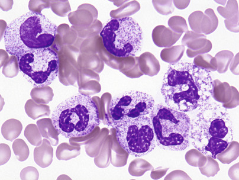

Figure 33-2 

Leukemoid toxic neutrophilia with left shift and toxic vacuolization (1000×). 

 

##  Döhle Inclusion Bodies 

These small, oval inclusions in the peripheral cytoplasm of polymorphonuclear neutrophils stain pale blue with Wright's stain (see [ Fig. 33-1 ](<#f0010>) ). They are remnants of free ribosomes or rough-surfaced endoplasmic reticulum, persisting from an earlier stage of development. 

 

##  May-Hegglin Anomaly 

This is characterized by pale blue inclusions resembling Döhle bodies in neutrophils, by giant platelets and, in some persons, by thrombocytopenia ( [ Fig. 33-3 ](<#f0020>) ). The inclusions are larger and more prominent than the Döhle bodies found in infections. They have been described in eosinophils, basophils, and monocytes as well as in neutrophils. The blue staining of the inclusions is due to RNA. Granulocyte function is normal. May-Hegglin a rare autosomal dominant condition involving the nonmuscle myosin heavy chain 9 gene ( _MYH9_ ) linked to chromosome 22q12-13. The mutations appear to alter the assembly and stability of myosin and may be responsible for the underlying pathophysiology and changes seen in leukocyte and platelet structure and function. Varied mutations in _MYH9_ are responsible for a phenotypic spectrum of illness including May-Hegglin anomaly, and Sebastian, Fechtner, and Epstein platelet syndromes (  Pecci et al, 2014  ;  Saposnik et al, 2014  ). 

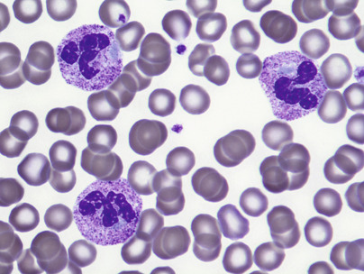

Figure 33-3 

May-Hegglin anomaly, showing Döhle-like inclusions (1000×). 

 

##  Alder-Reilly Anomaly 

Dense, prominent, larger than normal azurophilic granulation in all white blood cells was described by  Alder in 1939  ( [ Fig. 33-4 ](<#f0025>) ) (  Alder, 1939  ). In neutrophils, it may resemble toxic granulation, but it is unrelated to infection and is not transient. In 1941, Reilly described similar granulocytes in some but not all patients with gargoylism, Hurler's syndrome, or, more generally, the genetic mucopolysaccharidoses (  Reilly, 1941  ). Other observations have shown that the heavy granulation in neutrophils can occur as a feature of the genetic mucopolysaccharidoses or independently in otherwise healthy persons (  Brunning, 1970  ). 

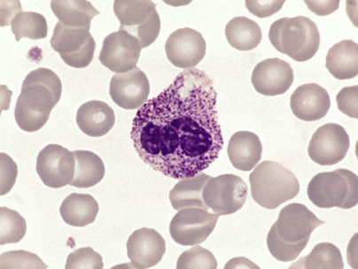

Figure 33-4 

The Alder-Reilly anomaly may be found in healthy individuals or in those with mucopolysaccharidoses, in which granules are metachromatic (1000×). 

Occurring more often than the Alder-Reilly anomaly in the genetic mucopolysaccharidoses is a metachromatic inclusion in the lymphocytes surrounded by a clear space ( [ Fig. 33-5 ](<#f0030>) ). Macrophages in the marrow frequently contain similar granulation. This group of disorders is inherited and is characterized by deficiencies or derangement in various lysosomal enzymes required for degrading mucopolysaccharides. The result is abnormal deposition and storage of mucopolysaccharides in multiple organs. Skeletal abnormalities are prominent. 

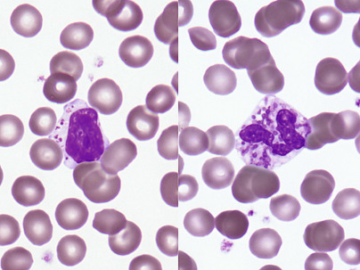

Figure 33-5 

Genetic mucopolysaccharidoses often show abnormal lymphocyte granules with surrounding halos. 

In these cells from the same blood film, neutrophils showed similar changes (1000×). 

 

##  Pelger-Huët Anomaly 

This hereditary, autosomal dominant condition involves failure of normal segmentation of granulocytic nuclei. Most nuclei are bilobed and rounded, with a characteristic spectacle or pince-nez shape ( [ Fig. 33-6 ](<#f0035>) ). The chromatin is quite coarse, and these are not normal young band forms. When a large number of band-like neutrophils appear in the differential count in a patient without infection or other cause, careful analysis of the blood films of the patient and of family members will occasionally establish the presence of the Pelger-Huët anomaly. The cells are functionally normal, and the underlying abnormality is mutation of the lamin B receptor gene (  Colella & Hollensead, 2012  ). 

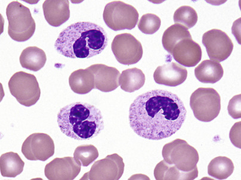

Figure 33-6 

Inherited Pelger-Huët anomaly (1000×). 

A similar appearing, acquired disorder of nuclear segmentation in granulocytes may be found in cases of granulocytic leukemia, myelodysplastic and some myeloproliferative disorders, and some infections, and after exposure to certain drugs; this is called the _pseudo –Pelger-Huët anomaly. _ In addition to band forms and neutrophils with only two segments, mature cells with round, nonsegmented nuclei and coarse chromatin are common. In contrast to the congenital Pelger-Huët anomaly, ring-shaped and other abnormal nuclei may be seen, and the cytoplasm is usually hypogranular. 

 

##  Chédiak-Higashi Syndrome 

Partial oculocutaneous albinism, photophobia, immune deficiency, abnormally large granules in leukocytes and other granule-containing cells, neurologic defects, and frequent pyogenic infections characterize this rare, autosomal recessive disorder (  Introne et al, 1999  ). An accelerated lymphoma-like phase occurs, with lymphadenopathy, hepatosplenomegaly, and pancytopenia; lymphoid infiltrates are widespread, and death ensues at an early age. Granulocytes, monocytes, and lymphocytes contain giant granules ( [ Fig. 33-7 ](<#f0040>) ), which appear to be abnormal lysosomes. The pathogenesis of this disorder is linked to an abnormality of granule maturation, causing enlargement and apparent fusion of granules and vesicles (such as lysosomes, melanosomes, and platelet dense granules) in all cell types. Leukocyte functional abnormalities exist. 

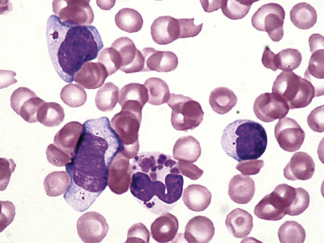

Figure 33-7 

Chédiak-Higashi neutrophils and lymphocytes with large granules (1000×). 

**Myelokathexis** applies to peripheral neutropenia with the presence of BM neutrophils. WHIM ( _w_ arts, _h_ ypogammaglobulinemia, _i_ nfection, and _m_ yelokathexis) syndrome is a rare, autosomal dominant disease of leukocyte trafficking involving chromosome 2q21. The disease appears to be due to mutations in the chemokine receptor gene _CXCR4_ and altered leukocyte response to its functional ligand CXCL12. Hematologic changes include severe peripheral neutropenia with lymphopenia also common, but with granulocytic hyperplasia of the BM (  Dotta et al, 2011  ;  Gulino et al, 2004  ). 

 

##  Functional Disorders of Neutrophils 

Inherited and acquired disorders affecting neutrophils and other leukocytes may result in abnormal function and susceptibility to infections. Deficiencies of humoral factors (antibodies, components of complement) may result in defective chemotaxis or opsonization. As described previously, some inherited disorders, such as the May-Hegglin, Alder-Reilly, and Pelger-Huët anomalies, have altered morphologic appearances but apparently normal granulocytic function. Other inherited conditions, such as the Chédiak-Higashi syndrome and specific granule deficiency (SGD), display alterations in both morphology and function. Inherited conditions such as chronic granulomatous disease (CGD), myeloperoxidase deficiency (MYD), and leukocyte adhesion deficiency (LAD) exhibit functional disorders with essentially normal morphology on Wright's- and Giemsa-stained films (  Dinauer, 2014  ). 

Chronic granulomatous disease (  Holland, 2013  ) is a rare, primary immunodeficiency affecting neutrophils, eosinophils, macrophages, and monocytes; it results from the inability of these phagocytic cells to kill intracellular microorganisms. Patients present with recurrent bacterial and fungal infections (skin, liver, mouth, lymph nodes). These lead to chronic granulomatous lesions (a hallmark of the disease) that may, in turn, obstruct vital organ systems and ultimately lead to death. Symptoms occur early in life, and both autosomal recessive (≈66%) and X-linked (≈33%) modes of inheritance are known. The disease results from genetic defects in any of the membrane-bound or cytoplasmic components of nicotinamide adenine dinucleotide phosphate (NADPH) oxidase. 

Primary MYD is a congenital disorder that is not uncommon and that is easily identifiable with automated cell counters incorporating measurement of MPO activity in the differential count. Secondary MYD, which can be transient and corrected with treatment of the underlying disease, may occur secondary to conditions such as myeloid neoplasms, drugs, severe infectious diseases, diabetes mellitus, and pregnancy. Primary MYD may be total or partial and does not show the severity of CGD but can increase frequency and severity of infections (  Nauseef, 2014  ). 

Human eosinophil peroxidase is structurally related to MPO but is not identical and is encoded by a different gene. Deficiency is thought to be extremely rare, is unrelated to MYD, may show autosomal recessive inheritance, and appears to be without clinical symptoms. Eosinophil peroxidase largely functions by neural signaling (  Akasheh et al, 2014  ). 

Specific granule deficiency (SGD) is an extremely rare condition that presents with multiple bacterial infections, atypical bilobed nuclei within neutrophils, and lack of secondary/specific cytoplasmic granules within neutrophils on Wright's-stained peripheral blood films. SGD also affects eosinophils. In addition to granule deficiencies and impaired bactericidal activity, neutrophils are defective in chemotaxis, receptor upregulation, and disaggregation (  Gombart et al, 2001  ). 

 

##  Leukocyte Adhesion Deficiency (LAD) Diseases 

Proper neutrophil function is dependent upon cell-cell adhesion via the integrins, nonadhesive surface molecules in circulating leukocytes, which upon proper stimulation become adhesive or develop increased binding properties for their specific ligands (van de  Vijver et al, 2013  ). In LAD, defective leukocyte adhesion and migration occur, resulting clinically in recurrent infection and leukocytosis. Delayed separation of the umbilical cord often occurs. Several types (LAD-I, II, and III) are described. Some forms of LAD can be diagnosed by flow cytometry, with lack of expression of CD18 or CD15a on neutrophils. HSC transplantation is the only cure. 

 

##  Eosinophilia 

Eosinophilia exists if blood eosinophils exceed ~0.35 to 0.5 × 10  9  /L. Reactive eosinophilia is typically associated with allergic processes and parasitic infections. Classically, the major function of eosinophils appeared to be the release of granule contents or reactive oxygen species, to damage the target organism or offending cell. Immunoregulatory and proinflammatory signaling roles also exist, and eosinophils are thus both effector and regulatory cells. Causes of eosinophilia have been recently reviewed (  Furuta et al, 2014  ;  Helbig, 2014  ;  Montgomery et al, 2013  ). 

Eosinophil production is stimulated by IL-5, migration is influenced by the chemokine eotaxin, and the two factors interact in producing eosinophilia. Causes and conditions associated with eosinophilia are shown in [ Box 33-4 ](<#b0025>) . 

Box 33-4 

Key Causes of Eosinophilia 

  * •

Allergic—urticaria, hay fever, asthma 

  * •

Inflammatory—eosinophilic fasciitis, Churg-Strauss syndrome 

  * •

Parasitic—trichinosis, filariasis, schistosomiasis 

  * •

Nonparasitic infections—systemic fungal, scarlet fever, chlamydial pneumonia of infancy 

  * •

Respiratory—pulmonary eosinophilic syndromes (Löffler's, tropical pulmonary eosinophilia), Churg-Strauss syndrome 

  * •

Neoplastic—MPN with translocation of _PDGFRA/B_ or _FGFR1_ , CML, mastocytosis, Hodgkin lymphoma, T cell lymphomas, lymphocytic HES 

  * •

Idiopathic HESs—affecting heart, liver, spleen, CNS, other organs 

  * •

Others—certain drugs, hematologic and visceral malignancies, GI inflammatory diseases, sarcoidosis, Wiskott-Aldrich syndrome 

_CML,_ Chronic myelogenous leukemia; _CNS,_ central nervous system; _GI,_ gastrointestinal; _HES_ , hypereosinophilic syndrome; _MPN,_ myeloproliferative neoplasm; _PDGFRA/B_ , platelet-derived growth factor alpha/beta. 

Eosinophilia is frequent in a variety of hematologic neoplasms including clonal myeloproliferative diseases (described later in this chapter). It also occurs with a broad spectrum of nonhematopoietic primary or metastatic neoplasms, usually associated with advance stage disease. Paraneoplastic eosinophilia occurs in Hodgkin lymphoma and peripheral T cell lymphomas. In some other lymphomas and leukemias of other lineages, it is clonal and part of the neoplastic process, such as B lymphoblastic leukemia with t(5;14)( _IL3-IgH_ ), whereas in lymphocytic variant hypereosinophilic syndrome (HES), it may be secondary to an abnormal lymphoid proliferation. 

Moderate to severe peripheral blood eosinophilia is most commonly associated with infection by helminths, including nematodes, trematodes, and cestodes. Eosinophilia is more pronounced if tissues are invaded (e.g., trichinosis) than when parasites inhabit the lumen of a viscus (e.g., tapeworm). Some parasites, such as _Taenia solium_ (cysticercosis) produce little inflammatory response while alive, but trigger an inflammatory response upon degeneration of the organism. Other parasites, such as _Trichinella spiralis_ (trichinosis) incite peripheral eosinophilia upon larval invasion of the muscles and encystment. Leukocytosis and eosinophilia extending over months are seen in toxocariasis ( _Toxocara canis_ or _T. catis_ ) or visceral larva migrans. Cutaneous larva migrans caused by larvae of the dog _(Ancylostoma braziliense)_ or cat _(A. caninum)_ hookworm also cause eosinophilia. 

Löffler's syndrome (simple eosinophilic pneumonia) affects all age groups and is characterized by repeated, transient pulmonary exudates accompanied by fever and clinical symptoms of bronchitis, often producing sputum that contains eosinophils. It may be caused by a variety of exposures including certain drugs, inhaled antigens, or helminth (see earlier) infestation. The latter occurs during periods of dissemination or migration when the parasites pass from the blood into the alveoli of the lung. Löffler's syndrome may also be idiopathic. Tropical pulmonary eosinophilia is a syndrome of paroxysmal cough and bronchospasm associated with marked eosinophilia and often associated with _Wuchereria bancrofti_ in India, Africa, Southeast Asia, and the South Pacific. 

Many drugs are also associated with blood or pulmonary eosinophilia and pulmonary infiltrates. Implicated drugs include: pilocarpine, physostigmine, digitalis, p-aminosalicylic acid, sulfonamides, chlorpromazine, phenytoin, some antidiabetic drugs, some anticancer agents, and many others. 

Idiopathic HES ( [ Fig. 33-8 ](<#f0045>) ) is a het­erogeneous syndrome composed of a number of different disorders of varying severity, after myeloproliferative neoplasms with abnormalities of _PDGFRA, PDGFRB,_ and _FGFR1,_ and CMML with eosinophilia are excluded. 

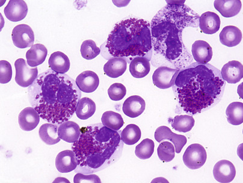

Figure 33-8 

Marked eosinophilia of unknown cause, suggesting hypereosinophilic syndrome, peripheral blood (1000×). 

The organ most consistently affected in HES is the heart, with mural thrombi formation, myocarditis, endocardial and myocardial fibrosis, constrictive pericarditis, and fibroplastic endocarditis (  Brito-Babapulle, 2003  ). Hepatosplenomegaly is common. Other organ systems may be involved and include the CNS and retina, lungs, skin, GI tract, and kidney. 

 

##  Basophilia 

Basophilia is an increase in the absolute basophil count above 0.2 × 10  9  /L. Causes of basophilia are listed in [ Box 33-5 ](<#b0030>) . Basophilia is seen most frequently in hypersensitivity and allergic reactions, chronic myeloid leukemia ( [ Fig. 33-9 ](<#f0050>) ), primary myelofibrosis, and polycythemia vera. Relative basophilia may be transient following irradiation. Basophilia may be present in hypothyroidism and chronic hemolytic anemia and following splenectomy. Reactive basophilia is an uncommon finding overall, sometimes seen in patients combating helminth infections (  Voehringer, 2013  ). 

Box 33-5 

Key Causes of Basophilia 

  * •

Myeloproliferative disease 

  * •

Allergic—food, drugs, foreign proteins 

  * •

Infectious—variola, varicella 

  * •

Chronic hemolytic anemia—especially post-splenectomy 

  * •

Inflammatory—collagen vascular disease, ulcerative colitis 

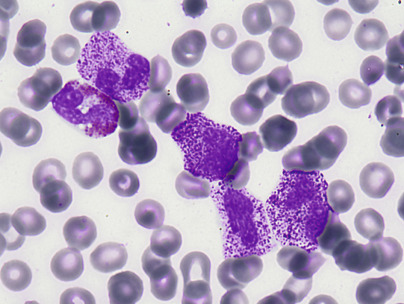

Figure 33-9 

Marked basophilia and an eosinophil in a patient with Philadelphia chromosome positivity (1000×). 

(Courtesy of Robin Abaya, MD.) 

 

##  Monocytosis 

Monocytosis is an increase in monocytes above the upper reference value, especially when greater than 1.0 × 10  9  /L. The most common causes are recovery from neutropenia and indolent infections. Causes and associations of monocytosis are shown in [ Box 33-6 ](<#b0035>) . 

Box 33-6 

Key Causes of Monocytosis 

  * •

Infectious—tuberculosis, subacute bacterial endocarditis, syphilis, protozoal, rickettsial 

  * •

Recovery from neutropenia 

  * •

Hematologic—leukemias, myeloproliferative disorders, lymphomas, multiple myeloma 

  * •

Inflammatory—collagen vascular disease, chronic ulcerative colitis, sprue, myositis, polyarteritis, temporal arteritis 

  * •

Others—solid tumor, immune thrombocytopenic purpura, sarcoidosis 

Monocytosis is present during the recovery stage from acute infection and from agranulocytosis, in which it is considered a favorable sign. Monocytosis may be present in subacute bacterial endocarditis. In this condition, monocytes may show phagocytosis of other blood cells, red blood cells, and leukocytes. It may be present in mycotic, rickettsial, protozoal, and viral infections. 

Infectious disease, however, is an uncommon cause of monocytosis. In a classic study of 160 successive cases of absolute monocytosis (  Maldonado & Hanlon, 1965  ), more than half (85) were associated with hematologic neoplasms **.** These included acute monocytic and granulocytic leukemias, lymphoma (HL most frequently), multiple myeloma, and myeloproliferative disorders. 

 

##  Monocytopenia 

Monocytopenia is a decrease in circulating monocytes below the lower reference value of 0.2 × 10  9  /L. During therapy with prednisone, monocytes fall during the first few hours after the first dose, but return to above original levels by 12 hours. Monocytopenia has been observed in hairy cell leukemia (HCL), in congenital complex immunodeficiency involving monocytopenia and susceptibility to mycobacterial infection (MonoMac syndrome) due to GATA2 mutation, other rare immunodeficiencies, and in B-lymphoblastic leukemia (  Dotta & Badolato, 2014  ;  Hsu et al, 2011  ;  Kraut, 2003  ;  Park & Rogers, 2013  ). Monocytopenia is uncommon as an isolated finding. 

 

##  Lymphocytic and Plasmacytic Disorders 

In these disorders, the pathologist should consider neoplastic conditions, which are covered in the later sections of this chapter, as well as the benign causes, described next. 

 

##  Lymphocytes in Normal Individuals 

In normal individuals, the absolute numbers of lymphocytes and T cells are highest in young children. The percentage of lymphocytes in the blood is normally up to about 50% for the first 5 years. During the first decade of life, the absolute lymphocyte count and the absolute number of T cells decrease but remain higher than observed in the adult. By the time of adolescence, the absolute lymphocyte count and the absolute number of T cells have leveled off to values observed throughout adulthood. The absolute number of B lymphocytes remains stable during all stages of life (  Davey & Huntington, 1977  ;  Perkins, 2004  ). In adolescence and adulthood, lymphocytes constitute about 20% to 40% of all leukocytes, or 1.5 to 4.0 × 10  9  /L cells/L. 

The normal CD4/CD8 ratio is between 1.0 and 3.4, but we have seen values as high as 12.0 in reactive conditions. In the neonate, the numbers of total T cells and CD8+ T cells may be similar or decreased compared with adults, whereas CD4+ T cells may be similar or increased. 

 

##  Lymphocytosis 

Lymphocytosis is an increase in the number of lymphocytes in the peripheral blood; reference intervals are ≈1.5 to 4.0 × 10  9  /L in the adult and ≈1.5 to 8.8 × 10  9  /L in the child. Relative lymphocytosis (an increase in the percentage of lymphocytes) is present in various conditions and is especially prominent in disorders with neutropenia. Lymphocytosis is unusual in acute bacterial infections but is commonly associated with viral infection (Epstein-Barr virus [EBV], hepatitis) ( [ Box 33-7 ](<#b0040>) ). 

Box 33-7 

Key Causes of Lymphocytosis 

  * •

Infectious—many viral, pertussis, tuberculosis, toxoplasmosis, rickettsial 

  * •

Chronic inflammatory—ulcerative colitis, Crohn's disease 

  * •

Immune mediated—drug sensitivity, vasculitis, graft rejection, Graves' disease, Sjögren's syndrome 

  * •

Hematologic—ALL, CLL, lymphoma 

  * •

Stress—acute, transient 

_ALL,_ Acute lymphoblastic leukemia; _CLL,_ chronic lymphocytic leukemia. 

 

##  Lymphocytosis Associated with Viral Infection 

Lymphocytosis is a frequent finding in children with viral infection and may be marked. Lymphocytic leukemoid reactions were previously referred to as _acute infectious lymphocytosis (AIL),_ often lasting 3 to 5 weeks but without other blood changes in most patients. Lymph node enlargement is rare and minimal when present. The spleen and liver are rarely, if ever, enlarged. Lymph node biopsy may show reactive follicular hyperplasia but no characteristic changes. In some cases there has been an increase of white cells in the CSF, with about 40% lymphocytes. 

A chronic form of infectious lymphocytosis also occurs in children. The leukocyte count is 10 to 25 × 10  9  /L, with 60% to 80% lymphocytes of normal appearance. 

 

##  Pertussis 

Whooping cough (pertussis), although reduced by routine immunization, still occurs in unimmunized children and is most severe in infants, in whom most disease-associated deaths occur. The disease has had a resurgence in the United States in recent years, in part due to vaccine factors (  Clark, 2014  ). It also occurs in adults with immunity reduced since childhood vaccination. The etiologic agent is _Bordetella pertussis,_ a highly infectious agent that produces an inflammatory reaction of the entire respiratory tract. The incubation period is approximately 6 to 20 days. Symptoms begin as a head cold, progressing to paroxysms of coughing productive of thick sputum. Paroxysms typically end with a “whooping” sound, due to deep inspiration, giving the disease its descriptive name. There is frequently pain over the trachea and bronchi. The disease typically lasts 6 to 12 weeks. 

Patients frequently develop significant lymphocytosis with counts higher than 30 × 10  9  /L recorded. The lymphocytes are small, mature T cells with a normal CD4/CD8 ratio (  Hudnall & Molina, 2000  ). The lymphocyte count is highest during the first 3 weeks of the illness, and then decreases during the fourth and subsequent weeks (  Lagergren, 1963  ). The lymphocytosis is at least partially due to the release of lymphocytosis-promoting factor (LPF) or pertussis toxin from the organism. This factor may cause transient increased mobilization of lymphocytes from lymphoid organs, followed by inhibition of recirculation of lymphocytes from blood into the lymph flow. Thus, the lymphocytosis is due to redistribution of lymphocytes into the peripheral circulation without increased lymphopoiesis. 

 

##  Chronic Lymphocytosis/Persistent Polyclonal B Cell Lymphocytosis 

Persistent reactive lymphocytosis is an uncommon event in adults, and significant lymphocytosis should raise suspicion of neoplastic disease, such as chronic lymphocytic leukemia. Coexistence of neutropenia or classic Felty's syndrome suggests LGL leukemia. Often tissue biopsy and/or immunophenotyping of peripheral blood will point toward a specific disease or diagnosis. Mononucleosis or lymphocytosis due to other viruses occasionally presents in later life, however. 

A rare condition, persistent polyclonal lymphocytosis, has been reported in adults, predominantly in female smokers, and in the postsplenectomy state (  Himmelmann et al, 2001  ;  Lairmore et al, 2012  ). It is a benign polyclonal B cell proliferation with binucleated atypical lymphocytes in the blood, but the possibility of incipient lymphoma has been considered (  Troussard et al, 2008  ). 

 

##  Retrovirus-Associated Diseases and Conditions 

Human T lymphotropic virus type 1 (HTLV-1), discovered in 1980, is a retrovirus associated with adult T cell leukemia/lymphoma (ATL) (  Poiesz et al, 1980  ). It is endemic in areas of Japan, the Caribbean basin, and the southeastern United States. HTLV-2, a second human retrovirus, was first found in a patient with HCL (  Kalyanaraman et al, 1982  ). A third human retrovirus, human immunodeficiency virus type 1 (HIV-1), was recognized and confirmed as the cause of acquired immunodeficiency syndrome (AIDS [discussed further later]) in 1983 (  Barre-Sinoussi et al, 1983  ;  Kalyanaraman et al, 1982  ). Subsequently, a second but distinct type of HIV—now called HIV-2—was identified (  Alizon et al, 1984  ). More recently, additional retroviruses, HTLV-3/4 and simian foamy retrovirus, have also been found to infect humans (  Gessain et al, 2013  ). 

HIV-1 infects both monocyte/macrophages and T cells (both essential cells for normal immune system function), using cell surface chemokine receptors (CCR5 on the former and CXCR4 on the latter); infection ultimately causes progressive loss of CD4+ lymphocytes, disrupts normal immune function, and produces immunodeficiency and disease. Disease not only includes many different types of infections, but also an increase in neoplastic disease, including lymphomas. HIV-1 plays an indirect role (through immune dysregulation and not by direct induction) in the development of lymphoma. HIV-2 is less widespread and somewhat less virulent (  Nyamweya et al, 2013  ). 

HTLV-1 and -2 also infect and transform T cells: primarily CD4+ cells with HTLV-1 and CD8+ cells with HTLV-2. HTLV-1 infects 15 to 20 million people worldwide, with endemic areas in Japan, the Caribbean, and Africa. It is usually transmitted by breast milk or exposure to blood. Acute infection shows few clinical symptoms consisting of fever, limited lymphadenopathy, and occasional skin rash. Lymphocytosis occurs, usually less than 20 × 10  9  /L. Most (90% to 95%) of patients with antibodies against HTLV-1 are symptom free. After a years-long latency, 3% to 5% manifest ATL or tropical spastic paraparesis (  Lairmore et al, 2012  ). 

 

##  Infectious Mononucleosis and Epstein-Barr Virus Infection 

Infectious mononucleosis (IM) is usually a self-limited infectious disease characterized by sore throat, prolonged malaise, atypical lymphocytosis with the presence of large transformed lymphocytes ( [ Fig. 33-10 ](<#f0055>) ), lymphadenopathy (most often posterior cervical), and often splenomegaly (  Vouloumanou et al, 2012  ). In immunocompromised patients, EBV is associated with benign B cell hyperplasia, malignant lymphoma, and posttransplantation lymphoproliferative disease **.** 

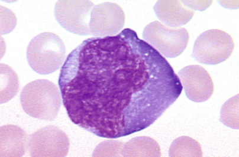

Figure 33-10 

Infectious mononucleosis, showing a large activated lymphoid cell in the blood (1000×). 

 

##  Etiology and Pathophysiology. 

IM is a disorder that occurs secondary to infection with EBV. When the primary infection occurs in healthy individuals during early childhood, the disease often goes unnoticed. However, when the infection involves healthy adolescent individuals or adults, the resultant disorder is the IM syndrome. In most cases, the virus gains entry into the body through the oropharyngeal epithelial and lymphoid tissues, and the virus appears to infect both tissues. The virus attaches to C3d complement receptors (CD21) on B lymphoid cells and enters into the cells. The EBV then stimulates DNA synthesis in these B cells and induces the formation of several new antigens, including the viral capsid antigen (VCA), the membrane antigen (MA), early antigen (EA)—both diffuse (EA-D) and restricted (EA-R) subtypes—Epstein-Barr nuclear antigens (EBNA), and the lymphocyte-detected membrane antigen (LYDMA) (  Harrington et al, 1988  ). Thus, the earliest phase of this disease is characterized by an infection of B cells that proliferate, develop neo-antigens, circulate, stimulate an immune response, and synthesize immunoglobulin (  Sixbey et al, 1984  ). VCA, EA, and EBNA are the viral proteins most important for serodiagnosis in immunocompetent patients. Clinical and laboratory features are summarized in [ Box 33-8 ](<#b0045>) . 

Box 33-8 

Summary of Features of Infectious Mononucleosis (IM) in Immunocompetent Patients 

 

##  Epstein-Barr Virus (Human Herpesvirus-4) 

 

##  Pathophysiology 

  * •

Virus enters through oropharyngeal epithelial and lymphoid cells 

  * •

Virus attaches to CD21 on B cells 

  * •

Viral antigens—viral capsid antigen (VCA), early antigen (EA), Epstein-Barr nuclear antigen (EBNA)—are produced and elicit antibody production 

 

##  Humoral Immune Response 

  * •

Immunoglobulin (Ig)M against VCA rises during incubation and prodrome, falls over few weeks to months 

  * •

IgG against VCA rises during incubation, decreases during convalescence, remains detectable for life 

  * •

Antibodies to EA rise 2-3 weeks after onset of illness, then fall 

  * •

Antibodies to EBNA rise during convalescence, detectable for life 

 

##  Cellular Immune Response 

  * •

T cells activated during second week of illness 

  * •

CD8-positive cytotoxic T cells kill infected B cells 

  * •

Natural killer cells kill infected B cells 

  * •

Some resting memory B cells remain latently infected 

 

##  Clinical Features 

  * •

2- to 5-week incubation period 

  * •

Vague onset of symptoms 

  * •

Fever, sore throat, lymphadenopathy 

  * •

Adolescents, young adults more often symptomatic than younger children 

 

##  Laboratory Features 

  * •

Leukocytosis with absolute lymphocytosis and atypical lymphocytes 

  * •

Transient monocytosis 

  * •

Relative and absolute neutropenia early on 

  * •

Mild thrombocytopenia in half of cases 

  * •

Hemolytic anemia in 1%-3% of cases, often with anti-I specificity 

  * •

Elevated transaminases in 85%-100% of cases, but clinical jaundice rare 

  * •

Spot test is simple, rapid, specific, based on agglutination of horse red blood cells (RBCs) 

  * •

Heterophil antibody (HA) test is based on differential absorption of IM-specific HA by beef RBC stroma and guinea pig kidney 

Typically, the humoral immune response is characterized by the rise in titer of IgG and IgM viral capsid antibodies during the incubation and early prodrome periods. The titer of IgM capsid antibody starts to fall during the second and third weeks of illness, and then diminishes to undetectable levels within the following several months. The IgG viral capsid antibody decreases during convalescence but remains detectable for life. Approximately 2 to 3 weeks after the onset of illness, Epstein-Barr virus antibodies against the early antigens appear and then decline over the succeeding 2 months. The titer of the Epstein-Barr virus nuclear antigen antibodies rises during the latter portion of convalescence and is apparently detectable throughout life. 

The cellular immune response in IM is characterized by proliferation and activation of T cells, usually during the second week of illness, in response to EBV-induced B cell infection and activation. Because these activated T cells are derived mostly from the cytotoxic/suppressor cell subpopulation, marked suppression and destruction of EBV-infected B cells occur. Indeed, most of the atypical lymphocytes observed in the peripheral blood of patients with IM during the second week of illness possess the CD8 antigen. These cytotoxic/suppressor T cells kill infected B cells and diminish polyclonal antibody production induced by the Epstein-Barr virus. In addition to T-cytotoxic cells, the activity of natural killer (NK) cells has a profound effect on limiting the proliferation of EBV-infected B cells in patients with IM. 

Most (over 90%) immunocompetent adults have serologic evidence of past EBV infection. EBV has the capacity not only to infect cells (many of which are destroyed by an intact immune system) but to produce a latent infection in resting memory B cells and, in some cases, produce transformation of lymphocytes to malignant lymphoma. However, a majority of latently infected individuals show no disease manifestations throughout their lifetimes. 

The resting memory B cells can act as a reservoir of EBV, because viral antigens are not expressed on the lymphocyte surface. In IM, a spectrum of EBV expression patterns (programs) is found in different cells (  Klein et al, 2007  ). In type III latency-growth program, cells express a full set of EBV-encoded proteins, including six nuclear proteins (EBNA1 to 6) and three latent membrane proteins (LMP1, -2, and -3). 

LMP1 has strong immunogenic activity and is present only in acute infection, except in immunocompromised hosts. Type I latency involves expression of only one nuclear protein, EBNA-1, and is found in some memory B cells. Type IIa latency involves expression of EBNA-1, LMP-1, and LMP-2. Type IIb latency expresses all EBNAs (EBNA1 to 6) but not LMP-1. 

Tumor cells in posttransplant lymphoproliferative disorders (PTLDs) correspond to latency type III, BL cells to latency type I, and cells in EBV+ HL and EBV+ nasopharyngeal carcinoma (NPC) to latency type IIa, with LMP-1 expression. EBV-encoded RNAs EBER-1 and EBER-2 are reliably expressed at high levels in virtually all latent EBV infections, and are detected with high sensitivity by in situ hybridization assays that are currently the standard for EBV identification (  Gulley & Tang, 2008  ). 

 

##  Clinical Features. 

IM has been observed in patients from 3 months to 70 years of age but is most common in adolescents and young adults. A 2- to 5-week incubation period prior to onset of symptoms usually occurs. Patients usually have vague symptoms including fever, sore throat with ulcerative pharyngitis, and lymphadenopathy. 

 

##  Complications. 

Hemolytic anemia related to anti-I antibodies occurs in 1% to 3% of cases. Mild thrombocytopenia occurs in about half of cases. Splenic rupture may also occur. Neutropenia, pancytopenia, chronic active EBV infection (CAEBV), and hemophagocytic syndrome (EBVHS) occur rarely. 

Abnormal liver function tests indicative of hepatitis occur in 85% to 100% of patients with IM. Clinical jaundice is rare, but occasionally jaundice and acute pharyngitis are the only clinical manifestations of IM. Although uncommon, complications may also involve the nervous system, heart, kidney, and lungs. 

Approximately one third of patients with IM carry β-hemolytic streptococci in the pharynx. Thus, one should give attention to strict clinical, hematologic, and serologic criteria in distinguishing IM from streptococcal pharyngitis. 

 

##  Hematologic Features. 

Leukocytes are increased, ranging from 12 to 25 × 10  9  /L. Rarely, counts as high as 80 × 10  9  /L have been recorded. The leukocytosis is usually due to lymphocytosis (60% to 90%) composed of a variety of atypical lymphocytes. The total leukocyte count, as a rule, returns to normal within 3 weeks. The atypical lymphocytes have nuclear alterations and an increase in the amount and basophilia of cytoplasm. 

Lymphocytes include “monocytoid” lymphocytes, which likely correspond to immunoblasts in lymph nodes (see [ Fig. 33-10 ](<#f0055>) ). Other atypical lymphocytes, which are more numerous, include plasmacytoid lymphocytes and those with small nuclei but abundant cytoplasm. 

Often the number of monocytes rises transiently. The term _mononucleosis_ refers to an increase in lymphocytes, not in monocytes (“mononuclear” cells include both lymphocytes and monocytes). 

Cytologic alterations are not pathognomonic of IM. Similar cells are found in a variety of disorders, including cytomegalovirus mononucleosis, toxoplasmosis, and infectious hepatitis, and usually to a lesser extent in viral pneumonia, varicella, mumps, and viral exanthemas of children. 

Neutrophils are relatively and absolutely decreased in most cases during the first week of illness. During this time, a shift to the left may occur, with an increase in band cells and metamyelocytes. Toxic granules and Döhle bodies may be seen. The eosinophils are within normal limits. 

The BM from patients with IM usually shows increased cellularity. Numbers of lymphocytes, macrophages, plasma cells, megakaryocytes, and erythroid cells are increased. The neutrophilic series appears decreased. About half of cases may have collections of mononuclear cells forming loose granulomas. 

 

##  Serologic Findings in Immunocompetent Patients. 

The spot test for IM is based on the principle that horse erythrocytes are more sensitive than sheep erythrocytes in testing for IM. A positive test for IM shows agglutination of horse erythrocytes by serum absorbed with guinea pig kidney, but not by serum absorbed with beef erythrocyte stroma. The spot test has proved to be a simple, rapid, highly specific, and sensitive test for the heterophil antibodies of IM. False-positive tests occur but are very rare. The spot test is still in use, as are other similarly performing immunoassays and latex-based detection tests for heterophil antibody. False-negative tests occur particularly in young children who produce heterophil antibodies (IgM) in limited amounts. In heterophil-negative IM, the diagnosis may be substantiated by assay for antibody to EBV. 

As previously mentioned, several antibodies are produced by the host in response to a variety of Epstein-Barr virus antigens (see [ Box 33-8 ](<#b0045>) ). Antibody to the viral capsid antigen arises within the first 2 weeks of onset. This antibody, measured by an immunofluorescence or other method, is used for determining exposure to EBV. Assaying for the presence of EBV antibody is usually limited to the few cases of heterophil-negative IM. 

In addition to heterophil and EBV antibodies, patients with IM frequently produce antibodies to a wide variety of antigens. Antibodies against human erythrocytes, leukocytes, and platelets have been described. Patients with IM have an increased frequency of cold agglutinins. Positive tests for rheumatoid factor and antinuclear factor have been reported. 

In immunocompromised patients, serologic tests are of limited value, and direct detection methods are considered more reliable. Determination of EBV viral load by polymerase chain reaction (PCR) appears to be one of the better tests for this patient population (  Hess, 2004  ). 

 

##  Differential Diagnosis. 

Clinical, hematologic, and serologic features of IM permit an accurate diagnosis to be made in more than 90% of cases. When the heterophil test is negative, one must consider several possibilities. The patient could still have EBV antibody–positive but heterophil-negative IM. Cytomegalovirus infection, however, is the most common cause of heterophil-negative mononucleosis. Other possibilities include toxoplasmosis, infectious hepatitis, human herpesvirus 6, human immunodeficiency virus types 1 and 2, and ingestion of drugs ( _p_ -aminosalicylic acid, phenytoin [Dilantin], and diaminodiphenylsulfone). 

 

##  Course. 

Classic IM is a benign disorder, and complications occur in less than 5% of patients. The disorder usually resolves in 3 to 4 weeks. Fatalities are extremely rare but tend to occur in X-linked lymphoproliferative disease (XLP). EBV infection can produce any one of three severe complications in XLP: fulminant IM, life-threatening lymphoproliferative disease and B cell lymphoma, and dysgammaglobulinemia. Although classically associated with EBV infection, XLP can occur in patients seronegative for EBV. In addition to XLP, EBV-associated lymphoproliferative disorders can occur in individuals with congenital and acquired immunodeficiencies. 

 

##  Cytomegalovirus Infection 

Some individuals infected with cytomegalovirus develop a syndrome similar to infectious mononucleosis (  Boeckh, 2011  ). This disorder can occur following massive blood transfusion (posttransfusion mononucleosis) or spontaneously (cytomegalovirus mononucleosis). 

Leukocytosis is characteristic with absolute lymphocytosis. Usually 20% or more of the leukocytes are atypical lymphocytes. BM aspirates have shown increased numbers of normal lymphocytes and atypical lymphocytes. Abnormal liver function test results are the most frequent abnormal laboratory finding. In a small percentage of patients, titers of cold agglutinins, rheumatoid factor, or antinuclear antibodies may be increased. No rise in heterophil, Epstein-Barr virus, or _Toxoplasma gondii_ antibodies occurs. The diagnosis is usually made by isolating the cytomegalovirus from urine, saliva, blood, or tissue biopsy, or by serology. 

 

##  Toxoplasmosis 

_Toxoplasma gondii,_ a protozoan parasite, can produce in both young and old a disease (toxoplasmosis) similar to infectious mononucleosis. Diagnosis is critical in congenitally infected fetuses and newborns, women infected during pregnancy, immunocompromised patients, and patients with chorioretinitis. 

Only a small proportion (≈10%) of immunocompetent individuals are symptomatic. These patients typically present with lymphadenopathy, commonly cervical. Some patients may also show fever, headache, sore throat, hepatosplenomegaly, chorioretinitis, and an increased number of atypical lymphocytes in the peripheral blood. In immunocompromised patients, disease commonly involves the CNS and eyes but may also involve the lungs and heart. 

The histopathology of lymph nodes is usually distinctive, with scattered epithelioid histiocytes that often blur the germinal center/mantle zone border, and with sinus monocytoid B cell hyperplasia ( [ Fig. 33-11 ](<#f0060>) ). Morphology correlates closely with elevated _Toxoplasma_ antibody titers (  Dorfman & Remington, 1973  ). BM biopsy specimens have no specific pathologic lesion. 

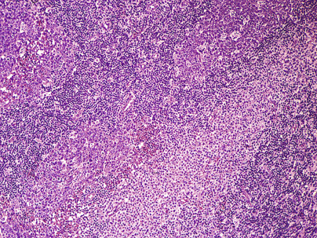

Figure 33-11 

Toxoplasmosis lymphadenitis shows follicular hyperplasia with monocytoid B cell hyperplasia _(lower right-center)_ and scattered individual and aggregates of histiocytes, often impinging on the germinal center/mantle zone border (200×). 

The diagnosis is established by demonstrating an elevation of _Toxoplasma_ antibodies in immunocompetent patients. In immunocompromised patients, serologic tests are not sensitive, and direct detection of the organism from blood, from body fluids, or in tissue is necessary for definitive diagnosis (  Remington et al, 2004  ;  Torres et al, 2013  ). 

 

##  Autoimmune Lymphoproliferative Syndrome 

Autoimmune lymphoproliferative syndrome (ALPS) is an uncommon cause of lymphadenopathy, splenomegaly, and autoimmune cytopenias with onset in childhood that is caused by an inheritable genetic defect, a mutation in one of the genes encoding FAS, or CD95, or occasionally a caspase gene. FAS is a key component of apoptosis. The disease has variable penetrance and is characterized by chronic lymphoid hyperplasia with presence of CD4/CD8 double-negative T cells, and the foregoing symptoms (  Shah et al, 2014  ). 

 

##  Other Nonneoplastic Causes of Lymphadenopathy 

Other causes of benign or reactive lymphadenopathy include autoimmune disease and infection, Castleman's disease, Rosai-Dorfman disease (sinus histiocytosis with massive lymph node hyperplasia), Kikuchi's histiocytic necrotizing lymphadenitis, Kawasaki disease, and others. 

 

##  Lymphocytopenia 

Lymphocytopenia is present when the absolute lymphocyte count is below ≈1.8 × 10  9  /L in adults and below ≈2.0 × 10  9  /L in children. Normally, about 80% of circulating peripheral blood lymphocytes are CD3+ T cells, and a majority (≈65%) of these cells are CD4+ helper T cells. A number of immunologic deficiency disorders that are genetically determined have lymphocytopenia, along with various other immunologic defects of humoral or cell-mediated immunity. Lymphocytopenia in these disorders is due to impaired lymphopoiesis. Increased levels of adrenocortical hormones, administration of chemotherapeutic drugs, or irradiation will result in lymphocytopenia. Impaired drainage of the intestinal lymphatics with loss of lymphocytes into the intestines due to a number of causes has been implicated as a mechanism for lymphocytopenia. In advanced cases of NHL and HL, as well as in terminal cases of carcinoma, lymphocytopenia is often observed. Causes and conditions associated with lymphocytopenia include those listed in [ Box 33-9 ](<#b0050>) . 

Box 33-9 

Key Causes of Lymphocytopenia 

  * •

Destructive—radiation, chemotherapy, corticosteroids 

  * •

Debilitative—starvation, aplastic anemia, terminal cancer, collagen vascular disease, renal failure 

  * •

Infectious—viral hepatitis, influenza, typhoid fever, TB 

  * •

AIDS-associated—HIV cytopathic effect, nutritional imbalance, drug effect 

  * •

Congenital immunodeficiency—Wiskott-Aldrich syndrome 

  * •

Abnormal lymphatic circulation—intestinal lymphangiectasia, obstruction, thoracic duct drainage/rupture, CHF 

_AIDS,_ Acquired immunodeficiency syndrome; _CHF,_ congestive heart failure; _HIV,_ human immunodeficiency virus; _TB,_ tuberculosis. 

 

##  Acquired Immunodeficiency Syndrome 

Acquired immunodeficiency syndrome (AIDS), once a progressively fatal infectious disorder with characteristic clinical, hematologic, and serologic abnormalities, can now be controlled in most patients with highly active antiretroviral (HAART) therapy. 

 

##  Etiology. 

AIDS is a disorder secondary to infection with HIV-1 and HIV-2—RNA retroviruses that are cytotropic for CD4+ T cells and for other cells, including macrophages, monocytes, megakaryocytes, and CNS microglial cells. Viral entry into a cell results from interaction with the CD4 receptor and with chemokine coreceptors that determine target cell tropism (  Starr-Spires & Collman, 2002  ). HIV is responsible for both direct killing of infected cells and indirect killing of neighboring cells, utilizing both apoptotic-dependent and apoptotic-independent mechanisms of cell destruction (  Garg et al, 2012  ). 

HIV infection is spread by contamination with secretions, excretions, blood, and tissues that contain the virus. Because of the cytotropic effect of the AIDS viruses for CD4+ cells, there is a marked decrease in the number of T-helper cells and an imbalance in T suppressor/cytotoxic cells in the blood and lymphoid tissues of the body. As a result, a profound cellular immune depression occurs, characterized by infection with a variety of opportunistic organisms. Initially, B cells are not involved and immunoglobulin levels are normal or increased. However, as the disease progresses, the frequency of malignancy in these patients is increased. AIDS-associated cancers include Kaposi's sarcoma, non-HL, and cervical cancer (all AIDS-defining cancers), as well as HL and anogenital cancers (  Bellan et al, 2003  ;  Mbulaiteye et al, 2003  ). Although the cause of these malignancies is undoubtedly multifactorial, recent studies suggest that HIV may possess oncogenic potential (  Borges et al, 2014  ). In addition, the functions of monocytes and NK cells are abnormal. 

 

##  Hematologic Features. 

The most common hematologic abnormality in patients with AIDS is anemia of chronic disease and lymphopenia (80% to 85% of cases), particularly of the T-helper/inducer (CD4) subset. Thrombocytopenia occurs in approximately 30% of cases and neutropenia in 40%, often with a left shift; the former is often immune mediated (  Hoxie, 1995  ). 

The peripheral blood film usually displays atypical lymphocytes that have a plasmacytoid appearance. Monocytes are often large with a fine nuclear chromatin and cytoplasmic vacuoles. Immune-mediated anemia, thrombocytopenia, and neutropenia in AIDS have also been described. 

The BM is usually normocellular to hypercellular (  Castella et al, 1985  ). Often increased numbers of immature myeloid precursor cells, macrophages laden with iron, and plasma cells occur. Defects occur in BM progenitor cells such as colony-forming unit-granulocyte, monocyte (CFU-GM); colony-forming unit–granulocyte, erythrocyte, monocyte, megakaryocyte, pluripotential stem cell (CFU-GEMM); colony-forming unit–megakaryocyte (CFU-MK); and burst-forming unit-erythrocyte (BFU-E). Many drugs used to treat AIDS and its infectious complications are also myelosuppressive. Suppression of the marrow is, in many patients, multifactorial, resulting from an interaction of direct HIV cytopathic effect, dysregulation of the immune system and of apoptosis, possible complicating infection and/or nutritional imbalance, and drug effect. The most clinically valuable information of BM biopsy is usually the identification of infection or malignancy in the marrow. The disease course has been converted to a relatively indolent chronic course in those who receive and adhere to HAART therapy, but remains a tragic illness in disadvantaged populations and in those not treated. 

 

##  Plasmacytosis 

Plasma cells are not normally present in circulating blood. They are increased in a variety of chronic infections, in allergic states, in the presence of neoplasms, and in other conditions in which the serum γ-globulin concentration is elevated. Plasma cells have also been recorded in the blood of patients with viral disorders, including rubella, measles, chickenpox, and mumps. They are moderately increased in cutaneous exanthemas, infectious mononucleosis, syphilis, subacute bacterial endocarditis, sarcoidosis, and collagen disease. Rarely, bacterial sepsis may show a peripheral plasmacytosis mimicking plasma cell leukemia. Their increase is usually linked with increases in lymphocytes, monocytes, and eosinophils. Causes and conditions associated with plasmacytosis include those listed in [ Box 33-10 ](<#b0055>) . 

Box 33-10 

Key Causes of Plasmacytosis 

  * •

Viral—infectious mononucleosis, measles, rubella, HIV 

  * •

Bacterial—tuberculosis, syphilis, streptococcus, staphylococcus 

  * •

Parasitic—malaria, trichinosis 

  * •

Inflammatory—SLE, RA, inflammatory bowel disease, alcoholic liver disease 

  * •

Neoplastic—plasma cell leukemia, myeloma 

  * •

Immune stimulation—immune complex disease (serum sickness), drug sensitivity, transfusion 

  * •

Trauma 

_HIV,_ Human immunodeficiency virus; _RA,_ rheumatoid arthritis; _SLE,_ systemic lupus erythematosus. 

In the marrow, an average of 1% to 2% of plasma cells are present in adults. An increase beyond 4% is significant; lower values are found in children. Increases of up to 20% of plasma cells may be found in a variety of conditions other than multiple myeloma, including metastatic carcinoma, chronic granulomatous infection, conditions linked with hypersensitivity, and following administration of cytotoxic drugs. They are often increased in aplastic anemia, but this is probably just a relative increase. On the other hand, they are decreased or absent in agammaglobulinemia. 

 

##  Leukemoid Reactions 

A leukemoid reaction is an excessive leukocytic response in the peripheral blood. It includes leukocytosis of 50 × 10  9  /L or higher with a shift to the left; lower counts, even below normal, with considerable numbers of immature granulocytes; and similar quantitative or qualitative changes in lymphocytes or monocytes. Depending on the predominant cell, leukemoid reactions may be neutrophilic, eosinophilic, lymphocytic, or monocytic. 

   

##  Congenital Neutrophilia. 

A rare family with chronic congenital neutrophilia has been described with a mutation of _CSF3R_ (T617N), activated GCSF receptor, and increased response to GCSF (  Plo et al, 2009  ). 

 

##  Neutrophilic Leukemoid Reactions. 

Excessive neutrophilia may occur in many situations, including hemolysis, hemorrhage, malignancy with bone involvement, HL, myelofibrosis, infection (especially tuberculosis), severe burns, eclampsia, and exposure to certain toxins. 

Examination of the blood is usually more helpful than marrow examination. Leukemoid reactions lack the characteristic differential count that is seen in CML, including the myelocyte “peak,” eosinophilia, and basophilia ( [ Fig. 33-12 ](<#f0065>) ). 

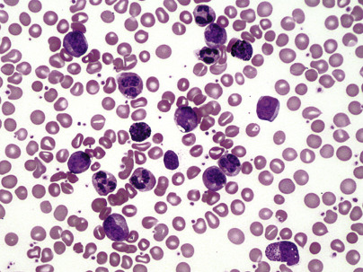

Figure 33-12 

Chronic myeloid leukemia with increased segmented neutrophils, myelocytes, and basophils and an occasional blast (500×). 

 

##  Eosinophilic Leukemoid Reactions. 

Cells as immature as eosinophilic myelocytes rarely appear in the blood in reactive eosinophilia, in which the leukocyte count may exceed 50 × 10  9  /L (see [ Fig. 33-8 ](<#f0045>) ). Eosinophilic leukemoid reactions usually occur in children and are frequently caused by parasitic infection. Hypereosinophilia is discussed later in this chapter. 

 

##  Leukoerythroblastosis. 

In patients with or without anemia, circulating normoblasts frequently are accompanied by a neutrophilic leukemoid reaction; this, then, is a **leukoerythroblastotic reaction.** A moderate anemia with normoblasts in the peripheral blood is fairly common in metastatic carcinoma involving BM. Leukoerythroblastosis may also be associated with marrow infection and/or fibrosis, and may be seen in benign conditions such as GI bleeding and hemolytic anemia. 

 

##  Lymphocytic Leukemoid Reactions. 

Extremely high counts of normal-appearing lymphocytes may occur in infectious lymphocytosis and in pertussis (see earlier). When atypical lymphocytes are strikingly increased or immature (which may occur in conditions such as infectious mononucleosis), the distinction from leukemia may be difficult. 

Examination of the marrow may be useful because lymphocytes are minimally increased, if at all, in most leukemoid reactions in contrast to leukemia. Flow cytometric studies of peripheral blood and/or BM would reveal a nonclonal population of lymphocytes with a normal combination of cell surface markers in benign proliferations. 

,  

##  Neoplastic Disorders Primarily Involving Leukocytes 

 

##  Overview of Hematopoietic Neoplasms 

Hematopoietic neoplasms consist of a diversity of disorders that have in common their derivation from hematopoietic stem cells of the BM or lymphoid organs, and which are known or assumed to be clonal processes arising as the result of genetic errors. Given the diversity and regulatory complexity of hematopoietic cells, it is not surprising that neoplasms involving these tissues are quite diverse, differing in predominant cells within a neoplasm, degree of differentiation, rates of proliferation and apoptosis, clinical features, and response to therapy. Diagnosis and classification of hematopoietic tumors have changed with our understanding of disease. In the 19th century, “leukemia” referred to the white or pale color of blood, which contained increased leukocytes compared with red corpuscles, neither of which could be microscopically seen in detail without differential staining. **Chlorosis** and **chloroma** referred to the grossly greenish tinge of granulocytic cells. **Lymphoma,** first used by Virchow, referred to tumors of the lymph glands. 

After the development of Romanowsky's stains (such as Wright-Giemsa) and, later, hematoxylin and eosin (H&E), as well as improvements in microscopes, hematopoietic tumors could be classified by morphology, clinical features, and location of the abnormal proliferations. Hematopoietic tumors were referred to as leukemias when they primarily involved the blood and BM, and as lymphomas or sarcomas when they primarily involved the soft tissue. “Acute” referred to diseases with aggressive clinical courses, and “chronic” to those which progressed more slowly. Morphologic subtyping based on predominant cell types progressed into the 1950s and 1960s with the development of cytochemical stains to differentiate subtypes of myeloid cells and some lymphoid cells (such as HCL). 

Since about 1970, an explosion of knowledge and new technology has provided many new tools for understanding these tumors. These include the discovery of B cells; T cells and other immunologic compartments; monoclonal antibodies and leukocyte differentiation antigens; cytogenetic karyotyping; immunoglobulin and T cell gene rearrangements; PCR; nucleic acid arrays; and, most recently, proteomic assays. Many, although certainly not all, hematopoietic tumors can now be characterized at the level of the genetic abnormality and the resultant intracellular pathway perturbations. This has led to therapies targeted to the specific abnormalities. Early examples include (1) chronic myeloid leukemia, with a t(9;22)(q34;q11) _BCR/ABL_ translocation and resultant abnormal tyrosine kinase, which has been targeted by the drug Gleevec (imatinib mesylate) (  Druker et al, 2001  ), and (2) acute promyelocytic leukemia with t(15;17)(q22;q12) _PML/RARA_ and an abnormal receptor for retinoic acid, which responds to all- _trans_ retinoic acid (  Huang et al, 1988  ). 

Classification of leukemias, confusing for decades as our technology and understanding evolved, is now unified and described by the World Health Organization (WHO) (  Swerdlow et al, 2008  ). The classification recognizes the predominance of the abnormal biology of each tumor, and utilizes a combination of diagnostic techniques, varying with each tumor, to arrive at the diagnosis. Morphology, immunophenotype, cytogenetics, and molecular genetics are all utilized, and cytochemical assays are used in some cases. Many of the tumors may present as leukemias or soft-tissue tumors (lymphomas), and these terms remain descriptively useful. The WHO classification also utilizes a two-tiered approach for acute myeloid leukemias, which recognizes that in many areas of the world molecular and cytogenetic testing is not available and, where it is, it is not always productive. For such cases (acute myelogenous leukemia [AML], not otherwise classified), morphologic criteria are based on the earlier FAB classification. Progress in molecular diagnosis is at the same time progressing rapidly. 

 

##  Chronic Myeloproliferative Disorders 

The chronic myeloproliferative disorders recognized by the WHO are chronic myeloid leukemia, _BCR-ABL1_ positive (CML); chronic neutrophilic leukemia (CNL); polycythemia vera (PV); primary myelofibrosis (PM); essential thrombocythemia (ET); MPN with eosinophilia and abnormalities of _PDGFRA, PDGFRB_ , or _FGFR1_ ; chronic eosinophilic leukemia; mastocytosis; and myeloproliferative neoplasm, unclassifiable (  Swerdlow et al, 2008  ). These are clonal proliferations of a pluripotential stem cell that can differentiate along granulocytic, erythroid, and megakaryocytic lines. Each has a chronic course that may terminate as acute leukemia, myelofibrosis, or a coagulopathy. One, CML, has a characteristic 9;22 translocation; another, PV, exhibits a mutation of _JAK2 V617F_ that is shared with approximately 50% each of ET and PMF, most of the remainder of which carry Calreticulin or other mutations, while mastocytosis is characterized by _KIT_ mutation. Key features of the major disorders and of myelodysplastic/myeloproliferative diseases are summarized in [ Table 33-1 ](<#t0010>) . 

TABLE 33-1 

Key Features of Major Myeloproliferative and Myelodysplastic/Myeloproliferative Disease 

Disorder  |  Demographics  |  Laboratory Features, Morphology  |  Cytogenetics  |  Prognosis   
---|---|---|---|---  
CML  |  Middle-aged  |  _BCR-ABL_ present  |  t(9:22)(q34;q11) _BCR-ABL1_ |  Dependent on response to TKI   
CNL   
PV  |  Older adults   
Middle-aged, M > F  |  Neutrophilia > 2K/µL   
Major criteria: Hb >18.5 g/dL in M or >16.5 g/dL; _JAK2 V617F_ (or Exon 12)   
Minor criteria: hypercellular marrow with panmyelosis; ↓EPO; endogenous erythroid colony formation in vitro; 2 major plus 1 minor, or first major plus 2 minor criteria  |  _CSF3R mutation_   
_JAK2 V617F_ (or Exon 12)   
negative t(9;22)  |  Indolent   
10-20 years   
PMF  |  >50 years  |  Major criteria: megakaryocyte proliferation/atypia with marrow fibrosis; CML, PV, MDS ruled out; _JAK2 V617F_   
Minor criteria: leukoerythroblastosis, ↑LD, anemia, splenomegaly; all three major plus two minor criteria  |  _JAK2_ V617F   
Calreticulin;   
_TET2,_ ASXL1 _,_ EZH2 _,_ CBL _,_ IDH1/IDH2 _,_ TP53 and SRSF2 _mutations;_   
+8, +9, del(20q), del(13q), del(1p), negative t(9;22)  |  Dependent on phase: ≈10 years in early prefibrotic phase; ≈5 years in fibrotic phase   
ET  |  5th decade (M = F), second peak in 30s (F > M)  |  Platelet count >450 K; BM with proliferation of mature megakaryocytes; PV, PMF, CML, MDS ruled out; _JAK2 V617F_   
N  ote  : All four criteria must be met.  |  _JAK2 V617F_ in 50%; Calreticulin 40%;   
del(13q22), +8, +9 seen in 5%-10% of cases; negative t(9;22)  |  Stable for many years (most cases)   
CMML  |  Median, 65-75 years, M > F  |  Monocytosis >1000, cytopenias, myeloid dysplasias, <20% blasts  |  +8, –7, 12p abnormalities in 20%-40% of cases; negative t(9;22)  |  20-40 months with progression to AML in 15%-30%   
JMML  |  Younger than 3 years, M > F  |  Monocytosis >1000, blasts <20%, plus two of ↑Hb F, immature granulocytes, WBC >10K, clonal abnormalities, GM-CSF hypersensitivity  |  Monosomy 7, negative t(9;22)  |  Poor; possible benefit from BMT   
Myeloid/lymphoid neoplasms w/↑eos and _PDGFR/FGFR1_ |  M 25-55 years  |  PB w/inc eos, BM eos with mast cells  |  _FIP1L1-PDGFRA, PDGFRB, FGFR_ |  Variable response to TKI   
Mastocytosis  |  All ages  |  Mononuclear w/central nuclei, variable basophilic granules (often not seen in fixed tissue); dense aggregates of spindle cells  |  _KIT_ D816V  |  Cutaneous, indolent; systemic, variable; leukemia, aggressive   
CEL NOS, idiopathic HES  |  Usually adult M; any age or sex  |  PB ≥1.5 K eos/µL, <20% blasts  |  +8, i(17q)   
8p11 w/various partners  |  Indolent, 80% 5-year survival   
  
_AML,_ Acute myelogenous leukemia; _BM,_ bone marrow; _BMT,_ bone marrow transplant; _CEL,_ chronic eosinophilic leukemia; _CIM,_ chronic idiopathic myelofibrosis; _CML,_ chronic myeloid leukemia; _CMML,_ chronic myelomonocytic leukemia; _eos,_ eosinophils; _EPO,_ erythropoietin; _ET,_ essential thrombocythemia; _F,_ female; _GM-CSF,_ granulocyte-macrophage colony-stimulating factor; _Hb,_ hemoglobin; _HES,_ hypereosinophilic syndrome; _inc,_ increased; _JMML,_ juvenile myelomonocytic leukemia; _LD,_ lactate dehydrogenase; _M,_ male; _MDS,_ myelodysplastic syndrome; _NAP,_ neutrophil alkaline phosphatase; _NOS,_ not otherwise specified; _PB,_ peripheral blood; _PMF,_ primary myelofibrosis; _PV,_ polycythemia vera; _TKI,_ tyrosine kinase inhibitor; _WBC,_ white blood cell. 

 

##  Chronic Myelogenous Leukemia 

 

##  Clinical Features 

CML occurs in young and middle-aged adults. The age-specific incidence, however, increases markedly after 50 years of age. Onset is insidious, and the disorder may be discovered accidentally on a routine blood test. The patient may have symptoms of anemia and weight loss or simply may complain of malaise. The spleen enlarges progressively, and the patient begins to lose weight and have fever and night sweats associated with increased metabolism as a result of granulocyte turnover. The discomfort associated with an enlarged spleen may bring the patient to the doctor. Infarcts in the spleen may produce left upper quadrant pain. Excessive bleeding or bruising may occur in the later stages of the disease. Lymphadenopathy, although often present, is rarely prominent. 

 

##  Laboratory Features 

 

##  Blood. 

The leukocyte count is usually over 5 × 10  9  /L and may exceed 30 × 10  9  /L. The differential count is characteristic. There is a complete spectrum of granulocytic cells, from a few myeloblasts to mature neutrophils, with myelocyte and neutrophil “peaks” (see [ Fig. 33-12 ](<#f0065>) ). Myeloblasts account for less than 10% of the cells. The relative percentage of neutrophil myelocytes increases as the total leukocyte count increases. Basophilia is consistently present and eosinophilia is almost always noted, along with the presence of eosinophil myelocytes. Monocytes are also absolutely increased in most patients. 

Normocytic anemia is present in the majority of patients at diagnosis, and a few normoblasts can usually be found. Thrombocytosis occurs in over half, while less than 15% have thrombocytopenia. 

 

##  Marrow. 

The marrow is markedly hypercellular, primarily as a result of granulocytic proliferation, with all stages represented. Eosinophil and basophil precursors are usually increased. Normoblasts tend to be relatively decreased. Frequently, the marrow cannot be aspirated because of the density of cellularity or (especially later in the disease) because of increased reticulin, which can be demonstrated on marrow biopsy. Macrophages laden with blue pigment (sea-blue histiocytes) or macrophages indistinguishable from Gaucher's cells are found in some patients. 

It is well to remember that even a typical BM is not diagnostic of CML in absence of genetic studies. On the other hand, the diagnosis can be made from the peripheral blood film in most cases. 

 

##  Neutrophil Alkaline Phosphatase. 

The neutrophil alkaline phosphatase (NAP) is greatly reduced or absent in more than 90% of patients with CML. It is greatly elevated in polycythemia vera; elevated, normal, or low in idiopathic myelofibrosis; and normal or elevated in leukemoid reactions. Its use is largely of historic interest in light of genetic testing. 

 

##  Cytogenetic Abnormalities. 

In more than 95% of patients with typical CML, cultured cells from the blood or bone marrow possess the cytogenetic abnormality t(9;22)(q34;q11), involving the _ABL1_ gene on the long arm of chromosome 9 and the _BCR_ gene on the long arm of chromosome 22. An abnormally small chromosome formed by this translocation is called the Philadelphia (Ph′) chromosome (  Nowell, 1960  ;  Nowell & Hungerford  1961  ). The _BCR-ABL1_ gene fusion results in a novel RNA transcript and subsequently a protein growth factor with tyrosine kinase activity higher than that of the normal p145 protein coded for by _ABL1_ . Variant translocations involving additional genes and cryptic translocations requiring molecular detection occur. Most translocations involve a _BCR_ breakpoint at the major breakpoint region (M-BCR) with resultant p210 protein, and an occasional breakpoint at the µ region results in a p230 protein. Minor breakpoint region (m-BCR) translocations with resultant p190 protein are usually associated with acute lymphoblastic leukemia (ALL), but rare m-BCR translocations in CML are associated with increased monocytosis, and small amounts of p190 may be found in standard CML (  Vardiman et al, 2008  ). 

 

##  Other Findings. 

Serum cobalamin and transcobalamins are usually increased considerably as a result of increased transcobalamin I, and are thought to reflect the size of the total blood granulocyte pool. Serum muramidase (lysozyme) is also increased. 

 

##  Course 

A synthetic tyrosine kinase inhibitor (TKI) (imatinib mesylate; Gleevec) specifically targets the BCR-ABL protein and results in long-term remission for most patients. Treatment failures occur due to secondary mutations, and newer-generation TKIs are often helpful (  Jabbour & Kantarjian, 2014  ;  Soverini et al, 2014  ). In the past, treatment (busulfan or hydroxyurea) controlled the disease only in the chronic phase. 

Prior to TKI therapy and in patients who fail treatment, the disease changes after a variable period into a more aggressive or accelerated phase. This is characterized by one or more features of progressive myeloproliferation: increased blood or marrow blasts of 10% to 19%; peripheral blood basophilia >20%; persistent thrombocytopenia unrelated to therapy <10 × 10  9  /L; thrombocytosis >100 × 10  9  /L; increasing leukocytosis and splenomegaly unresponsive to therapy; or cytogenetic clonal evolution. Granulocytic dysplasia, increased small dysplastic megakaryocytes, and reticulin fibrosis are also suggestive. 

Blast phase is essentially a progression to acute leukemia and is defined by >20% blasts in the blood or BM and large aggregates of blasts in the marrow or in extramedullary locations. Blast lineage is myeloid in 70% of cases and may include any myeloid cell types (neutrophilic, eosinophilic, basophilic, monocytic, erythroid, or megakaryocytic), although Auer rods are rarely found. In approximately one third of cases, however, the appearance is that of ALL. Usually, these are of precursor B-lineage. Occasional cases are precursor T-lineage. Myeloid antigens are often coexpressed, and bilineal myeloid/lymphoid cases are rarely found. Occasionally, a patient will initially present in blast phase. 

 

##  Chronic Neutrophilic Leukemia 

Chronic neutrophilic leukemia is a rare myeloproliferative disorder characterized by persistent and unexplained neutrophilia of >25 × 10  9  /L mature granulocytes resembling reactive neutrophilia (  Elliott et al, 2001  ;  Bain et al, 2008  ). It typically affects older adults and presents with splenomegaly and sometimes hepatomegaly, often with mucocutaneous bleeding, pruritus, or gout. There may be a left shift with bands present and toxic granulation. BM findings include hypercellularity with granulocytic hyperplasia showing a myeloid/erythroid ratio of up to 20 : 1 and a predominance of mature neutrophils to myelocytes. Erythroid cellularity and megakaryocytes may be increased, but dysplasia is not present. Cytogenetics are usually (90%) normal, with some cases showing abnormalities including +8, +9, del(20q), and del(11q). Cases with variant Ph′-positive chromosome and neutrophilia are considered CML. 

Mutations of **CSF3R** (T618I and T615A) have been associated with CNL (  Elliott & Tefferi, 2014  ;  Gotlib et al, 2013  ;  Maxson et al, 2013  ). Reactive processes due to occult malignancy or other causes of inflammation may induce marked neutrophilia mimicking CNL. 

 

##  Polycythemia Vera 

Polycythemia vera is a clonal stem cell proliferation affecting primarily the erythroid series, characterized by excessive proliferation of erythroid and also usually granulocytic and megakaryocytic elements in the marrow (panmyelosis). It is genetically characterized by mutation of Janus 2 kinase, _JAK2_ V617F _,_ or another functionally similar mutation such as _JAK2_ exon 12 mutation (  Levine & Gilliland, 2008  ). _JAK2_ mutation occurs in essentially all patients with PV but is also present in approximately 50% of patients with thrombocythemia and primary myelofibrosis. The disease is manifested in the blood by an absolute increase in red cell mass, leukocytosis, and thrombocytosis. Serum and urine erythropoietin are decreased. The production of erythrocytes is autonomous with **endogenous erythroid colonies (EECs)** growing in vitro without erythropoietin. There is initially a proliferative phase and eventually a spent phase with iron depletion and associated anemia, marrow fibrosis, increased splenomegaly, and extramedullary hematopoiesis. 

 

##  Clinical Features 

The disease is slightly more frequent in men than in women. It usually begins in middle age. Affected patients exhibit ruddy cyanosis, and splenomegaly is present in two thirds. Thrombotic or hemorrhagic phenomena occur in about half of patients, and thrombosis is most common. Myocardial infarction, cerebral thrombosis, splenic or pulmonary infarcts, and thrombophlebitis account for the most frequent thrombotic episodes; upper gastrointestinal bleeding, often from peptic ulcer, is the most common bleeding problem. Pruritus, especially after bathing, is common. 

 

##  Laboratory Features 

 

##  Blood. 

Erythrocytes exceed 6 to 12 × 10  12  /L, and the hemoglobin is >18.5 g/dL (males) or >16.5 g/dL (females). Mean cell volume (MCV), mean cell hemoglobin (MCH), and mean cell hemoglobin concentration (MCHC) are normal or low. The erythrocytes become hypochromic and microcytic if chronic blood loss has occurred. Macrocytes, polychromatic cells, and normoblasts may be found but are not a prominent feature of the disease. Red cell production is increased. Red cell destruction is normal during the period of erythrocytosis; later in the disease, as splenomegaly develops, red cell survival diminishes. The total blood volume is increased, primarily because of increased red cell mass, and the plasma volume may also be elevated to a lesser degree. Blood viscosity is high, and it may be difficult to prepare good blood films. The erythrocyte sedimentation rate (ESR) is reduced. 

The platelet count is increased in about two thirds of patients, often to levels exceeding 1000 × 10  9  /L. In 80% of untreated patients, functional platelet abnormalities are present with decreased aggregation in response to adenosine diphosphate (ADP) and epinephrine. No consistent abnormality of secondary hemostasis is present. 

Moderate neutrophilic leukocytosis in the range of 10 to 30 × 10  9  /L is common. Immature granulocytes are seen in about one half of cases, and basophils are often absolutely increased. The NAP is markedly elevated in 80% of patients. 

The arterial oxygen saturation is normal. Hyperuricemia appears in many patients with PV as a result of increased nucleic acid metabolism; in some patients, secondary gout or renal uric acid stones occur. 

 

##  Marrow. 

The marrow is moderately to markedly hypercellular, with prominent normoblastic erythroid hyperplasia in panmyelosis. Megakaryocytes show an increase in and clustering of variable small and large megakaryocytes associated with an increase in dilated sinuses and frequently cluster around sinusoids ( [ Fig. 33-13 ](<#f0070>) ). Increased reticulin is often present, and storage iron is decreased or absent in 95% of cases. 

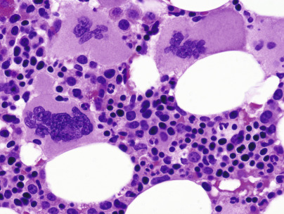

Figure 33-13 

Bone marrow biopsy in polycythemia vera shows panmyelosis with normoblastic hyperplasia (500×). 

 

##  Diagnosis 

WHO criteria for the diagnosis of polycythemia vera (  Swerdlow et al, 2008  ) are as follows: 

Major criteria: 

  * 1.

Elevated Hb >18.5 (males) or 16.5 (females) g/dL, or other evidence of increased red cell volume. 

  * 2.

Presence of _JAK2_ V617F or similar mutation such as _JAK2_ exon 12 mutation. 

Minor criteria: 

  * 1.

Panmyelosis with erythroid and megakaryocytic proliferation 

  * 2.

Low serum erythropoietin 

  * 3.

Endogenous colony formation in vitro 

Both major criteria must be present, along with any single minor criterion. Alternatively, the diagnosis may be made by the first major and two minor criteria. 

In addition to _JAK2_ V617F or exon 12 mutations, there is emerging information on other genetic abnormalities including mutations of _TET2_ , expression of STAT5B, and varied signaling abnormalities (  Levine, 2009  ;  Rampal et al, 2014  ;  Rice et al, 2011  ;  Tefferi et al, 2009  ). 

Polycythemia vera is a chronic disease; patients usually live 10 to 20 years under good control. Phlebotomy, chlorambucil, radioactive phosphorus (  32  P), and hydroxycarbamide (hydroxyurea) have been used to control the manifestations of the disease. 

In about 20% to 40% of patients, the spent or postpolycythemic phase occurs with progressive anemia, gradual splenic enlargement, and further elevation of the leukocyte count, with more immature granulocytes and more circulating nucleated red cells. Many erythrocytes become oval, and teardrop cells (dacryocytes) become prominent. BM aspiration becomes impossible because of myelofibrosis, and splenomegaly increases, owing to extramedullary hematopoiesis. Manifestations at this stage of the disease are indistinguishable from those of myelofibrosis with myeloid metaplasia. Another late complication of polycythemia vera is acute leukemia or myelodysplastic syndrome (MDS), associated with  32  P and alkylators but not with hydroxyurea (  Bjorkholm et al, 2011  ). 

 

##  Primary Myelofibrosis 

This is a chronic, progressive clonal panmyelosis characterized by megakaryocytic and often granulocytic hyperplasia with varying degrees of reactive fibrosis of the marrow and extramedullary hematopoiesis (  Swerdlow et al, 2008  ). Typically, leukoerythroblastic anemia occurs with marked red cell abnormalities, circulating normoblasts, immature granulocytes, and atypical platelets. Chronic idiopathic myelofibrosis (CIM) is an uncommon disease with an incidence one-third that of CML. It occurs typically in persons over 50 years of age and has an insidious onset, with weight loss, anemia, and abdominal discomfort due to the large spleen. Often the liver is enlarged as well, and the patient may be slightly jaundiced. Radiograph shows patchy osteosclerosis in up to half of patients, but osteoporosis may also be seen. 

A prefibrotic stage in 20% to 30% of cases is characterized by mild normocytic anemia with poikilocytosis, including dacryocytes, nucleated RBCs, thrombocytosis, and mild leukocytosis with some immature forms. The marrow is hypercellular and contains abnormal megakaryocytes, which cluster around sinuses and trabeculae. The histopathology of the BM is dominated by atypical, enlarged, and immature megakaryocytes with cloudlike immature nuclei, and also small megakaryocytes (  Michiels et al, 1999  ;  Michiels et al, 2014  ). Fibrosis may be minimal initially. Intrasinusoidal hematopoiesis is often present ( [ Fig. 33-14 ](<#f0075>) ). 

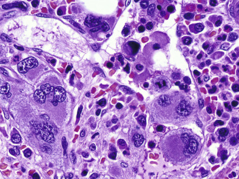

Figure 33-14 

Bone marrow biopsy in chronic idiopathic myelofibrosis, with increased spacing between cells suggesting fibrosis and intrasinusoidal hematopoiesis (500×). 

Characteristic findings of presentation in the fibrotic stage include moderate normochromic, normocytic anemia (often with some hypochromic cells and basophilic stippling), moderate anisocytosis, and marked poikilocytosis, including prominent teardrop forms (dacryocytes) and elliptocytes. Normoblasts are often increased out of proportion to the degree of anemia with slight reticulocytosis. The anemia may have a complicated origin, with components of marrow failure, ineffective erythropoiesis, and hemolysis. Splenomegaly due to extramedullary hematopoiesis is typical. 

The leukocyte count is moderately increased; immature neutrophils and occasionally myeloblasts are present. Basophils are often increased. Platelets are normal or decreased in number (rarely increased) and often atypical with distinct clear “zones.” Micromegakaryocytes the size of lymphocytes with both nucleus and cytoplasm or small megakaryoblasts may usually be found if searched for; on rare occasions, they are present in considerable numbers. 

In vitro blood cell culture shows increased colonies (CFU-GM) similar to those in CML. Serum GM-CSF is high, serum uric acid is frequently increased, and cobalamin is normal or elevated. 

It is usually impossible to aspirate marrow, and biopsy is necessary. The marrow is fibrotic, with residual islands of atypical megakaryocytes, erythroid, and granulocytic precursors. The fibrosis is of loose connective tissue with scanty collagen, but reticulin fibers are abundant. Foci of osteoid and/or new bone formation in endophytic plaques may be found, and bony trabeculae may be irregularly thickened (myelosclerosis). The marrow may show a mixture of hyperplasia and fibrosis in one sample or may vary in different sites of the body. Megakaryocytes with abnormal nuclei cluster or form sheets that may be found in sinuses with other marrow precursors. Extramedullary hematopoiesis is found in the spleen and liver. 

 

##  Biology 

Although the proliferating megakaryocytes are neoplastic, the stromal proliferation is reactive because of inappropriate release of megakaryocyte/platelet-derived growth factors, including platelet-derived growth factor (PDGF), transforming growth factor (TGF)-β, basic fibroblast growth factor (bFGF) and calmodulin (  Reilly, 1998  ). 

Approximately 50% of patients show _JAK2_ V617F mutation. Forty percent show mutation of _CALR_ (Calreticulin) (  Tefferi et al, 2014  ). A small number, up to 5%, have an _MPL_ W515K/L gene mutation. Testing for these is important for prognostication. _TET2_ may be a predisposing mutation, and modifying mutations include ASXL1 _,_ EZH2 _,_ CBL _,_ IDH1/IDH2 _,_ TP53, and SRSF2. Chromosomal studies show absence of _BCR/ABL_ , but variable cytogenetic changes: +8, +9, del(20q), del(13q)(q12-22), partial trisomy 1q, del(5q), and der(6)t(1;6)(q21-23;p21.3). Additional cytogenetic abnormalities may be associated with cytotoxic therapy and/or progression of disease. 

 

##  Course 

The natural course is increasing fibrosis with progressive anemia and enlargement of the spleen. Hemolysis frequently becomes an increasing element in the anemia, and infection may be a serious problem. Portal hypertension occurs in 10% to 20% of cases and may result in bleeding esophageal varices. Hypertension may be due to portal vein thrombosis or intrahepatic obstruction as a result of myeloid metaplasia coupled with increased portal blood flow. 

The median survival has been about 5 years, considerably less than that of polycythemia vera; however, some patients live longer, and in those the terminal event is frequently acute leukemia. Therapy has been largely palliative, but JAK kinase inhibitors may alter the disease course. 

Occasionally, patients exhibit cytopenias and marrow fibrosis due to other causes, some of which may show favorable response to specific therapies. These include metastatic tumors, primary hematopoietic tumors such as HCL or plasma cell dyscrasia, damage from radiation, and rarely autoimmune myelofibrosis. Malnourished children with vitamin D deficiency (rickets) sometimes show myelofibrosis. Solvent exposure may be a factor; benzene has been most often suspected and is a known inducer of AML at threshold levels of exposure. Current environmental exposure appears much lower than levels likely to be associated with hematologic malignancies (  Duarte-Davidson et al, 2001  ). Peritrabecular marrow fibrosis occurs in primary hyperparathyroidism or secondary hyperparathyroidism of chronic renal failure. 

 

##  Essential Thrombocythemia 

Thrombocythemia is a clonal myeloproliferative disorder primarily affecting the megakaryocytic lineage with the principal manifestation of sustained thrombocytosis. Forty percent to 50% carry a _JAK2_ V617F mutation, and 25% a _CALR_ mutation. It most often occurs in the fifth decade, with equal sex distribution, with another peak of incidence in females in their 30s (  Tefferi et al, 2014  ). 

 

##  Clinical Features 

Patients often (50%) present with asymptomatic thrombocytosis, but up to half of patients present with hemorrhage or thrombosis. The latter occurs as arterial or venous thrombosis or as microvascular occlusion resulting in transient ischemic attacks (TIAs) or digital ischemia. Characteristic recurrent, spontaneous mucosal hemorrhages are most common in the GI tract or the upper airway. Hemorrhages are occasionally preceded or accompanied by thrombosis. Mild splenomegaly occurs in 50% of cases. 

 

##  Laboratory Features 

 

##  Blood. 

The most striking feature is the marked increase in platelets (≥450 × 10  9  /L; usually >1000 × 10  9  /L), often with abnormal and giant forms, and usually accompanied by fragments of megakaryocytes. Neutrophilic leukocytosis is sometimes present. Hypochromic microcytic anemia due to chronic blood loss is present in many cases. Platelet function defects in thrombocythemia are frequently demonstrable. The most typical finding is decreased aggregation in response to epinephrine. 

 

##  Marrow. 

The marrow shows increased and enlarged megakaryocytes with mature cytoplasm and multilobulated nuclei and a tendency to cluster in a normal or only slightly hypercellular BM (  Michiels et al, 1999  ) ( [ Fig. 33-15 ](<#f0080>) ). Megakaryocyte nuclei are not described as atypical but often are distinctive and resemble other myeloproliferative disorders (MPDs). Erythroid proliferation may be present secondary to blood loss. Biopsy features may be indistinguishable from those of PV, but usually with less erythroid prominence. Splenic extramedullary hematopoiesis may be present. 

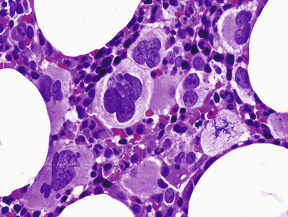

Figure 33-15 

Bone marrow biopsy in essential thrombocythemia, with increased and clustered megakaryocytes (500×). 

Nuclei in this case are unusual, resembling primary myelofibrosis. 

 

##  Diagnosis 

WHO criteria for the diagnosis of thrombocythemia (  Swerdlow et al, 2008  ) are as follows: 

  * 1.

Sustained platelet count ≥450 × 10  9  /L. 

  * 2.

BM biopsy showing proliferation of mainly megakaryocytes with enlarged mature nuclei; no increase or left shift of granulopoiesis or erythropoiesis. 

  * 3.

Not meeting WHO criteria for polycythemia vera, PMF, BCR-ABL1–positive CML, MDS, or other myeloid neoplasm. 

  * 4.

Demonstration of _JAK2_ V617F mutation or, in its absence, no evidence of reactive thrombocytosis. The _CALR_ mutation carries similar weight as _JAK2_ V617F (  Tefferi et al, 2014  ). 

 

##  Genetics 

Forty percent to 50% of cases carry a _JAK2_ V617F mutation. Most other cases carry a mutation of Calreticulin ( _CALR)_ that is mutually exclusive to _JAK2_ mutation and carries reduced or no risk for transformation to polycythemia vera (  Cazzola & Kralovics, 2014  ). _BCR/ABL_ translocations must be ruled out to exclude CML. Some cases show +8, abnormalities of 9q or del(20q). Mutations seen in PMF are seen in reduced frequency in ET (  Cazzola & Kralovics, 2014  ;  Martinez-Aviles et al, 2012  ), although this raises the possibility of early PMF mimicking ET. 

Most cases are stable for many years, but a small proportion may merge into other chronic myeloproliferative disorders or, rarely, develop into acute leukemia. Current treatment recommendations are based on clinical risk stratification to guide cytoreduction, platelet inhibition, and anticoagulation (  Tefferi & Barbui, 2013  ). 

 

##  Chronic Myeloproliferative Disease, Unclassifiable 

Chronic myeloproliferative disease, unclassifiable (CMPD, U) includes disorders with features of MPD but which do not meet criteria for a specific entity or have intermediate features (  Swerdlow et al, 2008  ). Examples of CMPD, U include prefibrotic CIM, prepolycythemic PV, and postpolycythemic PV (without prior diagnosis), as well as cases with features of MPD but presenting with some dysplasia or increased blasts. BCR/ABL and other specific cytogenetic abnormalities are absent. This category overlaps with myelodysplastic/myeloproliferative disease, unclassifiable. Often, with follow-up, characteristic findings develop that allow definite diagnosis (  Swerdlow et al, 2008  ). 

 

##  Chronic Eosinophilic Leukemia, Not Otherwise Specified, and Idiopathic Hypereosinophilic Syndrome 

Chronic eosinophilic leukemia (CEL) is a clonal proliferation of eosinophils with chronic increase in the blood and often organ damage due to tissue infiltration. The blood contains ≥1.5 × 10  9  /L mostly mature eosinophils and often increased but fewer than 20% blasts in the blood or marrow. A working conference on eosinophil disorders has recommended that the term HE _(hypereosinophilia)_ be used for these cases, subcategorized as HE  FA  for familial cases, HE  US  for cases of undetermined significance, HE  N  for those due to clonal neoplasms, and HE  R  for reactive eosinophilias (  Valent et al, 2012  ) **.** A lymphocyte variant of HE is associated with clonal T cells showing abnormal antigen expressions (  Gotlib, 2014  ). Some other neoplasms, including T cell lymphoma and Hodgkin lymphoma, are often causes of secondary eosinophilia due to cytokine production (IL2, IL3, IL5, GM-CSF). When associated with a defined CMD, the eosinophilia is considered a component of that disease and not termed CEL. Myeloproliferative diseases with eosinophilia and _PDGFRA, PDGFRB_ , or _FGFR1_ gene abnormalities are classified separately, as earlier. 

Some cases of CEL have clonal cytogenetic abnormalities; +8, i(17q) or 8p11 translocations including t(8;13)(p11;q12), t(8;9)(p11;q32-34) and t(6;8)(q27;p11). The 8p11 translocation may also occur in AML, precursor B-ALL, or precursor T-ALL. Other abnormalities, including _JAK2_ V617F mutation and trisomy 10, may occur. The clinical outcome of CEL and HES is usually indolent with 5-year survival of about 80%. 

 

##  Mastocytosis 

Mastocytosis is a clonal neoplastic proliferation of mast cells involving skin, BM, lymph nodes, and/or spleen (  Akin & Valent, 2014  ;  Swerdlow et al, 2008  ), with variable degrees of malignancy. Subtypes are described based on distribution of disease and clinical manifestations. Symptoms are complex and arise from secretion of vasoactive amines, including histamine and serotonin, as well as from mass effects. 

Mastocytosis is associated with mutations of the _KIT_ proto-oncogene that encodes the tyrosine kinase receptor for stem cell factor (SCF), most frequently, _KIT_ D816V with CD117 expression. Morphologically, increased mast cells are found in involved organs, often with associated fibrosis. Mast cells normally are mononuclear cells with central nuclei, clumped chromatin, and dense basophilic granules. They are frequently difficult to identify, however, as mast cell granules are not well preserved in fixed tissue, and cells may appear like bland clear cells, histiocytes, fibroblasts, or others. Mast cells may be identified in tissue using Giemsa or toluidine blue stain and immunohistochemistry. Mast cell tryptase is the most specific marker, but cells also express CD117, as well as CD45, CD33, CD68, CD2, and CD25. Mast cells lack myeloperoxidase but often express chloroacetate esterase. Diagnostic testing should include immunologic assays (immunohistochemistry and/or flow cytometry) for CD117, CD2, CD25, and tryptase, as well as assays for _KIT_ D816V mutation in marrow, blood, or other extracutaneous organs for systemic disease. 

Urticaria with melanin pigmentation is common with skin involvement and is referred to as **urticaria pigmentosa (UP)** or **maculopapular cutaneous mastocytosis (MPCM).** This form occurs in both children and adults. In children, lesions are often large and papular, or are associated with blistering in children younger than 3 years old. It is often self-limited or may spontaneously regress. Histology shows aggregates of spindle-shaped mast cells filling the papillary dermis and extending into reticular dermis (  Swerdlow et al, 2008  ). A diffuse cutaneous variant is referred to as **diffuse cutaneous mastocytosis,** and a localized variant as **mastocytoma of skin.**

Systemic mastocytosis is defined by involvement of at least one extracutaneous organ with or without skin involvement. It presents with variable cutaneous and constitutional symptoms, including urticaria, pruritus and dermatographism, symptoms of systemic histamine release, bone pain, arthralgia and fractures, splenomegaly, hepatomegaly, or lymphadenopathy. 

BM involvement is sometimes difficult to identify, with paratrabecular and perivascular aggregates of increased lymphocytes, eosinophils, neutrophils, mast cells, and fibroblasts. Marrow biopsy of most cases shows multifocal, sharply demarcated compact aggregates of mast cells. These may be spindle shaped and lacking in apparent granules on H&E stain, or may consist of mixed infiltrates of mast cells, lymphocytes, eosinophils, histiocytes, and fibroblasts, with a peripheral rim or central core of lymphocytes. Compact infiltrates of hypergranular mast cells also occur and are referred to as **tryptase-positive round cell infiltrates,** or TROCI. The latter may also be seen in basophilic leukemia or acute myeloid leukemia. Mast cells are frequently increased in hematologic neoplasms such as HCL, lymphoplasmacytic lymphoma, and myeloid neoplasm and are most apparent around BM particles on aspirate smears. Reactive mast cells do not typically show compact aggregates. 

In addition, systemic mastocytosis (SM) not infrequently presents simultaneously with or in close temporal relationship with other hematopoietic neoplasms, including acute leukemia, myeloproliferative and/or myelodysplastic neoplasms, and occasionally other hematopoietic neoplasia. SM is sometimes detected only after treatment for an acute process ( [ Figs. 33-16 ](<#f0085>) and [ 33-17 ](<#f0090>) ). These cases are referred to as systemic mastocytosis with associated clonal non–mast cell lineage disease (SM-AHNMD). The non–mast cell (MC) disease is categorized by criteria for the same disorder without SM. 

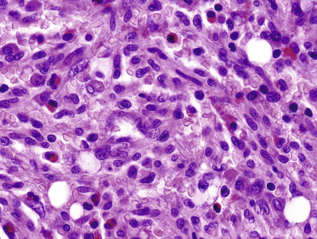

Figure 33-16 

Mastocytosis in the bone marrow, presenting after treatment for acute myeloid leukemia (500×). 

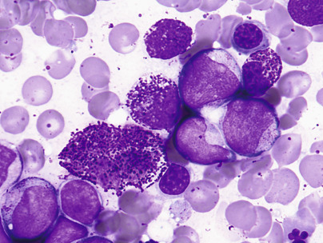

Figure 33-17 

Acute leukemia with early mast cell disease before therapy (earlier specimen from case shown in [ Figure 33-16 ](<#f0085>) ) (1000×). 

Mast cell leukemia also occurs and is defined by the presence of atypical mast cells constituting more than 20% of a marrow aspirate. More than 10% of the circulating cells are usually mast cells (  Swerdlow et al, 2008  ). Chronic forms and a prephase with 5% to 29% mast cells in the BM occur. Myelomastic leukemia (MML) is a related entity in which mastocytic differentiation in advanced myeloid neoplasms occurs without SM (  Valent et al, 2014  ). 

Mast cell sarcoma refers to localized, destructive extramedullary tumors of highly atypical mast cells, occurring in larynx, bowel, meninges, bone, and skin. Extracutaneous mastocytoma of mature granulated mast cells occurs rarely in the lung. 

The outcome is highly variable, with cutaneous disease usually indolent. In children, it usually regresses. Systemic disease without skin involvement is more aggressive than with skin disease, and mast cell leukemia and sarcoma are highly aggressive. 

 

##  Myeloproliferative Neoplasm, Unclassifiable 

These are disorders with features of myeloproliferative neoplasm (MPN) but which do not meet criteria for a specific entity or have intermediate features (  Swerdlow et al, 2008  ). Examples of CMPD, U include prefibrotic CIM, prepolycythemic PV, and postpolycythemic PV (without prior diagnosis) cases with features of MPN but presenting with some dysplasia or increased blasts, and those with convincing evidence of MPN that is, however, obscured by a concurrent inflammatory or neoplastic condition. _BCR/ABL_ and other specific cytogenetic abnormalities are absent. This category overlaps with myelodysplastic/myeloproliferative disease, unclassifiable. Often, with follow-up, characteristic findings develop that allow definitive diagnosis. 

 

##  Myeloid and Lymphoid Neoplasms with Eosinophilia and Abnormalities of _PDGFRA, PDGFRB,_ or _FGFR1_

This disease category was established in the 2008 WHO classification for a group of myeloid neoplasms associated with eosinophilia that have genetic abnormalities resulting in abnormal tyrosine kinases that may be successfully treated with tyrosine kinase inhibitors, the first two of which are responsive to imatinib and/or similar tyrosine kinase inhibitors (TKI). (  Gotlib, 2014  ;  Swerdlow et al, 2008  ) 

MPN with rearrangement of _PDGFRA_ is most often associated with a FIP1L1-PDGFRA fusion protein resulting from a cryptic deletion at 4q12. The disease usually presents as chronic eosinophilic leukemia with peripheral eosinophil counts >1.5 × 10  9  /L, with multisystem involvement and organ damage. BM eosinophilia is often accompanied by increased mast cells that are considered part of the disease. It usually occurs in men between 25 and 55 years of age, but also may occur in others. Presentation also occurs as AML and as T-lymphoblastic lymphoma/leukemia (T-LBL). Diagnosis and appropriate therapy depend on identification of the genetic abnormality by reverse transcriptase polymerase chain reaction (RT-PCR) or by cytogenetic FISH assay for deletion of the _CHIC2_ gene, or use of a break-apart probe encompassing _FIP1L1_ and _PDGFRA_ . Other genetic variants have been described and are generally imatinib sensitive (  Swerdlow et al, 2008  ). 

Rearrangement of _PDGFRB_ at 5q31~33, usually due to t(5;12)(q31~33;p12) with production of _ETV6- PDGFRB,_ resembles CMML with eosinophilia. Variant translocations involving _PDGFRB_ may be associated with other morphologies, including CEL, MPN, and others. This disease occurs most often in middle age, but with a wide age range and a 2 : 1 M/F ratio. Diagnosis of MPN with PDGFRB (rather than a morphologic diagnosis as MPN, NOS or CMML) is imperative because it is sensitive to TKI therapy (  Cheah et al, 2014  ). Diagnostic testing is by cytogenetics to detect t(5;12) and/or by RT-PCR. Secondary trisomy 21 is frequent. 

Hematologic neoplasms involving _FGFR1_ at chromosome region 8p11 are heterogeneous and may present as CEL, AML, T- or less often B-lymphoblastic leukemia/lymphoma, or mixed phenotype acute leukemia (MPAL). Eosinophilia is present in 90% of cases overall. Although an abnormal tyrosine kinase is produced, it is not imatinib sensitive. The genetic abnormalities are most often translocations, and karyotyping may be diagnostic. It was formerly called _8p11 stem cell syndrome_ or similar name. Prognosis is currently poor (  Gotlib, 2014  ;  Swerdlow et al, 2008  ). 

 

##  Myelodysplastic and Myelodysplastic/Myeloproliferative Neoplasms 

Myeloproliferative diseases, in general, are disorders in which proliferation of hematopoietic cells outpaces apoptosis, and cellular elements in the blood are increased while the morphology of hematopoiesis is near normal. Myelodysplastic diseases or syndromes are disorders in which apoptosis predominates, hematopoiesis is ineffective, and cytopenias occur. The myelodysplastic/myeloproliferative disorders show features of both, with variable increases in cells, as well as cytopenias and morphologic dysplasia. These include chronic myelomonocytic leukemia (CMML), atypical chronic myeloid leukemia (aCML), _BCR-ABL1_ negative, juvenile chronic myelomonocytic leukemia (JCMML), and myelodysplastic/myeloproliferative neoplasm, unclassifiable. 

MDS occurs primarily in persons over 50 years of age and usually is present as an anemia refractory to hematinics (iron, folate, B  12  ), with or without neutropenia and thrombocytopenia. Liver, spleen, or lymph nodes are not usually enlarged. The marrow is hypercellular with abnormal maturation in one or more of the three hematopoietic cell lines, and blast cells are often increased. This group of disorders has also been called _dysmyelopoietic syndromes_ or _preleukemias_ because of the high proportion of cases that ultimately progress to overt acute leukemia (  Bennett et al, 1976  ;  Bennett et al, 1982  ;  Swerdlow et al, 2008  ). A scoring system for predicting survival and risk for acute leukemic transformation has been developed based on percentage of blasts, cytogenetics, and extent of cytopenias. In general, blast count >5% elevates risk and >10% increases risk further; complex chromosomal abnormalities or chromosome 7 abnormalities are high risk; del(5q), isolated del(2q), -Y, and normal cytogenetics are low risk; other cytogenetic findings are intermediate risk; and more than one cytopenia increases risk. 

 

##  Genetics and Epigenetics 

Molecular genetic analyses suggest that MDS occurs due to initial oncogenic driver mutations and that progression occurs with accumulating mutations. Most patients have 2 to 3 driver mutations occurring in genes of RNA splicing _(SF3B1, SRSF2, U2AF1, ZRSR2),_ DNA methylation _(TET2, DNMT3A, IDH1/2),_ chromatin modification ( _ASXL1, EZH2_ ), transcription regulation _(RUNX1),_ DNA repair _(TP53),_ signal transduction _(CBL, NRAS, KRAS),_ and/or cohesin (STAG2) (  Cazzola et al, 2013  ;  Papaemmanuil et al, 2013  ;  Lin et al, 2014  ). Abnormalities of the “spliceosome” and of DNA methylation lead to epigenetic disruption. 

 

##  Types of Abnormal Cellular Maturation 

**Dyserythropoiesis** resembles megaloblastic change and includes nuclear fragmentation or karyorrhexis, multinuclearity, nuclear budding or bridging, basophilic stippling, and ring sideroblasts. These features may also be seen in toxicity due to drugs, chemotherapy, heavy metals, alcohol, and other toxins ( [ Figs. 33-18 ](<#f0095>) and [ 33-19 ](<#f0100>) ). Erythroid cells may be decreased or increased in number. Erythrocytic abnormalities in the blood film include presence of oval macrocytes, anisochromia, basophilic stippling, dacryocytes, and reticulocytopenia. 

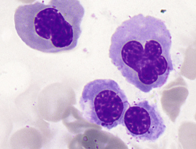

Figure 33-18 

Drug-induced dyserythropoiesis, with irregular nuclear lobation in the cells above right, compared with two relatively normal normoblasts (1000×). 

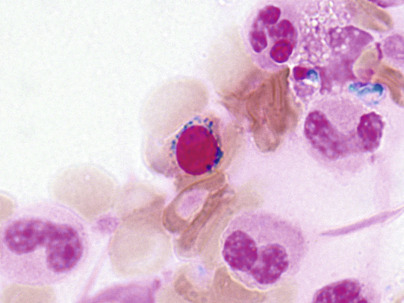

Figure 33-19 

A ring sideroblast is present in the center of the field (1000×). 

**Dysgranulopoiesis** includes nuclear/cytoplasmic asynchrony, hypogranulation, nuclear hyposegmentation with increased chromatin condensation, occasionally abnormal large azurophilic granules, inappropriately prominent nucleoli, or other abnormalities. Neutrophil precursors and monocytes often resemble one another. Neutrophils with mature chromatin but with decreased granulation and bilobed or unilobed nuclei resemble the cells of Pelger-Huët anomaly and are termed **pseudo-Pelger-Hu ët ** cells ( [ Figs. 33-20 ](<#f0105>) and [ 33-21 ](<#f0110>) ). 

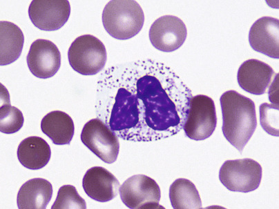

Figure 33-20 

Pseudo–Pelger-Huët neutrophil (1000×). 

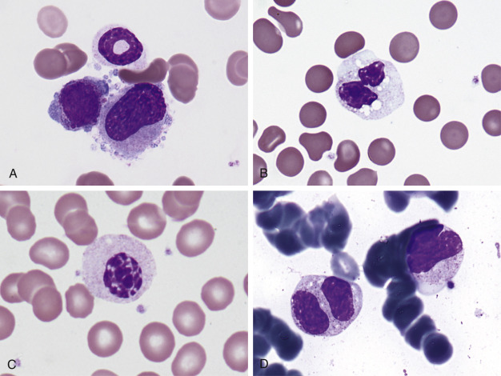

Figure 33-21 

Other forms of neutrophil dysplasia. 

**A,** Ring neutrophil along with dysplastic erythroid and megakaryocytic cells in the marrow (1000×). **B,** Pelger-Huët neutrophil resembling a monocyte (1000×). **C,** Mononuclear Pelger-Huët cell (1000×). **D,** Large, irregularly lobulated and granulated neutrophil precursors (1000×). 

**Dysmegakaryocytopoiesis** includes large megakaryocytes with unsegmented nuclei, micromegakaryocytes, and megakaryocytes with two or more small, unconnected nuclei ( [ Fig. 33-22 ](<#f0115>) ). Megakaryocytes may be decreased in number. In the blood film, giant hypogranular platelets are frequent, and micromegakaryocytes are seen rarely. 

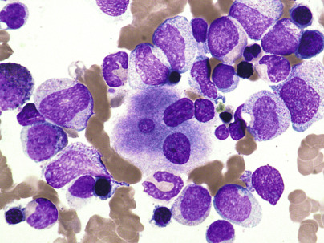

Figure 33-22 

A dysplastic megakaryocyte showing unconnected nuclear lobes. 

Mononuclear forms are also frequent in myelodysplasia (500×). 

 

##  Myelodysplastic/Myeloproliferative Neoplasms 

 

##  Chronic Myelomonocytic Leukemia. 

CMML is a clonal stem cell disorder in which the predominant feature is persistent monocytosis (>1 × 10  9  /L for longer than 3 months) for which other causes have been excluded (  Swerdlow et al, 2008  ). Typically, cytopenias are present in the blood (anemia, thrombocytopenia, and/or neutropenia), but neutrophilia with morphologic abnormalities also occurs. There is absence of a Philadelphia chromosome or _BCR/ABL,_ dysplasia of one or more myeloid lineages, and less than 20% blasts plus promonocytes in the marrow ( [ Fig. 33-23 ](<#f0120>) ). The marrow also shows monocytosis and often has increased promonocytes, which may be distinguished from abnormal myelocytes by nonspecific esterase (α-napthyl acetate, or α-napthyl butyrate esterase) staining or strong labeling with antilysozyme or CD68. Eosinophilia or basophilia may be present, and plasmacytoid-appearing monocytes are seen frequently. When eosinophils exceed 1.5 × 10  9  /L, the WHO recommends the subcategory of CMML with eosinophilia. 

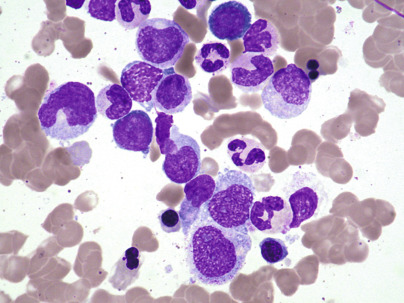

Figure 33-23 

This case of chronic myelomonocytic leukemia shows moderate trilineage dysplasia and monocytosis (500×). 

In CMML and also in the acute myeloid leukemias with monocytic differentiation, promonocytes are considered equivalent to blasts and are included with them for determining the blast percentage. Promonocytes are monocytic precursors that have recognizable monocyte morphology but immature chromatin and finely convoluted or cerebriform nuclei ( [ Fig. 33-24 ](<#f0125>) ). Blast percentages typically are <5% in the blood and <10% in the marrow, and such cases are referred to as _CMML-1._ The subcategory CMML-2 refers to cases with 5% to 19% blasts in the blood, with 10% to 19% in the marrow, or with the presence of Auer rods. This indicates aggressive disease with likely impending transformation to acute leukemia. 

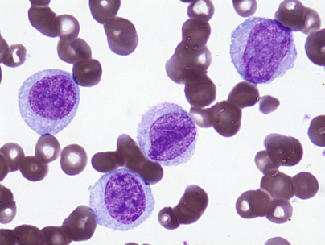

Figure 33-24 

Promonocyte _(center)_ shows immature chromatin and finely convoluted nuclear folds in comparison with monoblasts. 

The immunophenotype is CD13/CD33+, with variable CD14/CD68/CD64/CD4-positive. Plasmacytoid monocytes may be seen and may express CD14, CD43, CD56, CD68, and CD4, with variable CD2/CD5. Cytogenetic abnormalities in 20% to 40% of cases include +8, −7/del, and abnormalities of 12p. _TET2_ and _SRSF2_ comutation are associated with CMML (  Cazzola et al, 2013  ;  Itzykson et al, 2013a  ,  2013b  ). 

CMML occurs most often at older age (median, 65 to 75 years) with a male predominance. Symptoms are usually those related to cytopenias (fatigue, infection, bleeding) or hypermetabolic state (fever, weight loss, night sweats). Hepatosplenomegaly may be present, particularly in patients with elevated WBCs. Lymphadenopathy may be associated with granulocytic sarcoma and evolution to acute leukemia. Median survival is 20 to 30 months, with progression to AML in 15% to 30%. 

 

##  Atypical Chronic Myeloid Leukemia, BCR-ABL1 Negative. 

This disease shows myelodysplastic and myeloproliferative features, a predominant component of increased neutrophils and precursors with dysplastic features, and dysplasia of other cell lines (  Swerdlow et al, 2008  ). Ph′ chromosome or BCR/ABL is absent. These cases were previously considered along with CML or CMML, but they are Ph′ chromosome and BCR/ABL negative, and, although monocytosis is often present, it is less prominent than neutrophilia. Clinical features may include anemia, thrombocytopenia, or splenomegaly. The marrow is hypercellular with variable features of each lineage. A variant, _syndrome of abnormal chromatin clumping,_ shows exaggerated chromatin condensation, as well as other dysplastic features. 

Cytogenetics show +8, +13, del(20q), i(17q), or del(12p) in up to 80% of cases. _SETBP1_ mutation is found in 25% (  Piazza et al, 2013  ). There is no _BCR-ABL1_ fusion gene, and cases with _PDGFRA_ or _PDGFRB_ rearrangements are excluded. This disease usually occurs in later years, although with a wide reported age distribution down to the teen years. It has a generally poor outcome with a median survival of 20 months, and a 25% to 40% transformation to acute leukemia. 

Criteria for diagnosis include the following (  Swerdlow et al, 2008  ): 

  * •

Leukocytosis (WBC ≤13 × 10  9  /L) due to increased neutrophils and precursors with prominent dysgranulopoiesis 

  * •

Prominent dysgranulopoiesis 

  * •

No Ph′ chromosome or _BCR/ABL-1_ fusion gene 

  * •

No rearrangement of _PDGFRA_ or _PDGFRB_

  * •

Neutrophil precursors (promyelocytes, myelocytes, metamyelocytes) ≥10% of WBCs 

  * •

Minimal absolute basophilia; basophils usually <2% of leukocytes 

  * •

No or minimal absolute monocytosis; monocytes <10% of WBCs 

  * •

Hypercellular marrow with granulocytic proliferation and granulocytic dysplasia, with or without dysplasia of erythroid and megakaryocytic lineages 

  * •

Less than 20% blasts in blood or marrow 

 

##  Juvenile Myelomonocytic Leukemia. 

Juvenile myelomonocytic leukemia (JMML) is a clonal disorder of predominantly granulocytic and monocytic lineages, with dysplasia in these and frequently other lineages, occurring in children or young adolescents (  Swerdlow et al, 2008  ). _BCR/ABL-1_ is absent, and _RAS/MAPK_ pathway mutations are characteristic. The occurrence is 1.3 cases per million children younger than 14 years of age, and most affected children are younger than 3 years of age, with a 2 : 1 male predominance. JMML is frequent in children with neurofibromatosis type 1. 

In all, 25% of patients show monosomy 7, 35% exhibit mutations of _PTPN11_ (encoding SHP2), and 20% each have mutations in _NRAS, KRAS2,_ and _NF1._ Some infants with Noonan syndrome and _PTPN11_ mutation may have spontaneous recovery or accelerated disease. Patients with normal karyotype often have markedly increased hemoglobin F. Immune phenomena of hypergammaglobulinemia and autoantibodies are frequent. 

Blood shows leukocytosis, thrombocytopenia, and often anemia. The WBC is relatively high, usually 25 to 30 × 10  9  /L, and mature neu­trophils predominate, while monocytosis is also present. Circulating nucleated red blood cells (NRBCs) are frequent. The marrow is hyperplastic with granulocytic hyperplasia, variable erythroid cellularity, and often decreased megakaryocytes. Cutaneous leukemic infiltrates are common. 

The prognosis is poor, and death is usually due to organ failure from leukemic infiltrates, although some patients benefit from BM transplant. 

WHO criteria for diagnosis of JMML are as follows (  Swerdlow et al, 2008  ): 

  * •

Peripheral blood monocytosis >1 × 10  9  /L 

  * •

Absence of Ph′ chromosome or _BCR/ABL-1_

  * •

Blasts and promonocytes less than 20% of blood and marrow 

Plus two of the following: 

  * •

Hemoglobin F increased for age 

  * •

Immature granulocytes in the blood 

  * •

WBCs >10 × 10  9  /L 

  * •

Clonal chromosomal abnormality (may be monosomy 7) 

  * •

GM-CSF hypersensitivity of myeloid progenitors in vitro 

 

##  Myelodysplastic/Myeloproliferative Disease, Unclassifiable 

This category of the WHO classification is used for those cases with features of myelodysplastic disease, but with the addition of prominent myeloproliferative features, including thrombocytosis ≥450 × 10  9  /L with megakaryocytic hyperplasia or WBC >13 × 10  9  /L, with or without splenomegaly, no previous CMPD or MDS, and absence of a chromosomal abnormality specific to another disease (no _BCR/ABL_ or rearrangement of _PDGFRA, PDGFRB,_ or _FGFR1;_ no del[5q], t[3;3][q21;q26] or inv[3][q21;q26]) (  Swerdlow et al, 2008  ). 

 

##  Refractory Anemia with Ring Sideroblasts Associated with Marked Thrombocytosis 

This disorder is included in the WHO classification under the category of MDS/MPD, unclassified, because of not-yet-resolved questions regarding whether it is truly a distinct entity or an overlap syndrome of coexisting disorders. It is characterized by features of myelodysplastic neoplasm and refractory anemia with ring sideroblasts (RARS; see description later), along with features similar to essential thrombocythemia, with peripheral thrombocytosis ≥450 × 10  6  /L, and increased, large atypical BM megakaryocytes. A majority of cases (60%) carry a _JAK2_ V617F mutation identical to that in MPN; occasional cases show a _MPL W515K/L_ mutation. _SF3B1_ mutation is frequent in RARS-t as well as in RARS, and it is hypothesized that _SF3B1_ mutation is the driver and that _JAK2_ V617F or _MLP_ mutations are secondary events leading to thrombocytosis (  Malcovati & Cazzola, 2013  ). 

 

##  Myelodysplastic Syndromes 

Cytopenias describe these clonal hematopoietic neoplasms characterized by cytopenias due to ineffective hematopoiesis and increased apoptosis. They show morphologic dysplasia of at least one and usually more lineages and have varied cytogenetic findings (but not typically those associated with myeloproliferative neoplasms), and many have a propensity to progress to acute leukemia ( [ Table 33-2 ](<#t0015>) ). 

TABLE 33-2 

Key Features of the Major Myelodysplastic Syndromes 

Disorder  |  Demographics  |  Laboratory Features, Morphology  |  Cytogenetics  |  Risk Group   
---|---|---|---|---  
Refractory cytopenia with unilineage dysplasia, anemia (RA), thrombocytopenia, or neutropenia  |  Median age, 65-70 years  |  Peripheral blood (PB) with unicytopenia or bicytopenia, blasts <1%; bone marrow (BM) with >10% unilineage dysplasia and <5% blasts  |  Del (20q), +8, abnormalities of chromosome 5 or 7  |  Low   
Refractory anemia with ringed sideroblasts  |  Median age, 60-73 years  |  Similar to RA with >15% ringed sideroblasts in BM  |  Rare abnormalities of single chromosome  |  Low   
Refractory cytopenia with multilineage dysplasia  |  Median age, 70 years  |  PB with cytopenias of ≥2 cell lines, <1% blasts, <1 × 10  9  /L monocytes; BM with dysplasia of ≥10% of precursors of ≥2 cell lines, <5% blasts  |  +8, –5, –7, del(7q), del(20q), complex in up to 50%  |  Intermediate   
Refractory anemia with excess blasts (RAEB)  |  Over 50 years of age  |  RAEB-1: PB with <5% blasts, <1 × 10  9  /L monocytes; BM with hypercellularity, dyspoiesis, 5%-9% blasts without Auer rods; RAEB-2: PB with 5%-9% blasts, or 10%-19% BM blasts, or Auer rods  |  +8, –5, del(5q), –7, del(7q), del(20q)  |  RAEB-1, intermediate;   
RAEB-2, high   
5q– syndrome  |  Middle-aged to older females  |  PB with thrombocytosis, <5% blasts; BM with increased, hypolobulated megakaryocytes, <5% blasts  |  5q– is sole abnormality  |  Low   
  
 

##  Refractory Cytopenia with Unilineage Dysplasia 

This category consists of neoplasms, with dysplasia affecting >10% of one myeloid cell lineage, and cytopenia of the affected cell line, with <10% dysplasia of other lineages. 

 

##  Refractory Anemia 

This clonal disorder involves primarily the erythroid lineage with ineffective erythropoiesis but without increased blasts. Anemia (Hb <10 g/dL) with reticulocytopenia and abnormal erythrocytes are the presenting findings. Abnormal granulocytes are rare, and blasts are less than 1% in the blood. The marrow is normocellular to hypercellular with erythroid hyperplasia and/or dyserythropoiesis and less than 5% blasts. Survival is relatively good (>5 years), and progression to acute leukemia (AL) low (6%). 

 

##  Refractory Neutropenia 

The absolute neutrophil count is <1.8 × 10  9  /L. Dysplasia usually consists of nuclear hypolobation and hypogranulation. Toxic/secondary neutropenia is excluded. 

 

##  Refractory Thrombocytopenia 

Platelets are <100 × 10  9  /L. More than 10% of at least 30 megakaryocytes evaluated in smears and sections show dysplastic features of hypolobation, binucleation or multinucleation, and/or micromegakaryocytes. 

 

##  Refractory Anemia with Ring Sideroblasts 

In RARS, in addition to the findings of RA, ring sideroblasts are present and constitute 15% or more of marrow erythroid precursors. These are nucleated RBC precursors in which stainable iron particles (iron-encrusted mitochondria) form a ring of 10 or more closely associated with and encircling at least one third of the nucleus (see [ Fig. 33-19 ](<#f0100>) ). Defective cytoplasmic maturation and anisochromic erythrocytes are associated abnormalities. Survival is similar to RA, with a lower progression to AL (≤2%). Mutation of _SF3B1_ is found in more than 62% of cases, usually with mutations of additional genes including _DNMT3_ and _RUNX1_ (  Lin et al, 2014  ). 

 

##  Refractory Cytopenia with Multilineage Dysplasia 

Refractory cytopenia with multilineage dysplasia (RCMD) is a clonal disorder with bicytopenias or pancytopenia and dysplasia of 10% or more of the precursors of two or more lineages. Blasts are not increased, with <1% in the blood and <5% in the marrow. Ring sideroblasts may be present; when numerous (>15%), the case is classified as RCMD with ring sideroblasts (RCMD-RS). 

This disease usually occurs in older individuals (median age, ≈70 years). In contrast to RA and RARS, which infrequently show cytogenetic abnormalities (<10%), RCMD and RCMD-RS show them in up to 50%. These include trisomy 8, monosomy 7, del(7q), monosomy 5, del(5q), del(20q), and complex karyotypes. Survival is ≈33 months, and AL conversion is 11%. 

 

##  Refractory Anemia with Excess Blasts 

In refractory anemia with excess blasts (RAEB), the blood shows cytopenia in two or three of the cell lines, and less than 5% circulating blasts. The marrow is hypercellular, with variable erythroid or granulocytic hyperplasia. Dyspoietic changes are present in all three cell lines, and 5% to 9% of marrow cells are blasts. Less than 5% blasts are present in the blood, and no Auer rods are found. Clusters of 5 to 8 blasts and promyelocytes in the marrow interstitium are frequently seen on sections and have been referred to as _abnormal localization of immature precursors (ALIP)._ Hypocellular marrow is seen in a minority of cases (10% to 15%). These may be difficult to interpret, as the patients are often older, with decreased cellularity to begin with, and because marrow stress in hypoplastic anemia often causes some dysplasia. A diagnosis of MDS should be made cautiously when the marrow is hypoplastic. 

Cases of RAEB with concurrent myelofibrosis are referred to as RAEB with fibrosis (RAEB-F). Megakaryocytes are increased and dysplastic, and reticulin fibrosis is significant, often resulting in a dry tap. 

RAEB-2 has findings similar to RAEB, but with any of the following: (1) greater than 5% blasts in the blood, (2) 10% to 19% blasts in the marrow, or (3) the presence of Auer rods. Cytogenetic abnormalities include +8, -5, del(5q), -7, del(7q), and del(20q). Survival is usually less than 2 years in RAEB-1 or -2, with progressive marrow failure and cytopenias or progression to AL in 25% for RAEB and in 33% for RAEB-2. 

 

##  Myelodysplastic Syndrome with Isolated del(5q) 

This disorder is characterized by anemia and/or thrombocytosis with increased megakaryocytes and isolated deletion of chromosome region 5q. Some cases also exhibit a _JAK2_ V617F mutation. Blasts are less than 5% in the marrow and blood; lymphoid aggregates are often present. Megakaryocytes are usually small and hypolobulated. Anemia may be severe and macrocytic, and an otherwise normocellular to hypercellular marrow may have erythroid hypoplasia. Outcome is relatively favorable. 

 

##  Myelodysplastic Syndrome, Unclassified 

The myelodysplastic syndrome, unclassified category is used when clinical and hematologic findings of myelodysplasia exist, but without specific features to allow placement in one of the other categories. Patients usually have neutropenia or thrombocytopenia with a hypercellular BM and dysplasia of granulocytic or megakaryocytic lineage. Less than 5% blasts are found in the BM, and they are not increased in the blood. 

 

##  Childhood Myelodysplastic Syndrome; Refractory Cytopenia of Childhood 

In the WHO classification, it is recognized that MDS, although rare in children, does occur but tends to show different features than in adults. Refractory cytopenia of childhood (RCC) is defined as MDS with persistent cytopenia with <5% blasts in the BM and <2% in the blood, and dysplasia. The marrow is also frequently hypocellular. Pancytopenia is frequent, with macrocytic anemia showing anisopoikilocytosis. The cytogenetic abnormality of monosomy 7 is the most common genetic abnormality and is associated with progressive disease. Cases with trisomy 8 may show a long stable period. This disorder may be morphologically indistinguishable from results of infection, vitamin deficiency (B  12  , folate, vitamin E), metabolic or autoimmune disease, paroxysmal nocturnal hemoglobinuria (PNH), or acquired aplastic anemia. 

 

##  Acute Myeloid Leukemia 

AML is the most common form of acute leukemia during the first few months of life, but during childhood and adolescence it accounts for approximately one third of AL. In the middle and later years of life, it becomes the most frequent AL, with a median age of 60 years, and an occurrence of 10/100,000 per year in those older than 60 years of age. Viruses, radiation, cytotoxic chemotherapy, benzene, and smoking have been linked to increased incidence, but most cases are not known to be associated with such factors. 

The onset often resembles acute infection and includes signs of granulocytic insufficiency, with ulcerations of mucous membranes (especially of the mouth and throat) and fever. Enlargement of lymph nodes, spleen, and liver is not pronounced. Marked prostration and general malaise may be present. In untreated cases, the course is rapidly progressive ( [ Box 33-11 ](<#b0060>) ). 

Box 33-11 

Clinical and Laboratory Features of Acute Myeloid Leukemia 

  * •

Affects all ages, but increases with older age (>60 years) 

  * •

May resemble acute infection at presentation 

  * •

Requires 20% blasts in blood or marrow for diagnosis 

  * •

Key myeloid antigens: myeloperoxidase, CD13, CD33, CD117, and CD14/CD64 

  * •

Recurrent cytogenetic abnormalities that characterize defined subtypes 

  * •

Classification made by morphology, cytogenetics, flow cytometry, cytochemistry 

AML classification currently utilizes a multilayered approach that recognizes recurrent acquired cytogenetic abnormalities associated with specific types, history of predisposing factors (prior cytotoxic therapy), association with MDS or related abnormalities, and morphologic stratification for those for which none of these can be appreciated. This approach requires, or at least encourages, attempts to define the morphology, cytogenetics, and immunophenotype of each case. With advances in molecular cytogenetics and FISH, and with widespread adoption of these and other methods, it is likely that most cases will eventually be categorized by their genetic abnormalities. See [ Tables 33-3 ](<#t0020>) and [ 33-4 ](<#t0025>) . 

TABLE 33-3 

Key Features of the Major Acute Myeloid Leukemias 

Category  |  Cell Morphology  |  Cell Surface Markers  |  Cytogenetics  |  Prognosis   
---|---|---|---|---  
AML with t(8;21)  |  ≥20% blasts, ≥10% maturing granulocytes, Auer rods, dysplasia, abnormal granules  |  CD13, CD33, CD117, CD19, CD34  |  t(8;21)(q22;q22) AML1/ETO  |  More favorable   
AML with inv(16)  |  Blasts with both monocytic and neutrophilic differentiation, increased eosinophils/immature eosinophils  |  CD13, CD33, CD14, CD4, CD64  |  inv(16)(p13;q22) or t(16;16)(p13;q22)  |  More favorable   
APL with t(15;17)  |  Promyelocytes with azurophilic granules, Auer rods  |  CD13, CD33   
CD2, ± CD117  |  t(15;17)(q22;q12) PML/RARα; Variants all involve 17q12  |  More favorable if responsive to ATRA   
AML with t(9;11)  |  Monoblasts and promonocytes predominate  |  CD33, CD65, CD4, HLA-DR  |  t(9;11)(p22;q23) MLLT3-MLL  |  Intermediate   
AML, therapy related  |  Multilineage dysplasia, RS, increased basophils  |  CD13, CD33, CD34, ± CD56, CD57  |  11q23 abnormality seen with topoisomerase II inhibitor–associated AML  |  Less favorable   
AML with t(6;9)  |  Any morphology may be seen but myelomonocytic is most common  |  CD13, CD33, CD38, HLA-DR, CD117  |  DEK-NUP214; t(6;9)(p23;q35)  |  Less favorable   
AML with inv(3) or t(3;3)  |  Any morphology may be seen except APL  |  CD13, CD33, HLA-DR, CD34, CD38  |  Inv(3)(q21;q26.2) or t(3;3)(q21;q26.2) RPN1-EVI1  |  Less favorable   
AML with t(1;22)  |  Megakaryoblastic morphology with small and large megakaryocytes  |  CD41, CD61, ± CD13, CD33  |  t(1;22)(p13;q13) RBM15-MKL1  |  Less favorable   
AML with _FLT3_ mutation/duplication  |  Any  |  Any  |  t(6;9)(p23;q34), t(15;17)(q22;q12) or normal  |  Less favorable   
AML with _NPM1_ mutation  |  Myelomonocytic and monocytic features  |  CD13, CD33, CD34 is negative  |  _NPM1_ mutation, cytoplasmic expression  |  More favorable in absence of _FLT3_  
AML with _CEBPA_ mutation  |  Variable, generally similar to less differentiated AMLs in FAB scheme (M1, 2)  |  CD13, CD33, CD65, CD11b, CD15  |  _CEBPA_ mutation  |  More favorable   
  
_AML,_ Acute myeloid leukemia; _APL,_ acute promyelocytic leukemia; _ATRA,_ all- _trans_ retinoic acid; _PML_ , promyelocytic leukemia _; PB,_ peripheral blood; _RAR α, _ retinoid acid receptor gene-α. 

TABLE 33-4 

Key Features of the Acute Myeloid Leukemias, Not Otherwise Specified 

Category  |  Cell Morphology  |  Cell Surface Markers   
---|---|---  
All categories  |  ≥20% blasts in BM and/or blood  |  Myeloid differentiation, any lineage   
AML, minimally differentiated  |  Myeloblasts, <3% positive for SBB, MPO, or ANA  |  CD13, CD33, CD117   
AML without maturation  |  Myeloblasts ≥90% of nonerythroids in BM, ≥3% positive for MPO  |  CD13, CD33, CD117   
AML with maturation  |  Same as for AML with t(8;21)  |  CD13, CD33, CD117   
Acute myelomonocytic leukemia  |  Monocytic and granulocytic cells, each 20%-80%  |  Variable CD13, CD33, CD14, CD4, CD11b, CD11c, CD64, CD36, CD68   
Acute monoblastic/monocytic leukemia  |  ≥80% of nonerythroid monoblasts (M5a) or differentiating monos (M5b)  |  CD13, CD33, CD117, CD14, CD4, CD11b, CD11c, CD64, CD68, CD36   
Erythroleukemia  |  ≥50% erythroid precursors and ≥20% of nonerythroids are myeloblasts; pure erythroleukemia without myeloid blasts is rare  |  Glycophorin A in erythroids; CD13, CD33, CD117 in myeloblasts   
Acute megakaryoblastic leukemia  |  Blasts with cytoplasmic blebs, often clusters; PB may show megakaryocytic fragments; MPO negative  |  CD41, CD61, CD36, often CD13, CD33   
  
_AML,_ Acute myeloid leukemia; _ANA,_ antinuclear antibody; _BM,_ bone marrow; _MPO,_ myeloperoxidase; _PB,_ peripheral blood; _SBB,_ Sudan black B. 

The French-American-British Cooperative Group published proposals in 1976 for the classification of acute leukemias (  Bennett et al, 1976  ) based on morphology of cells in Romanowsky's-stained blood and marrow films and certain supplemental cytochemical reactions or serum lysozyme levels. These criteria have been superseded by the current WHO classification (  Swerdlow et al, 2008  ), but basic morphologic tenets remain, and FAB criteria serve as the basis for subtyping AML, not otherwise specified. 

The diagnosis of AML requires the presence of 20% blasts in the marrow or blood. Myeloblasts generally have central nuclei with fine, uncondensed chromatin and often prominent nucleoli (usually three to five) but have variable cytoplasm and may have some cytoplasmic granules. Primitive myeloblasts are identified by monoclonal antibodies against myeloid-associated antigens (MPO, CD13, CD33, CD117). More mature myeloblasts can also be identified by cytochemical reactions with granulocyte-associated enzymes using MPO, Sudan black B (SBB), and chloroacetate esterase (CAE) assays, although flow cytometric assays are utilized more often in current practice. Monoblasts are frequently large with abundant cytoplasm, diffuse chromatin, and often prominent nucleoli. Monoblasts are characterized by strong reaction with α-naphthyl acetate esterase (ANA), which is inhibited in monocytes by sodium fluoride, or with α-naphthyl butyrate esterase (ANB), or antibodies including antilysozyme, CD68, CD64, and CD36. For cases with monocytic differentiation, promonocytes are considered equivalent to blasts (see [ Fig. 33-24 ](<#f0125>) ). Promonocytes are immature recognizable monocytes with some chromatin condensation but with fine nuclear convolutions. Abnormal promyelocytes are also considered blast equivalents for the diagnosis of acute promyelocytic leukemia. Megakaryoblasts are identified by antibodies against platelet-associated antigens or electron microscopy for platelet peroxidase. 

Initial assessment for suspected AML is based on a differential WBC count of the blood and a 500-cell count of the marrow aspirate. Acute leukemia is diagnosed when blasts exceed 20% of the marrow or blood. Otherwise, it is necessary to calculate the percentage of erythroid precursor cells. The diagnosis of AML-erythroleukemia is established when more than 50% of BM cells are erythroid precursors, and when myeloblasts represent more than 20% of the remaining nonerythroid (NE) cells (i.e., nucleated cells not including erythroid precursors, lymphocytes, or plasma cells). MDS is suggested when less than 20% of the nucleated marrow cells, or less than 20% of nonerythroid cells (when RBC precursors exceed 50%) are myeloblasts. Once the diagnosis of AML has been made, only nonerythroid cells should be considered in the differential count for the further assignment of morphologic subtypes. 

A helpful finding in the diagnosis of AML is the presence of Auer rods, eosinophilic rod–like cytoplasmic inclusions derived from myeloperoxidase-positive primary granules. Phi bodies, which appear as strings of eosinophilic beadlike granules, are derived from catalase-positive microperoxisomes and are seen in larger numbers in AML and also in MDS. They are not, however, generally given the same diagnostic import as Auer rods. With Romanowsky's stains, Auer rods are linear or spindle-shaped red-purple inclusions in myeloblasts or promyelocytes ( [ Fig. 33-25 ](<#f0130>) ). Less commonly, they may be seen in more mature neutrophils (in AML with t[8;21]). Auer rods, derivatives of azurophilic granules, stain positively for SBB, MPO, CAE, and acid phosphatase. Auer rods can be found in any of the subtypes of AML, but they are especially associated with those with granulocytic differentiation. 

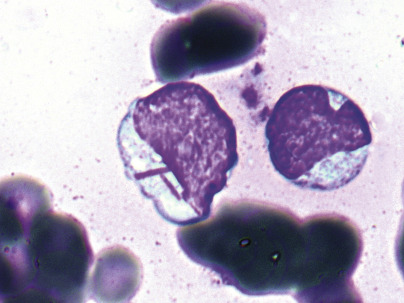

Figure 33-25 

Auer rods vary from prominent, as in this cell, to thin and delicate. 

The main categories of AML in the WHO classification are (1) AML with recurrent cytogenetic abnormalities; (2) AML with multilineage dysplasia; (3) AML, therapy related; and (4) AML, not otherwise specified (subclassified by morphology and immunophenotype). Many biologic factors vary the risk of adverse outcome, but few are definitive (  Liersch et al, 2014  ). 

 

##  Acute Leukemia with Recurrent Genetic Abnormalities (  Swerdlow et al, 2008  ) 

 

##  AML with Balanced Translocations/Inversions 

 

##  AML with t(8;21)(q22;q22), RUNX1-RUNX1T1. 

The morphology usually corresponds to acute myeloid leukemia with neutrophilic maturation, and these represent 5% to 12% of AML, with predominance in young patients. Blasts are 20% or greater in the marrow (or blood), and maturing neutrophilic precursors constitute more than 10% of marrow nucleated cells (not including NRBCs, lymphocytes, and plasma cells). Morphologic findings are characteristic but variable: large blasts with abundant basophilic cytoplasm; maturing neutrophil precursors with peripheral cytoplasmic basophilia; frequent Auer rods, often long, sharp, and tapered, and sometimes present in myelocytes and mature forms up to segmented neutrophils; abnormal granulation, including giant Chédiak-Higashi–like or secondary granules or homogeneous waxy-appearing secondary granulation; and nuclear dysplasia with bilobed nuclei that may be widely separated ( [ Fig. 33-26 ](<#f0135>) ). Monocytosis is not prominent, and monocytes are less than 20% of the marrow. Eosinophilia is common, and basophils or mast cells may be increased. The immunophenotype is distinctive with high-intensity CD34 along with myeloid markers MPO and CD13, but relatively weak CD33 and sometimes CD56. One or more B cell markers—CD19, PAX5, and cytoplasmic CD79a—are often coexpressed. 

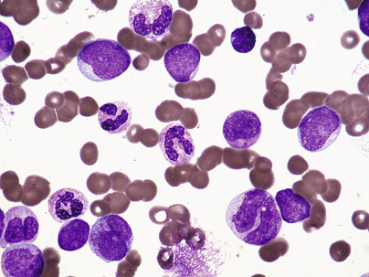

Figure 33-26 

This case of acute myelogenous leukemia with t(8;21) shows granulocyte maturation with abnormal granulation and bilobed precursors (500×). 

The presence of t(8;21) is diagnostic of AML, even when blasts appear to be less than 20%. This disease is referred to as a **core binding factor leukemia** because RUNX1, also known as _AML1_ or _core binding factor α (CBFA), _ encodes a transcription factor required for hematopoieses. The outcome of AML with t(8;21) is generally more favorable than AML without recurrent genetic abnormalities, or with MDS-associated abnormalities. Additional genetic abnormalities also occur, including _KIT_ mutations associated with less favorable outcome and mutations of _ASXL1/2_ (  Micol et al, 2014  ;  Wichmann et al, 2015  ). 

 

##  AML with inv(16)(p13q22) or t(16;16)(p13.1;q22), CBFβ/MYH11. 

These correspond to acute myelomonocytic leukemia with abnormal eosinophils. Occurrence and outcome are similar to AML with t(8;21). These cases show >20% blasts in marrow and/or blood with differentiation to monocytic and neutrophilic lineages (≥20% each). Eosinophils are characteristically increased ( [ Fig. 33-27 ](<#f0140>) ), including those with large basophilic granules (as in eosinophil promyelocytes), and cytoplasmic positivity is often weak for chloroacetate esterase. This type is associated with the chromosomal abnormality inv(16)(p13q22) or its variant t(16;16)(p13.1;q22) with fusion of the _CBFB_ gene on 16q and _MYH11_ on 16p and variable resultant chimeric mRNAs (due to differing breakpoints) and a BCGB-MYH11 fusion protein. This additional core binding factor leukemia generally has relatively favorable outcomes compared with other AMLs. In addition to karyotyping, RT-PCR or FISH is useful for timely diagnosis. Secondary genetic abnormalities are common, including trisomy 22, trisomy 8, _KIT, FLT3, WT1,_ and _RAS_ mutations (  Krauth et al, 2015  ;  Paschka et al, 2013  ). 

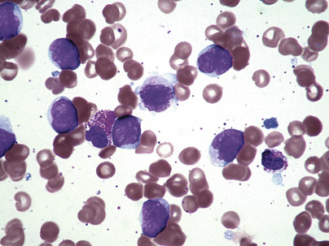

Figure 33-27 

Acute myelogenous leukemia with inv16 shows myelomonocytic differentiation with eosinophilia. 

(Two eosinophils are present in this view.) 

The immunophenotype typically shows both granulocytic (CD13, CD15, CD33, CD65, MPO) and monocytic (CD4, CD14, CD64, CD36, CD11b, CD11c, and lysozyme) markers, sometimes with CD2 coexpression. 

 

##  Acute Promyelocytic Leukemia with t(15;17)(q22;q12), PML/RARA, and Variants. 

Promyelocytes instead of myeloblasts predominate in the marrow in hypergranular promyelocytic leukemia (PML) (M3) (  McKenna et al, 1982  ) ( [ Fig. 33-28 ](<#f0145>) ). Azurophilic granules are abundant and intensely stained. Auer rods are found in most cases and frequently are multiple (10 or more) in a given cell (see [ Fig. 33-28 ](<#f0145>) ). Hemorrhagic complications are frequent as the result of disseminated intravascular coagulation (DIC), apparently initiated by procoagulant material from leukemic cell granules. 

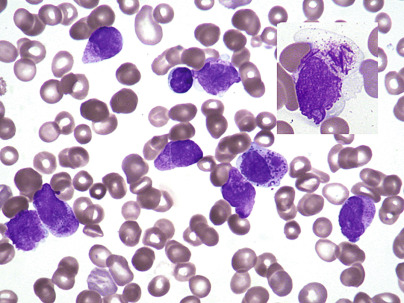

Figure 33-28 

Acute promyelocytic leukemia with t(15;17) shows predominantly abnormal promyelocytes (500×). 

_Inset (top right),_ Abnormal promyelocytes with bundles of Auer rods are known as **faggot cells** from their resemblance to bundles of firewood, or faggots (1000×). 

The characteristic chromosomal abnormality t(15;17)(q22;q21) shows fusion of the retinoid acid receptor gene-α _(RARA)_ on chromosome 17 with the _PML_ gene on chromosome 15. The _RARA-PML_ fusion gene is transcribed as a chimeric mRNA. Leukemia usually responds to therapy with all- _trans_ retinoic acid (ATRA), which is usually given in addition to chemotherapy, and the prognosis is relatively favorable. The molecular genetic abnormality may be detected in the laboratory by cytogenetics, RT-PCR, or FISH. Achievement of remission often occurs as a slow “maturation” process, rather than therapy-induced aplasia followed by remission as seen in treatment of other acute leukemias. 

Variant translocations include t(11;17)(q23;q21), t(5;17)(q32;q12), and t(11;17)(q13;q21). Some variants, such as t(11;17)(q23;q21), do not respond to ATRA. _FLT3_ mutations are frequent and are associated with decreased survival, and _WT1_ mutations occur in about 6% (  Krauth et al, 2015  ). 

Hypogranular or microgranular variants of M3 (M3V) occur in which cytoplasmic granules appear sparse by light microscopy, and numerous but smaller by electron microscopy (  Bennett et al, 1980  ). Nuclei of most leukemic cells are bilobed or reniform, and confusion with an atypical monocytic leukemia is frequent. Cytochemical staining reactions are somewhat less positive than in the hypergranular M3. Auer rods, single or multiple, and typical hypergranular promyelocytes are found in variable numbers, and there appears to be a spectrum between typical and hypogranular types. The WBC may be high. 

In acute promyelocytic leukemia, a majority of leukemic cells stain for MPO, SBB, and CAE, along with ANA in 25%. The immunophenotype is typically bright CD33; heterogeneous CD13, CD64, and CD117; and dim to absent HLA-DR, CD34, CD11a, CD11b, CD15, CD18, and CD64. 

 

##  AML with t(9;11)(p22;q23); MLLT3-MLL. 

The 11q23 abnormalities are present in a more diverse group of leukemias than other recurrent genetic abnormalities. Chromosome band 11q23 abnormalities, which involve the _MLL_ gene, are not specific for AML, but are also found in ALL, mixed lineage leukemias, and occasionally in lymphomas. The most common translocation in AML involving this region is t(9;11)(p22;q23). Others include t(6;11)(q27;q23), t(10;11)(p12;q23), t(11;17)(q23;q21), and t(11;19)(q23;p13). Most cases of t(9;11) show monocytic differentiation (monoblastic or myelomonocytic) ( [ Fig. 33-29 ](<#f0150>) ). In general, the prognosis of AML with 11q23 abnormalities is less favorable than that of other AMLs with standard chemotherapy, but cases with t(9;11)(p22;q23) may have intermediate prognosis (  Chen et al, 2013  ). 

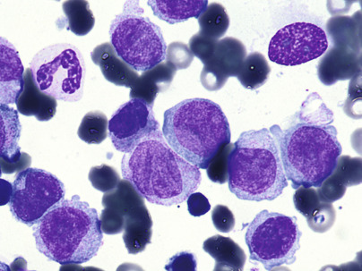

Figure 33-29 

Acute myelogenous leukemia with monocytic differentiation and 11q23 abnormality (1000×). 

 

##  AML with t(6;9)(p23;q34); DEK-NUP214. 

This disease shows variable morphology and granulocytic and/or monocytic differentiation but is usually associated with multilineage dysplasia and basophilia of marrow and blood (>2%). Immunophenotype includes usual MPO, CD13, CD33, CD38, and HLA-DR, with variably positive CD117, CD34, CD64, and Tdt, but not lymphoid lineage-associated antigens. A DEK-NUP214 fusion protein acts as an abnormal transcription and nuclear transport factor. _FLT3-ITD_ mutations are present in most cases. Prognosis is generally poor (  Gupta et al, 2010  ;  Tarlock et al, 2014  ). 

 

##  AML with inv(3)(q21q26.2) or t(3;3)(q21;q26.2); RPN1-EVI1. 

This disease shows multilineage dysplasia, increased atypical megakaryocytes with monolobed or bilobed nuclei, and normal to increased platelet counts. Pseudo–Pelger-Huët cells are common, and differentiation may be granulocytic and/or monocytic. Marrow eosinophils, basophils, and/or mast cells are often increased. EVI1 is a transcription factor which, likely promoted by RPN1, induces proliferation and transformation while impairing differentiation. Monosomy 7 is a frequent secondary event, and t(3;3) variants show increased N-RAS mutations. This is an aggressive disease with short survival, and adverse prognosis is enhanced by monosomy 7 (  Lugthart et al., 2010  ). 

 

##  AML (Megakaryoblastic) with t(1;22)(p13;q13); RBM15-MKL1. 

This is an acute leukemia of infants and young children, more often reported in girls, presenting as acute megakaryoblastic leukemia with hepatosplenomegaly. This form is not associated with Down syndrome. Blasts are usually medium-sized to large with fine reticular chromatin, one to three nucleoli, and basophilic cytoplasm with blebs or pseudopods. Cytochemistry/immunophenotype shows absence of MPO and SBB and expression of platelet markers CD41 and CD61 (best demonstrated by cytoplasmic labeling techniques), CD36, and variable CD13, CD33, and CD34. Micromegakaryocytes are often found, and biopsy sections show reticulin fibrosis. Patients may respond well to chemotherapy. 

 

##  AML with Gene Mutations 

Although many cases of AML have been associated with recurring translocations or inversions, many have shown normal karyotype. Most if not all of these carry genetic mutations not detectable by Giemsa banding morphology; mutations are also found in cases with karyotypic abnormalities. Several carry prognostic implications. As these continue to be investigated, new, specific categories of AML are certain to be described. Biologic and clinical associations are available for some common AML-associated mutations, and two of these are recognized by provisional categories in the WHO classification. 

 

##  AML with FLT3 Mutation. 

Mutations of fms-related tyrosine kinase 3 _(FLT3),_ encoding a tyrosine kinase receptor involved in hematopoietic proliferation and differentiation, occur in about one third of cases of AML. Two types of _FLT3_ mutations have been noted: one change of length type involving internal tandem duplications ( _FLT3_ -ITD), and another affecting the tyrosine kinase domain ( _FLT3_ -TK) at codon 835 or 836. _FLT3_ mutations are seen in any AML, but primarily those with t(6;9), t(15;17), and normal karyotype. _FLT3_ -ITD mutations are associated with less favorable prognosis, particularly in cases with normal karyotype. Targeted _FLT3_ inhibitors are being tested in clinical trials (  Wander et al, 2014  ). 

 

##  AML with _NPM1_ Mutation. 

While listed as a provisional entity in the 2008 WHO classification, it is now known that NPM1, encoding the nuclear shuttle protein nucleophosmin, is a primary driver mutation in AML. It is found in one half of cases with normal karyotype and is associated with favorable prognosis. This favorable association is especially noted in cases with normal karyotype and without _FLT3_ mutation. _NPM1_ mutation may be detected by immunohistochemical assay of sections, in which the affected cells show abnormal cytoplasmic localization of NPM protein, or it may be detected by PCR assays. Most cases have monocytic or myelomonocytic differentiation, but cases with multilineage dysplasia, erythroid differentiation, and other patterns are also found (  Falini et al, 2011  ). 

 

##  AML with _CEBPA_ Mutation. 

_CEBPA_ encodes the CCAAT/enhancer binding protein-α, another hematopoietic proliferation- and differentiation-inducing transcription factor. Bi-allelic CEBPA mutation is associated with improved prognosis in AML. It is found in less than 20% of cases. The morphology is most often AML without differentiation or AML with differentiation, although monocytic differentiation may also occur. Immunophenotype includes usually CD34, frequently CD7, with myeloid markers HLA-DR, CD11b, CD13, CD15, CD33, and CD65. 

**_KIT_ mutations ** are also seen in cases of AML, as well as in GI stromal tumors and mast cell disease. In core binding factor leukemias, _KIT_ mutation has shown adverse but variable prognostic effect (  Foran, 2010  ). 

 

##  Acute Myeloid Leukemia with Myelodysplasia-Related Changes (  Swerdlow et al, 2008  ) 

These leukemias show morphologic features of myelodysplasia or history of prior MDS or MDS/MPN, or they have MDS-related cytogenetic abnormalities. Patients with a history of cytotoxic chemotherapy or radiation for another malignancy are not included. These cases are characterized by 20% or more blasts in blood and/or marrow, as well as dysplasia in ≥50% of cells of at least two lineages. Dysplastic features are similar to those of MDS of various types ( [ Fig. 33-30 ](<#f0155>) ). 

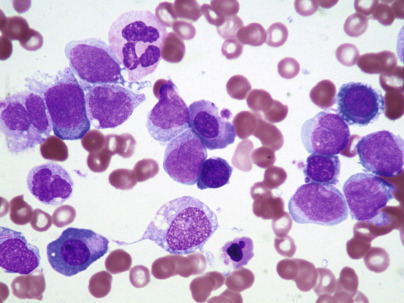

Figure 33-30 

Acute myelogenous leukemia with MDS-related changes showing dysgranulopoiesis and dyserythropoiesis (1000×). 

Cytogenetic abnormalities qualifying for this disorder include −5/del(5q), i(17q)/t(17p), −13/del(13q), del(11q), del(12p)/t(12p), del(9q), idic(X)(q13), t(11;16)(q23;p13.3.), t(3;21)(q26.2;q22.1), t(1;3(p36.3;q21.1), t(2;11)(p21;q23), t(5;12)(q33;p12), t(5;7)(q33;q11.2), t(5;17)(q33;p13), t(5;10)(q33;q21), and t(3;5)(q25;q34). The immunophenotype often includes primitive blasts with myeloid phenotype and CD34 expression, CD56, and/or CD7. Prognosis is generally poor. 

 

##  Therapy-Related Myeloid Neoplasms 

These disorders are related to prior radiation or cytotoxic chemotherapy utilizing alkylating agents or topoisomerase inhibitors. They include cases of AML, MDS, and MDS/MPN. Most patients have been treated for prior malignancies, but some have been treated for nonneoplastic conditions. 

Most commonly, disease is related to mutagenic effects of alkylating agents (including chlorambucil, cyclophosphamide, thiotepa, and busulfan) or radiation. These effects usually occur 5 to 10 years postexposure and most often present as MDS. Cytogenetic features are similar to those of MDS and AML with multilineage dysplasia. Loss of portions of chromosome 5 or 7 is common. Response to therapy and outcomes are poor. 

Cases secondary to prior chemotherapy with topoisomerase II inhibitors (including epipodophyllotoxins etoposide and teniposide, and doxorubicin) occur after a shorter latency period of 1 to 5 years and most often are associated with overt AML with balanced chromosomal translocations involving 11q23 ( _MLL_ ) or 21q22 ( _RUNX1_ ). These most often show AML with maturation, monocytic, or myelomonocytic morphology. 

 

##  Acute Myeloid Leukemia, Not Otherwise Specified 

These cases do not fulfill criteria for the previous categories, or cytogenetic studies were unsuccessful or could not be performed. Categorization is similar to French-American-British Cooperative Group criteria (  Bennett et al, 1976  ;  Bennett et al  1985  ;  Swerdlow et al, 2008  ). 

 

##  Genomic Variation in AML with Normal Karyotype 

AML with normal karyotype, considered intermediate risk, or AML, NOS in the WHO classification, represents up to 50% of AML cases. While genomic studies have tended to support prior discoveries and clinical correlates associated with genetic subtypes in AML, additional mutations have been identified that may narrow this group and provide targets for new therapies (  Abdel-Wahab & Levine, 2013  ;  Cagnetta et al, 2014  ;  Cancer Genome Atlas Research Network, 2013  ). These include recurrent mutations in _TET2, DNMT3A, IDH1/2,_ and _ASXL1_ , involved in epigenetic regulation, and others including _WT1_ . Incorporation of genomic and epigenetic analyses into clinical settings is ongoing. 

 

##  Acute Myeloblastic Leukemia, Minimally Differentiated 

In acute myeloblastic leukemia, minimally differentiated, myeloblasts display less than 3% positivity with SBB, MPO, or ANA (  Bennett et al, 1991  ). When examined for myeloid and lymphoid markers using flow cytometry or immunocytochemistry, however, at least 20% of the blasts exhibit myeloid-associated antigens (CD13, CD33, CD117, and/or MPO). Stem cell antigens CD34, CD38, HLA-DR, and TdT are often expressed, while lineage-specific lymphoid markers cCD3, cCD20, and cCD79a are absent. Some primitive markers often associated with lymphoid lineage, including CD2, CD7, and CD19, are not lineage specific and are sometimes expressed ( [ Fig. 33-31 ](<#f0160>) ). 

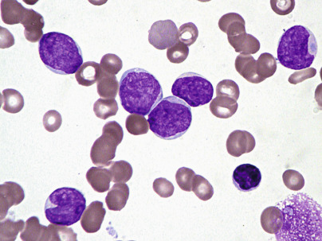

Figure 33-31 

Acute myelogenous leukemia, minimally differentiated, resembles acute lymphoblastic leukemia and requires immunophenotyping for diagnosis (500×). 

 

##  Acute Myeloblastic Leukemia without Maturation (M1) 

In this category, myeloblasts represent at least 90% of nonerythroid cells in the BM (  Bennett et al  1985a  ) and at least 3% of blasts labeled with MPO or SBB. Positive staining for CAE is sometimes also present but is less sensitive. CD13, CD33, CD117, and/or MPO antigens are usually detectable, as are other, less specific markers. CD3, CD20, and CD79a are usually absent ( [ Fig. 33-32 ](<#f0165>) ). 

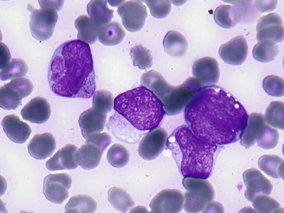

Figure 33-32 

Acute myelogenous leukemia without maturation shows blasts with less than 10% maturing neutrophils. 

Auer rods are present in the cell at upper left. 

 

##  Acute Myeloblastic Leukemia with Maturation 

Myeloblasts represent 20% (per WHO) to 89% of total marrow cells, granulocytes from promyelocytes to neutrophils are greater than 10% of nonerythroid cells, and monocytes and their precursor cells are less than 20% ( [ Fig. 33-33 ](<#f0170>) ). Most blasts stain with MPO, SBB, and CAE. 

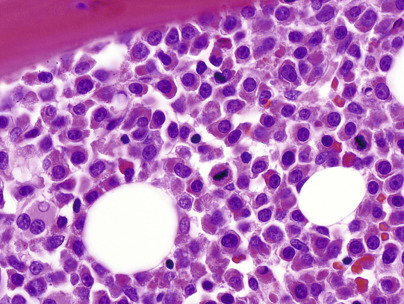

Figure 33-33 

Acute myelogenous leukemia with maturation shows maturing granulocytic cells on this biopsy (200×). 

Cases with t(8;21)(q22;q22) are categorized as AML with recurrent cytogenetic abnormality t(8;21). 

 

##  Acute Myelomonocytic Leukemia 

In acute myelomonocytic leukemia, myeloblasts constitute more than 20% of total marrow cells. The sum of the monoblasts, promonocytes, and monocytes is greater than 20% but is less than 80% of nonerythroid cells. Cells of the granulocytic series (myeloblasts, promyelocytes, myelocytes, and other more mature forms) also represent 20% to 80% of nonerythroid cells ( [ Fig. 33-34 ](<#f0175>) ). Peripheral blood monocytosis (≥5 × 10  9  /L) is usually present. 

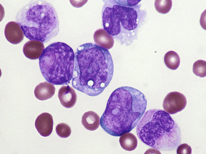

Figure 33-34 

Acute myelomonocytic leukemia shows blasts and dual differentiation to granulocytes and monocytes (1000×). 

Acute monocytic leukemia shows monoblasts and maturing monocytes. Promonocytes are counted as blasts and show finely convoluted nuclei (1000×). 

In myelomonocytic leukemia, variable staining of leukemic cells with MPO, SBB, CAE, and periodic acid–Schiff (PAS) has been noted. In most cases, leukemic cells exhibit diffuse and intense staining with ANA and ANB. In some cases, these nonspecific esterases cannot be demonstrated, and the diagnosis may be made on the basis of Romanowsky's stains and/or immunophenotyping. 

Immunologic markers are variable but usually show myeloid antigens CD13 and/or CD33, as well as variable expression of monocytic markers CD14, CD4, CD11b, CD11c, CD64, CD36, CD68, and lysozyme. Some pure myeloblasts may be present, including those with CD34 and CD117 expression, and a second population of variably mature monocytes. Cases with recurrent cytogenetic abnormalities are categorized separately. 

 

##  Acute Monoblastic and Acute Monocytic Leukemia 

In this disorder, 80% or more of marrow nonerythroid cells are monoblasts, promonocytes, or monocytes (see [ Figs. 33-34 ](<#f0175>) and [ 33-35 ](<#f0180>) ). Two subtypes are recognized. The monoblastic subtype is characterized by large blasts accounting for 80% or more of marrow monocytic cells. The monocytic subtype has fewer monoblasts (<80% of marrow monocytic cells) and greater numbers of promonocytes and monocytes (  Bennett et al, 1985b  ). In both, ANA and ANB label the leukemic cells diffusely and intensely (80% or more of leukemic cells). Occasional cases fail to show nonspecific esterases, and the diagnosis is made from Romanowsky's stains and/or immunophenotypic techniques. Antilysozyme and CD68 are particularly useful on slides. Both myeloid and monocytic markers are frequently expressed, as in acute myelomonocytic leukemia. The translocation t(8;16)(p11;p13) has been associated with AML-M5 (or M4) with erythrophagocytosis. 

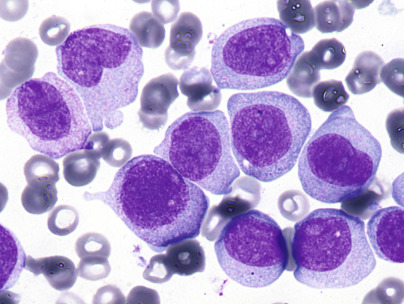

Figure 33-35 

Acute monoblastic leukemia shows predominantly monoblasts (1000×). 

 

##  Erythroleukemia 

The diagnosis of erythroleukemia is made when more than 50% of nucleated cells of the BM are erythroblasts, and 20% or more of nonerythroid cells are myeloblasts. In most cases termed _erythroleukemia_ (erythroid/myeloid), a mixture of variable proportions of dysplastic erythroid precursors and myeloblasts is seen. Sometimes abnormal monocytic and megakaryocytic elements are present as well ( [ Fig. 33-36 ](<#f0185>) ). The immunophenotype frequently includes myeloid-associated markers CD13, CD33, CD117 (KIT), and MPO, with or without expression of CD34 and HLA-DR (  Zuo et al, 2010  ). 

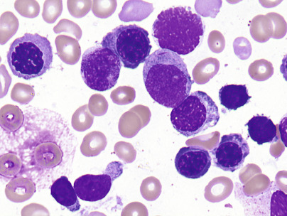

Figure 33-36 

Erythroleukemia, erythroid/myeloid, shows predominance of erythroid precursors with myeloblasts constituting 20% or more of nonerythroid cells. 

An Auer rod is seen in the blast at upper center (1000×). 

Very rarely, there is virtually no granulocytic involvement in the neoplastic process, and primitive erythroblasts predominate. This has been known as erythremic myelosis and is now known as _pure erythroid leukemia._ Morphologic abnormalities of erythroblasts are often pronounced, with atypical megaloblastic features, bizarre nuclear shapes, and multinucleated giant forms. The cytoplasm may contain pseudopods and/or vacuoles, particularly in the probasophilic and basophilic erythroblasts. CD71 (dim), hemoglobin A, glycophorin A, spectrin, ABH blood group antigens, and HLA-DR are frequently expressed with absence of myeloid-associated markers including MPO. Complex karyotypes are frequent, often including monosomy 5 or del(5q), monosomy 7 or del(7q), trisomy 811q abnormalities, 17p abnormalities, del(20q) and/or +13. 

In some cases, erythroid cells may show strong cytoplasmic PAS positivity ( [ Fig. 33-37 ](<#f0190>) ). This is granular in early erythroid precursors and diffuse in later stages. Erythroid precursors are PAS negative in normal individuals and in most diseases, including nutritional megaloblastic anemia. They are sometimes positive, however, in iron deficiency anemia, thalassemia, and RARS. Ring sideroblasts may be seen in erythroleukemia, and myeloblasts usually stain with SBB, MPO, and CAE. A nonspecific esterase-positive monocytic component may also be present. Neoplastic erythroid precursors are sometimes positive for ANA and ANB. 

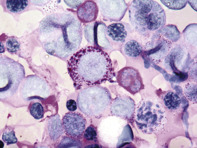

Figure 33-37 

Coarse periodic acid–Schiff–positive granules are often seen in erythroid precursors in erythroleukemia (1000×). 

 

##  Acute Megakaryoblastic Leukemia 

The diagnosis of acute megakaryoblastic leukemia, like other forms of acute myeloid leukemia, requires ≥20% blasts in the marrow. Megakaryoblasts are highly polymorphic; some blasts simulate lymphoblasts, while others are larger and have pseudopods or stringy cytoplasmic projections. The cytoplasm is usually light blue and may or may not possess granules ( [ Fig. 33-38 ](<#f0195>) ). The nuclei often have one to three nucleoli. Micromegakaryocytes may be present and are not counted as blasts. 

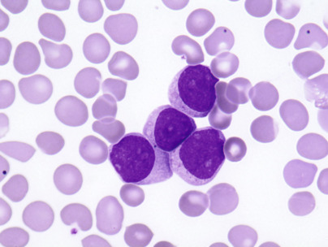

Figure 33-38 

Blasts sometimes cluster in acute megakaryocytic leukemia (1000×). 

The blasts are cytochemically undifferentiated. They do not stain with SBB, MPO, CAE, or ANB. However, ANA is usually positive in a focal cytoplasmic pattern ( [ Fig. 33-39 ](<#f0200>) ). The PAS reaction shows diffuse and peripheral granular (often in large blocks) staining. 

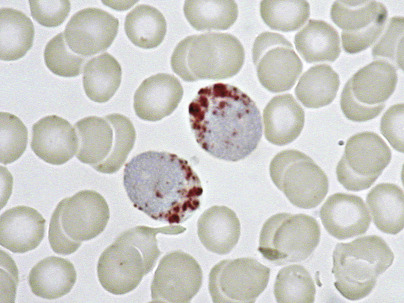

Figure 33-39 

Alpha naphthyl acetate esterase-positive granules in megakaryoblasts. 

Megakaryocytic lineage is most often (  Bennett et al, 1985a  ) demonstrated by immunophenotyping using monoclonal antibodies against platelet glycoprotein Ib (CD41) or IIb/IIIa (CD61). Blasts are often also positive for myeloid antigens CD13 and CD33, and characteristically for CD36. Care must be taken to differentiate this disease from AML with minimal differentiation by flow cytometry, which may show artifactual positivity for platelet markers due to adherence of platelets to blasts; this can be done by immunochemical examination of cytospins. 

In the peripheral blood, there is usually pancytopenia with marked leukopenia and anemia. Megakaryocytic fragments are sometimes present in the blood. The BM shows variable and sometimes pronounced myelofibrosis. 

Clumping of blasts may simulate metastatic tumor such as neuroblastoma or small cell carcinoma. Infants with t(1;22)(p13;q13) often show marrow infiltration mimicking neuroblastoma. 

Young children (through 4 years of age) with Down syndrome (trisomy 21) have an increased incidence of megakaryoblastic leukemia, preceded in 30% by transient myeloproliferative disorder/transient abnormal myelopoiesis (TMD/TAM) of Down syndrome and by a dysplastic prephase in 70%. See also later. 

 

##  Acute Basophilic Leukemia 

Acute basophilic leukemia is a rare form of AML in which the blastic cells differentiate along the basophil lineage. The peripheral blood usually demonstrates anemia and thrombocytopenia with leukocytosis. The BM is infiltrated by blastic cells simulating lymphoblasts or myeloblasts. Blasts are generally negative for Sudan black B and myeloperoxidase. An increase in mature basophils or in blasts staining with toluidine blue may occur. Diagnosis historically rests on the identification of blasts with basophilic granules by ultrastructural methods, and the literature consists of isolated reports with a variety of AML genotypes. The differential diagnosis includes myelomastic leukemia. 

 

##  Acute Panmyelosis with Myelofibrosis 

This is a rare form of acute leukemia with panmyeloid proliferation and marrow fibrosis. Pancytopenia is typically seen. Red blood cells show minimal poikilocytosis, but dysplastic features in myeloid cells are often seen, as are atypical platelets. 

The BM sample frequently shows a dry tap; on biopsy, clusters of blasts, late erythroid precursors, and dysplastic megakaryocytes are seen in a variably fibrotic background ( [ Fig. 33-40 ](<#f0205>) ). This is differentiated from acute megakaryoblastic leukemia by involvement of all three myeloid lineages, rather than only the megakaryocytic. 

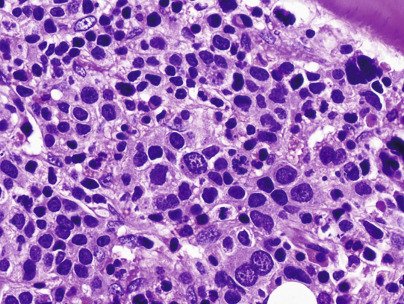

Figure 33-40 

Acute panmyelosis with myelofibrosis shows involvement of all three myeloid lineages, with fibrosis (200×). 

 

##  Myeloid Sarcoma 

This neoplasm has been called _myeloblastic sarcoma, granulocytic sarcoma, extramedullary myeloid cell tumor,_ and _chloroma._ It represents a localized tumor of myeloblasts or monoblasts, with or without maturation, infiltrating extramedullary sites ( [ Fig. 33-41 ](<#f0210>) ). Myeloid sarcomas may occur at any age in patients with acute myeloid leukemia or other known myeloproliferative disorder, or de novo. The diagnosis is equivalent to that of AML, and marrow involvement usually follows if it is not antecedent. These tumors occur in the skin, lymph nodes, nasopharyngeal and upper respiratory tract tissues, breast, ovary, bone, perineural and epidural structures, and the eye and other orbital structures, as well as in a variety of soft tissues. 

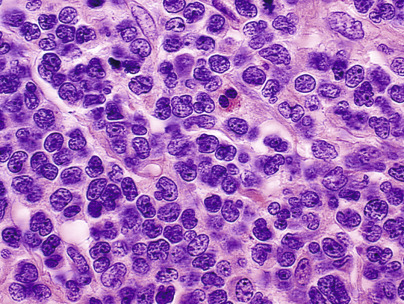

Figure 33-41 

Granulocytic sarcoma, in this case presenting in the skin, resembles lymphoma but with large blastic or monocytoid cells. 

Eosinophils or precursors are frequently present (500×). 

The diagnosis depends on recognizing the nature of the primitive cells that can often be mistaken for solid tumors, including non-HLs, amelanotic melanomas, or undifferentiated carcinoma (  Hutchison et al, 1990  ). The diagnosis is facilitated by making touch imprint preparations of cut sections of the tumor and staining them with Romanowsky's stains, by cytochemical reactions, and by immunophenotyping. Anti-MPO and CD68 are particularly useful for granulocytic or monocytic lineage in paraffin sections. 

 

##  Myeloid Proliferations Related to Down Syndrome 

Children and adults with Down syndrome have a much higher frequency of leukemia than those without the syndrome. This includes ALL and AML, and diagnostic considerations for most are similar to leukemia occurring outside the syndrome. In addition, two specific and likely related disorders are unique to this group of patients. 

 

##  Transient Abnormal Myelopoiesis 

Transient abnormal myelopoiesis (TAM) occurs in 10% of neonates with Down syndrome and in a small number who are phenotypically normal but have trisomy 21 mosaicism. It presents as acute megakaryoblastic leukemia, frequently with thrombocytopenia and leukocytosis, often with higher blast proportions in blood than in marrow, and hepatosplenomegaly. It is characterized by mutations of _GATA1_ . Blasts may express CD34, CD33, glycophorin A, and/or CD7. Uniquely, this disorder resolves spontaneously in the vast majority of cases. However, 20% to 30% subsequently develop nonremitting AML, as discussed later. 

 

##  Myeloid Leukemia Associated with Down Syndrome 

AML of Down syndrome occurs most often in the first 3 to 5 years at an incidence greater than 50 times that of others. It is usually of megakaryocytic lineage and may be preceded by a preleukemic phase similar to RCC, or by TAM. Blasts are of megakaryocytic/myeloid lineage, and express CD41 and CD61, as well as CD34, CD117, CD13, CD33, CD7, CD4, CD42, CD36, and/or CD71. Genetics show trisomy 21 and _GATA1_ mutations, often with additional copies of chromosome 8 and/or 21, monosomy 7 or 5, and/or 5q− (  Roy et al, 2009  ). AML also occurs with less frequency in older patients with Down syndrome, but in older patients _GATA1_ mutations are usually absent. 

 

##  Blastic Plasmacytoid Dendritic Cell Neoplasm 

This tumor used to be included in the WHO classification with the lymphomas and was called blastic NK-cell lymphoma or CD4+ CD56+ hematodermic neoplasm. It is now known to be derived from plasmacytoid dendritic cell precursors and presents in skin with frequent involvement of blood and marrow, and often lymph nodes. Skin lesions may be nodules, plaques, or patches. Tumors resemble lymphoblastic lymphomas with monomorphic dermal infiltrates of blasts with fine chromatin and irregular nuclei, along with agranular cytoplasm. Cytochemical stains for myeloid precursors are absent, and immunohistochemistry shows characteristic findings of CD4, CD56, CD43, and CD45RA. Plasmacytoid dendritic cell markers CD123, TCL1, CLA, MxA, and BDCA-2/CD303 are positive. CD99 is reported positive. CD7, CD68, and CD33 are often expressed, and CD3, CD5, CD13, CD34, CD117, CD20, and CD79a are negative. Cytotoxic T cell markers are also negative in tissue sections. Immunoglobulin and usually T cell receptor genes are germline. The disease is aggressive, usually relapsing after initial therapy, but occasionally responding well to aggressive therapy. 

 

##  Acute Leukemias of Ambiguous Lineage (  Swerdlow et al, 2008  ) 

Some cases of acute leukemia have features that are indeterminate between lymphoid and myeloid lineage, or have features of more than one lineage (  Swerdlow et al, 2008  ;  Bene & Porwit, 2012  ). This is a controversial area of difficult-to-classify leukemia. Many leukemias that appear to be of defined lineage have one or more immunologic markers that are aberrant, or show lineage infidelity. A single such marker is usually insignificant. ALL with myeloid markers responds similarly to other types of ALL, and lymphoid markers in AML are primarily important if they help suggest a subtype, such as CD19 expression in AML with t(8;21). 

Ambiguous acute leukemias fall into two main categories per the WHO classification: acute undifferentiated leukemia (AUL) and mixed phenotype acute leukemia (MPAL). MPAL is divided into several entities. The term **bilineal acute leukemia** has been applied to rare disorders in which there are distinct blast populations of more than one lineage. Biphenotypic leukemia has referred to those with one population of leukemic cells showing multiple lineage expression ( [ Box 33-12 ](<#b0065>) ). Subcategories of MPAL are listed in the following sections. 

Box 33-12 

Lineage Requirements in Mixed Phenotype Acute Leukemia 

  * Myeloid lineage 

  * Myeloperoxidase or monocyte differentiation markers (NSE, lysozyme, CD14, CD64, CD11c) 

  * T lineage 

  * Cytoplasmic or surface CD3B lineage 

  * Strong CD19 + strong CD79a, cytoplasmic CD22, or CD10 

  * Or 

  * Weak CD19 + at least two: strong CD79a, cytoplasmic CD22, or CD10 

_NSE,_ Neuron-specific enolase. 

From Swerdlow S, Campo E, Harris N, editors: _WHO classification of tumours of haematopoietic and lymphoid tissues_ , ed 4, Lyon, France, 2008, IARC. 

 

##  Undifferentiated Acute Leukemia 

These are rare acute leukemias in which the predominant cells are blast forms that cannot be classified using morphologic, cytochemical, ultrastructural, immunologic, or DNA analytic methods. CD34, CD38, and HLA-DR are frequently expressed, and CD7 and TdT may be expressed as well. 

 

##  Mixed Phenotype Acute Leukemia with t(9;22)(q34;q11.2); BCR-ABL1 

These are cases of MPAL with t(9;22) translocation and associated _BCR-ABL1_ . They are rare disorders, more common in adults than in children. Cases with prior CML are excluded. 

 

##  Mixed Phenotype Acute Leukemia with t(v;11q23); MLL Rearranged 

This disease is more common in children than in adults. Dimorphic blast populations are frequent and consist of monoblasts and lymphoblasts. Prognosis is generally poor. 

 

##  Mixed Phenotype Acute Leukemia, B/Myeloid, NOS 

Myeloperoxidase or monocytic differentiation and CD19 with CD79a, cCD22, and/or CD10; neither t(9;11) nor 11q23 translocation occurs. 

 

##  Mixed Phenotype Acute Leukemia, T/Myeloid, NOS 

Myeloperoxidase or monocytic differentiation and cytoplasmic or surface CD3; neither t(9;11) nor 11q23 translocation occurs. 

 

##  Mixed Phenotype Acute Leukemia, NOS—Other Rare Types 

This category includes T- and B-lineage disease and cases with trilineage differentiation. 

 

##  Natural Killer Cell Lymphoblastic Leukemia/Lymphoma 

This category considers the possibility of bilineage NK and T-lineage lymphoblastic leukemia/lymphoma, but such an entity remains ambiguous. 

 

##  Precursor Lymphoid Neoplasms 

Historically, lymphoid leukemias and lymphomas were classified separately. Leukemias are hematopoietic malignancies primarily involving BM and blood and have been most extensively categorized by the FAB group. Lymphomas are those primarily involving lymphoid organs or other soft tissues and have been subject to numerous classification schemes that evolved rapidly because of advances in immunology, oncology, and genetics. Since publication of the Revised European-American Lymphoma (REAL) classification, lymphoid leukemias and lymphomas have been classified by biologic features of the disease, rather than by anatomic distribution, and an international consensus in classification has generally been attained (  Berard & Hutchison, 1997  ;  Harris et al, 1994  ,  2000  ). The WHO classification deals with neoplasia of bone marrow, blood, and lymphoid tissues and focuses on cytogenetic and molecular findings whenever possible (  Swerdlow et al, 2008  ). 

 

##  B Lymphoblastic Leukemia/Lymphoma 

 

##  Clinical Features 

This category of malignancy most often presents as leukemia and is the prototype of ALL. The other major type of ALL is T lymphoblastic, which is less common and tends to present as lymphoma or concurrently as both leukemia and lymphoma. Acute lymphoblastic leukemia is the most common malignancy of children and adolescents. In the United States, 3000 to 4000 new cases are reported per year, two thirds of which affect children. The evolution of treatment with combination chemotherapy, CNS treatment, intensified therapy for high-risk categories with identification of minimal residual disease (MRD), and increasing understanding of molecular and genetic risk categories has led to cure rates of greater than 80% in children (  Pui et al, 2011  ;  Pui & Evans, 2013  ;  Zhou et al, 2012  ). Favorable factors include age 5 to 10 years, hyperdiploidy (best, 54 to 62 with trisomy 4, 10, and/or 17), and t(12;21). Poor risk factors include age younger than 1 year, t(9;22), t(4;11), MRD after therapy, and ancestry factors that have varied with therapies. Proper therapy has reduced some adverse risk factors, and molecular genetic characterization has identified targets for therapy, such as genotypes sensitive to ABL1 inhibitors. 

Among adults, only 30% to 40% are cured, in part because of the higher frequency of adverse genetic abnormalities. Adult ALL incidence increases in middle to older age, similarly to genetically high-risk AML. Individuals with this disorder often present with symptoms of fatigue, fever, and bleeding. Generalized lymphadenopathy, splenomegaly, and hepatomegaly are common findings. Because leukemic cells infiltrate many tissues of the body, other symptoms may occur. Leg pain can be associated with periosteal infiltrates, as well as headache, nausea, and vomiting with meningeal leukemia. Rapid onset of unconsciousness may indicate subarachnoid hemorrhage. 

Presentation occurs occasionally in skin, bone, and/or lymph node without BM involvement (<25% blasts in the marrow). These cases are referred to as _lymphoma_ . They most often occur in young people (<18 years of age) and show overlapping features with precursor B-ALL, with TdT and B-lineage markers. Morphology in tissue sections shows diffuse infiltrations of small cells (nuclei smaller than histiocyte nuclei) with diffuse chromatin, inconspicuous nucleoli, scant cytoplasm, high mitotic rate, and frequently a “starry-sky” pattern of admixed histiocytes (indicating high apoptotic rate). 

Anemia, usually normocytic, is present in precursor B-ALL when clinical manifestations are fully developed. Frequently, nucleated red cells are present. Thrombocytopenia of moderate to marked degree is the rule. The leukocyte count occasionally is very high (>100 × 10  9  /L), often is slightly elevated, but is perhaps most frequently normal or decreased. The predominant cell is the lymphoblast. 

 

##  Marrow 

By the time the patient is symptomatic, hematopoietic cells and fat are usually replaced by a diffuse infiltration of lymphoblasts. Blast percentage is usually greater than 50%. Predominance of small blasts with high nuclear/cytoplasmic (N/C) ratios and inconspicuous nucleoli (L1 type in the FAB classification) is most common in childhood ALL ( [ Fig. 33-42 ](<#f0215>) ). Chromatin is diffuse in some cells but may show variable condensation, and blasts may be difficult to distinguish from the normal lymphocytes of young children. Larger blasts with more abundant cytoplasm, prominent nucleoli, and often irregular nuclei (FAB L2) also occur and tend to predominate in adult ALL. 

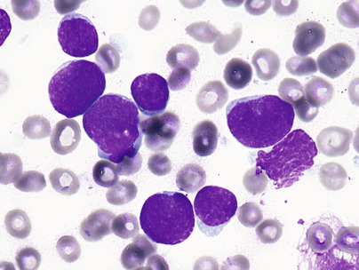

Figure 33-42 

B lymphoblastic leukemia/lymphoma with small to medium-sized blasts and lack of conspicuous nucleoli (1000×). 

The blasts are negative for SBB, peroxidase, and naphthol ASD CAE. Azurophilic granules may be present, but they are SBB and peroxidase negative. In other cases, ALL blasts may exhibit some SBB reactivity, but peroxidase is negative. 

Blasts characteristically express TdT, cytoplasmic CD22 and CD79a, CD19, and HLA-DR. CD10 (common ALL antigen) is expressed in many, and expression of CD34 is variable. Cytoplasmic µ immunoglobulin heavy chain (cyt-µ) indicates a slightly more mature state, but surface immunoglobulin is negative. Myeloid-associated antigens CD13, CD33, and CD15 may be expressed. 

 

##  Cytogenetics 

Cytogenetic findings are increasingly important in diagnosis and prognostication in ALL and have been previously reviewed (  Mrozek et al, 2004  ). The current WHO classification divides B-ALL into groups based on frequently found (recurrent) cytogenetic findings (  Swerdlow et al, 2008  ). 

 

##  B Lymphoblastic Leukemia/Lymphoma with t(9;22)(q34;q11.2); BCR-ABL1 

The Ph′ chromosome t(9;22) with production of a fusion BCR-ABL occurs in about 30% of cases of adult (20% detected at karyotyping) and 6% of cases of childhood ALL. The t(9;22) is the most frequent adult ALL translocation and is associated with poor prognosis. Two types are found: that identical to CML, involving the bcr region of BCR with resultant p210 kD fusion protein, occurring in half of adult cases of Ph′-positive ALL; and another with breakpoint upstream of bcr, producing a smaller chimeric message and p190 kD protein. The latter occurs in most childhood Ph′-positive cases. Ph′-positive ALL is most often of precursor B cell lineage but also may present with biphenotypic myeloid differentiation. 

 

##  B Lymphoblastic Leukemia/Lymphoma with t(v;11q23); MLL Rearranged 

Abnormalities of the _MLL_ gene at chromosome region 11q23 are seen in 5% to 7% of cases of ALL, as well as in AML, and are often associated with _FLT3_ overexpression. ALL with t(4;11)(q21;q23) is associated with poor prognosis, high WBC count, and immature B-lineage phenotype with lack of CD10 or CD24 but with CD15 expression. It involves _MLL_ and the partner gene _AF4._ It is most common in infants, and many cases of ALL with this abnormality are biphenotypic. Translocation t(11;19)(q23;p13.3) is the next most frequent MLL abnormality in ALL but also occurs in AML (monocytic). Overall, 11q23 (MLL) abnormalities, with the possible exception of t(9;11) in AML, confer poor prognosis. 

 

##  B Lymphoblastic Leukemia/Lymphoma with t(12;21)(p12;q22); TEL-AML1 (ETV6-RUNX1) 

This constitutes approximately 25% of B-ALL, correlates with high-density CD10 and HLA-DR expression with negative CD9 and CD20, and is associated with good prognosis. The _TEL_ gene at 12p12 is fused with the _AML1_ gene at 21q22 with a resultant fusion protein. _AML1 (RUNX1_ ) is a transcription factor involved in hematopoietic differentiation/proliferation. The abnormality is difficult to detect by karyotyping but can be detected by RT-PCR analysis for the chimeric mRNA or by FISH. 

 

##  B Lymphoblastic Leukemia/Lymphoma with t(1;19)(q23;p13.3); E2A-PBX1 (TCF3-PBX1) 

Another translocation, t(1;19)(q23;p13), and variants are associated with pre–B cell ALL (with cytoplasmic µ Ig). It involves the _E2A_ gene at 19p13, which encodes transcription factors, and _PBX_ at 1q23. This has also been associated with decreased response to therapy. 

 

##  B Lymphoblastic Leukemia/Lymphoma with t(5;14)(q31;q32); IL3-IGH 

This rare variant of B-ALL is associated with eosinophilia. The rearrangement results in constitutive expression of _IL3_ and interleukin effects. The immunophenotype is CD19+, CD10+. 

 

##  B Lymphoblastic Leukemia/Lymphoma with Hyperdiploidy 

B-ALL with multiple trisomies and between 50 and 66 chromosomes (normal = 46) is referred to as _hyperdiploid_ . This usually occurs in children and implies favorable prognosis. Trisomies of chromosome 4, 10, and 17 are considered markers for low-risk disease in pediatric leukemia protocols. Blasts usually express CD19, CD10, and CD34 but often are CD45 negative. 

 

##  B Lymphoblastic Leukemia/Lymphoma with Hypodiploidy 

Hypodiploid B-ALL shows fewer than the normal 46 chromosomes. Prognosis is unfavorable, especially when chromosomes are fewer than 45, and even more so when fewer than 44. 

 

##  B Lymphoblastic Leukemia/Lymphoma, Not Otherwise Specified (Refers to All Other B-ALL) 

Other genetic factors are recognized in B-ALL. _IKZF1_ deletion in B-ALL is associated with a high risk for relapse. _PAX5_ deletions or mutations are observed in approximately 30% of cases. Deletion or mutation of _CDKN2A/B_ occurs in 21% to 36% of pediatric B-ALL and 50% of adult cases. Abnormalities in JAK-STAT signaling occur with various _JAK_ mutations (excluding _JAK2_ V617F), as well as increased expression of cytokine receptor CRLF2, and mutations of _PAX5_ and _RAS_ are also frequent (  Zhou et al, 2012  ). 

 

##  Precursor T Lymphoblastic Leukemia/Lymphoblastic Lymphoma 

Precursor T lymphoblastic leukemia (T-LBL), which accounts for 10% to 20% of cases of ALL, occurs predominantly in boys who tend to be slightly older than children with precursor B lymphoblastic ALL. Patients with T-lineage ALL often have a high leukocyte count and mediastinal involvement. Blast morphology is heterogeneous, similar to B-ALL, and immunophenotyping is required for diagnosis. The immunophenotype reflects thymic T cells that have a distinct maturation pattern (  Reinherz et al, 1980  ), and the blasts show varying maturity. Most cases exhibit TdT, CD7, and cytoplasmic CD3 with variable CD1a, CD2, and CD5. Some cases of early thymic phenotype lack CD4 or CD8, but most (midcortical thymic phenotype, particularly in lymphoma presentation) coexpress CD4 and CD8. In late cortical thymic phenotype, CD4 or CD8 alone may be present, and in these, TdT and/or CD1a is particularly helpful for diagnosis. Myeloid markers such as CD13, CD33, and/or CD117 may be present, and CD79a may be present occasionally. A unique category with poor prognosis is referred to as _early T cell precursor ALL,_ comprises 15% of T ALL, lacks expression of CD1a and CD8 with weak or absent CD5, and displays aberrant expression of myeloid and hematopoietic stem cell markers CD13, CD33, CD34, and CD117. A mutational spectrum resembles AML (  Zhang et al, 2012  ). 

Presentation as lymphoma often shows a more mature thymic phenotype than leukemic presentation (  Crist et al, 1988  ). These are relatively common lymphomas of adolescents and young adults (one third of pediatric NHLs) and also occur later in life. They typically present in the mediastinum and/or peripheral lymph nodes, and pleural effusions are common. Airway compromise or superior vena cava syndrome is frequently present, resulting in emergent need for therapy and limiting diagnostic procedures. 

 

##  Morphology. 

T-LBL usually shows diffuse tissue involvement by blasts with nuclei smaller than those of histiocytes or reactive endothelial cells ( [ Fig. 33-43 ](<#f0220>) ), although some show nuclei similar in size to Burkitt lymphoma. Chromatin is usually finely dispersed to slightly clumped, but rarely as much as Burkitt lymphoma. Mitotic rates are high, and there is often a “starry sky” pattern similar to Burkitt. Neoplastic cells sometimes show selective T-zone involvement of lymph nodes and/or a leukemia-like infiltration pattern in soft tissue. 

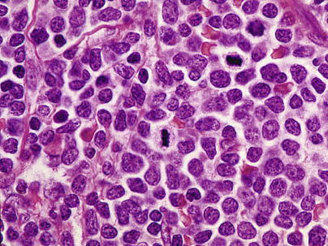

Figure 33-43 

T lymphoblastic leukemia/lymphoma (500×). 

The differential diagnosis of T-LBL in young patients primarily involves it, BL, and occasionally large B cell lymphoma (LBCL). Mediastinal location favors T-LBL over BL, but not LBCL. In adults, the differential diagnosis includes blastoid and blastic variants of mantle cell lymphoma. Granulocytic sarcoma is also in the differential in any age group. Expression of TdT and lineage-specific T cell markers without B or myeloid markers is usually diagnostic. 

 

##  Genetics. 

T cell receptor genes are frequently rearranged, but Ig heavy chain genes may also be rearranged (Racke, 2011). Patients with T cell ALL frequently show translocations of α and δ T cell receptor loci at 14q11.2, the β locus at 7q35, or the γ locus at 7p14-15, usually with genes encoding transcription factors. Partner genes include _MYC_ (8q24.1), _TAL1_ (1p32), _RBTN1_ (11p15), _RBTN2_ (11p13), _HOX11_ (10q24), _HOX11L2_ (5q35), and _LCK_ (1p34.3-35). TAL1 regulatory gene deletions occur in 25% of cases, and del(9p) involving _CDKN2_ is also frequent (  Mrozek et al, 2004  ). Early T-cell precursor ALL shows activating mutations in genes regulating cytokine receptor and RAS signaling (NRAS, KRAS, FLT3, IL7R, JAK3, JAK1, SH2B3, and BRAF), inactivating lesions disrupting hematopoietic development (GATA3, ETV6, RUNX1, IKZF1, and EP300), histone-modifying genes (EZH2, EED, SUZ12, SETD2, and EP300), and/or recurrent mutations DNM2, ECT2L, and RELN (  Zhang et al, 2012  ). 

 

##  Mature B Cell Neoplasms 

These constitute the most numerous and possibly the most diverse group of hematopoietic neoplasms. Overall rates vary geographically, with 15 in 100,000 in the United States. There is also geographic variation in histologic types, with follicular and diffuse large B cells predominating in Western developed countries, constituting 50% of NHLs; myeloma is also common. The cells affected in mature B cell malignancies are those making up the humoral immune system, which is characterized by innumerable clones of B lymphocytes with genetically distinct immunoglobulin gene rearrangements, many states of maturation, and interaction with regulatory pathways. Clinical behaviors relate to clonal escape from regulation, the balance of proliferation and apoptosis, and modulation by therapy. Features of major categories are shown in [ Table 33-5 ](<#t0030>) (  Swerdlow et al, 2008  ). 

TABLE 33-5 

Key Features of Major Mature B Cell Neoplasms 

Lymphoma  |  Demographics, Clinical and Laboratory Presentations  |  Morphology  |  CELL SURFACE MARKERS  |  Cytogenetics   
---|---|---|---|---  
Positive  |  Negative   
CLL/SLL  |  M > F, over 60 years; insidious onset of fatigue, lymphadenopathy; WBC >5 K/µL, anemia, thrombocytopenia, occasionally AIHA  |  Small lymphocytes with condensed chromatin  |  CD19, CD20, CD5, CD22, CD23, CD79a, dim sIg  |  CD10, bcl-6, FMC-7  |  +12, del(13q14.3), del(11q22-23), del(17q)(TP53)   
B cell PLL  |  M > F, mean age 65 years; massive splenomegaly, minimal lymphadenopathy, WBC >100 K  |  Prolymphocytes ≥55%  |  CD19, CD20, FMC-7, bright sIg  |  CD5, CD23, often negative  |  Occ del(17p), del(13q14)   
Hairy cell leukemia  |  M > F, median age 50 years; insidious onset with splenomegaly, leukopenia with monocytopenia  |  Medium-sized cells with round to oval indented nuclei, reticular chromatin, frayed cytoplasmic borders  |  CD20, CD22, CD79a, CD103, CD25, CD11c  |  CD5, CD10, CD23  |  BRAF (V600e) mutation   
Lymphoplasmacytic lymphoma  |  M > F, mean age 63 years; BM, nodal, and splenic involvement, symptomatic IgM paraprotein  |  Plasmacytoid lymphocytes and plasma cells with PAS-positive inclusions (Dutcher bodies)  |  CD19, CD20, CD22, CD25, CD38, CD79a, bright sIgM, cIgM  |  CD5, CD10, CD23, CD103, bcl-6  |  MYD88 mutation   
del(6q), +3, +4, +18, none specific   
Heavy chain disease (α-HCD, immunoproliferative small intestinal disease, prototype)  |  Younger adults in poorer Mediterranean communities with malabsorption, diarrhea  |  Lymphoplasmacytic infiltrate of intestinal mucosa, variant of MALT  |  NA  |  NA  |   
Marginal zone lymphomas: splenic, nodal, MALT  |  F > M, median age 61 years; indolent course involving stomach, other mucosal sites, spleen, or nodes  |  Lymphocytes with condensed chromatin and moderate cytoplasm; lymphoepithelial lesions in MALT type  |  CD20, CD79a, sIgM, bcl-2  |  CD5, CD10, CD23, bcl-6  |  +3, t(11;18)(q21;q21) in MALT type, 7q abnormalities   
Follicular lymphoma  |  F > M, median age 59 years; lymphadenopathy, BM and splenic involvement frequent  |  Follicle-like structures with centrocytes and varying numbers of centroblasts  |  CD19, CD20, CD22, CD23, CD79a, CD10, bcl-2, bcl-6, sIgM  |  CD5, CD43  |  t(14;18)(q32;q21)   
Mantle cell lymphoma  |  M > F, median age 60 years; lymphadenopathy, splenomegaly, BM involvement; typically refractory  |  Atrophic germinal centers, prominent mantle zones, small lymphs with irregular nuclei; blastoid/pleomorphic variants  |  CD5, CD43, FMC-7, bcl-2, cyclin D1, sIgM  |  CD10, CD23, bcl-6  |  t(11;14)(q13;q32)   
Diffuse large B cell lymphoma  |  M > F, all ages, moderately aggressive but responds to chemo and anti-CD20  |  Diffuse infiltrate of large B cells, variable morphology  |  CD19, CD20, CD22, CD79a, sIg, bcl-2±, bcl-6±, CD30±, MUM1 in post-GC types  |  CD5 (usually)  |  t(14;18) in 20%, 3q27 (bcl-6) abnormalities in 30%, C-MYC translocation in “double hit”  
Mediastinal large B cell lymphoma  |  F > M, young to middle-aged adults; airway compression, superior vena cava syndrome  |  Sclerotic lesions with clear, multilobulated, or RS-like cells  |  CD19, CD20, CD22, CD79a, CD30  |  CD5, CD10  |  Amplifications of 9p24, 2p15, others   
Primary effusion lymphoma  |  Rare, associated with HHV-8 in immunosuppressed younger male homosexuals; pleural effusion  |  Immunoblastic or anaplastic cells  |  CD45, CD30, CD38, CD138  |  CD19, CD20, CD79a, sIg, bcl-6  |   
Plasmablastic lymphoma  |  Rare, associated with EBV in immunosuppressed  |  Plasmacytoid  |  CD45, CD38, CD138, CD79a  |  CD45, CD20, PAX-5 negative or weak  |   
EBV associated; chronic inflammation of the elderly, lymphomatoid granulomatosis, posttransplant  |  Immunosuppressed, elderly, others  |  Variable  |  CD20, EBV-EBER  |  |   
Burkitt lymphoma  |  1\. Endemic: children in Africa, jaw mass, M > F   
2\. Sporadic: children to young adults, worldwide, M > F   
3\. Immunodeficiency-associated: HIV patients  |  Uniform cells with round to oval nuclei, multiple nucleoli, high mitotic rate  |  CD19, CD20, CD10, bcl-6, sIg  |  TdT, bcl-2  |  t(8;14)(q24;q32), t(2;8)(p12;q24), t(8: 22)(q24;q11)   
Intermediate BL/DLBCL lymphoma  |  Children w/rapidly growing mass, adults  |  Intermediate between BL and DLBCL  |  CD19, CD20, CD10, bcl-6, slg  |  |  t(8;14)(q24;q32), 8q24/MYC, variable, others   
  
_AIHA,_ Autoimmune hemolytic anemia; _BL,_ Burkitt lymphoma; _BM,_ bone marrow; _cIg,_ cytoplasmic immunoglobulin; _CLL,_ chronic lymphocytic leukemia; _EBER,_ EBV-encoded RNA; _DLBCL,_ diffuse large B cell lymphoma; _EBV,_ Epstein-Barr virus; _F,_ female; _GC,_ germinal center; _HHV,_ human herpesvirus; _HIV,_ human immunodeficiency virus; _Ig,_ immunoglobulin; _M,_ male; _MALT,_ mucosa-associated lymphoid tissue; _MYC,_ c-Myc gene; _NA,_ not applicable; _PAS,_ periodic acid–Schiff; _PLL,_ prolymphocytic leukemia; _RS,_ Reed-Sternberg; _sIg,_ surface immunoglobulin; _SLL,_ small lymphocytic lymphoma; _TdT,_ deoxyribonucleotidyl transferase; _WBC,_ white blood cell. 

 

##  Monoclonal B Cell Lymphocytosis 

Diagnosis of chronic lymphocytic leukemia requires the presence of leukocytosis of ≥5 × 10  9  /L monoclonal lymphocytes with chronic lymphocytic leukemia (CLL) phenotype (see later) for at least 3 months, or lower counts with the presence of cytopenias and/or disease-related symptoms. Otherwise, a diagnosis of monoclonal B cell lymphocytosis is made, analogous to the concept of monoclonal gammopathy of unknown significance (MGUS) (  Swerdlow et al, 2008  ). 

 

##  Chronic Lymphocytic Leukemia/Small Lymphocytic Lymphoma 

This is a clonal proliferation of small B lymphocytes involving BM, blood, and lymph nodes. It is common, usually indolent, at least initially, but difficult if not impossible to cure (  Muller-Hermelink et al, 2008  ). Cases with predominant involvement in the marrow and blood are traditionally called CLL, and lymphomas are called small lymphocytic lymphoma (SLL), but these are considered manifestations of a single entity. A majority of cases are leukemic and constitute 90% of chronic lymphoid leukemias in the United States and Europe. It is rare in those younger than 40 years of age; most cases occur in those over 60 years of age, and the condition is more than twice as common in men as in women. Onset is insidious, and the disease is commonly discovered by chance during the investigation of another problem. Most patients are >50 years of age. 

The tumors show diffuse infiltrates of small mature lymphocytes with clumped chromatin and scant to moderate cytoplasm ( [ Fig. 33-44 ](<#f0225>) ). Admixed prolymphocytes and proliferation centers (containing increased prolymphocytes and lymphocytes with increased cytoplasm) are characteristic. Mitotic rates are very low. 

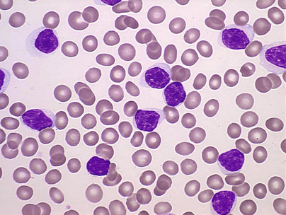

Figure 33-44 

B cell chronic lymphocytic leukemia (1000×). 

CLL/SLL shows a characteristic phenotype of monoclonal B cells (CD19/CD20/CD79a) with dim surface Ig (single light chain with IgM or IgM and IgD), coexpression of usual T cell marker CD5, and expression of CD23 and CD200 (  Alapat et al, 2012  ;  Sandes et al, 2013  ). CD10, BCL-6, and cyclin D1 are negative. This pattern is very useful in distinguishing CLL/SLL from mantle cell, follicular, and marginal zone lymphomas. 

Ig heavy and (monotypic) light chain genes are rearranged, and IGH genes have undergone somatic hypermutation of V regions as occurs in germinal centers (GC or memory-like) in 50% to 60%. Unmutated (naïve) _IGHV_ is associated with adverse prognosis and with expression of the tyrosine kinase ZAP-70, normally expressed in T-cells. ZAP-70 can be detected by flow cytometry, but the protein undergoes degradation in vitro and is technically variable. DNA methylation profiles can also be used to separate CLL into naïve B cell–like, intermediate, and memory B cell–like groups with prognostic significance (  Queiros et al, 2015  ). A prior concept that CLLs with mutated _IGHV_ have experienced the germinal center (GC) environment while CLLs with unmutated _IGHV_ (naïve B-cell) have not was recently challenged by gene expression profiling (GEP) studies showing similar profiles for both (  Gaidano et al, 2012  ). It has been suggested that unmutated _IGHV_ may be associated with other adverse factors such as _NOTCH1_ mutation. _SF3B1_ and _BRC3_ mutations are also negative indicators of prognosis. Aberrant methylation may deregulate _BCL2_ , _TCL1_ , and _ZAP-70_ (  Rodriguez-Vicente et al, 2013  ). 

Cytogenetic studies show del 13q14.3 in 50%, with disruption of the tumor suppressor locus DLEU2/MIR15A/MIR16A, trisomy 12 in 20%, del(11q22-23) affecting the ataxia telangiectasia mutated _(ATM)_ gene in 20%, del(17p13) at the p53 locus in 10%, and del(6q21) in 5%. The first of these is associated with favorable outcome, and the latter three with adverse outcome. Cytogenetic abnormalities vary with mutation status. These abnormalities often cannot be detected by karyotype because CLL cells are minimally proliferative in culture, but are detectable by FISH probes. Other adverse features include expression of CD38, doubling of lymphocyte count in <12 months, and elevated β 2  -microglobulin. 

In the typical type of CLL, 90% or more of the cells are small lymphocytes that are monotonously similar in appearance and usually look normal. Nuclear chromatin may be coarsely condensed and more sharply separated by parachromatin than in normal lymphocytes, or, in some cases, the chromatin is less condensed than normal. Nucleoli are evident in many of the lymphocytes. Size variation is minimal, and the amount of cytoplasm is slight to moderate. Less than 10% of lymphocytes are prolymphocytes or reticular lymphocytes (transformed lymphocytes). 

Often there is neither anemia nor thrombocytopenia at the time of diagnosis. Anemia due to impaired production does develop as the marrow is replaced by leukemic cells. In addition, erythrocyte life span in some patients with CLL may be reduced. This is especially true when there is marked splenomegaly. Autoimmune hemolytic anemia develops in about 10% of patients. Thrombocytopenia is often slight and occasionally becomes severe as the disease progresses, so that hemorrhagic manifestations appear. Thrombocytopenia is usually due to hypoproliferation but may also be secondary to an immune process or splenic sequestration. Patchy, nodular, or interstitial involvement of the BM by neoplastic lymphocytes is associated with a relatively good outcome. A diffuse infiltrate of the BM, however, usually correlates with a poor prognosis and/or advanced disease. An increasing proportion of prolymphocytes (between 10% and 55%; mixed CLL/PLL) may indicate aggressive disease. Atypical morphology with nuclear irregularities is associated with trisomy 12 (  Swerdlow et al, 2008  ). 

 

##  B Cell Prolymphocytic Leukemia 

Prolymphocytic leukemia was originally described as a variant of CLL (  Galton et al, 1974  ). The male/female ratio is 6.5 : 1, and the mean age is 65 years. PLL is characterized by a very marked lymphocytosis (usually greater than 100 × 10  3  /µL), massive splenomegaly, moderate hepatomegaly, and inconspicuous lymphadenopathy. The malignant lymphoid cells have a large vesicular nucleolus, condensed nuclear chromatin, and a moderate amount of cytoplasm ( [ Fig. 33-45 ](<#f0230>) ). More than 55% of blood leukemic cells are prolymphocytes. Immunophenotype varies from SLL/CLL by bright surface Ig (monoclonal IgM with or without IgD), lack of CD5 in two thirds of cases, and usually lack of CD23 and presence of FMC-7. Abnormalities of _p53_ are frequent, and deletions at 11q23 and 13q14 occur. _MYC_ amplification or translocation with deregulation appears to be frequent (  Flatley et al, 2014  ;  Put et al, 2012  ). Prolymphocytic leukemia is usually less responsive to treatment than CLL in general, and it has a poorer prognosis. 

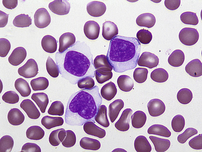

Figure 33-45 

B cell prolymphocytic leukemia typically shows high white blood cell count, large lymphocytes with moderately abundant cytoplasm, and prominent nucleoli, although variability is noted (1000×). 

 

##  Splenic Marginal Zone Lymphoma 

Splenic marginal zone lymphoma (SMZL) has many clinical, laboratory, and morphologic features similar to HCL and features similar to SLL/CLL (  Swerdlow et al, 2008  ). The disease is more common in men than in women. Patients are often in their seventh decade of life when they present with splenomegaly. 

In the spleen, the neoplastic infiltrate expands from the white pulp into the red pulp. Some patients (≈ ) show a small monoclonal gammopathy, usually IgM. The BM may demonstrate patchy infiltrates or massive involvement. The tumor arises from splenic marginal zones, which in reactive processes are seen as an outer zone of pale lymphocytes with moderately abundant cytoplasm surrounding the white pulp and imparting a target-like appearance. In some cases, reactive follicles with germinal centers are present, and an expanded marginal zone surrounds the white pulp and involves the red pulp. Marginal zone hyperplasia may mimic this disorder. Other cases show predominantly red pulp involvement ( [ Figs. 33-46 ](<#f0235>) and [ 33-47 ](<#f0240>) ). Red cell lakes are not present, and lymph nodes are not characteristically involved. The tartrate-resistant acid phosphatase (TRAP) stain is usually negative, although positive reactions have been recorded. 

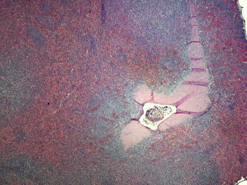

Figure 33-46 

Splenic marginal zone lymphoma showing mild white pulp expansion and patchy red pulp involvement (100×). 

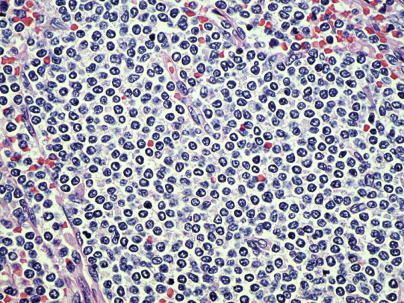

Figure 33-47 

Higher-power view of splenic red pulp involvement by monocytoid splenic marginal zone cells in splenic marginal zone lymphoma (200×). 

The immunophenotype is mature B cell with surface IgM/IgD (similar to SLL/CLL), positive CD20, CD79, and other pan–B cell markers. CD5, CD10, CD23, cyclin D1, CD103, annexin A1, and CD43 are characteristically negative. 

Immunoglobulin genes are clonally rearranged, and half of cases show somatic mutations, most frequently in _NOTCH2_ (  Baliakas et al, 2014  ;  Parry et al, 2013  ). Translocation/loss of 7q21-32 is noted in 40% of cases, and trisomy 3q in some. Bcl-2 is variable. 

SMZL is indolent but has shown poor response to therapy. New approaches utilizing chemotherapy combined with anti-CD20 therapy appear promising (  Arcaini et al, 2004  ). 

 

##  Hairy Cell Leukemia 

Bouroncle (1958) initially described this disorder, which is clinically variable in its manifestations. HCL occurs more frequently in males than in females. The mean age of afflicted patients is 50 years. It has an insidious onset and is characterized by proliferation of abnormal cells in the reticuloendothelial organs and blood. Splenomegaly is the predominant physical finding (  Foucar et al, 2008  ). Pancytopenia or depression of only two cell lines is the usual finding, with variable numbers of hairy cells. Monocytopenia is characteristic, and hairy cells are usually infrequent in the blood, although they may result in leukocytosis. In most cases, BM aspiration is difficult. Marrow biopsy shows a marrow that varies in cellularity, often having both hypocellular and hypercellular areas and reticulin fibrosis. Hypocellular cases of HCL occur and mimic aplastic anemia. Morphologically, the cells are medium sized (10 to 20 µm in diameter) with round to oval nuclei, although many are notched or dumbbell or bean shaped. The chromatin pattern is usually uniformly reticular, and nucleoli are small and inconspicuous. In some cells, chromatin is more condensed, resembling that of a lymphocyte. The cytoplasm is moderate in amount, is light blue-gray, and exhibits numerous hairlike projections and frayed borders, most prominent on electron micrographs ( [ Fig. 33-48 ](<#f0245>) ). 

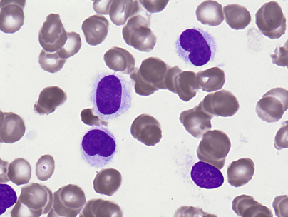

Figure 33-48 

Hairy cell leukemia shows lymphoid cells with foamy cytoplasm and cytoplasmic projections, and oval or indented nuclei with reticular chromatin (1000×). 

In marrow sections, cells with small central nuclei, abundant cytoplasm, and reticulin fibrosis produce a characteristic fried-egg appearance, which may resemble erythroid islands when involvement is not extensive ( [ Fig. 33-49 ](<#f0250>) ). Chromatin is usually more delicate and nuclei more irregular than in erythroid precursors. In small or poorly preserved biopsies, HCL may be mistaken for large B cell lymphoma. 

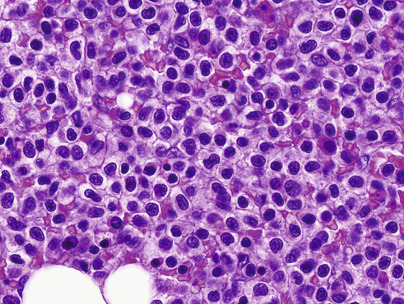

Figure 33-49 

Hairy cell leukemia in a bone marrow biopsy shows small nuclei with moderate cytoplasm and distinct cytoplasmic boundaries (500×). 

Splenectomy specimens are usually diagnostic, with red pulp infiltrates of cells similar to those in the marrow. In addition, the cells tend to line splenic sinuses, obliterating the endothelium and producing red cell “lakes,” which lack visible endothelium. Lymph nodes may show paracortical infiltrates, and the liver may show sinus infiltration. 

Cytochemically, these cells contain acid phosphatase, which is resistant to inhibition by tartrate-resistant acid phosphatase; this is in contrast to the isoenzymes of acid phosphatase present in other hemic cells (  Yam et al, 1971  ). 

Immunophenotype is mature B cell (CD19, CD20, CD22, CD79a, DBA.44, FMC-7, and surface membrane immunoglobulin [SMIg]) with expression of hairy cell–associated markers CD103, CD25, CD11c, annexin A1 (ANXA1), and (dim) cyclin D1 (  Falini et al, 2004  ). Cells are negative for CD5, CD10, and CD23. Immunoglobulin heavy and light chain genes are rearranged, with somatic mutation of V gene regions. HCL shows consistent _BRAF_ V600E mutation (  Tiacci et al, 2011  ;  Waterfall et al, 2014  ). 

The clinical course is usually chronic but may be acute or subacute. Median survival is between 5 and 6 years. Traditionally, splenectomy has offered significant benefit to many patients. Treatment with α-interferon provided the first chemotherapy remissions, but 2′-deoxycoformycin and 2-chlordeoxyadenosine now produce more durable remissions. 

 

##  Splenic B Cell Lymphoma/Leukemia, Unclassifiable 

 

##  Splenic Diffuse Red Pulp Small B Cell Lymphoma 

This is a lymphoma of small B cells with diffuse splenic red pulp involvement and involvement of BM sinusoids and blood. At least some cases were previously referred to as _splenic lymphoma with circulating villous lymphocytes_ due to circulating neoplastic cells with short cytoplasmic villi, often with a polar distribution ( [ Fig. 33-50 ](<#f0255>) ). Neoplastic lymphocytes show clumped chromatin and moderate basophilic cytoplasm. Patients have massive splenomegaly but often low levels of lymphocytosis. Neoplastic cells may circulate in the blood, even in the absence of marrow involvement. The phenotype is B cell with expression of DBA.44 and surface IgG, but usually absent CD103 and absent Annexin A1. 

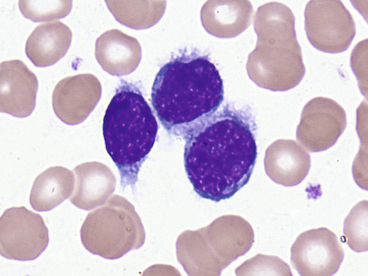

Figure 33-50 

Villous lymphocytes (1000×). 

 

##  Hairy Cell Leukemia Variant 

Most cases of hairy cell variant (HCL-v) are described as lymphoproliferative disorders resembling HCL but with high WBCs and the presence of prominent nucleoli (  Sainati et al, 1990  ), and not closely related biologically. These cases have morphology and clinical features intermediate between HCL and PLL ( [ Fig. 33-51 ](<#f0260>) ). Response to chemotherapy is poor, but the clinical course is chronic, and remission may be attained with splenectomy. TRAP and CD103 are variable, and CD25 and Annexin A1 are usually negative. A very rare form of variant HCL has been described, mostly in Japanese patients, and is referred to as _Japanese variant_ . This disorder shows slightly more prominent nucleoli than typical HCL, but less so than prolymphocytoid variants, also variable CD103 and TRAP, negative CD25, and usually lack of surface Ig. It shows clonal rearrangement of Ig genes and must be distinguished from polyclonal B cell lymphocytosis with similar morphology. Many cases of HCL-v exhibit _MAP2K1_ mutations (  Waterfall et al, 2014  ). 

Figure 33-51 

Hairy cell leukemia (HCL) variant shows morphology intermediate between usual HCL and prolymphocytic leukemia. 

 

##  Lymphoplasmacytic Lymphoma 

Lymphoplasmacytic lymphoma (LPL), a term derived from the Kiel classification (  Stansfeld et al, 1988  ), refers to tumors of small lymphocytes with plasmacytoid differentiation and plasma cells, secretion of a monoclonal IgM paraprotein, and lack of CD5 expression. They usually involve BM, lymph nodes, and spleen ( [ Fig. 33-52 ](<#f0265>) ). 

Figure 33-52 

Lymphoplasmacytic lymphoma involving the marrow, with associated Waldenström's macroglobulinemia. 

Lymphocytes, plasma cells, plasmacytoid lymphocytes, and a rare Dutcher body _(upper right)_ can be seen (1000×). 

Lymph nodes show diffuse infiltrates of lymphocytes, plasmacytoid lymphocytes, and plasma cells. Proliferation centers are not present, and monocytoid B cells are not seen. The infiltrate may be paracortical with sparing of sinuses. PAS-positive inclusions are often seen in the cytoplasm, and Golgi-centered inclusions frequently invaginate into the nucleus of the lymphoid cells, forming **Dutcher bodies.** Tissue mast cells are frequently increased. 

The BM usually shows nodular and/or diffuse interstitial infiltrates of similar cells. Blood involvement may be present, but with lower WBCs than CLL. 

The immunophenotype shows B cell markers CD19, CD20, CD22, and CD79a with bright surface and cytoplasmic IgM (occasionally IgG or IgA) but not IgD, and a monoclonal κ or λ light chain. It differs from CLL by absence of CD5 and bright immunoglobulin expression. CD10 and CD23 are also negative; CD38 is positive, and CD43 is variable. 

Ig heavy and light chain genes are clonally rearranged, and there is somatic mutation of variable regions, consistent with a postantigen selection (postgerminal center) state of maturation and differing from CLL (  Swerdlow et al, 2008  ). 

_MYD88_ L265P mutation has emerged as a defining genetic feature of LPL, and _CXCR1_ mutations also occur (  Hamadeh et al, 2015  ;  Patkar et al, 2015  ;  Treon et al, 2014  ;  Varettoni et al, 2013  ). Del6q21 and trisomy 4 are frequent in LPL, and trisomies 3 and 18 and other abnormalities are sporadically reported. 

The term **Waldenstr öm's macroglobulinemia (WM) ** refers to LPL with BM involvement and a monoclonal IgM paraprotein. It has a peak incidence between 60 and 70 years of age. Symptoms of increased viscosity include visual disturbances, neurologic symptoms, impaired kidney function, and congestive heart failure. Hemorrhagic phenomena may occur as the result of interference of complexes with platelets and clotting factors. Cryoglobulinemia occurs somewhat more frequently than with myeloma and often results in Raynaud's phenomenon. 

Normochromic, normocytic anemia is sometimes associated with thrombocytopenia or pancytopenia. Relative or slight absolute lymphocytosis is usually found. Marked rouleaux formation is evident on the blood film, and the sedimentation rate is usually extremely rapid, although it may be low if macrocryoglobulins are present and the test is carried out at a lower temperature. Anemia is occasionally hemolytic with a positive Coombs' test. Some cases of WM may be due to marginal zone lymphoma, but diagnostic test for _MYD88_ mutation will likely clarify this possibility. 

 

##  Heavy Chain Diseases 

A small number of patients produce and excrete heavy chain fragments without associated light chains (  Bianchi et al, 2014  ). Some of these proteins show structural mutations. The classification of associated lymphoproliferative disorders is somewhat ambiguous. Lymphoproliferative disorders associated with γ heavy chain disease often resemble LPL or plasmacytoma; µ heavy chain disease may resemble CLL, and α heavy chain disease is associated with MALT lymphoma. 

 

##  γ Heavy Chain Disease 

γ heavy chain disease (HCD) is a lymphoproliferative disorder characterized by secretion of a truncated γ-chain without light chain binding sites. It presents with lymphadenopathy, hepatosplenomegaly, fever, and propensity to infection. Anemia is constantly present, often with leukopenia and thrombocytopenia. Atypical lymphocytes or plasma cells are frequently present in the blood, and a few cases have terminated in plasma cell leukemia. The marrow is usually abnormal, with increased plasma cells, lymphocytes, and eosinophils. A rather broad serum protein “spike” has been found in the βγ-region in most patients, accompanied by hypogammaglobulinemia. The diagnosis is made by showing that the protein reacts on immunoelectrophoresis with antisera to γ-chains but not to light chains. The protein is also found in urine in varying amounts, although concentration techniques may be necessary to demonstrate it. 

 

##  α Heavy Chain Disease 

α heavy chain disease appears to be more common than γ-HCD and involves a younger age group. The uniform clinical pattern in most patients is malabsorption and diarrhea accompanying a massive lymphoplasmacytic infiltration of intestinal mucosa, sometimes evolving to large B cell lymphoma. It has also been referred to as Mediterranean abdominal lymphoma and immunoproliferative small intestinal disease (IPSID). In a few patients, the respiratory tract has been involved instead. BM and other lymphoid organs have not been involved. Usually, routine protein electrophoresis is negative, but small amounts of α-chain may be detected in the serum and sometimes in the urine with immunoelectrophoresis. The abnormal protein does not contain light chains. It is most common in Mediterranean areas and is associated with poor living conditions in low socioeconomic groups. Similar to MALT lymphoma, many cases may initiate an infectious antigen-driven proliferation. 

 

##  µ Heavy Chain Disease 

The few patients who have been described with µ heavy chain disease have had chronic lymphocytic leukemia with vacuolated plasma cells in the marrow. Routine serum electrophoresis showed only hypogammaglobulinemia. The µ heavy chain was detected by serum immunoelectrophoresis; it was not found in the urine. In most patients, however, the urine contained κ light chain in large amounts (  Franklin, 1975  ). 

 

##  Plasma Cell Neoplasms 

Clonal neoplasms of mature plasma cells are common neoplasms that have been difficult to treat and are greatly feared. They are now known, however, to consist of a spectrum of disease varying from indolent and nonprogressive to highly aggressive and refractory to therapy. The best measures of disease course are the clinical findings themselves, and treatments using new agents are rapidly evolving to increase efficacy and improve outcome. Major categories now are monoclonal gammopathy of undetermined significance, smoldering or asymptomatic myeloma, and symptomatic myeloma ( [ Box 33-13 ](<#b0070>) ). 

Box 33-13 

Diagnostic Criteria for Monoclonal Gammopathy of Undetermined Significance, Indolent and Smoldering Myeloma, and Plasma Cell Myeloma 

 

##  Monoclonal Gammopathy of Undetermined Significance 

  * M-protein in serum <30 g/L 

  * Marrow plasmacytosis <10% 

  * No lytic bone lesions 

  * No myeloma-related symptoms (no CRAB) 

 

##  Asymptomatic (Smoldering) Myeloma 

  * Serum M-component >30 g/L 

  * Marrow plasmacytosis >10% 

  * No organ or tissue impairment (no CRAB) 

 

##  Plasma Cell Myeloma 

  * M-protein in serum or urine (no specific level needs to be met) 

  * Bone marrow clonal plasma cells 

  * Organ or tissue impairment (CRAB) 

_CRAB,_ Hypercalcemia, renal insufficiency, anemia, or bone lesions. 

 

##  Monoclonal Gammopathy of Undetermined Significance 

Monoclonal gammopathy of undetermined significance is the term utilized when a monoclonal serum immunoglobulin is present but no myeloma is detectable. Most cases (75%) are IgG, with smaller proportions of IgM (15%) and IgA (10%). It is a preneoplastic condition with progression to myeloma in about 1% of affected patients per year. The condition consists of a monoclonal Ig (M-component) of <30 g/L IgG, <10% clonal plasma cells in the marrow, absence of lytic bone lesions, no melanoma-related organ or tissue impairment (CRAB: hypercalcemia, renal insufficiency, anemia, or bone lesions), and no evidence of other B cell lymphoproliferative disorder. Cytogenetic and immunophenotypic abnormalities are similar to those in myeloma, and none is known to be predictive of progression (  Landgren, 2013  ). 

 

##  Plasma Cell Myeloma 

Plasma cell myeloma is a neoplastic proliferation of plasma cells, occurring primarily in the BM. Although plasma cells also proliferate in lymph nodes and spleen, these organs are rarely enlarged. Symptomatic myeloma is defined by the WHO 2008 classification as the presence of M-protein in serum or urine, BM clonal plasma cells or plasmacytoma, and the presence of CRAB. 

Multiple myeloma is rare in those younger than 40 years of age. The mean age at the time of diagnosis is 62 years with an equal sex distribution. Bone pain is the most common symptom, and pathologic fractures are frequent. Neurologic symptoms may be prominent from encroachment of tumor that has broken through the bony cortex on spinal nerves or spinal cord. Bone destruction leads to calcium mobilization, with increased calcium in the serum and metastatic calcification. Growth of myeloma cells in the marrow produces multiple tumors, which appear on a radiograph as multiple punched-out osteoporotic lesions; occasionally, the growth is diffuse and appears as diffuse osteoporosis. A propensity to infection is common because of impaired production of antibodies. 

There is usually normochromic, normocytic anemia, and normoblasts may be present in the blood. The leukocyte count is slightly decreased, normal, or slightly increased. Occasionally a myeloid left shift to the myeloblast may be noted. The platelet count is usually normal but may be decreased. The most striking feature of the blood film is the marked degree of rouleaux formation. 

The BM shows the presence of plasma cells or myeloma cells, ranging from less than 1% to over 90%, depending on the degree of involvement at the site of the aspirated marrow. Diagnosis of myeloma and its variants is based on both pathology and clinical findings, including serum monoclonal immunoglobulin and radiologic evidence of lytic bone lesions. Lytic bone lesions are associated with increased osteoclastic activity, hypercalcemia, and neurologic changes. This may be related to activity of the receptor activator for NF κB (RANK) ligand. 

Cytologically, the cells may be indistinguishable from normal plasma cells, but they usually show abnormal chromatin, with less clumping of nuclear chromatin, large nucleoli, lack of perinuclear clear zones, lighter blue cytoplasm, or varying degrees of anaplasia ( [ Fig. 33-53 ](<#f0270>) ). Immature, plasmablastic, and anaplastic variants are described. 

Figure 33-53 

Myeloma in the bone marrow showing large plasma cells with nucleoli (1000×). 

The immunophenotype is variable, most typically with expression of CD38 and CD138, loss of CD19 expression (normally present on plasma cells), and absence of CD20, but with abnormal acquisition of CD56 and often CD117. Immunohistochemical labeling or mRNA in situ hybridization of BM sections for κ and λ usually identifies monoclonal plasma cells. Cyclin D1 expression is associated with t(11;14). 

Cytogenetic analysis divides myeloma into two main groups: hyperdiploid with multiple trisomies involving odd-numbered chromosomes and associated with good prognosis; and hypodiploid associated with adverse prognosis. Karyotype and FISH studies show frequent del13q14 (50% of cases), translocations t(4;14) with associated overexpression of _MSET_ and _FGFR3,_ t(14;16) with associated _MAF_ overexpression, t(14;20), or deletion of TP53 (del 17p13) that, along with aneuploidy, are unfavorable. In contrast, t(11;14) or t(6;14) are favorable. Losses of 8, 13, 14, and X are common. Biologic features may be used for prognostic grouping and to identify therapeutic targets (  Landgren & Morgan, 2014  ;  Vincent Rajkumar, 2014  ;  Zhou et al, 2009  ). 

Serum globulin is usually increased, often strikingly so. This increase is responsible for the tendency toward rouleaux formation and an elevated ESR. Serum protein electrophoresis usually shows an M-spot, a homogeneous band in the γ\- or β-region; less commonly, there is hypogammaglobulinemia (when only light chains are produced by the neoplastic plasma cells). Immunoelectrophoresis indicates that the monoclonal protein is IgG in over 50% of cases, IgA in about 20%, IgD in less than 1%, and IgE very rarely. Roughly 5% of myeloma proteins are cryoglobulins, that is, proteins that precipitate from cooled serum and redissolve on warming. Some tumors secrete free monoclonal light chains (Bence Jones protein), in addition to the whole immunoglobulin molecule, and in about 25%, only light chains are produced. Hypogammaglobulinemia is found in the latter group because light chains are filtered through the renal glomerulus, leaving little or none in the serum, in addition to the fact that immunoglobulin production by nonmalignant plasma cells is greatly reduced. If renal damage has occurred, albumin and whole immunoglobulin molecules are also found in the urine. Excretion of light chains sometimes results in obstruction and loss of nephrons and so-called _myeloma kidney._ Renal insufficiency is common and is the presenting feature of multiple myeloma in some cases. Amyloidosis, which is present in about 10% to 15% of cases of multiple myeloma, may be a factor in renal failure. 

Median survival after diagnosis of multiple myeloma has been approximately 3 to 4 years, but new drugs are likely altering this. 

 

##  Clinical Variants 

 

##  Asymptomatic (smoldering) myeloma. 

Smoldering myeloma shows M-protein at myeloma levels (>30 g/L) and/or 10% or more clonal plasma cells in the marrow with no related organ/tissue impairment (CRAB). Patients with solitary plasmacytoma and bone lesions detected only by magnetic resonance imaging (MRI) are included. These asymptomatic patients differ from those with MGUS primarily by a higher rate of progression: 10% per year for the first 5 years, 3% for the next 5 years, and then 1% per year (  Landgren, 2013  ). 

 

##  Nonsecretory myeloma. 

These patients are similar to others with myeloma, except that tumor cells do not produce (15%) or secrete (85%) immunoglobulin. The incidences of renal insufficiency, hypercalcemia, and depression of normal Ig are less. 

 

##  Plasma cell leukemia. 

Often in multiple myeloma, a few plasma cells are found in the peripheral blood. Only in the rare instances of myeloma in which large numbers of plasma cells circulate (either >20% of blood leukocytes, or >2 × 10  9  /L) is the term _plasma cell leukemia_ used ( [ Fig. 33-54 ](<#f0275>) ). Patients with plasma cell leukemia tend to have tissue infiltration, advanced-stage disease, and poor survival (  Fernandez de Larrea et al, 2013  ). The immunophenotype varies from usual myeloma in that CD56 is often absent. 

Figure 33-54 

Plasma cell leukemia with cells resembling immunoblasts (1000×). 

 

##  Solitary plasmacytoma of bone. 

These patients show no clinical features of myeloma but may have a monoclonal immunoglobulin without suppression of normal immunoglobulin. Tumors are controlled by radiation, but two thirds of cases eventually progress to myeloma. 

 

##  Extraosseous plasmacytoma. 

Extramedullary solitary plasmacytomas occur in the GI tract, bladder, CNS, breast, thyroid, testis, parotid gland, lymph nodes, or skin, and are irradiated. They recur in one quarter of patients but progress to myeloma in only about 15%. 

 

##  Monoclonal Immunoglobulin Deposition Diseases 

 

##  Primary Amyloidosis 

Primary amyloidosis, an uncommon presentation of plasma cell neoplasms of various types, results from abnormal polymerization of immunoglobulin into β-pleated sheets in connective tissue. A variety of amyloid types occur, including hereditary, secondary associated with chronic inflammation, the type associated with Alzheimer's disease, and others. All amyloid is biochemically composed of an A protein component and a P component. In plasma cell dyscrasia, the A component is derived from immunoglobulin light (L) chains and is referred to as _AL amyloid._ It may be detected by homogeneous pink staining of thickened blood vessels in abdominal fat, BM, rectum, or other tissues. Congo Red stain shows characteristic apple-green birefringence under polarized light. It may also be detected by thioflavin T, antibodies against amyloid P, and antibodies against immunoglobulin light chains. It may involve the heart with subsequent congestive failure, liver with hepatomegaly, kidney with nephrotic syndrome or renal failure, nerves with sensory/motor loss, and other organs. It may occur in overt myeloma (20%), but most often it is seen in patients with disease otherwise fulfilling criteria for MGUS. 

 

##  Monoclonal Light and Heavy Chain Deposition Diseases 

Nonamyloid immunoglobulin deposition may result in organ dysfunction in rare disorders known as _light chain deposition disease (LCDD)_ or _heavy chain deposition disease (HCDD)_ (  Swerdlow et al, 2008  ). 

 

##  Osteosclerotic Myeloma 

This is a syndrome of polyneuropathy, organomegaly, endocrinopathy, monoclonal gammopathy, and skin changes (POEMS) associated with osteosclerotic multiple myeloma showing marrow fibrosis and sclerosis, and with lymph node changes resembling plasma cell Castleman's disease. The plasma cells usually express λ light chain, and heavy chain is IgG or IgA. 

 

##  Extranodal Marginal Zone B Cell Lymphoma of Mucosa-Associated Lymphoid Tissue 

Extranodal marginal zone B cell lymphoma of mucosa-associated lymphoid tissue is an indolent lymphoma of mucosal tissue, including stomach, other GI tract, bronchi, salivary glands, thyroid, skin, and other areas. MALT lymphoma of the stomach is in many cases an antigen-driven clonal B cell proliferation related to infection by _Helicobacter pylori,_ which is also associated with gastric ulcer; early cases may respond to antibacterial therapy. Other patients have autoimmune disorders such as Sjögren's syndrome or Hashimoto's thyroiditis. The terminology of MALT lymphomas refers only to those of predominantly small cells, although large cell and other aggressive lymphomas may arise in the same tissues. α heavy chain disease, or IPSID, is considered a special subtype of this disease (see earlier). 

Gastric or other mucosa is infiltrated by small lymphocytes that form clusters within the epithelium, referred to as _lymphoepithelial lesions_ ( [ Fig. 33-55 ](<#f0280>) ). Submucosa contains diffuse infiltrates of small lymphocytes, centrocytes, monocytoid lymphocytes, and plasma cells. Germinal centers, apparently reactive to the entire process, are usually present. Plasma cells often are abundant at the periphery of the lesions and generally are monoclonal. 

Figure 33-55 

Mucosa-associated lymphoid tissue lymphoma with nests in lymphocytes in gastric epithelium (500×). 

The immunophenotype is B cell (CD19, CD20, CD22, CD79a) with surface Ig. CD5, CD10, bcl-6, and usually CD23 are negative. Bcl-2 is frequently positive, and CD43 is variable. Follicular dendritic cell–associated markers CD21 and CD35 often reveal expanded follicular meshworks and colonized germinal centers. Ig genes are clonal with somatic mutations. Trisomies 3 and 18 occur frequently. Translocation 11;18 creates an _API2-MALT1_ fusion and occurs in gastric MALT tumors not responsive to _H. pylori_ treatment. Translocations 1;14 and 14;18 deregulate _BCL10_ and _MALT1_ , respectively. Each translocation deregulates NfKappaB (  Isaacson, 2005  ). These tumors are typically indolent with good response to radiation therapy. 

 

##  Nodal Marginal Zone Lymphoma 

These tumors are derived from post–germinal center marginal zone B cells and show small lymphocytes surrounding reactive follicles and expanding in the interfollicular zones. They may resemble nodal involvement by MALT lymphoma or splenic marginal zone lymphoma ( [ Fig. 33-56 ](<#f0285>) ). Germinal center colonization is frequent, as are plasma cell differentiation and occasional eosinophilia. Increased large cells may be present and do not apparently affect prognosis, although transformation to diffuse large B cell lymphoma may occur. 

Figure 33-56 

Nodal marginal zone lymphoma showing a nodule of monocytoid B cells (200×). 

The immunophenotype is similar to MALT or SMZL, with surface Ig (IgM/IgD, IgM, less often IgA or IgG), B cell markers (CD19, CD20, CD22, CD79a), expression of CD23, variable CD43, and absence of CD5 or CD10. Bcl-2 is expressed in a majority of cases, and survivin is overexpressed in about 50%, suggesting activation of antiapoptotic pathways. Nodal MZL is heterogeneous at the molecular and immunohistochemical levels (  Camacho et al, 2003  ). Ig heavy and (monotypic) light chain genes are rearranged. Trisomies 3, 7, and 18 may occur, and 5-year survival is greater than 50%. 

 

##  Pediatric Nodal Marginal Zone Lymphoma 

A clinical subtype of nodal marginal zone lymphoma occurs in the pediatric age group, usually in boys, with localized lymphadenopathy of the head and neck. Tumors contain progressively transformed germinal center and resemble reactive lymphadenopathy, but show clonal immunoglobulin gene rearrangement. Children have excellent outcomes with conservative treatment. 

 

##  Follicular Lymphoma 

Follicular lymphoma (FL) is a group of related lymphomas of germinal center–derived B cells. Morphologic distinction between the subgroups is based on the numbers of centroblasts in the neoplastic follicles (  Harris et al, 2011  ). 

The overall morphologic pattern ( [ Fig. 33-57 ](<#f0290>) ) shows recapitulation of lymph node follicles, but with limited diversity of cell type and lack of proliferation of other lymph node structures. The tumors generally show crowded follicles of more than usual uniformity, lacking distinct mantles and with little intervening paracortex, and lacking normal germinal center **tingible body** macrophages and polarization. Most often, small irregular cells (small cleaved cells or centrocytes) predominate with variable numbers of admixed large cells (large cleaved and noncleaved cells or centroblasts). There may be diffuse infiltrates as well. The term **follicular** indicates a greater than 75% follicular pattern; **follicular and diffuse** refers to cases that are 25% to 75% follicular; **focally follicular** refers to cases with less than 25% follicular pattern; and **diffuse** indicates that no follicular component is present ( [ Table 33-6 ](<#t0035>) ). BM involvement is frequent and usually first involves the paratrabecular regions, often in a spotty fashion. 

Figure 33-57 

Low-power view of follicular lymphoma, recapitulating lymph node germinal centers (200×). 

TABLE 33-6 

Follicular Lymphoma: Grading and Variants 

Grading  |  Definition   
---|---  
Grade 1  |  0-5 centroblasts per hpf   
Grade 2  |  6-15 centroblasts per hpf   
Grade 3  |  >15 centroblasts per hpf   
3a  |  Centrocytes present   
3b  |  Solid sheets of centroblasts   
**Reporting of Pattern** |  **Proportion Follicular** [ * ](<#hl0001046>)  
Follicular  |  >75%   
Follicular and diffuse  |  25%-75%   
Focally follicular  |  <25%   
**Follicular Lymphoma: Variants**  
Diffuse large B cell lymphoma with follicular lymphoma  |  Presence of diffuse areas with >15 centroblasts per hpf   
  
_hpf_ , High-power field of 40× lens with 10 × 18-mm eyepiece or 50× lens with 10 × 22-mm eyepiece (average of 10 fields within follicles). 

From Swerdlow S, Campo E, Harris N, editors: _WHO classification of tumours of haematopoietic and lymphoid tissues_ , ed 4, Lyon, France, 2008, IARC. 

 * Give approximate percentage in report. 

Cytologic grading is based on the average number of centroblasts (CBs) per high-power field (hpf) within neoplastic follicles ( [ Figs. 33-58 ](<#f0295>) and [ 33-59 ](<#f0300>) ). It is now recommended that grades 1 and 2 be combined into grade 1-2. An hpf is defined as that with a 40× lens and a 10× ocular with an 18-mm field of view. A 50× lens with a 22-mm 10× ocular, often used in wet hematology, provides a nearly equivalent field of view. 

Figure 33-58 

Follicular lymphoma, grade 2, showing centrocytes with 5 to 15 centroblasts per high-power field (hpf). 

Grade 1 shows <5 centroblasts per hpf. 

Figure 33-59 

Follicular lymphoma, grade 3a, shows centrocytes with >15 centroblasts per high-power field (hpf) (500×). 

Marginal zone or monocytoid B cell differentiation occurs in up to 10% of cases. It usually appears around follicles and in interfollicular areas and resembles a composite lymphoma. FL shows an immunophenotype of mature B cells with bright monoclonal surface Ig, CD19, CD20, CD22, CD23, CD79a, and CD10 expression. Bcl-2 (cytoplasmic) and bcl-6 (nuclear) are both usually expressed, which helps to separate FL from reactive hyperplasia (bcl-2–negative/bcl-6–positive) and other lymphomas not of germinal center cell (GCC) derivation (bcl-6–negative). CD5 and CD43 are typically absent. 

IgH is clonally rearranged along with a light chain Ig gene, and there is t(14;18)(q32;q21) with juxtaposition of IgH and _BCL-2_ . Bcl-2 protein is inappropriately expressed, and subsequent inhibition of apoptosis is considered a primary pathogenic mechanism of FL. Deletions of 9p or 17p13 involving TP53 (both associated with large cell transformation) may be seen, and rearrangements or mutations of _BCL6_ at 3q27, and abnormalities of X, 1, 2, 4, 5, 7, 12, 13, and 18. Genomic studies show driver mutations of chromatin regulators _KREB2, EZH2, KMT2D (MLL2),_ and mutations occurring at time of transformation in _EBF1_ , _MYD88,_ and _TNFAIP3_ (  Okosun et al, 2014  ). 

Prognosis is variable, with grade 1 and 2 disease generally showing an indolent course but lack of cure. Grade 3 is more aggressive but likely more curable. Attempts to identify patients requiring aggressive therapy have led to a follicular lymphoma international prognostic index (FLIPI) based on age, stage, hemoglobin, number of nodal areas involved, and LDH. Diffuse large B cell lymphoma (DLBCL) is considered by WHO authors to be a different entity even when it arises in FL (  Swerdlow et al, 2008  ). In these situations, two diagnoses are recommended, such as “follicular lymphoma, grade 3/3 (75%), with diffuse large B cell lymphoma (25%),” when the DLBCL occupies 25% of the sampled tumor. Leukemic involvement by FL may also occur and is sometimes known as **lymphosarcoma cell leukemia.** Flow cytometry is helpful to distinguish between that, CLL, and leukemic mantle cell or marginal zone lymphomas. 

Diffuse follicular lymphoma is essentially a diffuse transformation of grade 1 or 2 FL. Diagnosis requires phenotyping and/or cytogenetic studies to rule out mantle cell or marginal zone lymphoma, and includes previous categories of diffuse small cleaved cell, centrocytic diffuse, diffuse mixed small cleaved, and large cell and centrocytic/centroblastic diffuse. 

Follicular lymphoma occurring in the pediatric age group (pediatric follicular lymphoma) is a distinct entity that usually lacks t(14;18) or bcl-2 expression and behaves in an indolent fashion. Most cases are grade 3. Primary intestinal follicular lymphoma may occur in duodenal polyps and is usually indolent, as are many other extranodal follicular lymphomas. Intrafollicular in situ follicular lymphoma of bcl-2–positive follicle cells has been described. 

 

##  Primary Cutaneous Follicle Center Lymphoma 

This is the most common primary cutaneous B cell lymphoma and consists of variably distinct follicular to diffuse lesions in the dermis composed of bcl-6/CD20/CD79a–positive centrocytes and admixed centroblasts, with a background of CD21/CD35 positive follicular dendritic cells. Bcl-2 is usually negative, and CD10 is associated with more distinct follicular patterns. A bcl-2–positive follicular lymphoma in the skin suggests extension of disease from another location. Prognosis is excellent with typical response to radiation. 

 

##  Mantle Cell Lymphoma 

Since the REAL classification was published, it has become recognized that mantle cell lymphoma (MCL) is a dangerous form of lymphoma that combines refractoriness to therapy with an aggressive clinical course and poor survival. Refractoriness is likely due in part to strong expression of Bcl-2, also seen in normal mantle cells, follicular lymphomas, and some other leukemias, lymphomas, and solid tumors. Bcl-2 inhibits apoptotic pathways. 

The tumor usually shows a diffuse or sometimes mantle zone pattern (  Swerdlow et al, 2008  ). In the mantle zone pattern, atrophic germinal centers are often seen in the center of nodules, and these may be seen as occasional small naked follicles within a diffuse infiltrate. Nuclei are small to medium sized with clumped to moderately dispersed chromatin and a moderately increased mitotic rate. Nuclear membranes are typically slightly irregular with occasional small round and cleaved nuclei also present. Scattered histiocytes with lightly eosinophilic cytoplasm are often present. A blastic or “blastoid” variant shows slightly larger nuclei with blastlike chromatin and a higher mitotic rate, simulating lymphoblastic lymphoma ( [ Fig. 33-60 ](<#f0305>) ). 

Figure 33-60 

Mantle cell lymphoma, showing an expanded mantle around residual germinal center. 

These are monoclonal (monotypic surface IgM and IgD) B cells (CD19, CD20, CD22) with characteristic coexpression of CD5 (and CD43) and absence of CD23 or CD200. Bcl-2 and cyclin-D1 are expressed, while bcl-6 and CD10 are negative. Rare cases occur without CD5 expression or without cyclin D1. SOX11 is a useful marker for cyclin D1–negative cases and SOX11-negative MCL may be more indolent than usual MCL. 

Immunoglobulin heavy and (monotypic) light chain genes are rearranged. A majority of cases have t(11;14)(q13;q32) involving the Ig heavy chain gene and bcl-1 with overexpression of PRAD-1, which encodes cyclin-D1. The t(11;14) translocation is usually detected by FISH. Complex karyotype, p16 deletion or p53 deletion is often seen in advanced, blastoid or pleomorphic variants. Secondary 8q24 abnormalities, sometimes included among “double hit” lymphomas, are associated with blastic/blastoid morphology and leukemic presentation (  Setoodeh et al, 2013  ;  Vose, 2013  ). BCL-2 rearrangements are absent. 

 

##  Diffuse Large B Cell Lymphoma, NOS 

DLBCL includes a variety of morphologies, all of which share a diffuse pattern, large cells, and mature B cell phenotype (  Swerdlow et al, 2008  ). It occurs in both nodal and extranodal sites and at all ages. It is frequent in immunosuppressed patients (often in association with EBV in these) and is the most common lymphoma of the CNS. Various morphologies are mimicked by peripheral T cell lymphomas, and phenotyping is required for diagnosis. 

DLBCL presents with diffuse infiltration by large B cells (nuclei larger than histiocytes or endothelial cell nuclei) with variable morphology. They may be centroblasts and/or centrocytes with scant cytoplasm and multiple nucleoli (centroblastic morphologic variant) ( [ Fig. 33-61 ](<#f0310>) ). Some cases show plasmacytoid immunoblasts with large nuclei, one or more prominent nucleoli, and abundant amphophilic cytoplasm that may be eccentric (immunoblastic variant). Other cases of DLBCL show polymorphic cell morphology with large and small cells and Reed-Sternberg–like giant cells (anaplastic variant) ( [ Fig. 33-62 ](<#f0315>) ). Still others occasionally show large cells with clear cytoplasm. 

Figure 33-61 

Diffuse large B cell lymphoma with centroblasts and admixed centrocytes (500×). 

Figure 33-62 

Diffuse large B cell lymphoma, with polymorphism and Reed-Sternberg–like cells (1000×). 

Neoplastic cells show surface Ig, sometimes cytoplasmic Ig, and B cell markers (CD19, CD20, CD22, CD79a). CD30 is occasionally present in variable numbers of cells. CD20 expression by immunohistochemistry (IHC) is usually very helpful in paraffin-section diagnosis. CD10 and/or BCL6 suggests germinal center differentiation, and IRF4/MUM1 suggests post–germinal center differentiation. 

In DLBCL, Ig heavy and (monotypic) light chain genes are rearranged. Bcl-2 and/or bcl-6 abnormalities and protein expression are frequent (  Skinnider et al, 1999  ;  Capello et al, 2000  ). 

Gene array studies have separated DLBCL into at least four major expression groups; germinal center B cell (GCB), activated B cell (ABC)-like, type 3, and mediastinal large B cell (MLBC) lymphoma. Of the first three, GCB shows better response to therapy than ABC or type 3. _BCL2_ and _BCL6_ are in the gene cluster of GCC-like tumors, and may be surrogates for this category. GC cases frequently show the t(14;18) translocation, deletion of _PTEN_ , amplification of the miR-17-92 cluster, and/or TP53 mutations. _EZH2, MLL2_ and _CREBBP_ mutations are found in over 20%, and _MEF2_ mutations in 12% (  Jardin, 2014  ). ABC type often shows t(3;14) translocation, trisomy 3, deletion of the _INK4A-ARF_ locus, and BCL2 amplification, and shares _MLL2_ mutations with GCB in about 30%. Genomic studies in DLBCL also show frequent abnormalities of DNA methyltransferases ( _DNMT1-3_ ), histone deacetylases and methyltrans­ferases, and transcription repressor _EZH2_ that are targetable with azacytidin, histone deacetylase inhibitors (HDACs), and other targeted drugs (  Cerchietti & Leonard, 2013  ). 

Subgrouping by immunophenotyping roughly follows expression grouping. Cases with CD10 expression (>30% of cells) or CD10-, BCL-6+, and IRF4/MUM1 are considered germinal center types. All others are non–germinal center types. A variety of other specific types of DLBCL are also described by the WHO classification, as follows (  Swerdlow et al, 2008  ). 

 

##  T Cell/Histiocyte-Rich Large B Cell Lymphoma 

T cell/histiocyte-rich large B cell lymphoma (TCHRLBCL) is characterized by a diffuse infiltrate of large B cells scattered among small T cells and histiocytes ( [ Fig. 33-63 ](<#f0320>) ). Large B cells constitute 10% or less of total cells, while T cells constitute the majority (  Tousseyn & De Wolf-Peeters, 2011  ). The neoplastic cells may appear as centroblasts or immunoblasts or resemble lymphocyte and histiocytic (L&H) cells of LPHL, and include Reed-Sternberg–like cells (see [ Fig. 33-62 ](<#f0315>) ). It is often difficult to distinguish it from nodular lymphocyte–predominant HL (NLPHL), but the distinction is important, as this is a usually aggressive tumor that presents with advanced stage, while lymphocyte-predominant HL (LPHL) is often localized and indolent and requires less therapy. The phenotype is similar to LPHL, with CD20, CD79a, and epithelial membrane antigen (EMA) positivity. J-chain, Oct-2, and BOB-1 are also expressed. Surface/cytoplasmic Ig, if monoclonal, is somewhat helpful, but LPHL is also now considered a clonal B cell disease. Helpful distinctions are the diffuse infiltrate, T cell background, lack of CD3/CD57 rosettes around neoplastic cells in a nodular B cell background as seen in nodular LPHL, lack of residual IgD-positive mantle cells, and lack of a follicular dendritic meshwork by CD21/CD23/CD35 staining. Advanced-stage presentation also suggests TCHRLBCL, but rare cases of NLPHL may present with disseminated disease. 

Figure 33-63 

T cell and histiocyte-rich large B cell lymphoma resembles lymphocyte-predominant Hodgkin lymphoma, but is diffuse and most small cells are T cells (500×). 

 

##  Primary DLBCL of the CNS 

CNS DLBCL usually presents in middle age as supratentorial tumors with various neurologic symptoms. Homogeneous to focally necrotic on MRI, they frequently show characteristic perivascular tumor cell accumulations on biopsy. These express pan–B cell markers with BCL-6 and strong IRF4/MUM1 positivity in most and variable BCL-2 expression, and they are typically EBV negative. Tumors typically respond to modern chemotherapy. MYD88 mutations are present in more than 35% (  Jardin, 2014  ). 

 

##  Primary Cutaneous DLBCL, Leg Type 

These are aggressive B cell lymphomas that typically arise in older adults, women more often than men, and often on the lower legs, although they may occur anywhere in the skin. They are composed of monotonous sheets of large B cells with expression of pan–B cell markers, with monotypic Ig, strong BCL2, IRF4/MUM1, and FOX-P1. BCL-6 is usually positive, and CD10 negative. NGS studies show mutations in the _**CD79B, MYD88,** _ and _**CARD11** _ genes (  Jardin, 2014  ). 

 

##  EBV-Positive DLBCL of the Elderly 

These are DLBCLs arising in patients older than 50 years of age and associated with EBV. Histology varies from mostly large cells to a more polymorphic distribution of cell sizes, often geographic necrosis, with EBV demonstrable by antibody staining for EBV LMP-1 and by ISH for EBV-encoded ribonucleotides. CD10 and BCL6 are negative, IRF4/MUM1 is usually positive, and CD30 is frequently expressed. NFkappaB is generally activated (  Ok et al, 2013  ). These aggressive tumors are similar to DLBCL arising in immunosuppressed patients, and a form of age-related immunosuppression is surmised. There is, correspondingly, a spectrum of age-related EBV-associated lymphoid proliferations varying from reactive hyperplasia to overt lymphoma (  Dojcinov et al, 2011  ). 

 

##  DLBCL Associated with Inflammation 

This is another EBV-associated tumor that arises in situations with protracted chronic inflammation, the prototype being pyothorax-associated lymphoma (PAL). Features are similar to EBV+ DLBCL of the elderly. 

 

##  Lymphomatoid Granulomatosis 

This is an angiocentric lymphoproliferative disorder involving the lung and/or other sites, including the brain, kidney, liver, skin, upper respiratory tract, and GI tract (  Katzenstein et al, 1979  ). It is considered to be an EBV-driven B cell neoplasm with a prominent reactive T cell component, sometimes in a setting of immunosuppression (  Katzenstein & Peiper, 1990  ;  Wilson et al, 1996  ). It has histologic features similar to NK/T cell lymphoma of nasal type (  Pittaluga et al, 2008  ). 

Presentation is usually cough, dyspnea, and chest pain with constitutional symptoms, including fever, malaise, weight loss, GI symptoms, myalgias, and neurologic symptoms. Bilateral mid to lower lung nodules are most commonly seen, often with nodules in the brain, kidney, skin, and subcutaneous tissue. 

Histology shows an angiocentric and angiodestructive infiltrate of polymorphic lymphocytes, plasma cells, immunoblasts, and histiocytes, with inconspicuous neutrophils and eosinophils and without well-formed granulomas. Fibrinoid necrosis of vessels is often seen ( [ Fig. 33-64 ](<#f0325>) ), as is tissue infarction. 

Figure 33-64 

Lymphomatoid granulomatosis, showing a polymorphous angiodestructive pulmonary infiltrate (200×). 

(Courtesy Dr. Anna-Luise Katzenstein.) 

Immunophenotyping shows variable numbers of CD79a, usually CD20-positive B cells with EBV LMP-1 and EBER expression, variable CD30, and lack of CD15. A majority of background cells are reactive T cells with CD4 predominance. Higher-grade lesions (with more B cells) show clonal rearrangement of the IgH receptor genes. T cell receptor genes are not clonally rearranged. 

Grading is related to the number of clonal EBV-positive lymphocytes. Grade I lesions are polymorphic with only occasional large cells. Grade II is mixed with large pleomorphic cells in a mixed inflammatory background. Grade III is essentially diffuse large B cell lymphoma. 

Outcome is variable, with waxing and waning, sometimes spontaneous remissions, and often progression to pulmonary failure in a median of 2 years. Appropriate therapy is related to determination of grade. Grade III lesions are treated with systemic chemotherapy, and grades I and II may be treated with α-interferon. 

 

##  Primary Mediastinal (Thymic) Large B Cell Lymphoma 

Primary mediastinal (thymic) large B cell lymphoma (PMBL) often appears in young adulthood to middle age and is more frequent in women. Histology is variable, but diffuse or compartmentalizing sclerosis is frequent, and clear cells, multilobulated cells, or Reed-Sternberg–like cells may be present ( [ Fig. 33-65 ](<#f0330>) ). Symptoms are often related to location, with airway compression or superior vena cava syndrome and often local invasion and local recurrence after therapy. CD45, CD19, and CD20 are expressed, but not CD5 or CD10 (  Swerdlow et al, 2008  ). CD30 is expressed in some cases, but not with the phenotype of classical HL. Ig genes are clonally rearranged; _IgV_ and _Bcl-6_ gene hypermutations are consistent with GCC cell derivation but occur similarly to normal thymic B cells (  Csernus et al, 2004  ). Gene expression array analysis shows MLBCL to be similar to nodular sclerosis classical HL (  Savage et al, 2003  ). Mutations of _PTPN_ 1 are frequent (  Jardin, 2014  ). 

Figure 33-65 

Mediastinal large B cell lymphoma with sclerosis (500×). 

 

##  Intravascular Large B Cell Lymphoma 

Intravascular large B cell lymphoma is a rare tumor that is largely restricted to the intravascular lumina of small vessels (  Swerdlow et al, 2008  ). It is very aggressive, widely disseminated at diagnosis, and often undiagnosed until autopsy. Findings often include hemorrhage, thrombosis, and/or necrosis of tissues throughout the body, with tumor only inconspicuously present in the small vessels. B cell markers are expressed (CD19, CD20, CD22, D79a) and CD5 in some. Rare T cell cases are described. Diagnosis is difficult but may be made from blood by morphology and flow cytometry (  Patel et al, 2014  ). 

 

##  ALK-Positive Large B Cell Lymphoma 

These are diffuse large B cell lymphomas with expression of full-length ALK protein and plasmablastic or anaplastic morphology. Most described cases show t(2;17)(p23;q23) with clathrin gene involvement (CLTL-ALK); other rare abnormalities include t(2;5)(p23;q23), as in typical ALCL. They are of B cell derivation with expression of CD79a but absent CD20 and frequently lack CD30 expression (  Chikatsu et al, 2003  ;  De Paepe et al, 2003  ;  Gascoyne et al, 2003  ). Molecular studies show constitutive STAT3 activation with a plasmablastic differentiation program of BLIMP1, XBP1, and C-Myc expression, but not PAX-5 and without Myc translocation (  Valera et al, 2013  ). 

 

##  Plasmablastic Lymphoma 

Plasmablastic lymphoma shows immunoblastic morphology with expression of plasma cell antigens CD38 and CD138 and is frequently but not always associated with EBV. CD20, CD45, and PAX5 are weak to absent, but CD79a and IRF4/MUM1 are positive. There is cytoplasmic IgG. It has an aggressive behavior and has been reported primarily in the oral cavity of HIV patients, but is now known to occur in other patients and other locations as well. Patients with HIV, immunocompetent patients, and posttransplant patients show different frequency levels or frequency of EBV, CD45 expression, and C-myc aberrations (  Morscio et al, 2014  ). 

 

##  Large B Cell Lymphoma Arising in HHV8-Associated Multicentric Castleman's Disease 

This tumor, arising in multicentric Castleman's disease and frequently in patients with HIV, resembles an IgM-producing plasmablastic lymphoma. CD20 and CD38 are variably expressed, CD79a and CD138 are negative, and EBER is negative. HHV-8 is detectable by IHC. The disease is aggressive. 

 

##  Primary Effusion Lymphoma 

This is another rare tumor presenting in serous effusions but without tumors. Cytology is usually immunoblastic or anaplastic. It is associated with the Kaposi sarcoma virus human herpesvirus-8 (HHV-8) in immunodeficient patients. Tumor cells label as B cells and have Ig rearrangements, though T cell varieties have been reported. EBV can usually be detected using in situ hybridization (ISH) (  Swerdlow et al, 2008  ). 

 

##  Burkitt Lymphoma 

BL was first described in the jaws of African children by Dennis  Burkitt in 1958  (  Burkitt, 1958  ;  Ferry, 2006  ). It represents approximately one third of pediatric NHL, but also occurs in adults. Several epidemiologic types of BL exist. The prototype is **endemic** BL, which occurs predominantly in children in Africa and other equatorial regions and is associated with EBV. **Sporadic** BL occurs worldwide in children and adults and is not usually associated with EBV. Patients with HIV or other immune suppression often have EBV-related BL, which is, however, different from the endemic form at the molecular level. BL is a highly proliferative tumor that grows very rapidly. 

The tumor shows a diffuse infiltrate with pushing borders of medium-sized relatively uniform cells with round to oval nuclei containing three to five moderately prominent nucleoli in relatively clear parachromatin ( [ Fig. 33-66 ](<#f0335>) ). Cytoplasm is moderate and basophilic, and tends to square off between adjacent cells. Lipid-laden cytoplasmic vacuoles are seen in imprints ( [ Fig. 33-67 ](<#f0340>) ). Both high mitotic and high apoptotic rates are noted, along with a prominent pattern of “starry sky” macrophages. In most cases, the histology is distinctive, but some overlap is seen with both DLBCL and occasionally lymphoblastic lymphoma. 

Figure 33-66 

Burkitt lymphoma (500×). 

Figure 33-67 

Burkitt lymphoma cytology (1000×). 

Burkitt leukemia/lymphoma exhibits leukemic cells with moderately clumped chromatin and basophilic vacuolated cytoplasm (see [ Fig. 33-66 ](<#f0335>) ) with surface immunoglobulin restricted to one light chain. Typically, they show lack of TdT, presence of B cell antigens CD19, CD22, CD20, CD79a, and often CD10, and expression of monoclonal surface Ig. Rare cases show lack of surface membrane immunoglobulin or expression of TdT, and these require cytogenetic confirmation. Burkitt leukemia/lymphoma shows very high proliferative rates and rapid disease progression. Although the condition is rapidly fatal if untreated, recent results of therapy in pediatric patients have shown long-term survival of better than 90% (  Patte et al, 2001  ). Outcome in adults has also improved (  Rizzieri et al, 2014  ). 

Burkitt leukemia/lymphoma shows characteristic cytogenetic abnormalities consisting of translocation of c-myc on chromosome region 8q24 to one of the immunoglobulin genes (heavy chain-14q32, kappa-2q11, or lambda-22q11) to give t(8;14), t(2;8), or t(8;22). Most cases show t(8;14)(q24;q32). C-myc promotes both proliferation and apoptosis and presumably causes uncontrolled proliferation of immunoglobulin-bearing B cells. Genomic studies show additional involvement of _TCF3_ activation, with downstream effects on _PTPN6 (SHP1_ ), tonic B-cell receptor (BCR) stimulation of PI3K signaling, and _CCND3_ transactivation (  Schmitz et al, 2014  ). BL is sensitive to chemotherapy, however. 

 

##  B Cell Lymphoma, Unclassifiable, with Features Intermediate between DLBCL and Burkitt Lymphoma 

Cases of lymphoma occur with histologic and clinical features intermediate between Burkitt and large B cell lymphoma. The histology is similar to BL, except that generally more pleomorphism is seen with the presence of large cells (up to 25%) and medium-sized cells, and with greater irregularity of nuclei and more prominent nucleoli than in typical Burkitt ( [ Fig. 33-68 ](<#f0345>) ). Cytoplasm is usually less distinct than in BL. 

Figure 33-68 

Atypical Burkitt or Burkitt-like lymphoma, with moderate pleomorphism and increased numbers of prominent nucleoli (500×). 

This category includes many cases of so-called “double-hit” lymphoma in which Bcl-2 and C-myc translocations are both present, imparting a poor prognosis (  Li et al, 2013  ;  Smith et al, 2010  ). Those with _BCL2_ translocation and C-MYC overexpression but not translocation are also aggressive but are poorly defined. In children, such cases are generally treated as Burkitt lymphoma and may be treated more aggressively than DLBCL in adult patients. 

 

##  B Cell Lymphoma, Unclassifiable, with Features Intermediate between DLBCL and Classical Hodgkin Lymphoma 

These are essentially **gray zone tumors** with overlap features that prevent precise diagnosis. Mediastinum is often involved, and the differential diagnosis is usually between PMBL and classical HL. These disorders have shown overlap by gene expression studies, so it is not surprising that morphologic overlap occurs. 

 

##  Mature T Cell and Natural Killer Cell Neoplasms 

T cell and NK cell lymphomas and leukemias are a diverse group of neoplasms that are uncommon to rare compared with B cell lymphomas. Although they account for only about 12% of lymphomas overall, an approximately equal number of categories is recognized by the WHO. Most of these are typified by clonal rearrangement of genes encoding CD3. True NK cell neoplasms do not, however, show clonal rearrangement of T cell receptor genes by clinical methods. Features of major T and NK neoplasms are summarized in [ Table 33-7 ](<#t0040>) . Most are highly malignant, although some indolent diseases are also in this category (  Gaulard & de Leval, 2014  ). 

TABLE 33-7 

Key Features of the Major Mature T and NK Cell Neoplasms 

Lymphoma  |  Demographics; Clinical and Laboratory Presentations  |  Morphology  |  CELL SURFACE MARKERS (TYPICAL PROFILE)  |  Gene Rearranged, Involved   
---|---|---|---|---  
Positive  |  Negative   
T cell PLL  |  M > F; median age, 65 years; lymphocytosis >100 × 10  3  /µL, anemia, thrombocytopenia, HSM, skin lesions  |  Prolymphocyte  |  CD7; CD4 (60%), CD4/8 (25%), CD8 (15%)  |  |  TCR-γδ   
TCR-αβ   
inv(14)   
(q11;q32)   
LGL leukemia  |  Median age, 63 years; neutropenia causing infection, anemia, mild lymphocytosis (>2 × 10  3  /µL)  |  Moderately sized cell with condensed chromatin, abundant pale blue cytoplasm, azurophilic granules  |  CD3, CD8, CD57, TCR-γδ; some variants are CD4+ or CD4/8+ or CD4/8– |  CD4  |  TCR-γδ   
TCR-αβ  
Aggressive NK cell leukemia  |  Asian teens to young adults; constitutional symptoms, HSM, variable WBC count  |  Variable, may resemble LGL cells or appear blastic  |  cCD3ε, CD2, CD56  |  sCD3, 57  |  TCR-γδ   
TCR-αβ   
Clonal EBV, del(6)(q21;q25)   
Adult T cell leukemia/lymphoma  |  Associated with HTLV-1, frequent in Japan, Caribbean, Central Africa; acute variant with skin, lymph node involvement, hypercalcemia  |  Moderately large blastic cells with convoluted nuclei (floret cells), agranular, basophilic cytoplasm  |  CD2, CD3, CD4, CD5, CD25, often CD30  |  CD 7, 8  |  TCR-γδ   
TCR-αβ  
Extranodal NK/T cell lymphoma, nasal type  |  Most prevalent in Asia, Native Americans of Mexico and Central and South America  |  Angiocentric and destructive, involving upper aerodigestive tract  |  CD2, CD56, cytotoxic granules, cyto CD3ε |  Surface CD3  |  Germline receptor genes   
Enteropathy-associated T cell lymphoma  |  All ages and regions; increased in celiac disease (may present concurrently), jejunum and ileum  |  Large cells with inflammatory background, occasionally monomorphic (type II) medium-sized cells  |  CD3, CD7, CD103; CD3, CD8, CD56 (type II)  |  CD4, CD5  |  TCR-γδ   
TCR-αβ  
Hepatosplenic T cell lymphoma  |  Rare, increased in adolescents and young adults and with chronic immunosuppressive therapy; involves liver/spleen/marrow  |  Medium-sized cells involving splenic red pulp and sinuses of liver and marrow  |  CD3, CD8±, CD56± |  CD4, CD5, often CD4/CD8 double negative  |  TCR-γδ  
Subcutaneous panniculitis-like T cell lymphoma  |  Rare, F > M; subcutaneous panniculitis with neoplastic cells  |  Involves fat lobules, spares septa, variable-sized monomorphic cells, rimming of fat cells, histiocytes  |  CD3, βF1,   
CD8, cytotoxic granules  |  CD4, CD56  |  TCR-γδ   
TCR-αβ  
PTCL, NOS  |  Peripheral nodes, disseminated disease, sometimes cutaneous  |  Varies in cell size and from polymorphic to monomorphous  |  Variable with CD3, CD4, other pan-T cell markers  |  CD7, CD5, others often lost  |  TCR-γδ   
TCR-αβ  
Angioimmunoblastic T cell lymphoma  |  Middle-aged and elderly; generalized disease, systemic symptoms, hypergamma­globulinemia  |  Partial nodal effacement involving paracortex, increased venules, clear cell clusters, EBV+ B cells  |  CD3, CD2, CD5, CD4, (reactive CD8), CD10, CXCL13  |  CD8  |  TCR-γδ   
TCR-αβ +3, +5, +X   
Mycosis fungoides/Sézary syndrome (SS)  |  M > F, middle-aged to older; dermatitis progressing to ulcerated lesions; PB involvement in SS  |  Dermal bandlike infiltrates of lymphocytes with cerebriform nuclei, microabscesses  |  CD2, CD3, CD4  |  CD7, CD8  |  TCR-γδ   
TCR-αβ  
Primary cutaneous CD30-positive lymphoproliferative disorder  |  M > F, adults to elderly; limited to skin lesions  |  Polymorphic lymphoid cells, some anaplastic  |  CD4, CD30  |  Often CD2, CD3, CD5, ALK  |  TCR-γδ   
TCR-αβ  
Anaplastic large cell lymphoma  |  M > F, teens, young adults; peripheral, abdominal adenopathy, extranodal and BM involvement, frequent B symptoms  |  Pleomorphic large cells, wreathlike nuclei, multiple nucleoli, abundant cytoplasm  |  CD30 (cytoplasmic and Golgi), CD2, CD4, CD5  |  CD3, CD7, EBV  |  TCR-γδ   
TCR-αβ   
t(2;5)(p23;q35)   
Other variants involve 2p23   
  
_BM,_ Bone marrow; _EBV,_ Epstein-Barr virus; _HSM,_ hepatosplenomegaly; _HTLV,_ human T lymphotropic virus type 1; _LGL,_ large granular lymphocyte; _NK,_ natural killer; _NOS,_ not otherwise specified; _PB,_ peripheral blood; _PLL,_ prolymphocytic leukemia; _PTCL,_ peripheral T cell lymphoma; _TCR,_ T cell receptor; _WBC,_ white blood cell. 

A majority of postthymic (peripheral) T cells express αβ-chains of the T cell receptor (TCR); a small minority do not, but rather express γδ-chains. NK cells express only ε-chains with cytoplasmic CD3. T cell clonality studies in the laboratory usually focus on γδ-receptor rearrangement, which is present in all or most T cells. This is because in early T cell development, the γ\- and β-chain genes rearrange simultaneously, with TCR commitment dependent on expression of surrogate α-chain and development of a pre-TCR (  Kang et al, 1998  ;  Kreslavsky et al, 2010  ). Flow cytometry assays using antibodies for each TCR V beta family is also useful and rapid (  Tembhare et al, 2011  ). 

Mature αβ T cells express CD2, CD3, CD5, CD7, and either CD4 or CD8. They are negative for TdT and CD1. Normal resting lymphoid tissue usually shows a CD4/CD8 ratio of 2 : 1\. Differentiation to one or the other in the thymus involves activation or silencing of CD4 or CD8 from CD4  \+  /CD8  \+  cells, but is poorly understood (  Yasutomo et al, 2000  ). Primarily mature CD4 cells proliferate in the postthymic environment (  Foa et al, 1980  ). The CD4/CD8 ratio drops in acute inflammation and rises to often high levels in recovery and chronic inflammation, so that these are not good markers of clonality. Peripheral T cell neoplasms often lose expression of a normal pan–T cell antigen such as CD7 and show predominance of CD4 or CD8 (  Knowles, 1989  ). Care must be taken to distinguish abnormal αβ T cells from normal NK cells. 

γδ T cells typically are doubly negative for CD4 and CD8 and are also often CD5 negative with CD2 expression and show a maturation sequence of CD7. Because they usually account for only 1% to 2% of normal T cells, an increase in these cells is a suspicious finding in itself. NK cells are highly variable in expression of pan–T cell antigens CD2 and CD7, are often CD5 negative, and typically express CD16 (a low-affinity Fc receptor also found on monocytes and granulocytes), with variable CD56 and CD57. CD3 is detectable in the cytoplasm with polyclonal antibodies but is also present on the surface in some NK neoplasms. Cytotoxic granule constituents TIA-1, granzyme-B, and perforin are usually present in NK cells and cytotoxic T cells. 

 

##  T-Prolymphocytic Leukemia 

T-prolymphocytic leukemia is an uncommon disorder with a median age of 69 years, and the disease is slightly more frequent in males than in females. Patients present with a marked lymphocytosis (>100 × 10  9  /L), anemia, and thrombocytopenia. In most cases, the neoplastic cell is a prolymphocyte with a prominent **punched-out** nucleolus showing distinct perinucleolar chromatin and moderately abundant cytoplasm. In approximately 20% of patients, however, the lymphocytes lack distinctive features and do not possess a prominent nucleolus. Hepatosplenomegaly, lymphadenopathy, and skin involvement are common. 

The immunophenotype is most often CD4+ peripheral T cell (60%), with CD4/CD8 coexpression in 25%, and CD8+ in 15%. CD7 is strong, and surface CD3 weak. 

There is clonal TCR αβ (and γδ) rearrangement. In all, 80% show inv(14)(q11;q32), and 10% t(14;14)(q11;q32) involve TCR αβ locus and oncogenes TCL1 and TCL1b. Chromosome 8 abnormalities t(8;8)(p11-12;q12) or trisomy 8q is seen in 70%; other abnormalities include t(X;14)(q28;q11) and deletions at 11q23. 

T-prolymphocytic leukemia is a rapidly progressive malignancy with survival usually less than 1 year. Recent progress has been made with new therapies, including alemtuzumab (Campath-1H) (  Dearden, 2012  ). 

 

##  Large Granular Lymphocyte Leukemia 

This is a clonal proliferation of CD3(+) cytotoxic T-lymphocytes, and sometimes CD3(–) NK cells (  Zhang & Loughran, 2012  ). The median age is 63 years, and 60% to 70% of patients are symptomatic with recurrent infections due to neutropenia. Anemia or rheumatoid arthritis is also common. Lymphocytosis is usually mild (up to 20 × 10  9  /L), and lymphocyte number may be normal. Large granular lymphocyte (LGL) cells are usually at least 2 × 10  9  /L. Chronic neutropenia is frequent, splenomegaly may be present, and there may be anemia and/or thrombocytopenia. LCLs are at least relatively increased and show moderate size with abundant light blue cytoplasm and condensed chromatin. Azurophilic cytoplasmic granules vary in number and size ( [ Fig. 33-69 ](<#f0350>) ). The BM exhibits a moderate interstitial infiltrate of granulated lymphocytes. Erythroid and myeloid elements may be normal or hypoplastic in occasional cases. The spleen typically shows red pulp infiltrates. The common variant is CD3/CD8/CD57/TCR alpha-beta+; CD4-negative. Benign LGL lymphocytosis following bone marrow transplantation is not unusual. 

Figure 33-69 

Large granular lymphocyte leukemia (1000×). 

TCR γ-gene rearrangement is usually clonal by PCR, and TCR-β is also usually rearranged. Although a single clonal band usually confirms a suspicious diagnosis, PCR assays may show a dominant clone emerging from an oligoclonal population of autoimmune origin. This, along with a typically indolent course, makes cases with low WBCs very difficult to diagnose. Therapy is generally based on low-dose methotrexate or cyclophosphamide. 

 

##  Chronic Lymphoproliferative Disorders of NK Cells 

Chronic lymphocytosis of LCLs of NK phenotype occurs rarely. These are generally indolent asymptomatic processes that come to light as incidental findings or may be associated with neutropenia and/or anemia. They resemble LGL leukemia but are CD3 negative, with expression of CD16, dim CD56, cytotoxic granule markers TIA-1 and granzyme B and M, and variable CD2, CD7, and CD57. CD5 and CD8 are often expressed. KIR NK-receptors (NKRs) are often expressed in restricted fashion, possibly related to exogenous antigens such as from viral infections, but are not frequently assayed in clinical laboratories (  Zambello et al, 2014  ). T cell receptors are not clonally rearranged, and there are no characteristic cytogenetic abnormalities. EBV is not associated. 

 

##  Aggressive NK Cell Leukemia 

This is a rare aggressive leukemia of NK cells associated with EBV and usually occurring in Asian teens and young adults. It usually presents with constitutional symptoms. The WBC is variable, and hepatosplenomegaly is common; it sometimes shows lymphadenopathy, hepatosplenomegaly, coagulopathy, hemophagocytic syndrome, and/or multiorgan failure (  Swerdlow et al, 2008  ). 

Morphology of leukemic cells is variable, sometimes resembling LGL leukemia, sometimes showing larger lymphoid cells with condensed chromatin and basophilic cytoplasm, and sometimes showing blastic or transformed cells. 

The immunophenotype is surface CD3 negative and cytoplasmic CD3 ε/CD2/CD56 positive, and it expresses cytotoxic molecules (TIA-1, granzyme-B, and/or perforin). CD16 is variable, and CD57 negative. 

TCR genes are not rearranged. Clonality may be established by detecting clonal episomal EBV (analyzing tandem repeats by Southern blot) or finding clonal cytogenetic abnormalities such as del(6)(q21;q25). 

Indolent NK cell proliferation also occurs and is characterized by adult onset, lack of constitutional symptoms, lack of EBV, and a CD57+ phenotype (along with CD2, CD16, and CD56, with negative surface CD3) ( [ Fig. 33-70 ](<#f0355>) ). 

Figure 33-70 

Natural killer cell leukemia in an adult, with floret cells resembling adult T cell leukemia. 

 

##  EBV-Positive T Cell Lymphoproliferative Disorders of Childhood 

These are rare lymphomas occurring most often in Asian or Native Americans from Central or South America that are associated with EBV (  Swerdlow et al, 2008  ). These appear to be unique clinicopathologic and geographically related disorders, but may overlap with other more usual forms of chronic EBV-associated disorders (  Hong et al, 2013  ; Rodriguez-Pinilla, 2011;  Wang et al, 2014  ). 

**Systemic EBV-positive T cell lymphoproliferative disease of childhood** is an aggressive, often fulminant disease following acute or chronic EBV infection and characterized by indistinct monoclonal infiltrates of small T cells, occasionally with some pleomorphism, associated with hepatosplenomegaly and hemophagocytic syndrome involving these organs and BM. Cells are mature T cells with CD2, CD3, and TIA-1 expression, variable CD4 (chronic EBV) or CD8 (acute EBV), and negative CD56. 

**Hydroa vacciniforme –like lymphoma ** is an EBV-positive cutaneous T cell lymphoma of sun-exposed skin. The infiltrate is that of CD56+ cytotoxic T or NK cells predominantly involving the dermis. The disease course is variable and tends to be initially indolent, but more aggressive following dissemination. 

 

##  Adult T Cell Leukemia-Lymphoma 

Adult T cell leukemia-lymphoma (ATLL) is a highly variable but often clinically aggressive T cell leukemia-lymphoma associated with HTLV-1 retrovirus infection (  Ishitsuka & Tamura, 2014  ;  Poiesz et al, 1980  ;  Qayyum & Choi, 2014  ;  Tobinai et al, 2012  ;  Yoshie & Matsushima, 2015  ). It is most endemic in southwestern Japan but also in the Caribbean basin, the southeastern United States, and central Africa. Transmission of HTLV-1 may occur vertically (from mother to child), or through sexual contact, intravenous drug abuse, or blood transfusion. Only a minority of individuals infected with HTLV-1 (2.5%) develop ATLL, typically after a latent period of many years. Acute infection results in a flulike syndrome. 

The acute variant typically shows leukemia, skin involvement, generalized lymphadenopathy, lytic bone lesions, and hypercalcemia. The blood film demonstrates anemia and thrombocytopenia with the presence in blood and marrow of moderately large blastic cells with convoluted or clover-leafed nuclei and condensed chromatin **(floret cells).** Nucleoli are small or absent, and the cytoplasm is agranular and basophilic. Admixed blastlike cells are present. Marrow involvement is often patchy with increased osteoclastic activity. Skin lesions resemble mycosis fungoides, including the presence of Pautrier's microabscesses, but often with more pleomorphic cells. 

Lymph nodes in acute or lymphomatous variants show highly variable morphology, often with features and diversity reminiscent of anaplastic large cell lymphoma. Histology may resemble common ALCL, small cell variant, HL, or typical large cell lymphoma ( [ Fig. 33-71 ](<#f0360>) ). 

Figure 33-71 

Adult T cell leukemia-lymphoma, with anaplastic features (500×). 

The chronic variant often resembles mycosis fungoides, and the smoldering variant shows low-level leukemic involvement with <5% circulating neoplastic cells. Clonal integration of HTLV-1 is an invariable finding and is essentially diagnostic (  Yamaguchi & Watanabe, 2002  ), but it should be noted that HTLV-1 infection is chronic, and these patients may have other hematologic diseases, just as other people do. 

The immunophenotype of ATLL is CD2/CD3/CD5/CD25 positive, usually CD4+ and CD7 negative. CD30 is often positive, but ALK is negative. Cytotoxic markers are negative. TCR genes are clonally rearranged. Occasional patients with smoldering disease show a Hodgkin-like lymphoproliferative disorder of EBV-infected B cells with CD30 and CD15 expression, likely related to chronic immunosuppression. It may be noted that both HTLV-1 and EBV are potent inducers of CD30. New therapies include those targeting chemokine receptor CCR4 that is highly expressed on these cells that show T regulatory (T-reg) features. 

 

##  Extranodal NK/T Cell Lymphoma, Nasal Type 

These lymphomas have been referred to as lethal midline granulomas, polymorphic reticulosis, and angiocentric T cell lymphoma. They are extranodal lymphomas usually of NK cell derivation that are associated with EBV and are most common in Asia and Latin America. They typically involve the nasopharynx, palate, skin, GI tract, testes, or other sites. The hemophagocytic syndrome is sometimes associated (  Swerdlow et al, 2008  ). 

The histology shows diffuse infiltrates of lymphoid cells of varying, often polymorphic, cytology, from small lymphocytes to large cells, immunoblasts, and/or anaplastic cells. Typically, mucosal ulcerations are present, and some areas show an angiocentric and angioinvasive pattern ( [ Fig. 33-72 ](<#f0365>) ) with fibrinoid necrosis of vessels and associated infarction-like necrosis. 

Figure 33-72 

Nasal/nasal-like T/natural killer cell lymphoma, showing angioinvasion and destruction (200×). 

The immunophenotype is usually CD2/CD56 positive, with cCD3-ε and expression of cytotoxic molecules. CD43, CD45Ro, HLA-DR, CD25, CD95, and FAS ligand are also expressed, but CD4, CD8, CD5, CD16, and CD57 are negative. 

TCR αβ and γδ and IgH genes are germline, but clonal episomal EBV is present. EBER ISH is positive. Del(6)(q21;q25) is occasionally described. Prognosis is variable. 

 

##  Enteropathy-Associated T Cell Lymphoma 

This is a clonal T cell malignancy of intraepithelial T cells. It is associated with celiac disease, but patients often present simultaneously with malabsorption and lymphoma (  Swerdlow et al, 2008  ). It usually occurs in the jejunum or ileum, with other locations in or outside of the GI tract reported. 

Morphology shows variable small, medium-sized to large neoplastic cells, often with pale to eosinophilic cytoplasm and eccentric angulated nuclei. In some cases, the cytology is similar to anaplastic large cell lymphoma with wreathlike multinucleation and horseshoe nuclei ( [ Fig. 33-73 ](<#f0370>) ). Other cases have bland-appearing small lymphocytes. Histiocytes and eosinophils are often abundant. 

Figure 33-73 

Enteropathy-associated T cell lymphoma infiltrating the muscularis of the small bowel (500×). 

The phenotype is CD3, CD7, CD103 positive, CD8 variable, CD4 negative, often with double-negative CD4/CD8. Small cell variants are CD8/CD56 positive. Cytotoxic molecules are expressed. TCR genes are clonally rearranged, and patients with celiac disease typically have HLA DQA1*0501 and DQB1*0201. This is usually an aggressive disease. 

 

##  Hepatosplenic T Cell Lymphoma 

This is a rare neoplasm, usually of γδ T cells, which shows sinusoidal infiltration of spleen, liver, and BM. It is most common in adolescent or young adult males. Patients present with massive splenomegaly, hepatomegaly, pronounced thrombocytopenia, and sometimes leukocytosis and anemia (  Swerdlow et al, 2008  ,  2014  ). 

Histology shows diffuse splenic red pulp involvement by small to medium-sized lymphoid cells with slightly dispersed chromatin and moderate cytoplasm. Liver shows similar cells in sinuses. Diagnosis is best made in the BM with presence of a characteristic infiltration of sinuses but otherwise intact architecture and hematopoiesis ( [ Fig. 33-74 ](<#f0375>) ). Immunophenotyping of sections is extremely helpful because of inconspicuous morphology on H&E. 

Figure 33-74 

Hepatosplenic T cell lymphoma showing intrasinusoidal involvement of the bone marrow (500×). 

The immunophenotype is CD3 and TIA-1 positive, with double-negative CD4 and CD8, negative CD5, granzyme B, and perforin (  Belhadj et al, 2003  ). TCR δ1 antibodies are positive and TCR αβ negative, although some cases of αβ type occur. 

TCR γ PCR is positive, and TCR β is occasionally positive. Most cases are EBV negative, but EBV-positive cases may occur (  Taguchi et al, 2004  ). Isochromosome 7q is usually described, with occasional trisomy 8. The disease is aggressive, with early responses to therapy but usual relapse and progression. 

 

##  Subcutaneous Panniculitis-Like T Cell Lymphoma 

Subcutaneous panniculitis-like T cell lymphoma (SPLTCL) is a neoplasm of cytotoxic T cells that usually occurs as multiple nodules in the subcutaneous fat of the trunk or extremities and mimics benign panniculitis. The overlying epidermis and dermis are not involved, but the septa of subcutaneous adipose are infiltrated. The lymphoid infiltrate is polymorphic and may be deceptively bland, although some large cells are usually present ( [ Fig. 33-75 ](<#f0380>) ). There is rimming of fat cells by lymphocytes and usually vascular involvement with areas of necrosis and histiocytic infiltrates. Acute inflammatory cells are not typically present as they are in benign panniculitis, and multinucleated giant cells usually are not seen. 

Figure 33-75 

Subcutaneous panniculitis-like T cell lymphoma (500×). 

The immunophenotype is usually mature CD8+ T cell with expression of granzyme B, perforin, and TIA-1, with a genotype of clonal αβ T cell type (  Go & Wester, 2004  ). Twenty-five percent are γδ T cell with double-negative CD4/CD8 and expression of CD56 (  Swerdlow et al, 2008  ). 

The disease is typically aggressive, and hemophagocytic syndrome is seen in about 37%. Median survival is approximately 27 months, but long-term remissions may be obtained with anthracycline-based therapy (  Go & Wester, 2004  ;  Swerdlow et al, 2014  ). 

 

##  Mycosis Fungoides and Sézary Syndrome 

Mycosis fungoides (MF) occurs twice as frequently in men as in women. It usually affects individuals in their middle to late years. The disorder first appears as an eczematoid, psoriasiform, or nonspecific exfoliative dermatitis. The lesions tend to form plaques and then tumors that often ulcerate. Some patients develop generalized erythroderma. 

Biopsies of the skin reveal bandlike lymphocytic infiltrates in the dermis (see [ Fig. 33-71 ](<#f0360>) ), often with admixed histiocytes and occasional eosinophils (  LeBoit, 2011  ). T cells with irregular nuclei ( [ Fig. 33-76 ](<#f0385>) ) show single-cell infiltration of the epidermis and often form clusters known as _Pautrier 's abscesses _ ( [ Fig. 33-77 ](<#f0390>) ). These are usually accompanied by parakeratosis and acanthosis, typically with minimal or no spongiosis, and elongation of rete pegs. The nuclei of at least a portion of neoplastic cells typically have a cerebriform appearance. The extent of the cutaneous infiltrate is not always directly correlated with severity of disease. Communication with the dermatologist or other treating physician is important, and even subtle changes in a clinically suspicious patient should be taken seriously. Diagnostic features and pitfalls have been recently reviewed by an international consensus conference (  Song et al, 2013  ). 

Figure 33-76 

Neoplastic lymphocytes with convoluted nuclei in mycosis fungoides (1000×). 

Figure 33-77 

Cutaneous T cell lymphoma, showing a large Pautrier's microabscess (20×). 

The phenotype is usually mature T cell with CD8 expression and lack of CD7, but this is not usually conclusive. _TCR_ genes are clonally rearranged, and PCR analysis of formalin-fixed biopsy tissue should be attempted in suspicious cases. 

In advanced stages of the disease, neoplastic cells infiltrate the lymph nodes, liver, spleen, and other organs. Early nodal involvement (category I) shows dermatopathic changes with scattered atypical cerebriform lymphocytes. Category II shows partial nodal effacement, and category III shows diffuse involvement. 

Rare atypical mononuclear cells with cerebriform nuclei (Sézary cells) may be present in the peripheral blood ( [ Fig. 33-78 ](<#f0395>) ). Lymphocytosis with these cells (especially in the erythremic patient) is called _S ézary syndrome. _ 

Figure 33-78 

Sézary cell in the blood, along with a neutrophil (1000×). 

The disorder may follow a prolonged chronic course. However, following lymph node infiltration, the disease becomes more progressive, and death, usually due to infection, occurs within 2 years. 

Therapy is topical in early cases. More advanced disease has been treated with PUVA, retinoids, α-interferon, and, more recently, alemtuzumab or vorinostat. 

 

##  Primary Cutaneous CD30-Positive T Cell Lymphoproliferative Disorder 

This category in the WHO classification includes primary cutaneous ALK negative, lymphomatoid papulosis, and borderline lesions (  Querfeld et al, 2010  ;  Quintanilla-Martinez et al, 2013  ;  Swerdlow et al, 2008  ). These disorders share the features of dermal infiltrates of polymorphic lymphoid cells, including variable proportions of anaplastic or Reed-Sternberg–like cells with expression of CD30, and a typically relapsing/remitting clinical course. 

Cutaneous ALCL resembles systemic ALCL ( [ Fig. 33-79 ](<#f0400>) ), except that it is indolent and does not exhibit detectable ALK expression or genetic translocations. Lymphomatoid papulosis has been considered a variant of pityriasis lichenoides et varioliformis acuta (PLEVA), with an inverted vaselike lymphoid infiltrate containing variable numbers of CD30-positive large cells. It has been associated with HL in a number of instances. 

Figure 33-79 

Cutaneous anaplastic large cell lymphoma (1000×). 

Both disorders share the phenotype of CD4-positive mature T cells with variable loss of pan–T cell antigens, expression of cytotoxic molecules, and strong CD30 expression. ALK is negative, and _TCR_ genes are clonally rearranged. _IRF4_ translocations detectable by FISH are strongly associated with cutaneous ALCL and closely related mucosal ALCL (  Wada et al, 2011  ). 

 

##  Primary Cutaneous γδ T Cell Lymphoma 

**Primary cutaneous γδ T cell lymphoma ** is a rare lymphoma of adults consisting of a heterogeneous pattern of presentation (dermal, epidermal, and/or subcutaneous) in the skin of adults comprising γδ T cells. These express CD3, CD2, and CD56, often dually negative for CD4 and CD8 or CD8 positive, with lack of CD5 and βF1. They express TCR γ receptor, and TCR-γ is clonally rearranged. Histologically, they may mimic SPLTCL or MF. 

**Primary cutaneous CD8-positive aggressive epidermotropic cytotoxic T cell lymphoma** is another rare cutaneous T cell lymphoma of cytotoxic T cells. Cells are small-medium or medium-large and often pleomorphic or blastlike. They express CD3, βF1, CD8, and granzymes B and TIA-1, with variable CD2 and CD7, but negative CD4 and CD5. These often resemble MF in their epidermotropism. The disease is aggressive. 

**Primary cutaneous CD4-positive small-medium T cell lymphoma** is characterized by pleomorphic CD4 positive T cells, without clinical patches or plaques (as seen in MF). It lacks epidermotropism and is difficult to separate from reactive hyperplasia or from early MF. It has an indolent course (  Lan et al, 2014  ). 

 

##  Angioimmunoblastic T Cell Lymphoma 

This disorder has been termed _angioimmunoblastic lymphadenopathy with dysproteinemia (AILD)_ and _abnormal immune response._ It is a clonal T cell lymphoma that presents with constitutional symptoms and polyclonal hypergammaglobulinemia. Although once thought to be initially a reactive process with a spectrum of progression to lymphoma, it is now believed to be neoplastic from the onset. 

Histology shows paracortical lymph node hyperplasia with depletion of lymphocytes, increased plasma cells, and prominent high endothelial postcapillary venules with PAS-positive hyalinization and “burned-out” residual follicles ( [ Fig. 33-80 ](<#f0405>) ). Clusters of lymphocytes with small nuclei but moderately abundant clear cytoplasm are usually present and increase in prominence with progression. The tumor is derived from follicular T-helper cells (THCs). The immunophenotype is mature T cell with CD4 predominance but often abundant reactive CD8 cells; coexpression of CD10, CXCL13, and PD-1; polyclonal plasma cells and B-immunoblasts; and prominent dendritic cells near vessels detected by CD21/CD23 (  Miyoshi et al, 2012  ). CD20 is occasionally expressed, and secondary clonal B cell proliferations occur that are usually associated with EBV (  Jaffe et al, 2013  ). 

Figure 33-80 

Angioimmunoblastic lymphoma showing arborizing vessels and lymphoid infiltrate infiltrating fat. 

In other areas of this case, plasma cells and immunoblasts are present. Clear cells are also frequently present (200×). 

_TCR_ genes are usually rearranged, and _IgH_ genes are also rearranged in a minority of cases, at least some of which are associated with EBV and/or immunosuppression. Trisomy 3 or 5 or an additional X chromosome have each been described. The disease is aggressive, and infectious complications are common (  Swerdlow et al, 2008  ). 

 

##  Peripheral T/NK Cell Lymphoma, Unspecified 

Peripheral T/NK cell lymphoma (PTCL), unspecified, is characteristically diverse and may consist of sheets of large cells ( [ Fig. 33-81 ](<#f0410>) ), paracortical lymph node expansion by mixed small and large cells, clear cells, pre­dominantly small cells, and cases with striking pleomorphism resembling ALCL or HL. Abnormal patterns of T-antigen expression are helpful for diagnosis. Pan–T cell antigens (CD3, CD2, CD5, CD7) are usually present in some combination, but one or more are often aberrantly not expressed. CD4+ cases are more frequent than CD8+, but both double-positive and double-negative cases may occur (  Swerdlow et al, 2008  ). In paraffin sections, CD3, CD45Ro, and CD43 are helpful if positive, but the latter two are also present in myeloid tumors and some B cell lymphomas. CD68 is rarely expressed. 

Figure 33-81 

Peripheral T/natural killer cell lymphoma, unspecified; CD3 expression is seen in inset (1000×). 

T-zone variant of PTCL, unspecified, shows paracortical expansion with preserved GCC. The cytomorphology is variable with small and medium-sized cells, lymphocytes, plasma cells, endothelial hyperplasia, and sometimes clusters of clear cells and/or cells resembling those in HL. 

The lymphoepithelioid variant, formerly known as _Lennert 's lymphoma, _ exhibits clusters of epithelioid histiocytes. 

These tumors are typically aggressive and often belie their sometimes bland or reactive appearance. Clonal rearrangement of _TCR_ genes is essential for confident diagnosis. 

 

##  Anaplastic Large Cell Lymphoma 

ALCL was first recognized relatively recently as NHL reactive with the Hodgkin-associated antibody Ki-1 (anti-CD30) (  Stein et al, 1985  ). ALK+ ALCL is most common in adolescents and young adults and accounts for about 10% to 15% of pediatric lymphomas. 

ALCL usually shows diffuse infiltrates or aggregates of large, sometimes pleomorphic cells with abundant cytoplasm and indented or horseshoe-shaped nuclei and sometimes wreathlike multilobulated nuclei ( [ Fig. 33-82 ](<#f0415>) ). Lymph node sinus and superficial paracortical involvement are common, cohesive sheets of tumor cells often simulate carcinoma, and some cases show a polymorphic Hodgkin-like pattern. True Reed-Sternberg cells are not seen. 

Figure 33-82 

Anaplastic large cell lymphoma in an adolescent (500×). 

Histologic variants include monomorphic, small cell, and lymphohistiocytic types, but these also express ALK and show a similar phenotype otherwise. 

ALK+ ALCL is usually associated with chromosomal abnormalities involving chromosome region 2p23 such as t(2;5)(p23;q35) in which the gene for a tyrosine kinase anaplastic lymphoma kinase (ALK) is fused to that of the nucleolar shuttle protein nucleophosmin (NPM), with a resultant NPM-ALK fusion protein, with both nuclear and cytoplasmic expression (  Morris et al., 1994  ). Variant translocations involving ALK also occur, usually with ALK expression in only nucleus or cytoplasm by immunohistochemistry. 

Essentially all exhibit CD30. Slightly more than half show peripheral T cell phenotype by IHC, but with variable expression of CD3, CD5, CD4, CD43, and CD45Ro. CD3 seems to be most often positive. There is also variable expression of CD45, CD25, and EMA. CD68 or CD15 is only occasionally expressed. T cell surface marker–negative cases usually show TCR rearrangements. 

CD56, TIA-1, and myeloid markers CD13 and CD33 are often positive (  Bovio & Allan, 2008  ). Signal transducer and activator of transcription 3 (STAT3) is overexpressed, with activation of antiapoptotic pathways, increased expression of BCL2, BCL-XL, and survivin. _JUNB_ amplification/overexpression is related to CD30 expression (  Amin & Lai, 2007  ;  Atsaves et al, 2014  ;  Eyre et al, 2014  ). 

The majority exhibit t(2;5)(p23;q35), but variants include: t(1;2)(q25;p23) involving _TPM3_ that encodes a tropomyosin; inv(2)(p23;q35) involving _ATIC_ ; and t(2;3)(p23;q35) involving _TFG_ (TRAK fused gene). These all show cytoplasmic without nuclear ALK. Other partner genes include _TPM4, CLTC, MSN, ALO17,_ and _MYH9_ . Those with t(2;17)(p23;q23),CLTC-ALK are diffuse large B cell lymphoma (CD20-negative, CD79a+) with IgH rearrangement and, rarely, also TCR rearrangement. They show granular cytoplasmic staining with ALK. 

 

##  Anaplastic Large Cell Lymphoma, ALK−

Lymphomas with similar histology and immunophenotype to ALK+ ALCL occur primarily in adults and are clinically varied. These lack ALK translocations, but 30% show translocations involving DUSP22, possibly associated with improved prognosis, and some (8%) with translocations involving TP63 and poor prognosis (  Parrilla Castellar et al, 2014  ). A variety of “secondary” ALCLs (including progressions of other lymphomas, posttransplant tumors, and EBV- and HTLV-1-associated lymphomas) also express CD30. 

 

##  Hodgkin Lymphoma 

The nomenclature of HL, also called Hodgkin's disease, is little changed from that of the Rye Conference (  Lukes & Butler, 1966  ). The hallmark of HL is the Hodgkin Reed-Sternberg (HRS vs. RS) cell, which is a large binucleated, multinucleated, or mononuclear (Hodgkin) cell with each nucleus bearing a very large inclusion-like nucleolus ( [ Fig. 33-83 ](<#f0420>) ). These neoplastic cells appear in an immunoproliferative background containing variable numbers of lymphocytes, histiocytes, eosinophils, and plasma cells. Degenerating “mummified” neoplastic cells are also often present. 

Figure 33-83 

A Reed-Sternberg cell in a case of mixed cellularity Hodgkin lymphoma (1000×). 

 

##  Classical Hodgkin Lymphoma 

Mixed cellularity, nodular sclerosis, lymphocyte-depleted, and lymphocyte-rich classical subtypes have similar biology, and a common neoplastic cell referred to as the _Hodgkin Reed-Sternberg cell (HRS)._ They are all referred to as “classical” HL (  King et al, 2014  ;  Swerdlow et al, 2008  ;  Venkataraman et al, 2014  ). 

The most common phenotype of HRS cells in classical HL is expression of CD30, CD15, and fascin with absence of CD45 and T cell markers. B cell–associated markers CD20 and/or CD79 are expressed in a minority of cases (<30%) and are usually focal and weak. Occasional cases show strong CD20 expression. B cell transcription factors Oct2 and BOB.1 are absent, as is immunoglobulin J chain. Light chain immunoglobulin antibodies may show generalized cytoplasmic labeling. Standard Ig and _TCR_ gene rearrangement studies are negative in classical HL, but sequencing of amplified single-cell _IgH_ genes suggests that most cases of HL are derived from clonal B lymphocytes. EBV is associated with a substantial portion of cases of classical HL. 

HL may occur from early childhood to old age. Increased frequency is noted between 15 and 35 years and after 50 years of age. Males predominate, especially in childhood; disease in females younger than 30 years of age is usually nodular sclerosis in type ( [ Table 33-8 ](<#t0045>) ). 

TABLE 33-8 

Key Features of Hodgkin Lymphomas 

Lymphoma  |  Demographics, Clinical Presentation  |  Morphology  |  Cell Surface Markers  |  Prognosis   
---|---|---|---|---  
Nodular, lymphocyte predominant (NLPHL)  |  M > F, 30-50 years, with peripheral lymphadenopathy  |  Mononuclear cells with convoluted nuclei (popcorn or L&H cells) loosely aggregated in nodules of small B cells  |  CD45, CD20, bcl-6, J-chain, Oct-2, BOB.1, EBV absent in LP cells  |  Excellent for stages I, II   
Nodular sclerosis  |  M = F, <30 years with mediastinal mass, occasional spleen or lung involvement; 40% have B symptoms; most patients present with stage II disease  |  Broad bands of collagen, nodules of lymphoid tissue with aggregates of HRS cells and lacunar cells, multinucleated variants  |  CD15, CD30, CD45-EBV in 1%-40%  |  Good with systemic therapy   
Mixed cellularity  |  M > F; median age, 38 years; peripheral lymphadenopathy common, spleen, BM; B symptoms common; patients often stage III or IV  |  Classic HRS cells in mixture of lymphocytes, plasma cells, eosinophils, histiocytes  |  CD15, CD30, CD45-EBV in 75%  |  Good with systemic therapy   
Lymphocyte depletion  |  M > F; median age, 30-37 years; B symptoms, advanced stage common; associated with HIV  |  Classic HRS cells common with paucity of background lymphocytes; pleomorphic HRS cells mimic sarcoma  |  CD15, CD30, CD45-EBV positive in HIV-affected patients  |  Associated with advanced stage   
Lymphocyte-rich classical  |  M > F, older age; peripheral lymphadenopathy; B symptoms rare; most patients with stage I or II disease  |  Scattered classic HRS cells among numerous small lymphocytes; nodular growth pattern  |  CD15, CD30; Oct2 and BOB.1 vary; J-chain absent; EBV in 40%-75%  |  Good, similar to NLPHL   
  
_BM,_ Bone marrow; _CHL,_ classical Hodgkin lymphoma; _EBV,_ Epstein-Barr virus; _F,_ female; _HIV,_ human immunodeficiency virus; _HRS,_ Hodgkin Reed-Sternberg; _L &H, _ lymphocytic and histiocytic; _LP,_ lymphoplasmacytic; _M,_ male. 

 

##  Nodular Sclerosis 

Nodular sclerosis (NS) is characterized by broad bands of collagen separating nodules of lymphoid tissue and the presence of **lacunar variants** of HRS cells with pale cytoplasm and variable nucleoli ( [ Figs. 33-84 ](<#f0425>) and [ 33-85 ](<#f0430>) ). Classic HRS cells are variable in number. Fibrosis may be inconspicuous in early lesions, but neoplastic cell clustering is usually present. 

Figure 33-84 

Dense fibrosis in a case of nodular sclerosis Hodgkin lymphoma (200×). 

Figure 33-85 

A cluster of Hodgkin Reed-Sternberg cells in a nodule of nodular sclerosis Hodgkin lymphoma (500×). 

NS HL is graded on the basis of the number of neoplastic cells. When sheets of neoplastic cells are present in 25% or more of nodules, the tumor is designated grade 2. This is frequently associated with necrosis and has been termed _syncytial variant._ The NS variety of HL is common, often presenting as a mediastinal mass in a young woman. 

 

##  Mixed Cellularity 

Mixed cellularity shows a diffuse polymorphic infiltrate of lymphocytes, plasma cells, eosinophils, histiocytes, and Reed-Sternberg cells, which sometimes are numerous ( [ Fig. 33-86 ](<#f0435>) ). Necrosis and disorderly fibrosis may be present. This subtype is less common in young people than is NS, and it is the most frequent subtype with EBV involvement. 

Figure 33-86 

Scattered Hodgkin Reed-Sternberg cells in mixed cellularity Hodgkin lymphoma (500×). 

 

##  Lymphocyte Depletion 

This type is uncommon, often presents at older age, and may be associated with diffuse fibrosis. Neoplastic cells predominate, and lymphocytes are relatively diminished compared with other forms of HL ( [ Fig. 33-87 ](<#f0440>) ). It is sometimes associated with an acute febrile illness accompanied by pancytopenia and lymphocytopenia. BM involvement is common, but lymphocytosis and thrombocytosis, often seen in other types of HL, are usually absent. 

Figure 33-87 

Lymphocyte-depleted Hodgkin lymphoma shows predominance of neoplastic cells with few lymphocytes (500×). 

Normocytic anemia is seen in about 50% of HL cases. Leukocyte and platelet counts are variable, and eosinophilia may be present. Blood and marrow findings and many of the histologic features appear to be manifestations of host responses to the disease. Immunologic studies in HL have shown that cell-mediated immunity is defective when extensive disease is present. 

Clinical staging defines stage I disease as limited to lymph nodes in one anatomic region or two contiguous regions on one side of the diaphragm. Stage II disease involves more than two contiguous regions or two noncontiguous regions on one side of the diaphragm. Stage III disease is present on both sides of the diaphragm but is confined to lymphoid tissue. Stage IV disease involves BM or any other organ, in addition to lymphoid tissue. The incidence of BM involvement in untreated cases of HL is approximately 10%. All stages are additionally classified as “A” if systemic symptoms are absent and “B” if they are present. An aggressive approach to the management of HL has resulted in improved survival with many cures, especially in young patients. 

 

##  Nodular Lymphocyte-Predominant HL 

The histology of NLPHL consists of effacement of lymph node architecture by a nodular infiltrate of small B cells with an associated follicular dendritic network and clustered or scattered large cells referred to as _L &H cells, _ after the original Lukes and Butler terminology of lymphocytic and histiocytic HL. Nodularity may be vague. L&H cells are variable in cytology from case to case, although they are usually more uniform within a case. The appearance most often described exhibits large nuclei with vesicular chromatin, moderately prominent nucleoli, and convoluted nuclei resembling popcorn (“popcorn cells”). Cytoplasm is moderate in amount and clear, retracted, or slightly eosinophilic. Probably more often, the neoplastic cells show round to oval nuclei with distinct eosinophilic or basophilic nucleoli, but less prominent than in HRS cells ( [ Fig. 33-88 ](<#f0445>) ). With experience, these cells become distinctive. Occasional HRS cells may be seen but are not always present and rarely predominate. Their phenotype, however, is different from that of classic HRS cells. L&H cells are usually loosely aggregated in the centers of nodules but are scattered elsewhere. 

Figure 33-88 

Lymphocyte-predominant Hodgkin lymphoma, with lymphocyte and histiocytic cells showing round rather than popcorn nuclei (500×). 

The phenotype of L&H cells is mature B cell, expressing CD45, CD20, CD22, CD79a, bcl-6, BOB.1, Oct-2, CD75, and usually J-chain (  Swerdlow et al, 2008  ). CD30 is absent or weak, and EMA is frequently expressed. The nodules are composed mostly of B cells but with abundant admixed CD3 and CD3/CD57-positive T cells, which tend to form rosettes around L&H cells. These are not always present, but are diagnostically helpful when they are. Nodules contain a follicular dendritic network that may be illuminated by CD21, CD35, or CD23 antibodies. Cytoplasmic Ig is present but does not appear clonal, even though B cells have been proven to be monoclonal by single-cell PCR. 

IgH is clonally rearranged by sensitive assays in the research setting, but this usually is not detectable in routine clinical laboratory settings. L&H cells are of germinal center or post–germinal center derivation with somatic mutations of _Ig_ genes that are ongoing in about half of studied cases (  Braeuninger et al, 1997  ). 

Histologic variants have been described including those with a diffuse T cell rich pattern and with increased L&H cells outside of B cell nodules, with more advanced stage and greater risk for progression or relapse (  Hartmann et al, 2013  ). Male gender and low albumin may also increase risk (  Fanale, 2013  ). Cases of NLPHL are also noted with involvement by EBV, with atypical features including CD30, weak PAX5, and pleomorphic cells that mimic classical HL (  Huppmann et al, 2014  ). 

Progressive transformation of lymph node germinal centers (PTGC) has been described as a precursor lesion to NLPHL, but no relationship has been proven. Most cases of PTGC do not lead to lymphoma. 

 

##  Nodular Lymphocyte-Rich Classical HL 

Nodular lymphocyte-rich classical Hodgkin lymphoma (NLRCHL) is a type of HL that morphologically and clinically resembles NLPHL but shows immunophenotypic characteristics of classical Hodgkin lymphoma (CHL). Typically, germinal centers are preserved and HRS cells are found in the mantle zones. It usually presents in peripheral lymph nodes with early-stage disease. The HRS cells in this type express CD30 and uniformly lack immunoglobulin J-chain that is present in NLPHL (  Anagnostopoulos et al, 2000  ). Recent studies show overlap between NLRCHL and NLPHL in expression of B cell factors bcl-6, Oct-2, and BOB.1, which are variable in NLRCHL but nearly constant in NLPHL. CD15 and MUM-1 are more frequent in NLRCHL, and Pax-5 is expressed in most cases of both types (  Nam-Cha et al, 2009  ). A large clinical study has shown that patients with NLRCHL are older than those with other CHL, and that response and outcome are excellent, resembling NLPHL (  Shimabukuro-Vornhagen et al, 2005  ). 

 

##  Immunodeficiency-Associated Lymphoproliferative Disorders 

Lymphomas and uncontrolled polyclonal lymphoid proliferations occur with increased frequency in patients with immune dysfunction (  Swerdlow et al, 2008  ). These dysfunctional states fall into three main categories: primary (congenital) immune deficiency states, HIV infection, and iatrogenic immunodeficiency, particularly due to posttransplant immunosuppression but also due to prolonged immunosuppressive therapy for other reasons. 

Most of these are B cell lymphoproliferative disorders associated with infection or reactivation of EBV or other virus and include large B cell lymphoma and variants, BL, and polymorphic B cell hyperplasia. Hodgkin and peripheral T cell lymphomas occur rarely. See [ Box 33-14 ](<#b0075>) for a summary of lymphoid diseases associated with EBV. 

Box 33-14 

EBV Associations 

  * Mononucleosis-type illness 

  * Hodgkin lymphoma: MC > LR > NS; LD seen in HIV patients 

  * Immunodeficiency-associated lymphoproliferative disorders 

  * Posttransplant lymphoproliferative disorders 

  * Some DLBCL cases (associated w/inflammations, in elderly) 

  * Lymphomatoid granulosis 

  * Primary effusion lymphoma 

  * EBV+ lymphoproliferative disorders of childhood 

  * Burkitt lymphoma (endemic and HIV associated) 

  * Nasal NK-T cell lymphoma 

  * Angioimmunoblastic lymphoma 

  * Plasmablastic lymphoma 

_DLBCL,_ Diffuse large B cell lymphoma; _EBV,_ Epstein-Barr virus; _HIV,_ human immunodeficiency virus; _LD,_ lymphocyte depletion; _LR,_ lymphocyte-rich classical; _MC,_ mixed cellularity; _NS,_ nodular sclerosis. 

Primary immune deficiencies are rare disorders and include Wiskott-Aldrich syndrome (WAS), ataxia-telangiectasia (AT), common variable immunodeficiency syndrome (CVID), severe combined immunodeficiency (SCID), X-linked immunoproliferative disorder (XLP), Nijmegan breakage syndrome (NBS), hyper-IgM syndrome, and autoimmune lympho­proliferative disorder (ALPS) (  Chadburn, 2013  ). There are now hundreds of different genetic PIDs recognized, diagnosed in adults as well as in children, and with genomic techniques the list is likely to continue to expand (  Chou et al, 2012  ;  O'Gorman, 2008  ;  Verma et al, 2013  ). Cytopenias are frequent, often due to autoimmune phenomena (  Seidel, 2014  ). 

ALPS involves inherited mutations of the _FAS_ gene, which blocks apoptosis. This involves different mutations of varying effect, may be more common than previously thought, and shows an adult onset in some cases. Clinically, it shows lymphadenopathy and presence of CD4/CD8 double-negative T cells. Hyper-IgM syndrome results from mutations in CD40 ligand with inhibition of T/B cell interaction and B cell maturation. AT and NBS are abnormalities of DNA repair. WAS is a syndrome of thrombocytopenia, skin rash, and recurrent infections that is fatal but curable with allogeneic bone marrow transplantation. 

Fatal EBV infectious mononucleosis is a common occurrence in XLP and SCID. Large B cell lymphomas are the most common tumors in most primary immunodeficiencies, and lymphomatoid granulomatosis is increased in WAS. 

 

##  HIV-Associated Lymphomas 

HIV-associated lymphomas include Burkitt, diffuse large B cell lymphoma (CG, ABC or primary CNS types), plasmablastic lymphoma (usually in the oral cavity), and primary effusion lymphoma (PEL). Other types, including classical HL, are “rare” but occur at higher frequency in HIV patients than in the general population (  Little & Dunleavy, 2013  ). The incidence of HIV-associated lymphomas has dropped substantially in developed nations since the introduction of combination antiretroviral therapy (cART), and varies inversely with the CD4 count. Lymphoma is particularly frequent when CD4 cells are less than 200/µL. Forty percent of HIV-related lymphomas are also EBV-associated. Primary effusion lymphomas in HIV are associated with KHSV/HHV-8 infection and multicentric Castleman's disease (  Gloghini et al, 2013  ). 

 

##  Posttransplant Lymphoproliferative Disorders 

PTLDs comprise a unique spectrum of lymphoproliferative disorders occurring due to therapeutic immunosuppression associated with organ transplantation (  Swerdlow et al, 2008  ). A majority, but not all, are EBV-associated (  Parker et al, 2010  ). In many cases, the tumors regress when immunosuppressive therapy is reduced, but this is unpredictable. 

Plasmacytic hyperplasia (PH) is composed of numerous plasma cells and scattered immunoblasts. Infectious mononucleosis–like PTLD shows paracortical expansion of lymph nodes with increased immunoblasts. Both are early or low-grade lesions with a slow progression. 

Polymorphic PTLD shows increased immunoblasts and plasma cells in a lymphoid background. Monomorphic PTLD is essentially diffuse lymphoma, usually large B cell. A Hodgkin-like PTLD is likely to be a large B cell lymphoma with Hodgkin-like features, previously called _polymorphic immunoblastic_ in the Working Formulation ( [ Fig. 33-89 ](<#f0450>) ). Monomorphic T cell lymphomas also occur rarely. 

Figure 33-89 

Large B cell lymphoma (anaplastic subtype) arising in polymorphic posttransplant lymphoproliferative disorder, in the gastrointestinal tract (500×). 

A spectrum of disorders similar to PTLD also may occur with chronic immunosuppression for other reasons, such as the use of methotrexate in the treatment of rheumatoid arthritis. (See also previous descriptions of large B cell lymphomas of the elderly and those occurring in chronic inflammation, which are also EBV related.) 

 

##  Histiocytic and Dendritic Cell Neoplasms 

These are rare disorders that affect lymph nodes and soft tissues, and occasionally the BM. **Histiocytic sarcoma** , also known as true histiocytic lymphoma, is a malignant tumor of noncirculating cells of monocyte macrophage lineage (  Swerdlow et al, 2008  ). The differential diagnosis includes monocytic leukemia and large B or peripheral T cell lymphoma. It resembles a large cell lymphoma or histiocytic sarcoma of monocytic lineage ( [ Fig. 33-90 ](<#f0455>) ). Tumor cells show nuclear features of malignancy. These label with CD68, lysozyme, α 1  -antitrypsin, and antichymotrypsin; others label with other monocyte macrophage markers (e.g., CD64, CD14). Some hemophagocytosis may be seen. 

Figure 33-90 

Histiocytic sarcoma in a child. 

This case showed expression of monocytic markers and enzymes, lack of lymphoid markers, and lack of lymphoid gene rearrangements (500×). 

 

##  Hemophagocytic Syndromes, or Hemophagocytic Lymphohistiocytosis (HLH) 

These present with hepatosplenomegaly, fever and other constitutional symptoms, cytopenias, and infiltrates of macrophages in involved organs including bone marrow and sometimes lymph nodes. Hemophagocytosis may include red blood cells ( [ Fig. 33-91 ](<#f0460>) ) or may be limited to platelets and leukocytes. It is often difficult to identify, or not seen at all, in a bone marrow sample. Diagnostic criteria include cytopenias affecting at least two lineages in the peripheral blood, hypofibrinogenemia, strikingly elevated ferritin levels, and hypertriglyceridemia (  Faitelson & Grunebaum, 2014  ;  Rosado & Kim, 2013  ). Acquired HLH is usually associated with viral infection and related to neoplasms or to primary immune deficiencies. Familial hemophagocytic syndromes also occur and are associated with perforin and other gene mutations. The cause of acquired HLH is often cryptic, but the disorder frequently follows an aggressive course. Approximately 60% of patients succumb within 2 months, but some patients respond to therapy that often includes etoposide. 

Figure 33-91 

**A,** Histiocytic hyperplasia occurring in infection-associated hemophagocytic syndrome; this macrophage contains platelets as well as erythrocytes (1000×). Compare with **B,** a histiocyte containing cell debris in a patient with human immunodeficiency virus (1000×); **C,** an abnormal macrophage in Gaucher's disease (1000×); and **D,** one in Niemann-Pick disease (1000×). 

 

##  Langerhans Cell Histiocytosis 

Langerhans cell histiocytosis (LCH) is a neoplastic proliferation of Lan­gerhans cells, which are dendritic cells normally found primarily in the skin (  Jaffe R, 1999  ;  Swerdlow et al, 2008  ). It presents in a variety of ways, including unifocal disease, usually in the bone, and occasionally in the lymph node, skin, or lung, of an adolescent or young adult. These have been termed _eosinophilic granuloma._

Multifocal unisystem disease usually involves bone in children with frequent spread to adjacent soft tissues, and is also known as Hand-Schüller-Christian disease. Skull involvement may lead to diabetes insipidus, tooth loss, or exophthalmos. Multiple lung lesions may be seen in adults. 

Multifocal multisystem disease, known as _Letterer-Siwe disease,_ occurs in infants. It is an aggressive disease with fever, skin rash, hepatosplenomegaly, lymphadenopathy, bone involvement, and pancytopenia. 

Histologically, all forms of LCH consist of infiltrates of Langerhans cells. They are dendritic cells that resemble benign histiocytes but have a coffee bean–shaped nucleus with a linear central groove ( [ Fig. 33-92 ](<#f0465>) ). Variable numbers of eosinophils and lymphocytes are usually present. The infiltrates form nodules in bone, involve the upper dermis of the skin, and may involve lymph node sinuses and splenic red pulp. Giant cells are sometimes present but differ from multinucleated histiocytes (as in juvenile xanthogranuloma) by the presence of the characteristic nuclei. 

Figure 33-92 

Langerhans cell histiocytosis, showing typical nuclear folding and grooves (500×). 

Immunophenotyping shows reactivity for CD1a and S-100 protein and may be weakly reactive with CD45 and CD68, but is negative for T and B cell–specific antibodies and follicular dendritic markers CD21 and CD35. Electron microscopy remains useful in some cases because of characteristic Birbeck granules, which are pentalaminar racket-shaped structures pathognomonic of Langerhans cells. 

Outcome is largely dependent on extent of organ involvement, with localized disease showing a high rate of event-free survival and extensive disease showing only a variable response to chemotherapy. Pulmonary disease in adults may remit spontaneously on cessation of smoking. 

A cytologically malignant form of LCH has been termed _Langerhans cell sarcoma_ (  Zwerdling et al, 2014  ). Patients usually present with multiorgan disease, a high mitotic rate, and aggressive behavior. 

 

##  Interdigitating Dendritic Cell Sarcoma/Tumor 

Interdigitating dendritic cell sarcoma/tumor (IDCS) is a rare tumor of lymph node paracortical interdigitating dendritic cells (  Swerdlow et al, 2008  ). It has the gross and microscopic appearance of a sarcoma and is tan in color, with a firm lobulated appearance, sometimes with hemorrhage or necrosis and microscopic fascicles, whorls, and/or a storiform pattern. Lymphocytes are scattered throughout, and plump epithelioid cells may be present. Atypia is variable. 

Immunophenotyping is essential to diagnosis. The tumor cells are positive for S-100, with variable weak positivity for CD45 and monocyte markers CD68 and lysozyme. CD1a, CD21, and CD35 are negative. Other myeloid B and T cell markers, EMA, and CD30 are also negative. Background lymphocytes are reactive T cells. Prognosis is variable. 

 

##  Follicular Dendritic Cell Sarcoma/Tumor 

This is another rare dendritic cell tumor derived from follicular dendritic cells, which are phenotypically different from IDCS. Involvement is usually cervical lymph nodes, with axillary, mediastinal, mesenteric, and retroperitoneal node involvement also described. Microscopically, nodes show fascicles, a storiform pattern, and/or complete whorls. 

The immunophenotype shows positivity for CD21, CD23, and CD35, with variable S-100 and CD68, negative CD1a, and occasional CD45 and CD20. Other myeloid T and B cell markers, cytokeratins, and HMB-45 are negative. CD117 is also negative. 

These tumors are indolent, with frequently good response to simple resection. 

 

##  Dendritic Cell Sarcoma, Not Otherwise Specified 

Dendritic cell sarcomas that do not fall into the previous specific categories may be termed _DCS, not otherwise specified._ They are also called _indeterminate cell sarcoma_ and express CD1a and S-100 without Birbeck granules. 

,,
