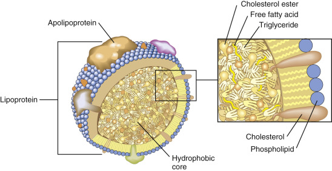
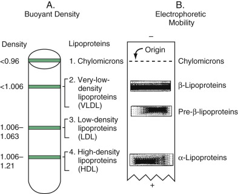
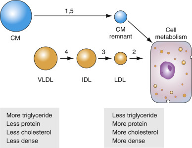
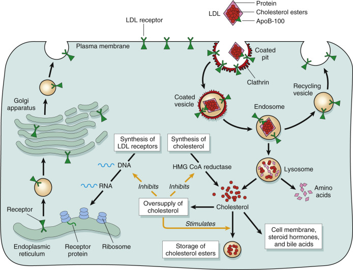
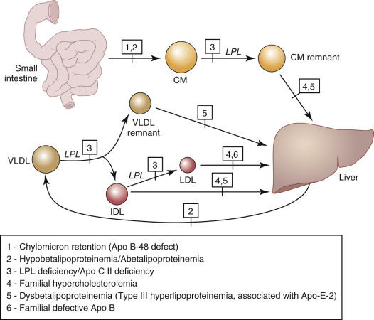
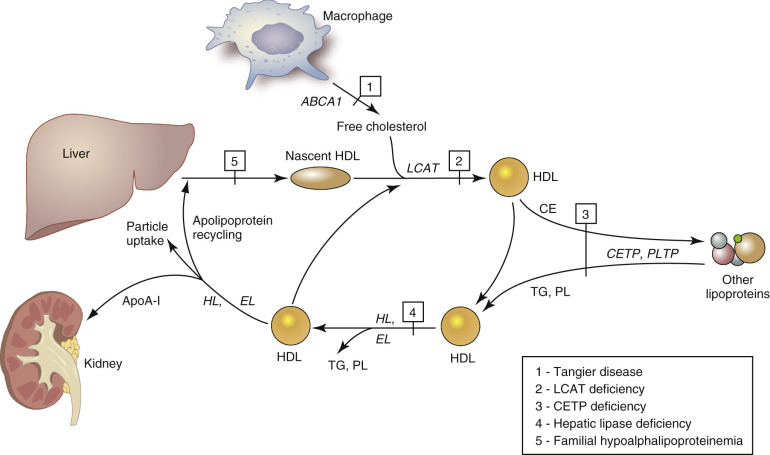
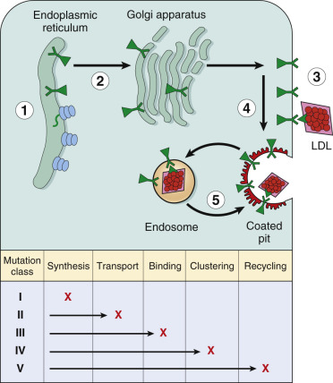

## Key Points

  * •

Although ultracentrifugation and electrophoretic techniques are of historical significance, most useful lipid and lipoprotein testing methods are now enzymatic. 

  * •

Low-density lipoprotein cholesterol can be measured directly but is usually calculated using the Friedewald formula. Calculated values require evaluation of fasting samples. 

  * •

Low-density lipoprotein cholesterol is currently considered the most important value in assessing cardiac risk and directing therapy. 

  * •

The profile currently recommended for initial screening in adults, age 20 or older, includes total cholesterol, low- and high-density lipoprotein cholesterol, and triglycerides. Testing should be repeated at least once every 5 years. 

  * •

Other tests, including apolipoprotein levels and lipoprotein subclasses, may prove valuable in fine-tuning risk assessment and evaluating response to therapy. 

  * •

New guidelines elevate the perceived atherosclerotic risk of diabetes and support aggressive intervention in diabetic patients and patients with metabolic syndrome. 

,  

##  Overview 

Disorders of lipid metabolism play a major role in atherosclerosis and coronary heart disease (CHD). A clear-cut relationship is evident between elevated serum cholesterol and myocardial infarction. At the tissue level, cholesterol deposits occur in areas of endothelial cell damage and are a prominent part of atherosclerotic lesions. Although cholesterol may be considered “bad” because of the previous association, it is actually a vital structural component of cell membranes and a precursor of steroid hormones and bile acids. Another lipid, triglyceride, is a major source of energy for cells. Cholesterol and triglycerides are the most important lipids in the study and management of CHD risk. 

_Lipids_ are soluble in nonpolar organic solvents, such as chloroform and ether, but relatively insoluble in polar solvents such as water. Thus, cholesterol and triglycerides travel in plasma not as free-floating molecules but as part of water-soluble complexes called _lipoproteins_ . These particles contain cholesterol in two forms: free cholesterol, a polar nonesterified alcohol (about 30%), and cholesterol ester, a hydrophobic form wherein cholesterol is linked to a fatty acid (about 70%). The lipoprotein is arranged like a micelle ( [ Fig. 17-1 ](<#f0010>) ). The most hydrophobic lipids, such as cholesterol esters and triglycerides, are located in the core of the particle. Lipids with some hydrophilicity, such as free cholesterol and phospholipids, are arranged on the surface with polar groups pointing outward. _Apolipoproteins_ (apo) the protein moiety of lipoproteins, are also arrayed on the surface. They show amphiphilic characteristics; hydrophobic residues interact with the hydrophobic core, whereas hydrophilic residues interact outside the aqueous environment. 

Figure 17-1 

Lipoprotein structure. 

Lipoproteins are spherical particles with a hydrophobic core and an amphiphilic surface. The surface consists of a single layer of phospholipids. This surface layer also contains proteins and free cholesterol. The hydrophobic core mainly contains triglycerides and cholesterol esters. 

Four major lipoprotein classes have been identified: chylomicrons (CM), very-low-density lipoprotein (VLDL), low-density lipoprotein (LDL), and high-density lipoprotein (HDL). The classification is based on the buoyant density of the particles (see later). Several minor lipoproteins have also been identified, including intermediate-density lipoprotein (IDL) and lipoprotein(a) (Lp[a]) ( [ Tables 17-1 ](<#t0010>) and [ 17-2 ](<#t0015>) ). Lipoproteins can be differentiated by density, particle size, chemical composition, and electrophoretic mobility. These physical properties are due to differences in protein, triglyceride, and cholesterol content and reflect the role of each lipoprotein in lipid metabolism (see later). Each lipoprotein is associated with specific apos that play important roles in lipid transport, such as activating or inhibiting the enzymes involved in lipid metabolism, and binding lipoproteins to cell surface receptors. The apo composition of the lipoprotein classes is summarized in [ Table 17-1 ](<#t0010>) . 

TABLE 17-1 

Major Classes of Human Plasma Lipoproteins: Physicochemical Characteristics 

Particle  |  Electrophoretic Mobility [ * ](<#hl0000158>) |  Major Apolipoproteins  |  Diameter (Å)  |  Density (kg/L)  |  Sf [ † ](<#hl0000161>)  
---|---|---|---|---|---  
Chylomicrons  |  Origin  |  ApoA-I, A-IV, B-48, C-I, C-II, C-III, E  |  750-12,000  |  <0.95  |  >400   
VLDL  |  Pre-β |  ApoB-100, C-I, C-II, C-III, E  |  300-700  |  0.95-1.006  |  20-400   
IDL  |  β or pre-β |  ApoB-100, E1.006–1.019  |  12-20  |  |   
LDL  |  B  |  ApoB-100  |  180-300  |  1.019-1.063  |  0-12   
HDL  2  |  A  |  ApoA-I, A-II, E  |  50-120  |  1.063-1.125  |   
HDL  3  |  A  |  ApoA-II, A-I, E  |  50-120  |  1.125-1.210  |   
Lp(a)  |  Pre-β |  ApoB-100, Apo(a)  |  |  1.045-1.080  |   
  
_HDL 2  , _ Ultracentrifugation subclass of high-density lipoprotein; _HDL 3  , _ ultracentrifugation subclass of high-density lipoprotein; _IDL,_ intermediate-density lipoprotein; _LDL,_ low-density lipoprotein; _Lp(a),_ lipoprotein A; _VLDL,_ very-low-density lipoprotein. 

 * Agarose gel electrophoresis. 

 † Svedberg flotation rate. 

TABLE 17-2 

Chemical Composition of Major Classes of Plasma Lipoproteins 

|  Protein (%) [ * ](<#hl0000232>) |  Free Cholesterol (%)  |  Cholesterol Esters (%)  |  Triglyceride (%)  |  Phospholipid (%)   
---|---|---|---|---|---  
Chylomicrons  |  1-2  |  1-3  |  2-4  |  80-95  |  3-6   
VLDL  |  6-10  |  4-8  |  16-22  |  45-65  |  15-20   
IDL  |  Intermediate between VLDL and LDL  |  |  |   
LDL  |  18-22  |  6-8  |  45-50  |  4-8  |  18-24   
HDL  |  45-55  |  3-5  |  15-20  |  2-7  |  26-32   
  
_HDL,_ High-density lipoprotein; _IDL,_ intermediate-density lipoprotein; _LDL,_ low-density lipoprotein; _VLDL,_ very-low-density lipoprotein. 

Data from  Albers (1974)  ,  Gaubatz et al (1983)  ,  Fless et al (1984)  ,  Gotto et al (1986)  ,  Gries et al (1988)  , and  Hegele (2009)  . 

 * Percentage of dry weight. 

Lipoproteins are commonly differentiated from one another on the basis of their buoyant density and electrophoretic mobility ( [ Fig. 17-2 ](<#f0015>) ). Ultracentrifugation separates lipoproteins by buoyant density. Lipids and proteins have average densities of 1.0 and 1.4 g/mL, respectively. If centrifuged in solutions of different densities, these particles band at characteristic densities. The density of a lipoprotein particle is determined mostly by its protein and triglyceride content. As illustrated in [ Figure 17-2 ](<#f0015>) , the higher the lipid content, the less dense the lipoprotein particle; therefore, the closer they migrate to the top of the tube. Lipoproteins with high triglyceride and low protein content (CM and VLDL) are less dense than those with high protein and low triglyceride content (HDL). LDL and IDL are more dense than VLDL but less dense than HDL. When plasma lipoproteins are separated by agarose gel electrophoresis, CM remains at the origin and HDL migrates fastest in the α-region, followed by VLDL in the “pre-β” region and IDL and LDL in the β region. 

Figure 17-2 

Lipoprotein classification. 

Lipoproteins are classified on the basis of buoyant density **(A)** or electrophoretic mobility **(B)** . Separation of lipoproteins based on buoyant density depends on the ratio between lipids and proteins present in them. Lipoproteins that contain higher amounts of lipids have lower buoyant density and are collected on top of the centrifuge tube. Separations based on electrophoretic mobility are based on the number of charges present on lipoproteins and are independent of their size and buoyant density. 

Based on the presence and absence of apoB, lipoproteins can be classified as apoB-containing (CM, VLDL, IDL, LDL) and non–apoB-containing (HDL) lipoproteins. This classification is important because apoB is a nonexchangeable apolipoprotein, and only one molecule of apoB is present per lipoprotein. ApoB-containing lipoproteins may or may not contain additional apolipoproteins such as apoA1, apoC, and apoE. ApoB serves as a structural protein for these lipoproteins and is always associated with these particles. They are synthesized mainly by hepatocytes and enterocytes. 

This group of lipoproteins is mainly involved in delivering lipids to tissues for storage or use in energy production. CM (formed in the intestine from dietary fat) and VLDL (formed in the liver) are triglyceride-rich particles that are metabolized after entering the circulation. Through the action of lipoprotein lipase (LPL), these particles shed triglycerides and cholesterol esters and are transformed into denser lipoproteins with a higher percentage of cholesterol. LDL is the densest of these particles, and elevated serum LDL-cholesterol (LDL-C) is a primary cardiac risk factor. Treatment of CHD-causing dyslipidemia is generally aimed at lowering LDL. 

One way to understand heterogeneity in apoB-containing lipoproteins is to view them as a metabolic progression in which CM and VLDL release free fatty acids to tissues via interaction with LPL. As a result of this interaction, CM and VLDL become triglyceride depleted, denser, and relatively protein and cholesterol rich, giving rise to CM remnants and LDL. These particles are internalized and metabolized by cells—CM remnants by the liver and bone marrow cells and LDL by liver cells and by other cells throughout the body. LDL serves as the major source of cholesterol for tissues. This metabolic progression is presented in [ Figure 17-3 ](<#f0020>) . 

Figure 17-3 

Metabolism of lipoprotein particles. 

The figure depicts successive shrinkage in the size of lipoproteins as a consequence of the lipolysis of triglycerides present in the particles. The number over each step in the pathway represents the functional hyperlipoproteinemia caused by a block between two intermediates (see [ Table 17-3 ](<#t0020>) ). _CM,_ Chylomicron; _IDL,_ intermediate-density lipoprotein; _LDL,_ low-density lipoprotein; _VLDL,_ very-low-density lipoprotein. 

A block in any step of the pathway leads to the accumulation of one or more lipoproteins. The number over each step in the pathway represents the functional hyperlipoproteinemia (originally described by  Fredrickson [1967]  ) caused by a block between two intermediates. For example, a block in the progression from CM to CM remnants results in the accumulation of CM—Type 1 or 5 disease—and presents with high triglycerides and normal cholesterol. A block in the conversion of VLDL to IDL and LDL results in Type 4 disease (i.e., VLDL accumulation with elevated triglycerides and frequently elevated cholesterol). Often the cause of Types 1, 5, and 4 disease is LPL deficiency and the resulting inability to break down triglycerides. Type 2 disease results from a block in LDL metabolism and may have a genetic basis: a defective apoB protein that does not bind to the LDL receptor (LDLR) or a mutant LDLR that does not recognize apoB. Type 2 is further subcategorized on the basis of triglyceride level. Note that other studies (see later) may be necessary to distinguish Type 2B and Type 3 because both present with elevated cholesterol and triglycerides. This functional classification is presented in [ Table 17-3 ](<#t0020>) . No ideal system is known for classifying lipid disorders. They can be categorized in many different ways: primary versus secondary, hereditary versus acquired, and by lipoprotein fraction phenotypes. In general, each category is heterogeneous with respect to genetic, clinical, and pathologic factors. These are discussed in greater detail at the end of the chapter. 

TABLE 17-3 

Classic Hyperlipidemia Phenotypes 

WHO ICD and OMIM Numbers  |  Type  |  Particle  |  Triglycerides  |  Cholesterol  |  Comments   
---|---|---|---|---|---  
E78.3   
238600  |  1 (familial chylomicronemia or LPL deficiency)  |  CM  |  High  |  Normal  |  Low cardiac risk; hereditary, found mostly in pediatric patients and young adults; autosomal recessive mutation in _LPL_ or _APOC2; APOA5, LMF-1,_ and _GPIHBP1_ mutations are linked to this phenotype.   
E78.0   
143890  |  2A (heterozygous and homozygous familial hypercholesterolemia)  |  LDL  |  Normal  |  High  |  High cardiac risk; mostly polygenic disease; about 10% are monogenic; heterozygous form is due to mutations in _LDLR, APOB,_ or _PCSK9_ ; homozygous form is due to mutations in _LDLR_ or _LDLRAP1_ (ARH).   
E78.4   
144250  |  2B (combined hyperlipoproteinemia)  |  VLDL, LDL  |  High  |  High  |  High cardiac risk; polygenic disease; links to mutations in _USF1, APOB,_ and _LPL_  
E78.2   
107741  |  3 (dysbetalipoproteinemia)  |  IDL  |  High  |  High  |  High cardiac risk; mutations in _APOE_ gene or homozygous for E2 allele of _APOE_  
E78.1   
144600, 145750  |  4 (primary hypertriglyceridemia)  |  VLDL  |  High  |  Normal  |  Lower cardiac risk than type 2 or 3; polygenic disease   
E78.3   
144650  |  5 (mixed hyperlipidemia)  |  VLDL, CM  |  High  |  High  |  Low cardiac risk; polygenic disease; 10% of patients have mutations in _LPL, APOC2,_ and _APOA5_ ; mutations in _APOE, TRIB1, CHREBP, GALNT2, GCKR,_ and _ANGPTL3_ are thought to contribute to this disease.   
  
_ANGPTL3,_ Angiopoietin-like 3; _APOA5,_ apolipoprotein A-V; _APOB,_ apolipoprotein B; _APOC2,_ apolipoprotein C-II; _APOE,_ apolipoprotein E; _CHREBP,_ carbohydrate response element binding protein (or _MLXIPL_ ); _CM,_ chylomicron; _GALNT2,_ UDP-N′-acetyl-alpha-  d  -galactosamine-polypeptide _N_ -acetylgalactosaminyltransferase 2; _GCKR,_ glucokinase regulator; _ICD,_ International Classification of Diseases; _IDL,_ intermediate-density lipoprotein; _LDL,_ low-density lipoprotein; _LDLRAP1,_ LDLR adaptor protein 1 (also known as ARH); _OMIM,_ Online Mendelian Inheritance in Man; _TRIB1,_ tribbles homologue 1; _USF1,_ upstream transcription factor 1; _VLDL,_ very-low-density lipoprotein; _WHO,_ World Health Organization. 

The major protein present in non–apoB-containing HDL is apoA-I, which makes up about 70% of the HDL protein. HDL is formed in the liver and small intestine. HDL plays a key role in reverse cholesterol transport, the process by which excess cholesterol is returned from tissues to the liver, where it is reused or excreted in bile. Besides apoA-I, HDL contains several apos. In addition to reverse cholesterol transport, other functions of HDL have been described on the basis of in vitro assays, including anti-inflammatory, antioxidant, antithrombotic, and nitric oxide–inducing mechanisms. Although the role of reverse cholesterol transport has been suggested as a protective mechanism against atherosclerosis, these other properties of HDL might also contribute to the “protective” effect. Consequently, such protection may stem from HDL function rather than from increased plasma levels of HDL. Nonetheless, therapies targeting increased HDL levels in plasma remain an active area of research. 

,  

##  Lipoproteins, Apolipoproteins, and Related Proteins 

Lipoprotein particles are dynamic entities that acquire and shed protein and lipid components as they circulate in the body. As mentioned earlier, CM and VLDL particles lose triglycerides and become smaller as they are metabolized. Thus young VLDL and CM particles are larger and less dense than their more mature counterparts. For this reason, it is best to view each of the lipoprotein classes not as a collection of identical particles but as a heterogeneous group. In fact, distinct lipoprotein subfractions or subclasses have been well described. 

 

##  Major Lipoproteins 

 

##  Chylomicrons 

CMs are large particles produced by the intestine that transport lipids of dietary origin to the tissues of the body. They are very rich in triglycerides but relatively poor in free cholesterol, phospholipids, and protein. These particles are secreted into mesenteric lymphatics and reach circulation at the thoracic duct. These lipoproteins acquire apoC-II, a cofactor for lipoprotein lipase, from plasma. The interaction of CM with lipoprotein lipase at the luminal surface of capillary endothelium results in the depletion of triglycerides and surface elements. The resulting smaller particles, called CM remnants, are removed from circulation by the liver (  Hussain et al, 1996  ), primarily through the interaction of apoE with receptors such as proteoglycans, the LDLR, and the LDLR-related protein (LRP). The half-life of the CM in human circulation is short—only minutes. Because of the very high lipid/protein ratio, CM are considerably less dense than water and float without centrifugation. When present at high levels, CM result in “milky” plasma and accumulate as a floating creamy layer when left undisturbed for several hours. The apolipoproteins in CM include apoB-48, apoA-I, apoA-IV, apoC-I, apoC-II, apoC-III, and apoE. In metabolism of CMs, apoC-II serves as an activator of lipoprotein lipase. 

 

##  Very-Low-Density Lipoproteins 

VLDL particles are produced by the liver and supply the tissues of the body with triglycerides of endogenous, primarily hepatic, origin and cholesterol. As compared with CMs, VLDL particles are smaller and produce turbid plasma when present in excessive amounts. They are rich in triglycerides, although to a lesser extent than CMs, and have a higher buoyant density because of their lower lipid/protein ratio. By mass, VLDL particles contain approximately 50% triglyceride, 40% cholesterol and phospholipid, and 10% protein, mostly apoB-100 and apoC-I, apoC-II, and apoC-III, but also apoE. VLDL particles vary widely in size and chemical composition. Larger particles are rich in triglycerides and apoC. Smaller particles have less of these two components. Lipoprotein lipase hydrolyzes VLDL, and this produces highly atherogenic, smaller triglyceride and surface material–depleted particles called VLDL remnants and IDL. LDLRs on hepatocytes recognize apoE in CM remnant and VLDL in order to remove them from plasma. 

 

##  Low-Density Lipoproteins 

LDL is produced through the metabolism of VLDL in circulation and constitutes about 50% of the total lipoprotein mass in human plasma. The particles are much smaller than the triglyceride-rich lipoproteins (VLDL and CM) and do not scatter light or alter the clarity of plasma even at greatly increased concentrations. LDL consists of approximately 50% cholesterol, mostly esterified; 25% protein, mostly apoB-100 with traces of apoC; 20% phospholipid; and some triglycerides. Although each VLDL and LDL particle is thought to contain only one apoB-100 molecule, the extraordinary size of this protein allows it to be the largest protein component of these particles. The liver takes up most of the LDL in circulation (approximately 75%), with apoB-100 serving as a ligand for the hepatic receptor. The remaining LDL is delivered to other tissues. Some LDL is modified and is removed from the circulation by scavenger cells such as those found in atheromatous plaque. Small, dense LDL contains less cholesterol ester and has a lower cholesterol/apoB ratio and is believed to be atherogenic. Increased amounts of the small particles have been found in patients with several common forms of dyslipoproteinemia that are associated with CHD. People with high levels of small, dense LDL are at high risk of a CHD event, which is independent of total LDL concentration. 

 

##  High-Density Lipoprotein 

HDL is a small particle, consisting mostly of protein, cholesterol, and phospholipids, with only traces of triglycerides. ApoA-I is the major apolipoprotein for HDL, which is synthesized in the liver and small intestine. Different from apoB-containing lipoproteins, most of HDL particles have more than one apoA-I molecule. Produced by the liver and intestine, HDL is involved in reverse cholesterol transport. In vitro studies suggest that HDL is involved in anti-inflammatory, antioxidant, antithrombotic, and nitric oxide–inducing mechanisms. The major site for the clearance of HDL cholesterol is the liver, and the best-understood mechanism is the selective uptake of cholesterol esters from HDL by the SR-B1 receptor expressed in the liver. In the selective uptake process, SR-B1 promotes cholesterol uptake without apoA-I degradation. Cholesterol esters are removed from the internalized HDL particles, and cholesterol-depleted HDLs are resecreted. Mouse models that lack SR-B1 exhibit increased plasma HDL, slower HDL uptake by the liver, and increased atherosclerosis. Reverse cholesterol transport is reduced. In contrast, mouse models overexpressing SR-B1 in the liver show increased reverse cholesterol transport with reduced HDL plasma levels; however, these same mice also exhibit reduced atherosclerosis. In studies done on humans who maintain normal lipid profiles, the contribution of SR-B1 to HDL uptake is minimal. The cholesterol ester transfer protein (CETP) pathway is considered to be an alternative pathway for HDL metabolism. CETP transfers triglycerides from apoB lipoproteins in exchange for cholesterol esters in HDL. The result is an HDL particle depleted of cholesterol esters but enriched with triglycerides. Cholesterol transferred to apoB-lipoproteins is then cleared by LDLRs. 

Lipid-poor apoA-I is catabolized mainly by the kidney through the renal glomerulus. Patients with kidney disease exihibit impaired cholesterol efflux capacity and are at high risk of cardiovascular disease (  Moore and Fisher, 2013  ). 

HDLs are also heterogeneous particles. Discrete HDL particle subpopulations have been identified on the basis of differences in size or charge, including two major ultracentrifugation subclasses, HDL  2  and HDL  3  (  MacKenzie et al, 1973  ;  Sundaram et al, 1974  ;  Blanche et al, 1981  ). HDL  3  is smaller than HDL  2  .The distinction is significant because HDL  2  is thought to be more cardioprotective than HDL  3  , and people with low levels of HDL  2  are thought to be at increased risk for premature CHD. By surface charge, HDL is divided into three different subpopulations, from small to large: pre-β, pre-α, and α. Pre-βHDL is also called lipid-poor ApoA-I. Each pre-βHDL contains one apoA-I molecule, three to four phospholipid molecules, and one to two cholesterol molecules. A Japanese group developed an immunoassay that can specifically quantify pre-beta HDL in human plasma. A significantly higher pre-beta HDL level and lower LCAT enzyme activity were observed with the hyperlipidemic population and ischemic heart disease, which is independent of HDL-cholesterol concentration (  Miyazaki et al, 2000  ). Additionally, HDL has been subfractionated into particles that contain apoA-I but not apoA-II, and those that contain both apoA-I and apoA-II (  Fruchart & Ailhaud, 1992  ). ApoA-I is present on virtually all HDL particles and makes up 70% of the protein content. ApoA-II makes up about 20% of the HDL lipoprotein and is present on about two thirds of all HDL particles in humans. The physiologic function of apoA-II is not fully understood; however, both apoA-I and apoA-II are required for normal HDL biosynthesis and metabolism. In a study with 306 individuals from 25 families with CHD family history, the apoA-II plasma level is significantly correlated with the serum free fatty acid level. In a mouse model, human apoA-II inhibits hepatic lipase activity on hydrolysis of HDL triglyceride (  Warden et al, 1993  ). ApoA-II plays an important role in maintaining HDL particle size and levels of HDL in plasma. It is also known that apoA-II is associated with insulin resistance and increased body fat (  Corella et al, 2011  ). ApoE also associates with HDL particles. Laboratory measurement of such particles eventually may prove clinically useful. 

 

##  Minor and Abnormal Lipoproteins 

 

##  Intermediate-Density Lipoproteins 

Formed through the metabolism of VLDL in circulation, IDL can be removed from circulation quickly through interaction with the LDLR, or it can be further metabolized to LDL. As expected, the lipid content, size, and density of IDL are intermediate between VLDL and LDL. Concentrations of IDL also contribute to the development of CHD, together with VLDL and LDL in humans. 

 

##  Lipoprotein(a) 

Lp(a) is similar to LDL in terms of density and overall composition, and it can be thought of as an LDL particle to which a large glycoprotein, apo(a), has been linked to apoB-100 via a disulfide bond (  Gaubatz et al, 1983  ;  Fless et al, 1984;  1985  ). The electrophoretic mobility of Lp(a) is usually pre-β but can vary between that of LDL (β) and albumin (pre-α). Lp(a) is generally present in much lower concentrations than LDL; however, in normal subjects, values can range from less than 20 to 1500 mg/L or more. Increased levels can be familial, showing an autosomal dominant pattern of inheritance, and have been associated with an increased risk of CHD, cerebrovascular disease, and stroke. When concentrations in the plasma are increased to above 200 to 300 mg/L, Lp(a) appears electrophoretically as a lipid-staining pre-β band in the plasma fraction containing lipoproteins of density greater than 1.006 g/mL. 

Lp(a) is synthesized in the liver, but the details of its metabolism are not well understood. It binds to the LDLR by virtue of its apoB-100 component, albeit with lower affinity than LDL (  Floren et al, 1981  ). The removal of apo(a) from Lp(a) increases the affinity of the residual apoB-containing particle for the LDLR (  Armstrong et al, 1985  ), and it has been suggested that apo(a) may interfere with the uptake of apoB-100–containing particles (  Scanu, 1988  ). At present, neither the function of Lp(a) nor its atherogenic properties are well understood. It has been speculated that Lp(a) or apo(a) might interfere with normal thrombolysis by virtue of their similarity to plasminogen. In vitro, it competes with plasminogen and tissue-type plasminogen activator for fibrin binding (  Loscalzo et al, 1990  ). Human apo(a) transgenic mice are resistant to tissue plasminogen activator–mediated thrombolysis. Lp(a) has been detected accumulating in atherosclerotic lesions from guinea pigs (  Rath & Pauling, 1990  ). 

 

##  LpX Lipoprotein 

LpX is an abnormal lipoprotein found in patients with obstructive biliary disease and in patients with familial lecithin/cholesterol acyltransferase (LCAT) deficiency. Lipids account for more than 90% of its weight (mostly phospholipids: phosphatidylcholine, unesterified cholesterol, and very little esterified cholesterol). Proteins, primarily apoC and smaller amounts of albumin, constitute less than 10% of LpX by weight. A study has shown that LpX formation associates with a high level of hepatic cholesterol synthesis, but it is independent of LCAT acitivity, as well as ABCA1 and SR-BI expression (  Bravo et al, 2007  ). 

 

##  β-VLDL (“Floating β” Lipoprotein) 

β-VLDL (floating β lipoprotein) is an abnormal lipoprotein that accumulates in type 3 hyperlipoproteinemia. It is richer in cholesterol than VLDL and apparently results from the defective catabolism of VLDL. The particle is found in the VLDL density range but migrates electrophoretically with or near LDL. β-VLDL is enriched in apoE. Cholesterol-fed animals accumulate β-VLDL in plasma. Uptake of cholesterol ester-rich β-VLDL by macrophages induces foam cell formation. 

 

##  Important Proteins in Lipoprotein Metabolism 

 

##  Apolipoproteins 

As mentioned previously, apos constitute the major protein component of lipoproteins. They are commonly referred to using the nomenclature introduced by  Alaupovic (1971)  . Some significant properties of the apos are outlined in [ Tables 17-4 ](<#t0025>) and [ 17-5 ](<#t0030>) . 

TABLE 17-4 

Significant Human Apolipoproteins 

|  |  |  |  |  PLASMA CONCENTRATION   
---|---|---|---|---|---  
Apolipoprotein  |  Major Lipoproteins  |  Mr [ * ](<#hl0000515>) (kDa)  |  Amino Acids  |  Chromosome  |  mmol/L  |  mg/dL   
A-I  |  HDL  |  29  |  243-245  |  11  |  32-46  |  90-130   
A-II  |  HDL  |  17.4  |  154  |  1  |  18-29  |  30-50   
A-IV  |  HDL, LDL  |  44.5  |  396  |  11  |  |   
(a)  |  Lp(a)  |  350-700  |  Variable  |  6  |  |   
B-100  |  VLDL, IDL, LDL  |  512.7  |  4536  |  2  |  1.5-1.8  |  80-100   
B-48  |  CM  |  240.8  |  2152  |  2  |  <0.2  |  <5   
C-I  |  CM, LDL  |  6.6  |  57  |  19  |  6.1-10.8  |  4-7   
C-II  |  CM, LDL  |  8.9  |  78 or 79  |  19  |  3.4-9.1  |  3-8   
C-III  |  CM  |  8.8  |  79  |  11  |  9.1-17.1  |  8-15   
D  |  HDL  |  19  |  169  |  3  |  |   
E  |  CM, LDL, IDL  |  34.1  |  299  |  19  |  0.8-1.6  |  3-6   
F  |  HDL, LDL, VLDL  |  29  |  162  |  12  |  |  8.35   
H  |  VLDL  |  50  |  326  |  17  |  |  20   
J  |  HDL  |  80  |  449  |  8  |  |   
L  |  HDL  |  39-42  |  383  |  22  |  Not present in plasma  |   
M  |  HDL, LDL, VLDL, CM  |  26  |  188  |  6  |  |  2-15   
O  |  HDL, LDL, VLDL  |  22.3  |  198  |  X  |  |   
  
_CM,_ Chylomicron; _HDL,_ high-density lipoprotein; _IDL,_ intermediate-density lipoprotein; _LDL,_ low-density lipoprotein; _Lp(a),_ lipoprotein A; _VLDL,_ very-low-density lipoprotein. 

 * Relative molecular mass. 

TABLE 17-5 

Apolipoprotein Functions and Significant Characteristics 

Apolipoprotein  |  Main Distribution  |  Function (If Known)  |  Comments   
---|---|---|---  
A-I  |  HDL  |  Activates LCAT that esterifies cholesterol in plasma   
Ligand for _ABCA1_ |  Synthesized in liver and intestine; HDL biosynthesis   
A-II  |  HDL  |  |  May inhibit lipoprotein and hepatic lipases and increases plasma triglyceride   
A-IV  |  HDL, CM, and free in plasma  |  |  May be a cofactor for LCAT; increased during fat absorption; HDL biosynthesis   
B-100  |  VLDL and LDL  |  Carboxy-terminal recognition signal targets LDL to the LDL (apoB, E) receptor  |  Very large structural protein, synthesized in liver with lipids of endogenous origin (i.e., not chylomicrons)   
B-48  |  CM  |  Not recognized by LDLR  |  Synthesized in intestine, encoded by same gene and same amino terminus as apoB-100. Differential production of the two proteins involves RNA editing.   
C-I  |  CM and VLDL  |  |  May inhibit hepatic uptake of VLDL and cholesterol ester transfer protein   
C-II  |  CM and VLDL  |  Activates lipoprotein lipase  |  Deficiency causes reduced clearance of triglyceride-rich lipoproteins.   
C-III  |  VLDL, HDL  |  Inhibits lipolysis of triglyceride-rich lipoproteins; decreases clearance rate of remnant particles  |  Deficiency causes reduced clearance of triglyceride-rich lipoproteins.   
D  |  HDL  |  Activates LCAT  |   
E  |  CM, VLDL, IDL, remnants and HDL  |  Recognition factor that targets CM and VLDL remnants to hepatic receptor; also binds to cell surface LDL receptors and proteoglycans  |  E-2, E-3, and E-4 isoforms; E-4 is associated with high LDL-C, higher risk of CHD and Alzheimer's disease; E-2 associated with type 3 hyperlipoproteinemia   
F  |  HDL, LDL, VLDL  |  Regulates CETP function  |   
H  |  VLDL  |  Related to activation of LPL; triglyceride metabolism  |  Antibodies against apoH or β 2  -glycoprotein-I are a subset of antiphospholipid antibodies, and may be associated with hyperthrombosis and stroke.   
J  |  |  Cell-aggregating factor in Sertoli cells; inhibitor of the C5b*7 complement complex; beta-amyloid clearance in glial cells; cholesterol trafficking in brain  |  Involved in apoptosis; linked to neurologic diseases like Pick's and Alzheimer's; also known as clusterin   
L  |  HDL  |  |  May be linked to reverse cholesterol transport   
M  |  HDL, CM, LDL, VLDL  |  |  May be linked to HDL remodeling   
Apo(a)  |  Lp(a)  |  |  Homologous to plasminogen, may be prothrombotic; bound to apoB-100 by disulfide linkage   
  
_ABCA1,_ ATP-binding cassette transporter; _CETP,_ cholesterol ester transfer protein pathway; _CHD,_ congenital heart disease; _CM,_ chylomicron; _HDL,_ high-density lipoprotein; _IDL,_ intermediate-density lipoprotein; _LCAT,_ lecithin/cholesterol acyltransferase; _LDL,_ low-density lipoprotein; _LDL-C,_ low-density lipoprotein cholesterol; _Lp(a),_ lipoprotein A; _LPL,_ lipoprotein lipase; _VLDL,_ very-low-density lipoprotein. 

 

##  Lipolytic Enzymes and Other Proteins 

The major enzymatic systems that are known to participate in plasma lipoprotein metabolism are the LCAT and the lipolytic enzymes, lipoprotein lipase (LPL), hepatic triglyceride lipase (HL), and endothelial lipase (EL). Many other proteins are also involved in lipoprotein metabolism. Some significant attributes of these proteins are summarized in [ Table 17-6 ](<#t0035>) . 

TABLE 17-6 

Enzymes and Other Proteins Important for Lipoprotein Metabolism 

Enzyme  |  Gene Location  |  Function  |  Deficiency  |  Tissue Expression   
---|---|---|---|---  
ABCG5  |  2p21  |  Forms heterodimers with ABCG8 to pump out plant sterols back into the intestinal lumen  |  Increased plant sterol levels in plasma that can disrupt cell membranes and cause sitosterolemia; influences cholesterol levels in plasma  |  Tissue expression in liver, colon, and intestines   
ABCG8  |  2p21  |  Forms heterodimers with ABCG5 to pump out plant sterols back into intestinal lumen; also associated with cholesterol and sterol excretion in bile  |  Increased plant sterol levels in plasma that can disrupt cell membranes and cause sitosterolemia; influences cholesterol levels in plasma  |  Tissue expression in the liver, intestines, and gallbladder   
ABCA1  |  9q22-31  |  Efflux of cholesterol from peripheral cells into HDL  |  Tangier disease, with very low HDL and accumulation of lipids in peripheral cells  |  Many cell types, prominently in the liver, testis, and adrenal   
CETP  |  16q21  |  Transfers CE, PL, and TG among lipoproteins, esp. the transfer of CE from HDL to apoB-100–containing lipoproteins in exchange for TG  |  Deficiency results in large cholesterol-laden HDL  |  Produced in liver and circulates with HDL   
EL  |  18q21.1  |  Hydrolysis of PL and TG in lipoproteins, esp. PL in HDL. Homologous to LPL and EL and pancreatic lipase  |  Increased levels of HDL  2  , and large buoyant LDL. Overexpression in mice, decreased TC, PL, and HDL-C  |  Expressed in many tissues, including liver. Synthesized by endothelium   
HL  |  15q22-23  |  Hydrolysis of TG and PL, esp. from HDL  2  , and may be necessary for HDL metabolism. Also active on lipids in VLDL remnants and IDL. Not very active on newly released VLDL or CM  |  Increased TC, TG, and HDL-C in deficiency  |  Associates with nonparenchymal liver cells   
LCAT  |  16q22.1  |  Catalyzes the esterification of cholesterol, esp. in HDL, by promoting transfer of fatty acids from lecithin to cholesterol.   
Enables HDL to accumulate cholesterol as CE. Activated by apoA-I  |  Deficiency results in decreased HDL.  |  Produced in liver and circulates with HDL   
LPL  |  8q22  |  Hydrolysis of TG in lipoproteins (esp. VLDL and CM), releasing free fatty acids and glycerol to tissues. ApoC-II are essential cofactors.  |  Large CM and VLDL with very high TG levels  |  Present on surface of capillary endothelial cells in adipose tissue and skeletal and heart muscle, but not produced by endothelial cells   
LDLR  |  19p13.2  |  Binds apoE and apoB-100 and mediates endocytosis of lipoproteins, mostly LDL, but also VLDL, IDL, and CM remnants  |  Familial hypercholesterolemia results primarily in elevated LDL  |  Expressed on most cell types, but hepatic receptors clear 70% of LDL   
MTP  |  4q24  |  Lipidates and regulates secretion of ApoB particles from the liver and intestines  |  Deficiency of MTP function leads to abetalipoproteinemia where ApoB lipoproteins are virtually undetectable in plasma.  |  Expression is seen in liver, intestines, heart, kidney, and eye   
PLTP  |  20q12  |  Transfer of PL to and from HDL. Important for HDL growth and remodeling  |  Deficiency in mice results in low HDL.  |  Expressed on many cell types   
PCSK9  |  1p32.3  |  Influences the number of LDLRs expressed on cell surface  |  Depending on mutation—either gain of function or loss of function—the presence of PCSK9 affects availability of LDLR on cell surface and, consequently, the levels of LDL in plasma; gain of function leads to more LDL in plasma; loss of function associates with increased LDLR expression and thus less LDL in plasma.  |  Secreted protein by the liver cells; expressed in pancreatic islet beta cells and neuronal cells   
SR-B1  |  12q24.31  |  Binds HDL on cell surface. Plays a role in selective uptake of CE from HDL in liver and steroidogenic tissues.   
May also enable macrophages to bind oxidized LDL  |  Accumulation of large CE-rich HDL, and accelerated atherosclerosis in mice  |  Macrophage, adrenal, liver and testis   
  
_ABCA1,_ ATP-binding cassette protein A1; _Apo,_ apolipoprotein; _CE,_ capillary electrophoresis; _CETP,_ cholesterol ester transfer protein; _CM,_ chylomicron; _EL,_ endothelial lipase; _HDL,_ high-density lipoprotein; _HDL 2  , _ ultracentrifugation subclass of HDL; _HDL-C,_ high-density lipoprotein cholesterol; _HL,_ hepatic lipase; _IDL,_ intermediate-density lipoprotein; _LCAT,_ lecithin cholesterol acyltransferase; _LDL,_ low-density lipoprotein; _LDLR,_ LDL receptor; _LPL,_ lipoprotein lipase; _MTP,_ microsomal triglyceride transfer protein; _PL,_ phospholipid; _PLTP,_ phospholipid transfer protein; _SR-B1,_ scavenger receptor class B, member 1; _TC,_ total cholesterol; _TG,_ triglycerides; _VLDL,_ very-low-density lipoprotein. 

,  

##  Lipid Transport and Lipoprotein Metabolism 

Triglycerides and cholesterol enter circulation as part of triglyceride-rich lipoprotein particles, CMs produced in the intestine, and VLDLs produced primarily by the liver. Their synthesis requires an intracellular chaperone microsomal triglyceride transfer protein (MTP) that transfers different lipids in in vitro systems (  Hussain et al, 2003  ,  2012  ). In addition, MTP physically interacts with apoB. These two properties of MTP play a critical role in the biosynthesis of apoB-containing lipoproteins. It is believed that MTP physically associates with nascent apoB in endoplasmic reticulum and lipidates it, forming a lipoprotein particle that is further matured and secreted. Enterocytes synthesize chylomicrons under postprandial conditions. In fasting conditions, they synthesize VLDL and smaller lipoproteins (  Hussain et al, 1996  ). These lipoproteins are concentrated into mesenteric lymphatics and are delivered to blood at the thoracic duct. Hepatocytes synthesize VLDL and directly secrete into the circulation. Their synthesis is also dependent on MTP activity. The main function of apoB-containing lipoproteins is to deliver cholesterol and triglyceride to different tissues. CMs are primarily involved in the absorption and delivery of dietary fat and fat-soluble vitamins, whereas VLDLs deliver endogenous lipids to other tissues. 

Only one _APOB_ gene is present in the human genome. Nevertheless, enterocytes and hepatocytes make two different forms of apoB to synthesize CMs and VLDL, respectively. In both tissues, the human _APOB_ gene is transcribed into mRNA that is 15 kilobases long. This transcript is translated into a single polypeptide in the liver, called apoB-100. In the intestine, however, _APOB_ mRNA undergoes a posttranscriptional change. One cytosine residue (at position 6666) is deaminated to a uracil. This changes a glutamine codon into a stop codon. Translation of the edited mRNA gives rise to a polypeptide of 2152 amino acids that is 48% of the apoB-100 (synthesized by the liver). This editing enzyme is not expressed in the liver; therefore, the liver synthesizes only full-length apoB-100. 

These lipoprotein particles begin to undergo intravascular change almost immediately after entry into the circulation through the action of LPL. This enzyme hydrolyzes triglycerides and diglycerides, releasing fatty acids and monoglycerides, which are taken up by cells and used as a source of energy. ApoC-II stimulates the hydrolysis of triglycerides. In addition to losing triglycerides by LPL-mediated hydrolysis, CM loses surface lipids and apos by transfer of these components to HDL. Overall, CMs lose significant mass in the form of triglyceride and the A and C apolipoproteins. The depleted CM remnant particle contains apoB-48 and apoE as its major apolipoproteins. These particles are rapidly removed from plasma and are sequestered in the space of Disse by binding to proteoglycans or taken by hepatocyte after binding to the LDLRs. The sequestered particles can undergo further hydrolysis by hepatic lipase and are enriched with apoE. Eventually, they are internalized and degraded by means of a rapid and specific receptor-mediated endocytic process involving LDLRs, LDLR-related protein, and proteoglycans. C apos inhibit the uptake of CMs, allowing them to remain in the circulation long enough to complete the hydrolysis of triglycerides. In the fasting state, the intestine continues to make apoB and secretes “intestinal VLDL” (small CMs). These particles may constitute up to 10% or 20% of the circulating “VLDL,” but they are probably metabolized as CMs (  Byers & Friedman, 1960  ;  Cenedella & Crouthamel, 1974  ;  Risser et al, 1978  ;  Green & Glickman, 1981  ). 

VLDL is synthesized in the liver. Similar to CM, VLDL is catabolized upon entry into the circulation, in part by lipoprotein lipase, and is converted to cholesterol-enriched VLDL remnants. Some of these remnants are removed from circulation by the liver via receptor-mediated endocytosis; others are further catabolized to LDL (  Bachorik & Kwiterovich, 1988  ). LDL carries most of the circulating cholesterol and transports cholesterol to hepatic and extrahepatic tissues, where it is taken up by LDLR-mediated endocytosis (  Brown et al, 1981  ). LDL binds to the LDLR (i.e., via apoB-100) and is subsequently internalized and directed to the lysosome, where apoB-100 is degraded and cholesteryl ester and other lipids are hydrolyzed. LDLRs are recycled back to the cell membrane ( [ Fig. 17-4 ](<#f0025>) ). 

Figure 17-4 

The low-density lipoprotein (LDL) receptor pathway and regulation of cholesterol metabolism. 

The unesterified cholesterol produced via lysosomal hydrolysis becomes available for membrane, hormone, and bile acid synthesis. Excess cholesterol is reesterified by the microsomal enzyme acyl : cholesterol acyl transferase (ACAT) and is stored until it is needed. High cellular free cholesterol downregulates the expression of LDLR on the cell surface, leading to reductions in LDL uptake. About two thirds of LDL is removed from plasma via hepatic LDLRs. Although most tissues use cholesterol only for membrane synthesis or store it as cholesteryl ester, the liver can utilize cholesterol in other ways. The liver excretes cholesterol into the bile both as unesterified cholesterol and after conversion to bile acids, and it reuses cholesterol for lipoprotein synthesis, as when it secretes VLDL into the circulation. Steroid-secreting tissues use cholesterol as a precursor of the steroid hormones. 

LDL and CM remnants deliver lipids to the tissues. In contrast, HDL is thought to be the vehicle for reverse cholesterol transport, the process by which excess cholesterol is removed from peripheral tissues and transported back to the liver. HDL is secreted from both the liver and the intestine as nascent, disk-shaped particles that contain apos, cholesterol, and phospholipid (  Havel, 1980  ;  Scanu et al, 1982  ;  Oram, 1986  ;  Oppenheimer et al, 1987  ). The formation of nascent HDL particles is almost exclusively dependent on the synthesis and release of apoA-I. HDL also arises de novo in circulation from excess surface material (e.g., free cholesterol, apoA-I, apoA-II, apoC, phospholipid) removed from the triglyceride-rich lipoproteins as they are catabolized. In peripheral tissues, excess cholesterol is exported from cells (including macrophages), in part through the action of the protein ATP-binding cassette transporter 1 (ABCA1). This free cholesterol is accumulated by nascent HDL particles and esterified by LCAT. As cholesterol esters move into the hydrophobic core, the particle becomes spherical and larger, developing eventually into HDL  3  and then HDL  2  . Two plasma proteins are involved in the remodeling of HDL: phospholipid transfer protein (PLTP) and cholesterol ester transfer protein (CETP). CETP catalyzes the transfer of cholesterol esters to apoB-100–containing particles in exchange for triglycerides (  Tall, 1990  ). PLTP facilitates the transfer of phospholipids from other lipoproteins to HDL, allowing the particle to grow by acquiring surface phospholipid as it accumulates esterified cholesterol and triglyceride in its core. Once formed, HDL delivers excess lipids, especially cholesterol, to the liver and other tissues (  Glass et al, 1983  ;  Stein et al, 1984  ;  Bachorik et al, 1987  ). This may occur directly when HDL is taken up by the hepatocytes, mainly via Scavenger receptor class B member 1 (SR-B1) or through the action of cell surface receptors and lipases (HL and EL) that deplete phospholipid and triglyceride without internalizing the HDL particles. Lipids may also return to the liver indirectly or be directed to peripheral tissues via apoB-lipoproteins to which they are transferred from HDL by CETP. 

Although HDL particles may return to the liver soon after formation, the bulk of HDL seems to remain in circulation for several days, continuously exchanging lipids and apos with other lipoprotein particles, retrieving additional cholesterol from peripheral tissues, and delivering those lipids to the liver and steroid-producing tissues. This is supported by the fact that apoA-I has a half-life of several days in circulation. Eventually, mature HDL is internalized by the liver SR-BI, or small lipid-depleted HDL may be catabolized in the kidney following filtration and cubulin-mediated reuptake in the proximal tubule. 

,  

##  Lipid and Lipoprotein Measurement 

Lipoprotein concentrations have been measured and described in several ways. Some of these measurements, including particle mass and mass concentration (the mass of each lipoprotein particle as solute per liter of solution), are not easily applied for screening or routine clinical purposes. Fortunately, other methods may be used to describe the lipoprotein content of blood. Because the cholesterol composition of each lipoprotein class is similar from individual to individual, lipoprotein cholesterol is commonly used to evaluate lipoprotein concentration. For example, it is easier to determine the amount of LDL-C in a specimen than it is to determine the mass of LDL (cholesterol + triglyceride + protein) in solution, yet both measurements provide similar information about the LDL content of plasma. Lipoprotein-cholesterol concentrations correlate well with analytic ultracentrifugation values. Also, because these values have been used in most population studies of cardiovascular risk, they have documented predictive value. 

When various methods of lipid analysis are considered, several issues should be kept in mind. First, the more complicated the analytic procedures, the greater the variability of the analyses (  Bookstein et al, 1990  ;  Brown et al, 1990  ). For example, the measurement of plasma lipoproteins usually requires two steps: separating lipoprotein classes and measuring the class of interest. Both steps contribute to the error in the measurements. Consistent with this, lipoprotein cholesterol analyses are generally more variable than total cholesterol (TC) analyses because of the additional manipulations required in preparing the lipoprotein-containing fractions. Second, in addition to analytic sources of error, significant preanalytic variables may affect measured lipid and lipoprotein levels. In fact, plasma lipoprotein concentrations can change dramatically as a result of normal physiologic variation. In this section, issues of sampling and storage are considered, along with methods for measuring lipids and lipoproteins. 

 

##  Blood Sampling and Storage 

Variation and error can be introduced before or during venipuncture, or when the samples are handled and stored before analysis. Therefore, it is important to standardize conditions under which blood specimens are drawn and prepared for analysis. 

 

##  Biologic Variation 

Physiologic variations in cholesterol, triglyceride, and lipoproteins have been examined in a number of studies (  Warnick et al, 1979  ;  Demacker et al, 1982  ;  Bookstein et al, 1990  ;  Brown et al, 1990  ;  Kafonek, 1992  ). For cholesterol, the coefficient of physiologic variation within an individual averages about 6.5%, but it can be higher in certain individuals ( [ Table 17-7 ](<#t0040>) ). When measured in serial samples from the same person, cholesterol levels in 95% of the samples will vary by about 13% above or below that person's mean level. As a result, physiologic variation can be several times greater than analytic error, and measurements must be made in several blood samples taken at least a week apart to establish the individual's usual lipoprotein concentration. 

TABLE 17-7 

Physiologic Variation of Plasma Lipids, Lipoproteins, and Apolipoproteins 

Component  |  CVP (%) [ * ](<#hl0000802>) |  CVP (%) [ † ](<#hl0000806>)  
---|---|---  
Total cholesterol  |  5.0  |  6.4   
Triglycerides  |  17.8  |  23.7   
LDL-cholesterol  |  7.8  |  8.2   
HDL-cholesterol  |  7.1  |  7.5   
ApoA-I  |  7.1  |  —  
ApoB  |  6.4  |  —  
  
_CVP,_ Coefficient of physiologic variation; _HDL,_ high-density lipoprotein; _LDL,_ low-density lipoprotein. 

 * Data from patients of a lipid clinic (  Kafonek et al, 1992  ). 

 † Data from the  National Cholesterol Education Program 1995  Working Group on Lipoprotein Measurement. 

A variety of biologic factors can affect lipid and lipoprotein levels. Cholesterol levels rise with age, starting in early adulthood, in both sexes. Women have lower levels than men, except in childhood and after the early fifties. Age-related variation forms the basis for the National Cholesterol Education Program (NCEP) recommendation that cholesterol screening should be repeated every 5 years. Seasonal variation also occurs, such that cholesterol levels are slightly higher in the winter (  Robinson et al, 1992  ). Also, dietary intake of saturated fat and cholesterol significantly influences plasma lipid levels. The effects of dietary modification take several weeks to become apparent; thus before individuals' cholesterol levels are ascertained, it is important that they be on their usual diet for 2 weeks and are neither gaining nor losing weight. Several common medications, including oral contraceptives, postmenopausal estrogens, and some antihypertensive drugs, significantly alter lipid levels. Medical disorders that lead to secondary dyslipoproteinemia include thyroid, hepatic, and kidney disease (see [ Table 17-12 ](<#t0065>) ). In such cases, management of hyperlipidemia is predominantly a function of treating the underlying disorder. Lifestyle and biological factors that produce short-term deviations from baseline lipid values include alcohol consumption, fasting, posture, venous occlusion, anticoagulants, recent myocardial infarction, stroke, cardiac catheterization, trauma, acute infection, and pregnancy. It is recommended that lipoprotein measurements be made no sooner than 8 weeks after any form of trauma or acute bacterial or viral infection, and 3 to 4 months after childbirth. 

 

##  Fasting 

Ideally, patients should fast for 12 hours before venipuncture. CMs are usually present in postprandial plasma and, depending on the type and amount of food ingested, can markedly increase the plasma triglyceride (TG) concentration. Concentrations of LDL- and HDL-cholesterol (LDL-C and HDL-C) also decline transiently after eating, in part as a consequence of CETP-mediated compositional changes that occur during the catabolism of CMs (  Cohn et al, 1988  ). CMs are almost completely cleared within 6 to 9 hours, and their presence after a 12-hour fast is considered abnormal. Generally, TC and HDL-C levels can be measured in nonfasting individuals, greatly facilitating screening and monitoring. Fasting has little effect on plasma TC levels, and although nonfasting HDL-C levels can be a few mg/dL lower than fasting levels, this should not lead to misclassification of patients with low HDL levels. When TG and LDL-C are being measured, fasting becomes a requirement. The postprandial appearance of CMs and compositional changes in LDL lead to the underestimation of LDL-C and can result in the misclassification of truly affected patients. The NCEP Adult Treatment Panel III (ATP III) (  NCEP, 2002  ) has recommended that patients fast for at least 9 hours before blood specimens are taken for lipid and lipoprotein analysis. This is an accommodation for patients who may be unable or unwilling to fast for 12 hours. The shorter fasting period should produce only minor and clinically insignificant errors in the estimation of the patient's usual TG, LDL-C, and HDL-C levels. A 12-hour fasting period is still considered appropriate when lipoprotein measurements are made in clinical and epidemiologic studies. 

 

##  Posture 

When a standing patient reclines, extravascular water transfers to the vascular system and dilutes nondiffusible plasma constituents. Decreases of as much as 10% in the concentrations of TC, LDL-C, HDL-C, apoA-I, and apoB (  Miller et al, 1992  ) have been observed after a 20-minute period of recumbence. The decrease in TG is about 50% greater, suggesting that factors other than simple hemodilution may also operate. These effects are about half as great in a standing subject who sits (  Miller et al, 1992  ). Postural changes are reversible when the patient resumes the standing position. The position of the patient therefore should be standardized for venipuncture, preferably to the sitting position, which is most commonly used. Current NCEP guidelines recommend that patients be seated for 5 minutes before sampling to prevent hemoconcentration. If it is necessary to use the recumbent position, this position should be used each time the patient is sampled to minimize postural change. Prolonged venous occlusion can lead to hemoconcentration and cholesterol increases of 10% to 15%. Tourniquets should not be applied for longer than a minute or two, if possible. 

 

##  Venous Versus Capillary Samples 

Although it is generally assumed that venous and capillary samples are equivalent, the available information at present is limited and somewhat contradictory. Some investigators have found that cholesterol measurements in the two kinds of samples agreed in about 4% (  Koch et al, 1987  ) or less (  Lunz et al, 1987  ;  Law et al, 1997  ), but others have reported differences of 8% to 12% (  Bachorik et al, 1990  ). In general, measurements in capillary blood samples seem to be a little lower than in venous samples. Additionally, measurements in fingerstick samples tend to be more variable than in venous samples obtained at the same time, probably as the result of preanalytic sources of error. Estimates for the biologic component of within-subject variations have been made for lipid and lipoprotein in venous and fingerstick samples and are similar in both kinds of samples for cholesterol, TG, HDL, and LDL (  Kafonek et al, 1996  ). Although the use of capillary samples may be unavoidable under some conditions, it is good to keep in mind first that the epidemiologic data from which risk levels for lipids and lipoproteins are derived are based on measurements in venous samples, and second, that for various physiologic and methodologic reasons, the measurements in the two kinds of samples may differ. 

 

##  Plasma Versus Serum 

Plasma or serum can be used when only cholesterol, TG, and HDL-C are measured, and LDL-C is calculated from these three measurements (see later); however, plasma is preferred when the lipoproteins are measured by ultracentrifugal or electrophoretic methods because the samples can be cooled to 4° C immediately to retard changes that can occur in the lipoproteins at room temperature. When plasma is to be used, blood is cooled in an ice bath as soon as it is drawn, and the cells are removed as soon as possible, generally within 3 hours. The plasma is then stored at 4° C until it is analyzed. Plasma should not remain in contact with the cells overnight. Even in the presence of the anticoagulant, protein aggregation can occur in plasma that is stored in the refrigerator for a few days or frozen for longer periods. This can make it difficult to obtain a homogeneous aliquot for analysis and can interfere with the flow of sample in automated analyzers, resulting in inaccurate or variable results. Protein aggregation occurs less frequently in serum. 

The choice of anticoagulant is also important. Some anticoagulants, such as citrate, exert rather large osmotic effects that result in falsely low plasma lipid and lipoprotein concentrations. Heparin, because of its relatively high molecular weight, has little effect on plasma volume but can alter the electrophoretic mobilities of the lipoproteins. Ethylenediaminetetraacetic acid (EDTA) is the preferred anticoagulant even though cholesterol and triglyceride concentrations in EDTA plasma are about 3% lower than in serum (  Laboratory Methods Committee of the Lipid Research Clinics Program, 1977  ). This anticoagulant retards certain kinds of oxidative and enzymatic alterations that occur in the lipoproteins during storage. 

 

##  Storage 

Generally, TC, triglycerides, and HDL-C can be satisfactorily analyzed in frozen samples, and LDL-C concentrations can be estimated with the Friedewald equation (  Friedewald et al, 1972  ). Apolipoproteins can also be measured in frozen samples (see later). Frozen samples are not appropriate for ultracentrifugal analysis because the triglyceride-rich lipoproteins do not withstand freezing. HDL free cholesterol and VLDL free fatty acid decrease by about 35%, and LDL cholesterol ester increases by 35% upon single freeze and thaw (  Zivkovic et al, 2009  ). When serum or plasma must be stored for long periods, it should be maintained at temperatures of –70° C or lower. For short-term storage (up to 1 or 2 months), the samples can be kept at –20° C, but they should not be stored in a self-defrosting freezer. The temperature in a self-defrosting freezer actually cycles between about –20° C and 2° C during the defrost cycle and effectively subjects the samples to daily freeze–thaw cycles, which can hasten their deterioration and cause the lipid and lipoprotein measurements to become variable (i.e., less reproducible). Quantification of lipid and apos are not affected within three freeze and thaw cycles. In most lipid classes, the effect of storage temperature over 1 week is minimal between 4°C, –20°C, and –80°C (  Zivkovic et al. 2009  ). 

 

##  Estimation of Plasma Lipids 

Cholesterol and triglycerides are the plasma lipids of greatest interest in the diagnosis and management of lipoprotein disorders. Phospholipid analyses generally provide little additional information and are seldom required. Occasionally, they may be requested in cases of obstructive liver disease or disorders associated with abnormally low lipoprotein levels. 

 

##  Cholesterol 

Cholesterol accounts for almost all of the sterol in plasma. It exists as a mixture of unesterified (30% to 40%) and esterified (60% to 70%) forms; the proportion of the two forms is fairly constant among normal individuals. TC and lipoprotein-cholesterol concentrations are usually expressed in terms of the sterol nucleus without distinguishing the esterified and unesterified fractions. In general, it is not necessary to distinguish the two forms, except in cases where the contribution of the fatty acid moiety to cholesteryl ester mass must be accounted for or when the cholesterol/cholesteryl ester mass ratio is of interest. 

This discussion considers primarily the enzymatic methods of cholesterol quantification, which have virtually replaced the chemical methods that were used for most clinical and research purposes (  Bachorik et al, 1976  ;  Wood et al, 1980  ;  Lipid Research Clinics Program, 1982  ). However, one chemical method, a modification of the Abell-Kendall method (  Abell et al, 1952  ), continues as the reference method for cholesterol used by the Centers for Disease Control and Prevention (CDC) and a network of secondary reference laboratories (  Myers et al, 1989  ). In the Abell-Kendall method, cholesteryl esters are hydrolyzed with alcoholic potassium hydroxide (KOH), and the unesterified cholesterol is extracted with petroleum ether and measured with the Liebermann-Burchard reagent using purified cholesterol standards. This method can be accurate within about 0.5% of true value. 

 

##  Enzymatic Methods 

These methods measure TC directly in plasma or serum through a series of reactions in which cholesteryl esters are hydrolyzed. The 3-OH group of cholesterol is oxidized, and hydrogen peroxide, one of the reaction products, is quantified enzymatically: 

 Cholesteryl ester  \+  H  2  O  → esterase  Cholesteryl  Cholesterol  \+  Free fatty acid 

 Cholesterol  \+  O  2  → oxidase  Cholesterol  Cholest-  4  -en-  3  -one  \+  H  2  O  2 

 2  H  2  O  2  \+  Phenol  \+  4  -aminoantipyrine  → Peroxidase  Quinoneimine dye  \+  4  H  2  O 

To complete the enzymatic measurement of TC, there must be a way to quantify the by products of the reaction. One method is the measurement of oxygen consumption; a benefit of this method is that interference by some components within serum/plasma is minimized (  Rifai et al, 2000  ). Interference will be discussed further later. However, oxygen consumption methods are not easily automated and generally require a lot of cholesterol oxidase. For this reason, this method has not been widely used. 

Another approach is to measure cholest-4-en-3-one during the dehydrogenase reaction ( [ Equation 17-2 ](<#e0015>) ). This compound can be measured at 240 nm. However, the procedure to measure the compound is time-consuming and very difficult to perform, and therefore has fallen out of favor for use clinically or in a purely research setting (  Rifai et al, 2000  ). Currently, the most common method of quantifying the cholesterol oxidase reaction is to measure the amount of hydrogen peroxide produced ( [ Equation 17-3 ](<#e0020>) ). The hydrogen peroxide produced in the cholesterol oxidase reaction can be oxidatively coupled to two chromogenic substrates by catalysis with a peroxidase, most commonly horseradish peroxidase (HRP). The chromogens used are usually phenol and 4-aminoantipyrine. When coupled with hydrogen peroxide, they produce a quinoneimine dye that can be read photometrically at 500 nm. The catalytic properties of HRP are very nonspecific; therefore, this step is most subject to interference from other components of serum/plasma. 

 

##  Interfering Substances 

Enzymatic methods are less subject to interference by nonsterol substances that react in the chemical methods; however, they are not absolutely specific for cholesterol. Cholesterol oxidase ( [ Equation 17-2 ](<#e0015>) ) can react with sterols other than cholesterol that are present in plasma such as plant sterols, which are present in appreciable concentrations in the circulation of patients with β-sitosterolemia. These sterols also contribute to the cholesterol values measured via most chemical methods. Another type of interfering agent is ascorbic acid. Ascorbic acid is known for its properties as a reducing agent. These properties allow it to compete with the chromogenic substrates of [ Equation 17-3 ](<#e0020>) for hydrogen peroxide. Therefore, plasma/serum samples with elevated levels of ascorbic acid can result in lower measured levels of TC. It is currently accepted that ascorbic acid levels over 30 mg/dL should be accounted for in TC measurements, although levels that high are infrequent (  Rifai et al, 2000  ). Another interfering agent that acts in a similar manner is bilirubin. Bilirubin can interfere with TC measurements because of its own spectral properties; bilirubin absorbs light at 500 nm (  Rifai et al, 2000  ). This tends to increase measured cholesterol values. However, bilirubin is also oxidized by H  2  O  2  , and as a result loses its absorbance at 500 nm. This complicates the application of a serum blank to correct for bilirubin absorbance. On the whole, interference by bilirubin seems to be significant only at concentrations exceeding 5 mg/dL, at which level it has been reported to decrease apparent cholesterol values by 5% to 15% (  Pesce & Bodourian, 1977  ;  Deacon & Dawson, 1979  ;  Naito & David, 1984  ). Sample turbidity as a result of hypertriglyceridemia can also interfere with enzymatic methods (  Pesce & Bodourian, 1977  ). Hemoglobin is another possible interfering agent in the measurement of TC. It has a pseudo-peroxidase activity that can consume the hydrogen peroxide produced in [ Equation 17-2 ](<#e0015>) . More important, however, is that hemoglobin has an inherent color that can falsely elevate TC levels. Just as hemoglobin is a product of red blood cell hemolysis, other products of hemolysis, such as catalase, can compete with the peroxidase for hydrogen peroxide. However, hemolyzed products do not significantly affect cholesterol measurements even at abnormally high plasma concentrations (  Pesce & Bodourian, 1977  ;  Deacon & Dawson, 1979  ). 

In addition to their relative resistance to interference, enzymatic methods have other significant benefits. They consume only microliter quantities of sample and do not require a preliminary extraction step. They are rapid, and if the cholesteryl ester hydrolase step is omitted, they can be used to measure unesterified cholesterol. Finally, enzymatic methods are precise, with coefficients of variation generally in the range of 1% to 2%. For the most part, they use stabilized pure cholesterol standards or serum calibration standards for which the stated values are traceable to the CDC reference method for cholesterol (  Pesce & Bodourian, 1977  ). Enzymatic values generally agree with reference values within 1% to 2% when measured in a laboratory setting with modern equipment. Serum-based calibrators are inherently preferable to pure cholesterol, because they are subject to all analytic reactions undergone by patient samples. 

 

##  Triglycerides 

A wide variety of methods have been used to measure plasma triglycerides, but the methods most commonly used for clinical or epidemiologic purposes are based on the hydrolysis of triglycerides and the measurement of glycerol that is released in the reaction: 

 Triglyceride  \+  3  H  2  O  → Lipase  Glycerol  \+  Fatty acid 

Because each glycerol molecule is calculated to represent a triglyceride molecule, TG concentrations are often overestimated if endogenous unesterified glycerol is not subtracted. Even so, TG levels will still remain an overestimation because of the presence of monoglyceride and diglyceride molecules. Despite this knowledge and the availability of reagents and methods to correct for endogenous glycerol, only about 5% of American clinical laboratories actually correct for endogenous glycerol. The reason for this is that in most normal individuals, endogenous glycerol levels are negligible. 

TG measurements are almost universally performed enzymatically; as with cholesterol, the enzymatic methods have replaced earlier chemical methods (  Kessler & Lederer, 1966  ;  Lipid Research Clinics Program, 1982  ). 

One chemical method still used is the CDC reference method for triglycerides. The CDC reference method uses a chloroform extraction procedure followed by silicic acid chromatography to isolate TG. Glycerol is released by saponification (alkaline hydrolysis of triglycerides) and is oxidized with sodium periodate: 

 Glycerol  \+  NaIO  4  → Formaldehyde  \+  Formic acid 

The formaldehyde produced is measured by reaction with a sulfuric acid solution of chromotropic acid to produce a pink chromophore. This method is not specific for glycerol. Formaldehyde is also produced indirectly from glycerol-containing phospholipids; however, these and other interfering substances are removed during the extraction (with chloroform) and adsorption (silicic acid chromatography) steps and do not interfere with TG measurements made using the CDC reference method. 

 

##  Enzymatic Methods 

Enzymatic methods (  Bucolo & David, 1973  ) are now universally used for TG analysis in the clinical laboratory. They are relatively specific, rapid, and easy to use. The analyses are performed directly in plasma or serum and are not subject to interference by phospholipids or glucose. 

Common to most enzymatic methods is the hydrolysis of triglycerides to free fatty acids and glycerol, followed by the phosphorylation of glycerol to glycerophosphate. 

 Triglycerides  → Lipase  Glycerol  \+  Fatty acids 

 Glycerol  \+  ATP  → Glycerokinase  Glycerophosphate  \+  ADP 

However, several methods may be used to quantify the amount of glycerol formed and thus the amount of triglyceride in plasma. In one approach, glycerophosphate reacts as follows: 

 Glycerophosphate  \+  NAD  → dehydrogenase  Glycerophosphate  Dihydroxyacetone  phosphate  \+  NADH  \+  H  4 

 NADH  \+  Tetrazolium dye  → Diaphorase  Formazan  \+  NAD  \+ 

NADH formation can be measured spectrophotometrically at 340 nm. In other methods, [ Equation 17-9 ](<#e0050>) has been added so that absorbance readings can be made in the 500- to 600-nm region of the spectrum, using instruments that are more commonly available in the clinical laboratory. 

In a common variation, the glycerophosphate formed in [ Equation 17-7 ](<#e0040>) is oxidized by the action of glycerophosphate oxidase: 

 Glycerophosphate  \+  O  2  → oxidase  Glycerophosphate  Dihydroxyacetone  \+  H  2  O  2 

The resulting H  2  O  2  is measured as described previously for cholesterol methods ( [ Equation 17-3 ](<#e0020>) ). 

In a third approach, adenosine diphosphate (ADP) rather than glycerophosphate is formed in Equation 7-7, and is quantified: 

 ADP  \+  Phosphoenol pyruvate  → kinase  Pyruvate  ATP  \+  Pyruvate 

 Pyruvate  \+  NADH  \+  H  \+  → dehydrogenase  Lactate  Lactate  \+  NAD  \+ 

In this method, the disappearance of NADH is measured at 340 nm. 

Enzymatic TG methods generally perform well. The reagents are available commercially as lyophilized preparations that need only to be reconstituted before use. Based on recent College of American Pathologists (CAP) surveys, the interlaboratory coefficients of variation (CVs) for TG measurement using a variety of enzymatic methods were on the order of 5% to 6%. It is prudent before selecting an enzymatic method to evaluate its accuracy and precision over the range of triglyceride concentrations likely to be encountered most frequently (1.299 to 12.987 mmol/L; 50 to 500 mg/dL). 

 

##  Triglyceride Blanks 

Enzymatic measurements of triglyceride involve the generation and measurement of glycerol. Although phospholipids and glucose do not interfere with enzymatic methods, free glycerol does. Glycerol is normally present in plasma in concentrations below 0.163 mmol/L (1.5 mg/dL) equivalent to a triglyceride concentration of about 14 mg/dL. However, concentrations can be higher in the following circumstances: after extremely vigorous exercise; in patients with uncontrolled diabetes; after chance contamination with the glycerol lubricant used on the stoppers of some blood collection tubes; after recent ingestion of glycerol-containing medications; or in a relatively rare disorder, hyperglycerolemia, which arises secondary to a mutation in the glycerol kinase gene on chromosome Xp21.3. A blank assay, without the addition of lipase, provides a measure of preexisting glycerol. Increased readings in the blank indicate the presence of glycerol, and measured TG values can be corrected accordingly. In an alternative procedure, free glycerol is consumed in a preliminary reaction before triglyceride hydrolysis is initiated. In this case, the measured value is the equivalent of a blanked triglyceride. 

The blanking procedures described earlier are satisfactory for correcting spurious measurements that arise from many glycerol sources but not for those that result from partial glycerides (diglycerides and monoglycerides). Partial glycerides are generally present at very low concentrations in fresh plasma or serum but can form through the slow hydrolysis of triglycerides when samples are stored. It is not clear whether partial glycerides in fresh plasma should be subtracted, but those that form during storage probably should not be subtracted because they arise from triglycerides that were originally present in the sample. 

Fortunately, as complex as the blanking problem is, it is usually of little practical importance. Blanks are not determined routinely in many laboratories, and their use continues to be a matter of uncertainty. When measured, the magnitude of the blanks encountered in most fresh samples is on the order of 0.056 to 0.112 mmol/L (5 to 10 mg/dL), expressed as triglyceride, although they can be higher in samples with high triglyceride concentrations. However, blanks can assume importance in the standardization and quality control of triglyceride measurements because they can be on the order of 0.226 to 0.339 mmol/L (20 to 30 mg/dL) or greater in serum pools used for these purposes. This is probably a result of the partial hydrolysis of triglycerides during preparation of the pools. 

 

##  Interfering Substances 

As with cholesterol measurement interference, TG measurement is subjected to similar interference by the same substances. Plasma ascorbic acid is an antioxidant that can interfere with the oxidation/reduction reactions involved in the measurement of TG. Bilirubin can also cause interference, both spectrally and chemically. Significant plasma hemolysis can spectrally interfere with TG measurements and may cause the dilution of lipid constituents. 

 

##  Phospholipids 

Most of the phospholipid in human plasma is phosphatidylcholine (70% to 75%) or sphingomyelin (18% to 20%). Remaining phospholipids include phosphatidylserine, phosphatidylethanolamine (3% to 6%), and lysophosphatidylcholine (4% to 9%). Phospholipid measurement is not routinely performed in the clinical laboratory. The reason for this is that phospholipid analysis usually provides little additional information in cases of dyslipoproteinemia. Another reason is that the phospholipid concentration in plasma is not altered as markedly as that of cholesterol and TG in various pathologic conditions. However, estimation of lipoprotein phospholipids provides information that at times can be more important than cholesterol or TG concentrations. For example, only 10% to 20% of the total weight of HDL is cholesterol, but almost 25% to 30% of it is phospholipid, making it a far more accurate reflection of HDL content (  Rifai et al, 2000  ). Furthermore, the phospholipid content of HDL is more important than cholesterol or even apolipoprotein A-I in reverse cholesterol transport; abnormalities in HDL phospholipid composition have been noted to have a greater effect on HDL function than cholesterol concentration. Phospholipids are also important substrates for a number of lipoprotein metabolizing enzymes (e.g., LCAT, LPL, HL); therefore, changes in the composition could adversely affect the function of these enzymes. Most important, the dietary status of essential fatty acids is more accurately assessed by the fatty acid composition of phospholipids rather than total lipids. It has also been noted that the saturated fatty acid content of plasma phospholipids is reported to be an independent risk factor for atherosclerosis. 

The only unique structural feature common to all phospholipids is the presence of lipid-bound phosphate. Therefore, most of the methods originally designed to determine plasma phospholipids depend on the estimation of lipid phosphorus. Lipids are extracted from the sample and are oxidized completely to convert phospholipid phosphorus to inorganic phosphate, which is then determined colorimetrically. These procedures are reproducible and sensitive and can be adapted to measure total phospholipid phosphorus in 100 µL or less of plasma or serum. Each mole of phosphorus contributes about 4% to the total phospholipid mass; thus phospholipid mass can be determined by multiplying the phospholipid phosphorus concentration (expressed in mg/dL) by 25. 

Serum or plasma phospholipids can also be measured enzymatically using commercially available methods. In the method available from WAKO Pure Chemical Industries, Ltd. (Osaka, Japan), lecithin (phosphatidylcholine), sphingomyelin, and lysolecithin are hydrolyzed using phospholipase D, and the choline liberated is oxidized. 

 Phospholipid  → Phospholipase D  Choline 

 Choline  → oxidase  Choline  Betaine  \+  H  2  O  2 

The resulting H  2  O  2  produced is measured in a manner similar to that shown in [ Equation 17-3 ](<#e0020>) . Analysis of individual phospholipid classes is seldom required for evaluation of dyslipoproteinemia and is not discussed in this chapter. 

 

##  Estimation of Lipoproteins and Lipoprotein Cholesterol 

Because lipoproteins share common lipid and apolipoprotein components, the central problem in lipoprotein analysis is the separation of different lipoprotein classes from one another. Many methods have been applied to lipoprotein separation, including ultracentrifugation, adsorption, gel filtration, affinity chromatography, electrophoresis in various media, polyanion and alcohol precipitation, immunochemical procedures, and various combinations of methods. Some of these methods require special skills and equipment and are not easily adapted for clinical or epidemiologic purposes. This discussion is limited to several procedures that have been used by clinical laboratories. 

 

##  Ultracentrifugation Methods 

These take advantage of two properties of the lipoproteins. First, by virtue of their lipid content, lipoproteins have lower densities than other plasma macromolecules. Second, each class of lipoproteins has a different density. Thus lipoproteins can be readily separated on the basis of their densities by using ultracentrifugation techniques. The proportion of lipids, in particular TG, associated with appropriate proteins determines the density of a particular lipoprotein class. VLDL and chylomicrons are the most lipid-rich lipoprotein classes in human blood. This fact leaves them as the most buoyant in plasma. These lipoproteins have a density of lerss than 1.006 kg/L (density measurement). LDL particles are smaller in size and in lipid content, causing their density to range from 1.006 to 1.063 kg/L. HDL, the densest lipoprotein, ranges from 1.063 to 1.210 kg/L (  Rifai et al, 2000  ). Ultracentrifugation methods are largely considered the best means to compare lipoprotein classes; however, the technique is difficult, time-consuming, and expensive, leaving it for research settings rather than clinical measurement. 

 

##  Electrophoretic Methods 

In the past, electrophoresis was widely used in the clinical laboratory to separate and measure lipoproteins. However, because the method has significant limitations (described later), it generally is not required for the diagnosis of dyslipoproteinemia, and its use in routine clinical practice has diminished in recent years. In general, the cost of the procedure, in terms of both time and money, is rarely justified by the information provided. 

The most commonly used support medium for lipoprotein electrophoresis is agarose gel because of its speed, sensitivity, and ability to resolve the lipoprotein classes. Chylomicrons, if present, remain at the origin. Of the remaining major lipoproteins, HDL migrates the fastest, LDL the slowest, and VLDL at a rate intermediate between HDL and LDL. The electrophoretically separated lipoproteins have been named according to their mobilities: HDL (α-lipoprotein) moves with the α 1  -globulins; LDL (β-lipoprotein) migrates with the β-globulins, and VLDL (pre-β lipoprotein) migrates with the β 2  -globulins. Different properties of lipoproteins form the basis for electrophoretic and ultracentrifugal separation, and analogous fractions separated by the two techniques may not be identical. For example, β-VLDL (found in type 3 hyperlipidemia; see later) is isolated with VLDL by ultracentrifugation but moves electrophoretically with LDL. In the absence of additional information, a sample containing β-VLDL would appear to have an elevated VLDL concentration by ultracentrifugation and an increased LDL concentration by electrophoresis. Another example is that Lp(a) is isolated in the LDL–HDL density range by ultracentrifugation, but it has an electrophoretic mobility similar to that of VLDL. This dichotomy is responsible for naming Lp(a) “sinking pre-β-lipoprotein.”

Electrophoresis can be performed using unfractionated plasma or in plasma fractions that contain other serum proteins. Lipoprotein electrophoretograms are usually visualized with a lipid-staining dye such as Oil Red O, Fat Red 7B, or Sudan Black B. These lipid stains react primarily with the ester bonds in triglycerides and cholesteryl esters. Lipoproteins rich in free cholesterol and phospholipids (such as LpX) stain very poorly and thus are grossly underestimated by electrophoretic techniques. 

Attempts have been made to quantify the lipoproteins by densitometry. Lipoprotein levels have been expressed in terms of the percentage distribution of lipid-staining material in β-, pre-β, and α-lipoproteins, or have been converted to lipoprotein–cholesterol concentrations according to calculations that incorporate assumptions about cholesterol content and dye uptake of the lipoproteins. In general, these approaches have not been successful for reasons that include incomplete resolution of β\- and pre-β-lipoproteins, the presence of minor or unusual lipoproteins, and differences in the intensity of staining. Electrophoresis has been used most successfully in conjunction with other methods. 

 

##  Polyanion Precipitation Methods 

Some lipoproteins are precipitated with polyanions such as heparin sulfate, dextran sulfate, phosphotungstate, and others in the presence of divalent cations such as Ca  ++  , Mg  ++  , and Mn  ++  . Conditions have been established in which the major classes of lipoproteins can be precipitated in stepwise fashion beginning with the lower-density, lipid-rich lipoproteins (  Burstein & Legmann, 1982  ). The more dissimilar the lipoproteins are from one another, the better the separation. Thus it is easier to separate apoB-containing lipoproteins from HDL than it is to separate VLDL from LDL or HDL  2  from HDL  3  . Historically, polyanion precipitation was most commonly used to remove apoB-containing lipoproteins before analysis of HDL-C. This requires a sample pretreatment that is not fully automated. Most clinical laboratories have replaced precipitation techniques with automated homogeneous assays for HDL-C and LDL-C. 

 

##  Determining HDL-C Values 

The NCEP recognizes HDL-C as an independent risk factor for CHD and recommends its measurement in conjunction with TC measurements. An HDL-C concentration of less than 35 mg/dL is considered high risk for CHD, while levels over 60 mg/dL are considered protective. Historically, HDL-C has been measured in the supernatant of samples following the precipitation of apoB-containing lipoproteins by polyanion-divalent cations. Several combinations of polyanion-divalent cations have been used, and not all of them give precisely the same results. HDL-C values determined with heparan sulfate–Mn  ++  procedures agree closely with those obtained using analytic or preparative ultracentrifugation (  Bachorik et al, 1976  ;  Warnick et al, 1979  ). This method was widely used in epidemiologic studies. Dextran sulfate (relative molecular mass 50,000 Da)–Mg  ++  and sodium phosphotungstate–Mg  ++  methods gained popularity because they do not interfere with enzymatic cholesterol studies. However, they give results about 5% lower than ultracentrifugation. Heparin-Ca  ++  appears to give results that are about 10% higher. And the use of different concentrations of cation may give different estimates of HDL-C. These differences arise, in part, from the underprecipitation of apoB-containing lipoproteins, which leads to overestimation of HDL-C, or the overprecipitation of HDL, which can lead to underestimation of HDL-C. Increased triglycerides interfere with precipitation methods and overestimate HDL-C. Attempts were made to simplify precipitation methods by using dextran sulfate–coated magnetic beads to achieve selective separation of HDL from the apoB-containing lipoproteins (  Naito & Kwak, 1995  ). 

Currently, homogeneous assays are the most popular method for measuring HDL-C. Unlike precipitation methods, these fully automated two-reagent procedures do not require off-line pretreatment and separation (hence the term _homogeneous_ ) and can be adapted to most chemistry analyzers. Thus they reduce hands-on time and overall assay costs. Test kits distributed in the United States are based on a variety of methods. Usually, the first reagent forms a stable complex with non-HDL lipoproteins, preventing them from participating in the reaction, and the second reagent releases HDL-C that is then measured enzymatically. According to CAP 2005 surveys, the most common method uses a synthetic polymer together with a polyanion to block non-HDL lipoproteins, followed by a selective detergent to release HDL-C (Genzyme Diagnostics, Cambridge, Mass.; Beckman Coulter, Inc., Brea, Calif.). Other methods use polyethylene glycol–modified enzyme (Roche Diagnostics, Indianapolis) or immunoinhibition (Wako Chemicals USA, Inc., Richmond, Va.) to block non-HDL lipoproteins. A fourth method (Polymedco Inc., Cortlandt Manor, N.Y.) uses a special reagent to selectively eliminate cholesterol in non-HDL lipoproteins, followed by a second reagent that releases cholesterol from HDL (Denka Seiken Co., Niigata, Japan). These methods generally are not affected by high triglycerides, bilirubin, and globulins. 

In a comprehensive review (  Warnick et al, 2001  ), multiple HDL-C homogeneous assays were compared with traditional precipitation and ultracentrifugation procedures. The authors concluded that the new procedures simplify the determination of HDL-C and are accurate, precise, and meet NCEP criteria for total error. However, atypical lipoproteins evaluated by homogeneous assay may show discrepant results when compared with the established precipitation method. These differences are seen in patients with hyperlipidemia or liver or kidney disease when abnormal lipoprotein forms occur. Laboratories that encounter a high proportion of atypical lipoproteins (e.g., lipid clinics or research settings) should thoroughly validate a homogeneous assay for use with their patient population. 

 

##  LDL-C Measurement 

LDL cholesterol plays a causal role in the development of atherosclerosis. LDL-C of over 160 mg/dL with no risk factors is an indication for therapy (  Rifai et al, 2000  ). With two or more CHD risk factors, the upper limit is lowered to 130 mg/dL for initiation of therapy. Several methods have been used to measure LDL-C. The first, a reference laboratory procedure, involves ultracentrifugation to separate LDL from other lipoproteins, followed by analysis as described previously to measure cholesterol. This method is not extensively discussed here. A much more common second method uses the Friedewald formula to calculate LDL-C. Finally, more recently developed homogeneous methods for measuring LDL-C are now available. 

 

##  Friedewald Calculation 

LDL-C can be determined by using the Friedewald formula, originally described by Friedewald, Levy, and  Fredrickson (Friedewald et al, 1972  ). Generally, in fasting plasma samples, LDL contains the cholesterol that is not present in HDL or VLDL. Thus LDL-C can be determined by the following equation in which concentrations are expressed in mmol/L, and the term [Plasma TG]/2.175 is used to represent VLDL-C: 

 [  LDL-cholesterol  ]  =  [  Total cholesterol  ]  − [  HDL-cholesterol  ]  − [  Plasma TG  ]  /  2.175 

The term [Plasma TG]/5 is used when concentrations are expressed in mg/dL. In this method, the plasma TC, TG, and HDL-C concentrations are determined as described. Because VLDL carries most plasma triglyceride, VLDL-C concentration is estimated from the ratio of triglyceride to cholesterol in VLDL: 

 VLDL-C  =  Plasma TG  /  2.175 

It has been reported that the factor [Plasma TG]/2.825 gives a more accurate estimate of VLDL-C (  DeLong et al, 1986  ). This is equivalent to Plasma TG/6.5, when concentrations are expressed in mg/dL. However, the factor that gives the best estimate of VLDL-C, and therefore the best estimate of LDL-C, varies among populations and depends on the triglyceride method used; the NCEP Working Group on Lipoprotein Measurement prefers the unmodified  Friedewald equation (NCEP Working Group on Lipoprotein Measurement, 1995  ). 

The  Friedewald formula has significant limitations (Sniderman et al, 2003  ). These limitations arise largely from two assumptions on which the method is based. First, the calculation assumes that essentially all plasma triglycerides are carried in VLDL. Second, the method assumes that the triglyceride/cholesterol ratio of VLDL is invariant. Neither assumption is entirely true; as a result, this method is unsuitable for nonfasting samples that contain chylomicrons or samples that contain β-VLDL. As compared with VLDL, the ratio of triglycerides to cholesterol in chylomicrons is much higher. Thus when CM is present, the use of the factor TG/2.175 to account for non-HDL, non-LDL cholesterol can overestimate the amount of cholesterol in VLDL, leading to underestimation of LDL-C. Similarly the ratio of triglyceride to cholesterol in β-VLDL is much lower than in VLDL; use of the factor TG/2.175 in the presence of β-VLDL can underestimate VLDL-C and thus overestimate LDL-C. A patient with type 3 hyperlipoproteinemia can be misclassified as having an elevated LDL-C. It is important to distinguish the two conditions because their treatments differ. 

Even in CM-free samples, the ratio of VLDL-C to triglyceride changes as triglyceride levels increase, and this can lead to errors in estimates of VLDL-C. Because VLDL generally carries only about 25% of the TC in plasma, resulting errors in LDL-C are usually less than 5 to 10 mg/dL (0.130 to 0.260 mmol/L). However, the calculation is not suitable for samples with high triglyceride concentrations. Errors in LDL-C become noticeable at triglyceride levels over 2.26 mmol/L (200 mg/dL) and become unacceptably large at triglyceride levels over 4.52 mmol/L (400 mg/dL). The accuracy of LDL-C calculation also suffers at low LDL-C levels, indicating that calculated LDL-C values may not provide the best assessment of cardiac risk in patients who already are receiving cholesterol-lowering therapy (  Sniderman et al, 2003  ). Provided that its limitations are appreciated, the Friedewald equation has broad utility, both as a screening tool and for following patients. 

Another issue to consider is non-LDL lipoproteins. Generally, LDL contributes most of the cholesterol to the measurement, and IDL and Lp(a) contribute only a few mg/dL each. However, these lipoproteins can contribute significantly to cholesterol measurements in some hyperlipidemia patients. Because Lp(a) levels are not lowered by a number of treatments that effectively lower LDL levels, Lp(a) measurements can, in some circumstances, reveal why a patient does not respond well to LDL-lowering therapy. 

 

##  Selective Chemical Precipitation 

LDL-C is calculated as the difference between TC and the amount remaining after precipitation of LDL-C. Such methods are reasonably accurate if TG concentrations are low enough. However, this method allows only for the separation of apoB-containing lipoproteins, separating HDL from non-HDL particles. 

 

##  Beta Quantification 

Beta quantification assumes that virtually all cholesterol is contained in the three major lipoprotein classes (i.e., VLDL, LDL, and HDL). In this method, plasma is ultracentrifuged for at least 18 hours at 105 K × _g_ VLDL and CMs accumulate as a floating layer, leaving predominantly LDL and HDL in solution (  Rifai et al, 2000  ). The solution is measured for cholesterol and is precipitated for LDL lipoproteins. LDL-C is calculated according to the difference between these two measurements. Because TG-rich lipoproteins are removed from this sample, measurement of LDL-C is more reflective of actual concentration. The resulting difference also reflects contributions of IDL-C and Lp(a) cholesterol, both of which are considered pro-atherogenic. Therefore, measurement of LDL-C by this method represents the amount of cholesterol being transported in pro-atherogenic particles (  Rifai et al, 2000  ). 

 

##  Direct LDL-C Measurement 

To a large extent, the ability to calculate LDL-C has eliminated the need for direct measurements. However, homogeneous direct LDL-C methods are useful when triglycerides are elevated because they are not subject to interference by triglycerides even at relatively high concentrations (600 mg/dL) (  Bachorik, 2000  ). Direct assays have been adapted for use on a variety of analyzers and have been extensively reviewed elsewhere (  Nauck et al, 2002  ;  Miller et al, 2002  ). Although these methods differ significantly, in general, they use a combination of two reagents. The first reagent usually selectively removes non-LDL lipoproteins (and/or stabilizes or inhibits LDL from reacting with enzymes), and the second reagent releases cholesterol from LDL so that it can be measured enzymatically. 

In one method (Equal Diagnostics, Exton, Pa.; Genzyme Diagnostics), the first reagent uses a detergent polymer mixture to disrupt non-LDL lipoproteins, releasing their cholesterol. The cholesterol is then deesterified and reacts with cholesterol oxidase to generate hydrogen peroxide, which reacts to form a colorless compound. The second reagent contains a detergent that releases cholesterol from LDL. After deesterification, the LDL-C proceeds through a similar set of reactions, except that the final step generates a colored compound. The intensity of the color is proportional to the concentration of LDL-C. Another method (Roche Diagnostics) is based on selective micellary solubilization of LDL by a nonionic detergent, as well as the interaction of a sugar compound with HDL, VLDL, and chylomicrons to inhibit participation in the measurement assay (  Sugiuchi et al, 1998  ). A third method exploits the fact that reactivity of cholesterol in the different lipoproteins is affected by the hydrophile : lipophile balance (HLB) of solubilizing detergents. In this method, non–LDL-C is reacted with cholesterol esterase and cholesterol oxidase in conditions where LDL-C is inhibited, and the resulting peroxide is eliminated by catalase. A second reagent then alters the HLB of the detergent, creating conditions where LDL-C reacts. This reagent also contains an azide that inhibits catalase and allows the colorimetric detection of peroxide (see [ Equation 17-3 ](<#e0020>) ) (Polymedco Inc.; Reference Diagnostics, Bedford, Mass.). In a fourth method, the first reagent contains amphoteric surfactants that protect LDL, allowing the elimination of non–LDL-C and resulting peroxide as described earlier. The second reagent contains nonionic surfactants that displace the protecting surfactants and allow measurement of LDL-C (Sigma Diagnostics, St. Louis, Mo.). 

Although these methods are precise, they produce discrepancies in comparison with the reference ultracentrifugation procedures in a number of circumstances, including the presence of abnormal lipoproteins. When the triglyceride level is less than 400 mg/dL, homogeneous methods perform no better than the Friedewald calculation for classifying patients into treatment groups (  Miller et al, 2002  ). However, unlike the calculation, homogeneous assays can provide clinically useful results when triglycerides are over 400 mg/dL. Another potential benefit is the convenience of measuring LDL-C in nonfasting individuals, although some have recommended against this practice (  Miller et al, 2002  ). ATP III recommendations do not favor replacing calculated LDL-C with direct LDL-C because the constituents of the calculation have to be measured in any case. Running direct LDL-C would only add to the expense. 

 

##  Additional Methods in the Study of Dyslipidemia 

 

##  Measurement of Lipoprotein Particle Number 

Each apoB-containing lipoprotein has one apoB molecule; therefore, serum concentration of apoB reflects the LDL particle number closer than LDL-C level. It has been claimed that serum apoB concentration is a stronger indicator for CHD prediction. In contrast, serum apoA-I concentration does not reflect the HDL particle number (HDL-P). HDL-P shows stronger association with CVD risk compared to apoA-I levels. The most popular method in measuring LDL- and HDL-P is nuclear magnetic resonance (NMR) spectroscopy. 

 

##  Measurement of Lipoprotein Subclasses 

Subpopulations or subclasses have been identified in VLDL, LDL, and HDL by techniques such as analytic ultracentrifugation, gradient gel electrophoresis, and NMR spectroscopy (  Krauss, 1987  ;  Krauss & Blanche, 1992  ;  Otvos et al, 1992  ). Some subclass distinctions are of clinical significance, yet the number of subclasses identified varies among methods of separation, and the nomenclature for subclasses is less than uniform. For example, when NMR technology is used to identify lipoprotein subclasses, particle subclass numbers tend to increase with increasing particle size; thus LDL particles of the L2 subclass are larger than L1 particles. When electrophoresis or ultracentrifugation is used, the opposite is true, and particles tend to decrease in size with higher numbers. Thus in segmented gradient gel electrophoresis, LDL subclass IV (or LDL4) particles are smaller than subclass II (LDL2) particles; in gradient ultracentrifugation, subclass LDL4 particles are smaller than LDL3 particles. 

Recent interest has focused on the role of subclasses in the development of atherosclerosis, specifically the smallest and least dense LDL particles. This fraction is thought to be more atherogenic than large LDL. Small HDL and large VLDL subclasses have also been associated with an increased incidence of atherosclerosis. The NMR Lipoprofile (LipoScience, Raleigh, N.C.) allows the quantification of lipoprotein particles by subclass based on their unique NMR-spectral characteristics. This profile provides information about CHD risk by quantifying the subclass distribution of lipoprotein particles (  Otvos, 2002  ). At least partially, the appeal of this technique arises from the idea that the migration of LDL particles into the artery wall is gradient driven based on the LDL particle number. When large numbers of small LDL particles are present, LDL-C measurements tend to underestimate the number of LDL particles, and thus the atherosclerotic effects of LDL. Triglyceride levels over 100 mg/dL and HDL-C less than 60 mg/dL are associated with high levels of small LDL particles; when these conditions are present, NMR profiling may be a useful technique for assessing CHD risk. Sensitive electrophoretic methods should provide similar results. These methods are not currently viewed as screening tools. They are more appropriate for refining risk assessment and treatment in patients with previously identified CHD risk: those under treatment and patients who have LDL-C values at or close to treatment goals. This is consistent with most accepted guidelines that stress the importance of LDL-C as the primary goal of therapy in most types of dyslipidemia. 

HDL is also highly heterogeneous. HDL  2  and HDL  3  are defined according to density and particle size by sequential ultracentrifugation. NMR divides them into large, intermediate, and small HDL. In two-dimentional electrophoresis, HDL is separated into several subpopulations, such as α1, α2, α3, α4, pre-β1, pre-β2, and pre-β3\. Different subpopulations of HDL exhibit different functionalities. For example, small, dense HDL is potent in cholesterol efflux via ABCA1, and large HDL is potent in cholesterol efflux via ABCG1 and SR-B1. Small, dense HDL plays a major role in antioxidative activity (  Kontush & Chapman, 2006  ). 

 

##  Standing Plasma Test 

Chylomicrons, if present in appreciable quantities, are detected using the “standing plasma” test. An aliquot of plasma (2 mL) is placed into a 10 × 75-mm test tube and allowed to stand in the refrigerator at 4° C undisturbed overnight. Chylomicrons accumulate as a floating “cream” layer and can be detected visually. The presence of chylomicrons in fasting plasma is considered to be abnormal. A plasma sample that remains turbid after standing overnight contains excessive amounts of VLDL; if a floating “cream” layer also forms, chylomicrons are present as well. 

 

##  Detection of β-VLDL and Lp(a) 

As mentioned earlier, the abnormal lipoprotein β-VLDL has the density of VLDL but migrates electrophoretically with LDL in the β-region. It can be detected when the ultracentrifugal fraction of d < 1.006 kg/L is examined electrophoretically. In practice, unfractionated plasma and both ultracentrifugal fractions (< and >1.006 kg/L) are examined at the same time; each sample thus serves as its own control to establish the relative migration of the lipoprotein bands. In normal plasma, the β (LDL and IDL), pre-β (VLDL), and α (HDL) lipoprotein bands are visible in unfractionated plasma; only the pre-β band is present in the d < 1.006 kg/L fraction, and the β\- and α-lipoprotein bands are seen in the d > 1.006 kg/L fraction. When present, β-VLDL is observed as a band with β-mobility in the d < 1.006 kg/L fraction. Its presence is abnormal and is usually associated with dysbetalipoproteinemia (type 3 hyperlipoproteinemia), although occasionally it is seen in other disorders. Chylomicrons, which often are seen in type 3 patients, remain at the origin on agarose gel. 

Lp(a) has a density similar to LDL, but it migrates similarly to VLDL on electrophoresis. Thus it can be detected when the d > 1.006 g/mL protein is examined electrophoretically. When Lp(a) is present in concentrations exceeding 20 to 30 mg/dL (i.e., when it contributes more than about 10 mg/dL to the LDL-C measurement), an additional band with pre-β mobility is observed in the d > 1.006 kg/L fraction (hence the name “sinking pre-β-lipoprotein”). Under these conditions, the physician may wish to request a quantitative Lp(a) measurement. Lp(a) can now be measured using immunoturbidimetric methods. When the Lp(a) level is very high, it may be necessary to correct LDL-C for the contribution of Lp(a)-cholesterol. The following relationship has been used to estimate the contribution of Lp(a)-cholesterol to the measured LDL-C value, where the values are given in mg/dL: 

 Lp  (  a  )  -cholesterol  =  0.3  × [  Lp  (  a  )  mass  ] 

 LDL-C  =  TC  − [  HDL-cholesterol  ]  − [  Plasma TG  ]  /  5  − (  0.3  [  Lp  (  a  )  mass  ]  ) 

 

##  VLDL-C/Plasma Triglyceride Ratio 

The ratio of VLDL-C to plasma triglycerides may be useful in the evaluation of type 3 hyperlipoproteinemia. This ratio, expressed in mol/mol or (mass/mass), is generally in the range of 0.230 to 0.575 (0.1 to 0.25) in samples without β-VLDL, depending on the relative amounts of VLDL, LDL, and HDL present, and on the errors inherent in the VLDL-C and plasma triglyceride measurements. Type 3 subjects have ratios greater than 0.689 (0.3), usually in the range of 0.689 to 0.919 (0.3 to 0.4), and higher ratios can be observed. Again, because of errors in the measurements, the observation of a ratio of 0.689 (0.3) on a single occasion may or may not be significant. Overt type 3 patients manifest both β-VLDL and a VLDL-C/plasma triglyceride ratio of 0.689 (0.3) or greater. Occasionally, a lipid disorder treatment clinic may request the assessment of apoE phenotype to supplement the diagnosis of type 3 hyperlipoproteinemia (see later), because homozygosity for apoE-2 is associated with this disorder. However, not all homozygous patients have type 3 hyperlipoproteinemia, and ultracentrifugation is still required for assessing the presence of β-VLDL. 

 

##  Apolipoprotein Analysis 

Studies have indicated that apoA-I and apoB may be better discriminators of atherosclerotic disease than lipid or lipoprotein determinations. Because apoA-I is present primarily in HDL, while apoB (in fasting samples) is present in VLDL, IDL, and LDL, it stands to reason that low apoB and high apoA-I levels, as well as a low apoB–to–apoA-I ratio, would be a good thing. In general, the evidence for this has been more consistent for apoB than for apoA-I, but the reason for this is not clear. A large-scale, placebo-controlled intervention trial, AFCAPS (  Gotto et al, 2000  ), found that apoB was the best single lipid, lipoprotein, or apolipoprotein measurement to predict both baseline and on-treatment CAD risk, followed by apoA-I. ApoB–to–A-I ratios may also be useful in assessing risk. 

Apolipoproteins are usually measured by immunoassay, such as immunonephelometry. These techniques rely on measurement of the turbidity caused by apolipoprotein–antibody complexes (  Lopes-Virella et al, 1980  ). A potential limitation of this method stems from the inherent turbidity of lipemic samples or even nonlipemic samples after repeated freezing and thawing. To some extent, automated systems can correct for such turbidity. 

 

##  Modified Lipoprotein 

Researchers first noted the enrichment of oxidized lipoproteins in atherosclerosis lesions from both human and animal models decades ago. Native LDL does not accumulate in macrophages. Also, when the intracellular cholesterol level is high, LDLR and the key enzyme in cholesterol biosynthesis, HMG-CoA reductase, will be downregulated as a negative feedback regulation to keep the intracellular cholesterol level under control. It is believed that oxidized LDL is taken up by scavenger receptors in macrophage, which causes lipid accumulation, as the early stage of foam cell formation. Reactive oxygen species (ROS)–induced lipid peroxidation and lipoxygenase expressed in cells might be the main source of oxLDL. It is well accepted that the plasma level of oxLDL is a marker for CHD risk. Sensitive ELISA with monoclonal antibodies specific to oxLDL has been developed to quantify its concentration in plasma. In chow diet–fed apoE knockout mice, the plasma level of oxLDL showed a transient peak before the onset of atherosclerosis (  Kato et al, 2009  ). Oxidized HDL is commonly considered as dysfunctional because native HDL is protective to atherosclerosis. HDL isolated from human atherosclerotic lesions is rich in nitrotyrosine- and chlorotyrosine-containing apoA-I (  Bergt et al, 2004  ;  Zheng et al, 2004  ). Both these modifications of tyrosine in apoA-I are produced by a heme-containing enzyme myeloperoxidase (MPO), which is present in inflammatory conditions (  Mohiuddin et al, 2006  ). Modified HDL shows reduced ABCA1-mediated cholesterol efflux capacity from macrophages. One population study shows that fasting plasma glucose significantly and positively associates with the oxHDL level in plasma (  Kotani et al, 2012  ). Therefore, the measurement of oxidized lipoproteins might be a useful marker of CHD. 

,  

##  Guidelines for Cholesterol Testing and Management 

The Third Report of the NCEP Expert Panel on Detection, Evaluation, and Treatment of High Blood Cholesterol in Adults (Adult Treatment Panel III, or ATP III) was published in 2002 (  NCEP, 2002  ). It presents the updated NCEP evidence-based guidelines for cholesterol testing and management and provides detailed information on other topics, including the classification of lipids and lipoprotein particles, CHD risk assessment, lifestyle intervention, drug treatment, specific dyslipidemias, and treatment adherence issues (  Grundy et al, 2004  ). In 2013, the American College of Cardiology and the American Heart Association (ACC/AHA) issued guidelines to use the intensity of statin therapy as the treatment goal rather than LDL-C or non–HDL-C targets, as in previous guidelines, to reduce atherosclerotic cardiovascular disease (ASCVD) risk (  Andrus & Lacaille, 2014  ) ( [ Table 17-8 ](<#t0045>) and [ Box 17-1 ](<#b0010>) ). The guideline classifies statin therapy as high-intensity (lowers LDL-C by an average of ≥50%), moderate-intensity (lowers LDL-C by an average of 30% to 50%), and low-intensity (lowers LDL-C by an average <30%). Strong evidence indicates four groups of individuals should receive moderate- or high-intensity statin therapy to reduce ASCVD risk: with clinical ASCVD; with primary elevations of LDL-C of 190 mg/dL or higher; age 40 to 75 with diabetes, LDL-C 70 to 189 mg/dL without clinical ASCVD; and without clinical ASCVD or diabetes, age 40 to 75, LDL-C 70 to 189 mg/dL, an estimated 10-year ASCVD risk of 7.5% or greater (this requires a clinician-patient discussion). 

TABLE 17-8 

High-, Moderate-, and Low-Intensity Statin Therapy 

Statin Therapy  |  High-Intensity   
(Daily Dose Lowers LDL-C Levels by an Average of ≥50%)  |  Moderate-Intensity   
(Daily Dose Lowers LDL-C Levels by an Average of 30% to <50%)  |  Low-Intensity   
(Daily Dose Lowers LDL-C Levels by an Average of <30%)   
---|---|---|---  
Atorvastatin  |  40-80 mg  |  10 (20) mg  |  —  
Rosuvastatin  |  20 (40) mg  |  (5) 10 mg  |  —  
Simvastatin  |  — |  20-40 mg  |  10 mg   
Pravastatin  |  — |  40 (80) mg  |  10-20 mg   
Lovastatin  |  — |  40 mg  |  20 mg   
Fluvastatin  |  — |  80 mg (Fluvastatin XL)  |  —  
40 mg twice daily   
Pitavastatin  |  — |  2-4 mg  |  1 mg   
  

Box 17-1 

2013 ACC/AHA Summary of Key Recommendations for the Treatment of Blood Cholesterol to Reduce ASCVD Risk in Adults 

  * A.

Heart-healthy lifestyle habits should be encouraged for all individuals. 

  * B.

The appropriate intensity of statin therapy should be initiated or continued: 

    * 1.

Clinical ASCVD [ * ](<#fn0010>)

* Clinical ASCVD includes acute coronary syndromes, history of MI, stable or unstable angina, coronary or other arterial revascularization, stroke, TIA, or peripheral arterial disease presumed to be of atherosclerotic origin. 

      * a.

Age 75 years or less and no safety concerns: high-intensity statin (class I, level A) 

      * b.

Age 75 years or safety concerns: moderate-intensity statin (class I, level A) 

    * 2.

Primary prevention: primary LDL-C 190 mg/dL or greater 

      * a.

Rule out secondary causes of hyperlipidemia (class I, level B) 

      * b.

Age 21 years or older: high-intensity statin (class I, level B) 

      * c.

Achieve at least a 50% reduction in LDL-C (class IIa, level B) 

      * d.

LDL-C lowering nonstatin therapy may be considered to further reduce LDL-C (class IIb, level C) 

    * 3.

Primary prevention: diabetes 40 to 75 years of age and LDL-C 70 to 189 mg/dL 

      * a.

Moderate-intensity statin (class I, level A) 

      * b.

Consider high-intensity statin when 7.5% or greater 10-year ASCVD risk using the Pooled Cohort Equations [ † ](<#fn0015>)

† Estimated 10-year or “hard” ASCVD risk includes first occurrence of nonfatal MI, CHD death, and nonfatal and fatal stroke as used by the Risk Assessment Work Group in developing the Pooled Cohort Equations on the basis of age, sex, smoking status, total cholesterol level, HDL-C level, systolic blood pressure, and the use of antihypertensive therapy. 

(class IIa, level B) 

    * 4.

Primary prevention: no diabetes 40 to 75 years of age and LDL-C 70 to 189 mg/dL 

      * a.

Estimate 10-year ASCVD risk using the Risk Calculator based on the Pooled Cohort Equations [ † ](<#fn0015>) in those _not_ receiving a statin; estimate risk every 4 to 6 years (class I, level B) 

      * b.

To determine whether to initiate a statin, engage in a clinician–patient discussion of the potential for ASCVD risk reduction, adverse effects, drug-drug interactions, and patient preferences 

      * c.

Reemphasize heart-healthy lifestyle habits and address other risk factors (class IIa, level C) 

        * i.

7.5% or greater 10-year ASCVD risk: moderate- or high-intensity statin (class I, level A) 

        * ii.

5% to 7.5% 10-year ASCVD risk: consider moderate-intensity statin (class IIa, level B) 

        * iii.

Other factors may be considered [ ‡ ](<#fn0020>)

‡ These factors may include primary LDL-C of 160 mg/dL or greater or other evidence of genetic hyperlipidemias; family history of premature ASCVD with onset at less than 55 years of age in a first-degree male relative or less than 65 years of age in a first-degree female relative; hs-CRP 2 mg/L or greater; CAC score 300 Agatston units or greater or 75th percentile for age, sex, and ethnicity or greater; ABI less than 0.9; or lifetime risk of ASCVD. Additional factors that might aid in individual risk assessment could be identified in the future. 

: LDL-C 160 mg/dL or greater, family history of premature ASCVD, hs-CRP 2.0 mg/L or greater, CAC score 300 Agatston units or greater, ABI less than 0.9, or lifetime ASCVD risk (class IIb, level C) 

    * 5.

Primary prevention when LDL-C is less than 190 mg/dL and age is less than 40 or more than 75 years, or less than 5% 10-year ASCVD risk 

      * a.

Statin therapy may be considered in selected individuals [ ‡ ](<#fn0020>) (class IIb, level C) 

    * 6.

Statin therapy is not routinely recommended for individuals with NYHA class II-IV heart failure or who are receiving maintenance hemodialysis 

  * C.

Regularly monitor adherence to lifestyle and drug therapy with lipid and safety assessments 

    * 1.

Assess adherence, response to therapy, and adverse effects within 4 to 12 weeks following statin initiation or change in therapy (class I, level A) 

      * a.

Measure a fasting lipid panel (class I, level A) 

      * b.

Do not routinely monitor ALT or CK unless symptomatic (class IIa, level C) 

      * c.

Screen and treat type 2 diabetes according to current practice guidelines. Heart-healthy lifestyle habits should be encouraged to prevent progression to diabetes (class I, level B) 

      * d.

Anticipated therapeutic response: approximately 50% or greater reduction in LDL-C from baseline for high-intensity statin and 30% to 50% for moderate-intensity statin (class IIa, level B) 

        * i.

Insufficient evidence for LDL-C or non–HDL-C treatment targets from RCTs 

        * ii.

For those with unknown baseline LDL-C, an LDL-C less than 100 mg/dL was observed in RCTs of high-intensity statin therapy 

      * e.

Less than anticipated therapeutic response: 

        * i.

Reinforce improved adherence to lifestyle and drug therapy (class I, level A) 

        * ii.

Evaluate for secondary causes of hyperlipidemia if indicated (class I, level A) 

        * iii.

Increase statin intensity, or if on maximally tolerated statin intensity, consider addition of nonstatin therapy in selected high-risk individuals [ § ](<#fn0025>)

§ High-risk individuals include those with clinical ASCVD, an untreated LDL-C 190 mg/dL or greater, suggesting genetic hypercholesterolemia, or individuals with diabetes 40 to 75 years of age and LDL-C 70 to 189 mg/dL. 

(class IIb, level C) 

      * f.

Regularly monitor adherence to lifestyle and drug therapy every 3 to 12 months once adherence has been established. Continue assessment of adherence for optimal ASCVD risk reduction and safety (class I, level A) 

  * D.

In individuals intolerant of the recommended intensity of statin therapy, use the maximally tolerated intensity of statin (class I, level B) 

If there are muscle or other symptoms, establish that they are related to the statin (class IIa, level B) 

_ABI_ , ankle-brachial index; _ACC_ , American College of Cardiology; _AHA_ , American Heart Association; _ALT_ , alanine aminotransferase, a test of hepatic function; _ASCVD_ , atherosclerotic cardiovascular disease; _CAC_ , coronary artery calcium; _CHD_ , coronary heart disease; _CK_ , creatine kinase, a test of muscle injury; _HDL-C_ , high-density lipoprotein cholesterol; _hs-CRP_ , high-sensitivity C-reactive protein; _LDL-C_ , low-density lipoprotein cholesterol; _NHLBI_ , National Heart, Lung, and Blood Institute; _NYHA_ , New York Heart Association; _RCTs_ , randomized controlled trials; and _TIA_ , transient ischemic attack. 

From 2013 ACC/AHA Guidelines on the Treatment of Blood Cholesterol to Reduce Atherosclerotic Cardiovascular Risk in Adults: A Report of the American College of Cardiology/American Heart Association Task Force on Practice Guidelines. _J Am Coll Cardiol_ 63(25 Pt B):2889–2934, 2014. 

 

##  Reliability of Measurements 

NCEP guidelines have shifted the focus from recognizing abnormal and normal cholesterol values to assessing overall cardiovascular risk based on cutoffs for cholesterol, triglycerides, HDL-C, and LDL-C. The adoption of a single set of cutoffs imposes a mandate on clinical laboratories to measure lipids and lipoproteins accurately and precisely. The Laboratory Standardization Panel of NCEP (  NCEP, 1995  ) guidelines are presented in [ Table 17-9 ](<#t0050>) . Note that each test has a single maximum acceptable value for total error that includes assay bias (i.e., a measure of accuracy) and CV (i.e., a measure of imprecision). Total error is calculated as follows: 

 %  total error  =  %  bias  \+  1.96  (  %  CV  ) 

TABLE 17-9 

NCEP Guidelines for Acceptable Measurement Error 

Analyte  |  Total Error  |  Bias  |  CV [ * ](<#hl0000909>)  
---|---|---|---  
Cholesterol  |  ≤9%  |  ≤3%  |  ≤3%   
Triglyceride  |  ≤15%  |  ≤5%  |  ≤5%   
HDL-cholesterol  |  ≤13%  |  ≤5%  |  ≤4% [ † ](<#hl0000912>)  
LDL-cholesterol  |  ≤12%  |  ≤4%  |  ≤4%   
  
_HDL,_ High-density lipoprotein; _LDL,_ low-density lipoprotein. 

 * Coefficient of variation defined as standard deviation/mean × 100\. 

 † Precision criteria applied to HDL-cholesterol levels of 42 mg/dL (1.09 mmol/L) and higher. At lower levels, CV is not used; rather, standard deviation should not exceed 1.7 mg/dL (0.044 mmol/L). 

For each test, [ Table 17-9 ](<#t0050>) provides an example of a target bias and CV that, when considered together, would yield the maximum acceptable total error. Note that by using total error, a laboratory can slightly exceed the limit for bias, provided that the CV is sufficiently small to maintain the total error within the guideline (the opposite is also true). For example, cholesterol has a target bias of 3% and a target CV of 3%. A laboratory with a bias of 3.5% and a CV of 2% exceeds the target for bias, even though it still meets the target for CV. However, the total error of 7.5% (i.e., 3.5% + 1.96 × 2%) is acceptable because it is less than the 9% target. 

 

##  Metabolic Syndrome 

This physiologic syndrome is characterized by a constellation of known and emerging risk factors for CHD. Several organizations, including the World Health Organization (WHO) and NCEP, have proposed different definitions for this syndrome; however, risk factors generally include abdominal obesity, atherogenic dyslipidemia (elevated triglycerides, small LDL particles, and low HDL-C), raised blood pressure, insulin resistance (with or without glucose intolerance), and prothrombotic and proinflammatory states. First described as “syndrome X” in the late 1980s, this condition may be present in 20% to 25% of adult Americans. In patients with metabolic syndrome, LDL-C is the primary target of therapy; however, these patients are usually candidates for more intensive cholesterol-lowering therapy than might be suggested by their LDL-C alone. Other objectives include treatment of the underlying causes (i.e., obesity and physical inactivity) and treatment of associated nonlipid and lipid risk factors (  Garber, 2004  ). 

 

##  Hypertriglyceridemia 

Triglyceride levels are classified as normal (<150 mg/dL), borderline high (150-199 mg/dL), high (200-499 mg/dL), or very high (≥500 mg/dL), based on measurement after a 12-hour fast. The 2011 AHA scientific statement on triglycerides and cardiovascular disease (CVD) reaffirms that triglyceride is an important biomarker of CVD risk rather than a directly atherogenic factor (  Miller et al, 2011  ). Causes of very high triglycerides that may be associated with pancreatitis include genetic disorders (LPL deficiency, apolipoprotein C-II deficiency, apolipoprotein A-V deficiency, GPIHBP1 deficiency, Marinesco-Sjögren syndrome, familial hypertriglyceridemia); acquired disorders of the metabolism (hypothyroidism, pregnancy, poorly controlled insulinopenic diabetes); drugs (α-interferon, atypical antipsychotics, β-blockers such as atenolol, bile acid resins,  l  -asparaginase, estrogens [oral, not transcutaneous]); protease inhibitors; raloxifene; retinoic acid drugs; sirolimus; steroids; tamoxifen; thiazides; diet (alcohol excess, especially with a high–saturated fat diet); and other diseases (autoimmune chylomicronemia [e.g., antibodies to LPL, SLE], chronic idiopathic urticaria, renal disease). Measurement of non–HDL-C, apoB, or both may be especially useful in those with obviously abnormal triglyceride/HDL because LDL-C measurements may underestimate atherosclerotic vascular risk. Use of triglyceride-lowering drugs to treat individuals with triglyceride levels of 500 mg/dL or higher is justified to prevent pancreatitis in conjunction with therapeutic lifestyle change. As monotherapy, fibrates can reduce triglyceride levels by 30% to 50%, immediate-release niacin by 20% to 50%, omega-3 methyl esters by 20% to 50%, extended-release niacin by 10% to 30%, statins by 10% to 30%, and ezetimibe by 5% to 10%. Additional clinical outcome trials are necessary to establish whether these medications can improve CVD outcomes beyond proven therapies (e.g., statins). 

 

##  Estimating Risk Factors 

The 2013 ACC/AHA guidelines developed new equations to estimate the 10-year risk of developing a first ASCVD event (CHD death, nonfatal myocardial infarction, and fatal or nonfatal stroke), using the best available data from community-based cohorts of adults. The Work Group used state-of-the-art statistical methods to derive and internally validate the Pooled Cohort Equations, which provide sex- and race-specific estimates of the 10-year risk of ASCVD for African American and Caucasian men and women aged from 40 to 79. The variables included in the equations are age, TC, HDL-C, systolic BP (including treated or untreated), diabetes, and current smoking status. If a risk-based treatment decision is uncertain by the equations, assessment of one or more of the following is recommended: family history of premature CVD; hs-CRP 2 mg/L or greater; coronary artery calcium (CAC) score 300 Agatston units or greater or 75th percentile for age, sex, and ethnicity; or ankle-brachial index (ABI) less than 0.9. 

 

##  High Cholesterol in Children 

Current evidence indicates that atherosclerotic lesions can begin in childhood; children with high blood cholesterol levels typically maintain high blood cholesterol through adulthood. In an effort to intervene early in children with an atherosclerotic predisposition, guidelines for assessing CHD risk in children and adolescents have been promulgated by organizations such as the NCEP (NCEP Expert Panel on Children and Adolescents) (  NCEP, 1992  ) and the American Heart Association (  Kavey et al, 2003  ). Current recommendations support selective screening (starting at 2 years of age) of children and adolescents with a family history of premature cardiovascular disease or those with at least one parent with high blood cholesterol. [ Table 17-10 ](<#t0055>) classifies these children by total and LDL-C levels. These recommendations do not support the universal laboratory screening of children and adolescents. 

TABLE 17-10 

Classification of Total and LDL-Cholesterol in Children: Targeted Fasting Screen in Children over Age 2 with Family History of Dyslipidemia or Premature CHD 

Category  |  Total Cholesterol (mg/dL)  |  LDL-Cholesterol (mg/dL)   
---|---|---  
Acceptable  |  <170  |  <110   
Borderline  |  171-199  |  111-129   
High  |  ≥200  |  ≥130   
  
_CHD,_ Coronary heart disease; _LDL,_ low-density lipoprotein. 

From  Kavey et al (2003)  . 

Intervention aimed at reducing risk is recommended when the averaged results of three fasting lipid profiles are above the cutoffs for TC and LDL described earlier, with elevated triglycerides (>150 mg/dL) or decreased HDL-C (<35 mg/dL). As in adults, intervention focuses on a search for medical causes of lipid abnormalities, TLC, and pharmacologic intervention when necessary. 

,  

##  Lipids, Lipoproteins, and Disease 

Lipoprotein and lipid levels are used to predict CHD and form the basis of the NCEP guidelines discussed earlier. However, for many years, the Fredrickson Classification (alluded to in [ Table 17-3 ](<#t0020>) ) was used to characterize lipid disorders (  Hansen, 1998  ). The Fredrickson Classification used electrophoresis and a standing plasma test for CM to correlate clinical disease syndromes with laboratory phenotypes (  Fredrickson et al, 1967  ). Note that each phenotype is not a specific disease but rather a variety of disorders that affect the same lipoproteins and therefore express the same lipid pattern. Thus treatment is usually the same for all disorders falling within the same phenotype. One limitation of this system is that it does not consider low HDL as a risk factor for CHD. In recent years, the Fredrickson Classification has proved less useful given modern analytic techniques and an evolving understanding of the genetics of these disorders. Nevertheless, the nomenclature for a few pathognomonic syndromes (e.g., Type 1 and Type 3 hyperlipidemias) has remained in use. Some pertinent details of the Fredrickson Classification are presented in [ Table 17-11 ](<#t0060>) . 

TABLE 17-11 

Pertinent Details of the Fredrickson Classification 

Type  |  Refrigerator Test  |  Gel Electrophoresis  |  Clinical Presentation   
---|---|---|---  
1  |  Positive; clear plasma  |  Normal  |  Eruptive xanthoma; acute, recurrent pancreatitis in early childhood; lipids improve on low-fat diet   
2a  |  Negative; clear plasma  |  Increased β band  |  Xanthelasma, tendon xanthoma; premature coronary disease; autosomal dominant familial inheritance; commonly known as familial hypercholesterolemia   
2b  |  Negative; cloudy plasma; increased β and pre-β band  |  Isolated xanthelasma may be present; premature coronary disease; autosomal dominant pattern; affected family members must have varied patterns (e.g., isolated hypertriglyceridemia, isolated hypercholesterolemia, combined hyperlipidemia) to meet diagnostic criteria for familial combined hyperlipidemia  |   
3  |  Occasional cloudy plasma; increased pre-β band; eruptive xanthoma and palmar xanthoma; premature coronary disease; autosomal recessive pattern; a secondary cause of dyslipidemia, such as hypothyroidism, can unmask type 3, and treatment of the secondary condition can return lipids to normal  |  |   
4  |  Negative; cloudy plasma; increased α 2  band  |  May or may not be associated with premature coronary disease  |   
5  |  Positive; cloudy plasma; increased α 2  band  |  Eruptive xanthoma; may be associated with pancreatitis; may be associated with premature coronary disease  |   
  
As our understanding of lipids, lipoprotein metabolism, and genetics has evolved, far more complex systems for describing clinical lipid disorders have been conceived. Presently, no ideal scheme to categorize these disorders is available. They can arise from lifestyle or secondary causes, as well as from mutations in genes encoding apolipoproteins, apolipoprotein receptors, or enzymes of lipoprotein metabolism. Some genes (e.g., apoA-I, apoC-III, apoA-IV) are in close proximity and share similar response elements, allowing a single mutation to alter multiple aspects of lipoprotein metabolism. The following disorders of lipoprotein metabolism are categorized on the basis of laboratory findings. Lifestyle factors affecting lipid profiles and causes of secondary hyperlipidemia are listed in [ Table 17-12 ](<#t0065>) in association with their most common laboratory presentation. As with the genetic dyslipidemias, these factors can produce overlapping and somewhat variable lipoprotein profiles. In [ Figures 17-5 ](<#f0030>) and [ 17-6 ](<#f0035>) , some of the disorders described later are incorporated into the schemes of forward and reverse cholesterol transport, so their cause and pathogenesis may be more readily understood. 

TABLE 17-12 

Lifestyle Factors and Causes of Secondary Dyslipidemia 

Lipoprotein Profile  |  Secondary Causes  |  Lifestyle Factors   
---|---|---  
High cholesterol and high LDL-C with or without low HDL-C  |  Hypothyroidism and nephrotic syndrome   
Medications such as thiazide diuretics and steroids   
Chronic obstructive liver disease   
Cholestatic liver disease (primary biliary cirrhosis and related diseases)  |  Obesity   
Excess dietary cholesterol and/or saturated fat   
ApoE-4 may increase susceptibility   
High triglycerides with normal total and LDL-C with or without low HDL-C  |  Medications such as thiazide diuretics, estrogens, corticosteroids, retinoids, cyclosporine, and beta-blockers (without intrinsic sympathomimetic)   
Insulin resistance/diabetes   
Chronic renal failure and nephrotic syndrome   
Antipsychotic drugs (clozapine/olanzapine)  |  Obesity   
Physical inactivity   
Cigarette smoking   
Excess alcohol intake   
High-carbohydrate diets   
High cholesterol and high triglycerides with or without low HDL-C  |  Medications, notably high-dose steroids or cyclosporine   
Severe hypothyroidism, diabetes/insulin resistance, and nephrotic syndrome  |  Obesity   
HIV antiretroviral drugs   
Isolated low HDL-C  |  Medications such as isotretinoin, probucol, anabolic steroids, beta blockers, and certain progestogens  |  Physical inactivity   
Increased body weight   
High-carbohydrate, low-fat diets   
Isolated high HDL-C  |  Medications such as phenytoin, phenobarbital, rifampicin, griseofulvin, and estrogens  |  Alcohol intake   
  
_HDL-C,_ High-density lipoprotein cholesterol; _HIV,_ human immunodeficiency virus; _LDL-C,_ low-density lipoprotein cholesterol. 

Figure 17-5 

Disorders associated with the transport of lipids. 

_Apo,_ Apolipoprotein; _CM,_ chylomicron; _IDL,_ intermediate-density lipoprotein; _LPL,_ lipoprotein lipase; _VLDL,_ very-low-density lipoprotein. 

Figure 17-6 

Disorders associated with the reverse transport of lipids. 

_ABCA1,_ Adenosine triphosphate (ATP)-binding cassette protein A-1; _Apo,_ apolipoprotein; _CE,_ cholesterol ester; _CETP,_ cholesterol ester transfer protein; _EL,_ endothelial lipase; _HDL,_ high-density lipoprotein; _HL,_ hepatic lipase; _LCAT,_ lecithin:cholesterol acyltransferase; _PL,_ phospholipids; _PLTP,_ phospholipid transfer protein; _TG,_ triglycerides. 

 

##  High Cholesterol with High LDL-C 

These disorders share one feature, hyperbetalipoproteinemia (Fredrickson Type 2A), which is characterized by elevated LDL-C and normal triglycerides. It is associated with a high cardiac risk that is not surprising given the elevations in LDL, a highly atherogenic particle. This is a commonly encountered laboratory presentation. 

 

##  Polygenic (Nonfamilial) Hypercholesterolemia 

Polygenic (nonfamilial) hypercholesterolemia is a general term used to describe individuals for whom the cause of hypercholesterolemia is likely multifactorial (  Soutar, 1998  ). Although some of the causative factors in this disease are thought to be genetic, before a patient's hypercholesterolemia is labeled “polygenic,” secondary and familial hypercholesterolemia (autosomal dominant) must be ruled out. Approximately 85% of the hypercholesterolemia in the population may fall into this category. Some clinicians use this term to describe patients who develop age-related increases in cholesterol that do not respond to lifestyle modification. 

 

##  Familial Hypercholesterolemia 

Familial hypercholesterolemia (FH), with severely elevated serum cholesterol levels, is caused by a group of inherited genetic defects. LDLR gene mutations (deletion, missense, nonsense, and insertion) are the most common cause of FH, resulting in loss of LDLR activity in the clearance of LDL-C from circulation. Patients can be LDLR negative (little to no LDLR activity) or receptor defective (LDLR isotypes with reduced affinity for LDL on the hepatocyte surface). These are the five major classes of LDLR defects: 

  * Class I: LDLR is not synthesized at all. 

  * Class II: LDLR is not properly transported from the endoplasmic reticulum to the Golgi apparatus for expression on the cell surface. 

  * Class III: LDLR does not properly bind LDL on the cell surface because of a defect in either apoB-100 (R3500Q) or in the LDLR. 

  * Class IV: LDLR bound to LDL does not properly cluster in clathrin-coated pits for receptor-mediated endocytosis. 

  * Class V: LDLR is not recycled back to the cell surface. 

Familial hypercholesterolemia (FH) is an autosomal dominant disorder caused by one of several mutations in the LDLR gene on chromosome 19. The resulting defective receptors cannot bind or clear LDL from the circulation (  Hobbs et al, 1992  ). Several hundred mutations have been identified in the LDLR gene, and they affect most aspects of receptor synthesis, transport, and function ( [ Fig. 17-7 ](<#f0040>) ). This genetic heterogeneity has led to variability in presentation and responsiveness to therapy. Heterozygous FH occurs in 1 in 500 individuals and is associated with premature atherosclerotic disease. Affected heterozygous men usually present in their fourth decade and women 10 to 15 years later. Untreated LDL-C levels are typically over 220 mg/dL. Further, FH heterozygotes exhibit LDL-C levels that vary with environmental factors and genetics. Homozygous FH presents in childhood with LDL levels over 400 mg/dL. Vascular deposition of lipid results in premature symptomatic CHD. In addition, homozygotes are less affected by environmental factors in terms of LDL-C levels. Large valvular and supravalvular cholesterol deposits can produce symptomatic aortic stenosis. Other stigmata of the disease include corneal arcus, tendinous xanthomata, and xanthelasma. These stigmata generally develop in early childhood in homozygotes, and by adulthood in heterozygotes. Statins, which inhibit 3-hydroxy-3-methylglutaryl-CoA (HmG-CoA) reductase, may be effective; however, because these drugs may act indirectly by increasing LDLR activity, not all heterozygous patients will normalize their LDL-C despite receiving maximum doses of statins. Homozygous patients have two abnormal LDLR genes, making statin drugs ineffective unless combined with apheresis (  Ose, 1999  ). Patients with homozygous FH are classified into two groups on the basis of tests for LDLR activity in skin fibroblasts: patients with less than 2% of normal LDLR activity are receptor-negative; patients with 2% to 25% of normal LDLR activity are receptor-defective. Receptor-negative patients rarely live past the second decade; receptor-defective patients often develop significant atherosclerotic disease by the age of 30 years. 

Figure 17-7 

Classification of low-density lipoprotein (LDL) receptor mutations based on abnormal function of the mutant protein. 

These mutations disrupt the receptor's synthesis in the endoplasmic reticulum, transport to the Golgi complex, binding of apoprotein ligands, clustering in coated pits, and recycling in endosomes. Each class is heterogeneous at the DNA level. 

(Modified with permission from Hobbs HH, Russell DW, Brown MS, Goldstein JL: The LDL receptor locus in familial hypercholesterolemia: Mutational analysis of a membrane protein. _Annu Rev Genet_ 24:133–170, 1990.) 

FH should be suspected when adults (≥20 years) have LDL-C of 190 mg/dL or greater or non–HDL-C of 220 mg/dL or greater (  Goldberg et al, 2011  ). In children, adolescents and young adults (<20 years), LDL-C of 160 mg/dL or greater or non–HDL-C of 190 mg/dL or greater indicates FH. Signs of the disease include corneal arcus, tendinous xanthomata, and xanthelasma. Adult FH patients should receive initial treatment with higher potency statins (atorvastatin, rosuvastatin, pitavastatin, simvastatin) titrated to achieve an LDL-C reduction of 50% or more from baseline. Heterozygous FH patients with 50% functional LDLRs respond well to statin therapy. Generally, homozygous FH patients with LDLR defective mutations cannot achieve LDL-C goal by statins. But some FH homozygotes having sufficient LDLR activity respond to statin therapy well. If an individual with FH cannot achieve the LDL-C goal with the maximum and tolerable dose of statin, other kinds of medications such as ezetimibe, niacin, or a bile acid sequestrant should be combined with the statins. If diet modification and maximum drug therapy after 6 months are inadequate for LDL-C reduction or are not tolerated or contraindicated, LDL apheresis may be considered for the following individuals: functional homozygous FH patients with LDL-C of 300 mg/dL or greater (or non–HDL-C ≥330 mg/dL); functional heterozygous FH patients with LDL-C of 300 mg/dL or greater (or non–HDL-C ≥330 mg/dL) and no or only one risk factor; functional heterozygous FH patients with LDL-C of 200 mg/dL or greater (or non–HDL-C ≥230 mg/dL) and high-risk characteristics such as two or more risk factors or high Lp(a) of 50 mg/dL or greater; and functional heterozygotes with LDL-C of 160 mg/dL or greater (or non–HDL-C ≥190 mg/dL) and very-high-risk characteristics (established CHD, other cardiovascular disease, or diabetes). 

Given the limited treatment options and the severe morbidity and mortality of homozygous familial hypercholesterolemia (HoFH), two new drugs have been approved recently by the U.S. Food and Drug Administration (FDA): lomitapide and mipomersen. Lomitapide inhibits MTP and thus decreases LDL production. Lomitapide was initially targeted for hypercholesterolemic patients, but because of substantial side effects such as frequent elevations of liver enzymes and liver steatosis, the FDA only approved it to treat patients with HoFH. Mipomersen is an antisense oligonucleotide that inhibits production of apoB-100. It is administered as a subcutaneous injection once a week. Mipomersen also was initially developed for patients with lipid disorders but was ultimately targeted to HoFH patients because of adverse effects and safety concerns, such as hepatic steatosis, interactions with CYP3A4 inhibitory drugs, inflammatory injection site reactions, and a potential for malignancy (including hepatocellular carcinoma). 

 

##  Familial Defective ApoB 

Familial defective ApoB is an autosomal dominant disorder of the apoB gene on chromosome 2 that interferes with the recognition of apoB-100 by the LDLR (  Hansen, 1998  ). The disease results from a missense mutation _(Arg3500Gln)_ in the LDLR-binding domain of ApoB-100, although other mutations that occur less frequently can cause this disease. Estimated frequency in the population is 1 in 750. Patients with familial defective apoB have similar physical stigmata to those of FH: tendinous xanthomata, xanthelasma, and premature coronary disease. Untreated LDL-C levels can overlap those seen in FH but tend to be slightly lower. Further, patients with familial defective ApoB have levels of plasma LDL-C comparable with those in FH heterozygotes. Statin drugs are effective. 

 

##  Sitosterolemia 

Sitosterolemia is an extremely rare autosomal recessive disorder where phytosterols (plant sterols) are absorbed and accumulate in plasma and peripheral tissues. This disease results from mutations in the _ABCG8_ or _ABCG5_ gene, both of which are located at chromosome 2p21. Mutations in these genes disrupt the ABCG5 or 8 proteins from forming the proper channel to pump back absorbed plant sterols into the intestinal lumen, as well as the ability of liver to secrete absorbed phytosterols into bile. Most patients identified with sitosterolemia have had high plasma LDL-C levels during childhood. Tendon xanthomas or tuberous xanthomas can occur in childhood at heels, knees, elbows and buttocks (  Niu et al, 2010  ). Premature atherosclerosis is present and can lead to angina, aortic valve involvement, myocardial infarction, and sudden death. Hemolytic anemia, abnormally shaped erythrocytes (stomatocytes), and large platelets (macrothrombocytopenia) can be the initial presentation or the only clinical feature of the disorder (  Wang et al, 2011  ). Cholesterol levels may be normal or elevated. A distinctive clinical presentation of sitosterolemia is the occurrence of low-level hemolysis. Red blood cells may be incorporating the plant sterols into their membranes. Diagnosis of sitosterolemia should be considered if the patient presents with xanthomatosis and hypercholesterolemia, yet has parents who have normal levels of cholesterol. In untreated individuals with sitosterolemia, the sitosterol concentration can be increased 30- to 100-fold—that is, as high as 10 to 65 mg/dL (  Kidambi & Patel, 2008  ). Plasma concentrations of sitosterol greater than 1 mg/dL are diagnosed as sitosterolemia (except in infants, in whom further testing may be necessary). Treatment goals are to reduce plasma concentration of plant sterols (ideally <1 mg/dL), to control plasma concentration of cholesterol, and to prevent xanthoma formation and/or to reduce the size and number of xanthomas. Main therapy is a diet low in sterols and use of ezetimibe, a sterol absorption inhibitor (  Tsubakio-Yamamoto et al, 2010  ). If patients do not respond to ezetimibe, the use of cholestyrramine and/or partial ileal bypass surgery is recommended. 

 

##  Autosomal Dominant Hypercholesterolemia 

Autosomal dominant hypercholesterolemia (ADH) is an autosomal dominant disorder of the _PCSK9_ gene on chromosome 1 that is involved in cholesterol homeostasis in the liver (  Abifadel et al, 2003  ). Mutations in this gene may lead to a gain of function. Individuals with gain-of-function mutations present clinically with increased plasma levels of LDL-C and exhibit a higher risk of coronary heart disease. Relatively little is known about the frequency of ADH since the discovery of the mutation in three families in 2003. However, more gain-of-function _PCSK9_ patients have been reported _(D374Y). PCSK9_ is a member of the proprotein convertase family of proteins. It is secreted into plasma and binds to LDLR on the cell surface. This leads to endocytosis and intracellular degradation of the LDLR. Consequently, gain of function of _PCSK9_ decreases levels of LDLR protein. In addition to the gain-of-function mutations, loss-of-function mutations have been found. These missense _(R46L)_ and nonsense ( _Y142X_ and _C697X_ ) mutations have led to hypocholesterolemia in patients. 

 

##  Autosomal Recessive Hypercholesterolemia 

Autosomal recessive hypercholesterolemia (ARH) involves the ARH gene found on chromosome 1. ARH is also known as _LDLRAP1._ In these patients, LDLR expression is normal, but LDL clearance rates are low and comparable with those of patients with homozygous FH. ARH is thought to express a protein that is involved in internalization of the LDLR–LDL complex. Plasma levels of LDL-C in ARH patients tend to be between FH heterozygotes and FH homozygotes. The onset of atherosclerotic disease presents later than in homozygous FH patients. ARH patients can present with large, bulky xanthomas. Patients with ARH respond to lipid-lowering medications. However, most ARH patients are maintained on LDL apheresis as part of their treatment. 

 

##  High Triglycerides with Normal Cholesterol 

These disorders are related to elevations of triglyceride-rich particles—namely, chylomicrons or VLDL (Fredrickson types 1 and 4). This commonly encountered laboratory presentation is usually due to hyperprebetalipoproteinemia (VLDL) and may be due to secondary causes such as excess alcohol or a high-carbohydrate diet. LDL and LDL-C are typically normal. 

 

##  Diabetic Dyslipidemia 

Diabetic dyslipidemia consists of atherogenic dyslipidemia (high triglycerides; low HDL; and small, dense LDL) in persons with type 2 diabetes. Current evidence supports the treatment of LDL-C as the primary target in patients with this disorder. Patients with diabetes who are 40 to 75 years of age and have LDL-C of 70 to 189 mg/dL are recommended to take moderate-intensity statins (class I, level A) as a primary prevention to reduce ASCVD risk. 

 

##  Familial Hypertriglyceridemia 

Familial hypertriglyceridemia occurs along with other lipoprotein abnormalities as part of a number of familial hyperlipidemia syndromes. Isolated hypertriglyceridemia (or Type 4 hyperlipidemia) is a relatively common autosomal dominant disorder, having a population prevalence of 5% to 10%, and is defined by the familial occurrence of isolated high VLDL levels with triglyceride values most commonly in the 200- to 500-mg/dL range. The pathophysiology remains elusive, but VLDL triglyceride production is increased in the setting of normal apoB production, resulting in the formation of “fluffy,” triglyceride-rich VLDL particles. Some kindreds have premature CHD; however, it is unclear whether the CHD results from hypertriglyceridemia or from the frequently coexisting exacerbating factors: obesity and insulin resistance (  Brunzell, 1983  ). The increased prevalence of the metabolic syndrome alone could account for the elevated CVD risk associated with familial hypertriglyceridemia. Thus the growing prevalence of both obesity and metabolic syndrome appears to increase the frequency, onset of expression, and severity of genetic triglyceride syndromes (  Hopkins et al, 2003  ). 

 

##  Lipoprotein Lipase Deficiency (Hyperlipoproteinemia Type 1 or Hyperchylomicronemia) 

Lipoprotein lipase deficiency is a rare, autosomal recessive disorder that presents in childhood with abdominal pain and pancreatitis. Defective or absent LPL creates an inability to clear chylomicrons, creating the classic “type 1” chylomicronemia syndrome (see [ Tables 17-3 ](<#t0020>) and [ 17-11 ](<#t0060>) ). Fasting triglyceride levels may be over 100 mg/dL and may rise to over 10,000 mg/dL postprandially. Patients with LPL deficiency do not develop premature CHD, implying that chylomicrons themselves are not atherogenic. Treatment with a low-fat diet to reduce chylomicron input is effective, fat-soluble vitamins should be supplemented, and drug therapy can be considered to lower endogenous VLDL production (  Brunzell, 1995  ). Heterozygotes have half-normal LPL activity and occur in the general population at a frequency of 1 in 500. It has been speculated that heterozygous individuals with the defective _LPL_ gene constitute a subset of families with familial combined hyperlipidemia (  Babirak et al, 1989  ). 

 

##  ApoC-II Deficiency 

ApoC-II is an activating cofactor for LPL. Thus the absence of apoC-II creates a functional LPL deficiency, which presents similarly to LPL deficiency as a rare autosomal recessive form of familial hyperchylomicronemia. The disorder presents in children and young adults as recurrent bouts of abdominal pain and pancreatitis. Several defects in the apoC-II gene have been described (  Fojo & Brewer, 1992  ). Patients can be treated with plasma transfusions during severe hypertriglyceridemia providing apoC-II, which will activate endogenous LPL. 

 

##  ApoC-III Excess 

ApoC-III excess interferes with the activity of lipoprotein lipase and binds to the carboxy-terminal portion of apolipoprotein B, preventing the binding of lipoproteins to the LDLR. Excess apoC-III, especially within the apoB-containing lipoproteins LDL and VLDL, may be an independent risk factor for CHD (  Ooi et al, 2008  ). ApoC-III levels can be increased in patients with diabetes type 2, hyperbilirubinemia, kidney deficiency, and thyroid dysfunction; further, genetic mutations in the apoC-III gene are known. In addition to genetic factors, serum apoC-III is affected by age and alcohol consumption in men and women; oral contraceptive use in women has also been associated with high levels of apoC-III. For males and females in their youth, postpubescent status and oral contraceptive use have been shown to affect apoC-III levels. Several genetic polymorphisms of the apoC-III gene are known (  Li et al, 1995  ). They include point mutations at -641T/C, -482C/T, -455T/C, 1100C/T, 3175C/G, and 3026T/G of the start site of the apoC-III gene. The mutations at -455T/C and 1100C/T are more common in Caucasian adult males and boys. It is thought that the point mutation at -455T/C affects a transcription factor–binding site associated with insulin response. Consequently, lack of response to insulin at the apoC-III promoter, which downregulates apoC-III transcription, is thought to contribute to high levels of triglycerides in plasma. Meta-analysis showed ApoC-III Sst I and T-455C polymorphisms, other than C-482T and C1100T, might be associated with CHD risk (  Lin et al, 2014  ). Genetic mutations at other genes such as _APOA4_ or carrying APOE E4 alleles have been suggested to influence serum apoC-III levels as well. 

 

##  ApoA-V 

ApoA-V is a highly hydrophobic protein that has a preference for binding to lipids and HDL particles. The function of ApoA-V has been hypothesized as being involved in VLDL assembly; in addition, it has been postulated that ApoA-V may be involved in activation of LPL-mediated triglyceride hydrolysis. Consequently, low levels of ApoA-V may promote hypertriglyceridemia, whereas high levels of ApoA-V would have the opposite effect. One variant of ApoA-V has been found in humans that has a strong correlation with hypertriglyceridemic patients. The actual function of ApoA-V and its role in triglyceride metabolism require further investigation. 

 

##  High Cholesterol with High Triglycerides 

These disorders are related to elevations of LDL and triglycerides (Fredrickson types 2B and 3). Familial combined hyperlipidemia (2B) is the most common primary hyperlipoproteinemia and presents with a variety of lipoprotein phenotypes within a family. The relatively rare dysbetalipoproteinemia (Type 3) is characterized by an abnormal LDL (IDL) that appears as a broad beta electrophoretic band and distinguishes it from familial combined hyperlipidemia. These disorders are associated with increased cardiac risk because of the elevated LDL. 

 

##  Familial Combined Hyperlipidemia (Type 2B) 

Familial combined hyperlipidemia (type 2B) is a relatively common disorder where affected individuals may have simple hypercholesterolemia, simple hypertriglyceridemia, or a mixed defect. Because of the disorder's phenotypic heterogeneity and the lack of a definitive biochemical marker for the disorder, considerable overlap and confusion with other forms of hyperlipidemia have occurred. Estimated frequency in the population is 1 in 100. Affected families must have more than one pattern of lipid disorder to meet diagnostic criteria for familial combined hyperlipidemia. 

 

##  Acquired Combined Hyperlipidemia 

Acquired combined hyperlipidemia is common in patients who have metabolic syndrome. As the name suggests, the disease stems from a syndrome of conditions that include type 2 diabetes mellitus, hypertension, central obesity, and coronary heart disease. It is thought that the liver increases the production of VLDL through high levels of free fatty acids in plasma. As a result, the increased VLDL levels mature to LDL until this process is saturated. When LDL levels get high enough, VLDL levels follow, causing both hypercholesterolemia and hypertriglyceridemia. 

 

##  Dysbetalipoproteinemia (Type 3) 

ApoE is present on chylomicrons, VLDL, IDL, and chylomicron remnants. By binding to the LDLR, and probably other receptors, apoE helps to clear these lipoproteins from circulation. Three common electrophoretic isoforms of apoE are known, each form attributable to several different genetic mutations. The most common isoform is E-3, followed by E-4 and E-2. ApoE-2 has lower affinity for the LDLR (less than 2% of binding ability of E-3), so lipoprotein particles accumulate in the blood of patients who are homozygous for E-2. However, although individuals with this genotype are relatively common in the Caucasian population (1 in 100), expression of an overt Type 3 phenotype occurs in 1 to 5 per 5000 individuals. Thus the manifestation of the Type 3 hyperlipidemia phenotype is thought to contribute to the disease. Secondary factors implicated in the manifestation of disease include obesity, diabetes mellitus, hypothyroidism, and medications such as protease inhibitors. 

Type 3 hyperlipidemia primarily affects adults and is more common in men than in women (  Mahley & Rall, 1995  ). Symptomatic individuals typically have roughly equal elevations of cholesterol and triglycerides; presence of β-VLDL or cholesterol-enriched remnants of intestinal chylomicrons and hepatic VLDL; xanthomas; and premature vascular disease such as coronary heart disease and peripheral artery disease. Type 3 has a pathognomonic feature: a broad abnormal band between VLDL and LDL known as “abnormally migrating beta lipoprotein,” or β-VLDL. The cholesterol content in VLDL is also increased, and measurement of the VLDL-C:triglyceride ratio is a useful screen. Normally, the VLDL-C/triglyceride ratio is 0.2; typical Type 3 patients have a ratio over 0.3. Day-to-day variation in lipid levels is more pronounced than usual. Other clinical stigmata include palmar xanthoma and tuberoeruptive xanthoma on elbows, knees, and buttocks. Premature atherosclerosis is highly prevalent and, unlike familial hypercholesterolemia, more often involves abdominal and femoral arteries. The atherosclerosis appears reversible with treatment of the lipid disorder (  Kuo et al, 1988  ). Patients are responsive to low-fat diets, weight loss, and most classes of lipid-lowering drugs. 

 

##  Hepatic Lipase Deficiency 

Generally resulting from mutations of the HL gene, this rare familial disorder is associated with combined hyperlipidemia characterized by TC levels of 250 to 1500 mg/dL and TG levels of 400 to 8000 mg/dL. Levels of HDL-C are normal or increased. Physical stigmata include palmar and tuberoeruptive xanthoma; the risk of atherosclerosis is thought to be increased. In contrast to Type 3 hyperlipidemia, although β-VLDL is increased, the TC/TG ratio is not increased. The triglyceride content of all lipoproteins is increased three- to fivefold. Families with compound heterozygous mutations have been described (  Connelly & Hegele, 1998  ). Patients with hepatic lipase deficiency are able to convert large VLDL to smaller VLDL particles; however, they are unable to convert VLDL to IDL and also LDL from IDL. HDL and LDL particles from hepatic lipase deficiency patients are large and enriched with triglycerides. 

 

##  Cholesterol 7-Alpha-Hydroxylase Deficiency 

Cholesterol 7-alpha-hydroxylase deficiency is a recessive disorder of the _CYP7A1_ gene that encodes cholesterol 7-alpha-hydroxylase protein. _CYP7A1_ encodes an enzyme that is involved in the first step of the classical pathway for bile acid biosynthesis. The few patients who present with this rare disease exhibit not only high cholesterol but also high triglycerides in plasma. Very little is known about the disease. However, it has been reported that the few patients diagnosed with this disease are resistant to statin therapy, although the same patients managed to lower their plasma cholesterol with atorvastatin and niacin therapy. Lack of cholesterol 7-alpha-hydroxylase is thought to reduce hepatic LDLR activity; however, because so few patients have been identified with this condition, more information and patients will be necessary to confirm the relationship between the deficiency and its clinical presentation. 

 

##  Low Total Cholesterol and Triglyceride 

These uncommon disorders are associated with defective apoB synthesis or metabolism, leading to low or nonexistent levels of apo-B lipoproteins such as CM, VLDL, and LDL. Triglycerides and cholesterol are low. Fat-soluble vitamin deficiencies are common. 

 

##  Abetalipoproteinemia 

Abetalipoproteinemia (also known as Bassen-Kornzweig syndrome) is a rare, autosomal recessive disorder involving mutations in the _MTTP_ gene located on chromosome 4. _MTTP_ encodes an 894 amino acid protein called MTP, or microsomal triglyceride transfer protein (MTP). MTP protein forms a heterodimer with a chaperone protein called protein disulfide isomerase (PDI) in the endoplasmic reticulum. Mutations in _MTTP_ affect its binding to PDI and its ability to transfer lipids. Clinically, abeta­lipoproteinemia patients present with undetectable plasma apoB containing lipoproteins. During apoB translation, MTP incorporates lipids onto the nascent apoB protein and prevents it from proteasomal degradation. Consequently, the lack of functional MTP still allows for apoB protein production; however, the protein ends up misfolded and destroyed by endoplasmic reticulum (ER)-associated degradation mechanisms. Neither apoB-48 nor apoB-100 is present in plasma. Patients present in childhood or early adolescence with fat malabsorption, hypolipidemia, retinitis pigmentosa, cerebellar ataxia, and acanthocytosis. Laboratory testing usually shows decreased apoB, triglycerides, and TC (typically <50 mg/dL). Patients develop fat-soluble vitamin deficiencies caused by malabsorption of vitamins A, K, and E. Vitamin D does not require chylomicrons for absorption and therefore is typically not deficient. Because both vitamins A and K have transport systems independent of lipoproteins, clinical deficiency is not as severe as that seen with vitamin E, which not only depends on chylomicrons for absorption but relies on VLDL and LDL for delivery to tissues. Children with this disorder respond to a low-fat diet rich in medium-chain fatty acids and supplemented with high-dose fat-soluble vitamins, especially vitamin E. Replacing vitamin E stores improves the retinal and peripheral neuropathic symptoms. Heterozygotes have no symptoms and no evidence of abnormal plasma lipid levels. 

 

##  Hypobetalipoproteinemia 

Hypobetalipoproteinemia is an autosomal dominant disorder explained by nonsense or missense mutations in the _apoB_ gene, leading to synthesis of various truncated forms of apoB. Severity of disease depends on the type of apoB synthesized. Generally, patients have very low LDL-C levels (  Wu et al, 1999  ). The familial form is associated with a decreased risk for cardiovascular disease. Homozygous individuals have TC levels less than 50 mg/dL and present at an early age with fat malabsorption and low plasma cholesterol levels. Heterozygous individuals are usually asymptomatic and have low plasma LDL concentrations. They develop progressive neurologic degenerative disease, retinitis pigmentosa, and acanthocytosis, similar to patients with abetalipoproteinemia. Complications from vitamin E deficiency can be prevented by treatment with very high doses of vitamin E (100 to 300 mg/kg/day). Heterozygous individuals have LDL-C levels approximately half that of age- and sex-matched controls but are otherwise asymptomatic. 

 

##  Chylomicron Retention Disease 

Chylomicron retention disease (Anderson's disease) presents in childhood with fat malabsorption and low levels of plasma lipids. This syndrome is distinct from abetalipoproteinemia, because only apoB-48 appears to be affected. Further, the disease is characterized by hypocholesterolemia, chronic diarrhea, failure to thrive, and deficiency of fat-soluble vitamins (vitamin E in particular); the latter can lead to neurologic deficits. The genetic abnormality associated with this disorder is linked to the _SARA2_ gene on chromosome 5q3 that encodes the Sar1 GTPase protein. This protein belongs to a family of GTPases that govern the intracellular trafficking of proteins in protein-coated vesicles (  Jones et al, 2003  ). Sar1 GTPase most likely plays a role in the steps involving intracellular trafficking of newly synthesized apoB-48–containing lipoproteins in the enterocytes. After proper folding and lipidation in the ER by the MTP, apoB-48 lipoproteins leave the ER through prechylomicron transfer vesicles (PCTVs). These vesicles fuse with a recipient Golgi membrane and are ultimately secreted. The precise role of Sar1 GTPase in intracellular trafficking has not been elucidated. 

 

##  Isolated Low HDL-C 

Low HDL levels are associated with CHD, presumably because insufficient HDL is available to participate in reverse cholesterol transport, the process by which cholesterol is eliminated from peripheral tissues. 

 

##  Familial Hypoalphalipoproteinemia 

Familial hypoalphalipoproteinemia is a common autosomal dominant disorder that occurs in 1 in 400 people. Affected men have HDL-C levels less than 30 mg/dL, and women have HDL-C levels less than 40 mg/dL. The criteria for familial hypoalphalipoproteinemia include (1) low HDL cholesterol in the presence of normal VLDL cholesterol and LDL cholesterol levels; (2) absence of diseases or factors that lead to secondary effects of hypoalphalipoproteinemia; and (3) the presence of a similar lipoprotein pattern in a first-degree relative. Half of affected families appear to have hepatic lipase or apoA-I/C-III/A-IV gene defects (  Breslow, 1995  ). Mutations in the _ABCA1_ gene, the same gene that is mutated in Tangier disease, have been associated with some cases of hypoalphalipoproteinemia. Premature CHD is typically present. 

 

##  ApoA-I Deficiency and ApoC-III Deficiency 

ApoA-I deficiency with ApoC-III deficiency is a rare autosomal recessive condition characterized by a reduction in the formation of HDL. It has been linked to point mutations in the _apoA-I_ gene and to deletions/gene rearrangements at the _apoA-I/C-III/A-IV_ gene locus on the long arm of chromosome 11 (  Assman et al, 1995  ). HDL-C levels are less than 5 mg/dL; both corneal opacification and premature coronary disease are seen in some patients. 

 

##  ApoA-I Variants 

ApoA-I variants are rare, specific amino acid substitutions in the _apoA-I_ gene. They have been shown to increase catabolism of HDL and apoA-I (  Breslow, 1995  ). Homozygous patients generally present with autosomal recessive inheritance of low HDL-C levels (approximately 10 mg/dL), corneal opacifications, xanthomata, and premature coronary disease. Heterozygous individuals may present with low HDL-C. One mutation, _apoA-I-Milano,_ shows autosomal dominant inheritance and is associated with low HDL-C levels but is not associated with premature coronary disease (  Calabresi & Franceschini, 1997  ). 

 

##  Tangier Disease 

Tangier disease is a rare autosomal recessive disorder characterized by complete absence of HDL due to a mutation in the _ABCA1_ gene on chromosome 9. The mutation leads to an inability to effectively transfer cholesterol and phospholipids from within the cell onto nascent apoA1 proteins in plasma. The resulting buildup of cholesterol within the cell becomes toxic. LDL cholesterol is reduced. In the homozygous state, patients present with low or undetectable HDL in plasma, hepatosplenomegaly, peripheral neuropathy, orange tonsils, and premature coronary disease (  Rust et al, 1999  ). In normal cells, the ABCA1 protein enables cholesterol to exit the cell, upon which it combines with apoA-I to form the HDL. The small amount of HDL that is present in patients with this disorder differs qualitatively from normal HDL. 

 

##  Lecithin : Cholesterol Acyltransferase Deficiency 

Lecithin : cholesterol acyltransferase (LCAT) deficiency is characterized by corneal opacities, normochromic anemia, and renal failure in young adults. It is a very rare autosomal recessive disorder. The disease occurs in two forms: a classic (or complete) familial LCAT deficiency and a milder partial deficiency phenotype known as fish-eye disease (  Peelman et al, 1999  ). In complete deficiency, HDL-C levels are typically less than 10 mg/dL, but total cholesterol levels are normal or high. Without LCAT, most cholesterol remains unesterified, and HDL synthesis is impeded. Patients with complete LCAT deficiency have anemia, increased proteinuria, and renal failure. Diagnosis is made by LCAT quantification and cholesterol esterification activity in the plasma. Partial LCAT deficiency exhibits progressive corneal opacification, low plasma HDL levels (<10 mg/dL), and variable hypertriglyceridemia (also seen in complete LCAT deficiency). Premature CHD has been reported even in cases of partial LCAT deficiency (  Kuivenhoven et al, 1997  ). No treatment can be given to raise LCAT levels; however, therapies for this condition involve dietary restriction of fat and management of complications from this disease. 

 

##  Isolated High HDL-C 

 

##  Cholesteryl Ester Transfer Protein Gene Defects 

HDL is involved in the reverse transport of cholesterol from peripheral tissues to the liver. An important step in this process involves CETP, the plasma protein that facilitates the transfer of cholesteryl esters from HDL to apoB-100–rich proteins (VLDL and LDL) in exchange for triglycerides. CETP deficiency is an autosomal recessive disorder in which the transfer of cholesterol esters is inhibited. As a result, HDL particles are large and laden with cholesterol ester, and apoA-I is increased, as is HDL-C (typically >100 mg/dL). The association of higher HDL-C plasma levels with risk of coronary heart disease is still unclear based on genetic studies of humans with _CETP_ mutations. Heterozygotes have moderately increased HDL-C levels. Inhibition of CETP is an active area of research given the potential to raise HDL-C levels. 

,,
