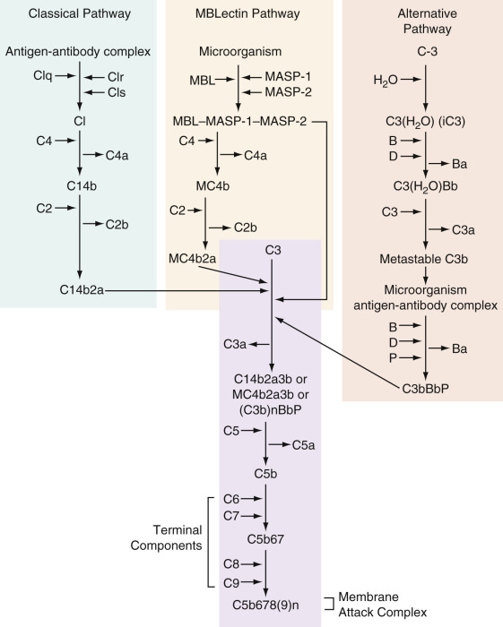
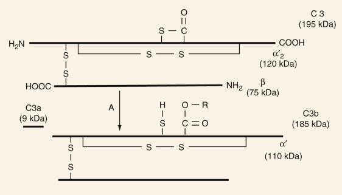
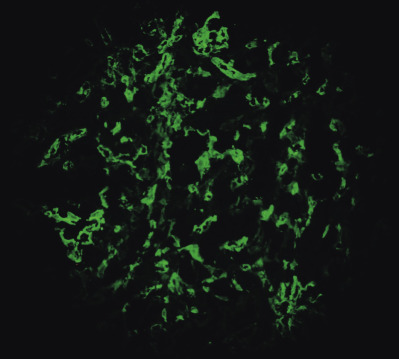

## Key Points

  * •

The complement system is a group of circulating proteins that promote inflammation and host defense. 

  * •

Unregulated tissue damage is a possible complication of complement activation, and a large variety of circulating and membrane-bound proteins exist to regulate complement activity. 

  * •

Complement component C3 is the central convergence point for all complement activation pathways. 

  * •

It is frequently necessary to measure serum complement levels to track disease activity, but it is important to recognize that serum complement measurements are snapshots of a dynamic process involving variable rates of complement consumption and production. 

  * •

Methods are available that allow accurate determination of serum levels of complement components. 

  * •

Functional complement assays are sensitive and precise tools that provide information about the activity and integrity of a complement component or pathway. 

  * •

The simplest functional assay of the classical pathway (CH50) measures total hemolytic complement activity. 

,  

##  Structure and Function of the Complement System 

The term **complement** refers to a group of more than 30 circulating and membrane-bound regulatory and constitutive component glycoproteins that function to promote host defense against infectious agents, to promote the clearance of apoptotic cell debris and immune complexes, and to regulate the immune response. Unregulated tissue damage is a possible complication of complement activation, and a large variety of circulating glycoproteins, as well as tissue membrane–bound proteins, function to regulate complement activity and downregulate complement attack. The existence of this system of proteins was inferred late in the 19th century, when it became clear that fresh serum had the ability to lyse gram-negative bacteria and cholera vibrios in the presence of specific antibody. As techniques for protein purification and identification became more sophisticated over the years, it was recognized that complement is a very complex system with many interacting proteins. 

In general, the system functions to identify foreign cells and microorganisms and destroy them. This may occur by direct lysis, by opsonization (the process of coating them with specific complement peptides recognized by specific receptors on phagocytes to aid ingestion), or by inflammation produced by the attraction of phagocytic cells. It also has become clear that complement plays a role in facilitating the immune response. 

The complement system of proteins is phylogenetically older than the proteins associated with acquired immunity (immunoglobulin) and is present in primitive organisms that lack immunoglobulin. Complement is presumed to provide a level of innate or natural immunity and host defense, even in the absence of an antibody response. It accomplishes this via the mannan-binding lectin (MBL) pathway and the alternative complement pathway, both discussed later. Antibody provides a level of increased specificity and increased efficiency in mediating host defense. A detailed history of the discovery of complement and of the various complement pathways is provided elsewhere (  Frank, 1998  ). 

 

##  Nomenclature 

Three major complement activation pathways are present in human serum: the classical pathway, the alternative pathway, and the MBL pathway (or MBLectin pathway). [ Figure 47-1 ](<#f0010>) illustrates the reaction sequence of each pathway. The nomenclature for proteins of the complement system generally follows two conventions (  World Health Organization, 1968  ;  IUIS-WHO, 1981  ). For historical reasons, the nine proteins of the classical pathway are designated by the uppercase letter _C,_ which is then followed by the number that relates to their order of appearance in the reaction sequence. A notable exception is C4, which acts before C2. Molecules that are part of the C1 complex are termed _C1q, C1r,_ and _C1s._ Proteins reacting solely in the alternative pathway are called _factors_ and are referred to by an uppercase letter (e.g., factor B, factor D). Fragments of complement proteins resulting from proteolytic cleavage are designated by an appended lowercase letter (e.g., C4a, C4b), where _a_ represents the smaller fragment, and _b_ represents the larger fragment. The exception to this rule is C2, where C2a is the larger fragment and C2b is the smaller fragment. Further degradation fragments of the large complement fragment of one component are designated by lowercase letters (e.g., C3c, C3d). Components that have lost activity (i.e., are inactive) are usually designated by a prefixed lowercase _i_ (e.g., iC3b, iC4b). Polypeptide chains of a native complement protein are designated by Greek lowercase letters (α, β, γ); with the exception of C1q, these chains are termed A, B, and C. Single components or multicomponent complexes that have enzymatic activity are designated by a bar over the component(s). Proteins of the MBLectin pathway are designated by abbreviations of the names of the proteins (e.g., MBL for mannan-binding lectin, MASP for MBL-associated serine protease). Regulatory proteins are designated by a descriptive title or letter (e.g., C4-binding protein, factor H). Membrane-bound regulatory proteins have been assigned CD numbers and descriptive titles (e.g., CD46 for membrane cofactor protein), and complement receptors are designated by numbers following the prefix CR (for complement receptors 1 to 4). The other complement receptors are designated by the component's symbol followed by the uppercase letter _R._ 

Figure 47-1 

Components of the classical, MBLectin, and alternative pathways converge to form a convertase that cleaves C3. 

In the classical pathway, antigen-antibody complexes sequentially bind and activate C1, C4, and C2. In the MBLectin pathway, interaction of MBL with a carbohydrate on the surface of a microorganism leads to the formation of an enzymatic complex (MBL–MASP-1–MASP-2, termed M in the figure) that binds and activates C4 and C2. In the alternative pathway, C3 undergoes hydrolysis of its thioester bond, which induces a change in conformation. It then binds factor B (B), which is cleaved by factor D (D) to form a convertase that is stabilized by properdin (P). C3b, the cleavage product of C3, also has a cleaved thiolester bond and is capable of activating the alternative pathway. The C3b-containing convertase of all pathways continues sequentially by binding the late-acting component until the sequence of activation is complete. 

 

##  C3: Central Molecule of Complement Activation Pathways 

The protein known as C3 is the central convergence point for the three complement activation pathways (the MBLectin pathway, the alternative pathway, and the classical pathway), which all proceed to lysis, phagocytosis, or regulation of the inflammatory response farther down the cascade. 

C3 is a two-chain molecule synthesized in many cells, particularly hepatocytes, formed from a single-chain molecule, pro-C3, and released into the circulation, where it binds to foreign target surfaces. The α and β chains are stabilized by intrachain disulfide bonds; an interchain disulfide bond stabilizes α and β chain interaction ( [ Fig. 47-2 ](<#f0015>) ). The α chain contains a thiolester that imparts an unstable structure to the molecule. Although it is in the hydrophobic center of C3, the thiolester can be cleaved by gradual hydrolysis as water penetrates the molecule, activating the alternative complement pathway. C3 may also be cleaved rapidly by the action of C3 convertase in releasing the 9-kDa C3a fragment from the α chain amino-terminus, from the larger C3b. C3b will go on to coat target proteins, thereby marking them for destruction, and C3a in the role of anaphylatoxin activates nearby cells to release mediators of inflammation (  Wen et al, 2004  ). Either avenue results in marked conformational alteration of C3 (now termed _C3b_ ) that permits it to interact with cells expressing C3b receptors, in particular CR1 (C3b/C4b receptor, CD35). (Native C3 will not interact with C3b receptors.) 

Figure 47-2 

C3 cleavage by C3 convertase: 

The approximate molecular weight of each chain or fragment is given in kilodaltons (C3 convertase is represented by A). 

C3 activation and conversion to C3b (with thiolester cleavage) lead to covalent binding of C3b to the surface of a target such as a microorganism. The target becomes coated with C3b capable of interacting with cells expressing C3b receptors, including all phagocytes, all B lymphocytes, and a subset of T lymphocytes. It is C3b that continues the complement cascade leading to lysis. 

 

##  The Classical Pathway 

The classical pathway of complement activation, described around 1900, was the first to be studied, and for this reason is called _classical._ It is evolutionarily the most recent of the three pathways described. The classical pathway is responsible for complement activation on most antibody-sensitized cells. Details of this pathway are published elsewhere (  Fries & Frank, 1987  ;  Volanakis, 1998  ). Nine numbered proteins make up the classical pathway. Activation of the classical pathway usually requires interaction between an antigen and a C1-binding **complementing** antibody. In humans, only immunoglobulin (Ig)M and IgG are effective at activating the classical pathway, except IgG4, which is unable to activate complement. A number of molecules other than immunoglobulins have the ability to activate the classical pathway via direct interaction with C1q. These include C-reactive protein, serum amyloid P component, β-amyloid, some gram-negative bacteria, certain viruses, mycoplasmas, protozoa, and intracellular components such as DNA, mitochondrial membranes, cytoskeletal filaments (  Gewurz et al, 1993  ), and apoptotic cells (  Korb & Ahearn, 1997  ). The latter might be of critical importance in the elimination of apoptotic cells and debris from the circulation. In some instances, infectious agents may exploit complement to their advantage, as with prion diseases such as transmissible spongiform encephalopathy, which may use complement components such as C3 and C1q to facilitate its localization within target cells (  Mabbott, 2004  ). 

Upon binding of immunoglobulin to a target, C1 binds to that immunoglobulin and becomes activated. C1 is a macromolecule of 740 kDa that comprises a single molecule of C1q complexed with two C1r and two C1s chains held together in the presence of calcium ions. Once bound to immunoglobulin, C1q adopts a conformational change that leads to autoactivation of the two C1r chains. Activated C1s  2  cleaves the next component in the cascade, C4. The larger fragment, C4b, becomes attached to the activator surface, whereas the smaller fragment, C4a, is released in the fluid phase. C4a is an anaphylatoxin and is described later in the chapter. Most of the generated C4b is hydrolyzed and remains in the fluid phase. Nevertheless, some of the generated C4b molecules bind to the activator surface as a cluster around the antigen-antibody-C1 site. A single antibody-antigen-C1 site thus can lead to the deposition of many C4b molecules. 

In the presence of magnesium ions, C4b acts as a site for the binding and subsequent cleavage of C2. C1s  2  , in association with C4b, cleaves C2 into two fragments. The larger fragment, C2a, remains bound to C4b, whereas the smaller one, C2b, is released in the fluid phase. This molecular complex, C4b2a, is unstable and has a relatively short half-life because of decay that results from the tendency of C2a to break away from the complex in an inactive form. The C4b2a complex is the classical pathway C3 convertase required for C3 binding and cleavage (see [ Fig. 47-2 ](<#f0015>) ). It is C2a as part of the C4b2a complex that enzymatically cleaves C3 in the next step of the activation cascade, and cleaves C5 in a later step. C2a cleaves C3 into a large fragment, C3b, which binds to the activator surface, and a smaller fragment, C3a, which is released into the fluid phase, where it serves as an anaphylatoxin. The newly generated C4b2a3b complex is the C5 convertase of the classical pathway that triggers deposition of terminal complement components on the target surface. 

IgM and IgG differ in their ability to activate the classical pathway of complement. It appears that a single molecule of most IgM antibodies bound by multiple antibody sites to an antigen can bind one molecule of C1 and trigger a complete complement activation sequence. IgM, with its five antigen-binding sites, adopts a functionally active conformation on an antigenic surface that allows multiple interactions with antigens. 

In contrast, C1 binding to IgG requires two molecules of IgG side by side in most experimental studies (  Borsos & Rapp, 1965  ). Because IgG antibodies bind to a target surface in a random fashion, and because antigens may not be evenly distributed on a target organism, the attachment of hundreds or thousands of IgG antibodies may be required to generate a C1-binding site. Classical pathway activation by IgG-antigen complexes is also shown to facilitate the alternative pathway (see the next section) on the activator surface (  Moore et al, 1981  ). 

The ability of aggregated immunoglobulin to bind C1q has provided the basis for a number of tests designed to detect the presence of soluble immune complexes in patient blood samples. Radiolabeled C1q is added to the serum or plasma sample, and one of a number of techniques (e.g., polyethylene glycol precipitation) is used to separate free C1q from that bound to protein components of serum. The binding of C1q suggests the presence of immunoglobulin complexes in the serum or plasma sample (  Zubler & Lambert, 1976  ). Soluble immune complexes may also be measured by identification of C1q- or C3-bound immune complexes using enzyme-linked immunosorbent assay (ELISA) techniques (  Stanilova & Slavov, 2001  ). Detection of the presence of C1q in tissue specimens by direct visualization with immunofluorescently labeled anti-C1q antibodies may be used to identify immune complexes in biopsy specimens. 

 

##  The Alternative Pathway 

The presence of a second pathway of complement activation was first proposed by Pillemer and colleagues in 1954 and was accepted by the scientific community almost 2 decades later. This complement activation pathway appears to be important in early defense against pathogenic microorganisms (  Pangburn & Müller-Eberhard, 1984  ). Although antibodies can also activate this system, neither antibody nor lectin is required for activation. Initiation of the alternative pathway on an acceptor surface begins with deposition of active C3 on a surface that has no regulators of complement present on it, leading to the generation of C3b fragments and allowing the process to continue as an unimpeded amplification loop (  Wen et al, 2004  ). This event depends on the ability of the carbonyl group of the exposed thiolester group of C3b to interact with an amide or a hydroxyl group of a protein or a carbohydrate present on the surface of a target (  Law et al, 1979  ). In serum, C3 is hydrolyzed at a rate of 0.2% to 0.4% of plasma pool per hour (  Pangburn et al, 1981  ). C3 with a hydrolyzed thiolester undergoes a conformational change that allows it to interact with proteins that do not interact with native C3, and is termed _C3(H 2  O) _ (also termed _iC3_ ). C3(H  2  O) then has the ability to interact with factor B in the presence of magnesium ions. Factor B, upon binding to C3(H  2  O), can interact with factor D and is cleaved to generate the so-called _initiation C3 convertase C3(H 2  O)Bb _ and liberate a small fragment, Ba. This cleavage is mediated by factor D, a serine protease that adopts an active conformation upon recognition of its substrate and returns to an inactive conformation once proteolytic cleavage is accomplished (  Volanakis & Narayana, 1996  ). 

The initiation C3 convertase cleaves C3 to generate metastable C3b at a continuously slow rate in the circulation. Metastable C3b can bind covalently to the activator surface and then, like C3(H  2  O), can bind factor B. As in the initiation C3 convertase, factor D then cleaves factor B to generate the cell-bound C3 convertase C3bBb. This complex decays rapidly but is stabilized upon binding of properdin, which prolongs the half-life of the C3 convertase from 1 to 18 minutes (  Fearon & Austen, 1975  ). This stabilized C3 convertase rapidly cleaves yet more C3, which can bind to the activator surface and therefore is referred to as the amplification C3 convertase of the alternative pathway. Amplification of C3b deposition to the activator surface leads to the formation of a C5 convertase (C3b2BbP) (  Kinoshita et al, 1988  ), which has the ability to trigger activation of the terminal components of the complement system. 

 

##  The Mannan-Binding Lectin Pathway 

A third pathway of complement activation has been described recently that utilizes the serum protein MBL (also called _mannose-binding lectin_ or _mannose-binding protein_ ), which is present in serum at about 1.5 µg/mL. Formed in the liver, MBL is found in all mammals and birds and belongs to a family of molecules termed _collectins_ (  Epstein et al, 1996  ;  Turner, 1996  ). The collectin family includes, in addition to MBL, lung surfactant proteins A and D (SP-A, SP-D), bovine conglutinin, bovine CL-43, and the ficolins (  Epstein et al, 1996  ;  Thiel, 2007  ). MBL and the ficolins are complement-activating soluble pattern recognition molecules, that is, they recognize pathogen-associated molecular patterns (PAMPs) on the surfaces of microbes. Once they bind their specific PAMP, these proteins undergo a conformational change that permits them to associate with the three MBL-associated serine proteases, MASP-1, MASP-2, and MASP-3, to activate the complement cascade (  Thiel, 2007  ). MBL is structurally related to C1q and recognizes certain **pathogenic** carbohydrates expressed on the surface of microorganisms, but does not recognize carbohydrates such as galactose and sialic acid, which are the terminal sugars expressed on mammalian glycoproteins (  Epstein et al, 1996  ). This allows MBL to discriminate between self and nonself, and it is reported that MBL may react with a wide range of acapsular gram-positive and gram-negative bacteria, viruses, yeasts, mycobacteria, parasites, and protozoa (  Epstein et al, 1996  ). 

The MASPs share structural homology with C1r and C1s, suggesting similarity with the C1 complex (C1qr  2  s  2  ). After activation, MASP-2 cleaves C4 to generate the classical pathway C3 convertase C4b2a (  Vorup-Jensen et al, 1998  ). MASP-1 has the ability to cleave C3 (  Matsushita et al, 1998  ), suggesting that it might trigger alternative pathway activation directly (  Schweinle et al, 1989  ). Following generation of the classical pathway C3 convertase C4b2a by the MBL–MASP-1–MASP-2–MASP-3 complex, complement activation proceeds as in the classical pathway, with possible recruitment of the alternative pathway as well (  Suankratay et al, 1998  ). Specific antibody-antigen complexes can also trigger the MBLectin pathway. It was demonstrated that a fraction of IgG molecules that lack terminal galactose residues (termed _IgG-G0_ ), as found in the plasma of patients with pathologic conditions such as rheumatoid arthritis (RA), have the ability to interact with MBL and activate the classical pathway (  Malhotra et al, 1995  ). MBL may also play a role in the elimination of target organisms by phagocytes through interaction with a specific receptor present on those phagocytes (  Tenner et al, 1995  ;  Hansen & Holmskov, 1998  ). It may modulate inflammatory and allergic responses, affect apoptotic cell clearance, and modulate the adaptive immune system (  van de Wetering et al, 2004  ;  Thiel, 2007  ). Regulation of the MBLectin pathway appears to be mediated by C1 inhibitor (  Matsushita & Fujita, 1996  ) and α 2  -macroglobulin (  Terai et al, 1995  ). 

 

##  Terminal Complement Components 

The three complement activation pathways converge on the activation of C3 and the assembly of the membrane attack complex (MAC), formed by components C5 to C9. Upon formation of the classical, MBLectin (C4b2a3b), and alternative (C3b2Bb) pathway C5 convertases, C5 is cleaved. The larger fragment (C5b) can associate with the cell membrane and interact with C6. The next step involves the interaction of the C5b-6 complex with fluid-phase C7, forming a trimeric complex with amphiphilic properties (high affinity for the lipid constituents of the cell membrane) (  Podack et al, 1979  ). C5b-7 inserts in the lipid bilayer of the cell membrane but is not sufficient for cell lysis to occur. C8 associates with this trimolecular complex via an interaction with exposed C5b. The C5b-8 complex penetrates the lipid bilayer further to form a small transmembrane pore that causes slow lysis of erythrocytes (  Ramm et al, 1982  ). However, insertion of multiple copies of C9 through the lipid bilayer via an initial interaction with the α chain of C8 is needed to produce the full cytolytic activity of the MAC (  Plumb & Sodetz, 1998  ). It is believed that the C5b-8 complex serves as an initiator of C9 polymerization within the cell membrane. 

The MAC, by electron microscopy, has a hollow, cylinder-like structure formed by the assembly of its components in the presence of excess C9 (  Podack & Tschopp, 1984  ). The mechanism by which the MAC disrupts the cell membrane results from formation of a transmembrane pore with a hydrophilic center through which ions can pass freely (  Bhakdi & Tranum-Jensen, 1991  ;  Tegla et al, 2011  ). The size of the pore depends upon the number of C9 molecules incorporated into the MAC. MACs composed of C5b-8,9  1  can result in nucleated cell death, but MACs consisting of C5b-8,9  4  complexes are twice as effective. Influx of Ca  2+  through the MAC causes loss of mitochondrial function leading to cell death (  Tegla et al, 2011  ). Formation of the MAC induces lysis of certain bacteria and viruses, and of heterologous erythrocytes. Most nucleated cells resist MAC-induced cytotoxicity. This protection, especially from attack by one's own complement proteins, is mediated by membrane-associated regulatory molecules that prevent MAC formation (see the “Regulation of Complement Activation” section later in the chapter), as well as by shedding of the activated complement proteins by blebbing of the cell surface. Lysis of nucleated cells mediated by the MAC may occur but requires multiple MAC lesions to take effect (  Koski et al, 1983  ;  Tegla et al, 2011  ). 

Sublytic amounts of the MAC might protect the cell from subsequent complement attack (  Reiter et al, 1992  ). Nucleated cells are protected from the effects of the MAC in part because of its active elimination from the cell surface by membrane repair linked to lipid turnover (  Mold, 1998  ). The half-life of MAC in nucleated cells is 1 to 3 minutes, but MAC may persist in erythrocytes up to 72 hours (  Tegla et al, 2011  ). MAC formation has a stimulating effect on several nucleated cell types. Among others, these effects include production of reactive oxygen radicals from neutrophils and macrophages, release of eicosanoids from phagocytic cells, induction of procoagulant activity in platelets and endothelial cells, proinflammatory activity in endothelial cells and smooth muscle cells, proliferation of smooth muscle cells and endothelial cells, production of growth factor (PDGF, bFGF-1, IGF-1), blocking of caspase-dependent apoptosis, and triggering of signal transduction pathways (  Niculescu et al  1993  ;  Benzaquen et al, 1994  ;  Sims & Wiedmer, 1995  ;  Kilgore et al, 1996  ;  Tedesco et al, 1997  ;  Mold, 1998  ;  Tegla et al, 2011  ). 

 

##  Anaphylatoxins 

Activation of complement via the classical, alternative, or MBLectin pathway leads to the generation of complement protein fragments that have important roles in various biologic functions, including opsonization, phagocytosis, immunomodulation, and generation of inflammatory reactions. 

Complement activation leads to proteolytic cleavage of many complement proteins with the subsequent release of small biologically active fragments into the fluid phase. Three of these released fragments—C4a, C3a, and C5a—are called _anaphylatoxins_ . The structural and functional characteristics of these molecules are described in several excellent reviews (  Ember et al, 1998  ;  Bosmann & Ward, 2012  ;  Zhou, 2012  ). The anaphylatoxins (C3a, C4a, C5a) are small peptide fragments of approximately 10 kDa that are enzymatically released during complement activation. The fragments contain a carboxyl-terminal arginine residue that can be rapidly cleaved to desarginine by serum carboxylpeptidases to reduce activity. Although all three anaphylatoxins show bioactivity, relative potency is C5a > C3a > C4a. It should be noted, however, that the relative effectiveness of these peptides is both tissue- and species-specific. For instance, C3a may be selectively effective in eosinophil localization to allergic sites, whereas C5a has an effect on many other cell types (  DiScipio et al, 1999  ). The anaphylatoxins bind to specific receptors on cells. The receptors, C3aR and C5aR, have been cloned and characterized. The receptor for C4a has not been identified. C3aR and C5aR belong to the seven-transmembrane G-coupled receptor (GPCR) family, and activate the MAPK signal pathway responsible for most of the biological activities associated with the anaphylatoxins. An additional receptor, C5L2, binds both C5a and C5a desArg. C5L2 belongs to the GPCR family, but the biological role for this receptor is highly controversial at this time. In general, anaphylatoxins are defined by their biological effects on smooth muscle cells, mast cells, small blood vessels, and peripheral blood leukocytes. Specific effects mediated by these peptides include degranulation of mast cells and basophils, with subsequent release of various mediators such as histamine and serotonin. They also induce human neutrophil aggregation and smooth muscle contraction, enhance vascular permeability, induce thromboxane release from guinea pig macrophages, and stimulate release of mucus from goblet cells (  Marom et al, 1985  ). An especially important effect of the anaphylatoxins on basophils is vasodilation caused by histamine release, leading to increased blood flow to sites of inflammation. 

In addition to its role as an anaphylatoxin, C5a has many important biological properties. The binding of C5a to neutrophils produces an increase in adhesion and aggregation, induction of an oxidative response, and release of lysosomal enzymes. C5a is strongly chemotactic for monocytes and neutrophils, inducing the migration of these cells toward the source of complement activation in the tissues. Thus, a local complement-activating inflammatory reaction can induce increased blood flow to the affected tissue, adherence of neutrophils to a locally activated endothelium, and directed migration of phagocytes to inflamed sites along a chemotactic gradient. Neutrophils aggregated by C5a can embolize to the lung, causing changes in pulmonary gas exchange and even death. It is thought that C5a mediates much of the pulmonary inflammation caused by immune complex formation (  Ward, 1997  ). In a rat experimental sepsis model, it has been demonstrated that C5a may block the bactericidal functions of neutrophils if produced in excessive amounts, suggesting a role for complement activation in the high mortality rates observed in sepsis (  Czermak et al, 1999  ). The biological effects of anaphylatoxins are mediated via specific cell surface receptors described in the section on complement receptors. 

Recently, C3a and C5a have been shown to play an important role in bridging the gap between innate and adaptive immunity through their ability to modulate Th1, Th2, Th17, and Treg cell responses (  Zhou, 2012  ). Most of the investigations on anaphylatoxin regulation of T cell and dendritic cell/macrophage responses depend upon experimental animal models. The C3a/C5a effect is complex and varies depending upon the disease model, the genetic background of the mouse, and interactions with other pattern recognition receptors such as toll-like receptors. In experimental asthma, C3a promotes Th2 immunity and exacerbates lung injury, whereas C5a actually suppresses Th2 responses and is protective. It is thought that the major mechanism of anaphylatoxin modulation of T cell responses depends upon their effect on dendritic cell or macrophage cytokine- and antigen-presenting activity. There is variability in C3aR and C5aR expression levels between human myeloid cell subpopulations, which may explain the differential effects of anaphylatoxin on cytokine induction and T cell responses. 

 

##  Regulation of Complement Activation 

Complement activation, although important to host defense, may produce profound tissue damage. Organisms have evolved with internal control mechanisms to (1) limit overly widespread inflammation, (2) avoid excessive activation, and (3) protect host cells from inadvertent injury. A potent regulatory system consisting of fluid-phase and membrane-associated proteins controls complement activation at almost every step of the activation cascade ( [ Table 47-1 ](<#t0010>) ). 

TABLE 47-1 

Complement Regulatory Proteins 

Protein  |  Molecular Weight, kDa  |  Target  |  Mechanism of Action   
---|---|---|---  
**Fluid Phases**  
C1 inhibitor  |  105  |  C1  |  Dissociates the C1 complex by binding to C1r and C1s   
Factor H  |  150  |  C3b  |  Cofactor for C3b inactivation by factor I   
C4-binding protein  |  550  |  C4  |  Cofactor for C4b inactivation by factor I   
S protein (vitronectin)  |  84  |  C5b-7  |  Inhibits insertion of the MAC into cell membranes   
Clusterin  |  70  |  C5b-7  |  Inhibits insertion of the MAC into cell membranes   
Factor J  |  20  |  C1, C3, B  |  Inhibits C1 complex formation, inhibits cleavage of C3 by Bb   
**Cell-Associated**  
CR1  |  190 [ * ](<#hl0000111>) |  C3b, C4b  |  Dissociation of C3/C5 convertases, cofactor for C3b and C4b inactivation by factor I   
DAF (CD55)  |  70  |  C3bBb, C4b2a  |  Dissociation of C3/C5 convertases   
MCP (CD46)  |  45-70  |  C3b (C4b)  |  Cofactor for C3b inactivation by factor I   
CD59 (protectin)  |  18-20  |  C8, C9  |  Inhibition of formation of the MAC   
HRF  |  65  |  C8, C9  |  Inhibition of formation of the MAC   
  
_CR1,_ Complement receptor type 1; _DAF,_ decay-accelerating factor; _HRF,_ homologous restriction factor; _MAC,_ membrane attack complex; _MCP,_ membrane cofactor protein. 

 * Most common isoform of CR1. 

 

##  Fluid-Phase Regulators 

Control of the first component of the classical pathway (C1) is mediated by C1 inhibitor (C1-Inh). C1-Inh blocks C1 autoactivation, C1 activation in the fluid phase, and C1 activation on weak activators of the classical pathway; it does not block activation on most immune complexes (  Doekes et al, 1983  ). It is thought that C1-Inh has the ability to dislodge the entire C1qr  2  s  2  complex from immunoglobulin with low binding affinity for C1q (  Chen et al, 1998  ) and from targets sensitized with low doses of human IgG (  Chen et al, 1998  ). In vitro, C1-Inh inactivates MASP (mannan-binding lectin-associated serine proteases) (  Matsushita & Fujita, 1996  ). C4b activity is regulated by factor I (formerly referred to as the C3b/C4b inactivator) (  Fries & Frank, 1987  ), which cleaves the C4b α chain to generate two fragments, C4c and C4d; the latter fragment remains cell-bound. For proteolysis, a cofactor, C4-binding protein (C4BP), is required. C4BP is a 570-kDa protein that can also bind particle-bound and fluid-phase C4b and can displace C2a from the classical pathway C3 convertase C4b2a (  Gigli et al, 1979  ). Because of its pivotal role in the three complement-activation pathways, C3 is under rigid control. Fluid-phase C3b and C3 (H  2  O) are rapidly inactivated by factor I, which cleaves three peptide bonds on the α chain of C3b (  Davis & Harrison, 1982  ), thus generating an inactive form of the molecule, iC3b, which is incapable of engaging C5 or factor B. This factor I–mediated cleavage requires factor H as a cofactor. Factor H is a 150-kDa protein that binds C3b and has decay-accelerating activity toward the alternative pathway C3 convertase, in addition to its cofactor activity for factor I–mediated cleavage of C3b. In addition to regulating C3b in the fluid phase, factor H binds to cell-bound C3b and triggers cleavage by factor I, thus limiting classical pathway activation (  Ollert et al, 1995  ). Once C3b is cleaved into iC3b, which then remains bound to the target surface, it is free to interact with complement receptor type 3 (CR3) present on phagocytic cells, thereby promoting phagocytosis. 

A number of fluid-phase inhibitors of the terminal complement components can prevent insertion of the MAC into cell membranes. S protein (not identical to protein S), also called _vitronectin,_ binds the C5b-7 complex, thereby preventing its insertion in the cell membrane (  Podack et al, 1977  ) and inhibiting C9 polymerization (  Johnson et al, 1994  ). S protein binds C5b and C8 within the sC5b-9 complex (  Su, 1996  ) and binds to the receptor C1q (  Lim et al, 1996  ). Although the full role of S protein in regulating complement activation in vivo is uncertain,  Peake and colleagues (1996)  showed that S protein forms a complex with sC5b-9 when complement is activated in rabbits, and that this complex still has the ability to block C9-mediated lysis of sensitized sheep erythrocytes bearing complement components 1 to 7. Clusterin (also called _Sp-40_ or _apolipoprotein J_ ) is another fluid-phase inhibitor of the terminal complement components. Similar to vitronectin, clusterin prevents insertion of the C5b-7 complex into the cell membrane (  Choi et al, 1989  ) and regulates the MAC at both C5b-7 and C9 levels (  Berge et al, 1997  ). 

 

##  Cell-Associated Regulatory Proteins 

Regulation of complement activation must occur on host cell surfaces to limit inadvertent injury to those cells. Many of these regulatory proteins also act as complement receptors. One such protein is complement receptor type 1 (CR1), which binds activated C4b and C3b and serves as a cofactor for their factor I–mediated cleavages (see the next section). Control of cell membrane–deposited C4b and C3b is also achieved by membrane cofactor protein (MCP, CD46). This protein is expressed by almost every cell, with the notable exception of erythrocytes, and it serves as a cofactor for factor I–mediated cleavage of C4b and C3b into C4c and C4d, and iC3b, respectively (  Seya et al, 1986  ;  Seya & Atkinson, 1989  ). 

Another cell membrane–associated protein that controls complement activation at the level of the C3 and C5 convertases is decay-accelerating factor (DAF, CD55). DAF is expressed by all circulating cells, all endothelial cells, and a number of epithelial cells (  Morgan & Meri, 1994  ), and it accelerates the decay of C3 and C5 convertases of both the classical and alternative pathways. 

Regulatory control of terminal complement components of the MAC is achieved by homologous restriction factor (HRF), or C8-binding protein, and CD59 (also referred to as _protectin, HRF-20, membrane inhibitor of reactive lysis,_ and _P-18_ ). HRF is expressed on erythrocytes, platelets, T lymphocytes, B lymphocytes, neutrophils, and monocytes (  Morgan & Meri, 1994  ), where it binds C8 and inhibits C9 polymerization (  Morgan & Meri, 1994  ). The second regulatory protein, CD59, is found on all circulating cells, endothelial cells, epithelial cells, spermatozoa, glomerular podocytes (  Morgan & Meri, 1994  ), and on some cells of the central nervous system (  Morgan & Gasque, 1996  ). CD59 binds both the β chain of C8 and the b domain of C9 (  Chang et al, 1994  ), inhibiting MAC formation on host cells. Because of their glycosyl phosphatidylinositol linkage to cell membranes, DAF, HRF, and CD59 are absent from the cells of patients with paroxysmal nocturnal hemoglobinuria (PNH) (  Volanakis, 1988  ). 

 

##  Complement Receptors 

Receptors that bind activated complement components have been described in various cell types. These receptors control the biological effects of complement activation peptides and are linked to several other cellular functions as well ( [ Table 47-2 ](<#t0015>) ). The complement receptors that have been best studied are those that bind the degradation fragments of C3. 

TABLE 47-2 

Cell Receptors for Complement Protein Fragments 

Receptor  |  Molecular Weight, kDa  |  Ligand  |  Physiologic Role   
---|---|---|---  
CR1  |  190 (most common isoform)  |  C3b, C4b, iC3b  |  Phagocytosis, immune complex clearance   
CR2  |  140  |  C3d, C3dg, iC3b  |  B cell activation   
CR3  |  165 (α chain)   
95 (β chain)  |  iC3b, C3d, C3b  |  Phagocytosis, cellular adhesion   
CR4  |  150 (α chain)   
95 (β chain)  |  iC3b, C3b  |  Cellular adhesion   
C1qRp [ * ](<#hl0000180>) |  126  |  C1q, MBL, SP-A  |  Phagocytosis   
C3aR  |  48  |  C3a  |  Chemotaxis, degranulation of serosal-type mast cells, increase in vascular permeability   
C5aR  |  43  |  C5a, C5a desArg  |  Chemotaxis, degranulation of serosal-type mast cells, cellular adhesion, increase in vascular permeability   
  
_CR1,_ Complement receptor type 1; _C1qRp,_ receptor for the collagenous region of C1q; _CR2,_ complement receptor type 2; _CR3,_ complement receptor type 3; _C3aR,_ C3a receptor; _CR4,_ complement receptor type 4; _C5a desArg,_ C5a lacking the terminal arginine residue following inactivation by carboxypeptidase-N; _C5aR,_ C5a receptor; _MBL,_ mannan-binding lectin; _SP-A,_ surfactant protein A. 

 * Other C1q receptors have also been described. 

Complement receptor type 1 (CR1, CD35, C3b/C4b receptor) is a single-chain glycoprotein expressed on erythrocytes, mononuclear phagocytes, eosinophils, B lymphocytes, a subset of T lymphocytes, glomerular podocytes, follicular dendritic cells (  Ahearn & Rosengard, 1998  ), and astrocytes (  Morgan & Gasque, 1996  ). It binds both C3b and C4b, to a lesser extent iC3b, and C1q as well (  Klickstein et al, 1997  ). CR1 serves as a cofactor for factor I–mediated cleavage of C3b, iC3b, and C4b and has decay-accelerating activity for the classical and alternative pathway C3 and C5 convertases. A major physiologic role of CR1 is related to phagocytosis of complement-coated particles (opsonized particles). It is believed that erythrocyte CR1 has a major role in sequestering C3b- and iC3b-bearing immune complexes, removing them from the plasma and facilitating their transfer to degradation sites in the liver and the spleen (  Birmingham, 1995  ). Decreased expression of erythrocyte CR1 may be associated with increased susceptibility to chronic forms of infection (  Teixeira et al, 2001  ). 

A receptor for the C3d fragment of C3 is found on human B cells, B cell lines, follicular dendritic cells, some peripheral T cells, some T cell lines, thymocytes (  Ahearn & Rosengard, 1998  ), and astrocytes (  Morgan & Gasque, 1996  ), and it is termed _CR2 (CD21)._ CR2 has the ability to serve as a cofactor for factor I–mediated cleavage of iC3b bound to targets (  Mitomo et al, 1987  ), and it is the receptor for Epstein-Barr virus on B cells causing infectious mononucleosis (  Fingeroth et al, 1984  ). The major function of CR2 is thought to be the regulation of B cell immune responses to antigen (  Carroll, 1998  ). 

A third complement receptor, CR3 (also referred to as _Mac-1, CD11b/CD1_ 8), is a member of the β2 leukocyte integrin family of adhesion molecules. CR3 is expressed on mononuclear phagocytes, granulocytes, natural killer (NK) cells (  Ahearn & Rosengard, 1998  ), and microglial cells (  Morgan & Gasque, 1996  ), and it binds iC3b, C3b, and C3d (  Brown, 1991  ). On phagocytes, CR3 triggers the phagocytic process in a fashion that parallels that of CR1. Another important role for CR3 is seen in the adhesion of monocytes and neutrophils to endothelial cells via interaction with its ligand, intercellular adhesion molecule type 1 (ICAM-1). This allows accumulation of phagocytes at sites of tissue injury where endothelial cells become activated. CR3 may serve as a receptor for both human immunodeficiency virus (HIV)-1 and _Neisseria gonorrhoeae_ infection of follicular dendritic cells and cervical epithelial cells, respectively (  Edwards et al, 2001  ;  Batjay et al, 2004  ). 

Complement receptor type 4 (CR4, CD11c/CD18) is a glycoprotein that shares characteristics with CR3. It is also a member of the integrin family of adhesion molecules and is expressed on myeloid cells, dendritic cells, NK cells, activated B cells, some activated T cells, platelets (  Ahearn & Rosengard, 1998  ), and microglial cells (  Morgan & Gasque, 1996  ). CR4 binds iC3b, and C3b to a lesser extent (  Brown, 1991  ). The exact role of CR4 in terms of complement activation is unknown, but because this glycoprotein is an adhesion molecule, it may serve to “assist” neutrophil adhesion to the endothelium during inflammatory processes (  Sengeløv, 1995  ). 

A receptor for the anaphylatoxin C5a (C5aR) is expressed on neutrophils, monocytes, basophils, eosinophils, platelets, mast cells, liver parenchymal cells, lung vascular smooth muscle cells, lung and umbilical vascular endothelial cells, bronchial and alveolar epithelial cells, astrocytes, microglial cells (  Ember et al, 1998  ), and human T cells (  Nataf et al, 1999  ). C5a binding to C5aR induces a wide variety of events, including chemotaxis of inflammatory cells; degranulation of mast cells; production of oxygen radicals; promotion of cell adhesion; production of leukotrienes and prostaglandins in neutrophils and eosinophils; and induction of acute phase proteins, cytokines, and antibodies (  Ember et al, 1998  ). 

 

##  Complement Biosynthesis 

It is estimated that about 90% of plasma complement components are synthesized in the liver and are acute phase proteins (i.e., their synthesis by the liver increases during inflammatory reactions to increase plasma levels). The hepatocyte produces the vast majority of complement components, with the exception of C1q, factor D, properdin, and C7 (  Morgan & Gasque, 1997  ). C1q appears to be synthesized by epithelial cells, monocytes/macrophages, and fibroblasts. The main source of factor D is the adipocyte. Properdin is synthesized mainly by monocytes and macrophages, with some synthesis occurring in lymphocytes and granulocytes. Most plasma C7 also appears to originate from monocytes and macrophages, although neutrophils were shown to store C7. Monocytes, macrophages, cells of the synovial tissues, and astrocytes have the ability to synthesize all components of the classical and alternative pathways. This may have important implications in tissue-specific inflammation, where a localized mechanism of host defense must be present to eliminate foreign particles efficiently. Production of complement components usually synthesized by hepatocytes or by extrahepatic cells often requires stimuli generated in inflammatory reactions such as interleukin-1α, interleukin-6, or interferon-γ. A good description of the regulation of complement protein synthesis by various cells is provided elsewhere (  Colten & Garnier, 1998  ). 

 

##  Complement Genetics 

Most of the complement components are inherited in an autosomal codominant fashion. Genes that encode complement proteins, receptors, and regulatory molecules have been cloned and assigned a chromosome location ( [ Table 47-3 ](<#t0020>) ). Linkage exists for many of the genes that code for complement-related molecules. These linkage groups include major histocompatibility complex (MHC) class III genes (C2, factor B, and C4), genes for the regulators of complement activation (C4-binding protein, CR1, CR2, DAF, MCP, and factor H), and genes for proteins of the MACx (C6, C7, and C9) (  Schneider & Würzner, 1999  ). Molecules within each of these three groups share structural homology, suggesting that complement proteins may have arisen from gene duplication of a limited number of ancestral genes. Almost all complement-related proteins show polymorphism. The most polymorphic complement component is C4, with more than 35 identified alleles. Point mutations, insertions, or deletions of nucleic acids are usually linked to deficiencies in complement proteins (  Schneider & Rittner, 1997  ). Complement protein polymorphism is assessed by both phenotypic and genotypic analysis. Details of these methods are not discussed in this chapter, and the reader is referred to [ Chapter 50 ](<##!/content/3-s2.0-B9780323295680000504?scrollTo=%23c00050>) , as well as to other authors (  Mauff & Würzner, 1996  ;  Schneider & Rittner, 1997  ) for further reading. 

TABLE 47-3 

Complement Proteins in Human Plasma 

Protein  |  Molecular Weight, kDa  |  Chromosomal Location  |  Concentration, mg/mL   
---|---|---|---  
**Common to All Pathways**  
C3  |  185  |  19p13.3-p13.2  |  1200-1300   
**Classical Pathway**  
C1q  |  460  |  1p34.1-36.3  |  150   
C1r  |  85  |  12p13  |  50   
C1s  |  85  |  12p13  |  50   
C4  |  205  |  6p21.3  |  300-600   
C2  |  102  |  6p21.3  |  20   
**Alternative Pathway**  
Factor B  |  93  |  6p21.3  |  200   
Factor D  |  24  |  Unknown  |  2   
Properdin  |  55 (monomer)  |  Xp11.4-p11.2  |  25   
**MBLectin Pathway**  
MBL  |  200-400  |  10q11.2-q21  |  0.002-10   
MASP-1  |  93  |  3q27-28  |  1.5-13   
MASP-2  |  76  |  1p36.3-36.2  |  Unknown   
**Membrane Attack Complex**  
C5  |  190  |  9q33  |  80   
C6  |  110  |  5p13  |  45   
C7  |  100  |  5p13  |  90   
C8  |  150  |  1p32 (α, β chains), 9q22.3-q32 (γ chain)  |  55   
C9  |  70  |  5p13  |  60   
**Control Proteins**  
C1-Inh  |  105  |  11q11-q13.1  |  240   
C4bp  |  550  |  1q32  |  250   
Factor I  |  88  |  4q25  |  35   
Factor H  |  150  |  1q32  |  300-450   
S protein  |  84  |  17q11  |  500   
Clusterin  |  70  |  Unknown  |  50   
Factor J  |  20  |  Unknown  |  ~5.4   
  
_MASP,_ MBL-associated serine proteases; _MBL,_ mannan-binding lectin. 

 

##  Complement and Acquired Immunity 

The complement system plays an important role in the establishment of acquired immune responses (  Carroll, 2004  ). Evidence of this role came to light when depressed antibody responses to antigen stimulation were noted in animals transiently depleted in C3 (  Pepys, 1974  ); in animals with genetic deficiencies in C2, C4, or C3 (  Ochs et al, 1983  ;  Böttger et al, 1985  ;  O'Neil et al, 1988  ); and in patients who were genetically deficient in C2, C4, C3, or CR3 (  Ochs et al, 1986  ). Studies of knockout mice lacking C4, C3, or CR1, and CR2, have furthered our understanding of the role that complement plays in the acquired immune response. 

Complement may influence the antibody response to antigen in several ways. CR2 is present on the surface of B cells in association with CD19 and TAPA-1. When the B cell antigen receptor and CR2 are coligated (as would occur when antigen is complexed with C3d), the threshold for B cell activation and ultimately antibody production is dramatically lowered. Complement may also assist in the trapping of immune complexes by follicular dendritic cells, thereby facilitating the formation of lymphoid germinal centers, where B cells acquire the memory phenotype. Lack of one of the early components of the classical pathway of complement activation, or lack of CR1 and/or CR2, leads to an impaired immune response to antigen and, in some cases, to an inability to mount a secondary antibody response. Complement appears to play a role in the generation of CD5-positive B cells, which give rise to so-called **natural** antibodies (  Carroll, 1998  ). Along with complement activation, these natural antibodies are important in proper B cell activation in response to antigenic challenge (  Boes et al, 1998  ;  Lutz, 1999  ). 

Complement components C4, CR1, and CR2 play an important role in the maintenance of B cell tolerance to self-antigens (  Prodeus et al, 1998  ). Complement, especially C3, is important in the generation of the acquired immune response to antigen via antigen-presenting cells (APCs). The presence of C3 cleavage products on antigen enhances uptake of that antigen by APCs (B cells and other professional APCs expressing CR1 and/or CR2), thereby increasing the efficiency of antigen presentation to T cells with enhancement of subsequent T cell–mediated responses (  Boackle et al, 1998  ;  Kerekes et al, 1998  ). Evidence suggests direct complement modulation of T cell immune response through interaction with complement receptors variably expressed on some T cell populations (  Kemper & Atkinson, 2007  ). The role of complement in negatively regulating host immunity is also becoming apparent. For instance, cross-linking of C5a, C3b, and C1q receptors on macrophages and dendritic cells induces suppression of toll-like receptor–mediated proinflammatory signaling, thereby contributing to induction of tolerance (  Cummings et al, 2007  ). It thus appears that complement plays both inductive and inhibitory roles in acquired immunity. 

,  

##  Genetic Complement Deficiencies 

Identification of individuals with complement deficiencies has contributed much to our understanding of the role that complement plays in host defense, especially against infectious agents, and in the development of autoimmune disease. Genetically controlled complement deficiencies are very rare but are estimated to account for as many as 6% of primary immunodeficiencies (  Notarangelo et al, 2004  ). These deficiencies are of interest because they allow us to determine the role of complement components in various biologic phenomena and in various disease states. Knowledge of a specific genetic mutation associated with a deficiency would permit confirmation of the heritable nature of the complement deficiency and enable screening for carriers of the mutation within the family. Even so, because genetic analyses are difficult to undertake routinely and are generally more expensive to use for screening purposes, they are rarely used during the primary workup of complement component deficiencies (  Mollnes et al, 2007  ). The absence of a complement component usually follows simple Mendelian genetic principles and is most often inherited as an autosomal recessive trait, with some exceptions noted here. Heterozygous patients tend to have half the expected normal complement level or less, and homozygous (deficient) patients have little or no detectable complement component activity. Deficiencies are known for every protein linked to complement activation ( [ Table 47-4 ](<#t0025>) ). The incidence of complete complement deficiency is estimated to be 0.03% of the general population (  Wen et al, 2004  ), but with the discovery of the MBL pathway came the surprising finding that deficiency in serum MBL is fairly common. In fact it is estimated that as much as 5% of the population has one of the three recognized gene mutations that lead to MBL deficiency (  Sumiya & Summerfield, 1997  ). 

TABLE 47-4 

Inherited Deficiencies in Complement and Complement-Related Proteins 

Protein  |  Pattern of Inheritance  |  Major Clinical Correlate(s) [ * ](<#hl0000480>)  
---|---|---  
**Common to All Pathways**  
C3  |  Autosomal recessive  |  Recurrent pyogenic infections, glomerulonephritis   
**Classical Pathway**  
C1q  |  Autosomal recessive  |  Glomerulonephritis, SLE   
C1r  |  Autosomal recessive  |  Glomerulonephritis, SLE   
C1s  |  Autosomal recessive  |  Glomerulonephritis, SLE   
C4 [ † ](<#hl0000483>) |  Autosomal recessive  |  SLE, scleroderma, IgA nephropathy, membranous glomerulonephritis   
C2 [ † ](<#hl0000483>) |  Autosomal recessive  |  SLE, DLE, juvenile rheumatoid arthritis, glomerulonephritis   
**Alternative Pathway**  
Factor B  |  Autosomal recessive  |  _Neisseria meningitidis_ infection   
Factor D  |  Autosomal recessive  |  Recurrent pyogenic infections   
Properdin  |  X-linked  |  Recurrent pyogenic infections, fulminant meningococcemia   
**MBLectin Pathway**  
MBL  |  Autosomal dominant  |  Recurrent infections   
**Membrane Attack Complex**  
C5  |  Autosomal recessive  |  Recurrent disseminated neisserial infections, SLE   
C6  |  Autosomal recessive  |  Recurrent disseminated neisserial infections   
C7  |  Autosomal recessive  |  Recurrent disseminated neisserial infections, Raynaud's disease   
C8 (β or α-γ chains)  |  Autosomal recessive  |  Recurrent disseminated neisserial infections   
C9  |  Autosomal recessive  |  None   
**Fluid-Phase Control Proteins**  
C1-Inh  |  Autosomal dominant or acquired  |  Hereditary angioedema, autoimmune diseases [ ‡ ](<#hl0000488>)  
C4bp  |  Autosomal recessive  |  Angioedema, Behçet-like syndrome   
Factor I  |  Autosomal recessive  |  Recurrent pyogenic infections   
Factor H  |  Autosomal recessive  |  Recurrent pyogenic infections, glomerulonephritis, age-related macular degeneration   
**Cell-Bound Proteins**  
CR1  |  Autosomal recessive [ § ](<#hl0000491>) |  Association between low erythrocyte expression and SLE   
CR3  |  Autosomal recessive  |  Leukocyte adhesion deficiency-1 (LAD-1), recurrent pyogenic infections, leukocytosis   
DAF/CD59/HRF  |  Acquired  |  Paroxysmal nocturnal hemoglobinuria   
  
_dAF,_ Decay-accelerating factor; _DLE,_ disseminated lupus erythematosus; _MBL,_ mannan-binding lectin; _SLE,_ systemic lupus erythematosus. 

 * Note that some people with complement deficiencies, especially C2 and components of the membrane attack complex, are clinically well. A substantial number of patients with defects in C5 to C9 have had autoimmune disease. Deficiencies of C1 to C9 are associated with a CH50 of 0. Deficiencies of C1, C4, and C2 are associated with SLE, and patients often have negative LE preps. Deficiencies of C3 to C9 are associated with absent or low bactericidal activity in serum. Deficiency of C3 or C5 is associated with absent or diminished chemotactic activity of serum and may be associated with absent leukocyte response to infection. 

 † Deficiency in C4 genes ( _C4A_ and _C4B_ ) is referred to as “q0,” for quantity zero. Such deficiency is designated C4Aq0 or C4Bq0. Patients with such deficiencies have a higher than normal incidence of autoimmune disease. Heterozygous C2-deficient individuals also have an increased incidence of autoimmune disease. 

 ‡ Approximately 85% of cases involve silent alleles, and 15% involve alleles encoding for acquired dysfunctional variant C1 inhibitor protein. In hereditary angioedema, the C1 level is normal or depressed, the C3 level is always normal, and the C4 level is depressed. In the acquired disease, C1 and C4 levels are depressed, the antigenic C1 inhibitor level usually is normal or high, and the functional C1 inhibitor level is very low. 

 § Homozygosity for low (not absent) numeric expression of CR1 on erythrocytes is detectable in vitro and may be associated with SLE. An acquired defect in the number of CR1 may also be operative. Low, but not absent, levels of leukocyte CR3 are detectable in both parents of most CR3-deficient children. 

A correlation between MBL deficiency (autosomal codominant) and upper respiratory tract infection, especially between 6 and 18 months of age, has been reported, demonstrating the importance of the MBL pathway in early childhood (  Turner, 1996  ). One study suggested that variant MBL genes might be associated with as many as one third of all meningococcal infections in children (  Hibberd et al, 1999  ). Purified MBL infusions are reported to correct the defect and susceptibility to infection in children with MBL deficiencies (  Valdimarsson et al, 1998  ). Not surprisingly, the same tendency to acquire clinically significant infections is associated with MBL deficiency in those immunocompromised by chemotherapy. Furthermore, it has been suggested that MBL deficiency leads to autoimmune diseases such as systemic lupus erythematosus (SLE) (  Turner, 1996  ) and is a risk factor for recurrent miscarriage (  Christiansen et al, 1999  ). In contrast, deficiencies of early components of the classical pathway are rare, but are strongly associated with lupus-like disease with rash and glomerulonephritis (  Botto et al, 2009  ). 

Because complement is important in the clearance of immune complexes from the circulation, it may be true that early complement component deficiency leads to improper handling of immune complexes, along with their accumulation in tissues such as the kidney. Deficiencies of terminal complement components and alternate pathway components such as factor B, factor D, and properdin (X-linked) are well described and are associated with elevated risk for recurrent infection with gram-negative cocci such as _Neisseria meningitidis_ and septic shock. Deficiency in C1 inhibitor (autosomal dominant) leads to hereditary angioedema, a disease characterized by recurrent episodes of subcutaneous and submucosal edema. This deficiency can be inherited or acquired following the development of autoantibodies to C1 inhibitor. Deficiency of factor H due to a novel homozygous factor H gene mutation has been described in an 8-month-old child and was associated with thrombotic microangiopathy and ultimately renal failure (atypical hemolytic-uremic syndrome [aHUS]) (  Licht et al, 2005  ). [ Table 47-5 ](<#t0030>) lists complement deficiency assays in common use. 

TABLE 47-5 

Major Complement Deficiency Assays Performed on Peripheral Blood 

Functional  |  Immunochemical Single-Protein Quantification  |  Activation Product  |  Autoantibody Analysis  |  Surface Proteins  |  Genetic Mapping   
---|---|---|---|---|---  
**_Total Complement Activity_ ** |  **_Immunoprecipitation_ ** |  **_ELISA Based on Antibody to Neo-epitopes Found on Activation Products_ ** |  **_ELISA-Based Assays_ ** |  **_Flow Cytometric Quantification_ ** |  **_Detection of Disease-Associated Genetic Variants (Mutations, Polymorphisms)_ **  
  
  * a. CH50 and AH50 hemolytic assays 

| 

  * a. RID 

| 

  * a. Split products: C3a, C4a, C5a 

|  Anti-C1q in SLE, anti-C1-Inh in AE, anti-factor H in aHUS, others  |  CD55/DAF and CD59 in PNH  |  aHUS (factor H, factor I, factor B, C3)   
  
  * b. ELISA for CP, AP, MBL (WIELISA) 

| 

  * b. Electroimmunoassay 

| 

  * b. Activated component complexes: C1rs-C1-Inh, others 

|  Functional assays (C3)  |  |  MPGN   
| 

  * c. Nephelometry and turbidimetry 

| 

  * c. Macromolecular complexes 

| 

  * a. C3 nephritic factor in MPGN, type 2 

|  |   
**_Single-Component Activity_ ** |  **_Other Methods_ ** |  |  |  |   
  
  * a. Hemolytic assays using component-deficient sera (e.g., C3, factor H) 

| 

  * a. ELISA 

|  |  |  |   
  
  * b. ELISA (e.g., MBL and MASP functional activity with C4 as target) 

| 

  * b. TRIFMA 

|  |  |  |   
  
  * c. Chromogenic substrate (C1-Inh) 

| 

  * c. WB 

|  |  |  |   
  
_AE,_ Angioedema; _aHUS,_ atypical hemolytic-uremic syndrome; _AP,_ alternate pathway; _CP,_ classical pathway; _ELISA,_ enzyme-linked immunosorbent assay; _MASP,_ MBL-associated serine proteases; _MBL,_ mannan-binding lectin pathway; _MPGN,_ membranoproliferative glomerulonephritis; _PNH,_ paroxysmal nocturnal hemoglobinuria; _RID,_ radioimmunodiffusion; _TRIFMA,_ time-resolved immunofluorometric assay; _WB,_ Western blot; _WIESLA,_ three-pathway ELISA (Wieslab, Lund, Sweden). 

Adapted from Botto M, et al: Complement in human diseases: lessons from complement deficiencies, _Mol Immunol_ 46:2774–2783, 2009, Table 1. 

,  

##  Assessment of Complement Activity in Disease 

Complement promotes inflammation or tissue damage during the immune response, and it plays an important role in the pathogenesis of some diseases. In the latter situation, complement is often activated by an abnormal antibody (autoantibody), by an immune complex, or by foreign material. To track disease activity in these cases, it is frequently necessary to measure serum complement levels ( [ Table 47-6 ](<#t0035>) ), as with SLE, in which depressed serum C3 or C4 correlates with disease activity. In such instances, nephelometric techniques are frequently employed (see the “Assays of Complement” section later in the chapter). 

TABLE 47-6 

Complement Deficiency–Related Disease State and Recommended Analysis on Peripheral Blood 

Disease  |  Complement Analysis   
---|---  
Recurrent bacterial infections  |  CH50, AH50, WIELISA, C3, C3a/C3d, C5-C9 _(Neisseria)_ , properdin _(Neisseria)_ , MBL _(Neisseria)_  
Systemic lupus erythematosus  |  CH50, C4 (C4A/B), C3a/C3d, anti-C1q autoantibodies   
Angioedema  |  C1 inhibitor antigenic assay, C4, C1q, acquired anti-C1q autoantibody   
aHUS  |  CH50, AH50, C3, C3a/C3d, C3 nephritic factor, factor H, factor B, factor I, anti–factor H antibodies   
MPGN  |  CH50, AH50, C3, C3a/C3d, C3 nephritic factor, factor H, factor I, anti–factor H antibodies   
PNH  |  CD55, CD59 (flow cytometry)   
  
_aHUS,_ Atypical hemolytic-uremic syndrome; _C3a/C3d,_ to exclude excessive complement consumption; _MBL,_ mannan-binding lectin pathway; _MPGN,_ membrano­proliferative glomerulonephritis; _PNH,_ paroxysmal nocturnal hemoglobinuria; _WIESLA,_ three-pathway ELISA (Wieslab, Lund, Sweden). 

Adapted from Botto M, et al: Complement in human diseases: lessons from complement deficiencies, _Mol Immunol_ 46:2774–2783, 2009, Table 2. 

It is important to recognize that serum complement measurements are only snapshots of a dynamic process involving variable rates of complement consumption and production. Many of the complement proteins behave as acute phase reactants, with their serum levels rising dramatically in some inflammatory states, while they may fall dramatically through catabolism in other inflammatory conditions such as autoimmune states. Depending on the rate of complement production and consumption, a normal serum complement level may be associated with tissue damage, just as a decreased serum complement level may be. For example, patients with biliary cirrhosis have an increased catabolic rate of C3, and it has been suggested that C3 may play a role in the development of this disease. Nevertheless, the level of C3 in the serum of patients with biliary cirrhosis is almost always elevated. In this case, increased synthesis obscures the increased catabolism. Along these lines, it is useful to bear in mind that complement levels in different anatomic compartments may differ. For instance, serum complement levels in patients with seropositive RA may be normal or elevated, whereas joint fluid complement levels may be severely depressed (where tissue damage is greatest). 

Several investigators have attempted to identify which complement-activation pathway predominates in mediating tissue damage in one illness or another by establishing a **complement profile.** The simplest approach to this problem examines the levels of various complement components and assumes that decreased levels of a given component of one of the pathways of complement activation are more likely to occur when that pathway is activated. So, if a patient has depressed levels of C3 and C4 and normal levels of factor B, the classical pathway is likely to be involved. If a patient has decreased levels of C3, factor B, and properdin, and normal levels of C4, alternative pathway activation is most likely. In this way, determining the levels of a limited number of components can provide a great deal of clinically useful information. 

An important advance in this area is the use of ELISA to detect stable complexes formed in serum during complement activation. These assays are highly sensitive and can readily demonstrate which pathway of complement is activated in various disease states (  Morgan, 1994  ) ( [ Table 47-7 ](<#t0040>) ). 

TABLE 47-7 

Complement Activation ELISA Results Using Peripheral Blood in Screening Suspected Complement Deficiencies 

IMPAIRED FUNCTION OR DEFICIENCY  |  ELISA ACTIVITY   
---|---  
Complement Component  |  Classical Pathway  |  Alternative Pathway  |  Lectin Pathway   
C1q, C1r, C1s  |  Low  |  Normal  |  Normal   
C4, C2  |  Low  |  Normal  |  Low   
MBL, MASP  |  Normal  |  Normal  |  Low   
B, D, P  |  Normal  |  Low  |  Normal   
C3, C5, C6, C7, C8, C9  |  Low  |  Low  |  Low   
  
_ELISA,_ Enzyme-linked immunosorbent assay; _MASP,_ MBL-associated serine proteases; _MBL,_ mannan-binding lectin pathway. 

Adapted from Mollnes TE, et al: Complement analysis in the 21st century, _Mol Immunol_ 44:3838–3849, 2007, Table 1. 

On activation, many complement proteins express new antigens (neo-antigens) that are not revealed on the native plasma protein. The neo-antigen present on the MAC, but not present on native terminal components, is perhaps the most interesting. Antibody to this neo-antigen exists and has been used to study serum neo-antigen levels by immunofluorescence and by ELISA (  Falk et al, 1983  ;  Sanders et al, 1985  ). The neo-antigen level is elevated in blood and spinal fluid in many patients with ongoing complement activation (  Sanders et al, 1986  ), and the neo-antigen is present in tissues at sites of terminal complex deposition. For example, it is present in the glomeruli of patients with some forms of glomerulonephritis (  Falk et al, 1983  ) and in lesional skin at sites of active SLE (  Biesecker et al, 1982  ). Unlike C3 deposited in normal skin of patients with SLE and a positive lupus band test, the MAC neo-antigen is found only in lesions. 

,  

##  Complement in Disease States 

 

##  Rheumatologic Diseases 

Complement analysis in patients with autoimmune disease is useful for establishing the differential diagnosis and for following disease activity. A variety of autoimmune conditions are now linked to disorders of the complement systems, including the antiphospholipid syndrome, leukocytoclastic vasculitis, cryoglobulinemia (types I to III), and systemic forms of RA. Deficiency of an early complement component (C1, C4, or C2) is frequently associated with autoimmune disease (  Wen et al, 2004  ), and the rheumatologic disease that has been evaluated most extensively in terms of the contribution of complement to disease activity is SLE (  Agnello, 1986  ;  Atkinson, 1986  ;  Liu et al, 2004  ). The incidence of deficiency of complement components C1q, C4, and C2 is 90%, 75%, and 15%, respectively, in those with SLE (  Pickering et al, 2000  ), and the incidence of SLE is increased in those with MBL deficiency (  Kilpatrick, 2002  ). Large quantities of immune complexes, both circulating and tissue-bound, are formed in SLE. These immune complexes activate complement, and complement activation products contribute to the ongoing inflammation typical of SLE. It is postulated that removal of immune complexes from the circulation with the assistance of complement may reduce the formation of antibodies (autoantibodies) to these complexes. Extended exposure to circulating immune complexes, as well as to necrotic and apoptotic cell debris, due to impaired complement-related clearance mechanisms, especially in those with complement deficiencies, may be a factor in the loss of self-tolerance and the development of autoimmunity (reviewed in  Markiewski & Lambris, 2007  ). C3 and C4 levels are often reduced in SLE, and, in general, low levels are found in patients with active disease. 

Some suggest that a low C4 level is the best indicator of ongoing active disease. However, some patients with active disease show normal C4 levels. Some believe that the level of circulating sC5b-9 or neo-antigen of the MAC might serve as a better indicator of active disease (  Gawryl et al, 1988  ). As mentioned earlier, complement appears to play an essential role in the clearance of immune complexes from the circulation, particularly those that contain IgM or IgG complement-activating isotypes. C3b deposition on the immune complex resulting from complement activation allows interaction with cells that possess a C3b receptor (CR1). Upon binding to erythrocytes via CR1, immune complexes are prevented from diffusing from the plasma to tissues, where they could cause damage. Erythrocytes bearing immune complexes circulate to the liver, where immune complexes are removed by a process that does not shorten the life span of the red blood cell (  Cornacoff et al, 1983  ;  Birmingham, 1995  ). In diseases in which complement is activated and immunologically active products are formed in the circulation, the number of CR1s per red blood cell is decreased, possibly as the result of removal of CR1 from erythrocytes in the liver (  Ross et al, 1985  ). In addition to those seen in SLE, erythrocytes from patients with chronic cold agglutinin disease, paroxysmal nocturnal hemoglobinuria (PNH), autoimmune hemolytic anemia, Sjögren's syndrome, and _Mycoplasma_ pneumonia are reported to have reduced erythrocyte CR1, suggesting that immune deposits have been removed from erythrocytes in these diseases as well (  Ross et al, 1985  ;  Atkinson, 1986  ). 

Complement proteins also act as acute phase reactants, so that complement levels may not be depressed even in situations in which complement activation occurs. For instance, normal or elevated serum complement levels may be found in juvenile rheumatoid arthritis (JRA), palindromic arthritis, pseudogout, gout, Reiter's syndrome, and gonococcal arthritis. On the other hand, depressed complement levels may be found in the joint fluid in other rheumatologic conditions such as RA. Depressed total hemolytic complement activity (CH50; see the “Assays of Complement” section later in the chapter) and the presence of cleavage products of C3 and factor B are thought to represent intraarticular complement activation (in the synovial fluid) in patients with seronegative RA, SLE, pseudogout, gout, Reiter's syndrome, and gonococcal arthritis. This is not true of fluids obtained from patients with degenerative arthritis. 

 

##  Hereditary Angioedema 

Hereditary angioedema (HAE) is a potentially life-threatening condition marked by submucosal, subcutaneous, nonpruritic, and nonerythematous swelling. It usually resolves within 48 to 72 hours but may instead be fatal when it involves the laryngeal mucosa. The cause of HAE is a heterozygous deficiency of C1-Inh. Because C1-Inh is the regulator of various components of the clotting, complement, and kinin-generating pathways, the actual pathway involved in the genesis of episodes of HAE is difficult to pinpoint. Several forms of HAE have been identified, including type I, in which patients have a reduced (30% or less) level of functional or antigenic C1-Inh, and type II, in which C1-Inh has reduced or absent activity, although it is present at normal levels (  Wen et al, 2004  ). 

 

##  Infectious Diseases 

As mentioned earlier and as evidenced by clinical findings in patients with genetically controlled complement deficiencies, the complement system plays a crucial role in defense against microorganisms. Patients with gram-negative septicemia and pyogenic infection often have deficiency of C3, or components of the alternative pathway. It is known that patients with hepatitis B surface antigen (HBsAg)-positive infectious hepatitis have an early fall in serum C3, which later returns to normal. This may be associated with signs of immune complex disease such as arthralgia. In a similar fashion, complement appears to play an important role in many parasitic infections, including leishmaniasis, trypanosomiasis, giardiasis, and malaria. In those with recurrent infections by _N. gonorrhoeae_ or _N. meningitidis,_ a deficiency of MAC or properdin may be suspected. A thorough discussion of the interactions between the complement system and parasites, bacteria, and viruses may be found in several excellent reviews (  Frank & Fries, 1988  ;  Fishelson, 1994  ;  Moffitt & Frank, 1994  ;  Kozel, 1996  ;  Cooper, 1998  ). However, it is important to recognize that serum complement levels in general are not a reliable index of disease activity in these infectious conditions. 

The role of complement in acute respiratory distress syndrome (ARDS), a common occurrence in patients with severe trauma or overwhelming sepsis, has been studied. Evidence of massive activation of complement has been found in these patients, suggesting that bacteria and bacterial products activate complement (  Hammerschmidt et al, 1980  ), with activation of the classical and alternative pathways (  Langlois & Gawryl, 1988  ) and the formation of proinflammatory factors such as neutrophil-activating factor and C5a. Much of the pulmonary damage that occurs in ARDS may be due to neutrophil infiltration of the lung. Recent evidence suggests a role for complement receptors in the human immunodeficiency virus (HIV) infection of follicular dendritic cells (  Doepper et al, 2002  ;  Stoiber et al, 2005  ); a similar role for MAC has been suggested in prion disease (see the “Neurologic Diseases” section later in the chapter). 

 

##  Renal Diseases 

Complement appears to play a key role in the glomerular damage found in many of the glomerulonephritides (  West, 1998  ). This is usually demonstrated by the deposition of C3 or other complement components within or near damaged glomerular basement membranes. Also, the MAC has been identified in damaged glomeruli in patients with SLE-related glomerulonephritis. Patients with serum sickness and glomerular damage due to circulating immune complexes show evidence of activation of the classical or alternative pathway, or both. Traditionally, it has been believed that immune complexes are deposited in glomeruli during their passage through the kidney. Once deposited, these complexes activate complement, typically leading to depressed serum complement levels. Evidence of complement activation and deposition is routinely identified by immunofluorescence microscopy in the glomeruli of those with IgA nephropathy, membranous glomerulonephritis, and poststreptococcal glomerulonephritis, among other glomerulonephritides. An alternative view is that antibodies to glomerular structures form immune complexes in situ on the glomerular basement membrane (GBM), which then activate complement, causing local damage (  Daha & van Es, 1979  ). 

Although antibodies to GBM structures are clearly of importance in Goodpasture's syndrome, their overall role in glomerulonephritis is questionable. In some patients with a rare form of glomerulonephritis, membranoproliferative glomerulonephritis, type II, with very low C3 levels, the protein known as _C3 nephritic factor_ (C3NeF or NFa) stabilizes the alternative pathway C3 convertase. C3NeF is an autoantibody directed against Bb that extends the half-life of the alternative pathway C3 convertase by more than 10 times (  Daha et al, 1976  ;  Daha & van Es, 1979  ), and it may protect it from decay dissociation by factor H (  Fearon, 1980  ). Although C3NeF is thought to be responsible for the very low C3 levels present in these patients, it is not thought to play a central role in the development of nephritis. This is supported by experimental evidence using factor H–deficient and factor I–deficient mouse models (  Thurman & Holers, 2006  ;  Holers, 2008  ). 

Dysregulation of the alternative complement pathway plays a role in aHUS, an atypical form of hemolytic-uremic syndrome that occurs without the usual bloody diarrhea prodrome. Most patients with aHUS have mutations of the genes encoding alternative pathway proteins such as factor H, factor I, and C3. The ability to identify mutations of complement-associated genes has useful clinical management applications. For instance, those with factor H gene mutations are recognized to have especially early and frequent recurrence of aHUS after renal transplant, leading to the practice of simultaneously transplanting both the liver, where factor H is manufactured, and the kidney, to improve allograft longevity (  Thurman & Holers, 2006  ;  Holers, 2008  ). 

 

##  Ophthalmologic Diseases 

Age-related macular degeneration (AMD) is the major cause of irreversible vision loss in developed countries. The risk for developing AMD is now known to be closely associated with a polymorphism of factor H, and possibly associated with genes encoding factor B and C3. This condition usually affects older patients and is characterized by progressive loss of retinal cells, retinal atrophy, subretinal bleeding and neovascularization, and retinal lesions known as drusen. The linkage of AMD to complement dysregulation was first suggested by the finding of components of complement, specifically C3 and C5a, in drusen typical of the condition (  Markiewski & Lambris, 2007  ;  Holers, 2008  ). 

 

##  Dermatologic Diseases 

Complement is thought to play a part in ongoing tissue damage in a variety of dermatologic illnesses. These include bullous pemphigoid, pemphigoid gestationis, cicatricial pemphigoid, epidermolysis bullosa acquisita, dermatitis herpetiformis, and pemphigus vulgaris (  Yancey & Lawley, 1998  ). Serum complement levels are usually normal or elevated in these inflammatory states, and the importance of complement in these conditions is suggested by immunofluorescence analysis of tissue biopsies and by studies of blister fluid.  Gammon and colleagues (1984)  developed an in vitro model useful for the study of anti–basement membrane zone antibody-mediated skin disorders. These authors have shown conclusively that C5a is a key element in the pathogenesis of bullous pemphigoid and epidermolysis bullosa acquisita. C5a acts as the chemoattractant necessary for the influx of neutrophils into sites of subsequent tissue damage in these diseases. 

 

##  Hematologic Diseases 

In many types of autoimmune hemolytic anemia, complement plays an important role in the opsonization of erythrocytes, leading to their clearance by cells of the reticuloendothelial system. However, even in those cases in which complement is clearly involved, serum complement levels are usually normal. Complement is particularly important in the clearance of cells coated with IgM cold-reactive autoantibodies with anti-I specificity. These autoantibodies (cold agglutinins) are associated with lympho­proliferative disorders following infection, or they may occur as isolated findings, especially in older adults. Cold agglutinins generally bind erythrocytes optimally at the subphysiologic temperatures found in some areas of the body such as the tip of the nose, fingers, and ears. They usually mediate cell lysis when circulating erythrocytes return to core body temperatures. Not all cold agglutinins are IgM antibodies. The syndrome of paroxysmal cold hemoglobinuria (PCH), for example, results from cold-reactive Donath-Landsteiner IgG antibodies, which bind to cells at temperatures below 37° C but mediate lysis upon warming. Although the antibody is different, the pathophysiologic effects are similar. 

Other autoantibodies that activate complement bind more efficiently at warm temperatures. In general, these warm-reactive antibodies are of the IgG isotype. In some cases, these antibodies may be associated with lymphoproliferative malignancy and viral infection. Most IgG warm-reactive antibodies found in autoimmune hemolytic anemia have Rh specificity and are poor complement activators, as opposed to cold agglutinins and anti-A and anti-B blood group antibodies. However, some antibodies, such as Tja, activate complement well and cause lysis. 

In PNH, patients experience recurrent episodes of intravascular hemol­ysis. Lysis of erythrocytes in these patients is believed to proceed via the alternative pathway (  Rosse, 1998  ;  Jarva & Meri, 1999  ), although serum complement levels are always normal, and the direct antiglobulin test is always negative. The defect in PNH is lack of glycosyl phosphatidylinositol-linked proteins on the surface of a patient's cells, resulting from mutations in the X-linked phosphatidylinositol glycan A _(PIGA)_ gene. Among other proteins linked via this cell membrane anchor are DAF/CD55 and CD59, two molecules that control complement activation at the level of the C3 convertase, and C8 and C9, respectively (see the “Regulation of Complement Activation” section earlier in the chapter). Alteration of these proteins caused by mutations of _PIGA_ indicates that all cell lineages produced in the marrow, including erythrocytes, lack the ability to protect themselves from complement activation on their surfaces (  Holers, 2008  ). Currently, the therapeutic monoclonal antibodies eculizumab (binds to C5 blocking C5 convertase) is the only approved complement inhibitor for the treatment of this disease. 

 

##  Neurologic Diseases 

The role of the complement system in diseases of the nervous system has become evident in recent years. This is somewhat surprising, in that the blood-brain barrier effectively blocks complement penetration into spinal fluid. Complement activation was demonstrated in diseases such as myasthenia gravis, multiple sclerosis, cerebral lupus, Guillain-Barré syndrome, and Alzheimer's disease (  Morgan, 1994  ;  Morgan et al, 1997  ;  Shin et al, 1998  ). Deposition of complement proteins was demonstrated in diseased tissue, and complement activation was shown in the cerebrospinal fluid of patients with most of these diseases. Presumably, inflammation causes a breakdown in the blood-brain barrier with local penetration of complement proteins. Moreover, some cells synthesize complement proteins. Evidence suggests that complement activation might be involved in myelin damage, thus leading to both central and peripheral nervous system illnesses. Complement was also shown to be involved in Alzheimer's disease and Pick's disease. In Alzheimer's disease, a peptide derived from amyloid termed _ β-A4 _ binds C1q and activates complement in senile plaques of the diseased brain. The most abundant glial cell type, the astrocyte, was shown in vitro to synthesize all of the complement proteins under inflammatory conditions (  Morgan & Gasque, 1996  ). Furthermore, astrocytes and microglial cells express complement receptors in vitro (  Morgan & Gasque, 1997  ). Therefore, despite the blood-brain barrier, the brain has the ability to mount a potent complement-dependent inflammatory reaction as a defense mechanism. Complement components may play a facilitating role in the neuropathology of prion diseases. The neuronal loss associated with transmissible spongiform encephalitis may be related to MAC formation on neuronal surfaces and the presence of extracellular C3b and C1q in disease-associated prion protein deposits (  Kovacs et al, 2004  ). 

 

##  Cardiovascular Diseases 

Involvement of the complement system in myocardial ischemia/reperfusion (I/R) injury is well accepted (  Lucchesi & Kilgore, 1997  ). The mechanism by which complement contributes to acute myocardial infarction in patients is still unclear. Nevertheless, deposition of components of the classical and alternative pathways has been demonstrated in the affected myocardium, along with C5b-9. Production of anaphylatoxins that accompany complement activation appears to be responsible for the local inflammatory reaction. The most dramatic demonstration of an effect of complement, especially the terminal complement components (C5b-9), comes from an animal model of coronary artery occlusion (  Kilgore et al, 1998  ). Rabbits with genetically controlled C6 deficiency showed significantly reduced infarct size as compared with normal rabbits. In addition, neutrophil infiltration was significantly reduced in C6-deficient rabbits, suggesting the crucial role of terminal complement components in the generation of local inflammation. 

The role of complement in I/R-related injury following restoration of blood flow after cardiac (or other organ) infarction is becoming better appreciated. Reestablishment of blood flow to ischemically damaged tissue leads to increased vascular permeability with attraction and activation of inflammatory cells to the injured site. Newly arrived inflammatory cells release mediators of inflammation (cytokines) that further damage ischemically injured tissue and contribute to activation of the complement system. The actual means of complement activation in I/R is not yet elucidated, but binding of surface proteins found on damaged endothelial cells to preformed circulating antibodies may play an important role (  Markiewski & Lambris, 2007  ). Complement also appears to play a role in the development of atherosclerotic lesions (  Torzewski et al, 1997  ) through mechanisms that are not yet clear. However, deposition of the terminal complement components (C5b-9) has been demonstrated in intimal plaque lesions of atherosclerosis, and activation of the complement system is associated with prelesional stages and progression of atherosclerotic lesions (  Niculescu et al, 1987  ;  Seifert et al, 1989  ). In keeping with this observation, C6-deficient rabbits were shown to be less susceptible than control rabbits to cholesterol-induced atherosclerotic lesions (  Schmiedt et al, 1998  ). 

A mouse model of autoimmune myocarditis suggests a role for complement in the human form of that condition, because protection from cardiac tissue injury is noted in animals lacking the C3 ligand CR2 (  Kallwellis-Opara et al, 2007  ). 

 

##  Biocompatibility 

Many of the biomaterials implanted in the body activate complement, particularly the alternative complement pathway (  Mollnes, 1997  ). On contact with blood or tissue fluids, these materials may activate complement and produce local inflammation or tissue damage. Materials must be tested for their complement-activating activity before they are widely used. 

 

##  Organ Transplantation 

The success of organ transplantation has created a major problem—a shortage of human organs to meet the demands of an ever-growing number of patients awaiting such a surgical procedure. Therefore, use of animal donors such as the pig is proposed by many in the field as a logical alternative to human organs. However, vascularized porcine organs are susceptible to an intense rejection reaction, termed _hyperacute rejection,_ when implanted in nonhuman primates or humans (  Dalmasso, 1992  ;  Platt, 1998  ). This reaction is mediated by antibody binding to vascular endothelial cells and complement activation. Complement activation was shown to be crucial in tissue damage in hyperacute rejection of xenografts. Complement activation on xenogeneic endothelial cells leads to their activation (i.e., endothelial cells adopt a procoagulant phenotype), which results in intravascular and interstitial thrombosis and hemorrhage. Such an intense reaction is due to the inability of porcine cell–associated complement-regulatory molecules such as DAF, MCP, and CD59 to control human complement activation. Therefore, the success of this promising therapeutic intervention relies on proper control of complement activation. The role of complement in the rejection of human organs (allografts) is becoming better appreciated, and it is likely that complement activation contributes to some extent to acute and chronic rejection episodes (  Baldwin et al, 1995  ). Identification of C4d in the peritubular capillaries of renal transplant biopsies by immunofluorescence microscopy is a useful adjunctive study in the recognition of humoral rejection ( [ Fig. 47-3 ](<#f0020>) ) (  Onitsuka et al, 1999  ). 

Figure 47-3 

Fluorescence-labeled antibody to complement fragment C4d stains peritubular capillaries in a transplant kidney biopsy. 

In the early posttransplant setting, this staining pattern is a marker of humoral rejection (40×, fluorescein isothiocyanate). 

,  

##  Clinically Useful Complement Inhibitors 

Many complement inhibitors have been produced, and still more are in development (  Woodruff et al, 2011  ). To be clinically useful, a complement inhibitor should avoid production of the proinflammatory byproducts of complement activation, such as the anaphylatoxins C3a and C5a. Inappropriate activation or inadequate regulation of complement activation is involved in a variety of human diseases. Therefore, the development of agents that selectively block complement activation would be useful in limiting tissue damage. Although currently, eculizumab, a humanized long-acting monoclonal antibody directed against C5 and marketed for the treatment of patients with PNH, is the only clinically approved therapy, a number of other compounds have now completed early-phase clinical trials (Woodruff, 2011;  Ricklin & Lambris, 2007  ), and a table listing these pharmacologic agents and their relatively current stage in development has been published (Woodruff, 2011). Current strategies used to therapeutically regulate complement may be classed into five major categories: (1) purified plasma protease inhibitors, primarily C1-Inh (currently approved for treatment of hereditary angioedema); (2) soluble complement regulators, such as sCR1, which act to prevent complement attack on host cells; (3) therapeutic antibodies such as eculizumab, intended to selectively block various stages of complement activation; (4) small peptides, nucleotides, and synthetic molecules such as compstatin, which are used to sterically hinder or induce conformational changes in the elements of the complement cascade; and (5) anaphylatoxin receptor inhibitors, intended to reduce the proinflammatory signaling initiated by complement components such as C5a. Because of the critical role of complement in host defense, especially in infection, potential complement inhibitors will have to avoid interfering with intact and properly regulated elements of the system. As mentioned earlier, C1-Inh is absent or reduced in the serum of those with hereditary angioedema and has been administered as a therapeutic concentrate during acute attacks. Because C1 inhibitor is often reduced in severe inflammatory states as well, concentrates of C1-Inh have been shown to have promising clinical utility in conditions such as septic shock, reperfusion injury, hyperacute transplant rejection, and PNH (  Kirschfink & Mollnes, 2001  ;  Davis, 2004  ). 

,  

##  Assays of Complement 

 

##  General Principles 

Methods that allow accurate determination of levels of each of the components of the classical, alternative, and MBL pathways, as well as several enzymes and regulators of the complement system, are available. However, many of these assays are not available in routine clinical laboratories and are restricted to research laboratories. We focus our attention here on techniques that do not require a laboratory skilled in complement research for their performance. The reader is referred to other publications for details relative to methods that require more specialized techniques (  Whaley, 1985  ;  Harrison & Lachman, 1986  ;  Dodds & Sim, 1997  ;  Giclas, 1997  ;  Würzner et al, 1997  ;  Mollnes et al, 2007  ). Complement assays can be divided into two types: those that measure complement proteins as antigens in biologic fluids, and those that measure the functional activity of a given component. Both types of techniques have advantages and disadvantages. Methods used for antigenic (immunochemical) analysis are generally simpler to perform. These antigenic assays are highly specific, require fewer specialized reagents, are cheaper, and are considerably less time-consuming. In these assays, serum or plasma can be used, and commonly available methods of freezer storage (–20° C) are sufficient. For these reasons, antigenic assays are easily adaptable to a clinical laboratory. 

On the other hand, antigenic assays do not provide information about the activity of a component, because they may detect degradation products, as well as functionally active components. The presence in serum of small fragments of a protein with antigenic activity may confuse the results. Some antigenic assays use radial immunodiffusion. In these assays, a protein fragment may diffuse more rapidly than the parent molecule, which may result in falsely high levels. As an example, the most commonly employed antigenic assays for C3 measure its major degradation product, C3c, by radial immunodiffusion. For accurate measurements of C3c, the specimen should be thawed at 37° C for a number of days to allow complete conversion of C3 to C3c. In fact, this is not usually done, which can represent a source of error, although the error is small and is not usually of clinical consequence. In general, antigenic assays are not as sensitive as functional assays and may not detect low levels of a component present in certain body fluids. The sensitivity of antigenic assays depends to some degree on the strength of the antibody employed; with the usual assays, as little as 10 µg/mL of protein antigen can be measured. 

Kits are available that use inhibition of binding of radiolabeled substrate to detect various complement peptides. Such kits are available for measurement of C3a, C4a, and C5a. The usefulness of these measurements is still debated. Assays designed to measure the functional activity of the control proteins, factors H and I, in human serum have also been reported but require specialized reagents that may not be commercially available (  Gaither et al, 1979  ). ELISA assays have been developed for the measurement of split products of complement proteins or complexes formed following complement activation. These kits measure breakdown products of complement proteins as they are generated after complement activation using specific monoclonal antibodies. Complement activation via the classical pathway can be measured by following the levels of C4d in serum versus those of C4. Also, ELISA of C1r-C1s-C1Inh complexes provides a measure of complement activation via the classical pathway. Activation of the alternative pathway can be measured by ELISA by assessing levels of Bb, or C3bBbP, or C3bP complexes in the circulation (  Mayes et al, 1984  ). Measurement of as little as 10 to 20 ng/mL of C3bP in serum has been reported. This assay may also be used to measure surface-bound activation complexes. Activation via either pathway can be monitored by measuring levels of iC3b, or sC5b-9, the soluble form of the membrane attack complex. 

An ELISA test for the measurement of serum or plasma MBL complex activity was developed that eliminates interference by components of the classical pathway (  Petersen et al, 2001  ;  Kuipers et al, 2002  ). In addition, ELISA kits are available that measure the generation of anaphylatoxins in serum/plasma. Because C3a and C5a are rapidly converted to their inactive desArg fragments by carboxypeptidase-N in serum, these assays utilize monoclonal antibodies specific for C3a-desArg and C5a-desArg. Because of their high sensitivity, ELISA assays serve as an excellent tool by which to assess complement activation in biological fluids via the classical pathway or the alternative pathway.  Seelen and colleagues (2005)  describe a simple approach using three ELISAs that is suitable for screening deficiencies of all three pathways and is commercially available (WIELISA, Wieslab, Lund, Sweden). Advantages of this approach include the coverage of all three pathways simultaneously, the ability to detect properdin deficiency in the alternative pathway, and freedom from consideration of the availability of erythrocytes (  Mollnes et al, 2007  ). 

 

##  Functional Evaluation of the Classical Pathway 

Functional complement assays are sensitive and precise tools for providing information about the activity of a complement component. Some of these methods may be used to quantify activity at the molecular level, and others to express complement function in arbitrary units. Commercial reagents are available for titrating each component of classical or alternative pathways. Assays that measure the total hemolytic activity in a specimen (CH50) or the functional activity of isolated complement components in general use sheep erythrocytes as targets of complement-mediated lysis. Sheep erythrocytes are more sensitive to antibody- and complement-mediated lysis than erythrocytes from other species. The alternative pathway of complement activation (AH50) is easily measured using rabbit erythrocytes. These cells are particularly sensitive to antibody-independent lysis mediated by human serum. In addition, a functional hemolytic assay using chicken erythrocytes to assess functional MBL levels in serum has been developed, which the authors claim is useful for large-scale testing of patient samples (  Petersen et al, 2001  ;  Kuipers et al, 2002  ). A useful summary of the clinical significance of CH50 and AH50 testing is provided in [ Table 47-8 ](<#t0045>) . 

TABLE 47-8 

CH50 and AH50 Interpretation 

Test Result  |  Interpretation   
---|---  
CH50 very low or 0 (AH50 normal)  |  Missing C1q, C1r, C1s, C2, or C4   
AH50 very low or 0 (CH50 normal)  |  Missing properdin, or (very rarely) factor B or factor D   
CH50 and AH50 very low or 0  |  Missing C3, C5, C6, C7, C8, or C9   
Late components low (especially C3) CH50 and AH50 low  |  Missing factor H or factor I   
  
Adapted from Wen BS, Atkinson J, Giclas PC: Clinical and laboratory evaluation of complement deficiency, _J Allergy Clin Immunol_ 113:585–593, 2004. 

The simplest functional assay of the classical pathway measures total hemolytic complement. Absence of any of the nine components, as occurs in homozygous genetically deficient patients, generally results in a total hemolytic complement titer (CH50) of zero. However, a normal value does not exclude the possibility of reduced levels of individual components in test subjects. When a patient's history and symptoms suggest a possible deficiency, hemolytic or antigenic titrations of individual components may be required. Often, a CH50 titer will be an adequate functional measure of complement activity. In the CH50 assay, commercially available antibodies added to sheep red blood cells react with antigen on red cell surfaces, forming immune complexes. Patient test serum is then added to the mixture as the source of classical pathway complement. Complement in the test serum will bind the immune complex previously formed on the sheep red cells, leading to activation of the classical complement pathway and to red cell lysis. By titrating the addition of patient test serum, it is possible to calculate the complement activity present in the patient sample, and to express that activity as the reciprocal of the dilution that causes lysis of 50% of red blood cells in the assay (the CH50). The complement titer is expressed in CH50 units (the reciprocal of the dilution of the complement source that lyses 50% of sensitized sheep erythrocytes). 

Serial dilutions of the specimen are prepared and added to antibody-sensitized sheep erythrocytes. In this case, the 50% endpoint is determined by Von Krogh transformation of the data. This empirically derived formula converts the S-shaped dose-response curve to a linear function. Values of _Y_ /1 – _Y_ are calculated, in which _Y_ is the fraction of red blood cells lysed in a test dilution. A graph is constructed in which the log of the relative volume of complement is plotted against the log of _Y_ /1 – _Y_ values. Usually, a straight line is obtained, and the titer is calculated by determining the relative volume of complement at which _Y_ /1 – _Y_ = 1.0 (or 50% lysis). This value is divided into the reciprocal of original serum dilution (1 : 60 for human serum) to calculate the concentration of serum complement that lyses 50% of the cells. The complement titer represents the number of 50% hemolytic units present in 1.0 mL of undiluted serum (  Mayer, 1961  ;  Rapp & Borsos, 1970  ). Clinical laboratories may use one of two commercially available variations of this classic test to perform the CH50 assay. One is based on the lysis of liposomes, releasing a marker enzyme, and the other is an ELISA that detects the final C9 neo-antigen formed with complete activation of the classical pathway. 

 

##  Functional Evaluation of the Alternative Pathway 

In this assay, human serum (usually first diluted 1 : 5) is serially diluted and is added to rabbit erythrocytes that are not sensitized with specific antibody, in a buffer that contains magnesium ions and ethylene glycol tetraacetic acid, to chelate calcium ions (calcium ions are required for classical pathway activation, not for alternative pathway activation) (  Pangburn, 1988  ). The alternative pathway titer is designated AH50 and represents the final dilution of human serum in the assay that lyses 50% of the rabbit erythrocytes. A graph similar to that described for total hemolytic complement titration is produced to determine the AH50. Human serum may at times possess “natural” antibody to a carbohydrate widely expressed on cells of species other than humans and nonhuman primates. A high concentration of serum mixed with rabbit erythrocytes may induce agglutination, which can be misleading in interpreting an AH50 titer (  Tomlinson & Nussenzweig, 1997  ). Therefore, it may be useful to absorb the serum with washed, packed rabbit erythrocytes on ice for 15 to 30 minutes to remove a certain proportion of natural antibodies, hence reducing cell agglutination in the assay. 

 

##  Functional Assay of C1-Inhibitor and Factor H 

Assays for the assessment of C1-Inh function have been developed that are useful in the diagnosis of HAE. One that is in common use is an ELISA-based assay that measures formation of a complex between biotinylated C1s and C1-Inh on an avidin-coated solid phase. A second test makes use of steric hindrance created by the binding of inhibitor to C1r, preventing the subsequent binding of antibody to C1r. During radial immunodiffusion of C1r, unbound and therefore active C1r quantities will increase as the amount of C1-Inh present decreases. Factor H functional assays are important for the diagnosis of aHUS, membranoproliferative glomerulonephritis type II (dense deposit disease), and AMD. A method described by  Sánchez-Corral and colleagues (2004)  uses unsensitized sheep red blood cells incubated in serum. With this method, normal serum will provide factor H–conferred protection from hemolysis, whereas factor H–deficient serum will not prevent complement-mediated red cell lysis. 

 

##  Complement Levels by Antigenic Assays 

For use in antigenic assays, the specimen (serum or plasma) is stored frozen (–20° C or lower). Bacterial contamination may cause protein denaturation or fragmentation, whereas freezing and thawing do not usually have a major adverse effect on antigenic levels. For certain complement assays, the specimen is diluted in saline to achieve the correct concentration range for accurate measurement. 

Antigenic analyses of complement proteins make use of one of several immune precipitin techniques. Single radial immunodiffusion using the method of Fahey or Mancini is commonly used to calculate specific protein quantities. With both methods, antigen is added to wells in a gel that contains antibody, and rings of precipitation are formed. The Fahey method employs antibody that is not in excess. The diffusion time at which results are read is thus critical. Diffusion endpoints are not reached, and this can lead to inaccurate measurement of antigenic complement levels. The Mancini method uses excess antibody in the gel and is more sensitive and accurate. Most commercial firms preparing immunodiffusion plates use the Mancini method. Radial immunodiffusion kits are available for all components of the classical and alternative pathways. These kits consist of plates coated with a thin layer of 2% agarose-containing monospecific antibody. Protein standard serum (a stabilized pool of normal human serum) is supplied, usually in prediluted solutions. Each standard solution contains a specific amount of the particular protein being measured for use in construction of the reference curve. 

Nephelometric methods are also used to measure complement component levels, which in some instances may be comparable with those obtained with radial immunodiffusion (  Bossuyt et al, 2002  ); they are commonly used in hospital laboratories to measure serum C3 and C4. 

Ingvarrson and colleagues (2007) recently described a proteomic approach that uses an antibody-based microarray platform employing recombinant human scFv antibodies, thus permitting protein expression profiling of serum complement-related proteomes. The microarray data correlated well with conventional clinical laboratory methods when plasma samples from both healthy and complement-deficient individuals were tested. Similarly,  Janzi and colleagues (2005)  described a reverse array format in which serum samples are themselves spotted to a microarray slide in large sample numbers and are screened for the presence of a single serum protein, as proof of the principle that large numbers of serum samples may be simultaneously screened for clinically relevant proteins. 

,  

##  Kinins and the Kinin-Generating System 

The kinin-generating system is another inflammatory response pathway present in plasma that controls the generation of peptides important in the inflammatory response. Briefly, the most important biologically active peptide generated by the system appears to be bradykinin, a nonapeptide with potent activity in many biologic systems. It is active in increasing vascular permeability, vasodilation, hypotension, induction of pain, contraction of many types of smooth muscle cells, and activation of the phospholipase A2 system, with activation of cellular arachidonic acid metabolism. Although in many respects it is similar to the complement system, the plasma kinin-generating system is simpler, because it is composed of only four plasma proteins. The major proteins of the kinin-generating system as currently understood are Hageman factor, clotting factor XI, prekallikrein, and high molecular weight kininogen. 

On interacting with negatively charged surfaces, such as those supplied experimentally by glass or naturally by many biologically active materials such as lipid A of gram-negative bacterial endotoxin, Hageman factor is cleaved and activated. Proteolytic enzymes including kallikrein can cleave and activate Hageman factor as well. The cleaved Hageman factor (αHFa) has proteolytic activity and further activates and cleaves additional Hageman factor molecules to generate additional αHFa. 

αHFa activates factor XI to factor XIa, resulting in activation of the intrinsic coagulation cascade. αHFa also cleaves the single-chain prekallikrein into a two-chain molecule, kallikrein, with the chains linked by disulfide bonds. Cleaved prekallikrein has proteolytic enzymatic activity located on the lower molecular weight chain. Activated kallikrein cleaves high molecular weight kininogen at several sites, thereby releasing bradykinin. 

Bradykinin has a short half-life mainly caused by the activities of four membrane-bound and/or soluble zinc metallopeptidases: angiotensin 1–converting enzyme, aminopeptidase P, neutral endopeptidase 24.11 (neprilysin), and carboxypeptidases M and N (  Moreau et al, 2005  ). These four act to convert bradykinin to inactive low molecular weight peptides lacking known biologic activity. 

Bradykinin has been postulated to play a role in a variety of diseases. Free bradykinin and lysyl-bradykinin have been found in the nasal fluid of patients with rhinitis. A pathogenic role for bradykinin has also been suggested in diseases ranging from asthma to hereditary or acquired angioedema. Bradykinin is an important mediator of the inflammatory response, and when administered locally, it produces the four cardinal signs of inflammation. Development of pharmacologic agents to block or ameliorate the effects of the kinin system has met with limited success but is ongoing (  Dietrich, 2009  ). 

,  

##  Perspectives 

Members of the complement system of proteins play roles in many disease states. In recognition of this, therapies have been designed to directly trigger or block various complement components as part of the treatment of disease. Clinical laboratory detection and measurement of native proteins and the clinically administered therapeutic agent continues to become more commonplace. 

,,
