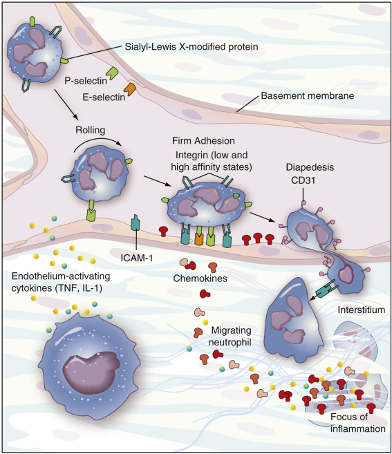

## Key Points

  * •

Cytokines are soluble proteins released by cells over short distances to facilitate communication between cells, to assist in upregulation or downregulation of the immune response, to direct cell differentiation, and to orchestrate associated inflammatory and reparative activities. 

  * •

Adhesion molecules are complex glycoproteins that bind living tissues together and mediate cell migration during embryogenesis, wound healing, and the inflammation response. 

,  

##  Cytokines 

Cytokines coordinate multiple biological processes including embryonic development, nonspecific (innate) and specific (adaptive) immune responses, inflammatory responses, hematopoiesis, cellular migration, activation, development and maturation, bone remodeling, regulation of metabolism, disease pathogenesis, and aging. Cytokines are soluble proteins that act at the picomolar to femtomolar range, are released by many cell types, and facilitate intercellular communication that is predominantly of short-distance autocrine and paracrine types. The term _cytokine_ encompasses lymphokines, interleukins, colony-stimulating factors (CSFs), interferons (IFNs), the tumor necrosis factor (TNF) family, the chemokine family, and adipokines (adipocytokines). 

Cytokines are both pleiotropic and redundant; individual cytokines are able to elicit several distinct types of responses, and multiple cytokines have similar physiologic roles (  Moraga et al, 2014  ). Cytokines are produced by T helper cells, leukocytes, lymphocytes, monocytes, macrophages, endothelial cells, fibroblasts, epithelial cells, keratinocytes, chondrocytes, neutrophils, smooth muscle cells, eosinophils, dendritic cells, mast cells, neuronal cells, fibroblasts, osteoblasts, chondrocytes, bone marrow stromal cells, osteocytes, adipocytes, and other cell types. Secretion and binding of cytokines to specific cell surface receptors creates a web of communication between cells. Cytokine signals are received at the cell surface not only as single messages, but also in complex, subtle synergistic and antagonistic combinations. Target cells display surface cytokine receptors, arrayed as “antennae.” Using these receptors, cells sample, process, and respond to combinations of soluble and substrate-bound cytokines in a manner dependent on surface receptor density and state of activation. 

 

##  Cytokine Family 

The cytokine family of proteins is remarkably extensive: more than 100 known members have been identified. Consequently, there are a number of overlapping nomenclature and classification systems for cytokines based on biological function, receptor binding properties, originating cell type, and common structural motifs (  Brocker et al, 2010  ). Cytokine families based on cell family and function include the tumor necrosis factor (TNF), interleukin (IL), and interferon (IFN) families; colony-stimulating factors (CSFs), growth factors, and adipokines ( [ Table 48-1 ](<#t0010>) ). Each member of the TNF family is the product of a separate gene; however, there are considerable overlaps in biologic properties of TNF proteins (  Dinarello, 2007  ). The TNF/TNF receptor superfamily mediates cellular differentiation, survival, and death and coordinates organ development (  Baud'huin et al, 2013  ). Within the IL family, subfamilies are: the IL-1 family, with members including IL-1α, IL-1β, IL-18, and IL-33; the IL-6 family, including IL-6, leukemia inhibitory factor, IL-11, oncostatin, ciliary neurotropic factor, and cardiotropin I; and the IL-10 family, including IL-10 and IL-22. The IL family functions regulate inflammation and immune responses. The CSFs are IL-3, granulocyte-CSF (G-CSF), granulocyte-macrophage-CSF (GM-CSF), and macrophage-CSF. Similar to the TNF family, CSFs have overlapping functions, in the case of CSFs, initiation of cell division in responding cells, but are distinct gene products with specific receptors (  Metcalf, 2010  ). Other cytokines, including IL-1β, IL-2, IL-4, IL-6, IL-7, IL-15, fibroblast growth factors (FGFs), transforming growth factors-β (TGFs-β), TGF-α, epidermal growth factor (EGF), platelet-derived growth factor (PDGF), erythropoietin, insulin-like growth factor-1 (IGF-1), IGF-2, TNF-α, IFN-γ, nerve growth factor (NGF), and brain-derived neurotrophic factor (BNDF), also function as growth factors (  Akdis et al, 2011  ). IFN cytokines like IFN-α and IFN-β promote innate and adaptive immune responses (  Ivashkiv & Donlin, 2014  ). Angiogenic cytokines include vascular endothelial growth factor (VEGF), IL-1, IL-6, and IL-8. Adipokines mediate communication between adipose tissue and other key metabolic organs (liver, muscle, pancreas, and central nervous system) (  Cao, 2014  ). The adipokine family includes all products of cells localized in white adipose tissue; the best characterized of these are leptin (regulates body weight, pro-inflammatory), adiponectin (anti-inflammatory), resistin (insulin resistance), and secreted frizzled-related protein 5 (Sfrp5; anti-inflammatory, plays role in adipogenesis), as well as vaspin, visfatin, apelin, serum amyloid A, angiotensinogen, omentin, chemerin, zinc-alpha2-glycoprotein (ZAG), IL-6, and TNF-α (  Ouchi et al, 2011  ;  Leal Vde & Mafra, 2013  ). The osteoclast-activating cytokine receptor activator of nuclear factor-κB ligand (RANKL) is a member of the TNF superfamily. RANKL binds to its receptor RANK expressed on the membranes of osteoclast progenitors and induces osteoclast differentiation and activation. Binding of RANKL to the decoy receptor osteoprotegerin (OPG) interrupts osteoclastogenesis and prevents excessive bone resorption (  Gruber, 2010  ). The impressive chemokine family is described separately later in this chapter. 

TABLE 48-1 

Cytokines by Type and Function 

Cytokine Type  |  Cytokines  |  Actions   
---|---|---  
Adipokine (cytokine released from adipocytes)  |  IL-1α, TNF-α, IL-6, leptin, adiponectin, resistin, others  |  Pro-inflammatory, pro-atherogenic, anti-inflammatory   
Angiogenic  |  VEGF, IL-1, IL-6, IL-8  |  Neovascularization, prometastatic   
Anti-inflammatory  |  IL-10, IL-13, TGF-β, IL-22, IL-1Ra, IFN-α/β |  Upregulate inflammatory genes, depress cytokine-mediated lethality, downregulate autoimmune disease   
Chemokine  |  IL-8, MCP-1, MIP-1α |  Increase cell migration and activation   
Colony-stimulating  |  IL-3, IL-7, G-CSF, GM-CSF, M-CSF, erythropoietin  |  Hematopoiesis, pro-inflammatory, anti-inflammatory   
gp130 signaling pathway  |  IL-6, IL-11, others  |  Growth factors, B cell activation, acute phase response   
Lymphocyte growth  |  IL-2, IL-4, IL-7, IL-15  |  Clonal expansion, Th1/Th2/Th17 regulation   
Mesenchymal tissue growth  |  FGF, TGF-β, others  |  Fibrosis, prometastatic   
Nerve growth  |  NGF, BNDF  |  Nerve and Schwann cell growth, B cell activation   
Osteoclast-activating  |  RANKL  |  Bone resorption, immune stimulation   
Proinflammatory  |  IL-1α, IL-1β, TNF-α, IL-6, IL-12, IL-18, IL-23, MIF, IL-32, IL-33, CD40L  |  Upregulate inflammatory mediators and innate immune responses   
Th1  |  IFN-γ, IL-12, IL-18  |  Upregulate Th1 response, clonal expansion of CTL   
Th2  |  IL-4, IL-5, IL-18, IL-25, IL-33  |  Upregulate Th2 response, increase antibody production   
Th17  |  IL-17, IL-23, IFN-γ |  Upregulate Th17 response, autoimmune response   
Type I IFN  |  IFN-α, IFN-β |  Antiviral, upregulate MHC class I, antiangiogenic, anti-inflammatory   
Type II IFN  |  IFN-γ |  Macrophage activation, upregulate MHC class II   
  
_BNDF,_ Brain-derived neurotrophic factor; _CSF,_ colony-stimulating factor; _CTL,_ cytotoxic T lymphocyte; _IFN,_ interferon; _IL,_ interleukin; _MCP-1,_ monocyte chemotactic protein-1; _MHC,_ major histocompatibility complex; _MIF,_ macrophage migration inhibitory factor; _MIP-1 α, _ macrophage inhibiting protein-1α; _NGF,_ nerve growth factor; _RANKL,_ receptor activator of NFκB. 

 

##  Cytokine Receptors 

Clinically, it may be useful to also group cytokines according to the structural homology of their receptors, as some drugs target cytokine-receptor interactions. Receptor homology partially accounts for the cytokine functional pleiotropy and redundancy described earlier. Cytokine signaling is initiated when cytokines bind the extracellular domains of their transmembrane protein receptors. Upon cytokine binding, the intracellular portion of the receptor activates proteins in the cytosol that are responsible for regulating gene transcription in the nucleus and thereby controlling cell proliferation, differentiation, maturation, and survival (  Wang et al, 2009  ). There are five major cytokine receptor types ( [ Table 48-2 ](<#t0015>) ): (1) IL-1 receptors characterized by three immunoglobulin (Ig)-like domains; (2) TNF receptors (TNFR), whose members share a conserved cysteine-rich common extracellular binding domain; (3) class I cytokine receptors (or hematopoietin receptors), which lack intrinsic tyrosine kinase activity; (4) class II cytokine receptors, which also lack intrinsic tyrosine kinase activity; and (5) chemokine receptors (discussed separately later in this chapter). Lacking tyrosine kinase activity, the class I and II receptors instead communicate with the nucleus through the Janus kinase (JAK) family of tyrosine kinases as well as one member of the TYK kinase family. Cytokine-receptor interaction results in the phosphorylation and activation of the appropriate JAK/TYK kinases and phosphorylation of the intracellular domains of the receptors. Phosphorylated tyrosine residues in the receptors bind members of the STAT (signal transducers and activation of transcription) family of cytoplasmic transcription proteins. The STAT proteins are phosphorylated as a result of this interaction and dissociate from their receptor complexes. Once dissociated, the STAT proteins dimerize and translocate into the cell nucleus, where they bind DNA recognition sequences and function as transcription factors. Class I receptors also make use of the RAS-RAF-MAP kinase and PI3 pathways to initiate gene transcription. Subfamilies of the class I receptors include the G-protein gp130, common gamma chain (γ c  , or CD132), and common beta chain (β c  , or CD131) receptors (  Wang et al, 2009  ). Cytokines like IL-6 and IL-11 that share the G-protein–coupled seven-transmembrane receptors signal via the gp130 signal-transducing molecule. Cytokines that utilize the γ c  receptors signal via JAK3 kinase. The βc receptors recognize IL-3, IL-5 and GM-CSF and initiate signaling via JAK2 kinase (  Wang et al, 2009  ). Class II cytokine receptors recognize the IFN cytokines, IL-10, and others. Pro-inflammatory IFNs signal predominantly through STAT1, whereas the anti-inflammatory cytokine IL-10 signals primarily through STAT3. STAT1 and STAT3 therefore play opposing roles in cell survival and proliferation (  Regis et al, 2008  ). The IL-1 receptor family consists of four receptor complexes, two decoy receptors, and two negative regulators. Signaling occurs via the MyD88 adaptor (  Garlanda et al, 2013  ). The TNFR family consists of 29 members including TNFR1, TNFR2, OPG, and RANK (  Kumar et al, 2013  ) and are key regulators of the immune response. Some members of the TNFR family, such as TNFR1, contain a death domain, and ligand binding initiates processes leading to cell death (  Kumar et al, 2013  ). 

TABLE 48-2 

Selected Cytokines Grouped by Receptor Class 

Receptor Class  |  Structure and Signaling Pathway  |  Example Receptors   
---|---|---  
IL-1; immunoglobulin superfamily  |  These receptors contain paired antiparallel β sheets forming the sandwich-like structure known as the _Ig-fold_ seen in antibodies.  |  IL-1, IL-18, SCF ( _c-kit_ ), M-CSF   
Tumor necrosis factor  |  These receptors share a cysteine-rich common extracellular domain and activate the NFκB pathway.  |  TNF-α, TNF-β, NGF, CD40, CD27, CD30, CD120   
Type I (hemopoietin receptors)  |  These transmembrane protein receptors have paired high-affinity α and β chains and share a common extracellular motif (WSXWS); they signal the nucleus through the JAK/STAT, RAS-RAF-MAP kinase, and PI3 pathways.  |  IL-2, IL-3, IL-4, IL-5, IL-6, IL-7, IL-9, IL-11, IL-12, IL-15, IL-21, GM-CSF, EPO, PRL, GH, G-CSF, LIF   
Type II  |  These transmembrane protein receptors are similar to type I, but lack the WSXWS motif, while having conserved cysteine pairs in their extracellular domain; they signal the nucleus through the JAK/STAT, RAS-RAF-MAP kinase, and PI3 pathways.  |  IFN-α, IFN-γ, IFN-β, IL-10   
  
_CSF,_ Colony-stimulating factor; _IFN,_ interferon _; IL,_ interleukin _; JAK,_ Janus kinase; _STAT,_ signal transducers and activation of transcription; _TNF,_ tumor necrosis factor. 

As described earlier, cytokines are produced, released, and recognized by many different cell types. The extent of influence of these soluble proteins can be long range (systemic) when released into the circulation (endocrine effect), as with the pyrogen IL-1, or their action may be highly localized, producing effects only on the cell releasing them (autocrine effect) or on its neighboring cells (paracrine). For instance, IL-2 released by T cells has an autocrine proliferative effect through the IL-2 receptor (CD25/CD122/CD132). In the thymus, cytokines such as IL-7 released from thymic epithelial cells affect thymocyte maturation in a paracrine fashion. 

 

##  Cytokines in Disease States 

Under homeostatic conditions, pro-inflammatory cytokine responses necessary for host immune defense are balanced by anti-inflammatory responses that protect the host from the tissue damage that results from unregulated inflammation. When the system is continually challenged, as in chronic viral and bacterial infections, a persistent low-level pro-inflammatory response occurs. Autoimmune diseases also result from dysregulation of the inflammatory/immune response. For example, dysregulation of IL-1 cytokine signaling is associated with inflammatory bowel disease (IBD), rheumatoid arthritis (RA), and psoriasis (  Gu et al, 2013  ). Aberrations in the IL-6/IL-12 cytokines likewise result in IBD and RA, as well as systemic lupus erythematosus (SLE), asthma, and Castleman disease (  Brocker et al, 2010  ;  Akdis et al, 2011  ). Dysregulation of the IFN response is associated with SLE, Sjögren's syndrome, systemic sclerosis, myositis, and RA (  Ivashkiv & Donlin, 2014  ). IL-17A has been linked to many autoimmune disorders, including IBD, RA, and MS, as well as certain cancers (  Brocker et al, 2010  ). IL-18 is linked to RA and Crohn's disease (CD) (  Akdis et al, 2011  ). IL-5 plays a role in allergic asthma. IL-7, IL-9, and other inflammatory cytokines are likewise believed to play causative roles in autoimmune diseases, whereas the anti-inflammatory cytokine IL-10 appears to play a protective role (  Akdis et al, 2011  ). Patients with chronic infections and/or autoimmune diseases also have an increased risk for concomitant osteoporosis, as RANKL expression, and therefore bone resorption, is upregulated by pro-inflammatory cytokines including IL-1, -6, -11, and -17, and TNF-α (  Nakashima & Takayanagi, 2011  ). Cytokine receptors also play key roles. Mutations that later affect binding/function of the γ c  receptors or their associated JAK3 kinase can significantly limit the activity of the cytokines that signal through this pathway and can lead to severe combined immunodeficiency (SCID) diseases (  Wang et al, 2009  ). Mutations that impact the function of JAK2 kinase are correlated with hematologic malignancies, particularly myeloproliferative neoplasms (  Vainchenker et al, 2008  ). Overexpression or mutations that impact function of RTKs are linked to cancers, atherosclerosis, bone disorders, and diabetes (  Kazi et al, 2014  ). 

 

##  Cytokine Assays 

Because of their biological importance, clinical laboratory detection and measurement of cytokines is becoming more common. Bioassays are usually considered to be the “gold standard” for detecting cytokine activity, but they are often time-consuming and unmanageable in the hospital laboratory. ELISA kits are widely available for many of the cytokines described earlier; for example, IL-1α, -1β, -4, -5, -6, and -10, IFN-γ, and TNF-α can be measured individually clinically. In addition, panels or multiplex assays can be used to measure sets of cytokines in a single assay. 

 

##  Clinically Useful Cytokine-Based Therapeutics 

Because of the profound biological effects of these powerful proteins, attempts at mass-producing and therapeutically administering cytokines are ongoing. Cytokines used therapeutically include G-CSF and GM-CSF, which are used to treat bone marrow suppression associated with radiation, chemotherapy, and transplantation; GM-CSF, used to treat CD; erythropoietin (EPO), used therapeutically to treat anemia and bone marrow failure; IFN-α, to treat hepatitis B and C; and IFN-β, used to treat MS (  Dinarello, 2007  ). Other promising therapeutic approaches include manipulating cytokine activity through cloning and producing recombinant forms of cytokines or their receptor antagonists; delivering cytokines by gene and antisense nucleotide insertion through viral and nonviral vectors (commonly adenovirus or retrovirus vectors, or nonviral DNA plasmid vectors); vaccinating patients against their own (autologous) cytokines (  Cutler & Brombache, 2005  ); raising cytokine-blocking monoclonal antibodies; and genetically fusing molecules of interest, such as an enzyme, ligand, peptide, or extracellular domain of a surface receptor, to the Fc portion of human IgG1 or albumin ( [ Table 48-3 ](<#t0020>) ). This “fusion” approach has the advantage of conferring increased half-life and stability on the fusion product. In some instances, multiple ligands may be sequentially fused to a single gene to create a “trap” for the target by “trapping” or binding two target molecules on a single fusion protein, possibly as a result of the trap's high binding affinities (  Huang, 2009  ). 

TABLE 48-3 

Selected Engineered Therapeutic Agents 

Class  |  Generic Name  |  Agent/Action  |  Therapeutic Indication(s)   
---|---|---|---  
**Cytokine**  
|  Aldesleukin (Proleukin)  |  Recombinant IL-2, binds and activates IL-2R  |  HIV, RCC, melanoma   
|  IFN-β-1a (Avonex)  |  Recombinant IFN-β-1a, anti-inflammatory cytokine  |  Relapsing MS   
|  IL-7 (CYT107)  |  Recombinant IL-7, modulates expansion of CD4  \+  T cells  |  HIV, viral hepatitis, cancer   
|  IFNγ-1b (Actimmune)  |  Recombinant IFNγ-1b, stimulates immune response  |  Chronic granulomatous disease, severe malignant osteopetrosis   
|  IFNα-2a (Roferon-A)  |  Recombinant IFNα-2a, stimulates immune response  |  Leukemias, melanoma, lymphoma, sarcomas, viral hepatitis   
|  IFNα-2b (Intron A)  |  Recombinant IFNα-2b, stimulates immune response  |  Leukemias, melanoma, lymphoma, sarcomas, viral hepatitis   
|  Erythropoietin (Procrit, Epogen, Aranesp)  |  Recombinant erythropoietin, stimulates production of red blood cells  |  Anemia due to kidney failure or chemotherapy   
|  Filagrastim (Neupogen)  |  Recombinant G-CSF, stimulates production of granulocytes  |  Chemotherapy-related neutropenia   
|  Lenograstim (Neulasta)  |  Recombinant G-CSF, stimulates production of granulocytes  |  Chemotherapy-related neutropenia   
|  Leukine (Sargramostin)  |  Recombinant GM-CSF, stimulates bone marrow function and modulates hematopoiesis  |  Bone marrow stem cell transplantation, HIV, myelodysplastic syndrome, aplastic anemia, leukemia   
**Anti-Cytokine Antibody**  
|  Adalimumab (Humira)  |  Recombinant humanized anti–TNF-α IgG1 mAb, binds and inhibits TNF-α |  RA, CD, PA, AS   
|  Infliximab (Remicade)  |  Chimeric (75% human/25% mouse) IgG1 mAb binds TNF-α |  RA, CD, AS   
|  |  |   
|  Bevacizumab (Avastin)  |  Recombinant humanized anti–VEGF-A mAb, inhibits angiogenesis  |  Colorectal and non–small cell carcinoma   
|  Certolizumab (Cimzia)  |  Recombinant, humanized antibody to a Fab' fragment, with specificity for TNF-α conjugated to an approximately 40-kDa polyethylene glycol, binds both soluble and membrane-bound TNF-α inhibiting TNF-α activity  |  RA, CD, PA, AS   
|  Golimumab (Simponi)  |  Fully human IgG1κ anti-TNFα mAb  |  RA, arthritis, ALS   
|  Siltuximab (Sylvant)  |  Chimeric anti-IL-6 mAb  |  Multicentric Castleman disease (HIV-negative, HHV-8 negative)   
**Small-Molecule Antagonist**  
|  Thalidomide  |  VEGF and TNF mRNA inhibitor  |  ENL, MM, RCC   
|  AP12009  |  TGF-β 2  –blocking antisense oligonucleotide  |  High-grade glioma   
|  Tofacitinib  |  JAK3 pathway inhibitor  |  RA   
**Cytokine Receptor Antagonist**  
|  Anakinra (Kineret)  |  Recombinant IL-1Rα antagonist, competitively inhibits binding of IL-1α to its receptor  |  RA   
|  Tocilizumab (Actemra)  |  Recombinant humanized IL-6R mAb, acts as an immunosuppressant  |  RA   
|  Daclizumab (Zenapax)  |  Recombinant humanized IL-2Rα chain mAb, binds IL-2Rα (CD25) on T cells to prevent allograft rejection  |  Renal transplant   
|  Oprelvekin (Neumega)  |  Recombinant IL-11, stimulates stem cell and megakaryocyte progenitor growth  |  Chemotherapy-related thrombocytopenia   
|  Trastuzumab (Herceptin)  |  Recombinant humanized mAb, binds Her2/neu receptor overexpressed on some carcinomas; inhibits angiogenesis  |  Breast carcinoma   
|  Basiliximab (Simulect)  |  Recombinant chimeric mouse-human mAb, IL-2 receptor antagonist, immunosuppressant  |  Transplantation rejection   
|  Toclizumab (Actemra, RoActemra)  |  Humanized anti-IL-6 receptor mAb that binds soluble and membrane-bound IL-6 receptor, blocks IL-6 pro-inflammatory responses  |  RA   
|  Ustekinumab (Stelara)  |  Human Anti-IL-12 and IL-23 mAb, blocks IL-12 and IL-23 pro-inflammatory responses  |  Plaque psoriasis, PA   
**Fusion Protein**  
|  Etanercept (Enbrel)  |  Soluble TNF-αRII fused to human IgG1 Fc fragment; neutralizes membrane-bound and soluble forms of TNF-α |  RA, AS, JRA, PA   
|  NBI-3001  |  Recombinant IL-4– _Pseudomonas aeruginosa_ exotoxin fusion protein  |  Malignant high-grade gliomas   
|  Alefacept (Amevive)  |  LFA-3 fused to Fc domain IgG1, binds CD2 to inhibit T cell activation  |  PA   
|  L19-IL  |  Recombinant IL-2 fused to human single-chain F  v  antibody fragment, L19 binds fibronectin, while IL-2 locally activates natural killer cells and macrophages  |  Blocks tumor cell proliferation   
|  Rilonacept (IL-1 Trap)  |  Dimeric fusion protein of the ligand-binding domains of IL-1 type I receptor and IL-1 receptor accessory protein fused to human IgG  1  |  Cryopyrin-associated periodic syndrome   
**Anti –Cell Adhesion Molecule **  
|  Natalizumab  |  Recombinant humanized leukocyte α 4  /β 1  integrin mAb, blocks attachment of leukocytes to CNS endothelial cells  |  MS   
|  Abciximab  |  Anti-α II3  /β 3  , α v  /β 3  chimeric mAb Fab fragment, antithrombotic  |  Angioplasty procedures   
|  Efalizumab (Raptiva)  |  Recombinant humanized anti-α L  /β 2  mAb, binds CD11a to act as an immunosuppressant  |  Psoriasis   
|  Vedolizumab (Entyvio)  |  Humanized anti-α 4  β 7  mAb, inhibits adhesion and migration of leukocytes into the gastrointestinal tract  |  UC, CD   
  
_ALS,_ Amyotrophic lateral sclerosis _; AS,_ ankylosing spondylitis; _CD,_ Crohn's disease; _COPD_ , chronic obstructive pulmonary disease; _CSF,_ colony-stimulating factor; _ENL,_ erythema nodosum leprosum; _GM_ , granulocyte macrophage; _HIV,_ human immunodeficiency virus; _IgG_ , immunoglobulin; _IFN,_ interferon; _IL,_ interleukin; _JRA,_ juvenile rheumatoid arthritis; _LFA,_ lymphocyte functional antigen; _mAb_ , monoclonal antibody; _MM,_ multiple myeloma; _MS,_ multiple sclerosis; _PA,_ psoriatic arthritis; _RA,_ rheumatoid arthritis; _RCC,_ renal cell carcinoma, _TNF,_ tumor necrosis factor; _UC,_ ulcerative colitis. 

Unfortunately, many disease states are complex conditions driven by an intricate interplay of numerous cytokines. A single “magic bullet” aimed at an individual cytokine or receptor for treating these conditions is unlikely to arise in the very near future. In addition, some cytokines have both pro- and anti-inflammatory effects, and targeting these cytokines can result in significant adverse effects. IFN-γ drives several autoimmune diseases, but is essential for defense against multiple intracellular microorganisms. IL-2 is required for generation of cytotoxic T cells and forms the basis for several types of vaccines, but also drives graft-versus-host disease and limits the success of bone marrow transplantation (  Dinarello, 2007  ). For conditions in which dysregulation of a single cytokine is largely at fault, the challenge is less daunting. Defects in cytokine-signaling pathways resulting from genetic mutations that inactivate JAK/STAT molecules have provided the impetus for the generation of therapeutics aimed at JAK inhibition. Ruxolitinib, a JAK1 and JAK2 inhibitor, is approved for treatment of polycythemia vera and myelofibrosis. Tofacitinib is approved for treatment of RA. Other individual cytokine-related therapeutic agents have also entered routine medical practice in recent years (see [ Table 48-3 ](<#t0020>) ). For example, Denosumab, a RANKL-neutralizing antibody, is approved for treatment of osteoporosis, RA, and tumor-related osteolysis. Other examples of cytokine-related therapeutic agents include Anakinra, an IL-1 receptor antagonist; Aldesleukin, a recombinant IL-2; Oprelvekin, a recombinant IL-11; recombinant IFNα-2a (Roferon-A); Filgrastim (Neupogen), a recombinant G-CSF; and Sargramostim (Leukine), a recombinant GM-CSF. Treatment for many chronic inflammatory diseases involves targeted inhibition of TNF-α. TNF-α inhibitors like Etanercept (Enbrel), a soluble TNF-α receptor, are approved for treatment of psoriasis, psoriatic arthritis, CD, ulcerative colitis, ankylosing spondylitis, and juvenile arthritis. However, further demonstrating the complexity of the cytokine system, MS worsens with TNF-α inhibition (  Schett et al, 2013  ). Many other cytokine- and cytokine receptor-based therapeutic agents are currently being evaluated in clinical trials. For example, adiponectin enhances insulin action and may have anti-atherogenic and anti-inflammatory properties. Therapeutic strategies to increase adiponectin levels and receptor activities are being investigated as treatments for obesity-induced inflammation and insulin resistance (  Cao, 2014  ). 

,  

##  Chemokine and Chemokine Receptor Family 

Chemokines are members of the cytokine family. Chemokines are low molecular weight molecules ranging from 8 to 14 kD that function in inflammation and angiogenesis by directing the migration, activation, and differentiation of leukocytes and endothelial cells, among other cell types (  Zlotnik et al, 2006  ;  Viola & Luster, 2008  ;  Zlotnik & Yoshie, 2012  ;  Miyake et al, 2013a  ;  Bachelerie et al, 2014  ). Enhanced chemokine or chemokine receptor expression has been demonstrated in, and may be associated with, more aggressive forms of cancer (  Miyake et al, 2013b  ). So far, at least 45 chemokines have been identified (  Zlotnik & Yoshie, 2012  ). Chemokines can have angiogenic, inflammatory, or homeostatic functional activity. Beginning with the Keystone Symposium on Chemokines and Chemotactic Receptors held in 1999, a new nomenclature was established for chemokines based on the placement of the N-terminal cysteine residues, giving rise to four chemokine subclasses: CC, CXC, (X)C, and CX3C. In CC chemokines, the two cysteines are immediately adjacent, whereas in the CXC subclass, the cysteines are separated by a single amino acid. The single known member of the CX3C subfamily, also known as fractalkine, has three amino acids separating the cysteines. The (X)C chemokines lack the initial cysteine (  Zlotnik & Yoshie, 2012  ). The nomenclature can be somewhat confusing, since most chemokines have other common names from the time prior to the Keystone Symposium. Also, there exists ambiguity between mouse and human chemokines, as some chemokines are found in one species but not the other, and the mouse homologue may even have a different designation than the human chemokine. [ Table 48-4 ](<#t0025>) gives the known human and mouse chemokines according to their current categorization along with other names by which they are known. 

TABLE 48-4 

Human Chemokines, Alternative Names, Receptor Usage, and Predominant Function 

Ligand  |  Other Names  |  Receptor Antagonist  |  Function  |  Receptor(s) Agonist   
---|---|---|---|---  
CCL1  |  I-309  |  |  Th2 responses  |  CCR8   
CCL2  |  MCP-1  |  |  Innate immunity  |  CCR1, CCR2   
CCL3  |  MIP-1α |  |  T cell/Mφ trafficking  |  CCR1, CCR5   
CCL3L1  |  LD78β |  |  Innate immunity  |  CCR1, CCR3, CCR5   
CCL3L3  |  LD78β |  |  Th1/Th2 response  |   
CCL4  |  MIP-1β |  |  T/DC interaction  |  CCR1, CCR5   
CCL4L1  |  AT744.2  |  |  HIV inhibition  |   
CCL4L2  |  — |  |  — |   
CCL5  |  RANTES  |  |  Innate/adaptive  |  CCR1, CCR3, CCR5   
CCL7  |  MCP-3  |  CCR5  |  Th2  |  CCR1, CCR2, CCR3   
CCL8  |  MCP-2  |  |  Th2  |  CCR1, CCR2, CCR5   
CCL11  |  Eotaxin  |  CXCR3, CCR2  |  Th2  |  CCR3, CCR5   
CCL13  |  MCP-4  |  |  — |  CCR2, CCR3   
CCL14  |  HCC-1  |  |  — |  CCR1, CCR3, CCR5   
CCL15  |  HCC-2 Leurotactin-1  |  |  — |  CCR1, CCR3   
CCL16  |  HCC-4  |  |  DC maturation  |  CCR1, CCR2, CCR5, CCR8   
CCL17  |  TARC  |  |  Th2  |  CCR4   
CCL18  |  PARC, DC-CK1  |  CCR3  |  T/β cell chemotaxis  |   
CCL19  |  MIP-3β |  |  T/DC homeostasis  |  CCR7   
CCL20  |  MIP-3α |  |  GALT immunity  |  CCR6   
CCL21  |  6Ckine  |  |  T/DC homeostasis  |  CCR7   
CCL22  |  MDC  |  |  Th2  |  CCR4   
CCL23  |  MPIF-1  |  |  — |  CCR1   
CCL24  |  Eotaxin-2  |  |  Eosinophil trafficking  |  CCR3   
CCL25  |  TECK  |  |  Thymocyte trafficking  |  CCR9   
CCL26  |  Eotaxin-3  |  CCR1, CCR2, CCR5  |  Th2  |  CCR3, CX3CR1   
CCL27  |  CTACK, ILC  |  |  T cell trafficking to skin  |  CCR10   
CCL28  |  MEC  |  |  T cell trafficking to mucosa  |  CCR10, CCR3   
XCL1  |  Lymphotactin SCM-1α |  |  Ag cross-presentation  |  XCR1   
XCL2  |  SCM-1β |  |  Ag cross-presentation  |  XCR1   
CXCL1  |  GROα |  |  Neutrophil  |  CXCR1, CXCR2   
CXCL2  |  GROβ |  |  Neutrophil  |  CXCR2   
CXCL3  |  GROϒ |  |  Neutrophil  |  CXCR2   
CXCL4  |  PF4  |  |  Procoagulant  |  CXCR3-B   
CXCL4L1  |  PF4V1  |  |  Procoagulant  |  CXCR3-B   
CXCL5  |  ENA78  |  |  Neutrophil  |  CXCR2   
CXCL6  |  GCP2  |  |  Neutrophil  |  CXCR1, CXCR2   
CXCL7  |  NAP-2  |  |  Neutrophil  |  CXCR2   
CXCL8  |  IL-8  |  |  Neutrophil Th1  |  CXCR1, CXCR2   
CXCL9  |  MIG  |  CCR3  |  Th1  |  CXCR3   
CXCL10  |  IP-10  |  CCR3  |  Th1  |  CXCR3   
CXCL11  |  I-TAC  |  CCR3, CCR5  |  Myelopoiesis B lymphopoiesis  |  CXCR3, CXCR7   
CXCL12  |  SDF-1  |  |  Myelopoiesis B lymphopoiesis  |  CXCR4, CXCR7   
CXCL13  |  BLC, BCA-1  |  |  B/T trafficking LN  |  CXCR5, CXCR3   
CXCL14  |  BRAK  |  |  Mφ trafficking  |  ?   
CXCL16  |  SR-PSOX  |  |  NKT cell trafficking  |  CXCR6   
CXCL17  |  DMC  |  |  Mφ/DC trafficking  |  ?   
CX3CL1  |  Fractalkine  |  |  NK, T, Mφ trafficking  |  CX3CR1   
  
Data from  Koelink PJ, Overbeek SA, Braber S, et al  : Targeting chemokine receptors in chronic inflammatory diseases: an extensive review, _Pharmacol Ther_ 133:1–18, 2012; Zlotnik A,Yoshie O: The chemokine superfamily revisited, _Immunity_ 36:705–716, 2012. 

Chemokine receptors are seven-transmembrane proteins belonging to the G-protein–coupled receptor family and, in the new nomenclature, are categorized by the chemokine subclass that they bind (  Zlotnik & Yoshie, 2012  ). Chemokine receptors are expressed in varying combinations on leukocytes but are also expressed on nonhematopoietic cells including cancers and endothelial cells (  Bachelerie et al, 2014  ). Although there may be specificity in interaction between a single chemokine and a single chemokine receptor, often chemokine ligands have the ability to bind to multiple different receptors, and a chemokine receptor may bind any of several different chemokines (see [ Table 48-4 ](<#t0025>) ). The multiplicity of interactions between chemokine ligands and receptors may provide some redundancy within the system, but it also means that different chemokines binding to the same receptor could have distinct functional outcomes either due to variation in binding avidity or availability of downstream signaling molecules within the cells. Thus, a specific chemokine such as CCL11 (also known as _eotaxin_ ) has an agonistic effect when binding to CCR3 or CCR5 but an antagonistic effect when binding to CXCR3 or CCR2. CXCR3 is considered to promote Th1 polarization among T helper cells, while CCR3 is preferentially expressed by Th2 cells and eosinophils. Thus, CCL11 should reinforce bias toward a Th2 immune response through its simultaneous agonistic effects on CCR3 and antagonistic effects on CXCR3 (  Sallusto & Lanzavecchia, 2000  ). Chemokine binding to receptors involves a two-step process in which the chemokine initially interacts with the extracellular surface or chemokine recognition site 1 (CRS1). This causes a conformational change in the receptor and interaction of the chemokine with the chemokine recognition site 2 (CRS2), which leads to receptor activation (  Scholten et al, 2012  ). Typical G-protein–coupled chemokine receptors activate downstream enzyme pathways including PI3K; phospholipases Cβ2, Cβ3, A2, and D; MAPK; and tyrosine kinases, ultimately resulting in actin polymerization, adhesion, and membrane protrusion required in cell mobility (  Bachelerie et al, 2014  ). Besides defining receptors based on the category of chemokine they bind, chemokine receptors can also be classified by their predominant function as homeostatic (involved in immune system development and leukocyte trafficking to lymphoid tissues), inflammatory (involved in trafficking of leukocytes into tissues at sites of infection or injury), or both (  Bachelerie et al, 2014  ). While chemokine signaling is essential to normal immunologic responses and immune system development, prolonged or excessive chemokine signaling can lead to pathogenic inflammation and autoimmunity, and may promote cancer metastases (  Oppenheim et al, 2002  ;  Balkwill, 2004  ). 

 

##  Clinically Useful Chemokine-Based Therapeutics 

Various chemokines and chemokine receptors are implicated in disease and have become targets of potential therapeutic intervention (  Bachelerie et al, 2014  ). CXCR1 and CXCR2 are expressed on neutrophils, specific subpopulations of monocytes, mast cells, basophils, dendritic cells, NK cells, and some T cells, as well as endothelial cells, epithelial cells, neuronal cells, and mesenchymal stem cells. These receptors have been associated with multiple diseases including psoriasis, chronic obstructive pulmonary disease (COPD), asthma, RA, IBD, and various cancers ( [ Table 48-5 ](<#t0030>) ) (  Mahler et al, 2004  ;  Bachelerie et al, 2014  ). A pilot study using an anti-CXCL8 antibody in COPD patients showed moderate efficacy (  Mahler et al, 2004  ). Anti-CXCL8 used topically has also been shown to improve symptoms in psoriasis patients (  Bizzarri et al, 2006  ). Another CXCR2 antagonist, reparixin, was shown to improve outcomes in islet cell transplant patients, and a phase III trial is underway for islet transplantation in Europe and the United States (  Bachelerie et al, 2014  ). CXCR1 blockade may also prove beneficial in selected breast cancer patients (  Ginestier et al, 2010  ). Small-molecule antagonists of CXCR3 have been developed but have primarily been tested in animal models of arthritis, MS, inflammatory pulmonary disease, and cardiac allografts. An anti-CXCR3 antibody has been used in phase II clinical trials and showed efficacy against RA but was ineffective against ulcerative colitis (  Bachelerie et al, 2014  ). CXCR4 is a coreceptor for human immunodeficiency virus (HIV) and has been implicated in oncogenesis. The FDA has approved the use of AMD3100, also known as _plerixafor,_ to be used in combination with granulocyte-macrophage colony-stimulating factor in multiple myeloma and non-Hodgkin's lymphoma patients undergoing hematopoietic stem cell transplantation (  Bachelerie et al, 2014  ). Among the CCR receptors, CCR1 has been targeted by eight different antagonists because of its association with diverse inflammatory diseases and cancers. However, clinical trials have not yet been very successful. CCR2 is another broadly expressed receptor implicated in a number of diseases. Animal studies show that CCR2 is required for monocyte egress from bone marrow and in conjunction with CX3CR1 promotes monocyte infiltration of atherosclerotic plaques (  Tacke et al, 2007  ), and mice deficient in CCR2 developed reduced atherosclerotic lesions (  Boring et al, 1998  ). To date, seven CCR2 antagonists have been developed. MLN1202 has been used in phase II clinical trials and shown to significantly reduce C-reactive protein (CRP) levels in plasma of individuals at atherosclerotic risk (  Gilbert et al, 2011  ). As CRP is a known biomarker for atherosclerosis, this implies that CCR2 may be pro-atherogenic in humans as in mice. MLN1202 was also effective in a phase II trial of MS but was ineffective in a phase II trial involving rheumatoid arthritis (  Bachelerie et al, 2014  ). Phase II clinical trials were performed with other CCR2 antagonists in MS, SLE, neuropathic pain, and type 2 diabetes, but are either ongoing or the results have not been reported. CCR4 is expressed at high levels in adult T cell leukemia/lymphoma cells, and an anti-CCR4 (KW-0761) has been developed by Kyowa Hakko Kirin and approved by the Japanese Pharmaceutical and Medical Devices Agency for use in this disease. Evaluation of this antibody in allergic diseases is ongoing by Amgen (  Bachelerie et al, 2014  ). CCR5 is the predominant HIV coreceptor, and maraviroc (UK-427,857) by Pfizer has been FDA approved for use in AIDS patients to control virus infection. Multiple other CCR5 antagonists have been developed. A number of these prospective CCR antagonists remain in clinical trials, but several drug development programs were stopped because of unanticipated drug toxicities such as ventricular arrhythmias/sudden death or liver toxicity. Anti-CCR5 antibodies have been developed and are being tested in HIV-infected patients (  Bachelerie et al, 2014  ). An antagonist for CCR9 was developed by ChemoCentryx and appeared to be initially successful in phase II and phase II/III trials of patients with Crohn's disease, but when further tested in phase III trials by GlaxoSmithKline, the drug apparently proved ineffective and development was halted (  Bachelerie et al, 2014  ). In most cases ( [ Table 48-6 ](<#t0035>) ), clinical trials using antagonists for specific chemokine receptors have failed to show efficacy, although several trials remain ongoing. As indicated earlier, the involvement of multiple chemokines in inflammatory diseases and redundancy of a chemokine between multiple different receptors may make monotherapy against a specific chemokine receptor ineffective. 

TABLE 48-5 

Chemokine Receptor Expression Associated with Various Diseases 

Disease  |  Associated Chemokine Receptors   
---|---  
Atherosclerosis  |  CCR1, CCR2, CCR5, CXCR2, CXCR3, CXCR4, CX3CR1   
Multiple sclerosis  |  CCR1, CCR2, CCR5, CCR7, CXCR3, CXCR6   
Rheumatoid arthritis  |  XCR1, CCR1, CCR2, CCR5, CXCR1, CXCR2, CXCR3, CXCR4   
Psoriasis  |  CCR1, CCR4, CCR5, CCR6, CCR10, CXCR2, CXCR3, CX3CR1   
Type I diabetes  |  CCR4, CXCR3   
IBD  |  CCR4, CCR5, CCR6, CCR10, CXCR1, CXCR2, CXCR3, CX3R1   
Chronic hepatitis  |  CCR5, CXCR3   
Lupus  |  CCR2, CXCR3, CXCR5   
Allograft rejection  |  CCR1, CCR5, CXCR3   
COPD  |  CCR1, CCR2, CCR3, CCR5, CCR10, CXCR1, CXCR2, CXCR3   
Asthma  |  CCR1, CCR2, CCR3, CCR4, CCR5, CCR8, CXCR1, CXCR2, CXCR3, CXCR4   
Atopic dermatitis  |  CCR4, CCR8, CCR10   
HIV  |  CCR1, CCR2, CCR3, CCR5, CXCR4   
**Cancers** |  **Associated Chemokine Receptors**  
Melanoma  |  CCR2, CCR3, CCR7, CCR9, CCR10, CXCR1, CXCR2, CXCR3, CXCR4   
Breast  |  CCR1, CCR2, CCR3, CCR5, CCR6, CCR7, CCR9, CXXR3, CXCR4, CXCR5, CXCR6, CXCR7   
Renal  |  CCR3, CXCR1, CXCR2, CXCR3, CXCR4, CXCR6   
Prostate  |  CCR2, CCR5, CCR9, CXCR1, CXCR2, CXCR4, CXCR6, CXCR7, CX3R1   
Head/Neck  |  CCR7, CXCR4, CXCR5, CXCR6   
Lung  |  CCR1, CCR2, CCR5, CCR7, CXCR1, CXCR2, CXCR3, CXCR4, CXCR5   
Gastrointestinal  |  CCR1, CCR6, CCR7, CXCR1, CXCR2, CXCR3, CXCR4, CXCR5, CXCR6   
Pancreas  |  CCR5, CXCR1, CXCR2, CXCR4, CXCR5, CXCR6   
Liver  |  CCR6, CXCR4, CXCR7   
Ovarian  |  CCR4, CCR9, CXCR2, CXCR4   
Lymphoma  |  CCR3, CCR4, CCR10, CXCR4, CXCR5   
Leukemia  |  CCR3, CCR4, CCR7, CCR10, CXCR2, CXCR3, CXCR4   
Myeloma  |  CCR1, CCR2, CCR5, CXCR4   
Brain  |  CXCR4, CXCR7   
Sarcoma  |  CXCR4   
  
Data from  Garin A, Proudfoot AE  : Chemokines as targets for therapy, _Exp Cell Res_ 317:602–612, 2011; Koelink PJ, Overbeek SA, Braber S, et al: Targeting chemokine receptors in chronic inflammatory diseases: an extensive review, _Pharmacol Ther_ 133:1–18, 2012; Scholten DJ, Canals M, Maussang D, et al: Pharmacological modulation of chemokine receptor function, _Br J Pharmacol_ 165:1617–1643, 2012; Scholten DJ, Canals M, Maussang D, et al: Pharmacological modulation of chemokine receptor function, _Br J Pharmacol_ 165:1617–1643, 2012. 

TABLE 48-6 

Summary of Clinical Development of Drug Candidates Targeting Chemokine Receptors 

Receptor  |  Company  |  Compound  |  Affinity (nM)  |  Indication(s)  |  Clinical Phase  |  Status   
---|---|---|---|---|---|---  
CCR1  |  Schering AG (Berlex)  |  BX 471  |  1.0  |  MS, Psoriasis endometriosis  |  II  |  No efficacy   
CCR1  |  Millennium  |  MLN 3701  |  |  MS, Multiple myeloma  |  II  |  No longer reported   
CCR1  |  Millennium  |  MLN 3897  |  2.3  |  RA, Multiple myeloma  |  II  |  No efficacy in RA   
CCR1  |  Pfizer  |  CP-481, 715  |  64  |  RA  |  II  |  No efficacy   
CCR1  |  AstraZeneca  |  AZD4818  |  5.0  |  COPD  |  II  |  No efficacy   
CCR1  |  ChemoCentryx/GSK  |  CCX354  |  1.5  |  RA  |  II  |  Ongoing   
CCR1  |  Merck  |  C-4462  |  |  RA  |  II  |  No efficacy   
CCR1  |  Merck  |  C-6448  |  |  MS  |  II  |  No efficacy   
CCR2  |  Millennium  |  MLN 1202 [ * ](<#hl0001267>) |  |  RA  |  II  |  No efficacy   
Atherosclerosis, MS  |  II  |  Ongoing   
CCR2  |  Incyte  |  INCB8696  |  |  MS, Lupus  |  I  |  No longer reported   
CCR2  |  Incyte  |  INCB3284  |  3.7  |  RA, Type II diabetes  |  II  |  No longer reported   
CCR2  |  ChemoCentryx  |  CCX915  |  |  MS  |  I  |  Terminated   
CCR2  |  ChemoCentryx  |  CCX140  |  2.3  |  Diabetic nephropathy  |  II  |  Ongoing   
CCR2  |  Merck  |  MK-0812  |  5.0  |  RA, MS  |  II  |  No efficacy   
CCR2  |  Pfizer  |  PF-4136309  |  |  Pain  |  II  |  No longer reported   
CCR2  |  BMS  |  BMS-741672  |  |  Diabetic neuropathy  |  II  |  Ongoing   
CCR2  |  Johnson & Johnson  |  JNJ-17166864  |  20.0  |  Allergic rhinitis  |  II  |  No efficacy   
CCR3  |  Pharmaxis  |  ASM8 [ † ](<#hl0001270>) |  |  Asthma  |  II  |  Ongoing   
CCR3  |  GlaxoSmithKline  |  GSK766994  |  10.0  |  Asthma and allergic rhinitis  |  II  |  No efficacy   
CCR3  |  Dupont  |  DPC168  |  2.0  |  Asthma  |  I  |  Development halted   
CCR3  |  BMS  |  BMS-639623  |  0.3  |  Asthma  |  I  |  Ongoing   
CCR3  |  Novartis  |  QAP-642  |  |  Allergic rhinitis  |  I  |  Development halted   
CCR3  |  AstraZeneca  |  AZD3778  |  8.1  |  Allergic rhinitis  |  II  |  No longer reported   
CCR4  |  Amgen  |  KW-0761 [ * ](<#hl0001267>) |  |  Oncology  |  II  |  Ongoing   
CCR4  |  GSK  |  GSK2239633  |  10.0  |  Asthma  |  I  |  Ongoing   
CCR5  |  Pfizer  |  UK-427,857 (Maraviroc)  |  3.0  |  RA  |  II  |  No efficacy   
AIDS  |  Approved  |  Registered drug   
CCR5  |  Schering-Plough  |  SCH-C  |  2.0  |  RA  |  II  |  No efficacy   
AIDS  |  I  |  Development halted   
CCR5  |  Schering-Plough  |  SCH-D  |  0.45  |  AIDS  |  II  |  Development halted   
CCR5  |  GlaxoSmithKline  |  GW2239633  |  3.0  |  AIDS  |  III  |  Development halted   
CCR5  |  Incyte  |  INCB9471  |  3.1  |  AIDS  |  II  |  Development halted   
CCR5  |  Progenics  |  PRO 140 [ * ](<#hl0001267>) |  |  AIDS  |  II  |  Ongoing   
CCR5  |  Tobira  |  TAK652 (cenicroviroc)  |  3.1 [ ||  ](<#hl0001279>) |  AIDS  |  II  |  Ongoing   
CCR5  |  AstraZeneca  |  AZD5672  |  0.26  |  RA  |  II  |  No efficacy   
CCR5  |  Novartis  |  NIBR-6465  |  0.8  |  AIDS  |  I  |  Ongoing   
CCR5  |  Sangamo  |  SB-728 [ ‡ ](<#hl0001273>) |  |  AIDS  |  II  |  Ongoing   
CCR5  |  HGS  |  HGS004 [ * ](<#hl0001267>) |  |  AIDS  |  I  |  Ongoing   
CCR9  |  ChemoCentryx/GSK  |  CCX282/vercirnon  |  6.0  |  IBD, Crohn's disease  |  III  |  Terminated   
CXCR1/CXCR2  |  Schering-Plough  |  SCH 527123  |  3.9  |  COPD  |  II  |  Ongoing   
0.049  |  |  |   
CXCR1/CXCR2  |  Dompé |  Reparixin  |  1.0 (CXCR1)  |  Pancreatic islet transplantation  |  III  |  Ongoing   
100 (CXCR2)   
CXCR2  |  GlaxoSmithKline  |  SB-656933  |  5.1  |  COPD, cystic fibrosis  |  I  |  Ongoing   
CXCR2  |  GlaxoSmithKline  |  GSK-1325756B  |  |  COPD?  |  I  |  Ongoing   
CXCR2  |  AstraZeneca  |  AZD-5069  |  |  Bronchiectasis  |  II  |  Ongoing   
CXCR3  |  Amgen  |  AMG487  |  8.0  |  Psoriasis  |  II  |  No efficacy   
CXCR4  |  Genzyme/Sanofi-Aventis  |  Plerixafor (AMD3100)  |  74  |  Stem cell mobilization for transplantation in cancer (MM, non-Hodgkins lymphoma)  |  Approved  |  Registered drug   
CXCR4  |  TaiGen  |  Burixafor  |  |  Stem cell transplantation  |  II  |  Ongoing   
CXCR4  |  Polyphor  |  POL6326  |  |  Stem cell transplantation  |  II  |  Ongoing   
CXCR4  |  Medarex  |  MDX-1338 [ * ](<#hl0001267>) |  |  Multiple myeloma  |  I  |  Ongoing   
CXCR4  |  Biokine  |  BKT140 [ § ](<#hl0001276>) |  |  Stem cell transplantation  |  I  |  Ongoing   
  
_IBD,_ inflammatory bowel disease; _MM,_ multiple myeloma; _RA,_ rheumatoid arthritis. 

From Bachelerie F, International Union of Basic and Clinical Pharmacology, et al: LXXXIX. Update on the extended family of chemokine receptors and introducing a new nomenclature for atypical chemokine receptors, _Pharmacol Rev_ 66:1–79, 2014. Table 3. 

 * Neutralizing monoclonal antibodies. 

 † Antisense oligonucleotide. 

 ‡ Zinc finger nuclease. 

 § Peptide. 

 || Also has potent antagonist activity at CCR2. 

 

##  Atypical Chemokine Receptors 

Aside from the classical chemokine receptors, there exist other receptors that bind chemokines and modulate their activity. Atypical chemokine receptors in vertebrates bind chemokines but fail to activate G-coupled proteins and generally function to suppress inflammation (  Bachelerie et al, 2014  ). ACKR1, referred to more commonly in transfusion medicine as the _Duffy antigen,_ is a promiscuous receptor, binding up to 20 different members of the CC and CXC chemokine groups, and is expressed on erythrocytes as well as on endothelial cells (in venules and small veins), some neurons, and possibly some epithelial cells, but not on leukocytes (  Bachelerie et al, 2014  ). Although originally believed to remove chemokines from circulation, it is now thought that ACKR1 is important in maintaining blood levels of chemokines, although these may be maintained in an equilibrium state between free and erythrocyte-bound forms. However, heparin or serum serine proteases can displace chemokines bound to ACKR1 (  Schnabel et al, 2010  ), and this may make the chemokines available for inflammatory signaling. ACKR2 is a homologue of CCRs that promiscuously binds many CC chemokines. ACKR2 is expressed in skin, gut, lung, placenta, and on some lymphatic endothelial cells and leukocytes. Chemokine binding to ACKR2 results in receptor-ligand internalization and lysosomal degradation of the ligand. ACKR2 may have a protective role in psoriasis and COPD and act as a tumor suppressor gene (  Bachelerie et al, 2014  ). ACKR3 expression is increased in immunopathologic responses and cancers, especially of hematopoietic and mesenchymal origin. ACKR3 primarily binds CXCL12, and CXCL12 has been shown to be important in tumorigenesis, suggesting that this receptor may also promote this process (  Balkwill, 2004  ). ACKR4 primarily binds CCL19, CCL21, and CCL25. Its biological function is less well understood, but its expression correlates with pulmonary sarcoidosis severity (  Kriegova et al, 2006  ). 

 

##  Chemokine Receptor Homologues 

Various pathogens also encode chemokine-binding proteins or chemokine receptor homologues usually stolen from host cells (  Bachelerie et al, 2014  ). In many cases, these proteins act as scavengers to suppress host immune responses and allow the microbes to evade the immune system. However, US28 encoded by human cytomegalovirus (HCMV) has biological activity in HCMV-infected cells, as it aids in HIV infection as well as angiogenesis or tumor formation (  Maussang et al, 2009  ). Other herpesvirus family and poxvirus family chemokine receptor homologues induce calcium flux or chemotaxis, and most are promiscuous for multiple CC and CXC chemokines. These chemokine receptor homologues appear to be important in virus replication, although their exact role in this process is not well understood. Besides the chemokine receptor homologues, various parasites and pathogens encode chemokine binding proteins (CKBP or evasins), which are small molecular weight (90 to 110 amino acid) peptides that bind chemokines with high avidity and inhibit their chemotactic activity (  Bachelerie et al, 2014  ). Viruses (including leporipoxviruses, orthopoxviruses, parapoxviruses, and herpesviruses), ticks (in tick saliva), and nematodes ( _S. mansoni,_ the causative agent in schistosomiasis) express these molecules (  Bachelerie et al, 2014  ). 

,  

##  Cell Adhesion Molecules 

The adhesion mechanisms that bind living tissues into complex multicellular organisms involve several classes of proteins, among which are the cell adhesion molecules (CAMs). These complex transmembrane gly­coproteins facilitate cell migration during embryogenesis and wound healing, and they govern the leukocyte trafficking and homing critical to immune response (  Ley et al, 2007  ). Roles for particular CAMs have been identified or postulated in myriad diseases, ranging from IBD to cancer to primary immunodeficiency states. Numerous investigators are seeking to identify and target CAM interaction sites for therapeutic modulation with specific monoclonal antibodies, as well as sense/antisense oligonucleotides or other small molecules designed to block gene transcription (  Mousa, 2008  ). 

CAMs are conventionally divided into five groups based on structural homology: cadherins, mucins, integrins, selectins, and immunoglobulin superfamily CAMs. Cadherins mediate calcium-dependent cell-cell interactions, and they serve as important components of varied types of cell-cell junctions (e.g., desmosomes). Mucins are heavily glycosylated proteins that may be cell membrane–associated or secreted, and their ligands include selectins. Adenocarcinomas frequently express abnormal quantities or forms of mucins, and serum tumor markers CA19-9 and CA125 represent epitopes on mucins. Immunoglobulin superfamily (IgSF) CAMs have immunoglobulin-like domains and interact with integrins, selectins, and each other. Integrins and selectins are CAMs integral to effective recruitment of leukocytes to sites of inflammation or infection, and these warrant more extensive descriptions. 

 

##  Integrins 

The integrin family of adhesion molecules mediates interaction between those things external to the cell (other cells and the extracellular matrix [ECM]) and those things within the cell (cytoskeleton, intracytosolic molecules, and nucleus) (  Abram & Lowell, 2009  ). Each integrin is a heterodimer of noncovalently linked α and β subunits ( [ Table 48-7 ](<#t0040>) ). The major integrins can be divided into subfamilies based on incorporation of particular subunits, patterns of expression, and ligand specificity. The β 1  integrins, also known as the _very late activation antigens (VLAs),_ arise from the association of a β1 chain subunit (CD29) with any of the α chain subunits (CD49a to CD49h). They are expressed on cells requiring firm anchoring to the ECM, as well as on circulating leukocytes, platelets, and some tumor cells. The β 2  integrins, expressed mainly by leukocytes and myeloid cells, result from association of the β 2  chain subunit (CD18) with any of several α subunits. The αLβ 2  integrin, also known as LFA-1 (lymphocyte function-associated antigen [CD11a/CD18]), plays a crucial role in leukocyte adhesion to vascular endothelium during transendothelial migration. The ligand for LFA-1 in this process is intercellular adhesion molecule-1 (ICAM-1), which is an IgSF CAM. 

TABLE 48-7 

Selected Integrins Expressed by Leukocytes and/or Platelets 

Integrin  |  Name  |  Ligands   
---|---|---  
α 1  β 1  |  VLA-1, CD49a/CD29  |  Collagen, LMN   
α 2  β 1  |  VLA-2, GP Ia/IIa, CD49b/CD29  |  Collagen, LMN   
α 4  β 1  |  VLA-4, CD49d/CD29  |  VCAM-1, FBN   
α 5  β 1  |  VLA-5, CD49e/CD29  |  FBN   
α 6  β 1  |  VLA-6, CD49f/CD29  |  LMN   
αLβ 2  |  LFA-1, CD11a/CD18  |  ICAM-1, -2, -3   
αMβ 2  |  Mac-1, CR3, CD11b/CD18  |  ICAM-1, iC3b   
αXβ 2  |  p150,95, CR4, CD11c/CD18  |  FBGN, iC3b   
αDβ 2  |  — |  ICAM-3, VCAM-1   
αIIbβ 3  |  GPIIb/IIIa, CD41/CD61  |  FBGN, vWF, FBN, VN   
αVβ 3  |  CD51/CD61  |  VN, FBGN   
α4β 7  |  LPAM-1  |  MAdCAM-1, FBN   
αEβ 7  |  HML-1  |  E-cadherin   
  
_CR,_ Complement receptor; _FBGN,_ fibrinogen; _FBN,_ fibronectin; _GP,_ glycoprotein; _ICAM,_ intercellular adhesion molecule; _LFA,_ lymphocyte functional antigen; _LMN,_ laminin; _VCAM,_ vascular cell adhesion molecule; _VN,_ vitronectin; _vWF,_ von Willebrand factor. 

Adapted from Luo BH, Carman CV, Springer TA: Structural basis of integrin regulation and signaling, _Annu Rev Immunol_ 25:619–647, 2007. 

The α integrin subunits are 120- to 180-kDa transmembrane proteins with short intracytoplasmic domains, a long extracellular fragment with seven homologous domains, and, in some cases, an “inserted” (I) domain that features a metal ion–dependent adhesion site (MIDAS) and serves as a primary site for ligand binding (  Luo et al, 2007  ). Conformational changes mediate bidirectional signaling via integrins. Inside-out signaling triggered by chemokines or other agonists increases integrin affinity for ligands by shifting the heterodimer from a low-affinity bent configuration to a higher-affinity extended or open configuration. Avidity of integrins for their ligands is a function not only of conformation but also of the distribution of integrins on the cell surface, however, and binding of proteins such as talin and kindlins to the β integrin cytoplasmic tail contributes to clustering of integrins. Integrin activation may additionally be enhanced by shear forces such as those resulting from leukocyte adhesion to endothelium (  Kim et al, 2011  ). 

The intracytoplasmic tails of α and β integrin subunits associate with cytoskeletal components to transduce outside-in signals such as that of αLβ 2  (LFA-1)-ICAM-1 binding. In the process of signal transduction, integrins associate and interact with other cell membrane–associated proteins, cytoskeletal components, and noncytoskeletal cytoplasmic components. The integrin-associated protein (IAP or IAP 50) designated CD47, an IgSF member, is one such membrane-associated protein that, mainly through association with β3 integrins, may function as a signal transducer. Other membrane-associated proteins involved in integrin signaling include caveolin-1 and CD9, which are involved in cell membrane caveola formation and platelet aggregation, respectively (  Porter & Hogg, 1998  ). Cytosolic molecules, including integrin cytoplasmic domain–associated protein (ICAP-1), help orchestrate the complex activity of β 1  -integrin–mediated cell migration. 

Perhaps the best studied intracytoplasmic associations of integrin molecules are those with the cytoskeleton-associated proteins α-actinin, talin, filamin, vinculin, tensin, and paxillin. These cytoskeleton proteins, through their association with β 1  , β 2  , and β 3  integrin subunits, bridge integrin and cytoskeleton and direct cell migration, phagocytosis, stress fiber formation at focal contact sites, and intracellular signal transduction, and link separate cytoskeletal proteins. 

The pattern of integrin distribution is wide, especially among those integrins (mostly β 1  ) involved in anchoring cells to components of the general ECM such as collagen and laminin. For those integrins mediating attachment to less widely distributed components, tissue distribution likewise is more restricted. Restricted patterns of integrin expression are exploited clinically for classification of hematolymphoid neoplasms; for example, expression of the α subunit of integrin αXβ 2  (CD11c/CD18) is typical of hairy cell leukemia and of acute myeloid leukemias with monocytic features. 

Monoclonal antibodies and other integrin antagonists are in clinical use, and additional anti-integrins are in clinical trials (  Goodman & Picard, 2012  ). Integrin αIIbβ 3  antagonists, which vary considerably in design, have been used for many years to prevent thrombosis during percutaneous coronary artery procedures. Abciximab is a mouse/human chimeric monoclonal antibody Fab fragment, while eptifibatide (a synthetic cyclic heptapeptide) and tirofiban (a nonpeptide small-molecule inhibitor) are non-mAb drugs; all three block αIIbβ 3  (GPIIb/IIIa)-dependent platelet aggregation (  Bledzka et al, 2013  ). Anti-integrins are also used to prevent leukocyte extravasation into sites involved by inflammatory diseases. α 4  integrins are the target of the humanized monoclonal antibody natalizumab, which has been used in the treatment of CD and MS. This novel therapy is not without significant risk, however, as several cases of therapy-related opportunistic infection and progressive multifocal leukoencephalopathy (PML) have been reported specifically with natalizumab (  Stuve & Bennett, 2007  ). Vedolizumab, a humanized monoclonal antibody directed against α 4  β 7  integrin, has been approved more recently for use in the treatment of CD and ulcerative colitis, and it has not been associated with PML in clinical trials to date. Therapeutic interventions based on disruption of integrin ligands are also being investigated; among the approaches being taken is infusion of an antisense oligonucleotide targeting ICAM-1 mRNA. 

 

##  Selectins 

The selectin family is composed of three homologous proteins that bind to oligosaccharide moieties on glycoprotein ligands (  Ley, 2003  ). Similarities are greatest among the selectins in their extracellular domains, which include a lectin domain, an epidermal growth factor (EGF) domain, and varied numbers of consensus repeat (CR) domains. Selectins are distinguished by the cells that express them and by their subcellular localization. L-selectin (CD62L) is expressed by most _l_ eukocytes at the tips of microvilli or microfolds, E-selectin (CD62E) is expressed by activated _e_ ndothelial cells on their plasma membranes, and P-selectin (CD62P) is expressed by _p_ latelets and endothelial cells in secretory granules. L-selectin mediates lymphocyte homing or trafficking of T lymphocytes through binding to ligands expressed in high endothelial venules (HEVs), and it also contributes to neutrophil rolling on activated endothelium in regions of inflammation. Its ligands include GlyCAM (glycan-bearing cell-adhesion molecule)-1, MAdCAM (mucosal addressin cell-adhesion molecule)-1, and CD34. P-selectin is stored in the α granules and Weibel-Palade bodies of platelets and endothelial cells, respectively, and is expressed on the cell surface after cell activation. Once on the cell surface, P-selectin binds neutrophils, lymphocytes, and monocytes via its ligands, sialyl-Lewis-X- and sialyl-Lewis-A-family–type complex carbohydrate groups. E-selectin on the surface of activated endothelial cells recognizes ligands similar to those recognized by P-selectin. It plays a recognition role for homing effector and memory T cells as they localize to sites of inflammation. 

The role of selectins is twofold: to mediate cell-cell interaction, and to contribute to cell activation by intracytoplasmic signaling. As with integrins, selectins are critical to the initial tethering and rolling of leukocytes along activated endothelium prior to extravasation. Fluid shear stress exerted by flowing blood supports the process, as the “catch bonds” between selectins and their ligands are strengthened, not weakened, by shear forces (  Lawrence et al, 1997  ). After binding a soluble form of the mucin-like glycoprotein GlyCAM-1 (a high endothelial venule product), L-selectin is able to mediate the activation of β 1  integrins and their adhesion to fibronectin. P- and E-selectin may also serve as signal-transducing receptor molecules, because a rise in intracellular free Ca  2+  within leukocytes adhering to endothelial cells is linked to these selectin molecules (  Huang et al, 1993  ). The most frequently used quantitative assays for soluble plasma or serum selectins are sandwich immunoassays (  Mousa, 2008  ), and numerous investigators have been exploring the potential utility of soluble P-selectin levels as a biomarker for diagnosis of deep vein thrombosis. Concentrations of soluble forms of selectins and other CAMs (e.g., ICAM-1) in the plasma may reflect ongoing inflammation and consequently have been explored as potential biomarkers of risk for inflammation-associated disease states such as atherosclerosis (  Jenny et al, 2006  ). Studies assessing potential therapeutic interventions based on disruption of selectin function are ongoing. 

,  

##  Leukocyte Extravasation 

Tissue damage or infections initiate host defense mechanisms dependent on the cytokine and cell-adhesion molecule families. Leukocyte mobilization to sites of damage or infection is a crucial step in this process. Selectins initiate the capture and rolling of leukocytes on the endothelial surface. Chemokines on the endothelial surface interact with leukocyte chemokine receptors and trigger the activation of integrins. Leukocyte integrin interaction with cytokine-induced adhesion molecules on the endothelial cell surface is critical to the evolution of inflammatory and immune responses and is required for stable adhesion of leukocytes to the endothelial surface. Subsequent to adhesion and migration, leukocytes transmigrate through the endothelial cell layer either through junctions between cells (paracellular) or through the body of an endothelial cell (transcellular) (  Vestweber, 2012  ). In addition, homing of lymphoid cells to their sites of residence and intravascular spread of metastases involve similar endothelial interactions. 

Extravasation of leukocytes occurs during cell homing, as with trafficking of γ/δ T cells to Peyer's patches, and as part of the inflammatory/immune response. Both processes involve similar steps and the use of adhesion molecules. In inflammation, the process begins with local release of proinflammatory cytokines such as TNF, IL-1, and IFN-γ, which activate the local endothelium to increase surface expression of adhesion molecules, including members of the immunoglobulin superfamily, vascular cell adhesion molecule (VCAM)-1 and ICAM-1. In addition, endothelial cells release chemotactic agents, including IL-8, forming a surface-bound and soluble chemotactic gradient recognizable by transmigrating inflammatory cells, which localize them to the inflammatory focus. 

This process for leukocytes ( [ Fig. 48-1 ](<#f0010>) ) involves (1) tethering of the passing leukocyte to the endothelial surface mainly by endothelial selectins (E- and P-selectin) and their leukocyte ligand sialyl-Lewis X-modified glycoprotein; and (2) leukocyte rolling in which, through rapid sequential surface expression of mainly leukocyte VLA-4 and α 4  β7 integrin, the shear force provided by the bloodstream rolls leukocytes along the endothelial surface, thereby bringing these integrins into contact with their endothelial ligands, VCAM-1 and MAdCAM-1, respectively. In the case of neutrophils, rolling is mediated by selectins alone. As they roll, leukocyte cell adhesion molecules trigger biochemical events, leading to (3) leukocyte activation and conversion of its integrins to an activated state of increased avidity. This leads to increased leukocyte–endothelial cell adhesion, and eventually to (4) arrest of leukocyte rolling, and (5) leukocyte transmigration of the endothelium with the assistance of the homotypic adhesion molecule CD31 expressed on both leukocytes and the endothelium, while following a chemotactic gradient. Once through the endothelium, integrin-mediated cell migration through the extracellular matrix along a chemotactic gradient completes the leukocyte journey to a focus of inflammation. 

Figure 48-1 

Adhesion molecules on the surfaces of leukocytes and activated endothelial cells guide the movement of white blood cells from the bloodstream to foci of tissue inflammation. 

Direction is provided by a chemotactic gradient. _ICAM,_ intercellular adhesion molecule; _IL,_ interleukin; _TNF,_ tumor necrosis factor. 

Deficiency states for β 2  integrins (leukocyte adhesion deficiency type I) and congenital defects in the expression of selectins and their ligands demonstrate the indispensable role that these receptors play in producing the inflammatory response and in lymphocyte trafficking. In these patients, neutrophils are unable to exit the bloodstream and migrate to sites of inflammation or infection, creating in effect a state of immune suppression with increased susceptibility to bacterial infection and a paradoxical peripheral neutrophilia (  Hanna & Etzioni, 2012  ). The events surrounding septic shock, thrombosis, reperfusion injury, and metastases also require integrin and selectin activity. This knowledge has led to the therapeutic use of monoclonal antibodies, soluble adhesion molecule ligands, and other interventions, including antisense oligonucleotides, to overcome adhesion molecule–mediated disease (  Buckley et al, 1996  ;  Gonzalez-Amaro & Sanchez-Madrid, 1999  ). 

,  

##  Perspectives 

Dysregulation of cytokine and cell adhesion molecule functions are important in disease states, most notably autoimmune diseases. They are also recognized as major contributors to many cancers. Because of this, a number of therapies have been designed to enhance or reduce the actions of various cytokines, chemokines, cell-adhesion molecules, and their receptor activities. 

,, 

## Selected References

* Akdis M, Burgler S, Crameri R, et. al.: Interleukins, from 1 to 37, and interferon-gamma: receptors, functions, and roles in diseases. J Allergy Clin Immunol 2011; 127: pp. 701-721. e701–e770
* _This article describes a major family of cytokines, the interleukins, their functions, and roles in disease states, and highlights the importance of cytokine networks._
* Gonzalez-Amaro R, Diaz-Gonzalez F, Sanchez-Madrid F: Adhesion molecules in inflammatory diseases. Drugs 1998; 56: pp. 977-988.
* _This article provides an excellent and in-depth review of the process of leukocyte diapedesis. Pharmacologic therapeutic blocking of this process is discussed._
* Zlotnik A, Yoshie O: The chemokine superfamily revisited. Immunity 2012; 36: pp. 705-716.
* _This article is an overview of the chemokine superfamily of proteins._
,
