## Key Points

  * •

Bacteria can be categorized based on the Gram stain reaction (gram-positive or gram-negative), shape (cocci, bacilli, coccobacilli, spirochete), preferred atmosphere (aerobic, microaerophilic, anaerobic), and presence or absence of spores; they can be identified on the basis of key biochemical tests, antigenic components (e.g., cell wall antigens, toxins), and/or molecular features. 

  * •

Among the gram-positive cocci, the most important human pathogens (and the infections they commonly cause) are _Staphylococcus aureus_ (skin and soft tissue infections, bacteremia, toxic shock syndrome), _Streptococcus pyogenes_ (pharyngitis and its nonsuppurative complications, skin and soft tissue infections), _Streptococcus agalactiae_ (neonatal bacteremia and meningitis), _Streptococcus pneumoniae_ (community-acquired pneumonia, meningitis), and _Enterococcus faecalis_ and _Enterococcus faecium_ (nosocomial urinary tract infections and bacteremia). 

  * •

Among gram-positive bacilli, the most important human pathogens (and the infections they commonly cause) are _Listeria monocytogenes_ (meningitis, bacteremia), _Nocardia_ species (pneumonia, soft tissue infections, brain abscess), _Bacillus anthracis_ (skin and soft tissue infections, pneumonia; a bioterrorism agent), and _Corynebacterium diphtheriae_ (diphtheria), which is rarely encountered in the clinical laboratory in the United States. 

  * •

Among gram-negative cocci, the most important human pathogens (and the infections they commonly cause) are _Neisseria meningitidis_ (meningitis), _Neisseria gonorrhoeae_ (gonorrhea), and _Moraxella catarrhalis_ . 

  * •

Gram-negative bacilli include Enterobacteriaceae, many of which are normal flora in the gastrointestinal tract; nonfermentative gram-negative bacilli (e.g., _Pseudomonas aeruginosa_ and _Acinetobacter baumanii_ ), which are found in the environment and cause human infection when host defenses are compromised; halophilic organisms ( _Vibrio_ species); microaerophilic bacteria _(Campylobacter, Helicobacter)_ ; fastidious organisms ( _Legionella s_ pecies, _Bordetella_ species, _Francisella tularensis, Brucella_ species, _Haemophilus_ species); and miscellaneous infrequently encountered bacteria. 

  * •

Among the Enterobacteriaceae, the most important human pathogens (and the infections they commonly cause) are _Escherichia coli_ (urinary tract infection, diarrhea, bacteremia), _Klebsiella pneumoniae_ and _Klebsiella oxytoca_ (urinary tract infection, pneumonia, bacteremia), _Proteus_ species (urinary tract infection), _Salmonella_ species (diarrhea, typhoid fever), _Shigella_ species (diarrhea), _Enterobacter_ species (nosocomial pneumonia, urinary tract infection, bacteremia), and _Serratia_ species (nosocomial pneumonia). 

  * •

Among the anaerobes, the most important human pathogens (and the infections they commonly cause) are the _Bacteroides fragilis_ group (intraabdominal infections, abscesses); _Clostridium_ species, especially _Clostridium perfringens_ (soft tissue infections, food poisoning), _Clostridium tetani_ (tetanus), and _Clostridium difficile_ (antibiotic-associated diarrhea); and non–spore-forming gram-positive anaerobes such as _Actinomyces israelii_ and _Propionibacterium acnes_ . 

A wide variety of bacterial species may be recovered from clinical specimens. To appropriately assess the clinical significance of these organisms, an understanding of the normal bacterial flora present at different anatomic locations is essential. In some cases, the number of organisms present can be extremely high—for example, 10  6  organisms/cm  2  of skin, 10  9  organisms/mL of oral secretions, and 10  11  organisms/g of colon contents. It is important to obtain samples with minimal contamination from the normal flora (  Miller et al, 2007  ;  Baron & Thomson, 2011  ). This may be difficult but can be optimally achieved if proper procedures are followed. These procedures, along with processing techniques that serve to enhance recovery of pathogenic microorganisms, are discussed in [ Chapter 64 ](<##!/content/3-s2.0-B9780323295680000644?scrollTo=%23c00064>) . This chapter begins with a short discussion of laboratory procedures used to process a specimen for bacterial culture, which is followed by a more in-depth discussion of the bacterial species commonly considered to be human pathogens. 

,  

##  Specimen Processing 

 

##  Gram Stain 

Few would disagree that direct examination of a specimen with Gram stain is one of the most valuable procedures performed by the microbiology laboratory. The Gram stain result rapidly provides information that is used by the clinician for selecting appropriate antimicrobial therapy; it also helps the laboratory technologist assess the quality of the specimen and the extent to which certain organisms recovered in culture will be worked up. Organisms present in abundant quantity in specimens containing many white blood cells are given more attention than those that are present in smaller numbers in the absence of white blood cells. Multiple specimens positive for similar organisms in smears and cultures contribute to increased clinical significance of the results. 

To prepare a smear for staining, an aliquot of the most purulent or bloody portion of the specimen is placed on a clean microscopic slide in a manner that provides both thick and thin areas. For sterile body fluids, a cytocentrifuge may be used to concentrate the specimen by 10 to 100 times (  Baron & Thomson, 2011  ). The material on the slide is allowed to air-dry, is fixed with methanol or gentle heat, and then is stained with Gram stain reagents (crystal violet, Gram iodine, alcohol, and safranin). Organisms that have a gram-positive cell wall will resist decolorization with methanol and will retain the purple color of the crystal violet; organisms that have a gram-negative cell wall will be decolorized and will stain red with safranin counterstain. 

Stained smears are initially examined using a low-power objective to look for large structures, such as nematode larvae, Curschmann's spirals, large granules, grains, bacterial microcolonies, or fungal forms. An oil immersion lens is then used to assess the type of bacteria present. Because 10  5  organisms/mL must be present to see one organism per oil immersion field (1000×), smears must be examined carefully to detect small numbers of organisms. 

The organisms observed should be evaluated for size, shape, and Gram reaction, which should be reported with as much description as possible; reporting the presence of gram-positive cocci in pairs that resemble _S. pneumoniae_ ( [ Fig. 58-1 ](<#f0010>) ) is more helpful than simply reporting gram-positive cocci in chains. White or red blood cells should be quantified and reported, along with any intracellular bacteria observed. Correlation of Gram stain observations with culture results is a good way to check on the quality of the stains and culture. Demonstration of many bacteria on Gram stain that do not grow out in culture may indicate unusual organisms that require more specialized media or the inability of laboratory personnel to recognize certain colonial types in culture, or it could suggest a false-positive Gram stain result caused by contamination of reagents or collection materials, such as swabs, or incorrect interpretation of Gram stain results. Gram stain results could indicate the need to inoculate additional media for a specific specimen. For example, finding many gram-negative coccobacilli in a respiratory specimen could indicate the need for a chocolate plate to recover _Haemophilus_ spp., which would not be recovered on a blood agar plate. Other stains, such as the acridine orange stain, can be utilized for staining blood culture bottles, cerebrospinal fluid (CSF), or buffy coat preparations. This fluorescent stain provides a rapid and, at times, more sensitive stain for bacteria and fungi (  Mirrett et al, 1982  ;  Adler et al, 2003  ). Bacteria and fungi will produce an orange fluorescence, and mammalian cells will stain green. Some experience is required for accurate interpretation of the acridine orange stain, and correct preparation of the smears is necessary to avoid excessive cellular material, which can result in too much cellular DNA that can mask the presence of any bacterial DNA. 

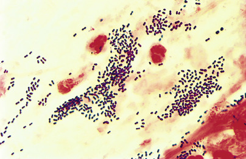

Figure 58-1 

Gram stain of a sputum smear shows neutrophils, debris, and gram-positive diplococci, suggestive of pneumococcal infection (oil immersion). 

Many laboratories use probes for identification of specific bacteria or fungi in blood culture bottles. These are commercially available using a fluorescent in situ hybridization (FISH) format (Advandx, Woburn, Mass.). For example, when gram-positive cocci are seen in clusters on Gram stain of a blood culture bottle, the QuickFISH BC probe can be used to differentiate _S_ . _aureus_ from coagulase-negative staphylococci, or nonstaphylococcal organisms. A multicenter study combined this probe with the company's _mecA Xpress_ FISH® assay that detects presence of _mecA_ in _S. aureus_ (SA) to identify 209/211 methicillin-resistant SA (MRSA) within 2 hours of finding gram-positive cocci in the blood culture bottles (  Salimnia et al, 2014  ). If gram-positive cocci are seen in pairs and chains, a probe is available that can specifically identify _E. faecalis_ , the Enterococcus Quick FISH BC. Only 2 discordants were found when the probe was used to differentiate _E. faecalis_ versus non– _E. faecalis_ enterococci in 173 positive blood cultures in a multicenter study (  Deck et al, 2014  ). The newest of these bacterial probes can be used to identify specific gram-negative bacilli when these are seen on Gram stain of the positive blood culture bottle. Yeast probes—PNA FISH-Yeast Traffic Light (YTL)—using the same format are available to quickly and rapidly differentiate among _Candida_ spp. (  Gorton et al, 2014  ) 

More recently, two other techniques for rapid identification of bacteria (and fungi) in positive blood culture bottles have become available. One uses Matrix-Assisted Laser Desorption Ionization-Time-of-Flight (MALDI-TOF) (bioMerieux MS or Bruker), and the other uses a molecular technique, Verigene (Nanosphere, Inc, Northbrook, Ill.) and FilmArray (BioFire, Salt Lake City, Utah) to identify bacteria quickly from positive blood culture bottles. In a study comparing PNA FISH, Verigene, and MALDI-TOF for the identification of gram-positive cocci, PNA FISH and Verigene were 98% concordant with routine methods as compared to MALDI-TOF, which was less sensitive, with 80% concordance to species level and 88% to genus level (  Martinez et al, 2014  ). 

 

##  Culture Techniques 

Media for culture are selected to provide the optimal conditions for growth of pathogens commonly encountered at a particular site or in a particular type of specimen. Consideration is given to special growth requirements of bacteria associated with a given type of infection or to the necessity of selecting certain pathogenic bacteria from a mixed population of indigenous flora. Therefore, the media chosen may include selective and differential media, in addition to standard enrichment agar. 

Blood-supplemented agar is a good general growth medium and can be used to demonstrate the hemolytic action of colonies on the red blood cells. Antibiotics or chemicals can be added to create a selective medium such as colistin–nalidixic acid (CNA) agar or phenylethyl alcohol agar, both of which are used to inhibit the growth of gram-negative bacilli, while permitting gram-positive bacteria to grow. Heating the blood to make chocolate agar and adding vitamin supplements creates an enriched medium with available hemin (X factor) and nicotinamide adenine dinucleotide (V factor) for the isolation of _Haemophilus_ spp. and other fastidious bacteria. Gram-negative bacilli may be separated from gram-positive bacilli by using bile salts and dye in a medium such as MacConkey's agar, which additionally divides the colonies into lactose-positive and lactose-negative colonies, thus making it both selective and differential. Guidelines for the selection of media to be used with different types of specimens are provided in [ Table 58-1 ](<#t0010>) . 

TABLE 58-1 

Guidelines for Media Selection for Various Specimens [ * ](<#hl0000547>)

Specimen  |  MEDIA FOR RECOVERY OF AEROBIC AND FACULTATIVELY ANAEROBIC BACTERIA  |  MEDIA FOR RECOVERY OF ANAEROBIC BACTERIA   
---|---|---  
BAP  |  MAC or EMB  |  CBA  |  Broth [ † ](<#hl0000550>) |  Other  |  BAP [ ‡ ](<#hl0000554>) |  BBE  |  PEA   
Body cavities  |  |  |  |  |  Consider the use of BCB for large volumes of fluids  |  |  |   
**Fluids**  
Cerebrospinal  |  X  |  |  X  |  X (for shunt specimens)  |  |  |  |   
Peritoneal  |  X  |  X  |  X  |  |  BCB  |  X  |  X  |  X   
Pleural; pericardial  |  X  |  |  X  |  X  |  BCB  |  X  |  |   
Synovial  |  X  |  |  X  |  X  |  BCB  |  |  |   
Wounds  |  |  |  |  |  |  |  |   
Aspirate  |  X  |  X  |  X  |  |  |  X  |  X  |  X   
Swab [ § ](<#hl0000558>) |  X  |  X  |  |  |  |  |  |   
Tissue [ #  ](<#hl0000561>) |  X  |  X  |  X  |  X  |  |  X  |  X  |  X   
**Respiratory Tract**  
Sputum  |  X  |  X  |  X  |  |  |  |  |   
Throat  |  X  |  |  |  |  |  |  |   
Bronchoalveolar lavage  |  X  |  X  |  X  |  |  CYE [ ¶ ](<#hl0000564>) |  |  |   
Brush; washings  |  X  |  X  |  X  |  |  |  X [ ¶ ](<#hl0000564>) |  X [ ¶ ](<#hl0000564>) |  X [ ¶ ](<#hl0000564>)  
Nasal  |  X  |  |  |  |  |  |  |   
**Genitourinary**  
Vaginal/rectal for group B  |  |  |  Lim broth  |  Selective or chromogenic  |  |  |  |   
Streptococcus (GBS)  |  |  |  |  |  GBS media  |  |  |   
Other  |  X  |  X  |  X  |  |  GC media [ ** ](<#hl0000567>) |  X  |  X  |  X   
Cervix  |  |  |  |  |  GC media  |  |  |   
Urethra/penis  |  |  |  |  |  GC media  |  |  |   
**Urine**  
Midvoid  |  X  |  X  |  |  |  Screen; chromagar  |  |  |   
Suprapubic aspirate  |  X  |  X  |  |  |  |  |  |   
Feces  |  |  |  X  |  EB  |  HE or XLD; Campy  |  |  |   
Eye  |  X  |  X  |  X [ †† ](<#hl0000571>) |  |  |  X [ †† ](<#hl0000571>) |  |   
Ear; internal aspirate  |  X  |  X  |  |  |  |  X  |  |   
Vascular catheters  |  X  |  |  |  |  |  |  |   
  
_BAP,_ Blood agar plate; _BCB,_ blood culture bottles; _BBE, Bacteroides_ bile esculin agar; _Campy, Campylobacter_ -selective medium; _CBA,_ chocolate blood agar; _CYE,_ charcoal yeast extract, for _Legionella_ or _Nocardia_ requests; _EB,_ enrichment broth, such as GN or Selenite broth, same for rectal swabs, minus the _Campylobacter_ -selective culture; _EMB,_ eosin methylene blue; _GBS,_ group B streptococcus; _GC,_ gonococcus; _HE,_ Hektoen enteric agar; _Lim broth,_ enrichment broth for group B streptococcus; _MAC,_ MacConkey's agar; _PEA,_ phenylethyl alcohol; _XLD,_ xylose-lysine-deoxycholate agar. 

 * Specific guidelines for individual organisms will be included where they are described in text. 

 † Supplemented thioglycollate is the usual broth; when _P. acnes_ is a suspected pathogen, broth should be incubated for at least 10 days; however, for aerobes, a brain-heart infusion may be adequate. 

 ‡ Consider a CDC BAP or a _Brucella_ blood agar, or another “enriched” BAP for anaerobic recovery; a laked blood agar plate with antibiotics may also be appropriate. 

 § Not recommended for anaerobic cultures. 

 # If specific organisms, or situations, other media may be added. 

 ¶ If a protected bronchoscope is used for collection of the specimen. 

 ** Thayer-Martin or Martin-Lewis or other media enriched for recovery of _N. gonorrhoeae._

 †† If _Propionibacterium acnes_ is suspected in cases of endophthalmitis, a thioglycollate broth and/or anaerobic BAP may be used. 

Bacterial cultures are generally incubated at 35° C and are examined initially after 18 to 24 hours of incubation. Addition of 5% to 10% carbon dioxide (CO  2  ) may be essential or stimulatory to the growth of _N. gonorrhoeae_ , _Haemophilus influenzae_ , and _S. pneumoniae_ , and should be used whenever feasible. Exceptions to this recommendation are those cultures on differential and selective media in which the pH alteration (which can be affected by added CO  2  ) is used to differentiate colony types (e.g., xylose-lysine-deoxycholate [XLD] agar, Hektoen enteric [HE] agar). 

For recovery of anaerobes, inoculated media should be placed into an anaerobic environment as quickly as possible. Several types of anaerobic culture systems are available. One of these is the anaerobic jar, in which water is added to a CO  2  and hydrogen (H  2  ) generator package, and oxygen (O  2  ) is catalytically converted to water with palladium-coated alumina pellets contained in a lid chamber. A modification of this system is a transparent plastic bag containing its own gas generator and palladium catalyst and designed to hold an agar plate; these are often referred to as anaerobic Bio-Bags. 

Another approach to anaerobic culture is the anaerobic glove box or chamber, which consists of a large, clear plastic, airtight chamber filled with an oxygen-free gas mixture of nitrogen, hydrogen, and carbon dioxide. Specimens, plates, and tubes are introduced into or removed from the chamber through a gas interchange lock. Anaerobiosis is maintained by palladium catalysts and the hydrogen gas in the chamber. All manipulations within the chamber are done with neoprene gloves sealed to the chamber wall or, for “gloveless” systems, through a hole with sleeves that seal tightly around the forearms. The chambers contain internal incubators that maintain the incubation temperature. Each of the anaerobe systems has its advantages and disadvantages, but all are equally effective in isolating clinically significant anaerobic bacteria from specimens. A system for processing anaerobic specimens under a constant anaerobic environnent to reduce the chance of excess exposure to oxygen is available in the Anoxamat system (  Summanen et al, 1999  ;  Shahin et al, 2003  ). 

Bacterial cultures should be examined routinely after 18 to 24 hours of incubation. The exception to this is the anaerobe culture, which is generally examined at 48 hours to allow these slower-growing bacteria to produce visible colonies. In general, solid media are held for 48 hours, with liquid media held for an additional 24 to 48 hours. If this is different for specific organisms, it will be mentioned in the text. 

A preliminary report is issued when the culture is first examined; this report is updated as additional information becomes available. Certain results (e.g., positive blood or CSF Gram stain, isolation of an organism requiring infection control measures) are reported to the health care provider as soon as the information becomes available. Final reports are issued when all work on a culture has been completed. 

,  

##  Medically Important Bacteria 

 

##  Gram-Positive Cocci 

 

##  Staphylococcus 

 

##  Characteristics 

Staphylococci are catalase-positive spherical cocci that often appear in grape-like clusters in stained smears ( [ Fig. 58-2 ](<#f0015>) ). They grow well on any peptone-containing nutrient medium under aerobic and anaerobic conditions and may produce hemolysis of various species of animal blood cells and yellow or orange pigment on certain types of agar. Growth of staphylococci is readily detected on blood agar plates or in various types of nutrient broth. A selective medium for the isolation of _S. aureus_ is one containing 7.5% to 10% sodium chloride (NaCl) with mannitol. 

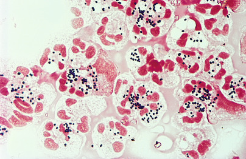

Figure 58-2 

Cytocentrifuge preparation of cerebrospinal fluid stained with Gram stain shows many neutrophils, smooth amorphous material, and gram-positive cocci in pairs, short chains, and clusters, suggestive of staphylococcal infection (oil immersion). 

Tests useful for distinguishing staphylococci from _Micrococcus_ and _Kocuria_ spp. (generally considered nonpathogenic) are listed in [ Table 58-2 ](<#t0015>) (  Becker & von Eiff, 2011  ). _S. aureus_ is differentiated from other species of staphylococci principally by its production of coagulases, which are capable of clotting plasma. Two antigenically distinct forms of coagulases have been recognized: One bound to the cell wall is called clumping factor and is detected with the slide coagulase test, and the other is free from the cell wall and is detected with the tube coagulase test (often considered the definitive test for the presence of coagulase enzyme). Commercial latex agglutination products are available that detect clumping factor and protein A in _S. aureus_ with good sensitivity and specificity. These assays may be appropriate in situations in which reproducibility of the test is in question because of the inexperience of technologists performing the assay. A FISH product ( _S. aureus_ peptide nucleic acid FISH) is also available for the differentiation of _S. aureus_ from coagulase-negative staphylococci in a blood culture bottle found positive for gram-positive cocci in clusters. In addition, many laboratories are now utilizing polymerase chain reaction (PCR) assays for detection of _S. aureus_ in nasal swabs and directly from positive blood culture bottles. Many of these assays enable detection of methicillin-resistant _S. aureus_ (MRSA) versus methicillin-susceptible _S. aureus_ . 

TABLE 58-2 

Tests Differentiating _Staphylococci_ from _Micrococci_ and _Kocuria_ spp. 

|  _Staphylococcus_ spp.  |  _Micrococcus_ spp.  |  _Kocuria_ spp.   
---|---|---|---  
Lysostaphin susceptibility  |  S  |  R  |  R   
Aerobic acid production from glycerol  |  \+  |  – |  \+   
Anaerobic acid production from glucose  |  +/– |  – |  Delayed +   
Furazolidone (100-µg disk)  |  S  |  R  |  R   
Bacitracin susceptibility (0.04 U)  |  R  |  S  |  S   
Modified oxidase  |  – |  \+  |  \+   
  
_+,_ Positive result; _ –, _ negative result; _R,_ resistant; _S,_ susceptible. 

Adapted from Becker K, von Eiff C: _Staphylococcus, Micrococcus_ , and other catalase positive cocci. In Versalovic J, Carroll KC, Funke G, et al, editors: _Manual of clinical microbiology_ , ed 10, Washington, DC, 2011, American Society for Microbiology, p309. 

 

##  Clinical Manifestations and Pathogenesis 

_S. aureus_ may be present among the indigenous flora of the skin, eye, upper respiratory tract, gastrointestinal tract, urethra, and, infrequently, vagina. Therefore, infection may arise from an endogenous or an exogenous source. Factors of importance in the development of infection due to _S. aureus_ include breaks in the continuity and integrity of mucosal and cutaneous surfaces, the presence of foreign bodies or implants, prior viral diseases, antecedent antimicrobial therapy, and underlying diseases with defects in cellular or humoral immunity. 

Infections caused by _S. aureus_ may affect multiple organ systems. Among the most common are those involving the skin and its appendages, such as impetigo, folliculitis, mastitis, and infection of surgical wounds. _S. aureus_ is among the leading causes of bacteremia in hospitalized patients, and it may cause endocarditis, particularly in persons with left-sided valvular heart disease and in intravenous drug users. _S. aureus_ is the most common cause of spinal epidural abscess and suppurative intracranial phlebitis, and it may be recovered from brain abscesses, typically following trauma. Meningitis caused by _S. aureus_ is uncommon and generally follows head trauma or a neurosurgical procedure. 

_S. aureus_ is responsible for many cases of osteomyelitis, is the most common cause of septic arthritis in prepubertal children, and is occasionally responsible for septic arthritis in adults. _S. aureus_ is an infrequent cause of community-acquired pneumonia but a common cause of nosocomial pneumonia, which usually follows aspiration of endogenous nasopharyngeal organisms. Predisposing factors include infection with measles or influenza A virus, cystic fibrosis, and immune deficiency. Urinary tract infections caused by _S. aureus_ are rare, but cases of pyelonephritis and intrarenal and perirenal abscesses can be found. 

Several factors play a role in the virulence of _S. aureus_ . The capsule, if present, has antiphagocytic properties. Cell wall peptidoglycans have endotoxin-like activity, stimulating the release of cytokines by macrophages, activation of complement, and aggregation of platelets. Protein A, an immunologically active substance in the cell wall, has antiphagocytic properties that are based on its ability to bind the Fc fragment of immunoglobulin IgG. Other surface proteins, designated as microbial surface components recognizing adhesive matrix molecules, may play an important role in the ability of staphylococci to colonize host tissues (  Speziale et al, 2009  ). Recently, the significant involvement of superantigens of _S. aureus_ in sepsis, endocarditis, and acute kidney injury (abscess) has been elucidated (  Salgado-Pabón et al, 2013  ). 

_S. aureus_ produces numerous toxins. The exotoxin TSST-1 is responsible for toxic shock syndrome, and enterotoxins A to E are responsible for staphylococcal food poisoning. The exfoliative toxins—epidermolytic toxins A and B—cause skin erythema and separation, as seen in scalded skin syndrome. Various enzymes are also produced, including protease, lipase, and hyaluronidase, all of which destroy tissue and probably function to facilitate the spread of the infection. 

Toxin-mediated diseases caused by _S. aureus_ include scalded skin syndrome, food poisoning, and toxic shock syndrome. Scalded skin syndrome occurs in infants infected with a strain of _S. aureus_ producing exfoliative toxin. The illness begins abruptly with erythema, followed in 2 to 3 days by the formation of flaccid bullae, which slough, leaving denuded areas that eventually resolve completely. Staphylococcal food poisoning, characterized by nausea, vomiting, abdominal cramps, and diarrhea, occurs 1 to 6 hours after ingestion of foods contaminated with preformed staphylococcal enterotoxin, which is usually introduced into the food product by food handlers who prepare and/or serve the food (  Baumgartner et al, 2014  ). 

Toxic shock syndrome is a multisystem disease affecting individuals who have no antibodies to TSST-1 and are colonized or infected with strains of _S. aureus_ producing TSST-1 or rarely enterotoxin B or C. Toxic shock syndrome (TSS) is primarily the result of a superantigen-mediated cytokine storm and M protein-mediated neutrophil activation, resulting in the release of mediators leading to respiratory failure, vascular leakage, and shock (  Low, 2013  ). The illness is most common in women 15 to 25 years of age who use tampons during menstruation, but it also may occur in nonmenstruating individuals, including women in the postpartum period, male or female patients with a surgical wound or other focal infection, and individuals who have had a surgical procedure in the nose or sinuses. Toxic shock syndrome begins abruptly with fever, myalgias, vomiting, and diarrhea, followed by hypotension, hypovolemic shock, and an erythematous rash that frequently involves the palms and soles and desquamates in 1 to 2 weeks. The diagnosis is clinical; isolation of _S. aureus_ from any site is not required. Full recovery is the rule, although repeated episodes may occur (  Becker & von Eiff, 2011  ). 

Over the past 10 to 15 years, cases of community-acquired infection with _S. aureus_ that are oxacillin resistant (CA-MRSA) have become more common. In these isolates, a toxin referred to as Panton-Valentine leukocidin toxin (PVL), which has rarely been associated with hospital-acquired strains of _S. aureus_ (  Becker & von Eiff, 2011  ), has been found. PVL has been shown to be responsible for necrotizing skin and soft tissue infections and has been infrequently demonstrated to cause a necrotizing and occasionally fatal pneumonia (  Hageman et al, 2006  ;  MMWR, 2007a  ;  Moskowitz & Wiener-Kronish, 2009  ,  Toro et al, 2014  ). Individuals who were initially felt to be at greatest risk are children involved in contact sports and individuals in institutions such as prisons (  MMWR, 2003  ;  Pan et al, 2003  ). These CA-MRSA strains, unlike hospital-acquired strains of MRSA (HA-MRSA), are often susceptible to most non–β-lactam classes of antibiotics. HA-MRSA strains are usually resistant to all antibiotics except the glycopeptides, such as vancomycin. The mechanism of oxacillin resistance is the same in CA-MRSA and HA-MRSA—the presence of a _mecA_ gene that is responsible for production of a new penicillin-binding protein (PBP-2a or PBP-2′). However, the chromosomal cassette that houses the CA-MRSA _mecA_ gene is different from and much smaller than that containing the _mecA_ gene of HA-MRSA. Many experts believe that, in time, blending of CA-MRSA and HA-MRSA strains will occur, and without molecular typing of any isolate, it will be difficult to distinguish them. The predominant strain of CA-MRSA in the United States is type USA 300 (  Becker & von Eiff, 2011  ). 

_S. aureus_ bacteremia can be caused by community and nosocomial strains of _S. aureus_ . A recent study compared the risk factors, morbidity, and mortality due to bacteremia related to health care–associated MRSA (HCA-MRSA) bacteremia versus CA-MRSA bacteremia. Patients with CA-MRSA bacteremia were likely to have diabetes mellitus, chronic liver disease, and HIV infection, perhaps reflecting the community nature of acquisition of the SA; in those patients with bacteremia due to HCA-MRSA occurring with 48 hours or more of hospitalization, the risk factors were found to include the presence of a central venous catheter, solid tumor, chronic renal failure, and prior hospitalizations and previous antibiotic therapy. Those with bacteremia caused by HCA-MRSA that occurred with less than 48 hours of hospitalization were more prone to have had previous hospitalizations, been in long-term care facilities, and have had received corticosteroid therapy (  Bassetti et al, 2012  ). 

Infections caused by coagulase-negative species (CoNS) of _Staphylococcus_ usually occur in association with foreign bodies, especially implanted prosthetic valves, joints, and shunts. Isolates of CoNS are usually considered less pathogenic than _S. aureus_ , although that varies among the species and strains (  Becker et al, 2014  ). The presence of biofilms and antibiotic resistance of the species appears to be associated with bacteremia, whereas specific adhesion capabilities of the CNS were associated with prosthetic joint infections (  Giormezis et al, 2014  ). CoNS are one of the most common organisms associated with CSF shunt infections; they are rarely involved in urinary tract infections, pneumonia, or skin and soft tissue infections. More than 20 species of CoNS are known, of which _S. epidermidis_ is the species most frequently involved in such infections. _S. saprophyticus_ is an important cause of bacteriuria, particularly among sexually active young women. _S. hemolyticus,_ reported to rank second in frequency to _S. epidermidis_ in clinical specimens, can be resistant to vancomycin, an agent to which most CoNS are susceptible (  Giormezis et al, 2014  ). _S. lugdunensis_ can appear morphologically similar to _S. aureus_ (i.e., in production of a narrow zone of β-hemolysis on blood agar plates) and on occasion will test positive in some assays for coagulase. However, it is usually classified as a coagulase-negative staphylococcus. Clinically, it will act more aggressively than most other CoNS and in this way mimics _S. aureus_ infection, including its role as an agent of endocarditis, osteomyelitis, and other more severe staphylococcal infections (  Sabe et al, 2014  ). It is important to distinguish _S. lugdunensis_ from other CoNS because the breakpoints one uses (according to the Clinical Laboratory and Standards Institute [CLSI]) for the interpretation of susceptibility results versus oxacillin (or cefoxitin) should be those that are used to interpret _S. aureus_ and not those used to interpret breakpoints for oxacillin (or cefoxitin) versus CoNS (  CLSI, 2014  ). 

 

##  Laboratory Diagnosis 

The observation microscopically of typical rounded, gram-positive cocci in clusters in smears of material taken from previously unopened or undrained lesions, or in smears of broth from a positive blood culture, is indicative of staphylococcal infection. 

_S. aureus_ produces coagulase, an enzyme that binds plasma fibrinogen, causing the organisms to agglutinate or plasma to clot; only rare strains of other staphylococci are coagulase positive. More than 95% of isolates of _S. aureus_ are identified by the slide coagulase test, which detects cell-bound enzyme (clumping factor); nearly 100% of all isolates are identified by tube coagulase tests, which detect free coagulase (  Becker & von Eiff, 2011  ). 

The slide coagulase test is performed by mixing a dense emulsion of the organism with plasma on a glass slide. The test is positive if clumping occurs within 30 seconds. _Staphylococcus lugdunensis_ and _Staphylococcus schleiferi_ are two other staphylococci that may give a positive result with this slide coagulase test. A control that consists of emulsifying the suspect colony in saline should be run with each slide test to ensure that autoagglutination does not occur. If autoagglutination is present, slide test results should be considered insufficient for determination of the coagulase nature of the isolate. 

For the tube coagulase test, several colonies are transferred into a tube containing plasma that is incubated at 35° C for 4 hours and then is examined for clot formation. If no clot has formed, the tube is reincubated at room temperature and reexamined after a total of 24 hours of incubation. The test should be examined after 4 hours because most isolates of _S. aureus_ produce a clot within this interval, but some strains produce a fibrinolysin that can lyse the clot, thus producing a false-negative reaction if the test is observed only after 24 hours. _Staphylococcus intermedius_ and _Staphylococcus hyicus_ will also be positive with the tube coagulase test, but they are primarily pathogens of animals and are encountered only rarely in human specimens. 

Several commercial latex agglutination assays are available for rapid identification of _S. aureus_ . These assays detect protein A and clumping factor; some also detect capsular polysaccharide, which may improve the ability to detect methicillin (oxacillin)-resistant _S. aureus_ . _S. sapro ­phyticus _ and _Staphylococcus sciuri_ are two other staphylococcus species that may be latex agglutination positive, along with the rare _Micrococcus_ spp.; however, these should all be slide coagulase negative (  Becker & von Eiff, 2011  ). 

Many species of CoNS have been recognized; however, with the exception of _S. epidermidis, S. lugdenensis,_ and _S. saprophyticus_ , which is resistant to novobiocin, identification of these isolates to the species level is not practical or clinically indicated in every culture. Identification to species may be needed if isolates are found repeatedly in sterile sites, if _S. lugdunensis_ is being ruled out, and/or if correlation between isolates in a patient is being sought to increase the likelihood that the two isolates are the same and therefore are potentially clinically relevant. If necessary, attempts to identify these isolates to the species level may be made using commercially available identification kits or with use of Maldi-Tof (  Peel et al, 2014  ). Alternatively, isolates may be sent to a reference laboratory capable of performing standard biochemical assays or molecular assays such as 16S ribosomal RNA (rRNA) analysis (  Loonen et al, 2012  ). Staphylococci may be classified into strains for epidemiologic purposes in attempting to identify common sources of infection on the basis of their susceptibility to different bacteriophages, plasmid profiles, cellular fatty acids, electrophoresis of multilocus enzymes, or chromosomal molecular typing (pulsed field gel electrophoresis and repetitive PCR). These tests are generally available only through reference laboratories. 

 

##  Antimicrobial Susceptibility 

More than 90% of staphylococci are resistant to penicillin due to inducible plasmid-encoded β-lactamase. A chromogenic β-lactamase test (i.e., nitrocefin disk test) or a penicillin disk diffusion zone edge test may be performed. The latter is considered more sensitive than the nitrocefin assay, but either can be used. When β-lactamase is positive by either, isolates should be reported as resistant to penicillin, but some resistant isolates could be missed by the nitrocefin β-lactamase test. If penicillin is being considered for treatment of serious _S. aureus_ infections, a zone edge disk diffusion test or an MIC should be performed for confirmation; MICs to penicillin of 0.12 or less are interpreted as susceptible (  CLSI, 2014  ). Resistance to the penicillinase-resistant penicillins (methicillin, oxacillin, nafcillin) occurs in up to 80% of coagulase-negative staphylococci and in more than 50% of isolates of hospital-acquired _S. aureus_ . Resistance to this group of antimicrobial agents is mediated by the _mecA_ gene, which encodes an altered penicillin-binding protein, PBP-2a. Resistance typically is heterogeneous, meaning that only rare cells may (1 in 10  4  to 10  8  ) express the resistance trait. Because of this, specific guidelines must be followed to ensure detection. An oxacillin disk should no longer be used to detect resistance, but rather CLSI has suggested that if disk diffusion is used as the method of detection of MRSA, a 30-µg cefoxitin disk test is the better indicator of resistance than oxacillin. To predict the presence of _mecA_ -mediated resistance in _S. aureus_ (and _S. lugdunensis_ ), the CLSI recommends that isolates with zone sizes 22 mm or larger can be reported as susceptible (S), and those with zone sizes 21 mm or smaller to cefoxitin can be reported as oxacillin resistant (R) (  Velasco et al, 2005  ;  CLSI, 2014  ). Likewise, for coagulase-negative staphylococci (except _S. lugdunensis_ ), 25 mm or larger can be reported as susceptible, and 24 mm or smaller can be reported as oxacillin resistant with cefoxitin disks (  CLSI, 2014  ). Oxacillin in cation-supplemented Mueller-Hinton broth containing 2% NaCl should be used for microdilution testing; microtiter trays should be incubated a full 24 hours at 35° C. To screen isolates of _S. aureus_ for oxacillin resistance, Mueller-Hinton agar supplemented with 4% NaCl and containing 6 µg/mL of oxacillin is spot inoculated with a cotton swab, and plates are incubated for 24 hours at 35° C. All reports should list the results for oxacillin and not for cefoxitin. Any growth on or in screening medium suggests an MRSA, and further testing should be done for confirmation. This could include either detection of _mecA_ by molecular methods or detection of PBP2a. There is a newly described mec A, the mec C gene, which cannot be detected by the molecular _mecA_ assays; mecC may be detected in tests for PBP2a (  Paterson et al, 2014  ). 

For coagulase negative staphylococci (CNS) other than _S. lugdenensis_ , a broth microdilution using oxacillin (≤0.25 µg/ml = S) can be used, or if using disk diffusion, with cefoxitin (≥25 mm zone diameter = S). If any species of CoNS other than _S. epidermidis_ has an MIC to oxacillin between 0.5 µg/ml and 2.0 µg/ml, a _mecA_ or PBP2a assay should be used for confirmation because the broth microdilution may overcome resistance in these strains (  CLSI, 2014  ). 

Several assays have been developed for rapid detection of oxacillin resistance. These include nucleic acid amplification, nucleic acid probe assays for _mecA_ , and latex agglutination assays for PBP-2a (the MRSA Screen Test, Denka-Seiken Co., Tokyo, Japan) and PBP-2′ (Oxoid Ltd., Basingstoke, U.K.), Mastalex test (Mast Diagnostics, Bootle, U.K.), and the Slidex MRSA detection assay (bioMerieux, Raleigh-Durham, N.C.) and Clearview (Inverness Medical Innovations, Scarborough, Mass.) (  Bowers et al, 2003  ;  Chediac-Tannoury & Araj, 2003  ;  Chapin & Musgnug, 2004  ;  Nonhoff et al, 2012  ). Not all of these assays are FDA cleared in the United States; some have been used for direct detection of oxacillin resistance in blood cultures positive for _S. aureus_ . For direct detection of MRSA in nasal swabs, two approaches can be used. Newer chromogenic media specific for the detection of MRSA require overnight incubation but allow easy detection of specific-colored colonies that are positive for the presence of _mecA_ . Those commercially available are MRSASelect (bioRad Laboratories, Redmond, Wash.), CHROMagar MRSA (BD, Sparks, Md.), Brilliance MRSA (Oxoid, Thermofisher Scientific, Lenexa, Kan.), and MRSA-ID (bioMerieux, Raleigh-Durham, N.C.) (  Perry et al, 2004  ;  Manickam et al, 2013  ;  Veenemans et al, 2013  ). Not all are FDA cleared in the United States; most studies indicate they work well in detecting MRSA but are less sensitive than the available molecular assays. They are, however, less expensive than the molecular assays. 

Three molecular assays that can detect MRSA directly in clinical specimens (nasal swabs, blood cultures, and other) within 90 minutes are Gene-Ohm (Becton Dickinson Microbiology Systems, Sparks, Md.), the Xpert MRSA (Cepheid, Sunnyvale, Calif.), and Light Cycler MRSA Advanced Test (Roche, Basel, Switzerland) (  Warren et al, 2004  ;  Al-Haj-Hussein et al, 2005  ;  Frey et al, 2011  ;  Buchan et al, 2014  ). Both Gene-OHM and Cepheid have assays for the detection of _S. aureus_ and MRSA in clinical specimens and from positive blood cultures. Although oxacillin-resistant staphylococci may appear to be susceptible to cephalosporins, they should be considered resistant to all β-lactam agents (penicillins, cephalosporins, and carbapenems). Hospital-acquired strains usually are resistant to many non–β-lactam antibiotics as well. Many of the CA-MRSA strains still remain susceptible to most non–β-lactam antibiotics (  Daum et al, 2002  ;  David et al, 2014  ). 

Clindamycin may be used to treat staphylococcal infection. Inducible resistance, due to mechanisms involving a class of enzyme-inactivating genes referred to as _erm_ genes, may not be detected in routine susceptibility testing. This _erm_ gene also confers cross-resistance to the macrolides (e.g., erythromycin) and streptogramins (quinupristin-dalfopristin). An isolate of _S. aureus_ that is resistant to erythromycin but susceptible to clindamycin in a minimum inhibitory concentration (MIC) test (broth or agar dilution or E-test) should be evaluated for inducible resistance to clindamycin by the “D-zone” test as follows. A 15-µg erythromycin disk and a 2-µg clindamycin disk are placed 15 mm apart on the surface of a blood agar plate inoculated with the isolate in question. After overnight incubation, if there is inducible resistance to clindamycin, blunting of the clindamycin zone of inhibition will be seen on the side near the erythromycin disk, giving the appearance of a D zone (  CLSI, 2014  ). 

Vancomycin resistance, although rarely seen in _S. aureus_ , is a serious issue that laboratories need to be aware of and should screen for. Isolates of vancomycin intermediately susceptible _S. aureus_ (VISA) have MICs in the intermediate range (4-8 µg/mL) (  Cosgrove et al, 2004  ). A number of cases of vancomycin-resistant _S. aureus_ with vancomycin MICs as high as 1024 µg/mL have been reported (  MMWR, 2004  ). Because the latter have not been uniformly detected in automated systems for susceptibility testing, the Centers for Disease Control and Prevention (CDC) recommends that all _S. aureus_ isolates tested on an automated instrument should also be tested by a vancomycin screen assay to ensure that the correct MIC is determined. This is usually done by inoculating 100 µL of a 0.5 McFarland suspension of _S. aureus_ to a Brain Heart Infusion Agar (BHIA) plate containing 6 µg/mL of vancomycin, and incubating overnight at 35 °C. If more than one colony is seen on the plate, this is evidence of presumptive reduced susceptibility to vancomycin; confirmation with an MIC should be done (  CLSI, 2014  ). Most automated susceptibility testing systems have been adjusted to detect vancomycin-resistant _S. aureus_ (VRSA), if present; however, detection of VISA is still variable among systems—both automated and manual. Isolates with an MIC of 4 µg/ml to vancomycin should be considered representative of a possible VISA, and further testing with microbroth dilution should be performed for confirmation. Screen-positive isolates that have elevated vancomycin MIC values (≥8 organisms/µg/mL) should be sent to a reference laboratory for confirmation, and confirmed cases should be referred to your state health department and the CDC. The entity of hVISA (strains of _S. aureus_ that are variable within the population or colony for vancomycin nonsusceptibility) is difficult for a routine clinical microbiology laboratory to detect. If a strain with an MIC of 2 µg/mL to vancomycin is being clinically considered nonresponsive to vancomycin, a macro E-test can be performed, employing a McFarland of 2.0 instead of the usual 0.5, and inner colonies can be looked for. Exposure of suspected isolates to increasing concentrations of vancomycin in agar plates, however, is the recommended approach for detection of hVISA, although these methods are often beyond what a routine laboratory can do (  Bae et al, 2009  ). 

Newer antimicrobial agents have good activity against susceptible and resistant staphylococci. These include quinupristin/dalfopristin, a streptogramin; the lipopeptide daptomycin; linezolid; televancin; and ceftaroline. The last is the only cephalosporin to which MRSA isolates are susceptible. For isolates of VISA or VRSA, or when clinicians request agents other than vancomycin for MRSA strains, laboratories should consider testing these agents or sending the isolates to reference laboratories that can test for their susceptibility. 

 

##  Streptococcus and Enterococcus 

 

##  Characteristics 

Streptococci are catalase-negative, gram-positive, spherical, ovoid, or lancet-shaped cocci, often seen in pairs or chains. They are facultatively anaerobic. Some strains require added CO  2  for their initial isolation but may lose this requirement in subcultures. Streptococci can be broadly classified according to the hemolytic reaction on blood agar ( [ Table 58-3 ](<#t0020>) ). Those strains that completely hemolyze the red cells around their colonies are called β-hemolytic and can be further categorized into the Lancefield groups based on serologically reactive carbohydrates. Important members of this group include _Streptococcus pyogenes_ (group A) and _Streptococcus agalactiae_ (group B). [ Figure 58-3 ](<#f0020>) is a Gram stain of _S. pyogenes_ (group A streptococcus) in a specimen from abscess material on the arm of a patient with cellulitis. Those gram-positive cocci in chains that produce partial hemolysis (cause “greening” of the agar) are α-hemolytic. An important member of this group is _S. pneumoniae_ . Streptococci that do not hemolyze blood are γ-hemolytic. An important member of this group is _Streptococcus bovis_ complex. Some _S. agalactiae_ may also be γ-hemolytic. Most of the remainder of the α\- and γ-hemolytic streptococci are collectively called viridans streptococci, including _Streptococcus mutans_ , _Streptococcus sanguis_ , _Streptococcus mitis_ , _Streptococcus salivarius_ , and _Streptococcus anginosus_ . The group of organisms previously referred to as nutritionally variant (pyridoxal or thiol dependent, satelliting) streptococci have now been assigned to the genus _Abiotrophia_ or _Granulicatella_ . 

TABLE 58-3 

Classification of _Streptococci_ and _Enterococci_

Hemolysis  |  Lancefield Group  |  Species   
---|---|---  
β |  A  |  _Streptococcus pyogenes_  
B  |  _Streptococcus agalactiae_  
C  |  _Streptococcus dysgalactiae_  
D  |  _Enterococcus_ spp.   
α or γ |  D  |  _Enterococcus_ spp.   
D  |  _Streptococcus bovis complex_ (reclassified into many new species as described in text)   
None  |  Viridans group [ * ](<#hl0000687>)  
α |  None  |  _Streptococcus pneumoniae_  
  
 * Small colony variants of Lancefield group A, C, F, or G, or nongroupable strains, can be any hemolysis. 

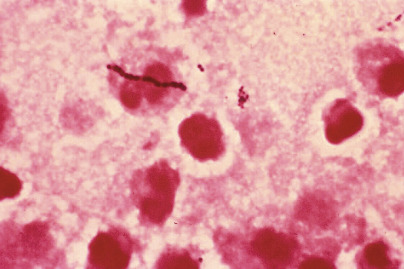

Figure 58-3 

Gram stain of _Streptococcus pyogenes_ (group A streptococcus) from a case of cellulitis. 

Members of the genus _Enterococcus_ , previously designated as group D streptococci because their cell wall antigens reacted with group D antisera, are different molecularly as well as metabolically from the other members of the genus _Streptococcus_ to be considered a separate genus. These organisms are gram-positive cocci that occur singly, in pairs, and in short chains. They are facultatively anaerobic. Most enterococci are α\- or γ-hemolytic on blood agar, but some may exhibit β-hemolysis. The most common species are _Enterococcus faecium_ and _Enterococcus faecalis_ ; yellow motile strains of the enterococci, usually nonpathogenic, include _Enterococcus cassilflavus_ and _Enterococcus gallinarum_ . These latter two species are usually intrinsically vancomycin resistant, and it is important to differentiate them from the vancomycin-resistant _E. faecium_ or _E. faecalis_ strains. 

Other genera of catalase-negative gram-positive cocci that may be isolated from clinical specimens include _Leuconostoc_ , _Pediococcus_ , _Stomatococcus_ ( _Rothia_ ), _Gemella_ , _Aerococcus_ , _Lactococcus_ , and other less rarely isolated species. These organisms are considered to have low virulence potential and generally are pathogenic only in the compromised host, with the exception of some species of _Aerococcus_ ( _A. urinae_ and _A. sanguinicola_ ), which are known urinary tract pathogens. However, some of these isolates may be confused with viridans streptococci, in particular, and their differentiation is important because of their lower virulence and their potential for vancomycin resistance. Further differentiation should be considered if a vancomycin-resistant viridans streptococcus is thought to be clinically relevant. 

 

##  Clinical Manifestations and Pathogenesis 

One of the most common clinical manifestations of group A streptococci is pharyngitis. This may be accompanied by scarlet fever, a punctate exanthem overlying diffuse erythema that usually first appears on the neck or upper chest, becomes generalized, and then desquamates. Skin infections caused by group A streptococcus include cellulitis, erysipelas, and pyoderma. Acute rheumatic fever, characterized by carditis, polyarthritis, erythema marginatum, chorea, and subcutaneous nodules, may occur 1 to 5 weeks after group A streptococcal pharyngitis. Acute glomerulonephritis may develop 10 days to 3 weeks after group A streptococcal pharyngitis or pyoderma. 

Beginning in the late 1980s, serious group A streptococcal clinical syndromes, including necrotizing fasciitis, myositis, malignant scarlet fever, bacteremia, and toxic shock–like syndrome, began to be seen with increasing frequency. These have been associated with high morbidity rates and mortality rates of up to 30% or more. The reason for this increase is not completely understood but appears to be related to changes in the prevalence of organisms having an enhanced virulence potential (  Kaplan, 2005  ;  Vucicevic et al, 2008  ;  Lappin & Ferguson, 2009  ,  Reglinski & Sriskandan, 2014  ). 

_S. pyogenes_ produces numerous virulence factors. One of the most important is the antiphagocytic cell wall M protein. Antibodies against the specific M protein confer lifelong type-specific immunity; however, because more than 60 M protein types exist, infection with a group A streptococcus possessing a different M protein may occur. Another important cell wall component is lipoteichoic acid, which permits bacterial adherence to the respiratory epithelium. _S. pyogenes_ also elaborates about 20 extracellular products, including enzymes (streptolysins, hyaluronidase, streptokinase, deoxyribonucleases [DNases], and nicotinamide adenine dinucleotidase [NADase]) and erythrogenic toxins. Streptolysin O, an antigenic, oxygen-labile enzyme, produces subsurface hemolysis on blood agar plates; streptolysin S, a nonantigenic, oxygen-stable enzyme, produces surface hemolysis. Neither streptolysin has a proven role in the pathogenesis of human disease. Streptokinase promotes fibrinolytic activity by converting plasminogen to plasmin, and hyaluronidase may enhance the spread of the organism through connective tissue. The pathogenic significance of the DNases and of NADase is unknown. Pyrogenic (erythrogenic) toxins (serotypes A, B, C) are produced by isolates of _S. pyogenes_ infected with a specific temperate bacteriophage. Their pyrogenicity is caused by a direct action on the hypothalamus. Streptococcus group A has also been found to possess superantigens with high mitogenic capabilities; these have been associated with cases of more severe streptococcal infection, such as necrotizing fasciitis or toxic shock syndrome (  Kotb et al, 2002  ;  Reglinski & Sriskandan, 2014  ). 

The pathogenesis of acute rheumatic fever is not fully understood. Certain M protein types of _S. pyogenes_ may be rheumatogenic. The presence of complexes of immunoglobulin and the C3 component of complement along the sarcolemmal sheaths of cardiac myofibers from individuals with rheumatic carditis suggests that myocarditis results from the production of antibodies directed against a streptococcal cell wall M protein that cross-reacts with myocardial tissue. Moreover, a heart or tissue cross-reactive antigen of _S. pyogenes_ that shares immunologic epitopes with, but is distinct from, the M protein has been identified (  Barnett & Cunningham, 1990  ). Renal damage in acute glomerulonephritis is caused by deposits of circulating streptococcal–antistreptococcal immune complexes in the glomeruli and subsequent activation of complement. Cell-mediated reactions to an altered glomerular basement membrane or activation of the alternate complement pathway also may be involved. Isolates of _S. pyogenes_ have been linked to toxic shock syndrome, with a clinical picture very similar to _S. aureus_ ; streptococcal superantigens (Sags) are thought to be responsible for the toxic shock–like syndrome caused by strains of _S. pyogenes_ (  Reglinski & Sriskandan, 2014  ). 

The most common infections caused by Group B streptococci (GBS) are neonatal sepsis, pneumonia, and meningitis. Colonization of the maternal genital tract is associated with colonization of infants and risk of neonatal disease, with early-onset infections occurring within the first few days after delivery and late-onset infections appearing after 1 week of age. To reduce the incidence of neonatal disease, the CDC published specific guidelines to facilitate early identification and treatment of women colonized with GBS and identification and treatment of neonates at risk for developing disease (  MMWR, 2010  ;  Verani et al, 2010  ). All pregnant women at 35 to 37 weeks of gestation should have vaginal/rectal specimens collected and processed for detection of GBS. Results of this test should be available during labor, so appropriate prophylaxis can be given to the mother before delivery to prevent infection to the newborn. Isolation of GBS from the urine of a pregnant female can also be used as a marker of group B streptococcal vaginal carriage, and this information should be used to direct prophylaxis to mothers found to be positive. If urine is positive, screening of vaginal/rectal cultures may not be necessary. Molecular tests that can rapidly identify the presence of GBS are available and are used in some laboratories at the time of labor and delivery (  Gray et al, 2012  ). Group B streptococcal infections in adults include postpartum endometritis, urinary tract infection, bacteremia, skin and soft tissue infections, pneumonia, endocarditis, meningitis, arthritis, and osteomyelitis. 

Group C and G streptococci are similar to _S. pyogenes_ in that they cause a wide range of infections, including bacteremia, endocarditis, meningitis, arthritis, and respiratory and skin infections (  Rantala, 2014  ). The pharyngeal infection caused by these streptococci is similar to that of group A streptococci, except that the nonsuppurative sequelae of rheumatic fever do not occur. 

Infections caused by _S. pneumoniae_ include pneumonia, meningitis (especially in infants and the elderly), spontaneous bacteremia (in persons who do not have a spleen), otitis, sinusitis, and spontaneous peritonitis. _S. pneumoniae_ is seen in the normal flora of the upper respiratory tract of 25% to 50% of preschool children, 36% of primary school-age children, and nearly 20% of adults, termed _carriers_ (  Lopez et al, 1999  ). Its spread is enhanced by upper respiratory tract infections and crowding. Pneumonia may develop when the host immune defenses are impaired. Most cases are endogenous, following aspiration of oral secretions containing normal flora that includes _S. pneumoniae_ . Person-to-person transmission during epidemics occurs by droplet aerosols. The major virulence factor of _S. pneumoniae_ is its antiphagocytic polysaccharide capsule, and strains with a thick, mucoid capsule are especially virulent. Vaccines designed to protect against infection by pneumococci of many of the predominant capsular polysaccharide types are available. The CDC recommends that infants receive the 13-valent conjugated vaccine starting at age 2 months. It also is recommended that adults 65 years of age and older receive both the 13-valent conjugated vaccine and the 23-valent polysaccharide vaccine. Immunosuppressed patients of any age should receive both vaccines (  Mirsaeidi & Schraufnagel, 2014  ). There are other conjugated vaccines being investigated to further enhance the protection in various populations (  Feldman & Anderson, 2014  ). 

Bacterial endocarditis is the most common infection caused by viridans streptococci; others include abscesses in the brain or liver, bacteremia, and dental caries. The milleri streptococci complex ( _S. constellatus, S. intermedius,_ and _S. anginosus_ ) consists of the most common viridans streptococci responsible for liver, spleen, and brain abscesses; they often are more susceptible to antibiotics than other strains of viridans streptococci, although resistance to penicillin is increasingly being recognized. _S. bovis_ bacteremia has been associated with malignancies of the gastrointestinal tract. _S. bovis_ is now recognized as a complex of seven strains and/or subspecies. Biochemical differentiation remains difficult within the species. Presently, there are seven subspecies broken down into four branches: _S. gallolyticus_ (includes the subspecies _gallolyticus, pasteurianus_ , and _macedonicus_ ); _S. equinus_ ; _S. infantarius_ (includes subspecies _infantarius_ and _lutetiensis_ ); and _S. alactolyticus_ . _S. gallolyticus_ subspecies _gallolyticus_ and subspecies _pasteurianus_ are isolated from blood cultures of patients with colonic cancer more often than is _S. infantarius_ or _S. lutetiensis. S. gallolyticus_ subspecies _gallolyticus_ is associated with prosthetic joint infections and infective endocarditis; _S. gallolyticus_ subspecies _pasturianus_ and _S. infantarius_ subspecies _infantarius_ are associated with hepatobiliary infections (including UTI) and cases of meningitis. _S. alactolyticus, S. equinus,_ and _S. infantarius_ subspecies _lutetiensis_ are not often found in human disease (  Jans et al, 2014  ;  Vaska & Faoagali, 2009  ). In many laboratories, isolates are still reported as _S. bovis_ because phenotypic identification may not be adequate for differentiation; as use of molecular methods or MALDI-TOF for bacterial identification increases, more of these differences may be appreciated (  Vaska & Faoagali, 2009  ). 

Enterococci are not highly pathogenic; however, they are a common cause of urinary tract infection in hospitalized persons. They may also cause endocarditis, bacteremia, and wound infection. Vancomycin-resistant enterococci offer a greater potential for infection, especially in immunocompromised patients and patients with implanted foreign devices (  Han et al, 2009  ;  McBride et al, 2009  ). 

More and more clinically relevant cases of _Aerococcus urinae_ (and other species of aerococci) are being reported. Urinary tract infections are most common, but rare cases of more serious infection, including bacteremia, are seen (  Ruoff, 2011  ;  Shelton-Dodge et al, 2011  ). _A. viridans_ remains relatively uncommon as a pathogen when isolated from clinical samples; _A. sanguinicola_ isolation is not always associated with clinical disease, but case numbers are increasing (  Ibler et al, 2008  ;  Shelton-Dodge et al, 2011  ). In addition, higher MICs have been demonstrated to levofloxacin by _A. sanguinicola_ than by other species of aerococci (  Ruoff, 2011  ;  Shelton-Dodge et al, 2011  ). 

 

##  Laboratory Diagnosis 

Streptococci grow well on blood or chocolate agar. Blood agar is preferred because the hemolytic properties of the organism can be assessed. When culturing vaginal/rectal swabs from pregnant women for group B streptococci, specimens should first be inoculated to a selective broth, such as Lim or carrot broth, or on to selective agar, such as Granada agar, to enrich for this organism (  Church et al, 2008  ;  Carvalho et al, 2009  ;  Spellerberg & Brandt, 2011  ). Tests that may be used in the clinical microbiology laboratory to presumptively name the β-hemolytic species of _Streptococcus_ are shown in [ Figure 58-4 ](<#f0025>) . More than 99% of isolates of group A streptococcus are susceptible to bacitracin, but a very small percentage of isolates of group B streptococcus and 10% to 20% of isolates of groups C and G streptococcus are also susceptible. Therefore, results of the bacitracin susceptibility test provide a presumptive identification. An isolate may be called group A streptococcus presumptively, based on hydrolysis of the  l  -pyrrolidonyl-β-naphthylamide (PYRase) test (  Spellerberg & Brandt, 2011  ). All isolates of group A streptococcus and more than 99% of isolates of _Enterococcus_ are PYRase positive. Identification of group A streptococcus is confirmed by serotyping, using latex agglutination or a nucleic acid probe. A nucleic acid probe (Gen-Probe, San Diego) is also available for direct detection of group A streptococcus on throat swabs (  Chapin et al, 2002  ). 

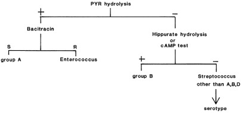

Figure 58-4 

Decision tree of tests to presumptively name the β-hemolytic species of _Streptococcus_ . 

_+,_ Positive result; _ –, _ negative result; _R,_ resistant; _S,_ susceptible. 

(With permission from  Woods GL, Gutierez Y  : _Diagnostic pathology of infectious diseases,_ Philadelphia, 1993, Lea & Febiger.) 

Group A streptococcal antigen may be detected directly in throat swab specimens by using commercial kits designed to generate a rapid result. These tests are highly specific but, given their low sensitivity, which varies among studies from 31% to 95% (  Carroll & Reimer, 1996  ;  Lean et al, 2014  ), a negative antigen test in children should be followed by culture or probe. More recently, clinical guidelines recommended that negative antigen assays in adults need not be followed up with culture, but this is controversial (  Dingle et al, 2014  ;  Lean et al, 2014  ). Serologic tests to detect streptolysin O and DNase B antibodies in acute and convalescent serum samples are used primarily to diagnose acute rheumatic fever and acute glomerulonephritis following infection with group A streptococcus. 

Catalase-negative colonies that are β-hemolytic and hippurate hydrolysis positive and/or that have a positive CAMP test (named for researchers Christie, Atkins, and Munch-Petersen) reaction presumptively can be called group B streptococcus (GBS). Isolates of presumed GBS from sterile body sites should be identified by serotyping (using latex agglutination or coagglutination tests) or by using a chemiluminescent DNA probe. The DNA probe can also be used to identify GBS growing in Lim broth or other selective broth cultures (  Daly et al, 1991  ;  Williams-Bouyer et al, 2000  ). This probe, however, is not sensitive enough to use directly on clinical specimens for the detection of GBS. For culture of vaginal/rectal swab specimens from pregnant women during weeks 35 through 37 of gestation, it is recommended that a broth enrichment be used along with or as a replacement for agar-based media. Selective broth media, including Lim broth, selective Todd Hewitt broth, or a commercially available Trans Vag broth supplemented with 5% sheep blood (Remel, Lenexa, Kans.), can be used as enrichment media (  Heelan et al, 2005  ). Chromogenic broth, including carrot broth media, can be used as enrichment broth; colonies of β-hemolytic GBS will convert the color of the tube from clear to yellow or orange. However, nonhemolytic GBS will not change the tube color, and when used, a negative broth would still need to be planted onto solid media for recovery of these strains. 

In addition, a selective nonchromogenic enrichment broth can be subcultured to Granada agar, on which colonies of GBS will appear yellow to orange for ease in detection. Isolates of β-hemolytic groups C, D, F, and G _Streptococcus_ are identified by serotyping with latex agglutination reagents. The molecular assays mentioned earlier can be used to detect GBS directly in vaginal-rectal specimens or can be used to detect GBS in Lim or carrot broth cultures (  Picard & Bergeron, 2004  ;  Block et al, 2008  ). The Cepheid GeneXpert GBS assay can be performed directly on clinical vaginal/rectal samples and has the potential to provide results intrapartum (  Gray et al, 2012  ). More nucleic acid amplification assays for the detection of GBS in vaginal/rectal samples are rapidly becoming FDA cleared for use in clinical laboratories. 

Latex agglutination assays are available for direct detection of group B streptococcus (as well as _S. pneumoniae_ , some serotypes of _N. meningitidis_ , _E. coli_ , and _H. influenzae_ type b) in CSF, serum, and urine. These assays have been shown to have sensitivities equivalent to or lower than a Gram stain and may give false-positive results; hence, they do not in general provide additional useful information above that provided by the CSF Gram stain. The rapid bacterial antigen tests are much more expensive and labor intensive than Gram stain; most laboratories no longer offer these tests or strictly limit their use (  Thomas, 1994  ). 

Tests used to presumptively identify α\- and γ-hemolytic streptococci and enterococci are shown in [ Figure 58-5 ](<#f0030>) . α-Hemolytic colonies that are mucoid or flattened with a depressed center are suggestive of _S. pneumoniae;_ they should be tested for susceptibility to ethylhydroxycupreine hydrochloride, more commonly called optochin (P disk), and for bile solubility. _S. pneumoniae_ is susceptible to both; other α-hemolytic streptococci are resistant to optochin and are variable in response to bile. A urinary antigen assay for detection of _S. pneumoniae_ has been shown in some studies to be the nonculture diagnostic method of choice for patients with severe pneumococcal infection, for diagnosis of pneumococcal exacerbation in chronic obstructive pulmonary disease patients, and as a tool for diagnosis of otitis media. As with any antigen assay, caution needs to be taken in interpreting results in cases where prior infection with _S. pneumoniae_ may have occurred and the antigen may merely be reflecting this (  Gisselsson-Solen et al, 2007  ;  Smith et al, 2009  ;  Couturier et al, 2014  ;  Harris et al, 2014  ). 

Figure 58-5 

Decision tree of tests to presumptively name the α-hemolytic species of _Streptococcus_ and _Enterococcus_ . 

_+,_ Positive result; _ –, _ negative result; _R,_ resistant; _S,_ susceptible. 

(With permission from  Woods GL, Gutierez Y  : _Diagnostic pathology of infectious diseases,_ Philadelphia, 1993, Lea & Febiger.) 

α-Hemolytic colonies that are not _S. pneumoniae_ and γ-hemolytic colonies are tested for PYRase hydrolysis; enterococci are PYRase positive, and viridans streptococci are negative. Moreover, all enterococci grow in the presence of 6.5% NaCl, but viridans streptococci do not. Enterococci hydrolyze esculin in the presence of bile (causing visible growth and blackening of the agar), but up to 10% of viridans streptococci are also bile–esculin positive. Additional biochemical assays are required to identify enterococci to the species level. A majority of vancomycin-resistant enterococci (VRE) are _E. faecium_ . 

α-Hemolytic streptococci that are optochin resistant and PYRase negative and γ-hemolytic streptococci that are PYRase negative and do not grow in 6.5% NaCl are grouped as nonhemolytic (viridans) streptococci. Identification of individual species of viridans streptococci requires conventional biochemical testing, molecular methods, or potentially MALDI-TOF (  Fang et al, 2012  ;  Moon et al, 2013  ). Kit systems to identify these organisms are commercially available. Full identification of species members of viridans streptococci, however, is usually not necessary. Members of viridans streptococci belonging to the milleri streptococci, because they are usually recognized by their characteristic “caramel” odor, can be reported, if present, to alert clinicians about this group of viridans because of their propensity for abscess formation and their uniform susceptibility to penicillin. [ Figure 58-6 ](<#f0035>) is an example of a Gram stain of a member of the milleri group of viridans streptococci from a brain abscess. 

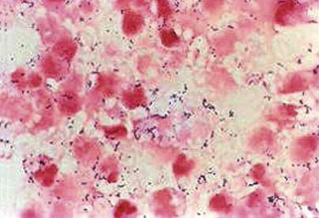

Figure 58-6 

Gram stain of a viridans _Streptococcus_ , specifically a member of the milleri group, from a brain abscess. 

There are no vancomycin-resistant streptococci, but occasionally a “viridans”-like isolate is reported as vancomycin resistant. Usually this is an enterococcus, but it could also be a member of some more uncommon genera such as _Leuconostoc_ or _Pediococcus_ . If vancomycin resistance has been demonstrated, it would be important to differentiate the intrinsically vancomycin-resistant _Leuconostoc_ and _Pediococcus_ from enterococci that have acquired vancomycin resistance. Characteristics that might be used to accomplish this are listed in [ Table 58-4 ](<#t0025>) (  Facklam et al, 1989  ). Included in this table is _Aerococcus_ sp., because of their morphologic similarity to _Enterococcus_ sp. The clue that an isolate (especially from a urine culture) might be an _Aerococcus_ sp. is the finding on Gram stain that a catalase-negative colony consists of gram-positive cocci in tetrads and clusters, not in pairs and chains. Some species of _Aerococcus_ are l-pyrrolidonyl-β-naphthylamide (PYR) positive, which leads to further confusion with _Enterococcus_ sp. 

TABLE 58-4 

Characteristics Differentiating _Enterococcus, Leuconostoc, Pediococcus,_ and _Aerococcus_

|  Enterococcus  |  Aerococcus  |  Leuconostoc  |  Pediococcus   
---|---|---|---|---  
Gram stain  |  Pairs and short chains  |  Tetrads  |  Cocci, coccobacilli, and rods; pairs and chains  |  Tetrads and pairs; spherical cells   
Hemolysis  |  β or α or γ |  α or γ |  α or γ |  α or γ  
Bile esculin  |  \+  |  V  |  V  |  \+   
Growth in 6.5% NaCl  |  \+  |  \+  |  V  |  V   
PYR  |  \+  |  [ * ](<#hl0000763>) |  – |  –  
LAP  |  \+  |  [ * ](<#hl0000763>) |  – |  \+   
Vancomycin susceptibility  |  S/R  |  S  |  R  |  R   
  
_+,_ Positive result; _ –, _ negative result; _LAP,_ leucine aminopeptidase; _PYR,_ l-pyrrolidonyl-β-naphthylamide; _R,_ resistant; _S,_ susceptible; _V,_ variable reactions. 

 * _Aerococcus urinae_ is PYR and LAP positive; _Aerococcus viridans_ is PYR positive and LAP negative. 

Members of the genus _Abiotrophia_ will not grow in the absence of pyridoxal. Often they are first recognized as satellite colonies growing around a colony of _S. aureus_ . Differential characteristics of _Abiotrophia defectiva_ and _Abiotrophia adiacens_ are reviewed elsewhere (  Ruoff, 2011  ;  Giuliano et al, 2012  ). Methods of performing susceptibility tests for strains of _Abiotrophia_ and _Granulicatella_ can be found in CLSI document M45-M2 (  CLSI, 2010  ). 

 

##  Antimicrobial Susceptibility 

The antibiograms of groups A, B, C, and G streptococcus are predictable (all are susceptible to penicillin); therefore, routine antimicrobial susceptibility testing of these organisms is unnecessary unless penicillin cannot be used, as in the case of a penicillin allergy. In the latter situations, testing for resistance to macrolides, clindamycin, and the tetracyclines may be warranted. Inducible resistance to clindamycin may occur with _Streptococcus_ (i.e., group B streptococcus), and a D zone test as described earlier for _S. aureus_ may be warranted if the streptococcal isolate is found resistant to erythromycin. Specific guidelines for streptococcal D–zone testing recommend that the clindamycin and erythromycin disks be separated by 12 mm instead of the 15 to 16 mm recommended for testing _S. aureus_ (  CLSI, 2014  ). Because _S. pneumoniae_ organisms with intermediate- or high-level resistance to penicillin are found worldwide, isolates should be tested for susceptibility to penicillin. A screening test using disk diffusion with a 1-µg oxacillin disk (≥20 mm = susceptible) may be performed; however, isolates that are not susceptible by this method must be further evaluated by macrodilution or microdilution testing, using Mueller-Hinton broth supplemented with lysed horse blood or the E test to determine the penicillin MIC. There are breakpoints for penicillin and the cephalosporins for isolates from cases of meningitis versus those isolated from nonmeningitis sites (  CLSI, 2014  ). Resistance to third-generation cephalosporins also occurs; therefore, isolates should be tested for susceptibility to these antimicrobial agents as well. 

Susceptibility testing should be performed on isolates of nonhemolytic (viridans) streptococci from sterile body sites, because resistance to penicillin does occur. _Enterococcus_ spp. should also be tested, primarily to identify high-level resistance to penicillin or ampicillin, high-level resistance to streptomycin and gentamicin, and resistance to vancomycin. Enterococci are resistant to vancomycin (MIC >32 µg/mL) because of the presence of resistance genes, referred to as the _van_ genes (  CLSI, 2014  ). Although many of these genes have been described, the most common are _vanA_ , _vanB_ , and _vanC_ . The _vanA_ and _vanB_ genes, conferring high-level resistance and predominantly found in _E. faecium_ and much less frequently in _E. faecalis_ , are acquired, plasmid-borne genes that can create infection control problems involving transmission of this resistance. This vancomycin resistance can be differentiated from intrinsic and lower-level resistance ( _vanC_ genes) in the yellow, motile species of _Enterococcus,_ and this should be done in laboratories and reported as such to the infection control team (  Teixeira et al, 2011  ). 

 

##  _Gemella_ and _Aerococcus_

Other nonstreptococcal gram-positive, catalase-negative cocci of increasing importance are those that belong to the genera _Gemella_ and _Aerococcus_ . _Gemella_ spp. ( _Gemella haemolysans_ and _Gemella morbillorum_ ) resemble viridans streptococci, although they usually produce smaller colonies. _G. haemolysans_ has been associated with endocarditis and meningitis. Gram stain usually demonstrates diplococci with adjacent sides flattened that can be confused with a _Neisseria_ sp. because cells can easily become decolorized. _G. haemolysans_ is aerobic, and _G. morbillorum_ is anaerobic. The latter usually appears as cocci in pairs or short chains. Both are PYR positive, 6% NaCl, and esculin–hydrolysis negative (to differentiate them from enterococci). _G. morbillorum_ is leucine-aminopeptidase (LAP) positive as well. Both are usually susceptible to penicillin. As with other gram-positive cocci, if there is doubt about the morphology of the organism (i.e., whether it is a short rod or a coccus), Gram stain performed from a broth culture will usually resolve the difficulty. Maldi-Tof has been shown to be a useful tool in the correct identification of _Gemella_ spp. (  Schultness et al, 2013  ). 

Two major species of _Aerococcus_ may be clinically relevant and/or isolated from clinical specimens: _Aerococcus urinae_ and _Aerococcus viridans_ . Both resemble viridans streptococci or enterococci on agar plates; however, in Gram stains, they usually appear in tetrads. _A. urinae_ is a recognized pathogen in urinary tract infection; in addition, it has been isolated from the blood in cases of endocarditis. _A. urinae_ is PYR negative and LAP positive, in contrast to _A. viridans_ , which is PYR positive and LAP negative (see [ Table 58-4 ](<#t0025>) ). Both will grow in the presence of 6.5% NaCl. Neither are anaerobes, and _A. viridans_ usually will not grow under anaerobic conditions. _A. urinae_ is usually susceptible to penicillin and nitrofurantoin but may be resistant to sulfonamides. Variability in its response to trimethoprim has been noted (  Ruoff, 2011  ;  Senneby et al, 2015  ). A newer member of the genus _Aerococcus, A. sanguinicola_ , which is rarely recovered from clinical specimens, can be both LAP and PYR positive, although this is not a confirmatory identification. Use of Maldi-TOF can provide more reliable results. It can be responsible for UTI as well as bacteremia and infective endocarditis. Like _A. urinae_ , isolates of _A. sanguinicola_ are usually susceptible to penicillin and nitrofurantoin, but are variable in their response to sulfonamides and quinolones (  Ibler et al, 2008  ;  Rasmussen, 2013  ;  Senneby et al, 2015  ). 

 

##  Gram-Positive Rods 

 

##  _Corynebacterium_ and _Arcanobacterium_

 

##  Characteristics 

The corynebacteria—or diphtheroids, as they are sometimes called—appear in the Gram-stained smear as slightly curved, gram-positive rods with nonparallel sides and sometimes wider ends, giving a clubbed appearance ( [ Fig. 58-7 ](<#f0040>) ). These organisms are catalase positive. More than 46 species of _Corynebacterium_ are known. Most are rarely pathogenic in humans; notable exceptions are _Corynebacterium diphtheriae_ and its closely related species or varieties _Corynebacterium ulcerans_ and _Corynebacterium pseudotuberculosis_ . _C. pseudodiphtheriticum_ has been implicated in respiratory tract infections, including pneumonia (  Camello et al, 2009  ). Medically relevant _Arcanobacterium_ spp. include _Arcanobacterium haemolyticum, Arcanobacterium pyogenes,_ and _Arcanobacterium bernardiae_ . _Arcanobacterium_ species also appear as irregular gram-positive rods on Gram stain but can be easily differentiated from the corynebacteria by their negative catalase reaction. 

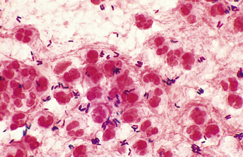

Figure 58-7 

Sputum stained with Gram stain shows many neutrophils, amorphous debris, and coryneform gram-positive bacilli (oil immersion). 

 

##  Clinical Manifestations and Pathogenesis 

At the initial site of infection on the epithelial cells of the tonsils and oropharynx, _C. diphtheriae_ elaborates an exotoxin that causes local cell necrosis and subsequent inflammation. The exotoxin produced by strains of _C. diphtheriae_ infected with a specific bacteriophage is absorbed into the circulation. Distribution of exotoxin through the bloodstream can produce degenerative changes in the heart, nervous system, and kidneys. The toxin molecule consists of two fragments: A, containing the enzymatically active site, and B, comprising the receptor binding site. Once in the cell, protein synthesis is disrupted. The bacteria and exotoxin produce a serum exudate and cellular infiltrate of the mucous membrane in the pharynx. Exudative lesions coalesce, forming a grayish-black adherent pseudomembrane, which is characteristic of diphtheria. Although toxin production and pathogenicity are often considered to be synonymous, pseudomembranes may form in persons infected with nontoxigenic strains. Extension of the pseudomembrane superiorly into the nasopharynx or inferiorly into the larynx may be so marked as to produce respiratory obstruction. Although _C. diphtheriae_ infections of other parts of the body do occur, those observed most frequently in the United States today are infections of the skin. Transmission of _C. diphtheriae_ occurs by droplet nuclei from the respiratory tract or by contact from cutaneous foci of infection (  Byard, 2013  ;  Mattos-Guaraldi et al, 2003  ). 

Because they are part of the normal flora of the skin and mucous membranes, it is difficult to establish the etiologic role of the other corynebacteria. Clinical significance is generally increased if the organism is observed in the Gram-stained smear in association with leukocytes, is isolated from a sterile site, and is isolated from multiple samples. _Corynebacterium jeikeium_ has been clearly associated with infections of implanted prosthetic materials (e.g., heart valves, CSF, joints), has caused subacute bacterial endocarditis, and has been involved in a variety of opportunistic infections. _Corynebacterium urealyticum_ has been associated with urinary tract infection, as well as with bacteremia, endocarditis, and wound infection (  Nebreda-Mayoral et al, 1994  ). When identified, _Corynebacterium striatum_ and _Corynebacterium amycolatum_ are the most common normal flora skin coryneforms. They may become pathogenic, especially in cases of prosthetic joint infections and, of note, are often resistant to β-lactam antibiotics—a characteristic usually attributed only to _C. jeikeium_ (  Crabtree & Garcia, 2003  ;  Cazanave et al, 2012  ). 

_A. haemolyticum_ has been associated with pharyngitis and wound and soft tissue infections (  Fernandez-Suarez et al, 2009  ). _A. pyogenes_ and _A. bernardiae_ are associated with abscess formation. (  Funke & Bernard, 2011  ) 

 

##  Laboratory Diagnosis 

Because of the relative rarity of diphtheria in the United States today, the diagnosis may be overlooked clinically, and the laboratory may easily fail to recognize it in cultures. When the diagnosis of diphtheria is suspected, the laboratory should be informed so that the specimen can be handled appropriately. Specimens should be obtained with a cotton- or polyester-tipped swab from inflamed regions of the nasopharynx and, if possible, beneath the pseudomembrane. If skin lesions are suspected of being positive for _C. diphtheriae_ , the most appropriate specimen would be an aspirate of the lesion. Corynebacteria will grow on routine blood-containing agar; however, cystine-tellurite (CT) blood agar or Tinsdale medium is preferred. On CT medium, colonies of _C. diphtheriae_ are gray or black after 48 hours of incubation. Colonies may be large or small, and flat or convex. Colonies of species other than _C. diphtheriae_ may produce black colonies on CT or Tinsdale media, although these will usually be smaller. If a laboratory does not have CT or Tinsdale medium and a request for _C. diphtheriae_ is made, CNA can be used, although it will be more difficult to recognize possible _C. diphtheriae_ strains (  Funke & Bernard, 2011  ). 

Classification of oral and skin corynebacteria or diphtheroids is difficult and confusing. The differential characteristics of some species are shown in [ Table 58-5 ](<#t0030>) . Commercial identification systems are available to identify many of the members of this group of organisms (  Funke & Bernard, 2011  ). Isolates of suspected _C. diphtheriae_ must be tested for production of exotoxin. The elaboration of toxin may be detected in vitro with the Elek immunodiffusion test; however, this generally is not done in a routine clinical laboratory. Isolates should be sent to a state health laboratory or a reference laboratory where this can be performed. Alternatively, PCR-based tests have been described that may be used for detection of the toxin gene (  Mancini et al, 2012  ). _C. jeikeium_ often produces a characteristic metallic sheen on the surface of blood agar plates. _C. striatum_ and _C. amycolatum_ are common skin florae that can be responsible for infection; whether they need to be specifically identified is controversial, and identification can be difficult. Species identification of _Corynebacterium_ often requires a combination of commercial kit systems, cellular fatty acid analysis, and/or sequencing (  Van den Velde et al, 2006  ). _C. striatum_ and _C. amycolatum_ organisms are often resistant to many antibiotic agents—a characteristic that often is more typically associated with hospital-acquired strains, in particular _C. jeikeium_ . Maldi-Tof has been reported to be very useful in the identification of _Cornebacterium_ spp. (  Bernard, 2012  ) and may become helpful in correlating the significance of species of coryneforms in the future. 

TABLE 58-5 

Differential Characteristics of Some Species within the Genus _Corynebacterium_ and Related Organisms 

Test  |  _C. diphtheriae_ |  _C. ulcerans_ |  _C. pseudotuberculosis_ |  _C. jeikeium_ |  _Arcanobacterium haemolyticum_ |  _Arcanobacterium pyogenes_  
---|---|---|---|---|---|---  
Catalase  |  \+  |  \+  |  \+  |  \+  |  – |  –  
Hemolysis  |  v  |  \+  |  \+  |  – |  \+  |  \+   
Gelatinase  |  – |  \+  |  – |  – |  – |  \+   
Urease  |  – |  \+  |  \+  |  – |  – |  –  
Nitrate reduction  |  v  |  – |  v  |  – |  – |  –  
Sucrose fermentation  |  – |  – |  v  |  – |  v  |  v   
  
_+,_ Positive; _ –, _ negative; _v,_ variable. 

_Arcanobacterium_ spp. are β-hemolytic on sheep blood agar. Colonies on sheep blood agar are small after 48 hours of incubation, and the hemolysis may go unnoticed. Adequate growth and noticeable hemolysis are best demonstrated in a CO  2  -enhanced environment. _Arcanobacterium_ spp. are catalase negative. Biochemical reactions that are used to determine the species of corynebacteria are also useful in identifying the _Arcanobacterium_ spp. (  Funke & Bernard, 2011  ). _A. haemolyticum_ produces phospholipase D, which is responsible for the reverse CAMP reaction with _S. aureus_ . This organism inhibits hemolysis around the _S. aureus_ streak, producing an inverted triangle of no hemolysis. 

 

##  Antimicrobial Susceptibility 

Although antitoxin remains the only specific method of treatment of diphtheria, antibiotics are administered to patients with disease and to asymptomatic carriers of toxigenic strains. _C. diphtheriae_ is usually inhibited by penicillins and the macrolides. The antimicrobial susceptibilities of other species of corynebacteria or diphtheroids are far less predictable. _C. jeikeium_ is usually resistant to the penicillins and cephalosporins, is variably susceptible to most other antibiotics, and is almost uniformly susceptible to vancomycin. Other species of _Corynebacterium_ , however, may be similarly resistant to β-lactam antibiotics. Treatment of infection caused by these organisms is often complicated by the presence of compromised host defenses and implanted prosthetic materials. Arcanobacteria are sensitive to penicillin and other β-lactams, rifampin, tetracycline, and the macrolides. Growth of the organisms may be inhibited by fluoroquinolones and aminoglycosides (  Funke & Bernard, 2011  ). Methods used for performing susceptibility tests on _Corynebacterium_ spp. and interpretive criteria can be found in CLSI document M45-M2 (  CLSI, 2010  ). Bernard recently reviewed the antimicrobial susceptibilities of gram-positive rods (  Bernard, 2012  ). 

 

##  Prevention 

Methods of prevention of diphtheria are almost exclusively active and passive immunization programs with supplemental antibiotics to eliminate the carrier state of toxigenic strains during epidemics. 

 

##  Listeria 

 

##  Characteristics 

_Listeria_ spp. are nonbranching, non–spore-forming gram-positive rods. _Listeria monocytogenes_ ( [ Fig. 58-8 ](<#f0045>) ) is the only species of _Listeria_ that is pathogenic for humans, and _L. ivanovii_ is the only species of the other five _Listeria_ spp. that is pathogenic for animals. Optimal growth of _L. monocytogenes_ is observed between 30° C and 37° C; however, growth may occur as low as 4° C. Colonies are small after 24 hours and exhibit a narrow zone of β-hemolysis on blood agar. A characteristic tumbling motility of saline suspensions of the colonies occurs at room temperature but rarely at 35° C. This same temperature-dependent motility is also noted in semisolid media, in which growth appears as an umbrella shape at the top of the medium (aerobic conditions), preferentially at lower temperatures. 

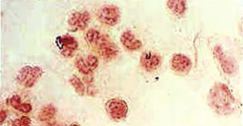

Figure 58-8 

Gram stain of a cerebrospinal fluid sample that grew _Listeria monocytogenes_ . 

The short bacilli are seen inside white blood cells. 

 

##  Clinical Manifestations and Pathogenesis 

_L. monocytogenes_ is found in soil, dust, water, silage, sewage, and raw unpasteurized milk and in asymptomatic human and animal carriers. Transmission of the organism by foods such as coleslaw, pasteurized milk, soft cheeses, and, more recently, cantaloupe has resulted in several major epidemics in North America and Europe (  MacDonald et al, 2005  ;  Cartwright et al, 2013  ;  McCollum et al, 2013  ). According to data from microbiological surveys of food, _L. monocytogenes_ has been detected in 2% to 3% of dairy products, 20% of soft cheeses and processed meats, 30% of certain vegetables (cabbages, radishes), and up to 50% of raw meat and poultry (  Wellinghausen, 2011  ;  Simmons et al, 2014  ). About 1% to 10% of humans are fecal carriers. 

Listeriosis is mainly a disease of industrialized countries, occurring sporadically or in epidemics. The primary mode of transmission is contaminated food products, although occasional non–food-related outbreaks have occurred in health care settings, primarily in nurseries, as the result of cross-infection; contaminated mineral oil for bathing was implicated in one such outbreak (  Schuchat et al, 1991  ). A meta-analysis of over 11,700 literature references pertaining to cases of listeriosis globally resulted in 23,150 illnesses and 5463 deaths in 2010. The proportion of perinatal cases was 20.7% (de  Noordhout et al, 2014  ). The incidence rate of listeriosis in the United States was 0.27 cases per 100,000 between 2004 and 2009 and 0.29 per 100,000 from 2009 to 2011; in adults aged over 65 years, the incidence increased 1.3 cases per 100,000 inhabitants (  Hernandez-Milian & Payeras-Cifre, 2014  ). 

Clinical manifestations of listeriosis differ among pregnant women, neonates, and immunocompromised individuals, which constitute the high-risk groups. Listeriosis during pregnancy, most common in the third trimester, presents as a flu-like illness. Bacteremia occurs concomitantly, during which time the uterine contents are infected. Progression to amnionitis may induce premature labor or septic abortion in 3 to 7 days. Infection in the mother is self-limited because the source of infection is removed with delivery of the infected fetus and uterine contents. Neonatal listeriosis may have an early or late onset. Early-onset disease, manifested at birth or a few days thereafter, results from in utero infection. Infants present with temperature instability, hemodynamic compromise, and respiratory distress; widely disseminated granulomas, particularly involving the placenta, posterior pharynx, and skin, are characteristic of the illness but are not always present. Late-onset disease, affecting full-term infants of mothers with uncomplicated pregnancies, is assumed to be acquired postpartum, but in most cases the source is unknown. Clinical manifestations of meningitis become apparent several days to weeks after birth. 

Nonperinatal listeriosis usually occurs in immunosuppressed individuals, but in about one-third of cases, no risk factor is identified. Tropism for _L. monocytogenes_ for the central nervous system (CNS) is manifested predominantly as meningitis; other forms of CNS listeriosis include cerebritis and brainstem and spinal cord abscesses. Severe disease with high mortality rates (20% to 50%) and neurologic sequelae among survivors are common. Primary bacteremia or focal infections outside the CNS are uncommon. Primary cutaneous listeriosis has occurred occupationally in veterinarians and abattoir workers after exposure to infected animal tissues. Endocarditis, osteomyelitis, arthritis, endophthalmitis, and other focal infections have been reported rarely. Febrile gastrointestinal disease due to _L. monocytogenes_ has been reported in nonimmunocompromised patients; implicated foods include chocolate milk, rice salad, and delicatessen meats and cheeses (  Wellinghausen, 2011  ;  Hernandez-Milian & Payeras-Cifre, 2014  ). Immunocompromised patients, such as those with leukemias or bone marrow transplants and patients on immunosuppressive therapies, are cautioned against eating uncooked dairy meats for fear of infection with this organism. 

The pathogenesis of listeriosis infection has been well elaborated in recent years. Host susceptibility, gastric acidity, inoculum size, and virulence properties of the organism, along with specific food products, are the most common factors that determine progression from infection to disease and the severity of that disease in the infected individual. _L. monocytogenes_ can penetrate the epithelial cells of the gastrointestinal tract and grow within hepatic and splenic macrophages; from there, the organism can spread to the CNS or the pregnant uterus. Virulence factors such as internalin and E-cadherin, a placental receptor, interact to result in infection in the pregnant female/fetus. Immunity to listeriosis relies on T cell–mediated activation of macrophages by lymphokines (  Wellinghausen, 2011  ;  Hernandez-Milian & Payeras-Cifre, 2014  ). 

 

##  Laboratory Diagnosis 

Colonies are small and grayish-blue, growing in 24 to 48 hrs, and are surrounded by a narrow zone of β-hemolysis on blood agar. A positive catalase reaction differentiates _L. monocytogenes_ from similarly appearing group B streptococci. Organisms are motile at room temperature and produce acid from glucose, trehalose, and salicin and hydrolyze esculin. Other biochemical characteristics of _L. monocytogenes_ and differences between _Listeria_ and _Erysipelothrix_ are listed in [ Table 58-6 ](<#t0035>) . Successful use of Maldi-Tof for the identification of _L. monocytogenes_ has been reported (  Farfour et al, 2012  ). 

TABLE 58-6 

Differential Characteristics of _Listeria monocytogenes_ and _Erysipelothrix rhusiopathiae_

Test  |  _L. monocytogenes_ |  _E. rhusiopathiae_  
---|---|---  
β-Hemolysis  |  \+  |  –  
Growth at 4° C  |  \+  |  –  
Catalase  |  \+  |  –  
Motility  |  \+  |  –  
Esculin hydrolysis  |  \+  |  –  
Gluconate utilization  |  \+  |  –  
Voges-Proskauer  |  \+  |  –  
H  2  S in triple sugar iron agar  |  – |  \+   
  
_+,_ Positive; _ –, _ negative. 

 

##  Antimicrobial Susceptibility 

_L. monocytogenes_ is usually susceptible to penicillin, ampicillin, erythromycin, chloramphenicol, tetracycline, and gentamicin. Isolates usually are only moderately susceptible to the quinolones. Cephalosporins are ineffective against _Listeria_ spp.; isolates should not be tested against cepha­losporins because they are ineffective in vivo regardless of the in vitro result. Methods of performing susceptibility tests for _Listeria_ and inter­pretive criteria can be found in CLSI document M45-A (  CLSI, 2010  ). Resistance to chloramphenicol, macrolides, and tetracyclines has been found in several clinical isolates (  Wellinghausen, 2011  ;  Hernandez-Milian & Payeras-Cifre, 2014  ). Ampicillin, alone or in combination with an aminoglycoside, has been used successfully in the treatment of infections caused by _L. monocytogenes_ . Trimethoprim-sulfamethoxazole may be used as alternative therapy in penicillin-allergic patients. Newer gram-positive antibiotics such as daptomycin, linezolid, and tigecycline appear sus­ceptible in vitro, but limited clinical data document their in vivo effectiveness. 

 

##  Erysipelothrix 

 

##  Characteristics 

_Erysipelothrix rhusiopathiae_ is a catalase-negative, non–spore-forming, nonmotile, facultatively anaerobic gram-positive bacillus that has a worldwide distribution. Microscopically, they appear as short rods with rounded ends, occurring singly, in short chains, or in nonbranching filaments. Two species have been identified: _E_ . _rhusiopathiae_ and _E. tonsillarum_ . A third species, _E. inipinata_ , has been proposed recently. _E. rhusiopathiae_ is a recognized pathogen in humans, occasionally causing erysipeloid, a localized cutaneous infection of hands and fingers, obtained after exposure to animals or animal products. _E. tonsillarum_ has not been isolated from human specimens (  Wellinghausen, 2011  ). 

 

##  Clinical Manifestations and Pathogenesis 

_E. rhusiopathiae_ is usually transmitted to humans from animals by means of skin wounds produced by contaminated objects or in contact with blood, flesh, viscera, or feces of infected animals. _E. rhusiopathiae_ is widespread in nature in wild and domestic animals, birds, fish, and decaying organic matter and causes infection in swine, sheep, rabbits, cattle, birds, and fowl. At risk of infection with this organism are butchers, abattoir workers, fishermen, fish handlers, poultry processors, and veterinarians. The most common form of erysipeloid is a local cutaneous infection manifested by pain, swelling, and a cutaneous eruption characterized by a slowly progressive, slightly elevated, violaceous zone around the site of inoculation. The swelling and erythema migrate peripherally, and the lesion involutes without desquamation. Systemic disease is rare, but numerous case reports describe septicemia and endocarditis. Also rarely reported have been cases of arthritis and brain abscess. Virulence factors include a hyaluronidase, a neuraminidase, and a heat-labile capsule (  Wang et al, 2010  ). 

 

##  Laboratory Diagnosis 

Biopsy and tissue aspirates from erysipeloid lesions are the best specimens for culture. The organisms are located deep in the subcutaneous layer of the leading edge of the lesion; therefore, swabs of the surface of the skin are not useful. The organism will grow on blood or chocolate blood agar, but may require up to 7 days for growth. Conventional blood culture media are suitable for its isolation from blood. They are considered nonhemolytic, although greenish discoloration of the media beneath the colonies is often observed after 2 days of incubation. 

_E. rhusiopathiae_ is oxidase and catalase negative. Characteristically, it produces hydrogen sulfide (H  2  S) in triple-sugar iron agar (TSIA) and ferments glucose and lactose. It is nonmotile, does not reduce nitrates to nitrites, and is negative for urease, gelatin, and esculin hydrolysis. A trait highly characteristic of _E. rhusiopathiae_ is the “pipe cleaner” pattern of growth in gelatin stab cultures incubated at 22° C. This organism can be readily distinguished from _Listeria_ spp. (see [ Table 58-6 ](<#t0035>) ). 

 

##  Antimicrobial Susceptibility 

_Erysipelothrix_ is susceptible to the penicillins, the cephalosporins, imipenem, erythromycin, clindamycin, chloramphenicol, the tetracyclines, and the fluoroquinolones but is resistant to sulfonamides, aminoglycosides, and vancomycin. Penicillin is the treatment of choice for localized and systemic infection (  Wellinghausen, 2011  ). Methods used for performing susceptibility tests for _Erysipelothrix rhusiopathiae_ and interpretive criteria can be found in CLSI document M45-M2 (  CLSI, 2010  ). 

 

##  Prevention 

Prevention of human disease is recommended by control of animal disease through sound husbandry, herd management, good sanitation, and immunization procedures (  Wang et al, 2010  ). 

 

##  Bacillus 

 

##  Characteristics 

Members of this genus are strictly aerobic or facultatively anaerobic, rod-shaped, spore-forming, gram-positive, and catalase-positive organisms. [ Figure 58-9 ](<#f0050>) shows a Gram stain of a _Bacillus_ sp. seen in pleural fluid. With the notable exception of _Bacillus anthracis,_ they are usually motile by means of lateral or peritrichous flagella. Some strains stain gram-negatively and, because of their variable oxidase reactions, can be confused with gram-negative bacilli. The most reliable diagnostic characteristic of the genus is spore formation, which occurs optimally and on a variety of media under aerobic conditions at 25° to 30° C. In Gram-stained smears, endospores are detectable by the presence of unstained defects or holes within the cell. The spores themselves can be stained by any of several methods. 

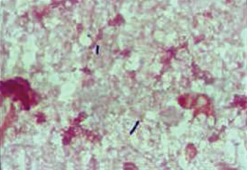

Figure 58-9 

Gram stain of _Bacillus cereus_ in pleural fluid. 

 

##  Clinical Manifestations and Pathogenesis 

Of the numerous species of _Bacillus_ , _B. anthracis_ is the only one that is uniformly and highly pathogenic. Great care must be exercised when handling material suspected of harboring this species. Work should be performed in biological safety cabinets by gloved, gowned, masked, and immunized personnel; work surfaces must be disinfected with 5% hypochlorite or 5% phenol; and all supplies, materials, and equipment must be decontaminated. Because _B. anthracis_ spores have been used as a means of bioterrorism, cultures containing suspect _B. anthracis_ should be handled only by reference or public health laboratories. 

Three forms of anthrax are recognized: cutaneous, inhalation, and intestinal. In its cutaneous form, anthrax produces a small, red, macular lesion that progresses to a vesicle and finally to necrosis with formation of a characteristic black eschar. Regional lymphadenopathy and septicemia may occur. Mortality in untreated cases with this form of disease is approximately 20%. Inhalation of anthrax spores can lead to acute bronchopneumonia, mediastinitis, and septicemia (“woolsorter's disease”). The mortality in recognized cases of this form of disease is nearly 100%. Intestinal anthrax follows the ingestion of contaminated food and is manifested by nausea, vomiting, and diarrhea. In some cases, gastrointestinal bleeding is followed by prostration, shock, and death. Septicemia can occur in all three forms of anthrax and may lead to a fatal, purulent meningitis. More recently, a fourth type of anthrax, injectional anthrax, has been recognized in heroin addicts, resulting in severe soft tissue infections with an increased risk of shock and higher level of mortality than is associated with cutaneous infections (  Sweeney et al, 2011  ). 

A major factor in the organism's pathogenic capabilities is its glutamyl polypeptide capsule, which inhibits phagocytosis; anticapsular antibodies do not protect against the disease. A complex toxin with three components (edema factor, protective antigen, and lethal factor) is responsible for the signs and symptoms of anthrax. The cell wall peptidoglycan is believed to produce a robust intravascular inflammatory response that can lead to hemodynamic and organ dysfunction, resulting in shock (Logan, 2011;  Sweeney et al, 2011  ). 

Humans become infected with anthrax by contact with and inhalation or ingestion of infected animals, their carcasses, or their by-products. Cattle, sheep, horses, and goats are the animals most frequently infected and provide a ready source of vegetative organisms that sporulate and perpetuate the environmental contamination. 

Although usually saprophytic, other species of _Bacillus_ can cause disease. _Bacillus cereus_ has been associated with ear infection, pneumonia, posttraumatic ocular wound infection, septicemia, endocarditis, and meningitis. Patients with pneumonia and septicemia are often immunosuppressed. Bacteremia is frequently associated with intravenous drug use and with contaminated intravascular devices (  Stevens et al, 2012  ). 

Two forms of gastroenteritis are associated with _Bacillus_ species. Food poisoning caused by _Bacillus_ may occur within 1 to 6 hours following ingestion of food contaminated by _B. cereus_ that has produced a preformed heat-stable toxin. Major manifestations of _Bacillus_ food poisoning include nausea, vomiting, cramps, and occasionally diarrhea, but no fever. Typically, this form of _Bacillus_ gastroenteritis results from the bulk preparation of foods that are not reheated before they are served. _B. cereus_ type 1 grows particularly well in fried rice and is more heat resistant than other types, so this form of gastroenteritis is frequently seen in association with consumption of cooked rice in Chinese restaurants. The second form of gastroenteritis caused by _Bacillus_ spp. results from contamination of poultry and vegetable dishes and is characterized by the onset of cramps and diarrhea 8 to 16 hours following ingestion of contaminated food. In this instance, the major manifestations of _B. cereus_ infection are caused by the production of a heat-labile enterotoxin. From 1998 to 2008, 1229 food-borne outbreaks caused by _B. cereus_ , (rice dishes were implicated in 50% of the cases), _Clostridium perfringens_ , and _Staphylococcus aureus_ were reported in the United States. In 2008, there were 17 to 18 suspected outbreaks of gastroenteritis associated with _B. cereus_ as compared to over 40 outbreaks due to _S. aureus_ and 10 or 11 outbreaks due to _C. perfringens_ (  Bennett et al, 2013  ). 

The genus _Bacillus_ contains more than 100 species; other than _B. anthracis_ and _B. cereus,_ common species include _B. subtilis, B. licheniformis, B. megaterium_ , _B. pumilus,_ and _B. thuringiensis_ . Many species have been renamed, however, and more than 25 new genera of gram-positive spore-producing aerobic bacilli have been named. One of those genera, _Paenibacillus,_ contains species that have been associated with clinical disease, including meningitis and endophthalmitis. Species of _Paenibacillus_ include _P. alvei, P. polymyxa, P. popilliae_ , _P. sanguinis_ , _P. massiliensis, P. timonensis,_ and _P. thiaminolyticus_ (  Anikpeh et al, 2010  ; Logan, 2011). _P. macerans_ has been found in contaminated blood culture bottles in a neonatal intensive care unit, and _P. pasadenensis_ has been isolated in spacecraft facilities and also as a cause of mediastinitis following heart surgery (  Noskin et al, 2001  ;  Anikpeh et al, 2010  ). 

 

##  Laboratory Diagnosis 

In cases of suspected cutaneous anthrax, vesicle fluid and material under the edge of the eschar should be collected with a swab for smear and culture. For suspected inhalation anthrax, sputum should be collected for smear and culture. Cultures of stool should be considered in the intestinal form. Smears and cultures consisting of CSF should be requested in suspected meningitis. In the septicemic stage, blood cultures should be performed. 

Finding large, boxcar-shaped gram-positive cells in smears of any of these specimens should raise suspicion for the diagnosis. Fluorescent microscopy, available in some state health laboratories and at the CDC, can provide a rapid presumptive diagnosis. As mentioned earlier, because of the use of _B. anthracis_ in terrorist attacks, sentinel laboratories (level A) should send any suspicious isolates of this organism to their state health laboratory or the CDC. 

Species of _Bacillus_ grow well on sheep blood agar. Colonies of _B. anthracis_ are usually flat, with an irregular margin (“Medusa head”), appear off-white with a ground glass surface, and are usually nonhemolytic. [ Figure 58-10 ](<#f0055>) demonstrates the colonial morphology of _B. anthracis_ on blood agar. When touched with an inoculating loop, the colonies are tenacious and will stand up like beaten egg white. The Medusa head colony may be seen with _B. cereus_ and certain other _Bacillus_ species. Anthrax bacilli are nonmotile in a hanging drop test or in semisolid media, whereas most other species of _Bacillus_ are motile. Motility by the hanging drop method is a useful differential test between _B. anthracis_ and _B. cereus_ but must be carried out with a fresh broth culture of the organism. Additional characteristics and biochemical reactions that may be used to identify isolates to the species level are summarized by Logan (2011). A commercial system has been evaluated recently for identification of aerobic endospore-formers; 93% of the strains were correctly identified to species level in the genera _Bacillus_ , _Paenibacillus_ , _Aneurinibacillus_ , _Brevibacillus_ , _Geobacillus_ , and _Virgibacillus_ (  Halket et al, 2010  ). _Bacillus_ spp. have been correctly identified using Maldi-Tof (  Farfour et al, 2012  ). 

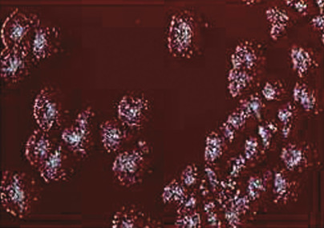

Figure 58-10 

Colonies of _Bacillus anthracis_ on blood agar. 

Note the irregular edges of the colonies. 

The diagnosis of _B. cereus_ gastroenteritis cannot be accurately made by culture of stool because the organisms may be a component of the indigenous gut flora. Diagnosis, therefore, depends on quantitative culture of the suspected contaminated food. The presence of greater than or equal to 10  5  colony-forming units (CFUs)/g in the suspected food constitutes presumptive evidence of _B. cereus_ food poisoning (Logan, 2011). This testing is usually not performed in a routine clinical microbiology laboratory. 

 

##  Antimicrobial Susceptibility 

Although susceptible to a variety of agents, antibiotic therapy of anthrax has centered on the use of fluoroquinolones. These agents are highly active against _B. anthracis_ , strains of which are typically susceptible to β-lactam antibiotics. However, many strains of _Bacillus_ spp. elaborate β-lactamases in nature, so these agents usually are not considered as first-line drugs of choice until the specific susceptibility of the isolate is known. Most strains of _Bacillus_ spp. are inhibited by fluoroquinolones, tetracyclines, aminoglycosides, and chloramphenicol at low concentrations (Logan, 2011), and most are susceptible to vancomycin, but reports have described vancomycin resistance in _B. circulans_ and _P. thiaminolyticus. Bacillus_ strains have been demonstrated to carry genes similar to the _vanA_ gene of the enterococci (  Patel et al, 2000  ). Methods of performing susceptibility tests and of interpreting their results can be found in the CLSI document M45-M2 (  CLSI, 2010  ). 

 

##  Prevention 

Prevention of anthrax in humans ideally depends on its control in animals. Prompt diagnosis of sick animals, their isolation and therapy, and cremation of carcasses are indicated when sporadic outbreaks occur. In enzootic areas, vaccination with nonencapsulated spore preparations is used. Occupationally exposed persons should also be immunized. Acute diarrheal disease caused by _B. cereus_ may be prevented by proper cooking and refrigeration of foods prepared in bulk to prevent proliferation of vegetative forms of the bacteria and formation of the enterotoxin. 

 

##  Nocardia 

 

##  Characteristics. 

In Gram-stained smears of clinical specimens, _Nocardia_ spp. appear as long, thin, beaded, branching gram-positive bacilli ( [ Fig. 58-11 ](<#f0060>) ). The most distinguishing quality of the nocardiae is their partial acid fastness; cells stain positively with a modified acid-fast (Ziehl-Neelsen or Kinyoun) stain, differentiating them from _Actinomyces_ , which may have a similar Gram-stain appearance. Partial acid fastness may be difficult to demonstrate and can be enhanced by growing the organism for about 4 days on Middlebrook 7H10 agar or in litmus milk broth. Most clinical infections have been caused by members of the _Nocardia asteroides_ complex, most commonly _Nocardia cyriageorgica_ , _Nocardia farcinica,_ and _N. nova_ , followed by _Nocardia brasiliensis_ and rarely _Nocardia otitidis caviarum_ (  Cloud et al, 2004  ). 

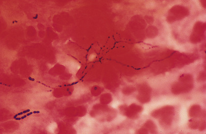

Figure 58-11 

Sputum smear stained with Gram stain shows neutrophils, amorphous debris, and filamentous, beaded, branched gram-positive bacilli (oil immersion). 

 

##  Clinical Manifestations and Pathogenesis 

Nocardiae are found in soil and organic material worldwide and cause disease in many animals and in fish. Human infection is slightly more common in males than in females. It is usually acquired via inhalation of the organism but may occur following trauma and contact with contaminated soil, or the organism may enter the body via the gastrointestinal tract when contaminated material contacts an area of mucosal ulceration. 

In the lungs, _Nocardia_ spp. are phagocytosed by alveolar macrophages and grow intracellularly, eliciting a mixed inflammatory response (neutrophils, lymphocytes, and macrophages), eventually resulting in abscess or, occasionally, granuloma formation. In vitro studies of the host defenses against _Nocardia_ spp. suggest that neutrophils, activated macrophages, and cytotoxic T cells are involved. Although neutrophils do not kill virulent _Nocardia_ spp., they inhibit their growth, possibly suppressing the infection until macrophages are fully activated. If the infection is not contained within the lung, organisms spread to other tissues by advancing growth, thus producing empyema, chest wall involvement, and draining sinuses, or by hematogenous dissemination, resulting in abscess formation, especially in the brain; subcutaneous tissues; and kidneys. The primary host factor associated with increased risk of nocardiosis is cellular immune dysfunction, although many persons infected with _Nocardia_ spp. have no recognized cellular or humoral immune defect (  Budzik et al, 2012  ;  Wilson, 2012  ). 

Pulmonary disease, the most frequent manifestation of nocardiosis, is characterized by fever, anorexia, weight loss, cough, dyspnea, and pleuritic chest pain. Skin and subcutaneous disease may present as pyoderma, cellulitis, single or multiple abscesses, lymphocutaneous disease resembling sporotrichosis, or nodules. In Central and South America, primary infections of the skin with _N. brasiliensis_ may produce an actinomycetoma (a localized indurated granulomatous mass with sinus tracts draining pus and “sulfur” granules), typically on the lower extremities. Disseminated disease is usually caused by members of the _N. asteroides_ complex. It originates in the lung in most cases and typically is manifested as single or multiple abscesses involving the CNS (  Anagnostou et al, 2014  ). The skin is the second most common site of dissemination, followed by kidney, liver, and lymph nodes (  Conville & Witebsky, 2011  ). 

 

##  Laboratory Diagnosis 

_Nocardia_ spp. grow aerobically on most nonselective media such as sheep blood and chocolate agars, potato dextrose agar, Sabouraud's dextrose agar, and Löwenstein-Jensen or Middlebrook media and in 7H9 broth used for mycobacterial culture. These organisms will grow on buffered charcoal-yeast extract (BCYE) used for the isolation of _Legionella_ spp. as well. It is important to note that _Nocardia_ spp. may not always survive the decontamination procedures used for recovery of mycobacteria. Incubation in the presence of 10% CO  2  enhances growth. _Nocardia_ spp. may grow in 48 hours, but colonies typically appear in 5 to 10 days as waxy, bumpy, or velvety rugose forms, often with yellow to orange pigment, depending on the species. Observing branching filaments that stain only with a modified acid-fast stain distinguishes _Nocardia_ spp. from mycobacteria. _Nocardia_ spp. are differentiated from most other aerobic actinomycetes by testing resistant to the action of lysozyme ( _Nocardia_ spp. are resistant; _Streptomyces_ spp., _Rhodococcus_ spp., _Gordona_ spp., and _Actinomadura_ spp. are susceptible) and examining their morphology on tap water agar. For example, the latter can help in differentiating the branching _Nocardia_ from nonbranching _Rhodococcus_ spp. Because many new species of _Nocardia_ have been recognized over the past several years, the use of biochemical tests (e.g., casein, hypoxanthine, tyrosine, xanthine) is not sufficient for identification. Molecular tests (e.g., 16S rDNA sequencing, PCR-restriction enzyme pattern analysis [PRA]) of MALDI-TOF (  Farfour et al, 2012  ) are required for accurate species identification (  Cloud et al, 2004  ;  Patel et al, 2004  ). Identification to the species level is important because of the variability in antibiotic susceptibility patterns noted among species ( [ Table 58-7 ](<#t0040>) ) (  Brown-Elliott et al, 2006  ;  Schlaberg et al, 2014  ). 

TABLE 58-7 

Differentiation of _Nocardia_ spp. Based on Antimicrobial Susceptibility Pattern [ * ](<#hl0001148>)

|  Amik  |  Amox/Clav  |  Cefotax  |  Ceftriax  |  Ciproflox  |  Clari  |  Gent  |  Imi  |  Kana  |  Linez  |  Mino  |  Sulfa  |  Tobra  |  Amp  |  Eryth  |  Carb   
---|---|---|---|---|---|---|---|---|---|---|---|---|---|---|---|---  
_Nocardia cyracigeorgica_ ( _N. asteroides_ drug pattern VI)/ _N. asteroides_ VII  |  S  |  R  |  S  |  S  |  R  |  R  |  |  S  |  S  |  S  |  S/I  |  S  |  |  R  |  R  |   
_Nocardia farcinica_ (drug pattern V)  |  S  |  S  |  R  |  R  |  S  |  R  |  R  |  S  |  R  |  S  |  S/I  |  R/S  |  R  |  R  |  R  |   
_Nocardia nova complex_ [ † ](<#hl0001151>) (drug pattern III)  |  S  |  R  |  S  |  S  |  R  |  S  |  |  S  |  |  S  |  S/I  |  S  |  |  S  |  S  |  R   
_Nocardia abscessus_ (drug pattern 1)  |  S  |  S  |  S  |  S  |  R  |  R  |  |  R/S  |  |  S  |  S/I  |  S  |  |  S  |  R  |  R   
_Nocardia brasiliensis_ |  S  |  S  |  S/R  |  S/R  |  R  |  R  |  S  |  R  |  R  |  S  |  S/I  |  S  |  S  |  R  |  R  |  S   
_Nocardia pseudobrasiliensis_ |  S  |  S  |  S/R  |  S/R  |  S  |  S  |  S  |  R  |  R  |  S  |  R  |  S  |  S  |  R  |  |  S   
_Nocardia otitidiscaviarum_ (often R to all β-lactams)  |  S  |  R  |  R  |  R  |  S  |  |  S  |  R  |  S [ ‡ ](<#hl0001155>) |  S  |  S/I  |  S  |  |  R  |  |  R   
_Nocardia transvalensis_ complex (drug pattern IV)  |  R  |  S  |  S  |  S  |  S  |  R  |  R  |  S  |  R  |  S  |  S/I  |  S  |  R  |  R  |  R  |   
_Nocardia brevicatana/paucivorans_ |  S  |  |  |  S  |  S  |  |  R  |  S  |  S  |  S  |  S/I  |  S  |  S  |  S  |  |  S   
  
_Amik,_ Amikacin; _Amox/clav,_ amoxicillin/clavulanate; _Amp,_ ampicillin; _Carb,_ carbenicillin; _Cefotax,_ cefotaxime; _Ceftriax,_ ceftriaxone; _Ciproflox,_ ciprofloxacin; _Clari,_ clarithromycin; _Eryth,_ erythromycin; _Gent,_ gentamicin; _I,_ intermediate; _Imi,_ imipenem; _Kana,_ kanamycin; _Linez,_ linezolid; _Mino,_ minocycline; _R,_ resistant; _S,_ susceptible; _Sulfa,_ sulfamethoxazole; _Tobra,_ tobramycin. 

Reproduced with permission of Dr. Richard Wallace and Ms. Barbara Brown-Elliott. 

 * Table based on majority of isolates tested. 

 † Includes _N. nova/veterana/africana._

 ‡ Kanamycin zone ≥ amikacin zone. 

 

##  Antimicrobial Susceptibility 

Sulfonamides (alone or in combination with trimethoprim—e.g., trimethoprim-sulfamethoxazole) are usually the antimicrobial agents of choice; however, optimal antimicrobial therapy depends on the species of _Nocardia_ present, the susceptibility pattern of the individual strain, and the type of infection. Other potential antimicrobial agents include amikacin, clarithromycin, imipenem, or a quinolone, depending on the species isolated. The CLSI has information about methods used for susceptibility testing and interpretation of results for _Nocardia_ and other aerobic actinomycetes (  CLSI, 2011  ). 

 

##  Other Aerobic Actinomycetes 

Other genera of actinomycetes that are medically relevant to humans include _Rhodococcus, Gordona, Tsukamurella, Actinomadura,_ and _Streptomyces_ . One other member, _Tropheryma whippelii,_ is nonculturable and is the putative agent of Whipple's disease. 

 

##  Clinical Manifestations and Pathogenesis 

Members of this group of organisms are ubiquitous in the environment and have been isolated from soil, fresh water, marine water, and organic matter. _Rhodococcus equi_ is the most common _Rhodococcus_ sp. pathogenic to humans. It is an opportunistic pathogen in severely immunocompromised hosts, causing a slowly progressive granulomatous pneumonia. It may be isolated from the blood of infected patients. The organism is likely acquired via the respiratory route, possibly as a result of exposure to infected animals. The organism's ability to persist in and ultimately destroy macrophages probably accounts for its ability to cause disease (  Weinstock & Brown, 2002  ). Infections caused by _Gordona_ spp. and _Tsukamurella_ spp. are increasingly being reported (  Savini et al, 2012  ;  Ramanan et al, 2013  ). _Tsukamurella_ spp. appear to be pathogenic only when certain clinical conditions are present (e.g., immunosuppression, presence of foreign body, active chronic infection such as tuberculosis) (  Woo et al, 2003  ). _Actinomadura_ spp. are a frequent cause of actinomycotic mycetomas, most of which are seen in tropical and subtropical countries, where walking barefoot increases the chance of exposure through repeated puncture wounds. _Streptomyces_ spp. have traditionally been considered of little medical significance; however, one species, _Streptomyces somaliensis_ , has been identified as an etiologic agent of actinomycotic mycetoma. Other _Streptomyces_ spp. have only occasionally been reported to be of medical importance (  Mossad et al, 1995  ). 

 

##  Laboratory Diagnosis 

Aerobic actinomycetes are slow growing and may require 2 to 3 weeks of incubation. These microorganisms grow on most of the nonselective media used to isolate bacteria, mycobacteria, and fungi. Species of _Rhodococcus_ grow as coccobacilli in a zigzag fashion. Rudimentary branched filaments have been observed from liquid media. Colonies may be rough, smooth, or mucoid and have pigments ranging from buff to coral to orange to deep rose after several days of incubation. _R. equi_ is usually pale pink, pale yellow, or coral and may appear slimy. _Gordona_ spp. range from smooth, mucoid colonies that are adherent to the media to dry, raised colonies. The pigment produced may be beige to salmon-colored. _Tsukamurella_ spp. are slightly acid fast by the modified Kinyoun. They appear as long rods that fragment into three parts. No aerial hyphae are produced. The colonies are circular with entire or rhizoid edges. They may be dry or creamy, with a white to orange pigment. Rough colonies may be produced after 7 days of incubation. Species of _Actinomadura_ form waxy, cerebriform, tough, membranous white, yellow, pink, or red colonies. Colonies of _Streptomyces_ are dry to chalky, heaped or folded, gray-white to yellow, and have the odor of a musty basement. A wide variety of pigments are produced that color the substrate and hyphae. Some species do not produce aerial hyphae. As with the _Nocardia_ spp., complete identification of these members of the aerobic actinomycetes often requires molecular sequencing methods (  Conville et al, 2011  ). 

 

##  Gram-Negative Bacteria—Cocci 

 

##  Neisseria 

 

##  Characteristics 

This genus is composed of species that are nonmotile and catalase and oxidase positive; these aerobic, gram-negative cocci are often arranged in pairs, with flattened adjacent surfaces, giving the appearance of kidney beans or coffee beans ( [ Fig. 58-12 ](<#f0065>) ). The organisms are somewhat fastidious, in some instances requiring the addition of blood, serum, cholesterol, or oleic acid to the medium to counteract growth inhibitors, such as fatty acids. _N. gonorrhoeae_ and _N. meningitidis_ generally require prompt incubation in CO  2  for growth; however, this is strain dependent, varies with the phase of the organism's growth curve, and is often lost in subcultures. _N. meningitidis_ and most _N. gonorrhoeae_ are not inhibited by the presence of vancomycin or lincomycin, colistin, and nystatin—a characteristic that is particularly useful in their selective isolation from specimens contaminated by other bacteria. Rarely, isolates of _N. gonorrhoeae_ (especially AUH strains, which require arginine, uracil, and hypoxanthine) are susceptible to vancomycin (  Elias et al, 2011  ). 

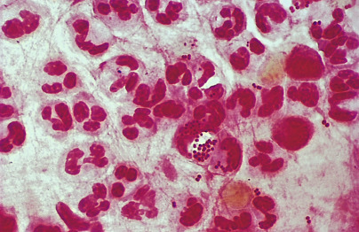

Figure 58-12 

Sputum smear stained with Gram stain shows many neutrophils and intracellular gram-negative diplococci, suggestive of _Neisseria meningitidis_ infection (oil immersion). 

 

##  Clinical Manifestations and Pathogenesis 

Although opportunistic infections caused by species of _Neisseria_ other than _N. gonorrhoeae_ and _N. meningitidis_ have occasionally been reported in compromised hosts, these species are generally nonpathogenic. _N. meningitidis_ may colonize the mucous membranes of the upper respiratory tract—an event that is usually followed in 7 to 10 days by the formation of bactericidal and hemagglutinating antibodies, which may not eliminate the carrier stage but convey group-specific immunity. In a few cases, disease results shortly after colonization, most frequently in the form of meningococcemia and meningitis. The organism also has a tendency to invade serous membranes and joint tissues, with the development of pleuritis, pericarditis, and arthritis. Carriage of _N. meningitidis_ in the nasopharynx occurs in 5% to 15% of healthy individuals, and this rate may be higher in confined groups such as military recruits. A direct correlation between carrier rates and incidence of disease has not been established, with the possible exception of members of large households or households with an infant or childhood case during epidemics of disease. _N. meningitidis_ has also been isolated from genital sources, where its clinical significance is uncertain. When cultured from these sources, bacteria may be misidentified as _N. gonorrhoeae_ unless appropriate tests for distinguishing these species are performed. 

The principal virulence factor of _N. meningitidis_ is a lipopolysaccharide–endotoxin complex, which in experimental animals activates the clotting cascade, depositing fibrin in small vessels, producing hemorrhage in the adrenals and other organs, altering peripheral vascular resistance, and leading to shock and death. 

The pathogenesis and clinical manifestations of _N. gonorrhoeae_ infections differ somewhat from those of _N. meningitidis_ . Pathogenic types of _N. gonorrhoeae_ adhere by means of pili, which are not produced by nonpathogenic types, to various human cells. These antigenically heterogeneous pili, which represent one of the principal virulence factors of _N. gonorrhoeae_ , may inhibit phagocytosis and stimulate strain-specific antibody formation. Other possible virulence factors of _N. gonorrhoeae_ are less clearly defined. Both _N. gonorrhoeae_ and _N. meningitidis_ produce an IgA protease, which may be important in their pathogenesis because IgA is the antibody class that predominates in secretions on mucous membranes (  Elias et al, 2011  ). 

 

##  Laboratory Diagnosis 

The single most important element in the laboratory diagnosis of infection caused by _N. meningitidis_ or _N. gonorrhoeae_ is the specimen, including proper selection, collection, and transport to the laboratory (see [ Chapter 64 ](<##!/content/3-s2.0-B9780323295680000644?scrollTo=%23c00064>) ). The pathogenic species are sensitive to drying and extremes of temperature, and material must be cultured promptly to enhance recovery. They are mesophilic and grow poorly, if at all, at room temperature. Many require prompt incubation in CO  2  (2% to 8%) for primary isolation. Media containing chocolatized blood are commonly used for cultures and should contain antibiotics (i.e., vancomycin or lincomycin, as well as colistin, nystatin or anisomycin, and trimethoprim) if the specimen is prone to be contaminated by indigenous flora. Vancomycin-susceptible gonococci will grow on media containing lincomycin; however, because of the synergistic interaction of lincomycin and trimethoprim, the latter must be omitted from media containing lincomycin. Direct inoculation of specimens at the bedside followed by prompt incubation at 35° C in CO  2  is optimal. This can be accomplished in several ways: placing the medium into a candle jar; placing the medium in a sealed bag containing a citric acid bicarbonate tablet; or using a medium contained within a bottle having a CO  2  atmosphere. If any of these culture systems must be mailed to a reference laboratory for processing, they must first be incubated overnight to ensure growth of the organisms. 

An isolate from a urogenital specimen showing the appropriate colony appearance on a selective medium presumptively may be called _N. gonorrhoeae_ based on results of Gram stain and oxidase and catalase tests. Gram-stained smears prepared from colonies of _N. gonorrhoeae_ should show typical gram-negative diplococci, but organisms may occur in tetrads, especially from young cultures. All species of _Neisseria_ are oxidase positive, and all species except _N. elongata_ are catalase positive. Because _Neisseria_ other than _N. gonorrhoeae_ may be recovered from urogenital sites, confirmatory testing is strongly recommended and is required for all isolates from extragenital sites, and when sexual abuse is suspected (preferably by more than one method). 

Confirmation of _N. gonorrhoeae_ and identification of the other _Neisseria_ spp. are based on growth and biochemical characteristics ( [ Table 58-8 ](<#t0045>) ) (  Elias et al, 2011  ). The standard method of identification consists of detection of acid production from carbohydrates in a cystine trypticase acid (CTA) base medium and other conventional biochemical tests. However, given the drawbacks of conventional methods, more rapid identification tests are used in most clinical laboratories. Tests for direct detection of _N. gonorrhoeae_ and _N. meningitidis_ in clinical specimens are also available. Typing of isolates of _N. gonorrhoeae_ and _N. meningitidis_ is done primarily for epidemiologic studies. 

TABLE 58-8 

Differentiation of Species of _Neisseria_ and _Moraxella catarrhalis_

|  _N. gonorrhoeae_ |  _N. meningitidis_ |  _N. cinerea_ |  _N. lactamica_ |  _N. sicca_ |  _N. subflava_ |  _N. flavescens_ |  _N. mucosa_ |  _M. catarrhalis_  
---|---|---|---|---|---|---|---|---|---  
**Growth**  
Thayer-Martin medium  |  \+ [ * ](<#hl0001337>) |  \+  |  – |  \+  |  – |  – |  \+  |  – |  [ † ](<#hl0001340>)  
Nutrient agar, 25° C  |  – |  – |  – |  – |  \+  |  \+  |  – |  \+  |  \+   
Oxidase  |  \+  |  \+  |  \+  |  \+  |  \+  |  \+  |  \+  |  \+  |  \+   
β-Galactosidase  |  – |  – |  – |  \+  |  – |  – |  – |  – |  –  
Reduction of nitrate  |  – |  – |  – |  – |  – |  – |  – |  \+  |  \+   
DNase  |  – |  – |  – |  – |  – |  – |  – |  – |  \+   
**Production of Acid from**  
Glucose  |  \+  |  \+  |  – [ ‡ ](<#hl0001343>) |  \+  |  \+  |  \+  |  – |  \+  |  –  
Maltose  |  – |  \+  |  – |  \+  |  \+  |  \+  |  – |  \+  |  –  
Lactose  |  – |  – |  – |  \+  |  – |  – |  – |  – |  –  
Sucrose  |  – |  – |  – |  – |  \+  |  D [ § ](<#hl0001346>) |  – |  \+  |  –  
Fructose  |  – |  – |  – |  – |  \+  |  – |  – |  – |  –  
  
_+,_ ≥90% of strains positive; _ –, _ ≥90% of strains negative; _D,_ variable; _DNase,_ deoxyribonuclease. 

 * Most vancomycin-susceptible strains will not grow on Thayer-Martin medium. 

 † Some strains positive and others negative. 

 ‡ Weak reaction may occur in rapid carbohydrate utilization tests. 

 § Biovar. perflava, +; biovar. flava, –. 

With the standard method of identification, acid production from glucose, maltose, lactose, sucrose, and fructose in a CTA base medium and a carbohydrate-free control are tested. Tubes are inoculated, incubated at 35° to 37° C in ambient air, and examined at 24-hour intervals until reactions are interpretable, or for 72 hours. Expected results for the species of _Neisseria_ are shown in [ Table 58-8 ](<#t0045>) . Occasionally, however, an isolate of _N. meningitidis_ yields aberrant carbohydrate reactions: glucose-negative, maltose-negative, or asaccharolytic. If _N. meningitidis_ is strongly suspected in these cases, identification can be confirmed by slide agglutination, using pooled polyvalent grouping antisera or sera specific for individual serogroups. In addition to conventional carbohydrate degradation tests, reduction of nitrates and nitrites and production of DNase should be evaluated. The latter is especially useful for identification of _Moraxella catarrhalis,_ which is DNase positive ( _Neisseria_ spp. are DNase negative). Drawbacks to conventional tests are the requirement for a heavy inoculum, the need to work with pure cultures, long turnaround time, and failure of some fastidious strains of _N. gonorrhoeae_ to grow. 

Several commercial systems detect acid production from carbohydrates, usually in 1 to 4 hours (  Elias et al, 2011  ). The inoculum must be prepared from a pure culture of the isolate, so identification is generally available 24 hours after isolation. Acid reactions of some _N. gonorrhoeae_ and, to a lesser extent, _N. meningitidis_ may be difficult to interpret or may be aberrant with some kits, and strains of _N. gonorrhoeae_ that are weak producers of acid from glucose may appear to be glucose negative. Some strains of _Neisseria cinerea,_ which does not typically produce acid from glucose, can appear glucose positive in certain systems. 

Enzyme substrate tests provide rapid identification (1 to 4 hours) only of isolates of oxidase-positive, gram-negative diplococci recovered on a selective medium (  Elias et al, 2011  ). They are valuable for differentiating maltose-negative strains of _N. meningitidis_ from _N. gonorrhoeae,_ but color changes may be subtle and if misinterpreted could cause isolates of _N. meningitidis_ and other _Neisseria_ spp. to be incorrectly called _N. gonorrhoeae_ . Moreover, strains of _N. cinerea_ and _Kingella denitrificans_ that grow on gonococcus-selective media could be misidentified as _N. gonorrhoeae_ if not confirmed by other procedures. Commercial products that combine enzyme substrate tests with modified conventional tests provide accurate identification of species of _Neisseria_ and _Haemophilus._ Immunologic tests for _N. gonorrhoeae_ —in particular coagglutination—can be used to confirm the biochemical identification of _N. gonorrhoeae_ . Three tests are available for this: the Phadebact Monoclonal GC Test (Boule Diagnostics AB, Huddinge, Sweden), the GonoGen I (New Horizons Diagnostics, Columbia, Md.), and the GonoGen II (New Horizons Diagnostics, Columbia, Md.). Both false-positive and false-negative results have been reported with these reagents A chemiluminescent nucleic acid probe for detection of _N. gonorrhoeae_ can be used for culture confirmation (  Limberger et al, 1992  ;  Hale et al, 1993  ). Nucleic acid amplification assays (NAAT) for use on endocervical or urethral swab specimens and urine (see below) are also available and may increase sensitivity when compared with nucleic acid probe and culture techniques, largely because the problem with organism viability is not an issue. 

Cultural detection of _Neisseria gonorrhoeae_ from urogenital sites has been largely replaced by NAATs. Many NAATs are available that simultaneously detect _N. gonorrhoeae_ and _Chlamydia trachomatis_ in vaginal, cervical, urethral, and urine samples with greater sensitivity than culture, and for which loss of viability of _N. gonorrhoeae_ in particular is an issue. These tests are recommended by the CDC as the preferred test in symptomatic and asymptomatic individuals, although there are also recommendations that culture be available for both _N. gonorrhoeae_ and _C. trachomatis_ at least in some laboratories in situations of potential antimicrobial resistance and in some sexual assault situations (  MMWR, 2014  ). These molecular techniques are described in other sections of this text. 

 

##  Antimicrobial Susceptibility 

Despite the occasional recovery of _N. meningitidis_ strains with decreased susceptibility to penicillin, penicillin G remains the drug of choice for treatment of meningococcal meningitis (  Elias et al, 2011  ). Decreased susceptibility of _N. meningitidis_ to penicillin is thought to be due to decreased binding of penicillin by altered meningococcal cell wall penicillin-binding proteins, PBP-2 and PBP-3. Other species of _Neisseria_ have also demonstrated this lowered affinity to penicillin. Other agents that have good activity against _N. meningitidis_ include the extended-spectrum cephalosporins and chloramphenicol. Rifampin, minocycline, and the fluoroquinolones may be used for prophylaxis among household contacts. Standardized methods of susceptibility testing and breakpoints in the CLSI documents are now available (  CLSI, 2014  ). The CLSI recommends broth microdilution or agar dilution with cation-supplemented Mueller-Hinton Broth (with 2% to 5% laked horse blood) or Mueller-Hinton Agar (with 5% [vol/vol] sheep blood) if testing is done. Enrichments such as IsoVitaleX (1%) may also be needed. In laboratories where susceptibility testing for _N. meningitidis_ is not available, β-lactamase testing can be performed by using the chromogenic cephalosporin test, the cefinase nitrocefin disk test, if lowered susceptibility or clinical failure on penicillin is suspected. If positive, isolates can be shipped to a reference laboratory for further testing. 

Because of widespread resistance of _N. gonorrhoeae_ to penicillin and tetracycline, current recommendations for treatment include extended-spectrum cephalosporins but no longer include the newer fluoroquinolones. Although no resistance to the cephalosporins is apparent, resistance to the fluoroquinolones has been documented (  Fox et al, 1997  ;  MMWR, 2007b  ). Therefore, susceptibility testing should be performed if symptoms persist after treatment. β-Lactamase production can be detected using a chromogenic cephalosporin. Disk diffusion using GC agar with 1% growth supplement is recommended to determine the susceptibility of _N. gonorrhoeae_ to the cephalosporins, quinolones, and spectinomycin. The CLSI document recommends the agar dilution method or a disk diffusion method for testing of _N. gonorrhoeae_ (  CLSI, 2014  ). In addition, an E-test can be performed. For some agents, only a susceptible breakpoint is available because no resistant strains have yet been documented. If an isolate with a nonsusceptible result to a third-generation cephalosporin is identified, for example, confirmation tests and referral to a reference laboratory should be strongly considered (  CLSI, 2014  ). 

 

##  Prevention 

A polysaccharide vaccine against _N. meningitidis_ serogroups A, C, Y, and W135 is licensed in the United States and is recommended for military personnel for persons living in epidemic areas of developing countries, for individuals with a nonfunctional or absent spleen, and for college students. Two meningococcal conjugate vaccines have been developed for infants as well (  American Academy of Pediatrics, 2014  ), and there now is a separate vaccine against serotype B. Antibiotic prophylaxis should be limited to household contacts and those who have had contact with patients' oral secretions. Rifampin is currently the drug of choice. Laboratory safety is very important when handling specimens and cultures positive for _N. meningitidis_ .  Borrow and colleagues (2014)  wrote an article on the appropriate precautions for handling specimens and steps to take if accidents do occur. 

The use of preexposure antibiotics to prevent gonococcal disease is discouraged because of the potential risks of sensitization and the emergence of resistant strains. The sole exception to this rule is the application of erythromycin ointment to the eyes of newborns to prevent gonococcal (and chlamydial) ophthalmia (  U.S. Preventive Services Task Force, 2012  ). 

 

##  Moraxella catarrhalis 

_M. catarrhalis_ may be carried in the oropharynx of healthy children and adults. It is an encapsulated organism, and extending from its outer membrane are pili that serve as adhesins. The most common infections caused by this organism are bronchitis, otitis, sinusitis, and pneumonia (especially in persons with underlying chronic lung disease) (  Murphy & Parameswaran, 2009  ;  Vaneechouette et al, 2011  ). More recently, molecular mechanisms have been described that demonstrate the virulence factors possessed by strains of _M. catarrhalis_ responsible for otitis media (  Hassan, 2013  ). _M. catarrhalis_ is an infrequent cause of bacteremia, endocarditis, meningitis, urogenital infection, and ophthalmia neonatorum. [ Figure 58-13 ](<#f0070>) shows the Gram stain of sputum in which _M. catarrhalis_ is seen in large quantities inside and outside the polymorphonuclear leukocytes. _Moraxella catarrhalis_ initially was part of the _Neisseria_ genera and later was transferred to the _Branhamella_ genus for a short time. _M. catarrhalis_ is a coccus that morphologically resembles _Neisseria_ spp., unlike other members of the genus _Moraxella_ (e.g., _Moraxella lacunata_ , _Moraxella osloensis, Moraxella atlantae_ ), which appear as rods. _M. catarrhalis_ bacteria are oxidase and catalase positive but can be differentiated from _Neisseria_ spp. in their ability to grow readily on blood agar, their lack of oxidative metabolism (sugars will be negative), and their production of DNase. Nearly all isolates of _M. catarrhalis_ produce β-lactamase, which can be detected using nitrocefin. Although they should be assumed to be resistant to penicillin because of this, these isolates generally remain susceptible to cephalosporins, trimethoprim-sulfamethoxazole, and β-lactamase inhibitor combinations (  Vaneechouette et al, 2011  ). 

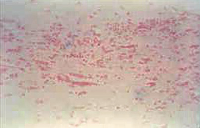

Figure 58-13 

Gram stain of _Moraxella catarrhalis_ in a sputum specimen. 

Note the intracellular gram-negative diplococci that resemble _Neisseria_ spp. 

 

##  Gram-Negative Bacteria—Bacilli 

The gram-negative bacilli make up a complex group. They are broken down into Enterobacteriaceae, which are those found normally in the gastrointestinal (GI) tract or that colonize and cause infection there primarily; nonfermentative gram-negative bacilli, which usually are not found as part of the normal flora of humans but rather are environmental bacteria; non-Enterobacteriaceae, which can cause GI infection, such as _Vibrio_ or _Campylobacter_ ; agents of infections with specific epidemiologic characteristics, such as _Legionella_ and _Francisella_ ; other gram-negative bacilli, including _Haemophilus_ spp.; and miscellaneous genera. A good overview of how to approach the identification of the aerobic gram-negative rods can be found in  Wauters and Vaneechouette (2011)  . 

 

##  Enterobacteriaceae 

 

##  Characteristics 

The Enterobacteriaceae are aerobic and facultatively anaerobic, non–spore-forming, nonmotile or peritrichously flagellated, oxidase-negative, gram-negative bacilli that produce acid fermentatively from glucose and reduce nitrates to nitrites. [ Figure 58-14 ](<#f0075>) shows a Gram stain of _Escherichia coli,_ but it could represent any member of the Enterobacteriaceae. Genera included in this group are _Budvicia, Buttiauxella, Cedecea, Citrobacter, Edwardsiella, Enterobacter, Escherichia, Ewingella, Hafnia, Klebsiella, Kluyvera, Leclercia, Leminorella, Moellerella, Morganella, Obesumbacterium, Pragia, Pantoea, Photorhabdus, Proteus, Providencia, Rahnella, Salmonella, Serratia, Shigella, Tatumella, Trabulsiella, Xenorhabdus, Yersinia,_ and _Yokenella._ Only a few of these are discussed here (  Nataro et al, 2011  ). 

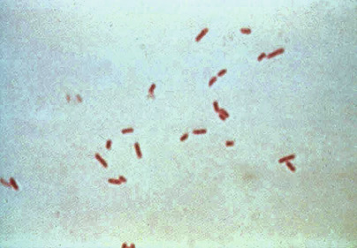

Figure 58-14 

Gram stain of urine positive for _Escherichia coli._

The short, plump gram-negative rods are typical of any member of the Enterobacteriaceae. 

 

##  Clinical Manifestations and Pathogenesis 

Enterobacteriaceae are found on plants, in soil, in water, and in the intestines of humans and animals. They have been associated with many clinical infections, including abscesses, pneumonia, meningitis, septicemia, and urinary tract infections. Those commonly associated with human infection include _E. coli_ , _Klebsiella_ spp., _Proteus_ spp., _Enterobacter_ spp., _Salmonella_ spp., _Shigella_ spp., _Serratia_ spp., _Citrobacter_ spp., and _Providencia_ spp. [ Figure 58-15 ](<#f0080>) shows a Gram stain of CSF from a newborn child who was culture positive for _E. coli_ . In the urinary tract, those frequently isolated are _E. coli, Proteus mirabilis, Klebsiella pneumonia,_ and _K. oxytoca_ . Gram-negative pneumonias associated with the Enterobacteriaceae are frequently caused by _K. pneumoniae_ . Gram-negative bacteremias related to the Enterobacteriaceae are frequently caused by _E. coli, K. pneumoniae, Enterobacter_ spp., and _P. mirabilis_ . Infections acquired in the hospital are likely to be caused by members of antibiotic-resistant genera, such as _Citrobacter, Enterobacter,_ and _Serratia_ . Enterobacteriaceae associated with diarrhea include _Shigella_ spp., _Salmonella_ spp., _E. coli_ (enterohemorrhagic [Shiga toxin producing], enterotoxigenic, enteroinvasive, enteropathogenic, enteroadherent), and _Yersinia_ spp. Shigellas are rarely isolated from sources other than the GI tract, whereas salmonellas are more likely to be isolated from other sources, such as urine or blood. _Plesiomonas_ sp. have recently been added to the Enterobacteriaceae and remain as the only oxidase-positive member of this family. They also can be associated with infections of the GI tract. _Calymmatobacterium granulomatis,_ an agent of the sexually transmitted disease donovanosis, has been renamed _Klebsiella granulomatis_ and is now part of the Enterobacteriaceae, even though the organism cannot be cultured on bacteriologic media (  Abbott, 2011  ;  Lagergård et al, 2011  ). This topic is discussed later in this chapter. 

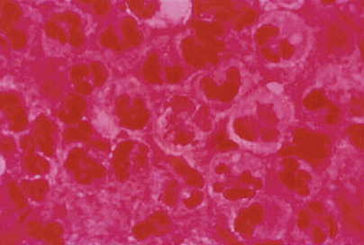

Figure 58-15 

Gram stain of a cerebrospinal fluid specimen from a neonate containing gram-negative bacilli that grew _Escherichia coli_ . 

Endotoxins that are present within the cell walls of the Enterobacteriaceae, as well as other gram-negative bacilli, are responsible for much of the morbidity and mortality resulting from infections associated with these bacteria. Endotoxins consist of lipid and polysaccharide moieties with small quantities of amino acids and are often referred to as lipopolysaccharides. Lipopolysaccharides may elicit fever, chills, hypotension, granulocytosis, thrombocytopenia, disseminated intravascular coagulation, and activation of both classic and alternate complement pathways. Endotoxic shock is the result of gram-negative septicemia, with endotoxin reacting with macrophages, leukocytes, platelets, complement, and other serum proteins to increase the blood levels of proteolytic enzymes and vasoactive substances, resulting in pooling of blood, increased peripheral vasoconstriction, and diminution in cardiac output. It has become clear that the lethal effects of endotoxin are dependent on macrophage activation and responsiveness and that the production of cachectin from the activated macrophage plays a major role in causing profound shock and multiple organ injury (  Munford, 2006  ). 

Other pathogenetic factors of the Enterobacteriaceae include the K1 antigen, which is associated with a high percentage of strains of _E. coli_ causing neonatal meningitis; the capsule of _K. pneumoniae,_ which, like that of the pneumococcus, inhibits phagocytosis; the Vi antigen of _Salmonella_ serotype _typhi,_ which may interfere with intracellular killing of this organism; and various surface antigens, such as fimbriae, that mediate adherence of the organism to mucosal surfaces. 

Plasmid-mediated factors appear to play an important role in the invasive properties of _Salmonella, Shigella,_ and enteroinvasive strains of _E. coli_ . Moreover, the heat-labile enterotoxins (LT) and the heat-stable enterotoxins of _E. coli_ are plasmid mediated. LT stimulates adenylate cyclase in mucosal cells of the small intestine, which, in turn, activates cyclic adenosine monophosphate (cAMP); this causes secretion of fluid and electrolytes into the intestinal lumen and produces watery diarrhea. In contrast, heat-stable (ST) enterotoxins appear to activate guanylate cyclase. 

 

##  Laboratory Diagnosis 

The isolation of gram-negative bacilli from contaminated specimens is greatly facilitated by the use of differential and selective media ( [ Table 58-9 ](<#t0050>) ). Eosin methylene blue (EMB) and MacConkey's agar can be used interchangeably as minimally selective and differential media to initially select for and differentiate lactose-fermenting from non–lactose-fermenting gram-negative bacilli. XLD and HE agars are more selective differential media that are especially useful in selecting for _Salmonella_ spp. and _Shigella_ spp. in heavily contaminated specimens such as stool. Bismuth sulfite is a highly selective medium that is especially useful for the detection of salmonellae in endemics or epidemics. _Salmonella_ spp. produce H  2  S and are easily recognized by the production of colonies with black centers on XLD, HE, and bismuth sulfite agars. An enrichment medium, such as selenite-F or gram-negative (GN) broth, should be used to allow detection of low numbers of _Salmonella_ spp. and _Shigella_ spp. in stool. Cefsulodin-irgasan-novobiocin (CIN) agar incubated at room temperature is selective and differential for the recovery of _Yersinia enterocolitica_ . Colonies will appear as bull's-eyes with red centers and transparent borders. MacConkey's agar with sorbitol as the fermentable sugar is a differential medium that is capable of differentiating the sorbitol-fermentation–negative _E. coli_ 0157:H7, which is associated with hemolytic-uremic syndrome from most other _E. coli_ (  Nataro et al, 2011  ). 

TABLE 58-9 

Differentiation of Aerobic Gram-Negative Bacilli 

Test  |  _Escherichia coli_ |  _Klebsiella pneumoniae_ |  _Klebsiella oxytoca_ |  _Proteus mirabilis_ |  _Proteus vulgaris_ |  _Shigella_ spp.  |  _Citrobacter freundii_ |  _Yersinia enterocolitica_ |  _Enterobacter cloacae_ |  _Serratia marcescens_ |  _Morganella morganii_ |  _Providencia alcalifaciens_ |  _Salmonella_ Serotype _choleraesuis_ |  _Salmonella_ Serotype _typhi_ |  _Salmonella_ Serotype _paratyphi A_  
---|---|---|---|---|---|---|---|---|---|---|---|---|---|---|---  
Indole  |  \+  |  – |  \+  |  – |  \+  |  D  |  – |  D  |  – |  – |  \+  |  \+  |  – |  – |  –  
Methyl red  |  \+  |  – or +  |  D  |  \+  |  \+  |  \+  |  \+  |  \+  |  – |  \+ or – |  \+  |  \+  |  \+  |  \+  |  \+   
Voges-Proskauer  |  – |  \+  |  \+  |  – or +  |  – |  – |  – |  \+ (25° C)/   
– (37° C)  |  \+  |  \+  |  – |  – |  – |  – |  –  
Citrate (Simmons)  |  – |  \+  |  \+  |  D  |  D  |  – |  \+  |  – (25° C)  |  \+  |  \+  |  – |  \+  |  (+)  |  – |  –  
H  2  S (in triple sugar iron agar)  |  – |  – |  – |  \+  |  \+  |  – |  \+  |  – |  – |  – |  – |  – |  D  |  \+  |  – or +   
Urease  |  – |  \+  |  \+  |  \+  |  \+  |  – |  D  |  \+  |  D  |  – or +  |  \+  |  – |  – |  – |  –  
Phenylalanine deaminase  |  – |  – |  – |  \+  |  \+  |  – |  – |  – |  – |  – |  \+  |  – |  – |  – |  –  
Lysine decarboxylase  |  \+ or – |  \+  |  \+  |  – |  – |  – |  – |  – |  – |  – |  – |  – |  \+  |  \+  |  –  
Arginine dihydrolase  |  – or +  |  – |  – |  – |  – |  – |  D  |  – |  \+  |  – |  – |  – |  (+)  |  – or (+)  |  – or +   
Ornithine decarboxylase  |  D  |  – |  – |  \+  |  – |  D  |  – or +  |  \+  |  \+  |  \+  |  |  \+  |  – |  \+  |  –  
Motility  |  \+ or – |  – |  – |  \+ [ * ](<#hl0001623>) |  \+ [ * ](<#hl0001623>) |  – |  \+  |  \+ + (25° C)/– (37° C)  |  \+  |  \+  |  \+ or – |  \+  |  \+  |  \+  |  \+   
Acid produced from lactose  |  \+  |  \+  |  \+  |  – |  – |  – |  \+ or (+)  |  D  |  D  |  – |  – |  – |  – |  – |  –  
  
_+,_ ≥90% positive reactions within 2 days; _ –, _ ≥90% negative reactions; _(+),_ positive reactions in 3 to 7 days; _\+ or –, _ reactions of most strains positive; _ – or +, _ reactions of most strains negative; _D,_ different reactions [+, (+), or –]. 

 * Swarm on blood and chocolate agar. 

For some of the Enterobacteriaceae, a few simple colonial characteristics or biochemical reactions can be used to presumptively identify an isolate. For example, _Proteus_ spp. swarm on blood agar, _Klebsiella_ spp. form lactose-positive mucoid colonies, _Serratia marcescens_ may produce a red pigment, _Salmonella_ spp. produce H  2  S, and _E. coli_ is indole positive. Definitive identification of these and other species requires additional biochemical testing and/or molecular methods. Innumerable schemes based on the use of conventional biochemical media have been described for identification of the Enterobacteriaceae. Differential characteristics of the Enterobacteriaceae most commonly encountered in the clinical laboratory are shown in [ Table 58-10 ](<#t0055>) . Commercially prepared kits and automated devices are available and offer convenience and accuracy in identifying the vast majority of isolates belonging to the Enterobacteriaceae. In some instances, identification is accurately made in a few hours. Semiautomated systems may combine identification and antimicrobial susceptibility testing in a single disposable unit. In general, accuracy of identification among these systems is very high and comparable. Maldi-Tof has been shown to be an excellent tool for the identification of members of the Enterobacteriaceae and can usually provide results more quickly than traditional or semiautomated biochemical methods (  Richter et al, 2013  ). 

TABLE 58-10 

Enteric Differential and Selective Media 

Medium  |  Gram-positive Bacteriostatic Agent  |  Fermentable Carbohydrate  |  Indicator  |  Colony Color Fermenter  |  Nonfermenter  |  Category   
---|---|---|---|---|---|---  
Eosin methylene blue (EMB)  |  Eosin Y   
Methylene blue  |  Lactose [ * ](<#hl0001725>) |  Eosin Y   
Methylene blue  |  Red or black with sheen  |  Colorless  |  S, D   
MacConkey's  |  Crystal violet   
Bile salts  |  Lactose  |  Neutral red  |  Red  |  Colorless  |  S, D   
Xylose-lysine-deoxycholate (XLD)  |  Bile salts  |  Xylose   
Lactose   
Sucrose  |  Phenol red  |  Yellow  |  Red  |  S, D   
Hektoen enteric (HE)  |  Bile salts  |  Salicin   
Lactose   
Sucrose  |  Bromthymol blue  |  Yellow-orange  |  Green, blue-green  |  S, D   
_Salmonella shigella_ (SS)  |  Bile salts  |  Lactose  |  Neutral red  |  Red  |  Colorless  |  S   
Bismuth sulfite (BS)  |  Brilliant green  |  Glucose  |  Bismuth sulfite  |  [ † ](<#hl0001728>) |  [ † ](<#hl0001728>) |  S   
Thiosulfate citrate bile salts sucrose (TCBS) [ ‡ ](<#hl0001732>) |  Bile salts   
pH 8.6  |  Sucrose  |  Thymol blue   
Bromthymol blue  |  Yellow  |  Colorless  |  S, D   
  
_D,_ Differential; _S,_ selective. 

 * Levine's formulation. 

 † H  2  S-producing salmonellae have black colonies. 

 ‡ Used for isolation of vibrios. 

Classification of the Enterobacteriaceae has undergone considerable revision in recent years as the result of DNA hybridization and relatedness studies. Because phenotypic groupings on the basis of biochemical reactions are not always consistent with their DNA relatedness, the use of tribes (e.g., Klebsielleae, Proteae) for grouping species within the Enterobacteriaceae has been discontinued. 

Historically, the genus _Salmonella_ has been divided into the following species: _S. typhi_ , _Salmonella paratyphi_ A and B, _Salmonella choleraesuis_ , _Salmonella typhimurium_ , and _Salmonella enteritidis_ . Because all groups have been found to be genetically very closely related, current terminology now recognizes only two species: _S. enterica_ and _S. bongori_ (rarely isolated from humans), each of which contains multiple subspecies. Six subspecies of _S. enterica_ are known, with subspecies I ( _S. enterica_ subsp. _enterica_ ) as the usual human isolate. More than 2000 serotypes of _Salmonella_ have been identified, most belonging in the subspecies _enterica_ . Serotyping is based on immunologic reactivity of the heat-stable somatic “O” antigens, which are predominantly lipopolysaccharide in content, and the heat-labile flagellar “H” antigens. In the United States, _Salmonella_ serotypes _typhimurium_ and _enteritidis_ are the most common. _Salmonella_ serotype _typhi_ also produces a heat-labile capsular polysaccharide Vi antigen. In practice, most clinical laboratories identify isolates as _Salmonella_ spp. based on biochemical reactions and use group-specific immunologic reagents to assign isolates to a specific serogroup. Commercial slide agglutination tests to differentiate large serogroups—A, B, C, and D—are useful in differentiating typhoidal salmonella from nontyphoidal strains. _S._ serotype _typhi_ carries the D serogroup and Vi antigen. Further identification of the specific serotype is generally performed only by State Health Departments or other reference laboratories (  Nataro et al, 2011  ). 

Isolates biochemically resembling _Shigella_ are also classified by the reactivity of the “O” antigen, as are isolates of _E. coli_ that are identified as potential causes of diarrhea and hemolytic-uremic syndrome. Such _E. coli_ are classified by the type of toxin produced as well. Commercial kits are available to identify _E. coli_ O157 and to detect some types of toxins in culture or stool specimens; however, this type of testing is often sent out to referral laboratories or the State Health Department. The CDC has recommended that all laboratories consider testing stool samples for the presence of shiga toxins I and II produced by certain strains of hemorrhagic _E. coli_ (O157:H7 and other serotypes). Shiga toxin is also produced by _Shigella,_ but the species is _S. dysenteriae,_ which is not often seen in the United States. Serologic antigen tests are available and are widely used in clinical laboratories for this toxin (  Nataro et al, 2011  ). 

 

##  Antimicrobial Susceptibility 

The susceptibility of Enterobacteriaceae to various antimicrobial agents is highly variable. Susceptibility to ampicillin was common among strains of _E. coli_ and _P. mirabilis,_ for example (although resistance in both has increased greatly over the past 10 to 20 years), but was not expected among most other clinically significant members of the Enterobacteriaceae. Resistance to first-generation cephalosporins (cefazolin, cephalothin) is expected for _Enterobacter_ spp., _Serratia_ spp., _Citrobacter_ spp., _Proteus vulgaris, Providencia_ spp., _Morganella_ spp., and _Yersinia_ spp.; susceptibility to third-generation cephalosporins (e.g., ceftriaxone, cefotaxime, ceftazidime) continues for many members of the Enterobacteriaceae. However, the presence of extended-spectrum β-lactamases and _Amp-C_ genes, which are recognized by resistance of the bacteria to third-generation cephalosporins and all β-lactam antibiotics, except carbapenems, is increasing in selected strains of _E. coli, K. pneumoniae, P. mirabilis,_ and others. Most Enterobacteriaceae are susceptible to aminoglycosides and fluoroquinolones. It had been very unusual for a member of the Enterobacteriaceae to be resistant to carbapenems (e.g., imipenem, meropenem, ertapenem, doripenem); however, in the late 1990s, in a few U.S. states, isolates of _K. pneumoniae_ were first recognized that produced a _bla KPC  _ gene, resulting in production of carbapenemases that inactivate all carbapenems. These strains are often referred to as “KPCs” or _K. pneumoniae_ –producing carbapenemases. These isolates are resistant to most classes of antibiotics, except for an aminoglycoside, colistin, and tigecycline. The spread of these KPC genes has continued, and it is feared that these will be introduced into _E. coli_ , for example, which accounts for significant nosocomial infections (  Peirano et al, 2014  ). 

Detection of carbapenem resistance may be difficult with some strains possessing this resistance, so the modified Hodge test may be used for confirmation. A potential KPC is inoculated near a carbapenem antibiotic disk onto an agar plate, onto which a lawn of carbapenem-susceptible _E. coli_ has first been placed. Inactivation of the carbapenem will result in a reduction in the zone size of _E. coli_ near the disk in close proximity to the inoculated KPC if the test is positive. Ertapenem is a better marker for carbapenem resistance than is meropenem or imipenem, but resistance to one of these leads to resistance to all carbapenems (  Endimiani et al, 2009a;  2009b  ;  Kitchel et al, 2009  ;  Abbott, 2011  ;  Nataro et al, 2011  ;  CLSI, 2014  ). Use of Maldi-Tof and molecular methods for the detection of carbapenem resistance has been reported (  Johansson et al, 2014  ). Infection control procedures are essential to prevent the spread of these highly resistant strains. 

Because the susceptibility pattern of the Enterobacteriaceae is unpredictable, as a general rule, susceptibility testing should be performed if antimicrobial therapy is being considered. No susceptibility testing need be performed if antimicrobial therapy is not instituted, as is the case for uncomplicated enteric infection due to salmonella, for which therapy may actually prolong the carrier state, or when a mixed flora infection is present and individual susceptibilities may not be appropriate. Methods for performing susceptibility tests, including the modified Hodge test and confirmatory extended-spectrum ESBL tests, and interpretive criteria can be found in CLSI documents (  CLSI, 2014  ). 

 

##  Plesiomonas 

 

##  Characteristics 

_Plesiomonas shigelloides,_ the only species in the genus _Plesiomonas,_ is a facultatively anaerobic, oxidase- and catalase-positive, glucose-fermenting, gram-negative rod. Recent molecular genetic evidence demonstrates that the genus _Plesiomonas_ is most closely related to the genus _Proteus_ . Therefore, it has been placed into the Enterobacteriaceae family (  Abbott, 2011  ) as the only oxidase-positive member of this group of gram-negative bacilli. 

 

##  Clinical Manifestations and Pathogenesis 

_P. shigelloides_ is found in aquatic environments that are limited geographically by its minimum growth temperature of 8° C. It may be found in fresh and estuarine water, usually in tropical countries. It has been implicated as a cause of gastroenteritis, especially following the ingestion of uncooked shellfish. The diarrheal stool specimen frequently contains polymorphonuclear leukocytes and red blood cells, although a cholera-like illness may occur. Gastroenteritis may occur in sporadic cases, as well as in outbreaks. Extraintestinal manifestations of infection with _P. shigelloides_ include meningitis, septicemia, cellulitis, arthritis, and endophthalmitis (  Ampofo et al, 2001  ;  Ozdemir et al, 2010  ). Virulence factors of _P. shigelloides_ include hemolysins, cytotoxins, production of exoenzymes associated with pathogenicity, adhesive ability, and vacuolation of cell lines in vitro (  Salerno et al, 2010  ). 

 

##  Laboratory Diagnosis 

_P. shigelloides_ can be isolated on a variety of nonselective and enteric-selective media, including HE agar. Acid production from lactose is variable, but on enteric media the organism usually appears to be a non–lactose fermenter. It is indole positive; reduces nitrates to nitrites; produces catalase; is methyl red positive; and ferments glucose, maltose, and trehalose (  Abbott, 2011  ). 

 

##  Antimicrobial Susceptibility 

_P. shigelloides_ is susceptible to a variety of antimicrobial agents, including cephalosporins, trimethoprim-sulfamethoxazole, imipenem, and the quinolones (  Abbott, 2011  ). Susceptibility to the penicillins is variable because of the presence of a β-lactamase similar to that of _Aeromonas_ spp. 

 

##  Gram-Negative Bacteria—Nonfermentative Bacilli 

A group of gram-negative bacilli that do not ferment glucose and other sugars are often lumped together under the heading of “nonfermenters.” They account for about 15% of the gram-negative bacilli isolated from hospitalized patients. Although many genera of nonfermenters are known, 75% of the clinically relevant ones are _Pseudomonas aeruginosa_ , and most of the remaining 25% are _Acinetobacter_ spp., _Stenotrophomonas maltophilia,_ or _Burkholderia cepacia_ . As a group, they are environmental bacteria and are not usually found as part of the normal flora of the human body, except as colonizers in hospitalized patients. They can be readily isolated from water, soil, vegetables, plants, and hospital surfaces. Although no uniform biochemical characteristics have been noted, they are often oxidase-positive (except for _Acinetobacter_ spp.), lactose-negative colonies on selective media such as MacConkey's agar (although some of the species do not grow on this media), and they are frequently resistant to many of the antibiotics that are effective against members of the Enterobacteriaceae. The four main species mentioned previously, as well as a few others, are discussed in this chapter. 

 

##  Pseudomonas 

 

##  Characteristics 

The genus _Pseudomonas_ has undergone extensive revision, and now many of the species that were previously classified in this genus have been reclassified into the genera _Burkholderia, Stenotrophomonas, Comamonas, Shewanella, Ralstonia, Methylobacterium, Sphingomonas, Acidovorax,_ and _Brevundimonas._ Of the species that remain, _P. aeruginosa_ is the most significant human pathogen. [ Figure 58-16 ](<#f0085>) shows the Gram stain of _P. aeruginosa_ in a sputum specimen. 

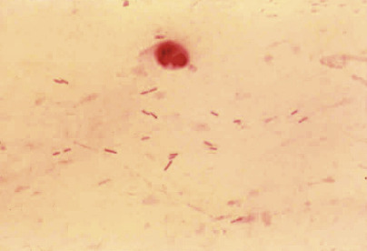

Figure 58-16 

Gram stain of _Pseudomonas aeruginosa_ in a sputum specimen. 

Note the longer, gram-negative bacilli compared with [ Figure 58-13 ](<#f0070>) . 

Pseudomonads are strictly aerobic, catalase-positive, oxidase-positive, gram-negative bacilli. Their metabolism is respiratory and never fermentative, with oxygen as the terminal electron acceptor. Some pseudomonads are motile by means of polar flagella. 

 

##  Clinical Manifestations and Pathogenesis 

Pseudomonads are found in moist environments. Some of the more unusual habitats for these organisms include cosmetics, swimming pools, hot tubs, and the inner soles of sneakers. The latter can lead to puncture wounds that are infected with _P. aeruginosa_ . The species causing the greatest morbidity and mortality today is _P. aeruginosa_ . Other species of _Pseudomonas_ , although often isolated from clinical specimens, are only occasionally involved in disease. 

_P. aeruginosa_ is ubiquitous in the hospital environment, existing almost anywhere there is moisture, including medical equipment and disinfectant solutions and soaps. It is only rarely found as part of the normal flora of healthy people, but in hospitalized patients, the rates of colonization increase with the length of hospitalization. _P. aeruginosa_ may produce serious infection in patients with burns and traumatic and operative wounds; following urinary tract manipulation; in patients with diseases of the hematopoietic, reticuloendothelial, and lymphoid systems; and in those with impaired cellular or humoral defenses. Pulmonary infection occurs commonly in patients with cystic fibrosis. The mortality rate is highest in severely leukopenic patients. 

_P. aeruginosa_ produces a slime polysaccharide, an endotoxin, and proteases that inactivate components of complement, thereby inhibiting to some degree opsonization and the inflammatory response, and perhaps contributing to its invasiveness. Exotoxin A promotes cellular damage and tissue invasion and is toxic for macrophages. 

 

##  Laboratory Diagnosis 

The presence of _P. aeruginosa_ in cultures can often be suspected because of its musty grape-like (or corn tortilla) odor, the rough or ground glass appearance of its colonies on sheep blood agar, and the presence of one or both of two pigments: a “blue-green” fluorescent pigment ( [ Fig. 58-17 ](<#f0090>) ) and/or a metallic sheen caused by pyoverdin pigment. It can be identified easily with a positive oxidase reaction, an alkaline slant/neutral butt reaction in TSIA, growth at 42° C, and the formation of sheen and/or pigment on the slants of TSIA and _Pseudomonas_ P agar. Additional tests are shown in [ Table 58-11 ](<#t0060>) . Tests of carbohydrate utilization should be carried out in O-F basal medium, which contains a minimal quantity of peptone and a relatively large quantity of carbohydrate and so can allow detection of very small quantities of acid formed by this group of bacteria. Reactions are usually complete within 48 hours but may require as long as 7 days. MALDI-TOF can also be used for the identification of _P. aeruginosa_ (  Desai et al, 2012  ;  Manji et al, 2014  ). 

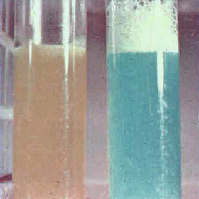

Figure 58-17 

Extracted pyocyanin pigment from _Pseudomonas aeruginosa_ . 

TABLE 58-11 

Differential Characteristics of Nonfermentative Gram-Negative Bacilli Isolated from Clinical Material 

|  _Pseudomonas aeruginosa_ |  _Pseudomonas fluorescens_ |  _Pseudomonas putida_ |  _Burkholderi cepacia_ |  _Stenotrophomonas maltophilia_ |  _Acinetobacter baumanii_  
---|---|---|---|---|---|---  
Oxidase  |  \+  |  \+  |  \+  |  \+  |  – |  –  
Pyocyanin  |  \+  |  – |  – |  – |  – |  –  
Fluorescein  |  \+  |  – |  \+  |  – |  – |  –  
Glucose oxidation  |  \+  |  \+  |  \+  |  \+  |  +/– |  \+   
42° C  |  \+  |  – |  – |  +/– |  +/– |  \+   
DNase  |  – |  – |  – |  – |  \+  |  –/+   
Growth on MacConkey's agar  |  \+  |  \+  |  \+  |  \+  |  \+  |  \+ [ * ](<#hl0001835>)  
Motility  |  \+  |  \+  |  \+  |  \+  |  \+  |  –  
  
_+,_ Positive; _ –, _ negative; _+/ –, _ variable results, most strains positive; _ –/+, _ variable results, most strains negative; _DNase,_ deoxyribonuclease. 

 * Purplish color on MacConkey's agar. 

 

##  Antimicrobial Susceptibility 

As a general rule, susceptibility testing should be performed for all clinically significant isolates of _P. aeruginosa._ Hospital strains of _P. aeruginosa_ may be resistant to many classes of antibiotic. Isolates are often susceptible to the aminoglycosides, the carboxypenicillins and ureidopenicillins, ceftazidime or cefepime, carbapenems, and the quinolones. _P. aeruginosa_ is always resistant to sulfamethoxazole-trimethoprim (SXT) and tetracyclines, including the newer broad-spectrum tigecycline, ertapenem, and nitrofurantoin. Multiple resistance to drugs to which _P. aeruginosa_ was once susceptible is increasing, especially in intensive care units and among patients who have long-standing _Pseudomonas_ infections, such as patients with cystic fibrosis and other chronic syndromes (  Friedland et al, 2004  ;  Hauser & Siriam, 2005  ;  Tai et al, 2015  ). Laboratories are being asked to test additional antibiotics, especially colistin or polymyxin B, when these resistant isolates are encountered. The CLSI has recently provided breakpoints for testing of polymyxin B that can be interpreted for polymyxin B or colistin (  CLSI, 2014  ). 

 

##  Acinetobacter 

 

##  Characteristics 

Organisms in this genus are short, rod shaped to spherical, nonmotile, oxidase negative, strictly aerobic, and gram negative. In a Gram-stained smear, they often appear in pairs and may be difficult to decolorize. 

 

##  Clinical Manifestations and Pathogenesis 

_Acinetobacter_ spp. are found commonly in soil and water and uncommonly on the skin and mucous membranes of healthy people. Current research has begun to elucidate the virulence factors in this group of organisms, as they are being more recognized as serious pathogens in some patients. Although usually considered nonpathogenic in the past, they have been increasingly associated with nosocomial septicemia, pneumonia, bacteriuria, and wound infection, especially due to the increased antimicrobial resistance that has developed in many strains of _A. baumanii_ . The mortality rate associated with _Acinetobacter baumanii_ infections can reach 35% (  Antunes et al, 2014  ;  Spellberg & Bonomo, 2014  ). 

 

##  Laboratory Diagnosis 

_Acinetobacter_ spp. can be distinguished readily from pseudomonads on the basis of their lack of motility, inability to reduce nitrates, and negative oxidase reaction. They may produce characteristic purplish colonies on MacConkey's agar. More than 25 species are known, but their differentiation biochemically is difficult, and they are often lumped together in the _Acinetobacter calcoaceticus_ – _Acinetobacter baumanii_ complex. The glucose-oxidizing (saccharolytic strains), nonhemolytic clinical strains are usually referred to as _A. baumanii_ ; nonsaccharolytic strains (non–glucose oxidizers) may be _Acinetobacter lwoffi_ if nonhemolytic, or _Acinetobacter haemolyticus_ if hemolytic (  Vaneechouette et al, 2011  ). The most clinically relevant are members of the _A. baumanii_ complex, and these are the most resistant to antimicrobials as well. 

 

##  Antimicrobial Susceptibility 

Members of the _Acinetobacter_ baumanii complex are resistant to most available β-lactam and aminoglycoside antibiotics. Resistance to the aminoglycosides is caused by plasmid-mediated acetyl-, adenylyl-, and phosphotransferases. _Acinetobacter_ spp. may be susceptible to doxycycline, trimethoprim-sulfamethoxazole, quinolones, ureidopenicillins, imipenem, ampicillin-sulbactam, and ceftazidime. The carbapenems (excluding ertapenem) are considered the most active, but resistance rates up to 11% have been described in nosocomial strains throughout the United States; in some hospitals in the United States, _Acinetobacter_ has become a predominant nosocomial pathogen (  Gales et al, 2001  ;  Chopra et al, 2013  ). These isolates of carbapenem-resistant _A. baumanii_ are often referred to as carbapenem-resistant _A. baumanii_ (CRAB); they are often resistant to all classes of antibiotics, except colistin and tigecycline (  Perez et al, 2007  ;  Chopra et al, 2013  ). Appropriate infection control procedures are necessary to prevent their transmission (  Rodríguez-Baño et al, 2009  ). Susceptibility testing should be performed for clinically significant isolates or upon request of the clinician. 

 

##  Burkholderia 

_Burkholderia_ spp. are aerobic, non–spore-forming, gram-negative rods; except for _Burkholderia mallei_ , all are motile because they have polar flagella. These organisms are catalase positive, and most are oxidase positive. On MacConkey's agar, they produce lactose-negative colonies. 

 

##  Clinical Significance and Pathogenesis 

These organisms are found in the environment in water, in soil, and on plants. Because of their predilection for watery environments, some can be found in the hospital environment and have the potential to cause nosocomially acquired infection. 

Two important human pathogens in the genus _Burkholderia_ are _Burkholderia pseudomallei_ and _Burkholderia cepacia_ complex. _B. pseudomallei,_ which is acquired via inhalation or contact through cut or abraded skin, causes melioidosis. The infection can be asymptomatic, can become chronic, or can cause a fulminant sepsis. Melioidosis is most prevalent in Southeast Asia and Australia but may occur in other tropical and subtropical environments. 

_B. cepacia,_ a nosocomial pathogen that is associated with contaminated equipment, medications, and disinfectants, can cause bacteremia, urinary tract infection, septic arthritis, and respiratory tract infection. It is an important pathogen in patients with cystic fibrosis (CF) and in those with chronic granulomatous disease. Patients with CF who become chronically infected with this organism have a decreased rate of survival. _B. cepacia_ complex comprises at least nine species, and all species have been recovered from patients with CF. In the United States, however, approximately 85% of strains are _B. multivorans_ or _B. cenocepacia. B. cenocepacia_ has been shown in many studies to possess potent virulence factors that lead to increased mortality in CF patients who are infected with it versus other strains of _Burkholderia_ (  LiPuma et al, 2011  ). 

 

##  Laboratory Diagnosis 

_Burkholderia_ species grow well on standard laboratory media, including blood and chocolate agar. Isolation of _B. cepacia_ from contaminated specimens such as sputa may be made easier through the use of selective media—for example, PC, _Pseudomonas cepacia_ selective agar; OFBL, oxidation-fermentative base-polymyxin B, bacitracin-lactose-agar; and BCSA, _B. cepacia_ selective agar (  LiPuma et al, 2011  ). No good biochemical methods are available to differentiate among the _B. cepacia_ complex or between the complex and related species such as _B. gladioli_ and _Ralstonia, Cupriavidus,_ and _Pandoraea_ spp. Molecular techniques are often required for confirmatory identification and should be pursued when a _B. cepacia_ complex organism is suspected. The use of Maldi-Tof may also assist in further speciation in the future (  Desai et al, 2012  ). The CF Foundation ( [ http://www.cff.org ](<http://www.cff.org>) ) has established a _B. cepacia_ reference laboratory to confirm the identity of possible isolates in CF patients (  LiPuma et al, 2011  ). 

 

##  Antimicrobial Susceptibility 

The susceptibility of these organisms to antimicrobial agents varies considerably. _B. cepacia_ is highly resistant to many antimicrobials but is usually susceptible to piperacillin, ceftazidime, chloramphenicol, and trimethoprim-sulfamethoxazole. Strains from CF patients who have been on repeated courses of antibiotics are, however, likely to become resistant to these agents. The CLSI recommends reporting only ceftazidime, meropenem, minocycline, and trimethoprim-sulfamethoxazole for _B. cepacia_ (  CLSI, 2014  ). All _B. cepacia_ organisms are intrinsically resistant to polymyxins (colistin). 

 

##  Stenotrophomonas maltophilia 

 

##  Characteristics 

_Stenotrophomonas maltophilia_ are becoming significant nosocomial pathogens. Risk factors for colonization or infection with this organism are mechanical ventilation, use of broad-spectrum antibiotics, catheterization, and neutropenia (  Brooke, 2012  ;  Behnia et al, 2014  ). 

 

##  Laboratory Diagnosis 

Important distinguishing biochemical reactions of _S. maltophilia_ are its negative oxidase reaction and positive DNase activity. Colonies grow on blood agar (lavender green colonies) and MacConkey's agar; the bacteria are nonmotile and nonfermentative. 

 

##  Antimicrobial Susceptibility 

_S. maltophilia_ is inherently resistant to many antibiotics, especially the carbapenems. Trimethoprim-sulfamethoxazole is the antibiotic of choice, although some strains have become resistant (  Gales et al, 2001  ;  Brooke, 2012  ). CLSI recommends reporting only levofloxacin, trimethoprim-sulfamethoxazole, and minocycline. Breakpoints have been put forth for interpretation of these agents for MIC and disk diffusion testing (  CLSI, 2014  ). 

Other nonfermentative gram-negative bacilli include members of the genera _Alcaligenes, Achromobacter, Flavobacterium, Flavimonas, Chryseomonas, Acidovorax, Brevundimonas, Comamonas,_ and _Ralstonia,_ among others. These are infrequently isolated from clinical specimens, often when they may represent contamination or colonization. They can be considered as significant, especially when isolated from sterile sites, on multiple occasions in immunosuppressed patients, or patients with foreign devices in place. 

 

##  Vibrio 

 

##  Characteristics 

_Vibrio_ spp. are facultatively anaerobic, oxidase-positive, short, curved, or straight gram-negative bacilli that are usually motile by means of polar flagella; they ferment carbohydrates and reduce nitrates to nitrites. Several species are medically important ( [ Table 58-12 ](<#t0065>) ). 

TABLE 58-12 

Differential Characteristics of _Vibrio_ Species [ * ](<#hl0002105>)

Test  |  _V. cholerae_ |  _V. mimicus_ |  _V. damsela_ |  _V. parahaemolyticus_ |  _V. alginolyticus_ |  _V. vulnificus_ |  _V. fluvialis_ |  _V. metschnikovii_ |  _V. hollisae_  
---|---|---|---|---|---|---|---|---|---  
Indole  |  \+  |  \+  |  – |  \+ or – |  D  |  \+  |  – or +  |  D  |  \+   
Voges-Proskauer  |  – or +  |  – |  \+  |  – |  \+  |  – |  – |  \+  |  –  
Lysine decarboxylase  |  \+  |  \+  |  \+  |  \+  |  \+  |  \+  |  – |  D  |  –  
Ornithine decarboxylase  |  \+  |  \+  |  – |  \+ or – |  D  |  D  |  – |  – |  –  
Arginine dihydrolase  |  – |  – |  \+  |  – |  – |  – |  \+  |  D  |  –  
Lactose  |  (+)  |  – or +  |  – |  – |  – |  \+  |  – |  D  |  –  
Sucrose  |  \+  |  \+  |  – |  \+  |  \+  |  D  |  \+  |  \+  |  –  
Mannitol  |  \+  |  \+  |  – |  \+  |  \+  |  D  |  \+  |  \+  |  –  
Maltose  |  \+  |  \+  |  \+  |  \+  |  \+  |  \+  |  \+  |  \+  |  –  
Arabinose  |  – |  – |  – \+ or  |  – |  – |  – |  \+  |  – |  \+   
Salicin  |  – |  – |  – |  – |  – |  \+  |  – |  – or +  |  –  
Cellobiose  |  – |  – |  – |  – |  – |  \+  |  D  |  – or +  |  –  
NO  3  →NO  2  |  \+  |  \+  |  \+  |  \+  |  \+  |  \+  |  \+  |  – |  \+   
Oxidase  |  \+  |  \+  |  \+  |  \+  |  \+  |  \+  |  \+  |  – |  \+   
**Growth in Nutrient Broth Plus NaCl, %**  
0  |  \+  |  \+  |  – |  – |  – |  – |  W+ or – |  – |  –  
1  |  \+  |  \+  |  \+  |  \+  |  \+  |  \+  |  \+  |  \+  |  \+   
6  |  – or (+)  |  – or (+)  |  \+  |  \+  |  \+  |  \+  |  \+  |  \+  |  (+)   
8  |  – |  – |  – |  \+  |  \+  |  – |  – |  D  |  –  
10  |  – |  – |  – |  – |  \+  |  – |  – |  D  |  –  
12  |  – |  – |  – |  – |  – |  – |  – |  – |  –  
  
_W+,_ Weakly positive. 

 * For key to symbols, see [ Table 58-9 ](<#t0050>) . 

 

##  Clinical Manifestations and Pathogenesis 

Among the vibrios, _Vibrio vulnificus_ causes the most severe disease. Wound infections and septicemia with this organism are often fatal. Disease is usually associated with consumption of raw oysters or oyster-related injury. Preexisting hepatic disease is almost always present in serious illness. Decreased liver function results in increased available iron and appears to facilitate the growth of the organism. 

Cholera toxin–producing _Vibrio cholerae_ O1 is a well-known cause of epidemic cholera, which manifests itself by massive intestinal fluid loss and dehydration. The cholera toxin mediates this effect by binding to and activating the adenylate cyclase of cells in the small intestine, resulting in hypersecretion of electrolytes and water (  Abbott et al, 2011  ). Non-O1 strains of _V. cholerae_ cause a self-limited gastroenteritis but are not responsible for epidemics of disease. Nearly all non-O1 strains of _V. cholerae_ do not produce cholera toxin but do produce two types of hemolysins and a heat-stable enterotoxin. 

_Vibrio mimicus_ and _Vibrio parahaemolyticus_ primarily cause gastroenteritis. The mechanism of pathogenicity of _V. parahaemolyticus_ appears to be related to invasiveness rather than to enterotoxin production. More than 95% of isolates of _V. parahaemolyticus_ isolated from patients with gastroenteritis produce a cell-free hemolysin that is lethal to mice when injected in high doses and is described as the Kanagawa phenomenon. This halophilic organism is widely distributed in marine environments and has been found to contaminate fish and shellfish. Outbreaks of acute diarrheal disease following ingestion of contaminated food have been especially common in Japan but have also occurred in the United States and other countries (  Abbott et al, 2011  ). 

 

##  Laboratory Diagnosis 

Although formerly of concern only to U.S. travelers to endemic areas, cases of _V. cholerae_ disease have been described in the United States in association with ingestion of contaminated shellfish. In 2012, CDC reported 22 cases, 4 patients with _V. cholera_ serogroup 01 or 0141 (cdc.gov/cholera/index.html). In addition, gastroenteritis caused by _V. parahaemolyticus_ and by other halophilic vibrios in contaminated shellfish has been described in many parts of the country, particularly in coastal areas. In 2012, there were 944 cases of _Vibrio_ infection in the United States, approximately 50% by _V. parahaemolyticus_ , followed by 32% either _V. alginolyticus_ or _V. vulnificus_ ; 16% of the _Vibrio_ infections were from noncoastal states (cdc.gov/vibrio/index.html). Thus it is important for clinical laboratories to have the capability to culture stool for _Vibrio_ spp. when indicated on the basis of travel and dietary history. 

With the exception of _V. cholerae_ and _V. mimicus_ , growth of this group of organisms requires media containing NaCl. Most solid and liquid media used for bacterial culture contain enough sodium that the use of special media in such instances is not necessary. Selective media containing sucrose, such as thiosulfate citrate bile salts medium, are very useful for culturing stool specimens for _Vibrio_ spp. Certain species ( _V. cholerae_ and _V. alginolyticus_ ) ferment the sucrose and appear as yellow colonies on this medium. An enrichment medium, such as alkaline peptone water, may be used prior to subculture to solid medium to enhance recovery of _Vibrio_ spp. from stool. _Vibrio_ spp. can be differentiated among themselves and from other enteric gram-negative bacilli according to the reactions listed in [ Table 58-12 ](<#t0065>) . It may be necessary to carry out biochemical testing of the halophilic vibrios in media supplemented with 1% to 3% NaCl. If TSIA and lysine iron agar are inoculated for screening purposes, their reactions will be acid slant/acid butt with no gas (A/A) or H  2  S and alkaline slant/alkaline butt (K/K), respectively (  Abbott et al, 2011  ). Not all commercially available gram-negative identification systems are reliable for the identification of _Vibrio_ spp.; they should be used only if they have proved accurate. Use of Maldi-Tof and molecular methods for identification have become more useful if full identification is needed (  Erler et al, 2014  ). 

 

##  Antimicrobial Susceptibility 

Antimicrobial susceptibility testing can be performed using the disk diffusion method with Mueller-Hinton agar and broth microdilution using cation-adjusted Mueller-Hinton broth and incubation at 35° C for 16 to 18 hours. CLSI has established interpretive standards for _V. cholerae_ tested with ampicillin, tetracycline, doxycycline, trimethoprim-sulfamethoxazole, chloramphenicol, and sulfonamides (  CLSI, 2010  ). Interpretive standards have been put forth for the other _Vibrio_ spp. in CLSI document M45-2A (  CLSI, 2010  ). 

 

##  Aeromonas 

 

##  Characteristics 

Members of this genus are facultatively anaerobic, oxidase- and catalase-positive, rod-shaped, gram-negative bacilli. They are usually motile by means of polar flagella, although some species may be nonmotile. They form acids from carbohydrates by respiratory and fermentative metabolism and reduce nitrates to nitrite. 

 

##  Clinical Manifestations and Pathogenesis 

_Aeromonas_ spp. are mainly found in aquatic environments. They have been isolated from tap water, rivers, soil, and various foods, and are only rarely found in marine environments. These organisms have been associated with both intestinal and extraintestinal disease. Although no definitive evidence has demonstrated the role of _Aeromonas_ spp. in GI disease, the presence of _Aeromonas_ spp. in stool is more often associated with diarrhea than with an asymptomatic carrier state. Its role in producing diarrheal disease is possibly related to the production of an enterotoxin by some strains. A hemolysin and a cytopathic factor have also been described. _Aeromonas_ spp. may cause infection of traumatically acquired wounds or septicemia in patients who are immunocompromised (  Janda & Abbott, 2010  ). An unusual association has also been reported between the use of leeches (which harbor _A. hydrophila_ in their digestive tract) to decrease vascular congestion and human skin or bloodstream infections (  Maetz et al, 2012  ). 

 

##  Laboratory Diagnosis 

Isolation of a fermenting, oxidase-positive, gram-negative bacillus from an appropriate specimen should suggest the possibility of _Aeromonas_ spp. Organisms grow readily on conventional laboratory media and produce colonies that resemble those of _Pseudomonas_ spp.; have a greenish, ground glass appearance; and have a fruity odor. Most species are β-hemolytic on blood agar. Isolation of _Aeromonas_ spp. from stool specimens may be enhanced by inoculation of blood agar containing ampicillin or CIN medium. More than 18 species of _Aeromonas_ are now recognized. _Aeromonas hydrophila_ complex, _Aeromonas caviae_ complex, and _Aeromonas veronii_ complex are the most common isolates from human specimens. Esculin, Voges-Proskauer, gas from glucose fermentation, and l-arabinose are four biochemicals that can be used to separate _Aeromonas_ spp. into one of these three complexes, but a more definitive identification would require conventional biochemicals in conjunction with molecular sequencing methods or Maldi-TOF identification (  Horneman & Ali, 2011  ). 

 

##  Antimicrobial Susceptibility 

_Aeromonas_ spp. are susceptible to the quinolones, aminoglycosides, carbapenems, and trimethoprim-sulfamethoxazole but produce a β-lactamase that mediates resistance to the penicillins and first-generation cephalosporins (  Horneman & Ali, 2011  ). Carbapenemases, although rare, may be difficult to detect by conventional susceptibility testing methods, including automated systems (  Horneman & Ali, 2011  ). _Aeromonas_ spp. have been found to maintain resistance plasmids of both the Enterobacteriaceae and _Pseudomonas_ spp. 

 

##  Campylobacter 

 

##  Characteristics 

_Campylobacter_ spp. are small (0.5-8 µm long × 0.2-0.5 µm wide), motile, non–spore-forming, curved (comma-shaped) or S-shaped gram-negative bacilli that grow optimally in an atmosphere containing 5% to 10% oxygen and, therefore, are considered to be microaerophilic. [ Figure 58-18 ](<#f0095>) shows the Gram stain of _Campylobacter jejuni_ from culture. _C. jejuni_ is among the most common cause of bacterial enteritis in the United States. Other _Campylobacter_ spp. associated with enteritis are _Campylobacter coli, Campylobacter lari,_ and _Campylobacter upsaliensis_ . _Campylobacter fetus_ subsp. _fetus_ is a cause of septic thrombophlebitis, arthritis, peritonitis, abscess, and pericarditis (  Fitzgerald & Nachamkin, 2011  ), especially in persons with an underlying chronic disease. _Arcobacter_ are aerotolerant, _Campylobacter_ -like, spiral-shaped bacteria that are frequently isolated from bovine and porcine products of abortion and feces of animals with enteritis (  Fitzgerald & Nachamkin, 2011  ). _A. butzleri_ has been isolated from patients with bacteremia, endocarditis, diarrhea, and peritonitis. _A. cryerophilus_ has been isolated from patients with bacteremia and diarrhea. _A. skirrowii_ has been isolated from stool of patient with chronic diarrhea, although clinical relevance was unclear (  Fitzgerald & Nachamkin, 2011  ). 

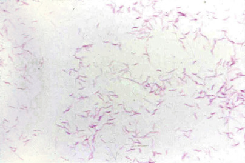

Figure 58-18 

_Campylobacter jejuni_ Gram stain: Note the comma-shaped appearance of the bacilli. 

 

##  Clinical Manifestations and Pathogenesis 

_C. jejuni_ is found worldwide as a commensal of the GI tract of wild or domesticated cattle, sheep, swine, goats, dogs, cats, and fowl, especially turkeys and chickens. It is the most common cause of bacterial enteritis in some areas of the United States, with an estimated occurrence of 1000 cases per 100,000 individuals. The incidence of infection in the United Kingdom and in other developed nations is similar to that in the United States, and the incidence in underdeveloped countries is probably even higher. Infections generally occur in the summer and fall and are commonly the result of ingestion of improperly cooked foods, usually poultry. In addition, several outbreaks of _C. jejuni_ enteritis have been linked to unpasteurized milk and to defects in municipal water systems. The spectrum of illness ranges from asymptomatic to severely ill. The stool from patients with diarrhea may contain blood or leukocytes. Symptoms can last up to 1 week and generally are self-limited. Extraintestinal infections, including bacteremia, reactive arthritis, urinary tract infection, and meningitis, may also occur. _C. jejuni_ is the most recognized antecedent cause of Guillain-Barré syndrome. The pathogenesis of this organism is not completely understood; it appears to first colonize the intestinal mucous layer and then is able to translocate through the epithelial surface to the underlying tissue (  Fitzgerald & Nachamkin, 2011  ). 

The major habitat of _C. fetus_ subsp. _fetus_ is the intestine of sheep and cattle; it also may be found in the genital tract of these animals, their placentas, and the gastric contents of their aborted fetuses and, less frequently, in other animals and birds. The mechanisms of transmission of infection to humans are not understood completely. Direct contact with an infected animal is possible, but less than one-third of infected individuals have a history of environmental or occupational exposure. Contaminated food or water may be a vehicle for infection, or infection may originate from an endogenous source. 

 

##  Laboratory Diagnosis 

A single stool specimen is generally adequate to detect enteric pathogens, including _Campylobacter_ spp. Examination for fecal leukocytes is not recommended because they may be present in as few as 25% of cases. An enzyme immunoassay (EIA) is available for direct detection of _Campylobacter jejuni_ and _Campylobacter coli_ antigens in stool specimens (  Granato et al, 2010  ;  Fitzgerald & Nachamkin, 2011  ). Several media can be used for the selective isolation of _Campylobacter_ spp., including charcoal-cefoperazone-deoxycholate agar, charcoal-based selective medium, semisolid blood-free motility medium, Skirrow's medium, and _Campylobacter_ agar with 5% sheep blood and five antimicrobials (cephalothin, trimethoprim, vancomycin, polymyxin B, and amphotericin B). Most _Campylobacter_ spp. require a microaerobic environment (5% O  2  , 10% CO  2  , and 85% N  2  ), which can be produced using commercially available gas generator packs. The amount of oxygen in a candle jar is too little to support the growth of _Campylobacter_ spp. and should not be used. Incubation of the plates at 42° C increases selectivity for _C. jejuni_ . Commercial multiplex PCR assays that detect multiple potential pathogens in stool also are available. 

If _Campylobacter_ spp. are suspected in a blood culture based on clinical history or appearance of an organism on Gram stain, the broth should be subcultured to a nonselective blood agar plate and incubated at 37° C in a microaerobic environment. 

In general, _Campylobacter_ spp. produce gray, flat, irregular, spready colonies, which may become round, convex, and glistening as the moisture content in the media is reduced. A typical Gram stain appearance and a positive oxidase reaction from a colony growing on selective media at 42° C can be reported as _Campylobacter_ spp. _C. jejuni_ is able to hydrolyze hippurate and is susceptible to nalidixic acid and resistant to cephalothin. _C. coli_ is hippuricase negative. 

Strains of _C. fetus_ subsp. _fetus_ are resistant to nalidixic acid, fail to hydrolyze hippurate, and do not ordinarily grow at 42° C. 

 

##  Antimicrobial Susceptibility 

_C. jejuni_ is variably susceptible to antimicrobial agents. Most are not susceptible to penicillins or cephalosporins. For intestinal infection, erythromycin is the drug of choice, with quinolones used as alternative therapy. Treatment often is not warranted, however, for simple gastroenteritis with _Campylobacter_ sp. in an otherwise healthy individual. Resistance to both agents has been encountered. Currently, no standardized methods are used for susceptibility testing of this group of organisms; however, CLSI document M45-A2 provides guidelines for testing (  CLSI, 2010  ). 

 

##  Helicobacter 

 

##  Characteristics 

_Helicobacter_ spp. are spiral-shaped or curved, gram-negative, non–spore-forming bacilli, measuring 0.3 to 1.0 µm wide and 1.5 to 10 µm long. They are motile by multiple bipolar or monopolar flagella, are microaerobic, and have a respiratory metabolism. 

 

##  Clinical Manifestations and Pathogenesis 

_Helicobacter_ spp. are found in the GI tracts of mammals and birds. Transmission from one host to another occurs through both oral–oral and fecal–oral routes. _Helicobacter pylori_ is considered to be one of the “gastric” helicobacters. In the stomach, it lives within or beneath the mucous layer adjacent to the epithelium. It is also found transiently in the duodenum, saliva, and feces. 

Infection with _H. pylori_ may result in acute gastritis symptoms. Most infected patients develop chronic active gastritis, which may lead to nonulcer dyspepsia or duodenal ulcers. _H. pylori_ has been associated with 90% of duodenal ulcers and nearly all gastric ulcers. Infection with _H. pylori_ has also been associated with gastric carcinoma and gastric lymphoma (  Testerman & Morris, 2014  ). The prevalence of gastritis associated with _H. pylori_ increases with age, suggesting that the organism is acquired as people become older. 

The “enteric” helicobacters, such as _Helicobacter_ (formerly _Campylobacter_ ) _cinaedi_ and _Helicobacter fennelliae,_ have been implicated in cases of gastroenteritis. Rarely, these organisms may invade the bloodstream and be isolated from cultures of blood. 

 

##  Laboratory Diagnosis 

Typically, nonculture methods have been utilized to diagnose _H. pylori_ infection. One such test is the urea breath test. This is a noninvasive test that detects urease activity of _H. pylori_ by measuring  14  C- and  13  C-labeled CO  2  in the patient's expelled air after ingestion of labeled urea. Serologic assays are also widely used in symptomatic patients to detect antibodies against _H. pylori;_ however, because most adults will have been exposed to _H. pylori,_ detection of IgG antibodies is not helpful diagnostically but can be used as an epidemiologic or surveillance tool. In some cases, biopsies of the affected tissues are obtained and are examined histologically using the hematoxylin and eosin or immunohistochemical stain for the presence of organisms with morphology typical of _H. pylori_ . Because the organism hydrolyzes urea very rapidly, a portion of the gastric biopsy may be placed directly into urea broth or onto urea-containing agar to detect urea hydrolysis in 1 to 24 hours (CLO test). A commercially available EIA for detection of _H. pylori_ antigen in stool is a noninvasive alternative for diagnosis of _H. pylori_ infection (Premier Platinum HpSA, Meridian Bioscience, Cincinnati, Ohio). Sensitivity of this assay is as high as 89%, with specificities up to 95% (  Masoero et al, 2000  ;  Montiero et al, 2001  ). PCR has also been reported as a sensitive method for detection of _H. pylori_ (  Montiero et al, 2009  ). 

If culture is requested, tissue specimens should be maintained at 4° C and processed within 2 hours of collection. Transport media include _Brucella_ broth with 20% glycerol, cysteine Albemi broth with 20% glycerol, isotonic saline with 4% glucose, and Stuart's transport media. Processed specimens may be inoculated to one of several media, including brain-heart infusion, _Brucella_ , Trypticase soy agar, Columbia agar base with 10% defibrinated horse blood, or Wilkens Chalgren agar. Inoculated media should be incubated in a microaerobic atmosphere (5% to 10% CO  2  , 80% to 90% N  2  , and 5% to 10% O  2  ) under high humidity at 35° C for 5 to 10 days. Addition of 5% to 8% H  2  in the atmosphere enhances growth of _H. pylori,_ which generally produces small, gray, translucent colonies on these media; has the characteristic gram-negative spiral appearance on stained smears; and is oxidase, catalase, and urease positive. Feces generally are not cultured for the enteric helicobacters. _Helicobacter_ spp. will grow and will be detected by the automated blood culture systems used in many laboratories, but may require incubation for longer than the standard 5 days (  Lawson, 2011  ). 

 

##  Antimicrobial Susceptibility 

Multidrug regimens are used to treat _H. pylori_ infection. These usually include two antibiotics (metronidazole, clarithromycin, tetracycline, or amoxicillin) and an “antiacid” drug. Strains resistant to metronidazole and clarithromycin have been reported. For susceptibility testing, the CLSI recommends agar dilution using Mueller-Hinton agar plus 5% sheep blood (  CLSI, 2010  ). Interpretive breakpoints are given only for clarithromycin. Updated information about the treatment of _H. pylori_ gastritis can be found in two review articles (  Papastergiou et al, 2014  ;  Testerman & Morris, 2014  ). 

 

##  Haemophilus 

 

##  Characteristics 

Members of the genus are oxidase-positive, facultatively anaerobic, small, gram-negative, pleomorphic rods or coccobacilli with a potential requirement for X (hemin) and/or V (NAD) factor. [ Figure 58-19 ](<#f0100>) shows an _H. influenzae_ bacterium in a brain abscess specimen. 

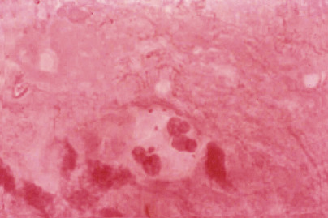

Figure 58-19 

Gram stain of a _Haemophilus influenzae_ coccobacillus in a brain abscess. 

 

##  Clinical Manifestations and Pathogenesis 

Most _Haemophilus_ spp. are normal inhabitants of the upper respiratory tract. Some may reside in the gastrointestinal or urogenital tract. Person-to-person spread occurs by respiratory droplets. Infections caused by _Haemophilus_ spp. range from conjunctivitis and otitis media to meningitis and endocarditis. Those that are generally considered human pathogens are _H. influenzae, Haemophilus parainfluenzae, Haemophilus ducreyi,_ and _Aggregatibacter (Haemophilus) aphrophilus_ (  Ledeboer & Doern, 2011  ). 

The major virulence factor of _H. influenzae_ is the polysaccharide capsule, of which there are six serotypes (a to f). Strains that do not possess a capsule are referred to as _nontypeable_ . Endotoxin is not produced by _H. influenzae,_ and this species is rapidly killed once ingested by macrophages unless antibody, complement, or the phagocytes are deficient. The role of antibodies in immunity is also poorly understood. Antibodies develop with age, presumably following natural infection with _H. influenzae_ or with cross-reacting antigenic organisms, so most persons older than 15 years have antibodies. Which antibodies are present and what level of those antibodies is protective remain unknown. 

Since the introduction of a vaccine for _H. influenzae_ type b in the mid-1980s, there has been a sharp drop in the incidence of invasive infection such as meningitis and epiglottitis due to this organism. [ Figure 58-20 ](<#f0105>) demonstrates the pleomorphic nature of the _H. influenzae_ seen in a CSF specimen. Nontypeable strains of _H. influenzae_ are most frequently associated with acute otitis media and acute exacerbations of chronic bronchitis. _H. parainfluenzae_ is usually a commensal in the upper respiratory tract but may also cause serious illness, such as endocarditis. _Aggregatibacter (Haemophilus) aphrophilus,_ another upper respiratory tract commensal, can cause endocarditis, brain abscess, pneumonia, meningitis, and bacteriuria. _H. ducreyi_ is responsible for the sexually transmitted disease chancroid (  Ledeboer & Doern, 2011  ). 

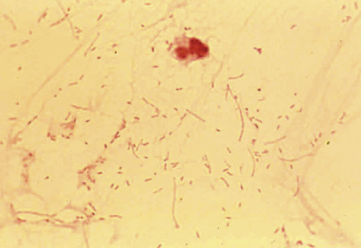

Figure 58-20 

Note the pleomorphic nature of the _Haemophilus influenzae_ seen in this Gram stain of cerebrospinal fluid. 

 

##  Laboratory Diagnosis 

Isolation of _Haemophilus_ spp. usually requires the presence of X and/or V factor in the culture medium. The former is most frequently supplied by the incorporation of heat-lysed (“chocolatized”) blood cells in agar, although it may also be provided by whole human, horse, or rabbit blood cells. NAD is commonly supplied by the incorporation of yeast extract or other appropriate supplements in the medium or by a suspension of staphylococci, which is streaked across the agar surface and about which satellite colonies of dependent strains of _Haemophilus_ spp. grow. The differential characteristics of members of this genus are listed in [ Table 58-13 ](<#t0070>) . 

TABLE 58-13 

Differential Characteristics of Medically Important _Haemophilus_ Species 

|  Porphyrin  |  X Factor Dependent  |  V Factor Dependent  |  Fermentation of Sucrose  |  Hemolysis [ * ](<#hl0002198>) |  Catalase   
---|---|---|---|---|---|---  
_Haemophilus influenzae_ |  – |  \+  |  \+  |  – |  – |  \+   
_Haemophilus haemolyticus_ |  – |  \+  |  \+  |  – |  \+  |  \+   
_Haemophilus parahaemolyticus_ |  \+  |  – |  \+  |  \+  |  \+  |  V   
_Haemophilus ducreyi_ |  – |  \+  |  – |  – |  – |  –  
_Haemophilus parainfluenzae_ |  \+  |  – |  \+  |  \+  |  |  V   
_Haemophilus pittmaniae_ |  \+  |  – |  \+  |  \+  |  \+  |  w   
_Haemophilus paraphrohaemolyticus_ |  \+  |  – |  \+  |  \+  |  \+  |  \+   
  
Adapted from Ledeboer NA, Doern GV: Haemophilus. In Versalovic J, Carroll KC, Funke G, et al, editors: _Manual of clinical microbiology_ , ed 10, Washington, DC, 2011, American Society for Microbiology, p 589. 

 * On horse and rabbit blood. 

Requirements for X and V factors are determined by absence or presence of growth on media containing these factors. An alternative method to test for X factor dependence is the porphyrin test described by Kilian, which determines the ability of dependent species to use δ-aminolevulinic acid in the biosynthesis of porphobilinogen and porphyrins. The formation of porphobilinogen can be detected by adding Kovac's reagent to the reaction mixture and observing the development of a red color in the aqueous phase. Alternatively, the formation of porphyrins in the reaction mixture can be demonstrated by red fluorescence under a Wood's lamp. Hemolytic properties of _Haemophilus_ spp. can be determined on rabbit or horse blood agar. 

_Aggregatibacter (Haemophilus) aphrophilus_ must often be distinguished from species such as _Aggregatibacter (Actinobacillus) actinomycetemcomitans, Cardiobacterium hominis,_ and _Eikenella corrodens_ ( [ Table 58-14 ](<#t0075>) ), all of which have been associated with subacute bacterial endocarditis. 

TABLE 58-14 

Differential Characteristics of _Aggregitabacter (Haemophilus) aphrophilus, Aggregitabacter (Actinobacillus) actinomycetemcomitans, Cardiobacterium hominis, Eikenella corrodens,_ and _Kingella kingae_ [ * ](<#hl0002317>)

Test  |  _A. aphrophilus_ |  _A. actinomycetemcomitans_ |  _C. hominis_ |  _E. corrodens_ |  _K. kingae_  
---|---|---|---|---|---  
Oxidase  |  +/– |  –/W  |  \+  |  \+  |  \+   
Catalase  |  – |  \+  |  – |  – |  –  
δ-ALA utilization  |  \+  |  \+  |  \+  |  \+  |  \+   
V requirement  |  – |  – |  – |  – |  –  
Indole  |  – |  – |  \+  |  – |  –  
Urease  |  – |  – |  – |  – |  –  
Lysine decarboxylase  |  – |  – |  – |  \+  |  –  
Acid from glucose  |  \+  |  \+  |  \+  |  – |  (+)   
Sucrose  |  \+  |  – |  \+  |  – |  –  
Lactose  |  \+  |  – |  – |  – |  –  
Mannitol  |  – |  \+  |  D  |  – |  –  
Xylose  |  – |  D  |  – |  – |  –  
  
_ δ-ALA, _ δ-Aminolevulinic acid; _W,_ weak. 

 * For key to symbols, see [ Table 58-9 ](<#t0050>) . 

Cultivation of _H. ducreyi_ from chancroid lesions is problematic. A Gram-stained smear of material from the lesion may be helpful if gram-negative bacilli in pairs or in rows (“schools of fish”) are seen. [ Figure 58-21 ](<#f0110>) shows a “typical” Gram stain of _H. ducreyi_ from clinical material. Material may be inoculated onto GC medium base plus 1% hemoglobin, 5% to 10% fetal calf serum, 1% IsoVitaleX (BBL Microbiology Systems), and 3 µg/mL of vancomycin or Mueller-Hinton agar plus 5% horse blood, 1% cofactor-vitamin-amino acid enrichment, and 3 µg/mL vancomycin. 

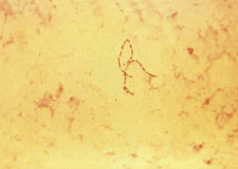

Figure 58-21 

_Haemophilus ducreyi_ bacilli from a genital lesion. 

 

##  Antimicrobial Susceptibility 

Currently, the CLSI recommends testing _H. influenzae_ isolated from blood or CSF against ampicillin, chloramphenicol, a third-generation cephalosporin, and meropenem (  CLSI, 2014  ). Resistance to ampicillin may be as high as 60% in the United States, varying geographically. Resistance to ampicillin is usually mediated by the production of β-lactamase; however, rare isolates are resistant on the basis of alterations in outer membrane permeability or affinity to penicillin-binding proteins. Resistance to second- or third-generation cephalosporins has not been documented in the United States. Susceptibility testing of _H. influenzae_ requires the use of _Haemophilus_ test medium (HTM). The recommended treatment for _H. ducreyi_ infection is erythromycin; alternative agents include azithromycin, ciprofloxacin, ceftriaxone, amoxicillin-clavulanate, and trimethoprim-sulfamethoxazole. Although few data are available on the susceptibility of other _Haemophilus_ spp. to antibiotics, resistance is assumed higher than among _H. influenzae_ strains (  Ledeboer & Doern, 2011  ). 

 

##  Gram-Negative Bacteria—the HACEK Bacteria 

Five small gram-negative coccobacilli are part of the normal oral flora and are associated occasionally with bacterial endocarditis and rarely with other infections. They are opportunists that enter the bloodstream, settle on damaged heart valves, and cause a relatively slowly progressive, indolent form of endocarditis. They typically require an additional 1 to 2 days before they are isolated from blood cultures, and they are uniformly susceptible to many antimicrobial agents (  Yew et al, 2014  ). The word _HACEK_ is an acronym for the bacteria responsible for this disease: _Haemophilus_ spp. _(influenzae_ , _parainfluenzae), Aggregatibacter (Haemophilus) aphrophilus_ (most commonly, _Aggregatibacter [Actinobacillus] actinomycetemcomitans_ ), _Cardiobacterium hominis_ , _Eikenella corrodens_ , and _Kingella_ spp. Some taxonomic changes have been noted more recently, and some of the HACEK members have been reassigned to the genus _Aggregatibacter_ (  Norskov-Lauritsen & Kilian, 2006  ). Differential characteristics of the members of this group are listed in [ Table 58-14 ](<#t0075>) . 

 

##  Haemophilus 

_H. influenzae_ and _H. parainfluenzae_ were discussed earlier in this chapter. _Aggregatibacter (Haemophilus) aphrophilus_ is also part of the HACEK group. It does not require X or V factor, so it can easily grow on blood and chocolate agars, or CO  2  for growth. Along with causing endocarditis, _A. aphrophilus_ has been reported in cases of endophthalmitis (following ophthalmic procedures), bacteremia, meningitis, brain abscess, cervical lymphadenitis, empyema, and a few other infectious syndromes. In one study, 39% of patients reported undergoing prior dental procedures before developing their _A. aphrophilus_ infection (  Huang et al, 2005  ). It is usually susceptible to β-lactam agents; successful treatment may require combination therapy with a β-lactam and an aminoglycoside. 

 

##  Aggregatibacter (Actinobacillus) 

 

##  Characteristics 

_A. actinomycetemcomitans_ is a gram-negative, non–spore-forming coccobacillus or short rod. It grows both aerobically and anaerobically. The addition of 5% to 10% CO  2  enhances growth. Colonies on blood agar appear slowly and remain small. A description of “star-shaped” colonies has been given to their appearance on agar media. 

 

##  Clinical Manifestations and Pathogenesis 

_Aggregatibacter_ organisms are found in the mucous membranes of the respiratory and genitourinary tracts of humans and animals. They generally cause disease only in immunocompromised individuals, or when they are accidentally introduced into healthy surrounding tissue—for example, by trauma. _A. actinomycetemcomitans_ has a low level of pathogenicity. It derives its species name from its frequent association with actinomycotic lesions. In recent years, however, it has most frequently been reported as a cause of subacute bacterial endocarditis, periodontitis, and brain abscess. Two virulence factors are known: a leukotoxin and a collagenase (  Zbinden & von Graevenitz, 2011  ). 

 

##  Laboratory Diagnosis 

_A. actinomycetemcomitans_ grows on blood and chocolate agar. After 24–72 hours, colonies are 1–3 mm in diameter with a central wrinkling. The organism is catalase positive, oxidase negative or weakly positive, and urease negative (  Zbinden & von Graevenitz, 2011  ). Additional biochemical assays must be used to differentiate it from other slowly growing, somewhat fastidious gram-negative bacilli (see [ Table 58-14 ](<#t0075>) ). 

 

##  Antimicrobial Susceptibility 

This organism is resistant to penicillin but is usually susceptible to many other antibiotics, including the cephalosporins, β-lactam–β-lactamase inhibitor combinations, fluoroquinolones, and tetracycline. Methods for performing susceptibilities and interpretation of results can be found in the CLSI document M45-2A (  CLSI, 2010  ). 

 

##  Cardiobacterium hominis 

 

##  Characteristics 

_Cardiobacterium hominis_ is a gram-negative, non–spore-forming bacillus that is part of the normal oral flora. It is a facultative anaerobe that does not require CO  2  , although growth is enhanced in microaerophilic conditions. Growth occurs on blood and chocolate agar but not on MacConkey's agar and is better at longer than 48 hours. 

 

##  Clinical Manifestations and Pathogenesis 

_C. hominis_ can cause subacute bacterial endocarditis, similar to other HACEK members; it may also be responsible for cases of periodontitis and peritonitis (  Bhan et al, 2006  ). The usual habitat of _C. hominis_ is the upper respiratory tract, but it may also be found in the gastrointestinal and genitourinary tracts (  Zbinden & von Graevenitz, 2011  ). 

 

##  Laboratory Diagnosis 

Colonies at 48 hours' incubation are small and may have a yellow pigment, although most are white. The organism is generally oxidase and indole positive but negative for catalase, urease, esculin, and nitrate reduction. Acid may be produced from glucose, maltose, and sucrose (  Zbinden & von Graevenitz, 2011  ). 

 

##  Antimicrobial Susceptibility 

Isolates are usually susceptible to penicillins and cephalosporins, aminoglycosides, and tetracyclines. Resistance to clindamycin is common. β-Lactamases have been rarely reported (  Lu et al, 2000  ). Methods for performing susceptibilities and interpretation of results can be found in the CLSI document M45-2A (  CLSI, 2010  ). 

 

##  Eikenella 

 

##  Characteristics 

Formerly classified as _Bacteroides corrodens_ , the “corroding bacilli” that are facultatively anaerobic have been assigned to the species _Eikenella corrodens_ . _E. corrodens_ organisms are oxidase-positive, catalase-negative, nonfermentative, gram-negative bacilli, colonies of which may corrode or pit agar. Growth is enhanced by 5% to 10% CO  2  and/or the presence of hemin (X factor) in the medium. 

 

##  Clinical Manifestations and Pathogenesis 

Little is known about factors contributing to the organism's virulence in human disease; it has a low level of pathogenicity for animals. _E. corrodens_ resides predominantly in the oral cavity and is isolated frequently from the upper respiratory tract. Similar to other HACEK bacteria, it is responsible for subacute bacterial endocarditis. It has been recovered from abscesses, cellulitis, and wound infections, often following human bites. Infections are usually mixed with other organisms (  Zbinden & von Graevenitz, 2011  ). 

 

##  Laboratory Diagnosis 

Growth is observed on blood or chocolate agar but not on MacConkey's agar. The most striking features of _E. corrodens_ in culture are the distinctive odor of bleach and the characteristic pitting of the agar; however, pitting does not occur with all strains. Colonies appear slowly (2 to 4 days) and are generally small (0.5-1.0 mm in diameter). _E. corrodens_ must usually be distinguished from other fastidious, slowly growing gram-negative bacilli (see [ Table 58-14 ](<#t0075>) ). 

 

##  Antimicrobial Susceptibility 

_E. corrodens_ is susceptible to the penicillins, quinolones, and tetracycline; variably susceptible to aminoglycosides; and resistant to clindamycin and metronidazole. β-Lactamases have been described in clinical strains, but resistance can be overcome with the use of β-lactamase inhibitors in combination with β-lactam antibiotics (  Zbinden & von Graevenitz, 2011  ). 

 

##  Kingella 

 

##  Characteristics 

_Kingella_ has three recognized species: _K. kingae_ (the HACEK species), _Kingella oralis,_ and _Kingella denitrificans_ . They are gram-negative rods to coccobacilli, requiring increased CO  2  for optimum growth. Colonies will grow on blood (β-hemolytic) and chocolate, but not on MacConkey's agar, after 2 days. 

 

##  Clinical Manifestations and Pathogenesis 

_K. kingae_ is the most pathogenic of the three species. It is a member of the HACEK group, causing an indolent, slowly progressive endocarditis. In addition, it is associated with septic arthritis/osteomyelitis (usually in children younger than 4 years of age) (  Sena et al, 2009  ;  Yagupsky, 2015  ) and septicemia. _K. oralis_ has been isolated from patients with periodontitis, but with unclear clinical relevance. _K. denitrificans_ is a rare clinical isolate that can be associated with endocarditis (  Zbinden & von Graevenitz, 2011  ). 

 

##  Laboratory Diagnosis 

_K. kingae_ is oxidase positive and nonmotile and produces acid from glucose, although in delayed fashion. Indole and catalase are negative. 

 

##  Antimicrobial Susceptibility 

_K. kingae_ is susceptible to penicillin and most antibiotics to which other members of the HACEK group are susceptible. β-Lactamases have been described in clinical strains, but resistance can be overcome with the use of β-lactamase inhibitors in combination with β-lactam antibiotics (  Zbinden & von Graevenitz, 2011  ). Methods for performing susceptibilities and interpretation of results can be found in the CLSI document M45-2A (  CLSI, 2010  ). 

 

##  Miscellaneous Gram-Negative Bacilli 

 

##  Legionella 

 

##  Characteristics 

_Legionella_ spp. are non–spore-forming, faintly staining, thin, gram-negative bacilli. _Legionella_ spp. were first recognized to cause human disease during an epidemic of pneumonia that occurred among members of the Pennsylvania American Legion who had gathered in Philadelphia to celebrate the 1976 bicentennial. There are now more than 52 named species and a number of unnamed species. Most clinical cases have been due to _Legionella pneumophila_ , serogroup 1. [ Figure 58-22 ](<#f0115>) demonstrates excellent staining of _Legionella_ spp. with a Dieterle silver stain. 

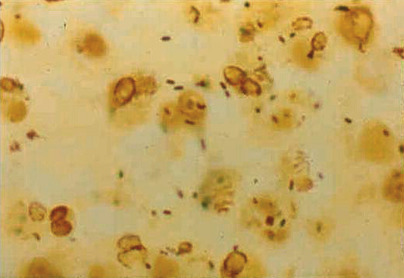

Figure 58-22 

_Legionella pneumophila_ in a clinical specimen stained with a Dieterle silver stain. 

 

##  Clinical Manifestations and Pathogenesis 

_Legionella_ spp. are found in the environment in association with water. Growth within environmental protozoa is thought to be an important factor for survival of the organism in the environment. Transmission to humans occurs through exposure to contaminated water (e.g., faucets, shower heads, public fountains). Human-to-human infection and laboratory-acquired infections are not known to occur. 

Infections can be subclinical, pulmonary, or extrapulmonary. Infection is usually manifested as an acute, fibrinopurulent pneumonia with lobular distribution. Histologically, there is an alveolar infiltrate of neutrophils and macrophages, accompanied by fibrin and red blood cell extravasation. _Legionella_ spp. may be found within alveolar macrophages. [ Figure 58-23 ](<#f0120>) shows the Gram stain of sputum of a patient with _L. pneumophila_ pneumonia. _L. pneumophila_ has also been isolated from cultures of blood. 

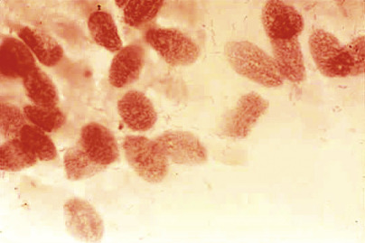

Figure 58-23 

_Legionella pneumophila_ faintly staining negative with Gram stain of pulmonary infiltrate. 

 

##  Laboratory Diagnosis 

_Legionella_ spp. may be isolated on BCYE agar supplemented with growth factors, including l-cystine, ferric salt, and α-ketoglutarate. This medium may be made selective for culture of nonsterile body sites by the addition of cefamandole, polymyxin B, and anisomycin or polymyxin B, anisomycin, and vancomycin (  Edelstein, 2011  ). Chocolate agar may also support the growth of legionellae. Treatment of sputum with a weak acid (0.2M HCl/KCl pH 2.2) for 4 minutes or with heat (60° C) for 2 minutes may help to reduce contamination from other organisms but may reduce the number of legionellas as well. 

Inoculated media should be incubated for at least 5 days in a humid atmosphere containing no more than 2% to 5% CO  2  . Colonies often appear iridescent and have a sticky consistency. Isolates with typical Gram stain morphology should be subcultured to blood agar, where no growth will be observed. These organisms may be weakly oxidase and catalase positive, are gelatinase positive, and often are motile. Identification of this organism is most accurately achieved using type-specific antibody assays or sequencing with appropriate primers. [ Figure 58-24 ](<#f0125>) shows a Gram stain of _L. pneumophila_ from culture. 

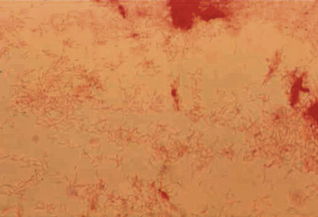

Figure 58-24 

Gram stain of culture of _Legionella pneumophila_ . 

_Legionella_ spp. can be detected or identified by direct fluorescent antibody (DFA) staining of specimens or colonies in cultures, but the sensitivity of direct DFA examination of respiratory specimens is very low compared to newer methods of detection and is not commonly utilized today. The urine antigen test for _L. pneumophila_ serogroup 1 has a reported sensitivity of 80% to 90%, although it should be noted that antigenuria may persist for many months following infection. Use of the urinary antigen test within and outside of the intensive care unit has been shown to have a positive impact on patient cases (  Edelstein, 2011  ;  Couturier et al, 2014  ). 

The diagnosis of legionellosis can also be established serologically by detecting a fourfold or greater rise in antibody titer to at least 1 : 128\. A single antibody titer of 1 : 256 is presumptive evidence of past infection. The sensitivity of serologic diagnosis for disease caused by species other than _L. pneumophila_ serogroup 1 is not known, and the specificity of antibody tests for disease caused by other species is less than that of _L. pneumophila_ serogroup 1. PCR assays for direct detection of _Legionella_ spp. in clinical specimens and for sequencing identification of cultured isolates have been developed. Sensitivities of 64% to 100% and specificities of 88% to 100% have been reported (  Edelstein, 2011  ). Use of these assays can provide more rapid results, especially when used in direct specimen testing; in addition, identification of species other than _L. pneumophila,_ which is not possible with DFA and serology, could increase the demand for such assays. PCR for _Legionella_ spp. directly in clinical samples will be performed most often in the future as assays become cleared for clinical laboratory testing to enhance recovery or in assays in which other respiratory pathogens can be simultaneously searched for. 

 

##  Antimicrobial Susceptibility 

Because of the intracellular nature of _Legionella_ spp. in clinical infection, in vitro susceptibility test results do not predict the clinical response of antibiotics. Susceptibility testing should not be performed. Therapy generally consists of a macrolide (clarithromycin and azithromycin are as efficacious and result in fewer side effects than erythromycin) or a fluoroquinolone alone or in combination. Other agents that have been used include trimethoprim-sulfamethoxazole, rifampin, or a tetracycline (  Valve et al, 2009  ;  Edelstein, 2011  ). No β-lactam antibiotic has acceptable intracellular activity against _L. pneumophila_ . Macrolides and fluoroquinolones should always be efficacious against infection with _Legionella micdadei, longbeacheae, bozemanae,_ or _dumoffi_ (  Muder & Yu, 2002  ). 

 

##  Bordetella 

 

##  Characteristics 

_Bordetella_ spp. are strictly aerobic, nonfermentative, catalase-positive, minute coccobacilli that can oxidize amino acids but do not ferment sugars. Members of the genus _Bordetella_ include _B. pertussis_ and _B. parapertussis,_ which are responsible for pertussis or a pertussis-like disease, respectively, in humans; _B. bronchiseptica_ and _B. avium_ , which have been responsible for respiratory disease in humans; and _B. hinzii, B. trematum, B. holmseii, B. petri_ , and _B. ansorpii,_ which have been found in a wide variety of human nonrespiratory infections, primarily in immunocompromised hosts (  Wirsing et al, 2011  ). 

 

##  Clinical Manifestations and Pathogenesis 

_Bordetella_ spp. are found in the respiratory tracts of warm-blooded animals. _Bordetella bronchiseptica_ primarily causes kennel cough in dogs, although it may rarely cause pertussis-like symptoms in immunocompromised human hosts. _Bordetella parapertussis_ , which infects both humans and lambs, is an uncommon human pathogen. Infection may be asymptomatic or may cause a pertussis-like illness, most frequently bronchitis. _B. pertussis_ , the etiologic agent of whooping cough, causes disease only in humans. In 2012, more than 48,000 cases of whooping cough were reported to the CDC, the highest number seen in the United States since 1955. In California alone in 2014, an outbreak with nearly 10,000 cases was reported (cdc.gov/pertussis). Most of the increased cases have been associated in nonvaccinated individuals. Whooping cough is less easily diagnosed in adults, but there are indications that the number of cases is increasing in adults as well as children (  McGuiness et al, 2013  ). 

_B. pertussis_ and _B. parapertussis_ can cause pertussis or whooping cough, although cases due to the latter are usually milder and of shorter duration. _B. pertussis_ is transmitted via droplets from other infected individuals; in nonvaccinated individuals, the transmission rate can be as high as 90%, whereas lower rates are seen in vaccinated populations. Protection against _B. pertussis_ wanes over the years post infection or vaccination, so currently it is recommended that adults be revaccinated with the acellular pertussis vaccine (Tdap) in order to reduce the burden of circulating _B. pertussis,_ especially to newborns and infants (  Cortese et al, 2007  ;  Spector & Maziarz, 2013  ). 

_B. pertussis, B. parapertussis,_ and _B. bronchiseptica_ produce a number of virulence factors, including adhesions; autotransporters (filamentous hemagglutinin, FHA, fimbriae or FIM, and pertactin, or PRN, which is highly immunogenic); and toxins (adenylate cyclase and lipopolysaccharide, or LPS). In addition, _B. pertussis_ produces pertussis toxin (PT), an exotoxin that is involved in colonization of the respiratory tract and establishment of the infection with _B. pertussis,_ and a virulence factor that has ADP-ribosyltransferase activity and ribosylates G proteins. PT also induces lymphocytosis and suppresses chemotaxis oxidative responses and the overall activity of neutrophils and macrophages (  Wirsing et al, 2011  ). It is thought that in a pertussis infection, the organism first attaches to the ciliated epithelium of the respiratory tract and immune effector cells by means of fimbriae, FHA, PT, and pertactin. PT and adenylate cyclase toxin work together to inhibit the host's immune system, and tracheal cytotoxin damages the respiratory epithelium. Results may include inflammation and epithelial necrosis; leukocytosis and lymphocytosis; accumulation of secretions; cough; and ultimately bronchopneumonia, hypoxic episodes, and encephalopathy (  Xu et al, 2009  ). _B. pertussis_ contains a protective antigen that when combined with antibody abolishes its infectivity. It appears, however, that both cellular immunity and humoral immunity are needed to eradicate the organism. 

 

##  Laboratory Diagnosis 

The rate of isolation of _B. pertussis_ from patients declines with the duration of illness. The most commonly recommended specimen is the nasopharyngeal aspirate, especially in infants and young children. In adults, older children, and adolescents, a nasopharyngeal swab may be adequate if taken by trained professions, although aspirates are still considered more sensitive for recovery overall (  Wirsing et al, 2011  ). _B. pertussis_ and _B. parapertussis_ in particular are sensitive to transport and should be cultured as quickly as possible after collection or placed into special transport devices. The other species of _Bordetella_ are not sensitive to transport conditions. In general, swabs or aspirates should be inoculated onto suitable media, such as Regan-Lowe agar, as quickly as possible after collection. The medium used is usually supplemented with an antibiotic such as cephalexin to suppress contaminating bacteria. Incubate at least 7 days at ambient atmosphere, 35° to 37° C. For shipment to reference laboratories, the inoculated medium should be incubated for at least 24 hours in ambient air at 35° C prior to transport to allow some initial growth of the organism. Isolation of _B. pertussis_ from culture is very specific, so sensitivity will depend on the patient's age, the duration of the illness, and the patient's vaccination status. 

Direct examination of smears stained with fluorescein-conjugated _B. pertussis_ monoclonal or polyclonal antiserum may provide a rapid diagnosis; however, DFA assays suffer from low sensitivity (30% to 71%) and low specificity. Results of DFA should be considered presumptive only and should be used as an adjunct to culture or PCR (  Wirsing et al, 2011  ). Direct detection of _B. pertussis_ in clinical specimens by means of PCR is the best method for detection of _B. pertussis_ . Specimen collection for PCR is the same as that for culture, but transport is less of an issue when PCR is being used for detection. A study examining a few transport devices demonstrated equal performance among them, and transport times are not as critical as they are when culture is the method of detection (  Arbefeville et al, 2014  ). As more commercial products become available, the reproducibility of results between laboratories have improved (  Leber, 2014  ). A survey of many public health laboratories using different PCR methods revealed comparable results that were better than had been reported in a previous survey (  Williams et al, 2015  ). PCR test results, however, may remain positive longer than results obtained with culture or DFA, even with appropriate antimicrobial therapy. PCR methods for the direct detection of _B. parapertussis_ in clinical specimens are also available (  Arbefeville et al, 2014  ), and consideration should be given to use of a PCR that can detect both organisms, because in some outbreaks, a significant cause of whooping cough is actually _B. parapertussis_ (  Wirsing et al, 2011  ). 

Culture for _B. pertussis_ provides the most specific diagnosis of whooping cough and enables a laboratory to perform susceptibility testing and/or genotypic analysis if required. Colonies of _B. pertussis_ are small, smooth, round, and shiny and may have the appearance of a drop of mercury. Organisms with typical colony morphology and Gram stain appearance should be subcultured to blood agar to verify the absence of growth on this medium. Positive catalase and oxidase reactions and negative urease can be used for presumptive identification of an organism as _B. pertussis_ . _B. parapertussis_ grows more rapidly and will grow on blood agar and occasionally on MacConkey's agar. Colonies are oxidase negative and catalase and urease positive. _B. bronchiseptica_ grows well on both blood and MacConkey's agars and biochemically is the most active of the three. It is catalase, oxidase, urease, and nitrate reduction positive. _B. holmseii_ has been described more recently in the genus, not as a cause of whooping cough, but rather in association with bacteremia, endocarditis, and respiratory illness in immunocompromised patients, especially in asplenic patients (  Shepard et al, 2004  ). _B. holmseii_ will grow well on blood agar, and its appearance on MacConkey's agar may be delayed. It is negative for oxidase, nitrate reduction, and urease. Other _Bordetella_ spp., including _B. hinzii, B. trematum,_ and _B. avium,_ grow on both blood agar and MacConkey's agar and are motile, unlike all other members of the genus (  Wirsing et al, 2011  ). 

Serologic methods for _B. pertussis_ and _B. parapertussis_ may be used to make the diagnosis of whooping in nonvaccinated older children, adolescents, and adults; EIA is the usual method of choice. Demonstration of seroconversion or a significant rise in concentration of IgG against PT is thought to be the most sensitive and specific test. Serology, however, should not be used for 1 year after a person is vaccinated with the acellular pertussis vaccine. In a study comparing culture, PCR, and serology for diagnosis of pertussis, if a minimum of two antigens to _B. pertussis_ (IgG, IgA, or IgM) were obtained in both acute and convalescent sera, serology was found to be as sensitive as PCR, and both were more sensitive than culture (  Cengiz et al, 2009  ). 

 

##  Antimicrobial Susceptibility 

Antimicrobial agents probably play no role in the therapy of pertussis, but nasopharyngeal cultures become negative after 1 to 2 days of treatment, which may prevent bacterial complications in patients with the disease and may be effective in preventing spread of the disease to nonimmune contacts. Susceptibility testing is not indicated for _B. pertussis,_ and methods are not standardized. A macrolide (erythromycin, azithromycin, or clarithromycin) is the drug of choice for treatment and prophylaxis; trimethoprim-sulfamethoxazole (SXT) is an acceptable alternative in patients with macrolide intolerance and in those in whom the isolate is resistant to the macrolides, which occurs very rarely (  Wirsing et al, 2011  ). 

 

##  Prevention 

Several formulations of vaccines can be used to prevent diphtheria, tetanus, and pertussis. Some are combined with vaccines to prevent other diseases and reduce the total number of injections that someone receives at one office visit. In the United States, DTaP, Tdap, and Td vaccines are most commonly used. DTaP is given to children younger than 7 years of age, and Tdap and Td are given to older children and adults (cdc.gov/vaccines/vpd-vac/pertussis/default.htm). 

 

##  Brucella 

 

##  Characteristics 

_Brucella_ spp. are small, gram-negative coccobacillary organisms (0.5-0.7 µm × 0.6-1.5 µm). In smears, they occur predominantly as single coccobacilli, but they may occur in pairs or in short chains. They have been described as having the appearance of sand. They are nonmotile, strictly aerobic, catalase- and usually oxidase-positive organisms. They are nonfermenters. They can grow on a variety of laboratory media, but growth is often enhanced by the presence of 5% to 10% CO  2  and the addition of blood or serum. Of the recognized species, _Brucella melitensis, Brucella abortus, Brucella suis,_ and _Brucella canis_ are human pathogens, although _B. canis_ has reduced virulence for humans as compared with other species. _B. ovis_ is a pathogen of sheep, and _B. neotomae_ has been isolated from the desert wood rat. Three species have been recovered from marine animals: _B. delphini, B. pinnipediae,_ and _B. cetaceae_ . All species hydrolyze urea, except _B. ovis,_ and this remains a significant characteristic of the genus (  Petersen et al, 2011  ). 

 

##  Clinical Manifestations and Pathogenesis 

_Brucella_ spp. are intracellular bacteria that infect a wide range of animal species (including humans) and have been found in some insects and ticks. They are important veterinary and human pathogens. Preferential hosts are sheep and goats for _B. melitensis,_ cattle for _B. abortus,_ swine for _B. suis,_ and dogs for _B. canis;_ however, each species may occasionally infect other animals. Humans become infected by inhalation of the organism; by direct contact with infected material, including animal carcasses, fetal membranes, vaginal discharge, fetuses, skin, or mucous membranes; or by ingestion of unpasteurized milk or milk products from infected animals. To prevent infection with _Brucella_ spp., CDC recommends not consuming undercooked meats or unpasteurized milk, cheese, or ice cream and related dairy products. If animals are handled, use of rubber gloves, goggles, and protective gowns/aprons is essential to prevent infection. Approximately 100 cases of human brucellosis are reported per year in the United States; in 2010, there were 105 reported cases, with half of these in California or Texas. A common risk factor for brucellosis in the United States is consumption of imported cheese made from unpasteurized goat's milk. In addition, brucellosis is the most often reported disease associated with laboratory accidents, so care must always be taken when working with specimens and/or cultures from suspected cases (cdc.gov/brucella). 

Local lymphadenopathy often occurs with dissemination and secondary localization in the reticuloendothelial system and formation of granulomas in the liver, spleen, bone, genitourinary tract, lungs, and soft tissues. Organisms may be seen within phagocytes. Signs and symptoms are often variable and nonspecific, with chills, fever, sweats, and anorexia occurring frequently. The fever is characteristically diurnal (“undulant”). The incubation period is generally considered to be 1 to 4 weeks. Although specific virulence factors have not been demonstrated, the intracellular nature of the organisms and their survival intracellularly contribute to the virulence and pathogenicity of the organism. In addition, the urease produced by most species enables passage through the stomach when infection occurs through ingestion. Brucella-containing vacuoles enable escape from the host immune system and provide an acidic environment to avoid antibiotic killing (  Petersen et al, 2011  ). 

 

##  Laboratory Diagnosis 

_Brucella_ spp. are recovered most often from blood and bone marrow and less often from material obtained from spleen and liver abscesses. The organism grows on standard laboratory media, including _Brucella,_ blood, chocolate, and trypticase soy agar. Some strains will grow on MacConkey's agar. _Brucella_ spp. will grow in media used for culturing blood specimens and should be held 10 to 14 days, although bottles may become positive in as little as 5 to 7 days (  Petersen et al, 2011  ). _Brucella_ spp. are recognized as Class A bioterrorism organisms, and as such should be handled only in public health laboratories and/or by the CDC. Identification and testing of this organism are described here for completeness but should not be performed in sentinel laboratories, which include most hospital laboratories. 

Solid media should be incubated in an atmosphere containing 5% to 10% CO  2  . These organisms grow slowly, and even after 48 hours of incubation, colonies may be difficult to see. Organisms can be presumptively identified as _Brucella_ spp. based on a characteristic Gram stain appearance and may be positive for catalase, oxidase, and urease. Urease activity is manifested rapidly (about 15 minutes) by _B. suis_ and more slowly (2 to 24 hours) by _B. melitensis_ and _B. abortus_ . Because brucellosis can be laboratory acquired, laboratory personnel should be notified if this organism is suspected, and all manipulations of possible _Brucella_ spp. should be conducted in a biological safety cabinet (  Petersen et al, 2011  ). 

Identification of _Brucella_ spp. to the species level requires tests for CO  2  requirement, H  2  S production, urea hydrolysis, dye sensitivity, and phage sensitivity. Most hospital laboratories refer this testing to State Health Departments or other reference laboratories. Molecular tools such as PCR have become more effective means of identifying cases of brucellosis (  Queipo-Ortuno et al, 2005  ). 

There are many serologic tests employed in the laboratory diagnosis of brucellosis. The serum agglutination test (SAT) is among the most widely used; however, it has limitations, including false-negative results in chronic or complicated cases, cross-reactivity with _Francisella tularensis_ , and a 24-hour turnaround time. The slide agglutination test is simpler and faster (10 minutes) and is relatively good in acute cases, although it is also prone to false-negative and false-positive reactions. The Indirect Coombs test is more useful in complicated cases, but it does take up to 48 hours for a result. ELISA is the method of choice in most cases of chronic, complicated cases and is very sensitive and specific. Brucella agglutination titers of greater than 1 : 160 are usually considered positive, although lower titers with SAT have been reported. It is recommended that two of the above tests be used in combination for diagnosis to limit misdiagnosis (  Petersen et al, 2011  ). 

 

##  Antimicrobial Susceptibility 

Several agents are effective against species of _Brucella,_ including doxycycline, aminoglycosides, rifampin, trimethoprim-sulfamethoxazole, some quinolones, and cephalosporins. Combination therapy is recommended because studies have shown more failure and relapses when monotherapy is used (  Skalsky et al, 2008  ). For uncomplicated cases, the WHO recommends treatment with doxycycline and rifampin for 6 to 8 weeks, and longer treatment periods are recommended for cases of neurobrucellosis and patients with endocarditis (  Petersen et al, 2011  . Although treatment failures do occur, they are not due to antimicrobial resistance, and susceptibility testing is not recommended, although the CLSI describes a method using a Mueller Hinton broth dilution to determine the MICs of tetracycline and doxycycline. Such testing, if needed, would be done at a public health laboratory or CDC because sentinel laboratories should not be working with these possible bioterrorism organisms (  CLSI, 2010  ;  Petersen et al, 2011  ). 

 

##  Pasteurella 

 

##  Characteristics 

Pasteurellae are facultatively anaerobic, oxidase- and catalase-positive, nonmotile, gram-negative bacteria that range morphologically from coccobacilli to long filamentous rods. Of the eight species known to infect humans _(Pasteurella multocida, Pasteurella bettyae, Pasteurella canis, Pasteurella dagmatis, Pasteurella stomatis, Pasteurella pneumotropica, Pasteurella haemolytica, Pasteurella aerogenes), P. multocida_ is the most important human pathogen. _Pasteurella_ spp. are phenotypically similar to the _Actinobacillus_ spp., and DNA–DNA hybridization studies and comparisons of 16S rRNA have shown that _P. pneumotropica, P. haemolytica,_ and _P. aerogenes_ are more closely related to the genus _Actinobacillu_ s than to the genus _Pasteurella_ . 

 

##  Clinical Manifestations and Pathogenesis 

_Pasteurella_ spp., especially _P. multocida_ , may be found as commensals in the upper respiratory tracts of fowl and mammals and are frequently isolated from animal bite or scratch wounds. Cat bites more often become infected than dog bites. Local infections can become systemic, and a number of reports have described septicemia, osteomyelitis, and meningitis. Pasteurellae have also been associated with respiratory tract infections, including sinusitis, peritonsillar abscess, mastoiditis, pulmonary abscess, pneumonia, empyema, bronchitis, and bronchiectasis, usually in patients with underlying chronic pulmonary disease (  Zbinden & von Graevenitz, 2011  ;  Wilkie et al, 2012  ). Little is known about the virulence factors, but a dermonecrotic toxin that targets G proteins, similar to that found in _Bordetella_ spp., _E. coli,_ and _Yersinia_ , has been recently found in _P. multocida_ ; further studies may elucidate how this toxin plays a role in the pathogenicity of _Pasturella_ spp. (  Wilson & Ho, 2011  ). 

 

##  Laboratory Diagnosis 

Pasteurellae grow well on blood agar and are only rarely able to grow on gram-negative differential media, such as EMB or MacConkey's agar. The finding of a gram-negative bacillus that grows on blood agar only and is oxidase and indole positive and ortho-Nitrophenyl-β-galactoside (ONPG) negative provides strong presumptive evidence for the isolation of _P. multocida_ . In addition, susceptibility to penicillin, as evidenced by a wide zone of inhibition around a penicillin disk on a blood agar plate, is good evidence that the isolate is _P. multocida_ . 

 

##  Antimicrobial Susceptibility 

Pasteurellae are usually susceptible to penicillin, broad-spectrum cephalosporins, tetracyclines, and quinolones, but they are resistant to macrolides, amikacin, and narrow-spectrum cephalosproins. Penicillin is the usual therapeutic drug of choice. Rare strains of _P. multocida_ have produced β-lactamase, but the combination of a β-lactam with a β-lactamase inhibitor drug should be effective (  Zbinden & von Graevenitz, 2011  ). Although susceptibility testing is not usually required, a method is available from the CLSI (  CLSI, 2010  ). 

 

##  Francisella tularensis 

 

##  Characteristics 

_F. tularensis_ is a very small, strictly aerobic, coccobacillary to pleomorphic rod-shaped, gram-negative bacillus that requires cystine or cysteine for growth. Faint bipolar staining occurs with aniline dyes. 

 

##  Clinical Manifestations and Pathogenesis 

_F. tularensis_ is found in both wild and domesticated animals, birds, arthropods, water, mud, and animal feces. The primary reservoir for this organism is the cottontail rabbit. Transmission to humans occurs through bite of tick or deerfly, direct cutaneous inoculation from the handling of an infected or dead animal, conjunctival inoculation, inhalation, or ingestion of undercooked infected animal meat or ingestion of contaminated water. Several forms of the disease occur, including ulceroglandular, glandular, oculoglandular, oropharyngeal, intestinal, pneumonic, and typhoidal. There were 203 cases of tularemia reported to the CDC in the United States between 2004 and 2013 (cdc.gov/francisella); disease has been reported from every state except Hawaii. _F. tularensis_ is considered to be one of the class A agents of bioterrorism; because of this, workup of suspected cases is limited to approved laboratories. Most clinical laboratories are considered sentinel laboratories, and if _F. tularensis_ is suspected, isolates should be sent to State Health Departments or other selected laboratories (  Petersen et al, 2011  ). 

Tularemia manifests in various forms after an incubation period of 1 to 10 days. Headache, fever, chills, vomiting, and myalgias characteristically occur at the onset. In ulceroglandular disease, lymphadenitis and lymphadenopathy occur in the region draining the primary lesion. The lesion is initially papular and is later ulcerative. Oculoglandular disease is characterized by inflammation of the conjunctiva and usually a papule of the lower lid with lymphadenitis of the preauricular, parotid, submaxillary, and anterior cervical nodes. The intestinal form of tularemia is characterized by ulcerative lesions of the mouth, throat, and upper gastrointestinal tract. The CDC recommends the following protective measures for prevention of tularemia: Use insect repellent when outdoors in tick- and deerfly-infested areas, use gloves when handling potentially infected animals, and do not mow over dead animals (cdc.gov/tularemia). There is no safe and efficacious vaccine available as yet to protect against tularemia. 

Virulence appears to be related to the ability of this pathogen for intracellular replication, especially within macrophages, and its ability to evade host recognition. In addition, its ability to control reactive oxygen and nitrogen species provides mechanisms for its intracellular survival, adding to its pathogenicity (  Steiner et al, 2014  ). Tularemia should be suspected in anyone who has been in an endemic area, has had contact with wild animals or livestock, has a history of tick bite, has been engaged in farming operations, has drunk impure water, or has been exposed to cultures or infected animals in the laboratory. Trappers, hunters, fur and meat industry workers, agricultural workers, and laboratory personnel are at greatest risk. Because of its protean manifestations, tularemia is readily confused with many other diseases, such as brucellosis, anthrax, sporotrichosis, typhoid fever, tuberculosis, histoplasmosis, and syphilis. 

 

##  Laboratory Diagnosis 

Material suitable for examination includes fluid or curettings from the primary lesion, aspirates of enlarged regional nodes, sputum, pharyngeal washes, and gastric aspirates. Due to the low dose of organisms required for infection, care must be taken by all laboratory personnel when handling suspicious specimens. Bacterial isolation is difficult because the organism has special growth requirements and grows slowly, allowing for overgrowth of other organisms present in the specimen. The organism grows on glucose-cysteine agar supplemented with 5% defibrinated rabbit blood, chocolate agar with IsoVitalX, or BCYE agar. Some isolates may even grow on blood agar or trypticase soy agar. If clinical material is contaminated by other organisms, penicillin, polymyxin B, and cycloheximide can be added to inhibit their growth. Special care must be exercised in handling infected material to prevent aerosolization or direct contact with the skin. Clinicians should always notify laboratory personnel if _F. tularensis_ is suspected so proper precautions can be taken to prevent exposure to this organism ( [ www.bt.cdc.gov ](<http://www.bt.cdc.gov>) ) (  Petersen et al, 2011  ). 

Cultures are incubated at 35° C with or without added CO  2  . Colonies usually appear within 2 to 4 days and are blue-gray to white, round, smooth, and slightly mucoid. On blood-containing agar, a small zone of α-hemolysis may be seen. Isolates are weakly catalase positive, nonmotile, and non–spore-forming, and they react with only a few carbohydrates. Because working with the organism in the laboratory is dangerous, suspected isolates should be sent to the local public health laboratory or the CDC for confirmation. MALDI-Tof has also been shown to identify some of the agents of bioterrorism, including _F. tularensis_ (  Murray, 2010  ). 

The diagnosis of _F. tularensis_ can be established serologically. Agglutination titers determined by tube agglutination (TA) or microagglutination (MA) are the standard methods utilized for detection of antibodies to _Francisella_ . In the United States, a single TA titer of 1 : 160 or greater or an MA titer of 1 : 128 or greater is considered positive (  Petersen et al, 2011  ). As with other serological assays, demonstration of a fourfold change in titers between an acute and convalescent serum would also be considered positive. _Brucella_ agglutinins may also rise nonspecifically, but usually to a considerably lower level (  Petersen et al, 2011  )). 

 

##  Antimicrobial Susceptibility 

All isolates are β-lactamase positive, so penicillins and cephalosporins are not effective. The antibiotics recommended for treatment and prophylaxis include chloramphenicol, ciprofloxacin, gentamicin, streptomycin, and tetracycline; resistance to these agents has not been reported as yet (  Petersen et al, 2011  ). CLSI has published interpretative criteria and a method utilizing Mueller Hinton media supplemented with 2% IsoVitalex for broth microdilution. However, most clinical laboratories should not perform susceptibility testing because all suspected isolates should be submitted to a public health laboratory or CDC for such testing (  CLSI, 2010  ). 

 

##  Gardnerella 

 

##  Characteristics 

_Gardnerella vaginalis_ is a thin, gram-variable rod or coccobacillus. Over the years, this organism, in its association with bacterial vaginosis, has been called _Haemophilus vaginalis_ and _Corynebacterium vaginale,_ further demonstrating its gram-variable appearance. Catalase is not produced, and cells are nonmotile. Growth is best observed after 48 hours of incubation in a 5% CO  2  -enriched atmosphere. Colonies are small and exhibit β-hemolysis on media containing rabbit or human blood. 

 

##  Clinical Manifestations and Pathogenesis 

This organism is associated with bacterial vaginosis but is not the cause. It has been found in the blood of patients with postpartum fever and can cause infection in newborns. _G. vaginalis_ is a part of the anorectal flora of healthy adults of both sexes, as well as of children. It is part of the endogenous vaginal flora of women of reproductive age. 

 

##  Laboratory Diagnosis 

Diagnosis of bacterial vaginosis (BV) does not require culture. The diagnosis is made by direct examination of vaginal secretions for the presence of clue cells (epithelial cells covered with bacteria on the cell margins) and small gram-negative rods and coccobacilli, the absence of lactobacilli (gram-positive thin rods), a pH greater than 4.5, and a fishy amine odor after addition of 10% potassium hydroxide (KOH) to the secretions. A scored Gram stain is the laboratory test that should be performed when vaginal discharge is submitted for the diagnosis of BV (  Nugent et al, 1991  ). Alternatively, a nucleic acid probe (Affirm, Becton Dickinson Microbiology Systems, Sparks, Md.) is available that tests for a high concentration of _G. vaginalis_ as a marker for bacterial vaginosis. In comparison to PAP smears, the AFFIRM was more sensitive and specific in the diagnosis of BV (  Briselden & Hillier, 1994  ;  Levi et al, 2011  ). When observed in culture, the organism is presumptively identified based on the presence of diffuse beta-hemolysis around small colonies (<0.5 mm) after 24 to 48 hours on medium containing human or rabbit blood and a consistent Gram stain morphology for _G. vaginalis_ (  Funke & Bernard, 2011  ). 

 

##  Antimicrobial Susceptibility 

Susceptibility testing of _G. vaginalis_ is not recommended, and no guidelines exist for performing this testing. Metronidazole is the drug of choice for bacterial vaginosis. Systemic infection due to _G. vaginalis_ may be treated with ampicillin because this organism has not been found to produce β-lactamase (  Funke & Bernard, 2011  ). 

 

##  Capnocytophaga 

_Capnocytophaga_ is a genus of facultatively anaerobic, gram-negative rods to filamentous bacteria. Species include _Capnocytophaga ochraceus, Capnocytophaga canimorsus_ (formerly DF-2), _Capnocytophaga gingivalis,_ and _Capnocytophaga sputigena,_ among others. _C. canimorsus_ is part of the oral flora of dogs and cats; the others can be found as part of normal human oral flora. 

 

##  Clinical Manifestations and Pathogenesis 

_C. ochraceus_ can cause transient bacteremia or endocarditis in both immunocompromised and immunocompetent patients (  Zbinden & von Graevenitz, 2011  ). It also has been associated with periodontitis. _C. canimorsus_ is a cause of a fatal septicemia following wound infection subsequent to the bite of dogs or cats. Patients with this fatal septicemia have predisposing factors of a prior splenectomy or alcoholism (  Oehler et al, 2009  ;  Gaastra & Lipman, 2010  ). Meningitis, endocarditis, arthritis, and eye infection have also been documented with _C. canimorsus_ (  Gasch et al, 2009  ). [ Figure 58-25 ](<#f0130>) shows a Wright's stain of _C. canimorsus_ seen on the blood film of a patient with _C. canimorsus_ septicemia. Note the intracellular nature of the bacilli. 

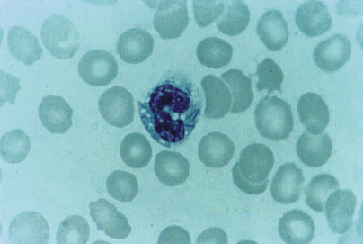

Figure 58-25 

Blood smear positive for _Capnocytophaga canimorsus_ in patient with septicemia (Wright's stain). 

Isolation of _Capnocytophaga_ spp. requires inoculation of blood or chocolate agar and incubation in a 5% to 10% CO  2  environment, generally for longer than 24 hours. Colonies are usually slightly pigmented yellow or orange and may spread because of a “sliding” motility. Gram stains often show long, thin, spindle-shaped cells, almost fusiform in appearance. [ Figure 58-26 ](<#f0135>) shows the Gram stain of _C. ochraceus_ , demonstrating the fusiform bacilli. _C. ochraceus_ is oxidase and catalase negative, and _C. canimorsus_ is oxidase and catalase positive. _Capnocytophaga_ spp. are usually susceptible to cephalosporins, macrolides, tetracycline, clindamycin, and quinolones, but are resistant to colistin and the aminoglycosides (  Zbinden & von Graevenitz, 2011  ). 

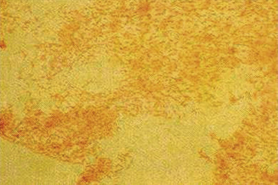

Figure 58-26 

Gram stain of _Capnocytophaga ochraceus._

Note the fusiform bacilli. 

 

##  Calymmatobacterium granulomatis (Klebsiella granulomatis) 

 

##  Characteristics 

_Calymmatobacterium granulomatis_ is a gram-negative, nonmotile, encapsulated, pleomorphic rod that may be cultured in yolk sacs or on fresh egg yolk medium. The organism possesses antigenic and molecular determinants similar to those of _Klebsiella_ spp., leading taxonomists to now classify it among the Enterobacteriaceae as _Klebsiella granulomatis_ (  Abbott, 2011  ). 

 

##  Clinical Manifestations and Pathogenesis 

The organism does not produce disease in animals. In humans, it causes granuloma inguinale (donovanosis), a rare sexually transmitted disease seen predominantly in tropical countries, characterized by ulcerogranulomatous lesions of the skin and mucosa of the genital and inguinal areas (  O'Farrell & Moi, 2010  ;  Abbott, 2011  ). 

 

##  Laboratory Diagnosis 

A fragment of tissue removed from the margin of an ulcer is pressed and rubbed against a glass slide and stained with Wright's or Giemsa stain. The finding of small, straight or curved, pleomorphic rods with rounded ends and characteristic polar granules, giving a “safety pin” appearance within mononuclear cells, is the most effective way of establishing the diagnosis. _K. granulomatis_ does not grow on routine culture media (  Abbott, 2011  ). PCR methods for detection of this organism along with other agents of genital ulcers are available (  Bialasiewicz et al, 2012  ). 

 

##  Antimicrobial Susceptibility 

The tetracyclines, macrolides, ampicillin, and chloramphenicol are active against _K. granulomatis_ . Azithromycin is the standard treatment. 

 

##  Streptobacillus 

 

##  Characteristics 

_Streptobacillus_ is a facultatively anaerobic, fermentative, nonencapsulated, and nonmotile pleomorphic gram-negative rod, frequently occurring in chains or long filaments, and often with a series of oval to elongated bulbous swellings, giving a string-of-beads appearance. The microscopic morphology of the organism in culture varies with time, being more homogeneously filamentous in young cultures and becoming fragmented into irregular coccobacilli with age. L-phase organisms having a “fried egg” appearance may occur spontaneously on agar and may become stabilized if penicillin is incorporated in the medium. [ Figure 58-27 ](<#f0140>) is a smear of _Streptobacillus moniliformis_ from the culture of a patient with rat-bite fever. 

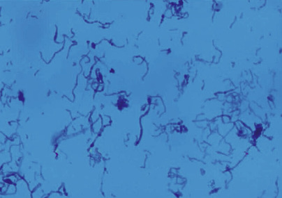

Figure 58-27 

Gram stain of Streptobacillus moniliformis from culture. 

(Courtesy Dr. Nancy Cornish.) 

 

##  Clinical Manifestations and Pathogenesis 

_S. moniliformis_ occurs as indigenous flora in the upper respiratory tract of wild and laboratory rodents. Infection (rat-bite fever or Haverhill disease) in humans follows rodent bites, ingestion of contaminated food, or traumatic injury. Local lymphangitis and lymphadenitis may develop up to 3 weeks later, followed by fever, chills, malaise, and, later, a general morbilliform maculopapular or petechial rash. Some patients develop a migratory polyarthritis. Endocarditis has been reported, as have cases of myocarditis, pericarditis, meningitis, pneumonia, and abscess development due to _S. moniliformis_ (  Madhubashini et al, 2013  ). The histopathology is nonspecific chronic inflammation (  Zbinden & von Graevenitz, 2011  ). 

 

##  Laboratory Diagnosis 

Specimens for recovery of _S. moniliformis_ include blood, joint fluid, and abscess material. The organism grows on media enriched with 15% sheep or rabbit blood, serum, or ascitic fluid. Inoculated media should be incubated at 35° C in a humid environment containing an atmosphere of 5% to 10% CO  2  . Colonies on solid media are small and slightly translucent to opaque, with slightly irregular edges. Coccal forms and gram variability may occur, but usually colonies will demonstrate long filaments with granules and bulbs or banding forms on Gram stain. L-forms may be present in some cultures, along with the usual bacterial forms. 

Colonies in broth form as fluff balls, usually at the bottom of the tube. In cultures, the organism dies quickly unless subcultured often. Because this organism is relatively inert, identification of _S. moniliformis_ is difficult. Biochemical tests must be performed in heart infusion agar or broth supplemented with yeast extract and horse serum. 16S rRNA sequencing methods or fatty acid analysis is required for complete identification (  Zbinden & von Graevenitz, 2011  ). In addition, direct specimen testing with molecular methods may prove more sensitive than culture. (  Mackey et al, 2014  ) 

 

##  Antimicrobial Susceptibility 

_S. moniliformis_ is susceptible to penicillins and tetracyclines, which are the recommended drugs for therapy. It is also susceptible to cephalosporins, clindamycin, macrolides, and aztreonam; intermediately susceptible to the aminoglycosides and fluoroquinolones; and resistant to colistin, nalidixic acid, and SXT. 

 

##  Prevention and Control 

Because 10% to 65% of rats are infected with the organism, their control and precautions against bites represent the only effective methods of control of the disease. 

 

##  Anaerobic Bacteria 

It is important to reemphasize that anaerobes represent a major component of the indigenous flora of the skin and mucous membranes. Their isolation and identification are contingent on the proper selection and collection of specimens, as well as on their proper transport to the laboratory. Anaerobic infections are frequently mixed, consisting of several species of anaerobes, or of anaerobes mixed with facultatively anaerobic bacteria or aerobes; therefore, the first task in examining an anaerobic culture is to separate facultatively anaerobic from obligate anaerobic bacteria. With experience, the more commonly isolated anaerobes can often be recognized on the basis of their colonial and microscopic morphologies and presumptively identified on the basis of a few additional tests. Definitive identification is based on biochemical reactions, physiologic and molecular characteristics, and occasionally pathogenicity and toxin neutralization tests. 

The extent to which anaerobes are identified varies according to the facilities and expertise available, the interest of laboratory personnel and clinical staff, and the clinical relevance of the information available from the laboratory. With the advent of Maldi-Tof, identification of anaerobes has become something that many laboratories will be able to do successfully, although it would still be prudent to continue to use clinical relevance as a guide to when full identification is necessary. Anaerobes have been fairly consistent in their response, at least in vitro, to antibiotics, but as with other groups of bacteria, resistance is becoming an issue with many anaerobes; this often prompts additional identification and susceptibility testing (  Hecht, 2006  ). 

 

##  Definitions and Characteristics 

An anaerobe requires an atmosphere with reduced oxygen tension for its growth and fails to grow on the surface of solid media in an atmosphere of room air with 10% CO  2  . A facultatively anaerobic bacterium will grow in the presence or absence of room air. The term _microaerophile_ has not been strictly defined but is commonly applied to bacteria—usually campylobacters and streptococci—that grow only or preferentially in an atmosphere with reduced O  2  and with increased CO  2  . 

 

##  Pathogenesis and Virulence Factors 

Little is known about the factors responsible for the pathogenic and virulence properties of most anaerobes, other than the clostridia and some _Bacteroides_ spp. Endotoxic, proteolytic, and heparinase activities have been identified among the Bacteroidaceae. The polysaccharide capsule of _B. fragilis_ promotes abscess formation. Clostridia, on the other hand, elaborate potent exotoxins, including lethal and necrotizing toxins, hemolysins, lecithinases, gelatinases, and hyaluronidases. 

Although clostridial infection may be exogenous or endogenous in origin, disease caused by other anaerobes usually originates endogenously from the normal indigenous anaerobic flora of a contiguous mucous membrane, the integrity of which has been disrupted by surgery, instrumentation, trauma, or malignancy. Essential to the establishment of anaerobes in the infectious process is a decrease in the oxidation-reduction potential _(Eh)_ of the area, which may result from failure of its blood supply or from the multiplication of other bacteria at the site. 

Although clostridial infections and intoxications are unquestionably of major medical importance, the role of other anaerobes in causing cellulitis and myonecrosis has been recognized more recently. Most isolates of _Clostridium perfringens_ are the result of simple contamination of a wound. In such instances, the clostridia may multiply in cellular debris, a hematoma, or necrotic tissue without observable clinical symptoms. Anaerobic cellulitis is a necrotizing process of the soft tissues. Its onset is gradual, but it can progress rapidly and extensively. Gas is produced; however, the process typically does not involve muscle. In addition to or instead of clostridia, the bacteriology of anaerobic cellulitis may involve anaerobic cocci and anaerobic gram-negative bacilli. 

In contrast to anaerobic cellulitis, gas gangrene or clostridial myonecrosis is an acute and rapidly progressive invasive process that produces marked changes in muscle. Distinguishing between anaerobic cellulitis and gas gangrene is critical to avoid performing unnecessarily aggressive and mutilating surgery in the former condition. 

Histotoxic clostridia associated with gas gangrene include _C. per ­fringens, Clostridium novyi, Clostridium septicum, Clostridium histolyticum, Clostridium sporogenes, _ and _Clostridium bifermentans_ . _C. perfringens_ has been the species most frequently involved in gas gangrene; the prevalence of other species in this process has varied widely. 

Tetanus and botulism, caused by _C. tetani_ and _C. botulinum,_ respectively, are described as intoxications rather than as infections, because their manifestations are related to the elaboration of potent neurotoxins. Antibiotic-associated diarrhea is a disease caused by the toxins of _C. difficile_ . Botulism is most frequently due to the ingestion of home-processed foods that have been improperly preserved or canned; sporadic outbreaks of the disease have been associated with commercially processed food and with wounds infected by the organism. The incubation period for botulism is short. Signs and symptoms usually occur between 18 and 36 hours following ingestion of contaminated food. Of the seven antigenic types of botulinum toxin known, type A is the most common in cases of food poisoning in North America, followed by types B, E, and F. The toxin is absorbed from the intestinal tract and, rarely, from an infected wound and ultimately attaches to motor nerve terminals, thereby preventing acetylcholine release at the nerve endings. 

Tetanus typically occurs in nonimmunized persons within the first 2 weeks following a traumatically acquired puncture, laceration, or abrasion. Cases have been reported to occur postoperatively; following dental work, childbirth, and abortion; or in association with stasis and decubitus ulcers. The toxin, tetanospasmin, is transported to gangliosides in the CNS via the lymphatics and bloodstream and by migration through the perineural spaces of peripheral nerves. 

_Clostridium difficile_ is the major cause of nosocomial diarrhea and the primary pathogen responsible for pseudomembranous colitis. It is a rare cause of abscesses, wound infections, osteomyelitis, pleuritis, peritonitis, septicemia, and urogenital tract infections. Carriage rates of _C. difficile_ and its toxins are high (50% or more) in neonates, but disease is rare (  Bartlett, 1997  ). Colonization, with or without toxin production, may be maintained for several months, but when the adult flora becomes established at 6 to 12 months of age, colonization rates fall, and only about 3% of normal, healthy adults are colonized with the organism. _C. difficile_ almost always is acquired in the hospital by persons receiving antimi­crobial agents via direct or indirect exposure to human or inanimate reservoirs. Although the penicillins and the cephalosporins are implicated most frequently, any antimicrobial agent may trigger _C. difficile_ –associated disease. Disease rarely occurs without antibiotic exposure, but cases have been reported following therapy with antineoplastic agents that have antibacterial activity. Pseudomembranous colitis, the most severe form of _C. difficile_ disease, is a toxin-mediated illness in which microbial invasion of the mucosa is not known to occur. _C. difficile_ produces two toxins. Toxin A, a weakly cytopathic toxin, is predominantly responsible for the enterotoxic activity of the organism. Toxin B, a potent cytotoxin, appears to play a minor role in human disease, although toxin A–negative, B-positive strains have been isolated from symptomatic patients. Use of a PCR assay in the laboratory for detection of both toxin A and toxin B have increased sensitivity of detection of the disease (  Eastwood et al, 2009  ;  Kvach et al, 2009  ). 

As previously mentioned, other anaerobic bacteria, particularly anaerobic cocci and gram-negative bacilli, have been associated with anaerobic cellulitis. These organisms are part of the indigenous flora of the mucous membranes of the oral cavity and of the gastrointestinal and genitourinary tracts. As such, they are encountered in aspiration pneumonias, lung abscesses, empyemas, intraabdominal infections and abscesses, pelvic abscesses, brain abscesses, and bacteremias. Anaerobic intraabdominal infections commonly follow abdominal and especially colon surgery, and are most frequently associated with the _B. fragilis_ complex. Clinically significant anaerobic bacteremias are also most frequently caused by this species. _Propionibacterium acnes_ have been increasing in isolation and in association with clinical disease. 

Significant taxonomic changes have occurred among the anaerobes. Some of these are delineated in [ Tables 58-15 through 58-19 ](<#t0080>) . 

TABLE 58-15 

Most Frequently Isolated Gram-Positive Non- _Clostridium_ spp. Anaerobic Bacteria 

Species  |  Gram Stain  |  Colony  |  Indole  |  PYR   
---|---|---|---|---  
**Gram-Positive Cocci**  
_Peptostreptococcus anaerobius_ |  Large cocci, often in chains  |  Nonhemolytic; gray with raised center; sweet odor  |  Negative  |  Negative   
_P. micros_ |  Clusters or short chains; <0.6 µm  |  Small; dull color; “halo” around colony  |  Negative  |  Positive   
_Finegoldia marna_ |  Pairs, tetrads, and clusters; >0.6 µm  |  Small, white, convex  |  Negative  |  Positive   
_Peptoniphilus asaccharolyticus_ |  “Clumps,” pairs, or tetrads  |  Small; slight yellow pigment  |  Usually positive  |  Negative   
_Anaerococcus tetradius_ |  Clumps and tetrads  |  Nonglistening; gray; convex  |  Negative  |  Weak   
_A. prevotii_ |  Clumps and tetrads  |  Nonglistening; gray; convex  |  Negative  |  Positive   
_Staphylococcus saccharolyticus_ |  Clusters and tetrads  |  Catalase and coagulase negative  |  ND  |  ND   
Gram-positive non–spore-forming bacilli  |  Gram stain  |  Colony  |  Aerotolerance/Biochemical clues  |  Other characteristic   
_Actinomyces israelii_ |  Short rods; branching or beading  |  White; opaque; “molar tooth” |  \+  |  Most common cause of actinomycosis: genital; pulmonary; abdominal   
_A. naeslundii_ |  Short rods; branching or beading  |  Gray-white; translucent  |  +++  |  Oral flora; rarely pathogenic   
_A. odontolyticus_ |  Short rods; branching or beading  |  May produce pink to red colonies in ambient air  |  +++  |  Oral flora; rarely pathogenic   
_A. turicensis_ |  |  |  ++  |  Genital sites   
_Propionibacterium acnes_ |  Short rods; may appear “spidery” |  White round colonies  |  ++++   
Catalase positive; indole positive  |  Normal flora on skin; associated with endophthalmitis (post cataract surgery); ventricular shunt infections; infrequent cause of endocarditis, osteomyelitis   
_Propionimicrobium lymphophilum_ |  Coccoid; singly, pairs, or short chains  |  White, glistening  |  Nonaerotolerant  |  Isolation: lymph nodes; uncertain relevance   
_Bifidobacterium spp._ |  Diphtheroidal; bifurcated or forked ends  |  |  Nonaerotolerant  |  Normal flora of GI and GU tract; rarely clinically significant   
_Eggerthella lenta (formerly Eubacterium lentum)_ |  Straight rod with rounded ends  |  |  Nonaerotolerant   
Catalase positive; indole negative  |  Grow in 20% bile; saccharolytic; have been isolated in anaerobic bacteremia   
  
_+, ++, +++, ++++,_ Positive with increasing strength; _ND,_ not done; _PYR,_ l-pyrrolidonyl-β-naphthylamide. 

TABLE 58-16 

Most Frequently Isolated Gram-Negative Anaerobic Bacteria (All Should Grow in Presence of 20% Bile) 

Species  |  Colony  |  Biochemicals  |  Other Characteristics   
---|---|---|---  
_Bacteroides fragilis_ complex [ * ](<#hl0002578>) |  White, round; requires 24-48 hours  |  |   
_B. fragilis_ |  |  Negative for indole   
Positive for catalase and indole  |  Most common and most pathogenic of the complex   
_B. distasonis_ [ _**_ ](<#hl0002587>) |  |  Negative for indole   
Usually positive for catalase and esculin  |   
_B. thetaiotaomicron_ |  |  Positive for indole, catalase, and esculin  |   
_B. vulgatus_ |  |  Negative for indole; usually negative for catalase and esculin  |   
_B. ovatus_ |  |  Positive for indole, catalase, and esculin  |   
_B. goldsteinii_ [ _**_ ](<#hl0002587>) |  |  Negative for indole; variable for catalase and positive esculin  |   
_Bacteroides urealyticus_ |  Colonies often “pit” the agar  |  No growth in 20% bile; indole, esculin, and catalase usually negative; urease positive  |  Part of normal anaerobic oral flora   
_Bilophila wadsworthia_ |  |  Will grow in 20% bile; catalase positive; negative for indole and esculin  |   
_Porphyromonas asaccharolyticus_ |  Colonies fluoresce brick red (ultraviolet light exposure); black pigment with age  |  Bile sensitive; indole positive and catalase negative  |  Normal oral flora; pulmonary disease   
_Prevotella disiens_ and _P. bivia_ |  |  Bile sensitive; indole and esculin negative; saccharolytic and nonpigmented  |  Normal genitourinary flora; can be involved in pelvic abscesses   
_Fusobacterium nucleatum_ |  Breadcrumb-like and speckled; Gram stain: long thin, pointed bacilli  |  Bile sensitive; indole positive and esculin negative  |  Oral flora; can be involved in bacteremia, pulmonary infection   
_F. necrophorum_ |  Umbonate colonies; greening of agar; Gram stain: round, not tapered ends; often “bizarre” forms seen  |  Usually sensitive to bile; indole positive, lipase positive  |  Associated with Lemierre's syndrome   
_F. mortiferum_ |  “Fried egg” appearance of colonies; nontapered rods and bizarre round “bodies” on Gram stain  |  Grows on 20% bile; indole negative and esculin positive  |  Infrequent isolate   
**Gram-Negative Cocci**  
_Veillonella_ spp.  |  Small white colonies; Gram stain: well staining, round cocci, singly or in pairs  |  Catalase variable; nitrate reduction positive  |  Common isolate, but rarely involved in clinical disease   
  
 * In addition to those listed, _B. fragilis_ complex includes _B. caccae, B. cellulosilyticus, B. coprocola, B. coprophius, B. dorei, B. eggerthii,_ B _. faecis, B. finegoldia, B. intestinalis, B. massiliensis, B. nordii, B. plebius, B. salyersiae, B. stercoris, B. uniformis, B. xylanisolvens,_ and a few additional species for which testing is based on only one strain. The new _B. fragilis_ complex species can be found in Table 6 of Kononen E, Wade WG, Citron DM: _Bacteroides, Porphyromonas, Prevotella, Fusobacterium_ , and other anaerobic gram-negative rods. In Versalovic J, Carroll KC, Funke G, et al, editors: _Manual of clinical microbiology_ , ed 10, Washington, DC, 2011, American Society for Microbiology, p 870. 

 ** These organisms have been placed in the _Parabacteroides_ genus along with _P. gordonii, P. johnsonii,_ and _P. merdae_ . 

TABLE 58-17 

Most Common Species of _Clostridium_ (Spore-Former) in Clinical Samples 

Species  |  Colony  |  Gram Stain  |  Characteristics   
---|---|---|---  
_C. perfringens_ |  Large, white, with double-zone hemolysis  |  “Boxcar” (short and fat)-shaped rods; short chains may be seen; rare spores seen  |  Lipase negative; lecithinase positive; indole negative; reverse CAMP positive   
Most common isolate; skin and soft tissue infections (including gangrene); bacteremia; also found in gastrointestinal tract as part of normal flora   
_C. ramosum_ |  Large, spready white colony  |  Often stain gram negative or variable; cells are more slender and longer than _C. perfringens_ ; spores not commonly seen  |  Commonly isolated from clinical samples   
_C. sordelii_ |  White  |  Large, gram-positive rods with subterminal spores seen; lecithinase positive; lipase negative; indole and urease positive  |  Less frequently isolated than _C. perfringens, C. ramosum,_ and _C. septicum_  
_C. tetani_ |  |  Thin bacilli with terminal spores: “snowshoe” or “tennis racquet” appearance; lecithinase negative; lipase weak positive; indole variable and urease negative  |  May be part of gastrointestinal flora; cause of tetanus   
_C. septicum_ |  White, swarming colonies  |  Long, filamentous bacilli with rare subterminal spores seen; lecithinase, lipase, indole, and urease negative  |  When isolated from blood cultures, indicates a possible gastrointestinal malignancy   
_C. difficile_ |  White colonies with distinctive “horse-barn” odor; selective CCFA media: yellow, ground glass appearing colonies  |  Thin, long bacilli with spores seen  |  Cause of pseudomembranous colitis and antibiotic-associated diarrhea; rarely found outside of the gastrointestinal tract   
  

TABLE 58-18 

New Taxonomic Designations of Anaerobic Gram-Positive Cocci 

New Designation  |  Older Designation   
---|---  
_Finegoldia magna_ |  _Peptostreptococcus magnus_  
_Parvimonas micra_ |  _Micromonas micros_  
_Anaerococcus prevotii_ |  _Peptostreptococcus prevotii_  
_Anaerococcus tetradius_ |  _Peptostreptococcus tetradius_  
_Anaerococcus vaginalis_   
_Anaerococcus lactolyticus Peptostreptococcus lactolyticus_   
_Anaerococcus hydrogenalis Peptostreptococcus hydrogenalis_   
_Anaerococcus octavius Peptostreptococcus octavius_ |  _Peptostreptococcus vaginalis_  
_Peptoniphilus indolicus Peptostreptococcus indolicus_ |   
_Peptoniphilus asaccharolyticus Peptostreptococcus asacchaolyticus_ |   
_Peptoniphilus harei Peptostreptococcus harei_ |   
_Peptoniphilus lacrimalis Peptostreptococcus lacrimalis_ |   
_Peptostreptococcus anaerobius_ |  No name change   
_Peptoniphilus ivorii Peptostreptococcus ivorii_ |   
_Peptoniphilus gorbachii_ New species _Anaerococcus murdochii_ New species   
_Gallicola harnesae Peptostreptococcus harnesae_ |   
_Atopobium parvulum_   
_Blautia wexlerae_ New species   
_Blautia producta Peptostreptococcus productus_   
_Staphylococcus saccharolyticus Peptostreptococcus saccharolyticus_ |  _Streptococcus parvulus_  
  
Adapted from Song Y, Finegold SM: _Peptostreptococcus, Finegoldia, Anaerococcus, Peptoniphilus, Veillonella_ , and other anaerobic cocci. In Versalovic J, Carroll KC, Funke G, et al, editors: _Manual of clinical microbiology_ , ed 10, Washington, DC, 2011, American Society for Microbiology, p 804. 

TABLE 58-19 

Newer Taxonomy of Less Frequently Encountered Anaerobic Gram-Negative Bacilli 

New Designation  |  Older Designation   
---|---  
_Alistipes putredinis_ |  _Bacteroides putredinis_  
_Alistipes finegoldii_ |  New species   
_Allistipes indistinctus_ (new species)   
_Allistipes onderdonkii_ (new species)   
_Allistipes shahii_ (new species)   
_Dialister micraerophilus_ |  New   
_Dialister propionicifaciens_ |  New   
_Barnesiella_ is a new genus with species _B. intestinihominis_  
_Faecalibacterium prausnitzii_ |  _Fusobacterium prausnitzii_  
_Porphyromonas uenonis_ |  _Porphyromonas endodontalis_ (nonoral)   
_Sneathia sanguinegens_ |  _Leptotrichia sanguinegens_  
_Tannerella forsythensis_ |  _Bacteroides forsythus_  
_Sutterella wadsworthensis_ |  _Campylobacter (Bacteroides) gracilis_ (some strains)   
_Odoribacter_ (new genus)  |  _O. laneus_   
_O. splanchnicus_  
_Paraprevotella_ (new genus)  |  _P. clara_   
_P. xylaniphila_  
_Phocaeicola_ (new genus) _Porphyromonas_ |  _P. abscessus_   
_P. benonis_ (new species)   
  
Adapted from Kononen E, Wade WG, Citron DM: _Bacteroides, Porphyromonas, Prevotella, Fusobacterium_ , and other anaerobic gram-negative rods. In Versalovic J, Carroll KC, Funke G, et al, editors: _Manual of clinical microbiology_ , ed 10, Washington, DC, 2011, American Society for Microbiology, p 859. 

 

##  Laboratory Diagnosis 

Identifying anaerobic bacteria to the species level can be a complex task; however, the extent to which isolates of anaerobic bacteria are identified varies. It may be limited to basic information that is of clinical relevance and/or that might be needed to predict antimicrobial susceptibilities. For example, the mixed anaerobic flora from a site such as a decubitus ulcer, perirectal fistula, or intraabdominal abscess may simply be reported as mixed fecal flora (mentioning specifically whether there are aerobes and anaerobes or only anaerobes present) without specific identification of its components. Determining the species of an isolate may be limited to those present in pure culture from a normally sterile body fluid or site, and can be readily accomplished with the use of any of several commercially available biochemical kits, in conjunction with microscopic and colonial morphology and the use of select antibiotic disk sensitivity results. Some laboratories, however, have begun to use sequencing as a means of identifying anaerobic isolates. Results are often available rapidly, and increasing numbers of databases are available for the identification of many more species than can be identified with phenotypic kit systems (  Simmon et al, 2008  ). MALDI-TOF-MS (matrix-assisted laser desorption/ionization time-of-flight mass spectrometry) is a recently developed method for the identification of a wide variety of bacteria, including anaerobes (  Stingu et al, 2008  ). One should understand that the clinical value of any report of the presence of anaerobic bacteria is directly related to the speed of reporting such results from the laboratory. Identification procedures that require 1 to 2 weeks to complete are generally of academic interest only; identification of every anaerobe isolated in a culture is often not appropriate; clinical relevance should still be used to guide any workup of anaerobic cultures, as it should be used for all cultures. 

Because of their rapid progression and considerable morbidity and mortality, the initial diagnosis and management of diseases caused by the clostridia must be based on their clinical presentation and manifestations. In some patients with tetanus, no primary wound is evident. When a wound is present, organisms typical of _C. tetani_ are seldom seen in stained smears, even though they may be recovered from cultures. Moreover, because of this organism's widespread distribution in nature, its isolation from a wound is not necessarily indicative of the diagnosis of tetanus. Laboratory confirmation of botulism requires detection of the toxin in serum, wounds, gastric contents, feces, or the food suspected of causing the disease. Procedures for extracting the toxin and for performing mouse neutralization tests are complex; therefore, it is suggested that the appropriate materials be referred to the CDC for examination. Telephone consultation should be made in such instances to ensure that the requisite specimens are properly collected and transported and that the appropriate authorities are alerted (  Stevens et al, 2011  ). 

In cases of suspected anaerobic cellulitis or gas gangrene, the laboratory can be helpful by examining exudate or tissue microscopically. The finding of numerous, large, “boxcar”-shaped, gram-positive bacilli ( [ Fig. 58-28 ](<#f0145>) ) provides presumptive confirmation of the diagnosis. Stained smears may also be diagnostic of anaerobic streptococcal myositis. Cultures of exudate, tissue, and blood should be performed. Once again, the level or extent of identification varies considerably among laboratories; however, _C. perfringens_ may be easily identified by its Gram stain morphology, the production of double zones of hemolysis on blood agar, and a positive Nagler's reaction on egg yolk agar. For many years, laboratory diagnosis of _C. difficile_ diarrhea was based on detecting one or both toxins directly in stool using an EIA or cell culture assay. Culture of stool for the organism and, when positive, determination of whether toxin is being produced are primarily reserved for epidemiologic and surveillance studies; many believe it is the “gold standard” for detection. Assays that detect a “common” antigen—glutamate dehydrogenase—which is found in virtually all _C. difficile_ isolates, are now being used as part of a two- or three-step procedure for laboratory diagnosis of _C. difficile_ to increase sensitivity. Unfortunately, the antigen can be found in other bacteria, so a positive antigen must be confirmed before it is reported as _C. difficile_ positive. Confirmation is carried out in the two-step assay with PCR or cytotoxicity studies. In the three-step assay, a positive antigen is followed by an EIA, and any antigen-positive/EIA toxin–negative samples would have a PCR or a cytotoxicity test conducted for confirmation. The prevalence of _C. difficile_ usually is not greater than 20% in any single facility, and the two- or three-step approach allows rapid results to be obtained from negative samples. PCR assays for initial detection of the toxins of _C. difficile_ are now commercially available, and many laboratories use PCR as a replacement for EIA or cytotoxicity (  Eastwood et al, 2009  ;  Kvach et al, 2009  ;  Stevens et al, 2011  ). 

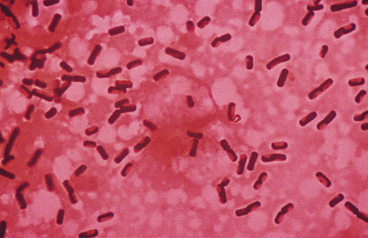

Figure 58-28 

Gram stain of a smear of exudate from a wound that had gas bubbles shows large, boxcar-shaped, gram-positive bacilli, suggestive of clostridial disease (oil immersion). 

One of the most common groups of clinically relevant and frequently isolated anaerobic bacteria is the _B. fragilis_ complex. Isolates from this complex will grow selectively on _Bacteroides_ bile esculin medium, and they have characteristic Gram stain morphology, as seen in [ Figure 58-29 ](<#f0150>) . These gram-negative bacilli are found as normal flora throughout much of the gastrointestinal and genitourinary tracts. Infections caused by the complex include abdominal abscess, pelvic abscess, bacteremia, and brain abscess. They may rarely be involved in pulmonary disease. Although most anaerobic infections are polymicrobial, _B. fragilis_ alone may be responsible for infection. Members of the _B. fragilis_ complex include those organisms listed in [ Table 58-16 ](<#t0085>) . Also noted in [ Table 58-16 ](<#t0085>) is a newly named genus, _Parabacteroides_ , into which some of the _Bacteroides_ have been placed. With rare exception, members of the complex will grow in the presence of 20% bile and will hydrolyze esculin. Inclusion of a _Bacteroides_ bile esculin agar (BBE) plate when anaerobic specimens are processed will allow more rapid detection and identification of these organisms (  Kononen et al, 2011  ). 

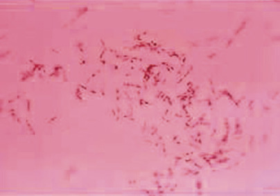

Figure 58-29 

Gram stain of _Bacteroides fragilis_ from broth culture. 

Another important group of anaerobic gram-negative bacilli are the _Fusobacterium_ spp. They often appear as thin and spindly (or pointed) gram-negative bacilli on Gram stain or produce rather bizarre forms, as is seen in [ Figure 58-30 ](<#f0155>) . [ Table 58-16 ](<#t0085>) lists some of the more common _Fusobacterium_ spp. _Fusobacterium nucleatum_ is isolated from many clinical samples and can be the cause of bacteremia and other syndromes, but it can also be isolated as part of the normal oral or genital flora. _F. necrophorum_ is associated with Lemiere's syndrome. [ Table 58-16 ](<#t0085>) provides a list of other gram-negative anaerobic bacilli, not members of the _Bacteroides_ or _Fusobacterium_ . Some have been linked to disease, and others have been isolated from clinical specimens, but their clinical relevance is yet to be determined. 

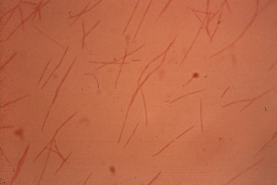

Figure 58-30 

Gram stain of _Fusobacterium nucleatum._

Anaerobic gram-positive cocci were at one time referred to for the most part as _Peptostreptococcus_ spp. Many taxonomic changes have occurred with this group, as well as with the ones described above, and these changes are shown in [ Table 58-15 ](<#t0080>) . _Finegoldia magnus_ and _Parvimonas micra_ are the most commonly isolated anaerobic gram-positive cocci isolated from clinical specimens and the ones most often associated with disease. Anaerobic gram-negative cocci are members of the genera _Veillonella_ (the most commonly isolated), _Acidaminococcus, Negativicoccus, Megasphaera_ , and _Anaeroglobus,_ and although not infrequently isolated from clinical samples, they are rarely involved in disease (  Song & Finegold, 2011  ). 

An anaerobic gram-positive bacillus, _Propionibacterium acnes,_ has been associated with cases of endophthalmitis that occur after cataract surgery. In addition, _P. acnes_ may be associated with ventricular shunt infection in patients with hydrocephalus; rarely, _P. acnes_ can cause endocarditis, septic arthritis, or other infections. Isolation of this organism may require extended incubation, often up to 10 days. [ Figure 58-31 ](<#f0160>) shows a Gram stain of _P. acnes_ in vitreous fluid obtained from a patient months after cataract surgery. _Actinomyces israelii_ and other species of _Actinomyces_ can be involved in lung abscesses, brain abscesses, skin and soft tissue infections, and mycetoma, and may be involved in genital infections involving use of an intrauterine device (IUD), although this is a controversial topic (  Westhoff, 2007  ). Other genera of anaerobic gram-positive rods are listed in [ Table 58-15 ](<#t0080>) ; many of these anaerobes are isolated from clinical samples, but their relevance in any disease process is not always clear. As with other anaerobes, it is always important to consider whether the anaerobe has been isolated as the only organism in a sterile site, such as body fluids and tissues; how often the organism has been isolated from these sites; and whether other pathogens are present that can account for the patient's disease (  Wade & Kononen, 2011  ). 

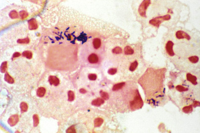

Figure 58-31 

Gram stain of _Propionibacterium acnes_ from vitreous fluid. 

 

##  Antimicrobial Susceptibility 

Susceptibility testing of anaerobic bacteria in the past was considered unnecessary, but as more resistance is detected, this is not the case today. In addition, there are certain clinical settings in which decisions regarding the selection of agents are critical: failure of usual therapeutic regimens and persistence of infection; the key role of antimicrobial agents in determining the outcome of infection; or the difficulty involved in making empirical therapeutic decisions based on precedent. Infections from which antibiotic susceptibility testing of isolates should be considered include brain abscess, endocarditis, osteomyelitis, joint infections, infections of prosthetic devices or vascular grafts, and refractory or recurrent bacteremia. Isolates to test under these circumstances should include members of the _B. fragilis_ complex, certain _Fusobacterium_ spp., _C. perfringens,_ and _Clostridium ramosum_ . Agents such as metronidazole, the carbapenems, and ampicillin-sulbactam are usually active against anaerobic bacteria, with rare exceptions such as _P. acnes, Actinomyces_ spp., and a few others. Agents with more unpredictable activity include penicillin, clindamycin, and cefoxitin. Although an agar dilution method has been recommended for reference purposes, testing in the clinical laboratory is generally performed by broth microdilution (  CLSI, 2012  ) or the Etest method. Batch testing of saved isolates on a yearly basis is recommended to develop antibiograms for empirical use by clinicians and to monitor for possible development of resistance (  Boyanova et al, 2007  ). 

,,
