## Key Points

  * •

Accurate diagnosis of parasitic infection usually depends on macroscopic or microscopic examination of specimens that have been appropriately collected and preserved. Thick and thin blood smears along with concentration methods are useful for detecting and characterizing organisms found in the blood. Fecal specimens may be fresh (if they can be examined rapidly) or may be placed into fixatives such as formalin and polyvinyl alcohol or single-vial commercial fixatives. 

  * •

Immunodiagnostic methods for parasites include detection of both antibodies and antigens. Established enzyme immunoassays include antigen tests for _Plasmodium_ spp. in blood or serum; _Giardia lamblia, Cryptosporidium_ spp., and _Entamoeba histolytica_ in feces; and _Trichomonas vaginalis_ in vaginal swabs. Direct fluorescent assays are also useful for identifying organisms in primary specimens. Serologic testing is an important adjunct in recognizing parasitic infections that involve deep tissues, organs, and body spaces not readily amenable to routine morphologic testing methods. 

  * •

Molecular amplification methods offer high levels of sensitivity and specificity for both diagnosis and monitoring of parasitic disease. Most are laboratory-developed assays, although commercial options are available for some parasites, including multiplex panels that detect multiple gastrointestinal pathogens. 

  * •

The diagnosis of malaria should be considered in the differential diagnosis of unexplained fever with the history of travel in endemic geographic regions. Because of its high associated mortality, testing should be done on a STAT basis. Thick and thin blood smears are complementary for detecting and identifying infecting _Plasmodium_ spp. based on varieties of developmental stages, presence of malarial pigment, and stippling seen in infected erythrocytes. 

  * •

Other protozoal infections include babesiosis and trypanosomiasis found in blood, leishmaniasis (causing cutaneous, mucocutaneous, and visceral forms of disease), and toxoplasmosis, often affecting the central nervous system following congenital infection and in patients with acquired immunodeficiency syndrome (AIDS). 

  * •

Intestinal amebae are ingested as cysts, resulting in infection of the colon and passage of both cysts and trophozoites in the feces. Most amebae are non-pathogens. _Entamoeba histolytica_ is a proven pathogen that may cause amebic dysentery, amebic colitis, and liver abscess. Diagnosis is made by microscopic examination of stool, antigen or nucleic acid testing of stool, and by serologic testing for antibodies in serum. 

  * •

Flagellates include _Giardia lamblia,_ which causes diarrhea from ingestion of contaminated food or water and is diagnosed by the finding of trophozoites, cysts, and/or antigens in feces. _Trichomonas vaginalis_ is acquired by sexual transmission and is detected in vaginal wet mounts by its characteristic motion or by more sensitive nucleic acid amplification techniques. 

  * •

Coccidia ( _Cystoisospora_ , _Cryptosporidium_ , and _Cyclospora_ ) and microsporidia (specialized parasitic fungi) can cause diarrhea in both immunocompetent and immunocompromised individuals. Symptoms are usually more protracted in immunocompromised individuals such as those with AIDS. Special stains are recommended for sensitive diagnosis; antigen and molecular assays for _Cryptosporidium_ are also available. 

  * •

Helminths include nematodes (roundworms), cestodes (tapeworms), and trematodes (flukes). These organisms reside as adults in the gastrointestinal tract or in other locations (liver, lung, blood). Knowledge of their life cycles and zoogeography with intermediate hosts is important for understanding the clinical presentation and preventing transmission. Eggs, larvae, or adult forms (from 1 mm to >10 m in length, depending upon the species) can be recovered from stool, urine, or sputum. 

  * •

Tissue helminths include filaria (larvae found in blood and also on skin biopsy), _Trichinella_ spp. (in muscle), _Strongyloides stercoralis_ (disseminated infection), and _Echinococcus_ spp. (hydatidosis; large cystic lesions in the liver or lungs), among others. 

  * •

Arthropods cause disease through direct tissue invasion, envenomation, vesication, blood loss, transmission of infectious agents, hypersensitivity reactions, and psychological manifestations. Characteristics necessary for identification can be maintained by preserving the organisms in alcohol (ticks, mites, fleas, lice, maggots); by drying them (winged forms) after killing them with fumes of organic solvents; or by killing them with hot water (maggots) and subsequently storing them in alcohol. Maggots can also be placed directly in alcohol. 

The study of parasitology has gained renewed importance in a world made smaller by the rapid movement of people, especially travelers to and migrants from areas endemic for parasitic disease, and by the appearance of emerging and reemerging pathogens in individuals immunocompromised for a variety of reasons. Parasitic diseases of humans and domestic animals place a tremendous burden on limited health care resources and adversely affect economic and societal development in many countries around the world. Although the types of organisms classified as parasites constitute a large group, those that infect humans are limited in number and are composed mostly of protozoa, helminths, and arthropods ( [ Table 63-1 ](<#t0010>) ). 

TABLE 63-1 

Summary of the More Commonly Found Human Parasites and Their Primary Sites of Infection 

Kingdom Protozoa  |  Kingdom Animalia   
---|---  
**Phylum Amoebozoa (amebae)** |  **Phylum Platyhelminthes (flatworms)**  
_Entamoeba histolytica (I)_ [ * ](<#hl0000818>) |  **_Class Cestoidea (Cestodes: tapeworms)_ **  
_E. dispar (I)_ |  _Diphyllobothrium_ spp. _(I)_ [ * ](<#hl0000818>)  
_E. hartmanni (I)_ |  _Dipylidium caninum (I)_ [ * ](<#hl0000818>)  
_E. coli (I)_ |  _Echinococcus granulosus (H)_ [ * ](<#hl0000818>)  
_E. polecki (I)_ |  _E. multilocularis (H)_ [ * ](<#hl0000818>)  
_Iodamoeba b ütschlii (I) _ |  _Hymenolepis nana (I)_ [ * ](<#hl0000818>)  
_Endolimax nana (I)_ |  _H. diminuta (I)_ [ * ](<#hl0000818>)  
_Naegleria fowleri (T, C)_ [ * ](<#hl0000818>) [ ‡ ](<#hl0000821>) |  _Taenia saginata (I)_ [ * ](<#hl0000818>)  
_Acanthamoeba_ spp. _(T, C, E)_ [ * ](<#hl0000818>) |  _T. solium (I, T)_ [ * ](<#hl0000818>)  
_Balamuthia mandrillaris (T, C)_ [ * ](<#hl0000818>) |  **_Class Trematoda (Trematodes: flukes)_ **  
_Sappinia diploidea (T, C)_ |  _Clonorchis sinensis (H)_  
**Phylum Metamonada (flagellates)** |  _Fasciola hepatica (H)_ [ * ](<#hl0000818>)   
_Fasciolopsis buski (I)_   
_Heterophyes (I)_   
_Metagonimus yokagawai (I)_   
_Nanophyetus salmincola (I)_ [ * ](<#hl0000818>)   
_Opisthorchis viverrini (H)_   
_Paragonimus_ spp. _(L)_ [ * ](<#hl0000818>)   
_Schistosoma haematobium (B)_   
_S. japonicum (B)_   
_S. mekongi (B)_   
_S. mansoni (B)_  
_Giardia lamblia (I)_ [ * ](<#hl0000818>)  
_Dientamoeba fragilis (I)_ [ * ](<#hl0000818>)  
_Chilomastix mesnili (I)_  
_Retortamonas intestinalis (I)_  
_Enteromonas hominis (I)_  
_Pentatrichomonas hominis (I)_  
_Trichomonas vaginalis (G, V)_ [ * ](<#hl0000818>)  
_T. tenax (M)_  
**Phylum Euglenozoa (hemoflagellates)**  
**Phylum Nemathelminthes (Nematodes: roundworms)**  
_Leishmania tropica (T)_   
_L. major (T)_   
_L. aethiopica (T)_   
_L. mexicana (T)_ [ * ](<#hl0000818>)   
_L. braziliensis (T)_   
_L. donovani (T)_   
_Trypanosoma brucei gambiense (B, C)_   
_T.b. rhodesiense (B, C)_   
_T. cruzi (B, T)_ [ * ](<#hl0000818>)   
_T. rangeli (B)_  
**_Class Adenophorea (Aphasmidia)_ **  
_Trichinella spiralis (I, T)_ [ * ](<#hl0000818>)  
_Trichuris trichiura (I)_ [ * ](<#hl0000818>)  
_Capillaria philippinensis (I)_  
**_Class Secernentia (Phasmidia)_ **  
_Enterobius vermicularis (I)_ [ * ](<#hl0000818>)  
_Ascaris lumbricoides (I)_ [ * ](<#hl0000818>)  
_Ancylostoma duodenale (I)_  
_Necator americanus (I)_ [ * ](<#hl0000818>)  
**Phylum Ciliophora (ciliates)** |  _Strongyloides stercoralis (I)_   
_Trichostrongylus_ spp. _(I)_ [ * ](<#hl0000818>)   
_Anisakis_ spp. _(I)_ [ * ](<#hl0000818>)   
_Wuchereria bancrofti (B, T)_   
_Brugia malayi (B, T)_   
_Loa (B, T)_   
_Onchocerca volvulus (T)_   
_Mansonella perstans (B, T)_   
_M. ozzardi (B, T)_   
_M. streptocerca (T)_   
_Dracunculus medinensis (T)_   
_Angiostrongylus cantonensis (T)_   
_A. costaricensis (T)_   
_Gnathostoma spinigerum (T)_  
_Balantidium coli (I)_ [ * ](<#hl0000818>)  
**Phylum Apicomplexa (apicomplexans)**  
**_Class Coccidea (sporozoans)_ **  
_Babesia_ spp. _(B)_ [ * ](<#hl0000818>)   
_Plasmodium falciparum (B)_   
_P. malariae (B)_   
_P. ovale (B)_   
_P. vivax (B)_   
_P. knowlesi (B)_   
_Cryptosporidium parvum (I)_ [ * ](<#hl0000818>)   
_C. hominis (I)_   
_Cyclospora cayetanensis (I)_ [ * ](<#hl0000818>)   
_Cystoisospora belli (I)_ [ * ](<#hl0000818>)   
_Sarcocystis_ spp. _(I, T)_   
_Toxoplasma gondii (T)_ [ * ](<#hl0000818>)  
**Phylum Acanthocephala (thorny- or spiny-headed worms)**  
**Phylum Chromista** |  _Moniliformis (I)_   
_Macracanthorhynchus hirudinaceus (I)_  
_Blastocystis hominis (I)_  
**Kingdom Fungi** [ † ](<#hl0000825>)  
**Phylum Microspora (microsporidia, at least 8 genera)**  
_Encephalitozoon_ spp. _(E, H, T)_ [ * ](<#hl0000818>) |   
_E. intestinalis (I, T)_ [ * ](<#hl0000818>) |   
_Enterocytozoon bieneusi (I)_ [ * ](<#hl0000818>) |   
  
_B,_ Blood; _C,_ spinal fluid; _E,_ eye; _G,_ genitourinary; _H,_ liver; _I,_ intestine; _L,_ lung; _M,_ mouth; _N,_ nasopharynx; _T,_ tissue; _V,_ vagina. 

Adapted from Cox FEG. Taxonomy and classification of human parasitic protozoa and helminths. In Jorgenson JH, Pfaller MA, et al, editors: _Manual of clinical microbiology_ . ed 11. Washington, DC, 2015, ASM Press. 

 * Pathogenic parasite that occurs naturally in the United States. 

 ‡ _Naegleria fowleri_ has been more recently grouped with the flagellates (Phylum Percolozoa) due to the presence of a flagellated form in nature. Only the ameba form is found in humans. 

 † Microsporidia were previously classified as parasites but are now known to be highly specialized fungi. 

Clinicians in the United States and elsewhere are increasingly being confronted with unusual diagnostic problems associated with parasitic infection. Likewise, laboratorians have been challenged with the development of new technologies to accurately and rapidly diagnose such parasites as _Cryptosporidium_ species _, Cyclospora cayetanensis, Toxoplasma gondii,_ as well as microsporidia (highly specialized parasitic fungi) in both immunocompetent and immunocompromised hosts. The worldwide resurgence of malaria and other parasitic diseases has required laboratorians to strengthen their expertise in identification of the usual blood, intestinal, and tissue protozoa and helminths. 

Once these diseases have been diagnosed, additional problems may be encountered in their management owing to lack of effective therapies and the emergence of resistance to traditional therapy. Many parasites require arthropod vectors for their transmission, and the irregular application of vector control efforts has, in some instances, resulted in the emergence of insecticide resistance. Malaria had made a tremendous resurgence in many areas because of relaxed control efforts and the emergence of drug-resistant parasites and insecticide-resistant mosquitoes. Schistosomiasis has spread into many new areas because of increased irrigation associated with population growth and the need to expand agricultural production. Although worldwide control efforts have led to significant declines in prevalence and associated mortality for some diseases, these efforts must be expanded in order to protect the world's population from many deadly parasitic infections. 

Because of the chronic nature and the generally long prepatent periods (i.e., time between infection and appearance of diagnostic stages) of many parasitic diseases, physicians may not consider them in a differential diagnosis unless the patient voluntarily offers information, or specific inquiry is made about travel history or other possible exposure. Malaria is one parasitic disease that often presents as an acute, febrile illness and may have lethal consequences unless it is considered in the differential diagnosis and a history of travel to an endemic area is elicited. 

Various estimates have been put forth for the prevalence and related mortality figures of parasitic infections on a worldwide basis ( [ Table 63-2 ](<#t0015>) ). The actual incidence of parasitic infections in the United States is unknown, however, because most infections are not reported to public health officials. _Giardia lamblia,_ other intestinal protozoa, and intestinal roundworms are reported most frequently (7.2%, 10%, and 3.5%, respectively) by state laboratories, but other parasites, including _Cryptosporidium, Cyclospora,_ and microsporidia, probably occur more frequently and are underdiagnosed (  Kappus et al, 1994  ;  Garcia, 2007  ). 

TABLE 63-2 

Estimated Prevalence of Parasitic Infections Worldwide 

Disease  |  Estimated Population Involved  |  Estimated Annual Number of Deaths   
---|---|---  
**Protozoan**  
Amebiasis  |  Up to 1% of world population; 34-50 million symptomatic cases/year  |  40,000-110,000   
African trypanosomiasis  |  20,000 currently infected  |  9000   
American trypanosomiasis  |  7-8 million currently infected  |  12,500   
Giardiasis  |  2.5 million cases/year  |   
Leishmaniasis  |  1.3 million cases/year  |  20,000-30,000   
Malaria  |  124-283 million cases/year  |  367,000-755,000   
**Helminthic**  
Ascariasis  |  1 billion  |  20,000   
Cestodiases  |  65 million  |   
Clonorchiasis/opisthorchiasis  |  13.5 million  |   
Dracunculiasis  |  115 cases/year  |   
Fasciolopsiasis  |  2.4 million  |   
Lymphatic filariasis  |  120 million  |   
Hookworm  |  740 million  |   
Onchocerciasis  |  26 million  |   
Paragonimiasis  |  20 million  |   
Schistosomiasis  |  >207 million  |  500,000-1 million   
Strongyloidiasis  |  30-100 million  |   
Trichostrongyliasis  |  5.5 million  |   
Trichuriasis  |  800 million  |   
  
Adapted from John DT, Petri WA: _Markell and Voge 's medical parasitology _ . ed 9. Philadelphia, 2006, Saunders; updated with data from the World Health Organization and USAID where available. 

This chapter provides an overview of the general approach used by laboratorians to recover and identify parasitic protozoa and helminths from human specimens. Discussion of individual species of parasites focuses on essential clinical and biological information necessary to assist in diagnosis and management. For more extensive coverage of specific parasites, a number of excellent texts are available (  Beaver et al, 1984  ;  Warren & Mahmoud, 1990  ;  Lane et al, 1993  ;  Guerrant et al, 1999  ;  Garcia  2007  ;  John & Petri, 2006  ;  Strickland, 2000  ;  Cook, 2002  ;  Mullen & Durden, 2002  ; among others). Some of these references are older and may be less accessible; however, they discuss classic disease presentations and historic perspectives in a way that is sometimes lacking in newer literature. Parasitology atlases are also important resources for any laboratorian performing parasitology examinations and should be readily available (  Spencer & Monroe, 1982  ;  Brooke & Melvin, 1984  ;  Ash & Orihel  1987  ;  Sun, 1988  ;  Peters & Gilles, 1989  ;  Garcia, 2010  ;  Murray et al, 2007  ). Several texts specifically address the pathologic aspects of parasitic infections (  Marcial-Rojas, 1971  ;  Binford & Connor, 1976  ;  Sun, 1982  ; Von  Lichtenberg, 1991  ;  Woods et al, 1993  ;  Orihel & Ash, 1995  ;  Connor et al, 1997  ;  Gutierrez, 2000  ). Parasitic infections that are problematic in immunocompromised patients also have been reviewed (  Walzer & Genta, 1989  ). 

,  

##  Parasite Classification and Taxonomy 

Parasites are traditionally placed into one of two fundamental “kingdoms,” the _Animalia_ (worms) and _Protozoa_ . Parasites within each kingdom are then classified within hierarchical levels (i.e., __Phylum, Class, Order, Family, and so on) based primarily on morphologic features and phenology (life cycle events and their relation to environmental factors). Unfortunately, the conventional classification scheme is somewhat subjective and does not necessarily reflect phylogenetic relatedness between organisms within each grouping. Recent advances in biochemical and molecular methods, including whole-genome sequencing, have led to a revision of the classification using a system based on hierarchical ranks (e.g., Super-group, First Rank, Second Rank) that reflect phylogenetic relatedness ( Adl et al, 2012  ). Many of the familiar grouping names like _Apicomplexa, Entamoebidae,_ and _Trypanosomatidae_ have been retained for ease of communication, but they are no longer linked to level descriptors such as _Order, Class,_ and so on. Unfortunately, this new classification is complex and used primarily in the research setting and by protozoologists studying free-living microorganisms. Therefore, an updated version of the traditional schemata is presented in this chapter (  Cox, 2015  ). 

,  

##  Laboratory Methods 

Numerous methods have been described for the recovery and identification of parasites in clinical specimens, some of which are useful for detection of a variety of organisms, whereas others detect only a particular species. It is preferable for the laboratory to offer a limited number of procedures that can be competently performed rather than a larger variety of infrequently performed tests for which competency cannot be reliably maintained. Analyses of blood and fecal specimens account for the largest share of clinician requests for parasitologic evaluation. A variety of additional specimens are submitted to the laboratory less frequently, including urogenital specimens, sputum, aspirates, and biopsy material. As newer information becomes available on certain so-called _emerging parasites,_ the laboratory may need to develop and use additional, highly specific test methods or to find competent referral laboratories where such tests are performed. 

The types of specimens collected for laboratory evaluation depend on the species and stage of the parasite suspected. Knowledge of the life cycle of the parasite aids in determining the type, number, and frequency of specimens required for diagnosis. Immunologic and molecular methods for the diagnosis of parasitic diseases also are useful in many instances, and may be the only methods available in certain circumstances. Complete descriptions of general and esoteric laboratory procedures for the recovery and identification of parasites referred to here may be found in a variety of sources to which the reader is referred (  Beaver et al, 1984  ;  Ash & Orihel, 1987  ;  Balows et al, 1988  ;  Price, 1994  ;  Garcia  2003  2007  2009  ;  Murray et al, 2007  ). 

Familiarity with calibration and use of the ocular micrometer is necessary for any laboratory performing parasitologic examination (  Clinical and Laboratory Standards Institute [CLSI], 2005  ). Measurement of the size of protozoal trophozoites and cysts and of helminth eggs and larvae is often required to make an accurate identification. Pathogenic and nonpathogenic amebae (specifically _Entamoeba histolytica_ and _Entamoeba hartmanni_ ) can be differentiated with assurance only by taking careful size measurements. Similarly, eggs of _Diphyllobothrium_ spp., _Paragonimus westermani,_ and _Fasciola_ / _Fasciolopsis_ may be readily differentiated on the basis of accurate measurements (  Smith, 1979  ;  CLSI, 2005  ). 

 

##  Examination of Blood 

Parasites that may be detected in blood specimens include the agents of malaria ( _Plasmodium_ spp.), babesiosis ( _Babesia_ spp.), trypanosomiasis ( _Trypanosoma_ spp.), leishmaniasis ( _Leishmania_ spp.) _,_ and filariasis ( _Wuchereria bancrofti, Brugia malayi, Loa loa,_ and _Mansonella_ spp.). The most important techniques to be performed in the clinical laboratory to assist in the diagnosis of blood parasites include preparation, staining, and examination of thick and thin blood films. Other techniques used less frequently include the buffy coat smear and various concentration techniques reserved for recovery of microfilariae (  National Committee for Clinical Laboratory Standards [NCCLS], 2000  ). 

 

##  Thick and Thin Blood Films 

Examination of permanently stained blood films is required to identify most blood parasites. Thin films are prepared in the same manner as for hematologic differential evaluation; blood is spread over the slide in a thin layer, yielding intact, nonoverlapping cellular elements. Integrity of the blood cell membranes is important for determining the intracellular or extracellular nature of the infection and the size of the infected erythrocyte. In the thick film, blood is concentrated in a small area that is many cell layers deep. During staining, erythrocytes are dehemoglobinized and only leukocyte nuclei, platelets, and parasites (if present) are visible. The thick film is preferred for diagnosis because it contains 16 to 30 times more blood per microscopic field than does the thin film, thus increasing the chances of detecting light parasitemia and decreasing the time needed for reliable examination. The amount of blood examined in a thick film in 5 minutes using the 100× oil immersion objective would require at least 30 minutes when examined in a thin film. Although thick films increase the likelihood of detecting an infection, species identifications are usually performed by examination of thin films because morphology is often more definitive, especially for malarial parasites. For routine examination, both thick and thin films should be prepared. 

 

##  Preparation of Slides 

Blood for examination may be obtained by fingerstick, earlobe puncture, or venipuncture. Fingerstick blood should flow freely to prevent dilution with tissue fluid, and it should not be contaminated with the alcohol disinfectant, which should be allowed to dry first. If obtained by venipuncture, the first drop of blood (anticoagulant-free) from the needle is used to prepare the films at the bedside. Use of anticoagulants is discouraged when malaria is suspected because they may cause distortion of the parasites and interfere with staining. In practice, however, blood usually is submitted to the laboratory in an anticoagulant, which may be the only practical method to ensure that high-quality smears can be prepared. Ethylenediaminetetraacetic acid (EDTA)-anticoagulated blood is preferred in such cases and should be transported to the laboratory within the hour to prevent deterioration of organism morphology. Anticoagulants do not interfere with the staining of microfilariae. 

Both thin and thick films should be prepared on clean, grease-free slides. Thick films are prepared by placing 1 to 2 small drops of blood onto a slide and spreading them into an area the size of a dime (1.5 cm) with the edge of a second slide. The blood film is then allowed to dry flat at room temperature. Drying time may be decreased by placing the slides in a laminar flow hood. A proper thick film should be thin enough that newspaper print may be faintly readable through it. If it is too thick, the film may peel from the slide. Adherence can be improved by gently pushing (grinding) down with the corner of the second slide while spreading the droplet, creating minute scratches on the carrier slide that provide additional surface area for the blood film (  Norgan et al, 2013  ). This method does not affect the microscopic morphology and allows the film to be stained as soon as it is dry (within 30 to 60 minutes). Heating the slides to decrease drying time is discouraged since excess heat may fix erythrocytes and prevent dehemoglobinization. 

 

##  Staining 

Blood begins to lose its affinity for stain in about 3 days, and older thick films do not dehemoglobinize well. Best staining results are achieved when using Giemsa stain because host cell and parasite chromatin stains vividly but the hemoglobin in erythrocytes is only a pale red, and this is the only stain that allows visualization of erythrocyte inclusions (e.g. Schüffner's stippling) that occurs with infection by certain malarial parasites. Wright's stain may be used for thin films, but it stains parasites less well than Giemsa and does not allow for visualization of erythrocyte inclusions. Because Wright's stain incorporates alcohol as its fixative, thick films must be lysed in water before staining. 

The Giemsa staining procedure requires somewhat more attention to preparation of reagents and staining protocol than does the Wright staining procedure, which is often automated. Generally, fresh Giemsa stain must be made each day of use by diluting stock solution into phosphate-buffered water. To achieve appropriate staining reactions, including the appearance of Schüffner's stippling and Maurer's clefts, buffered water must be maintained at pH 7.0 to 7.2. Each new lot of stock Giemsa stain must be checked to determine optimal staining time and dilution because some variation is seen from lot to lot (  NCCLS, 2000  ). 

 

##  Examination of Smears 

Both thick and thin smears are examined in their entirety under the low-power (10×) objective to detect microfilariae, which rarely occur in large numbers. In particular, the feathered edge of thin smears should be examined, as microfilariae are often carried there during preparation of the smear. Examination using a 50× oil immersion objective may subsequently be used to screen blood films for protozoa, although thorough examination using the 100× oil immersion objective still is necessary to detect the smallest parasites such as _Plasmodium_ and _Babesia_ species. The optimal location for examining the thin film is the region of the feathered edge where there is minimal overlap of cells and the erythrocytes maintain their central pallor. A common mistake is to examine regions of the thin film where the blood is too thick or too thin and the parasite morphology is distorted. An experienced microscopist should examine at least 100 oil immersion fields (requiring about 5 minutes) on the thick blood film and 200 fields (requiring at least 15 minutes) on the thin film using the 100× objective before issuing a negative report (  Ash & Orihel, 1987  ). 

 

##  Concentration Techniques 

A variety of special techniques have been described for the concentration of blood parasites, specifically leishmanias, trypanosomes, and microfilariae, details of which may be found elsewhere (  Beaver et al, 1984  ;  Ash & Orihel, 1987  ;  Garcia, 1999, 2001, 2010  ;  NCCLS, 2000  ). 

Preparation of buffy coat smears, which most clinical laboratories can perform with existing resources, is helpful in the detection of _L. donovani,_ trypanosomes, and microfilariae. Following centrifugation of an anticoagulated blood sample, the layer of cells between plasma and packed erythrocytes is drawn off and is used to prepare blood films for staining or for preparation of a wet mount to detect motile organisms (  Ash & Orihel, 1987  ;  Strickland, 2000  ). 

For detection of microfilariae, Knott's concentration or membrane filtration is helpful, particularly when the density of microfilariae in peripheral blood is very low. With the Knott's concentration technique, anticoagulated blood is lysed with 2% formalin and centrifuged to concentrate the microfilariae in the sediment, which then may be examined as a wet preparation or stained with Giemsa or hematoxylin stain. In the membrane filtration procedure, blood is lysed and passed through a 5-µm membrane filter, which is subsequently stained with hematoxylin to reveal any microfilariae (  Ash & Orihel, 1987  ;  NCCLS, 2000  ). 

Use of the fluorochrome acridine orange in a microhematocrit centrifuge format (QBC blood parasite detection method; QBC Diagnostics, Philipsburg, Pa.) allows detection of blood parasites and appears to be more sensitive than traditional thick and thin smears. Laboratories that encounter malaria infrequently may experience difficulty in interpreting results by this method, however, and are encouraged to retain expertise in performance of traditional blood film techniques (  NCCLS, 2000  ). 

 

##  Examination of Fecal Specimens 

The presence of intestinal parasites is primarily identified through the direct examination of stool using wet mounts, concentration techniques, permanently stained smears, and, less frequently, culture. Newer immunoassay methods using species-specific antibody reagents to detect antigens of _G. lamblia, Cryptosporidium_ spp., and _E. histolytica_ have become popular. Stages of helminths commonly recovered include eggs and larvae, although intact worms or portions thereof may occasionally be seen. Intestinal protozoan infections are diagnosed by detection of trophozoites, cysts, or oocysts. Routine methods for the identification of ova and parasites (O&P examination) should include procedures that permit recovery of both protozoa and helminths, with use of special procedures limited to specific requests. At a minimum, laboratories performing parasitologic examination should be capable of performing a concentration procedure and a permanent stain method. Many protozoan infections will be missed unless permanent stains are examined (  Garcia et al, 1979  ;  Garcia & Shimizu  1997  ;  Price, 1994  ;  CLSI, 2005  ). 

 

##  Specimen Collection, Handling, and Preservation 

Recovery and subsequent identification of parasites in fecal specimens requires proper collection and handling. Old, poorly preserved, or contaminated specimens are of little value. Specimens should not be collected for 1 week after the patient has ingested any materials that leave a crystalline residue, such as nonabsorbable antidiarrheal compounds, antacids, bismuth, barium, or antimalarial agents. Oily laxatives such as mineral oil may also interfere with examination. Use of antibiotics or contrast media may decrease the numbers of organisms, especially protozoa, in the intestinal tract for several weeks (  Ash & Orihel, 1987  ;  Garcia, 2007  ). 

Specimens may be submitted to the laboratory fresh or in appropriate preservatives. All fresh specimens should be examined within 1 hour of passage, and liquid specimens should be examined within 30 minutes or placed immediately in preservatives to maintain the best yield. This method ensures that fragile protozoal trophozoites are not inadvertently destroyed. Specimens that cannot be processed immediately should be left at room temperature or refrigerated and should not be placed in an incubator because this only speeds disintegration of parasites. 

Specimens may be passed directly into clean, dry containers, or onto a specially designed wax or plastic collection sheet that is placed over the toilet bowl. Diarrheic specimens may also be collected in clean bedpans. Containers should have tight-fitting lids and should be placed in plastic bags before transport to the laboratory. Inadvertent introduction of urine or toilet water with the specimen may readily destroy protozoal trophozoites and should be avoided. Also, contamination with water or soil may accidentally introduce free-living organisms that may prove difficult to differentiate from parasitic ones. 

Kits consisting of vials of preservatives appropriate for performing direct examinations, concentration procedures, and preparation of stained smears are available from a number of commercial sources at low cost. Aliquots of freshly passed stool should be immediately placed into these vials and mixed thoroughly. These kits are especially helpful for those patients who are unable to bring in a fresh sample in timely fashion, or for those who will be collecting several specimens over the course of several days. With the two-vial technique, one portion of specimen is fixed in three parts of 5% to 10% buffered formalin and another portion in three parts of polyvinyl alcohol (PVA) fixative. Other available preservation systems include merthiolate-iodine-formalin (MIF) and sodium acetate–formalin (SAF) ( [ Table 63-3 ](<#t0020>) ). SAF has an advantage in that it can be used for permanent stains as well as for direct mounts and concentration procedures, and it does not contain mercury, which is present in Schaudinn's and PVA fixatives. In addition to being poisonous, mercury presents disposal problems in an increasing number of states. However, the quality of permanent stains when SAF is used is not as good as when Schaudinn's or PVA fixative is used. Zinc sulfate–based PVA and other newer commercial products such as single-vial multipurpose fixatives are gaining popularity, and their use may be indicated when mercury chloride–based compounds cannot be used (  Garcia et al, 1993  ;  Garcia & Shimizu, 1997, 2007, 2010  ;  CLSI, 2005  ). 

TABLE 63-3 

Commonly Used Stool Fixatives and Examination Techniques [ * ](<#hl0000986>)

Fixative  |  EXAMINATION TECHNIQUE   
---|---  
Direct Wet Mount  |  Concentration Procedure  |  Permanent Stained Smear   
None (fresh stool)  |  Yes  |  Yes  |  Yes   
10% formalin  |  Yes  |  Yes  |  No   
Schaudinn's fluid  |  No  |  No  |  Yes   
Polyvinyl alcohol (PVA)  |  No  |  No [ ** ](<#hl0000989>) |  Yes   
Modified PVA [ † ](<#hl0000992>) |  No  |  No [ ** ](<#hl0000989>) |  Yes   
Merthiolate-iodine-formalin (MIF)  |  Yes  |  Yes  |  No [ ‡ ](<#hl0000995>)  
Sodium acetate–formalin (SAF)  |  Yes  |  Yes  |  Yes   
  
 * Many commercially-available single-vial fixatives are now available (e.g. TOTAL FIX, PROTOFIX, ECOFIX) and can be used for both the concentration procedure and permanent stained smear. 

 ** Although concentration techniques using PVA have been described, they are not widely used because of problems with recovery of some organisms. 

 † Copper sulfate or zinc sulfate replaces the mercuric chloride. 

 ‡ Smears prepared from MIF-preserved specimens may be stained with polychrome IV stain. 

Examination of three specimens collected every other day is considered the minimum necessary to perform an adequate O&P evaluation (  Garcia, 2003  ;  CLSI, 2005  ). This procedure ensures an optimum interval for recovery of those parasites known to shed diagnostic forms intermittently. However, for certain parasites such as _G. lamblia_ and _Strongyloides stercoralis,_ up to 7 O&P examinations must be performed for optimal detections. Additional sensitivity may be achieved in detecting these parasites, as well as _E. histolytica,_ using antigen detection methods, concentration techniques (discussed later), or purgation. The laboratory must be notified prior to initiation of purgation, to have staff available for processing. Specimens should be collected in separate containers and submitted to the laboratory within minutes of collection. Saline purgatives such as sodium sulfate or buffered phosphosoda are recommended. 

 

##  Macroscopic Examination 

Fecal specimens should be examined grossly for consistency (formed, soft, loose, or watery) and for the presence of mucus, blood, larval or adult worms, and proglottids. Protozoan trophozoites are more likely to be found in watery or loose specimens, whereas cysts predominate in formed or soft specimens. Helminths or their eggs may be found in any type of fecal specimen. Most parasites are uniformly distributed in the stool as a result of the mixing action of the cecum, although some eggs (especially schistosomes) may enter the fecal stream in the lower colon and rectum and be unevenly distributed, as may pinworm and _Taenia_ spp. eggs. Protozoal trophozoites may be more numerous in the last portion of stool evacuated and should be specifically sought in mucus (  Garcia, 2003  ). 

 

##  Microscopic Examination 

Specimens may be examined microscopically by direct wet mounts of fresh or preserved material, wet mounts of concentrates, or permanent stains. Each procedure has specific advantages and limitations. Direct saline wet mounts of fresh feces allow detection and observation of motile protozoan trophozoites and helminth larvae. Direct mounts of preserved feces may allow detection of parasites that do not concentrate well. Concentration procedures increase the examiner's ability to detect protozoan cysts and helminth eggs and larvae but are unsatisfactory for detecting protozoan trophozoites. Permanent stains are useful for detection and morphologic examination of protozoan trophozoites and cysts. 

The circumstances under which each procedure is performed vary depending on the type of specimen (formed, soft, loose, or watery) submitted. Generally, a fresh soft, loose, or watery specimen should have all three procedures performed (  Garcia  2003  ). Watery specimens may be concentrated by simple centrifugation rather than by flotation or formalin–ethyl acetate concentration. The direct wet mount may be omitted if the specimen is submitted in preservatives (  CLSI, 2005  ). At a minimum, formed specimens should be examined by a concentration procedure, although improved yield has been demonstrated when a permanent stain is added to the workup (  Garcia et al, 1979  ;  Garcia, 2007  ). 

 

##  Direct Wet Mount 

The direct wet mount is one of the most easily performed parasitologic tests, although proper interpretation requires careful examination and experience in using the microscope to full advantage. The test is most useful when fresh specimens, especially liquid stools or duodenal aspirates, are examined for motile trophozoites or helminth larvae. A small amount of stool is mixed with a drop of 0.85% saline and covered with a coverslip. The preparation should be dense enough that newspaper print can just be read through it. 

Examination of the entire coverslip is performed systematically under the low-power (10×) objective, with the microscope diaphragm closed down to increase contrast. Suspicious objects and those that are refractile, such as protozoal cysts, should then be examined with the high-power (40×) objective. Detection of motility of slow-moving amebae requires that an object be examined for at least 15 seconds. In the absence of suspicious objects, up to a third of the preparation should be examined using the 40× objective. The oil immersion objective usually is not used unless the coverslip has been sealed with nail polish or vaspar (a 50 : 50 mixture of petroleum jelly and paraffin). 

A second preparation may be made in identical fashion, except that a drop of a 1 : 5 dilution of Lugol's iodine or an equivalent preparation is added in place of the saline. Use of straight Lugol's or Gram's iodine causes clumping of material and is not recommended. Iodine is helpful in enhancing the visibility of nuclear structures in protozoal cysts and in detecting glycogen inclusions. Limitations, however, include loss of trophozoite motility and cyst refractility, as well as difficulty in recognizing chromatoid bodies. 

 

##  Concentration Techniques 

Concentration procedures, which may be performed on fresh or preserved specimens (see [ Table 63-3 ](<#t0020>) ), are more sensitive than direct wet mount examination for detection of protozoan cysts and helminth eggs and larvae because they decrease the amount of background material in the preparations and, in most circumstances, actually concentrate the organisms. Although a variety of methods and modifications have been described, some are useful only for specific parasites (  Melvin, 1982  ;  Ash & Orihel, 1987  ;  CLSI, 2005  ;  Garcia, 2007  ). For routine use, a method should be selected that allows reliable detection of both protozoan cysts and helminth eggs. Concentration methods are based on sedimentation or flotation principles. In sedimentation, the heavier parasites settle to the bottom as a result of gravity or centrifugation. In flotation, the lighter parasite cysts and eggs rise to the surface of a solution of high specific gravity. The two most widely used concentration procedures in the United States are the zinc sulfate centrifugal flotation technique of Faust and the formalin ether sedimentation method of Ritchie (or their modifications). In practice, ethyl acetate has replaced ether in the latter method because of the dangers associated with handling ether, and comparable results are achieved (  Truant et al, 1981  ). 

Formalin–ethyl acetate concentration is a biphasic sedimentation technique that is efficient in recovering most protozoan cysts and helminth eggs and larvae, including operculate eggs, and is moderately effective for schistosome eggs. Less distortion of protozoal cysts occurs with this technique than with zinc sulfate flotation. Eggs of _Hymenolepis nana_ may be missed, however, and concentrations of _G. lamblia_ and _Iodamoeba b ütschlii _ cysts may not be very good. For proper concentration of coccidian oocysts and spores of microsporidia, attention must be paid to the recommended speed and time of centrifugation (  CLSI, 2005  ;  Garcia, 2010  ). Despite these problems, the technique is used widely for both its simplicity and its suitability in most laboratory situations. 

With the zinc sulfate flotation method, fresh stool is processed using zinc sulfate with a specific gravity of 1.18, and formalinized stool is proc­essed with a solution of specific gravity of 1.20. Parasitic elements are recovered from the surface film of the solution following centrifugation. This method yields a cleaner preparation than is provided by formalin–ethyl acetate concentration, but it is unreliable for the recovery of nematode larvae, infertile eggs of _Ascaris,_ and the eggs of most trematodes and large tapeworms. Problems with recovery also occur with stool specimens containing excessive amounts of fats. Use of formalinized stool specimens rather than fresh stool helps clear the specimen and prevents popping of opercula and distortion of the parasites (  Bartlett et al, 1978  ). 

 

##  Permanent Stains 

Use of stained slide preparations provides a permanent record of a patient's specimen and allows review by consultants should difficulties arise in identification. Of the methods described for studying fecal specimens, only the permanent stain is designed for analysis using the oil immersion objective (100×). The permanent stain is most useful for detection of protozoal trophozoites and cysts, which may be recognized when direct and concentrated preparations are negative. Although they generally are not useful for detecting helminth eggs or larvae, permanent stains are inherently more sensitive for detecting protozoal infections, and their use has been recommended for every stool sample submitted for O&P examination (  CLSI, 2005  ). 

A variety of staining techniques and modifications and their advantages and disadvantages have been described. The Wheatley trichrome stain and iron hematoxylin stain are all-purpose methods that allow detection of amebae and flagellates. Unfortunately, detection of most human-infecting coccidia and microsporidia requires the use of special stains. Technical problems may arise in the performance of any staining procedure; most are related to the age of the specimen, proper smear preparation and fixation, and the quality of the reagents. Positive control slides of known staining quality should be run with each batch of slides stained. This is especially true in the performance of more specific stains for coccidia and microsporidia. Less commonly used stains, such as polychrome IV stain for use with MIF-preserved specimens and chlorazol black E stain for use with fresh specimens, are not reviewed here, but details may be found elsewhere (  CLSI, 2005  ;  Garcia, 2007  ). 

 

##  Wheatley's Trichrome Stain 

In the United States, the Wheatley modification of the trichrome method continues to find widespread acceptance because of its simplicity, reliability, and cost-effectiveness. Details of the procedure are available from a number of sources (  Melvin, 1982  ;  Price, 1994  ;  CLSI, 2005  ;  Garcia, 2010  ). Appropriate specimens include those that have been fixed in Schaudinn's fixative or PVA fixative; SAF- or MIF-preserved specimens may be stained with trichrome, but results are less satisfactory. Specimens preserved using single-vial commercial fixatives may also be stained with this or a slightly modified protocol. 

 

##  Iron Hematoxylin Stain 

Iron hematoxylin stains are technically more difficult to perform than the trichrome stain, but results generally are superior owing to enhanced definition of key nuclear and cytoplasmic characteristics (  Price, 1994  ). A modified iron hematoxylin stain that may prove useful incorporates carbol fuchsin, allowing concurrent staining of acid-fast organisms such as _Cryptosporidium, Cyclospora,_ and _Cystoisospora_ (  Palmer, 1991  ;  CLSI, 2005  ). Specimens fixed in Schaudinn's, PVA, or SAF fixative may be stained with iron hematoxylin stains (the preferred stain for SAF). 

 

##  Modified Acid-Fast Stains 

Oocysts of _Cryptosporidium, Cyclospora,_ and _Cystoisospora_ are difficult to recognize on trichrome- or iron hematoxylin–stained smears, but their presence may be detected by using an acid-fast staining technique such as the modified Kinyoun method, modified acid-fast dimethyl sulfoxide, or auramine-O (  Ma & Soave, 1983  ;  Bronsdon, 1984  ;  Current & Garcia, 1991  ;  CLSI, 2005  ). Acid-fast stains are sensitive and cost-effective for detection of these protozoa, but they lack specificity. Close attention must be paid to defined morphologic criteria when these stains are used, and the use of positive control material is mandatory. For laboratories in which _Cryptosporidium_ is rarely encountered, use of the highly specific and sensitive commercially available immunoassay reagents is recommended. Stool, sputa, biliary tract, and other appropriate specimens that are fresh, formalin-fixed, or SAF-fixed may be used with acid-fast stains. 

 

##  Stains for Microsporidia 

Microsporidia (specifically _Enterocytozoon bieneusi_ and _Encephalitozoon intestinalis,_ along with a number of other species) have been implicated as common agents of diarrheal disease, especially in immunocompromised patients, although their detection has been problematic. Although biopsy and electron microscopy have been mainstays in their diagnosis, staining procedures that may be performed in the clinical laboratory have been described. A modified trichrome stain using an increased (10-fold) concentration of chromotrope 2R combined with an increase in staining time has gained acceptance as a specific test for the identification of microsporidial spores (  Weber et al  1992  ;  Murray et al, 2007  ). Fluorescent staining methods using optical whitening agents such as Uvitek-2B and Calcofluor white are also useful for rapid and sensitive screening of stool and other clinical specimens for such spores, although fungi will also be highlighted (van  Gool et al, 1993  ;  DeGirolami et al, 1995  ;  Didier et al, 1995  ;  Luna et al, 1995  ). The small size (1.5 to 3 µm) of these organisms makes their detection difficult, and such studies should not be undertaken without appropriate control materials for comparison. 

 

##  Additional Techniques for Examination of Enteric Parasites 

 

##  Cellulose Tape Technique for Pinworms 

The female pinworm, _Enterobius vermicularis,_ migrates from the cecum to the perianal skin, where she deposits typical eggs that are fully embryonated. The eggs or, occasionally, adult worms may be detected on examination of clear, adhesive cellophane tape or commercial collection kits that have been pressed on to the perianal skin. Eggs or adults are rarely found in stool, which is considered to be an inappropriate specimen for detection of this parasite. Specimens should be collected first thing in the morning before bathing or defecation. Several specimens taken on different days should be examined before infection is ruled out. Commercial devices such as the SWUBE (Becton Dickinson, Franklin Lakes, N.J.) use an adhesive paddle for collection and greatly simplify specimen collection and examination. 

 

##  Egg Studies 

Estimation of worm burden occasionally is requested to assist in the evaluation of therapeutic efficacy or in following rates of reinfection with intestinal nematodes ( _Ascaris, Trichuris,_ and hookworms) or, occasionally, schistosomes. Procedures include the direct smear method of Beaver, the Stoll dilution egg count, Kato's thick smear, and various modifications (  Beaver et al, 1984  ;  Ash & Orihel, 1987  ;  CLSI, 2005  ). Large variations in results are inherent when these tests are performed, and levels of egg counts indicating clinical significance vary, depending on the infecting species and the person's age and nutritional status (  Beaver et al, 1984  ). 

Egg-hatching methods have been used in the analysis of schistosomiasis to detect the presence of eggs in light infections and to determine their viability. Schistosome eggs, which are fully embryonated when passed, contain a miracidium that hatches within several hours when eggs are placed in dechlorinated water. In practice, urine or stool is mixed in about 10 volumes of water, which is then placed in a sidearm or Erlenmeyer flask. All but the sidearm or the top of the flask is covered with foil wrap, and the unit is placed under a desk lamp. Hatched miracidia are positively phototropic and congregate near the light. Eggs, if available, may be examined directly for viability by examining for movement of cilia within flame (excretory) cells (  CLSI, 2005  ). 

 

##  Nematode Culture and Recovery Techniques 

Several culture techniques (coproculture) assist in the detection and identification of certain nematode infections, including the Harada-Mori filter paper strip culture, filter paper/slant culture, and charcoal culture (  Beaver et al, 1984  ;  Ash & Orihel, 1987  ;  CLSI, 2005  ;  Garcia, 2007  ). Differentiation of hookworms and trichostrongyles on the basis of egg morphology is difficult, whereas infective-stage larvae are more readily identified. Such culture techniques may also prove useful in recovery of _Strongyloides_ larvae, which may be few in number, and in differentiating them from those of hookworms. With all culture methods, feces are incubated in a humid environment to encourage egg hatching. With the Harada-Mori and filter paper/slant techniques, larvae migrate from the feces into a water phase, where they may be readily detected. In the charcoal culture, larvae first migrate into a dampened gauze pad, which is then placed in water, allowing the larvae to settle out. These methods are most commonly used in clinical laboratories in endemic settings. 

The Baermann funnel technique and agar culture methods are sensitive and reliable methods for recovery of _Strongyloides_ and other nematode larvae from a stool specimen. In the Baermann assay, feces are placed on several layers of gauze on top of a wire screen that is suspended in a funnel. The bottom of the funnel is clamped off, and water is added to the level of the gauze. Larvae actively migrate through the gauze and settle to the bottom of the funnel, where they may be drawn off for examination. Although this method provides increased sensitivity over the traditional O&P exam, it is labor-intensive and used infrequently in the clinical laboratory. The agar culture technique provides a simpler and more sensitive means for detecting _S. stercoralis_ in feces. With this method, feces are plated on a nutrient agar and incubated at room temperature for several days. Over time, the larvae will migrate out of the feces into the agar and carry fecal bacteria with them. Growth of the bacteria in the larval tracks facilitates identification of larvae in the specimen. In latent _Strongyloides_ infection, in which few larvae are being shed, several examinations over 1 week's time using a concentration technique may be required to detect the infection (  Ash & Orihel, 1987  ;  Garcia, 2007  ). It is important to note that filariform larvae of _S. stercoralis_ and hookworms are highly infectious and that testing must therefore be performed wearing gloves. 

 

##  Objects Resembling Enteric Parasites 

A large variety of objects that closely resemble various parasite life cycle stages may be seen in feces and other specimens sent for O&P examination. Careful differentiation of these objects from real parasites is necessary to prevent inappropriate or unnecessary treatment. White blood cells, macrophages, and squamous and columnar epithelial cells may resemble amebae; yeasts and starch granules may resemble protozoal cysts; pollen and fungal conidia may resemble helminth eggs; plant fibers may resemble nematode larvae; and pieces of vegetables or vegetable skins may resemble adult worms or proglottids ( [ Table 63-4 ](<#t0025>) ). Examples of artifacts and pseudoparasites have been reviewed elsewhere (  Ash & Orihel, 2007  ;  CLSI, 2005  ;  Garcia  2007  ). 

TABLE 63-4 

Objects Recoverable from Stool That Resemble Enteric Parasites 

Type of Artifact  |  Resemblance   
---|---  
Neutrophils  |  _Entamoeba histolytica_ cysts   
Macrophages  |  _Entamoeba histolytica_ trophozoites   
Columnar epithelial cells  |  Amebic trophozoites   
Squamous epithelial cells  |  Amebic trophozoites   
Yeasts  |  Protozoal cysts (especially _Endolimax nana_ )   
Fungal conidia  |  Helminth eggs   
Mushroom spores  |  Helminth eggs   
Plant cells  |  Protozoal cysts, helminth eggs   
Plant hairs  |  Nematode larvae   
Pollen grains  |  Helminth eggs ( _Ascaris_ or _Taenia_ )   
Diatoms  |  Helminth eggs   
Starch granules, fat globules, air bubbles, mucus  |  Protozoal cysts   
Ingested mite eggs  |  Helminth eggs   
Ingested plant nematode eggs  |  Helminth eggs   
Ingested plant nematode larvae  |  Nematode larvae   
  
Adapted from Garcia LS, editor: _Clinical microbiology procedures handbook_ (vols 1–3), ed 3. Washington, DC, 2010, American Society for Microbiology. 

 

##  Examination of Urogenital and Other Specimens (Sputa, Aspirates, Biopsies) 

Vaginal and urethral discharges, prostatic secretions, or urine may be submitted to the laboratory for detection of _Trichomonas vaginalis_ . The most rapid and cost-effective method is the preparation of several wet mounts using a drop of specimen (urine should be centrifuged) diluted with a drop of saline, which is then covered with a coverslip. The slide is examined under the low-power (10×) objective using reduced lighting conditions for motile trophozoites, which display a jerky movement. High-power examination may reveal the beating flagella and the undulating membrane characteristic of the species. Unfortunately, microscopic examination is a relatively insensitive method for detection of _T. vaginalis,_ and use of nucleic acid amplification methods are now recommended for optimal detection (  Workowski & Bolan, 2014  ). Use of culture, fluorescent antibody reagents, or a commercial DNA probe technique also improves sensitivity (  Briselden & Hillier, 1994  ,  Workowski & Berman, 2010  ). Demonstration of imidazole drug resistance requires culture of the organism (  Meri et al, 2000  ). 

A number of protozoal and helminthic parasites may be detected in sputa, and the appropriate examination technique depends on the suspected organism. Generally, the technique required to detect a parasite from its usual site of infection is applied to sputum and most commonly involves a wet mount. When amebae are suspected, permanent stains should be performed. Acid-fast or specific antibody-based stains are appropriate for detection of _Cryptosporidium_ oocysts _,_ whereas modified trichrome or fluorochrome stains should be used for detection of spores of microsporidia. Identification techniques for _Pneumocystis jiroveci_ (formerly _Pneumocystis carinii_ ) are described elsewhere. 

Examination of aspirates requires the use of stains as appropriate for the implicated organism. In addition to the methods used for sputum, Giemsa staining is often appropriate when examining for protozoa, especially the hemoflagellates. Biopsy material should be submitted for routine histology after imprint smears are prepared for staining with Giemsa or another appropriate permanent stain. Culture for leishmanias and trypanosomes also can be performed on tissues and may be important for demonstrating those infections. This testing is usually restricted to specialty reference and public health laboratories such as the Centers for Disease Control and Prevention (CDC). Skin biopsies sent for _Onchocerca_ or _Mansonella_ examination should be teased apart in saline and the saline examined after 30 to 60 minutes for microfilariae. Muscle biopsy specimens for _Trichinella_ species larvae may be examined by compressing the fresh specimen between two glass slides or by submitting it for routine histology. Likewise, rectal or bladder biopsies may be examined for schistosome eggs. 

 

##  Parasite Culture Techniques 

Culture methods have been described for a wide variety of protozoan parasites, but few clinical laboratories undertake the task because of infrequent requests and lack of familiarity with methods. When culture requests are made, they are usually for _T. vaginalis, Leishmania_ spp., _Trypanosoma cruzi, E. histolytica, Acanthamoeba_ spp., or _Naegleria fowleri_ . Methods are reviewed elsewhere (  Ash & Orihel, 1987  ;  Fritsche, 1989  ;  CLSI, 2005  ;  Garcia  2007  ;  Murray et al, 2007  ). The CDC may agree to provide this testing following consultation. 

 

##  Immunodiagnostic Methods 

Several immunodiagnostic methods are available to identify the parasitic antigen or the antibody that is produced in response to the parasitic infection. Some signals are amplified, and others are direct detection methods. In general, laboratory methods employed are enzyme immunoassay (EIA), indirect immunofluorescence assay (IFA), direct fluorescence antibody assay (DFA), Western blot, radioimmunoassay, and immunodiffusion, among others. 

 

##  Antigen Detection 

Antigen detection methods are commercially available for several parasitic diseases, including amebiasis, cryptosporidiosis, giardiasis, malaria, and trichomoniasis ( [ Table 63-5 ](<#t0030>) ); these methods may be useful for initial testing or in instances in which traditional tests are negative, yet a high index of clinical suspicion remains. These tests offer the advantage of detecting current infection and can often be performed by someone other than an experienced morphologist (  Wilson et al, 1995  ;  Garcia, 2010  ). 

TABLE 63-5 

Select Antigen-Based Detection Assays for Parasites 

Analyte  |  Test System  |  Manufacturer/Distributor  |  Format   
---|---|---|---  
_Cryptosporidium_ spp.  |  Xpect Cryptosporidium  |  Remel (Thermo Scientific)  |  Cartridge   
Crypto Cel  |  CeLLabs  |  DFA   
ProSpecT Cryptosporidium  |  Remel (Thermo Scientific)  |  EIA plate   
Cryptosporidium II  |  Tech-lab  |  EIA plate   
_Giardia lamblia_ |  Xpect GIARDIA  |  Remel (Thermo Scientific)  |  Cartridge   
ProSpecT Giardia EZ  |  Remel (Thermo Scientific)  |  EIA plate   
Giardia Cel  |  CeLLabs  |  DFA   
ProSpecT Giardia  |  Remel (Thermo Scientific)  |  EIA plate   
GIARDIA II  |  Tech-lab  |  EIA plate   
Giardia CELISA  |  CeLLabs  |  EIA plate   
Giardia lamblia II  |  Tech-lab  |  EIA plate   
_Entamoeba histolytica_ |  E. histolytica QUIKCHEK  |  Tech-lab  |  Cartridge   
Entamoeba CELISA PATH  |  CeLLabs  |  EIA plate   
ProSpecT Entamoeba histolytica  |  Remel (Thermo Scientific)  |  EIA plate   
E. histolytica II  |  Tech-lab  |  EIA plate   
_Cryptosporidium/Giardia_ |  Xpect Giardia/Cryptosporidium  |  Remel (Thermo Scientific)  |  Cartridge   
ImmunoCard STAT! Cryptosporidium/Giardia  |  Meridian Bioscience  |  Cartridge   
MERIFLUOR Cryptosporidium/Giardia  |  Meridian Bioscience  |  DFA   
Crypto Giardia DFA  |  IVD Research Inc.  |  DFA   
Crypto/Giardia Cel  |  CeLLabs  |  DFA   
PARA-TECT Cryptosporidium/Giardia  |  Medical Chemical Corp.  |  DFA   
ColorPAC Giardia/Cryptosporidium  |  Becton Dickinson (BD)  |  Cartridge   
Giardia/Cryptosporidium CHEK  |  Tech-lab  |  EIA plate   
Giardia/Cryptosporidium QUIKCHEK  |  Tech-lab  |  Cartridge   
ProSpecT Giardia/Cryptosporidium  |  Remel (Thermo Scientific)  |  EIA plate   
_G. lamblia, C. parvum,_ and _E. histolytica/dispar_ combination  |  Alere Triage Parasite Panel  |  Alere  |  Cartridge   
_Giardia_ spp., _Cryptosporidium_ spp., and _E. histolytica_ combination  |  TRI-COMBO Parasite Screen  |  Tech-lab  |  EIA plate   
_Plasmodium_ spp. [ * ](<#hl0001254>) |  BinaxNOW Malaria  |  Alere  |  Cartridge   
OptiMAL  |  BIO-RAD  |  Cartridge   
First Response Malaria Ag  |  Premier Medical Corp.  |  Cartridge   
CareStart Malaria COMBO  |  Apacor  |  Cartridge   
SD BIOLINE Malaria Ag  |  Alere  |  Cartridge   
_Wuchereria bancrofti_ |  BinaxNOW Filariasis  |  Alere  |  Cartridge   
Filariasis Ab CELISA  |  CeLLabs  |  EIA plate   
_Trichomonas vaginalis_ |  Light Diagnostic T. vaginalis  |  Chemicon  |  DFA   
OSOM Trichomonas Rapid Test  |  Genzyme  |  Dipstick   
XenoStrip-Tv  |  Xenotope Diagnostics  |  Cartridge   
  
_Cartridge,_ Lateral flow cartridge; _DFA,_ direct fluorescence antibody assay; _EIA,_ enzyme immunassay; _Dipstick,_ dipstick enzyme immunoassay. 

 * Tests listed scored highly for detection of _P. falciparum_ by the WHO and the Foundation for Innovative New Diagnostics (FIND) product testing (FIND, 2012). Tests listed detect both _P. falciparum_ and Pan- _Plasmodium_ antigens. 

Antigen detection in stool samples is usually performed using fecal immunoassays. A number of published studies have suggested that these assays have good or superior sensitivity and specificity when compared with routine ova and parasite examination (  Aldeen et al, 1995  ;  Kehl et al, 1995  ;  Zimmerman & Needham, 1995  ;  Maraha & Buiting, 2000  ;  Hanson & Cartwright, 2001  ;  Garcia, 2007  ). These immunoassays are easy to use and rapid, permit batch processing, and do not require experienced microscopists. Given the current shortage of medical technologists and individuals with specialized training in parasitology, use of immunoassays appears to be an attractive alternative. However, laboratories that use rapid cartridge-based immunoassays should be aware of potential problems with false-positive results and should closely monitor test performance. Currently, fecal immunoassays are marketed for _G. lamblia, C. parvum_ / _C. hominis,_ the _E. histolytica_ / _E. dispar_ group, and _E. histolytica_ . Antigen detection tests using blood or serum are also available for _Plasmodium_ spp. and _W. bancrofti_ . A latex agglutination test for _T. vaginalis_ antigen detection in vaginal swabs has also been introduced. Additional commercially manufactured kits are available for detection of _Dientamoeba fragilis_ and the microsporidia. Immunoassays are usually available in three formats: EIA, DFA, and lateral flow (immunochromatography) cartridges. Fresh or preserved stool samples are appropriate for most antigen detection kits (  Fedorko et al, 2000  ). Although each kit has unique operating characteristics, most are generally comparable in performance (  Garcia & Shimizu, 2000, 2007  ;  Katanik et al, 2001  ). 

Rapid antigen detection methods developed for malaria may detect histidine-rich protein II (HRP-II), parasite lactate dehydrogenase (pLDH), parasite aldolase, or a combination of these antigens in peripheral blood. HRP-II tests are specific for _Plasmodium falciparum,_ and pLDH and aldo­lase tests detect all four _Plasmodium_ spp. These assays have highly variable performance characteristics, but in general are adequate for detecting moderate to heavy infections with _Plasmodium falciparum._ They are often significantly less sensitive for detecting lower levels of _P. falciparum_ infection and infections with other _Plasmodium_ species. At the time of this writing, only the BinaxNow (Alere, Waltham, Mass.) is cleared by the Food and Drug Administration (FDA) for clinical diagnosis of malaria in the United States (  Murray & Bennett, 2009  ). 

_T. vaginalis_ antigens from vaginal samples may also be detected using rapid antigen tests. These tests can be used for rapid detection of _T. vaginalis_ infection in the clinic setting and may replace wet mount examinations, which generally have lower sensitivities, depending on the proficiency of the personnel performing the microscopic examination. Miller and colleagues demonstrated that the _T. vaginalis_ rapid antigen test had sensitivities comparable with those of culture (  Miller et al, 2003  ), although still less than for nucleic acid amplification tests (NAATs). 

Most EIAs are available in microwell format. Antigens from frozen, fresh, or 10% formalin–preserved stool samples are suitable for testing by this method. Concentrated or PVA samples are not suitable for testing with EIA kits. Parasite antigen is captured by immobilized antibodies coated on microwells and is detected by an enzyme-conjugated secondary antibody that is capable of producing a colored reaction following the addition of substrate. Although the colored wells can be read visually or with the use of a spectrometer, the latter seems to be the preferred option because of occasional ambiguous results obtained with some kits (  Kehl et al, 1995  ). In general, EIA tests have good sensitivities and specificities. Garcia and colleagues evaluated nine immunoassay kits for detection of _G. lamblia_ and _Cryptosporidium_ spp. in comparison with a reference DFA test that visualizes the parasite directly in the sample; investigators found that all kits had high sensitivities, ranging from 94% to 99%, and 100% specificities (  Garcia & Shimizu, 1997; 2007  ). However, published reports have suggested that occasional problems are found with some EIA kits that may produce false-positive results; these problems have led to their recall (  Doing et al, 1999  ). Hence, a strong quality control (QC) program and participation in proficiency test programs are required to ensure high-quality test results. Local epidemiology of the parasitic infection can help to determine whether additional confirmatory testing is required; consultation with local public health authorities may prove useful in characterizing which infections are being seen locally. Additionally for some diseases such as giardiasis, examination of two specimens by EIA or microscopy may be necessary to achieve diagnostic sensitivity greater than 90% (  Hanson & Cartwright, 2001  ). 

Lateral flow cartridges are a popular format of immunoassay because of their ease of use and the minimal performance time required. These kits can be stored conveniently at room temperature and may be used in single or batch processing. The parasite antigen in the sample migrates through the membrane and binds to specific capture antibodies; use of a secondary reagent results in development of a colored reaction. These kits also have an internal control to ensure that the colloidal dye conjugates used in the assay are intact and that proper capillary flow has occurred. To ensure complete migration of the specimen, only the supernatant of a well-mixed stool sample is used, and some samples may be diluted to a liquid state before testing. Any color visible at the reagent test zone (usually a band) is interpreted as positive. Some studies have demonstrated that cartridge assays are somewhat less sensitive than a microwell EIA plate assay (  Pillai & Kain, 1999  ;  Johnston et al, 2003  ). When lack of sensitivity is a concern, it may be necessary to perform alternative O&P studies if the patient's symptoms persist. 

DFA testing allows direct visualization of the parasites in stool specimen using antibodies conjugated to fluorescent dyes. These assays are easy to perform and to interpret, permitting rapid screening of slides when compared with some of the traditional stains used in parasitology (  Zimmerman & Needham, 1995  ;  Garcia, 2007  ). A fluorescence microscope is necessary for this procedure, and this is a limiting factor in some laboratories. Currently, kits are available for detection of cysts of _G. lamblia_ and oocysts of _Cryptosporidium_ spp. Fixed stool specimens may be used for this procedure (10% formalin, SAF, or one of the mercury- or formalin-free products) (  Fedorko et al, 2000  ). Although fresh stool samples can be tested directly, the sensitivity of the assay can be improved by performing the test on centrifuged stool (500 _g_ for 10 minutes). Occasionally, fluorescing bacteria and yeasts may be seen, but these are readily distinguished from _Giardia_ and _Cryptosporidium_ on the basis of their size and shape. The edges of the wells should be carefully examined to avoid missing the rare parasite in light infections. Given the recent recognition of additional _Cryptosporidium_ spp. that may infect humans, studies related to specificity of the various immunoassays are needed to determine actual sensitivity in detecting any _Cryptosporidium_ infection (  Graczyk et al, 1996  ;  Coupe et al, 2005  ). 

 

##  Serologic Diagnosis 

Tests that are available from public health, hospital, or commercial laboratories to detect immunologic reactivity to parasitic diseases are summarized in [ Table 63-6 ](<#t0035>) . Historically, serologic procedures for parasitic diseases have been plagued by low sensitivity and specificity, primarily owing to the complex antigenic nature of parasites and the possibilities for cross-reactions from related species. The introduction of newer test methods combined with the use of more highly defined antigenic components is providing more accurate results with greater predictive values. Many of the newer tests use the EIA or immunoblot (Western blot) format, although IFA, indirect hemagglutination (IHA), complement fixation (CF), and bentonite flocculation (BF) methods remain popular. 

TABLE 63-6 

Examples of Serologic Assays for Parasites Available from Reference Laboratories 

Disease  |  Organism  |  Specimen Type  |  Assay   
---|---|---|---  
Amebiasis  |  _Entamoeba histolytica_ |  Serum  |  EIA, ID, IHA   
Babesiosis  |  _Babesia microti, Babesia_ sp. WA1  |  Serum  |  IFA   
Chagas  |  _Trypanosoma cruzi_ |  Serum  |  IFA, EIA, CF   
Cysticercosis  |  _Taenia solium_ |  Serum, CSF  |  EIA, IB   
Echinococcosis  |  _Echinococcus granulosus_ |  Serum  |  EIA, IB, IHA, IFA   
Fascioliasis  |  _Fasciola hepatica_ |  Serum  |  EIA, IB   
Filariasis  |  _Wuchereria bancrofti_ |  Serum  |  EIA   
Leishmaniasis  |  _Leishmania braziliensis, Leishmania donovani, Leishmania tropica_ |  Serum  |  IFA, EIA, CF   
Malaria  |  _Plasmodium_ spp.  |  Serum  |  IFA   
Paragonimiasis  |  _Paragonimus westermani_ |  Serum  |  EIA, IB   
Schistosomiasis  |  _Schistosoma_ spp.  |  Serum  |  EIA, IB   
Strongyloidiasis  |  _Strongyloides stercoralis_ |  Serum  |  EIA   
Toxoplasmosis  |  _Toxoplasma gondii_ |  CSF, serum  |  IFA, EIA   
Trichinellosis  |  _Trichinella spiralis_ |  Serum  |  EIA, BF   
  
_BF,_ Bentonite flocculation; _CF,_ complement fixation; _CSF,_ cerebrospinal fluid; _EIA,_ enzyme immunoassay; _IB,_ immunoblot; _ID,_ immunodiffusion; _IFA,_ indirect immunofluorescence assay; _IHA,_ indirect hemagglutination. 

Serologic diagnosis of parasitic infection is used as an adjunct to the usual diagnostic modalities or in special situations in which identification of the parasite itself or its antigen or nucleic acid from host tissue or excreta is not possible. Parasitic infections such as toxoplasmosis and toxocariasis reside in deep tissues and cannot be readily diagnosed by morphologic means; others such as cysticercosis and echinococcosis develop in organs, where invasive studies that may be required are not recommended in the initial patient evaluation. Other conditions such as filariasis, schistosomiasis, and strongyloidiasis may remain subclinical because of light infections, or because the clinical evaluation occurred during the prepatent period. Other circumstances in which serologic evaluation may prove useful include diagnoses of extraintestinal amebiasis (e.g., amebic liver abscess) and trichinellosis. Chronic stages of trypanosomiasis are preferably diagnosed by serology. Serologic studies also help in the diagnosis of occult infections such as visceral larva migrans, cysticercosis, and filariasis. Last, serologic studies serve as a powerful tool in enhancing our understanding of the epidemiology of diseases such as schistosomiasis, toxoplasmosis, amebiasis, Chagas disease, malaria, and babesiosis. High antibody levels are useful for diagnostic purposes if they occur in a patient with no previous exposure to the parasite and no recent history of travel to an endemic area. Unfortunately, positive antibody levels in persons living in endemic areas do not often help in the clinical diagnosis. Detection of antibodies, especially immunoglobulin (Ig)G, provides evidence of infection but may not be able to differentiate active from past exposure. In some parasitic diseases, levels of antibodies may decline slowly following successful therapy or self-cure. Serologic tests for parasitic diseases generally evaluate IgG levels, with the exception of toxoplasmosis and babesiosis, in which IgM- and IgA-specific antibodies may be helpful for determining the age of infection (  NCCLS, 2004  ). Unfortunately IgM and IgA may persist for as long as 2 years after the primary infection, which can complicate interpretation of positive test results for these immunoglobulins. When _Toxoplasma gondii_ IgG antibodies are detected, avidity testing may also be useful to distinguish recent from past infection, particularly during pregnancy. This testing is based on the principle that the initial host response results in the production of low-avidity antibodies; over time the antibodies gain higher avidity as the host immune response is enhanced. 

Because serologic tests for parasitic diseases are infrequently requested, specimens generally are submitted to public (CDC) or private reference laboratories. Some of the more commonly requested tests, especially those that are obtained as commercial kits, are often available locally, including those for toxoplasmosis, amebiasis, and trichinosis. 

Many of these assays are developed in-house and hence lack correlation with universal standards. Interpretive criteria are established by reagent manufacturers or by the center performing the test, and these criteria often vary from institution to institution. Individuals requesting such tests should inquire about the performance characteristics, including sensitivity and specificity, and should be aware that cross-reactions may occur. For example, antibody tests for Chagas disease are known to cross-react with antibodies produced in response to _Leishmania_ infections. However, reactivity to homologous antigen is greater, and this test is useful in diagnosing chronic stages of the disease when parasitemia is generally low. Usually serology for chronic Chagas disease correlates well with molecular diagnostic methods (  Weinberg, 2001  ). Helminthic parasites are well known to cross-react in serologic assays that use crude antigen preparations because of phylogenetic, hence antigenic, similarities. 

Several factors that may influence the test performance of serologic assays include disease manifestation, test format, reagents used, and parasite viability, to name a few. The sensitivity of the test is increased in patients with invasive amebiasis but may be weak in intestinal amebiasis with minimal tissue invasion, and absent for asymptomatic carriers. The type of serologic assay format may also determine the sensitivity, as in the diagnosis of toxoplasmosis (  NCCLS, 2004  ). The double-sandwich IgM enzyme-linked immunosorbent assay (ELISA) is known to be more sensitive and specific than IgM immunofluorescence for detecting recently acquired and congenital toxoplasmosis. IHA has been the primary test for serodiagnosis of amebiasis. The sensitivity of the assay is also dependent on the type or stage of parasite antigen used; for example, the sensitivity of cutaneous leishmaniasis can be improved by using amastigote antigens in place of promastigote antigens in the IFA test. Serologic assays are also affected by parasite viability; hydatid cysts occurring in the lung and dead or calcified cysts are less frequently detected than active cysts in the liver. 

 

##  Molecular Diagnostic Methods 

Diagnostic methods using DNA and RNA amplification and nucleic acid probe techniques have been described for most of the common parasitic diseases and offer high levels of sensitivity and specificity (  Weiss, 1995  ;  Wilson et al, 1995  ). For more complete details on this topic, the reader is referred to more recent publications (  Persing et al, 2011  ;  Espy et al, 2006  ;  Vasoo & Pritt, 2013  ). Molecular methods offer some unique advantages such as rapid (automated) results, high sensitivity and specificity, and ability to detect and differentiate species variants—all independent of the patient's underlying immune status, which is a potentially limiting feature of serologic assays. Molecular techniques are prone to cross-contamination, however, if proper processing precautions are not strictly enforced. 

The availability of molecular tests has been greatly enhanced by the introduction of multiple commercial assays, some of which are FDA cleared for in vitro diagnostic use. Among the FDA-cleared tests are assays for _T. vaginalis, G. lamblia, Cryptosporidium_ spp., _E. histolytica,_ and _Cyclospora cayetanensis._ Laboratory developed NAATs have also been developed for parasites such as _Plasmodium_ spp., _Babesia_ spp., _Leishmania_ spp., _T. gondii,_ and _Trypanosoma_ spp. and are available through specialized reference and public health laboratories ( [ Table 63-7 ](<#t0040>) ). Some of these assays are available in real-time format, wherein the kinetics of the nucleic acid amplification reaction is recorded and analyzed by computer algorithms to allow detection of amplicons. The introduction of this technology has allowed for rapid detection and has lessened the risk for amplicon cross-contamination due to the closed nature of the steps involved in postamplification analysis. Isothermal methods such as strand displacement amplification, transcription-mediated amplification, and loop-mediated isothermal amplification (LAMP) have also been described for some parasites. Because the innate nature of molecular methods is genotypic, PCR assays have the ability to accurately detect to the species level, depending on the gene being targeted (  Vallejo et al, 1999  ;  Mahboudi et al, 2002  ). Molecular methods may also be used to monitor the success of antiparasitic therapy (  Lee et al, 2002  ;  Bossolasco et al, 2003  ) or to detect reactivation following therapy (  Costa et al, 2000  ). Finally, molecular methods may prove to have great importance in the identification of parasite-harboring vectors and may contribute to disease prevention through control programs targeted to such vectors (  Weiss, 1995  ). 

TABLE 63-7 

Examples of Nucleic Acid Amplification Assays for Parasites 

Parasite  |  Common Target(s)  |  Specimen Type  |  FDA-Approved Assay Available (Assay, Manufacturer)   
---|---|---|---  
_Leishmania_ spp.  |  rDNA, kinetoplasid DNA, _ITS1_ and _ITS2_ genes  |  Whole blood, skin scrapings, tissue  |  Yes [ * ](<#hl0001461>)   
(SMART Leish PCR, U.S. Army)   
_Plasmodium_ spp.  |  rDNA  |  Whole blood  |  No   
_Toxoplasma gondii_ |  _RE_ and _B1_ genes  |  Amniotic fluid, blood, cerebrospinal fluid, tissue, whole blood, ocular fluid  |  No   
_Entamoeba histolytica_ |  rDNA  |  Stool  |  Yes [ † ](<#hl0001464>)   
(FilmArray GI panel, BioFire Diagnostics; xTAG Gastrointestinal Pathogen Panel, Luminex Corporation)   
_Giardia lamblia_ |  rDNA, _ β-Giardin _ gene  |  Stool  |  Yes [ † ](<#hl0001464>)   
(FilmArray GI panel, BioFire Diagnostics; xTAG Gastrointestinal Pathogen Panel, Luminex Corporation)   
_Cryptosporidium_ spp.  |  rDNA  |  Stool  |  Yes [ † ](<#hl0001464>)   
(FilmArray GI panel, BioFire Diagnostics; xTAG Gastrointestinal Pathogen Panel, Luminex Corporation)   
_Cyclospora cayetanensis_ |  rDNA  |  Stool  |  Yes [ † ](<#hl0001464>)   
(FilmArray GI panel, BioFire Diagnostics)   
_Trichomonas vaginalis_ |  rDNA, _ β-Tubulin _ gene  |  Vaginal, cervical and urethral (male) samples, urine, semen  |  Yes [ ‡ ](<#hl0001467>)   
(Aptima Trichomonas vaginalis assay, Gen-Probe, Hologic)   
  
_PCR,_ Polymerase chain reaction; _rDNA,_ ribosomal DNA. 

 * Restricted to U.S. Department of Defense use. 

 † Component of multiplex assays for gastrointestinal pathogens. 

 ‡ Assay only FDA approved for testing females. 

 

##  Quality Assurance, Quality Improvement, and Safety 

A quality assurance program for the parasitology section of the laboratory is similar to that for the other laboratory sections and covers all essential aspects of the operation, including, among others, a well-written and complete procedure manual that is reviewed annually, guidelines for maintaining all specimen and test result records, a complete QC program with appropriate technical supervision and review, and participation in an approved proficiency testing program. Laboratories also need to focus on customer satisfaction, using a variety of available measures, and to participate in the team approach to identifying problems and generating solutions as part of a continuous quality improvement process (  Garcia  2007  ). 

The performance of individuals responsible for the parasitology section should be monitored periodically with both internal and external unknown specimens, and competency assessments should be up to date, especially for those laboratories that encounter positive specimens infrequently. A variety of reference materials should be readily available for use at the laboratory bench, including positive slides and fecal specimens, printed atlases, and slide atlases. 

Unpreserved specimens for parasitologic examination should be considered potentially infectious, and all blood and body fluids should be handled according to Standard Precautions as defined by the Final Rule on Blood-borne Pathogens by the Occupational Safety and Health Administration, as published in the _Federal Register._ In addition to blood-borne viral pathogens, malarial parasites and hemoflagellates may remain infective. A variety of parasites may remain infective in fresh stool specimens, including cysts of enteric protozoa; eggs of _Taenia solium, E. vermicularis,_ and _H. nana;_ and larvae of _S. stercoralis_ . _Trichuris trichiura, Ascaris lumbricoides,_ and hookworm eggs may remain infective in older specimens, and _Ascaris_ eggs can survive and embryonate while in 5% formalin. Fecal specimens also may contain pathogens such as _Salmonella, Shigella,_ or viruses. Strict observance of proper specimen handling techniques and disposal is essential. Personal attention to hand washing is also necessary. Use of ethyl acetate in place of ether in the performance of concentration techniques is strongly recommended to guard against the possibility of explosion (  Truant et al, 1981  ;  CLSI, 2005  ;  Garcia  2007  ). 

,  

##  Blood and Tissue Protozoa 

 

##  _Plasmodium_ Species (Malaria) 

Malaria (from the Italian _mal ' aria, _ meaning “bad air”) is an acute and sometimes chronic infection of the bloodstream characterized clinically by fever, anemia, and splenomegaly, and is caused by apicomplexan parasites of the genus _Plasmodium_ . The defining clinical features of a malarial attack or paroxysm consist of, in order, shaking chills, fever (up to 40° C or higher), and generalized diaphoresis, followed by resolution of fever. The paroxysm occurs over 6 to 10 hours and is initiated by the synchronous rupture of erythrocytes with the release of new infectious blood stage forms known as _merozoites_ . The disease generally occurs between 45° N and 40° S (  World Health Organization [WHO], 1987  ) and is spread exclusively by female anopheline mosquitoes. The four main species of plasmodia causing human malaria are _Plasmodium vivax, P. falciparum, Plasmodium malariae,_ and _Plasmodium ovale_ . _P. falciparum_ infection occurs principally in tropical areas worldwide, whereas _P. vivax_ infections occur in both tropical and temperate zones. _P. malariae_ also occurs worldwide but to a much lesser extent than _P. falciparum_ or _P. vivax_ . _P. ovale_ is the least frequent of the malarias, with most cases being acquired in western Africa, India, or South America. Recently, human infection with _P. knowlesi,_ a malarial parasite of Old World monkeys, has been described in several regions of Southeast Asia. These infections are potentially life-threatening but are difficult to distinguish from _P. malariae_ microscopically, leading to misidentification. Use of PCR has been required to make the correct differentiation (  Cox-Singh et al, 2008  ). 

Because infection with falciparum malaria is potentially life-threatening, its presence must be considered in the differential diagnosis of unexplained fever, and history of travel in endemic geographic areas should always be sought. In an era of increasing world travel, the risk for acquiring malaria is not insignificant, and the rapid spread of drug-resistant strains poses particular problems when appropriate prophylaxis or therapy is considered. 

Laboratory evaluation of patients suspected of having malaria continues to rely on timely examination of thick and thin blood films to demonstrate the intraerythrocytic parasites. Although they are straightforward in their approach, performance of these techniques may be problematic. Reliable identification of organisms requires continuous training to maintain expertise; therefore, those laboratories that rarely see positive specimens may choose to refer specimens to reference laboratories, provided that processing and reporting are timely. 

More advanced laboratory methods, including acridine orange staining (see the “ [ Laboratory Methods ](<#s0015>) ” section earlier in the chapter) and detection of parasite-specific DNA (  Lanar et al, 1989  ;  Weiss, 1995  ;  CLSI, 2005  ), provide enhanced sensitivity and specificity but generally are not appropriate or available for smaller laboratories. Immunocapture assays developed for the detection of _Plasmodium_ -specific antigens such as lactate dehydrogenase or HRP-II appear to provide a high degree of sensitivity and specificity for the diagnosis of falciparum malaria. Several versions of these tests, configured as “dipstick” methods, are especially promising in situations in which ease of performance is critical and usual laboratory institutions are lacking (  Palmer et al, 1998  ;  Piper et al, 1999  ;  Marx et al, 2005  ;  Murray & Bennett, 2009  ). Unfortunately these methods suffer from inadequate sensitivity for detection of lower parasite loads and non- _P. falciparum_ infections, and it is therefore recommended that antigen-based assay testing be followed by confirmatory conventional thick and thin film examination. 

 

##  Life Cycle 

Malarial parasites undergo a sexual phase (sporogony) in _Anopheles_ mosquitoes that results in the production of infectious sporozoites, as well as an asexual stage (schizogony) in humans that results in the production of schizonts and merozoites ( [ Fig. 63-1 ](<#f0010>) ). In the bloodstream, some merozoites eventually differentiate into gametocytes (gametogony), which, when ingested by female anopheline mosquitoes, mature into male micro­gametes and female macrogametes. Fusion of a microgamete and a macrogamete results in the formation of the motile ookinete, which migrates to the outside of the stomach wall and forms an oocyst. Within the oocyst, numerous spindle-shaped sporozoites are formed. The mature oocyst ruptures into the body cavity, releasing sporozoites, which then migrate through the tissues to the salivary glands, from which they are injected into the vertebrate host as the mosquito feeds. The time required for development in the mosquito ranges from 8 to 21 days. 

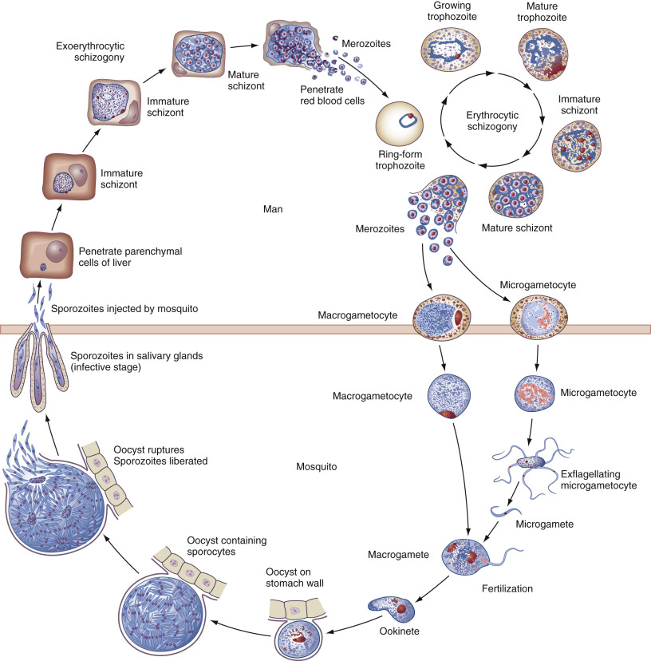

Figure 63-1 

Life cycle of malarial parasites. 

(Courtesy of Centers for Disease Control and Prevention, Parasitology Training Branch, Atlanta.) 

Sporozoites injected into the vertebrate host reach the hepatic parenchymal cells within minutes and initiate the proliferative phase known as _exoerythrocytic schizogony._ Release of merozoites from ruptured hepatic schizonts initiates the bloodstream infection or erythrocytic schizogony and, eventually, the clinical symptoms of malaria. _P. vivax_ and _P. ovale_ differ from _P. falciparum_ and _P. malariae_ in that true disease relapses of the former species may occur weeks to months following subsidence of previous attacks. This occurs as a result of renewed exoerythrocytic and, eventually, erythrocytic schizogony from latent hepatic parasite forms known as _hypnozoites_ (  Krotoski et al, 1982  ). Recurrences of disease due to _P. falciparum_ or _P. malariae,_ called _recrudescences,_ arise from increased numbers of persisting blood stage forms to clinically detectable levels, and not from persisting liver stage forms. Liver cells are infected only by sporozoites from the mosquito; thus, transfusion-acquired _P. vivax_ or _P. ovale_ infection does not relapse. 

Merozoites released from infected hepatocytes subsequently infect erythrocytes. Following amplification of parasites in the bloodstream for a period of time and the development of synchrony in their appearance, clinical attacks of malaria occur. _P. vivax_ and _P. ovale_ parasites primarily infect young erythrocytes, whereas _P. malariae_ infects older erythrocytes and _P. falciparum_ infects erythrocytes of all ages. 

Morphologic stages seen in erythrocytes include trophozoites (growing forms), schizonts (dividing forms), and gametocytes (sexual forms) ( [ Figs. 63-2 to 63-5 ](<#f0015>) ). The youngest trophozoites have a globose shape with a central vacuole, a red chromatin mass, and light blue-gray cytoplasm. On stained blood films, early trophozoites resemble signet rings and generally are referred to as _rings_ or _ring forms._ Growing trophozoites beyond the ring stage retain a single chromatin mass but have more abundant cytoplasm, which may appear compact or may be ameboid (irregular with pseudopod-like projections). Mature trophozoites still have only one chromatin mass but an increased amount of cytoplasm that partially fills the erythrocyte. Hemozoin (hematin) pigment, a breakdown product of hemoglobin, is characteristic of all erythrocytes containing mature stages of malarial parasites but is not usually evident in ring forms. Immature schizonts have two or more chromatin masses and undivided cytoplasm, whereas mature schizonts have both cytoplasm and chromatin completely divided, so that individual merozoites are evident. The mature schizont ruptures the erythrocyte, releasing merozoites and initiating a new cycle of infection. The erythrocytic cycle takes approximately 48 hours (tertian periodicity) for _P. falciparum, P. ovale,_ and _P. vivax_ infections, and 72 hours (quartan periodicity) for _P. malariae_ infection. At some point during the infection, a subpopulation of merozoites develops into gametocytes. Those of _P. vivax, P. malariae,_ and _P. ovale_ are rounded, whereas those of _P. falciparum_ are elongate (sausage- or banana-shaped). Macrogametocytes (female) characteristically have a compact chromatin mass, whereas microgametocytes (male) have chromatin that is more dispersed. Developing gametocytes are more compact than growing trophozoites. 

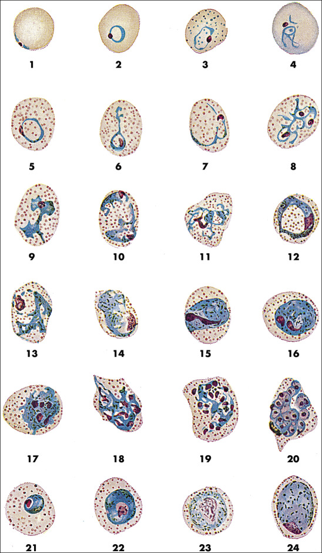

Figure 63-2 

Plasmodium vivax. 

_1,_ Normal-size erythrocyte with marginal ring form trophozoite. _2,_ Young signet ring form of trophozoite in macrocyte. _3,_ Slightly older ring form trophozoite in erythrocyte showing basophilic stippling. _4,_ Polychromatophilic erythrocyte containing young tertian parasite with pseudopodia. _5,_ Ring form of trophozoite showing pigment in cytoplasm of an enlarged cell containing Schüffner's stippling. This stippling does not appear in all cells containing the growing and older forms of _Plasmodium vivax,_ but it can be found with any stage from the fairly young ring form onward. _6_ and _7,_ Very tenuous medium trophozoite forms. _8,_ Three ameboid trophozoites with fused cytoplasm. _9_ to _13,_ Older ameboid trophozoites in the process of development. _10,_ Two ameboid trophozoites in one cell. _14,_ Mature trophozoite. _15,_ Mature trophozoite with chromatin apparently in process of division. _16_ to _19,_ Schizonts showing progressive steps in division (presegmenting schizonts). _20,_ Mature schizont. _21_ and _22,_ Developing gametocytes. _23,_ Mature microgametocyte. _24,_ Mature macrogametocyte. 

(From Wilcox A: Manual for the microscopical diagnosis of malaria in man. Bulletin No. 180. Bethesda, Md., 1942, National Institutes of Health.) 

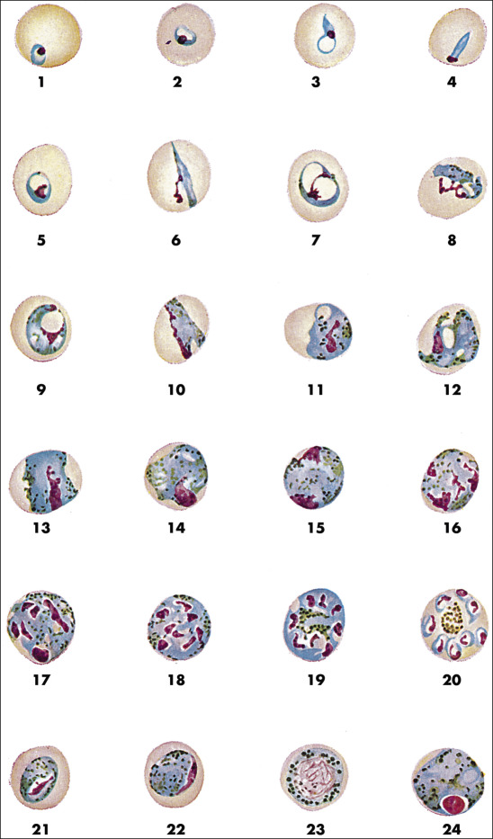

Figure 63-3 

Plasmodium malariae. 

_1,_ Young ring form trophozoite of quartan malaria. _2_ to _4,_ Young trophozoite forms of the parasite showing gradual increase in chromatin and cytoplasm. _5,_ Developing ring form of trophozoite showing pigment granule. _6,_ Early band form of trophozoite—elongate chromatin, some pigment apparent. _7_ to _12,_ Some forms that the developing trophozoite of quartan malaria may take. _13_ and _14,_ Mature trophozoites—one a band form. _15_ to _19,_ Phases in the development of the schizont (presegmenting schizonts). _20,_ Mature schizont. _21,_ Immature microgametocyte. _22,_ Immature macrogametocyte. _23,_ Mature microgametocyte. _24,_ Mature macrogametocyte. 

(From Wilcox A. Manual for the microscopical diagnosis of malaria in man. Bulletin No. 180. Bethesda, Md., 1942, National Institutes of Health.) 

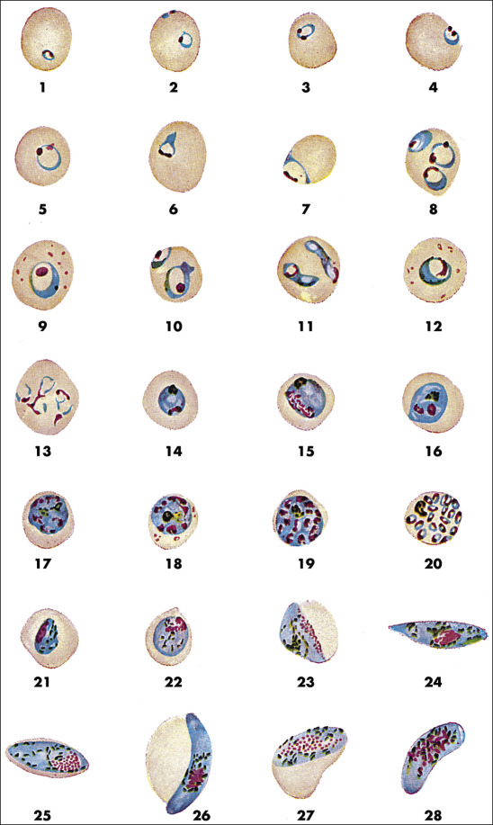

Figure 63-4 

Plasmodium falciparum. 

_1,_ Very young ring form of trophozoite. _2,_ Double infection of single cell with young trophozoites—one a “marginal form,” the other a “signet ring” form. _3_ and _4,_ Young trophozoites showing double chromatin dots. _5_ to _7,_ Developing trophozoite forms. _8,_ Three medium trophozoites in one cell. _9,_ Trophozoite showing pigment in a cell containing Maurer's dots. _10_ and _11,_ Two trophozoites in each of two cells, showing variation in forms that parasites may assume. _12,_ Almost mature trophozoite showing haze of pigment throughout cytoplasm. Maurer's dots in the cell. _13,_ Estivo-autumnal “slender forms.” _14,_ Mature trophozoite, showing clumped pigment. _15,_ Parasite in the process of initial chromatin division. _16_ to _19,_ Various phases of development of the schizont (presegmenting schizonts). _20,_ Mature schizont. _21_ to _24,_ Successive forms in development of the gametocyte—usually not found in the peripheral circulation. _25,_ Immature macrogametocyte. _26,_ Mature macrogametocyte. _27,_ Immature microgametocyte. _28,_ Mature microgametocyte. 

(Courtesy of National Institutes of Health, USPHS.) 

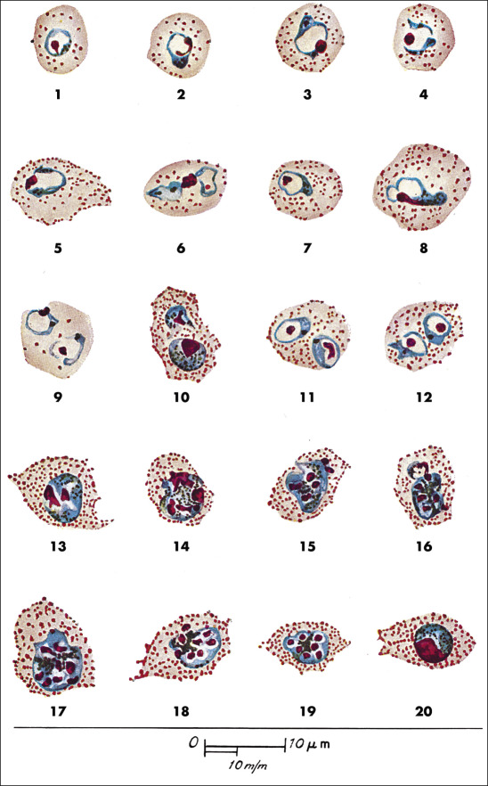

Figure 63-5 

Plasmodium ovale. 

_1,_ Young ring-shaped trophozoite. _2_ to _5,_ Older ring-shaped trophozoites. _6_ to _8,_ Older ameboid trophozoites. _9, 11,_ and _12,_ Doubly infected cells, trophozoites. _10,_ Doubly infected cell, young gametocytes. _13,_ First stage of the schizont. _14_ to _19,_ Schizonts, progressive stages. _20,_ Mature gametocyte. Free translation of legend accompanying original plate in _Guide pratique d 'examen microscopique du sang appliqué au diagnostic du paludisme _ by Georges Villain. 

(Reproduced with permission from Biologie Medicale Supplement, 1935. Courtesy of Aimee Wilcox, National Institutes of Health Bulletin No. 180, USPHS.) 

 

##  Epidemiology 

Endemic transmission of malaria requires a reservoir of infection, an appropriate mosquito vector, and a susceptible host. Control of malaria is directed at elimination of mosquito hosts, treatment of active cases, and prophylaxis of susceptible persons. However, emergence of mosquitoes resistant to insecticides, development of resistance to prophylaxis and therapy by _P. falciparum_ and, more recently, _P. vivax_ (  Murphy et al, 1993  ;  Garcia, 2007  ), and lack of adequate funding have made control difficult in many areas. 

Individuals with sickle cell trait are less susceptible to _P. falciparum_ malaria, and persons who lack certain Duffy blood group determinants are protected to some extent against _P. vivax_ infection (  Miller et al, 1976  ). Glucose-6-phosphate dehydrogenase (G6PD) deficiency has been associated with protection from malaria, but evidence is less striking than with these other genetic abnormalities. 

Transfusion-induced malaria may occur when blood donors have subclinical malaria and may prove fatal for the recipient. Similarly, congenital malaria may occur in infants born to mothers from endemic areas. The infant acquires the infection at birth as a result of rupture of placental blood vessels with maternal-fetal transfusion. Neither transfusion nor congenital malaria is expected to relapse because exoerythrocytic schizogony does not occur. The number of civilian cases of malaria reported in the United States increased from 151 in 1970 to 1838 in 1980 but dropped to 1411 in 1993 (  Centers for Disease Control and Prevention [CDC]  1988  ). The most recent surveillance summary from the CDC reported 1687 total cases in 2012 (  Cullen & Arguin, 2014  ). Species causing infection were _P. falciparum_ (58%), _P. vivax_ (17%), _P. malariae_ (3%), _P. ovale_ (3%), and undetermined (17%), with 1% having infection with two species. Of reported cases, 14% were associated with severe disease, including the 6 persons who died. Only 6% of patients with malaria reported adhering to a CDC-recommended chemoprophylaxis malaria regimen. The interval between arrival in the United States and onset of illness was less than 1 month for 42% of _P. vivax_ and 81% of _P. falciparum_ cases. Only 0.9% of patients became ill more than 1 year after arrival. Patients acquired the infection in Africa (77%), Asia (12.2%), the Western Hemisphere (6.8%), or Oceania (0.5%). In patients for whom the reason for travel was known, the majority (66%) were visiting friends and relatives (VFRs). These individuals have long been known to be at higher risk for acquiring malaria than other travelers since they often do not seek pretravel counseling, do not take malaria chemoprophylaxis, travel to more rural areas, and often stay for longer periods of time. 

 

##  Clinical Disease 

Most patients who develop _P. falciparum_ infection become symptomatic within 1 month of exposure, whereas a delay of up to 6 months or more may be seen with the other _Plasmodium_ species. Common presenting symptoms of malaria include chills and fever, which often are associated with splenomegaly. In the early stages of the disease, febrile episodes occur irregularly but eventually become more synchronous, assuming the usual tertian ( _P. vivax, P. falciparum,_ and _P. ovale_ ) or quartan _(P. malariae)_ periodicity. Patients with malaria may develop anemia and may have other manifestations, including diarrhea, abdominal pain, headache, and muscle aches and pains. _P. falciparum_ malaria can result in high rates (50%) of parasitemia, which can lead to severe hemolysis with hemoglobinuria and profound anemia. Erythrocytes infected with growing trophozoites and schizonts of _P. falciparum_ become sequestered in small vessels of the body, and this may lead to occlusion of these vessels, causing symptoms related to capillary obstruction and tissue anoxia. Involvement of the brain is known as cerebral malaria, in which the patient becomes disoriented, progressing to delirium, coma, and often death. Exchange transfusion may be lifesaving in severe cases of _P. falciparum_ infection in which the parasitemia is ≥10% (  Nielson et al, 1979  ;  Powell & Grima, 2002  ). 

The course of untreated malaria depends on the species. Most fatal cases of malaria are due to _P. falciparum,_ although _P. knowlesi_ can also cause fatalities. In nonfatal cases, the febrile paroxysms become less severe with time and the disease gradually subsides. Patients with _P. vivax_ or _P. ovale_ infection may have relapses after many months or, occasionally, years. Persons with _P. falciparum_ and _P. malariae_ infection may have symptom-free periods but suffer from sporadic recrudescences owing to persisting low-grade parasitemia. Relapses and recrudescences may be associated with changes in the host's defense mechanisms or possibly with antigenic changes in the infecting organisms. 

Peripheral smears may show leukocytes that contain malaria pigment (hemozoin). Increased reticulocyte counts occur commonly and are associated with rapid erythrocyte turnover. The presence of greatly enlarged platelets may be noted on peripheral blood films and may occur as a result of their rapid turnover secondary to splenic sequestration. Malarial infection may interfere with certain serologic tests, producing false-positive results, especially those for syphilis. 

Therapy and prophylaxis of malaria have become highly complex topics because of the widespread appearance of resistance by _P. falciparum_ to chloroquine and other antimalarials and, to a lesser extent, resistance by _P. vivax_ to chloroquine. Also, persons who have acquired _P. vivax_ or _P. ovale_ malaria, or who have spent extended time in areas highly endemic for these parasites, require treatment with primaquine to eradicate hepatic hypnozoites and to prevent relapse. Use of primaquine may be dangerous in patients who have G6PD deficiency, and screening of at-risk patients before therapy is initiated may be necessary. 

 

##  Diagnosis 

Malaria should always be included in the differential diagnosis of fever in patients who have a history of travel to or residence in endemic areas. Given the potentially life-threatening nature of infection, testing must be performed on a STAT basis. Diagnosis usually is established by demonstrating parasites in thick and thin blood films. Blood specimens ideally are collected just before the next anticipated fever spike or at the onset of fever. Specimens drawn several hours apart sometimes may be required to demonstrate infection or to diagnose the species, because the number and morphologic stage of parasites vary during the cycle. Careful examination of thick films should reveal the presence of the parasites in almost all patients with clinically apparent malaria. 

Identification of malarial parasites on thin blood films requires a systematic approach. Three major factors should be considered: appearance of infected erythrocytes, appearance of parasites, and stages found. [ Table 63-8 ](<#t0045>) summarizes diagnostic characteristics of the species, which are illustrated in [ Figures 63-2 to 63-5 ](<#f0015>) . The size of the infected erythrocyte is a particularly useful feature for determining the infecting species; erythrocytes infected by _P. vivax_ or _P. ovale_ parasites often appear enlarged compared with adjacent, uninfected cells, whereas _P. malariae_ and _P. falciparum_ parasites are usually found in erythrocytes of normal size. In all, 20% or more of erythrocytes infected with _P. ovale_ are often oval or fimbriated (having irregular projections of the cell margins), whereas less than 6% of erythrocytes infected with _P. vivax_ are oval. Schüffner's stippling, noted as numerous small uniform pink granules in the erythrocyte, is usually seen in cells infected with _P. vivax_ and _P. ovale,_ although it may not be evident in cells infected with early ring forms or on slides that have not been stained at the appropriate pH such as the Wright-Giemsa stain, used widely in hematology laboratories (see the “ [ Laboratory Methods ](<#s0015>) ” section earlier in the chapter). The presence of Schüffner's stippling is helpful because it is not seen in _P. malariae_ or _P. falciparum_ infection. 

TABLE 63-8 

Comparison of _Plasmodium_ Species Affecting Humans 

Species  |  Appearance of Erythrocyte Size  |  Cytoplasmic Inclusions [ * ](<#hl0001536>) |  Parasite Cytoplasm  |  Appearance of Parasite Pigment  |  Number of Merozoites  |  Stages Found in Circulating Blood   
---|---|---|---|---|---|---  
_Plasmodium vivax_ |  Enlarged; maximum size (attained with mature trophozoites and schizonts) may be 1-2 times normal erythrocyte diameter  |  Schüffner's dots; all stages except early ring forms  |  Irregular, ameboid in trophozoites; has “spread out” appearance  |  Golden brown, inconspicuous  |  12-24; average is 16  |  All stages; wide range of stages may be seen on any given film   
_Plasmodium malariae_ |  Normal to small  |  Ziemann's dots rarely seen  |  Rounded, compact trophozoites with dense cytoplasm; band-form trophozoites occasionally seen  |  Dark brown, coarse, conspicuous  |  6-12; average is 8; “rosette” schizonts occasionally seen  |  All stages; wide range of stages usually not seen; relatively few rings or gametocytes generally present   
_Plasmodium ovale_ |  Enlarged; maximum size may be  \-  times normal red blood cell diameter; approximately 20% or more of infected red blood cells are oval and/or fimbriated (border has irregular projections)  |  Schüffner's dots; all stages except early ring forms  |  Rounded, compact trophozoites; occasionally slightly ameboid; growing trophozoites have large chromatin mass  |  Dark brown, conspicuous  |  6-14; average is 8  |  All stages   
_Plasmodium falciparum_ |  Normal; multiply infected red blood cells are common  |  Maurer's clefts occasionally seen  |  Young rings are small, delicate, often with double chromatin dots; gametocytes are crescent or elongate  |  Black; coarse and conspicuous in gametocytes  |  6-32; average is 20-24  |  Rings and/or gametocytes; other stages develop in blood vessels of internal organs but are not seen in peripheral blood except in severe infection   
  
Adapted from Smith JW, Melvin DM, Orihel TC, et al: _Diagnostic parasitology —blood and tissue parasites. _ Chicago, 1976, American Society of Clinical Pathologists. 

 * A pH of 7.0-7.2 is optimal for visualization of cytoplasmic inclusions. 

As trophozoites grow in the infected cells, the amount of hemoglobin in the erythrocyte decreases and hemozoin pigment accumulates. The amount and appearance of the pigment vary among species. Ring forms of all parasites may have a similar appearance, and if only occasional ring forms are found, the species may not be identifiable. Young rings of _P. falciparum_ are smaller than those of the other species (one-sixth the diameter of the red blood cell, compared with one-third the diameter of the red blood cell for the other species). Rings of _P. falciparum_ that have grown are similar in size to those of the other species. Trophozoites that appear to be lying on the surface of the erythrocyte or protruding from it are called _appliqu é _ or _accol é _ forms, and are most often seen in _P. falciparum_ infection. Doubly infected cells and double chromatin dots in ring trophozoites occur most commonly in _P. falciparum_ infection but can occur with the other species as well. 

Growing trophozoites of _P. vivax_ have irregular shapes and are termed _ameboid_ . Those of _P. malariae_ and _P. ovale_ remain compact. Mature trophozoites and schizonts of _P. falciparum_ are usually sequestered in capillary beds secondary to cytoadherence to endothelial cells and are not seen in the peripheral blood except in very severe cases of infection. When schizonts are identified in the peripheral blood, determining the number of merozoites is helpful in identifying the various species. Gametocytes of _P. falciparum_ are readily identified by their characteristic sausage shape. Gametocytes of _P. vivax, P. malariae,_ and _P. ovale_ have a similar shape and so are difficult to differentiate, although characteristics of infected red blood cells can aid identification. 

The varieties of developmental stages in the peripheral blood aid in diagnosis. In _P. falciparum_ infection, ring forms predominate, and finding numerous ring forms without more mature stages serves as evidence for _P. falciparum_ infection. In _P. vivax, P. malariae,_ and _P. ovale_ infections, various stages of parasites are found with some predominance of one stage depending on the phase of the cycle. 

Thick films are preferred for detecting malaria infections because a greater quantity of blood is examined (see the “ [ Laboratory Methods ](<#s0015>) ” section earlier in the chapter). Ring forms often have the appearance of punctuation marks rather than complete rings, and the presence of red chromatin and blue cytoplasm should be required to identify them as parasites. Schüffner's stippling still may be a helpful identifying characteristic, and it may be recognized around growing trophozoites as a pink halo rather than as distinct granules seen in thin films. The ameboid character of _P. vivax_ trophozoites is not as evident in thick films, but the number of merozoites in mature schizonts is helpful. Macrogametocytes and microgametocytes cannot usually be differentiated. The distinctive sausage shape of _P. falciparum_ gametocytes is still evident, although they may appear stubbier than in thin films. Gametocytes of the other species can be detected and are easily differentiated from host cell nuclei by the presence of refractile hemozoin pigment. 

Mixed infections occur occasionally (about 5% of the time), but caution should be used in making such a diagnosis unless definite evidence reveals two separate populations of parasites. The most common mixed infections are _P. falciparum_ and _P. vivax_ . Finding gametocytes of _P. falciparum_ in a person obviously infected with _P. vivax_ is diagnostic. 

Multiple artifacts may be confused with malarial parasites on thick and thin films. The most common artifacts on thin films are blood platelets superimposed on red blood cells. These platelets should be readily identified because they do not have a true ring form, do not show differentiation of the chromatin and cytoplasm, and do not contain pigment. Clumps of bacteria or platelets may be confused with schizonts. At times, masses of fused platelets may resemble gametocytes of _P. falciparum_ but do not show the differential staining or the pigment. Precipitated stain and contaminating bacteria, fungi, or spores may also be confused with these parasites. 

Species-specific serologic tests for malaria are not useful for diagnosis of acute infection but may be useful for epidemiologic surveys and for detection of infected blood donors. Such tests do not reliably differentiate current from past infection, however. Sensitive and specific IFA tests using antigens from the four human species are available from the CDC (  Wilson et al, 1995  ). Assays for the direct detection of malarial antigens in blood are especially useful (see the “ [ Laboratory Methods ](<#s0015>) ” section earlier in the chapter;  Murray & Bennett, 2009  ). 

 

##  _Babesia_ Species (Babesiosis) 

Similar to malarial parasites, etiologic agents of babesiosis are apicomplexan protozoa found worldwide that infect erythrocytes, often producing febrile illness of variable severity. Babesiosis is sometimes called _piroplasmosis,_ reflecting its classification in the order _Piroplasmida_ . Unlike malaria, babesiosis is transmitted by ticks, is found in a variety of animal species that serve as reservoirs, and is primarily a disease of temperate regions (  Krause, 2002  ). Less commonly, babesiosis is transmitted by blood transfusion and transplacentally. 

Human infection in the United States occurs predominantly in the northeastern and midwestern states, where the rodent parasite _Babesia microti_ is responsible for infection (  Homer et al, 2000  ). _Ixodes scapularis,_ the “black-legged” or “deer tick,” is the usual vector. _Babesia duncani_ causes a smaller number of infections in northern California, Oregon, and Washington and is thought to be transmitted by the Western black-legged tick, _Ixodes pacificus_ (  Quick et al, 1993  ;  Persing et al, 1995  ;  Vannier & Krause, 2012  ). In Europe, babesiosis is caused primarily by _Babesia divergens,_ with a smaller number of cases attributed to _Babesia venatorum_ and _B. microti._ Infection with these agents is transmitted by _Ixodes ricinus._ Recently, reports of _B. divergens_ and _B. divergens_ –like infections in the states of Kentucky, Missouri, and Washington expand the range of known human cases in the United States (  Herwaldt et al, 2004  ). 

The spectrum of babesiosis varies from latent, subclinical infection to fulminant, hemolytic disease. Fatalities have been reported, especially in splenectomized or immunocompromised individuals. Immunocompetent persons may experience symptoms similar to those of malaria, including fever, chills, malaise, and anemia, although without recognizable periodicity. Investigation of an outbreak caused by _B. microti_ on Nantucket Island in New England showed that some symptomatic patients harbored the parasite for months and others showed serologic evidence of infection without a history of clinical disease (  Ruebush, 1980  ). Other evidence indicates that chronic subclinical infections may not be uncommon (  Persing et al, 1995  ). 

_Babesia_ parasites multiply in erythrocytes by binary fission producing morphologically indistinguishable trophozoites and gametocytes. Although trophozoites of many species appear pear-shaped at some point in their development, those of _B. microti_ usually appear as delicate ring forms that may be easily confused with those of malarial parasites, especially _P. falciparum_ ( [ Fig. 63-6, _A_ ](<#f0035>) ) (  Healy & Rubush, 1980  ;  Homer et al, 2000  ). _Babesia_ trophozoites can be differentiated from those of malarial parasites by the presence of multiple rings in one cell that may form a tetrad (Maltese cross) and the absence of large, growing trophozoites and morphologically distinguishable gametocytes; extracellular trophozoites may be seen in heavy infections. Also, _Babesia_ forms usually have a heterogeneous appearance with round, oval, spindled, and “racket” forms coexisting on the same peripheral blood smear. Finally, _Babesia_ -infected cells lack hemozoin pigment, which is present in _Plasmodium_ -infected cells. History of residence in or travel to endemic areas, or of a recent tick bite, might suggest _Babesia_ infection. Nucleic acid amplification tests for _Babesia_ species are available from the CDC on referral from state health departments and from some commercial laboratories. Serologic tests (e.g., IFA) may also be available, but are generally not useful for detection of acute disease. Serology tests for malaria are negative in babesiosis, although patients with malaria may cross-react in the _Babesia_ serologies (  Wilson et al, 1995  ). 

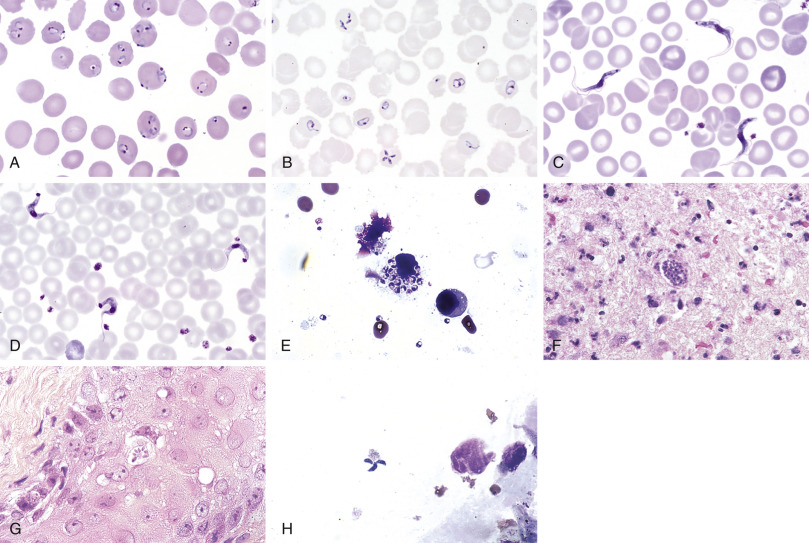

Figure 63-6 

**A,** _Plasmodium falciparum_ in Giemsa-stained thin blood film; note high parasitemia, multiply-infected red blood cells, and delicate ring forms with appliqué and “headphone” forms (1000×). **B,** _Babesia microti_ in Giemsa-stained thin blood film; note high parasitemia, multiply-infected red blood cells with irregular forms, and Maltese cross configuration (1000×). **C,** _Trypanosoma brucei_ in thin blood film; note nucleus, small kinetoplast, anterior flagellum, and undulating membrane (Giemsa stain; 1000×). **D,** _Trypanosoma cruzi_ in thin blood film; note nucleus, large kinetoplast, anterior flagellum, and undulating membrane. The trypomastigotes have a characteristic _C_ shape. (Giemsa stain; 1000×). **E,** _Leishmania mexicana_ amastigotes in impression smear of thigh lesion (Giemsa stain; 1000×). **F,** Pseudocyst of _Toxoplasma gondii_ in brain tissue (hematoxylin and eosin [H&E]; 1000×). **G,** Cutaneous rosette of _T. gondii_ tachyzoites in an immunocompromised patient (H&E; 1000×). **H,** Tachyzoites of _T. gondii_ recovered from a bronchoalveolar lavage specimen from an individual infected with the human immunodeficiency virus (Giemsa stain; 1000×). 

 

##  Hemoflagellates 

The hemoflagellates of humans and animals are members of the class _Kinetoplastidea_ and are characterized by the presence of a kinetoplast, a complex of abundant circular DNA within a large microchondrion, which can be seen by light microscopy when treated with Giemsa stain. Two genera important in human disease are _Trypanosoma_ and _Leishmania_ . Members of both genera are transmitted by arthropod vectors and have animal hosts that serve as reservoirs. 

Kinetoplastids assume different morphologic forms depending on their presence in vertebrate hosts, including humans, or in their insect vectors ( [ Fig. 63-7 ](<#f0040>) ). The amastigote stage is spherical, is 2 to 5 µm in diameter, and displays a nucleus and kinetoplast. By definition, an external flagellum is lacking, although an axoneme (the intracellular portion of the flagellum) is apparent at the ultrastructural level. Amastigotes may be found in human or animal hosts infected with _T. cruzi_ or _Leishmania_ spp., where they multiply exclusively within cells. The promastigote is an elongated and slender organism with a central nucleus, an anteriorly located kinetoplast and axoneme, and a free flagellum extending from the anterior end. This stage occurs in the insect vectors of _Leishmania_ and is the stage detected in culture. The epimastigote is similar to the promastigote, but the kinetoplast is found closer to the nucleus and has a small undulating membrane that becomes a free flagellum. All species of _Trypanosoma_ that infect humans assume an epimastigote stage in the insect vector or in culture. Neither the promastigote nor epimastigote are seen in humans. In the trypomastigote, the kinetoplast is found at the posterior end and the flagellum forms an undulating membrane that extends the length of the cell, emerging as a free flagellum at the anterior end. Trypomastigote forms occur predominantly in the bloodstream of mammalian hosts infected with various _Trypanosoma_ spp. Infectious stages found in appropriate insect vectors following transformation from the epimastigote form are known as _metacyclic trypomastigotes._ 

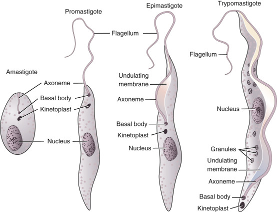

Figure 63-7 

Morphology of hemoflagellates. 

 

##  Trypanosoma 

Infections with trypanosomes include those caused by _Trypanosoma brucei_ (African or Old World trypanosomiasis) and _T. cruzi_ (American or New World trypanosomiasis, or Chagas disease). Both are of great importance in endemic areas. A third species, _Trypanosoma rangeli,_ has been described in humans in the Americas but does not cause clinical illness. Bloodstream trypomastigotes of the _T. brucei_ group (see [ Fig. 63-6, _B_ ](<#f0035>) ) are up to 30 µm long with graceful curves and a small kinetoplast. Those of _T. cruzi_ are somewhat shorter (20 µm) and display a larger kinetoplast. The trypomastigotes of _T. cruzi_ also commonly assume a C shape, although this is a less-reliable means to differentiate them from _T. brucei_ trypomastigotes. 

In equatorial Africa, parasites of the _T. brucei_ group infect both animals and humans and are transmitted by the bite of tsetse flies in the genus _Glossina_ . Multiplication of organisms at the bite site often produces a transient chancre. East African trypanosomiasis is caused by _T. brucei rhodesiense,_ which has a number of animal reservoir hosts. The disease is characterized by a rapidly progressive acute febrile illness with lymphadenopathy. Patients die before central nervous system (CNS) involvement is prominent. 

The infection in western Africa is caused by _T. brucei gambiense,_ which is responsible for classic African sleeping sickness. The disease has a more chronic course that begins with intermittent fevers, night sweats, and malaise. Lymphadenopathy, especially of the posterior cervical lymph nodes (Winterbottom's sign), may be pronounced. Involvement of the CNS becomes prominent with time. Somnolence, confusion, and fatigue progress, leading to stupor, coma, and eventual death. Humans are the primary reservoir for this disease (  WHO, 1986  ;  Garcia, 2007  ). 

The diagnosis is suspected on the basis of geographic history and clinical findings. Patients show high total IgM levels in blood and cerebrospinal fluid (CSF). Pleocytosis occurs with 50 to 500 mononuclear cells per microliter in CSF. The diagnosis is established by demonstrating the parasites on thick and thin films of peripheral blood, buffy coat preparations, or aspirates of lymph nodes or bone marrow, or in spun CSF that is stained with Giemsa (  Van Meirvenne & le Ray, 1985  ;  Cattand et al, 1988  ;  NCCLS, 2000  ). Culture or animal inoculation may be helpful if it is available; a number of molecular methods have also been described. 

American trypanosomiasis, or Chagas disease, is caused by _T. cruzi_ . In its sylvatic form, the parasite occurs in the United States, Mexico, Central America, and most of South America. Human infections are common in parts of Mexico and Central and South America, where they are transmitted by kissing bugs of the family _Reduviidae_ . In contrast, only rare cases of locally acquired Chagas have been documented in the United States. However, Chagas is now recognized as an important parasite in the United States due to the large number of immigrants that the country receives from endemic areas. The CDC estimates that greater than 300,000 infected individuals currently live in the United States. 

Genera and species involved in transmission vary from one country to another and among different ecologic niches. Some reduviids are responsible for maintaining the sylvatic cycle in animal reservoirs, whereas others are adapted to a domiciliary life in which they infest poorly constructed houses, usually in rural areas. At the time of feeding, the reduviid bug defecates. The bug feces contain infective trypomastigotes that, as a result of scratching or rubbing, enter the body at the bite site or through intact mucosa of the mouth or conjunctiva. Infective forms actively enter nearby tissue cells, where they transform into dividing amastigotes. When the infected cell is filled with amastigotes, transformation to trypomastigotes occurs, followed by cell rupture. Trypomastigotes are released into the peripheral blood and reach distant tissues, where they can start the reproductive cycle de novo. 

Chagas disease may cause acute or chronic infection. Acute disease is most common in children younger than 5 years of age and is characterized by malaise, chills, fever, hepatosplenomegaly, and myocarditis. Swelling of the tissues around the eye (Romaña's sign) may be present if inoculation of the organisms occurs on the face. Swelling of tissues at other locations following the bite of an infected reduviid is called a _chagoma_ . In older individuals, the acute course is milder and often asymptomatic, and the patient remains infected for life. Chronic manifestations of the infection, including megaesophagus, megacolon, and alterations in the conduction system of the heart, are related to destruction of the effector cells of the parasympathetic system by autoantibodies. Infection can be transmitted by blood transfusion, and quiescent infections may be exacerbated by immunosuppression. 

Diagnosis in the acute stage is established by demonstrating the parasite on thick and thin blood films, in buffy coat smears, or in aspirates of chagomas or enlarged lymph nodes. Aspirates, blood, and biopsy specimens can also be cultured using Novy-MacNeal-Nicolle medium (  Ash & Orihel, 1987  ;  NCCLS, 2000  ;  Garcia, 2007  ;  Visvesvara, 2010b  ). In endemic areas, xenodiagnosis (examination of the gut contents of laboratory-raised reduviids that have been allowed to feed on a patient) may be used. In the chronic stage, serodiagnosis is the method of choice. EIA, IFA, and CF tests are available, although they cannot differentiate between acute and chronic disease, and cross-reactions may occur in patients with leishmaniasis. 

 

##  Leishmania 

Leishmaniasis is a disease of the reticuloendothelial system caused by kinetoplastid protozoa of the genus _Leishmania_ . All species that infect humans have animal reservoirs and are transmitted by sandflies belonging to the genera _Phlebotomus_ in the Old World and _Lutzomyia_ in the New World. The parasites assume the amastigote form in mammalian hosts and the promastigote form in insect vectors. Species of _Leishmania_ cannot be differentiated by examination of amastigotes or promastigotes. Leishmaniasis may assume many different clinical forms; cutaneous, mucocutaneous, and visceral diseases are best known. The form and severity of disease vary with the infecting species, the particular host's immune status, and prior exposure (  Peters & Killick-Kendrick, 1987  ;  Cook, 2002  ). 

 

##  Cutaneous Leishmaniasis 

Old World cutaneous leishmaniasis (oriental sore) occurs in southern Europe, northern and eastern Africa, the Middle East, Iran, Afghanistan, India, and southern Russia. Infections are caused by _Leishmania tropica, Leishmania major,_ and _Leishmania aethiopica,_ although _L. donovani_ and _Leishmania infantum_ may also produce cutaneous lesions. _L. tropica_ produces the urban or dry ulcer, which is more long-lived than the rural or wet ulcer of _L. major_ . Ulcers caused by these species usually develop on an exposed area of the body and heal spontaneously. Infection produces long-lasting immunity. _L. tropica_ may become viscerotropic, as was demonstrated in military personnel who participated in Operation Desert Storm (  Magill et al, 1993  ). _L. aethiopica_ causes a more aggressive cutaneous infection, which in some individuals metastasizes to produce mucosal lesions or diffuse cutaneous leishmaniasis, the latter of which is characterized by multiple skin nodules resembling lepromatous leprosy. 

Cutaneous leishmaniasis of the New World is caused by many species, including _Leishmania mexicana, Leishmania braziliensis, Leishmania amazonensis, Leishmania venezuelensis, Leishmania garnhami, Leishmania pifanoi, Leishmania peruviana, Leishmania panamensis, and Leishmania guyanensis,_ among others (  Garcia, 2007  ). Lesions produced by _L. mexicana_ often involve the earlobe (chiclero ulcer), are self-limiting, and are not known to metastasize to the mucosa. However, _L. mexicana_ and _L. amazonensis_ may produce diffuse cutaneous lesions similar to those produced by _L. aethiopica._ A focus of cutaneous leishmaniasis exists in the southern part of Texas, where infections are caused by one or more species (  Gustafson et al, 1985  ). _L. peruviana,_ which has been found on the western slopes of the Peruvian Andes, causes an infection called _uta,_ a benign cutaneous lesion that occurs predominantly in children. _L. peruviana_ is acquired in the home, where the main reservoirs are domestic dogs. This epidemiologic situation contrasts with other cutaneous leishmaniases, which usually are acquired in forests and have wild animals as reservoir hosts. 

 

##  Mucocutaneous Leishmaniasis 

Mucocutaneous leishmaniasis (espundia) is caused primarily by _L. braziliensis_ and species in the _Viannia_ subgenus, which produce typical cutaneous lesions that generally are more aggressive, last longer, and often disseminate to mucous membranes, especially in the nasal, oral, or pharyngeal areas. In these locations, they may produce disfiguring lesions secondary to erosion of soft tissues and cartilage. _L. braziliensis_ is distributed in Mexico and Central and South America. 

 

##  Visceral Leishmaniasis 

Visceral leishmaniasis of the Old World occurs sporadically over a wide geographic area and is caused by _L. donovani_ or by _L. infantum_ . _L. donovani_ predominates in Africa, India, and Asia, and _L. infantum_ predominates in the Mediterranean region and the Middle East, although overlapping ranges occur. New World visceral leishmaniasis is caused by _L. chagasi_ and occurs sporadically throughout Central and South America. On occasion, some species that cause cutaneous disease have been responsible for visceral disease, as demonstrated in some troops who participated in Operation Desert Storm (  Magill et al, 1993  ). In some areas, humans may serve as the disease reservoir, although a variety of animals, including dogs and cats, usually assume this role. 

The infection is usually benign and often subclinical, although some individuals, especially young children and malnourished individuals, have marked involvement of the viscera, especially liver, spleen, bone marrow, and lymph nodes. In some cases, death occurs after months to years unless it is treated appropriately. The infection is called _kala-azar_ in India, in reference to the darkening of the skin. Visceral leishmaniasis also is an opportunistic infection in individuals with concurrent human immunodeficiency virus (HIV), and the condition responds poorly to therapy in such circumstances (  Medrano et al, 1992  ;  Strickland, 2000  ;  Garcia, 2007  ). 

 

##  Diagnosis of Leishmaniasis 

The diagnosis usually is established by visualization of amastigotes in smears, imprints, or biopsies, or by growth of promastigotes in culture. In integumentary leishmaniasis, the border of the most active lesion should be biopsied, and the fresh biopsy should be used to make imprints. A smear should be prepared by making a 2- to 3-mm incision at the border of the ulcer and recovering small amounts of tissue from the cut surfaces with the scalpel blade. Both the imprint and the smear should be treated with Giemsa stain. Specimens that may be submitted when visceral leishmaniasis is suspected include buffy coat preparations, lymph node and bone marrow aspirates, and spleen and liver biopsies (  Garcia, 2007  ). 

A culture is desirable because it is more sensitive and allows determination of the species or subspecies, a practice that may help in clinical management of the patient. Biopsy or aspirate specimens collected aseptically are cultured in Novy-MacNeal-Nicolle medium or in Schneider's _Drosophila_ medium supplemented with fetal calf serum (  Visvesvara, 2010b  ). Cultures usually begin to show promastigotes in 2 to 5 days but should be held for 4 weeks. The CDC provides culture collection kits after consultation and will perform culture and species identification using PCR and sequencing. 

Amastigotes found in imprints, smears, and tissue sections are recognized by their size (2 to 4 µm) and the presence of delicate cytoplasm, a nucleus, and a kinetoplast (see [ Fig. 63-6, _C_ ](<#f0035>) ). In tissue sections, they may appear smaller because of shrinkage during fixation. Amastigotes must be differentiated from other intracellular organisms, including yeast cells of _Histoplasma capsulatum_ and trophozoites of _T. gondii_ . _Leishmania_ spp. have a kinetoplast and do not stain with Gomori methenamine silver (GMS) or periodic acid–Schiff (PAS). In contrast, _Histoplasma_ lack the kinetoplast, and the cell wall stains with PAS and GMS. According to one study (  Weigle et al, 1987  ), the sensitivity of histologic sections stained with hematoxylin and eosin (H&E) is 14%; imprints, 19%; cultures, 58%; and all methods combined, 67%. 

 

##  Toxoplasma Gondii 

_T. gondii_ is a protozoan parasite of the phylum _Apicomplexa_ that has a worldwide distribution in humans and in domestic and wild animals, especially carnivores. Infection in immunocompetent persons is generally asymptomatic or mild, but immunocompromised patients may experience serious complications. Infection in utero may result in serious congenital infection with sequelae or stillbirth (  Remington et al, 2005  ). 

The sexual stage in the life cycle of this coccidian parasite is completed in the intestinal epithelium of cats and other felines, which serve exclusively as definitive hosts. During this enteroepithelial cycle, asexual schizogony and sexual gametogony occur, leading to the development of immature oocysts that are passed in the feces. Oocysts mature to the infective stage (which contain two sporocysts with four sporozoites each) in the environment in 2 to 21 days. Ingestion of infective oocysts may lead to infection of a wide variety of susceptible vertebrate hosts in which actively growing trophozoites (tachyzoites) may infect any nucleated cells. Proliferation of tachyzoites results in cell death and injury to the host during acute infection. Once immunity has developed, the organisms form tissue cysts that may eventually contain hundreds or thousands of slowly growing bradyzoites. The presence of tissue cysts is characteristic of chronic infection. All stages of the life cycle occur in felines, but only trophozoite and cyst stages occur in humans and other intermediate hosts. 

Humans acquire infection with _T. gondii_ by ingestion of inadequately cooked meat, especially lamb or pork, that contains tissue cysts or by ingestion of infective oocysts from material contaminated by cat feces. Outbreaks have occurred from inhaling contaminated dust in an indoor riding stable (  Teutch et al, 1979  ) and from drinking contaminated water or unpasteurized goat's milk (  Benenson et al, 1982  ;  Sacks et al, 1982  ;  Bowie et al, 1997  ). Transmission via blood transfusion, organ transplantation, and transplacentally to the developing fetus also can occur. 

Most acute infections are asymptomatic or mimic other infectious diseases in which fever and lymphadenopathy are prominent such as infectious mononucleosis. Congenital infection may occur when the mother develops acute infection during gestation. The risk for infection to the neonate is unrelated to the presence or absence of symptoms in the mother, but severity of infection depends on the stage of gestation at which it is acquired. Intrauterine death, microcephaly, or hydrocephaly with intracranial calcifications may develop if infection is acquired in the first half of pregnancy. Infections in the second half of pregnancy are usually asymptomatic at birth, although fever, hepatosplenomegaly, and jaundice may appear. Chorioretinitis, psychomotor retardation, and convulsive disorders may appear months or years later (  Remington et al, 2005  ;  Wilson et al, 2007  ). 

In immunosuppressed individuals, especially those with AIDS, infection with _T. gondii_ usually manifests with CNS involvement (  Luft & Remington, 1988  ). Other possible clinical and pathologic manifestations include pneumonitis, myocarditis, retinitis, pancreatitis, or orchitis (  Luft, 1989  ;  Schnapp et al, 1992  ). Toxoplasmosis may be difficult to diagnose clinically and is often discovered at autopsy (  Gutierrez, 2000  ). These infections usually result from reactivation of a latent infection acquired months or years before, but occasionally result from a primary infection. 

Diagnosis of toxoplasmosis may be established by examination of tissues, blood, or body fluids (  Wilson et al, 2007  ). Demonstration of tachyzoites or tissue cysts is definitive but may prove difficult to demonstrate in H&E-stained sections; fluorescence or immunohistochemical stains, if available, are useful. Giemsa is good for staining smears of body fluids and tissue imprints. Organisms may be demonstrated by inoculating appropriate material into tissue culture or uninfected mice, although this method is not widely available. Recovery in routine viral cultures also has been described but requires extended incubation (  Shepp et al, 1985  ). Isolation of organisms from blood or body fluid serves as evidence of acute infection, whereas recovery from tissues may reflect chronic infection. In smears, tachyzoites are crescent-shaped or oval, measuring approximately 3 × 7 µm; cysts measure up to 30 µm in diameter and are usually spherical, except in muscle fibers, where they appear elongate (see [ Fig. 63-6, _D_ to _F_ ](<#f0035>) ). 

Use of PCR technology is highly sensitive and specific in detecting toxoplasmic encephalitis, disseminated disease, and intrauterine infection; testing is available from most reference laboratories, the CDC, and select research laboratories. PCR is now an important component of testing for pregnant women, neonates, and immunocompromised hosts (  Grover et al, 1990  ;  Cazenave et al, 1991  ;  Parmley et al, 1992  ;  Weiss, 1995  ;  Wilson et al, 2007  ;  Vasoo & Pritt, 2013  ). 

Serology remains the primary approach in establishing a diagnosis of toxoplasmosis in immunocompetent hosts (  NCCLS, 2004  ;  Wilson et al, 2007  ). The Sabin-Feldman dye test and the IFA test are standards against which other methods are compared, although the former is performed in only a few centers. EIA tests are commercially available and generally provide results similar to those of IFA. Antibodies appear in 1 to 2 weeks, and titers peak at 6 to 8 weeks. Tests for IgM-specific antibodies are especially useful for diagnosis of congenital and acute infection, but knowledge of test limitations, specifically the occurrence of false-positive reactions, is extremely important. The persistence of IgM-specific antibodies, sometimes for 1 year or longer, also is problematic and must be interpreted in conjunction with IgG antibody results. Because many persons have had asymptomatic infection, low IgG titers have little significance. Titers in patients with chronic ocular infection may also be low. Immunocompromised patients such as those with AIDS who have active _Toxoplasma_ infection almost always have preexisting specific IgG antibodies, although titers may be low, and IgM antibodies are infrequently detected. As discussed in the “Serologic Diagnosis” section earlier in the chapter, IgG avidity testing may be useful for differentiating between acute and remote infection. Interpretation of IgG and IgM antibody titers varies by test method and by manufacturer. The laboratory performing the test should provide the necessary interpretive criteria (  NCCLS, 2004  ). 

 

##  Opportunistic Free-Living Amebae 

Amebae of the genera _Naegleria, Acanthamoeba, Balamuthia,_ and _Sappinia_ are inhabitants of soil, water, and other environmental substrates, where they feed on other microscopic organisms, especially bacteria and yeasts. All four genera have been associated with opportunistic infection of the CNS, and _Acanthamoeba_ causes keratitis (  Martinez, 1985  ;  Marciano-Cabral, 1988  ;  Ubelaker, 1991  ;  Kilvington & White, 1994  ;  Visvesvara, 2007  ;  Qvarnstrom et al, 2009  ). 

Primary amebic meningoencephalitis, caused by the ameboflagellate _Naegleria fowleri,_ typically affects children and young adults who have been swimming, jumping, or diving in warm freshwater lakes or pools. The ameboflagellate enters the brain via the cribriform plate and olfactory bulbs and reaches the frontal lobes, where it produces an acute hemorrhagic meningoencephalitis that is usually fatal within 1 week of onset of symptoms. The disease has an extremely poor prognosis, despite vigorous therapeutic intervention. Diagnosis is usually established at autopsy examination by the finding of trophozoites (cysts are rarely seen) in tissue sections ( [ Fig. 63-8, _A_ ](<#f0045>) ). Antemortem diagnosis is made occasionally by identifying typical trophozoites in CSF on direct wet mounts, in stained preparations, or in culture. Trophozoites measure 10 to 35 µm; have large, round, central karyosomes; and if exposed to warm distilled water, convert to flagellated forms in 1 to 2 hours. Cysts are spherical, measuring 7 to 15 µm in diameter. Culture usually is performed on nonnutrient agar plates (1.5% agar, 0.5% sodium chloride, pH 6.6 to 7.0) seeded with a lawn of heat-killed or living _Escherichia coli_ (  Visvesvara, 2010c  ). Amebae ingest the bacteria, leaving tracks in the bacterial lawn, which may be seen under low-power magnification using reduced light ( [ Fig. 63-8, _B_ ](<#f0045>) ). 

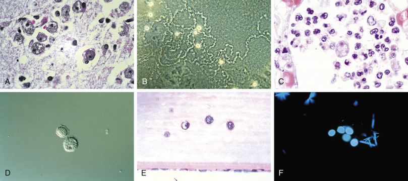

Figure 63-8 

**A,** _Naegleria fowleri_ trophozoites in primary amebic meningoencephalitis (H&E; 100×). **B,** _Acanthamoeba_ sp. culture showing trails left by motile trophozoites on a lawn of _Escherichia coli_ (phase contrast microscopy; 100×). **C,** _Acanthamoeba_ sp. trophozoites within a cutaneous lesion in an individual infected with the human immunodeficiency virus (Giemsa stain; 1000×). **D,** _Acanthamoeba_ sp. trophozoite and cyst (differential interference contrast microscopy; 400×). **E,** Double-walled cysts of _Acanthamoeba_ sp. within corneal stroma (H&E; 1000×). **F,** Cysts of _Acanthamoeba_ sp. stained with Calcofluor white (epifluorescence microscopy; 400×). 

Granulomatous amebic meningoencephalitis (GAE) may be caused by several species of _Acanthamoeba,_ including _Acanthamoeba castellani, Acanthamoeba culbertsoni, Acanthamoeba polyphaga,_ and _Acanthamoeba astronyxis,_ among others (  Marciano-Cabral & Cabral, 2003  ). It is usually a subacute or chronic opportunistic infection of chronically ill, debilitated, and immunosuppressed individuals, leading to death weeks to months following onset of symptoms. Infection is thought to spread hematogenously from primary foci in skin, pharynx, or the respiratory tract. Systemic infections occur in individuals with AIDS and may present as ulcerative skin lesions, subcutaneous abscesses, or erythematous nodules ( [ Fig. 63-8, _C_ ](<#f0045>) ) (  Tan et al, 1993  ). Exposure to fresh water is not necessary because cysts of _Acantha ­moeba _ readily become airborne and may be recovered from the throat and nasal passages (  Wang & Feldman, 1967  ;  Lawande et al, 1979  ). The pathologic reaction in tissues is granulomatous, with trophozoites predominating in viable tissue, and cysts predominating in areas of necrosis. Diagnosis usually is established at autopsy, but organisms may be recognized in brain biopsies or recovered using the culture technique described for _Naegleria_ . _Acanthamoeba_ trophozoites are somewhat larger than _Naegleria,_ measuring 15 to 45 µm, and display needlelike filamentous projections from the cell known as _acanthopodia_ . Cysts measure 10 to 25 µm and are double-walled, displaying a wrinkled outer wall (ectocyst) and a polygonal, stellate, or round inner wall (endocyst) ( [ Fig. 63-8, _D_ ](<#f0045>) ). Identification to the species level is problematic and reflects uncertainty as to the validity of the 18 or more described species, although it is usually not required for clinical management. Currently, genotyping is the preferred approach used in differentiating types of _Acanthamoeba_ (  Marciano-Cabral & Cabral, 2003  ). Immunofluorescence and immunoperoxidase techniques may prove useful in identifying and differentiating species and are available from the CDC (  Visvesvara, 2007  ). 

GAE may also be caused by leptomyxid amebae, specifically _Balamuthia mandrillaris_ (  Visvesvara et al, 1993  ). Morphologically, _Balamuthia_ cannot be differentiated from _Acanthamoeba_ by routine histology, although differences may be detected at the ultrastructural level. These organisms are antigenically distinct and may be identified using specific monoclonal or polyclonal antisera in DFA or immunoperoxidase assays (  Visvesvara, 2007  ). _Balamuthia_ do not grow on agar plates used for _Naegleria_ and _Acantha ­moeba, _ but they have been recovered in tissue culture using mammalian cell lines. A single case of encephalitis caused by _Sappinia (S. pedata)_ , another free-living ameba, was recently described and identified by a real-time PCR assay (  Qvarnstrom et al, 2009  ). 

_Acanthamoeba_ keratitis is an increasingly recognized painful infection of the cornea that is most likely to occur in persons who use daily-wear or extended-wear soft contact lenses or who have experienced trauma to the cornea (  Anuran et al, 1987  ;  Kilvington & White, 1994  ;  Marciano-Cabral & Cabral, 2003  ). Incomplete or infrequent disinfection and use of homemade saline and multipurpose solutions are known risk factors for acquiring the infection (  Stehr-Green & Bailey, 1990  ;  Verani et al, 2009  ). The disease is characterized by development of a paracentral ring infiltrate of the corneal stroma, which progresses to ulceration and possible perforation, with loss of the eye. The infection may be confused with fungal, bacterial, or herpetic keratitis but is characteristically refractory to commonly used antimicrobials. Keratoplasty has been used routinely in management of this disease, although recent advances in medical therapy have been reported (  Varga et al, 1993  ;  Dart et al, 2009  ). Diagnosis usually is established by demonstrating amebic trophozoites or cysts in corneal scrapings or biopsies ( [ Fig. 63-8, _E_ ](<#f0045>) ). A variety of permanent stains can be used, including Giemsa, PAS, and trichrome. Use of the fluorochrome Calcofluor white is especially helpful in recognizing amebic cysts ( [ Fig. 63-8, _F_ ](<#f0045>) ) (  Marines et al, 1987  ;  Garcia, 2010  ). While cultures (described earlier) provide increased sensitivity over staining methods and are often available from clinical laboratories, the sensitivity achieved by PCR may equal or exceed that of culture (  Boggild et al, 2009  ). 

,  

##  Intestinal and Urogenital Protozoa and Microsporidia 

Protozoal groups inhabiting the intestinal tract of humans include amebae, flagellates, ciliates, and coccidia, not all of which are pathogens. Microsporidia also inhabit the human intestinal tract. They were historically grouped with the intestinal protozoa but are now known to be highly specialized fungi. Since testing for the microsporidia still typically occurs in the parasitology laboratory, they will be covered in this chapter. 

In a review of fecal specimens submitted to state health department laboratories, _G. lamblia_ was present in 7.2%, _E. histolytica_ in 0.9%, _D. fragilis_ in 0.5%, and _Cryptosporidium_ spp. in 0.2% of specimens. Nonpathogenic protozoa were found in approximately 10.7% of specimens (  Kappus et al, 1994  ). Most intestinal infections with protozoa and microsporidia are thought to be acquired by fecal-oral contamination directly from food handlers, or indirectly via contaminated water. 

For most laboratorians, identification of intestinal protozoa and microsporidia is one of the more difficult aspects of parasitology. These organisms are small, and pathogenic species must be differentiated from nonpathogenic species and from inflammatory cells, epithelial cells, yeasts, pollen, and other confusing objects. Numerous characteristics assist in identifying intestinal protozoa. Size is helpful ( [ Fig. 63-9 ](<#f0050>) ), and a properly calibrated ocular micrometer must be available. Differentiation of amebae from flagellates in wet mounts of fresh material is relatively easy because of the typical pseudopod extension seen with amebae, whereas flagellates move more rapidly and in a so-called _falling leaf, darting,_ or _tumbling_ fashion. 

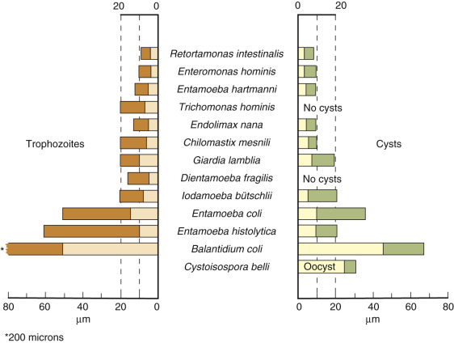

Figure 63-9 

Size ranges of intestinal protozoa. 

( _Balantidium coli_ trophozoites may measure up to 200 µm.) 

Number and size of nuclei and pattern of chromatin distribution, best seen in permanent stained preparations, are also useful. Cytoplasmic characteristics include fibrils and other special structures typical of flagellates, ingested materials in amebic trophozoites, and glycogen masses and chromatoid bodies in amebic cysts. Flagellates generally are elongated and tapered, with a nucleus or nuclei at one end. 

During examination by any method, both nuclear and cytoplasmic characteristics should be assessed from a number of individual organisms to complete the identification. When reporting the presence of two or more species in a sample, the observer should be able to define distinct populations of organisms to prevent confusion with an occasional organism with an atypical appearance. 

Trophozoites predominate in liquid stool but degenerate within 1 hour after passage unless they are placed into preservatives. Cysts predominate in formed stool and are more resistant to degeneration. Both forms may be seen in direct wet mounts prepared from fresh feces. Formalin does not preserve trophozoites well, and they may be missed unless permanent stained smears are prepared. Definitive identification should be made on examination of permanent stained slides. 

 

##  Amebae and _Blastocystis Hominis_

Three genera of amebae may inhabit the intestinal tract of humans: _Entamoeba, Endolimax,_ and _Iodamoeba_ . Cysts are ingested and excyst in the small intestine. Resulting trophozoites proliferate by binary fission in the lumen of the colon. Both cysts and trophozoites may be passed in feces, but only mature cysts are infective. _E. histolytica_ is the only amebic species capable of invading tissues and causing disease. 

The genus _Entamoeba,_ characterized by the presence of chromatin on the nuclear membrane, includes _E. histolytica,_ the etiologic agent of amebiasis; _E. dispar,_ a nonpathogenic species morphologically identical to _E. histolytica, E. hartmanni,_ and _Entamoeba coli,_ which are commonly found commensal species; and _Entamoeba polecki,_ which is occasionally found in people who have contact with pigs ( [ Fig. 63-10 ](<#f0055>) ) (  Levin & Armstrong, 1970  ;  Gay et al, 1985  ). More recently, _E. moshkovskii_ and _E. bangladeshi_ have also been identified in human stool specimens and are indistinguishable from _E. histolytica._ Their potential pathogenicity is unknown at this time. _Entamoeba gingivalis,_ which does not have a known cyst stage, may inhabit the oral cavity of people with poor oral hygiene (  Dao et al, 1983  ). _E. polecki, E. moshkovskii, E. bangladeshi,_ and _E. gingivalis_ are seen infrequently and are not described further. _Endolimax nana_ and _I. b ütschlii _ are nonpathogenic species. _Dientamoeba fragilis_ now is recognized as a flagellate, although it lacks external flagella, and is discussed with the flagellates in the text but may be found with amebae in tables and figures because it is morphologically similar to them (  Garcia, 2007  ). 

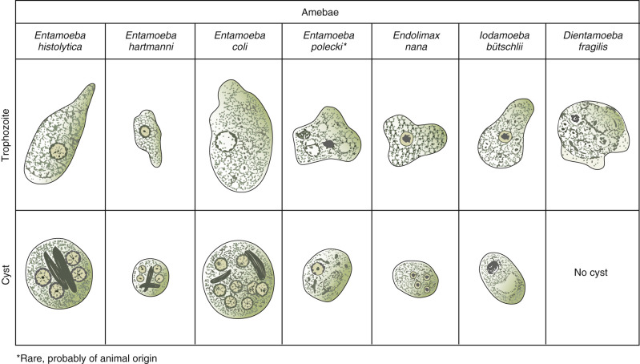

Figure 63-10 

Amebae found in human stool specimens. 

( _Dientamoeba fragilis_ is a flagellate.) 

 

##  Entamoeba histolytica 

_E. histolytica_ may cause various clinical diseases, most commonly amebic dysentery, amebic colitis, and amebic liver abscesses (  Beaver et al, 1984  ;  Ravdin, 1988  ;  Strickland, 2000  ). General host defense mechanisms, previous contact with the parasite, diet, and the strain of _E. histolytica_ may influence the severity of infection. 

Amebic dysentery, which occurs infrequently in the United States, is an acute disease characterized by bloody diarrhea with abdominal cramping. Invasion of the intestinal mucosa occurs, producing ulceration that may lead to perforation and peritonitis. The more common form of disease seen in this country is amebic colitis, which may mimic ulcerative colitis and other forms of inflammatory bowel disease. Symptoms generally are less severe than in amebic dysentery but may include nonbloody diarrhea, constipation, abdominal cramping, and weight loss. Small, pinpoint mucosal ulcerations may develop and expand within the submucosa to form flask-shaped ulcers. All of the colon may be involved or only a portion, most commonly the cecum, rectosigmoid, or ascending colon. 

Amebic liver abscess is the most common form of extraintestinal amebiasis, occurring in approximately 5% of patients with a history of intestinal amebiasis. Symptoms include fever and right upper quadrant pain. These liver abscesses are usually diagnosed by radiographic scans, ultrasound, and serologic tests. Amebae are present in the stool in less than half of patients at the time liver abscess is manifest. Amebic hepatitis, characterized by an enlarged, tender liver in someone with intestinal amebiasis, may occur in some cases. Its pathogenesis is poorly understood. Rarely, amebic abscesses appear in other organs, such as the lung, brain, or skin, by hematogenous spread from the intestine or by contiguous spread from a liver abscess. Masses of granulomatous tissue, known as _amebomas,_ may form in response to the presence of amebae, which in the intestine may cause a so-called _napkin ring lesion_ that could be mistaken for a carcinoma. 

 

##  Epidemiology 

Most infections with _E. histolytica_ are acquired by ingestion of contaminated food or water, although one outbreak was caused by a contaminated colonic irrigation machine (  Istre et al, 1982  ). Pseudo-outbreaks of amebiasis result from laboratory misidentification of inflammatory cells, other amebae, and fecal debris as _E. histolytica_ (  Krogstad et al, 1978  ;  CDC, 1985  ). Amebiasis is relatively uncommon in the United States, and is seen primarily in travelers and immigrants. In contrast, infection with the morphologically indistinguishable ameba, _E. dispar,_ is thought to outnumber _E. histolytica_ infection in the order of 9 : 1 (  Pritt & Clark, 2008  ). 

 

##  Diagnosis 

Examination of a series of stool specimens should be sufficient for diagnosis of intestinal amebiasis in most cases, although differentiation of _E. histolytica_ from _E. dispar, E. moshkovskii,_ and _E. bangladeshi_ requires additional testing. The only exception to this is when ingested erythrocytes are seen within trophozoites, since this is considered to be pathognomonic for invasive _E. histolytica_ infection. If the patient has been given antibiotics or contrast media, the amebic infection may be masked for a period of time. Aspirated material from liver abscesses can be examined microscopically to detect trophozoites. The last material aspirated is most likely to contain trophozoites and may be examined by direct microscopic examination or permanently stained slides. If tissue is available, sections may show organisms that stain prominently with PAS ( [ Fig. 63-11, _C_ ](<#f0060>) ). 

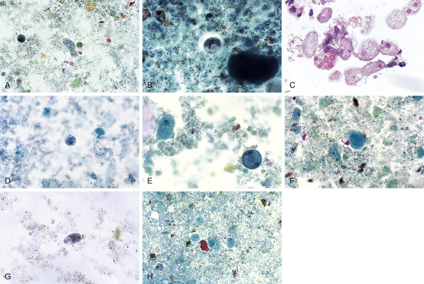

Figure 63-11 

Intestinal protozoa, trichrome stain, oil immersion at 1000×, except as noted. 

**A,** Trophozoite of _Entamoeba histolytica_ . **B,** Quadrinucleate cyst of _E. histolytica_ with rounded chromatoid bars. **C,** _E. histolytica_ trophozoites with ingested red blood cells from a colonic lesion (H&E). **D,** Trophozoite of _E. hartmanni_ . **E,** Trophozoite and binucleate cyst of _E. coli_ . **F,** Multinucleate cyst of _E. coli_ . **G,** Cyst of _Iodamoeba b ütschlii _ with characteristic glycogen vacuole. **H,** Binucleate trophozoites typical for _Dientamoeba fragilis_ . 

( _**B,** _ Photograph courtesy of David Bergeron.) 

Culture procedures (  Diamond, 1988  ;  CLSI, 2005  ;  Visvesvara, 2010a  ) are not widely used for diagnosis but are useful for research and are essential for determining pathogenicity based on zymodemes. EIA antigen detection tests that are specific, sensitive, and able to differentiate _E. histolytica_ from _E. dispar_ are commercially available (see [ Table 63-5 ](<#t0030>) ) (  CLSI, 2005  ;  Garcia, 2007  ). Use of amplification techniques and DNA probes are also useful for differentiating _E. histolytica_ from _E. dispar_ (  Samuelson et al, 1989  ;  Bendall & Chiodini, 1993  ;  Weiss, 1995  ), but are not widely available at this time. 

Serologic tests (see [ Table 63-6 ](<#t0035>) ) are most useful for diagnosis of extraintestinal infection because approximately 95% of patients with amebic liver abscess are seropositive. This decreases to 70% for patients with active intestinal infection and to 10% in asymptomatic carriers. Detectable titers may persist for months or years after successful treatment (  Rosenblatt et al, 1995  ;  Wilson et al, 1995  ). 

Trophozoites of _E. histolytica_ vary from 10 to 60 µm in diameter, with the commensal forms usually 15 to 20 µm and the invasive forms greater than 20 µm in greatest dimension ( [ Table 63-9 ](<#t0050>) ; [ Figs. 63-9 to 63-12 ](<#f0050>) ). In direct wet mounts, trophozoites show progressive motility via rapidly formed hyaline pseudopodia that demonstrate a sharp demarcation between endoplasm and ectoplasm; unstained nuclei are not visible. In invasive disease, some trophozoites contain ingested erythrocytes (see [ Fig. 63-11, _C_ ](<#f0060>) ), a feature diagnostic of _E. histolytica_ infection. In stained preparations, the peripheral nuclear chromatin is evenly distributed along the nuclear membrane as fine granules. The karyosome is small and is often centrally located, with fine fibrils, which generally are not visible, attaching it to the nuclear membrane. Variations in nuclear structure occur, with some karyosomes located eccentrically and peripheral chromatin irregularly distributed. As mentioned previously, the only characteristic that is pathognomonic for _E. histolytica_ is phagocytosis of erythrocytes, which very rarely occurs with other species. The cytoplasm is finely granular, and in invasive organisms, no inclusions or only erythrocyte inclusions are seen. Noninvasive organisms may contain ingested bacteria. In degenerating organisms, the cytoplasm may become vacuolated and nuclei may show abnormal chromatin clumping. 

TABLE 63-9 

Morphology of Trophozoites of Intestinal Amebae 

Species  |  Size (in Diameter or Length)  |  Motility  |  Nucleus Number [ * ](<#hl0001639>) |  Peripheral Chromatin  |  Karyosomal Chromatin  |  Cytoplasm Appearance  |  Inclusions   
---|---|---|---|---|---|---|---  
_Entamoeba histolytica/E. dispar_ |  10-60 µm; usual range, 15-20 µm commensal form [ † ](<#hl0001642>) ; over 20 µm for invasive form [ ‡ ](<#hl0001645>) |  Progressive, with hyaline, fingerlike pseudopods  |  1   
Not visible in unstained preparations  |  Fine granules; usually evenly distributed and uniform in size  |  Small, discrete; usually central but occasionally eccentric  |  Finely granular  |  Erythrocytes occasionally in invasive forms; noninvasive, contain bacteria   
_Entamoeba hartmanni_ |  5-12 µm; usual range, 8-10 µm  |  Usually nonprogressive but may be progressive occasionally  |  1   
Not visible in unstained preparations  |  Similar to E. histolytica  |  Small, discrete, often eccentric  |  Finely granular  |  Bacteria   
_Entamoeba coli_ |  15-50 µm; usual range, 20-25 µm  |  Sluggish, nonprogressive with blunt pseudopods  |  1   
Often visible in unstained preparation  |  Coarse granules, irregular in size and distribution  |  Large, discrete, usually eccentric  |  Coarse, often vacuolated  |  Bacteria, yeasts, or other materials   
_Endolimax nana_ |  6-12 µm; usual range, 8-10 µm  |  Sluggish, usually nonprogressive with blunt pseudopods  |  1   
Visible occasionally in unstained preparations  |  None  |  Large, irregularly shaped  |  Granular, vacuolated  |  Bacteria   
_Iodamoeba b ütschlii _ |  8-20 µm; usual range, 12-15 µm  |  Sluggish, usually nonprogressive  |  1   
Not usually visible in unstained preparations  |  None  |  Large, usually central; surrounded by refractile, achromatic granules; these granules often are not distinct even in stained slides  |  Coarsely granular, vacuolated  |  Bacteria, yeasts, or other materials   
_Dientamoeba fragilis_ [ _ § _ ](<#hl0001648>) |  5-15 µm; usual range, 9-12 µm  |  Pseudopods are angular, serrated, or broad-lobed, and hyaline is almost transparent  |  2   
(In approximately 20% of organisms, only 1 nucleus is present) Nuclei invisible in unstained preparations  |  None  |  Large cluster of 4-8 granules  |  Finely granular, vacuolated  |  Bacteria   
  
Adapted from Brooke MM, Melvin DM: _Morphology of diagnostic stages of intestinal parasites of man._ PHS Publication No. 1966. Bethesda, Md., 1969, U.S. Department of Health, Education and Welfare. 

 * Visibility is for unfixed material. Nuclei sometimes may be visible in fixed material. 

 † Usually found in asymptomatic or chronic cases; may contain bacteria. 

 ‡ Usually found in acute cases; often contain red blood cells. 

 § A flagellate (see text). A cyst form was recently described but requires confirmation by other authors (Stark D, Garcia LS, Barratt JL, et al: Description of Dientamoeba fragilis cyst and precystic forms from human samples. _J Clin Microbiol_ 52:2680-2683, 2014). 

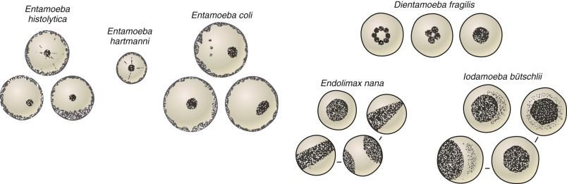

Figure 63-12 

Nuclei of amebae. 

This drawing shows some of the various appearances of amebic nuclei in stained preparations. ( _Dientamoeba fragilis_ is a flagellate; see text.) 

Cysts of _E. histolytica_ are spherical and measure 10 to 20 µm (usually 12 to 15 µm) in diameter ( [ Table 63-10 ](<#t0055>) ; see [ Figs. 63-9, 63-10, and 63-12 ](<#f0050>) ). The rounded precyst stage has a single nucleus but does not have a refractile cyst wall. As it matures, the cyst develops four nuclei, each approximately one-sixth the diameter of the cyst. Cyst nuclei appear similar to those of trophozoites, but their smaller size makes them less useful as differentiating features. The cyst cytoplasm may contain glycogen vacuoles and chromatoid bodies with blunted or rounded ends. The number and size of nuclei and the appearance of chromatoid bodies are important diagnostic criteria for identifying cysts. 

TABLE 63-10 

Morphology of Cysts of Intestinal Amebae 

Species  |  Size  |  Shape  |  Nucleus Number  |  Peripheral Chromatin  |  Karyosomal Chromatin  |  Cytoplasm Chromatoid Bodies  |  Glycogen   
---|---|---|---|---|---|---|---  
_Entamoeba histolytica/E. dispar_ |  10-20 µm; usual range, 12-15 µm  |  Usually spherical  |  4 in mature cyst; immature cysts with 1 or 2 occasionally seen  |  Peripheral chromatin present; fine, uniform granules, evenly distributed  |  Small, discrete, usually central  |  Present; elongate bars with bluntly rounded ends  |  Usually diffuse; concentrated mass often present in young cysts; stains reddish brown with iodine   
_Entamoeba hartmanni_ |  5-10 µm; usual range, 6-8 µm  |  Usually spherical  |  4 in mature cyst; Immature cysts with 1 or 2 often seen  |  Similar to _E. histolytica_ |  Similar to _E. histolytica_ |  Present; elongate bars with bluntly rounded ends  |  Similar to _E. histolytica_  
_Entamoeba coli_ |  10-35 µm; usual range, 15-25 µm  |  Usually spherical; occasionally oval, triangular, or of another shape  |  8 in mature cyst; occasionally supernucleate cysts with 16 or more are seen; immature cysts with 2 or more occasionally seen  |  Peripheral chromatin present; coarse granules irregular in size and distribution, but often appear more uniform than in trophozoites  |  Large, discrete, usually eccentric, but occasionally central  |  Present; usually splinterlike with pointed ends  |  Usually diffuse, but occasionally well-defined mass in immature cysts; stains reddish brown with iodine   
_Endolimax nana_ |  5-10 µm; usual range, 6-8 µm  |  Spherical, ovoid, or ellipsoidal  |  4 in mature cysts; immature cysts with fewer than 4 rarely seen  |  None  |  Large, usually centrally located  |  Occasionally, granules or small oval masses seen, but bodies as seen in _Entamoeba_ species are not present  |  Usually diffuse; concentrated mass seen occasionally in young cysts; stains reddish brown with iodine   
_Iodamoeba b ütschlii _ |  5-20 µm; usual range, 10-12 µm  |  Ovoid, ellipsoidal, triangular, or of another shape  |  1 in mature cyst  |  None  |  Large, usually eccentric; refractile, achromatic granules on one side of karyosome  |  Granules occasionally present, but bodies as seen in _Entamoeba_ species are not present  |  Compact, well-defined mass; stains dark brown with iodine   
  
Adapted from Brooke MM, Melvin DM: _Morphology of diagnostic stages of intestinal parasites of man_ . PHS Publication No. 1966. Bethesda, Md., 1969, U.S. Department of Health, Education and Welfare. 

Those laboratories that do not use one of the immunologic or molecular methods to differentiate _E. histolytica_ from _E. dispar,_ and that rely exclusively on morphologic analysis, must use a reporting format that takes the differing technologies into consideration. Thus, a report of _ “E. histolytica/E. dispar” _ would be most appropriate in the latter circumstance. 

 

##  Nonpathogenic Amebae 

Laboratory personnel must be able to differentiate nonpathogenic or commensal intestinal amebae from _E. histolytica_ / _E. dispar_ and _D. fragilis_ (a flagellate), which are potential pathogens. Identification characteristics, best visualized in permanent stained sections, are summarized in [ Tables 63-9 ](<#t0050>) and [ 63-10 ](<#t0055>) and in [ Figures 63-9, 63-10, and 63-12 ](<#f0050>) . Identification of trophozoites is based on size and nuclear and cytoplasmic characteristics; identification of cysts is based on size, number and characteristics of nuclei, and presence and character of chromatoid bodies and glycogen masses. 

_E. hartmanni_ has morphologic characteristics similar to those of _E. histolytica,_ except trophozoites have a maximum diameter of 12 µm and cysts have a maximum diameter of 10 µm, and cysts often have a single nucleus. Historically, _E. hartmanni_ has been called the _small race_ of _E. histolytica_ . Differentiation requires careful measurement of a representative sample of organisms with a properly calibrated ocular micrometer. 

_Entamoeba coli,_ a common lumen-dwelling ameba, may be difficult to differentiate from _E. histolytica_ . The cytoplasm stains somewhat more darkly than the cytoplasm of _E. histolytica_ and is more vacuolated, containing numerous ingested bacteria, yeasts, and other materials. Although nuclear characteristics differ from those of _E. histolytica_ (see [ Fig. 63-12 ](<#f0065>) ), significant overlap may occur, especially in specimens that have not been promptly preserved. Mature cysts of _E. coli_ contain eight nuclei, although occasional cysts contain 16 or more. Immature cysts, which are not common, have four nuclei that are larger (one-fourth the diameter of the cyst) than nuclei of _E. histolytica_ (one-sixth the diameter of the cyst) and may contain glycogen. Distribution of peripheral chromatin and karyosomes should not be given great emphasis in identification of _Entamoeba_ cysts. Chromatoid bodies, when present, are irregular in shape with splintered or pointed ends, rather than the rounded ends seen in _E. histolytica_ . 

_Endolimax nana_ is the smallest ameba to infect humans. Trophozoites often have atypical nuclei that contain a triangular chromatin mass, a band of chromatin across the nucleus, or two discrete masses of chromatin on opposite sides of the nuclear membrane (see [ Fig. 63-12 ](<#f0065>) ). A clear halo or karyolymph space surrounds the karyosome and extends to the nuclear membrane. Atypical nuclear forms may be helpful in differentiating _E. nana_ from _I. b ütschlii, _ which is similar in appearance but larger. Cysts of _Endolimax_ usually contain four nuclei, although smaller numbers may be seen. Glycogen, when present, occurs diffusely in the cytoplasm rather than as a discrete mass. Cysts are easily differentiated from those of other amebae but may be confused with _Blastocystis hominis_ organisms. The nuclei of _B. hominis,_ however, lack the halos that are typically seen with _E. nana_ cysts. 

The nuclei of _I. b ütschlii _ trophozoites and cysts have a large, centrally located karyosome frequently surrounded by achromatic granules that may not be distinct but appear only as a muddy karyolymph space or halo. In some nuclei, the halo is clear without evident achromatic granules, making the organism indistinguishable from _E. nana_ . Cysts of _I. b ütschlii _ contain a single nucleus, in which the karyosome is often eccentric with a nearby crescent of achromatic granules (see [ Figs. 63-9, 63-10, and 63-12 ](<#f0050>) ). The cyst is characterized by a prominent vacuole of glycogen that stains reddish brown in iodine-stained wet mounts, thus the name of the organism. Glycogen is dissolved by aqueous fixatives and may not be demonstrable in material that has been stored. 

 

##  Blastocystis hominis 

_Blastocystis hominis_ inhabits the large bowel and is frequently found in stool specimens of asymptomatic individuals. Although appearing in stains as an ameba-like protozoan, it is now known to be a _Stramenopile_ (a group that includes diatoms and algae) and is placed in a separate Kingdom. Some studies have linked heavy infection to symptomatic intestinal disease, although this remains controversial (  Markell & Udkow, 1986  ;  Sheehan et al, 1986  ;  Miller & Minshew, 1988  ;  Zierdt, 1991  ;  Stenzel & Boreham, 1996  ;  Garcia, 2007  ). _Blastocystis_ may assume one of three forms: vacuolated (seen most commonly), ameboid, or granular. The vacuolated form, also known as the _central vacuolar form,_ usually is spherical and variable in size (5 to 20 µm) and has a central clear area and two to four peripheral nuclei ( [ Figs. 63-13, _A_ ](<#f0070>) _,_ and [ 63-14, _G_ ](<#f0075>) ). Ameboid forms with bizarre shapes may predominate in heavy infections. The presence of _Blastocystis_ should be reported, especially when they are numerous (five or more per 400× field) (  Sheehan et al, 1986  ;  Stenzel & Boreham, 1996  ). 

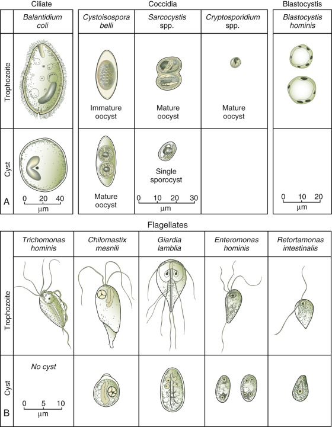

Figure 63-13 

**A,** _Ciliate, Coccidia,_ and _Blastocystis hominis_ spp. found in stool specimens of humans. **B,** Flagellates found in stool specimens of humans. 

(Adapted from Brooke MM, Melvin DM: _Morphology of diagnostic stages of intestinal parasites of man_ . Publication No. [CDC] 848116. Washington, D.C., 1984, U.S. Department of Health and Human Services.) 

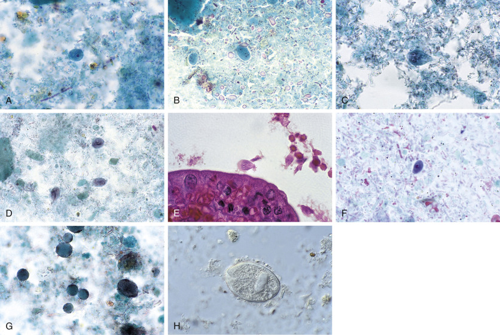

Figure 63-14 

Intestinal protozoa, trichrome stain, oil immersion at 1000×, except as noted. 

**A,** Trophozoite of _Endolimax nana_ . **B,** Quadrinucleate cysts of _E. nana_ . **C,** Trophozoite of _Giardia lamblia_ displaying prominent nuclei, median bodies, flagella, and a tapered posterior end. **D,** Cysts of _G. lamblia_ with nuclei and fibrils. **E,** Duodenal biopsy demonstrating a _G. lamblia_ trophozoite (H&E). **F,** A lemon-shaped cyst of _Chilomastix mesnili_ with visible nucleus and hyaline cap. **G,** Multiple central vacuolar forms of _Blastocystis hominis_ . **H,** Trophozoite of _Balantidium coli_ in wet mount; note cilia covering the cell, cytostome, and macronucleus. 

 

##  Flagellates 

 

##  Dientamoeba fragilis 

_Dientamoeba fragilis_ is an ameboid pathogen that infects the colon and has been associated with diarrheal disease, especially in young children (  Yang & Scholten, 1977  ;  Spencer et al, 1979  ;  Turner, 1985  ;  Preiss et al, 1991  ;  Johnson et al, 2004  ). Although similar in appearance to amebae, _Dientamoeba_ has been reclassified as a flagellate on the basis of ultrastructural details and antigenic similarities. Because of the similarity of _Dientamoeba_ to amebae at the light microscope level, this species has traditionally been included in tables and figures for amebae (see [ Table 63-9 ](<#t0050>) and [ Figs. 63-9, 63-10, 63-11, _H,_ and 63-12 ](<#f0050>) ). 

Symptoms of _D. fragilis_ infection include diarrhea and abdominal distention. Recent evidence suggests that dientamebiasis is a more frequent cause of diarrhea than previously thought: 4.3% of patients in one study harbored this organism (  Spencer et al, 1979  ;  Murray et al, 2007  ). Approximately 25% of persons infected with this parasite have symptomatic disease. In contrast to amebiasis, this infection usually is not associated with other fecal protozoa but does show a 10 to 20 times greater than expected association with enterobiasis (pinworm infection, discussed later). This association and some experimental evidence suggest that _D. fragilis_ infection may be spread by ingestion of pinworm eggs infected with _D. fragilis_ (  Burrows & Swerdlow, 1956  ;  Johnson et al, 2004  ). _D. fragilis_ infection will be overlooked unless permanently stained slides are examined. Multiple specimens may need to be submitted because shedding varies from day to day. When smears are prepared, the last portion of the stool evacuated should be examined because the number of parasites found there tends to be greater. Two thirds to four fifths of the organisms contain two nuclei that consist of a cluster of four to eight karyosomal granules, which may appear as one large irregular karyosome (see [ Fig. 63-12 ](<#f0065>) ). Uninucleate _D. fragili_ s may be confused with trophozoites of _E. nana_ or _I. b ütschlii _ . The cytoplasm is finely granular and often contains ingested bacteria. Trophozoites are delicate and may be easily overlooked, so stained slides must be carefully examined. Classically _D. fragilis_ was not thought to have a cyst stage. However, cyst forms have recently been described and may be the important missing link for explaining how this organism is transmitted from one host to the other (  Stark et al, 2014  ). An immunofluorescence method has been described that may help in the detection of this parasite, but it is not commercially available (  Chan et al, 1993  ). 

 

##  Giardia lamblia 

_Giardia lamblia,_ also known as _G. intestinalis_ and _G. duodenalis,_ is a pathogenic intestinal protozoan that causes both endemic and epidemic disease worldwide; in the United States, it is especially problematic for travelers, campers, children attending day care, and homosexual men (  Wolfe, 1992  ). It frequently causes disease in individuals drinking contaminated water, and a number of large water-borne outbreaks have been described from places such as Aspen, Colorado; Leningrad, Russia; and Rome, New York (  Craun, 1986  ). Pathogenic protozoa are not killed by the usual concentrations of chlorine in municipal water supplies; therefore, unless the water supply is filtered, it may serve as a source of infection, as it did in the Rome, New York, outbreak. 

_G. lamblia_ trophozoites multiply in the small bowel and attach to the mucosa by a ventral concave sucking disk. Infection may be asymptomatic or may cause disease ranging from mild diarrhea with vague abdominal complaints to a malabsorption syndrome with diarrhea and steatorrhea, similar to that of sprue. The pathogenesis is not fully understood, although disruption of the integrity of the brush border with resulting disaccharidase deficiency may occur from direct or indirect effects of the organism's presence (  Wolfe, 1992  ). Giardiasis should be considered in any patient presenting with diarrhea of longer than 10 days' duration. 

Diagnosis is commonly established by demonstration of _Giardia_ trophozoites or cysts, or both, in fecal specimens. Trophozoites predominate in diarrheic stool, whereas infectious cysts are more likely to be found in formed stool. The passage of organisms varies from day to day; therefore, examination of multiple specimens, collected on different days, may be necessary. Direct wet mounts may demonstrate the characteristic “falling leaf” motility of trophozoites in a diarrheic or aspirate specimen. Cysts can be seen in direct wet mount and concentration techniques, and both trophozoites and cysts may be demonstrated on permanently stained slides. In some cases, the organisms cannot be demonstrated in fecal specimens, and small bowel aspirates or so-called _string test specimens_ may be required. In such instances, the laboratory should be advised in advance, so personnel will be available to perform a direct wet mount examination immediately on receipt of the specimen (  Garcia, 2007  ). 

Many antigen detection methods based on DFA or EIA are commercially available (  CLSI, 2005  ;  Garcia  2007  ). They appear to have good sensitivity and specificity and may detect some infections not found by morphologic examination of stools. They also can be particularly helpful in epidemiologic investigations but cannot replace the need for traditional morphologic examination of the specimen if other pathogenic parasites are suspected. Antigen detection methods may be particularly useful for patients with diarrhea who have not traveled outside of the United States since they may be used in place of the labor-intensive and subjective O&P examination, often in combination with an antigen test for _Cryptosporidium_ spp. Importantly, they require significantly fewer specimens for sensitive detection of _Giardia_ (at least two) compared to O&P testing, which may require up to 7 specimens (  Hanson & Cartwright, 2001  ) _._

When viewed in their broadest dimension, _Giardia_ trophozoites are pear-shaped with a tapered posterior end, and have two nuclei and curved median bodies that give the appearance of a smiling face with prominent eyes ( [ Table 63-11 ](<#t0060>) ; see [ Figs. 63-13, _B_ ](<#f0070>) _,_ and [ 63-14, _C_ to _E_ ](<#f0075>) ). When viewed from the side, the anterior end of the organism is thicker and tapers posteriorly; the anterior half to three quarters consists of the sucking disk on the ventral surface. The four lateral, two ventral, and two caudal flagella usually are not evident in wet mounts or in stained preparations. Cysts are oval and usually quadrinucleate. Below the nuclei are dark-staining median bodies that cross longitudinal fibrils, providing distinctive internal characteristics. The cytoplasm often is retracted from the cyst wall. 

TABLE 63-11 

Morphology of Intestinal Flagellates 

Species  |  Size (Length)  |  Shape  |  Motility  |  Number of Nuclei  |  Number of Flagella [ * ](<#hl0001871>) |  Other Features   
---|---|---|---|---|---|---  
**Trophozoites**  
_Pentatrichomonas hominis_ [ † ](<#hl0001874>) |  8-20 µm; usual range, 11-12 µm  |  Pear-shaped  |  Rapid, jerking  |  1   
Not visible in unstained mounts  |  3–5 anterior; 1 posterior  |  Undulating membrane extending length of body   
_Chilomastix mesnili_ |  6-24 µm; usual range, 10-15 µm  |  Pear-shaped  |  Stiff, rotary  |  1   
Not visible in unstained mounts  |  3 anterior; 1 in cytostome  |  Prominent cytostome extending  \-  ; spiral groove across ventral surface   
_Giardia lamblia_ |  10-20 µm; usual range, 12-15 µm  |  Pear-shaped  |  Falling leaf  |  2   
Not visible in unstained mounts  |  4 lateral; 2 ventral; 3 caudal  |  Sucking disk occupying  \-  of ventral surface   
_Enteromonas hominis_ |  4-10 µm; usual range, 8-9 µm  |  Oval  |  Jerking  |  1   
Not visible in unstained mounts  |  3 anterior; 1 posterior  |  One side of body flattened; posterior flagellum extending free, posteriorly or laterally   
_Retortamonas intestinalis_ |  4-9 µm; usual range, 6-7 µm  |  Pear-shaped or oval  |  Jerking  |  1   
Not visible in unstained mounts  |  1 anterior; 1 posterior  |  Prominent cytostome extending approximately  length of body   
**Species** |  **Size** |  **Shape** |  **Number of Nuclei** |  **Other Features**  
Cysts   
_Chilomastix mesnili_ |  6-10 µm; usual range, 8-9 µm  |  Lemon-shaped, with anterior hyaline knob or “nipple” |  1   
Not visible in unstained preparations  |  Cytostome with supporting fibrils.   
Usually visible in stained preparations.   
_Giardia lamblia_ |  8-13 µm; usual range, 11-12 µm  |  Oval or ellipsoidal  |  Usually 4; not distinct in unstained preparations; usually located at one end  |  Fibrils or flagella longitudinally in cyst.   
Cytoplasm often retracts from a portion of cell wall.   
_Enteromonas hominis_ |  4-10 µm; usual range, 6-8 µm  |  Elongate or oval  |  1-4, usually 2 lying at opposite ends of cyst; not visible in unstained mounts  |  Resembles _E. nana_ cyst. Fibrils or flagella usually are not seen.   
_Retortamonas intestinalis_ |  4-9 µm; usual range, 4-7 µm  |  Pear-shaped or slightly lemon-shaped  |  1   
Not visible in unstained mounts  |  Resembles _Chilomastix_ cyst.   
Shadow outline of cytostome with supporting fibrils extends above nucleus.   
  
Adapted from Brooke MM, Melvin DM: _Morphology of diagnostic stages of intestinal parasites of man._ PHS Publication No. 1966. Bethesda, Md., 1969, U.S. Department of Health Education and Welfare. 

 * Not a practical feature for identification of species in routine fecal examinations. 

 † _Pentatrichomonas hominis_ does not have a cyst form. 

 

##  Chilomastix mesnili 

_Chilomastix mesnili_ (see [ Table 63-11 ](<#t0060>) , [ Figs. 63-13, _B_ ](<#f0070>) _,_ and [ 63-14, _F_ ](<#f0075>) ) is a nonpathogenic lumen-dwelling flagellate of humans that must be differentiated from trophozoites of amebae and _Giardia_ in stained smears. The consistent location of the single nucleus at one end of the organism and the tapering of the end opposite the nucleus are helpful. If multiple organisms are examined, the cytostome and the spiral groove are visible in some. The three external flagella usually are not visible in stained or formalin-fixed preparations. The lemon-shaped cysts contain various curved cytostomal fibers with a safety pin–like appearance. 

 

##  Pentatrichomonas hominis 

_Pentatrichomonas hominis,_ known previously as _Trichomonas hominis_ (see [ Table 63-11 ](<#t0060>) and [ Fig. 63-13, _B_ ](<#f0070>) ), is an infrequently seen nonpathogenic intestinal flagellate that may be confused with _E. hartmanni_ or small _E. histolytica_ trophozoites. Organisms do not stain particularly well and often are distorted in permanent smears. Several organisms may have to be examined in stained preparations to demonstrate the single _Entamoeba_ -like nucleus, undulating membrane and associated costa, and flagella. A prominent rodlike object, the axostyle, runs through the organism and protrudes from the posterior end. No cyst stage has been described. 

 

##  Trichomonas vaginalis 

_Trichomonas vaginalis_ is a common cause of vaginitis, characterized by inflammation, itching, vaginal discharge, and, occasionally, dysuria. The infection usually is spread by sexual intercourse, often by males who have an asymptomatic infection. Occasionally, males may have symptomatic prostatitis or urethritis. _T. vaginalis_ infections are commonly diagnosed in the physician's office by direct wet mount examination of vaginal fluid, prostatic fluid, or sediments of freshly passed urine. Morphologically, _T. vaginalis_ resembles _P. hominis_ but is larger (up to 23 µm), and the undulating membrane extends only half the length of the body. Because of the difference in habitat, it generally is not necessary to differentiate these trichomonads morphologically. 

Direct wet mount examination may be insensitive (60% to 70% sensitivity for vaginal secretions), and NAATs are now the recommended method for detection (  Garcia, 2007  ;  Murray et al, 2007  ). The Aptima _T. vaginalis_ test (Gen-Probe Hologic, Bedford, Mass.) is cleared for testing asymptomatic and symptomatic women and has a reported clinical sensitivity and specificity of ≥99% for vaginal and cervical swabs and >95% for female urine specimens (  Schwebke et al, 2011  ). Other methods of testing include culture, antigen detection, and microscopic examination of stained smears (e.g. Papanicolaou, Giemsa). Cultures, including use of a convenient “pouch” system, were previously considered the gold standard prior to introduction of NAATs and have a sensitivity of about 75% to 96% (  Krieger et al, 1988  ;  Schmid et al, 1989  ;  Beal et al, 1992  ;  Levi et al, 1997  ). Antigen tests such as DFA and EIA techniques that use monoclonal antibodies also have relatively good sensitivity (82% to 95%) and can provide a result in approximately 10 minutes (  Krieger et al, 1988  ;  Lisi et al, 1988  ;  Wilson et al, 1995  ). Papanicolaou-stained gynecologic smears may reveal _T. vaginalis_ on occasion but have poor sensitivity and specificity. 

 

##  Other Flagellates 

_Enteromonas hominis_ and _Retortamonas intestinalis_ are small, nonpathogenic, intestinal flagellates that are seen infrequently but, when present, may occur in large numbers. Morphologic characteristics are reviewed in [ Table 63-11 ](<#t0060>) (see also [ Fig. 63-13, _B_ ](<#f0070>) ). _Trichomonas tenax_ is a trichomonad that occasionally is recovered from the oral cavity but does not cause disease. 

 

##  Ciliates 

 

##  Balantidium coli 

The ciliate _Balantidium coli_ (see [ Figs. 63-13, _A_ ](<#f0070>) _,_ and [ 63-14, _H_ ](<#f0075>) ) may cause a dysentery-like syndrome with colonic ulcerations similar to that of amebiasis, but only rarely disseminates outside of the intestine. Human infection, rare in the United States, is usually acquired from hogs, which are commonly infected. _B. coli_ is the largest protozoan and only ciliate to infect humans. Trophozoites are between 40 µm and more than 200 µm in greatest dimension (most measure 50 to 100 µm) and are uniformly covered with cilia that are slightly longer at the anterior end adjacent to the cytostome. A large macronucleus is readily seen in stained preparations, and a smaller micronucleus is infrequently visible. Numerous food vacuoles and contractile vacuoles are present in the cytoplasm. Cysts are rounded, measuring 50 to 70 µm in length. Cilia may be seen within younger cysts, and nuclear characteristics are similar to those of trophozoites. Stool specimens that have been contaminated with stagnant water may contain free-living ciliates, which usually can be distinguished from _B. coli_ by differences in their ciliary pattern. 

 

##  Coccidia 

The coccidia comprise a large group of apicomplexan parasites that have a sexual stage in the intestinal tract of invertebrate and vertebrate animals. Some species also develop asexually in extraintestinal sites in host tissues. Genera infecting the intestine of humans, such as _Cystoisospora, Sarcocystis, Cryptosporidium,_ and _Cyclospora,_ generally produce self-limited diarrheal disease in immunocompetent persons. Severe protracted diarrhea may develop in immunocompromised hosts following infection with _Cystoisospora, Cryptosporidium,_ and _Cyclospora_ . 

 

##  Cystoisospora belli 

_Cystoisospora belli_ (formerly known as _Isospora belli_ ) undergoes both asexual and sexual development in the cytoplasm of small intestine epithelial cells ( [ Fig. 63-15, _A_ ](<#f0080>) ). Sexual development results in the production of oocysts, which are passed in the stool and mature to the infective stage in the environment. Human infections cause diarrhea and malabsorption but generally are self-limited. In patients with AIDS or other immunosuppressive disorders, disease may persist for months or years, and may contribute to death (  DeHovitz et al, 1986  ;  Mannheimer & Soave, 1994  ;  Murray et al, 2007  ). Diagnosis is established by finding the unsporulated oocysts measuring 12 × 30 µm in fecal specimens, usually in direct wet mounts or concentration preparations ( [ Fig. 63-15, _B_ ](<#f0080>) ). If the unfixed specimen is left at room temperature for 24 to 48 hours, sporulation occurs. The infectious oocyst contains two sporocysts, each with four sporozoites (see [ Fig. 63-13, _A_ ](<#f0070>) ). These oocysts are similar to those of _Cryptosporidium_ in that they stain acid-fast. 

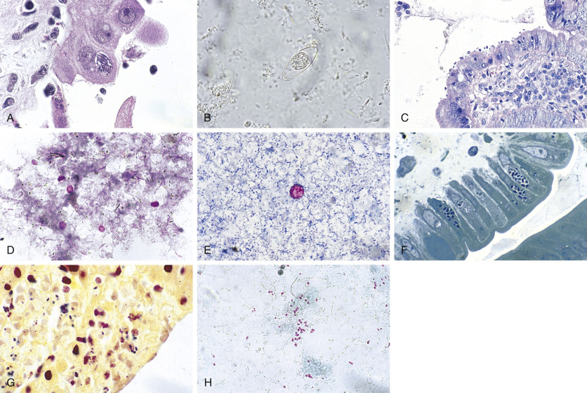

Figure 63-15 

**A,** Schizont of _Cystisospora belli_ containing numerous merozoites developing within gallbladder epithelium (H&E; 1000×). **B,** Oocyst of _C. belli_ in feces (wet mount; 1000×). **C,** Small-bowel biopsy demonstrating development of _Cryptosporidium parvum_ oocysts within the brush border of enterocytes (H&E; 400×). **D,** Modified acid-fast stain of a fecal smear demonstrating oocysts of _C. parvum_ (1000×). **E,** Modified acid-fast stain of a fecal smear demonstrating an oocyst of _Cyclospora cayetanensis_ (1000×). **F,** Small-bowel biopsy demonstrating development of microsporidial spores within enterocytes (epoxy-embedded section stained with toluidine blue; 1000×). **G,** Microsporidial spores seen in liver parenchyma in an individual infected with the human immunodeficiency virus (Brown and Brenn stain; 1000×). **H,** Numerous microsporidial spores in feces stained with the modified/strong trichrome stain (1000×). 

 

##  _Sarcocystis_ spp. 

_Sarcocystis_ spp. are typical two-host coccidia in which the sexual phase develops in the intestinal mucosa of carnivorous animals, and the asexual, extraintestinal phase occurs in the muscles and tissues of various intermediate hosts. Humans may serve as definitive or intermediate hosts, depending on the species of _Sarcocystis_ . Intestinal infection with _Sarcocystis hominis_ and _Sarcocystis suihominis_ is acquired by ingestion of raw or incompletely cooked beef or pork, respectively, which contains tissue cysts (sarcocysts). Infection usually is asymptomatic, but occasional patients have transient diarrhea, abdominal pain, or anorexia. Intestinal infection is self-limited because asexual multiplication occurs in the intermediate host and is not repeated in the definitive host. Oocyst production is limited by the number of organisms ingested in the form of sarcocysts. The diagnosis is established by detection of sporulated 25 × 33 µm sporocysts in the stools (see [ Fig. 63-13, _A_ ](<#f0070>) ). Each mature sporocyst contains four sporozoites. The oocyst wall is thin and often is not detectable, or has already ruptured, releasing the two sporocysts. These forms, best seen in wet mounts or in acid-fast–stained smears, appear larger than oocysts of _Cryptosporidium_ . Trichrome stains are of little value in detecting these parasites. Humans also may serve as intermediate hosts for several unnamed animal species of _Sarcocystis_ (known collectively as _Sarcocystis lindemanni_ ), in which case cysts are found in skeletal and cardiac muscles (  Beaver et al, 1979  ;  Strickland, 2000  ). 

 

##  _Cryptosporidium_ spp. 

_Cryptosporidium_ spp. use a single host in their life cycle but may infect humans (predominantly _C. hominis_ and _C. parvum_ ) and a wide variety of animals, including cattle and sheep (  Coupe et al, 2005  ). Parasites develop in the brush border of epithelial cells of the small and large intestine and occasionally spread to other sites such as the gallbladder, the pancreas, and the respiratory tract (see [ Figs. 63-13, _A_ ](<#f0070>) _,_ and [ 63-15, _C_ and _D_ ](<#f0080>) ). _Cryptosporidium_ is a common cause of acute, self-limited diarrhea in normal persons, especially in children who attend day care. The epidemiology of cryptosporidiosis is similar to that of giardiasis. One of the largest known outbreaks of water-transmitted infection occurred in Milwaukee, Wisconsin, in 1993. In that outbreak, an estimated 400,000 individuals became ill from tap water contaminated with farm runoff following heavy rains (  MacKenzie et al, 1994  ). Similar to cysts of _Giardia, Cryptosporidium_ oocysts are refractory to usual chlorination levels of drinking water, and unless a community's water supply from a surface source is filtered, epidemics may occur. In patients with AIDS, _Cryptosporidium_ may cause chronic secretory diarrhea that can last for months to years and may contribute to death. The incubation period is about 8 days, and in previously healthy persons, the illness lasts 9 to 23 days. Patients may have malaise, fever, anorexia, abdominal cramps, and diarrhea (  Current & Garcia, 1991  ;  Mannheimer & Soave, 1994  ). 

Diagnosis usually is established by stool examination or antigen detection. Various concentration methods, including formalin–ethyl acetate sedimentation and Sheather's sugar flotation, work well (  CLSI, 2005  ;  Garcia, 2007  ). The availability of the formalin–ethyl acetate method makes this technique attractive, although centrifugation speed and times must be increased to maximize recovery (  CLSI, 2005  ;  Garcia, 2010  ). A smear is prepared from the sediment and stained with an acid-fast stain or immunofluorescent reagents. Several acid-fast staining methods, including auramine-O, have been evaluated, but a modified cold Kinyoun method is used most widely. Spherical oocysts measure 4 to 6 µm in diameter and, when stained by the modified Kinyoun procedure, appear a deep fuchsia, although some unevenness of staining intensity is noted, along with variability in the percentage of cysts that stain positive. Positive control slides must be used with every run. 

Commercial DFA and EIA reagents, which provide good sensitivity and specificity (  CLSI, 2005  ;  Garcia, 2007  ;  Murray et al, 2007  ), are especially good for laboratories where _Cryptosporidium_ is infrequently encountered, and where there is difficulty in maintaining expertise in the interpretation of acid-fast stains. As with _Giardia,_ antigen testing is particularly useful for patients with diarrhea who have not traveled outside of the United States. In these patients, antigen testing (usually performed in conjunction with _Giardia_ antigen testing) can supplement or replace the traditional subjective O&P examination with acid-fast staining. 

The need to examine stool specimens for _Cryptosporidium_ depends on the populations served and the goals, interests, and abilities of the individual laboratory. Some laboratories perform examination for _Cryptosporidium_ only on specific request; others evaluate all specimens from immunocompromised patients. 

 

##  Cyclospora cayetanensis 

Like the other coccidia, _C. cayetanensis_ causes diarrheal disease in both immunocompetent and immunocompromised individuals (  Ortega et al, 1994  ;  Murray et al, 2007  ). The parasite has been recovered from patients in several countries, including the United States, and was initially described as a blue-green alga, a cyanobacterium-like body, or a coccidian-like body, among others (  Ortega et al, 1993  ;  Shields & Olson, 2003  ). Infection causes a flulike illness with nausea, vomiting, weight loss, and explosive watery diarrhea lasting 1 to 3 weeks. Oocysts, passed unsporulated, appear as nonrefractile spheres 8 to 10 µm in diameter that contain a cluster of refractile globules enclosed within a membrane when viewed by light microscopy. A total of 1 to 2 weeks is required for sporulation, after which the mature oocyst contains two sporocysts, each with two sporozoites. In trichrome-stained smears, the oocysts appear as clear, round, and somewhat wrinkled objects. Oocysts autofluoresce bright green to intense blue under ultraviolet epifluorescence; they stain acid-fast when modified acid-fast or auramine-O staining techniques are used. They must be differentiated from oocysts of _Cryptosporidium,_ which stain in an identical fashion but are smaller (4 to 6 µm) ( [ Fig. 63-15, _E_ ](<#f0080>) ). 

 

##  Microsporidia 

Microsporidia are obligate intracellular, spore-forming fungi in the phylum _Microspora_ that infect a variety of animals, including humans (  Shadduck & Greely, 1989  ;  Franzen & Müller, 1999  ). They are serious pathogens in immunocompromised hosts, especially those with AIDS, in whom they are responsible for a large percentage (up to 30% in some studies) of otherwise unexplained diarrheal disease (  Curry & Caning, 1993  ). _Enterocytozoon bieneusi_ and _Encephalitozoon intestinalis,_ the two species implicated most commonly in human intestinal infection, may cause protracted diarrhea and weight loss in AIDS patients similar to that caused by _Cryptosporidium_ . Many species may also cause disseminated disease and are an important cause of morbidity and mortality in immunocompromised patients, including organ transplant recipients (  Cali et al, 1993  ;  Willson et al, 1995  ;  Murray et al, 2007  ;  Ramanan & Pritt, 2014  ). 

The organisms multiply intracellularly (merogony) and form resistant spores (sporogony) that eventually rupture the host cell and infect adjacent cells or are passed out of the body. The spore contains a coiled polar tubule, which is forcefully extruded under appropriate environmental stimuli and penetrates the membrane of the recipient cell. The parasite's sporoplasm is injected through the tubule into the host cell cytoplasm, where multiplication ensues. Reservoir hosts have not been identified. Occasionally, patients have been infected by other genera of microsporidia, including _Encephalitozoon_ (hepatitis, ocular infection, CNS disease), _Nosema_ (disseminated infection), and _Pleistophora_ (myositis) (  Shadduck & Greeley, 1989  ;  Curry & Caning, 1993  ), among others (  Franzen & Müller, 1999  ;  Garcia, 2007  ). 

Until recently, diagnosis required examination of tissues submitted for routine light ( [ Fig. 63-15, _F_ and _G_ ](<#f0080>) ) and electron microscopy. Development of a modified trichrome staining method for examination of stool specimens for spores has been a significant advance in detecting infection (  Weber et al, 1992  ;  Garcia, 2007  ). With this method, the small (1.5 to 3 µm) elliptical spores stain red against a faint green background, and some display a characteristic midbody cross-band ( [ Fig. 63-15, _H_ ](<#f0080>) ). Modifications of this method have also been described. Fluorochrome stains such as Uvitex 2B and Calcofluor white appear to be more sensitive in detecting spores and may be useful in the initial screening of specimens, although these methods will also stain yeasts (van  Gool et al, 1993  ;  DeGirolami et al, 1995  ;  Luna et al, 1995  ). The small size of the spores makes detection by any method a challenge (  CLSI, 2005  ). 

Several PCR tests have been described for different microsporidia species and may offer superior sensitivity and specificity over conventional microscopy-based methods (  Vasoo & Pritt, 2013  ). Unfortunately, there are no FDA-approved tests at this time, and molecular testing is limited to select reference laboratories and the CDC. 

,  

##  Intestinal Helminths 

Intestinal helminths discussed here include those nematodes (roundworms), cestodes (tapeworms), and trematodes (flukes) that reside as adults in the gastrointestinal tract or live in other locations (liver, lung, or blood) and produce eggs that exit the human body via the intestinal tract. Sizes for adult helminths vary from 1 mm to more than 10 m in length; sizes for eggs range from 25 to 150 µm ( [ Fig. 63-16 ](<#f0085>) ). 

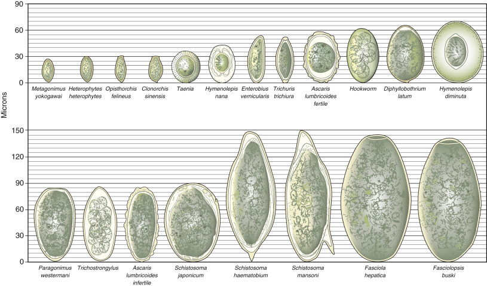

Figure 63-16 

Relative sizes of helminth eggs. 

(Courtesy of Centers for Disease Control and Prevention, Parasitology Training Branch, Atlanta.) 

An understanding of helminth life cycles and zoogeography is critical in knowing which parasite stages may be present in a presumed infection, what organs or tissues may be involved, and when diagnostic stages may be expected to appear following exposure. Although diagnosis usually depends on finding and identifying an appropriate developmental stage (egg, larva, or adult), some parasitic infections may be diagnosed chiefly on clinical grounds or on the basis of serologic evidence, or both. 

Certain species have developmental cycles whereby infectious stages may be transmitted directly from person to person ( _Enterobius_ and _H. nana_ ). In others ( _Trichuris, Ascaris,_ and _Trichostrongylus_ ), an additional maturation period outside of the host is required before the parasite egg or larva (in the latter case) is infectious. Ingestion of infective stages may also occur incidentally along with parasite vectors _(Dipylidium, Hymenolepis),_ plants _(Fasciolopsis, Fasciola),_ or animal tissues ( _Trichinella, Taenia, Diphyllobothrium, Clonorchis, Opisthorchis, Paragonimus, Heterophyes, Metagonimus,_ and _Nanophyetus_ ). In some cases, larval parasite stages may directly penetrate the skin (hookworms, _Strongyloides,_ and schistosomes). 

Recovery and identification of helminth eggs and larvae in stool, urine, or sputum requires a systematic approach and appropriate training of the individuals performing the evaluations. The size of the eggs and larvae is an especially important characteristic, and measurement often requires a properly calibrated ocular micrometer. External characteristics of eggs that should be noted include their shape, their wall thickness, and the presence or absence of a mamillated covering, operculum, opercular shoulders, abopercular knob, polar plugs, or spines. Egg development (embryonated, unembryonated) and the presence or absence of hooklets, which are characteristic of cestodes, should be noted. The examiner also needs to have an appreciation for the large variety of artifacts detected in human feces that may mimic parasite eggs and larvae (see [ Table 63-4 ](<#t0025>) ). 

 

##  Nematodes 

Nematodes or roundworms are common worms that inhabit the human intestinal tract, blood, and tissues. Up to one third of the world's population is thought to be host to intestinal nematodes. Some attach to intestinal mucosa by means of specialized mouthparts at the anterior end (e.g., hookworms, whipworm) while others move freely in the lumen of the bowel (e.g., pinworm, _Ascaris lumbricoides_ ). Nematodes have round, unsegmented bodies covered with an acellular cuticle and possess a full digestive tract. There are both male and female worms, unlike the cestodes and some of the trematodes, which are hermaphrodites. Identification of characteristic eggs in stool is used for diagnosis of all intestinal helminth infections with the exception of _Strongyloides stercoralis_ , in which only larvae are seen in stool _._ This section covers intestinal nematodes, while nematodes that invade tissue are covered in the “ [ Tissue Helminths ](<#s0505>) ” section later in the chapter. 

 

##  _Enterobius vermicularis_ (Pinworm Infection) 

Enterobiasis or oxyuriasis (named for its order, _Oxyuroida_ ) is the most common helminthic infection in children of all social strata in the United States. Although it is primarily a parasite of young children, rapid maturation of the egg allows it to be readily transmitted from child to child and from child to adult, in both family and institutional settings. Male and female worms reside primarily in the cecum and adjacent areas. Females measure up to 13 mm in length and have a pointed posterior end that gives rise to their common name, the pinworm. Both sexes have prominent lateral alae that are seen in cross-section and a prominent esophageal bulb ( [ Fig. 63-17, _A_ to _C_ ](<#f0090>) ). 

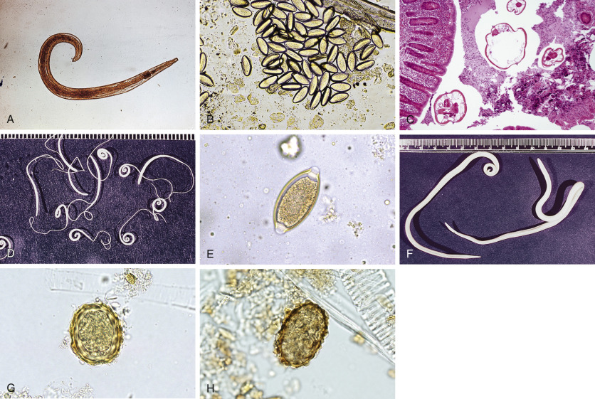

Figure 63-17 

All direct examination with brightfield illumination except as noted. 

**A,** Adult male pinworm, _Enterobius vermicularis,_ with curved posterior end; note prominent esophageal bulb (4×). **B,** Numerous eggs of _E. vermicularis_ as seen on a cellophane tape preparation (400×). **C,** Cross-sections of adult _E. vermicularis_ in the appendix; note characteristic lateral alae (H&E; 100×). **D,** Adult whipworms, _Trichuris trichiura_ ; note females with straight tails and males with coiled tails. **E,** Egg of _T. trichiura_ (400×). **F,** Adult female and male _Ascaris lumbricoides,_ the large human roundworm. **G,** Fertile, unembryonated egg of _A. lumbricoides_ (400×). **H,** Infertile egg of _A. lumbricoides_ (400×). ( _**D** _ and _**F** _ from Zaiman H, editor. A pictorial presentation of parasites: a cooperative collection; [ http://www.astmh.org/Zaiman_Slides/1271.htm ](<http://www.astmh.org/Zaiman_Slides/1271.htm>) _._ ) 

Although males are rarely seen, females may be found on the surface of a stool specimen or on the perianal skin, especially at night, where eggs are deposited. Eggs are colorless and ovoid with one side flattened, and measure 20 to 40 µm wide by 50 to 60 µm long (see [ Fig. 63-17, _B_ ](<#f0090>) ). They are infective within hours and when ingested complete development to the gravid adult stage within 1 month (the prepatent period). 

Although infection may be asymptomatic, children often suffer from pruritus ani, irritability, and loss of sleep. Enterobiasis should be ruled out early in the evaluation of enuresis. Adult worms may also migrate to unusual sites such as the vagina, fallopian tubes, or peritoneal cavity. Their ultimate death in these locations may provoke inflammatory, granulomatous reactions (  Symmers, 1950  ;  Garcia, 2007  ). 

Recovery of eggs or, less commonly, adults from the perianal skin is usually done using the cellulose tape technique first thing in the morning before the patient bathes or defecates (  Ash & Orihel, 1987  ;  Garcia, 2007  ). Only 5% to 10% of cases are detected using routine stool examination. Diagnosis may require examination of several samples taken on different days before eggs can be detected (  Sadun & Melvin, 1956  ). 

 

##  _Trichuris trichiura_ (Whipworm Infection) 

Trichuriasis is common worldwide in tropical and subtropical regions. Adult worms are found in the large intestine, especially the cecum, but in heavy infection they can be found throughout the colon and rectum. Males and females measure up to 50 mm in length and remain attached to the intestinal mucosa by the long, slender anterior end, while the thicker posterior end hangs free in the lumen. Female worms are elongate, whereas the tails on males are coiled ( [ Fig. 63-17, _D_ ](<#f0090>) ). _Trichuris_ has a direct life cycle in which eggs are passed in stool unembryonated and require several weeks under appropriate soil conditions to mature to the infective stage. When embryonated eggs are ingested, larvae are released and mature into adults in the colon, where they attach and survive up to 10 years. 

Light infection usually is asymptomatic, but when larger numbers (>300 worms) are present, diarrhea or symptoms of dysentery may develop in association with dehydration and anemia (  Beaver et al, 1984  ;  Strickland, 2000  ). Rectal prolapse may occur in heavily infected children (  Cooper & Bundy, 1988  ). 

Diagnosis is made by finding typical eggs in direct fecal smears or with concentration techniques. The eggs are barrel-shaped with refractile plugs at both ends and usually measure 50 to 55 µm long by 22 to 24 µm wide ( [ Fig. 63-17, _E_ ](<#f0090>) ). Occasionally, humans may become infected with the dog whipworm, _Trichuris vulpis,_ which has eggs that are larger, wider, and more barrel-shaped than those of _Trichuris trichiura_ . Egg quantitation techniques occasionally may be requested to assess infection intensity, therapeutic efficacy, and reacquisition rates of parasites. 

 

##  Capillaria philippinensis 

This parasite, normally found in fish-eating birds, infects humans who ingest raw or incompletely cooked fish that contain infective larvae in their flesh. Although first described in persons from the Philippines, and later Thailand, occasional cases have been reported in Asia, the Middle East, and South America (  Cross, 1992  ;  Murray et al, 2007  ). The parasites may cause chronic diarrhea, and infected individuals may pass eggs, larvae, and even adult worms in their feces. Eggs resemble those of _Trichuris,_ although they measure 36 to 45 µm in length by 21 µm in width and have thick, radially striated shells and mucoid plugs, which are inconspicuous. 

 

##  _Ascaris lumbricoides_ (Ascariasis) 

This is the largest nematode that infects the intestinal tract of humans and is probably the most common of the intestinal roundworms, infecting an estimated 1.3 billion individuals worldwide (  John & Petri, 2006  ). Infection occurs primarily in areas with little or no sanitation and, as with _Trichuris,_ is especially common in children, who are also more likely to harbor heavy infection. 

Adult _Ascaris_ live primarily in the duodenum and proximal jejunum. Females measure up to 35 cm in length by 6 mm in diameter. The male is somewhat smaller and has a ventrally curved tail, unlike the female ( [ Fig. 63-17, _F_ ](<#f0090>) ). Both adult and immature worms can be identified by the presence of three prominent lips at the anterior end. 

Females produce approximately 200,000 eggs per day, which are unembryonated when passed and require 4 to 6 weeks in a satisfactory environment to become infective. Following ingestion, eggs hatch in the intestine, and larvae penetrate the mucosa to gain access to the bloodstream. They are carried to the lungs and mature briefly in the alveolar capillary bed before entering the alveoli. Respiratory clearance mechanisms move the larvae to the epiglottis, where they are swallowed and grow to adulthood in the small bowel. Development from embryonated egg to adult takes approximately 2 months. 

Symptoms of ascariasis vary from asymptomatic infection to severe disease. Migration of large numbers of larvae through the lungs can cause _Ascaris_ pneumonitis or Loeffler's syndrome, characterized by bilateral diffuse, mottled pulmonary infiltrates and mild bronchitis associated with peripheral eosinophilia. The syndrome is rare and usually occurs in individuals who have been previously exposed to _Ascaris_ antigens. 

The presence of a few worms in the intestine is rarely noticed, whereas heavy infection may produce varying degrees of abdominal pain and diarrhea. Intestinal obstruction may also occur with a mass of worms, especially in children. Even a small number of worms is cause for concern because of their ability to invade ectopic sites such as the common bile duct and liver, appendix, and stomach. Fever or drug therapy may stimulate migration. In endemic areas, anthelmintics often are prescribed before anesthetics are used in elective surgery. 

Infection is diagnosed by demonstrating eggs in feces or on recovery of an adult that has been passed or vomited. The large number of eggs produced each day make detection of even a single worm probable. A count of fewer than 20 eggs per slide (2 mg of feces) indicates light infection, and a count of more than 100 eggs per slide indicates heavy infection. 

Fertile _Ascaris_ eggs are round to slightly oval with a yellow-brown, irregular external mamillated layer and a thick shell. Eggs that have lost their mamillated layer are called _decorticate_ and may superficially resemble hookworm eggs. They are passed unembryonated and measure approximately 55 to 75 µm long by 35 to 50 µm wide ( [ Fig. 63-17, _G_ and _H_ ](<#f0090>) ). Single females may produce unfertilized eggs, which are larger and more elongate (up to 90 µm in length) and have a thinner shell with irregular mamillations. These eggs are filled with irregularly sized fat globules. 

 

##  _Trichostrongylus_ spp. 

Human disease caused by _Trichostrongylus_ spp. represents a zoonotic infection because these parasites principally infect large herbivores such as sheep, cattle, and goats. Several species may infect humans, including _Trichostrongylus colubriformis, Trichostrongylus orientalis, Trichostrongylus axei,_ and _Trichostrongylus brevis,_ all of which are found in many parts of the world. Adult worms inhabit the small bowel and produce eggs that mature outside of the body. Larvae emerge and crawl about on soil and vegetation, where they are available to be ingested by definitive hosts. Unlike hookworms, they do not invade skin directly, nor does the life cycle involve a migratory phase through the lungs. Infection usually is light and asymptomatic, but heavy infection may produce abdominal pain and diarrhea, usually with eosinophilia. Eggs resemble those of hookworms but are longer and narrower, measuring 78 to 98 µm by 40 to 50 µm, and are slightly tapered at one end. 

 

##  _Necator americanus_ and _Ancylostoma duodenale_ (Hookworm Infection) 

Hookworms, which are among the more common helminths known to infect humans, occur in tropical and subtropical regions and some temperate areas. _Necator americanus_ is found in the United States and in other areas of the world and frequently overlaps in distribution with _Ancylostoma duodenale,_ which does not occur in the United States. 

Adult females measure up to 12 mm in length, and the males slightly less. Males are readily distinguished by the fan-shaped copulatory bursa at the posterior end. The anterior end of hookworms is modified into a buccal capsule that contains teeth or cutting plates. Both sexes attach to the mucosa of the small intestine, where they may reside for up to 18 years (  Beaver, 1988  ;  Garcia, 2007  ). 

Eggs are passed in feces and develop rapidly, depending on prevailing conditions. Rhabditiform larvae are released and develop into the infective filariform stage in about 7 days. On contact with an appropriate host, the larvae penetrate the skin, gain access to the host's circulation, travel to the lungs, and move up the tracheobronchial tree to be swallowed. On maturation in the small intestine, oviposition begins. Although the life cycles of both species are similar, _Ancylostoma_ can mature directly to the adult stage in the intestine if infective larvae are ingested. 

Hookworms can produce disease in the skin, at the site of larval penetration. This condition, known as _ground itch,_ is characterized by inflammation, redness, and blister formation, along with intense itching. Migration of large numbers of larvae through the lungs may produce Loeffler's syndrome, as described earlier for _Ascaris_ . Depending on the worm burden, intestinal infection can result in gastroenteritis with abdominal pain, diarrhea, and nausea. Hookworms are best known, however, for their ability to produce chronic blood loss with secondary iron-deficiency anemia. The presence of each adult _A. duodenale_ can result in the loss of 0.15 to 0.25 mL of blood per day, compared with 0.03 mL for each _N. americanus_ . Development of children can be severely affected by chronic infection. Blood loss and the number of hookworms present correlate with the number of eggs per gram of stool, which may help the clinician determine when to initiate therapy in individuals living in endemic areas (  Layrisse et al, 1964  ;  Layrisse & Roche, 1964  ;  Cook, 2002  ). 

Diagnosis is made by finding the characteristic thin-shelled eggs in feces. These eggs are partially embryonated when passed and measure 58 to 76 µm in length by 36 to 40 µm wide ( [ Fig. 63-18, _A_ ](<#f0095>) ). Embryonated eggs or free rhabditiform larvae may be found in unpreserved specimens that are not examined promptly. Hookworm rhabditiforms can be differentiated from those of _S. stercoralis_ because the former have a longer buccal chamber and inconspicuous genital primordium ( [ Fig. 63-19 ](<#f0100>) ). Continued maturation of larvae results in the appearance of infective filariforms, which have a pointed posterior end and an esophagus approximately one-fourth the length of the larva. Hookworm eggs may need to be differentiated from those of _Trichostrongylus_ spp. (which are longer and more pointed) and those of plant parasitic nematodes, especially _Heterodera_ spp. (which are longer, have blunt ends, and are often asymmetric) ( [ Fig. 63-18, _B_ ](<#f0095>) ). 

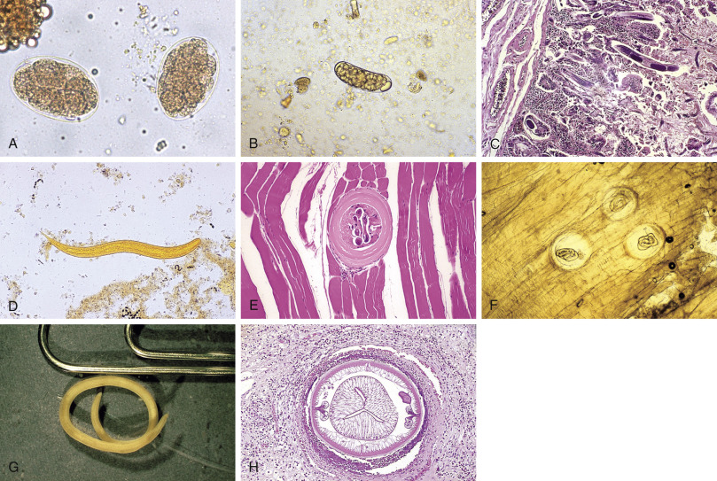

Figure 63-18 

**A,** Hookworm ( _Ancylostoma duodenale_ or _Necator americanus_ ) eggs (400×). **B,** Egg of _Heterodera_ sp., a group of plant nematodes occasionally found as artifacts in human stool following ingestion of infected vegetables (400×). **C,** Massive _Strongyloides stercoralis_ infection in the duodenal mucosa; note presence of adult female, eggs, and larvae (H&E; 100×). **D,** _S. stercoralis_ noninfectious rhabditiform larva (iodine stain; 100×). **E,** _Trichinella spiralis,_ cross-section of a larva in gastrocnemius muscle (H&E; 100×). **F,** Multiple _T. spiralis_ larvae in bear meat (compressed wet muscle preparation; 100×). **G,** Regurgitated _Pseudoterranova_ sp. following fish dinner (4×). **H,** Anisakis sp., cross-section of larva found in small bowel following surgery for acute obstruction (H&E; 400×). 

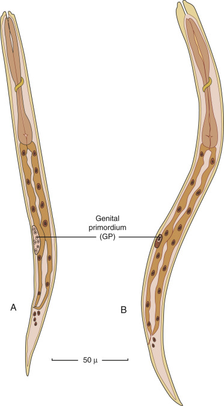

Figure 63-19 

Hookworm and _Strongyloides stercoralis_ larvae. 

**A,** _S. stercoralis_ rhabditoid larva in human stools. Note the short size of the buccal cavity and the large genital primordium (GP). **B,** Hookworm rhabditoid larva as seen in a few instances in stool left for at least 24 hours at room temperature. The buccal cavity is longer, and the genital primordium is smaller. 

Although adult hookworms can be differentiated on the basis of their mouth parts and the copulatory bursa in males, eggs of human hookworms are indistinguishable. In direct wet mounts, egg counts of fewer than five eggs per coverslip denote light infection that is unlikely to result in anemia, whereas more than 25 eggs per coverslip denotes heavy infection that is likely to be associated with symptoms. 

 

##  _Strongyloides stercoralis_ (Strongyloidiasis) 

Strongyloidiasis occurs in many areas in the tropics and subtropics, but this infection also is reported in temperate zones and has historically been endemic in areas of southeastern United States. Adult females are 2 to 3 mm long and live buried in the mucosa of the duodenum, where they reproduce parthenogenetically ( [ Fig. 63-18, _C_ ](<#f0095>) ). Parasitic males do not occur in the vertebrate phase of the cycle. The eggs hatch primarily in the small bowel, releasing first-stage or rhabditoid larvae, which then are passed in the feces (eggs are almost never found). In this direct cycle, the rhabditoid larvae metamorphose into infective third-stage filariform larvae in the soil. These infective larvae readily penetrate the skin of exposed individuals; they migrate via the circulatory system to the lungs and then move up the bronchial tree and are swallowed. Development to the adult stage is completed in the small intestine. Under appropriate soil conditions of high humidity, an indirect cycle may appear transiently, in which the newly deposited larvae develop into a free-living generation consisting of reproductive males and females. Eggs produced by this generation develop into filariform larvae that again are infective for humans. A third variation in the life cycle of _Strongyloides_ involves autoinfection, in which maturation to the filariform stage is completed within the intestinal tract, with subsequent reinvasion of bowel mucosa or perianal skin. 

Disease presentation is variable and may depend on the strain acquired (  Genta & Walzer, 1989  ). Early migration of filariform larvae may produce irritation, redness, and pruritus at the site of entry, whereas later migration through the lungs may produce Loeffler's syndrome (  Purtilo et al, 1974  ). The presence of intestinal symptoms is related to the intensity of the infection. The affected individual may have symptoms of peptic ulcer, abdominal pain, and diarrhea. A malabsorption syndrome has been reported with chronic infection. 

The ability of the parasite to autoinfect may result in persistence of the infection for decades, as was recognized in allied troops who were held as prisoners of war in Southeast Asia during World War II (  Gill & Bell, 1979  ). In otherwise healthy patients, autoinfection may produce larva currens (linear urticarial lesions). In immunocompromised, alcoholic, or malnourished patients, autoinfection may result in a life-threatening hyperinfection syndrome caused by rapid multiplication of the parasite (  Maayen et al, 1987  ;  Genta, 1992  ). Severe pneumonia is often a presenting manifestation of hyperinfection, followed by marked diarrhea, enteritis, and septicemia. Patients who have lived in endemic areas should be screened for _Strongyloides_ prior to receiving immunosuppressive therapy (  Strickland, 2000  ). 

Diagnosis is made on recovery and identification of typical rhabditiform larvae in stool specimens, although the routine O&P examination does not always reveal their presence and up to seven stool specimens may need to be examined for optimal sensitivity with this method ( [ Fig. 63-18, _D_ ](<#f0095>) ) (  Pelletier et al, 1988  ;  Genta & Walzer, 1989  ;  Garcia, 2007  ). _Strongyloides_ rhabditiform larvae must be differentiated from those of hookworms and are characterized as having a short buccal cavity and a prominent genital primordium (see [ Fig. 63-19 ](<#f0100>) ). _Strongyloides_ filariform larvae have a notched tail and an esophagus approximately half the length of the body. Either stage of larvae is readily seen in fresh saline wet mounts under low power. If infective filariform larvae are detected in a recently passed specimen, the diagnosis of superinfection is warranted (  Eveland et al, 1975  ;  Murray et al, 2007  ). 

Examination of duodenal aspirates or string test specimens may be helpful in suspicious cases in which routine stool examinations are nonproductive. The agar culture method or one of the coproculture techniques (see the “ [ Laboratory Methods ](<#s0015>) ” section earlier in the chapter) may also demonstrate the infection and provide the highest sensitivity for detection of _Strongyloides_ from fecal specimens (  Ash & Orihel, 1987  ;  Genta & Walzer, 1989  ;  CLSI, 2005  ;  Garcia, 2007  ). Larvae may be found in sputum or other pulmonary specimens, especially in the hyperinfection syndrome. Serologic tests are useful when infection is suspected but cannot be demonstrated by other methods. EIA and other tests display good sensitivity and specificity, although cross-reactions may appear with filariasis and some other nematode infections. These tests generally do not differentiate between past and current infection but may be useful in monitoring therapy (  Wilson et al, 1995  ). 

 

##  Anisakiasis 

See the “ [ Tissue Helminths ](<#s0505>) ” section later in the chapter. 

 

##  Cestodes 

Cestodes or tapeworms are ribbon-like platyhelminths that live in the intestinal tract of vertebrates as adults and in the tissues or body cavities of various intermediate hosts as larvae. They attach to intestinal mucosa by means of a scolex (head) that may display suckers, grooves (bothria), or a rostellum with hooks, depending on the species. The body of the worm, or strobila, comprises an actively growing neck region and a series of proglottids that undergo sequential development through immature, mature, and, finally, gravid stages at the posterior end. Each proglottid has a complete set of male and female gonads and is capable of producing fertile eggs. Eggs of most cestodes infecting humans ( _Diphyllobothrium_ being an exception) may be readily differentiated from those of other helminths by the presence in each of a six-hooked embryo. Depending on the species, eggs are released directly into the fecal stream or are passed in intact proglottids. It is not uncommon in some species for long lengths of strobila to be passed intact, or for proglottids to actively migrate out of the anus. Large species of _Taenia_ and _Diphyllobothrium_ may grow to 25 feet or longer and may live for 20 years. 

Cestode larval stages develop to the infective stage in invertebrate or vertebrate hosts, depending on the species, and complete their life cycle when ingested by a definitive host. Larval stages of several species may infect humans, causing cysticercosis, hydatidosis, sparganosis, and coenurosis. These conditions are covered more fully in the “ [ Tissue Helminths ](<#s0505>) ” section later in the chapter. 

 

##  _Taenia saginata_ (Taeniasis) 

Humans are the sole definitive host for _Taenia saginata,_ the beef tapeworm. Although it is distributed worldwide, the worm is especially common in the Middle East, Africa, Europe, Asia, and Latin America. It occurs rarely and sporadically in the United States. Larval cysticerci _(Cysticercus bovis)_ develop in the tissues of cattle that graze on land contaminated by human waste. When humans ingest infected raw or incompletely cooked beef, the cysticercus develops into a reproductive adult in the small intestine in 2 to 3 months. Symptoms are rare but may include abdominal discomfort and diarrhea. Unlike _T. solium,_ the eggs of _T. saginata_ are not infectious to humans, and their ingestion does not result in cysticercosis. 

Diagnosis is made by finding eggs in the stool using direct or concentration techniques. Eggs are spherical and measure 31 to 43 µm in diameter ( [ Fig. 63-20, _A_ ](<#f0105>) ). The shell is thick, is radially striated, and contains a six-hooked embryo. Eggs of all _Taenia_ species are indistinguishable and should be reported only as _Taenia_ eggs. 

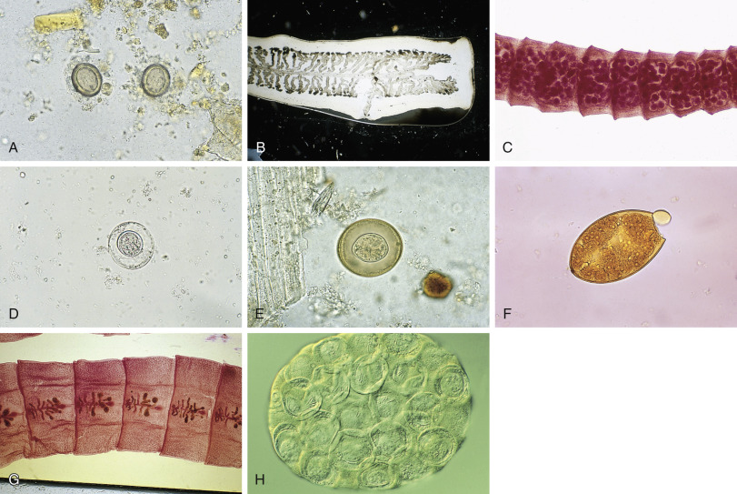

Figure 63-20 

**A,** Eggs of _Taenia saginata_ (indistinguishable from those of _Taenia solium_ ; 400×). **B,** Gravid proglottid of _T. saginata_ injected through the genital pore with India ink. **C,** Gravid proglottids of _Hymenolepis nana_ stained with acetocarmine (100×). **D,** Egg of _H. nana_ ; note presence of hooklets and polar filaments (400×). **E,** Egg of _Hymenolepis diminuta_ ; note lack of polar filaments (400×). **F,** Egg of _Diphyllobothrium_ sp.; note open operculum and small terminal knob (400×). **G,** Gravid proglottids of _Diphyllobothrium_ sp. stained with acetocarmine (2×). **H,** Egg packet of _Dipylidium caninum_ (differential interference contrast microscopy; 400×). 

Species identification may be made on recovery of proglottids or, more rarely, the scolex (following administration of an antihelminthic agent). Proglottids of taeniids have a characteristic lateral protrusion known as the _genital pore._ Careful injection of India ink through the genital pore, using a tuberculin needle and syringe, may succeed in outlining the uterus. The gravid uterus of _T. saginata_ has 15 to 20 primary lateral branches (counted on one side only), whereas that of _T. solium_ has 7 to 13 primary lateral branches ( [ Figs. 63-20, _B_ ](<#f0105>) _,_ and [ 63-21 ](<#f0110>) ). Proglottids may also be cleared overnight in glycerol or stained with carmine or hematoxylin using published procedures (  Ash & Orihel, 1987  ). If recovered, the scolex of _T. saginata_ can be identified by the presence of four suckers and the absence of hooks on the crown or rostellum. 

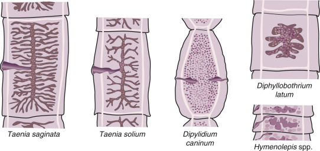

Figure 63-21 

Gravid proglottids of different human tapeworms. 

 

##  _Taenia solium_ (Taeniasis) 

_T. solium,_ the pork tapeworm, is most common in Europe, especially in Eastern Europe, Latin America, China, Pakistan, and India. It is encountered in the United States on occasion, most often in recent immigrants. Infection with the adult tapeworm (taeniasis) is acquired by eating raw or incompletely cooked pork containing cysticerci _(Cysticercus cellulosae)._ Symptoms, if present, are identical to those of _T. saginata_ infection. More important, accidental ingestion of _T. solium_ eggs from one's own adult tapeworm or from contaminated food may result in cysticercosis (  Schantz et al, 1992  ). Additional details on cysticercosis may be found in the “ [ Tissue Helminths ](<#s0505>) ” section later in the chapter. 

Procedures used for diagnosis of intestinal _T. solium_ infection are identical to those used for _T. saginata_ infection, although certain morphologic differences are apparent. The scolex of _T. solium_ has four suckers and, unlike _T. saginata,_ a rostellum armed with two rows of hooks. Gravid proglottids have 7 to 13 primary lateral uterine branches on each side of the uterine stem (see [ Fig. 63-21 ](<#f0110>) ). 

 

##  _Hymenolepis nana_ (Hymenolepiasis) 

_Hymenolepis nana,_ known as the dwarf tapeworm, has a worldwide distribution and is the most frequently recovered cestode species seen in the United States. It is a common parasite in mice and is the smallest cestode to infect humans, measuring up to 4.0 cm in length. The scolex has an armed rostellum, and the proglottids have all of their genital pores located on the same side of the strobila ( [ Figs. 63-20, _C_ ](<#f0105>) _,_ and [ 63-21 ](<#f0110>) ). The life cycle may be direct, through the ingestion of infectious eggs, or indirect, through the ingestion of intermediate hosts (usually grain beetles) containing cysticercoid larvae. In the former instance, eggs may be passed directly from person to person, usually among children (highest likelihood), or may be ingested in food, especially grain products that are contaminated by grain beetles or possibly rodent droppings. 

Eggs hatch in the intestine, and embryos penetrate the mucosa, where they mature as cysticercoid larvae. They subsequently emerge and reattach to the intestinal wall to complete their development into adult tapeworms in 2 to 3 weeks. Therefore, humans serve as both the intermediate and definitive host for this parasite. Internal autoinfection may occur in some individuals in whom eggs hatch shortly after being discharged from the worm and rapidly invade the intestinal wall without leaving the body. Such a mechanism is thought to be responsible for the occasional case of massive infection. 

Symptomatic infection, characterized by abdominal pain, diarrhea, anorexia, and irritability, may develop in patients with large numbers of worms. Diagnosis is made by recovery from stool of the oval, thin-shelled, colorless eggs, which measure 30 to 47 µm in diameter ( [ Fig. 63-20, _D_ ](<#f0105>) ). They contain a centrally located, six-hooked embryo (oncosphere), which is separated from the outer shell by a clear space. This embryo displays two polar thickenings from which thin filaments arise and extend into the clear space between the embryo and outer shell. Occasionally, intact strobila may be recovered if the stool is closely examined. 

 

##  _Hymenolepis diminuta_ (Hymenolepiasis) 

The rat tapeworm, _Hymenolepis diminuta,_ is cosmopolitan in distribution and rarely infects humans. Infection is infrequent because of the obligate need for an arthropod intermediate host, in which the cysticercoid larvae develop. Human infection usually occurs following the accidental ingestion of infected beetles that contaminate grain or cereal products. Adult tapeworms develop in the small intestine, where they may grow to 60 cm in length. Similar to those of _H. nana,_ the proglottids all have genital pores on one side, but unlike that species, the scolex lacks an armed rostellum. Infection usually is asymptomatic because of the small number of worms likely to infect a single individual, although intestinal symptoms have been reported. Diagnosis is made by the finding in the feces of moderately thick-shelled, slightly ovoid, yellow-brown eggs measuring 70 to 85 µm by 60 to 80 µm ( [ Fig. 63-20, _E_ ](<#f0105>) ). The eggs are most easily confused with those of _H. nana_ but, unlike in that species, lack polar filaments. 

 

##  _Diphyllobothrium_ spp. (Diphyllobothriasis) 

Humans may be infected by one of several species of the fish tapeworm _Diphyllobothrium,_ which normally infect piscivorous mammals and possibly birds (  Curtis & Bylund, 1991  ;  Connor et al, 1997  ). These parasites are widely distributed in the temperate zones, especially northern Europe, Scandinavia, the former USSR, and Japan. Infection also occurs in Canada and in the north central states, the Pacific Coast states, and Alaska in the United States. Although _Diphyllobothrium latum_ is the most common species known to infect humans, differentiation of the infecting species cannot be made on the basis of egg morphology. 

This parasite inhabits the small intestine, where it can reach a length of 10 m or longer and can persist for years. Eggs are passed unembryonated in the feces and must reach a freshwater stream or lake to continue development. Following several weeks of embryonation, a ciliated larval form, the six-hooked coracidium, hatches and is ingested by a copepod, a type of zooplankton. The coracidium develops into a procercoid larva, which is infective for the second intermediate host, a fish. In fish, the procercoid migrates into the tissues and develops into the plerocercoid larva. Plerocercoids may be passed up the food chain unchanged and accumulate in larger fish. Humans acquire these larvae through ingestion of raw or incompletely cooked fish that have spent at least part of their life in fresh water. 

Adult worms mature and initiate egg production in approximately 1 month. Infection may be asymptomatic, with passage of a length of strobila being the initial complaint. In others, a variable degree of abdominal discomfort and diarrhea may be present. Rarely, intestinal obstruction occurs. In endemic areas in northern Europe, a small percentage of patients develop vitamin B  12  deficiency and associated megaloblastic anemia due to the propensity of _Diphyllobothrium_ to absorb B  12  in the jejunem. 

Diagnosis is made by the finding of typical yellow-brown, oval, operculate eggs in feces using standard recovery techniques. Eggs measure 58 to 76 µm by 40 to 51 µm and, in addition to the operculum, have a small, round, knoblike projection on the abopercular end ( [ Fig. 63-20, _F_ ](<#f0105>) ). The presence of the operculum is unique among those cestodes infecting humans, and care must be taken not to confuse these eggs with those of trematodes, especially _Paragonimus_ or _Nanophyetus_ . Identification to the genus level is possible when a length of strobila or an intact worm is passed. The scolex is elongate and displays a pair of longitudinal grooves known as _bothria,_ which replace the usual suckers of other human cestodes. Gravid proglottids are wider than they are long and have their genital pores located midventrally, adjacent to a centrally located rosette-shaped uterus ( [ Figs. 63-20, _G_ ](<#f0105>) _,_ and [ 63-21 ](<#f0110>) ). 

 

##  Dipylidium caninum 

_Dipylidium caninum_ is a common tapeworm of dogs and cats in most parts of the world and not infrequently infects humans, especially children. In the usual life cycle, tapeworm eggs are ingested by flea larvae, which infest areas frequented by dogs or cats. The cysticercoid larvae persist as the flea undergoes metamorphosis to the adult stage. Accidental ingestion of the adult flea containing the infectious cysticercoid results in infection. Children are at highest risk for infection because of their close contact with pets. Worms mature in the small intestine and grow up to 70 cm in length. Infection produces few symptoms and generally causes concern only on detection of the actively moving proglottids. 

Detection is based on the finding of characteristic eggs, egg packets, or proglottids in the feces. Spherical eggs, each containing a six-hooked embryo, measure from 24 to 40 µm in diameter and occur singly or in packets ( [ Fig. 63-20, _H_ ](<#f0105>) ). The scolex is somewhat elongate with four suckers and a small, retractable rostellum. Proglottids are barrel-shaped and possess two genital pores, one on each lateral margin, which give rise to the common name _double-pored tapeworm_ (see [ Fig. 63-21 ](<#f0110>) ). They are commonly likened to a “grain of rice” or “cucumber seed.”

 

##  Trematodes 

Trematodes, or flukes, are dorsoventrally flattened helminths (platyhelminths) that include both hermaphroditic forms (intestinal, liver, and lung flukes) and those with separate sexes (blood flukes or schistosomes). All species that infect humans are characterized by the presence of an oral sucker, through which the digestive tract opens, and a ventral sucker used for attachment. Adults vary in length from 1 mm _(Metagonimus)_ to 70 mm _(Fasciola gigantica)._

Eggs reach the environment by being passed in the feces, sputum, or urine, depending on the species. Hermaphroditic flukes produce operculate eggs, which are not embryonated ( _Clonorchis_ and _Opisthorchis_ being exceptions). Schistosome eggs are not operculated, and each contains a mature larva when passed. Trematode larvae, or miracidia, are ciliated and are capable of penetrating the tissues of a molluscan host. Each species of trematode uses a particular species of freshwater snail as the first intermediate host. A complex asexual multiplication process within the snail results in the production of numerous free-swimming larvae called _cercariae_ . Schistosome cercariae are capable of penetrating human skin directly, resulting in the disease schistosomiasis. Those of hermaphroditic flukes encyst on aquatic vegetation or invade the tissues of second intermediate hosts such as fish or crabs, depending on the species. Ingestion of these encysted larval stages, known as _metacercariae,_ results in human infection. 

Human trematode infection may occur in many tropical and subtropical regions and involves considerably more species (mostly rare and sporadic intestinal infections) than can be presented here. Its presence depends on lack of sewage treatment, availability of appropriate intermediate hosts, and, in the case of hermaphroditic species, dietary customs associated with ingestion of infective metacercariae in raw or undercooked plants or animals. Some of these diseases, especially schistosomiasis, expanded with the increased use of irrigation in endemic areas, which allowed for proliferation of the molluscan intermediate hosts. Symptoms vary depending on the number of worms parasitizing the host at a given time, the tissues and organs involved, and host responses. Many infections are asymptomatic. 

The diagnosis of trematode infection is made by recovery and identification of the characteristic eggs in stool, sputum, urine, and, occasionally, tissues. Direct mounts and formalin–ethyl acetate concentration methods are most useful for recovery of these eggs, whereas zinc sulfate flotation methods are less satisfactory. 

 

##  _Fasciolopsis buski_ (Fasciolopiasis) 

This intestinal trematode is the largest species to infect humans, varying from 20 to 75 mm in length and from 8 to 20 mm in breadth. It occurs in many parts of China, Southeast Asia, and India and is frequently found in pigs, which serve as a natural reservoir. Infection is acquired by ingesting infectious metacercariae on aquatic food plants such as water chestnuts and water caltrop. Worms attach to the wall of the duodenum and jejunum, where they mature to egg-laying adults in about 3 months. Symptoms such as diarrhea, epigastric pain, and nausea may develop if enough worms are present to produce ulceration of the superficial mucosa. Eosinophilia may be present, even in those who are asymptomatic. 

Diagnosis is made by the finding of large (130 to 140 µm by 80 to 85 µm), yellow-brown, oval, thin-shelled eggs ( [ Fig. 63-22, _A_ ](<#f0115>) ). The operculum may be inconspicuous, and the eggs are passed unembryonated. Differentiation from _Fasciola_ eggs generally is not possible, although these infections may be differentiated on the basis of geographic history and symptoms. Eggs of echinostome trematodes, which occasionally infect humans, are similar but smaller (  Beaver et al, 1984  ). 

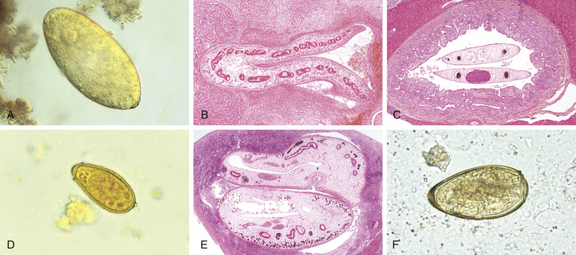

Figure 63-22 

**A,** Egg of _Fasciolopsis buski_ , indistinguishable from that of _Fasciola hepatica,_ in stool (400×). **B,** Adult _Fasciola hepatica_ in liver (H&E; 40×). **C,** Two adult _Clonorchis sinensis_ in bile duct (H&E; 100×). **D,** Egg of _C. sinensis_ in stool; note prominent shouldered operculum, abopercular knob, and “urn” shape (1000×). **E,** Pair of adult _Paragonimus_ sp. in lung tissue with surrounding inflammatory reaction (H&E; 20×). **F,** Egg of _Paragonimus_ sp. in stool; note prominent shouldered operculum and abopercular thickening (100×). 

 

##  _Heterophyes_ and _Metagonimus_

These two genera include a number of species of minute (1 to 3 mm in length) intestinal worms that infect humans. _Heterophyes_ and _Metagonimus yokogawai_ are common parasites in Asia but, along with other species, are found in other parts of the world as well. Infection is acquired by ingestion of metacercariae in raw or incompletely cooked freshwater fish. Although it is of minor medical importance, infection with these worms may produce diarrhea and abdominal pain. Infection is self-limited because the worms have a life span of only a few months. 

Diagnosis is established by the finding of embryonated, operculate eggs that measure 20 to 30 µm in length by 15 to 17 µm in width ( [ Fig. 63-22, _B_ ](<#f0115>) ). Differentiation of these eggs from those of _Clonorchis_ and _Opisthorchis_ is difficult, although the operculum is more deeply seated with _Opisthorchis_ . Such differentiation may be important, however, for medical reasons. 

 

##  Nanophyetus salmincola 

_Nanophyetus (Troglotrema) salmincola_ is a small (0.8 to 1.1 mm) intestinal fluke that has been reported in humans in areas of far eastern Siberia and the Pacific Northwest coast of the United States (  Eastburn et al, 1987  ;  Fritsche et al, 1989  ). These worms are acquired by ingesting raw, incompletely cooked, or home-smoked salmon or trout that contain infectious metacercariae. Symptoms are related to the number of worms present and may include abdominal pain and diarrhea, with or without eosinophilia. Eggs measuring 60 to 80 µm by 34 to 50 µm are broadly ovoid, operculate, and yellowish brown (  Eastburn et al, 1987  ). Thickening of the shell at the abopercular end should be differentiated from the knob seen on eggs of _Diphyllobothrium_ . This fluke is the vector for a rickettsial species that produces a highly lethal infection in canines known as _salmon-poisoning disease._

 

##  _Fasciola hepatica_ (Fascioliasis) 

Cattle, sheep, and goats in many parts of the world are infected with the liver fluke _Fasciola hepatica_ and, less commonly, with the related species _Fasciola gigantica_ . Adult parasites live in the biliary tree and lay eggs that are passed in the feces. Cercariae shed from the snail intermediate host encyst on aquatic vegetation, where infectious metacercariae then are available to herbivorous hosts. Humans usually acquire the infection by eating raw watercress. Once ingested, the larvae penetrate the intestinal wall and migrate through the peritoneal cavity to the liver. They burrow through the capsule and parenchyma, coming to reside within the bile ducts, where egg laying is initiated in about 2 months. Migration of the larvae through the liver elicits a painful inflammatory reaction both in the tissue and, later, in the bile ducts, which eventually become fibrosed. Clinical manifestations include colic, obstructive jaundice, abdominal pain and tenderness, cholelithiasis, and eosinophilia. 

Diagnosis is made by the finding of eggs in the stool. The unembryonated, yellow-brown, operculate eggs, 130 to 150 µm by 63 to 90 µm, cannot be distinguished easily from those of _Fasciolopsis_ (see [ Fig. 63-22, _A_ ](<#f0115>) ). Spurious infection, which occurs by ingesting infected cattle or sheep liver, is diagnosed by obtaining a good history and performing a follow-up stool examination to look for elimination of the eggs. 

 

##  _Clonorchis sinensis_ and _Opisthorchis viverrini_

_Clonorchis sinensis,_ the Oriental liver fluke, and a closely related species, _Opisthorchis viverrini,_ inhabit the biliary system of humans and other piscivorous animals, including cats and dogs. _C. sinensis_ occurs mainly in China, Taiwan, Korea, Japan, and Vietnam, whereas _O. viverrini_ is found primarily in southeast Asia, especially northern Thailand. Human infection is also known to occur with _Opisthorchis felineus_ in Europe and _Amphimerus pseudofelineus_ (same as _Opisthorchis guayaquilensis_ ) in Ecuador. 

All these parasites are acquired by the ingestion of infectious metacercariae in raw or uncooked freshwater fish. Larvae migrate up the common duct into the liver bile ducts, where they live up to 20 years and grow up to 25 mm in length ( [ Fig. 63-22, _C_ ](<#f0115>) ). They produce small eggs that are shed into the bile and subsequently are passed in stools. 

Infection is often asymptomatic, although large numbers of flukes and repeated infection may cause inflammation of the bile ducts and subsequent hyperplasia, fibrosis, and hepatic cirrhosis. Importantly, development of cholangiocarcinoma has been linked epidemiologically with long-standing infection. 

Diagnosis is made by recovering the small yellow-brown, embryonated, operculate eggs from stool ( [ Fig. 63-22, _D_ ](<#f0115>) ). Eggs of _Clonorchis_ cannot be readily differentiated from those of _Opisthorchis_ . Both measure 25 to 35 µm by 12 to 20 µm and have a prominent, seated, or “shouldered” opercula and a small knob at the abopercular end. These eggs are difficult to differentiate from those of the _Heterophyes_ / _Metagonimu_ s group, although the latter species do not have prominent, seated opercula or a small knob at the abopercular end. When specific identification is not possible, the laboratory report should reflect this (i.e., should state, “ _Clonorchis_ / _Opisthorchis_ / _Heterophyes_ / _Metagonimus_ eggs”). 

 

##  _Paragonimus_ spp. (Paragonimiasis) 

Several species of _Paragonimus_ may parasitize the lungs of cats, dogs, and other carnivores, including humans. _Paragonimus westermani_ is problematic in many areas of Asia, whereas in Central and South America several species have been implicated, including _Paragonimus mexicanus, Paragonimus caliensis,_ and _Paragonimus ecuadoriensis_ . _Paragonimus kellicotti_ has occasionally been implicated in cases from North America, and other species have been described from Africa (  Pachucki et al, 1984  ;  Mariano et al, 1986  ;  Strickland, 2000  ;  Cook, 2002  ;  Murray et al, 2007  ). 

Adult worms measure up to 12 mm by 6 mm and often are found in pairs in lung parenchyma, where they reside in a fibrotic capsule produced by the host ( [ Fig. 63-22, _E_ ](<#f0115>) ). The capsule communicates with the bronchi, through which eggs pass to be eventually expelled in sputa or feces. Although a specific snail serves as the first intermediate host, freshwater crabs and crayfish serve as second intermediates for infectious metacercariae. Ingestion of uncooked, or marinated, crustacea may result in infection. Larvae are released in the stomach and migrate through the intestinal wall into the peritoneal cavity, eventually reaching the lungs after penetrating the diaphragm. Maturation takes approximately 5 to 6 weeks, and worms may live for many years. 

Symptoms, when present, may be caused by larvae migrating through tissues or by adults established in the lungs. Not infrequently, worms develop in ectopic sites, including the peritoneum, subcutaneous tissues, and brain. The onset of lung infection is usually associated with fever, chills, and the appearance of eosinophilia. Once established, symptoms include chronic coughing with abundant mucus production, along with episodes of hemoptysis. Radiographs may show nodular shadows, calcifications, or patchy infiltrates. Eggs remaining in the lung tissues or in ectopic sites may cause an extensive granulomatous reaction. 

Diagnosis is made by the finding of typical eggs in stool, sputum, or, occasionally, tissues. Eggs of the different _Paragonimus_ species cannot be readily differentiated, and specific identification may be inferred from the area of origin. Operculate, unembryonated eggs measure 80 to 120 µm by 45 to 70 µm and have a moderately thick, yellow-brown shell ( [ Fig. 63-22, _F_ ](<#f0115>) ). The operculum is flattened and usually is set off from the rest of the shell by prominent shoulders (i.e., shouldered operculum). The abopercular end is somewhat thickened but does not have a knob. _Paragonimus_ eggs may be differentiated from those of _Diphyllobothrium_ and _Fasciola_ / _Fasciolopsis,_ which they superficially resemble, by size. 

 

##  _Schistosoma_ spp. (Schistosomiasis) 

Schistosomiasis, or bilharzia, is among the most important parasitic diseases worldwide, afflicting greater than 200 million individuals. Adult male and female blood flukes inhabit veins of the mesentery or bladder. The most important species infecting humans are _Schistosoma mansoni, Schistosoma japonicum, Schistosoma mekongi, Schistosoma haematobium,_ and _Schistosoma intercalatum_ ; other species infect humans less frequently. 

Adult female schistosomes are slender, measuring up to 26 mm by 0.5 mm. Males, which are slightly shorter, enfold a female using the lateral margins of the body (the gynecophoral canal) to assist in sperm transfer. When examined in situ, schistosomes are often found in copula. In their preferred locations, blood flukes elicit little or no inflammatory response. Eggs are deposited in the smallest venule that can accommodate the female worm, where they elicit a strong granulomatous response that results in extrusion of the egg through the intestinal or bladder wall and into the lumen for excretion in stool or urine, respectively. Eggs laid in the mesenteric vessels also commonly end up in the liver. Pathology is primarily related to the sites of egg deposition, the numbers deposited, and the host reaction to egg antigens. 

Eggs are fully embryonated when passed and readily hatch when deposited in fresh water. The miracidia penetrate an appropriate species of snail host, where they undergo transformation and extensive asexual multiplication. After about 4 weeks, large numbers of fork-tailed cercariae emerge from the mollusk. Cercariae swim actively about for hours and readily penetrate the skin of susceptible hosts, including humans. After penetration, the cercariae, now called _schistosomules,_ enter the circulation and pass through the lungs before reaching the mesenteric-portal vessels. 

Symptoms of schistosomiasis result primarily from penetration of cercariae (cercarial dermatitis), from initiation of egg laying (acute schistosomiasis or Katayama fever), and as a late-stage complication of tissue proliferation and repair (chronic schistosomiasis). In a matter of hours after cercarial penetration, a papular rash associated with pruritus may develop. This is a sensitization phenomenon resulting from prior exposure to cercarial antigens. The most severe form of dermatitis occurs in individuals who are repeatedly exposed to cercariae of nonhuman (primarily avian) schistosomes. Cercarial dermatitis or swimmer's itch occurs worldwide and is a well-recognized entity in the United States (  Hoeffler, 1974  ). 

Initiation of egg laying by mature worms 5 to 7 weeks after infection may result in acute schistosomiasis, or Katayama fever, a serum sickness–like syndrome that occurs with heavy primary infection, especially that of _S. japonicum_ . The antigenic challenge to the host is thought to result in immune complex formation (  Boros, 1989  ). 

Chronic infection results in continued deposition of eggs, many of which remain in the body. Granulomas produced around these eggs in the intestine and in the bladder are gradually replaced by collagen, resulting in fibrosis and scarring. Eggs trapped in the liver may induce pipe-stem fibrosis with obstruction to portal blood flow. Occasionally, eggs are deposited in ectopic sites, such as the spinal cord, lungs, or brain (  Cook, 2002  ;  Garcia, 2007  ). 

Diagnosis is established by demonstrating eggs in feces or urine by direct wet mount or formalin–ethyl acetate concentration methods. Zinc sulfate concentration is not satisfactory for recovery of heavy schistosome eggs. Eggs also may be detected in biopsies of rectal, bladder, and, occasionally, liver tissues by crush preparation or in histologic section ( [ Fig. 63-23 ](<#f0120>) ). Use of egg-hatching methods may occasionally be requested to determine viability or, less commonly, to detect light infection. Feces mixed with distilled water are placed in a flask that is covered with foil to keep out light, with only the neck or a sidearm exposed to bright light. Miracidia, if present, actively swim to the light and can be detected using a hand lens. 

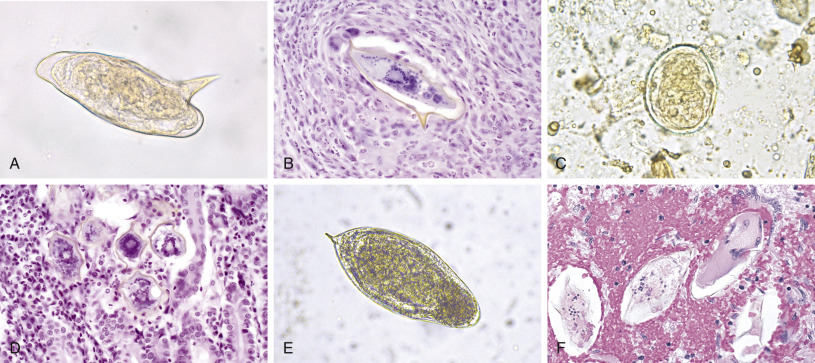

Figure 63-23 

**A,** Egg of _Schistosoma mansoni_ ; note prominent lateral spine (400×). **B,** Egg of _S. mansoni_ in an intestinal biopsy; note presence of lateral spine (H&E; 400×). **C,** Egg of _Schistosoma japonicum_ ; note presence of rudimentary lateral spine (400×). **D,** Eggs of _S. japonicum_ in a small-bowel biopsy (H&E; 200×). **E,** Egg of _Schistosoma haematobium_ found in urine sediment; note presence of a terminal spine (400×). **F,** Eggs of _S. haematobium_ seen in a vulvar granuloma; note presence of a terminal spine (H&E; 400×). 

Serologic tests may be helpful in screening persons who have traveled to endemic areas and those with negative urine or stool examination who are at risk for infection, or for monitoring response to therapy. Although not widely available, a limited number of reference laboratories and the CDC provide testing. Generally, serologic testing varies with the antigens used and the test methods employed. The CDC uses the Falcon assay screening test in a kinetic enzyme-linked immunosorbent assay (FAST-ELISA). Sera that are positive by the screening test are further evaluated by immunoblot to improve specificity (  Wilson et al, 1995  ). 

 

##  Schistosoma mansoni 

_Schistosoma mansoni_ occurs in Africa, especially in the tropical areas and the Nile delta, southern Africa, and Madagascar, Brazil, Venezuela, Surinam, and certain Caribbean islands, including Puerto Rico. Adult _S. mansoni_ live primarily in the portal vein and in the distribution of the inferior mesenteric vein. Initial deposition of eggs in the large intestine may produce abdominal pain and dysentery, with abundant blood and mucus in the stool. Eggs may be detected in feces at this time. Chronic infection may result in liver fibrosis and portal hypertension, depending on the number of worms present; eggs may be more difficult to find in feces during this stage. 

Eggs, which measure 116 to 180 µm by 45 to 58 µm, are oval, with a large distinctive lateral spine that protrudes from the side of the egg near one end (see [ Fig. 63-23, _A_ and _B_ ](<#f0120>) ). If the spine is not visible, the egg may be rotated by gently tapping the coverslip. Movement of the miracidium within the egg may be evident in unfixed material if the larva is viable. Concentration techniques may be required to detect eggs because individuals with limited exposure or with chronic infection may pass few of them. 

 

##  Schistosoma japonicum 

_Schistosoma japonicum,_ which occurs in China, southeast Asia, and the Philippines, causes disease that is clinically similar to that of _S. mansoni_ but often more serious because many more (up to 10 times as many) eggs are produced by _S. japonicum_ . The disease has been essentially eliminated from Japan, although animal reservoirs still exist. Adult worms live primarily in the distribution of the superior mesenteric vein, and eggs readily reach the liver, inducing fibrosis and portal hypertension as a common complication of chronic infection. The smaller size of the eggs predisposes them to dissemination, especially to the brain and spinal cord. The eggs are broadly oval, measuring 75 to 90 µm by 60 to 68 µm, and have an inconspicuous lateral spine, which may be difficult to demonstrate (see [ Fig. 63-23, _C_ and _D_ ](<#f0120>) ). 

 

##  Schistosoma mekongi 

This species occurs in humans and animal reservoirs in countries along the Mekong River, especially Cambodia and Laos (  Bruce & Sornmani, 1980  ). It is similar to _S. japonicum_ but is differentiated from that species by several biological characteristics and by smaller eggs (60 to 70 µm by 52 to 61 µm), which otherwise are indistinguishable from those of _S. japonicum_ . 

 

##  Schistosoma haematobium 

Urinary schistosomiasis occurs in many parts of Africa, the Middle East, and Madagascar. Parasites migrate via the hemorrhoidal veins to the venous plexuses of the urinary bladder, prostate, uterus, and vagina. One of the earliest and most common symptoms of infection is hematuria, especially at the end of micturition. Chronic infection may cause pelvic pain and bladder colic, with an increased desire to urinate. Accumulation of eggs in the tissues may result in hypertrophy of the urothelium, squamous metaplasia, and marked fibrosis, which may progress to obstruction and, ultimately, renal failure. Urinary schistosomiasis also has been associated with squamous cell carcinoma of the bladder (  Badawi et al, 1992  ). 

Eggs can be recovered from the urine by examination of spun sediment or through filtration. They are elongate, measuring 112 to 180 µm by 40 to 70 µm, and have a characteristic terminal spine (see [ Fig. 63-23, _E_ and _F_ ](<#f0120>) ). Occasionally, they may be detected in feces or in a rectal biopsy. 

 

##  Schistosoma intercalatum 

This species occurs in many parts of central and western Africa and produces intestinal schistosomiasis. Eggs have a terminal spine and so resemble those of _S. haematobium,_ but they occur primarily in the feces and are larger (140 to 240 µm by 50 to 85 µm). 

,  

##  Tissue Helminths 

 

##  Nematodes 

 

##  Filaria (Filariasis) 

Filarial nematodes, also known as _threadworms,_ are common arthropod-transmitted parasites of vertebrate animals. Adult male and female worms are long and slender, measuring up to 100 mm in length, and are known to inhabit a variety of tissues, including subcutaneous tissues, lymphatics, blood vessels, peritoneal and pleural cavities, heart, and brain. All species produce larvae known as _microfilariae,_ which may be recovered from blood or skin, depending on the species. The microfilariae of some species circulate in the blood with a well-defined periodicity (diurnal or nocturnal), whereas others do not. Microfilariae continue their development only in the appropriate arthropod vector, usually a mosquito or fly, where they mature to the infective stage. Such larvae then are deposited in the tissues of a definitive host when the vector takes another blood meal. 

The diagnosis of filariasis usually is made by the finding of microfilariae in the blood or skin, because adult stages are often sequestered in the tissues. Use of Giemsa or hematoxylin-stained thick smears of peripheral blood is routine, although more sensitive procedures such as membrane filter, Knott's concentration, or saponin lysis may also be required (  NCCLS, 2000  ). Microfilariae may be seen moving in direct mounts of blood or tissue fluid. 

Species identification is important because pathogenicity varies. Principal characteristics used for identification of microfilariae include the presence or absence of a sheath and its staining characteristics, the shape of the tail and the distribution of cell nuclei within, and the size of the cephalic space and the appearance of its nuclear column. Because microfilariae of _Wuchereria_ and _Brugia_ usually display a nocturnal periodicity, blood from patients suspected to be infected with these filariae should be drawn between the hours of 10  pm  and 2  am  . _Loa loa_ displays diurnal periodicity, so blood preferably should be drawn around noon. _Mansonella ozzardi_ and _Mansonella perstans_ are characteristically nonperiodic. Microfilariae of _Mansonella streptocerca_ and _Onchocerca volvulus_ are present in the skin and are detected by examination of skin snips or punch biopsies. 

Serologic tests for the diagnosis of lymphatic filariasis may prove helpful in select patients, especially those who are not native to endemic areas. Such methods are limited in their ability to distinguish between past exposure and current infection, however, and infection with other nematode species may result in the appearance of cross-reacting antibodies. Antigen detection tests also may be of value in the diagnosis of lymphatic filariasis but generally are not available in non-endemic settings (  Wilson et al, 1995  ). 

 

##  Wuchereria bancrofti _(Lymphatic Filariasis)_

This species, responsible for bancroftian filariasis, is the most common filarial species to infect humans. Endemic areas include central and northern Africa, India, Southeast Asia, certain South Pacific islands, and portions of Central and South America and the West Indies. Adult worms reside in the lymphatic system, where chronic infection and reinfection result in lymphadenopathy and lymphangitis, which may progress to lymphedema and obstructive fibrosis ( [ Fig. 63-24, _A_ ](<#f0125>) ). Severe involvement of the lower extremities and genitalia may result in elephantiasis. 

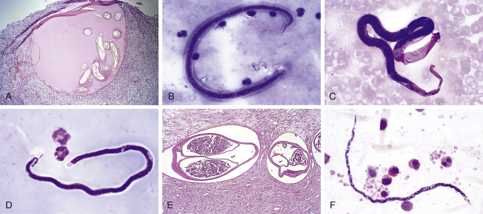

Figure 63-24 

**A,** _Wuchereria bancrofti_ , cross-section of adult in human lymph node; note extensive inflammatory reaction (H&E; 100×). **B,** Sheathed microfilaria of _W. bancrofti;_ cell nuclei do not extend to the tip of the tail (Giemsa; 1000×). **C,** Sheathed microfilaria of _Brugia malayi;_ two solitary cell nuclei are seen in the tail tip. Note the deep pink-staining sheath (Giemsa stain; 1000×). **D,** Sheathed microfilaria of _Loa;_ cell nuclei extend to the tail tip. Note that the sheath is seen by its negative staining (Giemsa stain; 1000×). **E,** _Onchocerca volvulus_ , cross-section of adult in skin nodule (H&E; 100×). **F,** Unsheathed microfilaria of _Mansonella perstans;_ cell nuclei extend to the tail tip (Giemsa stain; 1000×). 

In most areas, microfilariae circulate in peripheral blood with a nocturnal periodicity that corresponds with feeding activities of the usual vectors— _Culex, Aedes,_ and _Anopheles_ mosquitoes. Infections originating in the South Pacific are essentially without periodicity. The microfilariae are sheathed, although this may not always be obvious with Giemsa staining, in which the sheath may appear only as a negative outline. The tail is pointed, and no nuclei are present in the tip. The cephalic space is not as long as it is wide, and the nuclei in the nuclear column are distinct ( [ Figs. 63-24, _B_ ](<#f0125>) _,_ and [ 63-25 ](<#f0130>) ). Concentration procedures may be necessary for recovery because microfilariae may be present in small numbers. 

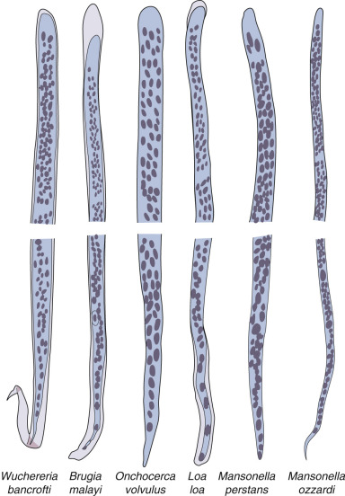

Figure 63-25 

Anterior and posterior ends of microfilariae most commonly found in humans. 

All camera lucida drawings. 

 

##  Brugia malayi _(Lymphatic Filariasis)_

This species produces disease similar to that of _W. bancrofti,_ although it is often milder and more frequently involves the lymphatics of the upper extremities. The parasite occurs mainly in India, Southeast Asia, Korea, the Philippines, and Japan. Human infection with related zoonotic species is encountered periodically in the United States. 

The microfilariae circulate in the blood and are primarily nocturnally periodic. Microfilarial sheaths of _Brugia malayi_ stain well with Giemsa stain. The tail has a swelling at the tip and has two solitary nuclei located beyond the ends of the nuclear column (termed _subterminal_ and _terminal_ nuclei). The cephalic space may be much longer than it is wide ( [ Figs. 63-24, _C_ ](<#f0125>) _,_ and [ 63-25 ](<#f0130>) ). _Brugia timori_ is a distinct species occurring in the eastern end of the Indonesian archipelago, especially on the islands of Timor and Flores. Microfilariae are very similar to those of _B. malayi_ , although somewhat larger. 

 

##  Loa loa _(Loiasis)_

Known as the eye worm, the adult _Loa loa_ lives in subcutaneous tissues. The nematodes migrate continuously, producing transient (2 to 3 days) local inflammatory reactions known as _Calabar_ or _fugitive swellings._ Their occasional appearance in the conjunctiva allows them to be surgically excised. Loiasis occurs primarily in west and central Africa, where deer flies of the genus _Chrysops_ serve as the vector. 

This parasite elicits strong eosinophilia and occasionally has been seen in the United States in people with a history of travel to Africa. The microfilariae, which circulate in the blood with diurnal periodicity, are sheathed, although the sheath does not stain with Giemsa stain. Nuclei in the tail extend to the rounded tip. The nuclear column is distinct, and the cephalic space is short ( [ Figs. 63-24, _D_ ](<#f0125>) _,_ and [ 63-25 ](<#f0130>) ) (  NCCLS, 2000  ;  Garcia, 2007  ). 

 

##  Onchocerca volvulus _(Onchocerciasis)_

Onchocerciasis is a leading cause of blindness in endemic areas, which include central Africa, Central America (Mexico and Guatemala), and northern South America. Vectors are black flies of the genus _Simulium_ . Adult worms live in hard, fibrous nodules (onchocercomas) in subcutaneous and deeper tissues that can grow to be 40 mm in diameter ( [ Fig. 63-24, _E_ ](<#f0125>) ). Nodules tend to occur on the upper half of the body in patients from Central America and on the lower half in those from Africa. Adult worms produce microfilariae that migrate continuously throughout the skin. Complications arise from the migratory activities of microfilariae, resulting in several forms of dermatitis. Movement of microfilariae through the surface of the eye may result in keratitis, corneal opacity, and damage to the anterior and posterior chambers and iris, thus leading to blindness with repeated infection over time. 

Diagnosis is made by the finding of typical microfilariae in teased skin snips or skin biopsies, preferably taken from over the scapular region or from the iliac crest, when placed in saline. Alternatively, fluids expressed from scarified skin or aspirates of nodules may be examined (  Beaver et al, 1984  ;  Garcia, 2007  ). Microfilariae in stained preparations lack both a sheath and nuclei in the tail tip (see [ Fig. 63-25 ](<#f0130>) ). 

 

##  Mansonella _spp._

Several species of _Mansonella_ infect humans, but all are generally regarded as causing little pathology. Microfilariae, however, must be differentiated from the truly pathogenic filarial species. _M. ozzardi_ is found in Central and South America and in some areas of the Caribbean. Adult parasites reside in subcutaneous tissues. _M. perstans_ occurs in many areas of tropical Africa and sporadically in South America. Adults are thought to reside primarily in body cavities and the mesenteries. Microfilariae of both species are unsheathed and circulate in peripheral blood without evidence of periodicity. _M. ozzardi_ microfilariae have a thin, pointed tail without nuclei, whereas the tail of _M. perstans_ is broad and blunt with nuclei extending to the tip ( [ Figs. 63-24, _F_ ](<#f0125>) _,_ and [ 63-25 ](<#f0130>) ). _M. streptocerca,_ which is found in tropical Africa, may be confused with _Onchocerca volvulus,_ because both adult and microfilarial stages occur in skin and subcutaneous tissues. Also, dermatitis may be produced by this species. Microfilariae of this species, which may be recovered in skin snips, are unsheathed and have a crook in the tail with nuclei extending to the tip. All species of _Mansonella_ are transmitted by midges (gnats) of the genus _Culicoides_ . 

 

##  Zoonotic Filariae 

Certain filarial nematodes of the genera _Dirofilaria_ and _Brugia_ that naturally parasitize wild and domestic mammals sporadically infect humans. _Dirofilaria immitis,_ commonly known as the canine heartworm, is widely distributed, and human infection is well documented. The mosquito-transmitted larval stage migrates to the right side of the heart. When the worm dies, it is swept into a small pulmonary artery, producing a granulomatous nodule that appears as a coin lesion on a chest radiograph. Diagnosis usually is made by histologic examination of the nodule. 

Other species of _Dirofilaria,_ including _Dirofilaria tenuis, Dirofilaria repens,_ and _Dirofilaria ursi,_ commonly cause subcutaneous nodules in humans but fail to produce microfilariae. Such nodules have been reported from many body sites, including the face, conjunctiva, and breast, and usually are removed surgically. Histologic examination often reveals a prominent mixed inflammatory reaction surrounding a dead worm. Criteria for identification of zoonotic filariae in tissue sections may be found elsewhere (  MacDougall et al, 1992  ;  Orihel & Ash, 1995  ;  Connor et al, 1997  ;  Gutierrez, 2000  ). 

 

##  Other 

 

##  Dracunculus medinensis _(Dracunculiasis)_

Adults of _Dracunculus medinensis,_ otherwise known as Guinea worms, live in subcutaneous tissues and become clinically evident when the female worm migrates to the skin surface and produces a blister, usually on the lower extremities. When the extremity is immersed in water, the blister ruptures, releasing swarms of motile larvae from the female worm into the water. Specific zooplankton (i.e., copepods) ingest the larvae, which then mature to the infective stage and are transmitted back to humans when copepods are accidentally swallowed in drinking water. 

The disease is endemic to areas of Africa, the Middle East, and Asia and may be responsible for disfiguring cutaneous scars and more serious secondary bacterial infection. Extensive control efforts have been made in recent years to eradicate this destructive parasite, and success is thought to be close at hand, although the recent discovery of infected dogs in Chad has led to concerns that dogs may serve as an important disease reservoir (  CDC, 1992  ;  Cairncross et al, 2002  ;  Garcia, 2007  ). 

Diagnosis is made by the finding of the female worm emerging at the skin surface with larvae in the discharge fluid. The worm may be gently extracted over a period of days, but care must be taken not to damage it during removal. Should the worm die in situ, pronounced inflammatory reaction and secondary bacterial infection may disable the affected individual. 

 

##  Angiostrongylus cantonensis _and_ Angiostrongylus costaricensis _(Angiostrongyliasis)_

Human eosinophilic meningoencephalitis, caused by _Angiostrongylus cantonensis,_ occurs both in epidemics and sporadically in many areas of the South Pacific, Southeast Asia, and Taiwan. The mature parasite normally is found in the pulmonary arteries of rats. Larvae migrate up the trachea and are passed in the feces. They develop to the infective stage in slugs or land snails and, when eaten by the usual rodent host, migrate through the brain before maturing in the pulmonary arteries. Humans acquire the infection by eating large edible snails; raw or incompletely cooked shrimp or crabs, which may serve as transport hosts; or vegetables contaminated with infected mollusks. In humans, _A. cantonensis_ larvae migrate to the CNS, producing generally nonfatal meningitis with high spinal fluid eosinophilia (  Alicata, 1991  ). Diagnosis is established both clinically and historically, although larvae occasionally have been recovered from spinal fluid (  Kubersky et al, 1979  ;  Strickland, 2000  ;  Cook, 2002  ;  Garcia, 2007  ). 

_Angiostrongylus costaricensis_ occurs widely in Central and South America (  Loria-Cortez, 1980  ). This parasite, which is responsible for the intestinal form of angiostrongyliasis, normally resides in the mesenteric arteries of the ileum and cecum of rodents. Human infection occurs in the same anatomic location but often results in granulomatous inflammation and symptoms of acute abdomen. Diagnosis is made by histologic examination of surgical specimens and the finding of adults or eggs in the tissues (  Strickland, 2000  ). 

 

##  Trichinella spiralis _(Trichinosis or Trichinellosis)_

Human trichinosis occurs worldwide, although its incidence in the United States has been in steady decline, with fewer than 25 cases reported each year. Humans acquire the infection through ingestion of raw or incompletely cooked pork, pork products, or, less commonly, bear and walrus meat that contains infective larvae. Ingested worms mature in the small intestine, where gravid females produce new larvae for 2 to 3 weeks. During this stage, gastrointestinal symptoms occur, lasting several days. Larvae subsequently enter lymphatics and venules, thus reaching the general circulation. They primarily invade the skeletal musculature, where they undergo further development and encapsulation. During the migratory and encapsulation phases, fever, muscle pain, respiratory difficulties, periorbital edema, and eosinophilia may develop, depending on the inoculating dose. After the parasites have encysted, few symptoms are noted. Encysted larvae may remain viable for several years, although they eventually become calcified. 

Diagnosis is usually made on the basis of history and clinical symptoms and is confirmed by the demonstration of _Trichinella_ cysts in skeletal muscle biopsy, particularly the gastrocnemius or deltoid muscles (see [ Fig. 63-18, _E_ and _F_ ](<#f0095>) ). Indirect tests include creatine phosphokinase, which is often elevated, and detection of antibodies by bentonite flocculation or EIA. Of these latter tests, creatine phosphokinase is sensitive but lacks specificity, whereas EIA is more specific (  Wilson et al, 1995  ). 

 

##  Larva Migrans 

Larva migrans is caused by prolonged wandering through body tissues of larvae of certain hookworms, ascarids, and _Strongyloides_ species that normally infect wild or domestic animals. The syndrome varies with the species involved, the number of worms, and the tissues parasitized. 

Cutaneous larva migrans, or ground itch, is produced by the cutaneous wanderings of cat or dog hookworms of the genus _Ancylostoma,_ which penetrate the skin but cannot mature in the usual pattern. Serpiginous, erythematous, and pruritic tracks are apparent on the skin in areas where there has been contact with the ground. This is particularly problematic in warmer, humid climates, where eggs and larvae of these hookworms survive longer. Some species of _Strongyloides_ that parasitize wild animals may cause a similar dermatitis (  Beaver et al, 1984  ). 

Visceral larva migrans (VLM) is produced primarily by the random wanderings of the dog ascarid _Toxocara canis_ and, to a lesser degree, by _Toxocara cati_ from the domestic cat and _Baylisascaris procyonis_ from the raccoon. Children are usually infected following the accidental or intentional ingestion of eggs in soil contaminated with dog, cat, or raccoon feces. After hatching, the larvae are unable to complete their usual cycle and instead begin a prolonged migration through various tissues and organs. Children may present with failure to thrive and may display fever, hepatomegaly, pneumonitis, hypereosinophilia, and hypergammaglobulinemia. An inflammatory reaction in the retina from ocular larva migrans may mimic retinoblastoma, a malignant tumor from which it must be differentiated. Diagnosis of VLM is usually made on clinical grounds because the parasite is rarely recovered. Serologic tests may be helpful in confirming a presumptive diagnosis, and the currently recommended procedure is an EIA that uses larval stage excretory-secretory antigens (  Wilson et al, 1995  ;  Garcia, 2007  ). 

A VLM-like syndrome may also be caused by species of _Gnathostoma_ that infect the stomach of various mammals. Human infection is most common in Southeast Asia but has been reported in Mexico and Ecuador. These parasites use a copepod for the first intermediate host, and fish and amphibians as secondary hosts. A variety of reptiles, birds, and mammals may serve as paratenic hosts. The larvae may migrate through subcutaneous tissues, causing transient swellings, and to deeper tissues, eventually invading the CNS. The occurrence of migratory lesions and a history of eating raw fish may be helpful in establishing a clinical diagnosis. 

 

##  Capillaria hepatica _(Capillariasis)_

Although normally a parasite common to rodents, this species occasionally causes human disease, especially in children, in whom it may mimic VLM, hepatitis, amebic liver abscess, and other diseases. In the usual rodent host, eggs are ingested and resulting larvae migrate to the liver, where they mature and deposit eggs directly in the parenchyma. When the liver is eaten by a predator, the eggs are passed out in the feces and contaminate soil. Children are at particular risk for acquiring the eggs if they eat dirt. In endemic areas, diagnosis is made by examination of liver biopsies or tissue obtained at autopsy. Eggs are readily recognized in tissue biopsies as having thick, striated walls and plugs at both ends. 

 

##  Anisakis _,_ Pseudoterranova _, and_ Eustrongylides _spp. (Anisakiasis, Anisakidosis)_

Ingestion of raw fish, although considered by many to be a delicacy, has resulted in an increase in the number of reported cases of fish nematode infections. _Anisakis_ spp. and _Pseudoterranova decipiens_ are common gastrointestinal parasites of marine mammals, and the infective stages are found in various saltwater fish, salmon, and squid intermediate hosts. Small shrimplike crustaceans (krill) serve as the first intermediate host. When ingested, these larvae may penetrate the wall of the stomach or small bowel, causing acute abdominal pain. Anisakiasis may be presumptively diagnosed based on an appropriate history and clinical findings, and the condition may be confirmed by the recovery of an intact worm at endoscopy or by the presence of an eosinophilic granuloma containing an identifiable nematode in a surgical specimen. Species of _Anisakis_ appear to be more prone to produce invasive disease, whereas _Pseudoterranova_ spp. tend to be coughed up or vomited intact (see [ Fig. 63-18, _G_ and _H_ ](<#f0095>) ) (  Sakanari & McKerrow, 1989  ). The species level of larval anisakids is difficult to identify (  Binford & Connor, 1976  ). 

A small number of infections with _Eustrongyloides_ spp. have been reported in individuals who ate live minnows or home-prepared sushi. These parasites usually infect fish-eating birds, but in humans, the bright red larvae invade the abdominal cavity, requiring surgical removal (  Wittner et al, 1989  ). 

 

##  Cestodes 

Several species of cestode infect humans in their larval stages and may produce serious disease. The more commonly encountered ones are readily distinguishable from each other and have unique patterns of transmission. When seen in tissue sections, larval and adult stages of cestodes contain basophilic-staining laminated bodies known as _calcareous corpuscles,_ which are an important aid in their recognition. 

 

##  _Taenia solium_ (Cysticercosis) 

Human infection with the larval stage of the pork tapeworm, _T. solium,_ is found worldwide and occurs following unintentional ingestion of the eggs of an adult tapeworm. The disease is especially prevalent in Mexico and the rest of Latin America, Europe, Africa, India, and Asia. Most cases in the United States originate from highly endemic areas, although in recent years, the number of locally acquired cases has increased (  Richards et al, 1985  ;  Carabin et al, 2005  ;  Murray et al, 2007  ). 

Eggs may be ingested accidentally with contaminated food or water and subsequently hatch in the gastrointestinal tract. Embryos penetrate the intestinal mucosa and disseminate via the bloodstream to distant sites, especially the skeletal muscle, and also to the heart, brain, or eye, where symptoms of infection and inflammation may become especially apparent. Seizures are a common complication in endemic areas and are often the presenting symptom ( [ Fig. 63-26, _A_ ](<#f0135>) ). 

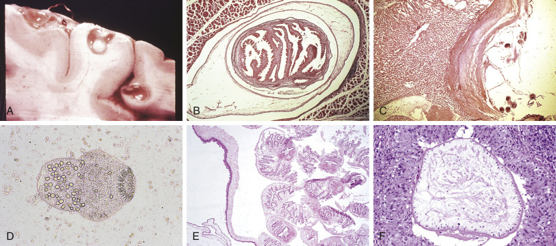

Figure 63-26 

**A,** Neurocysticercosis. **B,** Bladder worm ( _Taenia solium_ cysticercus) in muscle (H&E; 10×). **C,** Hydatid cyst in the liver; note presence of protoscoleces, a thin germinal membrane, a thick laminated membrane, and fibrotic host reaction (10×). **D,** Protoscolex found in aspirate fluid from a hepatic hydatid cyst; note rostellar hooks and calcareous corpuscles (400×). **E,** Human infection with a coenurus larva; note thin bladder membrane and numerous developing protoscolices (10×). **F,** Sparganum (larva of _Spirometra_ spp.) found in a lymph node. Note the surrounding granulomatous response (Giemsa stain; 100×). 

( _**A,** _ Photograph from Zaiman H. A pictorial presentation of parasites: a cooperative collection; [ http://www.astmh.org/Zaiman_Slides/1271.htm ](<http://www.astmh.org/Zaiman_Slides/1271.htm>) ; _**E,** _ Courtesy of Dr. Heike Duebner.) 

The diagnosis is usually made on clinical grounds in endemic areas but may be much more difficult to establish in nonendemic settings. Use of computed tomography (CT) scans is very helpful but generally is not available in most endemic areas. Radiographs are helpful in recognizing the presence of calcified cysts but not in recognizing recent infection. Recovery of an intact cysticercus at the time of surgery confirms the diagnosis. The cysticercus, or bladder worm, is a translucent, fluid-filled, oval sac containing a single inverted scolex that measures 5 mm or more in diameter ( [ Fig. 63-26, _B_ ](<#f0135>) ). 

Among serologic assays, the glycoprotein immunoblot assay available from the CDC has high sensitivity and specificity, outperforming several EIAs with which it was compared (  Diaz et al, 1992  ). Unfortunately, these assays do not distinguish between active and inactive infections, and thus are not useful in monitoring response to therapy. 

The occurrence of cysticercosis in someone from a nonendemic area and without an appropriate travel history should be investigated for accidental exposure to individuals involved in food preparation, or for the possibility of infection with a different _Taenia_ species (  Schantz et al, 1992  ). 

 

##  _Echinococcus_ Species (Hydatidosis) 

Human infection with larval stages of tapeworms of the genus _Echinococcus_ may take one of three forms: unilocular hydatid disease caused by _Echinococcus granulosus,_ multilocular or alveolar hydatid disease caused by _Echinococcus multilocularis,_ or polycystic hydatid disease caused by _Echinococcus vogeli_ (  Thompson & Lymbery, 1995  ). Members of the dog family are definitive hosts for these minute tapeworms. What they lack in size they make up for in numbers, with many hundreds or thousands of worms producing large numbers of eggs in one host. Eggs are passed in the stools and are ingested by the intermediate hosts, which include sheep, cattle, pigs, rodents, and other herbivorous animals. Humans, especially children, are infected following accidental ingestion of eggs from the environment. 

Eggs hatch in the intestine, and embryos penetrate the intestinal wall and then enter the bloodstream. Although most hydatids develop in the liver, some disseminate to other sites. Development of the cysts is slow, and it may take many years for a cyst measuring 10 to 15 cm in diameter to form. In the usual secondary hosts, the cysts contain numerous protoscoleces, which proliferate from a germinal membrane. 

_E. granulosus,_ the most important species producing human disease, is common in many sheep- and cattle-raising areas of the world, including small regions the United States, where dogs are the usual definitive host. Unilocular hydatids develop as single cysts in the liver and secondarily in the lungs or other locations. The cysts are filled with clear fluid and may contain smaller “daughter” cysts. Within the parent and daughter cysts are brood capsules and protoscoleces, which can number in the thousands ( [ Fig. 63-26, _C_ and _D_ ](<#f0135>) ). Symptoms in humans include a slowly growing mass lesion, although infection in space-limited locations such as bone and the CNS may become apparent earlier than in other sites. The diagnosis is suggested on the basis of clinical presentation and history plus the use of radiography, CT scans, and ultrasonography. Serologic tests are very useful in confirming a diagnosis and usually involve a screening test such as EIA or IHA, followed, if positive, by a confirmatory assay such as immunoblot or gel diffusion (  Wilson et al, 1995  ). Sensitivity varies from 60% to 90%, depending on the characteristics of the case. False-positive reactions may occur with cysticercosis, although disease presentation should prevent confusion. Aspiration of cyst contents is potentially dangerous because spillage of cyst contents may result in dissemination of disease or possibly anaphylactic shock; however, if aspiration is performed, cyst contents usually reveal hydatid sand, a mixture of protoscoleces, disintegrating brood capsules, hooklets, and calcareous corpuscles. Aspiration performed under ultrasound or CT guidance seems to carry a lower risk and is now a commonly performed therapeutic method for patients with uncomplicated hydatid disease involving the liver. 

_E. multilocularis_ produces multilocular or alveolar hydatid disease in the northern regions of Europe and Russia, and in Alaska, Canada, and the northern tier of states in the United States. Intermediate hosts include several genera of small rodents; foxes, wolves, and dogs are definitive hosts. Human infection occurs in the liver, where the hydatid develops as an invasive cyst that insinuates itself within the tissue in an alveolar pattern without a surrounding outer capsule. Although the germinal membrane proliferates in the human liver, protoscoleces usually fail to develop. The pathologic picture is reminiscent of hepatic carcinoma. Serologic assays that use _E. granulosus_ antigens are useful in the diagnosis of this disease. The differential use of antigens from both parasites shows promise of discrimination between the two diseases (  Wilson et al, 1995  ). 

_E. vogeli_ produces a polycystic hydatid cyst in humans that is invasive but, unlike _E. multilocularis,_ produces both brood capsules and protoscoleces. The disease is limited to Latin America, where rodents, specifically the paca, and bush dogs complete the life cycle (  D'Alessandro et al, 1979  ). Polycystic hydatid disease in South America may also be caused by _Echinococcus oligarthus,_ a parasite of felids and rodents. This species is similar morphologically to _E. vogeli,_ and cases have been misidentified (  D'Alessandro et al, 1995  ). 

 

##  _Spirometra_ Species (Sparganosis) 

Sparganosis is caused by larval cestodes of the genus _Spirometra,_ which are closely related to _Diphyllobothrium_ spp. Adult stages commonly parasitize cats and dogs and their relatives in Asia _(Spirometra mansoni)_ and North America _(Spirometra mansonoides)._ Life cycles are similar to those of _Diphyllobothrium_ : Copepods serve as first intermediate hosts for procercoid larvae, and fish serve as second intermediate hosts for plerocercoid larvae. Humans become infected with these larval stages (the sparganum) through ingestion of copepods in drinking water or ingestion of raw or incompletely cooked fish. Use of frogs and snakes as poultices may also result in the transfer of larvae to the human host. Sparganosis usually presents as localized or migratory subcutaneous swellings associated with erythema and pain, although brain infection may occur. Surgical exploration may reveal a delicate, slender, ivory-colored worm varying from a few to many centimeters in length. Cross-sections demonstrate a thick tegument with deep folds and parenchyma with prominent muscle bundles. No body cavity is seen, as in the nematodes, and calcareous corpuscles are numerous ( [ Fig. 63-26, _F_ ](<#f0135>) ) (  Orihel & Ash, 1995  ;  Gutierrez, 2000  ;  Garcia, 2007  ). 

 

##  _Taenia multiceps_ and _Taenia serialis_ (Coenurosis) 

Intestinal _Taeni_ a spp. of cats and dogs (primarily _Taenia multiceps_ and _Taenia serialis_ ) produce a larval stage in intermediate hosts known as a _coenurus_ . This stage consists of a large (up to 10 cm) transparent sac containing numerous scoleces that bud off from a germinal membrane and invaginate into the fluid-filled cyst ( [ Fig. 63-26, _E_ ](<#f0135>) ). Sheep are the usual intermediate hosts for _T. multiceps,_ and rodents, hares, and rabbits for _T. serialis,_ although humans serve in this role through accidental ingestion of eggs originating from domestic cats and dogs. Similar to cysticerci, coenuri may develop in any organ, producing a similar disease. Diagnosis is usually made by examination of the excised cyst or its demonstration in tissue sections. The presence of multiple invaginated scoleces within a single bladder differentiates the coenurus from other larval cestodes. 

 

##  Trematodes 

All liver-, lung-, and blood-inhabiting trematodes that mature in humans produce eggs that usually exit the body via stool, urine, or sputum. Because of their extraintestinal location, these flukes and their eggs may be found in tissues incidentally or in association with symptoms. 

Adult _F. hepatica, C. sinensis,_ and _O. viverrini_ may be found in hepatic and biliary tissues, and occasionally in ectopic locations. The presence of typical eggs free in the tissues or within the uterus of the helminth often provides definitive identification. Adult _Paragonimus_ spp. primarily reside in the lung but may be found in ectopic sites such as brain and subcutaneous tissue, where they produce abscesses, often associated with large numbers of eggs. Adult schistosomes reside in blood vessels, primarily in the distribution of the inferior mesenteric vein _(S. mansoni),_ the superior mesenteric vein ( _S. japonicum_ and _S. mekongi_ ), and the vesical plexus _(S. haematobium)._ Although the adult stages are rarely encountered in tissue sections, eggs may be found in large numbers in tissues of the intestine, liver, and bladder (see [ Fig. 63-23, _B, D,_ and _F_ ](<#f0120>) ). Eggs may disseminate via the bloodstream to other sites, including the brain, spinal cord, lungs, heart, kidneys, and spleen. The eggs of _S. japonicum_ are especially prone to disseminate because of their smaller size and the large numbers typically produced. Identification of eggs is dependent on recognition of their typical sizes and morphologic characteristics in appropriate tissues. 

,  

##  Medically Important Arthropods 

Arthropods comprise a large and diverse group of organisms, few of which have clinical or economic significance. Those that do, however, are important causes of morbidity and mortality in humans and their domestic animals, and are responsible for serious economic losses to agriculture. Although perhaps best known among clinicians for their ability to transmit various infectious agents, including viruses, bacteria (rickettsia, spirochetes, others), protozoa, and certain helminths, arthropods also cause serious disease by direct tissue invasion, envenomation, vesication, blood loss, and allergic reaction. Exaggerated fears of arthropods (entomophobia) and delusions of infestation (delusory parasitosis) are not uncommon neuroses, which may be disabling to some individuals. Species directly or indirectly responsible for human disease include representatives of all the major arthropod classes ( [ Table 63-12 ](<#t0065>) ). 

TABLE 63-12 

Classification of Arthropods of Medical Importance 

**Class Insecta (insects)**   
Order Anoplura (sucking lice)   
Order Siphonaptera (fleas)   
Order Dictyoptera (cockroaches)   
Order Hemiptera (bedbugs, kissing bugs)   
Order Hymenoptera (ants, wasps, bees)   
Order Coleoptera (beetles)   
Order Lepidoptera (moths, butterflies, caterpillars)   
Order Diptera (flies, mosquitoes, midges)  |  **Class Arachnida (arachnids)**   
Subclass Scorpiones (scorpions)   
Subclass Araneae (spiders)   
Subclass Acari (ticks, mites, chiggers)   
**Class Diplopoda (millipedes)**   
**Class Chilopoda (centipedes)**   
**Class Crustacea (crustaceans)**   
Order Copepoda (copepods)   
Order Decapoda (crabs, crayfish)   
**Class Pentastomida (tongue worms)**  
---|---  
  
In this section, an approach that the clinical laboratory may use when evaluating clinical specimens containing arthropods is presented, followed by a brief discussion of each of the arthropod groups of medical importance. A variety of general and specialized texts and guides are available for more complete coverage of the field of medical entomology (  National Communicable Disease Center, 1969  ;  Beaver et al, 1984  ;  Lane et al, 1993  ;  Strickland, 2000  ;  Mullen & Durden, 2002  ;  Garcia, 2007  ;  Goddard, 2007  ;  Murray et al, 2007  ), while a recent review specifically discusses the identification of arthropods in the clinical microbiology laboratory (  Mathison & Pritt, 2014  ). 

 

##  Biological Characteristics 

Arthropods are characterized by a bilaterally symmetrical, segmented body; several pairs of jointed appendages; and a rigid chitinous exoskeleton that is molted repeatedly during growth. Development proceeds from egg to adult through gradual (egg, nymph, and adult stages) or complete (egg, larva, pupa, and adult stages) metamorphosis. Bedbugs, kissing bugs, lice, and cockroaches are examples of insects that undergo gradual metamorphosis. Flies and mosquitoes; fleas; ants, bees, and wasps; and beetles undergo complete metamorphosis; wormlike larval forms pupate to emerge as adults. Arachnids undergo developmental changes most similar to the process of gradual metamorphosis. The larval stages of those arthropods that undergo complete metamorphosis often prove to be the most difficult for clinical laboratorians to identify and should be referred to a medical entomologist if full identification is required for clinical management. 

 

##  Mechanisms of Injury 

 

##  Direct Tissue Invasion 

Invasion of superficial tissues (referred to as _infestation_ ) may occur with a variety of arthropods, of which scabies mites, chigoe fleas, and some dipteran larvae (maggots) are most common. Invasion of deeper body tissues and cavities (referred to as _infection_ ) occurs primarily with maggots and rarely with pentastomid larvae. Tissue invasion by dipteran larvae is referred to as _myiasis_ and may occur in living or devitalized tissues, depending on the involved species. 

 

##  Envenomation 

Many arthropods are capable of injecting saliva or venom with their bites or stings. For most individuals, these compounds cause only local tissue reactions, but serious, life-threatening reactions such as anaphylaxis may occur, often as a result of previous sensitization to the particular toxin. Hymenopteran (ants, bees, and wasps) and scorpion stings are among the greatest offenders (  Reisman, 1994  ). The bites of certain arthropods, especially centipedes; mosquitoes, flies, and biting midges; bedbugs, kissing bugs, and assassin bugs; sucking lice; fleas; and ticks and mites may also be toxic, causing local or systemic reactions. Almost all spiders are venomous, but only a few groups (widow spiders, violin spiders, and certain tarantulas) pose significant health risks to humans. Less common but recognized causes of envenomation result from exposure to the urticating hairs of certain caterpillars and beetle larvae. 

 

##  Vesication 

Certain of the larger tropical millipedes are capable of spraying a vesicating (blister-causing) chemical substance from glands located on each body segment. These compounds are especially irritating should they reach the conjunctiva. Blister beetles are so named because of their ability to discharge vesicating fluids (cantharidin, the active ingredient in the aphrodisiac Spanish fly) from their bodies when handled. 

 

##  Blood Loss 

Arthropods responsible for producing significant irritation or blood loss to humans and domestic animals include bedbugs, kissing bugs, lice, fleas, flies, mosquitoes, biting midges, ticks, and mites. Although these activities are rarely life-threatening, the concurrent transmission of infectious agents may be. 

 

##  Transmission of Infectious Agents 

Many arthropods play an integral role in the mechanical or biological transmission of infectious disease agents. The common housefly, _Musca domestica,_ may be responsible for the mechanical transmission of agents of bacillary dysentery, cholera, typhoid, viral diarrhea, amebic dysentery, and giardiasis, as well as pinworms and tapeworms. Mechanisms involved in the biological transmission of infectious agents vary from simple organism amplification in the arthropod vector to more complex life cycle changes in the involved parasite. Ticks and mites are involved in the transmission of certain bacteria ( _Rickettsia, Ehrlichia, Anaplasma,_ spirochetes, others), protozoa _(Babesia),_ and viruses. Among insects, lice are involved in the transmission of bacteria ( _Rickettsia, Bartonella,_ and _Borrelia_ ); kissing bugs transmit trypanosomes; fleas transmit the agents of plague, typhus, and canine tapeworm; and dipterans transmit arboviruses, malarial parasites, trypanosomes, leishmanias, filarial worms, and bacteria. 

 

##  Hypersensitivity Reactions 

Most serious reactions to arthropod bites and stings result from allergic hypersensitivities. Hymenopteran stings alone are responsible for most arthropod-related deaths and usually result from the development of hypersensitivity following repeated exposure to venom (  Reisman, 1994  ). Allergies may be exacerbated following exposure to the saliva, excrement, or body parts of mites, ticks, lice, bedbugs, caterpillars, moths, and butterflies. Asthma and hay fever may also develop in response to the presence of the large variety of house, dust, and animal mites in the environment (  Frazier & Brown, 1980  ). 

 

##  Psychological Manifestations 

Entomophobia refers to an unreasonable or excessive fear of seeing or touching arthropods. Although this fear may occasionally result in disruption of a person's normal activities, it rarely becomes incapacitating. Delusory parasitosis is a more serious emotional disorder in which an individual is convinced that he or she is infected with parasites or arthropods despite objective evidence to the contrary. As the delusion progresses, the individual may report loss of employment, divorce, repeated use of pesticide services, and movement from house to house. Visits to health care providers are usually numerous, although unsatisfactory. The problem may originate in the home or workplace and may be transferable from one to the other. The delusion may be so convincing that other family members or friends may believe it or acquire it themselves. The patient may submit to the laboratory numerous specimens such as skin, fabric, lint, hair, and mucus. It is incumbent on laboratory personnel to examine these materials to rule out true infestation. The mysterious onset of irritation and itching may be due to bites from unrecognized scabies mites, lice, fleas, or bedbugs, or from insects and mites questing from an abandoned rodent or bird nest in an area of human habitation. Before such causes are dismissed, they must be looked for and their presence excluded (  Lynch, 1993  ;  Goddard, 2007  ;  Murray et al, 2007  ). Patients with delusional parasitosis are difficult to treat, although the use of antipsychotics may provide some relief. The lack of clarity as to symptomatology, etiology, and diagnosis creates difficulty in management for both the patient and health care provider. 

 

##  Laboratory Approaches to Arthropod Identification 

Arthropod specimens are often directed to the clinical laboratory by both clinicians and patients with the expectation that they can be accurately identified, but few laboratory personnel receive more than a cursory exposure to entomology during training. Nonetheless, laboratorians should have access to texts and dichotomous keys, which should allow limited identification of the more commonly encountered medically important groups, especially ectoparasites (fleas, lice, mites, and ticks). Of greater importance is the ability of laboratory personnel to recognize those rare situations in which outside expertise should be sought. This specifically relates to those occasions when significant clinical decisions regarding therapy and prognosis are being made. State or local public health laboratories often have the expertise available or know of individuals trained in medical entomology who can be reached at regional educational institutions, museums, or other public or private agencies, including the CDC. 

Specimens submitted to the laboratory are most often intact organisms, skin scrapings, tissues, sputum, urine, or stool. Inanimate objects, including foodstuffs, water, clothing, bedding, and carpeting, among others, may also be submitted. It is not uncommon for patients to submit arthropods recovered from the toilet bowl following urination or a bowel movement. In most cases, the presence of such organisms is coincidental and is not related to infection. 

Proper killing and preservation of arthropods is important to preserve those characteristics necessary for identification. Small, nonwinged arthropods, especially ectoparasites (lice, fleas, ticks, and mites), larval forms (maggots, grubs, and caterpillars), spiders, and scorpions, should be placed directly into 70% to 80% ethyl alcohol. Large larval forms are best killed in hot (not boiling) water to extend their bodies and prevent contraction before immersion in alcohol. Attached tissue or other debris should be gently removed or washed away prior to preservation. Smaller forms (mites, small ticks, fleas, and sandflies) may be prepared as permanent slide mounts. 

Winged insects, especially adult mosquitoes, midges, and flies, should be killed by exposure to the fumes of ethyl acetate or chloroform and preserved dry to retain the taxonomic information contained in the body and wing scales. Such arthropods usually are pinned and dried, followed by storage in tight-fitting boxes protected with naphthalene or dichlorobenzene. Additional details regarding the collection, preservation, and preparation of arthropod specimens for examination are found elsewhere (  Beaver et al, 1984  ;  Steyskal et al, 1987  ;  Lane et al, 1993  ;  Garcia, 2007  ). 

 

##  Insects 

Insects account for more than 90% of all described arthropod species, although few are responsible for human disease. Members of this class are distinguished from other arthropods by having a body divided into three parts (head, thorax, abdomen); one pair of antennae; three pairs of legs; and one, two, or no pairs of wings. This is the only arthropod class in which flight has developed. 

 

##  Sucking Lice 

Sucking lice are dorsoventrally flattened, wingless insects that have characteristic claws on the ends of each leg that allow attachment to body hairs or clothing ( [ Fig. 63-27, _A_ and _B_ ](<#f0140>) ). All species suck blood intermittently, which may cause unexplained dermatitis. Eggs, known as _nits,_ are deposited on hair shafts or clothing, depending on the species. Although named for their primary site of attachment, they do not always remain confined to that location. The head louse, _Pediculus humanus capitis,_ and the body louse, _Pediculus humanus humanus,_ are indistinguishable to the nonspecialist and are thought to actually represent two ecotypes of the same species based on newly acquired molecular data. They are longer than they are wide and grow to about 3 mm in length. Biological differences are apparent; only _P. h. humanus_ transmits the agents of epidemic typhus, trench fever, and relapsing fever (  Kim et al, 1986  ). Infestations with _P. h. humanus_ occurs primarily in settings of war, poverty and homelessness, where bathing and laundering do not regularly occur. In comparison, _P. h. capitis_ is much more common, particularly among children of school age. Children are at particular risk for acquiring head lice through the sharing of caps, clothing, and combs (  Orkin & Maibach, 1985  ). Nits of head lice are deposited primarily on hair shafts, and those of body lice are deposited on clothing. Because objects such as hair casts, dander, hair spray, and fungal hair infection may mimic nits, differentiation is important. Nits are typically 1 mm long and when unhatched have intact opercula ( [ Fig. 63-27, _C_ ](<#f0140>) ). Transmission occurs primarily through the sharing of infested clothing and bedding because body lice tend to lay their eggs in clusters, especially along seams or waistbands. The pubic louse, _Pthirus pubis,_ is distinctly different from the others; it is rounder (measuring up to 2 mm in diameter), the abdomen is more crablike, and the first pair of legs is significantly smaller and more slender than the other pairs (see [ Fig. 63-27, _B_ ](<#f0140>) ). Pubic lice and their nits are found primarily on pubic hairs but may extend to the chest, armpit, and facial hair. Transmission occurs primarily during sexual intercourse. 

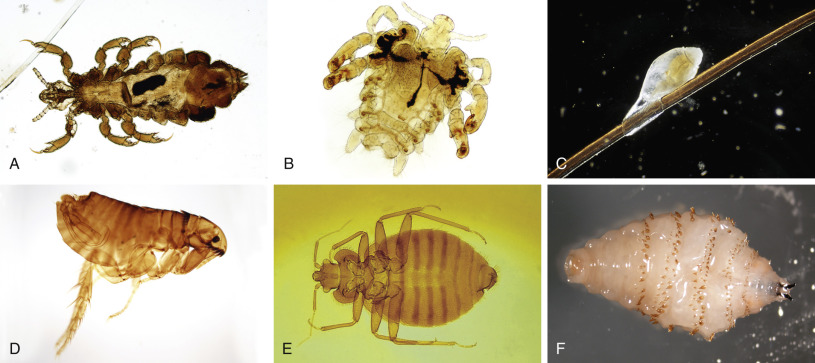

Figure 63-27 

Medically important insects. 

**A,** _Pediculus humanus capitis,_ the head louse, holding a strand of hair with one leg. **B,** _Pthirus pubis,_ the crab louse. **C,** Intact egg (nit) of _P. humanus capitis_ . **D,** _Ctenocephalides canis,_ the common dog flea; note powerful hind legs. **E,** _Cimex lectularius_ , the common bedbug. **F,** Larva of _Dermatobia hominis,_ the human botfly; note the two sclerotized hooks at the anterior end and numerous body spines (10×). 

( _**E,** _ with permission from Murray PR, Barron EJ, Pfaller MA, et al, editors: _Manual of clinical microbiology_ , ed 6, Washington, DC, 1995, ASM Press.) 

 

##  Fleas 

Fleas are small (1 to 2 mm), laterally compressed, wingless ectoparasites capable of sucking blood ( [ Fig. 63-27, _D_ ](<#f0140>) ). Long, muscular legs are adapted for jumping great distances. Fleas that attack humans are parasites of other mammals or poultry and include both blood-sucking pests (many species) and tissue-penetrating jiggers. Infestations commonly occur with exposure to domestic animals and pets; the most pestiferous species are the dog flea _(Ctenocephalides canis),_ the cat flea _(Ctenocephalides felis),_ and the human flea _(Pulex irritans)._ Some individuals become highly sensitized to flea bites, whereas others are unaffected. Cat and dog fleas are the usual intermediate hosts for the tapeworm _D. caninum_ and less frequently for _H. diminuta_ and _H. nana_ . Because larvae of these species often develop in an animal's bedding, or in carpets and furniture, eradication may require fumigation and cleaning of those articles. The Oriental rat flea, _Xenopsylla cheopis,_ is an extremely important species because it transmits the plague bacillus and the agent of murine typhus. Although normally parasitizing several species of rats, this flea readily attacks humans should the rodent host die. The jigger or chigoe flea _Tunga penetrans_ is found in both Central and South America and in regions of tropical Africa. The female flea attaches to and embeds itself in the skin, especially between the toes and under the toenails, where it grows to the size of a small pea. After eggs are discharged, the flea dies, prompting an inflammatory response and possible secondary bacterial infection. Tungiasis is diagnosed by identifying the dark portion of the flea's abdomen (displaying the spiracles) protruding from the skin surface of an enlarging lesion (  Beaver et al, 1984  ;  Lane et al, 1993  ;  Garcia, 2007  ;  Goddard, 2007  ). 

 

##  Cockroaches 

Cockroaches have closely adapted themselves to human habitation, sharing our food, shelter, and warmth. Although they are primarily nuisance pests, cockroaches are potential carriers of fecal pathogens owing to their ability to move quickly from sewers and drains to food preparation areas. In addition to transmitting pathogenic bacteria, they may spread hepatitis and poliovirus; intestinal protozoa, including _E. histolytica_ ; and several species of enteric nematode. Allergies and asthma may develop in some individuals following exposure to the excreta, cast skins, or body parts of cockroaches (  Goddard, 2007  ). 

 

##  Bedbugs and Kissing Bugs 

Bedbugs (family _Cimicidae_ ) and kissing bugs (family _Reduviidae_ ) are blood-sucking insects that have a long, narrow proboscis that is folded underneath the body when not in use. Bedbugs ( _Cimex lectularius_ and _Cimex hemipterus_ ) are reddish brown, dorsoventrally flattened, wingless insects approximately 5 mm in length ( [ Fig. 63-27, _E_ ](<#f0140>) ). They are cosmopolitan in distribution and attack most any mammal, feeding primarily at night. During daylight hours, they hide under mattresses, loose wallpaper, and floorboards. Although they are not known to transmit disease, bedbug bites may cause painful weals or bullae, depending on an individual's sensitivity to their saliva. 

Kissing bugs _(Triatoma_ , _Rhodnius_ , _Panstrongylus)_ have a cone-shaped head on a narrow neck and an abdomen that is widened in the middle. These insects are black or brown, and some have orange and black markings on the abdomen. They average 1 to 3 cm in length and, unlike bedbugs, have well-developed wings for flight. Similar to bedbugs, kissing bugs are relatively painless feeders on vertebrates and produce similar skin reactions. In Mexico and Central and South America, they transmit the agent of Chagas disease, _T. cruzi,_ in the feces, which is secondarily inoculated into the skin by the human host while scratching (  Lane et al, 1993  ;  Goddard, 2007  ). Although they are also found throughout the southern United States, autochthonous transmission of Chagas disease is thought to only rarely occur. 

 

##  Bees, Wasps, and Ants 

Hymenopterans are social insects that readily defend their nests when disturbed. In nonreproductive females, the ovipositor is modified as a stinger capable of injecting venom for use in the capture of prey or for defense. The venom of bees, wasps, hornets, and yellow jackets causes only transient swelling and discomfort in most individuals but may be responsible for systemic reactions, including anaphylaxis, in others who were previously sensitized (  Reisman, 1994  ). Up to 100 people in the United States die each year from hymenopteran stings. The Africanized honey bee is now present in North America following its introduction into Brazil in 1956. These bees, which are more easily provoked than other honey bees, exhibit massive stinging behavior. Many species of ant are problematic for humans because of their ability to bite, and some groups, such as harvester and fire ants, are capable of giving painful stings. 

 

##  Beetles 

Although beetles are perhaps best known as pests of agricultural crops, some species may give a painful bite, and others, especially blister beetles, may exude vesicating fluids (cantharidin) that cause dermatitis or blister formation. The larvae of certain larder beetles have urticating hairs that may be responsible for dermatitis or, if ingested, irritation of the gastrointestinal tract. Larval and adult larder and grain beetles also may serve as intermediate hosts for the rodent and human tapeworms _H. diminuta_ and _H. nana_ . 

 

##  Moths and Butterflies 

Certain larvae (caterpillars) of _Lepidoptera_ possess urticating hairs or spines capable of injecting venom when handled. Although most effects of these toxins remain localized to the skin, systemic effects such as shock and paralysis have been reported (  Goddard, 2007  ). Adult tussock and gypsy moths are known to have urticating scales and hairs that may cause dermatitis, eye irritation, or respiratory tract irritation, especially among forestry workers (  Shama et al, 1982  ). 

 

##  Flies, Mosquitoes, and Midges 

Diptera are characterized by the presence of a single pair of membranous wings. Among all arthropods, they are responsible for the greatest share of human disease through blood-sucking activities, biological or mechanical transmission of infectious agents, and direct tissue invasion by larval forms (myiasis). Bites from a variety of flies, mosquitoes, and biting midges often cause local irritation from sensitivity to the saliva and, in some individuals, systemic reactions. In addition to blood-sucking activities, the repeated attacks themselves may be physically and psychologically damaging. Certain blood-sucking species are also responsible for the transmission of important human pathogens, including malaria, filariasis, and arboviral disease by mosquitoes; onchocerciasis by blackflies; loiasis by deer flies; leishmaniasis and bartonellosis by sandflies; and African trypanosomiasis by tsetse flies. Other viral, bacterial, and parasitic agents are readily transmitted mechanically by nonbiting flies such as house flies, flesh flies, and blowflies, which can easily contaminate human food. 

Myiasis may occur in an accidental, facultative, or obligatory fashion. The housefly, _Musca domestica,_ has no requirement for developing in mammalian tissue, yet may be found occasionally in dead tissue or under plaster casts. This type of accidental myiasis is not uncommon but rarely is clinically significant. Facultative myiasis is most often caused by blowflies and flesh flies, which ordinarily feed on dead tissues but may move into adjacent viable tissues. Obligatory myiasis is caused by certain species that develop only in living tissues. Those species that infect humans are all of zoonotic origin. The human botfly, _Dermatobia hominis,_ develops in boil-like subcutaneous lesions, with the posterior end of the maggot appearing at the skin surface ( [ Fig. 63-27, _F_ ](<#f0140>) ). This species is most commonly found in individuals who have spent time in Central or South America, and is unusual in that its eggs are mechanically transported to the host by other flying insects, usually mosquitoes. The tumbu fly _(Cordylobia anthropophaga),_ found in sub-Saharan Africa, causes a furuncular type of myiasis. Eggs of this species usually are laid on the ground or on hanging laundry, and larvae rapidly penetrate the skin on contact. The most serious obligatory myiasis is caused by the Old World screwworm, _Chrysomya bezziana,_ and the New World screwworm, _Cochliomyia hominivorax_ . These species lay their eggs directly on their cattle hosts, usually on wounds or near the nostrils. The larvae actively feed on and move through living tissues. Human infection may be particularly destructive if larvae invade the eye, nose, or mouth. Other species may also be responsible for traumatic, obligatory myiasis in humans (  Lane et al, 1993  ). 

 

##  Arachnids 

Medically important arachnids include scorpions, spiders, ticks, and mites. Scorpions and spiders have two body segments, the cephalothorax and the abdomen, whereas ticks and mites have only one. Members of the group have four pairs of legs as nymphs and adults; larval ticks and mites have three pairs of legs. All lack antennae, mandibles, and wings. Scorpions and spiders are best known for their ability to inject poisonous venom, whereas ticks and mites are best known as vectors for viral, bacterial, and protozoal pathogens. 

 

##  Scorpions 

Unlike other arachnids, scorpions have a pair of forward-directed pincer claws that impart a crablike appearance and a segmented tail with a bulbous stinging apparatus in the tip ( [ Fig. 63-28, _A_ ](<#f0145>) ). They are predatory in nature and paralyze their intended victim with venom from the sting, which may also be used for defensive purposes. Toxicity to humans varies depending on the species; many elicit no more reaction than that of a bee sting, but some are deadly, causing more than 1000 deaths annually. Poisonous species are found in the Western Hemisphere, Europe, Africa, and the Middle East (  Beaver et al, 1984  ;  Goddard, 2007  ). 

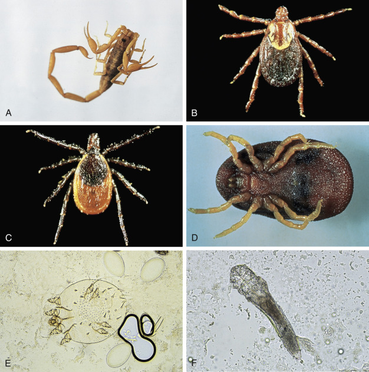

Figure 63-28 

Medically important arachnids. 

**A,** Scorpion; note forward-directed pincer claws and stinger on the tail tip. **B,** _Dermacentor variabilis_ (dog tick), nonengorged adult female. **C,** _Ixodes scapularis_ (black-legged tick or deer tick), nonengorged adult female. **D,** _Ornithodoros_ sp. (soft tick), nonengorged adult, ventral view. **E,** _Sarcoptes scabei_ (itch mite) adult; note presence of adjacent eggs in skin scrapings. **F,** _Demodex folliculorum_ (follicle mite) adult. 

( **A,** With permission from Murray PR, Barron EJ, Pfaller MA, et al, editors: _Manual of clinical microbiology._ ed 6. Washington, DC, 1995, ASM Press. **B** and **C,** With permission from Northwest Infectious Disease Consultants. **E,** With permission from Spach DH, Fritsche TR: Norwegian scabies in a patient with AIDS. _N Engl J Med_ 331:777, 1994.) 

 

##  Spiders 

Spiders lack a tail with an attached stinger but instead have fanglike chelicerae among their mouthparts, through which venom can be expressed. Although most spiders are venomous, few have chelicerae capable of penetrating human skin. Most spider bites cause only transitory irritation and pain. Widow spiders (genus _Lactrodectus_ ) are one group responsible for systemic arachnidism through the action of a potent neurotoxin capable of producing weakness, myalgia, paralysis, convulsions, and, occasionally, death. Published mortality rates vary from less than 1% to 6%. Five closely related species are found in the United States; the black widow _(Lactrodectus mactans)_ is the most widespread. Female black widow spiders are glossy black with a characteristic red or orange hourglass-shaped marking on the underside of the abdomen and have a leg span of 3 to 4 cm. They live in protected locations such as woodsheds, basements, and outdoor privies (  Strickland, 2000  ). 

Violin spiders (genus _Loxosceles_ ) are responsible for necrotic arachnidism or loxoscelism. In the United States, the brown recluse or fiddleback spider _(Loxosceles reclusa)_ is most often involved, although other species are present. This species is 1 to 2 cm long and tan to dark brown; it has a darkened, violin-shaped marking oriented base forward on the dorsum of the cephalothorax. When present in homes, violin spiders are reclusive in their habits, preferring undisturbed areas such as closets, basements, and under porches. Their bite is painless and often goes unrecognized until several hours later, when the area becomes red, swollen, and painful. The venom is dermonecrotic and hemolytic, producing cutaneous necrosis and sloughing of involved skin over several days. The resulting lesion may be difficult to heal and subject to secondary infection. Systemic reactions such as hemolysis and acute renal failure are rare. Other spider genera have also been implicated in producing necrotic arachnidism (  Fisher, 1994  ). 

 

##  Ticks 

Ticks are one of the more common arthropods to be submitted to the clinical parasitology laboratory for identification. Unlike spiders and scorpions, ticks have a fused cephalothorax and abdomen, as well as a characteristic toothed hypostome for feeding. Tick development progresses through four stages: egg, larva, nymph, and adult. Following hatching, a blood meal is required for progression to the subsequent stage. Humans usually acquire ticks in grassy or brushy areas in close proximity to the usual animal hosts. All species are obligate blood-sucking ectoparasites and are important vectors of viral, bacterial, and protozoal pathogens to humans and domestic animals. Their feeding activities may produce local tissue damage and blood loss, especially to livestock and wildlife, or tick paralysis, a syndrome caused by a neurotoxin secreted by a tick's salivary glands that produces ascending flaccid paralysis and toxemia. Symptoms may closely mimic those of Guillain-Barré syndrome, poliomyelitis, or botulism. Removal of the attached tick usually results in resolution of symptoms within hours to days. 

Species affecting humans include members of the family _Ixodidae_ (hard ticks) and _Argasidae_ (soft ticks). Hard ticks have anteriorly directed mouthparts and a sclerotized plate, or scutum, on the dorsum. The scutum covers the entire dorsum in the male but only the anterior portion in the female, allowing the body to swell when engorged ( [ Fig. 63-28, _B_ and _C_ ](<#f0145>) ). Argasid ticks have a soft leathery body lacking a scutum and ventrally directed mouthparts that are not visible when viewed from above ( [ Fig. 63-28, _D_ ](<#f0145>) ). Unengorged ticks are generally 2 to 5 mm long but may enlarge to several times that size following engorgement. Engorged hard ticks may mimic soft ticks, so care must be exercised in their identification (  Sonenshine  1991  ). 

Most ticks found crawling on or embedded in human skin are hard ticks. Soft ticks tend to feed only briefly and then often at night. Important species of hard ticks in North America include _Dermacentor variabilis_ (American dog tick), _Dermacentor andersoni_ (Rocky Mountain wood tick), _Amblyomma americanum_ (Lone Star tick), _Rhipicephalus sanguineus_ (brown dog tick), _Ixodes scapularis_ (black-legged or deer tick), and _Ixodes pacificus_ (Western black-legged or deer tick). _Dermacentor_ and _Amblyomma_ ticks are called _ornate_ ticks because of the presence of white markings on their scuta; the other species are inornate ticks. 

_Dermacentor_ ticks transmit Rocky Mountain spotted fever and possibly tularemia, Q fever, and Colorado tick fever. _Ixodes_ ticks are vectors of Lyme disease, babesiosis, anaplasmosis, and ehrlichiosis, and in other parts of the world, these ticks are responsible for the transmission of certain arboviruses. _Amblyomma_ ticks are capable of transmitting Rocky Mountain spotted fever, as well as tularemia and possibly Lyme disease. All these genera are capable of causing tick paralysis. _Rhipicephalus_ ticks have been implicated in the transmission of Rocky Mountain spotted fever and ehrlichiosis in North America, and of boutonneuse fever in the Mediterranean area. Soft ticks of the genus _Ornithodoros_ occur in many parts of the world, including the United States, and are important vectors of the relapsing fever spirochetes ( _Borrelia recurrentis_ and related forms) (  Spach et al, 1993  ;  Murray et al, 2007  ;  Ismail et al, 2010  ). 

 

##  Mites 

Mites are arachnids of microscopic size (usually <1 mm) that are widely distributed in the environment. Medically important species may attack humans directly, serve as vectors for infectious disease, or cause dust allergies. Humans are commonly infested with both _Demodex folliculorum_ and _Demodex brevis,_ the follicle mites, and _Sarcoptes scabei,_ the itch or mange mite. Follicle mites are minute (0.1 to 0.4 mm), elongate parasites with stubby legs that can be recovered from hair follicles and sebaceous glands ( [ Fig. 63-28, _F_ ](<#f0145>) ). They are common incidental findings on histologic skin preparations. Although their presence has been associated with various skin conditions, they are commonly found in healthy individuals as well, which makes their significance difficult to assess (  Burns, 1992  ). 

_Sarcoptes scabei_ mites are of greater medical importance because of their ability to create serpiginous tunnels through the upper layers of the epidermis. Transmitted through personal contact, these mites are found primarily in the interdigital spaces and the flexor surfaces of the wrists and forearms and less commonly in other areas, including the breasts, buttocks, and external genitalia. Inflammation and intense itching result from the tunneling activity and from the deposition of eggs and excreta. Clinical manifestations vary depending on the degree of sensitization to the parasites and their products. Lesions often become secondarily infected. Generalized dermatitis occurring in the presence of thousands of mites, typically in older adults or immunocompromised individuals, is known as _crusted_ or _Norwegian_ scabies. 

The diagnosis is made by placing skin scrapings collected from tunneled areas in 20% potassium hydroxide or mineral oil for clearing and examining under the microscope. Detection of eggs, six-legged larvae, and eight-legged nymphs or adults is diagnostic but may be difficult to demonstrate ( [ Figs. 63-28, _E_ ](<#f0145>) _,_ and [ 63-29 ](<#f0150>) ). The diagnosis of scabies in an institutional or school setting may result in pseudoepidemics, in which numerous individuals develop itching without evidence of disease. Care must be exercised to properly diagnose the disease to identify real cases and differentiate them from cases of delusory parasitosis (  Orkin & Maibach, 1985  ;  Lynch, 1993  ). 

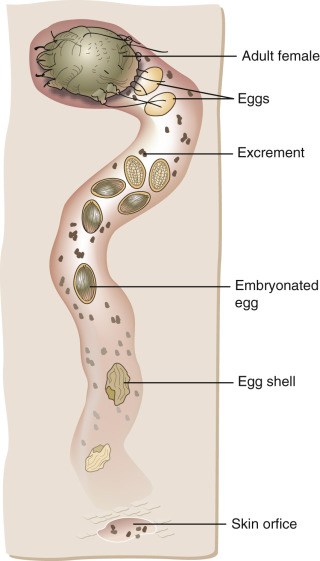

Figure 63-29 

_Sarcoptes scabiei_ . 

Diagram of a subcutaneous burrow. 

A number of animal mite species may attack humans for a blood meal, either as larval forms or as adults, when normal mammalian or bird hosts are not available. Larval chigger mites (family _Trombiculidae_ ) are problematic in many parts of the world because their saliva can produce large wheal-and-flare reactions with intense itching. These tiny six-legged larvae are often red and commonly attach to the skin in areas where clothing is restrictive, such as at the ankles, waistline, armpits, and wrists. In parts of Asia and Australia, trombiculid mites are vectors for the transmission of the agent of scrub typhus (  Lane et al, 1993  ). 

Certain nonbiting mites play a role in allergic rhinitis, asthma, and some skin conditions. The secretions, excreta, and body parts of _Dermatophagoides farinae_ and _Dermatophagoides pteronyssinus_ are potent allergens that may occur in great numbers in the household environment (  Frazier & Brown, 1980  ). Routine testing by an allergist may identify the offending agent. 

Mites can have a very similar appearance to ticks, particularly in their larval form, but can be differentiated by their lack of a toothed hypostome (attachment organ used by ticks) and lack of Haller's organ on their forelegs. 

 

##  Classes of Lesser Medical Importance 

 

##  Millipedes 

Millipedes are wormlike arthropods with numerous apparent body segments, each with two pairs of legs; they are commonly found in and under decaying vegetation. Although they lack mouthparts capable of producing serious bites, many species produce vesicating secretions from glands located on each body segment. When handled roughly, the larger tropical species are capable of squirting these fluids over a distance of several centimeters. Exposure of the skin or mucous membranes to these fluids may produce a burning sensation and blister formation. 

 

##  Centipedes 

Centipedes are flatter than millipedes, have only one pair of legs per body segment, and display long antennae. They are fast moving and can inflict a painful sting from a pair of forward-directed pincers that are modified from the first pair of legs. Although they are rarely responsible for serious injury to humans, the larger species (26 to 45 cm) found in the southern United States and in tropical regions are able to penetrate human skin when handled, giving a painful, burning sting with local tissue reaction. Although systemic reactions may occur in individuals who have been previously sensitized, fatalities are rare (  Goddard, 2007  ). 

 

##  Crustaceans 

Crustaceans of medical importance are primarily those species that serve as hosts for larval stages of several different helminths. Several genera of crabs and crayfish are intermediate hosts for the metacercariae of various species of lung fluke ( _Paragonimus_ spp.) found around the world. Copepods are common microscopic zooplankton, certain species of which serve as first intermediate hosts for the nematodes _D. medinensis_ and _Gnathostoma spinigerum_ and for cestodes of the genera _Diphyllobothrium_ and _Spirometra_ . 

 

##  Pentastomids 

Pentastomes, or tongue worms, are arthropods of uncertain affinities owing to lack of morphologic characteristics. Adult stages are wormlike organisms that live in the nasal passages of certain predatory reptiles, birds, and mammals. Larval stages resemble mites and reside in rodents, herbivores, and freshwater fish. Human liver and lung infections with larval stages of _Armillifer_ spp. have been reported from Asia and Africa. Adult stages of _Linguatula serrata_ have been recovered from the nasopharynx of individuals from the Middle East and Africa, where they are responsible for an obstructive condition known as _halzoun_ (  Beaver et al, 1984  ;  Strickland, 2000  ;  Garcia, 2007  ). 

,  

##  Parasitic Infections and the Immunocompromised Host 

Immunocompromised hosts are hosts that have abnormalities in their humoral or cellular immune systems resulting from disease, therapy, or congenital abnormality. Severe malnutrition may also compromise host defenses. In most instances, the predisposing host abnormalities are primarily of the cellular (T cell) immune system and result from AIDS, malignancy, chemotherapy of malignancy, immunosuppression for transplantation, corticosteroid therapy, or a combination of these. The predisposing immune defect for giardiasis is with humoral immunity, and for babesiosis it is with splenectomy. 

With the worldwide epidemic of HIV infection and AIDS being particularly severe in underdeveloped countries with a high incidence of parasitic infection such as malaria, schistosomiasis, ascariasis, amebiasis, and filariasis, it is fortunate that these infections do not cause particularly severe disease in AIDS patients; however, as comorbidities their contribution to health care costs is enormous. 

Some parasitic infections such as cryptosporidiosis, toxoplasmosis, and strongyloidiasis are more severe in immunocompromised hosts, but there are differences depending upon the type of immunosuppression. For example, although cryptosporidiosis and toxoplasmosis are particularly problematic in AIDS patients, strongyloidiasis is not a major problem in this population, but it is a problem in transplant recipients and patients receiving antineoplastic chemotherapy. 

[ Table 63-13 ](<#t0070>) lists parasitic infections that are more severe and/or frequent in immunocompromised patients. Clinical manifestations may be different from those seen in the general population, as is noted in the comment section. 

TABLE 63-13 

Parasitic Infections in Compromised Hosts 

Infection  |  Predisposing Host Abnormalities  |  Comments  |  References   
---|---|---|---  
**Intestinal Protozoa**  
Cryptosporidiosis  |  AIDS (especially CD4  \+  <200/µL), transplantation, antineoplastic chemotherapy  |  Severe protracted diarrhea (up to 17 L/day). May have extraintestinal involvement, including pancreas, biliary tract, and lungs. Limited therapy available; is not curative.  |  Wittner et al, 1993    
Thielman & Guerrant, 1998   
Cystisosporiasis  |  AIDS, transplantation, antineoplastic chemotherapy  |  Severe protracted diarrhea. Extraintestinal involvement of regional lymph nodes may be seen. Effective therapy is available.  |  Wittner, 1993    
Thielman, 1998   
Cyclosporiasis  |  AIDS, probably other immunosuppression  |  Severe protracted diarrhea clinically similar to cryptosporidiosis and isosporiasis. Responds to trimethoprim-sulfamethoxazole.  |  Wittner, 1993    
Thielman, 1998   
Microsporidiosis  |  AIDS, other severe immunosuppression  |  Various syndromes:   

  * 1. Multisystem disease 
  * 2. Enteritis with severe diarrhea (most frequent) 
  * 3. Ocular infection 
  * 4. Hepatobiliary with granulomas, hepatic necrosis, or cholangitis 
  * 5. Skeletal muscle disease 

  
Examination of urinary sediment with appropriate stain may allow diagnosis of nonenteric syndromes and some cases of enteric disease.  |  Wittner, 1993    
Thielman, 1998    
Ramanan & Pritt, 2014   
Giardiasis  |  Common variable immunodeficiency, X-linked agammaglobulinemia  |  Prolonged diarrhea with malabsorption. AIDS is not a predisposing factor.  |  Thielman, 1998   
**Blood and Tissue Protozoa**  
Granulomatous amebic encephalitis  |  AIDS and other immunocompromised states  |  Usually caused by amebae of the genera _Acanthamoeba_ or _Balamuthia._   
Produces subacute or chronic central nervous system infection but may be acute in severely immunosuppressed hosts with dissemination  |  Martinez, 1997   
Toxoplasmosis  |  AIDS with CD4  \+  usually <100/µL and other immunocompromised states; heart transplant, donor seropositive and recipient seronegative  |  Usually result of reactivation of cysts from previous infection. Often disseminated disease with multiorgan involvement or multifocal central nervous system lesions. Can cause pneumonitis resembling that caused by _Pneumocystis jiroveci._ May cause chorioretinitis. Can occur after transplantation of bone marrow but usually mild. Heart transplant with donor serologically positive and recipient serologically negative may lead to severe, often fatal toxoplasmosis.  |  McCabe & Chirurgi, 1993   
Leishmaniasis  |  AIDS, other immunosuppression  |  Limited influence on cutaneous leishmaniasis. Susceptibility to visceral leishmaniasis increased, but not disease severity. More likely to relapse after treatment.  |  Herwaldt, 1999   
American trypanosomiasis (Chagas disease)  |  AIDS, lymphoblastic lymphoma, cardiac transplantation, other immunosuppression  |  In AIDS, central nervous system often involved, myocarditis, skin lesions.  |  Mileno & Bia, 1998    
John & Petri, 2006   
Babesiosis  |  Splenectomy  |  Usually subclinical infection in those with intact host defenses. Splenectomized patients usually develop clinically evident disease, which can be fatal.  |  Mileno, 1998    
John, 2006   
**Helminth**  
Strongyloidiasis  |  Immunosuppression for transplantation or by cancer chemotherapy or adrenal corticosteroids or lymphoma. AIDS is not a major predisposing factor  |  Because of endogenous autoinfection, hyperinfection or disseminated infection can develop and present as pneumonia or severe intestinal disease. Gram-negative sepsis or gram-negative meningitis can result from translocation of intestinal bacteria via invading larvae. Should check for strongyloidiasis before immunosuppressing patient from highly endemic areas.  |  Mileno, 1998    
John, 2006   
**Arthropod**  
Scabies  |  Malignancy, transplant immunosuppression, antineoplastic therapy  |  AIDS leads to “Norwegian” or crusted scabies with widespread involvement by thick, crusted lesions. Sometimes has severe itching. Patient has numerous mites and is therefore highly contagious. Often less responsive to therapy.  |  Mileno, 1998    
John, 2006   
  
_AIDS,_ Acquired immunodeficiency syndrome. 

,,
