## Key Points

  * •

Molecular testing for inherited disorders may be the most rapidly growing area of molecular pathology, owing to the plethora of disease genes discovered through the Human Genome Project and subsequent studies. 

  * •

The mutations for single-gene disorders, whether dominant or recessive, can be detected by a variety of molecular diagnostic techniques, either specific to the mutation in question, if it is known, or by comprehensive gene sequencing or mutation scanning approaches if the mutation is not known. 

  * •

Certain disorders, such as cystic fibrosis, have sufficiently high mutation carrier frequencies that they have become targets for large-scale population screening programs. 

  * •

Late-onset dominant disorders, such as Huntington disease and familial cancers, are appropriate targets of presymptomatic testing, provided sufficient attention is paid to the associated genetic counseling and ethical concerns. 

  * •

The advent of massively parallel (“next-generation”) DNA sequencing promises to revolutionize the field, with whole-exome or whole-genome sequencing tending to replace or supplement single-gene testing. 

  * •

Ethical issues raised by each of these applications involve genetic privacy, informed consent, pregnancy termination, potential stigmatization, and theoretical risk for insurance discrimination. 

Probably the fastest-growing and perhaps the most controversial area of molecular pathology, diagnostic molecular genetics holds promise of becoming the most powerful diagnostic and screening tool of the 21st century. With the rapidly accelerating pace of identification of new disease genes after completion of the Human Genome Project and the recognition that virtually all diseases, including neoplastic and even infectious ones, have some genetic component, the clinical utility of this subspecialty can only continue to expand. Moreover, its unique capability to diagnose disease both prenatally and presymptomatically should confer on it a primary role in preventive medicine, a focus of increasing urgency in the present era of medical care cost containment. Even beyond that, diagnostic molecular genetics leads naturally into therapeutic molecular genetics, because essentially the same normal gene sequences used to detect molecular genetic defects by deoxyribonucleic acid (DNA) hybridization could theoretically be used to correct such defects by gene replacement therapy. Whereas the pace of advances in the latter activity has remained frustratingly slow, it is safe to say that it will become an important therapeutic modality during this century. When that happens, it will become even further intertwined with the activities of the molecular diagnostics laboratory, which will have the responsibility of confirming proper insertion and monitoring appropriate expression of the replacement gene. 

Yet such progress does not come unencumbered by appreciable obstacles. Aside from the considerable technical sophistication and complexity of these procedures, they are inextricably bound up with a number of thorny ethical dilemmas. Dissecting a patient's most fundamental constitutional makeup, and the inborn errors therein, raises problematic questions about genetic discrimination, stigmatization, ethnic differences, privacy, informed consent, and confidentiality. Since at the molecular genetic level everything becomes a preexisting condition, the very definition of insurability may need to be revised, and instances of insurance and employment discrimination as a result of genetic testing, although rare (  Hall & Rich, 2000  ), have been reported (  Billings et al, 1992  ). It is reassuring that in the United States, where privately insured health care is most vulnerable to such abuses, we now have federal legislation, the Genetic Information Nondiscrimination Act, prohibiting discrimination in health insurance and employment based on genetic test results, although certain limitations still remain (  Baruch & Hudson, 2008  ). Furthermore, discovery of any such heritable mutations in an individual has profound implications far beyond the immediate patient who requested the DNA test (the _proband_ ), extending to all the other members of that person's family, none of whom may have consented to exploring or revealing this type of information. Indeed, with the almost unlimited power of DNA testing afforded by amplification techniques such as the polymerase chain reaction (PCR) and high-throughput genomic analysis technologies (see [ Chapters 67 ](<##!/content/3-s2.0-B978032329568000067X?scrollTo=%23c00067>) and [ 78 ](<##!/content/3-s2.0-B9780323295680000784?scrollTo=%23c00078>) ), it becomes quite easy to perform genetic analysis without the patient's consent or even knowledge, because the testing can be done on minute portions of tissue or fluid samples obtained for other unrelated purposes. Prenatal diagnosis—and, by extension, preconception genetic carrier screening of couples—becomes caught up in the passionate ethical and religious debates over abortion. And gene therapy, despite general consensus that it should be directed only at somatic rather than germline cellular targets (and even this notion is beginning to change), raises the specter of eugenics among those who do not have to remember back all that far to times when such notions were not only accepted but actively espoused. 

Much of diagnostic molecular genetics involves the assessment of risk for occurrence or recurrence of a disorder in an individual or family. For reasons described more fully later in this chapter, the test results obtained are often expressed not in terms of a numerical concentration or as a yes/no answer, but rather as a probability, which sometimes is derived by multifactorial Bayesian analysis (  Ojino & Wilson, 2004a  ). The accurate and meaningful conveyance of such complex uncertainties to patients and even referring physicians can be quite difficult and time-consuming. For this reason, and owing to the serious ethical implications of these tests as described previously, this area of laboratory medicine, perhaps more than most others, requires very close communication between the laboratory and the referring clinician or genetic counselor. In fact, some of these tests, particularly the emotionally charged predictive ones, should only be ordered through a medical geneticist or genetic counselor, because these are the specialists who are best qualified to assess the appropriateness of the test and explain the results to the patient. Some large academic and commercial reference laboratories specializing in this type of testing even employ their own genetic counselors on staff as a further safeguard to ensure appropriate use and communication with primary care physicians who may not be well-versed in these matters. 

,  

##  Choice of Techniques 

With so many genetic disease genes, loci, and mutational mechanisms known, diagnostic molecular genetics must take advantage of the entire spectrum of modern molecular biological techniques available. These include, among others (see [ Chapter 66 ](<##!/content/3-s2.0-B9780323295680000668?scrollTo=%23c00066>), [ Chapter 67 ](<##!/content/3-s2.0-B978032329568000067X?scrollTo=%23c00067>), [ Chapter 68 ](<##!/content/3-s2.0-B9780323295680000681?scrollTo=%23c00068>), [ Chapter 69 ](<##!/content/3-s2.0-B9780323295680000693?scrollTo=%23c00069>) ): 

  * •

PCR 

  * •

Southern blotting 

  * •

Allele-specific probe hybridization 

  * •

DNA sequencing (Sanger method) 

  * •

Real-time PCR 

  * •

Nucleic acid microarrays 

  * •

Invader assay 

  * •

Amplification refractory mutation system (ARMS) 

  * •

Oligonucleotide ligation assay (OLA) 

  * •

Multiplex ligation-dependent probe amplification (MLPA) 

  * •

Mutation scanning methods, such as denaturing gradient gel electrophoresis (DGGE) 

  * •

Single-strand conformation polymorphism (SSCP) 

  * •

Mass spectrometry 

  * •

Massively parallel (next-generation) DNA sequencing (NGS) 

The choice of which technique to use in a particular case will depend, to a large extent, on two factors: (1) the present knowledge of the gene(s) associated with the disease in question and (2) its degree of molecular heterogeneity. The first criterion roughly divides all genetic diseases into two categories: those for which the causative gene has been isolated and those for which it has not. Those in the first category can often be approached by direct gene/mutation analysis; those in the latter can only be approached by linkage analysis using polymorphic DNA markers nearby on the same chromosome, as long as the disease has been mapped to that rather crude level. The second concept, heterogeneity, refers to the number of different genes, or the variety of mutations within a single gene, that can cause the same disease. The greater the heterogeneity, the more difficult, labor-intensive, and expensive the DNA test becomes (and the more complex the results reporting and genetic counseling). In other disorders, one or more mutations may be of sufficient high frequency in particular racial/ethnic populations that screening for those few, while ignoring the many rarer mutations reported, can provide a test of sufficient yield to justify the targeted approach. 

To make such tests practical and of reasonable cost, a number of _multiplexing strategies_ for simultaneous mutation detection have been devised. All of these involve some compromise as to overall test sensitivity. Indeed, the field of molecular genetic testing tolerates, by necessity, a number of screening tests with clinical sensitivities noticeably below those that would be considered acceptable in other areas of the clinical laboratory. The decision of just how low the acceptable sensitivity cutoff should be often comes down to public health considerations. Most geneticists have reasoned that, at least for screening tests, the potential public health benefits of offering an inexpensive and technically feasible test of admittedly suboptimal sensitivity outweigh the arguments for withholding it, as long as sufficient education and counseling are provided to patients so that they understand the residual risk inherent in a negative test result. It is important to keep in mind that this discussion is about clinical sensitivity, not analytical sensitivity. It is assumed that the test is capable of detecting a given mutation whenever it is present; it is just that many rarer mutations will not be targeted by the assay, so that some proportion of carriers will be “missed”—a sort of “clinical false-negative” (  Palomaki et al, 2004  ). _Direct mutation tests_ were simplified immeasurably by the advent of PCR in the mid-1980s. Through the judicious choice of primers, this technique allows the laboratory to hone in on the precise mutation of interest, or a “hot spot” within a gene containing several possible mutation sites, using minute amounts of starting material. Once the region containing the suspected mutation is amplified, it can be analyzed by gel or capillary electrophoresis, sequencing, or DNA probe hybridization. For a deletion or insertion that would be expected to alter the length of the amplicon, accurate molecular sizing of the PCR products by electrophoresis will be sufficient. Alternatively, if the deletion or point mutation disrupts (or creates) a restriction endonuclease cleavage site, it can be detected by electrophoretic analysis of PCR products digested with that enzyme ( [ Fig. 71-1 ](<#f0010>) ). Another option is to hybridize the PCR products with allele-specific oligonucleotide (ASO) probes, short DNA fragments that are precisely complementary to either the normal or mutant target sequence. As discussed in [ Chapter 68 ](<##!/content/3-s2.0-B9780323295680000681?scrollTo=%23c00068>) , if the hybridization, usually in a dot- or line-blot format, is performed under sufficiently stringent conditions, target DNA containing the mutation will hybridize only with the mutant probe, and vice versa for wild-type target DNA. Several mutation hot spots in a gene can be amplified together by multiplex PCR. As a variation on this approach, any number of allelic probes can be spread out on a solid support for subsequent hybridization with the specimen DNA (or amplicons) in the form of a microarray or in suspension on microbeads. Lastly, a number of commercial reagents and instruments are available that detect point mutations by differential probe/quencher hybridization or by capillary electrophoresis and other sophisticated techniques, as described in [ Chapters 68 ](<##!/content/3-s2.0-B9780323295680000681?scrollTo=%23c00068>) and [ 78 ](<##!/content/3-s2.0-B9780323295680000784?scrollTo=%23c00078>) . 

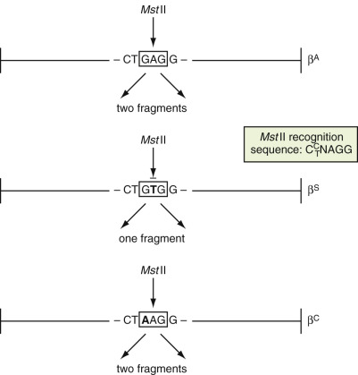

Figure 71-1 

Schematic example of detection of a point mutation by differential cleavage with a restriction enzyme. 

In this case, the sickle cell mutation, substitution of T for A in codon 6 of the β-globin gene destroys an _Mst_ II cleavage site so that digestion of a polymerase chain reaction product from the region will produce two DNA fragments in normals but only one fragment in HbS homozygotes. Mutation of the first nucleotide in this codon, found in hemoglobin C disease, does not destroy the _Mst_ II site (because the enzyme can accommodate any nucleotide in this position) and thus cannot be detected by this method. 

To screen a disease gene for unknown mutations that may lie anywhere within it, several _mutation scanning_ techniques that cast a wider net are available. SSCP, DGGE, denaturing high-performance liquid chromatography, and other variations of the same principle can theoretically detect point mutations anywhere within a gene by virtue of the altered topology that the substituted nucleotides induce in single-stranded or mismatched double-stranded DNA. These approaches obviate the need for separate and specific ASO probes for every possible mutation, although they can only be performed on limited PCR-amplified stretches of the gene (usually single exons or parts of exons) at one time and they are not 100% sensitive. The protein truncation test detects mutations causing premature termination of the gene's polypeptide product; it requires an involved _in vitro_ transcription/translation approach and will only pick up “stop” (nonsense) mutations (and some frameshifts and splicing variants) while overlooking common single-nucleotide substitutions (missense mutations). The only technique that should be 100% sensitive in detecting all possible point mutations, at least in theory, is complete DNA sequencing of the gene, although even it will miss mutations that lie outside the usual coding region targets (e.g., in introns, promoters, or enhancer regions). Now that DNA sequencing has become so much more robust and less expensive in recent years, the various mutation-scanning and protein truncation approaches are used less than in the past. 

Disorders caused by expansion of a trinucleotide repeat can be diagnosed by Southern blot or PCR, in either case by observing a larger-than-normal target DNA fragment. Disorders caused by large deletions may be diagnosed by Southern blot by observing loss or decrease in size of a target fragment, or by PCR, through loss of a product normally amplified from that site or appearance of a new “junction” fragment, or by MLPA. It should be noted that a weakness of the newer next-generation DNA sequencing techniques is their inability to identify either repeat expansions or sizeable deletions (except for deletions on the X chromosome in a male). 

For those disorders with too many unknown mutations, or an unknown gene, predictive diagnosis by _linkage analysis_ is possible in certain families. Because the analysis requires comparative testing of other affected and unaffected siblings and parents, not every family will be accessible or informative using this approach. Also required is knowledge of closely linked, preferably flanking or even intragenic polymorphic DNA markers that can be observed to cosegregate consistently with either the normal or disease phenotype within the family. Traditionally, the markers used have been restriction fragment length polymorphisms (RFLPs) detected by Southern blot. But in more recent years, microsatellite polymorphisms—tandem oligonucleotide sequences of variable repeat length—that are detectable by PCR and gel or capillary electrophoresis have become favored because of their abundance throughout the genome, the multiallelic nature of their polymorphisms, and the relative ease of the testing method. Very large genes, such as those for neurofibromatosis and Du­chenne muscular dystrophy (DMD), will usually have intragenic microsatellites that can be accessed, minimizing the chances of recombination between the mutation and the marker. But even here, the advent of next-generation sequencing has allowed for the direct detection of mutations in most cases, without the need to resort to linkage analysis. 

Linkage techniques are less favored than the direct mutation detection approach because of the need to test multiple family members and because meiotic recombination between the gene and the marker can disrupt the apparent phase of linkage between parent and offspring, leading to false-positive or false-negative interpretation of results. For each centimorgan of map distance between the two loci, 1% recombination can be expected (1 cM = 1 million base pairs [bp]). For example, in [ Figure 71-2 ](<#f0015>) the fetus is predicted to be affected, having inherited the same upper RFLP fragment as the previously affected son. But if the polymorphic restriction endonuclease site being tested is 5cM away from the disease gene, one can only conclude that the fetus is at 95% risk of being affected. However, with the completion of the Human Genome Project providing us with the full genomic sequence, which is saturated with polymorphic markers (both short tandem repeats and single-nucleotide polymorphisms), there is no longer any need to rely on a linked marker that is so far away from the disease gene. 

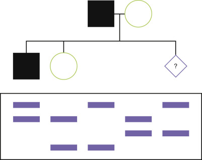

Figure 71-2 

Example of restriction fragment length polymorphism analysis for prenatal diagnosis of an autosomal dominant disorder. 

In this Southern blot, the upper band from the father is the one that cosegregates with the disease phenotype, as seen in the affected son. Because the fetus (indicated by the _?_ ) has also inherited this band, it is predicted to be affected. The precise risk depends on the map distance between the disease gene and the restriction fragment length polymorphism (RFLP) marker. 

Although this chapter is primarily concerned with molecular testing for single-gene Mendelian disorders, it would be remiss not to acknowledge the newer techniques now available for _whole-genome analysis_ . This can be done using either high-density oligonucleotide microarray platforms or so-called _massively parallel_ or _ “next-generation” DNA sequencing _ . The former was the first to enter routine use in clinical genetics, in the form of array comparative genomic hybridization, now usually called _chromosomal microarray_ (CMA). This technique employs a high number (500,000 to more than 1,000,000) DNA probes on the array, chosen so that their complementary genomic sequences span the entire genome at regular intervals. Total genomic DNA from the patient is compared by hybridization to the array against what a “normal” total genomic control sample would produce (i.e., no pathologic gains or losses of hybridization signal). If the patient's DNA contains a deletion on a certain chromosome, this will be indicated by a decrease or absence of hybridization signal to the probes spanning that region ( [ Fig. 71-3 ](<#f0020>) ). Conversely, if the patient's DNA contains a duplication (insertion) of a chromosomal region, an excess of hybridization signal will be seen for that region. The resolution for detecting these _copy number variants_ (CNVs) is much finer than can be achieved by classic karyotype analysis under the light microscope, and is continually improving as ever greater numbers of probes, at ever diminishing base-pair intervals, are added to the arrays. And it is far more cost-effective and comprehensive than the previous alternative of running many different fluorescence in situ hybridization (FISH) probes in series. As such, it has rapidly become a predominant technique for detecting deletions/duplications in patients with congenital problems that do not readily suggest a particular known genetic syndrome, including those with nonspecific physical malformations/dysmorphisms, developmental delay, and/or autism, and in fact is now considered standard of practice for these indications instead of ordering a karyotype (  Manning et al, 2010  ;  Miller et al, 2010  ). However, it does have some limitations. First, because all it does is examine differences in hybridization intensity across the total genomic DNA, balanced translocations and inversions with no gain or loss of genetic material will not be detected. Second, all human genomes contain a great many CNVs that are nonpathologic. Some of these are well-known polymorphisms and thus can be discounted as etiologic if observed in a patient; but many others are not yet known or studied extensively, producing the challenging “CNV of uncertain clinical significance.” Aside from using intuition based on the particular genes encompassed by the deletion or insertion, testing of the parents may also be helpful. If a normal parent carries the same deletion, it is less likely to be pathologic (though there are exceptions). 

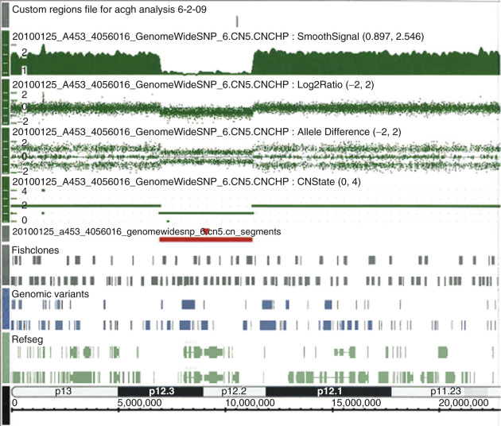

Figure 71-3 

Example of a typical deletion result by array comparative hybridization. 

The gap in hybridization signal demarcated by the red line indicates a 4.329 Mb hemizygous deletion on chromosome 20p12.2-12.3 (6975661 to 11304543 bp). This deletion encompasses multiple genes, including _JAG1,_ the gene implicated in Alagille syndrome, which was the clinical diagnosis in the tested patient. 

(Courtesy of Dr. Xinmin Li.) 

The ultimate gold standard for identifying all possible mutations would of course be whole-genome sequencing. It took 13 years to completely sequence the consensus human genome under the Human Genome Project using conventional Sanger sequencing platforms (see [ Chapter 78 ](<##!/content/3-s2.0-B9780323295680000784?scrollTo=%23c00078>) ). Now we have a new generation of automated DNA sequencers based on radically different chemistries, involving single-molecule sequencing of millions of short fragments of the patient's genome in parallel, which are then assembled into the full genome by the analytic and bioinformatic software. These instruments are capable of sequencing billions of bases per day at relatively reasonable cost (a few thousand dollars at time of this writing), at last putting the whole human genome in reach for routine analysis. At present, the major clinical application of this technology in genetics is for the diagnosis of syndromic-appearing conditions for which standard single-gene and other clinical laboratory tests have been unrevealing (see later for a detailed description of this process). Of course, it is also being applied to oncology, with next-generation sequencing of tumor DNA to detect so-called _druggable_ somatic mutations (see [ Chapter 73 ](<##!/content/3-s2.0-B9780323295680000735?scrollTo=%23c00073>) ). 

,  

##  Choice of Applications 

To some extent, the choice of technique will also depend on the application or clinical indication. In medical genetics, these applications fall into five major areas: carrier screening, newborn screening, diagnostic testing, presymptomatic DNA testing, and prenatal testing. 

_Carrier screening_ is the term applied to detection of recessive mutations in healthy individuals for purposes of genetic counseling and family planning. This application is further subdivided into screening of those individuals with a family history of the disorder and population-based screening of large numbers of individuals who have negative family history but who may be at risk for the disorder because of its prevalence within their ethnic group or in the population at large. In either case, the ultimate purpose is to identify couples at risk (i.e., both the man and the woman are heterozygous for mutations within the gene) who would then have a 25% chance of having an affected child with each pregnancy. But the testing strategies chosen for the two groups will differ. A person whose sibling has the disorder is at much higher risk of being a carrier than someone in the general population. That person may therefore warrant more aggressive testing (e.g., screening for a greater number of mutations or possibly linkage analysis or even complete gene sequencing) than would be cost-effective for a member of the general population. On the other hand, access to the affected sibling's DNA may allow prior identification of the familial mutation, which would render subsequent testing of other family members much easier and straightforward. Population-based screening, in contrast, typically strives to keep the testing procedure as rapid and inexpensive as possible, focusing on perhaps a few of the more prevalent mutations, sacrificing clinical test sensitivity for cost-effectiveness and expediency. And with a negative family history, there are no affected family members to make either single-site mutation testing or linkage analysis an option. 

Like population-based carrier screening, _newborn screening_ aims to identify relatively prevalent (as genetic diseases go) inherited defects in otherwise asymptomatic individuals. Indeed, the most important disease targets, such as phenylketonuria, galactosemia, sickle cell disease, and cystic fibrosis (CF), are likewise autosomal recessive disorders. In the case of newborn screening, however, the goal is to ascertain affected babies early in life so that treatment (dietary or pharmaceutical) can be initiated before irreversible damage occurs. Currently, molecular genetic methods in this setting are employed mainly as a backup for confirmation of positive results ascertained by less expensive and more comprehensive biochemical or enzymatic methods, but this situation could reverse itself as molecular methods become increasingly cost-effective, high-throughput, and comprehensive. As next-generation sequencing becomes less and less costly, it is not such a stretch to predict that all newborns may someday undergo a full-genome analysis as their initial screen. 

_Diagnostic genetic testing_ is, by definition, performed on a symptomatic individual. Because the single-gene DNA tests are absolutely disease-specific and the diseases themselves quite rare, these procedures do not cast a wide enough net to be used for extensive differential diagnosis; the symptoms must be sufficiently suggestive of the disorder in question to justify ordering the test. Also, one must weigh the DNA test against more traditional methods with regard to cost, convenience, and utility. For example, hemoglobin (Hb) electrophoresis may be more convenient and comprehensive for sorting out a suspected hemoglobinopathy than the specific DNA test for the sickle cell disease mutation alone. On the other hand, molecular testing may be more advantageous for early or atypical clinical presentations. For example, molecular testing for CF mutations can be performed in the newborn period when traditional sweat chloride analysis is either inconvenient or unreliable. In such cases, it is also important to determine that the mutation spectrum of the test represents the appropriate demographic. If not, a “negative” test may not be truly accurate. DNA tests also have the advantage of working well postmortem, when classic biochemical analytes can no longer be assessed. 

_Presymptomatic DNA testing_ is applied primarily to late-onset dominant disorders, in which the offspring of an affected parent are aware that they are at 50% risk for having inherited the disease gene and desire to know their status before its clinical onset to make informed reproductive, employment, and lifestyle decisions or to initiate surveillance or preventive interventions. The prototypic disorders in this group are Huntington disease and the heritable cancer syndromes, although such diseases as neurofibromatosis, Marfan syndrome, adult polycystic kidney disease, and tuberous sclerosis are also relevant. From a psychosocial and ethical standpoint, this sort of testing has been the most problematic of any in diagnostic molecular genetics, with the risk for severe adverse consequences of results reporting, including suicide. Because of this, established testing protocols include stipulations for proper informed consent, concurrent clinical assessment, extensive pretest and posttest genetic counseling, and psychosocial support (  Huntington's Disease Society of America, 1989  ;  American College of Medical Genetics, 1999  ). 

Finally, there is the clinical application most distinctive to medical genetics: _prenatal testing,_ or the detection of genetic disease in the fetus. With a few exceptions (e.g., hydrops fetalis in homozygous β-thalassemia, thanatophoric dwarfism, and type I osteogenesis imperfecta), most Mendelian disorders, especially inborn errors of metabolism, are not expressed either visibly (by ultrasound) or biochemically in the fetus, so predictive diagnosis can only be made at the DNA level. Even for those disorders that might be detected biochemically, DNA often proves to be a far more accessible substrate, from an obstetric point of view, than the affected protein products or metabolic substrates. Whereas molecular analysis can be performed on minute amounts of amniotic fluid or chorionic villus samples collected by routine methods, even if obtained for other purposes, unless the protein product is expressed in fibroblasts (and thus amniocytes), biochemical analysis will require invasive biopsy of deep fetal tissues or fetal blood sampling. For example, assay of phenylalanine hydroxylase activity to diagnose phenylketonuria would require fetal liver biopsy, and quantitation of dystrophin to diagnose DMD would require fetal muscle biopsy. 

The primary objective in prenatal diagnosis is the identification of an affected fetus in a timely manner so that a practical option of pregnancy termination can be offered to the couple. Even though some may argue an advantage for obtaining prenatal diagnosis so that therapy can be instituted promptly at birth, or for psychological reassurance of a couple if the fetus is found to be unaffected, it may be difficult to justify the risk (albeit low) for miscarriage from amniocentesis and chorionic villus sampling performed for these other purposes. For an affected fetus, unless one intends to initiate therapy in utero, provisional treatment at birth while awaiting confirmatory neonatal testing is perfectly acceptable. 

Although prenatal genetic counseling is always nondirective, with moral and/or religious objections to abortion respected, both the clinician and the DNA testing laboratory have a legitimate right and, indeed, responsibility to question the appropriateness of a prenatal test request, with its attendant risk and expense, from a couple for whom termination is not an option (the same would apply to requests coming too late in pregnancy for termination to be performed). It is because of these problems that invasive prenatal testing is not offered as a general population screening tool in women with no family history or known carrier status for the disorder in question. The power of PCR to enable single-cell genetic analysis has opened the way for preimplantation diagnosis, usually approached by performing in vitro fertilization and microdissection of a single blastomere from the early embryo. This strategy, initially applied to selected cases at risk for CF (  Handyside et al, 1992  ) and other disorders, could potentially be offered to any at-risk couple for whom abortion is not an option, although it is not without its own ethical (and economic) considerations. Recently it has begun to be used to diagnose adult-onset diseases such as familial breast/ovarian cancer ( _BRCA1_ and _BRCA2_ genes), which, because they are late-onset, incompletely penetrant, and potentially treatable, would otherwise raise uncomfortable objections to traditional amniocentesis and pregnancy termination (  Sagi et al, 2009  ). 

Despite all these medical and moral dilemmas, when performed in appropriate circumstances, prenatal molecular genetic testing can offer at-risk couples, many of whom have already suffered the trauma of at least one affected child, one of the most valuable and life-changing services in all of clinical medicine. 

,  

##  Special Concepts Unique to Molecular Genetic Disorders 

Whereas the DNA analysis techniques discussed in this chapter for diagnosis of genetic disease are generally the same as those used for molecular diagnosis of cancer or infectious diseases, their application in the former has revealed a number of unusual phenomena that one must keep in mind when dealing with particular hereditary disorders. Some of these phenomena were known since Mendel's time but can now be understood mechanistically at the DNA level; others have emerged much more recently as unexpected byproducts of the molecular dissection of specific disease genes. 

 

##  Molecular Heterogeneity 

Few genetic disorders are associated with a single mutation consistently identified in all affected cases (e.g., the missense mutation in codon 6 of the _ β-globin _ gene causing sickle cell disease). The vast majority of genetic disorders can be caused by more than one—sometimes hundreds or thousands—of different mutations within the disease gene (e.g., the _CFTR_ gene of cystic fibrosis), and sometimes even by more than one gene (e.g., the _TSC1_ and _TSC2_ genes of tuberous sclerosis or the _BRCA1_ and _BRCA2_ genes of familial breast/ovarian cancer). Obviously, identifying the causative mutations in such disorders is technically much more difficult or sometimes impossible. A corollary of such molecular heterogeneity is that not all of the mutations will produce equally severe disease: some may cause only mild forms or related syndromes with little resemblance to the classic phenotype (e.g., isolated absence of the vas deferens caused by certain mutations in the _CFTR_ gene, or either multiple endocrine neoplasia or Hirschsprung disease caused by different mutations in the _RET_ gene). All of this variability adds greatly to the complexity of genetic counseling and genetic testing. 

 

##  Variable Penetrance and Expressivity 

_Penetrance_ refers to the proportion of individuals who, having inherited a mutant disease gene, will actually display the disease phenotype. Usually applied to dominant disorders, it can produce the striking appearance of generation-skipping in disease pedigrees. This can complicate both molecular diagnostics and genetic counseling, because it may not be clear whether the propositus inherited the disease from a parent or instead represents a new mutation in the family. It is a feature of such relatively common genetic disorders as Marfan syndrome and neurofibromatosis. 

Variable expressivity refers to the appearance of different signs and symptoms of a disorder in individuals inheriting the same mutation(s). Like penetrance, it is probably a reflection of differential gene effects within dissimilar genetic backgrounds (in other words, the modulation of phenotypic expression by other nonallelic or _modifier_ genes). It, too, makes ascertainment and counseling difficult, and raises ethical issues in considering abortion for diseases of variable and unpredictable severity. 

 

##  Uniparental Disomy 

This unusual cause of a recessive single-gene disorder was first discovered in a CF patient, only one of whose parents was a carrier (  Spence et al, 1988  ). By DNA haplotyping using polymorphic markers, it was shown that the patient had inherited two copies of the carrier parent's chromosome 7 containing the mutant _CFTR_ gene and no chromosome 7 from the other parent. The phenomenon has since been observed in other cases of CF and diseases involving other chromosomes as well. For some diseases, such as Prader-Willi and Angelman syndromes (see later discussion), the incidence of uniparental disomy approaches that of classic mutation mechanisms in the molecular pathogenesis, justifying routine testing for this phenomenon. 

 

##  Imprinting 

_Imprinting_ refers to the differential expression of a gene in an offspring, depending on whether it was inherited from the mother or the father, or sometimes on other epigenetic influences. Some genes are only expressed or, conversely, turned off, when they pass through the oocyte lineage, and others only when they pass through the spermatocyte line. If an individual inherits the normal allele through the nonexpressing parental line, it cannot counteract a recessive mutation inherited from the other parent. In at least some cases, the molecular mechanism appears to be differential methylation of chromosome regions and regulatory elements. This is the basis for both the deletional and uniparental disomy cases of Prader-Willi and Angelman syndromes (  Gurrieri & Accadia, 2009  ). 

 

##  Anticipation 

_Anticipation_ refers to a progressive increase in severity and/or decrease in age of onset of a genetic disorder in subsequent generations of a family. It is typically associated with the trinucleotide repeat disorders, such as myotonic dystrophy and Huntington disease, in which the increasing severity can be correlated with further expansion of the repeat region. In the former disease, especially severe cases with childhood or infantile onset have been born to affected mothers, while in the latter disease the phenomenon occurs solely with paternal transmission, invoking a parent-of-origin effect similar to imprinting (  Koshy & Zoghbi, 1997  ). It is for these reasons that accurate molecular sizing of trinucleotide repeat lengths is so important for diagnosis, prognosis, and genetic counseling in these disorders. 

 

##  Epigenetic Influences and Nonmendelian Inheritance 

Epigenetic changes are heritable but potentially reversible changes in gene expression that do not represent a change in the sequence of the cell's genomic DNA. The most striking examples of epigenetic inheritance are genomic imprinting (discussed previously) and mammalian X-chromosome inactivation, both involving transcriptional silencing of genes by methylation of cytosines at CpG dinucleotides. The methylation status of DNA is maintained following DNA replication by methylases, which act on hemimethylated double-stranded DNA to methylate the newly synthesized DNA strand as well. The process is perpetuated indefinitely in succeeding cell divisions. We now know that de novo methylation of CpG doublets can occur in the promoters of some tumor suppressor genes, silencing these genes and in essence constituting one or both of the “hits” in a tumor suppressor gene that leads to tumor development (  Jacinto & Esteller, 2007  ). 

Another category of epigenetic inheritance that is less clearly understood involves the property of some proteins to influence the conformation of newly synthesized or assembled proteins in a self-perpetuating manner. The most notable examples in mammals are the prion diseases, responsible for scrapie and bovine spongiform encephalopathy in animals and kuru and Creutzfeldt-Jakob disease in humans. The disease-producing prion protein, which may result from a coding sequence mutation in familial cases, is folded into an abnormal conformation and exerts an effect on newly synthesized prions in such a way that it perpetuates and proliferates the conformational abnormality that produces disease (  Cobb & Surewicz, 2009  ). 

 

##  Allele Frequencies and Mass Population Screening 

Reference has already been made to the application of carrier screening for recessive mutations on a population-wide basis. To justify, from a public health standpoint, the effort and expenditure required to perform a DNA test on thousands or millions of people, the incidence of the disease must be sufficiently high, either in the whole population or in the particular racial or ethnic groups being targeted for screening. For any autosomal recessive disease of appreciable incidence, the law of Hardy-Weinberg equilibrium predicts that the carrier frequency will be a good deal higher than the prevalence of affected individuals. In addition, the candidate disease target must be sufficiently severe and/or amenable to some medical intervention upon identification. Several disorders appear to fit these criteria. Mutations associated with hereditary hemochromatosis and activated protein C resistance (factor V Leiden) are found in 5% to 10% of the Caucasian population, while the carrier frequency of the sickle cell mutation approaches 10% in the African American population. Unfortunately, controversies over disease penetrance in the first two and complex socioeconomic issues in the third have limited the application of these genes to screening (  Grody, 2003  ;  Imperatore et al, 2003  ). Screening for thalassemia in Mediterranean and Asian populations, and for a panel of recessive disorders such as Tay-Sachs disease and Gaucher disease in the Ashkenazi-Jewish population, is similarly justified by allele frequencies in the target group. CF mutations, while of lower frequency, potentially place such a large majority of North American couples at risk that they have been chosen as the first target for general molecular genetic population screening in the United States (see later discussion). Other disease targets proposed for large-scale screening include spinal muscular atrophy, fragile X syndrome, and hereditary hearing loss. This migration of molecular genetic screening out of the realm of rare or esoteric diseases and into the setting of common traits will have a profound effect on preventive medicine and public health, and will continue to drive new developments in DNA test automation in the coming years. 

 

##  Predictive Genetic Testing 

Unique among molecular pathology tests, and indeed among clinical laboratory tests in general, molecular genetic tests possess the ability to predict future disease in individuals with no signs or symptoms of the disorder at the time of testing. This predictive ability exceeds that imparted to such tests as human immunodeficiency virus antibody screening in individuals with no symptoms of acquired immunodeficiency syndrome, or cholesterol levels as a risk factor for future atherosclerosis. For those tests, one could argue that the serologic, microbiologic, or biochemical signs of the disorder are already present, even if the patient does not yet experience any symptoms. Molecular genetic testing, in contrast, enables prediction of future disease even in the absence of _any_ biochemical or physiologic abnormalities: Huntington disease can be predicted decades before there is any brain degeneration, and breast cancer risk years or decades before even a single breast epithelial cell has turned malignant. The potential psychosocial impact of revealing such information to a healthy individual cannot be overemphasized. For that reason, predictive or presymptomatic genetic testing must be accompanied by pretest and posttest genetic counseling and psychiatric support, as already mentioned. Furthermore, such tests should be restricted to those who truly have an actionable need for them, in the sense that a positive DNA test will prompt some sort of early surveillance or preventive interventions or, at the very least, some indicated lifestyle or life-planning changes. Because it is difficult to imagine such conditions existing in the case of a child tested for an unpreventable adult-onset disease, there is a strong convention in the field that healthy children younger than 18 years of age should not be offered predictive genetic tests for adult-onset disorders unless there is a demonstrated preventive intervention that needs to be acted upon in childhood, so as to avoid potential stigmatization, discrimination, or adverse psychosocial effects of genetic information that is of no medical use to the child (  Holtzman et al, 1997  ). 

,  

##  Specific Disease Examples 

 

##  Cystic Fibrosis 

Because of its high carrier frequency in North America and northern Europe, its serious clinical nature, its straightforward Mendelian (autosomal recessive) inheritance pattern, and its well-studied yet complex gene, CF has emerged as the paradigmatic disorder for large-scale molecular genetic screening. Within its scope can be found the full panoply of applicable molecular genetic techniques and the full spectrum of scientific and ethical dilemmas arising from the clinical variability of the disease, the extreme molecular heterogeneity of the causative mutations, and the advent of novel treatments, including mutation-specific targeting drugs (  Amaral, 2015  ) and eventually gene replacement therapy. With a carrier frequency as high as 1 in 29 in Caucasians of northern European ancestry (and progressively less in southern Europeans, Hispanics, African Americans, and Asians), there was ample motivation to screen the general population in order to identify couples at 1-in-4 risk for having an affected child with each pregnancy. But because carriers are asymptomatic and have normal sweat chloride levels, this screening could only be done after isolation of the gene in 1989 (  Kerem et al, 1989  ;  Riordan et al, 1989  ). Even though the gene had been mapped to chromosome 7 some years earlier, allowing for prenatal diagnosis by linkage analysis in informative families, screening and testing in others, especially those with no family history of the disorder, could only be considered once the gene was cloned and the mutations identified. 

Even with that laudable accomplishment, however, the history of DNA testing for CF has been fraught with challenges and controversies. The gene is more than 250,000 bp long and encodes a large ion channel protein called the _cystic fibrosis transmembrane conductance regulator (CFTR)_ (  Collins, 1992  ). Most notably, the spectrum of mutations observed is remarkably heterogeneous. Whereas a three-nucleotide deletion of phenylalanine codon 508 (designated ΔF508 or F508del) accounts for about 70% of the mutations in non-Hispanic Caucasians (and less in other ethnic/racial groups), more than 1900 additional mutations have so far been reported. Most of these are so rare that it is neither feasible nor cost-effective to include them in testing panels; only about seven (in addition to ΔF508) account for more than 1% each of CF mutations in most Caucasian populations (  Tsui, 1992  ) ( [ Table 71-1 ](<#t0010>) ). The sensitivity of carrier screening with mutation panels of between six and 25 alleles ranges from a high of 97% in Ashkenazi Jews (  Abeliovich et al, 1992  ) to 75% to 90% in non–Ashkenazi North American Caucasians, about 60% in Hispanic Americans, 50% in African Americans, and less than 10% in Asians (  Ober et al, 1992  ;  Grebe et al, 1994  ;  Macek et al, 1997  ). Such variable and suboptimal sensitivity in an ethnically heterogeneous population like that of the United States, and the difficulties involved in counseling patients as to the residual carrier risk of negative test results, made population-based carrier screening for CF mutations a controversial subject (  Grody, 1999  ). After much debate and several pilot screening studies, a consensus conference recommended that screening be offered to all pregnant couples and those planning pregnancy (  NIH Consensus Statement Online, 1997  ). A steering committee representing the American College of Medical Genetics (ACMG), the American College of Obstetricians and Gynecologists (ACOG), and the National Human Genome Research Institute decided on a core screening panel of the 25 most prevalent mutations in the general mixed population (  Grody et al, 2001a  ). The same group produced accompanying educational materials providing guidance to obstetricians on how the screening test should be offered, patient education brochures, and tables for determining the residual risk in those whose test results are negative. 

TABLE 71-1 

Recommended Core Mutation Panel for General Population Cystic Fibrosis Carrier Screening 

ΔF508  |  ΔI507  |  G542X  |  G551D  |  W1282X  |  N1303K   
---|---|---|---|---|---  
R553X  |  621+1G>T  |  R117H  |  1717–1G>A  |  A455E  |  R560T   
R1162X  |  G85E  |  R334W  |  R347P  |  711+1G>T  |  1898+1G>A   
2184delA  |  1078delT [ * ](<#hl0000151>) |  3849+  |  2789+5G>A  |  3659delC  |  I148T [ * ](<#hl0000151>)  
10kbC>T3120+1G>A  |  |  |  |  |   
  
Panel recommended by the American College of Medical Genetics (  Grody et al, 2001a  ). 

 * Mutations subsequently removed from the panel (  Watson et al, 2004  ). 

With the launch of these guidelines in 2001, _CFTR_ mutation analysis instantly became the highest-volume molecular genetic test and one of the highest in all of molecular diagnostics. Given such a market, reagent and instrumentation vendors soon came forward with a variety of assays and platforms, which have now largely replaced the in-house methods previously employed by individual laboratories. The commercial methods, which incorporate at least the core panel of 25 mutations (revised downward to 23 in 2004 by Watson and colleagues), and sometimes more, include ASO probes on paper strips, ARMS, OLA, Invader assay, microbead arrays, microarray chips and, most recently, next-generation sequencing (  Richards & Grody, 2004  ;  Grosu et al, 2014  ). In addition, complete gene sequencing is offered by a few laboratories (  Strom et al, 2003  ), although it is too expensive for general carrier screening and is used primarily to assist in diagnosis of atypical CF cases or to identify parental mutations in affected offspring to enable prenatal diagnosis in future pregnancies. 

Even years after launch, the CF carrier screening program continues to prove challenging for both the referring obstetricians and the genetic testing laboratories. Questions remain about uptake, proper communication of results, the utility of offering extended mutation panels (especially for those couples who test positive-negative in the initial screen), and even which mutations should be included in the core panel. The panel has already been modified once, after early data from national screening indicated that one of the mutations (1078delT) was more rare than previously thought, and another one (I148T) was not a mutation at all but a benign variant (polymorphism); both of these have since been dropped (  Watson et al, 2004  ). And at the other extreme, driven largely by marketing considerations, laboratories have been compelled to offer ever-larger mutation screening panels, and concern has been raised regarding the clinical significance of some of the added mutations (  Grody et al, 2007  ). One large series has shown that the core mutation panel is indeed adequate for identifying the vast majority of carriers, with no additional mutations recurring in sufficient numbers to justify their incorporation into an expanded panel (  Strom et al, 2011  ). 

Another problem with genetic counseling for CF is the variable clinical severity of the disorder and the inconsistency of genotype–phenotype correlations. Beyond the finding that ΔF508 homozygotes tend to have pancreatic insufficiency, there is little about disease severity or complications that can be predicted reliably from knowing an affected individual's two mutations (  Moskowitz et al, 2008  ). Even homozygotes for ΔF508, considered the prototypical severe mutation, can show a wide range in their degree of pulmonary compromise (  Burke et al, 1992  ). Conversely, there are mutations that cause pulmonary disease yet maintain normal sweat chloride levels (  Highsmith et al, 1994  ), and there are mutations and polymorphisms (e.g., R117H coupled with certain lengths of an intronic polythymidine tract) that do not cause CF at all but rather male infertility due to congenital absence of the vas deferens (  Anguiano et al, 1992  ;  Gervais et al, 1993  ). Taken together with the ever-increasing median life­span of CF patients and the eventual advent of effective gene replacement therapies, these factors render genetic counseling and reproductive decision-making for the disorder difficult. 

Cystic fibrosis is one of the targets of universal newborn screening in most states, along with a large panel of metabolic disorders (  Centers for Disease Control and Prevention [CDC], 2008  ). Protocols vary by state, but in most cases begin with a biochemical screen for immunoreactive trypsinogen, followed by (in positive specimens) molecular testing for anywhere from one to more than 30 mutations. It is important to remember that the mutation panels chosen for newborn screening are up to the individual states and are not tied in any way to the ACMG/ACOG panel developed for population carrier screening. Likewise, mutations tested in the course of diagnostic workup of a symptomatic patient are also flexible (in the sense that they have never been defined by professional guidelines) and may range from just a few ethnic-specific mutations to complete gene sequencing. 

Cystic fibrosis is one of the first genetic diseases for which specific mutation-targeted therapies have come to market. These drugs, which are designed to circumvent the biochemical or posttranslational process defect caused by the mutation(s), are collectively called _CFTR modulators_ (  Derichs, 2013  ), and they represent an elegant example of “personalized medicine,” in that the treatment is tailored to the patient's specific personal mutation(s). For this reason, the precise identification of a patient's mutations becomes even more important. While still in their infancy, as these approaches expand to encompass a wider array of mutations, they will undoubtedly influence couples' attitudes toward prenatal carrier screening and testing, as they begin to see CF as a more treatable disease (  Massie et al, 2014  ). 

 

##  Duchenne Muscular Dystrophy 

This X-linked progressive myopathy was the first disorder whose causative gene was isolated by the process of positional cloning (  Rowland, 1988  ). Before that discovery, the only tests that could be offered to at-risk families were detection of some female carriers by the finding of elevated serum creatine phosphokinase levels, followed by prenatal sex determination with the option to terminate a male fetus (even though 50% of these pregnancies would be normal). Genetic counseling was rendered even more problematic because about one third of cases of DMD arise from new mutations. 

Even after its discovery, translation to clinical application was not easy because the gene, dubbed _dystrophin,_ proved to be the largest yet discovered, spanning 2.4 million bp and composed of 79 exons (  Ahn & Kunkel, 1993  ). Use of full-length or partial cDNA probes to detect the variety of deletions accounting for two-thirds of cases was labor-intensive and time-consuming (  Darras et al, 1988  ;  Prior, 1991  ). It was only with the advent of multiplex PCR, described in [ Chapter 67 ](<##!/content/3-s2.0-B978032329568000067X?scrollTo=%23c00067>) , that a system was developed for rapid and inexpensive identification of more than 98% of dystrophin deletions and their localization to specific exons of the gene (  Beggs et al, 1990  ;  Multicenter Study Group, 1992  ). In this system, a deletion is identified by absence of one or more of the multiple expected amplicons on ethidium bromide–stained electrophoresis gels or capillary electrophoresis instruments (because a target gene deletion will abolish the hybridization site[s] of one or more primers, causing PCR failure) ( [ Fig. 71-4 ](<#f0025>) ). Such fine-structure mapping combined with sequencing has also revealed important insights into the molecular pathogenesis of DMD and the milder allelic variant, Becker muscular dystrophy (BMD). Both are most often caused by large dystrophin deletions, but those in BMD typically preserve the correct reading frame in the resulting processed transcript, whereas deletions in DMD more often produce frameshift mutations and a more truncated protein product (  Monaco et al, 1988  ). 

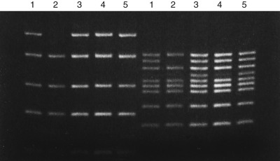

Figure 71-4 

Multiplex polymerase chain reaction (PCR) analysis for dystrophin gene deletions in Duchenne muscular dystrophy. 

DNA samples from five patients were amplified simultaneously with five primer pairs (left half of gel) and nine primer pairs (right half of gel), and the products were analyzed by polyacrylamide gel electrophoresis. Absence of an expected PCR product band is indicative of a deletion. Patient 2 lacks the top band in the five-plex and the second-from-top band in the nine-plex; these correspond to deletions in exons 50 and 48, respectively, in the dystrophin gene. (Band 4 in the nine-plex is light but present in all of the samples.) 

(Courtesy of Dr Kathryn E. Kronquist.) 

The remaining one third of patients with DMD and 15% of patients with BMD in whom no deletion is detected usually have point mutations or microdeletions/insertions. Because the gene is so large, until recently it was not an easy matter to identify these lesions directly, although gene scanning by conformational analysis (SSCP, DGGE) followed by sequencing has been used effectively (  Prior et al, 1995  ;  Torella et al, 2010  ). If that method failed, one had to revert to linkage analysis. Now, however, full-gene sequencing, even of this large locus, has become feasible using next-generation sequencing (  Nallamilli et al, 2014  ). Alternatively, studies at the protein level can be performed by observing decreased or absent dystrophin in DMD, and dystrophin of abnormal molecular weight in BMD, by Western blot or immunohistochemistry of muscle biopsy tissue (  Hoffman et al, 1988  ). This procedure has serious limitations for prenatal diagnosis, for which a fetal muscle biopsy would be required, but it can be used for proband diagnosis. Thus, the molecular diagnosis of DMD has come full circle: from identification of the gene without knowing the protein product (“reverse genetics”) to identification and diagnostic use of the protein product from knowing the gene. This sort of evolution can be expected in the laboratory diagnosis of many genetic diseases, because functional studies of a gene product are by definition more comprehensive than attempting to track down countless individual mutations at the DNA level. That is a major goal of the nascent field of “proteomics.”

 

##  Sickle Cell Anemia and Other Hemoglobinopathies 

Given the long history of study of the protein product, diagnosis of molecular defects in the genes encoding the globin polypeptides did not come about through techniques of reverse genetics; rather, these genes were cloned by classic methods, using antiglobin antibodies for polysome precipitation to isolate the relevant messenger ribonucleic acids (mRNAs). As such, Hb mutations, and the one causing sickle cell anemia in particular, were among the very first to be diagnosed at the DNA level. The sickle cell point mutation in codon 6 of the β-globin gene lies within (and thus destroys) a restriction endonuclease cleavage site (for _Mst_ II, _Mnl_ I or _Dde_ I), providing a rapid method of detection using either Southern blot or restriction enzyme digestion of β-globin PCR products (  Hatcher et al, 1992  ) (see [ Fig. 71-1 ](<#f0010>) ). Alternatively, the HbS and HbA sequences can be distinguished by dot blot using allele-specific oligonucleotide probes complementary to either the normal or mutant sequence (  Conner et al, 1983  ). More recently, higher-throughput techniques have come to predominate, such as real-time PCR and melting curve analysis (  Traeger-Synodinos et al, 2008  ). These DNA-based techniques can be used for diagnosis, carrier screening, or prenatal diagnosis on amniocytes, in the latter case obviating the need for invasive fetal blood sampling and classic Hb electrophoresis. In addition, as more states initiate newborn screening programs for sickle cell disease, even if done by biochemical methods, the DNA test becomes important for backup confirmation of positives and ambiguous screening results, as in compound heterozygous states involving HbS and a thalassemia mutation (  Hoppe, 2013  ). Several studies have shown that these DNA tests can be done on the same filter-paper blood spots collected for the initial newborn screening (  McCabe & McCabe, 2004  ). A different mutation in codon 6, causing HbC disease, does not abolish the _Mst_ II restriction endonuclease recognition sequence (because it occurs at a flexible nucleotide position for the enzyme) and so must be distinguished by ASO probes (  Maggio et al, 1993  ). 

The thalassemias involve both qualitative and quantitative alterations in one or more globin chains with hundreds of sequence variants known, and their diagnosis at the molecular level is correspondingly more complex than that of sickle cell anemia. α-Thalassemia is more straightforward, because it is usually caused by deletion of either or both of the two contiguous α genes on one or the other or both chromosomes 16. This can be detected by Southern blot or quantitative PCR, allowing differentiation of the silent carrier state (one α gene missing) from very severe hydrops fetalis (all four genes missing) and the two intermediate states (  Zhou et al, 2013  ). Molecular diagnosis of β-thalassemia is more complicated because of the wide variety of promoter, termination, deletion, splice site, and frameshift mutations that have been documented. However, within each at-risk population (Mediterranean, Asian, African), a limited subset of mutations (usually 10 or less) accounts for the majority of cases and carriers. Therefore testing with a panel of mutation-specific probes/primers, along the lines of CF screening, is reasonable (  Naja et al, 2004  ;  Patrinos et al, 2005  ). In addition, the β-globin gene is not that large, so sequencing or gene scanning can also be employed. 

 

##  Hereditary Thrombophilias 

CF is not the only disorder with sufficiently high mutation frequency to prompt consideration for population screening using molecular methods. Several other disease genes have revealed carrier frequencies several times higher than that for CF. Included in this group are genes involved in the anticoagulant system, which, as discussed in Part 5, keeps the clotting cascade in check. The most notable such allele is the factor V Leiden mutation, a single nucleotide change causing an amino acid substitution (R506Q) in the clotting factor V protein, rendering it resistant to cleavage by activated protein C (  Bertina et al, 1994  ). The allele is carried in 5% to 7% of the Caucasian population and is responsible for more than 90% of clinical activated protein C (APC) resistance, resulting in a tendency toward idiopathic venous thromboembolism (  Ridker et al, 1997a  ). It produces a relative risk for thrombosis of about 7-fold in the heterozygous state and about 80-fold in the homozygous state. It is also associated with pregnancy complications such as recurrent miscarriage. Testing for the mutation is straightforward because, like the sickle cell mutation, it destroys a restriction endonuclease cleavage site, and automated methods for higher throughput have been developed, such as real-time PCR (  Louis et al, 2004  ) ( [ Fig. 71-5 ](<#f0030>) ) and the Invader assay, which relies on signal amplification by fluorescent resonance energy transfer and a cleavase enzyme (  Ryan et al, 1999  ), as described in [ Chapter 67 ](<##!/content/3-s2.0-B978032329568000067X?scrollTo=%23c00067>) . 

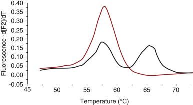

Figure 71-5 

Detection of the factor V Leiden mutation by real-time polymerase chain reaction (PCR) and melting curve analysis. 

Mismatch of the amplified mutant allele lowers the melting temperature when hybridized with a wild-type DNA probe. The black line indicates the melting curve profile for an R506Q heterozygote, whereas the red curve represents a homozygous mutant sample. 

As for CF, however, there are controversies over which patients should be offered screening. Despite the dramatically increased relative risk, the absolute risk conferred by this mutation is rather low, with a lifetime penetrance for thrombotic symptoms of about 10%. Most carriers therefore would not be candidates for anticoagulant therapy, with its risks for hemorrhage and stroke, and so it is uncertain whether such screening would alter patient management in a meaningful way. Some have proposed screening individuals with environmental risk factors known to act synergistically with the factor V Leiden risk, such as women on oral contraceptives. Yet here too it could be argued that obligating such women with positive test results to turn to less effective methods of birth control might cause more harm than good, increasing the pregnancy rate with its own attendant complications, some of which are thrombotic in nature (  Kupferminc et al, 1999  ). At present, most requests received by molecular genetics laboratories for factor V Leiden testing are on patients who have already experienced an otherwise unexplained thromboembolic event, and two professional consensus statements, by the ACMG and the College of American Pathologists (CAP), have designated this as the primary unequivocal indication for testing (  Grody et al, 2001b  ;  Press et al, 2002  ). 

Along with factor V Leiden, there are other inherited mutations of high allele frequency that confer thrombotic risk (also discussed in Part 5). The prothrombin 20210A variant, a single nucleotide change in the 3′ gene, results in increased circulating prothrombin levels and a phenotype similar to that of factor V Leiden; it is present in 1% to 2% of the general population (  Poort et al, 1996  ). The 677C→T variant of methylenetetrahydrofolate reductase, an enzyme involved in the folate cycle of homocysteine metabolism, is carried by 30% to 40% of the general population and is associated with elevated plasma homocysteine levels and theoretical risk for vascular (including coronary artery) thrombosis. Indications for this test are even more nebulous, because not everyone with the variant has hyperhomocysteinemia, and not all hyperhomocysteinemia is caused by this variant. Thus, biochemical measurement of plasma homocysteine levels may be a more effective screening method. Also, folate fortification of foods may make the genetic factor less relevant by broadly reducing homocysteine levels in the population. And recent studies have even called into question whether there is any relationship at all between homocysteine levels and thrombotic risk (  Ducros et al, 2009  ). Even so, the mutations for each of these factors can act synergistically with one another, so patients carrying two or even three of these defects, including also the rarer deficiencies of protein S and C, are at substantially increased risk (  Koeleman et al, 1994  ;  Ridker et al, 1997b  ). DNA tests for several of these thrombophilia mutations can be multiplexed in a single assay (  Louis et al, 2004  ). 

 

##  Trinucleotide Repeat Expansion Disorders 

An important class of disease-causing mutations was revealed in 1991 with the discovery that X-linked spinal and bulbar muscular atrophy (Kennedy's disease, SBMA) and fragile X syndrome (FRAXA) are associated with amplification of unstable trinucleotide repeat sequences in the androgen receptor _(AR)_ and _FMR1_ (fragile X mental retardation) genes, respectively. Since that time, similar disease-producing mutations have been associated with a number of additional neurologic and muscle disorders ( [ Table 71-2 ](<#t0015>) ), and in the process have provided a molecular classification of the spinocerebellar ataxias. The affected gene in each of these disorders normally contains a repeated sequence of 3 bp, for example, (CGG) _ n  _ in the _FMR1_ gene, where _n_ is variable but normally limited in its range. In the disease state, however, the size of the triplet repeat is expanded outside the normal range, sometimes only slightly and in other instances markedly. The mechanisms by which these expanded repeat sequences produce disease are various, and include gene silencing and toxic gain-of-function by mutant proteins. 

TABLE 71-2 

Disorders Characterized by Unstable Expansions of DNA Trinucleotide Repeats 

Disorder  |  Chromosome Location  |  Normal Alleles, Intermediate Alleles  |  Expanded Alleles  |  Anticipation  |  Transmission Sex Bias  |  Position of Repeat  |  Gene Product   
---|---|---|---|---|---|---|---  
**Fragile Site/Mental Retardation Associated with CGG or GCC Expansion (X-Linked)**  
Fragile X syndrome (CGG), FRAXA  |  Xq27  |  6-54   
55-200  |  >200  |  Yes  |  Maternal, premutation  |  5′-UTR  |  FMRP   
Fragile X syndrome (GCC), FRAXE  |  Xq28  |  6-35  |  >200  |  |  |  5′-UTR  |  FMR-2   
**Diseases Associated with CAG Repeat Expansion (Autosomal Dominant Except for X-Linked Kennedy 's Disease) **  
Spinobulbar muscular atrophy (Kennedy's disease)  |  Xq11-12  |  11-33  |  36-62  |  |  Coding  |  Androgen receptor  |   
Huntington disease  |  4p16  |  6-35   
36-39  |  40-250  |  Marked in juvenile cases  |  Paternal, early onset  |  Coding  |  Huntingtin   
Dentatorubral-pallidoluysian atrophy  |  12p13  |  3-35  |  49-85  |  Yes  |  Paternal  |  Coding  |  Atrophin   
Spinocerebellar ataxia 1  |  6p23  |  6-35  |  40-88  |  Marked in juvenile cases  |  Paternal, early onset  |  Coding  |  Ataxin 1   
Spinocerebellar ataxia 2  |  12q24  |  16-31  |  36-64  |  Yes  |  Paternal  |  Coding  |  Ataxin 2   
Spinocerebellar ataxia 3 (Machado-Joseph disease)  |  l4q24-q31  |  12-41  |  55-84  |  Yes  |  Paternal  |  Coding  |  Ataxin 3   
Spinocerebellar ataxia 6  |  19p13  |  6-17  |  21-30  |  Yes  |  Paternal  |  Coding  |  CACNA1A   
Spinocerebellar ataxia 7  |  3p21-pl2  |  7-17  |  37->200  |  Yes  |  Paternal  |  Coding  |  Ataxia-7   
Spinocerebellar ataxia 12  |  5q31-q33  |  7-28  |  66-78  |  Yes  |  Paternal  |  5′-UTR  |  PPP2R2B   
Spinocerebellar ataxia 17  |  6p27  |  25-42  |  45-63  |  Yes  |  Paternal  |  Coding  |  TBP   
**Diseases Associated with CTG Expansion (Autosomal Dominant)**  
Myotonic dystrophy  |  19q13  |  5-35  |  50->200  |  Yes  |  Maternal congenital form  |  3′-UTR  |  Myotonin protein kinase   
Spinocerebellar ataxia 8  |  13q21  |  16-92  |  110-250  |  Yes  |  Maternal  |  Noncoding  |   
**Disease Associated with GAA Expansion (Autosomal Recessive)**  
Friedreich ataxia  |  9q13  |  6-36  |  200->900  |  No  |  |  Intron  |  Frataxin   
  
 

##  Fragile XA and Fragile XE Syndromes 

FRAXA is the most common single-gene defect causing moderate to severe mental retardation. Affected males with this X-linked disorder typically also exhibit dysmorphic features including large ears, a long face, prominent jaw, and macroorchidism. Approximately 1 in 2500 females are heterozygous carriers of the FRAXA mutation, and one third of these may show evidence of mental impairment or learning disability in the absence of the classic dysmorphism seen in affected males. 

As explained in [ Chapter 69 ](<##!/content/3-s2.0-B9780323295680000693?scrollTo=%23c00069>) , the cytogenetic hallmark of FRAXA is a fragile site on the X chromosome at Xq27.3, resulting from a failure of normal chromatin condensation during mitosis. Although the inheritance pattern of the disease is clearly X-linked, it does not correspond in a straightforward manner to either a recessive or dominant pattern of gene expression. Before the molecular mechanism was elucidated, the most puzzling feature had been the presence of phenotypically normal men (transmitting males) who are obligate carriers of the genetic abnormality. These men are sons of proven FRAXA carriers, they pass the carrier state to all of their daughters, and their daughters in turn transmit the fully expressed disease to a high proportion of their sons. 

The discovery in 1991 of the genetic abnormality that causes FRAXA immediately explained its unusual pattern of inheritance (  Fu et al, 1991  ). The 5′-untranslated region of the _FMR1_ gene at chromosome Xq27.3 carries a (CGG) _ n  _ triplet repeat of variable size. In normal individuals, _n_ ranges up to about 54, but in individuals with clinically apparent FRAXA, _n_ is greater than 200 (referred to as a _full mutation_ ). Both men and women who carry an X chromosome where _n_ is between 55 and about 200 to 230 (referred to as a _premutation_ ) do not show signs of classic fragile X syndrome, but are at risk for passing an allele of even larger size to their children. This is because of the instability of the premutation alleles and their tendency to increase in size during the meiotic cell divisions that produce the male and female gametes. Alleles of normal size are not unstable and generally pass unchanged, although there is now recognized a so-called _gray area_ of repeats between 46 and 54 that has a low risk for slight expansion into the premutation range (  Kronquist et al, 2008  ). Thus, it appears that there is a pool of small premutation (and gray area) alleles in the population, possibly of ancient origin, that is at risk for undergoing further expansion with each passage through another generation. As the premutation allele increases in size, the likelihood that it will expand further in the next generation increases, ranging from very low likelihood for repeats in the 60s to almost 100% for repeats above 100 (  Nolin et al, 2003  ). In addition, interruptions of the CGG repeat by one or more AGG units serves to stabilize the permutation and inhibit its expansion into the full mutation range (  Nolin et al, 2015  ), though testing for this requires DNA sequencing rather than simple sizing of the repeat length, and is not offered routinely by molecular diagnostics laboratories. Curiously, expansion to a full mutation occurs only in female meiosis, never in males, which corresponds to the observation that the daughters of normal transmitting males are always phenotypically normal. [ Figure 71-6, _B_ ](<#f0035>) illustrates a family with FRAXA: a premutation allele is transmitted from the first to the second generation, and then expands to a full mutation in the third generation. 

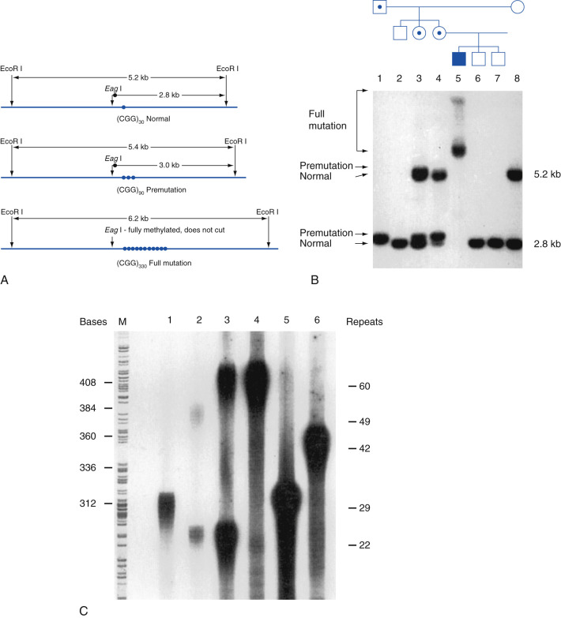

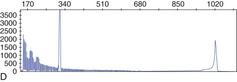

Figure 71-6 

Detection of the (CGG) _ n  _ repeat expansion in fragile X syndrome. 

**A,** Diagram of normal, premutation, and full-mutation alleles at the FRAXA locus. When expansion of the repeat to a full mutation occurs, the _Eag_ I restriction enzyme site becomes methylated and does not cut with the enzyme. **B,** Family of a patient _(darkened square)_ with fragile X syndrome. A Southern blot of _Eco_ RI/ _Eag_ I-digested DNA from each individual in the pedigree was examined with a labeled DNA probe that hybridizes 3′ to the repeat. The three individuals on the right of the figure are normal (open squares and circles). Note that the two males each have a single 2.8-kb band, while the female has both a 2.8- and a 5.2-kb band. This is the expected result. The 5.2-kb band in the female is from the normal inactive (therefore methylated) X chromosome in each of her cells. Because the DNA on this chromosome is methylated, it is not cut by _Eag_ I. The 2.8-kb band, however, is from the normal unmethylated active X chromosome ( _Eag_ I will cut the DNA in this case) in the female and in the males. The affected male has a greatly enlarged band. This is a consequence of marked expansion of the trinucleotide repeat as well as methylation of the _Eag_ I restriction enzyme site. The three individuals marked by bold dots are carriers of premutation alleles. In the females, the distinction between normal and expanded alleles is seen most clearly in DNA from their active (unmethylated) X chromosomes. Here, there are distinct bands of 2.8 and 3 kb. Higher in the gel the resolution is not as good, and the 5.2- and 5.4-kb alleles are barely separated. Note that in this peripheral blood sample from the mother of the affected patient, X chromosome inactivation is skewed with respect to the repeat expansion: a greater proportion of normal X chromosomes in this cell population have randomly been inactivated compared to the X chromosomes carrying the premutation allele. **C,** Sizing of trinucleotide repeats by gel electrophoresis following amplification of the locus by the polymerase chain reaction (PCR). Lanes 1 through 6 represent six different individuals; lane M contains a size marker. The PCR products were labeled by incorporation of 32P-dCTP during the amplification reaction, and the dried gel was exposed to x-ray film. Heterozygous females show two alleles; males and homozygous females show single alleles. The multiple bands produced with each allele are due to “slippage” of the DNA polymerase during the PCR reaction; the most intense band is taken as representative of the actual size of the allele. **D,** Successful PCR amplification of both the normal (left peak, 30 CGG repeats) and full-mutation (right peak) alleles in a female heterozygote, using reagents from Asuragen, Austin, Texas). 

( **C,** Courtesy of Dr. Anne Maddalena; **D,** courtesy of Dr. Joshua Deignan.) 

The mechanism by which the expanded triplet repeat in the 5′ noncoding region of the _FMR1_ gene produces the FRAXA phenotype is under active investigation. As the size of the repeat expands, there is progressive methylation of the regulatory region of the _FMR1_ gene and decreased expression of the FMR-1 protein. This RNA-binding protein is widely expressed in the developing brain and in other tissues. Its loss of expression in FRAXA presumably disturbs normal brain development and leads to mental retardation. Rare patients with typical fragile X syndrome do not have triplet repeat expansion or gene hypermethylation but do have inactivating point mutations or deletions leading to loss of FMR1 protein expression. Conversely, rare phenotypically normal or high-functioning males with full _FMR1_ gene repeat expansions and cytogenetically visible fragile sites, but with no gene hypermethylation and normal FMR1 protein expression, have been described (  Hagerman et al, 1994  ;  Smeets et al, 1995  ). These findings all support the hypothesis that it is lack of FMR1 protein expression, usually caused by hypermethylation-related downregulation of gene transcription, which is responsible for the disease phenotype. 

Because the premutation is not methylated and the phenomenon of “normal” transmitting males was widely observed, it was long assumed that these alleles had no direct phenotypic effect. It was therefore quite surprising when more recent studies documented cases of premature ovarian failure and an unusual tremor-ataxia-dementia syndrome in female and male premutation carriers, respectively. The penetrance appears to be about 20% for the former (  Sherman, 2000  ) and as high as 75% for the latter (  Jacquemont et al, 2004  ), although it is difficult to accurately define such numbers in the absence of molecular screening of normal populations. The molecular mechanism may be related to premutation _FMR1_ mRNAs being translated less efficiently and/or interfering with translation of the normal allele or other interacting genes. These revelations have made genetic counseling for fragile X syndrome even more complicated. They also raise additional concerns regarding the ethical merits of population screening for fragile X premutations or routine testing of pregnant women, which appears to be increasing despite the absence of professional guidelines to do so (  Grody, 2011  ). Babies born to women who have undergone testing may be identified with a potentially devastating adult-onset disease for which no known preventive intervention is possible, something that is not done for predictive genetic testing of other late-onset disorders in children for the reasons discussed in the “Predictive Genetic Testing” section earlier in the chapter. 

Rare families with X-linked mental retardation and a cytogenetically demonstrable fragile site at chromosome Xq27 to 28, but no hypermethylation or expansion of the (CGG) _ n  _ repeat in _FMR1,_ led to the discovery of a second, more distal fragile site at Xq28 associated with hypermethylation and expansion of a (GCC) _ n  _ repeat (FRAXE). Most affected males show only mild mental impairment without the dysmorphic features of FRAXA; this plus the extreme rarity of the condition have called into question the indications for testing and screening (  Brown, 1996  ), and in practice the test is seldom ordered. 

 

##  Neurodegenerative Disorders: Huntington Disease, X-linked Spinal and Bulbar Muscular Atrophy, Spinocerebellar Ataxias, and Dentatorubral-Pallidoluysian Atrophy 

Huntington disease, X-linked spinal and bulbar muscular atrophy (SBMA), the spinocerebellar ataxias, and dentatorubral-pallidoluysian atrophy (DRPLA) are autosomal dominant or X-linked (SBMA) diseases characterized by selective neuronal degeneration in the central nervous system. In each of these disorders, there is expansion of a (CAG) _ n  _ trinucleotide repeat in the coding region of the respective gene that produces abnormal elongation of a polyglutamine tract. The resultant abnormal protein produces intranuclear neuronal inclusions. It is postulated that the expanded polyglutamine sequences in each of these proteins leads to alterations in their folding and binding characteristics and a gain in function that is toxic to neurons in a selective manner, causing apoptosis (  Everett & Wood, 2004  ). Intranuclear neuronal inclusions, produced by these abnormal proteins, have been demonstrated in several of these disorders. 

In common with the other triplet repeat disorders, the expanded repeats in the neurodegenerative disorders are unstable and tend to increase in size in subsequent generations. There is a positive, but not absolute, correlation between increasing repeat size, early disease onset, and clinical severity. In contrast to fragile X and myotonic dystrophy, where the most dramatic increases in repeat size occur in maternal meioses, paternal transmission produces the largest expansions in the exonic repeat neurodegenerative disorders. Consequently, juvenile-onset cases of Huntington disease, DRPLA, and the spinocerebellar ataxias are typically transmitted by an affected father. 

Molecular diagnosis of these disorders is used for either diagnostic or, because they are late-onset, predictive purposes. Because they have no treatment, the emotions involved in the testing and fear of a positive result are considerable. 

 

##  Myotonic Dystrophy 

Myotonic dystrophy is an autosomal dominant, multisystem disorder with a wide range of clinical expression. In late childhood or early adulthood, the most typical patients develop progressive myotonia and weakness and atrophy of the muscles of the distal extremities and face. Cataracts, cardiac conduction defects, and testicular atrophy are also common. However, the disease may be so mild as to consist solely of cataracts developing in old age or so severe as to present at birth with marked muscle degeneration and mental retardation proceeding to early death. Sometimes the full spectrum of the disease can be observed in the same family, occurring in a pattern that clearly reflects the phenomenon of anticipation. As noted, anticipation is present in virtually all of the trinucleotide repeat disorders, but it is most striking in myotonic dystrophy, in which the clinical phenotype can progress from cataracts to severe congenital disease in three generations. 

Myotonic dystrophy is caused by expansion of a (CTG) _ n  _ repeat in the 3′ untranslated region of the myotonin protein kinase gene on chromosome 19q13.3 (  Fu et al, 1992  ;  Mahadevan et al, 1992  ). In normal individuals, this repeat ranges in size from 5 to 35 and is genetically stable. CTG repeats greater than 50 are genetically unstable and prone to expansion as they are passed to subsequent generations. In the range of 50 to 100, these repeats are often asymptomatic or produce minimal symptoms. When more than 100 repeats are present, the typical myotonic dystrophy phenotype is likely. Although there is a general correlation between repeat length and clinical severity, the size of the repeat is not a reliable prognostic indicator in the individual case. The extreme expansions to 1000 to 2000 repeats seen in congenital myotonic dystrophy occur only with female transmission of the unstable repeat; thus congenital myotonic dystrophy is always inherited from an affected mother. 

The mechanism by which the expanded trinucleotide repeat in the myotonin protein kinase gene produces the myotonic dystrophy phenotype is not known. Because the repeat is not located in the coding region of the gene, it is possible that protein expression is altered or that RNA processing interactions are perturbed. 

 

##  Friedreich Ataxia 

Friedreich ataxia is the most common of the hereditary ataxias, with an incidence of 2 per 100,000. Unlike all the other trinucleotide repeat disorders, Friedreich ataxia is inherited as an autosomal recessive disease and shows no evidence of anticipation. The expanded (GAA) _ n  _ repeat is located in the first intron of the _FRDA_ gene and reduces the expression of frataxin, a mitochondrial-targeted protein, probably through some interference with transcription or RNA processing. Frataxin is involved in mitochondrial respiration, iron balance, and response to oxidative stress. Some 97% of mutant _FRDA_ alleles are due to (GAA) _ n  _ expansions; the remaining alleles are due to other inactivating mutations, including point mutations (  Lodi et al, 1999  ). 

 

##  Laboratory Testing for Trinucleotide Repeat Disorders 

Depending on the length of the repeat segment, expansions of trinucleotide repeats are readily demonstrated by either Southern blot or PCR. PCR, followed by sizing of the products on an electrophoretic gel or capillary, is generally preferred for most of these disorders because of its speed, simplicity, and ability to resolve alleles differing in size by just one repeat unit. This is of particular importance when it is necessary to differentiate stable alleles at the upper size limit from small premutation or disease-causing alleles. For example, it is critically important to distinguish a 40-repeat from a 39-repeat in Huntington disease because of the dramatically different clinical implications and the psychosocial impact of a positive result. PCR is also the method of choice for accurate sizing of FRAXA premutation alleles, which is necessary for graded risk counseling of female carriers. However, where triplet expansions are very large, as in fully expressed FRAXA or myotonic dystrophy, it may not be possible to amplify the greatly expanded DNA segment by PCR; in this case, Southern blotting has traditionally been required. Southern blotting is also helpful in determining the methylation status of FRAXA full mutations, through the use of methylation-sensitive restriction endonucleases, and in assuring that a large Huntington disease or FRAXA allele has not been missed in a patient who appears homozygous normal by PCR. Similarly, it more reliably identifies mosaic males whose cells show a mixture of premutation and full mutation alleles. More recently, however, methods for analyzing large premutations and even the full mutation of _FMR1_ by PCR alone have entered routine practice, supported by the availability of commercial reagents (  Hantash et al, 2010  ). [ Figure 71-6 ](<#f0035>) illustrates the use of both Southern blotting and PCR to detect full FRAXA mutations and FRAXA premutation alleles. 

 

##  Prader-Willi and Angelman Syndromes 

Prader-Willi and Angelman syndromes, whose genes lie at approximately the same locus on chromosome 15, are almost always discussed together, even though they are caused by two different genes and have almost nothing in common phenotypically. Prader-Willi syndrome is characterized by obesity, mental retardation, hypoplastic genitalia, and dysmorphic features, while Angelman syndrome exhibits ataxia, puppet-like facies, mental retardation, paroxysmal laughter, and seizures. What they do share, remarkably, is a powerful imprinting mechanism determining disease expression. Both disorders are almost always sporadic. Prader-Willi syndrome, whose gene is not yet known, is most often caused by a deletion at 15q12 in the paternally inherited chromosome only; this is pathologic because only the paternal _PWS_ gene is expressed. The opposite is true for Angelman syndrome, which most often is caused by deletion of a known gene _(UBE3A)_ exclusively on the maternally inherited chromosome, which is the only allele normally expressed (  Knoll et al, 1989  ;  Matsuura et al, 1997  ). Alternatively, Prader-Willi syndrome can be caused by uniparental disomy for the maternal chromosome 15, which carries only the nonexpressing copy of the gene; likewise, Angelman syndrome can be caused by uniparental disomy for the paternal chromosome 15. These phenomena can be detected by FISH, discussed in [ Chapter 69 ](<##!/content/3-s2.0-B9780323295680000693?scrollTo=%23c00069>) , chromosome haplotyping with microsatellite markers, or Southern blotting with methylation-sensitive restriction enzymes that can distinguish the methylated maternal critical region from the unmethylated paternal critical region. A differential PCR scheme that amplifies either the methylated or unmethylated allele of the nearby _SNRPN_ gene within the critical region, based on resistance of methylated cytosines to chemical modification by sodium bisulfite (  Kosaki et al, 1997  ), is also available ( [ Fig. 71-7 ](<#f0040>) ). Neither the Southern blot nor the PCR method will distinguish between the deletional or uniparental disomy mechanisms, nor will they detect cases (more frequent in Angelman syndrome) due to point mutations within the causative gene. These methods also will not distinguish rare cases of Angelman syndrome or Prader-Willi syndrome due to primary imprinting defects (resulting from aberrant methylation caused by a mutation in the chromosome 15 imprinting center) (  Burger et al, 1997  ), which would have a much higher recurrence risk. 

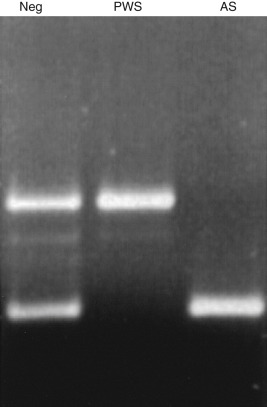

Figure 71-7 

Polymerase chain reaction–based electrophoretic analysis of methylation patterns in Prader-Willi and Angelman syndromes using the sodium bisulfite method of  Kosaki and colleagues (1997)  . 

In Prader-Willi syndrome, only the methylated maternal allele (upper band) is present, due to either deletion of the paternal allele or uniparental disomy for the maternal allele. In Angelman syndrome, only the unmethylated paternal allele (lower band) is present, due to either deletion of the maternal allele or uniparental disomy for the paternal allele. Similar analysis can also be done by Southern blot using methylation-sensitive restriction enzymes. 

 

##  Familial Cancers 

All cancers are genetic disorders at the cellular level, caused by mutations in genes that control cell proliferation and differentiation. These genes may be divided broadly into two groups: those that promote proliferation _(proto-oncogenes_ or, simply, _oncogenes)_ and those that restrain cell growth _(tumor suppressor genes)._ Both sets of genes are discussed in [ Chapter 77 ](<##!/content/3-s2.0-B9780323295680000772?scrollTo=%23c00077>) . Most often, mutations in these genes occur in somatic cells, usually requiring cumulative alterations over many cell cycles in several oncogenes or tumor suppressor genes before a cancer develops. However, in some individuals the initial mutation in this progression may be a germline lesion, inherited from a parent and present in every cell of that individual's body. 

Heritable cancer-causing mutations have been found most often in tumor suppressor genes, including several groups of genes that encode proteins with DNA repair functions, but have also been found in a few oncogenes ( [ Table 71-3 ](<#t0020>) ). The inherited mutation should be viewed as the initiating event in tumor development, not in itself sufficient to cause cancer but merely the first step in a series of mutations that ultimately lead to uncontrolled cell growth, analogous to the first somatic mutation that initiates tumor development in a sporadic cancer. It is likely that most of the heritable mutations that contribute to cancer development have not been identified, because they are by themselves not highly penetrant and require the interaction of other genetic and environmental factors to initiate tumor development—a complex situation that is difficult to unravel. However, a number of highly penetrant genes have been identified that are major initiators of tumor development in what are recognizable heritable cancer syndromes (see [ Table 71-3 ](<#t0020>) ). 

TABLE 71-3 

Hereditary Cancer Syndromes 

Disorder (OMIM Entry)  |  Associated Tumors  |  Population Incidence  |  Gene  |  Chromosome Location   
---|---|---|---|---  
**Tumor Suppressor Genes (Autosomal Dominant Mode of Inheritance)**  
Basal cell nevus (Gorlin) syndrome (109400)  |  Basal cell carcinoma, medulloblastoma  |  1/40,000  |  _PTCH_ |  9q22   
Cowden syndrome (158350)  |  Breast, thyroid carcinoma  |  1/200,000  |  _PTEN_ |  10q23   
Familial adenomatous polyposis (175100)  |  Colorectal, duodenal carcinoma  |  1/10,000  |  _APC_ |  5q21   
Hereditary breast-ovarian cancer syndrome (113705, 600185)  |  Breast, ovarian, pancreatic, prostate carcinoma  |  1/300-1/500  |  _BRCA1_   
_BRCA2_ |  17q21   
13q12   
Hereditary diffuse gastric carcinoma (137215)  |  Gastric carcinoma  |  Rare  |  _CDH1_ |  16q22   
Hereditary leiomyomatosis and renal cell carcinoma (150800, 605839)  |  Cutaneous and uterine leiomyomas, papillary renal cell carcinoma  |  Rare  |  _FH_ |  1q42   
Hereditary melanoma (600160, 606719)  |  Melanoma, pancreatic carcinoma  |  Unknown  |  _CDKN2A_   
_CDK4_ |  9p21   
12q14.1   
Hereditary paraganglioma (602690, 185470, 602413)  |  Paraganglioma, pheochromocytoma  |  Rare  |  _SDHD_   
_SDHB_   
_SDHC_   
_SDHAF2_ |  11q23   
1p35-36   
1q21   
11q12.2   
Juvenile polyposis syndrome (174900)  |  Gastrointestinal cancer  |  1/10,000  |  _SMAD4_   
_BMPR1A_ |  18q21   
10q22   
Li-Fraumeni syndrome (151623)  |  Sarcomas, breast carcinoma, leukemia, brain tumors  |  Rare  |  _p53_ |  17p13   
Multiple endocrine neoplasia, type 1 (MEN1) (131100)  |  Pancreatic islet cell, pituitary, parathyroid tumors  |  1/100,000  |  _MEN1_ |  11q13   
Neurofibromatosis, type 1 (162200)  |  Neurofibroma/sarcoma, pheochromocytoma  |  1/3000  |  _NF1_ |  17q11   
Neurofibromatosis, type 2 (101000)  |  Acoustic neuroma, meningioma  |  1/40,000  |  _NF2_ |  22q12   
Peutz-Jeghers syndrome (175200)  |  Gastrointestinal tumors  |  1/200,000  |  _STK11_ |  19p13   
Retinoblastoma, hereditary (180200)  |  Retinoblastoma, osteosarcoma  |  1/20,000  |  _RB1_ |  13q14   
Von Hippel-Lindau disease (193300)  |  Hemangioblastoma, renal cell carcinoma, pheochromocytoma  |  1/40,000  |  _VHL_ |  3p25   
**Oncogenes (Autosomal Dominant Mode of Inheritance)**  
Hereditary melanoma (123829)  |  Melanoma  |  Rare  |  _CDK4_ |  12q13   
Multiple endocrine neoplasia, type 2A and type 2B (171400, 162300)  |  Medullary thyroid carcinoma, pheochromocytoma, parathyroid hyperplasia/adenoma; multiple mucosal neuromas (type 2B)  |  1/30,000  |  _RET_ |  10q12   
Hereditary papillary renal carcinoma (605074)  |  Papillary renal carcinoma  |  Rare  |  _MET_ |  7q31   
**DNA Repair Genes (Autosomal Dominant Mode of Inheritance)**  
Hereditary nonpolyposis colorectal cancer (Lynch syndrome) (114500)  |  Colorectal, endometrial, ovarian carcinoma  |  1/400-1/700  |  _MSH2_   
_MLH1_   
_MSH6_   
_PMS2_ |  2p16   
3p21   
2p16   
7p22   
**DNA Repair Genes (Autosomal Recessive Mode of Inheritance)**  
Ataxia telangiectasia (208900)  |  Lymphomas, others  |  1/40,000-1/100,000  |  _ATM_ |  11q22   
Bloom syndrome (210900)  |  Various  |  Rare  |  _BLM_ |  15p26   
Fanconi anemia (607139, 300515, 227645, 605724, 227646, 600901, 603467, 602956)  |  Acute myelogenous leukemia, others  |  1/100,000  |  _FANCA-G_ |  Various   
MYH-associated polyposis (608456)  |  Colorectal carcinoma, duodenal polyposis  |  1/10,000  |  _MYH_ |  1p34   
Xeroderma pigmentosum (278700, 133510, 278720, 278730, 278740, 133520, 133530, 603968)  |  Cutaneous basal carcinoma and squamous carcinoma  |  Rare  |  _XPA-G, POLH_ |  Various   
  
_OMIM,_ Online Mendelian Inheritance in Man. 

Data from various sources, including  Garber JE, Offit K  : Hereditary cancer predisposition syndromes, _J Clin Oncol_ 23:276–292, 2005. 

Compared with their sporadic counterparts, hereditary cancers often develop at an earlier age, are more often multifocal, and appear bilaterally in paired organs. Noting these distinguishing features in sporadic retinoblastoma and familial retinoblastoma, Knudson postulated that at least two mutational events are necessary to produce a tumor (  Knudson, 1971  ). In the case of a sporadic tumor, two independent mutational events in the same cell are necessary to initiate tumor development, whereas in the case of a hereditary tumor, the first mutation is already present at birth in every cell of the body, making it more likely that a second mutational event will occur at an earlier age and often in more than one cell. Knudson's two-hit hypothesis is an important concept that has guided many studies of the genetic basis of cancer. Elucidation of the heritable mutations in the hereditary cancer syndromes has been enormously informative, not only in understanding these rare disorders but also in understanding the fundamental changes responsible for common sporadic malignancies. 

In the following discussion, some fundamental concepts of hereditary cancer syndromes are explained in the context of _retinoblastoma,_ a disorder caused by a tumor suppressor gene, and _multiple endocrine neoplasia type 2,_ a disorder caused by an oncogene. This is followed by descriptions of hereditary breast-ovarian cancer (HBOC) and hereditary colorectal cancer, the most common hereditary cancer syndromes, for which more than 1 million individuals in the United States are at risk. [ Table 71-3 ](<#t0020>) lists these disorders and a number of other hereditary cancer syndromes. The section ends with a discussion of current approaches to genetic testing for these disorders. 

 

##  Tumor Suppressor Genes: Retinoblastoma as a Paradigm 

Although familial cancer syndromes due to mutations in tumor suppressor genes follow a dominant pattern of inheritance, at the cellular level the changes often appear recessive, because tumorigenesis is initiated (in most cases) only when both copies of the tumor suppressor gene are inactivated. Loss of the normal gene inherited from the unaffected parent may occur as the result of a second novel pathogenic mutation, by large-scale deletion (appearing in certain molecular assays as loss-of-heterozygosity), by replacement with a duplicated copy of the mutant gene inherited from the affected parent by genetic mechanisms such as chromosomal nondisjunction or mitotic recombination, or by gene silencing due to hypermethylation. These events occur in retinoblastoma, a tumor of the retina caused by functional loss of both copies of the _RB1_ gene, which encodes the RB protein that is involved in cell cycle and transcriptional regulation. In sporadic cases, both of these mutational events occur somatically and a solitary, sporadic tumor develops. But in the hereditary cases, the first _RB1_ mutation is present in the germline of the affected child, having been inherited from a similarly affected parent or occurring as a new mutation during gametogenesis. When this is the case, the likelihood that the remaining normal _RB1_ gene will undergo mutation in at least one retinal precursor cell is greater than 90%. As Knudson observed, in most patients with familial disease, the tumors are bilateral and multifocal (  Knudson, 1971  ), implying that several cells have sustained additional _RB1_ mutations. It is not known if _RB1_ mutations alone are sufficient for tumorigenesis, but they certainly appear to be the initiating or key event. 

Familial retinoblastoma has served as a model in guiding important cancer research. This has led to the discovery of a large number of tumor suppressor genes that are key determinants of the pathogenesis of several hereditary cancer syndromes, including HBOC and hereditary colorectal cancer. These same tumor suppressor genes are also critical to the development of many common sporadic cancers. 

 

##  Oncogenes: Multiple Endocrine Neoplasia Type 2 as a Paradigm 

There are just a few familial cancer syndromes that are known to be caused by a heritable mutation in an oncogene (see [ Table 71-3 ](<#t0020>) ). Of these, multiple endocrine neoplasia type 2A (MEN2A) and its variants, familial medullary thyroid carcinoma (FMTC) and multiple endocrine neoplasia type 2B (MEN2B), are best known. Single, activating mutations in just one allele of the proto-oncogene _RET_ are sufficient to initiate tumorigenesis in these disorders (  Eng, 1999  ). 

All three of these syndromes are characterized by hyperplasia of thyroid C cells and medullary thyroid carcinoma. In families afflicted with MEN2A, pheochromocytomas and/or parathyroid adenomas or parathyroid hyperplasia are also present. MEN2B is further characterized by the presence of multiple mucosal neuromas of the lips, mouth, and gastrointestinal tract, a marfanoid habitus, a particularly aggressive clinical course, and a high proportion of affected individuals due to new _RET_ mutations. 

RET is a signaling molecule with extracellular receptor and intracellular tyrosine kinase domains. With few exceptions, the known FMTC and MEN2A mutations are single-base substitutions in one of five codons in the extracellular domain, in each case producing substitution of a cystine by another amino acid. More than 95% of cases of MEN2B exhibit the same mutation, a single-base substitution producing a missense mutation in the tyrosine kinase domain. 

 

##  Hereditary Breast-Ovarian Cancer 

HBOC affects more individuals than any other hereditary cancer syndrome. It is caused by germline mutations in _BRCA1_ and _BRCA2,_ autosomal tumor suppressor genes with roles in DNA repair, transcription regulation, and cell cycle control. The combined carrier prevalence of abnormal variants of these two genes in the general U.S. population is estimated to be 1/500 to 1/300. Three founder mutations in the Ashkenazi-Jewish population are responsible for increasing the prevalence tenfold (1/40) in this ethnic group. HBOC accounts for 5% to 10% of female breast cancer cases and 12% of ovarian cancer cases. Whereas the lifetime risks to women of developing breast or ovarian cancer in the general population are 11% and 1%, respectively, the risk to mutation carriers is 56% to 87% for breast cancer (the risk of a second, contralateral cancer approaches 60%) and 23% to 45% for ovarian cancer. Other cancers, especially breast cancer in men, pancreatic cancer, colon cancer, and prostate cancer, are more prevalent as well, though not to the same extent as female breast and ovarian cancer. Characteristically, tumors occur at an earlier age than their sporadic counterparts, with average age of diagnosis of breast cancer in the 40s compared to the average age of diagnosis of sporadic breast cancer in the mid-60s. Development of breast cancer at an early age is one of the strongest predictors of the presence of HBOC. 

_BRCA1_ and _BRCA2_ are both large genes, encoding proteins of 1863 amino acids and 3418 amino acids, respectively. Disease-causing mutations, mostly frameshift or nonsense mutations that cause protein truncation, are distributed widely across both genes. Many thousands of unique deleterious mutations and variants have been identified. Although the presence of founder mutations permits a targeted approach to mutation identification in Ashkenazi Jews (with just two common mutations in _BRCA1_ and one in _BRCA2_ ), whole-gene sequencing is required for mutation detection in the heterogeneous general U.S. population at large. This approach has a high yield of detecting mutations (as long as they exist within the coding regions of the genes) but, analogous to the caveat about CMA testing discussed earlier, also reveals novel missense variants of undetermined clinical significance, which then have to be dealt with. Also, some HBOC patients have large deletions in one of the genes rather than a point mutation, and detection of these requires an alternate approach such as Southern blot or MLPA (  Palma et al, 2008  ). 

Genetic testing for _BRCA1_ and _BRCA2_ mutations in high-risk patients and family members is now a high-profile service in clinical genetics and oncology practice. Effective cancer-prevention strategies for mutation carriers (increased surveillance, chemoprevention, prophylactic surgery) have markedly reduced the incidence of ovarian cancer and primary and secondary breast cancers (  Nelson et al, 2014  ). Individuals at high risk can be identified by their personal history of ovarian or early-onset breast cancer in women or breast cancer in men, and/or by a family history of these cancers in either the paternal or maternal lineages (  National Comprehensive Cancer Network, 2005  ). Because HBOC is an autosomal dominant disorder, first-degree relatives of mutation carriers have a 50% risk of carrying the same mutation. Once the familial mutation is known, testing of at-risk relatives no longer requires whole-gene sequencing but rather can be targeted to the particular nucleotide, saving significant time and expense. With next-generation DNA sequencing now enabling the analysis of increasing numbers of genes, laboratories have begun to offer gene panels for HBOC, adding loci such as _CHEK2, CDH1, PTEN,_ and others in addition to _BRCA1_ and _BRCA2_ (  Aloraifi et al, 2015  ). 

 

##  The Hereditary Colorectal Cancer Syndromes 

Hereditary nonpolyposis colorectal cancer (HNPCC, or Lynch syndrome), as its name implies, is a hereditary colorectal cancer syndrome that is not associated with an abundance of adenomatous polyps. In contrast, familial adenomatous polyposis (FAP) and MYH-associated polyposis (MAP) are hereditary disorders in which variable and sometimes large numbers of adenomatous polyps may be present. This useful, if imperfect, clinical distinction is an important guide to the evaluation of individuals who are at risk for these disorders. 

 

##  Hereditary Nonpolyposis Colorectal Cancer 

HNPCC is the second most common hereditary cancer syndrome, affecting almost as many individuals as are affected by HBOC. However, because it is almost equally penetrant in both sexes, its public health impact is equivalent to that of HBOC. Notably, and often unrecognized, endometrial cancer is a prominent part of the syndrome, with more affected women developing endometrial cancer than colorectal cancer. HNPCC accounts for 3% to 5% of all colorectal cancers and 2% to 3% of all endometrial cancers. The disease is caused by germline mutations in any of at least five DNA mismatch repair genes ( _MSH2, MLH1, MSH6, PMS2,_ and _PMS1),_ each contributing roughly 50%, 40%, 10%, <1%, and <1%, respectively, to the overall incidence of the disorder. The combined carrier prevalence of abnormal variants of _MSH2_ and _MSH1,_ which account for approximately 90% of HNPCC, is estimated to be between 1/700 and 1/400. Colorectal cancer in HNPCC is characterized by early age of onset (average 44 years, compared to 72 years for sporadic colorectal cancer), locations predominantly on the right side of the colon, and frequent occurrence as multiple primary tumors simultaneously or over a period of time (synchronous or metachronous). The lifetime risk to male and female mutation carriers of developing colorectal cancer is approximately 80% (compared with a 2% lifetime general population risk), while the lifetime risk of endometrial cancer is 40% to 60% (compared with a 1.5% lifetime general population risk). The lifetime risk for gastric cancer (13%) and ovarian cancer (12%) is also increased (compared with 1% for the general population). 

A number of guidelines for identifying individuals at risk for HNPCC have been described that use a combination of personal and family history of cancer (e.g., the Amsterdam Criteria and Bethesda Guidelines, which have gone through several revisions) (  Lipton et al, 2004  ). In practice, one need not hold dogmatically to these schemes, because a detailed personal and family history will usually suggest which patients are at risk, and overadherence to the traditional criteria will result in missing a proportion of Lynch syndrome families (  Moreira et al, 2012  ). Early-onset colorectal cancer and/or endometrial cancer are the strongest predictors of the disorder, particularly when they are seen together in an individual or family, are accompanied by other tumors associated with the disease, and occur in more than one generation of the family. 

Another predictor of HNPCC in an affected patient is the presence of microsatellite instability (MSI) in the DNA of that individual's colorectal cancer. The term describes an alteration in the length of short tandem repeat DNA sequences (microsatellites) in the tumor due to mismatch repair errors during DNA replication. Microsatellite instability is highly sensitive but not entirely specific in identifying a colorectal tumor as due to HNPCC, because about 15% of sporadic colon cancers will also demonstrate MSI. The DNA mismatch repair genes are moderately large genes, with _MSH2_ encoding a protein of 935 amino acids and _MLH1_ encoding a protein of 757 amino acids. Although there are a few mutations that have a high relative prevalence in some populations due to founder effects, the vast majority are distributed widely across both genes. Most mutations are frameshift or nonsense mutations that cause loss of gene expression due to RNA instability, protein instability or protein truncation. In addition, large deletions of single or multiple exons account for approximately one third of the mutations present in _MSH2_ and for a smaller fraction of the mutations in _MLH1_ . 

Genetic testing for _MSH2_ and _MLH1_ mutations in high-risk patients and family members has moved into clinical practice in a manner similar to that which has occurred for _BRCA1_ and _BRCA2_ testing for HBOC. For those individuals who are identified as carrying deleterious mutations, complete colonoscopy, beginning at an early age and at regular intervals, is very effective at identifying premalignant adenomatous polyps (the term _HNPCC_ should not be taken to imply that there are no polyps involved in the syndrome), while endometrial biopsy and transvaginal ultrasound may identify early endometrial cancer. If colorectal cancer does develop, subtotal colectomy may be considered as an alternative to segmental resection because of the high rate of synchronous and metachronous tumors in patients with HNPCC. Prophylactic hysterectomy–bilateral salpingo-oophorectomy may be considered in women who have completed their families. As in all autosomal dominant disorders, first-degree family members of mutation carriers have a 50% risk of also carrying that same mutation, and their testing becomes relatively straightforward. 

 

##  Familial Adenomatous Polyposis and Attenuated Familial Adenomatous Polyposis 

Familial adenomatous polyposis is a hereditary colorectal cancer syndrome that can present with a striking phenotype in the colon—multifocal colorectal cancer in a background of thousands of adenomatous polyps. It is now recognized that the FAP phenotype is diverse and the number of colonic polyps can vary markedly. Accordingly, _classic_ FAP is now diagnosed when an individual develops at least 100 adenomatous polyps over his or her lifetime, whereas _attenuated_ FAP (AFAP) is the term applied to a patient whose lifetime polyp burden is in the range of 20 to 100 polyps. The distinction is entirely clinical, because both disorders are caused by germline mutations in the _APC_ (adenomatous polyposis coli) gene, a tumor suppressor gene with several important cellular functions and a likely initiator of sporadic colorectal cancer development as well. Germline _APC_ mutations are carried by 1/10,000 to 1/5000 individuals; most of these mutations have been inherited from a similarly affected parent, but 20% to 30% are de novo mutations. Accordingly, FAP or AFAP cannot be ruled out because of an absence of a positive family history, which is particularly important to keep in mind when assessing a patient with a low polyp burden. 

Early-onset colorectal cancer (average 39 years of age for FAP and approximately 50 years of age for AFAP) requires early diagnosis and close clinical monitoring for individuals determined to be at risk by family history and/or genetic testing. Screening sigmoidoscopies should be started at 10 years of age and prophylactic colectomy performed when polyps have developed. For individuals at risk for the less florid AFAP, screening may begin later in the teens, but colonoscopy is advised because polyps preferentially develop in the right side of the colon. Colectomy is performed when the polyp burden is no longer manageable by polypectomy. Upper gastrointestinal surveillance is also indicated because gastric and small bowel polyps also develop. This is particularly important in the duodenum, especially in the periampullary region, where the lifetime risk for progression to cancer is 5% to 12%. 

Patients with FAP and AFAP are also at higher risk for a number of other cancers (gastric, pancreatic, biliary tract, thyroid) and frequently have other clinical findings: desmoid tumors, osteomas, dental abnormalities, epidermoid cysts, and congenital hypertrophy of the retinal pigmented epithelium (CHRPE). Of these, desmoid tumors, affecting approximately 10% of patients with FAP, are the most important. These clonal proliferations of myofibroblasts form in the abdominal wall or the abdominal cavity and are locally invasive, compress abdominal organs, and may cause serious morbidity and mortality. 

_APC_ is a large gene, encoding a protein of 2843 amino acids. Most disease-causing mutations are frameshift or nonsense variants producing protein truncation. These mutations are distributed widely along the gene, requiring full-gene sequencing unless the familial mutation is already known. Some genotype-phenotype correlations are possible: mutations that produce extraintestinal features tend to map to particular regions of the gene, while those that are associated with AFAP cluster in the 5′\- and 3′-most regions of the gene. 

 

##  _MYH_ -Associated Polyposis 

_MYH_ -associated polyposis is an autosomal recessive hereditary cancer syndrome caused by mutations in the human homolog of the bacterial _mutY_ gene, _MYH_ (  Wang et al, 2004  ). The clinical phenotype is very similar to that of AFAP or the less florid variants of FAP: that is, a polyp burden in the tens to hundreds, not thousands. As with FAP/AFAP, patients are at risk for duodenal polyposis, and some have been reported to have extraintestinal manifestations such as CHRPE and osteomas as well. Because of the autosomal recessive nature of this disorder, MAP families typically show no evidence of vertical transmission of the disease, as would be true for the autosomal dominant FAP/AFAP, but might include affected siblings. It is estimated that the carrier frequency for mutant _MYH_ alleles is approximately 2%, which implies a 1/10,000 frequency of biallelic (affected) individuals. This is very similar to the number of patients who have FAP/AFAP. The close similarity of the MAP and FAP/AFAP phenotypes, and the fact that as many as 30% of individuals with FAP have no evidence of vertical transmission in the family because they carry de novo _APC_ mutations, can make differential diagnosis difficult, especially when the polyp burden is not large. In many cases, it is necessary to perform mutation analysis for both _APC_ and _MYH_ to arrive at a diagnosis. 

 

##  Laboratory Testing for Familial Cancer Mutations 

DNA analysis for heritable, cancer-predisposing mutations has enormous potential for disease prevention and early treatment. If a very high proportion of the cancer-causing mutations in a particular gene or ethnic group are known, and these mutations are relatively few in number, direct analysis for these mutations may be simple and inexpensive. Fortunately, this may sometimes be the case with an oncogene, because activation of the gene can only be achieved in a limited number of ways. As mentioned earlier, the spectrum of mutations in _RET_ that are responsible for MEN2 is quite small, with just a handful of well-defined mutations accounting for more than 95% of the total. 

If, on the other hand, the gene is large, and cancer-causing mutations are numerous and widely dispersed (which is commonly the case with tumor suppressor genes, because they can be inactivated in many different ways), then mutation analysis must of necessity be less targeted and be capable of screening large stretches of DNA. In that case, direct DNA sequencing must be used. In addition, whole-exon deletions or duplications, or even whole-gene deletions, which are not detectable by sequencing, may constitute a significant percentage of the deleterious mutations in a particular gene. In this case, techniques that are capable of assessing gene dosage, such as Southern blotting, some variation of quantitative PCR, MLPA, or a hybridization platform that is capable of measuring sequence dosage in a comparative way, must be used. [ Fig. 71-8 ](<#f0045>) illustrates the DNA sequence tracing of the Ashkenazi-Jewish founder mutation 185delAG in _BRCA1,_ which is an example of a common ethnic-specific mutation in an otherwise mutationally heterogeneous tumor suppressor gene. 

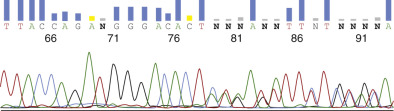

Figure 71-8 

Detection of the Ashkenazi Jewish founder mutation 185delAG in the _BRCA1_ gene by DNA sequencing. 

Because familial breast-ovarian cancer is a dominant disorder, the mutation is heterozygous, and because it results in the deletion of two nucleotides from one of the alleles, the sequence profile is “out of frame” from the mutation site onward (starting at nucleotide 79 in this particular readout). This causes overlapping of different nucleotides between the two alleles, which the automated sequencer has trouble identifying (hence the frequent notation “N” for the nucleotide calls). 

 

##  Hemochromatosis 

Hereditary hemochromatosis, first recognized in its full clinical expression as the triad of cirrhosis, diabetes mellitus, and bronzing of the skin, was originally thought to be a rare disorder of iron overload affecting about 1 in 5000 or fewer Caucasians. However, when genetic studies linked the disease-causing gene to the HLA locus on chromosome 6, and biochemical tests of iron overload (principally transferrin saturation) were utilized, it was recognized that the underlying genetic predisposition to iron overload was extremely common. Indeed, hereditary hemochromatosis is now recognized as an autosomal recessive disorder with a carrier frequency as high as 1 in 8 in people of northern European descent, making it the most common genetic disorder in the U.S. Caucasian population. The incidence of at-risk homozygotes is 1 in 250, but only a fraction of these accumulate sufficient excess iron to produce the tissue injury associated with the classic disorder. 

Our understanding of hereditary hemochromatosis entered a new era with the identification of the _HFE_ gene (initially called _HLA-H_ ) within the major histocompatibility locus on chromosome 6 (  Feder et al, 1996  ). The HFE protein, although it is a major histocompatibility complex class I–like molecule, does not bind and present endogenous peptides and is not thought to have an immunologic function. Rather, as discussed in [ Chapter 50 ](<##!/content/3-s2.0-B9780323295680000504?scrollTo=%23c00050>) , evidence indicates that the HFE protein interacts with the transferrin receptor and modulates enteric absorption of dietary iron (  Waheed et al, 1999  ). Mutations in _HFE_ impair this regulatory function, leading to excess iron absorption and storage in tissues. 

As noted in [ Chapter 50 ](<##!/content/3-s2.0-B9780323295680000504?scrollTo=%23c00050>) , a single missense mutation in _HFE_ , C282Y, which results in a tyrosine substitution for cystine at amino acid 282 in the HFE protein, is present in the homozygous state in 80% to 90% of Caucasians with hemochromatosis. An additional small percentage of patients with hemochromatosis are compound heterozygotes, carrying one chromosome with a C282Y mutation and another with an H63D mutation. H63D is a common variant, with a carrier frequency of approximately 20%, and its association with iron overload is very low (1% to 2%) in the compound heterozygous state and probably even lower when homozygous (  Gochee et al, 2002  ). Over the years since its discovery, the penetrance of the C282Y homozygous state has also been questioned, and may be appreciably lower than the 80% earlier quoted, perhaps as low as 10% or even 1% (  Beutler et al, 2002  ;  Pietrangelo, 2004  ). For this reason, population screening for these mutations in individuals with no clinical or biochemical signs of hemochromatosis has not been recommended. Similar to what was discussed for factor V Leiden earlier, the DNA test is best reserved for differential diagnosis in patients already exhibiting the clinical disorder or elevated transferrin saturation detected on biochemical screening. The C282Y and H63D mutations are single-nucleotide substitutions and may be analyzed easily by a variety of PCR, real-time PCR, microarray, microplate, or sequencing methods. There are a number of other genes involved in iron metabolism, such as hepcidin, ferroportin, and hemojuvelin, but mutations in these genes are not common enough to justify widespread testing at present (  Babitt & Lin, 2011  ). 

 

##  Spinal Muscular Atrophy 

Spinal muscular atrophy is an autosomal recessive motor neuron disorder characterized by proximal muscle weakness and wasting. The most severe form, type I (also called Werdnig-Hoffmann disease), presents with hypotonia in infancy and early childhood death due to respiratory failure. Intermediate and atypical forms are also described. The disease is caused by mutations in the _SMN1_ gene on chromosome 5q13. With a carrier frequency of 1 in 50, spinal muscular atrophy is one of the more common lethal recessive disorders, approaching the incidence of CF. 

The majority (95%) of affected patients exhibit loss of the _SMN1_ gene, either through complete gene deletion or through a gene conversion event involving sequences in the adjacent _SMN2_ gene, which differs by a single nucleotide in exon 7. The _SMN2_ gene is believed to be nonessential because both alleles are absent in 5% to 10% of normal individuals, yet is partially protective as demonstrated by the finding of higher _SMN2_ copy number in patients with less severe forms of the disease (  Mailman et al, 2002  ). The presence of this closely homologous pseudogene has necessitated the development of meticulously designed allele-specific PCR/restriction endonuclease assays to determine homozygous deletion of _SMN1_ in the presence of _SMN2_ (  Prior, 2010  ). Identification of carriers, based on _SMN1_ gene dosage analysis, is even more challenging and requires the use of quantitative or real-time PCR methods (  Ojino & Wilson, 2004b  ); this problem, along with questions about genotype-phenotype correlation, have led to some controversy over whether SMA should be a target of general population carrier screening along the lines of CF (  Prior, 2008  ;  ACOG, 2009  ). The small percentage of patients not showing loss or conversion of both _SMN1_ genes usually carry a small intragenic mutation in one allele, of which a large number have been reported. These can be detected by sequencing or by multiplex allele-specific PCR assays (  Mailman et al, 2002  ). 

 

##  Mitochondrial DNA Disorders 

In addition to the 6 billion bp of DNA that comprise the human nuclear diploid genome, vital genetic information is also encoded in DNA molecules carried by the mitochondria in the cytoplasm. These 16,500-bp, double-stranded circular DNA molecules are present in 2 to 10 copies in each of the up to several hundred mitochondria of the cell. Mitochondrial DNA codes for 13 of the proteins of the respiratory chain and adenosine triphosphate (ATP) synthase, 22 transfer RNAs required for their translation, and two ribosomal RNAs. Mitochondrial DNA is self-replicating and is transmitted strictly by maternal inheritance, because the mitochondria of a spermatozoon are not incorporated into the zygote upon fertilization of an ovum. 

Disease-causing abnormalities of mitochondrial DNA may result from several different mechanisms (  Ruiz-Pesini et al, 2007  ). Single large deletions (and, rarely, duplications) that apparently occur sporadically in oogenesis are typical of Kearns-Sayre syndrome, a myopathy characterized principally by progressive external ophthalmoplegia and pigmentary retinopathy. A wide range of disorders are characterized by multiple small deletions and show typical Mendelian autosomal dominant or autosomal recessive patterns of inheritance, because they are due to defects in nuclear genes important for mitochondrial DNA replication. Most distinctive from a genetic point of view are the disorders that follow a pattern of strict maternal inheritance, never showing transmission from an affected male and passing from an affected female equally to her sons and daughters. These diseases are most often due to point mutations in one of the genes encoding a transfer RNA (e.g., myoclonic epilepsy with ragged red fibers [MERRF] and mitochondrial myopathy, encephalopathy, lactic acidosis, and strokelike episodes [MELAS]) or a mitochondrial protein (e.g., Leber hereditary optic neuropathy [LHON]). In addition to the inherited encephalomyopathies, there is growing evidence that tissue-specific accumulations of somatic mitochondrial mutations may contribute to the development of many common late-onset degenerative disorders, and perhaps to aging itself. 

Often the clinical presentation will guide the choice of mutation panel testing in a stepwise fashion, because particular mutations are associated with each of the major syndromes (e.g., missense mutations G11778A, T14484C, and G3460A with LHON). If these tests are negative, one can proceed to a second-tier panel or to complete mtDNA sequencing. The situation is complicated by the finding that some mutations are found in more than one syndrome and by the phenomenon of heteroplasmy—the occurrence of different proportions of mutant and normal mitochondria in different tissues. For this latter reason, mitochondrial DNA testing may require biopsy of the involved tissue (e.g., muscle) because the mutation may not be represented highly enough in blood to be detectable. Recently, the advent of next-generation sequencing has circumvented some of these challenges, in that it allows sequencing of the complete mtDNA genome in a short time while also detecting minor populations of mutant mitochondria, even outside the affected tissue (  Dames et al, 2015  ). 

 

##  Other Targets of Molecular Genetic Testing and Screening 

The specific disease examples covered in this chapter are among those tested most widely by clinical molecular genetics laboratories, a market that is reflected by their inclusion in the CAP/ACMG proficiency testing programs. This in turn has been dictated largely by their mutation carrier frequency or disease prevalence in the general population, and by their clinical severity. As described earlier, if the carrier frequency of a recessive mutation is sufficiently high in the target population, general screening may be justified. For these and other disorders, the application of the test to differential diagnosis, prenatal diagnosis, or presymptomatic diagnosis may also be of value. With more than 20,000 genetic diseases catalogued, there are obviously many others that could be considered; currently there are over 4000 different molecular genetic disease tests available as listed in the useful online database GeneTests _(_ [ _www.genetests.org_ ](<http://www.genetests.org>) _)_ (  GeneTests, 2015  ). Many of these are esoteric and offered by only one or a few laboratories. Tests for extremely rare, or _orphan,_ genetic diseases may only be available in the research laboratory that cloned the gene or studies the disease from a mechanistic level. This has led to problems because such laboratories, although performing a vital service to the small number of families at risk, are not Clinical Laboratory Improvement Amendments (CLIA)-certified and on legal grounds should not be releasing test results for medical management. A number of solutions have been proposed, such as modifying certain CLIA requirements for such settings, partnering of the research laboratory with a clinical laboratory in their own institution, or establishing a network of dedicated orphan disease laboratories (  Grody & Richards, 2008  ). 

Some disorders that are rare in the general population are sufficiently prevalent in a particular racial or ethnic group to justify limited population screening. For example, many laboratories offer an Ashkenazi-Jewish carrier screening panel to include any or all of the following autosomal recessive diseases, which have carrier frequencies ranging from 1/100 to 1/15: Tay-Sachs disease, Gaucher disease, Canavan disease, CF, familial dysautonomia, Niemann-Pick disease A, Fanconi anemia C, Bloom syndrome, and connexin-26–related hearing loss. Screening of just the first four of these diseases has a positive yield of 1 in 6 in this population (  Eng et al, 1997  ). 

Beyond the impetus of providing service to a particular indigenous patient population, the choice of molecular genetic test menu from the large and ever-expanding universe of known disease genes will depend on both intellectual and economic factors (  Amos & Grody, 2004  ). Development of a molecular genetic test may be spurred by a clinical colleague's interest in a particular disease and accrual of a stable of patients and at-risk relatives. A molecular test may be needed as backup to a biochemical test done at the same institution, as for hemoglobinopathies or α 1  -antitrypsin deficiency, or for statewide expanded newborn screening by tandem mass spectrometry (  CDC, 2008  ). Of course, a strong motivator is the availability of robust, commercially available platforms and reagents for performing the test, and this in turn will be driven by the potential market the vendors perceive for the disease in question. Naturally, carrier screening tests will always be of higher throughput than diagnostic tests, which explains the proliferation of commercial reagents and instruments for CF mutation detection that followed the ACMG/ACOG screening recommendations. Of course, any new test being considered, whether commercially sold or laboratory-developed, must first be shown to have clinical utility and analytic validity. 

,  

##  The New Frontier of Diagnostic Molecular Genetics: Genome-Level DNA Sequencing 

Any chapter on molecular genetic testing in a contemporary textbook would be highly remiss if sufficient attention were not paid to the impact of next-generation DNA sequencing (NGS) on the approach to molecular diagnosis of patients with novel, rare, or unclear phenotypic presentations. Indeed, this remarkable advance in sequencing speed, cost-efficiency, and throughput probably represents the most dramatic sea change in the molecular testing landscape since the advent of PCR in the mid-1980s. The combination of these new instrumentation platforms with our now-complete knowledge of the human genome sequence is proving to be a tool of incredible power, at last opening the gateway to true “personalized medicine,” especially in the areas of genetics and oncology. NGS or _massively parallel_ DNA sequencing goes well beyond the specific targeting of a single region of a single gene that is characteristic of Sanger sequencing. Instead, the entire genome is targeted for sequencing, using a series of defined steps ( [ Fig. 71-9 ](<#f0050>) ). First, the genomic DNA isolated from the patient is sheared into hundreds of millions of short (usually 50 to 100 bp) fragments. These are then linked to adapters ( [ Fig. 71-10 ](<#f0055>) ) that provide universal primer sites for sequencing, “bar-coding” (for accurate cataloguing of every fragment by the computer analysis software), and attachment to a solid substrate (either a microarray-like surface or microbeads). The aggregate of all the fragments with their adapters is called the _library_ . Most clinical NGS laboratories also include an intermediate step of exon-capture (using exonic probes on some type of solid support) so that only the coding regions of the genome (equal to about 1.5% of the total genome content) are sequenced; this test is then designated _exome_ (rather than _genome_ ) sequencing. The rationale behind it is that the coding regions (about 230,000 exons in total for about 23,000 genes) likely account for most of the sites of mutations causing Mendelian disorders; also, the extensive degree of population variation in the non-exonic regions is so high and poorly characterized that interpreting them becomes an almost insurmountable challenge. Nevertheless, most experts predict that whole-genome sequencing will eventually replace exome sequencing as the standard procedure. 

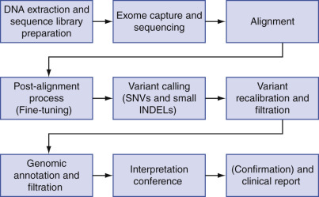

Figure 71-9 

Workflow for clinical exome sequencing, from DNA isolation to final interpretation and reporting. 

(Courtesy of Dr. Hane Lee.) 

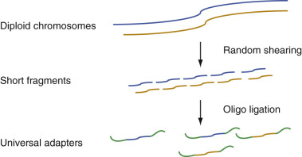

Figure 71-10 

Shearing of genomic DNA into small fragments, followed by adapter ligation, the first steps in library preparation for next-generation sequencing. 

(Courtesy of Dr. Sam Strom.) 

The technical details of the actual sequencing process vary by manufacturer of the instruments, but most of those in current use take “snapshots” of repeated sequencing cycles, adding one nucleotide at a time, with each of the four nucleotides identified by a certain fluorescent color or other chemical method ( [ Fig. 71-11 ](<#f0060>) ). Each fragment in the library is sequenced many times in both directions (so-called _paired-end_ sequencing), typically 10× to 100×, but potentially even more, hence the name _massively parallel._ The greater the number of these “reads,” the more accurate will be the sequence output, since individual reactions may have random errors, but these will be statistically ignored if enough consensus reads are present. 

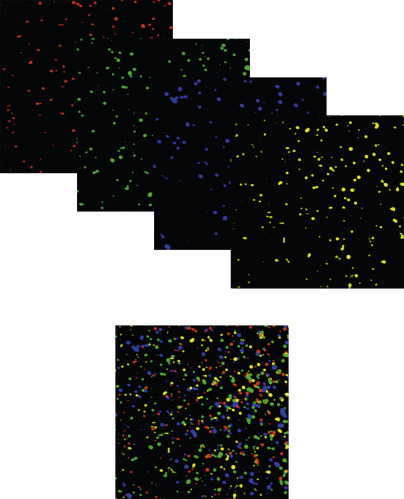

Figure 71-11 

Examples of cluster arrays, the raw data from next-generation DNA sequencing. 

Shown are snapshots of nucleotide addition signals for each of the four bases independently, and mixed together as read by the instrument. 

(Courtesy of Dr. Sam Strom.) 

After all the sequencing is completed, the computer software must _align_ each of the read fragments to the reference human genome sequence, in order to be confident of which gene/exon it came from and whether or not it contains any sequence variants that do not agree with the reference sequence. The latter process is the _variant calling_ step. Next, each variant is examined for its potential biologic/clinical significance (the _annotation_ step), and then these are _filtered_ according to predetermined software criteria in order to reduce the huge number of sequence variants (20,000 to 30,000 for each exome, 3 to 4 million for each genome) down to a more manageable number. Typical parameters used to eliminate variants from consideration are “synonymous” nucleotide substitutions (which do not alter the amino acid encoded by the codon), known benign polymorphisms in the population, and heterozygous variants for disorders that are known to be recessive. It must be admitted that some aspects of the filtering step are somewhat arbitrary, but there is simply no way for anyone to evaluate so many variants manually. 

Once the variants are filtered down to a few tens or hundreds of potentially pathogenic changes, the challenge of _interpretation_ begins. This may be the most difficult aspect of exome/genome sequencing and requires extraordinarily sophisticated and broad expertise. Most centers employ a multidisciplinary group, including laboratory directors, geneticists, bioinformaticists, and clinicians, to discuss and come to conclusions about which variants to report and whether to designate them as _pathogenic, likely pathogenic,_ or _unknown_ (usually called a _variant of uncertain significance [VUS]_ ). Guidelines have been promulgated by the ACMG and other groups to assist in the clinical interpretation of novel sequence variants (  Richards et al, 2015  ). 

In the few short years of its existence, clinical exome sequencing has already delivered on its promise in the form of high diagnostic yields (most centers reporting 25% to 50% [  Lee et al, 2014  ]), cost savings by ending the “diagnostic odyssey” that many patients with rare disorders endure, and discovery of new disease genes. But it has also uncovered a significant ethical challenge in the form of “incidental” or “off-target” findings. These are pathogenic mutations identified in the course of sequencing that are unrelated to the clinical indication for performing the test, but are potentially life-threatening or “actionable” (e.g., incidental identification of a _BRCA1_ mutation in a 4-year-old child undergoing exome sequencing because of autism). Debate has raged between those who feel all such actionable findings should be mandatorily reported in both adults and children, and those who feel the patient (or parent) should have the ability to “opt out” of receiving such findings. The ACMG has come up with a list of about 25 diseases which are felt to be of sufficiently high penetrance, severity, and actionability that routine reporting of mutations found incidentally should be considered (  Green et al, 2013  ). While subject to criticism or modification, the list is a helpful start and may lay the groundwork for what sort of findings should be reported in healthy people who desire exome sequencing to assess their risk for disease. Similar considerations will apply to noninvasive prenatal testing, made possible by massively parallel sequencing of free fetal DNA in the pregnant mother's blood. Although applied at present mainly to the detection of aneuploidies (  Gregg et al, 2014  ), it is theoretically possible to assess all genes in the fetal genome by this method (  Lo, 2013  ), which will inevitably bring with it all the thousands of VUSs and occasional off-target mutations. 

One way to avoid confronting off-target mutations is to limit the sequencing to genes already known to be associated with the patient's phenotype. Quite a few genetic conditions are caused by families of genes, with difficulty distinguishing the various subtypes based on clinical presentation alone; examples include cardiomyopathies, hearing loss, and the other conditions listed in [ Box 71-1 ](<#b0010>) . Such conditions may be caused by anywhere from 10 to 100 or more different genes, and NGS now allows for the efficient sequencing of such large amounts of DNA. But unfortunately, experience has shown that as many as half of the patients with these disorders will be missed using existing gene panels (  Lee et al, 2014  ), simply because the panels cannot keep up with all the newly discovered or candidate (or thus far unknown) genes associated with the condition. For that reason, exome sequencing is beginning to supersede the use of gene panels. 

Box 71-1 

Conditions Tested Using NGS of Gene Panels 

  * Hypertrophic cardiomyopathy 

  * Dilated cardiomyopathy 

  * Hereditary arrhythmias (channelopathies) 

  * Retinitis pigmentosa 

  * Albinism 

  * Mental retardation 

  * DNA repair defects 

  * Skeletal dysplasias 

  * Disorders of sexual development 

  * Hearing loss 

The applications presented in this chapter are all single-gene defects, because that is all our current knowledge and technology can handle. In the future, it is hoped that molecular genetic testing will also be applied to the most common chronic diseases of medicine, which are all polygenic: atherosclerosis, diabetes mellitus, hypertension, and schizophrenia. Since these conditions are likely caused by a great many genes (in addition to environmental factors), with each one contributing perhaps only incrementally to overall risk, NGS will have to be used to address all of them at once. It is toward this end that a tremendous effort is being expended to identify single-nucleotide polymorphisms and other variants within candidate genes that may in aggregate produce quantitative trait effects on homeostasis, vascular tone, lipid metabolism, and so on. It is hoped that the discovery of these determinants will enable population risk screening programs followed by targeted therapies and preventive interventions. In this way, molecular genetic testing will be the central modality behind an ever-greater proportion of medical practice in the 21st century, and virtually every patient, whether healthy or ill, will feel its impact. 

,, 

## Selected References

* GeneTests : [ https://www.genetests.org ](<https://www.genetests.org>) -
* _This useful Internet site provides scholarly and up-to-date reviews of the genetics and clinical aspects of the major hereditary disorders, as well as a worldwide searchable laboratory directory listing the locations where specific testing for each disease can be obtained._
* Green RC, Berg JS, Grody WW, et. al., American College of Medical Genetics and Genomics: ACMG recommendations for reporting of incidental findings in clinical exome and genome sequencing. Genet Med 2013; 15: pp. 565-574.
* _This publication presents the guidelines developed by the American College of Medical Genetics and Genomics for which conditions should be reported when mutations are discovered “incidentally” in the course of exome or genome sequencing. _
* Grody WW, Cutting G, Klinger K, et. al.: Laboratory standards and guidelines for population-based cystic fibrosis carrier screening. Genet Med 2001; 3: pp. 149-154.
* _This article presents the recommendations from the American College of Medical Genetics and the American College of Obstetricians and Gynecologists for implementation of nationwide cystic fibrosis population carrier screening using a core panel of 25 CFTR mutations._
* Lee H, Deignan JL, Dorrani N, et. al.: Clinical exome sequencing for genetic identification of rare Mendelian disorders. JAMA 2014; 312: pp. 1880-1887.
* _One of numerous publications demonstrating the high diagnostic yield of genome-level DNA sequencing for patients with rare or undiagnosed disorders._
* Lo YM: Noninvasive fetal whole-genome sequencing from maternal plasma: feasibility studies and future directions. Clin Chem 2013; 59: pp. 601-603.
* _This paper demonstrates that NGS can be used for noninvasive prenatal testing not only to identify chromosomal aneuploidies but also single-gene defects._
* Miller DT, Adam MP, Aradhya S, et. al.: Consensus statement: chromosomal microarray is a first-tier clinical diagnostic test for individuals with developmental disabilities or congenital anomalies. Am J Hum Genet 2010; 86: pp. 749-764.
* _This expert guideline was the first to recommend chromosomal microarray in place of standard karyotype for identification of deletions and duplications in the workup of patients with developmental delay, autism, or congenital malformations._
* Richards S, Aziz N, Bale S, et. al.: Standards and guidelines for the interpretation of sequence variants: a joint consensus recommendation of the American College of Medical Genetics and Genomics and the Association for Molecular Pathology. Genet Med 2015; 17: pp. 405-423.
* _The consensus guideline provides a detailed approach for assessing the pathogenicity of DNA sequence variants identified by either traditional testing or genome-level sequencing._
,
