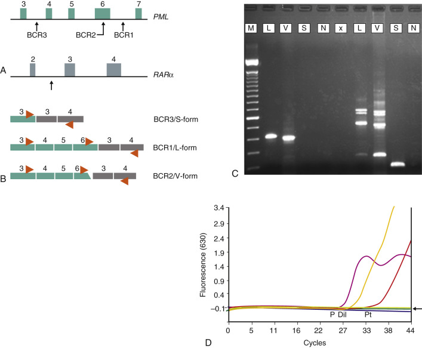
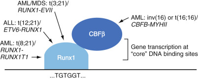
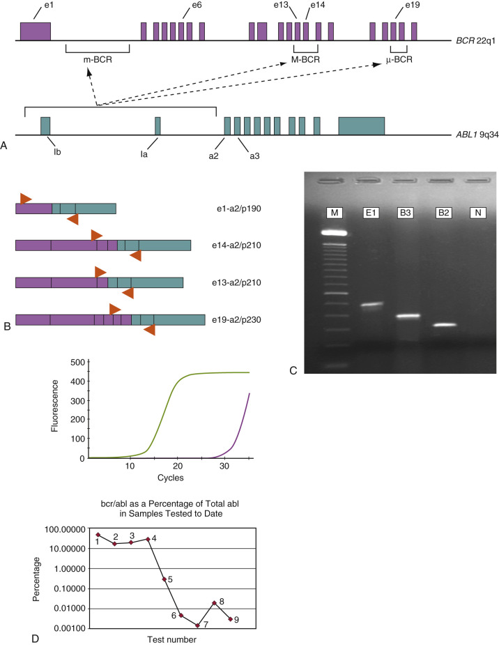
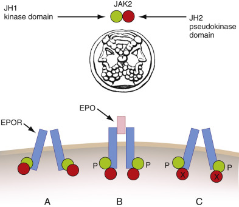
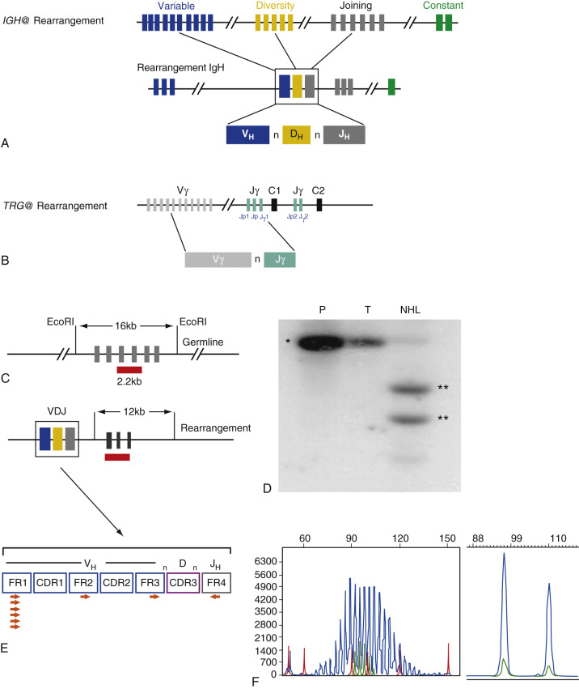
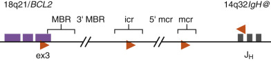

## Key Points

  * •

Overview of the role of molecular investigations in the diagnosis, classification, prognosis, and monitoring of hematolymphoid disorders. 

  * •

Detailed summary of the major genetic abnormalities and molecular diagnosis of the acute leukemias and chronic myeloproliferative neoplasms. 

  * •

Applications and detailed discussion of molecular minimal residual disease monitoring in chronic myeloid leukemia and acute promyelocytic leukemia in the era of targeted therapeutic options. 

  * •

Concept of risk-adapted therapy for optimized management of childhood acute lymphoblastic leukemias. 

  * •

Molecular pathologic origins of childhood leukemias. 

  * •

Description of antigen receptor gene rearrangements and application of molecular clonality assays to identify monoclonal lymphoid proliferations. 

  * •

Detailed summary of the major genetic abnormalities and molecular diagnosis of the non-Hodgkin lymphomas and chronic lymphoid leukemias. 

  * •

New research and technology developments that will impact molecular diagnosis and prognosis of hematolymphoid cancers. 

,  

##  Role of Clinical Molecular Diagnostics in Hematologic Cancers 

The diagnosis of hematolymphoid neoplasms continues to undergo a dramatic transformation with the advent and application of new technologies. Whereas traditional morphologic (light microscopic) evaluation of glass slides still occupies the centerpiece of pathologic diagnosis, the judicious application of ancillary methods, such as special cytochemistry, immunohistochemistry, flow cytometry, cytogenetics (including fluorescence in situ hybridization [FISH]), and molecular genetics, has allowed for much-improved diagnostic reproducibility and refinement. The 2008 update of the World Health Organization (WHO) classification of hematopoietic and lymphoid neoplasms (  Swerdlow et al, 2008  ) incorporates genetic abnormalities and clinical information in refining the diagnostic criteria of hematolymphoid neoplasms, including previously described and pro­visional diseases. The relative ease of sampling sites such as the lymph nodes and bone marrow, as well as the provision of easily disaggregated viable cell samples for analysis, has driven this paradigm of diagnostic evaluation. The nature of the hematolymphoid system is also conducive to relatively easy monitoring of disease status following therapy, which represents another important facet in the management of patients with these illnesses. 

Given this plethora of diagnostic tools, what role does molecular genetic evaluation or molecular diagnostics play? There are perhaps four major scenarios in which molecular diagnostic analysis of a hematolymphoid proliferation is important. First, molecular investigation can establish a diagnosis in situations wherein morphologic details and results of other lab tests are inconclusive for malignancy. The presence of specific genetic abnormalities, or the demonstration of tumor genetic “homogeneity” of a cell population (e.g., by cell receptor gene rearrangement studies) can establish the presence of a clonal pathologic process. Second, molecular methods are used to subclassify disease entities. To this end, the current WHO classification of hematologic neoplasms includes molecular char­acterization as a defining feature of many leukemias and lymphomas (  Swerdlow et al, 2008  ;  Vardiman et al, 2009  ). Next, specific genetic anomalies in hematolymphoid malignancies have important prognostic value, which in turn can influence the initial treatment of certain tumors to produce an optimal clinical outcome. Finally, being potentially of high sensitivity, molecular techniques can be used to assess patients after the onset of therapy by monitoring for the presence and extent of minimal residual disease (MRD). [ Table 76-1 ](<#t0010>) summarizes some of the key instances in which molecular diagnostic evaluation is sought in hematopathology practice. As the synergy between expanding basic biologic information and rapidly progressing technology continues unabated, the future holds promise for many additional applications of molecular diagnostics in the pathology laboratory, including the prediction of disease susceptibility, severity, or treatment response based on polygenic factors; pharmacogenomic profiling of patients to determine drug sensitivity and toxicity profiles; and the assessment of individual responses to increasingly “targeted” therapies. 

TABLE 76-1 

Applications of Molecular Diagnostics in Hematologic and Lymphoid Neoplasia 

Indication  |  Examples   
---|---  
Diagnosis and subclassification  |  _JAK2_ mutations in myeloproliferative neoplasms   
_CCND1-IGH@_ abnormality in mantle cell lymphoma   
|  _PML-RARA_ abnormality in APL   
|  _FLT3, NPM1,_ and _CEPBA_ mutations in normal karyotype AML   
Determination of tumor clonality  |  Assessment of abnormal B and T cell lymphoid proliferations   
Prognosis and/or therapeutic monitoring  |  Quantitative PCR monitoring of _BCR-ABL1_ mRNA in CML patients on tyrosine kinase inhibitor therapy (e.g., imatinib)   
|  Quantitative PCR monitoring of _PML-RAR α _ mRNA in APL   
|  Multiparameter cytogenetic and molecular assessment of chronic lymphocytic leukemia   
|  Relapse risk prediction in childhood acute lymphoblastic leukemias   
|  Outcome prediction of diffuse large B cell lymphoma subtypes by gene expression profiling   
  
_ALL_ , Acute lymphoblastic leukemias; _APL_ , acute promyelocytic leukemia; _CML_ , chronic myeloid leukemia; _PCR_ , polymerase chain reaction. 

This chapter focuses on the background, clinical rationale, and fundamental technical considerations underlying the molecular diagnostic evaluation and monitoring of hematopoietic and lymphoid tumors. Because the large majority of these laboratory assays are polymerase chain reaction (PCR) based, the emphasis is accordingly placed on methods concerning either DNA or RNA (i.e., reverse-transcription) PCR techniques. Of note, it is apparent that the detection of tumor-specific genetic abnormalities can be achieved by different analytic means—for example, cytogenetics, FISH, or PCR. Although at first glance these various methods may seem redundant, these laboratory techniques should be considered complementary and the choice of methodology is determined by a number of factors, including knowledge of the detection rates, analytic sensitivity, and limitations of various techniques; understanding of the disease pathobiology; the level of interpretive experience and expertise with these procedures; the type of sample; and the phase of the disease under investigation. [ Table 76-2 ](<#t0015>) indicates comparative analytic sensitivities of the principal modalities used to detect hematolymphoid tumor-related genetic abnormalities. 

TABLE 76-2 

Relative Sensitivities of Major Techniques Used to Detect Leukemia or Lymphoma-Associated Abnormalities 

Method  |  Analytic Sensitivity (%) [ * ](<#hl0000321>) |  Notes   
---|---|---  
Cytogenetics  |  5  |  Global genomic assessment   
|  |  Requires fresh, sterile cells   
|  |  Detects numerical and structural chromosome aberrations   
|  |  Difficult or impossible to detect alterations in DNA below band resolution   
FISH  |  1-5  |  Targeted assessment of relatively large genomic abnormalities   
|  |  Technically straightforward and rapid; can frequently be performed on interphase nuclei   
|  |  Applicable to a variety of tissue sources   
|  |  Requires rigorous quality standards to avoid false-positive results at low levels of the abnormality in question   
SBH  |  5-10  |  Targeted assessment for structural abnormalities in genomic DNA   
|  |  Technically laborious and time-intensive   
|  |  Requires samples with well-preserved high molecular weight DNA (e.g., fresh or frozen cells)   
PCR  |  10  –2  -10  –4  |  Targeted assessment of small genomic or mRNA abnormalities   
|  |  Detection of unique chimeric fusion gene mRNA species is highly sensitive   
|  |  Technically straightforward and rapid but may require post-PCR detection procedures   
|  |  Applicable to a broad range of sample types, including fixed paraffin-embedded tissues   
|  |  Can be optimized for high sensitivity, minimal residual disease monitoring (real-time quantitative PCR), or other specialized applications such as allele-specific discrimination   
DNA sequencing (Sanger method)  |  20-30  |  Targeted assessment of single nucleotide or small base alterations in template (DNA or RNA) sequences   
|  Typically performed on PCR-amplified products   
|  |  Modifications or special methods (e.g., pyrosequencing) can improve sensitivity to 5%   
  
_DNA_ , Deoxyribonucleic acid; _FISH_ , fluorescence in situ hybridization; _PCR_ , polymerase chain reaction; _RNA_ , ribonucleic acid; _SBH_ , Southern blot hybridization. 

 * Generally attainable with the indicated molecular methods, although several technical or biologic factors may influence the lower limits of detection. 

The increasingly universal need for molecular genetic evaluation of hematolymphoid cancers has initiated earnest attempts to address and achieve better interlaboratory standardization, and such efforts can be expected to continue to improve the benchmarks of sensitivity and specificity in this field. Nonetheless, in the application and interpretation of molecular diagnostic tests, one caveat that cannot be emphasized enough is that the results of these investigations must never be considered in isolation but rather in conjunction with the clinical presentation, morphologic, and additional laboratory data concerning the individual patient. Regardless of the remarkable specificity and sensitivity of molecular markers, the evident complexity of hematolymphoid neoplasia mandates such a fully integrated approach in order to diminish the possibility of diagnostic error. 

,  

##  Molecular Diagnosis of Leukemias 

 

##  Gene Fusion Concept in Leukemia and the Basis for Reverse-Transcription Polymerase Chain Reaction Analysis 

The leukemias are hematologic cancers with a diverse pathogenesis and pathobiology. However, a significant proportion of these tumors are characterized by nonrandom, balanced (usually) chromosomal translocations, resulting in the formation of fusion or chimeric genes. In general, although two such fusions are created in this abnormal event (i.e., one on each reciprocal translocated chromosome), typically only one of these derivative loci gives rise to a leukemogenic “hybrid” gene. At the molecular level, the intronic breakpoint and fusion sites in the involved genes are highly variable among patients with the same type of leukemia, although there may be evidence of clustered breakpoint “hotspots” in certain types of leukemia-related rearranging genes. Despite the variability in breakpoint sites in both of the involved genes, a consistent feature of the leukemic gene fusions is the production of a chimeric messenger ribonucleic acid (mRNA) molecule. This abnormal fusion transcript is further translated to a fusion protein, presumed to be operative in disrupting many cellular pathways involved in regulating normal proliferative capacity, differentiation, and survival in immature (i.e., precursor) marrow stem or progenitor cells. 

Although the formation of a translocation fusion gene, such as the well-known _BCR-ABL1_ abnormality, is known to be necessary for disease production, results from animal models have suggested that, at least for some types of leukemia, this may not be a sufficient event, requiring secondary incompletely characterized genetic insults as well. This concept has been formalized into a general scheme in which leukemogenic abnormalities are considered to be class I or class II, depending, respectively, on whether they provide a proliferative advantage or disturb the complex processes of hematopoietic differentiation and maturation. In this conceptualization, the development of leukemia becomes more likely when both class I and class II derangements cooperate to alter the fate of the cell (  Ishikawa et al, 2009  ). In the molecular hematopathology laboratory, most leukemia-related assays are directed toward chimeric gene fusions identification that generally fall into the class II category. However, testing for class I mutations (e.g., _FLT3_ internal tandem duplication) has more recently become integral to more comprehensive evaluations. The challenge for the molecular hematopathology laboratory is thus to incorporate an adequate spectrum of assays directed to the detection of both class I and class II category genetic abnormalities, according to the (ever-changing) understanding of disease molecular pathogenesis. 

One practical aspect of the chimeric gene concept is that regardless of the variable location of the genomic (DNA-level) breakpoints in a given translocation gene fusion, the presence of this abnormality can be confirmed by detecting the corresponding invariant chimeric mRNA species. In the molecular diagnostic laboratory, we can thus utilize the reverse-transcription polymerase chain reaction (RT-PCR) method to first convert the fusion mRNA transcript to its complementary deoxyribonucleic acid (cDNA) and then amplify this specific molecule. The ability to perform RT-PCR analysis obviates the difficulties imposed by the often very large flanking regions of intronic DNA surrounding the genomic breakpoint-fusion loci, which would normally not be amenable to amplification by standard DNA-based PCR approaches. Furthermore, the presence of such an aberrant mRNA species is highly specific for the disease, in that it should not theoretically be present in normal cells. [ Table 76-3 ](<#t0020>) lists the major leukemia-associated translocations along with their resultant fusion gene and mRNA products. Two related concepts are important in the further understanding of chimeric genes and transcripts. _Breakpoint heterogeneity_ refers to the presence of two (or more) common breakpoint loci in a particular gene, which can be targeted by the translocation event. In some examples, different breakpoint sites may be correlated with a presenting disease phenotype or particular clinical features (e.g., the _BCR-ABL1_ fusion in chronic myeloid leukemia [CML] versus acute lymphoblastic leukemia [ALL]), but this is not always the case. Second, alternative exon splicing of a single chimeric transcript may occur, such that additional, related mRNA products may be observed during PCR amplification of the principal target (e.g., the _PML-RARA_ fusion in acute promyelocytic leukemia). RT-PCR–based assays require fresh bone marrow aspirate or blood cells, although cryopreserved tissue or cells can also be used effectively for RNA isolation (  Gabert et al, 2003  ). RNA extraction and RT-PCR from paraffin tissue block samples have also been successfully described; however, fixed cellular material is often subjected to degradation or the presence of PCR inhibitors, and consequently a higher PCR detection failure rate. Finally, given the highly sensitive nature of PCR amplification, these laboratory assays must be carefully controlled to avoid false-positive contamination artifacts. The following sections describe the molecular genetic and diagnostic features of the most common, prognostically important leukemic diseases. 

TABLE 76-3 

Common Leukemia-Associated Translocations and Gene Mutations in Myeloid Neoplasms 

Genetic Abnormality  |  Disease Associations  |  Basic Molecular Pathogenesis  |  Diagnostic Detection [ * ](<#hl0000432>)  
---|---|---|---  
t(9;22)/ _BCR-ABL1_ |  Chronic myeloid leukemia (100%)   
Ph+ adult acute lymphoblastic leukemia (20% to 25%)   
Ph+ pediatric acute lymphoblastic leukemia (3%)  |  Chimeric fusion protein with deregulation of Abl tyrosine kinase; effects on cell proliferation, apoptosis, adhesion  |  RT-PCR;   
FISH   
_JAK2_ V617F mutations  |  Polycythemia vera (>95%); primary myelofibrosis (75%); essential thrombocytosis (50%)  |  Aberrant activation of cell signaling tyrosine kinase; activation of JAK-STAT pathway  |  DNA PCR   
t(15;17)/ _PML-RARA_ |  Acute promyelocytic leukemia (100%)  |  Chimeric fusion protein; interference with myeloid maturation and differentiation  |  RT-PCR;   
FISH   
t(8;21)/ _RUNX1-RUNX1T1_ |  AML (10%)  |  Chimeric fusion protein affecting the CBF transcriptional pathway  |  RT-PCR;   
FISH   
inv(16) or t(16;16)/ _CBFB-MYH11_ |  Acute myelomonocytic leukemia with abnormal eosinophils (AMML-Eo)  |  |   
_FLT3_ mutations  |  AML with normal karyotype (20% to 25%)  |  ITD or point mutation resulting in constitutive activity of _FLT3_ tyrosine kinase and cell proliferation  |  DNA PCR   
_NPM1_ mutations  |  AML with normal karyotype (50%)  |  Complex effects of mutated _NPM1_ nuclear/cytoplasmic transport protein  |  DNA PCR   
_KIT_ mutations  |  Systemic mastocytosis  |  Aberrant activation of receptor for hematopoietic stem cell factor  |  DNA PCR   
_PDGFRA, PDFRB_ , and _FGFR1_ translocations  |  Myeloid and lymphoid neoplasms with eosinophilia  |  Deregulation of growth factor receptor tyrosine kinases  |  FISH > RT-PCR   
t(12;21)/ _ETV6-RUNX1_ |  Childhood B-precursor acute lymphoblastic leukemia (20%)  |  Chimeric fusion protein; disruption of CBF transcriptional pathway  |  RT-PCR;   
FISH   
11q23/ _MLL_ translocations  |  Childhood (mainly infant) B-lineage ALL (5%)   
Adult de novo AML, usually monocytic (subset of cases)   
Subset of secondary AML (after DNA topoisomerase II agent exposure)  |  Chimeric _MLL_ fusion proteins; disruption of _MLL_ -mediated regulation of normal hematopoiesis  |  FISH;   
RT-PCR   
  
_ALL,_ Acute lymphoblastic leukemia; _AML,_ acute myeloid leukemia; _CBF,_ core binding factor; _DNA,_ deoxyribonucleic acid; _FISH,_ fluorescence in situ hybridization; _ITD,_ internal tandem duplication; _MLL,_ mixed lineage leukemia; _PCR,_ polymerase chain reaction; _RT-PCR,_ reverse-transcriptase polymerase chain reaction. 

 * PCR includes use of specialized methods (e.g., allele-specific PCR or real-time quantitative platforms) and appropriate postamplification detection techniques (e.g., gel/capillary electrophoresis, melting analysis, sequencing). 

 

##  Acute Myeloid Leukemias 

The importance of tumor genetic markers is reflected in the present WHO classification (  Swerdlow et al, 2008  ), in which acute myeloid leukemias (AMLs) are increasingly defined by their characteristic genetic abnormalities in relation to immunophenotypic features, prognosis, and clinical outcome. The identification of specific genetic markers can thus establish a definitive AML subclassification, provide important prognostic information, guide therapeutic intervention, and reveal insights into tumor biology (  Patel et al, 2012  ). 

AML can be broadly classified as being of relatively “favorable,” “intermediate,” or “poor” prognosis type, based on the type of balanced translocation, degree of tumor cytogenetic complexity, or the nature of specific tumor genetic markers. For example, extensive numerical and structural karyotypic abnormalities, or the presence of “myelodysplasia-background” genetic findings (e.g., abnormalities of chromosomes 5 or 7), are indicative of very aggressive subtypes of AML. Several nonrandom recurring chromosomal translocations characterize another significant subset of AML and can be detected by PCR-based molecular diagnostic techniques. These translocations usually occur without additional cytogenetic findings and often show distinct genotype-phenotype correlations, and many are associated with relatively favorable outcome. In particular, the t(15;17), t(8;21), and inv(16) or related t(16;16) translocations together account for approximately 25% to 30% of de novo AML in both adults and children. In addition to these three, the current WHO classification recognizes four additional rare, recurrent cytogenetically defined subtypes of AML: t(9;11) _MLLT3-MLL_ , t(6;9) _DEK-NUP214_ , inv(3) _RPN1-EVI1_ , and t(1;22) _RBM15-MKL1_ (  Swerdlow et al, 2008  ;  Lugthart et al, 2010  ;  Ramchandren et al, 2013  ). 

Historically, consideration of numerical and structural karyotypic abnormalities tended to dominate the discussion of AML subcategorization, because relatively little was known about “cytogenetically normal” cases. In addition, characteristic gene mutations have been recognized that appear to carry important etiologic and prognostic information in the latter group of AML. These alterations include mutations of _CEBPA_ , _NPM1,_ and _FLT3_ . Whereas the relevance of these mutations is most pronounced in cases of AML with normal karyotype, some of these genetic changes (e.g., _FLT3_ mutation) may also accompany cases with characteristic translocations, such as the t(15;17), or other cytogenetic abnormalities. Thus, whereas AML with _NPM1_ and _CEBPA_ mutations have been designated as _provisional entities_ in the 2008 WHO classification, _FLT3_ alterations, by virtue of their relatively ubiquitous distribution in AML generally, remain an aid to prognostication but not to specific disease subclassification (  Marcucci et al, 2005  ;  Swerdlow et al, 2008  ;  Green et al, 2010  ;  Balusu et al, 2011  ;  Parmar et al, 2011  ;  Patel et al, 2012  ;  Man et al, 2012  ). 

This section focuses on the common AML-related molecular genetic abnormalities that are currently considered to be the most clinically relevant due to frequency of occurrence and impact on therapy or prognosis. The major abnormalities in AML are summarized in [ Table 76-3 ](<#t0020>) . 

 

##  Acute Promyelocytic Leukemia: t(15;17)(q22;q21)/ _PML-RARA_ Abnormality 

Acute promyelocytic leukemia (APL), or AML-M3 (according to the previous French-American-British [FAB] classification of AML) accounts for 5% to 10% of de novo AML. Patients typically present with symptoms from peripheral blood cytopenias (e.g., anemia, absolute neutropenia, and thrombocytopenia) and have a high propensity for life-threatening coagulopathy. Morphologically, APL consists of a proliferation of hypergranular promyelocytes and myeloblasts; however, a microgranular variant form is also frequently encountered (  Mantadakis et al, 2008  ). Immunophenotypically, the cells are characterized by a lack of CD34 and HLA-DR. APL is genetically defined by the presence of the t(15;17)(q22;q12-21) abnormality, resulting in the fusion of the retinoic acid receptor-α gene, _RAR α _ (also called _RARA_ ) [17(q21)] with the _PML_ gene [15(q22)] to form a _PML-RARA_ chimeric gene on the derivative chromosome 15q (  Grignani et al, 1994  ;  Jurcic et al, 2007  ). 

The RARA gene product is a subunit of a heterodimeric nuclear receptor for the naturally occurring ligand retinoic acid, or vitamin A. The retinoid nuclear receptor pathway is functional in many aspects of normal cell proliferation and differentiation (  Chambon, 1996  ;  Collins, 2008  ;  Mark et al, 2009  ). _PML_ encodes a DNA-binding zinc finger protein and associates with several other proteins in a macromolecular complex, forming discrete nuclear bodies (  Dyck et al, 1994  ;  Weis et al, 1994  ;  Reineke & Kao, 2009  ). This interesting protein appears to have multiple possible cellular functions, including transcriptional regulation, apoptosis, and possibly immune surveillance (  Quignon et al, 1998  ;  Wang et al, 1998  ;  Grimwade, 1999  ;  Zhong et al, 2000  ;  Borden & Culjkovic, 2009  ;  Reinecke & Kao, 2009  ; Gabali, 2013). The hybrid _PML-RAR α _ protein is clearly involved in disrupting numerous intracellular processes, primarily resulting in a lack of terminal differentiation of neoplastic myeloid precursors beyond the promyelocytic stage. Nonetheless, the significance of APL as a “therapeutic paradigm” for leukemia resides in the ability of pharmacologic doses of _all trans_ retinoic acid (atRA) to induce leukemic cell differentiation in vivo. When used in combination with cytotoxic chemotherapy, the synergistic effects of atRA induce complete remission in 90% to 98% of patients and prolonged remission in more than 80% of patients (  Tallman et al, 1997;  2002  ;  Clavio et al, 2009  ;  Licht, 2009  ;  Sanz et al, 2009  ;  Patel et al, 2012  ). This remarkable finding has intensified efforts to identify other avenues for “cytodifferentiative” therapy in AML. Even though the effect of atRA would seem superficially related to the interaction with the RARα moiety in the abnormal _PML-RAR α _ protein, further investigations have unraveled the basic molecular mechanisms underlying the success of this agent. The normal retinoic acid receptor, when not bound to its retinoic acid ligand, associates with histone deacetylase (HDAC) in a nuclear protein corepressor complex (  Guidez et al, 1998  ;  Melnick & Licht, 1999  ;  Lefebvre, 2001  ;  Wei, 2004  ). This interaction reduces the accessibility of chromatin to transcription factors (and thus locus-specific transcriptional activity), yet is reversible in normal marrow cells upon exposure to physiologic concentrations of retinoic acid. The _PML-RAR α _ oncoprotein stabilizes and enhances the state of transcriptional repression by this multiprotein complex; however, therapeutic doses of atRA appear to overcome this abnormal condition and relieve the cellular differentiation block (  Melnick & Licht, 1999  ;  Hormaeche & Licht, 2007  ;  Collins, 2008  ;  Licht, 2009  ). Whereas some evidence suggests that the _PML-RAR α _ oncoprotein may also disrupt the normal proapoptotic functions of PML, thus potentiating transformation via pathways involving both partners in the translocation ( _PML-RARA_ and _RARA-PML_ ), the direct contribution of altered PML to leukemogenesis remains controversial (  Strudwick & Borden, 2002  ;  Collins, 2008  ;  Brown et al, 2009  ). Functional haploinsufficiency of one remaining normal _PML_ gene may also be important in the pathobiology of APL. 

The molecular anatomy of the _PML_ \- _RARA_ fusion gene and mRNA products in APL is summarized diagrammatically in [ Figure 76-1, _A_ ](<#f0010>) . The _PML_ gene exhibits breakpoint heterogeneity in that one of three possible break sites can be encountered in any given patient, involving either intron 3 or intron 6, or occurring within exon 6 (  Grignani et al, 1994  ;  Gallagher et al, 1995  ;  Reiter et al, 2003  ). In contrast, the _RARA_ breakpoints are uniformly distributed in intron 2 of the gene. Thus one of three possible _PML-RAR α _ chimeric mRNAs can result from this genetic fusion: PML exon 6/RARα exon 3 (long (L)-form, or BCR 1), PML exon 3/RARα exon 3 (short (S)-form, or BCR 3) and PML exon 6Δ/RARα exon 3 (variable [V]-form, or BCR 2). The V-form transcript is unique in that the _PML_ break occurs within exon 6 and a variable proportion of this exon is retained, although additional nucleotides may be added or deleted (  Gallagher et al, 1995  ;  Reiter et al, 2003  ). Notably, an in-frame fusion mRNA is produced in each case of APL, underscoring the critical requirement for the _PML-RAR α _ protein in leukemogenesis. The L-form (BCR 1) and S-form (BCR 3) _PML-RAR α _ fusions are most commonly found in APL (~45% to 50% of cases each), whereas the V-form (BCR 2) is only rarely encountered (~5% of APL). The strategy for RT-PCR amplification of these _PML-RAR α _ transcripts is depicted in [ Figure 76-1, _B_ ](<#f0010>) , as is a representative diagnostic PCR assay ( [ Fig. 76-1, _C_ ](<#f0010>) ). Of note, the L-form (BCR 1) and V-form (BCR 2) type transcripts show alternative splicing out of exons 5 and 6, producing three major amplified products when a PML exon 3 primer is employed. 

Figure 76-1 

t(15;17)/ _PML-RARA_ abnormality in acute promyelocytic leukemia. 

**A,** Partial genomic configurations of _PML_ and _RARA_ genes. Vertical black arrows indicate the three breakpoint sites in the _PML_ gene (BCR1, BCR2, BCR3) and the intron 2 breakpoint region in the _RARA_ gene. Note that the BCR2 breakpoint occurs within exon 6 of the _PML_ gene. **B,** Representations of various _PML-RAR α _ mRNA transcripts derived from each of the three breakpoint-fusion events. The three transcripts are respectively named according to the length of the chimeric species: long (L)-form for BCR1, short (S)-form for BCR3, and variable (V)-form for BCR2. The BCR2/V-form fusion contains only a portion of PML exon 6, although extra nucleotides may be added or deleted at the junction to maintain an intact _PML-RAR α _ reading frame. Orange arrows indicate the relative positions of PCR primers to detect these chimeric transcripts by RT-PCR technique. **C,** Representative results from a qualitative RT-PCR analysis to detect the _PML-RAR α _ abnormality. The gel bands on the left side (up to the empty lane x) indicate PCR products for L-form/BCR1 and V-form/BCR2 detected with primers situated in PML exon 6 and RARα exon 4. Because exon 6 is not present in the S-form/BCR3 transcript, no PCR product is generated, as shown in the corresponding lane. Gel bands to the right of empty lane x show results obtained with a PML exon 3 primer and the same RARα primer. In this case, a more complex banding pattern is seen for L-form/BCR1 and V-form/BCR2 products due to alternative splicing out of PML exon 5 and exons 5 and 6 (the middle and lower PCR product bands in these lanes). The S-form/BCR3 fusion is readily detected with this primer set. Note that for the rare V-form/BCR2-type _PML-RARa_ , the PCR products are slightly smaller than the L-form/BCR1 species, due to the absence of some of PML exon 6. **D,** Example of RQ-PCR to monitor for the _PML-RAR α _ transcript following therapy. The _PML-RAR α _ transcript abundance is normalized to a control transcript amplification (not shown) for each sample. Short arrow indicates negative and no template controls. The most informative testing interval occurs at the end of consolidation therapy when PCR positive results are associated with a high risk for leukemic relapse. _Dil_ , Dilute positive control; _L,_ long form/BCR1; _M,_ molecular size marker (100 bp); _N,_ no template control; _P,_ positive control; _Pt,_ patient sample; _RQ-PCR,_ real-time quantitative PCR methods; _RT-PCR,_ reverse-transcriptase polymerase chain reaction; _S,_ S-form/BCR3; _V,_ V-form/BCR2; _x_ , empty lane. 

The clinical relevance in detecting the _PML-RAR α _ fusion abnormality in cases of suspected APL is evident from the efficacy of administering specific therapy (atRA plus anthracycline-based chemotherapy for induction and consolidation) with a high possibility of long-term remission and survival. To this end, despite the tight correlation between the t(15;17)/ _PML-RARA_ and APL morphology, it is recognized that other rare APL-like myeloid leukemias do occur. These morphologic mimics harbor alternative translocations involving the _RARA_ gene with fusion partner genes other than _PML_ . Examples of these variants include the t(11;17)/ _ZBTB16(PLZF)-RARA_ , t(11;17)/ _NUMA1-RARA_ , t(5;17)/ _NPM1-RARA,_ and the t(17;17) _STAT5B-RARA_ acute myeloid leukemias (  Melnick & Licht, 1999  ;  Grimwade et al, 2000  ;  Sainty et al, 2000  ;  Zelent et al, 2001  ;  Redner, 2002  ,  Balusu et al, 2011  ). Notably, _ZBTB16(PLZF)-RARA_ and _STAT5B-RARA_ positive leukemias in particular are not responsive to the differentiating effects of atRA and are associated with less favorable outcome (  Jansen & Löwenberg, 2001  ;  Redner, 2002  ). Molecular assays specific for the common _PML-RAR α _ fusion will not detect these variant transcripts. Other morphologic AML subtypes characterized by increased promyelocytes are similarly atRA unresponsive and also require distinction from true _PML-RARA_ positive APL. Several studies have assessed the possible clinical significance of the _PML-RAR α _ transcript type in APL patients. Both the S-form (BCR 3) and rare V-form (BCR 2) _PML-RAR α _ fusions have been associated with adverse features such as higher presentation white blood cell count, poor atRA response, and possibly shorter remission duration (  Vahdat et al, 1994  ;  Gallagher et al, 1995;  1997  ;  Jurcic et al, 2001  ;  Gupta et al, 2004  ;  Patel et al, 2012  ); however, the independent prognostic value of molecular subclassification in APL has not been definitively established. 

Finally, the _PML-RAR α _ transcript serves as a valuable molecular disease marker to follow therapeutic response ( [ Fig. 76-1, _D_ ](<#f0010>) ). Patients with APL treated with combination chemotherapy and atRA have a relatively favorable prognosis, yet disease relapses occur frequently. The use of qualitative RT-PCR methods to detect the _PML-RAR α _ fusion mRNA (with a typical sensitivity of 10  –3  to 10  –4  ) was initially found to be a very powerful tool for predicting relapse risk in individual patients (  Jurcic et al, 2001  ;  Grimwade & Lo Coco, 2002  ;  Lo Coco et al, 2002  ). The timing, or phase of disease therapy, is an important consideration in this leukemia. Patients evaluated for _PML-RAR α _ at the end of induction are often found to be positive, and the predictive value at this time point is not significant. By the end of consolidation therapy, however, PCR positivity is strongly predictive of relapse in patients who have apparently achieved clinical complete remission, in that nearly all such patients will progress to hematologic relapse within months. In contrast, a single PCR-negative measurement at this time point is not necessarily predictive of favorable outcome, in that a significant number of such patients may also suffer relapse. This has led to recommendations for more frequent posttherapy monitoring using sensitive and precise real-time quantitative PCR methods (RQ-PCR). To this end, several APL study groups have reported results of serial _PML-RAR α _ monitoring using RQ-PCR techniques, and these efforts have shown a benefit for detecting low-level molecular disease and its value in predicting relapse risk (  Grimwade & Lo Coco, 2002  ;  Gallagher et al, 2003  ;  Grimwade et al, 2009;  2010  ;  Borthakur et al, 2011  ). Furthermore, several studies have validated the concept of “salvaging” or retreating patients with molecular residual disease, with good clinical outcomes. Given an array of additional treatment options for APL, including highly effective second-line intervention with arsenic trioxide (As2O3) and autologous or allogeneic stem cell transplantation, molecular residual disease assessment thus forms an integral aspect of the management of all APL patients (  Santamaria et al, 2007  ;  Kohno et al, 2008  ;  Lo Coco et al, 2008  ;  Grimwade et al, 2009  ;  Paschka et al, 2012  ;  Patel et al, 2012  ). Although no formal guidelines have been firmly established for RQ-PCR monitoring of _PML-RAR α _ in APL, proposed common sampling time points for assessment include the end of induction, the end of consolidation, and then every 2 to 3 months for the first year after therapy, because this is the window during which most relapses occur. Bone marrow aspirate samples are preferred for MRD assessment, in that the peripheral blood is less sensitive for transcript detection following treatment onset. 

 

##  Core Binding Factor–Related Acute Myeloid Leukemias: t(8;21)(q22;q22)/RUNX1-RUNX1T1 and Inv(16)(p13q22) or t(16;16)(p13;q22)/CBFB-MYH11 Abnormalities 

Acute myeloid leukemias with the t(8;21)(q22;q22) and inv(16)(p13q22) or related t(16;16)(p13;q22) cytogenetic abnormalities together account for approximately 11% to 18% of de novo cases (  Schnittger et al, 2007  ;  Cheng et al, 2009  ). Core binding factor (CBF)–related AML cases are roughly evenly distributed between those with the t(8;21) and cases with inv(16)/t(16;16) (  Dombret et al, 2009  ). Whereas the t(8;21) is generally associated with AML showing maturation (FAB type AML-M2), the inv(16) and t(16;16) are highly correlated with acute myelomonocytic leukemia with abnormal eosinophils (FAB type AML-M4Eo) (  Le Beau et al, 1983  ;  Cheng et al 2009  ). Clinically, these genetically defined AML subtypes are responsive to chemotherapy (especially high-dose cytarabine regimens) and are considered to be prognostically favorable compared with AML in general (  Appelbaum et al, 2006  ;  Dombret et al, 2009  ;  Paschka et al, 2012  ;  Patel et al, 2012  ). 

Although different respective leukemia phenotypes derive from these translocations, a remarkable and common pathobiologic feature of both the t(8;21) and inv(16) or t(16;16) leukemias is disruption of the CBF transcriptional regulatory pathway (  Speck et al, 1999  ;  Paschka, 2008  ). CBF is a heterodimeric transcription factor that consists of a DNA binding α-subunit (CBFα) and a peptide-interacting β-subunit (CBFβ), which acts to stabilize CBFα at sites of DNA interaction ( [ Fig. 76-2 ](<#f0015>) ). In normal cells, CBF acts at “core” enhancer sequences in a number of genes required for proper myeloid and lymphoid cell differentiation and/or maturation. The binding of CBF facilitates the access of other transcription factor complexes to these chromatin sites, in part through increased acetylation of DNA-bound histone proteins by histone acetyltransferases (  Lorsbach & Downing, 2001  ;  Yamagata et al, 2005  ). In human acute myeloid leukemias with the t(8;21), the _RUNX1_ gene (formerly designated _AML1_ , or _CBFA2_ ) encoding an isoform of CBFα is joined to a putative transcription factor, _RUNX1T1_ (formerly _ETO_ , or _MTG8_ ) to form the _RUNX1-RUNX1T1_ fusion (  Downing, 1999  ;  Peterson et al, 2007  ;  Patel et al, 2012  ). In the case of the inv(16) or t(16;16), the gene producing CBFβ (i.e., _CBFB_ ) is juxtaposed to a smooth muscle myosin heavy chain gene _MYH11_ to form the hybrid _CBFB-MYH11_ (  Liu et al, 1995  ;  Mrózek et al, 2008  ;  Pratcorona et al, 2012  ). In either case, profound disruption of the normal cellular differentiation program is thought to be central to the causation of acute leukemia. The prominence of CBF pathway alterations in leukemogenesis is additionally emphasized by the finding of _RUNX1_ gene translocations in several other types of leukemia and myelodysplasia (see [ Fig. 76-2 ](<#f0015>) ), including the t(12;21)/ _ETV6-RUNX1_ abnormality, the most common single genetic abnormality in pediatric ALL. 

Figure 76-2 

Disruption of the CBF transcriptional pathway in leukemogenesis. 

This schematic illustrates the central role of the core binding factor transcriptional pathway in leukemogenesis. Both components of the heterodimeric CBF are targeted for disruption in a variety of acute lymphoblastic and myeloblastic leukemias. Of these, the t(8;21)/ _RUNX1-RUNX1T1_ and inv(16) or t(16;16)/ _CBFB-MYH11_ account for nearly 20% of de novo AML cases, whereas the t(12;21)/ _ETV6-RUNX1_ is found in 20% of pediatric acute lymphoblastic leukemias. (Alternative gene nomenclature: _RUNX1 = AML1_ = _CBFA2_ ; _RUNX1T1_ = _ETO_ = _MTG8_ ; _ETV6_ = _TEL_ ). _AML_ , Acute myeloid leukemia; _CBF_ , core binding factor. 

From a mechanistic viewpoint, the RUNX1-RUNX1T1 leukemic fusion protein is thought to act in a dominant negative manner to normal RUNX1 (i.e., CBFα) by recruiting or stabilizing elements of transcriptional repression, including histone deacetylase complexes, at critical DNA sites (  Lorsbach & Downing, 2001  ;  Yamagata et al, 2005  ). Normal gene expression patterns are also disrupted by the altered affinity of the abnormal fusion protein for specific core enhancer sequences, including an increased propensity to bind sites with such sequences in duplicate (  Okumura et al, 2008  ). CBFβ-MYH11 chimeric protein sequesters normal CBFα protein in the cytosol, thereby abrogating heterodimeric CBF assembly in the nucleus, but may also create an abnormally repressive transcriptional complex in a manner analogous to that of _RUNX1-RUNX1T1_ (  Shigesada et al, 2004  ;  Pratcorona et al, 2012  ). In either case, the resultant inhibition of transcription at key genes alters the genetic program for normal proliferation and differentiation in hematolymphoid stem or progenitor cells. 

In keeping with the concept outlined previously that an individual genetic aberrancy is of itself not likely sufficient for carcinogenesis, transgenic mice engineered to conditionally express a _RUNX1-RUNX1T1_ oncogene develop acute myeloid leukemia only on subsequent exposure to a promoting mutagen (  Lorsbach & Downing, 2001  ;  Peterson et al, 2007  ;  Müller et al, 2008  ). In CBF leukemias, the pathognomonic translocations create a block in cellular differentiation (class II mutations), but affected cells often acquire secondary class I mutations that endow them with enhanced proliferative capacity. Indeed, there is a particularly strong association in CBF leukemias with secondary mutations to the gene encoding the c-KIT tyrosine kinase (stem cell factor receptor), a potent regulator of cell growth. Up to half of CBF leukemias carry _KIT_ mutations; in contrast, approximately 5% of all AML cases show such mutations (  Müller et al, 2008  ). Many of these _KIT_ mutations involve the D816 “hot-spot” amino acid (that is also affected in systemic mastocytosis), but mutations have been described in other exons as well. The presence of _KIT_ mutations in CBF leukemias has been associated with increased relapse risk and, in some studies, poorer overall survival, although the latter finding remains somewhat controversial at present (  Cairoli et al, 2006  ;  Paschka et al, 2006  ;  Mrózek et al, 2008  ;  Müller et al, 2008  ;  Faderl et al, 2011  ). To date, the routine clinical utility of _KIT_ mutation testing in CBF leukemias currently awaits validation by larger trials. Notably, deregulation of c-KIT expression as a consequence of _KIT_ mutations in these leukemias may present a rational therapeutic target, given that the 5-year-survival for CBF leukemia patients, albeit better than for AML in general, does not substantially surpass 50%. 

The molecular rearrangements underlying the _RUNX1-RUNX1T1_ fusion are such that the breakpoint-fusion sites invariably involve the same limited set of intron regions in both genes, resulting in a consistent in-frame RUNX1-RUNX1T1 mRNA molecule in each patient with this type of AML, although some degree of variant transcripts derived from alternative splicing and differential promoter usage can also be seen (  Zhang et al, 2002  ;  Lafiura et al, 2007  ;  Pratcorona et al, 2012  ). In contrast, standard RT-PCR detection of the CBFβ-MYH11 chimeric transcript is complicated by the potential for marked breakpoint heterogeneity, mainly in the _MYH11_ gene, as well as by rare alternate breakage sites described in _CBFB_ . In all, more than 10 CBFB-MYH11 fusion transcript forms have been identified to date (  Liu et al, 1995  ;  Viswanatha et al, 1998  ;  Kadkol et al, 2004  ;  Schnittger et al, 2007  ). Despite this complexity, the _CBFB-MYH11_ gene fusion can be readily detected by RT-PCR, because approximately 90% of these tumors harbor the so-called “type A” chimeric mRNA, characterized by fusion of _CBFB_ nucleotide 495 to _MYH11_ nucleotide 1921 to form a transcript of relatively short length (  Schnittger et al, 2007  ). More comprehensive PCR strategies have also emerged to detect the majority of the other rare _CBFB-MYH11_ fusion types, each of which account for the remainder of cases of inv(16) or t(16;16) AML (  Kadkol et al, 2004  ). RT-PCR analysis for the _CBFB-MYH11_ abnormality is often advantageous, in that standard cytogenetic interpretation may be uninformative in some cases (  Merchant et al, 2004  ;  Monma et al, 2007  ). In this context, it is possible, although unlikely, that a case with a true non–type A _CBFB-MYH11_ fusion could be negative by both conventional cytogenetic and molecular analysis, if karyotyping fails to detect a cryptic translocation and RT-PCR technique targets only the type A transcript; this possibility underscores the general importance of maintaining awareness of the limitations of a specific molecular assay, as well as the central role that morphologic assessment must play even in the molecular era. Nevertheless, given the generally more favorable clinical outcome for both of these AML subtypes, molecular diagnosis can play a significant role both in initial identification and disease monitoring following treatment (  Pratcorona et al, 2012  ). 

 

##  Acute Myeloid Leukemia with Other Translocations 

 

##  AML with 11q23/MLL 

In AML the presence of rearranged _MLL_ gene is considered an unfavorable prognostic indicator and is observed in AML, B-ALL (further discussed below), and myelodysplastic syndrome. The translocated _MLL_ gene is reported in de novo AML, around 3% to 4%, as well as in therapy-related acute myeloid leukemia (t-AML). Numerous partners have been reported to partner with the _MLL_ gene, but in around 80% of cases, the partner will include t(4;11)(q21;q23)/ _AF4-MLL_ , t(9;11)(q21;q23)/ _MLLT3-MLL_ , or t(11;19)(q23;p13)/ _MLLT1-MLL_ . The latter two _MLL_ gene partners are also the most common balanced translocation involving the _MLL_ gene in t-AML, particularly in patients with a previous, relatively short history of receiving topoisomerase II inhibitor therapy. The most common breakpoints reported in the translocated _MLL_ gene are present between exon 5 and 11 of the gene. Some of the translocations/insertions can be too small and cryptic, thus limiting their detectability by conventional karyotyping. FISH analysis, using break-apart probes, is widely used to detect _MLL_ abnormalities and can detect gene amplification or mutant _MLL_ when the partner is unknown. RT-PCR is the most sensitive approach for detecting specific subtypes of _MLL_ rearrangements when the partner gene is known (  Ramchandren et al, 2013  ). 

 

##  AML with t(6;9)(p23;q34)/DEK-NUP214 

Acute myeloid leukemia with t(6;9)(p23;q34)/DEKNUP214 is a distinctive entity in the current WHO 2008 classification of hematopoietic malignancies and is identified in around 1% to 2% of acute myeloid leukemia. Characteristically, these AML cases are seen in children and younger adults and are associated with significant multilineage dysplasia, absolute basophilia in bone marrow, and/or peripheral blood, and the myeloblasts may express terminal deoxynucleotidyl transferase (TdT) protein. The presence of this translocation in AML is considered a poor prognostic indicator and tends to be accompanied by _FLT3_ -ITD mutation. Detection of such translocations can be easily achieved by RT-PCR because the breakpoints in both genes are constant (  Ramchandren et al, 2013  ). 

 

##  AML with inv(3)(q21q26.2) or t(3;3)(q21;q26.2)/RPN1-EVI1 

Recurring inv(3)(q21q26.2) or t(3;3)(q21;q26.2) is observed primarily in around 1% to 2% of acute myeloid leukemia and results in the formation of RPN1-EVI1 gene transcript that impairs cellular proliferation and differentiation. Around 10% to 20% of the patients with this translocation have peripheral thrombocytosis and dysplastic changes involving granulocytic and megakaryocytic series. This type of leukemia may be preceded by a myelodysplastic picture with or without chromosomal abnormalities, more commonly involving chromosome 7 than chromosome 5. Therefore, the presence of this translocation is critical for diagnosing this condition. However, t(1;3)(p36.3;q21.1), t(3;21)(q26.2;q22.1), t(2;3)(p15;q26.2), and t(3;12)(q26.2;p13) are excluded because they are more associated with myelodysplastic syndrome. The gene transcript can be detected by RT-PCR as well as by FISH analysis (  Ramchandren et al, 2013  ). 

 

##  AML (Megakaryoblastic) with t(1;22)(p13;q13)/RBM15-MKL1 

This entity of AML is reported in around 1% of de novo AML. The classification of this AML is strict in that it occurs in non–Down syndrome and children younger than age 3. The translocation results in the formation of RBM15-MKL1 fusion transcript that causes defects in megakaryoblastic proliferation and differentiation. The bone marrow demonstrates increased megakaryoblast positive for CD41 and CD61, with increased bone marrow fibrosis. This AML is associated with poor outcome, and most patients present with hepatosplenomegaly. The t(1;22) can be detected by conventional cytogenetic or FISH analysis. However, some laboratories are using RT-PCR to identify the chimeric mRNA (  Ramchandren et al, 2013  ). 

 

##  Acute Myeloid Leukemias with _FLT3_ , _NPM1_ , and _CEBPA_ Gene Mutations 

The current WHO classification of AML has been broadened to include additional entities characterized by specific gene mutations (  Swerdlow et al, 2008  ). Chief among these with regard to diagnostic and clinical significance are alterations of _FLT3, NPM1,_ and _CEBPA_ . These gene mutations involve relatively small-scale modifications to the specific DNA sequences, including short insertions, deletions, or single base pair changes, and therefore cannot be detected by conventional cytogenetic or FISH techniques. AML with gene mutations usually are characterized by the presence of a normal tumor karyotype and are discussed here in this context; however, similar mutations can also accompany AML with recurrent translocations or other cytogenetic abnormalities. Notably, the characteristic “genotype-phenotype” correlations among morphologic, clinical, and genetic findings observed in AML with recurrent translocations are not as obviously encountered in AML with _FLT3, NPM1,_ or _CEBPA_ gene mutations. Among the group of AML with gene mutations, _FLT3_ is an adverse prognostic factor, whereas _NPM1_ and _CEBPA_ mutations indicate an outcome somewhat better than for AML in general (  Dufour et al, 2012  ). Complicating this scenario is the fact that a significant subset of normal karyotype AML may harbor two or more gene mutations, producing variable effects on tumor prognosis (  Grossman et al, 2011  ). Most significantly, _FLT3_ and _NPM1_ mutations may occur together, in which case the relative outcome benefit of the _NPM1_ mutation is abrogated by the coexisting _FLT3_ mutation. Furthermore, if these mutations are detected in the setting of cytogenetic abnormalities, or in other infrequent combinations, the prognostic significance is less clearly established. Whereas testing for _FLT3, NPM1,_ and _CEBPA_ gene mutations is currently indicated in cytogenetically normal AML cases, molecular genetic assays for these mutations should ideally not be considered in isolation. As noted earlier, _FLT3_ mutation was not designated as a specific subtype of AML in the 2008 WHO classification, and cases of AML with mutated _NPM1_ or _CEBPA_ remain only provisional diagnostic entities at present (  Green et al, 2010  ;  Taskesen et al, 2011  ;  Balusu et al, 2011  ). 

 

##  _FLT3_ Mutations in Acute Myeloid Leukemia 

Expression of the _FLT3_ gene (Fms-like tyrosine kinase 3; also known as _FLK2_ and _STK1_ ) produces a membrane-spanning signal transduction protein of the receptor tyrosine kinase (RTK) type III family, whose members also include the platelet-derived growth factor receptor (PDGFR) genes and the _KIT_ gene (  Agnes et al, 1994  ;  Small, 2008  ;  Fischer et al, 2010  ). _FLT3_ receptor-ligand interactions are important for the maintenance and propagation of early progenitor cells in normal myeloid and lymphoid hematopoiesis. Not surprisingly, the wild type receptor protein is also expressed in the majority of AML and B-lineage ALLs, emphasizing its role in the survival and proliferation of immature hematopoietic cells (  Gilliland & Griffin, 2002  ;  Stirewalt & Radich, 2003  ). _FLT3_ mutations in AML most frequently take the form of internal tandem duplications ( _FLT3-_ ITD) of part of the coding region for the juxtamembrane portion of this tyrosine kinase, producing an abnormal, constitutively active _FLT3_ protein. All ITDs preserve an intact reading frame, despite the introduction of additional nucleotides, consistent with abnormal activation of a largely functional protein. A second type of activating lesion involves point mutation of _FLT3_ at amino acid sites D835 or I836 in the “activation loop” domain of the protein, _FLT3_ -TDK (  Yamamoto et al, 2001  ;  Bacher et al, 2008  ). The constitutively active _FLT3_ tyrosine kinase initiates increased activity within its downstream signaling cascade, which in turn provides a pro-proliferative stimulus to the myeloid cell (  Kontzias et al, 2012  ). Thus _FLT3_ belongs to the “class I” group of AML-related genetic abnormalities. These _FLT3_ gene mutations are together estimated to occur in 20% to 40% of adult AML (as well as a smaller number of pediatric AML, therapy-related AML, and myelodysplasias), and appear to be distributed among all morphologic subtypes. _FLT3_ mutations are consequently one of the most common recurrent abnormal genetic findings encountered in AML (  Pozdnyakova et al, 2008  ). _FLT3_ -ITD mutations are most frequently observed in several cytogenetic settings, including t(15;17) _PML-RARA_ , t(6;9) _DEK-NUP214_ –associated AML, and in many cytogenetically normal cases; this suggests a key role for this genetic aberration in the pathophysiology of these subsets of AML (  Schnittger et al, 2002  ;  Thiede et al, 2002  ;  Green et al, 2010  ). 

In general, the presence of _FLT3_ gene mutations in AML has been associated with poor prognosis, and the prognostic impact of _FLT3_ mutations is particularly well established in cytogenetically normal cases (  Kottaridis et al, 2001  ;  Zwaan et al, 2003  ;  Schlenk et al, 2008  ; also reviewed in  Stirewalt & Radich, 2003  ). More refined prognostic information appears to be derived from an assessment of the “gene dosage,” or ratio of _FLT3_ -ITD relative to wild type allele ( _FLT3_ -ITD : WT), with higher ratios correlated with poorer clinical outcome (  Thiede et al, 2002  ;  Baldus et al, 2006  ;  Meshinchi et al, 2006  ;  Green et al, 2010  ). Elevated _FLT3_ -ITD : WT ratios could possibly arise from gene amplification of the ITD allele, biallelic mutations, or from the presence of a more prevalent subclone of leukemic cells with the _FLT3_ -ITD (  Stirewalt & Radich, 2003  ). However, some caveats remain notable regarding _FLT3_ mutations. Although the prognostic impact of _FLT3_ -ITD mutations is well established, the influence of _FLT3_ -TKD mutations remains controversial (  Fröhling et al, 2002  ;  Moreno et al, 2003  ;  Yanada et al, 2005  ;  Mead et al, 2007  ). Recent data suggest that _FLT3_ -TKD mutations have no effect on prognosis in AML overall but may have differential effects on outcomes (i.e., better or worse) in particular subgroups of AML (  Bacher et al, 2008  ). AML with _FLT3_ -ITD and _FLT3_ -TKD mutations also have distinct gene expression profiles, suggesting that these two mutations, although within the same gene, may act in biologically and perhaps prognostically dissimilar ways (  Neben et al, 2005  ). The value of additional screening for _FLT3_ -TKD mutations in the molecular hematopathology laboratory therefore awaits a clearer understanding of the clinical significance of this molecular target. Second, the role of cooperating _FLT3_ mutations in APL is well recognized and has been associated with proliferative features, such as leukocytosis (  Callens et al, 2005  ); however, APL patients with _FLT3_ mutations do not have a significantly different outcome than those without, and mutation analysis is thus not routinely recommended in the setting of APL. 

In contrast to the situation for translocation fusion genes with chimeric mRNA transcripts, _FLT3_ -ITD can be detected by PCR amplification of genomic DNA. Amplification of exons 14 and 15 of _FLT3_ can identify the ITD, because these are variably larger in fragment size than expected for this region in the wild type gene. The presence of an ITD is typically established by PCR product sizing—for example, using capillary electrophoresis of fluorescent PCR amplicons. Different molecular approaches are employed to detect TKD mutations, including DNA PCR followed by amplicon digestion with informative restriction endonucleases, direct sequencing, or other sequence-specific methods. 

 

##  _NPM1_ Mutations in Acute Myeloid Leukemia 

_NPM1_ , which encodes the protein nucleophosmin, is mutated in 50% to 60% of AML with a normal karyotype (  Falini et al, 2005  ;  Balusu et al, 2011  ;  Falini et al, 2013  ). Many of these leukemias are characterized by a lack of CD34 antigen expression and features of monocytic differentiation. _NPM1_ is also the partner gene in the translocation characteristic of an unrelated hematologic malignancy—anaplastic large cell lymphoma (ALCL)—suggesting its broader importance in fundamental hematopoietic signaling pathways. Normal cellular nucleophosmin is largely present within the nucleolus, but the protein operates as a “shuttle,” escorting proteins, particularly ribosomal subunits, between the nucleus and the cytoplasm (  Yun et al, 2003  ;  Yu et al, 2006  ). Nucleophosmin also participates in cell cycle regulation by virtue of its ability to activate, via both direct and indirect mechanisms, p53 and other proteins involved in cell cycle control (  Falini et al, 2007  ;  Balusu et al, 2011  ;  Falini et al, 2011;  2013  ). Yet another task of this multifaceted protein is the control of centrosome duplication before mitosis (  Tsou & Stearns, 2006  ), and experimental depletion of _NPM1_ results in improper chromosome alignment, abnormal centrosomes, and disorganization of mitotic spindles (  Amin et al, 2008  ). _NPM1_ mutations in AML involve small insertions of variable length and sequence in a specific region of the gene, at 5q35, producing a frameshift that alters the amino acid sequence at the C-terminus of the protein. This portion of nucleophosmin carries a nuclear localization signal (NLS) important for its nuclear retention. The altered protein, lacking the NLS and incorporating instead a nuclear export signal, is aberrantly retained in the cytoplasm (  Chen et al, 2006  ;  Balusu et al, 2011  ). The exact mechanisms by which cytoplasmic nucleophosmin contributes to leukemogenesis remain unclear, but the loss of the usual intranuclear interactions between nucleophosmin and cell cycle control proteins and tumor suppressor proteins (e.g., p19Arf) is hypothesized to play an important role in transformation (  Falini et al, 2007  ). The presence of mutated _NPM1_ is significantly associated with a relatively good prognosis in normal karyotype AML, but only in the absence of _FLT3_ (  Schlenk et al, 2008  ). However, nearly 40% of _NPM1_ mutated AML cases harbor a concomitant _FLT3_ mutation, and these patients have an inferior prognosis, essentially similar to AML with _FLT3_ mutations alone (  Baldus et al, 2007  ). 

Although the cytoplasmic localization of nucleophosmin in _NPM1-_ mutated AML cases presents a potentially attractive target for simple detection via immunohistochemistry, such a technique may be insufficient for accurate prognostication based on the lack of quantitative standards and the problem of tumor heterogeneity (  Konoplev et al, 2009  ). Therefore, molecular analysis is the preferred method for identifying _NPM1_ mutations. More than 25 mutations (all heterozygous) have been identified affecting exon 12 (  Konoplev et al, 2009  ). The most common mutation, labeled type A, is seen in up to 80% of _NPM1_ positive cases and involves the insertion of the tetranucleotide sequence TCTG at positions 956 to 959 of the gene (  Falini et al, 2007  ;  Balusu et al, 2011  ). Because these _NPM1_ exon 12 mutations change the length of the DNA sequence relative to wild type and that _NPM1_ mutation is stable over the course of the disease, standard PCR amplification of the genomic region paired with fluorescent product size analysis by capillary electrophoresis suffices to detect the change. A distinct advantage of this strategy is that the same method can be applied to the detection of _FLT3_ -ITD mutations, simplifying the technical approach to these genetic abnormalities; as indicated, _NPM1_ analysis should always be performed in conjunction with _FLT3_ testing to provide accurate prognostic information (  Didier et al, 2008  ;  Falini et al, 2011  ;  Dolnik et al, 2012  ). 

 

##  _CEBPA_ Mutations in Acute Myeloid Leukemia 

Acute myeloid leukemias with mutations of the CCAAT/enhancer binding protein α (also called _CEBPA_ ) gene, at 19q13.1, represent a third distinct group of tumors that are included in the 2008 WHO AML classification. _CEBPA_ encodes a transcription factor essential to granulocytic differentiation, such that the production of mature granulocytes does not occur in its absence (  Koschmieder et al, 2009  ). Corollary functions of normal _CEPBA_ protein include transcriptional repression of genes involved in nonhematopoietic programs and the promotion of cell cycle arrest as a component of terminal differentiation. Although mutations of _CEPBA_ are thought to promote leukemogenesis by blocking granulocytic differentiation and proliferation control, the exact pathogenetic mechanisms remain to be elucidated. Notably, some families with an inherited predisposition to the development of AML carry germline _CEBPA_ mutations (  Renneville et al  2009a  ;  Dufour et al, 2012  ). Approximately 15% to 20% of cytogenetically normal cases of AML carry the _CEBPA_ mutation (  Baldus et al, 2007  ;  Taskesen et al, 2011  ). In this setting, _CEBPA_ mutations are associated with a relatively favorable prognosis (  Fröhling et al, 2004  ;  Bienz et al, 2005  ;  Schlenk et al, 2008  ). Although the significance of _CEBPA_ mutations in other types of AML is not completely clear, data suggest that the beneficial prognostic effect of _CEBPA_ mutations applies only in cases with normal karyotype and without _FLT3_ -ITD mutation (  Renneville et al  2009a  ;  Grossman et al, 2011  ). Paradoxically, though, coexisting _FLT3-_ TKD mutations in particular may not affect the positive impact of mutated _CEBPA_ (  Bacher et al, 2008  ;  Taskesen et al, 2011  ). Furthermore, studies suggest that the improved outcome in _CEBPA_ mutation-positive AML appears to be limited only to those cases carrying biallelic mutations (  Dufour et al, 2012  ). AML with single _CEBPA_ allele mutation may have more risk for _FLT3_ -ITD mutation (  Wouters et al, 2009b  ;  Green et al, 2010  ;  Taskesen et al, 2011  ). 

Prototypical _CEBPA_ mutations are found widely separated within both N- and C-terminal regions of the gene, in contrast to the more clustered localization of mutations in _FLT3_ and _NPM1_ . The N-terminal mutations prevent translation of the full-length p42 isoform, but an alternative start site downstream from the mutated N-terminal site permits continued production of a shorter p30 isoform (  Wouters et al, 2009b  ;  Dufour et al, 2012  ). In contrast, C-terminal mutations are in frame and are thought to impair protein function. Other mutations have been described throughout the intervening region. Consequently, molecular detection strategies must be capable of detecting many mutations over a potentially wide area. Direct sequencing of RT-PCR amplified _CEBPA_ mRNA, both with and without initial screening via high-resolution melting curve analysis, has been successfully employed in this regard (  Ahn et al, 2009  ;  Rázga et al, 2009  ;  Taskesen et al, 2011  ;  Dufour et al, 2012  ). 

 

##  Other Gene Mutations in Acute Myeloid Leukemias 

Mutations involving many other genes, including _WT1_ (see below), _MLL, TET2, JAK2, IDH1/IDH2, EZH2, PLK1, NRAS,_ and _KRAS_ , have been associated with prognostic or biologic importance in AML. In addition, abnormal gene expression patterns of _BAALC_ , _ERG,_ and _MN1_ have also been tied to prognosis (  Baldus et al, 2007  ;  Ernst et al, 2010  ;  Dang et al, 2010  ;  Abbas et al, 2010  ;  Hart et al, 2011  ;  Chotirat et al, 2012  ;  Ernst et al, 2012  ;  Weissman et al, 2012  ;  Benetatos et al, 2013  ). As this list continues to expand, a major challenge for the diagnostician and clinician will be in the rational interpretation of potentially many interacting genetic factors in order to determine appropriate risk stratification and therapy options for individual AML patients. As suggested from the inherent complexity of simultaneously assessing the three relatively common mutations considered previously ( _FLT3_ , _NPM1,_ and _CEBPA_ ), the impact of multiple cooperating genetic events requires sophisticated bioinformatics analyses applied to well-designed and sufficiently powered clinical studies. Basically, these mutations are detected by PCR amplification and mutational analysis by sequencing and by comparison of these sequences with the published unmutated sequence (  Ramchandren et al, 2013  ). The optimal strategy for evaluation of gene mutations in AML will thus continue to evolve as additional clinical data emerge (  Hatzimichael et al, 2013  ). 

 

##  WT1 Mutations in Acute Myeloid Leukemias 

Wilms' Tumor 1 gene (WT1) is a zinc finger transcription factor, located at 11p13 allele, which is expressed normally by hematopoietic stem cells and embryonic kidney cells. Wild type WT1 is suggested to have tumor suppressing properties, and various gene mutations are identified in different malignancies, including those of hematopoietic origin. WT1 mutations are reported in about 10% to 14% of AML, and most mutations are located in exons 7 and 9 at the “hot spot” Cys-His zinc finger domains. Mutated WT1 in AML with normal cytogenetics is associated with poor prognosis and high rate of induction failure, particularly when accompanied by other mutations such as _FLT-3_ or _cKIT_ . WT1 mutations may disappear after achieving complete remission; however, it has been shown that, in relapse, cases that acquired new or additional mutations may develop (  Hou et al, 2010  ;  Chou et al, 2010  ,  Duncan et al, 2012  ). WT1 mutations are detected by using allele-specific PCR, followed by sequencing analysis for the presence of mutations. 

 

##  Acute Lymphoblastic Leukemia/Lymphoma—B and T Cell Lineage 

 

##  B Cell Lymphoblastic Leukemia/Lymphoma (Precursor B Cell Acute Lymphoblastic Leukemia, B-ALL) 

Significant biologic and clinical differences exist between adult and childhood onset ALLs. Comparatively little is known about the pathogenesis of adult ALL, which overall is associated with a relatively unfavorable outcome. As such, cytogenetic and molecular genetic anomalies in adult ALL are incompletely characterized, with the exception of the very poor prognosis t(9;22)/ _BCR-ABL1_ (i.e., Ph+ ALL). Beyond detection of the _BCR-ABL1_ gene fusion, molecular diagnosis is currently of limited utility in the management of adult ALL. In marked contrast, the molecular diagnostic evaluation of pediatric ALL is of substantial value in the stratification of patients to “risk-adapted” treatment strategies. Over the past 20 years, the improvement in therapeutic regimens for these children, coupled with a more profound understanding of ALL tumor biology, has resulted in cure rates of 80% or better overall (  Pui et al, 2004  ;  O'Leary et al, 2008  ;  Pui et al, 2008  ;  Vrooman & Silverman, 2009  ). In turn, this has led to the concept of tailoring therapy to defined subsets of patients based on a combination of presenting clinical and biologic features, including early treatment response and tumor genetics. The aim in childhood ALL has thus evolved to balance the highest probability of long-term remission with the lowest chance of therapy-related adverse events. Although clinical features (e.g., age, degree of leukocytosis, CNS involvement) are initially used to separate “standard-risk” from “high-risk” individuals, tumor genetics are also an integral component of the initial (i.e., pretreatment) evaluation of childhood ALL patients. Broadly, both numerical and structural chromosomal abnormalities are considered in this process ( [ Table 76-4 ](<#t0025>) ). In the former instance, “high hyperdiploidy,” or tumor aneuploidy with a chromosome number in excess of 52, has been associated with more favorable treatment response and outcome, particularly when certain chromosomal trisomies (e.g., +4, +10, +17) are present (  Harris et al, 1992  ;  Heerema et al, 2000  ;  Moorman et al, 2003  ;  Sutcliffe et al, 2005  ;  Schultz et al, 2007  ). Conversely, tumor hypodiploidy, especially less than 44 chromosomes, is associated with a very high frequency of treatment failure (  Heerema et al, 1999  ;  Nachman et al, 2007  ;  Schultz et al, 2007  ). Among the structural rearrangements, four chromosomal translocations account for approximately one-third of pediatric ALL cases, each with prognostic importance: the t(9;22)/ _BCR-ABL1_ , t(1;19)/ _TCF3-PBX1_ , t(12;21)/ _ETV6-RUNX1_ , and rearrangements involving the 11q23/ _MLL_ locus (  Bartolo & Viswanatha, 2000  ;  Harrison, 2001  ;  Pui et al, 2004  ;  Armstrong & Look, 2005  ). In general, numerical and structural alterations are mutually exclusive in any given case of childhood ALL; however, occasionally, these findings can coexist. Although not dealt with formally in this section, the detection of minimal residual disease at certain posttherapeutic time points (e.g., end-of-induction) has also emerged as a highly important component of outcome prediction in childhood ALL (  Cave et al, 1998  ;  Van Dongen et al, 1998  ;  Nyvold et al, 2002  ;  Campana, 2008  ;  Flohr et al, 2008  ;  Campana, 2009  ). 

TABLE 76-4 

Risk Stratification/Outcome Prediction in Childhood B-Lineage Acute Lymphoblastic Leukemia [ * ](<#hl0000488>)

Abnormality  |  Prognostic Significance  |  Notes   
---|---|---  
High hyperdiploidy (>52 chromosomes)  |  Favorable  |  Hyperdiploid tumors with particular trisomic chromosomes (e.g., +4, +10, +17) associated with very favorable outcome   
t(12;21)/ _ETV6-RUNX1_ |  Favorable  |  Very favorable outcome, but appreciable incidence of late relapses   
t(1;19)/ _TCF3-PBX1_ |  Intermediate  |  Intensive therapy results in good outcome   
t(9;22)/ _BCR-ABL1_ |  Unfavorable  |  Very high risk for relapse/refractory disease   
11q23/ _MLL_ gene rearrangements  |  Unfavorable  |  Very high risk for infant ALL; also considered high risk factor for older children   
Hypodiploidy (<44 chromosomes)  |  Unfavorable  |  Very high risk for relapse/refractory disease   
High level molecular MRD at end-induction therapy  |  Unfavorable  |  Very high risk of relapse in patients with MRD above 10  –2  to 10  –3  , detected by molecular or flow cytometric methods   
  
_ALL_ , Acute lymphoblastic leukemia; _MRD_ , minimal residual disease. 

 * Tumor genetic features and early MRD are considered in conjunction with clinical and laboratory findings, including age, presenting blast count, and evidence of extramedullary disease. These risk factors therefore modify and refine traditional parameters for predicting therapeutic response. 

 

##  Major Translocation Fusion Gene Abnormalities in B Cell ALL 

The t(9;22)(q34;q11.2)/ _1BCR-ABL1_ is found in approximately 3% to 4% of childhood B-lineage ALL, but it occurs in 20% to 25% of adult B-ALL (  Armstrong & Look, 2005  ). Typically, these patients present with markedly elevated lymphoblast counts and other adverse clinical features. Of the two common break-fusion events associated with the _BCR-ABL1_ fusion gene, the majority of cases of pediatric B-ALL (80% to 90%) have _BCR_ breakpoints situated in the minor breakpoint cluster region (m-BCR), with production of an e1-a2 type chimeric _BCR-ABL1_ mRNA (p190). The e1-a2 mRNA type is also found in many adult _BCR-ABL1_ positive B-ALL, but approximately one-third of adult cases alternatively demonstrate e13-a2 or e14-a2 transcripts, characteristic of major breakpoint cluster region (M-BCR) disruption in the _BCR_ gene (p210). The structure and molecular diagnostic aspects of the _BCR-ABL1_ gene fusion are presented in greater detail in the subsequent section on CML. The presence of the _BCR-ABL1_ in childhood ALL is an independently poor prognostic factor, placing these patients among the very highest at risk for primary treatment failure and relapse (  Fletcher et al, 1991  ;  Gaynon et al, 1997  ;  Jones & Saha, 2005  ;  Yanada et al, 2009  ). The majority of _BCR-ABL1_ positive ALL patients are candidates for more aggressive therapy, including early allogeneic hematopoietic stem cell transplantation. The introduction of the tyrosine kinase inhibitor imatinib mesylate may offer additional therapeutic benefit in the treatment of this disease; in adult Ph+ALL, imatinib in combination with conventional chemotherapy results in a very high (95%) rate of initial complete remission, although durable responses are often difficult to maintain (  Jones & Saha, 2005  ;  Gökbuget & Hoelzer, 2009  ;  Ribera et al, 2009  ;  Vrooman & Silverman, 2009  ;  Yanada et al, 2009  ; reviewed in  Gruber et al, 2009  ;  Shabbir & Stuart, 2010  ). Studies of the efficacy of imatinib in childhood Ph+ ALL are promising (  Jones & Saha, 2005  ;  Vrooman & Silverman, 2009  ), so in 2013, the U.S. Food and Drug Administration (FDA) approved the use of imatinib to treat children newly diagnosed with Ph+ALL. Molecular analysis of the _BCR-ABL1_ transcript by the RT-PCR technique is critical for predicting risk in childhood ALL, as well as providing a marker for residual disease monitoring. Deletion of _IKZF1_ , which codes for the transcription factor Ikaros, has been identified as a genetic change present in many cases of _BCR-ABL1_ ALL (  Mullighan et al, 2008;  2009  ;  Iacobucci et al, 2009  ;  Martinelli et al, 2009  ), and Ikaros alterations appear to be an important cooperative lesion in this subclass of ALL, strongly influencing the aggressive behavior of _BCR-ABL1_ ALL (  Martinelli et al, 2009  ;  Mullighan et al, 2009  ). 

B-ALL characterized by the t(1;19)(q23;p13.3) abnormality are uncommon, accounting for less than 5% of pediatric cases and only rare occurrences in adults (  Armstrong & Look, 2005  ). This translocation is strongly associated with “pre-B” immunophenotypic features, typified by the presence of cytoplasmic IgM production in the tumor cells. Following its initial recognition in childhood ALL, the t(1;19) was associated with poor outcome. However, it has become apparent that more intensive treatment protocols largely negate the adverse effects of this genotype, resulting in stable remissions for most of these individuals. Recognition of this translocation is thus required for appropriate therapy (  Schultz et al, 2007  ). The t(1;19) most frequently occurs as an unbalanced form of translocation (with resultant loss of some genetic material) and produces the chimeric _TCF3_ (formerly _E2A)-PBX1_ gene fusion, although balanced translocations with the same fusion product also occur (  Hunger et al, 1991  ;  Paulsson et al, 2007  ). The _TCF3_ gene encodes a series of basic helix-loop-helix transcription factors, which are involved in myocyte and B-lymphocyte development. _PBX1_ is a DNA-binding transcription factor that is not normally expressed in lymphoid cells. The fusion _TCF3-PBX1_ protein replaces the DNA binding and protein dimerization motifs of TCF3 with the DNA binding region of _PBX1_ , predisposing the progenitor B cell to neoplastic proliferation. The location of genomic breakpoints within _TCF3_ and _PBX1_ introns is consistent in essentially all cases, resulting in the formation of a single _TCF3-PBX1_ transcript (  Hunger et al, 1991  ;  Wiemels et al, 2002a  ), with only few reported variants (  Paulsson et al, 2007  ). This fusion mRNA is readily amenable to RT-PCR detection and can also serve as a disease-specific marker for sensitive detection in the bone marrow. Of note, rare cytogenetically detectable ALL cases with t(1;19) lack the _TCF3-PBX1_ fusion and appear to be associated with an inferior clinical outcome (  Privitera et al, 1992  ;  Prima & Hunger, 2007  ); these variant t(1;19)(6q23;p13.3) translocations instead create reciprocal oncogenic fusion proteins, _DAZAP1/MEF2D_ and _MEF2D/DAZAP1_ (  Prima & Hunger, 2007  ). 

Overall, 20% to 25% of pediatric ALL patients are characterized by the presence of the t(12;21)(p13;q22) abnormality, establishing this lesion as the most common recurrent translocation in this patient group (  Armstrong & Look, 2005  ). This genetic finding is essentially absent among adults with B-ALL. The t(12;21) is cytogenetically cryptic in almost all cases (  Karrman et al, 2006  ), instead often being suggested by an apparent deletion of the short arm of one chromosome 12. Although patients with t(12;21) ALL are found distributed among different clinical risk groups, in general these individuals are between the ages of 2 and 7 and have diploid karyotype tumors (  Rubnitz et al, 1997a  ;  Forestier & Schmiegelow, 2006  ;  Forestier et al, 2007  ). The t(12;21) results in the joining of the 12p locus _ETV6_ gene (also known as _TEL_ ) with the _RUNX1_ (or _AML1_ , _CBFA2_ ) gene on 21q to form the chimeric gene fusion _ETV6-RUNX1_ on the derivative chromosome 12 (  Romana et al, 1995  ;  Zelent et al, 2004  ). Pediatric patients with _ETV6-RUNX1_ positive ALL have a favorable outcome, with excellent disease-free remissions approaching 80% (similar to the aforementioned high-hyperdiploid group with specific chromosomal trisomies) (  Shurtleff et al, 1995  ;  Borkhardt et al, 1997  ;  Rubnitz et al, 1997a;  1997b  ;  Forestier et al, 2008  ). However, reports of a substantial late relapse rate among some _ETV6-RUNX1_ ALL patients have refocused attention on more clearly defining the risk characteristics of this group, even though many such relapsed patients remain responsive to “salvage therapy” protocols (  Harbott et al, 1997  ;  Seeger et al, 1998  ;  Ford et al, 2001  ;  Forestier et al, 2008  ). The molecular pathology of _ETV6-RUNX1_ ALL is related to disruption of normal CBF activity, leading to enhanced transcriptional repression of many target genes, as similarly discussed for the _RUNX1-RUNX1T1_ abnormality in AML ( [ Fig. 76-3 ](<#f0020>) ) (  Zelent et al, 2004  ). In almost 90% of _ETV6-RUNX1_ ALL cases, the remaining _ETV6_ allele is partially or completely deleted in a variable proportion of tumor cells, suggesting that this event may be an important secondary event for leukemogenic transformation, through complete loss of normal ETV6 function (  Raynaud et al, 1996  ;  Tsuzuki et al, 2007  ;  Wiemels et al, 2008  ). At the DNA level, _ETV6_ and _RUNX1_ breaksites in ALL occur most often in the same genomic regions of _ETV6_ intron 5 and _RUNX1_ intron 1 (  Romana et al, 1995  ;  Von Goessel et al, 2009  ), with evidence of some propensity for breakpoint clustering. A second minor variant with breakpoints situated in _RUNX1_ intron 2 is also described. The in-frame transcribed ETV6-RUNX1 mRNA thus encompasses a novel region joining _ETV6_ exon 5 to _RUNX1_ exon 2 (most cases) or _ETV6_ exon 5 to _RUNX1_ exon 3 (fewer cases) (  Nakao et al, 1996a  ;  Von Goessel et al, 2009  ). Additional complexity is present in this gene fusion owing to alternative splicing out of _RUNX1_ exons 2 and/or 3, with the possibility of detecting up to four _ETV6-RUNX1_ amplified transcript forms by RT-PCR in any given case. Molecular (RT-PCR) or FISH detection of the _ETV6-RUNX1_ is frequently employed in pediatric ALL, given the inability to diagnose the t(12;21) by standard cytogenetics because of its cryptic nature. The chimeric mRNA further represents a highly specific molecular marker for residual disease assessment. 

Figure 76-3 

t(9;22)/ _BCR-ABL1_ abnormality in chronic myeloid leukemia and Ph+ acute lymphoblastic leukemia. 

**A,** The partial genomic organization of the _BCR_ and _ABL1_ genes (not to scale). Three major breakpoint regions are recognized in the _BCR_ gene: the minor breakpoint cluster region (m-BCR), the major breakpoint cluster region (M-BCR), and the µ-BCR. The M-BCR is involved in essentially all cases of CML and approximately one-third of de novo adult Ph+ acute lymphoblastic leukemias (Ph+ ALL). A small percentage of childhood Ph+ ALL may have BCR breakpoints at this site as well. The m-BCR is typically associated with the vast majority of pediatric Ph+ ALL and most adult Ph+ ALL. Breakpoints at the µ-BCR have been associated with rare cases of CML with essentially complete neutrophilic maturation. For the _ABL1_ gene, breakpoints are distributed throughout a large region 5′ of exon 2 (a2) encompassing the first exon region. **B,** The principal _BCR-ABL1_ chimeric transcripts arising from these various translocation fusion gene breakpoints. The exon-exon fusions are indicated for these transcripts, and the corresponding chimeric protein product sizes are shown in kilodaltons (e.g., e1-a2/p190). The orange arrows indicate relative positions of PCR primers to detect these various forms in RT-PCR assays. **C,** Typical RT-PCR gel electrophoresis results for detection of the m-BCR and M-BCR transcripts. **D,** Example of RQ-PCR monitoring of _BCR-ABL1_ mRNA in a CML patient being treated with imatinib mesylate. The upper section displays the RQ-PCR amplification traces for _BCR-ABL1 (purple)_ and ABL1 control _(green)._ The quantity of _BCR-ABL1_ is expressed as a normalized ratio of _BCR-ABL1_ /ABL1. The lower section indicates a time course of quantitative _BCR-ABL1_ level measurements over several months for this patient. A therapeutic level of less than 0.1% _BCR-ABL1_ /ABL1 in CML is compatible with an excellent outcome and very low relapse risk. _CML,_ Chronic myeloid leukemia; _E1,_ e1-a2 product; _E13,_ e13-a2 product; _E14,_ e14-a2 product; _M,_ molecular size marker (100 bp); _N_ , no template control; _RQ-PCR,_ real-time quantitative polymerase chain reaction; _RT-PCR,_ reverse-transcriptase polymerase chain reaction. 

Translocations involving the “mixed lineage leukemia” ( _MLL_ ) gene located on chromosome 11q23 are observed in 5% to 9% of pediatric ALL cases overall and are disproportionately represented in infants younger than 1 year of age (  Kaneko et al, 1986  ;  Bartolo & Viswanatha, 2000  ;  Armstrong & Look, 2005  ;  Silverman, 2007  ;  Chowdhury & Brady, 2008  ;  Ramchandren et al, 2013  ). The presence of _MLL_ gene translocations is associated with a poor outcome for these very young children and is considered an adverse finding in older children as well, particularly in the setting of a poor prednisone response (  Pui et al, 2003  ;  Chowdhury & Brady, 2008  ). Infant _MLL_ -positive leukemias are of B-lineage, lack CD10 positivity, and demonstrate aberrant expression of some myeloid-associated markers, particularly CD13 and CD33 (  Chen et al, 1993  ;  Burmeister et al, 2009  ). Clinically, these patients have high initial leukocyte counts, organomegaly, and a tendency for involvement of the central nervous system. Translocations involving 11q23/ _MLL_ also occur in de novo AML and secondary (therapy-related) AML, and in either case are characterized by monocytic morphologic features (i.e., FAB AML-M4 or M5 types). In de novo adult AML, _MLL_ gene rearrangements, specifically the t(9;11) _MLLT3-MLL_ abnormality, may not represent a high-risk tumor genotype. In contrast, secondary AML arises in subsets of both pediatric and adult patients who have had prior dose-intensive chemotherapy with DNA topoisomerase II inhibitors (e.g., epipodophyllotoxins and anthracyclines); these tumors occur abruptly within a few months to years after exposure and have a very aggressive treatment-resistant course (  Godley & Larson, 2008  ). 

The pathobiology underlying _MLL_ gene translocations in these different types of de novo and secondary acute lymphoid and myeloid leukemias is becoming better understood. The _MLL_ protein is a large (~430 kD) DNA binding protein, which is characterized by several functional domains, indicating its role as a multifunctional transcriptional factor with histone methyltransferase activity (  Hess, 2004  ;  Li et al, 2005  ;  Krivtsov et al, 2007  ;  Wang et al, 2009  ). _MLL_ is known to regulate several _HOX_ (homeobox) genes involved in the coordination of proper skeletal development during mammalian embryogenesis (  Yu et al, 1995  ;  Soshnikova & Duboule, 2008  ). Several _HOX_ genes also appear to be central to the development and maintenance of myeloid and lymphoid progenitor cells, thus establishing a tight link for _MLL_ in the genetic control of normal hematopoiesis as well (  Hess, 2004  ;  Ernst et al, 2004a;  2004b  ;  McGonigle et al, 2008  ). _MLL_ gene translocations produce an altered functional form of the protein; in each instance, the N-terminal “A-T hook” DNA binding motif of _MLL_ is retained in the chimeric protein, typically with fusion to a portion of another transcription factor (  Waring & Cleary, 1997  ;  Chowdhury & Brady, 2008  ;  Ramchandren et al, 2013  ). Accumulating data indicate that abnormal expression of _MLL_ fusion proteins can constitutively deregulate certain _HOX_ genes, leading to hematopoietic progenitor cell immortalization and predisposition to leukemogenesis (  Armstrong et al, 2003  ;  Hess, 2004  ;  Ono et al, 2009  ). Indeed, studies using chromatin immunoprecipitation to identify portions of the genome bound by _MLL_ have further detected its presence at numerous promoter regions, suggesting a more global role for _MLL_ in transcriptional regulation. 

Some additional key biologic insights have emerged from the structural analysis of _MLL_ gene breakpoints in different subsets of leukemias. The majority of de novo AML with _MLL_ translocations have breaksites situated 5′ in the _MLL_ breakpoint cluster region, whereas the preponderance of secondary AML occur in a more distal (3′) segment of this locus (  Stissel-Broeker et al, 1996  ;  Zhang et al, 2006  ). Infant ALL cases strikingly also tend to associate with the 3′ genomic region, suggesting a commonality in pathogenesis with secondary AML. This 3′ “hotspot” area contains a strong consensus binding site for DNA topoisomerase II, as well as an adjacent “scaffold attachment region,” which is highly susceptible to cleavage by endonucleases. Although the presence of the topoisomerase II site presents an attractive explanation for the basis of developing secondary AML (e.g., via double strand break induction by topoisomerase II inhibitors and subsequent _MLL_ translocation rearrangements), the hypersensitive 3′ scaffold site of the gene has received further attention, because it too appears to be particularly prone to double-strand breaks in experimental models (  Stissel-Broeker et al, 1996  ). The latter _MLL_ region is in fact selectively targeted for cleavage during cell death in response to diverse apoptogenic stimuli (e.g., following cellular stress or DNA damage) (  Betti et al, 2001;  2003;  2005  ;  Sim & Liu, 2001  ;  Greaves & Wiemels, 2003a  ). These investigations imply that exposure to agents that can induce this site-specific _MLL_ breakage potentially set the stage for _MLL_ gene fusions, leading to the very aggressive forms of leukemia observed in infants and after distinct types of chemotherapy. In turn, because the causal etiology is already identified for secondary AML with _MLL_ translocations, current studies in infant ALL seek to discover possible exogenous or naturally occurring transplacental factors that may predispose developing fetal hematopoietic stem cells to _MLL_ gene breakage and illegitimate recombination (  Spector et al, 2005  ;  Pombo-de-Oliveira & Koifman, 2006  ). 

The _MLL_ gene is involved in translocation events with more than 60 known partner genes (  Liu et al, 2009  ); however, the t(4;11)(q21;q23)/ _MLL_ \- _AF4_ abnormality is the most frequently encountered in infant ALL (75% of cases). _MLL_ gene locus breakpoints are distributed over an 8.3-kb region of DNA encompassing exons 5 to 11 (  Chowdhury & Brady, 2008  ). This marked breakpoint heterogeneity may also occur in the translocated gene (e.g., _AF4_ ), resulting in the possibility of several _MLL_ hybrid gene products, typically one of which is expressed in any given patient with this leukemia. RT-PCR method can be used to identify individual _MLL_ fusion gene transcripts, such as the _MLL-AF4_ chimeric mRNA; however, the combination of multiple rearranging gene partners in these leukemias and the potential for substantial genomic breakpoint variability requires comprehensive and technically challenging laboratory approaches, such as multiplex PCR assays or, in the research setting, techniques such as long-distance inverse PCR (  Pallisgaard et al, 1998  ;  Andersson et al, 2001  ;  Meyer & Marschalek, 2009  ;  Meyer et al, 2009  ). _MLL_ gene locus rearrangements have also been successfully detected by Southern blot analysis, although the FISH technique now provides a rapid and highly efficacious alternative for this purpose (  Cuthbert et al, 2000  ;  Cavazzini et al, 2006  ). FISH analysis can provide very rapid confirmation of _MLL_ gene breakage, implying a translocation event, but it cannot give information regarding the particular translocation present. Thus RT-PCR, even with the limitations described, can serve a useful purpose in the diagnosis and monitoring of these leukemias, especially because the fusion gene type can be specifically and more sensitively identified in contrast to other analytic methods. Furthermore, mutation due to partial tandem duplication involving the _MLL_ gene ( _MLL_ -PTD) is only detected by RT-PCR. 

 

##  Prenatal Origins of Childhood Leukemias 

Major advances continue to be made in understanding the molecular basis of the pediatric acute leukemias. These efforts now span the realms of basic science, translational and clinical research, and, increasingly, population-based methods. Studies of concordant ALL occurring in monozygotic twins first demonstrated that the leukemias arising in each paired affected individual were genetically identical based on molecular analysis of the genomic breakpoint sequences of involved _MLL_ , _ETV6-RUNX1_ , or clonotypic immunoglobulin or T cell receptor gene rearrangements (summarized in  Greaves et al, 2003b  ;  Taub & Ge, 2004  ). Notably, the propensity to develop concordant leukemias is variable for different leukemic subtypes in twin studies, approaching 100% for _MLL_ translocation ALL and only 10% for _ETV6-RUNX1_ ALL. These findings suggest a variable transformation potential for these different gene fusions in vivo, raising the issues of both the nature and timing of secondary genetic insults. The results of these investigations have been corroborated using similar experimental techniques to “backtrack” leukemia-specific DNA abnormalities to archived neonatal blood samples of individual (nontwin) children of different ages, with genetically defined subtypes of ALL or AML (  Gale et al, 1997  ;  Wiemels et al, 1999  ;  Fasching et al, 2000  ;  Yagi et al, 2000  ;  Wiemels et al, 2002a  ;  Greaves & Wiemels, 2003a  ;  Greaves et al, 2003b  ;  Taub & Ge, 2004  ;  Ross, 2008  ). Together, these data strongly suggest that many pediatric ALL (and some AML) have origins in utero; that is, prenatal acquisition of potentially leukemogenic translocation events, or other genetic abnormalities, can occur during the time of active fetal hematopoiesis, but in most cases, additional, later-occurring genetic alterations in susceptible individuals are required in order to produce overt leukemia. The rapid evolution of _MLL_ -associated ALL versus the longer latency (i.e., older age at onset) of _ETV6-RUNX1_ ALL indicates that both the biologic effects of the primary (predisposing) genetic lesion, as well as the timing and type of promoting insult(s) are complex, although within defined subtypes of leukemia, it may now be possible to better elucidate the molecular pathways resulting in tumorigenesis. Not all types of pediatric ALL, however, can be traced back to a prenatal clonal cell origin. The retrospective neonatal blood data for the t(1;19)/ _TCF3-PBX1_ ALL subgroup instead support the concept that the majority of these patients develop this genetic aberration in the postnatal period (  Wiemels et al, 2002a  ). 

Prospective RT-PCR and FISH screening of blood samples from healthy newborn children have subsequently revealed a detection frequency of 1% for the _ETV6-RUNX1_ abnormality and 0.2% for the _RUNX1-RUNX1T1_ fusion transcript, markedly higher than the incidence of either of these leukemia subtypes in childhood (  Mori et al, 2002  ;  Olsen et al, 2006  ). These data demonstrate that the occurrence of at least some chromosomal translocation fusion genes is a common event in utero; however, the presence of such an abnormality is clearly insufficient to cause overt leukemia in the vast majority of individuals. Although the translocation-type acute leukemias are karyotypically characterized in most instances by an apparent “single genetic anomaly,” it is becoming evident that these tumors also conform to the “two-hit” hypothesis of Knudson proposed for solid tissue cancers (  Knudson, 1992  ;  Schindler et al, 2009  ;  Ramchandren et al, 2013  ), as discussed in further detail in [ Chapter 75 ](<##!/content/3-s2.0-B9780323295680000759?scrollTo=%23c00075>) . In this concept, the initiating translocation event must be stable enough in a long-lived progenitor hematopoietic cell to confer some advantage in survival or proliferation; the acquisition of one or more subsequent genotoxic events in a susceptible individual would then lead to complete malignant transformation. The fate of such silent “translocation-positive” cells is thus an important parameter, not only for understanding disease pathogenesis but also in a practical setting for the appropriate interpretation of molecular diagnostic assays in the context of detecting minimal residual disease. 

Intriguingly, studies using genome-wide association have identified certain low-penetrance germline variants of _IKZF1_ (as well as other genes) that may increase susceptibility to the development of childhood ALL (  Papaemmanuil et al, 2009  ). Even though much research remains directed at the basic molecular and cell biology of childhood acute leukemias, molecular epidemiologic methods will play an increasing role in identifying the interplay between environmental factors and host genetic polymorphisms, which underlie the predisposition to this disease in some individuals (  Clavel et al, 2005  ;  Spector et al, 2005  ;  Lafiura et al, 2007  ; reviewed in  Pui et al, 2008  ). Indeed, the relatively brief period of potential environmental exposure in utero may lend itself to the detection of specific risk factors in a manner impossible for adult-onset leukemias (  Kim et al, 2006  ;  Ross, 2008  ); mitigation strategies to decrease the risk of childhood leukemia is thus a goal of these efforts. 

 

##  _BCR-ABL1_ –Like B-Acute Lymphoblastic Leukemia 

_BCR-ABL1_ -like (or Philadelphia-like) B-ALL is defined as a subtype of B-ALL that lacks the _BCR –ABL1 _ fusion protein and gene transcript yet has a gene-expression profile similar to that of patients with _BCR-ABL1_ positive B-ALL. _BCR-ABL1_ –like B-ALL accounts for around for 10% to 15% of childhood B-ALL and around 27% of young adult B-ALL (  Den Boer et al, 2009  ). The disease is associated with poor prognosis in both young adults and children and has no distinctive characteristic morphological features or defining immunophenotypic profile. The majority of cases fall within the B-ALL, NOS, and hypodiploid categories, and a small subset of them may have a complex karyotype. However, both _BCR-ABL1_ positive B-ALL and _BCR-ABL1_ –like B-ALL share a similar gene-expressing profile that causes activation of the tyrosine kinase signaling pathway (in ~90% of cases), including the presence of the _IKZF1_ gene mutation that encodes the early lymphoid transcription factor IKAROS (  Mullighan et al, 2009  ). Around 50% of _BCR-ABL1_ positive B-ALL and _BCR-ABL1_ –like B-ALL show CRLF2 gene upregulation due to rearrangements of _IGH_ ( _IGH-CRLF2_ / 14q32;Xp22.3) or short segment deletion within the _CRLF2_ gene, resulting in the formation of _P2RY8-CRLF2_ fusion protein (  Roberts et al, 2014  ). _JAK1_ and _JAK2_ mutations resulting in _JAK-STAT_ signaling pathway activation are seen in around 50% of B-ALL cases with _CRLF2_ gene alterations. Other common gene mutations shared by both diseases include mutations in _ABL1, ABL2, CSF1R, EPOR, NTRK3, PDGFRB, PTK2B, TSLP, TYK2, FLT3, IL7R,_ and _SH2B3_ genes (  Roberts et al, 2014  ). Molecular advances that shed light on the molecular pathogenesis of _BCR-ABL1_ –like B-ALL provided the impetus for different ongoing clinical trials assessing whether adding TKI therapy may improve the survival of patients with this type of leukemia, which shows a high rate of relapse with conventional therapy. 

 

##  T Cell Lymphoblastic Leukemia/Lymphoma 

In contrast to the relatively well-understood pathobiology of B lineage ALL, the genetic underpinnings of T cell lymphoblastic neoplasms (T-ALL) have historically remained obscure. This may be partially explained by the relative rarity of T-ALL in comparison to B-ALL, with the former accounting for 15% and 25% of pediatric and adult cases of overall lymphoblastic leukemias, respectively (  Chiaretti & Foà, 2009  ). However, molecular genetic techniques have uncovered a surprisingly diverse set of abnormalities seen recurrently in T-ALL. These studies have begun to elucidate what have been previously unknown leukemogenic mechanisms, although currently these investigational findings have not been definitively linked with relevant clinical or prognostic subgroups of patients or with applications to minimal residual disease detection (  Baldus et al, 2009  ;  Mansour et al, 2009  ). Translocations involving the T cell receptor genes are identified in up to 35% of T-ALL, juxtaposing TCR regions with a wide array of partner genes that often code for transcription factors, including _HOX11_ , _HOX11L2_ , _HOXA,_ and _TAL1_ (  Chiaretti & Foà, 2009  ;  Zhang et al, 2012  ;  Larmonie et al, 2013  ). The _TAL1_ oncogene is also frequently (25% of cases) fused to its neighbor _SIL_ following a cryptic interstitial deletion at 1p32 (  Van der Burg et al, 2002  ;  Zhang et al, 2012  ). More than 50% of cases of T-ALL have activating mutations in _NOTCH1_ , which encodes a transmembrane receptor important in the regulation of physiologic T cell development. In a manner analogous to the role played by _FLT3_ in some cases of AML, mutations in _NOTCH1_ create a constitutively active receptor promoting unchecked downstream signaling, resulting in altered expression of target genes, including the oncogene _MYC_ (  Pui et al, 2008  ). In some cases, missense mutations in _FBXW7_ , a negative regulator of _NOTCH1_ , can achieve the same pathogenic effect (  Park et al, 2009  ;  Pui, 2009  ). Abnormal tyrosine kinase activity is also found in subsets of T-ALL. The _NUP214(CAN)-ABL1_ gene fusion, which is often found in amplified extrachromosomal episomes formed from 9q34, is identified in 6% of cases (  Graux et al, 2004  ;  Zhang et al, 2012  ). _JAK1_ mutations are detectable in 18% of T-ALL and may be associated with an inferior prognosis (  Flex et al, 2008  ). 

 

##  Molecular Diagnosis of Myeloproliferative Neoplasms 

 

##  Chronic Myelogenous Leukemia with t(9;22)(q34;q11)/ _BCR-ABL1_ Positive 

Chronic myelogenous (or myeloid) leukemia (CML) is a clonal marrow stem cell disease resulting predominantly from excessive proliferation of granulocytic cells at all stages of maturation. The natural course of CML is typified by a protracted chronic phase, often for several years, followed by a rapid transformation to an aggressive acute myeloid or lymphoid blast crisis with fatal outcome. The decades-long investigation and treatment of this disorder have led from the association of a karyotypic abnormality with disease phenotype to the unraveling of its molecular genetic pathogenesis and, currently, to the widespread use of a highly effective targeted pharmacologic therapy in the form of imatinib mesylate (Gleevec, Novartis) (  Faderl et al, 1999  ;  Goldman & Melo, 2003  ;  Pavlovsky et al, 2009  ;  Widemann et al, 2011  ;  Ramchandren et al, 2013  ). CML is characterized by the presence of the t(9;22)(q34;q11.2) chromosomal translocation, initially observed as an abnormal 22q- called the _Philadelphia chromosome_ (Ph) (  Nowell & Hungerford, 1960  ;  Rowley, 1973  ). This translocation leads to juxtaposition of the _ABL1_ (Abelson murine leukemia viral oncogene homolog 1) tyrosine kinase gene (9q34) with the _BCR_ gene (22q11.2) on the derivative chromosome 22q, formation of the _BCR-ABL1_ fusion gene and mRNA, and production of a chimeric _BCR-ABL1_ protein (  Melo, 1996  ;  Deininger et al, 2000  ). As noted, the t(9;22)/ _BCR-ABL1_ is not pathognomonic of CML, in that it also occurs in 20% to 25% of adult and approximately 3% of pediatric B-ALLs (i.e., Ph+ ALL), in both instances associated with highly aggressive disease behavior. 

Despite the notably long history of research involving _BCR-ABL1_ (the Philadelphia chromosome was the first such translocation associated with a neoplasm), the detailed pathogenesis of CML remains to be fully elucidated. ABL1 is normally a highly regulated tyrosine kinase that participates in diverse cellular processes pertaining to actin organization, cellular differentiation, apoptosis, and T cell receptor signaling. The function of the normal BCR gene product is incompletely understood; it contains several functional domains, including a serine/threonine kinase, and has been shown to participate in vascular intimal signaling in response to injury and inflammation (  Alexis et al, 2009  ;  Ramchandren et al, 2013  ). In general, the abnormal genetic fusion disrupts the localization and regulated activity of the ABL1 tyrosine kinase, producing complex effects on cellular signal transduction pathways, proliferation, apoptosis control, and cell adhesion (  Deininger et al, 2000  ;  Quintás-Cardama & Cortes, 2009  ;  Widemann et al, 2011  ). The reciprocal _ABL1-BCR_ fusion gene, long regarded as an inconsequential by-product of the creation of the _BCR-ABL1_ fusion, may also have some independent effects of cellular proliferation (  Zheng et al, 2009  ) as it encodes p96 and p40 fusion proteins. In vivo topographic studies of the _BCR_ and _ABL1_ genes in cycling normal hematopoietic progenitor cells, as well as the surprising demonstration of very low levels of _BCR-ABL1_ transcripts in the blood of many healthy subjects, suggest that the t(9;22) may occur relatively frequently in normal human bone marrow cells (  Brassesco, 2008  ). The complex interplay of host response to these abnormal genetic rearrangements and the acquisition of other initiating or potentiating genetic lesions leading to the overt development of CML (or Ph+ ALL) are yet to be determined. Definitive treatment for patients with CML is achieved only by allogeneic bone marrow or stem cell transplantation, although the frontline management of CML has now been significantly altered with the advent of imatinib and other second generation and similar tyrosine kinase inhibitors, such that the disease may now be controlled over long periods of time, although not eliminated (  Druker et al, 2001  ;  O'Brien et al, 2003  ;  Pavlovsky et al, 2009  ;  Widemann et al, 2011  ). 

At the DNA level, the _BCR-ABL1_ gene fusion exhibits features of breakpoint heterogeneity with three main recognized breakpoint loci in the _BCR_ gene, as well as some alternative splice transcript variation (see [ Fig. 76-3, _A_ and _B_ ](<#f0020>) ) (  Melo, 1996  ;  Deininger et al, 2000  ;  Foroni et al, 2009  ). In virtually all cases of CML, the _BCR_ gene breakpoints are situated in the so-called major breakpoint cluster region, or M-BCR. These breaksites occur in a relatively small 5.8-kb genomic region spanning _BCR_ exons e12 to e16 (also known as exons b1 to b5), specifically between the e13 and e14, or the e14 and e15 exons. In contrast, the breakpoints in the _ABL1_ gene are distributed over a very large region of intronic DNA 5′ to exon a2. In CML, therefore, two types of _BCR-ABL1_ fusion mRNA transcripts can arise from M-BCR locus gene fusions—namely, the e13-a2 or e14-a2 forms. These two products encode a novel protein of 210 kD (p210). Whereas most cases of CML harbor either an e13-a2 or e14-a2 transcript type, occasional tumors may demonstrate alternative splicing of the latter form to produce both transcripts simultaneously; this occurrence may be attributable to a polymorphism in _BCR_ that affects splicing efficiency. In the pre-imatinib era, the type of M-BCR locus _BCR-ABL1_ fusion in CML was considered to hold no clinical or prognostic significance; however, data suggest the possibility of differential imatinib sensitivity based on the transcript type, requiring further investigation (  Lucas et al, 2009  ). A second common breakpoint locus is present in the _BCR_ gene, designated as the minor breakpoint cluster region, or m-BCR. Translocations involving this locus result in the formation of an e1-a2 _BCR-ABL1_ fusion transcript, encoding a 190-kD _BCR-ABL1_ protein (p190). The e1-a2 type _BCR-ABL1_ is highly characteristic of Ph+ B-ALL. However, the subdivision of M-BCR and m-BCR fusions as CML-associated and ALL-associated is not so straightforward, despite these general correlations between _BCR-ABL1_ breakpoint fusion location and disease phenotype. Whereas the vast majority of pediatric Ph+ B-ALL cases are of e1-a2 (m-BCR) type, approximately 30% to 40% of adult Ph+ B-ALL patients demonstrate e14-a2 or e13-a2 (M-BCR) BCR-ABL fusions. In the latter situation, distinction of true de novo Ph+ B-ALL from CML in lymphoid blast crisis is important. In addition, it is well known that a significant proportion of classic CML with the expected e14-a2 or e13-a2 transcript types will also demonstrate concurrent low abundance e1-a2 mRNA due to a minimal degree of alternative splicing of the longer M-BCR–derived transcript (  Saglio et al, 1996  ;  Van Rhee et al, 1996  ). Potentially more confusing is the finding of rare Ph+ chronic leukemias with the e1-a2 fusion (p190) that manifest a predominantly monocytic phenotype (rather than the typical myeloid cell predominance of CML). These foregoing observations underscore the pathobiologic variability associated with _BCR-ABL1_ expression in different myeloid and lymphoid progenitor cells. The third cluster region for _BCR-ABL1_ gene fusions has been called the µ-BCR and results in formation of an e19-a2 transcript. This fusion transcript is predicted to result in translation of a 230-kD-size protein (p230), and this type of _BCR-ABL1_ event has been associated with a myeloproliferative neoplasm showing exuberant neutrophilia. Historically, these cases have been labeled as _chronic neutrophilic leukemias_ , but the current view considers these rare e19-a2 fusion-positive presentations to be bona fide cases of CML (  Swerdlow et al, 2008  ). Rarely occurring CML and Ph+ B-ALL cases involving the use of alternate, adjacent BCR or ABL exons have been encountered, generating e13-a3, e1-a3, or e6-a2 transcript forms (  Melo, 1996  ;  Deininger et al, 2000  ;  Foroni et al, 2009  ). 

[ Figure 76-3, _B_ ](<#f0020>) , indicates the placement of oligonucleotide PCR primers to specifically amplify the M-BCR (e14-a2, e13-a2), m-BCR (e1-a2), and µ-BCR (e19-a2) fusion transcripts following reverse transcription of total mRNA; these molecular assays can be designed to be either qualitative or quantitative in nature. Qualitative assays for _BCR-ABL1_ detection may rely on gel electrophoresis sizing of PCR products, as shown in [ Figure 76-3, _C_ ](<#f0020>) , often with a post-PCR confirmatory assay, such as Southern blot hybridization using a junction-specific labeled oligonucleotide probe or related methods. Given the importance of long-term monitoring of _BCR-ABL1_ transcript levels in CML patients (discussed later), many labs also perform RQ-PCR. In one such assay strategy, reverse transcribed _BCR-ABL1_ transcript abundance is determined relative to a concurrently generated standard curve, and the results are reported as a normalized ratio of _BCR-ABL1_ copies to the copies of a similarly measured normally expressed mRNA (often the normal BCR or ABL1 transcript itself) to correct for variable cellular abundance and RNA quality in different samples (see [ Fig. 76-3 ](<#f0020>) ) (  Foroni et al, 2009  ). Although PCR-based methods are highly sensitive, FISH analysis may have some additional utility for identifying concurrent large genomic deletions occurring on the derivative 9q or 22q chromosomes, which have been associated with inferior outcome in this subgroup of CML patients (  Sinclair et al, 2000  ;  Lee et al, 2006  ;  Vaz de Campos et al, 2007  ;  Ramchandren et al, 2013  ); however, the impact of these additional findings may be relatively less important in the era of imatinib therapy (  Kim et al, 2008  ). 

Molecular detection of these abnormal _BCR-ABL1_ mRNA chimeric transcripts is clearly valuable for establishing a diagnosis of CML and Ph+ B-ALL. For example, even though approximately 98% of CML cases are _BCR-ABL1_ positive, a small number of morphologic mimickers will lack this genetic abnormality. These leukemic disorders fall into an ill-defined subset including atypical CML, chronic myelomonocytic leukemia, or other chronic myeloproliferative or myelodysplastic disorders, and therapeutic options and outcome for such patients will be different than for true CML. Conversely, atypical myeloproliferative presentations of CML are not infrequently encountered, and the demonstration of _BCR-ABL1_ in these situations is critical for correct diagnosis and management. Similarly, detection of the _BCR-ABL1_ abnormality in adult and pediatric ALL identifies these subsets of patients who are at high risk for conventional chemotherapy failure and may benefit from more intensive treatment regimens. 

Molecular diagnostic evaluation for _BCR-ABL1_ is also important for delineating the specific _BCR-ABL1_ fusion mRNA type for subsequent molecular MRD monitoring following allogeneic stem cell transplantation (ASCT), chemoimmunotherapy (e.g., with Ara-C and interferon-α [IFN-α] therapy), or therapy with tyrosine kinase inhibitors, or TKIs (e.g., imatinib mesylate). For example, the quantitative level of _BCR-ABL1_ transcript in ASCT patients in the early posttransplant period has been strongly correlated with risk of relapse (  Olavarria et al, 2001  ;  Faderl et al, 2004  ). Other data similarly suggested more refined outcome prediction in PCR-positive patients who are further out from transplantation, using RQ-PCR technique (  Radich et al, 2001  ). RQ-PCR for _BCR-ABL1_ has also proven worthwhile in evaluating treatment response to IFN-α, despite the observation that molecular remissions with this agent are very uncommon. However, the largest impact on RQ-PCR monitoring of _BCR-ABL1_ in CML has come with the widespread use of targeted therapy with TKIs (e.g., imatinib and related drugs). For CML patients on TKI agents, therapeutic responses are evaluated in a highly coordinated manner using clinical (i.e., hematologic), cytogenetic, and molecular MRD criteria. Single-agent imatinib (previously called STI-571) was shown to be highly effective in inducing complete hematologic and cytogenetic responses in the majority of treated CML patients within 12 months (  Hughes et al, 2003  ;  Hughes & Branford, 2009  ). These data were reported in the landmark International Randomized Study of Interferon and STI-571 (IRIS) clinical trial (  Hochhaus et al, 2008;  2009  ). 

More important, data derived from these and other studies have demonstrated that the kinetics of _BCR-ABL1_ reduction is strongly related to progression-free survival. While criteria are continually being refined, several critical thresholds have been defined that indicate optimal response to imatinib. The vast majority of CML patients will achieve complete hematologic remission within 3 months. Subsequently, favorable response to TKI therapy is indicated by the attainment of a complete cytogenetic response (CCyR, defined by the absence of Ph metaphases by cytogenetic analysis), followed by a major molecular response (MMR). The MMR level has been defined by the IRIS group as 3-log reduction from a baseline _BCR-ABL1_ level, equivalent to a 0.1% normalized BCR-ABL transcript ratio (i.e., _BCR-ABL1_ /ABL1). A significant challenge for molecular hematopathology laboratories lies in the development of standardized RQ-PCR assays for _BCR-ABL1_ that can meet the requirements of technical sensitivity and reproducibility for reporting patient results on this international scale (IS). Patients who achieve MMR within a 12- to 18-month window following TKI therapy initiation have an excellent long-term prognosis and a very low relapse risk (see [ Fig. 76-3, _D_ ](<#f0020>) ) (  Hughes & Branford, 2009  ;  Widemann et al, 2011  ). A subset of individuals may also continue to deepen their molecular response and eventually become PCR negative. Similarly, the combination of bone marrow cytogenetics and peripheral blood RQ-PCR for _BCR-ABL1_ levels can also be predictive of treatment failure and increased relapse risk. Patients who do not achieve a major cytogenetic response (<35% Ph metaphases) or remain above 10% normalized _BCR-ABL1_ transcript level at 6 months, or those failing to become cytogenetically negative (CCyR) for the t(9;22) with _BCR-ABL1_ /ABL1 greater than 1% at 12 months, are at significantly higher risk of disease progression. These time points have been incorporated into a benchmark strategy by the European LeukemiaNet for monitoring suboptimal responses to TKI therapy in CML patients (  Baccarani et al, 2013  ). 

Although more than 80% of CML patients on imatinib will be alive and without adverse events at 6 years (  Hochhaus et al, 2008;  2009  ;  Hughes & Branford, 2009  ), a significant subgroup will manifest resistance to imatinib. Imatinib treatment failures are typically identified by loss of a previously attained CCyR, loss of MMR, or suboptimal responses at time points as described earlier. Although resistance to TKI therapy is complex, about 50% of CML patients develop point mutations in the ABL1 kinase domain of the chimeric _BCR-ABL1_ gene that confer variable degrees of nonresponsiveness to imatinib or second-generation agents. Interestingly, such mutations may be naturally selected in the presence of these drugs, such that cells harboring the _ABL1_ kinase domain mutations (KDM) gain a survival advantage and expand under the continued pressure of the pharmacologic therapy. Abnormal activity of activation-induced cytidine deaminase (AID), an enzyme important in the somatic hypermutation process in germinal center B cells, may be important in the acquisition of _ABL1_ KDM in CML patients (  Klemm et al, 2009  ). For patients being monitored by RQ-PCR, an increase in normalized _BCR-ABL1_ transcript level of 0.5 to 1 log demonstrated in at least two consecutive samples is often indicative of the presence of an acquired _ABL1_ KDM. The precise quantitative level of change is somewhat controversial, and other investigators have suggested an increase of only 2.6-fold as optimal for detection of a KDM when using a highly optimized RQ-PCR assay (  Press et al, 2009  ). _ABL1_ mutations can occur anywhere in the kinase domain, but they tend to preferentially involve critical amino acids in several regions corresponding to the phosphorylation loop (P-loop), activation loop (A-loop), and drug contact sites. Notably, P-loop and some direct contact site mutations are associated with high-level resistance to imatinib. Examples of common P-loop alterations include Q252H, Y253F/H, E255K/V, and G250E. Nonetheless, a significant number of imatinib resistance mutants can be overcome by increasing the dosage of imatinib or by switching to a second-generation TKI, such as dasatinib, nilotinib, or bosutinib. Most problematic of all is the contact site mutation T315I, which is relatively frequently encountered and exhibits marked in vivo and clinical resistance to imatinib and all other currently approved second-generation TKI drugs (  Quintás-Cardama & Cortes, 2008  ). Molecular diagnostic evaluation for _ABL1_ KDM is therefore an increasingly integral part of assessment for a subset of CML patients (  Jones et al, 2009  ). Most commonly, _ABL1_ KDM are detected by direct sequencing of the amplified region of ABL1 from the _BCR-ABL1_ transcript. This approach is relatively insensitive technically, but it is successful at mRNA levels of _BCR-ABL1_ /ABL1 at or above the MMR, where acquired drug resistance is likely to be encountered. The scope of ABL1 KDM analysis has progressed to allow predictions of response to the various TKI agents in clinical use, thus giving the managing physician a rational approach to selecting alternative TKI drugs if mutation-based resistance to one agent has developed in a given patient (  Branford et al, 2009  ;  Widemann et al, 2011  ). Efforts to refine this type of real-time therapeutic efficacy assessment will continue as newer TKI or related small molecule kinase inhibitors enter the clinical arena. In this regard, overcoming the particularly adverse effects of the pan-resistant T315I is a major goal. Finally, it should be noted that low-level mutations can be identified using very sensitive targeted molecular techniques in chronic phase CML patients who are otherwise initially responsive to imatinib. The predictive value of such small subclonal populations is not well understood, and currently there is no rationale for “early” mutation detection in CML patients starting treatment with imatinib; however, the importance of detecting small mutated clones may increase as more data emerge (  Quintás-Cardama et al, 2008  ). 

 

##  Ph-Negative Myeloproliferative Neoplasms: Polycythemia Vera, Essential Thrombocythemia, and Primary Myelofibrosis— _JAK2_ , _MPL_ Gene, and CALR Mutations 

The non-CML, or Ph-negative myeloproliferative neoplasms (MPN), include polycythemia vera (PV), essential thrombocythemia (ET), and primary myelofibrosis (PMF). These diseases are individually characterized by a defined set of clinical, laboratory, and morphologic features, yet show striking overlap in several aspects. Until recently, relatively little was understood about the molecular pathogenesis of the Ph-negative MPN; however, this situation has improved substantially with the discovery of mutations involving the _JAK2_ (Janus kinase 2) gene, encoding a tyrosine kinase central to ligand-induced cell signaling in hematopoietic progenitor cells. In 2005, four research groups independently described a novel single point mutation abnormality in _JAK2_ , occurring in classically defined chronic MPN exclusive of CML (  Baxter et al, 2005  ;  James et al, 2005  ;  Kralovics et al, 2005  ;  Levine et al, 2005  ;  Ramchandren et al, 2013  ). This mutation produces a V617F amino acid substitution (phenylalanine for valine) and constitutively activates the _JAK2_ tyrosine kinase. These studies and others have subsequently identified the _JAK2_ V617F in 95% of PV, 75% of PMF, and 50% of ET. _JAK2_ mutation is rarely detected in other MPN (e.g., chronic neutrophilic leukemia), myelodysplastic syndrome (MDS), and MDS/MPN cases. _JAK2_ is one member of a family of structurally related tyrosine kinases containing a tyrosine kinase domain and an adjacent “pseudokinase” domain, the latter functioning to inhibit and thus autoregulate activity of the true kinase domain (  Ihle & Gilliland, 2007  ); this juxtaposition of activation and autoregulatory regions thus accounts for the designation of this class of genes after the two-faced Roman god Janus ( [ Fig. 76-4 ](<#f0025>) ). In normal cellular function, JAK proteins function to initiate cellular signaling pathways between specific cell surface receptors lacking catalytic activity via interactions with STAT proteins (signal transducers and activators of transcription); activated STAT proteins translocate to the nucleus and differentially regulate target genes in response to the corresponding initial cell surface signal (  Pfeifer et al, 2008  ). Of note, the V617F mutation so consistently identified in these entities affects the inhibitory pseudokinase domain of the protein, resulting in unchecked ligand-independent tyrosine kinase activity of _JAK2_ and an increased propensity for cellular proliferation (  Ihle & Gilliland, 2007  ). _JAK2_ in particular associates with the cell surface erythropoietin receptor (EPO-R) and becomes activated by the binding of EPO, thus accounting in part for the significance of the V617F mutation in the pathogenesis of PV. 

Figure 76-4 

Role of _JAK2_ mutations in myeloproliferative neoplasms, _BCR-ABL1_ (Ph) negative. 

The Janus kinase 2 ( _JAK2_ ) “two-headed” protein is illustrated by two circles, corresponding to the JH1 tyrosine kinase domain _(green)_ and the inhibitory JH2 pseudokinase domain _(red)_ . **A,** _JAK2_ has bound to the erythropoietin receptor (EPOR). In the absence of ligand binding, the JH2 domain prevents activation of the JH1 domain. **B,** The ligand erythropoietin has bound to the receptor, inducing conformational changes that permit activation of the JH1 tyrosine kinase domain. **C,** The _JAK2_ V617F mutation (indicated by “X”) prevents proper interaction between the JH2 and JH1 domains, thus allowing tyrosine kinase activity at extremely low concentrations of ligand, or even in the absence of ligand binding. 

(Adapted from Klipp E, Liebermeister W: Mathematical modeling of intracellular signaling pathways, _BMC Neurosci_ 7(Suppl 1):10, 2006; Bennett M, Stroncek DF: Recent advances in the bcr-abl negative chronic myeloproliferative diseases, _J Transl Med_ 4:41, 2006.) 

The variability of disease phenotypes among the different Ph-negative MPN that otherwise share the presence of a single common gene mutation remains incompletely understood, but several hypotheses have been advanced to explain the apparent centrality of the _JAK2_ V617F mutation in the three major MPN subtypes (  James, 2008  ). First, the nature of the hematopoietic progenitor cell in which the _JAK2_ mutation occurs may result in specific patterns of disease. For example, a V617F mutation arising in cells fully or partially committed to erythroid or megakaryocytic differentiation might be expected to induce phenotypic features in the progeny of the transformed cells consistent with PV or an ET type processes, respectively. Second, the amount of mutated, activated protein that is produced seems to have some bearing on disease phenotype. Patients with PV and a subset of those with PMF are more likely to be homozygous for the V617F mutation and consequently have a higher mutated “allele burden” than do patients with ET. Interestingly, homozygous mutation status is selected for by the process of uniparental disomy (copy-neutral loss of heterozygosity), usually through mitotic duplication of the mutated _JAK2_ allele (  Kralovics et al, 2002  ;  Vannucchi et al, 2008  ). Third, the larger genetic background in which the mutation occurs may to some degree influence the expression of the disease. For example, the introduction of the V617F mutation into different strains of mice yields consistently different disease phenotypes (  James, 2008  ), and some evidence suggests that polymorphisms in such genes as _JAK2_ and _EPOR_ are associated with certain MPNs but not with others (  Pardanani et al, 2008  ). Furthermore, despite the major advance represented by the discovery of _JAK2_ V617F mutations in MPN, this genetic lesion is clearly not present in all cases, and as a corollary, many presentations of MPN (especially ET and some PMF) are not associated with deregulation of this gene. This has led to the suggestion that the _JAK2_ mutation may be a relatively late event in transformation (  Kralovics et al, 2006  ,  Nussenzveig et al, 2007  ;  Ramchandren et al, 2013  ), with earlier mutations in other unknown genes perhaps setting the stage for the development of a specific MPN and the _JAK2_ mutation providing only the final element necessary for growth factor-independent proliferation. Nevertheless, the advent of small molecule _JAK2_ inhibitors for clinical use indicates the importance of this target in both disease biology and management. 

Whereas constitutive _JAK2_ activation is clearly important in the MPN, this relationship is most consistent in PV. It now appears that the small number (approximately 5%) of patients with PV who lack the _JAK2_ V617F mutation instead harbor different mutations in _JAK2_ , most commonly involving exon 12 (  Scott et al, 2007  ;  Pietra et al, 2008  ). Patients with PV with _JAK2_ exon 12 mutations do not show the same propensity to thrombocytosis as those with _JAK2_ V617F mutations, but otherwise the disease appears clinically similar, despite the alternate localization of the mutation (  Kilpivaara & Levine, 2008  ). Finally, in addition to _JAK2_ mutations, other genetic abnormalities are also biologically and diagnostically important in this setting. Mutations in the _MPL_ gene have been identified in a subset (<10%) of _JAK2_ -negative cases of ET and PMF (  Pikman et al, 2006  ;  Tefferi, 2008  ;  Beer et al, 2008  ). _MPL_ encodes the cell surface receptor for thrombopoietin, and activating mutations thus induce aberrant constitutive signaling effects, as observed similarly for mutated _JAK2_ . The changes in _MPL_ involve several possible amino acid substitutions (W to L, K, or S), all occurring at codon 515. 

Although it is apparent that _JAK2_ and _MPL_ mutations are in general neither necessary nor sufficient for the diagnosis of Ph-negative MPN, the detection of either one can establish the presence of a clonal myeloid neoplasm and help distinguish potentially overlapping reactive conditions in which cytoses figure prominently. The presence of _JAK2_ V617F gene mutations in MPN can be detected by a variety of methods, including allele-specific PCR (also referred to as _amplification refractory mutation system_ , or ARMS PCR), melting curve analysis of PCR products, allele-specific fluorescent probe hybridization, pyrosequencing, restriction enzymatic digestion of PCR amplicons, and direct sequencing of PCR-amplified DNA. The latter two methods may be of limited analytic sensitivity for detecting small percentages of _JAK2_ mutated cells in a given case. The recommended analytic sensitivity of a _JAK2_ V617F assay has been proposed as less than or equal to 1% (  Wang et al, 2008  ;  Ramchandren et al, 2013  ). Some studies have shown that small numbers of randomly tested healthy individuals, when analyzed with techniques of this or much higher technical sensitivity, will demonstrate the presence of a low-level _JAK2_ mutation (  Xu et al, 2007  ). The significance of this finding is not certain, although it is likely analogous to the detection of leukemia-associated translocations at low levels in apparently healthy individuals. More significantly, _JAK2_ V617F mutations are also detectable in some subtypes of myelodysplastic syndrome, in myelodysplastic/myeloproliferative neoplasms (e.g., chronic myelomonocytic leukemia), and in rare cases of lymphoma and acute leukemia. Thus a positive _JAK2_ V617F result must always be correlated with clinical and complete pathologic data; conversely, the detection of this mutation in a patient with clinical and/or morphologic features of a classic myeloproliferative neoplasm may be interpreted as essentially confirmatory of such a process. In order to expand the scope of molecular analysis in MPN, an increasing number of laboratories are complementing _JAK2_ V617F assays with additional lab-developed tests to detect mutations in _MPL_ or _JAK2_ exon 12. _MPL_ analysis may be performed using allele-specific PCR, allele-specific fluorescent probe hybridization, or direct sequencing of PCR products (  Pancrazzi et al, 2008  ;  Daly et al, 2009  ). In contrast, _JAK2_ exon 12 presents a relatively large genomic area across which mutations may be scattered. Screening techniques, including high-resolution melting curve analysis, may be used to triage specimens and distinguish those that are apparently wild type from those deserving of additional scrutiny via direct sequencing (  Jones et al, 2008  ;  Rapado et al, 2009  ). 

JAK2 and MPL mutations are negative in a subset of Ph-negative MPN that ultimately share the same natural progression to secondary myelofibrosis and acute myeloid leukemia as in JAK2 and MPL mutation-positive MPN. This suggests the presence of a second subset of gene mutations that may elicit MPN or are involved in its clonal evolution and disease progression. In 2013, using whole gene sequencing, two study groups independently identified defining somatic mutation in the CALR gene that encodes the highly conserved endoplasmic reticulum protein, calreticulin (  Nangalia et al, 2013  ;  Klampfl et al, 2013  ). Around 19 mutation variants are reported in the CALR gene, all of which affect exon 9 and cause a frame shift mutation that forms a novel mutant calreticulin protein without the classic KDEL endoplasmic reticulum signal. However, there are significant changes in the subcellular localization of the mutant protein, compared with the wild type, in which the mutant calreticulin protein was observed in the endoplasmic reticulum without increased cell-surface or Golgi accumulation (  Nangalia et al, 2013  ). 

The CALR mutation is predominantly detected in cases of myeloproliferative neoplasms with non-mutated JAK2 and MPL genes. Patients with PMF harbor more mutation burden than in ET, with a reported incidence of detection around 67% to 88% respectively, thus making CALR mutations the second most common mutations in MPN. In comparison to _JAK2_ \- and MPL-positive _MPN_ , CALR mutation are reported to be more common in male patients that clinically have lower levels of hemoglobin and higher platelet numbers.  Klampfl and colleagues (2013)  reported that patients with a mutated CALR gene showed a lower risk of thrombosis and longer overall survival than patients with a mutated _JAK2_ , However, there was no significant difference in overall survival and disease progression from _JAK2_ \- and MPL-positive MPN in the other study (  Nangalia et al, 2013  ). Identification of CALR gene mutations may provide an important tool in diagnostically challenged cases of _JAK2_ \- and MPL-negative _MPN_ , however, its effect on therapeutic decisions is still under investigation (  Rotunno et al, 2014  ;  Tefferi et al, 2014  ;  Passamonti et al, 2014  ). 

 

##  Chronic Neutrophilic Leukemia and Atypical Chronic Myeloid Leukemia with CSF3R Gene Mutation 

Chronic neutrophilic leukemia (CNL) is an uncommon, slowly progressive subtype of Ph-negative MPN characterized by persistent nonreactive peripheral neutrophilia and associated with bone marrow–based myeloid hyperplasia and hepatosplenomegaly. Patients' survival is variable, and the disease may rarely progress to myelodysplastic syndrome or acute myeloid leukemia. On the other hand, atypical chromic myeloid leukemia (aCML) is classified under the category of myeloproliferative/myelodysplastic neoplasm (MDS/MPN) and is characterized by myeloid proliferation with associated dysplasia (  Swerdlow et al, 2008  ). In comparison to CNL, aCML is a more aggressive disease, with a survival rate of around 15% to 40%, and half of patients with aCML progress to acute myeloid leukemia. There are no defining cytogenetic abnormalities in CNL and aCML, and most cases show non-specific cytogenetic findings. However, JAK2 mutations have been reported in some aCML cases but not CNL cases, which may indicate the clonal nature of the disease. The CSF3R gene encodes the colony-stimulating factor 3 protein that is essential for proliferation, differentiation, and survival of neutrophils and myeloid cells, and earlier studies have linked the CSF3R gene mutation in patients with congenital neutropenia and acute leukemic transformation (  Dong et al, 1995  ;  Germeshausen et al, 2007  ). The mutated CSF3R protein (T618I) lacks the ability to be internalized and shows impaired signaling through both JAK-STAT and SRC tyrosine kinase pathways (  Futami et al, 2011  ). With the recent advances in gene sequencing, CSF3R gene mutations at exons 14 and 17 were reported to be a common event (59%) in patients with CNL and aCML which may play a role in the molecular pathogenesis of these diseases (  Maxson et al, 2013  ;  Gotlib et al, 2013  ). It is promising that patients with CNL carrying the CSF3R mutation showed clinical improvement after the administration of the JAK2 inhibitor (  Maxson et al, 2013  ). 

 

##  Mastocytosis and the KIT D816V Gene Mutation 

Clinical and pathologic manifestations of neoplastic mast cell proliferations are diverse, resulting in a relatively complex system of classification (  Swerdlow et al, 2008  ). In general, mast cell neoplasms can be considered in two main clinical categories: cutaneous mastocytosis exhibiting predominantly localized involvement of the skin and systemic mastocytosis with widespread involvement of the bone marrow and other organs and elevations of mast cell–derived serum tryptase (  Horny, 2009  ;  Ramchandren et al, 2013  ). Mutations in the tyrosine kinase gene _KIT_ , particularly the common codon D816V abnormality, are strongly but not invariably associated with mastocytosis. _KIT_ is the cell membrane–associated receptor for stem cell factor, an extracellular ligand important in promoting the proliferative activities essential to stem cell regeneration and the expansion of hematopoietic progeny. _KIT_ is also expressed on melanocytes, germ cells, and gastrointestinal pacemaker cells (  Metcalfe, 2008  ). Activating _KIT_ mutations obviate the normally regulated ligand-receptor mechanism and produce growth factor–independent cell proliferation. Although _KIT_ mutations are often detected in mastocytosis, they are not 100% sensitive or specific for this diagnosis. The detection rate is also highly dependent on the assay method used. As many as 30% of cases of systemic mastocytosis may appear to lack the D816V mutation when using moderately sensitive assays on unfractionated bone marrow cells, but the detection rate increases to approximately 95% using higher-sensitivity detection methods such as nested PCR and/or enrichment of mast cells via cell sorting or microdissection (  Akin, 2006  ). The proportion of D816V-negative cases is higher in cutaneous mastocytosis, most likely because of the small sample size (  Lanternier et al, 2008  ). More important, _KIT_ mutations are not specific for mastocytosis, in that they are detectable in some cases of CBF acute leukemias (as discussed earlier), gastrointestinal stromal tumors, and a subset of melanomas (  Orfao et al, 2007  ). The genomic distribution of _KIT_ mutations is variable in these different tumors. Nevertheless, detection of a _KIT_ D816V mutation fulfills one of four “minor” diagnostic criteria for systemic mastocytosis and is thus often helpful in definitively supporting a diagnosis suspected on clinical, morphologic, or immunophenotypic grounds. 

The exon 17 situated D816V is the most common _KIT_ mutation in mastocytosis, present in more than 90% of positive cases; this consistency presents an attractive target for molecular diagnostic methodologies amenable to the interrogation of specific sequence changes, including restriction fragment length polymorphism-based analysis, allele-specific PCR, and pyrosequencing. Notably, despite the optimism for using imatinib mesylate for more broad-spectrum tyrosine kinase inhibition outside the setting of BCR-ABL–positive neoplasms, the D816V mutation is not responsive to this drug (  Vega-Ruiz et al, 2009  ). Molecular analysis of _KIT_ mutations occurring at other locations in the gene (e.g., in many cases of cutaneous mastocytosis, or in non–mast cell malignancies) requires a more comprehensive approach involving post-PCR sequencing of several exon regions. 

,  

##  Neoplastic Disorders Associated with Eosinophilia 

The trend to molecular classification of hematologic malignancies is further illustrated by the creation, in the 2008 WHO classification, of a new subcategory of hematopoietic neoplasms defined almost exclusively on molecular grounds. _Myeloid and lymphoid neoplasms with eosinophilia (MLNE) and abnormalities of PDGFRA, PDGFRB, or FGFR1_ encompasses a heterogeneous group of both myeloid and lymphoid lineage, previously existing as separate entities largely defined by morphologic, clinical, and certain cytogenetic features (  Swerdlow et al, 2008  ). A unifying feature of these neoplasms is the deregulated activity of specific tyrosine kinase growth factor receptors by aberrant gene rearrangements and a tumor phenotype characterized in part by the production of excess eosinophils and eosinophilic precursors. Hence, these tumors were first broadly and imprecisely classified under _chronic eosinophilic leukemia/idiopathic hypereosinophilic syndrome (CEL/IHES)_ ; however, the lineage-specific or underlying neoplastic expansion varies according to the now better understood genetically defined disease subsets. Although laboratory testing for these genetic abnormalities is accomplished mainly by FISH and/or conventional karyotypic analysis, a short précis of this new entity is included here because it represents a good example of the reconfiguration of hematologic malignancies based on molecular characterization. 

Rearrangement of the platelet-derived growth factor receptor α ( _PDGFRA_ ) gene is diagnostic of a hematologic malignancy typically characterized by the clonal expansion of eosinophils (i.e., CEL) but may in some cases present with additional findings of AML or T-ALL. The presence of a _PDGFRA_ rearrangement thus defines this diagnostic entity at the molecular level, regardless of the cellular component heterogeneity. The most common _PDGFRA_ rearrangement is a karyotypically cryptic interstitial deletion at 4q12 that juxtaposes _PDGFRA_ with an adjacent gene, _FIP1L1_ . The resultant expression of a _FIP1L1-PDGFRA_ fusion protein disrupts the autoinhibitory domain of _PDGFRA_ and leads to its constitutive tyrosine kinase activity (  Stover et al, 2006  ). An intervening gene called _CHIC2_ is deleted in the 4q12 rearrangement; thus assessment of the _CHIC2_ locus by the FISH technique serves as an effective method to identify the chromosomal microdeletion and establish the presence of a _PDGFRA_ rearrangement (  Pardanani et al, 2003  ;  Fink et al, 2009  ;  Ramchandren et al, 2013  ). Of note, a subset of CEL with _PDGFRA_ rearrangements also exhibits abnormal mast cell expansions in the bone marrow, but the _KIT_ D816V abnormality is not present in these cases. The overlapping nature of neoplastic myeloid cellular proliferations therefore underscores the comprehensive molecular approach to subclassification of these diseases. Most significantly, patients with _PDGFRA_ -positive CEL are remarkably sensitive to treatment with even low doses of imatinib, again emphasizing the potential of molecularly targeted therapy (  Pardanani et al, 2003  ). Myeloid neoplasms with platelet-derived growth factor re­ceptor β ( _PDGFRB_ ) gene rearrangements are conceptually similar. These neoplasms are typically characterized morphologically as chronic myelomonocytic leukemias with eosinophilia, although variant presentations are recognized. A karyotypic abnormality t(5;12)(q33;p13) is commonly associated with the deregulation of _PDGFRB_ via creation of a chimeric _ETV6(TEL)-PDGFRB_ fusion gene and protein; however, several other translocation partners with _PDGFRB_ have also been described. Alterations of the _PDGFRB_ locus can be detected by FISH analysis, although some cases are FISH negative in the face of a submicroscopic _ETV6-PDGFRB_ gene fusion, indicating that comprehensive detection requires a combination of PCR-based and molecular cytogenetic approaches. _PDGFRB_ rearranged neoplasms are also expected to benefit from treatment with imatinib (  David et al, 2007  ). In contrast to MLNE with rearrangements of _PDGFRA_ or _PDGFRB_ , patients with tumors overexpressing fibroblast growth factor receptor-1 ( _FGFR1_ ) differ in certain key respects. First, the translocated gene encodes a tyrosine kinase receptor involved in a different cell signaling pathway. Second, these cases are particularly associated with presentations of lymphoblastic (e.g., T-ALL) or mixed phenotype acute leukemias, as well as often prominent neoplastic eosinophilia. And finally, an effective tyrosine kinase inhibitor therapy has yet to be established in the setting of _FGFR1_ rearrangement. Cytogenetic and FISH analyses can be used to diagnose the presence of _FGFR1_ gene rearrangements. 

,  

##  Molecular Diagnosis of Non-Hodgkin Lymphomas 

 

##  Rationale for Molecular Genetic Analysis in the Lymphoid Disorders 

The non-Hodgkin lymphomas (NHLs) and chronic lymphoid leukemias encompass relatively common adult malignancies, and the incidence of these diseases is increasing (  Chiu & Weisenburger, 2003  ;  Liu et al, 2003  ;  Fisher & Fisher, 2004  ). A central paradigm in the diagnosis of lymphoma is the demonstration of monoclonality, which is highly correlated with the malignant state. In many instances, a monoclonal lymphoid proliferation can be suggested or established with the aid of immunophenotypic studies—for example, by demonstrating light chain restriction in the case of B cell neoplasms or aberrant antigen expression in the setting of atypical T cell expansions. However, there are several instances in which the foregoing analyses may be insufficient and the determination of clonality in a lymphoid population remains a key diagnostic issue. In these situations, which may include samples with uninformative phenotypic features, small tissue biopsies, or partially degraded specimens and paraffin-embedded tissues, the molecular assessment of antigen receptor gene rearrangements is extremely valuable. Standard molecular clonality detection methods are often employed to resolve the definitive diagnosis of lymphoid neoplasms with features potentially mimicking benign hyperplasias (e.g., follicular lymphomas or extranodal marginal zone B cell lymphomas), to assign cell lineage in undifferentiated hematopoietic tumors (i.e., B vs. T cell), and to aid in the diagnosis of neoplastic T cell lymphoproliferations. 

Along with characteristic light microscopic tumor cell features and immunophenotypic cell marker profiling (e.g., by flow cytometry and immunohistochemistry), the identification of recurrent, nonrandom tumor genetic abnormalities (most commonly produced by chromosomal translocation events) has also fundamentally refined the subclassification of the NHLs. Indeed, cytogenetic and molecular genetic data of this type now form an integral part of the 2008 WHO lymphoma classification (  Swerdlow et al, 2008  ). The following sections detail the molecular approaches to the determination of B and T cell clonality and the detection and significance of common recurrent lymphoma translocations. More recent advancements, including research applications of microarray gene expression profiling and array-based genomics studies, have begun to further alter the landscape of subclassification and prognostication in the lymphomas, and, as such, these efforts will translate into novel molecular targets (  Andrulis et al, 2012  ;  Balatti et al, 2012;  2013  ) and even technical platforms for future diagnostic applications. The major implications of these newer developments will also be briefly presented in reference to specific types of NHL. 

 

##  Antigen Receptor Gene Rearrangements for Clonality Determination 

 

##  Mechanism of Antigen Receptor Gene Rearrangements 

The antigen receptor genes are rearranged early in the development of B and T lymphocytes in the bone marrow and thymus, respectively. The process of DNA rearrangement, or genetic recombination, essentially involves the splicing and fusion of one of numerous _v_ ariable (V) gene segments with a _j_ oining (J) exon. At some loci, notably the immunoglobulin heavy chain and T cell receptor β genes, an additional diversity (D) segment is interposed between V and J segments. The assembled V-J or V-D-J segment is subsequently joined with the _c_ onstant (C) region of the antigen receptor gene to produce an intact coding sequence capable of translation to a functional antigen receptor protein ( [ Fig. 76-5, _A_ and _B_ ](<#f0030>) ) (  Macintyre & Delbesse, 1999  ;  Bassing et al, 2002  ). Immune cells incapable of producing functional receptor proteins undergo deletion by apoptosis. For immature B cells, the immunoglobulin heavy chain gene ( _IGH@_ ) on chromosome 14(q32) is the first to undergo this segmental rearrangement, followed in turn by the κ light chain gene ( _IGK@_ ) on 2(p12). If the latter attempt is nonproductive at both alleles, the λ locus ( _IGL@_ ) on 22(q11) is selected in order to generate the final tetrameric immunoglobulin molecule. For T cells, the T cell receptor δ ( _TRD@_ ) [14(q11)] and γ ( _TRG@_ ) [7(p15)] loci initiate this process in the thymus; however, many of these gene rearrangements fail to produce a functional heterodimeric receptor protein. Thus rearrangement continues essentially simultaneously at the T cell receptor α ( _TRA@_ ) and β ( _TRB@_ ) loci, located on chromosomes 14(q11) and 7(q34), respectively, generating a Tαβ receptor in the large majority (>90%) of T cells. As an important point related to molecular analysis (discussed later), nearly all mature Tαβ cells still retain a γ ( _TRG@_ ) locus gene rearrangement (  Rawlings et al, 2012  ). 

Figure 76-5 

Immunoglobulin and T cell receptor gene rearrangements: concept and application of Southern blot hybridization (SBH) and polymerase chain reaction techniques for clonality determination in lymphoid populations. 

**A,** Schematic demonstration of the basic process of somatic rearrangement of the immunoglobulin heavy chain ( _IGH@_ ) locus at chromosome 14q32 occurring early in developing B cells. Selection and rearrangement of _IGH@_ diversity (D  H  ) and joining (J  H  ) gene segments first occur over a large region of intervening DNA, followed by the recruitment of a variable region (V  H  ) exon to complete a VDJ coding cassette. Substantial diversity is generated at the nucleotide level because of the recombination potential of the many V, D, and J segments, as well as by the activity of the enzyme terminal deoxynucleotidyl transferase (TdT), which inserts a random number of “nontemplated” (n) nucleotides at the rearranged junctions. The T cell receptor gamma gene ( _TRG@_ ) located at chromosome 7p15, depicted in panel **B,** shares similar structural and rearrangement features, with the exception that there are no D-segments. The _TRG@_ gene is less complex, having only 11 functional Vγ segments capable of functional rearrangements, although there are two J-segment loci (Jp and Jγ) and two constant regions. **C,** Schematic of the J-region of the immunoglobulin heavy chain gene ( _IGH@_ ) locus on chromosome 14q32. J  H  exons are shown as boxes. The intact, or germline, J  H  region is flanked by EcoRI restriction endonuclease sites, which, upon DNA digestion, will render a fragment of approximately 16 kilobases (kb) in size. This large DNA fragment can be detected by SBH using a cloned or PCR-generated radioisotope-labeled probe (in this case, a 2.2-kb genomic fragment is depicted as the probe). In contrast, when the J  H  region is altered by the somatic gene rearrangement process in a B cell, a change in restriction enzyme sites is introduced, such that digestion produces a DNA fragment of altered size from the expected germline size. In the diagram, this is shown as a new 12 kb J  H  fragment. In a monoclonal B cell population, all B cells will harbor the same rearrangement, and this can be detected by SBH technique as a new band distinct from the germline location. **D,** Typical results of SBH for detection of _IGH@_ locus gene rearrangements. Lanes “P” and “T” indicate placental and tonsil DNA samples digested with EcoRI and analyzed by SBH, indicating the presence of germline (16-kb) bands only _(single asterisk)_ . The lane “NHL” is a B cell lymphoma sample showing clonally rearranged bands that clearly differ in size from the germline configuration. The presence of two new bands in the NHL sample _(double asterisks)_ is indicative of biallelic _IGH@_ locus rearrangements. **E,** The “micro-locus” features of a rearranged _IGH@_ gene, showing the joined VDJ exon coding region. The V  H  segment encodes much of the variable component of the immunoglobulin heavy chain. Three framework regions (FRI-III) are identified in the V-segment, as well as two complementary determining regions (CDRI and II). The third and most variable region of nucleotide sequence is comprised of the junction between V-, D-, and J-segments, along with inserted nontemplated (n) nucleotides (mediated by the enzyme TdT); this region is termed _CDRIII_ and represents a highly unique nucleotide sequence in each B cell. The presence of shared sequence homology among many of the V-region segments in the antigen receptor gene loci, along with the highly homologous nature of the J-segments, permits the detection of most gene rearrangements occurring in B or T cell lymphocytes by PCR methods employing flanking “consensus” oligonucleotide primers. This concept is depicted by the orange arrows. The use of multiple primer sets covering the region of interest and targeting of different antigen receptor loci increase the chance of detecting even rare immunoglobulin or T cell gene rearrangements in a lymphoid population. **F,** Typical results of _IGH@_ PCR using fluorescently labeled consensus primers and analysis by capillary electrophoresis. In a polyclonal B cell population, a range of VDJ rearrangement sizes exists, delimited both by the nature of V-, D-, and J-segments used and the finite number of inserted n-nucleotides. This fragment size range is normally distributed, as shown in the left panel. In contrast, a monoclonal B cell population is characterized by a single (or dual, if biallelic) rearrangement(s), as demonstrated in the right panel. 

Enormous diversity exists among the immunoglobulin and T cell receptors, arising in part from the potential for genetic recombination between numerous V-, (D-), and J-gene segments at these loci. In addition, the activity of the enzyme terminal deoxynucleotidyl transferase (TdT) adds nontemplated (“N”) nucleic acid bases at the junctions of the rearranged gene segments in immature B and T cells, further increasing sequence diversity (see [ Fig. 76-5, _A_ and _B_ ](<#f0030>) ). As a result of the largely random nature of this process, individual B and T lymphocytes harbor specific gene rearrangement sequences and express correspondingly unique antigen receptor immune proteins on their cell surfaces. In a polyclonal lymphoid expansion, therefore, a highly variable distribution of antigen receptor gene rearrangements is generally found, whereas a monoclonal population is characterized by a single identical gene rearrangement in each progeny cell. This concept is exploited by both Southern blot hybridization (SBH) analysis and PCR technique to distinguish polyclonal (“benign”) from monoclonal (“malignant”) lymphocytic proliferations. 

 

##  Techniques to Detect Antigen Receptor Gene Rearrangements: Southern Blot Hybridization 

Genomic SBH technique can be considered a relatively “large-scale” molecular approach, involving restriction endonuclease enzyme digestions of a high molecular weight DNA sample, followed by fragment separation, immobilization on a nylon or nitrocellulose membrane, and specific radioisotope (or nonisotopic) labeled probe detection of one or more relatively large target DNA fragments (  Cossman et al, 1988  ;  Beishuizen et al, 1993  ;  Langerak et al, 1999  ;  Macintyre & Delbesse, 1999  ;  Medeiros & Carr, 1999  ;  Arber, 2000  ). A schematic summary and example of genomic SBH as applied to the diagnosis of lymphoma is shown in [ Figure 76-5, _C_ and _D_ ](<#f0030>) . The principle of the test is to collect large amounts of DNA material from the tissue of interest, digest it using specific restriction enzymes, and then look for a specific clonal, non-germline pattern. A positive control, usually a cell line, and a negative control, such as water or buffer, are also used to compare the results. The digested DNA is run on a gel to separate DNA fragments and then transferred to nitrocellulose membrane. The DNA fragments are visualized by probe hybridization linked to a radioactive material, chromogenic dye, or fluorescent dye. For the reasons listed in [ Table 76-5 ](<#t0030>) , Southern blot analysis is often replaced by the PCR assay. One great advantage of Southern blot over PCR is the low false-positive and false-negative results caused by under digestion and by the presence of polymorphic restriction sites. 

 

##  Advantages and Shortcomings of Southern Blot Hybridization and Polymerase Chain Reaction for Lymphoid Clonality Assessment 

The decision to use PCR versus SBH requires knowledge of several factors, such as tissue source, type of lymphoproliferative disorder being investigated, sensitivity of the respective assays, and false-positive and false-negative rates. The advantages and disadvantages of the respective techniques are summarized in [ Table 76-5 ](<#t0030>) . In general, PCR technique has gained wide popularity for clonality determination, principally due to its relative ease of performance and rapidity. SBH method is, in contrast, labor intensive and costly; it may involve the use of radioactive probes and requires approximately 1 to 2 weeks to complete. Further disadvantages of SBH include the requirement for fresh or frozen tissue of good quality (for high molecular weight DNA) and a relatively low sensitivity, in the range of 5% to 10%. PCR is advantageous in that the turnaround time is within 2 to 3 days, it is cheaper, and it requires far less starting DNA quantity (e.g., 0.5-1 µg) compared with SBH. Moreover, PCR can be performed from fresh samples or fixed paraffinized tissue sources, although certain fixatives (e.g., B5), or substances commonly used in lymph node or bone marrow processing, may inhibit the PCR. Clonality assessment by PCR has a nominal sensitivity of 1% to 5%, although a prominent polyclonal B or T cell background can significantly reduce the ability of the technique to detect a coexistent monoclonal lymphocyte population. 

TABLE 76-5 

Southern Blot Hybridization versus Polymerase Chain Reaction Method for Lymphoid Clonality Analysis 

|  Advantages  |  Disadvantages   
---|---|---  
Southern blot  |  Essentially no false-negative results  |  Cost, labor, technical difficulty   
Can detect nature of uncommon rearrangements (e.g., partial D-J)  |  Time-intensive (requires 1 to 2 weeks)   
Possible use of radionuclide labeled probes   
|  Can detect presence of oligoclonal gene rearrangement patterns  |  Requirement for high molecular weight DNA   
|  |  Large amount of DNA required (5 µg per enzymatic digestion)   
|  |  Limited analytic sensitivity (can detect 5% to 10% of a monoclonal population in background cells)   
PCR  |  Rapid (24 to 48 hours), inexpensive, technically straightforward  |  False-positive risk (contamination, skewed T cell gene rearrangements)   
|  Use of DNA from many sources, including fixed, paraffin-embedded tissues  |  False-negative risk (detection rate not 100%)   
|  Requires minimal DNA (0.5 to 1 µg per reaction)  |  May miss oligoclonal populations   
|  Sensitive (nominally 1% to 5%, can be augmented)  |  Analytic sensitivity can be adversely affected by presence of polyclonal lymphocyte background when using consensus primers   
|  Can combine different PCR locus strategies to increase clonality detection rate   
  
_DNA,_ Deoxyribonucleic acid; _PCR,_ polymerase chain reaction. 

Although PCR methods seemingly offer advantages relative to SBH, the technique is occasionally subject to false-negative assay results, because it is not possible to design consensus-type primers to capture all possible antigen receptor gene rearrangements; the issue of somatic hypermutation in B cells is one example, although this can be largely overcome with multiple primer strategies and inclusion of the _IGK@_ locus. More significantly, the problem of false positivity is a risk encountered not uncommonly in interpretation of T cell gene rearrangements by PCR. This situation is most aptly seen at the _TRG@_ locus, which, as a result of limited overall V- and J-gene segment recombination potential, can lead to aspecific (“pseudoclonal”) amplification products in prominent reactive T cell proliferations. Skewed T cell populations can be encountered in several situations, including autoimmune disorders, after allogeneic organ transplantation, or as a consequence of normal aging. Therefore, diagnostic interpretation of T cell clonality studies by PCR is occasionally more problematic, with the propensity for encountering “equivocal” results. Furthermore, the presence of “promiscuous” locus rearrangements (e.g., _TRG_ rearrangements in B cells and vice versa) is well described, par­ticularly in cases of lymphoblastic leukemia/lymphoma, indicating that lineage specificity for antigen receptor gene rearrangements is not strictly followed in some lymphoid neoplasias (  Szczepanski et al, 2002  ;  Larmonie et al, 2013  ). 

To summarize, PCR and SBH are complementary techniques for the determination of clonality in B and T cell lymphoid proliferations. The current status of PCR-based methods provides a rapid and effective alternative to SBH for interrogating both B and T cell loci, although the detection rate for optimized PCR assays is slightly less than 100%, and conversely, the risk of false-positive results (especially involving T cell receptor gene rearrangements) requires vigilance. It is clear that PCR analysis of antigen receptor gene rearrangements must always be interpreted alongside clinical and relevant pathologic or other laboratory data. Improvements to PCR-based methodology, including expansive coverage of multiple antigen receptor loci, have largely led to the replacement of SBH for lymphoid clonality determination; however, some diagnostic laboratories still retain expertise in SBH practice in order to resolve difficult cases. Finally, PCR analysis provides an additional benefit accruing from its analytic sensitivity under certain circumstances. Because clonal antigen receptor gene rearrangements in individual lymphoid neoplasms are unique, these DNA markers can also be used for highly sensitive (e.g., 10  –3  to 10  –5  ) and specific detection of MRD in blood or bone marrow following therapy (  Szczepanski et al, 2002  ;  Van der Velden et al, 2003  ;  Szczepanski, 2007  ;  Van der Velden et al, 2007  ). As a primary example, quantitative MRD levels at the end of induction therapy have been shown to be strongly related to event-free and overall survival in childhood lymphoblastic leukemias (  Cave et al, 1998  ;  Van Dongen et al, 1998  ;  Nyvold et al, 2002  ;  Campana, 2008;  2009  ;  Flohr et al, 2008  ;  Ramchandren et al, 2013  ). These data are now being employed in conjunction with other tumor-associated molecular genetic features (as described previously) to augment individual risk assessment and treatment options for these patients. 

 

##  Molecular Detection and Significance of Common Lymphoma-Associated Chromosomal Translocations 

Our growing understanding of NHL biology has been substantially furthered by the identification of recurrent chromosomal translocations associated with particular neoplasms ( [ Table 76-6 ](<#t0035>) ) (  Vega & Medeiros, 2003  ). Identification of these genetic abnormalities is not only highly useful for diagnosis, but it also often provides prognostic information or a specific tumor marker for residual disease detection. In general, chromosome translocations are more prevalent in B cell NHLs and result in the fusion of two genetic loci, most commonly involving the _IGH@_ locus. In this pathogenetic process, a normally highly regulated proto-oncogene becomes constitutively activated by juxtaposition to the immunoglobulin gene, leading to marked oncoprotein overexpression, as typified by the _MYC-IGH@_ gene fusion in Burkitt lymphoma (BL) and some large B cell lymphomas. In a minority of examples, a chimeric fusion gene is produced and expressed as a hybrid mRNA and protein; this situation is found in ALCL of T cell lineage, characterized by the t(2;5)/ _NPM1-ALK_ abnormality. In either case, interference with normal lymphoid cell growth, homeostasis, or cell death (i.e., apoptosis) is thought to play a central role in lymphomagenesis (  Morris et al, 1995  ;  Hernandez et al, 1999  ;  Takeuchi et al, 2011  ;  Chung et al, 2012  ). Lymphoma-associated translocation events are thought in many tumors to be linked to aberrant consequences of the recombinase activating gene (RAG) and DNA breakage-repair enzyme systems that are active during the time of normal antigen receptor gene rearrangement or through germinal center processes like somatic hypermutation (SHM) and class switch recombination, which also require the enzyme AID (  Pasqualucci et al, 2008  ). The exact mechanisms underlying translocation events in leukemias and lymphomas are incompletely understood but may involve nonrandom spatial proximity of genes during cell cycling, fragile sites such as single-stranded intermediates of DNA prone to breakage and recombination, and other factors (  Roix et al, 2003  ;  Raghavan et al, 2004  ;  Schwartz & Murray, 2011  ). Whereas most acute leukemia-associated translocations are best identified by the presence of their fusion corresponding chimeric mRNA species, gene fusion abnormalities in the lymphomas require a different molecular diagnostic strategy. A proportion of lymphoma-associated translocations can be detected by PCR methods using genomic DNA because of substantial breakpoint clustering in both partner genes; however, many are not amenable to PCR detection due to large regions of genomic breakpoint heterogeneity and additional analyses, such as FISH or immunohistochemistry (to detect overexpressed proteins), playing vital roles in the specific diagnosis and subclassification of the NHLs. New investigative techniques evaluating global gene expression or regulation are providing a more comprehensive, though complicated, picture of the pathways of genetic deregulation in NHLs, with and without recurrent translocations (see later). These next-generation platforms have already begun to further influence the subclassification and prognostication of lymphoid neoplasms; disease-specific examples are briefly discussed here. 

TABLE 76-6 

Lymphoma-Associated Translocations and Resultant Gene Rearrangements 

Genetic Abnormality  |  Disease Associations  |  Basic Molecular Pathogenesis  |  Diagnostic Detection [ * ](<#hl0000637>)  
---|---|---|---  
t(14;18)/ _BCL2-IGH@_ |  90% of FL   
20% to 30% of DLBCL  |  Overexpression of antiapoptotic _BCL2_ protein in FL; not clear for DLBCL  |  FISH > PCR   
t(11;14)/ _CCND1-IGH@_ |  100% of mantle cell lymphoma  |  Overexpression of G1-phase cell cycle protein cyclin D1  |  FISH ≫ PCR   
3q27/ _BCL6_ |  30% of DLBCL  |  Disruption of normal _BCL6_ regulation of germinal center B cell maturation  |  FISH   
t(8;14)/ _MYC-IGH@_ and variant _MYC_ translocations  |  100% of BL; 5% to 10% of DLBCL; rare cases of high-grade B cell lymphoma with concurrent _BCL2_ or _BCL6_ rearrangements  |  Overexpression of potent early response mitogenic transcriptional factor _MYC_ |  FISH   
t(11;18)/ _API2-MALT1_   
t(14;18)/ _MALT1-IGH@_   
t(1;14)/ _BCL10-IGH@_   
t(3;14)/ _FOXP1-IGH@_ |  Extranodal marginal zone lymphomas (~20% to 30%)  |  Upregulation of NFκB signal transduction pathway activity  |  FISH;   
RT-PCR (for _API2-MALT1_ mRNA)   
t(2;5)/ _NPM1-ALK_ and variant _ALK_ translocations  |  T cell anaplastic large cell lymphoma (~80% to 90%); rare cases of _ALK-_ positive large B cell lymphoma  |  Constitutive activation and abnormal localization of _ALK_ tyrosine kinase  |  FISH (all variants);   
RT-PCR (for _NPM1_ \- _ALK_ mRNA)   
14q32/ _TCL1A_ |  T cell prolymphocytic leukemia (T-PLL)  |  Overexpression of transcription factor  |  FISH   
  
_BL,_ Burkitt lymphoma; _DLBCL,_ diffuse large B cell lymphoma; _FISH,_ fluorescence in situ hybridization; _FL,_ follicular lymphoma; _PCR,_ polymerase chain reaction; _RT-PCR,_ reverse-transcriptase polymerase chain reaction. 

 * Detection by molecular techniques indicated; specific diagnosis can also be established in some tumors by detecting specific protein overexpression (e.g., cyclin D1 in mantle cell lymphoma, _ALK_ in anaplastic large T cell lymphoma). PCR includes the use of appropriate postamplification detection techniques (e.g., gel/capillary electrophoresis, melting analysis, and sequencing). 

 

##  t(14;18)/BCL2-IGH@ Abnormality in Follicular and Diffuse Large B Cell Lymphomas 

The t(14;18)(q21;q32) abnormality is a common translocation encountered in B-lineage lymphomas. At the molecular level, this translocation results in the juxtaposition of the _BCL2_ gene with the J-region of the immunoglobulin heavy chain locus ( _IGH@_ ). As a consequence, the _BCL2_ gene on 18q21 is brought under the control of the highly active _IGH@_ enhancer element on the derivative 14q32, leading to marked overexpression of _BCL2_ protein. The _BCL2_ gene product is a prototypic antiapoptotic protein capable of abrogating the process of programmed cell death in cells exposed to genotoxic or metabolic stress. As such, _BCL2_ overexpression can protect neoplastic cells from a variety of otherwise lethal cytotoxic events and promote a milieu favoring acquisition of additional progression-related genetic abnormalities (  Cory & Adams, 2002  ;  Reed, 2008  ;  Green et al, 2013  ). _BCL2_ gene rearrangements are present in 85% to 90% of follicular lymphomas, approximately 20% to 25% of diffuse large B cell lymphomas (DLBCL), and rarely in other B cell lymphoproliferative disorders. The partial genomic structure of the _BCL2_ gene locus is illustrated in [ Figure 76-6 ](<#f0035>) . The largest proportion (50% to 65%) of break-fusion sites in the _BCL2_ gene occurs in a tightly clustered area of approximately 150 bp in the 3′ noncoding segment of exon 3 known as the major breakpoint region (MBR). Additional loosely clustered breakpoint regions in _BCL2_ have been described, including the minor cluster (mcr), intermediate cluster (icr), and areas 3′ of the MBR and 5′ of the mcr (  Akasaka et al, 1998  ;  Albinger-Hegyi et al, 2002  ;  Caro et al, 2012  ). 

Figure 76-6 

The t(14;18)/ _BCL2_ \- _IGH@_ abnormality in non-Hodgkin lymphomas. 

The _BCL2_ gene is rearranged by translocation to the _IGH@_ locus in most follicular lymphomas and a subset of large B cell lymphomas. Most genomic breakpoints are relatively tightly clustered in the 3′ aspect of the noncoding third exon of the _BCL2_ gene, in a region termed the _major breakpoint region_ (MBR). Up to four additional _BCL2_ breakpoint clusters have been described: the minor cluster region (mcr), the intermediate cluster region (icr), and two areas near distal and proximal to the MBR and mcr, respectively (i.e., 3′ MBR and 5′ mcr). For the _IGH@_ gene, breakpoints occur within the J  H  segment region. Because of the clustered nature of breakpoints and the relatively short intervening distances between _BCL2_ and J  H  in the rearranged configuration, consensus _BCL2_ and J  H  PCR primers ( _orange arrows_ ) can be used to detect many _BCL2_ \- _IGH@_ gene fusions arising from the t(14;18)(q21;q32). Nevertheless, the widespread distribution of breakpoints in _BCL2_ precludes the identification of a significant number of rearrangements by PCR, such that fluorescence in situ hybridization analysis has emerged as the method of choice for detection. A closely related t(14;18) variant occurs in low-grade extranodal marginal zone B cell (“MALT”) lymphomas resulting in a _MALT1_ \- _IGH@_ gene fusion. Even though they are karyotypically identical, FISH probe analyses can readily distinguish this entity from the _BCL2_ \- _IGH@_ abnormality. 

_BCL2_ gene rearrangements involving the MBR can be readily detected by PCR methods using genomic DNA and consensus primers situated near the MBR and in the _IGH@_ -J  H  region (  Aster & Longtine, 2002  ;  Hsi et al, 2002  ;  Iqbal et al, 2004  ;  Gu et al, 2008  ;  Lam et al, 2008  ). Other _BCL2_ breaksite areas are more difficult to target by PCR because of heterogeneity in distribution; some investigators have described the use of specialized long-distance DNA PCR techniques (requiring the use of high molecular weight DNA template), or RQ-PCR with multiple primer sets to extend coverage for detecting _BCL2_ rearrangements (  Akasaka et al, 1998  ;  Albinger-Hegyi et al, 2002  ;  Weinberg et al, 2007  ;  Green et al, 2013  ). Ultimately, though, these expanded PCR approaches do not achieve complete detection sensitivity, particularly when compared with highly reliable FISH analysis using _BCL2_ and _IGH@_ dual-color locus-specific probes (  Vega & Medeiros, 2003  ;  Einerson et al, 2005  ;  Lam et al, 2008  ). FISH is a versatile approach and can be performed on nuclei extracted from fresh or paraffin-embedded tissues. A number of molecular diagnostic laboratories nonetheless continue to offer _BCL2-IGH@_ translocation detection by PCR technique, although knowledge of the clinical assay (i.e., detection) sensitivity is important when interpreting these results. 

The identification of _BCL2_ gene rearrangements in neoplastic lymphoid proliferations is very useful in several clinical contexts, including diagnosis and disease subclassification. Cases of atypical or florid but benign follicular hyperplasia can be histologically and phenotypically difficult to differentiate from follicular lymphoma, and in this situation, the presence of clonal immunoglobulin gene rearrangements and/or the _BCL2-IGH@_ abnormality definitively establishes the latter diagnosis. Furthermore, identification of the _BCL2-IGH@_ fusion can be used to specifically distinguish low-grade follicular lymphomas from other small B cell lymphomas with potentially overlapping morphologic patterns, such as mantle cell or marginal zone types. As a footnote, the presence of _BCL2_ gene rearrangements is relatively specific for follicular lymphoma and is almost always correlated with _BCL2_ protein overexpression. Conversely, it is important to realize that many B cell lymphomas and lymphoid leukemias are also associated with deregulated _BCL2_ protein expression in the absence of structural _BCL2_ gene translocations (e.g., via gene amplification or possibly epigenetic mechanisms), indicating that the protein expression itself cannot be used for specific lymphoma subtyping (  Green et al, 2013  ). As noted, a small proportion of follicular lymphomas lack the t(14;18)/ _BCL2-IGH@_ . Some of these _BCL2_ -rearrangement negative follicular lymphomas demonstrate higher cytologic grade (e.g., grade 3B) and are associated with translocations involving the _BCL6_ proto-oncogene (  Katzenberger et al, 2004  ;  Gu et al, 2009  ;  Cheung et al, 2010  ;  Green et al, 2013  ). No significant survival differences have been observed between “ _BCL2_ -positive” and “ _BCL2_ -negative” follicular lymphomas, but high-resolution genomics and gene expression profiling studies have suggested distinct molecular pathways for these entities (  Leich et al, 2009  ). 

Among DLBCL, the presence of the t(14;18)/ _BCL2-IGH@_ has been associated with a “germinal center” phenotype. While increasing evidence supports the concept that germinal center type DLBCL has a relatively favorable clinical outcome, the prognostic value of the (14;18) itself in DLBCL remains controversial (  Gascoyne et al, 1997  ;  Barrans et al, 2003  ;  Caro et al, 2012  ). 

Rearrangements or genomic gains at the _BCL2_ locus have been more recently associated with adverse prognosis in some cases of DLBCL with a “nongerminal center” phenotype (  Obermann et al, 2009a  ;  Pasqualucci et al, 2011  ;  Morin et al, 2013  ). More significantly, as discussed later, the presence of the _BCL2-IGH@_ in conjunction with _MYC_ gene alterations identifies a subgroup of very aggressive B cell lymphomas (  Compagno et al, 2009  ;  Witzig et al, 2011  ;  Chung et al, 2012  ;  Yang et al, 2012  ;  Morin et al, 2013  ;  Zhang et al, 2013  ;  Benetatos et al, 2014  ). 

 

##  t(11;14)/CCND1-IGH@ Abnormality in Mantle Cell Lymphoma 

The t(11;14)(q13;q32) is essentially pathognomonic for the diagnosis of mantle cell lymphoma (MCL), when considering the differential diagnosis of small B cell neoplasms. This abnormality is also detected in a subset of multiple myelomas (  Chapman et al, 2011  ;  Egan et al, 2012  ). Although previously thought to be present in some cases of B cell prolymphocytic leukemia, splenic marginal zone lymphoma (also referred to as splenic lymphoma with “villous lymphocytes”), and chronic lymphocytic leukemia (CLL), critical reappraisal of the clinical and pathologic spectrum of MCL has led to the conclusion that these occurrences are in fact atypical presentations of MCL (  Salido et al, 2010  ). The t(11;14) places a genomic region on 11q13 called _BCL1_ in proximity to the J  H  region of the _IGH@_ gene (  Hartmann et al, 2010  ). The gene encoding cyclin D1 ( _CCND1_ ) is located telomeric to the majority of _BCL1_ breaksites but nonetheless is the consistent target of transcriptional deregulation by the _IGH@_ as a result of the translocation. Cyclin D1 is an early G  1  -phase cell cycle protein normally required for the activity of cyclin-dependent kinases 4 and 6 (cdk4, cdk6); these holoenzyme complexes promote progression through the G  1  /S transition of the cell cycle in proliferating cells principally through phosphorylation of the retinoblastoma protein (  Sherr, 2000  ). Cyclin D1 (in contrast to other related proteins cyclins D2 and D3) is not expressed by normal B cells. Oncogenic overexpression of the D1-type cyclin is thus thought to play a key role in the pathogenesis of MCL and is supported by the overall “proliferative” transcriptional signature in MCL cells as identified by more recent gene expression profiling studies (  Rosenwald et al, 2003  ;  Bertoni et al, 2004  ;  Pedro Jares, 2008  ;  Hartmann et al, 2010  ). This propensity to a proliferative and antiapoptotic tumor phenotype underlies the relatively poor prognosis of MCL, among other “small B-lymphocyte” neoplasms. 

Identification of the t(11;14) or _CCND1_ genetic rearrangements in MCL is variable, depending on the methodology employed. The _BCL1_ breakpoint region encompasses a large area of 11q13. Approximately one-half of _BCL1_ locus breakpoints occur over a small, well-defined site, referred to as the major translocation cluster region (MTC) (  Williams et al, 1991;  1993a  ;  Chibbar et al, 1998  ). The MTC is located nearly 120 kilobases (kb) centromeric of the _CCND1_ gene. Other breakpoints have been defined by Southern blot analyses and are either more distal to the MTC or are located in the immediate 5′ region of the _CCND1_ (  Williams et al, 1991;  1993a;  1993b  ). SBH methods using probes targeting the MTC and other genomic regions were historically described to detect _BCL1_ alterations in up to 70% of MCL cases; however, the technical complexity, as well as the lack of commonly available genomic probes for the multiple _BCL1_ regions, renders SBH impractical for routine diagnostic purposes. The DNA-based PCR technique has been successfully used to identify the subset of _BCL1_ \- _IGH@_ fusions involving the MTC region, accounting for an overall translocation detection rate of approximately 40% (  Pinyol et al, 1996  ;  Chibbar et al, 1998  ;  Hartmann et al, 2010  ;  Green et al, 2013  ). It is thus evident that the large and widely distributed breakpoint region encompassed by the _BCL1_ locus presents substantial difficulties for these molecular diagnostic approaches. To this end, FISH assays have subsequently emerged as the method of choice for resolving t(11;14)/ _CCND1-IGH@_ genomic abnormalities in MCL, capable of detecting essentially 100% of rearrangements (  Remstein et al, 2000b  ;  Belaud-Rotureau et al, 2002  ). Some investigators have also described using RQ-PCR evaluation of cyclin D1 mRNA levels to assist in the diagnosis of MCL, although this is not notably more advantageous over genomic FISH (  Elenitoba-Johnson et al, 2002  ;  Thomazy et al, 2002  ;  Jones et al, 2004  ). Finally, cyclin D1 protein overexpression can be readily detected by immunohistochemical technique in fixed, paraffin-embedded tissues, providing an additional rapid, widely applicable and complementary method in the diagnosis of MCL (  Belaud-Rotureau et al, 2002  ). Immunohistochemical detection can occasionally be complicated by the finding of acquired cyclin D1 expression in other B cell neoplasms, in the absence of the _CCND1-IGH@_ gene fusion; examples include a subset of hairy cell leukemia and rare cases of chronic lymphocytic leukemia and large B cell lymphoma (  Dietrich et al, 2012  ). In this regard, correlation with clinical presentation, morphology, and immunophenotypic profile is critical, and molecular or FISH studies for the genomic t(11;14)/ _CCND1-IGH@_ remain an important diagnostic adjunct. 

Data derived from gene expression studies of MCL also identified rare cases of morphologically and phenotypically classical MCL that nonetheless lack the t(11;14) and cyclin D1 overexpression (  Rosenwald et al, 2003  ;  Ramchandren et al, 2013  ). Transcriptional profiling studies reveal similar features in these lymphomas to those found in cyclin D1–positive MCL (  Fu et al, 2005  ). At least some of these uncommon types of MCL have been associated with translocations involving the _CCND2_ or _CCND3_ genes, or overexpression of D2 or D3 type cyclins (  Wlodarska et al, 2008  ;  Hartmann et al, 2010  ). Identification of SOX11 protein by immunohistochemistry may be helpful in such cases (  Mozos et al, 2009  ). 

 

##  MALT1, BCL10, and FOXP1 Gene Abnormalities in Extranodal Marginal Zone B Cell Lymphomas 

Extranodal marginal zone B cell lymphomas (EN-MZL), also referred to as mucosa associated lymphoid tissue (MALT) lymphomas, are uncommon and biologically unusual lymphoid tumors. In addition to neoplastic growth in many diverse extranodal tissue sites (e.g., stomach, lung, salivary gland, thyroid), these tumors are often characterized by the presence of predisposing infectious or autoimmune conditions and a preceding or coexistent reactive lymphoid component. Gastric EN-MZL is a prototypic example: A significant subset of these lymphomas arises in the presence of _Helicobacter pylori_ infection, which appears to play a key role in early disease pathogenesis (  Zucca et al, 2000  ;  Isaacson & Du, 2004  ;  Kiel et al, 2012  ). In addition to underlying conditions, several recurrent genetic abnormalities have been associated with, or in some cases are defining of, EN-MZL. A proportion of these lymphomas may have a normal karyotype or minimal numerical chromosomal changes (e.g., trisomies of 3 or 18); however, specific translocation abnormalities have recently been identified among subsets of EN-MZL, with variable frequency and tissue site distributions (  Du, 2007  ). The t(11;18)(q21;q21)/ _API2-MALT1_ abnormality was the first to be described and is characterized by fusion of an inhibitor-of-apoptosis gene ( _API2_ , or _IAP2_ ) to a gene encoding a paracaspase-like protein ( _MALT1_ , previously _MLT1_ ) (  Dierlamm et al, 1999  ;  Rosenwald et al, 1999  ;  Baens et al, 2000  ;  Kalla et al, 2000  ;  Motegi et al, 2000  ;  Remstein et al, 2000a  ;  Yonezumi et al, 2001  ;  Ye et al, 2003a;  2003b  ;  Rossi et al  2011  ). _API2-MALT1_ positive tumors have a predilection for gastric and lung sites, with infrequent occurrences elsewhere. A second translocation event occurring in EN-MZL is characterized by the t(14;18)(q21;q32)-derived _MALT1_ \- _IGH@_ gene fusion (  Murga Penas et al, 2003  ;  Sanchez-Izquierdo et al, 2003  ;  Streubel et al, 2003;  2004  ;  Remstein et al, 2004  ;  Ye et al, 2005  ). Notably, the _MALT1_ gene is situated slightly centromeric to the _BCL2_ locus on chromosome 18q, and as such these two t(14;18)-associated gene fusions are indistinguishable by standard cytogenetics, requiring instead FISH analysis for accurate diagnosis. _MALT1_ \- _IGH@_ positive lymphomas are distributed in orbital, parotid, lung, and cutaneous sites and are very uncommonly encountered in the stomach. Other rare translocations described sporadically in EN-MZL are the t(1;14)(p22;q32)/ _BCL10_ \- _IGH@_ and t(3;14)(p14.1;q32)/ _FOXP1-IGH@_ abnormalities (  Wotherspoon et al, 1990  ;  Willis et al, 1999  ;  Streubel et al, 2005  ). Significantly, some of the reported tissue site distributions for _API2-MALT1_ and _MALT1-IGH@_ in EN-MZL may be reflective of other factors, such as geographic differences, recurrences of MALT lymphomas in organs distinct from the primary presentation, or other pathogenic influences (  Remstein et al, 2006  ;  Kiel et al, 2012  ). Despite the apparent complexity of translocation genotypes and tissue distribution, a fundamental pathogenesis links these events in the development of EN-MZL. Through overexpression of either _MALT1_ or _BCL10_ proteins, or by expression of an abnormally active chimeric _MALT1_ moiety (i.e., as a result of the _API2-MALT1_ gene fusion), constitutive activation of the NF-κB signal transduction pathway is induced, leading to profoundly altered effects on cell growth, immunity, and apoptosis regulation (  Isaacson & Du, 2004  ;  Du, 2007  ). The centrality of the NF-κB pathway also suggests attractive targets for the development of small molecule inhibitor therapies. Results from gene expression profiling studies continue to add to our understanding of pathway deregulation in MALT lymphomas (  Chng et al, 2009  ). 

Detection of these translocation events is generally best accomplished by FISH techniques (  Remstein et al, 2006  ). RT-PCR analysis for the _API2-MALT1_ transcript has been described and represents an alternative method for detecting the t(11;18) (  Zhang et al, 2006  ); however, owing to substantial breakpoint heterogeneity in both genes, comprehensive primers are necessary and sufficient, good-quality RNA is required, the latter often being a limiting factor in small tissue or paraffin-embedded biopsies. The diagnosis of a MALT lymphoma may not necessarily require additional investigations to detect these specific translocations. Conversely, in some situations, the detection of EN-MZL–related translocations by FISH methods can be very useful to establish the diagnosis of lymphoma in morphologically difficult cases with intermixed reactive or hyperplastic features or to differentiate a true MALT lymphoma from another subtype of low-grade B cell lymphoma. More specifically, detection of the _API2-MALT1_ lesion in gastric EN-MZL is potentially important for therapeutic management. Broad-spectrum antibiotic eradication of _H. pylori_ can induce tumor regression in a significant subset of translocation-negative gastric EN-MZL, whereas the presence of the _API2-MALT1_ gene fusion implies a distinct pathogenesis that is refractory to this nonchemotherapeutic option (  Liu et al, 2001;  2002  ). 

Standard PCR analysis for immunoglobulin gene rearrangements is frequently pursued at diagnosis in EN-MZL to confirm the presence of a monoclonal B cell process. The use of PCR for assessing minimal residual disease following therapy can be more problematic. The significance of detecting clonal B cells using the PCR technique in posttreatment biopsies from patients with gastric EN-MZL has been controversial, with some reports suggesting prolonged persistence of monoclonality after histologic eradication of lymphoma, and others paradoxically showing the presence of clonotypic B cell populations in benign gastric lymphoid proliferations (  Bertoni et al, 2002  ;  Wundisch et al, 2003  ;  Kiel et al, 2012  ). Whereas many of these studies have employed PCR techniques with differing sensitivities, it appears that the decrease in PCR-detected clonotypic B cells generally lags behind the histologic normalization of gastric tissue in successfully treated patients. These findings suggest caution in the interpretation of molecular clonality investigations and careful correlation with morphologic findings in this clinical setting. 

 

##  Chronic Lymphocytic Leukemia/Small Lymphocytic Lymphoma: Molecular and Cytogenetic Prognostic Markers 

Chronic lymphocytic leukemia and its nodal manifestation small lymphocytic lymphoma (CLL/SLL) is overall an indolent form of B cell lymphoproliferative disorder, often not requiring early therapeutic intervention. Yet, advances in the last decade have defined more distinct prognostic subgroups independent of clinical staging, in turn identifying those patients at risk for early progressive disease and adverse outcome (  Seiler et al, 2006  ;  Zent et al, 2006  ;  Hamblin, 2007  ;  Moreno & Montserrat, 2008  ,  Byrd et al, 2013  ). This area of malignant hematology is illustrative of the convergence of phenotypic, cytogenetic, and molecular genetic tumor features in order to produce a more sophisticated approach to outcome prediction for these patients. Well-known phenotypic adverse factors include high expression of cell surface CD38 antigen and the overexpression of the signaling kinase ZAP-70. Several recurrent cytogenetic anomalies have been identified in CLL/SLL, none of which are disease-specific. These abnormalities include deletions of chromosome 13 or 13q; deletions of 11q; deletions of 17p; and trisomy 12. The cytogenetic changes are most reliably identified by targeted DNA probes using FISH technique. The presence of isolated 13q- has been associated with relatively favorable outcome (  Foa et al, 2013  ). In contrast, 11q- and 17p- confer a more aggressive disease course with early requirement for chemotherapy. In the latter two situations, minimally deleted regions of these chromosomal loci include the _ATM_ and _TP53_ genes, respectively. In most cases of CLL with loss of 17p, the remaining allele shows mutation of _TP53_ , indicating biallelic loss of tumor suppressor p53 expression (  Dicker et al, 2009  ;  Fabris et al, 2008  ;  Del Giudice et al, 2012  ;  Domenech et al, 2012  ). Although 17p- CLL cases account for 10% or less of all patients, these individuals suffer a disproportionate share of disease complications and furthermore are refractory to commonly used purine nucleoside analog chemotherapeutic agents. A major advance in CLL/SLL biology also occurred with the identification of tumors with SHM of the _IGH@_ V-region. Previously, CLL/SLL was considered to be a malignant counterpart of “naive” or pregerminal center B cells; the discovery of SHM involving the immunoglobulin genes indicates that these tumor cells have experienced antigenic stimulation in a germinal center environment and are functionally more related to memory type B cells. Prognostically, a significant difference in clinical outcome has been shown for CLL/SLL patients with mutated (defined as >2% nucleotide deviation from germline DNA sequence) versus unmutated _IGH@_ V-region status (  Hamblin et al, 1999  ;  Oscier et al, 2002  ;  Tobin & Rosenquist, 2005  ;  Del Giudice et al, 2012  ). Mutational analysis of _IGH@_ V-region alleles is currently performed in molecular hematopathology laboratories and though technically involved, this process has been greatly facilitated by the development of comprehensive antigen receptor gene databases (e.g., ImmunoGenetics; [ http://imgt.cines.fr ](<http://imgt.cines.fr>) ). These various predictive genetic and phenotypic parameters can obviously coexist in any given case of CLL/SLL, resulting in a complex set of (often) conflicting data for an individual patient (  Domenech et al, 2012  ;  Foa et al, 2013  ). One exception is the presence of the 17p- alteration, for which FISH and molecular screening of _TP53_ mutations (e.g., by PCR and sequencing) appear very important to identify these high-risk CLL/SLL patients who may benefit from alternative and earlier treatment interventions (  Zenz et al, 2008  ;  Rossi et al, 2009  ;  Byrd et al, 2013  ;  Foa et al, 2013  ). 

 

##  Diffuse Large B Cell Lymphomas: Role of _BCL6_ and _MYC_ Gene Abnormalities and Classification Based on Gene Expression Profiling 

The diffuse large B cell lymphomas (DLBCL) are characterized by moderate cytologic variability but a relatively pronounced range of clinical outcome and biologic heterogeneity. Although nearly 50% of patients with de novo DLBCL are clinically “cured” of disease in the era of chemoimmunotherapy (e.g., “CHOP” \+ rituximab, or R-CHOP), prognostic factors to recognize those individuals with excellent versus poor outcome have not been easily identified. Cytogenetic studies of DLBCL have revealed a range of findings, including normal karyotype, complex karyotype, and the presence of recurrent gene rearrangement abnormalities. Among the last, translocations involving the _BCL2_ , _BCL6,_ and _MYC_ genes are the most frequent or clinically important. Cytogenetic aberrations of chromosome 3q27 and the _BCL6_ gene have been characterized in approximately 20% to 40% of DLBCL and a smaller proportion of follicular lymphomas. In contrast to most other lymphoma-associated translocations, gene fusions with _BCL6_ can involve a large number of partner genes, many of which are unrelated to the antigen receptor genes (  Chen et al, 1998  ;  Ohno, 2004;  2006  ;  Shi et al, 2012  ). However, a subset of cases will harbor the t(3;14)(q27;q32) abnormality, joining the _BCL6_ gene to the _IGH@_ locus, while others may involve the immunoglobulin light chain gene loci. In addition, 60% to 70% of DLBCL demonstrate acquired somatic mutations in the 5′ noncoding regulatory region of _BCL6_ , with or without accompanying translocation events (  Davis et al, 2010  ). 

_BCL6_ is expressed by normal germinal center lymphocytes (centroblasts and centrocytes), and this gene product is in fact vital for the formation of the normal germinal center reaction, for T cell–dependent antibody responses, and for control of Th2-type cytokine-induced inflammatory responses (  Dent et al, 1997  ;  Ye et al, 1997  ;  Polo et al, 2004  ). The _BCL6_ transcriptional program has been shown to be active in repressing proto-oncogene expression in normal B cells, but it is deregulated in large B cell lymphoma cells (  Ci et al, 2009  ). _BCL6_ has also been shown to functionally downregulate the p53 and ATR tumor suppressor proteins (  Phan et al, 2004  ;  Jardin et al, 2007  ;  Ranuncolo et al, 2007  ;  Caro et al, 2012  ); in this capacity, _BCL6_ functions to protect normal germinal center B cells from apoptotic signaling induced by physiologic DNA double-strand breakage during the somatic hypermutation process, supporting affinity maturation of immunoglobulins. As a consequence of this environment, some normal germinal center–experienced B cells acquire somatic mutations in the 5′ noncoding region of the _BCL6_ gene process (  Shen et al, 1998  ); however, the 5′ _BCL6_ mutations found in DLBCL are often distributed differentially to mutations in normal B cells, implying that the regions targeted in lymphoma have pathologic effects on gene regulation (  Pasqualucci et al, 2003  ;  Jardin & Sahota, 2005  ;  Saito et al, 2007  ;  Compagno et al, 2009  ). More important, _BCL6_ protein is not expressed in normal pregerminal center (naive) B cells, and it is rapidly downregulated in B cells exiting the germinal center, conferring some relative specificity of this marker for the normal germinal center environment. Accordingly, the presence of _BCL6_ protein expression is observed in many large B cell lymphomas, most follicular lymphomas, and BLs, but not in other B cell lymphoma subtypes (  Cattoretti et al, 1995  ;  Onizuka et al, 1995  ;  Pittaluga et al, 1996  ;  Falini et al, 1997  ). 

The detection of _BCL6_ gene rearrangements is most sensitively accomplished by the FISH technique. The selection of probes is important, in that _BCL6_ breaksites include both a major breakpoint region (MBR) and an alternate breakpoint region (ABR) (  Iqbal et al, 2007  ). The clinical significance of _BCL6_ gene alterations in DLBCL, whether present as translocation rearrangement events or somatic 5′ regulatory mutations, is still not clearly defined. Some studies have implied an adverse prognosis for large B cell lymphomas with _BCL6_ gene rearrangements, perhaps pertaining more to tumors with nonimmunoglobulin gene translocations (  Akasaka et al, 2000  ;  Barrans et al, 2002  ), whereas other investigations have shown either opposite findings or no convincing prognostic effects (  Jerkeman et al, 2002  ). The effect of _BCL6_ translocations in nodal DLBCL may also be associated with other adverse tumor biologic factors (  Shustik et al, 2009  ). Primary central nervous system DLBCL with _BCL6_ structural changes do appear to have a significantly worse outcome (  Cady et al, 2008  ). As noted earlier, _BCL6_ alterations may also be related to the pathogenesis of a distinct subset of high-grade follicular lymphomas, in the absence of the t(14;18)/ _BCL2_ -IgH (  Katzenberger et al, 2004  ;  Gu et al, 2009  ;  Cheung et al, 2010  ). Abnormalities of _BCL6_ have also been described in high-grade B cell lymphomas with concurrent _MYC_ gene abnormalities (see later), in posttransplant large B cell lymphomas, and in some of the aggressive lymphomas arising in the setting of human immunodeficiency virus (HIV)/acquired immunodeficiency syndrome (AIDS). Although the exact molecular mechanisms predisposing to the development of large B cell lymphomas continue to be defined, it is evident that deregulation of _BCL6_ creates a cellular environment conducive to additional lymphomagenic genetic derangements. 

The _MYC_ gene on 8q24 is rearranged in approximately 5% to 10% of DLBCL, representing translocations to the _IGH@_ , immunoglobulin light chain, or nonimmunoglobulin gene loci. _MYC_ is a potent cellular growth factor and classic proto-oncogene. A more detailed molecular description of _MYC_ gene translocation events and function is presented in the later discussion on BL. Several large clinical studies have shown that unselected de novo DLBCL patients with _MYC_ gene rearrangements have a significantly worse overall outcome (  Klapper et al, 2008  ;  Obermann et al, 2009b  ;  Savage et al, 2009  ;  Chung et al, 2012  ). Because no distinctive phenotypic or presenting clinical features can reliably identify _MYC_ rearrangements in morphologically typical DLBCL cases, some investigators have suggested routine diagnostic assessment of the _MYC_ locus by FISH analysis, despite its relatively low prevalence. Patients with so-called double-hit genetics (e.g., _MYC_ plus concurrent _BCL2_ or _BCL6_ rearrangements) have very aggressive disease but are often characterized by variant cytomorphology akin to BL rather than the usual type of centroblastic features and so are considered separately (see the following discussion on BL). 

Recent years have witnessed a paradigm shift in the classification of DLBCL based on gene expression signatures. One landmark publication using microarray-based analysis of global tumor mRNA expression revealed two major DLBCL subgroups designated as _germinal center-like B cell_ (GCB) and _activated B cell like_ (ABC) (  Alizadeh et al, 2000  ;  Rosenwald et al, 2002  ;  Calado et al, 2010  ). Strikingly, GCB-classified patients had a much superior survival outcome relative to ABC-type patients (summarized in de  Leval & Hasserjian, 2009  ). The validity of this approach has been confirmed by other studies, including evaluation of smaller gene sets characteristic of either GCB- or ABC-type tumors (  Lossos et al, 2004  ;  Davis et al, 2010  ). For example, a subset of overexpressed genes, including _BCL6_ , _LMO2_ , _HGAL,_ and _CD10,_ are strongly related to GCB phenotype, whereas _MUM1/IRF4_ , _CD44_ , _XBP1,_ and several others are preferentially seen in ABC DLBCL. Certain cytogenetic features also appear to segregate between these subtypes, such that the t(14;18)/ _BCL2-IGH@_ is identified among GCB tumors, and, interestingly, _BCL6_ gene translocations are more prevalent in ABC lymphomas. The latter findings suggest that _BCL6_ protein overexpression is important in the pathogenesis of GCB DLBCL, but structural rearrangements of the _BCL6_ gene are reflective of a different pathogenesis and adverse features, as seen in ABC DLBCL. Most intriguingly, ABC tumors consistently demonstrate deregulation of the NF-κB pathway via abnormalities in upstream pathway proteins such as CARD11, BCL10, and MALT1; selective targeting of this pathway holds therapeutic promise for better managing these relatively refractory cases of DLBCL (  Compagno et al, 2009  ). Currently, determination of GCB versus ABC DLBCL types using microarray-scale gene expression methods remains outside the realm of routine clinical molecular diagnostics, although promising technologic developments may make this approach more feasible in smaller and more targeted platforms. Attempts to reproduce this classification using immunohistochemistry have not been rigorously successful because of a lack of strict gene expression level-to-protein correlations, overlapping expression patterns in many DLBCL for some protein markers, and the lack of reproducible standards for a nonquantitative technique. Finally, it should be noted that gene expression studies by other groups have revealed different functional subsets of DLBCL (  Shipp et al, 2002  ;  Monti et al, 2005  ;  Davis et al, 2010  ), and a challenge for the development of a new biologic and clinically relevant classification in this disease will require a thorough understanding of these large and complex datasets. 

 

##  _MYC_ Gene Translocations in Burkitt Lymphomas and “High-Grade” B Cell Lymphomas, Unclassifiable 

Genetic alterations of the _MYC_ locus, situated on chromosome 8q24, are classically associated with BL; however, this gene is also implicated in the pathogenesis of several other aggressive lymphoid tumors, including high-grade (secondary) transformations of indolent lymphomas, HIV/AIDS-associated lymphomas, and monomorphic B cell posttransplant lymphoproliferative disorders. Most commonly, the _MYC_ gene is translocated to the _IGH@_ locus as a result of the t(8;14)(q24;q32) abnormality. In other instances, _MYC_ may be brought adjacent to the _IGK_ [2(p12)] or _IGL_ [22(q11)] light chain genes. In each case, _MYC_ is placed under the strong transcriptional influence of an immunoglobulin enhancer element, leading to overexpression of the gene. _MYC_ (or cMyc) is normally a highly regulated transcription factor involved in coordinating early cell cycle and DNA replication nuclear responses to mitogenic signaling pathways. _MYC_ translocation and deregulation in lymphoma thus leads to transactivation of multiple cognate target genes, ultimately driving uncontrolled cell proliferation, in a permissive cellular context (  Hecht & Aster, 2000  ). The simultaneous abrogation of proapoptotic mechanisms is synergistic with rapid Myc-induced transformation (  Beverly & Varmus, 2009  ;  Dominguez-Sola & Dalla-Favera, 2012  ). The molecular anatomy of _MYC_ region breakpoints has been well studied in BL with the t(8;14) (  Hecht & Aster, 2000  ;  Blum et al, 2004  ). In so-called endemic BL, which is strongly associated with chronic Epstein-Barr virus (EBV) infection, _MYC_ breaksites occur far upstream of the gene and primarily involve the _IGH@_ J  H  region. In contrast, sporadic-type BL demonstrate _MYC_ breaks that are situated closer to the 5′ region of the gene and are typically associated with fusion to the _IGH@_ isotype switch regions, located upstream of the respective constant region (C-) exons. The enzyme AID is critical to the process of class switch recombination and SHM in normal germinal center B cells, and _MYC-IGH@_ translocation breaks in BL have been shown to be AID-dependent (  Robbiani et al, 2008  ;  Chung et al, 2012  ;  Benetatos et al, 2014  ). Sporadic BL is far less frequently associated with EBV (20% of cases). These data suggest that translocation events involving _MYC_ in these epidemiologic BL variants may occur at slightly different stages of maturation in a developing B cell; clinically, however, these differences appear to be insignificant. 

In routine practice, the diagnosis of BL can usually be established with a high degree of probability using a combination of clinical, morphologic, and targeted immunohistochemical studies (  Braziel et al, 2001  ). Definitive diagnosis, however, requires detection of a _MYC_ gene rearrangement. _MYC_ translocations cannot be identified by standard PCR approaches due to the pronounced breakpoint heterogeneity in the _MYC_ gene; FISH or karyotype analysis thus currently remains the best option for identifying these abnormalities. FISH strategies can include initial targeting of the _MYC_ gene locus using a break-apart probe strategy, followed by locus-specific probes to identify _MYC-IGH@_ fusions. Novel probes to detect translocations with the immunoglobulin light chain genes have also been described (  Einerson et al, 2006  ;  Dominguez-Sola & Dalla-Favera, 2012  ). 

An uncommon type of lymphoid tumor with cytomorphologic features reminiscent, but atypical, of BL has been described with highly aggressive clinical behavior (  Haralambieva et al, 2005  ;  McClure et al, 2005  ). Notably, these B cell lymphomas are often associated with _MYC_ gene rearrangements, as well coexisting translocations involving the _BCL2_ or _BCL6_ genes. These lesions have been termed _double-hit_ lymphomas and are presently classified as “B cell lymphomas, unclassifiable, with features intermediate between diffuse large B cell lymphoma and Burkitt lymphoma” in the 2008 WHO classification of lymphomas. This group of B cell lymphomas is considered heterogeneous and includes de novo double-hit cases, transformed follicular lymphomas with both _BCL2_ and secondary _MYC_ rearrangements, and _MYC_ -negative cases with complex karyotype (  Dominguez-Sola & Dalla-Favera, 2012  ;  Richter et al, 2012  ). Recognition of these high-grade B cell lymphomas by morphologic and molecular genetic criteria is important given the inadequate response to DLBCL therapy (  Nakamura et al, 2002  ). In this regard, FISH studies to identify double-hit genetic abnormalities of _MYC_ and _BCL2_ or _BCL6_ are often pursued (  Love et al, 2012  ). 

 

##  MYD88 Mutation in Non-Hodgkin B Cell Lymphoma 

The field of hematopathology has benefited significantly from the ability of gene sequencing to identify new information on recurrent gene mutations involved in the pathogenesis of lymphoid neoplasm, and it may be useful for diagnostic purposes. The significance of utilizing such information in clinical diagnosis is evident in lymphoplasmacytic lymphoma (LPL), which is an indolent type of B cell lymphoma and clinically is manifested as lymphadenopathy and concomitant cytopenias (e.g., anemia, absolute neutropenia or thrombocytopenia), predominantly due to bone marrow involvement. IgM-secreting LPL with any degree of bone marrow involvement defines LPL as Waldenström macroglobulinemia (WM), which has a more aggressive clinical course and is associated with cryoglobulinemia, neuropathy, and symptomatic hyperviscosity (  Swerdlow et al, 2008  ). Therefore, reaching an accurate diagnosis of LPL/WM is important for patient management and prognosis. However, marginal zone lymphoma (MZL) with plasmacytic differentiation, an indolent disease, may be associated with IgM secretion, and its histologic and immunophenotypic findings may be indistinguishable from those of LPL/WM. Nevertheless, our knowledge in identifying the myeloid differentiation primary response gene 88 (MYD88) (L265P) mutation in more than 90% of WM cases and 7% of MZL cases (  Treon et al, 2012  ) provides a solid method for differentiating the two entities from each other and for reaching accurate diagnosis. 

 

##  _ALK_ Gene Abnormalities in Anaplastic Large Cell Lymphomas 

ALCL is a unique subtype of peripheral T cell NHL that may present as a primary cutaneous disease or, more commonly, as a systemic form involving lymph nodes, visceral organs, and skin. A phenotypic hallmark in nearly all cases of ALCL is strong uniform expression of the CD30 (Ki-1) antigen, an activation marker and member of the tumor necrosis factor family. Although classic ALCL tumors are known to be of T cell lineage, some examples fail to express lineage-associated T cell markers (“null” cell phenotype), but these cases can usually be confirmed as being of T cell origin based on T cell receptor gene clonality studies. A major subset of ALCL is characterized by translocations involving the _a_ naplastic _l_ ymphoma _k_ inase ( _ALK_ ) gene located on chromosome 2p23. _ALK_ encodes a novel tyrosine kinase that is not normally expressed in lymphoid cells. Approximately 90% of _ALK_ -rearranged ALCL harbor the t(2;5)(p23;q35) abnormality, leading to a fusion of the _ALK_ gene with the _NPM1_ gene (  Stein et al, 2000  ;  Bedwell et al, 2011  ). The _NPM1_ gene is also mutated in many normal karyotype acute myeloid leukemias as described previously. As a result of the _NPM1-ALK_ gene fusion, the tyrosine kinase activity and intracellular location of _ALK_ become deregulated, contributing to lymphomagenesis through increased target protein phosphorylation and signal transduction (  Falini, 2001  ;  Chiarle et al, 2008  ). Unlike the more typical gene overexpression consequences of most lymphoma-associated translocations, the _NPM1-ALK_ fusion differs in that a chimeric mRNA and protein are produced, although overproduction of the normally silent _ALK_ gene in a T-lymphocyte appears to be the principal mechanism involved in malignant transformation. Investigative efforts have shown that _ALK_ deregulation can involve downregulation of T cell–associated antigens, NF-κB target gene activation, functional inactivation of normal p53 tumor suppression, and immunosuppressive effects mediated through STAT3 signaling (  Cui et al, 2009  ;  Eckerle et al, 2009  ;  Wasik et al, 2009  ;  Bedwell et al, 2011  ;  Cheng et al, 2012  ). In addition to _NPM1-ALK_ , several less common variant genetic rearrangements of _ALK_ are also described in this type of lymphoma, including the t(1;2)(q25;p23)/ _TPM3-ALK_ , t(2;3)(p23;q35)/ _TFG-ALK,_ and inv(2)(p23q35)/ _ATIC-ALK_ abnormalities, all giving rise to _ALK_ gene deregulation (  Swerdlow et al, 2008  ;  Ferreri et al, 2012  ). More important, the abnormal cellular sublocalization of constitutive _ALK_ kinase activity is mediated by the fusion partner protein moiety. Thus _NPM1_ \- _ALK_ oncoproteins are situated in both a nuclear and cytosolic pattern, whereas _TPM3-ALK_ products show diffuse cytoplasmic distribution, in accordance with the usual site of the _TPM3_ gene product, tropomyosin-3. Several clinical studies have demonstrated a relatively favorable prognosis for _ALK_ -positive ALCL, regardless of the actual translocation present. _ALK_ -positive ALCL are more prevalently seen in younger patients (e.g., less than 50 years) and in the pediatric population. In contrast, another group of T cell lymphomas sharing the same morphologic features and expression of CD30 antigen do not have _ALK_ gene rearrangements or deregulation of _ALK_ protein expression. These _ALK_ -negative tumors also appear to differ in global gene expression profiles, indicating distinct pathways of malignant transformation. Most significantly, _ALK_ -negative ALCL are associated with more aggressive disease behavior typical of peripheral T cell lymphoma unspecified, justifying the recognition of the _ALK_ -positive subtype by molecular or immunophenotypic methods (  Falini et al, 1999a  ;  Gascoyne et al, 1999  ;  Savage et al, 2008  ; de  Leval & Hasserjian, 2009  ;  Fornari et al, 2009  ;  Tabbo et al, 2012  ;  Ramchandren et al, 2013  ). In addition to distinguishing the two major systemic subtypes of ALCL, the presence of an _ALK_ gene rearrangement can help in the differential diagnosis between ALCL and Hodgkin lymphoma and rare cases of phenotypically indeterminate large cell lymphoma. An unusual and rare complication of silicone breast prostheses is the development of implantation-site ALCL in some patients, which are also _ALK_ negative (  De Jong et al, 2008  ;  Ferreri et al, 2012  ). Of note, the primary cutaneous type of ALCL is not associated with _ALK_ gene abnormalities or aberrant _ALK_ expression and has a very favorable outcome. 

Genomic breakpoints in cases of t(2;5)-positive ALCL lie consistently within the same intron regions in both _NPM1_ and _ALK_ genes, resulting in the generation of a single, unique _NPM1-ALK_ chimeric mRNA. As a result, RT-PCR technique can be used to detect the fusion transcript with high specificity and sensitivity (  Ladanyi et al, 1994  ;  Lamant et al, 1996  ;  Weiss et al, 1995  ;  Wellmann et al, 1995  ;  Yee et al, 1996  ;  Bedwell et al, 2011  ). In addition, long-distance DNA PCR has also been successfully employed to identify the genomic _NPM1-ALK_ abnormality (  Ladanyi & Cavalchire, 1996  ;  Sarris et al, 1998  ;  Cheng et al, 2012  ). The latter approach requires high molecular weight DNA but obviates the need for RNA isolation and reverse transcription. FISH methodology is nevertheless the most widely employed diagnostic modality to detect _ALK_ gene rearrangements (  Schwartz & Murray, 2011  ). Essentially all translocation-associated alterations can be detected using a break-apart probe method directed to the _ALK_ locus; elucidation of the specific translocation gene partner is not required because of its limited clinical value. As with other gene overexpression phenomena in the NHLs, _ALK_ -positive ALCL can also be readily diagnosed using monoclonal antibodies against the _ALK_ portion of the oncoprotein. The immunohistochemical cellular localization of abnormal _ALK_ , as suggested previously, also correlates to some extent with the type of translocation event, reflecting the effects of the fusion partner segment (  Falini et al, 1999b  ;  Stein et al, 2000  ;  Ferreri et al, 2012  ;  Benetatos et al, 2014  ). 

To complete the discussion of _ALK_ -positive lymphomas, several reports have recently documented the presence of the t(2;17)(p23;q23)/ _CLTC-ALK_ or _NPM1-ALK_ gene fusions in very rare and unusual occurrences of IgA heavy chain–positive diffuse large B cell lymphoma with plasmablastic features (  De Paepe et al, 2003  ;  Gascoyne et al, 2003  ;  Ramchandren et al, 2013  ). These tumors are also recognized by the presence of plasmacytic cell markers but lack of CD20 expression and CD30 negativity (compared with T cell ALCL). The _CLTC_ gene encodes clathrin, and the chimeric CLTC- _ALK_ protein has a unique cellular distribution of granular membrane positivity, corresponding to localization to clathrin-coated pits. _ALK_ -positive large B cell lymphomas are associated with a particularly poor outcome (  Laurent et al, 2009  ;  Ferreri et al, 2012  ). 

 

##  _TCL1A_ Gene Abnormalities in T Cell Prolymphocytic Leukemia 

T cell prolymphocytic leukemia (T-PLL) is a mature T cell leukemia most often characterized by expression of CD4, although phenotypic variants are well known. T-PLL is often suspected by cytology and immunophenotype, but it can share overlapping features with other T cell neoplasms showing blood and bone marrow involvement. T-PLL cases are, however, definitively diagnosed by the presence of a _TCL1A_ gene rearrangement (  Pekarsky et al, 2001  ;  Krishnan et al, 2006  ;  Dearden, 2012  ). _TCL1A_ is a transcription factor that is not completely understood but is expressed in a subset of normal B cells but not normal mature T cells. As a result of _TCL1A_ rearrangement in a candidate T-lymphocyte, the gene becomes aberrantly active, leading to the pathogenesis of T-PLL. Rearrangements of _TCL1A_ are not identified in other major subgroups of peripheral T cell lymphoma. The _TCL1A_ gene is situated on chromosome 14q32, and in 80% of T-PLL cases are juxtaposed with the _TRA_ gene locus, either through an inversion [inv14(q11q32)] or reciprocal translocation event [t(14;14)(q11;32)]. A small number of T-PLL will have alternate translocations t(X;14)(q28;q11) or t(X;7)(q28;q35) involving a fusion of the _TCL1A_ -related gene, _MTCP1_ , to either the _TRA_ or _TRB_ gene loci, respectively (  De Schouwer et al, 2000  ;  Gaudio et al, 2013  ;  Hsi et al, 2014  ). The diagnosis of T-PLL is thus greatly facilitated and confirmed by FISH analysis for _TCL1A_ rearrangements or chromosome studies for _MTCP1-_ related translocations. TCL1 expression is also present in blastic plasmacytoid dendritic cell neoplasm (BPDCN). In tissue sections, _TCL1A_ immunohistochemistry can be used to identify the overexpressed protein in suspected cases of T-PLL and BPDCN (  Gaudio et al, 2013  ). 

 

##  The Implication of Next Gene Sequencing (NGS) in Hematolymphoid Lesions 

The basic methodology used in NGS in most research and clinical laboratories includes an initial step of template preparation, followed by nucleotide sequencing, imaging, and finally data analysis. This methodology is shared by most NGS platforms and has gone through a revolution in development to provide high-throughput sequencing with high accuracy at low cost. Several NGS platforms with different pros and cons are now available in the market and have made sequencing accessible to more commercial and hospital-based clinical laboratories. As discussed above, the ability of NGS to provide high-throughput information on the gene map of various cancers has provided a new opportunity in identifying the genetic bases involved in the pathogenesis of these lesions. Likewise, the implication of NGS in different entities of hematolymphoid neoplasms, including T and B acute lymphoblastic leukemias (  Neumann et al, 2012  ;  Gutierrez et al, 2010  ;  Coustan-Smith et al, 2009  ;  Den Boer et al, 2009  ;  Mullighan et al, 2009  ;  Mullighan, 2012  ;  Roberts et al, 2014  ), Hodgkin lymphoma (  Steidl et al, 2011  ), chronic lymphocytic leukemia/small lymphocytic lymphoma (  Rossi et al, 2012a  ,  Rossi et al, 2013  ;  Ramsay et al, 2013  ) , mantle cell lymphoma (  Kridel et al, 2012  ;  Meissner et al, 2013  ), hairy cell leukemia (  Tiacci et al, 2011  ;  Arcaini et al, 2012  ), follicular lymphoma (  Morin et al, 2010  ), lymphoplasmacytic lymphoma/Waldenstrom macroglobulinemia (  Treon et al, 2012  ), marginal zone lymphomas (  Kiel et al, 2012  ), different subtypes of diffuse large B cell lymphoma (  Pasqualucci, 2013  ;  Zhang et al, 2013  ;  Morin et al, 2010  ;  Morin et al, 2013  ), Burkitt lymphoma (  Love et al, 2012  ;  Richter et al, 2012  ), B-cell lymphoma unclassifiable with features intermediate between BL and DLBCL (  Gebauer et al, 2015  ), peripheral T cell lymphoma (  Weng et al, 2004  ) and plasma cell myeloma (  Chapman et al, 2011  ), have delineated the molecular heterogeneity of these lymphoid neoplasms that can explain their distinctive clinical outcomes. Although comprehensive discussion of NGS-detected mutation in hematolymphoid neoplasm is beyond the scope of this chapter, [ Table 76-7 ](<#t9000>) provide a brief summary of some of the associated mutations that can be detected by NGS and affect their significance in disease pathogenesis and clinical outcomes. 

TABLE 76-7 

Summary of Selected Genetic Mutations That Can Be Detected by NGS and Their Significance 

Hematolymphoid Neoplasm  |  Associated Gene Mutation(s)  |  Comments   
---|---|---  
CLL/SLL  |  NOTCH1, SF3B1, ATM, POT1, BIRC3, MYD88, and TLR2  |  NOTCH1 is associated with a refractory disease   
MCL  |  ATM, CCND1, TP53, BIRC3, TLR2, WHSC1, MLL2, MEF2B, NOTCH1 and NOTCH2  |  NOTCH1 and NOTCH2 mutations are associated with more aggressive disease with a dismal prognosis   
FL  |  EZH2, CREBBP, TNFSF14 and MLL2  |  CREBBP mutation is reported predominantly in grade 1-2, whereas MLL2 and TNFSF14 mutations are noted in grade 3 and may indicate disease progression   
HCL  |  BRAF  |  This activating mutation (V600E) is detected in majority of cases, thus indicating a driving force in the disease and a potential response to the BRAF inhibitor Vemurafenib (also known as PLX4032)   
LPL/WM  |  MYD88  |  This mutation (L265P) is seen in majority of LPL, around half of WM cases, and rarely in MZL and PCM, thus almost confirming the diagnosis of LPL in diagnostically difficult cases   
MZL  |  NOTCH2  |  Seen in 25% of cases of splenic-MZL and associated with poor prognosis   
DLBCL  |  CD79B, CARD11, MYD88, CREBBP, EP300, EZH2, MEF2B, MLL2/3, and CIITA  |  Activated B cell–like (ABC) DLBCL subtype is associated with mutations in CD79B, CARD11 and MYD88 genes, whereas germinal center (GC) B cell–like DLBCL subtype is associated with mutation involving histone modifier genes (CREBBP, EP300, EZH2, MEF2B, MLL2/3); CIITA rearrangements is seen in around 38% of PMBCL   
BL  |  TCF3, ID3, GNA13, RET, PIK3R1, ARID1A, SMARCA4 and CCND3  |  TCF3 and ID3 gene mutations are detected in around 70% and 34% with BL, respectively; ID3 mutation is rarely seen in MYC-negative lymphomas   
BL/DLBCL  |  TP53  |  Seen more in MYC+/BCL2+ lymphomas than MYC+/BCL6+ lymphomas   
HL  |  CIITA rearrangements  |  Detected in around 15% of cases   
PTCL-NOS  |  TNFAIP3, APC, CHD8, CELSR2, NOTCH1, FBXW7, EP300, CREBBP, MLL2, KDM6A, TET2, DNMT3A, TP53, ATM, RB1, CUL9, and RKDC  |  The presence of such complex mutations may indicate the heterogeneity of PTCL-NOS   
B-ALL  |  CRLF2, JAK1/2, ABL1, ABL2, EPOR, and PDGFRB   
NF1, PTPN11, NRAS, KRAS, IKZF2, TP53, NT5C2, CREBBP, and PAX5  |  Rearrangements CRLF2, JAK1 or JAK2, and kinase genes (ABL1, ABL2, EPOR, PDGFRB) are defining recurrent abnormalities in BCR-ABL1–like B-ALL   
Common in hypodiploid and relapsed B-ALL (NT5C2, CREBBP); PAX5 gene (G180S) mutation is seen in the autosomal-dominant familial B-ALL   
T-ALL  |  PHF6, CNOT3, RPL5/10, GATA3, RUNX1, ETV6, EZH2, and SETD2  |  PHF6 is more seen in adult T-ALL than pediatric T-ALL   
PCM  |  NRAS, KRAS, TP53, CCND1, DIS3, and BRAF  |  The same activating mutation in the BRAF gene (G469A) is also seen in melanoma with potential response to Vemurafenib (PLX4032)   
  
_B-ALL,_ B acute lymphoblastic leukemias; _BL,_ Burkitt lymphoma; _BL/DLBCL,_ B-cell lymphoma unclassifiable with features intermediate between BL and DLBCL; _CLL/SLL,_ chronic lymphocytic leukemia/small lymphocytic lymphoma; _DLBCL,_ diffuse large B cell lymphoma; _FL,_ follicular lymphoma; _HCL,_ hairy cell leukemia; _HL,_ Hodgkin lymphoma; _LPL/WM,_ lymphoplasmacytic lymphoma/Waldenstrom macroglobulinemia; _MCL,_ mantle cell lymphoma; _MZL,_ marginal zone lymphomas; _PCM,_ plasma cell myeloma; _PMBCL,_ primary mediastinal B cell lymphoma; _PTCL-NOS,_ peripheral T cell lymphoma not otherwise specified; _T-ALL,_ T acute lymphoblastic leukemias. 

,  

##  Emerging Technologies Impacting Molecular Diagnosis and Prognosis Prediction in Hematolymphoid Neoplasia 

The practice of hematopathology remains integrally tied to the rapid pace of development in molecular genetics. Advancements in molecular discovery and application have transformed the diagnosis and management of hematolymphoid neoplasms, and, in turn, these same diseases have provided fertile and easily accessible biologic material for the advancement of the technologies themselves. Several new molecular applications are currently poised to enter clinical practice, an event that may have effects as profound as the advent of the polymerase chain reaction. As always with platform shifts and paradigmatic change, the clinical molecular diagnostic laboratory will need to be flexible when adopting these developments, while maintaining its primary focus on the high standards of quality, reproducibility, and cost effectiveness. 

Chief among these promising new techniques is what has been called “deep sequencing,” “high-throughput sequencing,” and “next-generation sequencing” (  Tucker et al, 2009  ;  Hsi et al, 2014  ). Although there are several such sequencing platforms that vary in technical approach, many of them share the same general approach: Multiple copies of large genomic targets are fragmented at random into short segments, which are then randomly immobilized and simultaneously sequenced. This apparently disjointed data can be reorganized by sophisticated computer software programs, using the principle that each randomly generated fragment of the sequence will share some degree of overlap with many other fragments from the same genomic region (  Flicek & Birney, 2009  ,  Dearden, 2012  ;  Ramchandren et al, 2013  ). This technology, an offshoot of the human genome project, has been called “massively parallel sequencing,” and it is capable of generating hundreds of megabases of sequence data per day. Entire genomes can be sequenced in this manner, but for the purposes of molecular hematopathology in the near term, genes of diagnostic importance can be either preselected by hybridizing the genomic DNA to complementary capture probes or enriched using other techniques. The technology can also be applied to other species of ribonucleic acid, including messenger RNA and microRNA, yielding large-scale analysis of the transcriptome and “miRnome,” respectively. When coupled with techniques such as chromatin immunoprecipitation and bisulfite treatment, next-generation sequencing can analyze protein-gene interactions and methylation patterns on a genome-wide scale. Thus, instead of assaying for mutations or changes in a handful of genes (e.g., _NPM1_ , _CEBPA,_ and _FLT3_ in AML), the diagnostician of the near future may be able to screen cases for mutations or other alterations involving any of dozens to many hundreds of genes. As complex as the computer algorithms at the heart of next-generation sequencing are, they pale in comparison to the bioinformatic and interpretive challenges presented by this comparative avalanche of data (ten  Bosch & Grody, 2008  ). Therefore, routine clinical laboratory applications of high-throughput sequencing will first require many clinical correlative studies to identify valid associations between large sets of potential nucleic acid biomarkers and parameters such as disease predisposition, prognosis, or therapeutic efficacy (  McPherson, 2009  ;  Gaudio et al, 2013  ). In this regard, it is worth bearing in mind that the state-of-the-art 2008 WHO classification struggles to document all facets of even the few genes of currently recognized significance in AML (  Swerdlow et al, 2008  ). Close collaboration among the diagnostic, clinical, bioinformatic, and basic research communities will be necessary in the coming years to employ this powerful new technology in a rational manner tied to improved patient outcomes. 

A similarly groundbreaking advance in diagnostic capability will likely arise from the growing convergence of molecular diagnostics and cytogenetics, as demonstrated by array comparative genomic hybridization (aCGH) and the genotyping of single nucleotide polymorphisms (SNPs) via microarray. These techniques permit genome-wide analysis on a scale of resolution intermediate between the base pair level of molecular diagnostics and the gross overview afforded by conventional cytogenetics and even FISH methods. aCGH is performed by fragmenting and labeling sample and control genomic DNA with different fluorescent colors, then competitively hybridizing a mixture of the labeled fragments to a micro­array containing millions of oligonucleotide probes in a predetermined arrangement. The ratio of sample to control fluorescence for each probe location conveys information about the “copy number” of the sample relative to the control at that locus. An alternative strategy to gain knowledge of copy number takes advantage of the existence of SNPs, locations in DNA at which a significant proportion of randomly selected individuals will differ in their genetic sequence by a single base change. SNP arrays hybridize labeled genomic DNA from the sample to microarrays spotted with pairs of probes designed to preferentially bind sequences containing one or the other version of the SNP. The total fluorescent intensity arising from both probes of a given pair yields the copy number at that location, while the relative intensity of one probe to the other reflects the individual's genotype (heterozygous or homozygous) at the SNP. This genotype information can be used to detect uniparental disomy or copy number neutral loss of heterozygosity (UPD/CN-LOH), situations in which the expected two copies of each sequence are present but each copy is identical throughout a region of DNA, indicating in neoplasms, a duplication of a segmental genomic abnormality; aCGH does not detect this UPD/CN-LOH, which is an important mechanism of tumor suppressor silencing in tumorigenesis. Already these technologies have revolutionized clinical genetic testing for inherited dysmorphology syndromes and developmental delay, in addition to documenting a previously unsuspected degree of human genetic diversity (  Redon et al, 2006  ;  Edelmann et al, 2009  ;  Zhang et al, 2009  ). Among hematolymphoid neoplasms, CLL has thus far received the most attention from investigators using these techniques (  Gunn et al, 2008  ;  Higgins et al, 2008  ;  Patel et al, 2008  ;  Sargent et al, 2009  ). 

In contrast to next-generation sequencing and molecular karyotyping, gene expression profiling (GEP) by microarray is a technique that has by now compiled a lengthy track record as a tool for biomedical research. Although microarray analysis is not as yet routinely used in the clinical laboratory, it is a powerful technology from which a number of clinically important observations have been made in acute leukemias and lymphomas (  Levene et al, 2003  ;  Hubank, 2004  ;  Winter et al, 2007  ;  Wouters et al, 2009a  ). Microarrays contain oligonucleotide or cDNA targets on a “chip” surface. These targets represent a large component of the expressed genome or the entire genome and are designed to specifically represent the mRNA levels of genes in parallel from a single sample. Detailed overviews of the various options available for array-based expression analyses, as well as their techniques related to their analysis and interpretation, are discussed elsewhere in this book. Studies on hematopoietic neoplasms have provided insights into “class prediction” (prediction of a tumor type based on specific gene expression profiles of selected informative genes) as well as “class discovery” (discovery of new subentities within tumor groups formerly regarded as a homogenous entity). Class discovery is not solely limited to identification of new subtypes of leukemia, for instance, but includes definition of prognostically differing groups, which are anticipated to influence therapeutic strategies. The application of GEP to diffuse large B cell lymphoma (DLBCL) has been described earlier and is one example of class discovery (  Dybkaer et al, 2004  ;  Ramchandren et al, 2013  ). Similar studies in follicular lymphoma have revealed two multigene expression signatures, allowing separation of patients into subsets independent of currently available clinical prognostic variables (  Dave et al, 2004  ). Most intriguingly, the length of survival among these follicular lymphoma patients correlated with the molecular profile of the nonmalignant tumor infiltrating immune cells, revealing the contribution of host background to neoplastic growth. Gene expression microarray studies of CLL were also important to uncover the expression of the _ZAP-70_ gene as a strong surrogate marker of adverse outcome (  Rosenwald et al, 2001  ). The protein level of _ZAP-70_ , as assessed by flow cytometry, has since become an accepted prognostic marker in CLL, despite the technical problems inherent in performing this assay. As microarray technology matures and becomes more cost effective, it is apparent that variations of this methodology will have application in the clinical laboratory. 

The future for diagnostic hematopathology therefore appears challenging, yet exciting, in this new era of genome-wide analysis and targeted therapies, with the goal of optimizing individual care for patients and realizing the potential of “personalized medicine.”

,,
