## Key Points

  * •

Familiarity with the basics of nucleic acid biochemistry and biology is required to understand molecular diagnostic testing. 

  * •

The chemical stability of double-stranded DNA stands in contrast to the lability of RNA. 

  * •

Base pairing of nucleic acids is dictated by energetically favorable rules and forms the basis for DNA replication, RNA transcription, and hybridization assays. 

  * •

The chemical similarity of nucleic acid molecules, regardless of their source, means that methods of extraction, storage, and handling are similar. 

  * •

Enzymes that synthesize and modify nucleic acids (e.g., polymerases, transcriptases, nucleases, ligases) may be harnessed as tools for molecular biology and molecular diagnostics. 

  * •

Nucleic acid analyses include electrophoresis, hybridization assays, amplification techniques, sequencing, and polymorphism detection. Complete assays or diagnostic tests often combine several of these techniques, such as amplification, electrophoresis, and hybridization. 

  * •

Molecular diagnostics is now part of the mainstream of laboratory diagnostics. 

Nucleic acids are the critical molecules of life. Deoxyribonucleic acid (DNA) resides in the nucleus of eukaryotic cells and maintains all the information necessary for maintenance of the organism and for transfer of the information to successive generations. Ribonucleic acid (RNA) carries information from DNA to the cytoplasm of a cell and directs synthesis of the proteins necessary for the function of the organism. The normal state of health depends on the stability of DNA and on accurate DNA duplication and translation into protein. Modern cell biology seeks to determine the basic mechanisms of cell structure and function, and studies are increasingly focused at the level of the gene, the protein-coding units of DNA. As a consequence, diagnostic methods are also being directed toward nucleic acid evaluation. The goal of this chapter is to provide the conceptual framework for diagnostic applications of nucleic acid analyses. 

,  

##  Nucleic Acid Biochemistry and Biology 

Nucleic acid biochemistry is central to modern cell biology and dictates many aspects of diagnostic applications. Many of the enzymes associated with in vivo nucleic acid synthesis, degradation, and repair have become basic laboratory tools for manipulation and analysis of DNA and RNA. Cellular mechanisms that operate to direct and control DNA replication, transcription, and translation address the basic biology of the cell in health and disease. Diagnosis, therapy, and research are all increasingly directed at a molecular level of cellular function. This first section provides an overview of those aspects of nucleic acid biochemistry and biology that are required to understand the current diagnostic applications of molecular biology. Further details are available from textbooks on cell biology (e.g.,  Alberts et al, 2014  ). 

 

##  Molecular Composition and Structure 

DNA is a long, double-stranded polymeric molecule (dsDNA) that exists predominantly in the form of a right-handed double helix. Each single-stranded DNA molecule (ssDNA) is composed of a small number of building blocks. The backbone of the ssDNA polymer is the sugar deoxyribose connected by phosphate groups ( [ Fig. 66-1, _A_ ](<#f0010>) ). Phosphodiester bonds between the 3′ carbon of one sugar ring and the 5′ carbon of the next give the backbone its invariant structure and its 5′ to 3′ directionality. Linked to the 1′ carbon of each sugar is one of four possible bases: thymine (T) and cytosine (C) (pyrimidines), and adenine (A) and guanine (G) (purines). The bases can occur in any sequence order and thus form the variable portion of ssDNA. The building blocks of the single-stranded polymer are the four deoxyribonucleotide triphosphates (dTTP, dCTP, dATP, dGTP), each consisting of a sugar molecule, a triphosphate group, and one base. During DNA synthesis, nucleotides are first stripped of two phosphate groups and then enzymatically linked together by phosphodiester bonds to form a chain. 

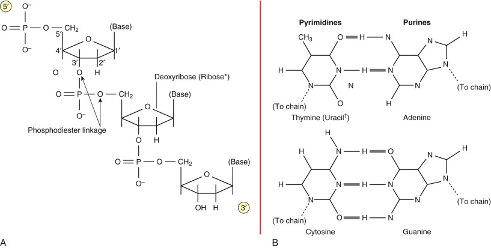

Figure 66-1 

Repeating backbone of DNA and complementary base pairs. 

**A,** A single-stranded DNA chain. Repeating nucleotide units are linked by phosphodiester bonds that join the 5′ carbon of one sugar to the 3′ carbon of the next. **B,** Purine and pyrimidine bases and the formation of complementary base pairs. Shaded bars indicate the formation of hydrogen bonds. *In RNA, the sugar is ribose, which has a 2′ hydroxyl added to deoxyribose.  † In RNA, thymine is replaced by uracil, which differs from thymine only in the lack of the methyl group. 

(Adapted from Piper MA, Unger ER: _Nucleic acid probes: A primer for pathologists_ , Chicago, 1989, ASCP Press, with permission.) 

DNA is an extraordinarily stable molecule, losing its normal conformational structure only at extremes of heat, pH, or in the presence of destabilizing agents. The double-stranded helix is the most energetically favorable state for DNA, and an examination of the components of DNA explains this fact. Both sugar and phosphate groups are hydrophilic, forming stable hydrogen bonds with surrounding water molecules in solution. Bases, however, are hydrophobic and are not soluble in water at neutral pH. A stable molecule of DNA must ensure that the bases do not contact water. This is possible when two antiparallel ssDNA polymers (one running in the 3′ to 5′ direction, and the other 5′ to 3′) twist around the same axis. This arrangement allows planar hydrogen bonds to form between adenine and thymine, and between guanine and cytosine (see [ Fig. 66-1, _B_ ](<#f0010>) ). As long as the two chains have base sequences in complementary order, the strands of the helix have a ladder-like structure with rungs (base pairs [bp]) of consistent size. The flexibility of the carbon-oxygen linkages in the phosphodiester bond allows the ladder to twist, forming a regular helix such that the planar base pairs are stacked on top of each other, leaving no room for water molecules in between. The polymeric series of base pair hydrogen bonds holds the ssDNA chains tightly together, and the helical conformation protects the base pairs from water, exposing only the hydrophilic backbones. 

Helical dsDNA is stable over a pH range of approximately 4 to 9. Solutions with pH outside these limits have the capacity to disrupt the base pair bonds and cause the DNA helix to denature or unwind into two separate, random coils. Extreme heat and hydrogen bond disrupters, such as formamide, also have the same effect. This helix-to-coil transition can be followed spectrophotometrically at A  260  ( [ Fig. 66-2 ](<#f0015>) ). The bases absorb ultraviolet (UV) light maximally at this wavelength but at a lower molar absorptivity in dsDNA; absorptivity increases 20% to 30% when dsDNA is converted to ssDNA. Because temperature is often used to effect this transition, the process has been referred to as _melting,_ and the temperature at which 50% of dsDNA is converted to ssDNA is called the _melting point_ or T  m  of the DNA. The T  m  of DNA molecules depends on the relative G-C versus A-T base pair content, because the three hydrogen bonds of G-C base pairs require more energy to disrupt than the two hydrogen bonds of A-T base pairs. Lowering the temperature can reverse the melting process, and the two complementary strands reform the original helix if the base pairs reform in the correct linear conformation. 

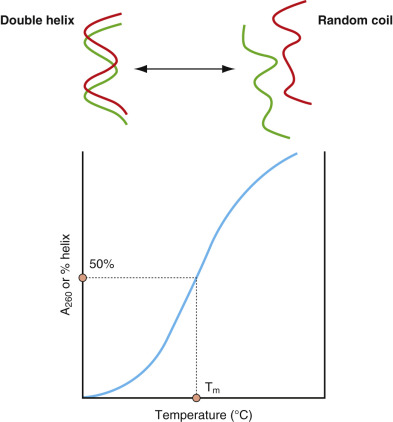

Figure 66-2 

Melting/annealing curve of double-stranded helical nucleic acid. 

(Adapted from Piper MA, Unger ER: Nucleic acid probes: _A primer for pathologists._ Chicago, 1989, ASCP Press, with permission.) 

The length of a fully extended eukaryotic DNA molecule would be about 3 m per genome, much longer than the cell itself. Undegraded purified DNA forms a stringy viscous solution, reflecting the extreme length of genomic DNA ( [ Fig. 66-3 ](<#f0020>) ). In vivo, however, DNA is organized into highly compacted, regular units called chromosomes. A chromosome is composed of its DNA strand wound around DNA-associated proteins in a highly structured fashion (chromatin). The chromosome structure involves several hierarchical levels of chromatin packing, from a “beads-on-a-string” nucleosome (146 nucleotide pairs wound around a histone core) to highly condensed loops, each containing about 100,000 bp of DNA. Each human cell nucleus contains two sets of 23 chromosomes of characteristic length and unique base pair sequence. Together these chromosomes constitute the _human genome._ The complete sequence of the 3 billion chemical base pairs that make up the human genome was finished in 2001 (The Human Genome Project is discussed in [ Chapter 78 ](<##!/content/3-s2.0-B9780323295680000784?scrollTo=%23c00078>) ). 

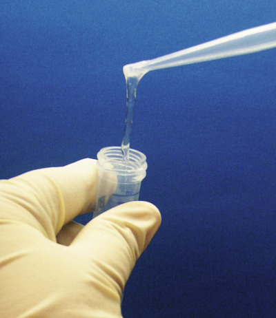

Figure 66-3 

Photograph of purified DNA demonstrating stringy viscous nature of minimally sheared genomic DNA. 

RNA differs from DNA in chemical composition, structure, and function ( [ Table 66-1 ](<#t0010>) ). In RNA the sugar is ribose, containing a hydroxyl group at the 2′ position, and thymine is replaced by the methylated uracil (U). RNA exists predominately as a single-stranded molecule and in much shorter lengths than DNA. The structure of RNA is more irregular, owing to the single-stranded nature of the molecule, but it may contain some helical sections and hairpin loops. RNA molecules of the same base sequence, however, will form the same three-dimensional structure as a result of adopting the most energetically favorable conformation. These consistent, three-dimensional structures are a requirement for RNA function. RNA is much less stable than DNA, due not only to the single-stranded structure but also to its susceptibility to alkaline hydrolysis via the 2′ hydroxyl group of the ribose moiety. Ubiquitous RNA-specific enzymes also rapidly degrade RNA. 

TABLE 66-1 

Comparison of Key Features of DNA and RNA 

Feature  |  DNA  |  RNA   
---|---|---  
Sugar  |  Deoxyribose  |  Ribose   
Base pairs  |  Thymine–adenine  |  Uracil–adenine   
|  Cytosine–guanine  |  Cytosine–guanine   
3D structure  |  Double-stranded  |  Single-stranded   
|  Alpha helix  |  Variable, determined by base sequence (see text)   
Stability  |  Stable  |  Subject to base hydrolysis   
|  Degraded by DNase  |  Degraded by RNase   
Function  |  Maintains genetic information in nucleus  |  Carries genetic information to cytoplasm   
  
 

##  Nucleic Acid–Associated Enzymes 

DNA must be duplicated prior to cell division so that daughter cells retain an exact copy of the genetic information contained in parent chromosomes. RNA must be synthesized by all functioning cells to direct the synthesis of necessary proteins. DNA must be degraded during repair of damaged segments, and RNA is continually degraded and resynthesized. Enzymes that operate directly on nucleic acids affect these and other functions. [ Table 66-2 ](<#t0015>) lists major categories of nucleic acid–specific enzymes and their in vivo functions. In vitro, purified enzymes have become laboratory _tools_ for the molecular biologist, allowing genetic engineering and facilitating many nucleic acid assays for research and clinical use. 

TABLE 66-2 

Nucleic Acid Enzymes and Associated Functions 

Enzyme  |  In vivo function   
---|---  
Polymerases   
DNA polymerases   
RNA polymerases  |  Polymerases join DNA or RNA nucleotides together to form a single-stranded daughter molecule, using a stretch of single-stranded parent molecule as a template. These enzymes perform syntheses according to base pair rules and proceed in the 5′ to 3′ direction.   
Reverse transcriptase  |  Mostly of viral origin, reverse transcriptase catalyzes the synthesis of DNA from either an RNA or DNA template.   
DNA ligases  |  Joins DNA fragments formed by discontinuous synthesis in DNA replication or by DNA repair pathways.   
Nucleases   
DNases, RNases  |  Nucleases “digest” nucleic acid molecules by breaking phosphodiester bonds.   
Endonucleases   
Exonucleases  |  Endonucleases digest nucleic acids from the middle of the molecule, whereas exonucleases begin at a free end and may require a 3′ or 5′ end. Nucleases may have single-stranded, double-stranded, DNA, or RNA specificity. Some polymerases also have nuclease activity.   
Restriction endonucleases  |  Bacterial endonucleases that recognize specific short DNA base pair sequences and cleave the DNA molecule only at the recognition site.   
  
Nucleic acid–specific enzymes include polymerases, which catalyze the formation of phosphodiester bonds during synthesis, and nucleases, which hydrolyze these bonds. RNA-specific nucleases (RNases) are present virtually everywhere. Because of this, it requires much greater care in laboratory practice to work with RNA in vitro than with DNA _._ Restriction endonucleases are a special category of nucleases found only in bacteria, where they function to destroy foreign DNA. The recognition sites for restriction enzymes are located anywhere within the DNA molecules, are sequence-specific, and can vary approximately 4 to 12 bp in length. At the recog­nition sequence or nearby, restriction endonucleases make specific asymmetric or blunt end cuts in DNA molecules ( [ Fig. 66-4 ](<#f0025>) ). More than 3000 restriction endonucleases have been discovered and categorized according to the structure of their corresponding sequence recognition sites (  Pingoud & Jeltsch, 2001  ). The in vivo function and in vitro utility of many of these enzymes are discussed in the following sections. 

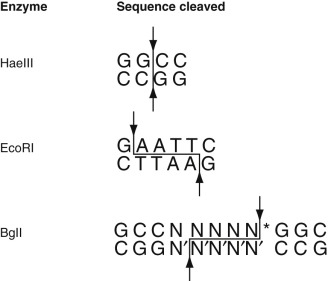

Figure 66-4 

Examples of DNA restriction enzymes and their specificities. 

Enzymes are named for the bacteria from which they are isolated. (*N is any base, and N′ is its pairing counterpart.) 

 

##  Replication of DNA 

The DNA duplication process, known as _semiconservative replication,_ uses each strand of the parent molecule to direct the synthesis of a daughter strand (  Virshup, 1990  ). Because the base sequence of the parent strand dictates the sequence of the daughter strand, replication is faithful and the replication products consist of two dsDNA molecules, composed of one parent strand and one daughter strand each, with exactly the same base pair sequence. Although this is conceptually simple, the process is complicated and involves a number of accessory proteins and enzymes. First, for synthesis to begin, a small single-stranded region must be produced at a point on the genome called an _origin_ . This is not energetically favorable and must be accomplished using proteins—that is, helicases—that unwind and separate the strands of the helix. Next, at each origin a short RNA primer is synthesized complementary to the single-stranded sequence. DNA polymerase III proceeds with DNA synthesis, and later the RNA primer is excised and replaced with DNA by DNA polymerase I. Chromosomal DNA contains many origins of replication, and this process occurs simultaneously across the chromosome. Interestingly, DNA polymerase III is a directional enzyme and can synthesize DNA only in the 5′ to 3′ direction because it requires a free 3′OH end. This means that only one daughter strand, called the _leading strand_ , can be synthesized continuously. The opposite strand, called the _lagging strand_ , is primed by RNA primase that does not require a free 3′OH end. It is synthesized discontinuously in short fragments (Okazaki fragments), each requiring an RNA primer, as the replication fork is opened up. These fragments are then joined together by DNA ligase after each primer is excised. DNA polymerase III is also unique in that it has _proofreading_ and exonuclease activity. If an incorrect nucleotide is added to the growing chain, it is detected and excised by the nuclease portion of the enzyme, and the correct nucleotide is then added. This helps explain the extraordinary fidelity of the DNA replication process. Postsynthesis repair mechanisms also contribute to the accuracy of replication (see later under [ Mechanisms of DNA Repair ](<#s0060>) ). Finally, telomerase adds DNA repeat sequences to the 3′ end of each chromosome (the telomere) to prevent shortening of the lagging strand with each replication cycle. 

 

##  Transcription of DNA to RNA 

Sections of DNA that specify amino acid sequences of proteins are called genes; one gene contains the amino acid sequence code for one protein, as well as the DNA sequences necessary for the regulation of the production of that protein. Within the 6 billion nucleotides of the human genome, there are about 20,000 to 25,000 protein-coding genes. Although these coding sequences are of paramount importance to the cell and to the function of the organism as a whole, they actually make up less than 2% of the nucleotides. The vast majority of the human genome is composed of noncoding DNA regions earlier referred to as _junk DNA_ . While much of the function of noncoding DNA remains unknown, diverse roles of biologic importance have been identified, such as regulation of gene expression, origins of replication, and coding of RNA (see later section on [ Gene Regulation Mediated by Small RNA ](<#s0050>) and  Cech & Steitz, 2014  ). 

Protein synthesis begins with the activation of the appropriate gene. A copy of the gene is made from DNA in the form of RNA. Because the RNA copy carries the code from the DNA in the cell nucleus to the cytoplasm where amino acid synthesis takes place, this type of RNA is called _messenger RNA_ (mRNA). Messenger RNA is synthesized from only one strand (coding strand) of the DNA gene; the complementary DNA strand is not used. This is accomplished by a process called _transcription._ DNA promoter sequences present near the start of the gene to be transcribed promote the ability of RNA polymerases and associated proteins to recognize the nucleotide at which mRNA synthesis initiation begins. Synthesis of mRNA proceeds in much the same fashion as DNA replication, with the ssDNA sequence dictating the mRNA sequence using the same rules of base pair complementarity (uracil base pairs with adenine). When the end of the gene is reached, mRNA synthesis is terminated. Some genes are always expressed, while others are only active in certain physiologic situations. The rate of transcription also varies in different cells (see section on [ Transcriptional Control ](<#s0045>) later). 

 

##  Posttranscriptional Modification 

Before export to the cytoplasm, the mRNA molecule is modified in several ways (  Rosenthal, 1994  ). Messenger RNA contains both amino acid coding sequences (exons) and noncoding sequences (introns); introns are excised from the mRNA molecule before protein synthesis. A molecular complex called a _spliceosome_ (  Sharp, 1988  ), which is composed of both low molecular weight RNA (including, at its catalytic core, a ribozyme; see  Fica et al, 2013  ) and protein, recognizes mRNA sequences that identify the boundaries of an intron, joins the flanking exons, and releases the intron. Splicing must be exact, because the addition or subtraction of a single nucleotide at the splice junction would change the 3-nucleotide reading frame in the nucleotide sequences that follow. 

Further modifications to the mRNA molecule include the addition of 7-methyl guanosine residues to the 5′ end in a unique 5′-5′ phosphodiester bond. This is called a _cap_ and aids in the binding of the ribosome to the mRNA molecule for initiation of protein synthesis. A poly-A _tail,_ which may be necessary for stability and transport to the cytoplasm, is added to the 3′ end. The polyadenylation locus is specified in part by the sequence AAUAAA usually found in the 3′ untranslated region of the RNA transcript. At this point, the mRNA molecule is ready to direct the synthesis of its corresponding protein. 

 

##  Translation of RNA to Protein 

Protein synthesis requires translation from the language of nucleotides to that of amino acids. Twenty-one different amino acids are used in protein synthesis; each amino acid is specified by one or more mRNA nucleotide triplets called _codons._ For example, AAG is the codon for lysine, and UCG is the triplet for serine. Thus an amino acid coding sequence is read in groups of three nucleotides running in the 5′ to 3′ direction; this is the _reading frame_ of a protein coding sequence. Three specific codons—UAG, UGA, or UAA—do not code for amino acids but instead signal the end of a gene ( _stop_ codons). Because an amino acid can be encoded by more than one codon, the code is referred to as a _degenerate code._

Translation from the mRNA nucleotide code to protein is mediated by ribosomes in the cytoplasm of the cell. A ribosome binds to the 5′ end of the mRNA and provides a stable chemical environment for all the molecules involved in protein synthesis. Amino acids are linked in the correct sequence by the action of small, adaptor RNA molecules called _transfer RNAs_ (tRNAs). Each tRNA molecule contains a region that is complementary to a particular mRNA codon: the _anticodon._ Linked to one end of the tRNA is the amino acid that corresponds to the complementary mRNA codon of the tRNA. A tRNA with the correct complementary anticodon binds to the first codon in the mRNA sequence, which is always AUG. When another specific tRNA binds to the next codon, ribosomal enzymes catalyze the formation of a peptide bond between the two amino acids linked to the tRNAs, removing the linkage between the first amino acid and its tRNA molecule. The first tRNA is ejected from the ribosome, and a new tRNA binds to the next codon. Protein synthesis proceeds from the N-terminus to the C-terminus. As this process continues, the ribosome moves along the mRNA molecule, completing the synthesis of the amino acid chain. When a stop codon is reached, the ribosome detaches from the mRNA. In reality, several ribosomes can move along the same mRNA molecule, each translating the mRNA code into a new protein molecule. 

 

##  Transcriptional Control 

To allow for cellular differentiation and response to environmental stimuli, there must be mechanisms controlling the repertoire of gene transcription and protein translation. Some of these mechanisms operate at the level of DNA and control the transcription of mRNA (  Rosenthal, 1994  ). As noted, promoters are important for the initiation of mRNA transcription and are found upstream (toward the 5′ end) at a relatively invariant distance from the beginning of the protein coding sequence. There are several different kinds of promoter consensus sequences (nucleotide sequences that are found in many examples). The most common promoters are rich in adenine and thymine and have been called _TATA boxes._ Because A-T base pair bonds are weaker than G-C base pair bonds, DNA unwinds more easily at repeat A-T sequences. After transcriptional activation, a local ssDNA region is produced and stabilized by the assembly of a complex of RNA polymerase and general transcription factors ( [ Fig. 66-5 ](<#f0030>) ). Messenger RNA is synthesized from the local region of ssDNA, and the mRNA is quickly ejected as the DNA returns to its more energetically favorable double-stranded helical state. 

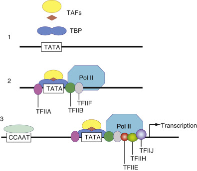

Figure 66-5 

Assembly of the polymerase II transcription initiation complex. 

( **1** ) The basal TFIID complex assembles as the TATA-box binding protein (TBP) and associated factors (TAFs) at the TATA box of the promoter region. ( **2** ) Additional transcription factors TFIIA and TFIIB are recruited to enable the polymerase II enzyme and TFIIF to bind. ( **3** ) The complex is stabilized with TFIIE, TFIIH, and TFIIJ. Typically, binding of additional factors to upstream enhancer sites like CCAAT or GGGCGG are required for effective RNA transcription. 

Enhancers are DNA sequences that can augment mRNA transcription and may be found in different locations relative to the gene that they affect. Gene-specific transcription factors are proteins that bind to enhancers and promoters and selectively stimulate or inhibit mRNA transcription (  Papavassiliou, 1995  ). In eukaryotes, enhancers commonly contain multiple binding sites for several transcription factors, so it is the net effect of factors binding to these DNA elements that determines the activation and rate of expression. The availability of transcription factors, in turn, is controlled by cellular events such as phosphorylation or by other proteins such as hormones and growth factors. A network of intracellular and extracellular chemical communications can thus select and control the synthesis of necessary proteins. 

Because mRNA is far less stable than DNA, the half-life of mRNA is very short. New mRNA molecules are continually transcribed from DNA. As the cell responds to changes in transcriptional signals, the genes that are transcribed into mRNA can be quickly changed, resulting in the immediate synthesis of new proteins. Thus the cell has the ability to rapidly adjust its protein output in response to its environment. 

 

##  Gene Regulation Mediated by Small RNA 

An additional mechanism of gene regulation by another class of RNAs—small RNAs—is recognized as important. Small RNAs are short, noncoding ribonucleotides that function as posttranscriptional regulators of gene expression. First discovered in the 1990s, they were found in cells of many eukaryotic organisms, including mammals (  Fire et al, 1998  ). The small RNAs are divided into several different subgroups, most notably small interfering RNA (siRNA) and micro RNA (miRNA). Recently next-generation sequencing has identified large numbers of noncoding RNAs of greater length (>200 nt). The function of these long noncoding RNAs (lncRNA) is an active area of research (  Cech & Steitz, 2014  ). 

The DNA sequences for siRNAs and miRNAs are often located in noncoding regions between genes. They generally have their own promoters, and transcription is mediated by polymerase II. The immediate product is an miRNA precursor that forms a double-stranded hairpin structure ( [ Fig. 66-6 ](<#f0035>) ). An enzyme called Dicer processes it to short RNA duplex molecules and further into single-stranded RNAs 22 to 26 nucleotides in length. The small RNA strand attaches to an RNA-induced silencing complex (RISC), which mediates binding to complementary sequences of mRNAs. siRNAs pair perfectly with the target mRNA and trigger a series of molecular mechanisms that lead to its degradation. This process is also called RNA interference (RNAi). miRNAs bind imperfectly to their target mRNA, causing conformational changes, bulging, and subsequent blockage of protein translation at the ribosome. Small RNAs are abundant in eukaryotic cells (several hundred), and it is thought that each one can target multiple mRNAs either as siRNA or miRNA. They are often tissue specific and have been implicated in the regulation of all major cellular processes such as proliferation, differentiation, metabolism, and cell death. siRNAs have also been recognized as a new RNA-based immune system against viruses that is based on silencing through the RNAi mechanism. Furthermore, changes in miRNA expression patterns can be found in many malignancies, and specific miRNAs were found abundantly in certain tumors (  Iorio & Croce, 2009  ). 

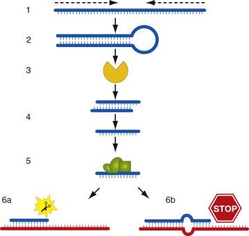

Figure 66-6 

Diagram of the RNAi pathway. 

( **1** ) Sense-antisense transcripts build a dsRNA with hairpin structure ( **2** ). This molecule is recognized by the Dicer complex ( **3** ) and processed into smaller fragments of 21 to 24 nucleotides ( **4** ). The RNA-induced silencing complex (RISC), a multi-protein complex, assembles with these molecules and unwinds them into single-strand oligos ( **5** ). Active RISC binds to target mRNAs with either perfect complementary sequence ( **6a** ), which initiates cleavage and degradation, or imperfect sequence match ( **6b** ), resulting in bulging, interference with translation, and subsequent silencing. 

 

##  Epigenetics and Gene Regulation 

_Epigenetics_ refers to changes in gene expression that are not dependent on changes in DNA sequences. In most instances, this involves a change in the chromatin structure that facilitates or blocks gene transcription. This is a dynamic process involving enzymes that chemically modify DNA or histone proteins. A methyl group added to the fifth carbon of cytosine results in 5-methyl cytosine. This generally occurs on cytosines located next to guanines (CpG) that are often repeated in islands or patches located in the promoter region. DNA methylation tends to result in condensed chromatin and reduced transcription. DNA methyltransferases are the enzymes responsible for DNA methylation. Chromatin proteins may be acetylated, deacetylated, or methylated. There is evidence that small regulatory RNA may directly interact with a variety of epigenetic mechanisms (  Moazed, 2009  ). Epigenetic changes are recognized to be important in tissue-specific gene transcription, and alterations may be factors in cancers, aging, and stress response. 

 

##  Mechanisms of DNA Repair 

Errors in DNA replication and damage to DNA during the normal cellular lifetime must be minimized to preserve the health of the entire organism. Several mechanisms operate to maintain the normal DNA sequence. First are the error-avoidance mechanisms that operate during DNA replication. The DNA polymerase that synthesizes new DNA polymers selects each successive nucleotide monomer based on its complementarity to the next nucleotide in the template strand. Fidelity at this level is high, and most errors in synthesis are avoided at this stage. Nevertheless, an occasional base may be incorrectly added to the growing strand. To adjust for this, the proofreading activity of the polymerase can recognize the error, remove the incorrect base, and proceed again with synthesis. Together, the error avoidance mechanisms reduce base pair mismatches to approximately 1 in 10 million (  Radman & Wagner, 1988  ). This represents a 100,000-fold increase in efficiency compared with the error rate of 1 in 160 bases for in vitro solid phase oligonucleotide synthesis. 

Despite the remarkable error avoidance in DNA replication, occasional mistakes do occur. In addition, DNA can be damaged by normal biochemical reactions and by nonphysiologic agents such as UV light and environmental carcinogens. Several repair mechanisms mend damaged DNA (  Yu et al, 1999  ) ( [ Table 66-3 ](<#t0020>) ). 

TABLE 66-3 

DNA Repair Pathways 

Direct repair  |  Repairs certain types of DNA damage in a single-step reaction.   
---|---  
Mismatch repair  |  Checks for errors made when DNA is replicated. Any mispaired bases in the daughter strand are removed and replaced with the correct match.   
Base excision repair  |  Repairs small, nonhelix-deforming adducts such as those produced by methylation, oxidation, reduction, or base fragmentation by ionizing radiation.   
Nucleotide excision repair  |  Removes bulky DNA adducts such as thymine dimers and certain photoproducts, as well as chemical adducts and cross-links.   
Double-strand break repair  |  Repairs double-strand breaks that result from physiologic processes or from ionizing radiation and oxidative insults.   
  
Direct repair mechanisms repair lesions in a single-step reaction. For example, O  6  -methylguanine DNA methyltransferase repairs alkylation lesions by transferring the alkyl group from the lesion to the active site of the enzyme. Other direct repair mechanisms characterized in _Escherichia coli_ may also exist in human cells (  Yu et al, 1999  ). 

Mismatch repair (MMR) functions immediately after DNA replication to replace mismatched bases with the correct ones (  Modrich, 1994  ). Several MMR proteins recognize the error in the newly synthesized daughter strand and excise a region that includes the mismatch. DNA polymerase III and ligase restore the correct sequence and integrity of the daughter strand. The importance of this mechanism in stabilizing the genome is evidenced by recent studies associating Lynch syndrome with defects in MMR proteins. 

Base excision repair targets small, nonhelix-deforming adducts such as those produced by methylation, oxidation, reduction, or base fragmentation by ionizing radiation. Base excision leaves three or four nucleotide sequence gaps that are then filled with the correct nucleotides; nicks are sealed with ligase. Larger, bulky adducts or dimers that distort the DNA helix may be caused by UV radiation, carcinogens, and therapeutic drugs, among other agents. Such damage is removed by the nucleotide excision repair (NER) pathway, which uses an enzyme system composed of many proteins to excise a single-stranded oligonucleotide containing the lesion (  Sancar, 1994  ). The gap is then filled in by DNA polymerase and ligated. There are two NER pathways: one in which lesions that block transcription are rapidly removed (transcription-coupled repair;  Hanawalt, 1994  ) and a global pathway that repairs bulk DNA, including the nontranscribed strand of active genes. Some of the possible consequences of the loss of NER activity are exemplified by the disease xeroderma pigmentosum (XP), which is caused by mutations in _NER._ XP results in extreme sensitivity to sunlight, with skin cancers occurring at an early age (  Weeda et al, 1998  ). 

Double-strand breaks that occur rarely or are produced by ionizing radiation and oxidative damage present significant repair problems. If unresolved, replication and transcription of involved sequences will be blocked. To maintain local and overall genomic integrity, double-stranded breaks are repaired by nonhomologous or allelic recombinational repair mechanisms. One of the genes associated with hereditary breast-ovarian cancer syndrome, BRCA1, encodes a protein involved in repairing double-strand breaks in DNA and illustrates the importance of this process. 

It is now clear that DNA repair plays a central role in the life of the cell. Recent evidence also indicates that several primary repair proteins also function in transcription and in regulation of the cell cycle. Thus the processes involving DNA appear to be highly integrated and are increasingly studied as a whole and in relation to human disease. 

 

##  DNA Mutations 

Despite extensive repair mechanisms, alterations in DNA base sequence (mutations) occur. Yet, for an individual organism, some mutations are clearly harmful and can be associated with cancer and with inherited genetic disease. Studies of these diseases have led to the characterization of the various types of mutations that occur in the human genome (  Weatherall, 1987  ). These can be conceptually grouped into a few major categories ( [ Table 66-4 ](<#t0025>) ). A point mutation is found in the β-globin gene in sickle cell anemia (  Kan, 1992  ). A thymine base replaces an adenine base, causing a critical change in the structure of hemoglobin. As described in [ Chapter 71 ](<##!/content/3-s2.0-B9780323295680000711?scrollTo=%23c00071>) , muscular dystrophy is caused by deletions in the gene for the muscle protein dystrophin. In the Becker form of the disease, the deletions do not disrupt the reading frame, but in most cases of the more severe Duchenne form, the reading frame is changed by the deletions, effectively abolishing the function of the protein (  Liechti-Gallati et al, 1989  ). 

TABLE 66-4 

Types of DNA Mutations and Examples of Associated Diseases 

Mutation  |  Description  |  Disease   
---|---|---  
Point  |  Single base pair substitution  |  Sickle cell anemia   
Deletion/insertion  |  Subtraction/addition of amino acid codons in multiples of three. Reading frame is retained.  |  Becker muscular dystrophy   
Deletion/insertion with frameshift  |  Subtraction/addition of amino acid codons in nonmultiples of three. Results in a shift of the reading frame and a completely different amino acid coding sequence from the mutation on.  |  Duchenne muscular dystrophy   
Amplification/trinucleotide repeat  |  Increase in the number of repeat sequences in microsatellite DNA. Results in disruption of gene expression.  |  Fragile X syndrome   
Translocation  |  Interchromosomal exchange of large chromosome segments. Results in analtered protein with altered function.  |  Chronic myelogenous leukemia   
  
Human DNA contains many short sequences of nucleotides (microsatellite DNA) that are sometimes grouped in tandem arrays and are repeated many times throughout the human genome. The number of tandem repeats at particular locations is a heritable trait. Some trinucleotide repeats have been found to increase in number in association with disease (  Sutherland & Richards, 1994  ). In fragile X syndrome (see [ Chapter 71 ](<##!/content/3-s2.0-B9780323295680000711?scrollTo=%23c00071>) ), expression of the disease is associated with amplification of the intragenic trinucleotide repeat sequence beyond a critical number of copies. The expansion of the trinucleotide repeats beyond this critical number disrupts expression of the gene. 

A translocation, which is an exchange of a larger amount of chromosomal material between different chromosomes, may create a fusion gene, the combination of two different genes abnormally joined at the translocation site. This can create not only an altered gene transcript but may also bring the product of one gene under the transcriptional control of the other. For example, as discussed at length in [ Chapter 75 ](<##!/content/3-s2.0-B9780323295680000759?scrollTo=%23c00075>) , the Philadelphia chromosome, found in most cases of chronic myelogenous leukemia, results from a reciprocal translocation between the _c-abl_ gene on chromosome 9 and a region termed the _breakpoint cluster region_ (bcr) on chromosome 22. The fusion gene produced by this chromosomal rearrangement, consisting of most of the _c-abl_ gene and a truncated bcr, codes for a c-abl protein that is larger than the normal product, has increased enzymatic activity, and is thought to interfere with signal transduction pathways normally involved in the control of cell death and proliferation. 

It is both the type of mutation and its location in relation to the gene that determine the ultimate effect on the protein product. Mutations may have no effect on protein expression or functional activity; many human proteins exist in detectable variants that have no disease association. Mutations occurring in intron regions presumably have no effect at all. Even small mutations, however, in regions that code for key functional domains (exons) may drastically alter or eliminate function. “Nonsense mutations,” mutations that change an amino acid codon to a stop codon, or vice versa, result in abnormally short or long protein products, respectively. _Missense mutations,_ those that change the code from one amino acid to another, may or may not alter protein function, depending on the change and the function of the amino acid. Similarly, mutations within sequences that denote intron-exon splice sites could eliminate exons or introduce introns into the transcribed mRNA. Mutations may also occur in regulatory sequences, such as promoters or enhancers, producing dramatic effects on the levels of transcription. 

,  

##  Nucleic Acid Analyses 

The unique biochemical properties of nucleic acids have been exploited to yield information about the biology or biochemistry of a system. While some of the assays, such as electrophoresis, are applicable to other biochemical building blocks such as proteins and lipids, the majority are particular to nucleic acids. The following sections briefly describe the principles of the basic categories of analyses used to characterize DNA and RNA: electrophoretic separations, hybridization assays, amplification techniques, sequencing, and polymorphism-based analyses. In practice, the categories are often combined to produce novel variations of the same theme—for example, a complete assay may involve amplification, electrophoresis, and hybridization. 

 

##  Electrophoretic Separation 

The repeating sugar-phosphate backbone of nucleic acids results in a net negative charge evenly distributed over these linear molecules. Therefore, DNA or RNA migrates toward the positive charge in response to an electric field. This property is used to characterize the size of nucleic acid fragments by electrophoretic separation. Samples are applied in separate wells at one end of a solid but porous separation medium. When an electric current is applied, the samples move toward the positive electrode in a linear fashion, each sample well forming one lane of migration. Comparison of the distance of migration of an unknown sample with that of a known standard allows size determination. 

Density and length of the gel, as well as the strength of the electric current, can be varied to achieve resolution for different DNA fragment sizes. Commercial electrophoresis systems offer standardized conditions to ensure reproducibility. Traditionally the gel was submerged in buffer, but current systems offer enclosed gel cassettes that do not require additional liquids ( [ Fig. 66-7 ](<#f0040>) ). The simplest approach to visualizing the bands separated by electrophoresis is by staining with intercalating dyes (e.g., ethidium bromide), which insert between stacked bases, and viewing with UV transillumination. Direct visualization requires that the band attain a significant concentration. Increased sensitivity may be achieved in some applications that label the nucleic acid fragments with a radioactive or fluorescent tag. 

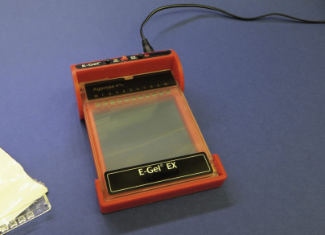

Figure 66-7 

Photograph of precast agarose gel requiring no additional buffer for electrophoresis of DNA. 

The limitations in required sample concentration and detection sensitivity of classical gel electrophoresis have been addressed by capillary systems. The gel matrix is enclosed in capillary tubing 25 to 100 µm in diameter, with the electric poles on the opposite sites. Samples of nucleic acids enter the capillary on the side of the cathode and are separated according to base size while traveling through the gel. A camera measures light absorbed by fragments passing the end of the tube. Automated systems generate a chromatogram visualizing size and relative concentration as peaks. Capillary electrophoresis is precise enough to detect single-base differences and has been used routinely for Sanger sequencing (see [ DNA Sequencing ](<#s0155>) later in this chapter). 

A further advancement of this principle is the integration of the capillaries on a small cassette or chip. DNA or RNA molecules can be loaded into designated wells on the surface and are driven through polymer-filled micro-channels inside the chip, once the electrical circuits are closed inside an instrument (for example, Bioanalyzer). Nucleic acids are measured and recorded as chromatograph or electrograph (electronic image showing fragment size and separation speed). The system also measures purity and degradation by absorption of 260 and 280 nm wavelengths, providing several parameters of the quantity and quality of nucleic acids samples. 

Electrophoretic resolution of high molecular weight genomic DNA requires controlled reduction in size through digestion with restriction enzymes. Restriction enzymes with a relatively simple recognition sequence produce fragments less than 50 kilobase pairs (kb) in length. Extremely large DNA fragments, measured in megabase pairs, are produced from digestion with enzymes with a complex recognition sequence and must be separated in special electrophoretic systems utilizing a pulsed electrical field. Most applications of DNA electrophoresis utilize nondenaturing conditions (i.e., the fragments resolved into bands are double-stranded). By contrast, most RNA separations utilize denaturing conditions (either formamide or glyoxal) to eliminate secondary structure of the single-stranded molecules. RNA molecules, as transcripts of DNA, are “presized” and relatively small, so no digestion is required before electrophoresis. 

 

##  Nucleic Acid Hybridization 

Hybridization is a fundamental concept in nucleic acid biochemistry; it is defined as the interaction between two single-stranded nucleic acid molecules to form a duplex (double-stranded) molecule based on the complementary base pairing of their respective sequences. Hybridization is a direct consequence of the stable double-stranded structure of DNA under physiologic conditions. As discussed earlier, the helix is formed of two antiparallel strands of DNA held together by the combined strength of many specific hydrogen bonds between complementary base pairs, as well as by hydrophobic shielding of bases from an aqueous environment. Central to the hybridization reaction is the fact that the binding between separate, complementary molecules (strands) is both reversible and base sequence–specific. 

When neither DNA strand is labeled, the process of reforming the stable double-stranded structure is referred to as _annealing._ If one strand is labeled (i.e., has a marker that is capable of being detected in some fashion), the labeled strand is referred to as a _probe,_ and the process is called _hybridization_ because a hybrid molecule is formed between a labeled and unlabeled strand. RNA molecules can also participate in the hybridization process. Base pairing may occur between complementary strands of DNA, between DNA and RNA, and between complementary strands of RNA, resulting in DNA-DNA, DNA-RNA, and RNA-RNA duplex structures. Duplex molecules with exact complementarity in base sequence form the most stable structures, but structures with varying degrees of base pair mismatch may form, depending on the conditions. The relative instability of these mismatched duplexes is reflected in the lowered temperature of their disassociation (lower T  m  ; see [ Fig. 66-2 ](<#f0015>) ). 

Environmental conditions can be manipulated to control the degree of base pair mismatching that will be tolerated in a duplex structure (i.e., the _stringency_ of the sequence match) ( [ Fig. 66-8 ](<#f0045>) ). Low stringency refers to conditions such as high salt, low temperature, and no formamide, which favor shielding of hydrophobic bases from the aqueous environment even without perfect alignment; the match need not be perfect. High stringency conditions—high temperature (close to T  m  ), low salt, and high formamide—will only allow the most perfectly matched duplex structures to remain in a stable helix conformation. 

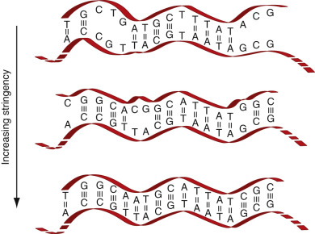

Figure 66-8 

Illustration of stringency. 

As the stringency of the hybridization solution is increased, fewer mismatches are tolerated in a hybrid duplex. At very high stringency, even a single base pair mismatch disrupts the duplex. 

 

##  Hybridization Assays: Basic Components 

When the hybridization reaction is used to analyze the nucleic acid content of an unknown sample, the process is known as a _hybridization assay._ Hybridization assays include a wide variety of formats (see Hybridization Assay Formats) such as Southern blots, northern blots, in situ hybridization (FISH if fluorescence is used for detection), linear arrays, and microarrays (“DNA chips”). The property of complementary base pairing allows fragments of known composition (the probe) to interrogate an unknown for the presence of matching (complementary) sequences. All hybridization assays, therefore, require several basic elements: a probe, a sample, controlled conditions permissive to the desired degree of complementary base pairing, and a method for detection of specific probe-sample hybrids. Each of these elements is discussed below, as well as the variations in formats that have been developed to allow hybridization assays to be performed and interpreted. 

 

##  Probe 

The probe, a well-characterized fragment of nucleic acid, is central to a hybridization assay because it determines the specificity of the hybridization reaction. In most assay formats, the probe carries the reporter group for detection of hybridized molecules into the reaction. Reporter groups may be radioactive or nonradioactive (i.e., affinity label). 

Many probes are produced through recombinant nucleic acid technology, as illustrated in [ Figure 66-9 ](<#f0050>) . Plasmids—short, circular, double-stranded segments of DNA—are harnessed as vectors to propagate desired sequences in bacteria. The segment of interest is introduced into the plasmid using restriction enzyme digestion and ligation, resulting in a new “recombined” molecule that retains the ability to be propagated in bacteria and includes the DNA sequence of interest. Bacteria containing the recombinant plasmid can be grown in culture, and the small circular plasmids can be easily separated from the bacterial genome on the basis of size. Many identical copies are obtained; thus the DNA is often referred to as _cloned._ Purified plasmid may be used as a probe in assays where vector sequences do not interfere with the specificity of the reaction. In many applications, the inserted DNA sequence is separated from the vector sequence by digesting the isolated plasmid with the same restriction enzyme originally used in construction of the recombinant molecule. The probe resulting from either of these approaches is a double-stranded DNA molecule. Double-stranded probes must be denatured prior to use, and probe reannealing limits the extent of hybridization of the probe with the target. Plasmid vector that does not contain cloned DNA is a commonly used negative control for this type of probe. 

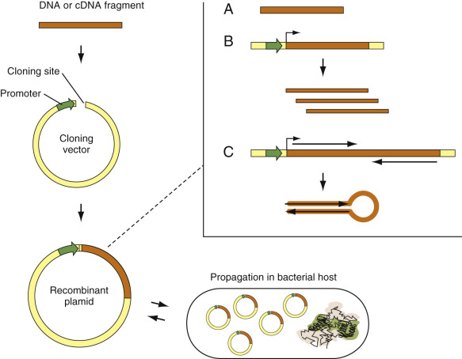

Figure 66-9 

Production of cloned DNA or RNA. 

A DNA fragment or RNA that was converted into cDNA can be inserted into a cloning vector. The recombinant plasmid is transformed into a bacterial host, where it is rapidly propagated to millions of copies. The multiplied DNA fragment can either be isolated by excision through restriction enzymes that recognize sequences at the borders of the insert ( **A** ) or can be used to initiate RNA in vitro transcription with a promoter sequence in the plasmid ( **B** ). Such systems are also used to produce double-stranded RNA by cloning two complementary sequences in sense and antisense direction, typically with a spacer that forms a stabilizing loop in the dsRNA fragment ( **C** ). 

Plasmid vectors have been constructed to include RNA promoter regions adjacent to the inserted DNA sequence. These recombinant plasmids are used to produce RNA transcripts of the DNA insert. The result is a single-stranded RNA probe that will not undergo self-hybridization. Controlling the orientation of the DNA insert with respect to the RNA promoter allows production of transcripts in the _sense_ (same as mRNA) or _antisense_ (complementary to mRNA) direction. In many applications, the sense transcripts form ideal negative control probes for hybridization reactions with antisense probes. Nonspecifically bound RNA probes (i.e., RNA not in a stable duplex structure) can be removed with the use of RNase specific for single-stranded RNA. The lability of RNA requires that the probes be handled with extreme care to prevent degradation (sterile technique, treated water, and glassware). 

Recombinant probes, whether DNA or RNA, are genetically complex—that is, they may include many kilobases of genetic information. By contrast, probes produced by synthetic methods are relatively short segments of DNA. Oligonucleotide probes produced by automated chemical reactions are usually 15 to 45 bases in length, synthesized to produce a specified base sequence. Probes with very high specificity of hybridization can be designed on the basis of sequence information available in data banks. They can be generated in a sense or antisense direction at a relatively low cost. These short probes are single-stranded, diffuse into target, and hybridize rapidly because of their small size, and they are extremely sensitive to even single–base pair mismatches. The final sensitivity achieved with oligonucleotide probes is lower than that achieved with recombinant probes because of their limited genetic complexity. Multiple oligonucleotide probes directed to different areas of the same target have in some instances been used to increase the sensitivity by increasing the representation of the target sequence in the probe mixture. This approach is analogous to the use of a blend of monoclonal antibodies that react to different epitopes of the same complex antigen. 

Probes longer than those obtained by direct chemical synthesis may be generated with the polymerase chain reaction or other amplification technology (see later and [ Chapter 67 ](<##!/content/3-s2.0-B978032329568000067X?scrollTo=%23c00067>) ). These probes may be single-stranded or double-stranded, depending on the conditions employed, and may be as long as the product of the amplification reaction—in most cases, 100 bp to 1 kb in length. 

 

##  Sample 

Whereas probe selection and preparation are central to determining the sensitivity and specificity of the hybridization assay, the contribution of sample preparation to a successful assay cannot be overlooked. In clinical applications, samples of interest may be quite diverse. For example, a microbiology laboratory could anticipate testing specimens of blood, urine, stool, and sputum. Integrity of RNA targets may be difficult to maintain under such conditions, and even DNA may be degraded with improper handling. The goal of sample preparation is to maintain nucleic acid integrity and make the target genetic information available for interaction with the probe. For some applications, the requirement of target integrity will dictate immediate snap freezing or addition of lysis buffers containing potent RNase and DNase inhibitors. In other applications, more routine methods of sample collection will allow adequate target preservation. 

The physical and chemical similarities of nucleic acids, regardless of source, allows for uniform methods of extraction and purification. For many assays it is preferable to extensively purify DNA or RNA to remove inhibitors of enzymes to be added to the assay (e.g., a restriction enzyme or polymerase) and to maximize accessibility of the target to the probe. Complete purification schemes, however, are time-consuming and require a relatively large amount of starting sample. In many applications, relatively abbreviated sample purifications can be used. Purifications commonly use cell lysis (mechanical, chemical, or both), protease treatment, and organic or inorganic extractions. Automated methods standardize and streamline sample extraction. 

 

##  Controlled Conditions Permissive for Complementary Base Pairing 

The sensitivity and specificity of the hybridization reaction are greatly influenced by the physical-chemical environment during the reaction and subsequent detection/collection of hybrid molecules. In practice, the hybridization cocktail is the medium used to control the environment of the hybridization reaction. Empirically designed, the _hybridization cocktail_ is a mixture of reagents selected to favor interaction of nucleic acids through sequence-specific hydrogen bonds rather than via charge. The components vary widely but include buffers, salts, denaturants such as formamide, high molecular weight polymers, carrier DNA or RNA, and various components added to reduce background (such as detergents, bovine serum albumin, Ficoll). Such a complex mixture is conveniently referred to as a _cocktail._ The ionic strength of both the hybridization cocktail and the subsequent washes is most often modulated by the concentration of a _s_ aline _s_ odium _c_ itrate buffer (SSC), composed of 0.15 mol/L sodium chloride, 0.015 mol/L trisodium citrate, pH 7.0. The shorthand notation for these conditions refers to the strength of SSC—that is, 2 × SSC, 0.1 × SSC. The final stringency of the hybridization reaction is controlled by the formamide and salt concentration of the hybridization cocktail, the temperature of the hybridization reaction, and the temperature and salt concentration of the washing steps. 

 

##  Detection of Hybrids 

A wide variety of techniques have been applied to collection and analysis of specific nucleic acid hybrids, discussed briefly later under Hybridization Assay Formats. Once specific hybrids have been collected, methods of detection are obviously linked to methods of labeling. The first methods used radioactive labels such as phosphorus-32 (  32  P), iodine-125 (  125  I), sulfur-35 (  35  S), carbon-14 (  14  C), and tritium (  3  H) that were detected through autoradiography or scintillation counting. Because radioactive probes are unstable due to their relatively short half-life, are hazardous to laboratory personnel, and generate expensive waste disposal problems, they have been replaced by nonradioactive methods. Nonisotopically labeled probes are stable reagents, greatly facilitating the commercial production and standardization that are crucial for assay reproducibility. 

Nonisotopic labeling and detection methods for nucleic acids have many similarities to immunochemical assays developed for nonisotopic protein detection. In some applications, nucleic acids are directly linked to a signal-generating compound, usually a fluorochrome but occasionally an enzyme. This situation is analogous to immunoassays in which the primary antibody is labeled. More commonly, nucleic acids are indirectly detected in a multistep assay similar in concept to an indirect antibody reaction. Biotin, a commonly used affinity label for immunoassays, was the first affinity label introduced into nucleic acids (  Langer et al, 1981  ). Many other functional groups have been developed as nonisotopic labels such as bromodeoxyuridine, digoxigenin, and sulfone. Detection is achieved with high-affinity antibodies directed against the functional group or, in the case of biotin, with avidin or streptavidin. The antibody or avidin/streptavidin is linked to a signal-generating enzyme or fluorochrome, functioning like a labeled secondary antibody in an immunohistochemistry reaction. Because affinity labels are detected with large bulky proteins, availability of the label to the detection reagent is a crucial factor in determination of sensitivity. Increasing the number of affinity tags will not necessarily increase the number of detecting molecules that will be bound to the nucleic acid. In addition, because affinity labels are themselves bulky, overincorporation into the nucleic acid molecule can lead to steric hindrance of the hybridization reaction. For these reasons, the specific activity of the affinity label does not directly control the sensitivity of the detection. 

One advantage of the indirect detection of affinity labels is that a variety of detection methods can be used for the same label ( [ Fig. 66-10 ](<#f0055>) ). For example, the affinity label biotin may be detected by binding to avidin linked to an enzyme with subsequent color or chemiluminescent detection, or avidin with a fluorescent tag or a labeled antibiotin antibody. For all nonradioactive methods, the detection portion of the assay is crucial in obtaining optimal sensitivity. Detection reagents with poor background and suboptimal signal generation can mar an effective hybridization reaction. The choice of the enzyme labels (peroxidase vs. alkaline phosphatase), enzyme substrate (colorimetric vs. chemiluminescent), and even source of reagents are critical for optimal results. 

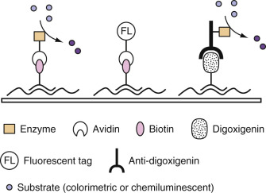

Figure 66-10 

Examples of affinity-labeled probe detection systems. 

(From Unger ER, Piper MA: Nucleic acid biochemistry and diagnostic applications. In Burtis CA, Ashwood ER, editors: _Tietz textbook of clinical chemistry_ , ed 2. Philadelphia, 1994, WB Saunders, with permission.) 

 

##  Hybridization Assay Formats 

A wide variety of hybridization assay formats have been developed, each designed to solve the methodologic problems of the hybridization assay: conditions permitting specific complementary base pairing, a method to detect hybrids, and interpretation of the result. Each method has particular strengths and weaknesses, and the clinical setting and particular diagnostic question dictate selection of format. There is no one perfect assay. Several of the basic formats are briefly described herein, along with their particular strengths and weaknesses. 

Each hybridization assay requires both positive and negative controls for validation. A positive sample control is one known to contain sequences complementary to the probe. This is used to establish that sample preparation is adequate to release the target for the hybridization assay and to ensure that the probe will hybridize with the specific target under the assay conditions. The sample control may also be used to monitor the sensitivity of the assay if the positive control is chosen near the lower limits of detection. A negative sample control (i.e., one known not to contain sequences complementary to the probe) is used to monitor specificity of the probe target interactions. Controls for the probe include vector sequences or unrelated probes labeled, hybridized, and detected under identical assay conditions. These latter controls allow monitoring of the background signal generated by localization of the probe through nonhybridized interactions, such as charge or trapping. In clinical practice, additional controls may be employed to monitor each step of the hybridization assay. 

 

##  Liquid or Solution Phase Hybridization 

In liquid hybridization assays, both the sample and the probe interact in solution, which maximizes the kinetics of the reaction. The sample nucleic acids are generally purified from contaminating proteins and lipids, which could interfere with the collection of hybrids at the end of the assay, and some sample degradation is tolerated by the assay. The sample is denatured and randomly sheared before addition of a single-stranded probe lacking the ability to self-hybridize. 

Hybridization may be detected by the specific binding of hybrids to a solid matrix such as hydroxyapatite, which binds only duplex structures. Once hybrids are bound, unhybridized probe may be efficiently removed by washing. Detection of the label on the bound probe permits quantitation of the hybridization reaction. In a variation of this approach, one commercial assay (Digene Hybrid-Capture, Qiagen USA, Valencia, Calif.) uses an antibody specific for RNA-DNA hybrids to specifically bind duplex structures formed of the DNA target and RNA probe. An alternative analysis involves digestion of the hybridization reaction mixture with S1 nuclease, an enzyme that acts only on single-stranded nucleic acid. Duplex structures resistant to digestion may then be precipitated by treatment with trichloroacetic acid. In the hybridization protection assay, label on the probe is protected from chemical degradation only when the probe is involved in a duplex structure. 

Optimal kinetics, toleration for abbreviated purification steps, and some sample degradation make the assay adaptable for clinical application. Quantitation of the reaction product may be achieved, depending on the detection system. The solution phase format does not permit identification of the size of the hybridizing product. Low positive reactions are difficult to interpret because low levels of specific target and high levels of weakly cross-reacting target will yield similar results. Solution phase hybridization is adaptable to the 96-well format with an enzyme-linked immunosorbent assay–type readout, and increasing automation and miniaturization of the assay using microfluidic devices can be anticipated. 

 

##  Solid-Support Hybridization 

Variations of the solid-support hybridization assays include dot or linear array hybridization, Southern and northern hybridization, microarray hybridizations (“DNA chips” or “bead arrays”), and in situ hybridization. In these assays, the hybridization occurs in a biphasic environment—a solid phase (usually sample) and a liquid phase (usually probe). The kinetics of hybridization to a nucleic acid bound to a solid support is greatly slowed, and the extent of the hybridization reaction is limited. These disadvantages are often outweighed by the convenience of having a solid medium to carry through multiple steps of the assay. 

 

##  Dot or Linear Array Hybridization 

In this assay format, multiple samples are immobilized in a geometric array on a nitrocellulose or nylon membrane. The name of the assay comes from the shape of each sample on the membrane. The solid matrix allows multiple samples to be processed through all steps of the assay simultaneously. The fact that all samples and controls are exposed to exactly the same reagents and conditions increases the standardization of the assay. 

The extent of sample preparation varies from complete purification of nucleic acids before application to the filter, to direct application of unpurified sample. Some degree of sample degradation is tolerated by the assay. Purified nucleic acids have the advantage of being most available for interaction with the probe and having the least problems with background. Individual sample purification, however, is time-consuming and labor intensive. Applications using direct application of unpurified sample take the entire array through an abbreviated purification procedure, which usually involves lysis and denaturation, protein digestion, and washing with detergent. The advantages of this approach are that it is applicable to small amounts of starting material and minimizes sample preparation time. However, the final sensitivity of the reaction is lower, and background from nonspecific probe interactions can make the assay unreliable. 

Interpretation of the results of a dot/blot hybridization assay is relatively straightforward. If hybridization has occurred, a signal is generated in the specified spot. Depending on the label used for signal generation, results may be quantitated; however, usually a simple yes/no interpretation is given (i.e., the sample has more or less signal than adjacent samples and known positive and negative controls). Weak signals, which may result from a very small amount of specific target or from a large amount of weakly cross-reacting target, may cause problems in interpretation. No information is available about the size of the hybridizing fragments. 

The reverse line blot assay is an important variation where the sample is tested with many different probes. In this format the sample carries the label into the assay and the unlabeled probes, or targets, are fixed to the solid support in a linear or matrix array. Areas of specific hybrid formation are identified and interpreted as in the standard dot assay. This assay format is a convenient means of identifying the product of an amplification assay (see later in this chapter and also [ Chapter 67 ](<##!/content/3-s2.0-B978032329568000067X?scrollTo=%23c00067>) ), such as in human leucocyte antigen analysis (  Bugawan et al, 1994  ) or human papillomavirus typing (  Gravitt et al, 1998  ). 

 

##  Southern and Northern Hybridizations 

Both Southern and northern hybridizations combine electrophoretic separation of test nucleic acid with transfer to a solid support and subsequent hybridization. These assays, therefore, not only give information about the presence of hybridization but also permit determination of the molecular weight of the hybridizing species. 

The original procedure was termed _Southern blot hybridization_ or _Southern blotting_ , after its inventor, E. M. Southern (  Southern, 1975  ). In this assay, the sample is DNA. Northern blotting was named by analogy for the technique using RNA samples. Sample preparation is time-consuming and labor intensive for both of these techniques. Degradation of sample nucleic acids is not tolerated by the assays, and a relatively large amount of starting material is required. For Southern hybridizations, the DNA must be purified with minimal shearing. This is because sizing of the DNA fragments is achieved through digestion with one or more restriction enzymes. Shearing and degradation introduce random breaks in the sample, reducing the quantity available to be specifically cut at appropriate restriction enzyme recognition sequences. Impurities in the sample may interfere with the activity and sequence specificity of the restriction enzyme. Partially or improperly digested samples can produce spurious band sizes or result in such a reduced concentration of the specific band that it is no longer detected during hybridization. For northern hybridizations, the starting material is RNA, and extreme care must be taken to avoid degradation during sample collection and preparation because of the ubiquitous nature of RNases. RNA is composed of fragment sizes determined by transcription and processing of message and ribosomal RNA. It is not digested before electrophoresis but is separated under denaturing conditions to remove secondary structure. 

The size-separated fragments in the agarose gel are then transferred to a nylon or nitrocellulose filter. As originally designed, the transfer occurred passively through capillary action, but vacuum or pressure can be used to speed the transfer. After transfer, baking or UV cross-linking immobilizes the nucleic acids, and the entire membrane is hybridized with a labeled probe, followed by detection to identify bands containing sequences complementary to the probe. Interpretation involves both detection and determination of the molecular weight of the hybridizing molecule. These technically demanding assays require several days to perform but were used in clinical laboratories before amplification methods were refined sufficiently to replace them. 

 

##  Microarray Hybridization (“DNA Chip Technology” or “Bead Arrays”) 

Microarray hybridizations can be thought of as a variation of the dot blot format, in which the dotted material is arranged in a regular gridlike pattern, with each feature reduced to a very small size so that hundreds to thousands of features can be placed on one solid surface, currently most often a glass microscope slide. By convention in these applications, the sample is labeled and the arrayed features are referred to as _probes_ . Microarrays allow genome-wide transcription profiling or sequence determination in a single experiment. Probes can also be bound to microbeads coded by embedded fluorescence and detected with flow techniques, similar to bead-based immunoassays. The technique and applications are described in greater detail in [ Chapter 67 ](<##!/content/3-s2.0-B978032329568000067X?scrollTo=%23c00067>) . 

 

##  In Situ Hybridization 

In situ hybridization is simply detection of specific genetic information within a morphologic context. This specialized type of solid-support assay involves taking morphologically intact tissue, cells, or chromosomes affixed to a glass microscope slide through the hybridization process. Autoradiographic, colorimetric, and fluorescent methods of detection have been applied. Evaluation of the final product is very analogous to evaluation of immunohistochemistry and requires experience in histopathology. The strength of the method lies in linking microscopic morphologic evaluation with detection of hybridization. 

The method also has applications in cytogenetic analysis of metaphase chromosome spreads or of interphase nuclei (see [ Chapter 68 ](<##!/content/3-s2.0-B9780323295680000681?scrollTo=%23c00068>) ). In this context, the detection is usually fluorescent, and the technique is referred to as FISH. Detecting numerical aberrations or translocations of chromosomal regions can be achieved rapidly using probes for specific targets. FISH avoids some of the difficulties of conventional cytogenetics and may have greater sensitivity for some targets. Although FISH cannot completely replace karyotyping, it can complement and reduce the need for the frequency of cytogenetic analysis. Newer variations of FISH (  Luke & Shepelsky, 1998  ) are exploiting the possibilities of automation (fast-FISH) and expanding the information that can be obtained in a single assay. FICTION ( _f_ luorescence _i_ mmunophenotyping and interphase _c_ ytogenetics as a _t_ ool for _i_ nvestigation _o_ f _n_ eoplasms) combines immunophenotyping with FISH; fiber FISH makes it possible to simultaneously detect and map chromosomal break points. In situ hybridization can be very labor intensive and tedious. Recent improvements resulting in automated processing of slides through the assay hold much promise for more widespread adoption of this technique. 

 

##  Amplification Methods 

It is virtually impossible to read any medical journal without encountering at least one application of polymerase chain reaction (PCR) technology. The PCR has forever changed the scope of research questions that can be addressed by virtually eliminating the problem of limited sample size. The importance and elegance of the concept has been recognized through awarding of the Nobel Prize in Chemistry to its inventor, Kary Mullis, less than 10 years after publication of the first practical application of PCR (  Saiki et al, 1985  ). There are now other methodologies that result in multiplication of target, probe, or signal. These may be grouped together as amplification technologies and are described in [ Chapter 67 ](<##!/content/3-s2.0-B978032329568000067X?scrollTo=%23c00067>) . 

 

##  Polymorphism Detection Assays 

Although greater than 99% of the human genome is identical in all individuals, there are still millions of regions in which there is some variability in DNA sequence among individuals. While most polymorphisms have no recognized functional consequence, changes in promoter or enhancer regions may result in altered transcription regulation, cause variation in the mRNA splice products if present in intron-exon junctions, or produce altered amino acid sequences if an exon is affected. The serotonin transporter gene, for instance, exists in two alternative allelic variants characterized by a 44-bp insertion/deletion polymorphism in the promoter region. This polymorphism has been associated with major depressive disorders, and the two allelic versions can be distinguished by PCR amplification of the relevant DNA region, resulting in two different-sized products ( [ Fig. 66-11 ](<#f0060>) ). Most of the variations occur in the form of an individual base change known as single nucleotide polymorphisms (SNPs). An example would be the alteration of a DNA fragment ACGT to ACTT by replacement of the third base from a guanine to a thymine. Two unrelated individuals will have approximately 3 million SNPs that differ between them. 

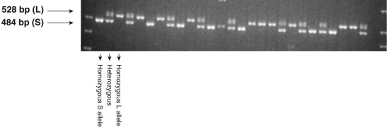

Figure 66-11 

Example of polymorphism analysis by gel electrophoresis (allelic typing of the serotonin transporter gene [5-HTTLPR]). 

A polymorphism consisting of a 44-bp insertion/deletion polymorphism in the 5′ regulatory region is suggested to be associated with major depressive disorder. The presence of the two different alleles can be screened using PCR primers upstream and downstream of the site, producing fragments of distinct length. The amplicons are then separated by gel electrophoresis and stained with ethidium bromide. An individual is either homozygous for the long version (L allele = upper band), heterozygous with both alleles (two bands), or homozygous for the short version (S allele = lower band). _PCR,_ Polymerase chain reaction. 

(Photo courtesy Drs. I. Dimulescu and M. Rajeevan.) 

Because of the tremendous potential of polymorphism assays to predict inheritance of altered alleles, and changes that predict drug interactions (see [ Chapter 73 ](<##!/content/3-s2.0-B9780323295680000735?scrollTo=%23c00073>) ), considerable effort has been made in recent years to improve the speed, precision, and cost effectiveness of these methods. The completion of the Human Genome Project in 2001 provided a reference against which all other sequencing data can be compared. Researchers are also systematically screening the genome to discover new SNPs. High-throughput SNP analysis methods have been developed that simultaneously scan thousands of SNPs in thousands of samples. Comprehensive mapping of an individual's SNP pattern is also termed _genotyping_ . Genotyping is somewhat easier, in that one form of the known gene sequence (allele) can be compared with an alternative form at a specific predetermined site. Currently there are a wide variety of approaches for allelic discrimination that typically use a combination of molecular techniques. For more information, see  Chen and Sullivan (2003)  . 

 

##  DNA Sequencing 

The first methods for directly determining the base sequence of DNA became available in the 1970s. Until recently, almost all sequencing was based on the Sanger method, which utilizes enzymatic incorporation of chain terminating di-deoxynucleotides ( [ Fig. 66-12 ](<#f0065>) ). Originally prohibitively time-consuming and expensive for diagnostic applications, automation and miniaturization have resulted in instrumentation capable of more rapidly and less expensively sequencing segments of DNA. Sequencing the first human genome was completed by the Human Genome Project in 2001 using the Sanger method. 

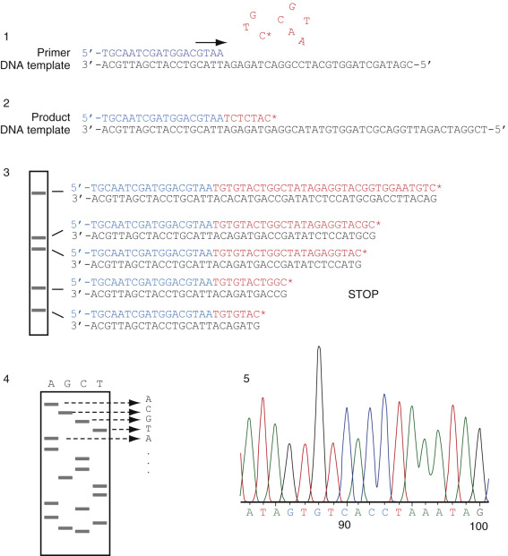

Figure 66-12 

Principle of the Sanger DNA sequencing method. 

  * 1.

A short primer (in blue) is annealed to a known sequence in the DNA template. In the presence of the four “usual” deoxynucleotides (dATP, dCTP, dGTP, dTTP) and an additional di-deoxynucleotide at a low concentration, here ddCTP (marked with an asterisk), DNA polymerase initiates synthesis. 

  * 2.

When ddCTP is incorporated, further polymerization cannot occur because it lacks the 3′-OH group required to accommodate another nucleotide (see [ Fig. 66-1 ](<#f0010>) ) and the chain is terminated. 

  * 3.

Random incorporation of ddCTP generates a series of DNA strands of different sizes, all ending at “C.” These products start with the same primer sequence and are sized by electrophoresis to determine the position of each “C.”

  * 4.

Dividing the reaction into four tubes, each with a different dideoxynucleotide, and electrophoresing all four reactions in parallel allow the complete sequence to be read from the order of the bands in each of the ladders of each lane. 

  * 5.

Most current applications use fluorescently tagged ddNTPs, each with a different-color dye. With this approach, the reaction is in a single tube and products are separated in a single lane. A laser is used to record the wavelength and order of the bands. 

The rapidly evolving field of “next-generation” sequencing (NGS) has produced a variety of different platforms and sequencing chemistries that allow extremely high-throughput sequencing based on massively parallel sequencing in flow cells (  Voelkerding et al, 2009  ; see [ Chapter 78 ](<##!/content/3-s2.0-B9780323295680000784?scrollTo=%23c00078>) ). Consequently, NGS technology has revolutionized genomic research through increased throughput and decreased costs. It is now becoming possible to sequence an entire genome at a turnaround time acceptable for clinical applications. Currently the diagnostic clinical utility of a complete human genome sequence is still being evaluated, but the knowledge of genetic and genomic sequence alterations has great potential to impact clinical pathology. Direct sequencing is being used to determine viral types (e.g., human papillomavirus), bacteria, and other pathogens. The greatest advances are made in cancer oncology to identify key mutations in oncology (e.g., BRCA1 and BRCA2), to define the causes of inherited diseases, or to use genome-wide mutation profiles for individualized medicine, care, and treatment. Further explorations of how to use an individual's genome for clinical management are underway (  Ashley et al, 2010  ). NGS methods can also be applied to evaluate the transcriptome and are beginning to rival microarray technology in many applications. 

,  

##  Relationship to Laboratory Evaluation of Disease 

Subsequent chapters describe the current applications of molecular diagnostics. It is clear that these new technologies have impacted all areas of laboratory diagnosis. Molecular methods also have the potential to redefine laboratory evaluation of disease to include issues beyond disease diagnosis. 

 

##  Molecular Diagnosis 

The advantages of a molecular approach to diagnosis are described in detail for each aspect of current application. Increased automation and commercially designed methods have reduced costs and the level of technical expertise required to perform the tests. Increasingly, molecular technology is being integrated into the mainstream of laboratory testing. 

Detecting mutations and associating them with disease are at the heart of the current explosion of information in medical science and of many applications in molecular diagnostics. One of the most important consequences of the revolution in molecular genetics has been the ability to locate a gene responsible for a disease without knowing the protein product. Termed _positional cloning,_ this process uses genomic mapping and linkage analysis of families that carry and express the disease to locate markers closer and closer to the disease gene until it is ultimately located. Closely linked genomic changes markers that tend to segregate with disease may be used in clinically useful diagnostic tests even before the gene is completely characterized and the protein product finally identified. In this scenario, molecular diagnostic tests are developed and used first, to be replaced by simpler, more cost-effective methods directed at the level of the gene product when the consequence of mutation is fully understood. 

 

##  Beyond Diagnosis 

Molecular analyses have the potential to greatly expand the role of the laboratory in areas beyond disease diagnosis. Molecular analysis of the somatic mutations in cancer has the potential to provide prognostic information, guide selection of optimal therapy, and monitor response to therapy. The implications of using molecular markers to detect neoplastic cells in the absence of clinical or morphologic evidence of disease, known as _minimal residual disease,_ are now being explored in a variety of malignancy types (see [ Chapter 74 ](<##!/content/3-s2.0-B9780323295680000747?scrollTo=%23c00074>) ). This approach of using molecular markers for disease detection can also be anticipated to impact secondary methods of cancer prevention (screening) and assessment of adequacy of surgical resection (evaluation of margins). Gene therapy for inherited genetic disease as well as cancer is being introduced based on a detailed understanding of the underlying disease. Monitoring these patients for the presence and activity of the introduced therapeutic gene will add another aspect to the laboratory evaluation of disease as the application to personalized medicine continues to develop (see also [ Chapter 73 ](<##!/content/3-s2.0-B9780323295680000735?scrollTo=%23c00073>) ). 

,,
