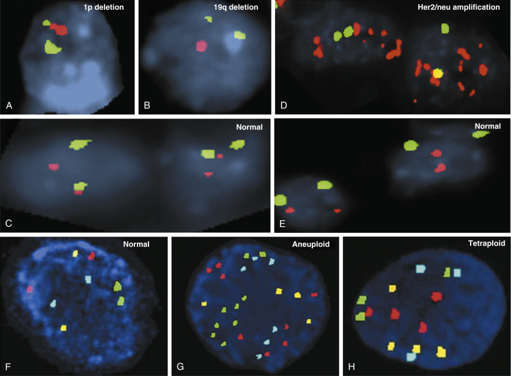
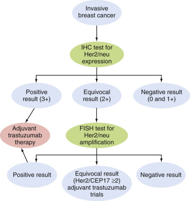
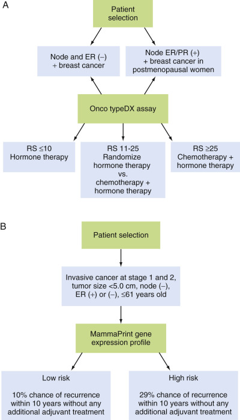
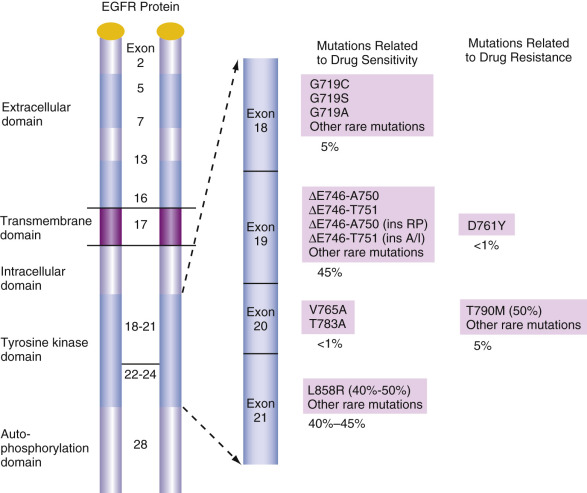
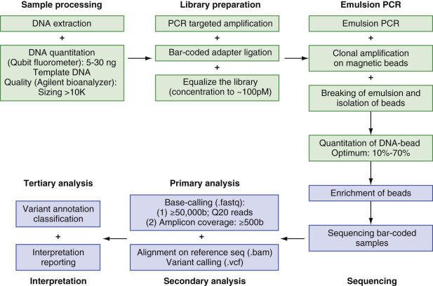

## Key Points

  * •

Solid tissue (mainly epithelial cell) tumors are mainly caused by genetic lesions of three types: deletion or inactivation of tumor suppressor genes, mutation in or overexpression of oncogenes (i.e., genes encoding proteins that are vital in control of the cell cycle), and hypermethylation of the promoter regions. 

  * •

These genetic lesions can be detected using the techniques described in Part 8 of this textbook involving real-time polymerase chain reaction, fluorescence in situ hybridization, immunohistochemistry, enzyme-linked immunosorbent assay, and so on. 

  * •

Detection of genetic lesions in solid tissue tumors is of great value for the diagnosis of specific types, for classification of the tumor, and for determining prognosis for a patient with a specific type of cancer. A common mutation in several of these cancers is overexpression of the epidermal growth factor receptor (EGFR). Discovery of this lesion allows for implementation of anti-EGFR therapy. However, because ras-p21 is a downstream target of EGFR, and because it is commonly mutated in many human cancers, it is necessary to test for oncogenic mutations in th _e ras_ gene. If these are found, the efficacy of anti-EGFR agents is diminished. 

  * •

Less commonly, oncogenic mutations can be found in downstream targets of _ras-p21,_ such as BRAF, which makes treatment with anti-EGFR agents less effective. 

  * •

Many solid-tissue tumors express the same oncogenes, such as _BRAF,_ in melanoma and thyroid cancer, but other cancers have genetic lesions that appear to be specific for that type of cancer, such as RET in medullary thyroid carcinoma. 

  * •

Although not formally classified as solid-tissue tumors, sarcomas often behave in a manner identical to that of solid-tissue tumors. These cancers have been found to be caused by reciprocal translocations resulting in oncogenic fusion transcripts (accounting for 15% to 20% of cases) and by specific oncogenic mutations (e.g., _KIT_ and _PDGFRA_ mutations in gastrointestinal stromal tumors). Both types of genetic alterations are often specific to certain types of sarcomas. 

  * •

Because the genetic alterations or changes that underlie many familial types of cancers are known, it is possible to screen for these in the children and close relatives of patients known to have a form of familial cancer, so as to detect the presence of these cancers as rapidly as possible. 

  * •

Next-generation sequencing (NGS) is currently widely used in the selection of pathway-based therapy and prediction of treatment resistance of many types of cancer. 

Cancer is largely a genetically encoded disease. Recent research on cancer molecular genetics, epigenetics, and genomics, as well as their application, has vastly changed the practice of cancer diagnosis, classification, prognosis, and treatment. Application of molecular genetics to solid tumors is a major milestone in diagnostic pathology. The molecular diagnosis was initially introduced for accurate diagnosis of solid tumors, based on the unique genetics. Now the utility of molecular diagnosis is far beyond its original intention, and it is no longer just an adjunct method. It has become an indispensable tool that is widely used to predict clinical outcome, including disease prognosis, selection of optimal therapeutic regimens, and anticipation in response to treatment. It has not only revolutionized the concept and practice of diagnostic pathology for solid tumors, it has also become the basis for personalized medicine. 

The principles and method in molecular diagnostics of solid tumors are similar to those used in other fields of molecular diagnosis. Techniques commonly used in cancer molecular pathology include detection or identification of specific sequences of genes (DNA and/or its transcribed RNA) or gene product (protein) alterations. They include amplification-based techniques (i.e., polymerase chain reaction [PCR], RT-PCR, branched DNA testing), hybridization methods (i.e., in situ hybridization, or fluorescence in situ hybridization [FISH]), microarray-based approaches (i.e., comparative genomic hybridization [CGH], DNA, RNA, microRNA microarray), and sequencing. PCR and FISH are among the most commonly used methods, whereas array-based techniques have a promising future, but have not been used widely in clinical settings to this point. Each method is described in Part 8 of this textbook. 

Tissue sources of diagnostic materials of molecular pathology for solid tumor include paraffin-embedded tissue, fresh tissue, and cytologic specimens. Fresh tissue is a preferred choice for preservation of DNA, RNA, or protein. In most cases, only fresh tissue is usable in array-based methods; however, it is usually not readily available or accessible. Thus, paraffin-embedded tissue is used most commonly because of its availability and ease of access; it also allows use of the corresponding hematoxylin and eosin–stained slides for morphologic study. However, exposure of nucleic acid to formalin is associated with the major inherent problems of increased nucleic acid fragmentation and low integrity of DNA, RNA, and protein. Tissue fixation in formalin for longer than 24 hours will likely reduce the yield of high molecular weight nucleic acid. Thus, longer formalin fixation, paraffin embedding, and long storage at room temperatures can lead to false-negative results. A second problem is impurity of tumor cells, which usually are mixed with normal cells and stromal cells. Relatively pure tumor cells can be achieved by employing microdissection that isolates the tumor cells, even a single tumor cell, by a manual or instrument-assisted method. Cytologic specimens, including cells from fine-needle aspiration (FNA), urine, and blood, and swabs for molecular pathology, are used most often to assist in accurate diagnosis of superficial solid tumor, such as human epidermal growth factor receptor ( _Her_ ) _-2/neu (ERBB2)_ for breast cancer, human papillomavirus (HPV) testing for cervical cancer, and UroVysion (Abbott Laboratories, Abbott Park, Ill.) for bladder cancer. 

Molecular diagnoses of solid tumors rely on our understanding of the molecular mechanism involved in carcinogenesis of solid tumors. Genetic alterations can be inherited or can result from carcinogenesis, as described in [ Chapter 75 ](<##!/content/3-s2.0-B9780323295680000759?scrollTo=%23c00075>) . In several tumors, polygenic mutations occur, but often in these cases, some unique or specific genetic alterations lead to carcinogenesis. Those genetic or epigenetic components mainly belong to the following: 

  * 1.

Tumor suppressor genes (TSGs) (e.g., _Rb, SMAD,_ adenomatous polyposis coli _[APC]_ ). 

  * 2.

Oncogenes (e.g., _EWS, cKIT, Her2/neu, KRAS, BRAF_ ). 

  * 3.

Promoter regions with methylation/inactivation activity. 

Application of molecular diagnosis of solid tumors has been used clinically as follows: 

  * 1.

**Assistance in disease diagnosis and classification:** For example, small “blue cell” tumors encompassing Ewing's sarcoma, lymphoma, rhabdomyosarcoma, and so forth, can be diagnosed by identification of specifically altered genes (e.g., Ewing's sarcoma–specific gene translocations). In cervical cancer, detection of HPV assists in the diagnosis of neoplastic change on cervical biopsies or smears. Moreover, in the future, DNA microarray of the tumor may detect gene signatures. 

  * 2.

**Determination of prognosis:** With better understanding of the molecular genetics of solid tumors, a greater number of prognostic markers can be identified. Thus detection of those markers in some cases has become a routine practice. For example, detection of overexpression/amplification of _Her2/neu_ in breast cancer and 1p19q deletion in brain tumor has been used to predict prognosis or clinical outcome. 

  * 3.

**Determination of therapeutic options:** Many drugs have been developed to target certain genes and gene products (i.e., proteins) and related pathways. Examples include tyrosine kinase inhibitors (TKIs) and monoclonal antibodies to EGFRs in lung and colon cancer. Moreover, only certain groups of patients with unique genetic profiles can respond to these treatments. Thus, providing the right management not only will increase the chances for cure, but also will improve patient quality of life by avoiding unnecessary side effects. 

  * 4.

**Combination of the above:** In most cases, detection of molecular markers may provide both diagnostic and prognostic information such as c _KIT_ mutations and chromosomal abnormalities detected by UroVysion, and amplification of _Her2/neu._

This chapter focuses on the clinical application of molecular pathology in cancer diagnosis, prognosis, and predicting treatment response in common solid tumors. The major genetic findings in each tumor type are summarized in [ Table 77-1 ](<#t0010>) . 

TABLE 77-1 

Most Common Genetic Alterations in Solid-Tissue Tumors 

Tumor Type  |  Major Molecular Target(s) [ * ](<#hl0000479>) |  Main Method(s) of Detection  |  Clinical Application(s)   
---|---|---|---  
**Solid-Tissue Tumors**  
Glioblastoma  |  _EGFR, TP53,_ 10q, MGMT, mutations in _TP53_ and _PTEN, P16INK4a_ deletions  |  RT-PCR, methylation-specific PCR, FISH  |  Prognosis, treatment response   
Oligodendroglioma  |  1p and 19q deletions, _EGFR, TP53_ |  FISH, RT-PCR, LOH  |  Diagnosis, prognosis, treatment response   
Sporadic, nonhereditary breast cancer  |  _Her2/neu_ , multiplex genes  |  FISH, IHC, RT-PCR, Oncotype, MammaPrint  |  Molecular classification, prognosis, treatment response   
Hereditary breast cancer  |  _BRCA1, BRCA2, EGFR_ |  High-throughput sequencing, multiplex PCR, genetic counseling  |  Diagnosis, genetic counseling   
Papillary thyroid cancer  |  _BRAF, RET, PTC1, PTC3_ |  FISH, RT-PCR, direct sequencing  |  Diagnosis, prognosis, therapeutic option   
Follicular thyroid cancer  |  _PAX8-PPAR γ _ |  IHC, FISH, RT-PCR  |  Diagnosis, prognosis   
Medullary thyroid carcinoma  |  _RET_ |  Sequencing, PCR  |  Diagnosis, screening, surveillance   
Non _ – _ small cell cancers of the lung  |  _EGFR, RAS_ |  PCR, sequencing, FISH  |  Prognosis, treatment response   
Liver (hepatocellular)  |  _EEGFR, VEGFR,_ glypican-3, _p53_ , β-catenin, microRNA (miR-122a), multiple genes  |  FISH, PCR, sequencing, microarray  |  Diagnosis, prognosis, targeted therapy   
Gastric cancer, intestinal type  |  _p73_ mutations, _MSI_ ( _MLH1_ and _MSH2_ ), LOH/mutations of _APC_ genes, and Her2/neu  |  FISH, PCR, IHC  |  Diagnosis, prognosis   
Gastric cancer, diffuse type  |  _CDH1_ |  FISH, PCR, IHC  |  Diagnosis, prognosis   
Colon cancer  | 
    * 1. Mutated oncogenes: mainly _EGFR, KRAS, BRAF_ , and _PI3K._
    * 2. Mutated or deleted antioncogenes: _p53, APC, TGFBRI, SMAD2, SMAD4_
    * 3. Microsatellite instability (MSI) genes and CpG island methylator (CIMP) genes 
|  FISH, PCR, microarray, methylation-specific PCR, sequencing, array technology  |  Diagnosis, prognosis   
Pancreatic cancer  |  Most pancreatic cancers: _KRAS_ mutations  |  PCR, sequencing  |  Diagnosis   
|  Inactivating mutation or deletion or methylation of genes encoding _TP53, SMAD4, p16/CDKN2A_ |  PCR, methylation-specific PCR  |  Diagnosis (rarely), prognosis   
|  miRNAs (miR-196a, 217, 221, 376a, and 301)  |  RT-PCR  |  Diagnosis, prognosis   
Renal cell carcinoma (RCC)  |  Chromosome 3p deletion, von Hippel _ – _ Lindau _(VHL)_ gene deletion; hypoxia-inducible factor _(HIF)_ overexpression  |  Sequencing, FISH (for VHL)  |  Diagnosis   
Translocation-associated RCC  |  t(X;17)(p11.2;q25); _ASPL-TFE3_ and _PRCC-TFE3_ fusion genes  |  RT-PCR, FISH, IHC for the C-terminal domain of nuclear TFE3  |  Diagnosis, classification   
RCC, clear cell  | 
    * 1. Carbonic anhydrase IX 
    * 2. Genes of immune response and proangiogenesis 
|  |   
| 
    * 3. Proximal nephron markers: megalin, cubilin, adipophilin 
|  Gene expression arrays, IHC  |  Diagnosis, prognosis, classification   
RCC, papillary  | 
    * 1. Proximal nephron marker α-methylacyl-coA racemase 
|  Gene expression arrays, IHC  |  Diagnosis, prognosis, classification   
RCC, chromophobe  | 
    * 1. Abundant mitochondria 
|  |   
| 
    * 2. Distal nephron markers: β-defensin, parvalbumin, chloride channel Kb, claudin 7 and 8, and EGF 
|  Gene expression arrays, IHC  |  Diagnosis, prognosis, classification   
RCC, oncocytoma  | 
    * 1. Abundant mitochondria 
|  |   
| 
    * 2. Distal nephron markers: β-defensin, parvalbumin, chloride channel Kb, claudin 7 and 8, EGF 
|  Gene expression arrays, IHC  |  Diagnosis, prognosis, classification   
Bladder cancer  |  Aneuploidy of chromosomes 3, 7, and 17 and/or deletion of the 9p21 (encoding p16); _NMP 22_ |  FISH  |  Diagnosis   
Prostate cancer  |  _TMPRSS2_ ( _21q22.3)_ to transcripts of the ETS family member genes: overexpression of ETS proteins (e.g., ERG, ETV1, ETV4, ETV5)  |  FISH, ELISA, RT-PCR, gene expression arrays  |  Diagnosis, classification   
Cervical cancer  |  HPV-6 and -18  |  Hybrid capture DNA assay, RT-PCR, Southern blot, dot blot  |  Diagnosis, follow-up of abnormal PAP smears   
**Ovarian Cancer**  
Low-grade serous  |  _KRAS, BRAF_ |  PCR, Southern blot  |  Diagnosis, classification   
High-grade serous  |  _p53_ deletion/mutation; Wnt/β-catenin or PI3K/PTEN signaling pathway defects  |  PCR, Southern blot  |  Diagnosis, classification   
Mucinous  |  _KRAS, BRAF_ |  PCR, Southern blot  |  Diagnosis, classification   
Clear cell  |  _PI3K/PTEN_ mutations  |  PCR, Southern blot  |  Diagnosis, classification   
Endometrioid  |  Mutations of _CTNNB1_ (β-catenin)  |  PCR, Southern blot  |  Diagnosis, classification   
Melanoma  |  _CDKN2A, p14,_ and _p16_ inactivation; _NRAS_ (G12V) and _BRAF_ oncogenic mutations (V600E)  |  PCR, sequencing  |  Diagnosis, classification, therapy   
**Sarcoma**  
Sarcoma with fusion genes involving the _TET_ gene: Ewing's sarcoma  |  t(11;22)(q24;q12) translocation; fusion of _EWSR1_ and an _ETS_ family gene, mainly _FLI1_ |  RT-PCR, FISH, Southern blot  |  Diagnosis   
Prognosis   
Sarcoma with fusion genes involving receptor tyrosine kinase: congenital fibrosarcoma  |  t(12;15)(p13;q25) translocation, resulting in fusion of _ETS_ gene, _ETV6_ with neurotropin receptor (that has tyrosine kinase activity), _NTRK3_ gene  |  RT-PCR, FISH, Southern blot  |  Diagnosis   
Sarcoma with fusion genes involving chromatin remodeling: synovial sarcoma (SS)  |  t(X;18)(p11.2;q11.2) translocation resulting in fusion of _SS18(SYT)_ gene with one of the _SSX_ genes on the X chromosome, creating _SS18-SSX1, SS18-SSX2,_ or _SS18-SSX4_ chimeric genes   
Downstream targets of above fusion proteins: _CCND1_ (cyclin D1) and _TLE1_ that encodes a transcriptional corepressor  |  FISH, RT-PCR   
IHC  |  Diagnosis, classification   
Diagnosis   
Sarcoma with fusion genes involving growth factors: dermatofibrosarcoma protuberans (DFSP) and giant cell fibroblastoma (GCF)  |  t(17;22)(q11;q13.1) translocation resulting in fusion of the _COL1A1_ gene on chromosome 17 with the _PDGFB_ gene on chromosome 22, leading to _PDGFRB_ overexpression  |  RT-PCR  |  Diagnosis, classification   
Sarcoma with other types of fusion genes: alveolar rhabdomyosarcoma (ARMS)  |  t(2;13)(q35:q14) translocation that results in fusion of _PAX3_ with _FOXO1A_ |  FISH  |  Diagnosis   
Sarcoma with oncogenic mutations: gastrointestinal stromal tumor (GIST)  |  _cKIT/PDGFRA_ |  PCR, sequencing, Southern blot  |  Diagnosis   
Sarcoma with no consistent genetic lesions: leiomyosarcoma (LMS)  |  Loss of 1p12-pter, 2p, 13q14-q21 (targeting the Rb pathway), 10q (targeting _PTEN_ ), 16q.   
Gains of 17p, 8q, and 5p14 pter.   
Activation of the PI3K _-_ AKT pathway and mTOR  |  FISH  |  Diagnosis   
**Syndromatic Cancers**  
Familial adenomatous polyposis syndrome  |  Adenomatous polyposis coli _(APC)_ (long arm of chromosome 5) or MutY human homologue _(MYH)_ gene involved in repair of oxidative damage to DNA  |  PCR, sequencing, Southern blot  |  Diagnosis   
Hereditary nonpolyposis colorectal cancer (HNPCC): Lynch syndrome  |  Microsatellite instability (MSI) in mismatch repair _(MMR)_ genes, including _MLH1, MSH2, MSH6, MLH3,_ and _PMS2_ |  IHC, PCR, sequencing  |  Diagnosis, classification, genetic counseling   
Familial juvenile polyposis syndrome  |  Germline mutations of _SMAD4, BMPR1A_ , and _ENG_ ; also, mutations in kinase, _BMPR1A_ (bone morphogenetic protein receptor type IA), on chromosome 10q22.3. Involvement of TGF-β signal transduction pathway  |  PCR, sequencing  |  Diagnosis, classification   
Peutz-Jeghers syndrome (PJS): melanotic mucocutaneous hyperpigmentation and GI hamartomas, which occur anywhere from the stomach to the anus; multiple polyps in small bowel  |  _STK11_ / _LKB1_ gene  |  PCR, sequencing  |  Diagnosis, classification   
Multiple endocrine neoplasia (MEN)  |  |  |   
MEN type 1: tumors in the parathyroid glands; the stomach, pancreas, and intestinal tract; anterior pituitary gland; endocrine pancreas; and duodenum, and by the presence of other nonendocrine tumors such as hemangioma, ependymoma, and leiomyoma, often at a young age  |  MEN 1 tumor suppressor gene, _MEN 1_ |  PCR  |  Diagnosis, classification   
MEN type 2: medullary thyroid carcinoma (MTC) and associated pheochromocytoma and hyperparathyroidism  |  _RET_ (chromosome 10q11.2) (encoding a tyrosine kinase) mutations  |  PCR, sequencing  |  Diagnosis, classification   
von Hippel–Lindau syndrome (VHL): neoplasia syndrome characterized by hemangioblastomas in the central nervous system and retina, pheochromocytomas, renal cysts and clear cell renal cell carcinoma, pancreatic cysts and islet cell tumors, endolymphatic sac tumors, and papillary cystadenomas of the epididymis and broad ligament  |  _VHL_ tumor suppressor gene (three exons) on chromosome 3p25. Encodes VHL protein, critical in regulating hypoxia-inducible factor (HIF-α and -β)  |  PCR, sequencing  |  Diagnosis, classification   
Familial paraganglioma syndromes  |  Mutation of three genes encoding subunits of mitochondrial succinate dehydrogenase (SDH complex): _SDHB_ at 1p36.1 (PGL4), _SDHC_ at 1q21 (PGL3), and _SDHD_ at 11q23 (PGL1)  |  PCR  |  Diagnosis, classification   
Cowden syndrome (CS); breast, thyroid, and endometrial cancers and other benign conditions, including multiple hamartomas in the colon, lipomas, fibromas  |  _PTEN_ mutations  |  PCR  |  Diagnosis, classification   
Li-Fraumeni syndrome; soft-tissue sarcomas, breast cancer, osteosarcoma, brain tumors, childhood leukemias, and adrenocortical carcinoma  |  _p53_ gene mutations  |  PCR, IHC  |  Diagnosis, classification   
Neurofibromatosis 1 (NF1); neurofibroma and, less commonly, gliomas and other abnormalities (learning disability, vasculopathy, and bony abnormalities)  |  _NF1_ , located on chromosome 17q11.2; diminished GTPase activating (GAP) activity activating the ras signal transduction pathway  |  FISH, direct sequencing, long-range PCR with Southern blot analysis, and/or cytogenetic analysis  |  Diagnosis, classification   
Neurofibromatosis (NF2) and schwannomatosis. NF2 involves schwannomas, meningiomas, and ependymomas  |  _NF2_ gene (chromosome 22)  |  Sequencing, mutation scanning, duplication/deletion testing, PCR, quantitative PCR, microarray, comparative genomic hybridization, or combination  |  Diagnosis, classification   
  
_ELISA,_ Enzyme-linked immunosorbent assay; _FISH,_ fluorescent in situ hybridization; _IHC,_ immunohistochemistry; _LOH,_ loss of heterozygosity; _PCR,_ polymerase chain reaction; _RT-PCR,_ real-time PCR. 

 * Full names and functions of molecular targets (i.e., oncogenes and oncoproteins) listed in the second column may be found in the corresponding sections of this chapter describing these targets and the corresponding references. 

,  

##  Molecular Genetic Pathology of Specific Solid Tumors by Major Organ 

 

##  Brain Tumor 

Primary central nervous system (CNS) gliomas, originating exclusively from brain cells such as astrocytes, oligodendrocytes, and ependymal cells, account for only about 1.35% of all cancers, but rank second among the causes of death from neurologic disease. Glioblastomas are the most common primary CNS tumor and are categorized as World Health Organization (WHO) grades I to IV, based on histologic characteristics. With the advent of new treatment modalities, the use of microscopic examination alone is insufficient for the histologic classification and grading of gliomas. 

 

##  Glioblastoma Multiforme 

Glioblastoma multiforme (GBM) consists of anaplastic malignant astrocytic tumors characterized by predominant microvascular and endothelial proliferation. The current standard of care for GBM is surgical resection, followed by radiation therapy. However, the association of specific molecular genetics not only assists in diagnosis and prognosis but also leads to the development of new adjuvant chemotherapy (e.g., temozolomide) (  Stupp et al, 2005  ). Glioblastomas (WHO grade IV) may develop de novo (primary glioblastomas) or through progression from low-grade astrocytomas (secondary glioblastomas). The two types show similar histologic features; however, they differ in terms of molecular alterations, with primary glioblastomas showing activation of the EGFR pathway, whereas secondary glioblastomas are more commonly associated with _TP53_ mutations. Thus, the molecular genetics of these tumors demonstrates that they are distinct diseases and therefore may exhibit different prognoses and responsiveness to therapy (  Ohgaki & Kleihues, 2007  ). Tyrosine kinase inhibitors, such as erlotinib and gefitinib, may offer a therapeutic option for primary tumors in which EGFR signaling is upregulated (  Ohgaki & Kleihues, 2007  ). 

Recent comprehensive genetic screens of GBM (  Parsons et al, 2008  ) have confirmed that genetic loss is scattered across the entire genome, affecting numerous chromosomes. **Loss of heterozygosity (LOH) on chromosome 10 is the most frequent genetic loss in GBM,** occurring in 60% to 80% of cases. Allelic losses on 1p and 7q have also been seen in GBM, but at lower frequencies. Loss of 1p occurs in 6% to 20% of GBMs, and in combination with 19q loss may indicate a better prognosis and improved responsiveness to therapy; however, the combined loss of 1p/19q is a rare event in GBM (  Kanu et al, 2009  ). 

Gains in gene expression have also been demonstrated in GBM in the form of duplication of entire chromosomes, intrachromosomal amplification of specific alleles, or extrachromosomal amplification (often in the form of double minutes) and activating mutations. Many genes have been shown to be amplified in glioma; these include _EGFR, CDK4, SAS, MDM2, GLI, PDGFRA, MYC, N-MYC, MYCL1, MET, GADD153,_ and _cKIT_ . The most commonly amplified genes in glioblastoma are _EGFR_ on chromosome 7 (in approximately 40% of cases), _CDK4,_ and _SAS_ (in approximately 15%). 

Other molecular mechanisms of gliomagenesis include loss of the DNA repair enzyme, O(6)-methyl guanine DNA methyltransferase (MGMT), which specifically removes pro-mutagenic alkyl groups from the O6-position of guanine in DNA (  Kanu et al, 2009  ). Expression of MGMT protects normal cells from carcinogens; however, it can also protect cancer cells from chemotherapeutic alkylating agents. This has been implicated as an important mechanism of drug resistance because it reduces the cytotoxicity of alkylating chemotherapeutic agents. Loss of MGMT expression may be caused by methylation of promoter CpG islands, which have been detected in 75% of secondary GBMs—much more frequently than in primary GBMs (36%). Immunohistochemical staining for MGMT does not offer a reliable way to stratify GBM (  Kanu et al, 2009  ), and PCR assay is therefore necessary. _TP53_ is one of the more commonly studied TSGs in GBM. Loss of normal _TP53_ function due to mutation occurs more frequently in secondary GBM. Thus, the major molecular targets of glioblastomas are EGFR, TP53, 10q LOH, and deletion of the _MGMT_ gene. These can be detected using RT-PCR, methylation-specific PCR, and FISH. The main clinical applications are related to prognosis and treatment response. These findings are summarized in [ Table 77-1 ](<#t0010>) and, in greater detail, in [ Table 77-2 ](<#t0015>) . 

TABLE 77-2 

Common Genetic Alterations in Glioblastoma Multiforme 

|  Primary GBM  |  Secondary GBM   
---|---|---  
LOH 10q  |  70%  |  63%   
_EGFR_ amplification  |  36%  |  8%   
_P16INK4a_ deletion  |  31%  |  19%   
_TP53_ mutation  |  28%  |  65%   
_PTEN_ mutation  |  25%  |  4%   
  
_EGFR,_ Epidermal growth factor receptor; _GBM,_ glioblastoma multiforme; _LOH,_ loss of heterozygosity; _PTEN,_ phosphate and tensin homologue deleted on chromosome 10. 

Data from Ohgaki H, Kleihues P: Genetic pathways to primary and secondary glioblastoma, _Am J Pathol_ 170:1445–1453, 2007. 

 

##  Oligodendroglioma 

Oligodendroglioma is an infiltrating glioma of the cerebral cortex diagnostically characterized by a triad of uniformly round to ovoid nuclei, perinuclear halos, and an even distribution of cells, together with a delicate chicken wire–type of vasculature. However, in a significant number of these lesions, the microscopic morphology is not so clear-cut, and distinction from other diffuse glial lesions may be difficult. Combined loss of 1p and 19q ( [ Fig. 77-1, _A_ to _C_ ](<#f0010>) ) is typical in oligodendroglioma (  Aldape et al, 2007  ), and loss of 19q occurs in astrocytoma and mixed oligoastrocytoma (  Aldape et al, 2007  ). The incidence of 1p/19q loss varies from 50% to 80% in oligodendroglioma in different studies, and it is 1% to 10% in other gliomas, which indicates its utility in differentiating the diagnosis. Recent studies suggest that the combined loss of 1p/19q may follow a (1; 19)(q10; p10) translocation, with subsequent loss of the derivative chromosome der(1;19)(q10; p10) (  Aldape et al, 2007  ). Identification of 1p/19q loss is associated with two unique features of tumor biology with clinical indications: first, they grow slowly, even those that are anaplastic in nature; second, they correlate with better prognosis and response to chemotherapy (  Kuo et al, 2009  ). In terms of treatment response, initial studies suggested that 1p/19q loss is a marker of response to PCV (procarbazine, lomustine/CCNU, and vincristine) or temozolomide chemotherapy (  Kuo et al, 2009  ). Thus, the 1p/19q status has become an important part of diagnosis, prognosis, and predicted therapeutic response of oligodendrogliomas. In addition to 1p/19q alteration, LOH mutations in _p53_ and _p16_ may be associated with poor survival or tumor progression (  Kuo et al, 2009  ). 

Figure 77-1 

Examples of fluorescence in situ hybridization in cancer diagnosis. 

Oligodendroglioma with **A,** 1p and **B,** 19q deletions compared with **C,** normal cells. Green color in _A,_ 1q probe; red color in _A,_ 1p probe; green color in _B,_ 19p probe; red color in _B,_ 19q probe. **D,** Her2/neu amplification compared with **E,** normal cells. Green color: CEP17 probe. Red color: Her2/neu probe. UroVysion showing **F,** normal; **G,** aneuploid; and **H,** tetraploid cells. Aqua color: chromosome 17. Yellow (gold) color: 9p21 locus. Red color: chromosome 3. Green color: chromosome 7. 

Nearly all 1p/19q codeleted oligodendrogliomas are also mutated on isocitrate dehydrogenases (IDH), IDH1 or IDH2 (  Labussiere et al, 2010  ). Recently IDH1 has been found to be mutated in a vast majority of astrocytic, oligodendroglial, and oligoastrocytic gliomas (WHO grades II to III), as well as in secondary glioblastomas (WHO grade IV). However, IDH1 mutation is very rare in primary glioblastoma and is not involved in pilocytic astrocytomas. IDH1 and IDH2 are homologous, NADP  \+  -dependent cytoplasmic and mitochondrial enzymes, respectively. The role of these enzymes is the conversion of isocitrate to α-ketoglutarate with the simultaneous reduction of NADP  \+  to NADPH. The most common mutation is a heterozygous point mutation with substitution of arginine by histidine at residue 132 (R132H), located in the substrate-binding site. This IDH1-R132 mutation has a reported frequency of 50% to 93% (  Parsons et al, 2008  ;  Yan et al, 2009  ). IDH2 gene mutations affecting the amino acid R172 are much less common than the IDH1 isoform, 3% to 5%, yet have been identified in a small subset of gliomas that lack the typical IDH1 mutation with predominance in oligodendrogliomas (  Yan et al, 2009  ). _IDH1_ and _IDH2_ genes appear to behave dominantly and are mutually exclusive. _IDH1_ mutation has been shown to be a strong, independent positive prognostic biomarker in diffuse gliomas, glioblastomas, as well as in oligodendroglioma (  Sanson et al, 2009  ). _IDH_ mutation was also identified as a marker for response to temozolomide in low-grade gliomas (  Houillier et al, 2010  ). 

 

##  Rhabdoid Tumor 

Rhabdoid tumors are highly malignant (WHO grade IV) embryonal CNS tumors of infants and very young children showing rhabdoid features. Similar to renal and other extrarenal rhabdoid tumors, over 90% of atypical teratoid/ **rhabdoid** tumor (AT/RT) demonstrate loss of all or part of chromosome 22, particularly involving 22q11.2. The INI1 (hSNF5/SMARCB1/BAF47), a putative suppressor gene, is mapped to the 22q11.2 region. _INI1_ deletions and/or mutation have been detected in the majority of AT/RT cases. Nearly all AT/RTs demonstrate absence of the nuclear immunohistochemical expression of INII/BAF47 protein. FISH for monosomy 22, 22q and deletion or the _INI1_ gene are commonly utilized as adjunct molecular studies in the diagnosis of AT/RTs and other pediatric embryonal tumors (  Wei et al, 2014  ). 

 

##  Breast Cancer 

Breast cancer is the most common cancer in women and the second most common cause of cancer death in women in the United States. Until recently, breast cancer was characterized according to tumor type (ductal vs. lobular carcinoma), histologic grade (I to III), steroid hormone receptors (ER and PR), and _Her2/neu_ status (positive vs. negative), along with metastasis to lymph nodes and distant organs, for its prognosis and treatment. Gene expression profiling has recently been introduced as a potentially useful adjunct for the management of recently diagnosed breast cancer. 

 

##  Sporadic, Nonhereditary Breast Cancer 

Various genetic, epigenetic, and genomic changes have been associated with breast cancer. Traditionally, estrogen receptor (ER) and progesterone receptor (PR) status is used as a prognostic and predictive marker for breast cancer. _Her2/neu_ (detailed in [ Chapter 75 ](<##!/content/3-s2.0-B9780323295680000759?scrollTo=%23c00075>) ) status has been added in the past decade as a breast cancer prognostic and predictive marker. The FISH method has been used primarily to determine the copy number of the _Her2/neu_ gene (see [ Fig. 77-1, _D_ and _E_ ](<#f0010>) ) for the purpose of selecting Her2-targeted therapies such as trastuzumab and lapatinib in both adjuvant and neoadjuvant settings. Enumeration of 20 interphase nuclei from tumor cells on a given case is reported as the ratio of average _Her2/neu_ copy number to that of chromosome enumeration probe 17 for centromere, CEP17. Specimens with amplification showed a _Her2/neu_ :CEP17 signal ratio ≥2.0 as abnormal, and a ratio <2.0 as normal. A three-color FISH assay has been commercialized recently for assessment of standalone prognosis in ER-positive and ER-negative stage I breast cancers (  Ross, 2009  ). In addition, HercepTest (Dako Corp, Carpinteria, Calif.), an immunohistochemistry (IHC) for _Her2/neu_ using a polyclonal antibody, was the first U.S. Food and Drug Administration (FDA)-approved test; subsequently, Pathway (Ventana Medical Systems, Tucson, Ariz.) produced a monoclonal antibody (CB11) for _Her2/neu_ for the same response indication that has also been FDA-approved and is used in combination with FISH ( [ Fig. 77-2 ](<#f0015>) ). IHC is widely used to measure prognostic factors, including ER, PR, Her2/neu, and the proliferation marker, Ki-67, and to predict response to hormonal and Her2-targeted therapies (  Ross, 2009  ). 

Figure 77-2 

Algorithm using Her2/neu status in diagnosis and treatment of breast cancer. 

Concerns associated with IHC-based assays for multiple markers include the nonlinear nature of IHC staining, the different subcellular localization of different markers, and the impact of different slide-scoring thresholds for different antibodies. The introduction of whole-genome profiling technologies has greatly expanded our knowledge of the genomic pathways associated with the development and progression of breast cancer (  Bao & Davidson, 2008  ). These research results have led to the development of several commercialized tests with multigenes/proteins as prognostic and predictive tools for clinical application using IHC, FISH, RT-PCR, and genomic microarray technologies with integrated bioinformatic/statistical algorithms designed to calculate disease recurrence and patient survival (  Ross et al, 2008  ). 

Molecular classification of breast cancer has been proposed, based on gene expression profiling, to include luminal-like, normal-like, Her2-positive, and basal-like subtypes of invasive breast cancer (  Ross et al, 2008  ). It is important to note that all of the luminal groups of breast cancers are ER positive, and nearly two thirds of them are of low or intermediate histologic grade, whereas 95% of all (  Ross, 2009  ) basal-like cancers are ER negative, and 91% of these tumors are of high grade (  Bao & Davidson, 2008  ). Studies of clinical outcomes based on molecular subtypes have shown that luminal A is more sensitive to antiestrogen than is luminal B. Her2-positive responds to trastuzumab, an anti–Her2 antibody, whereas basal is more aggressive (but is especially sensitive to anthracycline-based neoadjuvant chemotherapy) than are the luminal breast cancers (  Ross, 2009  ). Basal-like and Her2-positive subgroups are associated with the highest rates of pathologic complete response to neoadjuvant multiagent chemotherapy (  Ross, 2009  ). 

Several commercially available assays have been developed to predict the risk for recurrence. Recently NanoString's Prosigna Breast Cancer Prognostic Gene Signature Assay is developed based on the PAM50 gene expression signature. The PAM50 gene signature measures the expression levels of 50 genes in a surgically resected breast cancer sample to classify a tumor as one of four intrinsic subtypes (Luminal A, Luminal B, HER2-enriched, and Basal-like. This test outputs a risk of recurrence (ROR) score, in these intrinsic subtypes. Prosigna uses multiplexed gene-specific fluorescently labeled probe pairs to measure gene expression in frozen or formalin-fixed paraffin-embedded (FFPE) tissues with equivalent ease and efficiency (  Nielsen et al, 2014  ). Clinical trials demonstrated its utility in prognostic information of distant recurrence in hormone receptor–positive, postmenopausal breast cancer patients treated with endocrine therapy (  Dowsett et al, 2013  ) and in node-positive patients (  Gnant et al, 2014  ). Other two gene microarray-based clinical tests are the OncotypeDx and MammaPrint assays ( [ Fig. 77-3 ](<#f0020>) ) (  Kato, 2009  ;  Oakman et al, 2009  ). Oncotype Dx (Genomic Health, Inc., Redwood City, Calif.) is a 21-gene multiplex prognostic and predictive RT-PCR assay performed on primary FFPE breast cancer samples. The original 16 informative genes (  Paik et al, 2004  ) that calculate the recurrence score (RS) were discovered on archived FFPE samples by transcriptional profiling and then were converted to the FFPE RT-PCR assay (  Ross et al, 2008  ). OncotypeDx determines the 10-year risk for disease recurrence in patients with ER-positive, lymph node–negative tumors by using a continuous variable algorithm and assigning a tripartite RS (17, low risk; 18 to 30, intermediate risk; >30, high risk). Of the multiple pathways assessed by this assay, the proliferation and ER pathways are the most influential in RS calculation, followed by the Her2 pathway. High relative levels of ER mRNA and low levels of Ki-67 proliferation gene mRNA have a low RS. Low levels of ER mRNA and high levels of Ki-67 mRNA have a high RS. The other 14 informative mRNA levels play their greatest roles in determining the RS in tumors with intermediate ER and Ki-67 mRNA levels. It should also be noted that OncotypeDx is best suited for detecting breast cancers with a low potential for recurrence. The MammaPrint assay (Agendia BV, Amsterdam, The Netherlands) was the first fully commercialized microarray-based multigene assay for breast cancer. This test is currently designed as a pure prognostic assay, has received 510(k) clearance from the FDA, and is offered as a prognostic test for lymph node–negative breast cancer in women younger than 61 years of age with an ER-positive or ER-negative tumor. This test was also the first assay to be approved by the FDA's new in vitro diagnostic multivariate index assay classification. Unlike OncotypeDx, this test cannot currently be performed on FFPE tissues but requires fresh-frozen tumor samples or tissues collected into an RNA preservative solution. The 70 genes that make up the MammaPrint assay are focused primarily on proliferation; additional genes are associated with invasion, metastasis, stromal integrity, and angiogenesis. Of note, the OncotypeDx and MammaPrint assays have only one individual gene in common—the _SCUBE2_ gene, which is a member of the ER pathway. Unlike the OncotypeDx test, which features a continuous RS result, the MammaPrint test uses a dichotomous “high risk versus low risk” result format. The MammaPrint test does not include ER, PR, or Her2 in the 70-gene microarray. 

Figure 77-3 

Algorithm of _A,_ OncotypeDx and _B,_ MammaPrint assays in breast cancer management. 

Multigene testing procedures such as disease classifiers and prognostic and predictive markers have been introduced with the use of slide-based methods (e.g., IHC, FISH) or molecular platform–based methods such as quantitative multiplex PCR and genomic array profiling. Morphologically based mRNA extraction performed with the use of tissue macrodissection or microdissection is recommended for analysis, as it is highly enriched for invasive carcinoma and is not diluted with cells from benign tissues and in situ carcinoma areas (  Ross et al, 2008  ). The heterogeneous expression of important mRNAs, such as ER, Her2, and Ki-67, often reflected in the varying histologic grades seen in larger tumors, can influence the predictive accuracy of transcriptional profiling measurements. One caveat is that, although the number of genes that can be simultaneously assessed by multiplex qRT-PCR is significantly greater than that for IHC, multiplex qRT-PCR requires a more complex statistical evaluation of the gene expression profiles. Nevertheless, the RT-PCR technique has been used to predict overall prognosis and response to both hormonal and cytotoxic therapies. 

 

##  Hereditary Breast Cancer 

Hereditary breast cancer (HBC) accounts for approximately 10% of all breast cancers. Positive family history is the strongest risk factor, as it is present in about 20% of breast cancer cases. Population-based studies indicate that 15% of familial risk can be attributed to _BRCA_ gene mutations, and that a further 10% involve _TP53,_ phosphate and tensin homologue _(PTEN), ATM,_ and _CHEK2;_ the rest may be explained by a polygenic model. A significant number of HBC-prone families are characterized by the more common hereditary breast-ovarian cancer syndrome. The _BRCA_ genes operate as TSGs, and germline mutations affecting one allele of _BRCA1_ or _BRCA2_ confer susceptibility to breast and ovarian cancers. The cumulative risk for developing breast cancer by 70 years of age approaches 50% to 70% in _BRCA1_ -mutation carriers, and ovarian cancer, 30% to 40% (  Venkitaraman, 2009  ). For _BRCA2-_ mutation carriers, the risk is 40% to 50% for breast cancer and 10% to 15% for ovarian cancer. However, individuals who carry _BRCA2_ mutations also have an increased risk for other cancers, including those of the male breast (≈seventy-five–fold relative risk), pancreas (fourfold to eightfold), and prostate (twofold to fourfold) (  Venkitaraman, 2009  ). The spontaneous instability of chromosome structure and number is a hallmark of _BRCA_ -deficient cells and arises from the distinct cellular functions performed by the BRCA1 and BRCA2 proteins in DNA repair and mitotic control. Since the discovery of _BRCA_ genes and the development of methods for mutation screening, identification of _BRCA_ -mutation carriers during the clinical management of familial cancer cases has become widespread. Gene expression profiling has revealed that tumors from patients who are _BRCA1_ -mutated segregate within the basal subgroup of breast cancers (  Venkitaraman, 2009  ) of the five different molecular groups, as discussed earlier. Tumors from _BRCA1_ -mutation carriers are likely to stain positive for basal cytokeratins 5/6 and 14, and to exhibit negative estrogen receptor staining. These breast carcinomas also commonly stain for EGFR. _BRCA1_ -associated tumors are commonly of high grade and are _p53_ -mutated. They have a tendency to occur in younger women and carry a poor prognosis (  Venkitaraman, 2009  ). 

 

##  Thyroid Cancer 

Thyroid cancer is the most common endocrine neoplastic condition. The two most frequent types of thyroid malignancy derived from follicular cells are papillary and follicular carcinomas, which constitute approximately 80% and 15%, respectively, of all thyroid cancers. These follicular cell–derived tumors are well differentiated, in contrast to poorly differentiated and anaplastic carcinomas, which constitute about 2% of cases. Another malignancy in thyroid is medullary carcinoma, which originates from parafollicular C cells and accounts for approximately 3% of cases. Several genetic alterations in various thyroid tumors have been well documented, including translocations and point mutations. The genetic alteration in thyroid cancer involves _RET, BRAF, RAS,_ and _PAX8_ . 

 

##  Papillary Thyroid Carcinoma 

_RET/PTC_ rearrangement and point mutations of _RAF_ (in particular, the _BRAF_ form) and _RAS_ genes are found in more than 70% of cases of papillary thyroid carcinoma (PTC) (  Nikiforova & Nikiforov, 2008  ), and these mutations are mutually exclusive. 

The _RET/PTC_ gene rearrangement is another prominent genetic alteration that plays a role in the pathogenesis of up to 20% of sporadic PTCs (  Nikiforova & Nikiforov, 2008  ). The _RET_ gene, located on chromosome 10q11.2, encodes the tyrosine kinase receptor consisting of an extracellular ligand-binding domain for the glial-derived neurotrophic factor family of growth factors, a cysteine-rich region, a transmembrane domain, and an intracellular tyrosine kinase domain. _RET_ is highly expressed in parafollicular C cells and at very low levels in thyroid follicular cells (  Nikiforov, 2008  ). _RET/PTC_ rearrangements are a very early event in thyroid cancer development; this would explain their high prevalence in occult or microscopic PTC. Twelve forms of _RET/PTC_ rearrangements have been reported to date, linking the 3′ portion of the _RET_ gene with the 5′ portion of various different genes of the PTC family (  Nikiforova & Nikiforov, 2008  ), the two most common of which are _PTC1 (H4)_ and _PTC3 (ELE1, ARA70, NCOR4),_ which account for up to 70% and 30% of rearrangements in sporadic PTC, respectively (  Nikiforova & Nikiforov, 2008  ). In particular _, RET/PTC_ rearrangements are more frequent in individuals exposed to ionizing radiation (50% to 80%) (  Nikiforova & Nikiforov, 2008  ), with the exception of _ELKS-RET_ (ELKS is a polypeptide sequence that is rich in glutamic acid [E], leucine [L], lysine [K], and serine [S] and _HOOK3RET_ fusion (HOOK3 encodes the protein Hook homolog 3). _RET/PTC_ rearrangements are also more frequent in children (40% to 70%) (  Nikiforova & Nikiforov, 2008  ) as compared with the general population (15% to 30%). Papillary carcinomas with _RET/PTC_ gene rearrangements typically present in younger individuals and exhibit a high rate of lymph node metastasis with classical papillary histology and lower stage at presentation, particularly in cases harboring _RET/PTC1_ (  Nikiforova & Nikiforov, 2008  ). In tumors arising after radiation exposure, _RET/PTC1_ was found to be associated with classic papillary histology, whereas the _RET/PTC3_ type was more common among solid variants (  Nikiforova & Nikiforov, 2008  ). 

Activated RET kinase has been explored as a target of therapy using TKIs such as ZD6474 (  Nikiforova & Nikiforov, 2008  ). The distribution of _RET/PTC_ rearrangements within each tumor may vary from involving almost all neoplastic cells (clonal _RET/PTC_ ) to being detected only in a small fraction of tumor cells (nonclonal _RET/PTC_ ) (  Nikiforov, 2008  ). This heterogeneity is a potential problem in RET receptor–targeted therapy. 

Human _HRAS, KRAS,_ and _NRAS_ genes encode the ras-p21 proteins, which are highly conserved in sequence from yeast to humans and are strongly homologous in amino acid sequence to one another. As described in [ Chapter 75 ](<##!/content/3-s2.0-B9780323295680000759?scrollTo=%23c00075>) , the ras-p21 protein is a G-protein, that is, a GTP-binding protein that is activated when GTP binds in place of GDP. The exchange is promoted by the SOS or GNEF (guanine nucleotide exchange factor) that, in turn is activated when a tyrosine kinase–containing receptor binds to its growth factor. The activated tyrosine kinase binds to the growth factor receptor–bound (grb) adapter protein that binds simultaneously to SOS-GNEF, activating it to bind to ras-p21 thereby promoting GTP-GDP exchange. To be active, ras-p21 must bind to the inner cell membrane in a covalent link between a farnesyl moiety in the membrane and the thio group of Cys 186. In its active form, ras-p21 binds directly to raf, thereby activating the raf-MEK-MAP kinase (or ERK) pathway as described in [ Chapter 75 ](<##!/content/3-s2.0-B9780323295680000759?scrollTo=%23c00075>) . Simultaneously, it activates phosphatidylinositol-3-hydroxy kinase (PI3K) that activates AKT. Point mutations involving several specific sites (codons 12, 13, and 61) in _NRAS_ and _HRAS_ are more common in thyroid cancer. They are found in 10% to 20% of cases of papillary carcinoma, 40% to 50% of follicular carcinomas, and 20% to 40% of poorly differentiated and anaplastic carcinomas. Among papillary carcinomas, virtually all tumors that harbor a RAS mutation grow, forming neoplastic follicles and no papillary structures and are, therefore, diagnosed as the follicular variant of papillary carcinoma (  Zhu et al, 2003  ). 

RAS mutations are also found in 20% to 40% of benign follicular adenomas (  Motoi et al, 2000  ). The finding of this mutation in benign adenomas as well as in follicular-patterned carcinomas suggests that RAS-positive follicular adenomas may serve as a precursor for RAS-positive follicular carcinomas and the follicular variant of papillary carcinomas. Furthermore, RAS mutations may predispose well-differentiated cancers to dedifferentiation, resulting in anaplastic tumors. With regard to the rare but important cribriform morular variant of papillary carcinoma, nuclear β-catenin accumulation is essentially a defining feature that is diagnostically invaluable. 

_RAF,_ as noted earlier (see [ Chapter 75 ](<##!/content/3-s2.0-B9780323295680000759?scrollTo=%23c00075>) ), is a direct target of ras-p21. The _BRAF_ gene mutation is the most common known genetic alteration in papillary carcinoma and is found in approximately 45% of these tumors (  Nikiforova & Nikiforov, 2008  ). A majority of mutations involve T1799A transversion mutation in exon 15 of the gene, which causes amino acid change from valine to glutamine at amino acid residue 600 (V600E), leading to constitutive activation of BRAF kinase, subsequent phosphorylation of MEK and ERK protein kinases (see [ Chapter 75 ](<##!/content/3-s2.0-B9780323295680000759?scrollTo=%23c00075>) ), and downstream effectors of the mitogen-activated protein kinase (MAPK) pathway, as is summarized in [ Chapter 75 ](<##!/content/3-s2.0-B9780323295680000759?scrollTo=%23c00075>) (see [ Fig. 75-1 ](<##!/content/3-s2.0-B9780323295680000759?scrollTo=%23f0010>) ). Other mechanisms of _BRAF_ activation, although rare, include K601E point mutation, small in-frame insertions or deletions surrounding codon 600, and _AKAP9-BRAF_ rearrangement, which is more commonly associated with radiation exposure papillary carcinoma. _BRAF V600E_ mutation is highly prevalent in papillary carcinoma with classical histology and in the tall cell variant while tumors that harbor the K601E BRAF mutation typically have the follicular variant of papillary carcinoma histology (  Nikiforov & Nikiforova, 2011  ). The _BRAF V600E_ mutation has been correlated with aggressive features such as extrathyroid extension, advanced tumor stage at presentation, recurrence, and lymph node involvement and/or distant spread (  Xing et al, 2005  ). This mutation also occurs in 20% to 40% of poorly differentiated thyroid carcinomas and 30% to 40% of anaplastic thyroid carcinomas. Many of these carcinomas also reveal areas of well-differentiated papillary cancer, and BRAF V600E is present in both tumor components, which suggests that this mutation is an early event that predisposes the tumor to dedifferentiation (Nikiforova, 2011). Cancers with these mutations have decreased ability to trap radioiodine and lead to treatment failure and more aggressive behavior (  Nikiforova & Nikiforov, 2008  ). 

Detection of the _BRAF_ mutation can be achieved by direct sequencing, colorimetric mutation detection assay based on shifted terminal assay (  Xing et al, 2004  ), real-time PCR, and allele-specific SYBR green PCR on an FNA sample, which is virtually diagnostic of papillary carcinoma. The _BRAF_ mutation represents an attractive therapeutic target for papillary carcinoma with the advent of various BRAF inhibitors (e.g., BAY43-9006) (  Wan et al, 2004  ;  Wilhelm et al, 2004  ). 

Activated RET kinase has been explored as a target of therapy using TKIs such as ZD6474 (  Nikiforova & Nikiforov, 2008  ). The distribution of _RET/PTC_ rearrangements within each tumor may vary from involving almost all neoplastic cells (clonal _RET/PTC_ ) to being detected only in a small fraction of tumor cells (nonclonal _RET/PTC_ ) (  Nikiforov, 2008  ). This heterogeneity is a potential problem in RET receptor–targeted therapy. 

Other point mutations involving several specific sites (codons 12, 13, and 61) in NRAS, HRAS, and KRAS genes are found in 10% to 20% of cases of papillary carcinoma. These mutations are almost always found in the follicular variant of papillary carcinoma (  Nikiforova & Nikiforov, 2008  ). 

 

##  Follicular Carcinoma 

Most of the frequent genetic alterations in follicular carcinoma are _RAS_ point mutations and _PAX8-PPAR γ _ rearrangements, altering the PI3K/AKT signal pathway. Several studies have reported the utility of molecular testing in diagnosing this type of thyroid cancer preoperatively on FNA specimens. 

A _RAS_ mutation is found in 40% to 50% of conventional follicular carcinomas and in 20% to 40% of adenomas. It is interesting to note that the most common _ras_ mutations, instead of occurring at codon 12, as in most other cancers, occur at codon 61 for _NRAS_ and _HRAS_ (  Nikiforova & Nikiforov, 2008  ). These mutations are associated with tumor dedifferentiation, a less favorable prognosis, and metastasis to bone (  Nikiforova & Nikiforov, 2008  ). Furthermore, RAS mutations are potentially transformative as indicated by a 20% to 40% prevalence in poorly differentiated and undifferentiated carcinoma. 

The _PAX8-PPAR γ _ gene rearrangement is a result of the translocation t(2;3)(q13;p25). It leads to a fusion between the _PAX8_ gene, which encodes a thyroid-specific paired domain transcription factor, and the _PPAR γ _ gene. It occurs in 35% of conventional follicular carcinomas and has a lower prevalence in oncocytic (Hürthle cell) carcinomas (  Nikiforova & Nikiforov, 2008  ). This translocation may also be seen in up to 13% of follicular adenomas and approximately 5% of follicular variants of papillary carcinoma. Tumors harboring _PAX8-PPAR γ _ rearrangements tend to present in a younger age group, are smaller, and exhibit solid or nested patterns and more frequent vascular invasion. This rearrangement results in overexpression of the PPARγ protein that is detectable on IHC (  Nikiforova et al, 2003  ). This molecular overlap between follicular adenoma, follicular carcinoma, and follicular variant of papillary thyroid carcinoma thus likely reflects a biologic continuum. 

 

##  Medullary Carcinoma 

Medullary carcinoma of the thyroid (MTC) is a sporadic malignancy in a majority of cases (75%), with the remainder spanning three familial syndromes, including multiple endocrine neoplasia (MEN 2A and MEN 2B) and familial MTC (FMTC). In MTC, _RET_ is activated by point mutations, in contrast to its activation by chromosomal rearrangement in PTC. In sporadic medullary carcinomas, somatic mutations of _RET_ are found in 20% to 80% of cases without a germ-line mutation. Germ-line mutations in _RET_ are found in almost all patients with familial forms of medullary carcinoma; this correlates with the aggressiveness of MTC. However, it must also be noted that sporadic tumors may also harbor RET mutations (30% to 66%). Sporadic tumors may also harbor _HRAS_ or _KRAS_ mutations as well (up to 25%). 

 

##  Lung Cancer 

Lung cancer remains the most common cause of cancer-related death among men and women worldwide. Epithelial tumors of the lung are of four principal types: squamous cell carcinoma, adenocarcinoma, large cell carcinoma, and small cell carcinoma. Clinically, the most important distinction is noted between small cell carcinoma and the others, which can be grouped together as non–small cell carcinoma. Small cell cancers respond to chemotherapy, whereas non–small cell carcinomas (NSCLCs) are removed surgically if possible. Recently recognized specific molecular alterations in different histologic subtypes of NSCLC has led to the need for more precise delineation of NSCLC subtypes by the pathologist. 

_EGFR_ mutations have been identified in many human cancers like lung, breast, head and neck, colorectal, pancreatic, bladder cancers, glioma, squamous cell carcinoma, Wilms' tumor, and certain NSCLCs (adenocarcinoma). EGFR is a _membranous oncoprotein_ that induces cell proliferation upon activation. Binding of a ligand to a receptor activates its tyrosine kinase activity, which phosphorylates several substrates on a number of signal transduction pathways, leading to DNA synthesis and expression of oncogenes such as _fos_ and _jun_ and finally cell growth (see [ Chapter 75 ](<##!/content/3-s2.0-B9780323295680000759?scrollTo=%23c00075>) ). Increased EGFR signaling can be the result of _EGFR_ gene amplification, protein overexpression, or specific activation mutations in the _EGFR_ gene, as described in detail in [ Chapter 75 ](<##!/content/3-s2.0-B9780323295680000759?scrollTo=%23c00075>) . 

It has been shown that a subset of patients with NSCLC (10% to 40%) (  Coate et al, 2009  ) have specific activating mutations in the _EGFR_ gene ( [ Fig. 77-4 ](<#f0025>) ) that are associated with increased sensitivity to TKIs, such as gefitinib (Iressa) or erlotinib (Tarceva), targeting EGFR in lung cancer. Common activating _EGFR_ mutations occur most often in exons 18 to 21 and cluster in two major hot spots. The prototype mutation _L858R_ in exon 21 (40% of _EGFR_ mutations) encoding the tyrosine kinase domain and small in-frame deletions in exon 19 (>50%) are reportedly most often constituting up to 90%, and are associated with responses to EGFR TKI therapy. Mutations in exons 18 and 20 account for the remaining 10% of _EGFR_ mutations in NSCLC (  Sholl et al, 2009  ). Recent guidelines suggest that routine EGFR assays for EGFR exon 19 deletions should be designed to detect not just the common 15-bp and 18-bp deletions, but also the less common 9-, 12-, 24-, and 27-bp deletions, as well as the uncommon 15-bp and 18-bp insertions. EGFR exon 18 should be analyzed for E709 and G719 mutations; exon 20 for S768I, T790M, and insertions; and exon 21 for L858R, T854, and L861Q mutations. Clinical EGFR mutation testing should be able to detect all individual mutations that have been reported with a frequency of at least 1% of EGFR-mutated lung adenocarcinomas (  Lindeman et al, 2013  ). Studies have reported that _EGFR_ gene mutations are more common among females, Asians, and nonsmokers with adenocarcinoma; these are the same groups that have the highest response rates to TKIs (  Sequist & Lynch, 2008  ). However, recent guidelines (  Lindeman et al, 2013  ) suggest that EGFR molecular testing should be done in all patients with lung adenocarcinoma. 

Figure 77-4 

Clinically significant mutations of epidermal growth factor receptor mutation in cancer. 

Immunohistochemistry for total EGFR and EGFR copy number analysis (i.e., FISH or chromogenic in situ hybridization) are not recommended for selection of EGFR TKI therapy according to recent guidelines. Recent studies have demonstrated that in patients with _EGFR_ mutations, the EGFR locus is often concurrently amplified. 

ALK gene chromosomal rearrangement is found in another ~5% of lung adenocarcinomas, most commonly in the form of an intrachromosomal inversion leading to the EML4-ALK fusion product associated with ALK protein overexpression. This mutation is present more frequently in lung adenocarcinomas from younger patients with either no or only light smoking history (  Kwak et al, 2010  ;  Shaw et al, 2009  ); however, recent guidelines suggest that ALK molecular testing should be done in all patients with lung adenocarcinoma. Some studies have reported associations with solid, mucinous cribriform and/or signet ring histology (  Yoshida et al, 2011  ;  Shaw et al, 2009  ). The translocation is infrequent in pure squamous cell carcinoma, but has been reported in adeno squamous carcinoma (  Chaft et al, 2012  ). Patients with this tumor type are responsive to therapy with the multitargeted tyrosine kinase inhibitor, crizotinib (  Takeuchi et al, 2012  ). Fluorescence in situ hybridization (FISH) using break-apart probes is currently considered the gold standard for detection of ALK rearrangements (  Febbo et al, 2011  ). Polysomy (multiple copies) at the ALK locus is common in lung adenocarcinoma and, when present, confirms that FISH has been performed in a tumor cell population. ALK immunohistochemistry, if carefully validated, may be considered as a screening methodology to select specimens for ALK FISH testing (  Lindeman et al, 2013  ). Current evidence suggests that it does not, however, predict response/resistance to targeted therapies. RT-PCR is not recommended as an alternative to FISH for selecting patients for ALK inhibitor therapy (  Lindeman et al, 2013  ). 

Recent recommendations for EGFR and ALK testings are as follows: EGFR and ALK testing is not recommended in lung cancers that lack any adenocarcinoma component, such as “pure” squamous cell carcinomas, “pure” small cell carcinomas, or large cell carcinomas lacking any immunohistochemical (IHC) evidence of adenocarcinoma differentiation. EGFR and ALK testing are the most important uses of the diagnostic sample after a diagnosis of adenocarcinoma is established. If specimens are insufficient for molecular testing, patients may need to undergo another invasive diagnostic procedure before they can be treated. EGFR and ALK results should be available within 2 weeks (10 working days) of receiving the specimen in the testing laboratory (  Lindeman et al, 2013  ). 

Lung adenocarcinomas contain a number of other less common alterations that may lead to treatment with targeted inhibitors but have not yet been studied in large controlled trials nor emerged as a standard of care. These include chromosomal rearrangements involving _ROS1_ (~2% of lung adenocarcinomas; may respond to treatment with crizotinib) and _RET_ (~2% of lung adenocarcinomas) (  Takeuchi et al, 2012  ), increased copies of _MET_ (  Engelman et al, 2007  ), and sequence-altering mutations in _ERBB2, BRAF,_ and _PIK3CA_ (  Cardarella et al, 2012  ). 

Mutations in _KRAS,_ frequently in codons 12 and 13, have been reported in up to 30% of cases of lung adenocarcinoma (  Coate et al, 2009  ). These mutations are usually found in cancers of smokers and are more common in adenocarcinoma (30% to 50%) than in NSCLC (15% to 20%). Conversely, oncogenic mutations in the _KRAS_ gene were reportedly associated with resistance to EGFR-TKIs in metastatic colorectal cancer. Thus testing for KRAS mutations as a negative predictor of response to EGFR TKI has become part of molecular diagnostic algorithms for lung adenocarcinoma in many centers. However, more recent data suggest that EGFR wild-type tumors have less favorable outcomes if they are treated with EGFR TKI than if they are treated with conventional platinum-based chemotherapy. Therefore, KRAS mutation testing is not recommended as a sole determinant of anti-EGFR TKI therapy (  Lindeman et al, 2013  ). 

 

##  Hepatocellular Carcinoma 

Hepatocellular carcinoma (HCC) is the sixth most common malignancy and the third most common cause of cancer death worldwide. Major risk factors include chronic viral infection (hepatitis B virus [HBV] and hepatitis C virus [HCV]), alcoholic/nonalcoholic liver disease, environmental carcinogens (e.g., aflatoxin B1), and inherited genetic disorders (e.g., Wilson's disease, hemochromatosis, α 1  -antitrypsin deficiency, tyrosinemia) (  McGlynn & London, 2005  ;  Parkin et al, 2005  ;  Clark, 2006  ;  Motola-Kuba et al, 2006  ). The development of HCC is a multistep process, comprising hyperplastic change, dysplasia, early HCC, and well-developed HCC in the setting of chronic hepatitis or cirrhosis (  Takayama et al, 1990  ;  Theise et al, 2002  ), or in a small percentage of patients without cirrhosis. 

The genomic abnormality of HCC is heterogeneous, largely as the result of various molecular mechanisms of carcinogenesis related to different causes and multifactorial processes (  Jain et al, 2010a  ). HCV-related HCC has an exclusive gain at 10q, and loss of 4q and 16q and gain of 11q are seen preferentially in HBV-positive cases (  Kusano et al, 1999  ;  Nishida et al, 2003  ). Most HCCs are aneuploid and harbor multiple different chromosomal abnormalities, including nonrandom, recurrent DNA copy number losses on multiple chromosomal arms 1p, 4p, 5q, 6q, 8p, 9p, 13q, 16p, 16q, and 17p, and gains on 1q, 6p, 8q, and 17q, detected by conventional cytogenetic studies and CGH. Chromosome 1q is the most common aberration in several geographic locations (  Guan et al, 2001  ;  Chang et al, 2002  ;  Terracciano & Tornillo, 2003  ). Frequently deleted chromosome regions by LOH in HCCs contain many TSGs, including _p53, Rb, p16, PTEN,_ and _DLC1,_ and oncogenes such as insulin-like growth factor-2 receptor _IGF2R_ (  Hsia et al, 1994  ;  Edamoto et al, 2003  ;  Matsuda et al, 2003  ). LOH at chromosome 1p usually is seen in early, small, or well-differentiated HCC (  Kuroki et al, 1995  ), whereas LOH at chromosomes 16p and 17p is more frequently associated with aggressiveness of HCC, including advanced stage and poor prognosis (  Tamura et al, 1997  ). By CGH, abnormalities in chromosomes 8p, 17p, and 19p are associated with metastasis of HCC (  Zhang et al, 2003  ). 

Dysregulation of the major signal transduction pathways is found in all HCCs, but differs with various associated causes. Abnormal activities of Wnt/β-catenin, hedgehog, transforming growth factor (TGF)-β, ras-p21 and MEK/ERK, IGF, and _PTEN_ signaling pathways, as well as apoptosis, _p53, Rb,_ and microsatellite stability, are commonly found in HCCs, irrespective of etiology, reflecting common pathogenetic mechanisms (e.g., chronic liver injury, cirrhosis) (  Edamoto et al, 2003  ;  Zucman-Rossi et al, 2006  ;  Aravalli et al, 2008  ). However, HCC resulting from different causes may predominantly affect certain pathways. HCV-associated HCC shows significant abnormality in both Wnt/β-catenin and MAPK pathways (  Bai et al, 2003  ;  Colnot et al, 2004  ). Dysfunction of Wnt/β-catenin, _p53, pRb,_ and MAPK (  Budhu et al, 2006  ) and cytokine signaling are more commonly seen HBV-related HCCs (  Azechi et al, 2001  ;  Bai et al, 2003  ;  Colnot et al, 2004  ;  Yoshida et al, 2006  ). Tumors associated with alcoholism have more frequent alterations in the Rb1 and p53 pathways than those caused by HCV infection (  Marchio et al, 2000  ). The “aflatoxin-associated” codon 249 mutation of _p53_ is identified only in samples from areas with high aflatoxin content (Asia and Africa) (  Kirk et al, 2000  ;  Huang et al, 2003  ). 

Molecular approaches have been advocated to classify and predict clinical outcome and facilitate target molecular therapies using gene expression microarray and single-nucleotide polymorphism arrays (  Boyault et al, 2007  ;  Katoh et al, 2007  ;  Chiang et al, 2008  ;  Hoshida et al, 2008  ). Using global gene expression profiling, analyses of 91 human HCCs employing DNA microarrays containing 21,329 unique genes could subclassify HCC into two distinctive groups: (1) low survival subclass (class A, overall survival time 30.3 ± 8.02 months), which show strong cell proliferation and antiapoptosis gene expression signatures (such as _PCNA_ and cell-cycle regulators such as _CDK4, CCNB1, CCNA2,_ and _CKS2_ ), as well as genes involving ubiquitination and sumoylation; and (2) high survival subclass (class B, overall survival time 83.7 ± 0.3 months) without the above expression signature (  Lee et al, 2004a  ). Similarly, whole genomic array CGH analysis of 87 HCCs revealed two groups of tumors (clusters A and B) based on differences in chromosomal alteration profiles. Cluster A showed significant association with clinical features, such as HBV infection, higher serum α-fetoprotein levels, and a higher incidence of intrahepatic metastasis, along with shorter overall patient survival and poor clinical outcome (  Katoh et al, 2007  ). Gene expression profiles could also subclassify patients with HCC into different survival groups on the basis of paraffin-embedded surrounding nontumoral liver tissue, not tumor tissue (  Hoshida et al, 2008  ). A genome-wide transcriptomic analysis of 60 HCC tumors found a 16-gene signature to classify HCC tumors into six robust subgroups of HCC, labeled G1 to G6. Each group has unique clinical and genetic characteristics that are based on chromosome stability status: chromosome unstable (groups G1 to G3) and chromosome stable (groups G4 to G5). Because each group of tumors has specific pathways of activation (i.e., protein kinase B [AKT or PKB] in G1 to G2 and Wnt pathways in G5 to G6), this molecular classification not only provides prognostic information, but also helps in the development of targeted therapies for HCC (  Boyault et al, 2007  ). 

Current treatment modalities usually are not effective because patients with HCC generally are diagnosed at an advanced stage. Treatment effects are also influenced by significant clinical and genetic heterogeneity among HCCs associated with different causes. Therefore, standard treatments may not work for all HCCs. Molecular target therapies specific for a group of HCCs with similar genetics recently have been introduced. The target therapy aims to inactivate the activated oncogene and recover the tumor's suppressor and/or repair genes and other genes or molecules related to the development of HCC, thereby correcting abnormal genes or their functions, as well as biologic behavior. Many candidate genome-based drug targets have been discovered recently by microarray technology, promoter arrays for whole-genome epigenetic aberration analysis, chromatin immunoprecipitation-on-chip analysis, and high-throughput sequencing systems. Examples of target genes or molecules include VGFR, EGFR, _DDEFL, VANGL1, WDRPUH, Ephrin-A1, glypican-3_ , number gain 7q, PFTAIRE protein kinase 1 and paternally expressed 10, and miR-122a (  Yagyu et al, 2002  ;  Okabe et al, 2003, 2004  ;  Zender & Kubicka, 2008  ). Moreover, some reagents or drugs that work against these candidate target genes or molecules such as monoclonal antibodies, small molecules, and antisense have been in phase II and III clinical trials for therapeutic use; many have been shown to be effective. Sorafenib, an oral multikinase inhibitor of the vascular endothelial growth factor receptor, and Ras kinase have been approved by the FDA as molecularly targeted anticancer agents (  Midorikawa et al, 2010  ;  Thomas, 2009  ). Some of the other agents targeting similar genes are being tested in preclinical and clinical trials for HCC. These include EGFR inhibitors (anti-EGFR, gefitinib, and erlotinib), vascular endothelial growth factor (VEGF), vascularization inhibitors (antiangiogenesis, sorafenib, bevacizumab), and multikinase targets in patients who are unresectable or have metastatic HCCs (  Huynh et al, 2009  ). 

Recently Glypican-3 (GPC3) was considered a relatively specific HCC biomarker, being undetectable in hepatic paracarcinomatous and cirrhotic tissues (  Zhang et al, 2012b  ). GPC3 was first proposed as a potential marker for hepatocellular carcinoma in 1997 (  Hsu et al, 1997  ). It is a family member of heparan sulfate proteoglycan–containing membrane proteins. It anchors to the cytoplasmic membrane via a glycosyl-phosphatidyl-inositol linkage. GPC3 can regulate, in a positive or negative manner, the activities of many growth factors depending on the cellular context (  Filmus et al, 2008  ). It is interesting to note that more than 80% of HCCs overexpress GPC3 (  Shirakawa et al, 2009a  ); additionally, GCP3 is also an interesting therapeutic target for HCC (  Filmus et al, 2008  ). In this regard, a humanized monoclonal antibody against GPC3 has been recently developed (  Zhu et al, 2013  ), and it is under evaluation in a clinical trial phase II in patients with advanced or metastatic HCC. GPC3 has been also proposed as a marker of HCC progression as it promotes cell growth by stimulating the Wnt signal transduction pathway. In a multivariate analysis on patients affected by HCC of different etiology, GPC3 was found to be a predictor of poor prognosis (  Shirakawa et al, 2009b  ); however, in another study, the correlation was found only for HCC developed in HCV-positive patients (  Yorita et al, 2011  ). Importantly, a high level of GPC3 in tissue was found to be an independent risk factor for a shorter postoperative disease-free survival, recurrence, and for a decreased overall survival (  Fu et al, 2013  ). 

 

##  Hepatic Adenomas 

Hepatic adenoma is an uncommon, benign, hepatic neoplasm that typically occurs in women of childbearing age, often with a history of long-term use of oral contraceptive drugs. Molecular studies have revealed that hepatic adenomas involve unique molecular pathways that are distinct from hepatocellular carcinoma. In 2006, the French Bordeaux collaborative group proposed a molecular-pathologic classification for HA (  Rebouissou et al, 2007  ). The classification divides HA into four groups, primarily based on the molecular characteristics, as determined by immunohistochemical markers and their correlation with histologic features. These four subtypes are (1) HAs with inactivating mutations of hepatocyte nuclear factor 1a (HNF1A; HA-H), (2) HAs with activating mutations of β-catenin gene (HA-B), (3) HAs without mutations of the _HNF1A_ or _ β-catenin _ genes and with inflammatory features (HA-I), and (4) unclassified HAs that have no specific gene mutations or unique morphologic features (HA-U) (  Zucman-Rossi et al, 2006  ). 

TCF1 (also known as _HNF1A_ ) is a tumor suppressor gene involved in liver tumorigenesis. It is located on the long arm of chromosome 12. It encodes transcription factor HNF1, which, in the liver, is implicated in hepatocyte differentiation and is required for expression of certain liver- specific genes, including albumin, b-fibrinogen, and α 1  -antitrypsin (  Rebouissou et al, 2007  ). The French Bordeaux group showed that HAs with biallelic inactivating mutations in the TCF1 _(HNF1A)_ gene constituted a homogenous, morphologically distinct, group that comprise 35% to 40% of all HAs, and classified the group as _HNF1A-mutated hepatic adenomas (HA-H)._ In most of this subtype of HAs (about 85%), mutations are somatic in origin; however, in a few cases, one mutation is somatic, and the other is germ-line in origin. Furthermore, heterozygous germ-line mutations in the _TCF1_ gene have been associated with occurrence of a rare autosomal dominant condition (MODY3), which presents in early adulthood (usually younger than 25 years of age). _HNF1A_ mutation increases lipogenesis by promotion of fatty acid synthesis and downregulation of liver-type fatty acid–binding protein 1 (L-FABP), leading to diffuse intralesional steatosis (  Rebouissou et al, 2007  ). 

The β-Cateningene _(CTNNB1)_ is a component gene of the Wnt/β-catenin pathway, which is important in hepatocellular development and physiology. In normal hepatocytes, activation of the β-catenin gene is transient, followed by rapid degradation of the β-catenin protein, which is facilitated by a set of genes, including _axins,_ glycogen S-kinase 3 _(GSK3),_ and adenomatosis polyposis coli _(APC)._ Decreased degradation, sustained activation, and nuclear accumulation of β-catenin protein could be due to either a mutation of the β-catenin gene or mutations in the _axin, APC,_ or _GSK3_ genes. Activating β-catenin mutation is reported in 15% to 19% of HA cases (  Rebouissou et al, 2008  ). _ β-catenin _ mutations have also been seen in 20% to 34% of well-differentiated HCCs (  Bioulac-Sage et al, 2010  ). The HA-B subtype is more frequently associated with malignant transformation (  Bioulac-Sage et al, 2010  ). 

Some hepatic adenomas show sustained activation of interleukin 6 (IL- 6) receptor signaling because of somatic gain-of-function mutations of the IL-6 signal transducer gene _(IL6ST),_ which encodes glycoprotein-130 (gp130); gp130 is a component of the IL-6 receptor (  Rebouissou et al, 2009  ). This activation of IL-6 promotes the signal transducer and activation of the transcription 3 (STAT3) signaling pathway and induces an acute-phase inflammatory response within neoplastic hepatocytes. This is manifested as overexpression of acute-phase reactants, such as Serum Amyloid A and C-reactive protein (CRP), and inflammatory cell infiltration of the tumor. Such HAs are referred to as inflammatory HA (HA-I) and comprise 30% to 35% of all HAs (  Bioulac-Sage et al, 2010  ). Somatic mutations of the _IL6ST_ gene are seen in about 60% of the HA-I subtype. About 10% of HA-I cases show coexistent β-Catenin mutations. Historically, the HA-I subtype was referred to as _telangiectatic focal nodular hyperplasia_ and was thought to belong to the focal nodular hyperplasia (FNH) family. In certain studies, the telangiectatic focal nodular hyperplasias are monoclonal neoplasms that are morphologically and biologically closer to HAs and included within the subgroup HA-I in the new classification scheme (  Paradis et al, 2004  ;  Bioulac-Sage et al, 2005  ). This classification is clinically relevant because it identifies a subset of HAs, specifically HA-B, with increased potential for malignant transformation (  Farges & Dokmak, 2010  ). Furthermore, it helps in identifying cases for which genetic counseling is recommended, in the subset of patients with hepatic adenomatosis that shows a steatotic morphology that resembles HNF1A-mutated adenomas. This familial form of hepatic adenomatosis involves germ-line mutations of _HNF1A_ and is associated with maturity-onset diabetes mellitus of youth, type 3 (MODY3) and hence the rationale for genetic counseling is to search for germ-line mutations of _HNF1A_ in the family. Recent reclassification of telangiectatic FNH as inflammatory hepatic adenoma, based on molecular genetics and proteomic profiling, has added to the morphologic and molecular heterogeneity of HAs (  Bioulac-Sage et al, 2005  ). 

 

##  Gastric Cancer 

Gastric cancer (GC) is the fourth most common cancer and is second only to lung cancer as the leading cause of cancer-related death worldwide (  Ferlay et al, 2004  ). A majority of GCs are adenocarcinomas, historically classified into two major groups by Lauren's classification: intestinal type with glandular pattern, and diffuse or poorly differentiated type with a signet ring cell morphology in some cases (  Lauren, 1965  ). These two types of GCs have a distinct molecular basis of carcinogenesis, and clinical and genetic characteristics. The main causes of the intestinal type include dietary habits, environmental factors, and _Helicobacter pylori_ infection (  Kelley & Duggan, 2003  ). Gastric cancer risk is also associated with hereditary tumor syndromes such as hereditary diffuse-type gastric cancer syndrome, hereditary nonpolyposis colorectal cancer (HNPCC), Li-Fraumeni syndrome, and Peutz-Jeghers syndrome (i.e., familial adenomatous poly­posis [FAP] and juvenile polyposis) (  Traverso et al, 2002  ;  Napieralski et al, 2005  ). 

The development of intestinal-type GC is a multistep process that proceeds from gastritis (chronic or atrophic) and related changes (e.g., pernicious anemia) to intestinal metaplasia, dysplasia, and eventually carcinoma (  Oberhuber & Stolte, 2000  ;  Kelley & Duggan, 2003  ). These proc­esses are accompanied by a series of genetic alterations. The inactivation mutation of the TSG _p53_ (see [ Chapter 75 ](<##!/content/3-s2.0-B9780323295680000759?scrollTo=%23c00075>) ) occurs in an early stage of carcinogenesis (i.e., intestinal metaplasia [38%] and dysplasia [58%]), and is also seen in 38% to 71% of GCs (  Joypaul et al, 1993  ;  Shiao et al, 1994  ;  Xiangming et al, 2000  ). Mutation in _p73,_ a member of the _p53_ family, is indicated in the development of GC associated with _H. pylori_ infection in mouse mode. A high-level of microsatellite instability (MSI-H) is frequently seen in intestinal-type GC, largely caused by hypermethylation of the promoter regions of mismatch repair genes (most commonly, _MLH1_ and _MSH2_ ) or gene mutations (in a small percentage of GCs) (  Lee et al, 2004b  ;  Gu et al, 2009  ;  Seo et al, 2009  ). The CpG island methylator phenotype, originally found in colorectal cancer, has been detected in 24% to 47% of GCs (  Toyota et al, 1999  ;  Oue et al, 2003  ;  Lee et al, 2004b  ). LOH or mutation of _APC_ genes may occur in up to 60% of intestinal-type GC and in approximately 25% of the precursors—adenomas (  Horii et al, 1992  ;  Nakatsuru et al, 1992, 1993  ). LOH at the _bcl-2_ locus and amplification of cyclin D1 and E are also associated with intestinal-type GC tumors (  Ayhan et al, 1994  ;  Muller et al, 1999  ). The oncogene product _Her2/neu_ is frequently amplified in intestinal-type GC (  Wang et al, 2002  ). In contrast to the diffuse cell type, _E-cadherin_ gene _(CDH1)_ mutations are infrequently present in intestinal-type GC (  Machado et al, 2001  ;  Mingchao et al, 2001  ). 

The molecular pathogenesis of diffuse-type GC is less clear. _H. pylori_ infection seems not to be related to the diffuse type of GC, according to epidemiologic studies. It can be part of a hereditary gastric cancer predisposition syndrome (  Guilford et al, 1998  ). The unique molecular abnormality of diffuse-type GC distinct from intestinal-type GC is deficiency in cell-cell adhesion caused by loss or downregulation of the _E-cadherin_ gene _(CDH1)_ as a result of genetic or epigenetic alterations. The abnormality in _CDH1_ can be found in the early stages of diffuse GC development. Decreased _CDH1_ expression is detected in 50% of diffuse-type GCs, and more than 70% of those somatic _CDH1_ mutations consist of complete or partial deletion of exons (  Berx et al, 1998  ;  Napieralski et al, 2005  ). The unique molecular genetics of GC might be useful for diagnosis in that _CDH1_ mutations can be detected by polymerase chain reaction on paraffin-embedded tissue. Detection of the germ-line mutation in _CDH1_ may help in identification of carriers of asymptomatic mutations involved in the GC family syndrome, and may offer an opportunity for prophylactic total gastrectomy in patients carrying the _CDH1_ mutation (  Fitzgerald & Caldas, 2002  ). Other frequently altered genes or gene products in diffuse-type GC include the met proto-oncogene, encoding the hepatocyte growth factor receptor, and the SC-1 antigen, an apoptosis receptor (  Kuniyasu et al, 1992  ;  Vollmers et al  1998a  ). 

Currently, the most valuable predictive and prognostic factor for GC is clinical staging independent of cancer type, but it does not reflect the heterogeneity of tumor biology. Molecular biomarkers have been investigated as alternatives or supplements to the current system and have shown very promising results in predicting prognosis and therapeutic response. For example, MSI-H is usually associated with intestinal-type GC, commonly seen in the distal stomach or antrum, and is associated with less frequent local lymph node metastasis. However, whether patients with MSI-H GC have more favorable long-term survival than those with MSH-L (novel tumor bands with one marker)/microsatellite stable (MSS) (no novel tumor bands), GC remains controversial (  Hayden et al, 1997  ;  Wirtz et al, 1998  ). Expression in tumor tissue of caudal-type homeobox transcription factor 2 _(CDX2),_ in combination with normal _E-cadherin_ and nonexpression of the transmembrane protein mucin 1 _(MUC1),_ is a favorable prognostic factor for patients with GC (  Tanaka et al, 2003  ;  Fondevila et al, 2004  ). 

Abnormal gene profiling on _RBP4, OCT2, IGF2, PFN2, KIAA1093,_ and _PCOLCW_ and overexpression of three genes in the primary tumor ( _BIK, Aurora kinase B,_ and _eIF5A2_ ) are related to node metastasis (  Hippo et al, 2002  ;  Marchet et al, 2007  ). Matrix metalloproteinase-1 (MMP-1)-overexpressing GCs have a worse prognosis in terms of tumor invasion and metastasis than MMP-negative tumors (  Noel et al, 2008  ). _VEGF_ overexpression enhances tumor angiogenesis and thus is associated with lymph node metastasis, hepatic metastasis, and shorter survival time. As with breast cancer (see earlier), amplification/overexpression of the _Her2/neu_ oncogene has been shown to be a potential independent unfavorable prognostic factor (  Allgayer et al, 2000  ;  Park et al, 2006  ). Overexpression of _EGFR_ and β-catenin appears also to herald decreased survival and a less favorable prognosis (  Jonjic et al, 1997  ;  Zhou et al, 2002  ;  Gamboa-Dominguez et al, 2004  ). In addition, mutation or abnormal expression of _p53_ may predict a reduced cumulative survival and is associated with lymph node metastasis and lower chemosensitivity (  Fondevila et al, 2004  ;  Pinto-de-Sousa et al, 2004  ;  Oh et al, 2008  ). 

An alternative system, proposed by the World Health Organization, divides gastric cancer into papillary, tubular, mucinous (colloid), and poorly cohesive carcinomas (  Lauwers et al, 2010  ). These classification systems have little clinical utility, making the development of robust classifiers that can guide patient therapy an urgent priority. Recently, The Cancer Genome Atlas (TCGA) project proposed a molecular classification dividing gastric cancer into four subtypes: first were tumors positive for Epstein-Barr virus, which display recurrent PI3KCA mutations, extreme DNA hypermethylation, and amplification of JAK2, CD274 (also known as PD-L1) and PDCD1LG2 (also known as PD-L2); EBV-CIMP; CDKN2A silencing; and immune cell signaling. Second were microsatellite unstable tumors, which show elevated mutation rates, including mutations of genes encoding targetable oncogenic signaling proteins. Third were genomically stable tumors, which are enriched in the diffuse histologic variant and have mutations of _RHOA_ or fusions involving RHO-family GTPase-activating proteins, CLDN18-ARHGAP fusion, or mutation in the cell adhesion gene CDH1. Fourth were tumors with chromosomal instability, which show intestinal histology, TP53 mutation, RTK-RAS activation, marked aneuploidy, and focal amplification of receptor tyrosine kinases (  Bass et al, 2014  ). Importantly, these molecular subtypes showed distinct salient genomic features, providing a guide to targeted agents that should be evaluated in clinical trials for distinct populations of gastric cancer patients. Through existing testing for MSI and EBV and the use of emerging genomic assays that query focused gene sets for mutations and amplifications, the classification system developed through this study can be applied to new gastric cancer cases. 

The ToGA trial, an international multicenter Phase III clinical study involving 24 countries globally, has shown that the anti-HER2/neu humanized monoclonal antibody trastuzumab (Herceptin) is effective in prolonging survival in patients with HER2/neu-positive adenocarcinoma of the stomach and the gastroesophageal junction (  Bang et al, 2010  ). Molecular therapy targeting HER2/neu is now approved for patients with inoperable locally advanced, recurrent, or metastatic adenocarcinoma of the stomach or esophagogastric junction if the tumor shows unequivocal HER2/neu overexpression by IHC (score 3+) or amplification by FISH or CISH. Therefore, HER2 testing in gastric carcinoma is warranted for determination of treatment eligibility. 

Treatment of GC, especially late-stage tumor, usually requires a multidisciplinary approach that includes chemotherapy in combination with surgical resection. Molecular markers for predicting therapeutic response have been studied, and several of them have been shown to be potentially useful clinically. These are discussed at length in [ Chapter 73 ](<##!/content/3-s2.0-B9780323295680000735?scrollTo=%23c00073>) . 

 

##  Colorectal Cancer 

Colorectal cancer (CRC) is the third most common malignancy worldwide (  Ferlay et al, 2004  ). Prognostication of newly diagnosed CRC predominantly relies on stage or anatomic extent of disease based on the International Union Against Cancer and the American Joint Committee on Cancer staging classifications. However, CRC should be regarded as a heterogeneous, multipathway disease—an observation substantiated by the fact that histologically identical tumors may have neither similar prognosis nor similar response to therapy (  Umar et al, 2004  ). Mutations and/or epigenetic alterations in TSGs (e.g., _APC, DCC, SMAD-2, SMAD-4, p53_ ) and oncogenes (e.g., _KRAS, p53_ ) are molecular determinants during the development of sporadic colorectal cancer, which was first summarized in the adenoma-carcinoma sequence described by Vogelstein and colleagues (  Fearon & Vogelstein, 1990  ). Based on genetic background, sporadic CRCs can be subclassified into two major types: (1) chromosomal unstable and (2) microsatellite unstable, and an additional group with CpG island methylator phenotypes. Various genetic syndromes are known to predispose to colorectal carcinoma and to have specific inherited gene defects. These molecular markers are currently being investigated as a means of improving the identification of patients likely to have poor clinical outcomes, and therefore possibly benefiting from adjuvant treatment (  Eschrich et al, 2005  ;  Ghadimi et al, 2005  ;  Liang et al, 2009  ). 

_EGFR,_ a receptor tyrosine kinase, overexpression is detected in up to 80% of colorectal cancers (  Messa et al, 1998  ). Tumors with a high level of EGFR expression usually have a poor prognosis (  Ghadimi et al, 2005  ;  Liang et al, 2009  ). These data have led to the clinical use of EGFR blockade in the treatment of colorectal cancers with anti-EGFR monoclonal antibodies such as cetuximab or panitumumab (see [ Chapter 75 ](<##!/content/3-s2.0-B9780323295680000759?scrollTo=%23c00075>) ). Cetuximab is a mouse-human hybrid monoclonal antibody approved by the FDA in 2004 as second-line treatment of colorectal cancer. Panitumumab is a fully human immunoglobulin G  2  monoclonal antibody approved by the FDA in 2007 as third-line monoclonal antibody therapy of refractory colorectal cancer. Both drugs are expensive and have significant side effects. Thus, it is imperative to use a biomarker to predicate the therapeutic response. However, use of EGFR as a biomarker to predict response to EGFR monoclonal antibodies has had limited success. Only detection of increased EGFR copy number by FISH has predictive value (  Liang et al, 2009  ), and it has been proven that EGFR expression levels detected by IHC are not so useful. In contrast to _EGFR_ mutation in lung cancer, _EGFR_ mutation in CRC is a rare event that occurs in fewer than 1% of cases (  Plesec & Hunt, 2009  ). Current studies are focused on finding the downstream effectors of the EGFR pathway that may serve as biomarkers for predicting the effectiveness of anti-EGFR therapy. 

As summarized earlier in this chapter and in [ Chapter 75 ](<##!/content/3-s2.0-B9780323295680000759?scrollTo=%23c00075>) , Ras-p21 proteins are guanosine triphosphate (GTP)-coupled proteins that are important in many receptor tyrosine kinases that utilize signaling on the Ras/Raf/Erk/Map kinase signal transduction pathway. Mutations that result in single amino acid substitutions at critical positions in the amino acid sequence of this protein, such as Gly 12, Gly 13, and Gln 61, occur in the Ras protein and cause its constitutive activation. This leads to a series of oncogenic events that activate downstream signaling pathways, promoting tumor initiation and tumor growth and progression, including local invasion, angiogenesis, metastasis, and even immune response (  Rowinsky et al, 1999  ;  Smakman et al, 2005  ). 

The _KRAS_ mutation occurs in at least 35% to 45% of cases of CRC and, in some series, in up to 75% of cases. Mutations of this gene occur almost exclusively in three hot spots (codons 12, 13, and 61) and rarely in others, including codon 146 (  Ogino et al, 2005  ;  Smakman et al, 2005  ). Because KRAS is the downstream effector of EGFR and is frequently mutated in CRC, the mutation status of _KRAS_ has become an important predictive marker for the effectiveness of cetuximab or panitumumab on metastatic CRCs. The American Society of Clinical Oncology (ASCO) has recommended that patients with diagnosed metastatic colon cancer who are candidates for anti-EGFR therapy should be tested for _KRAS_ mutations in a Clinical Laboratory Improvement Amendments (CLIA)-accredited laboratory. If negative for _KRAS_ mutations, these patients are deemed suitable for treatment with anti-EGFR antibody (cetuximab or panitumumab) therapy. This recommendation is based on the results of phase II and III clinical trials. Retrospective subset analyses of these trial data suggest that patients who have _KRAS_ mutations detected in codon 12 or 13 do not benefit from this therapy. This was further confirmed by five randomized, controlled trials of cetuximab or panitumumab response in relation to _KRAS_ mutational status (no mutation [wild type] and mutated [abnormal]) and another five single-arm retrospective studies undertaken to evaluate tumor response according to _KRAS_ mutational status. 

According to the College of American Pathologist (CAP) Perspectives on Emerging Technology (POET) guideline published in 2009, acceptable samples for _KRAS_ mutation include fresh, frozen, and FFPE tissues. Acceptable assay types are RT-PCR and direct sequencing analysis; however, other methods such as pyrosequencing or microarray (chip)-based tests have also been developed (  Pajkos et al, 2000  ;  Ogino et al, 2005  ). As of the time of this writing, no type of _KRAS_ testing has been approved by the FDA. Although recommended testing is limited to codons 12 and 13 of exon 2, which make up the vast majority of cases with _KRAS_ mutations, many laboratories and commercial kits also include testing for other mutations, such as for codons 61 and 146. 

_BRAF_ is an immediate downstream effector of _RAS_ in the Ras/Raf/Map kinase pathway (see [ Fig. 77-1 ](<#f0010>) ). Mutation of _BRAF_ has been identified in approximately 10% of CRCs (  Di Nicolantonio et al, 2008  ). A vast majority of the point mutations are V600E, a mutational hot spot at nucleotide 1796 within exon 15, accounting for a T : A transversion mutation and a valine-to-glutamic acid substitution. All point mutations occur within the kinase domain of B-Raf protein, leading to constitutive activation of B-raf kinase (  Davies et al, 2002  ). The _BRAF_ mutation is almost mutually exclusive with _KRAS_ mutations. Unlike the _KRAS_ mutation, _BRAF_ mutations frequently occur in female patients older than 75 years of age with proximal lesions. These tumors exhibit MSI with higher frequency (  Barault et al, 2008  ) than those in other patients with colon cancer, which appear to be due to epigenetic effects involving hypermethylation of the promoter regions of mismatch repair genes. This finding is of help in differentiating between sporadic MSI-H tumors with somatic mutations in the V600E hot spot in BRAF than Lynch-associated cancers with MLH1 or MSH2 mutations. 

_BRAF_ mutations in tumors have been characteristically associated with a worse survival than in those without mutations and with resistance to treatment with anti-EGFR monoclonal antibodies, cetuximab, or panitumumab for metastatic CRCs. Currently, molecular testing for _BRAF_ mutation V600E has been performed in many clinical laboratories as a therapeutic indicator for anti-EGFR treatment, in combination with _KRAS_ mutation analysis (  Siena et al, 2009  ). 

PI3KCA is a membrane lipid kinase that phosphorylates the 3-hydroxyl group of phosphatidylinositol. This critical enzyme, which binds directly to ras-p21 protein, can be activated by EGFR-mediated signaling, in parallel with the K-ras/B-raf/MAP kinase pathway. Activation of PI3KCA counteracts PTEN, an antioncogene protein, and promotes AKT1 phosphorylation, stimulating cell proliferation, survival, and angiogenesis in cooperation with other pathways. The _PIK3CA_ (phosphatidylinositol-4,5-bisphosphate 3-kinase, catalytic subunit alpha) gene is mutated in about 20% of CRCs (  2009  [2]  ). The mutation of _PIK3CA_ usually occurs in the hot spots in exon 9 (E542K, E545K) and exon 20 (H1047R), both of which are oncogenic in CRC cellular models. Unlike the _BRAF_ mutation, _PIK3CA_ and _KRAS_ mutations may coexist. In addition to their association with poor prognosis (i.e., local recurrence and increased mortality of CRCS), _PIK3CA_ mutations can independently predict resistance to anti-EGFR therapy with panitumumab or cetuximab for metastatic CRCs (  Ogino et al, 2009a  ;  2009  [2]  ;  Siena et al, 2009  ). Testing for combinations of the _PIK3CA/PTEN_ and _KRAS_ mutations can detect up to 70% of patients who are unlikely to respond to anti-EGFR therapy, although more validation is required for clinical practice (  Siena et al, 2009  ). 

Loss of PTEN has been found to co-occur with _KRAS, BRAF,_ and _PIK3CA_ mutations (  Laurent-Puig et al, 2009  ;  Frattini et al, 2007  ;  Loupakis et al, 2009  ;  Sartore-Bianchi et al, 2009a  ). The recorded frequency of loss of PTEN expression varies from 19% to 36%, with some studies reporting an effect on response rate and survival, whereas others found an effect only on progression-free or overall survival. Moreover, data on the loss of PTEN expression are not concordant in primary and metastatic tissues (  Loupakis et al, 2009  ). It has been suggested that loss of PTEN expression, as determined by immunohistochemistry, is associated with lack of benefit from cetuximab in metastatic colorectal cancer. (  Laurent-Puig et al, 2009  ;  Frattini et al, 2007  ;  Loupakis et al, 2009  ;  Sartore-Bianchi et al, 2009b  ). 

The _APC_ gene, a tumor necrosis factor-stimulated gene (TSG), encodes a 2843-amino acid protein and is located on chromosome 5q21-22, regulating Wnt/β-catenin signaling (  Phelps et al, 2009  ). Mutations of this gene can be point mutations or small deletions or insertions. The latter cause frameshifts that generate stop codons. Germ-line mutations of this gene are responsible for FAP, whereas somatic mutations occur in the majority of sporadic CRCs. Somatic mutations of this gene may initiate and promote carcinogenesis of sporadic CRCs, and can be found in early neoplastic stages, even in dysplastic cryptic foci (  Varesco, 2004  ;  Phelps et al, 2009  ;  Sweeney et al, 2009  ). CRCs with _APC_ mutation usually are those with chromosomal instability or MSS (  Luceri et al, 2002  ). The _APC_ gene can serve as a biomarker for early detection, or as a risk factor for familial polyposis syndrome. Detection methods include various types of PCR, LOH, and others (  Varesco, 2004  ). Screening for _APC_ mutations may detect patients with relatively early CRC by purified DNA from routinely collected stool samples (  Traverso et al, 2002  ). 

_p53 or TP53_ is a tumor suppressor that regulates the cell cycle and is involved in apoptosis and DNA repair. This protein is discussed at length in [ Chapters 74 ](<##!/content/3-s2.0-B9780323295680000747?scrollTo=%23c00074>) and [ 75 ](<##!/content/3-s2.0-B9780323295680000759?scrollTo=%23c00075>) . It is located on the short arm of chromosome 17 (17p13.1) (  Isobe et al, 1986  ). Mutation or homozygous deletion of _TP53_ is found in 40% to 50% of CRCs. Loss of wild-type _p53_ activity is thought to be a major predictor of failure to respond to radiotherapy and chemotherapy in various human cancers, including CRCs, and predicts lower survival (  Weller et al, 1998  ;  Zlobec & Lugli, 2008  ). Although _TP53_ mutation analysis has shown promising prognostic value, the American Society of Clinical Oncology Tumor Markers Expert Panel does not currently recommend its use in routine practice. 

_TGFBR1, SMAD2,_ and _SMAD4_ are proteins involved in the transforming growth factor-beta (TGF-β) signaling pathway (see [ Chapter 75 ](<##!/content/3-s2.0-B9780323295680000759?scrollTo=%23c00075>) ). SMAD proteins are the principal components mediating the TGF-β signaling pathway, which negatively regulates the growth of epithelial cells (  Kouvidou et al, 2006  ). It has been found that germ-line allele-specific expression (ASE) of the gene encoding the TGF-β type I receptor (TGFBR1) occurs in 10% to 20% of CRCs in both familial (dominantly inherited and segregated) and sporadic forms (  Valle et al, 2008  ). The presence of multiple-mutated TGF-β has been linked with poor prognosis in a subset of CRC patients. Approximately 50% to 60% of CRCs have been found to harbor _SMAD4_ mutations (  Woodford-Richens et al, 2001  ), but, in contrast, only a few have been found to have _SMAD2_ mutations. Both _SMAD2_ and _SMAD4_ are mapped to chromosome 18q21 (  Woodford-Richens et al, 2001  ;  Miyaki & Kuroki, 2003  ). Most mutations of _SMAD2_ and _SMAD4_ occur in their so-called _MH2 domain._ Inactivation of the _SMAD4_ gene through germ-line mutation and loss of the unaffected wild-type allele are responsible for familial juvenile polyposis, whereas inactivation of the _SMAD4_ gene through homozygous deletion or intragenic mutation occurs frequently in CRC and pancreatic cancer. _SMAD4_ mutation occurs at a later stage of colorectal carcinogenesis and is an indicator of advanced phenotypes. Loss or low levels of _SMAD4_ expression in CRCs are found to be associated with poor prognosis following surgery and 5-fluorouracil (5-FU)-based adjuvant therapy; however, the predictive value of _SMAD4_ mutation/inactivation is controversial (  Miyaki & Kuroki, 2003  ;  Alhopuro et al, 2005  ). Chromosomal loss at 18q encompassing both _SMAD2_ and _SMAD4_ has been reported in up to 70% of CRCs (  Alhopuro et al, 2005  ). Patients with locally advanced stage II or stage III disease appear to demonstrate a significantly poorer prognosis with loss of 18q (  Popat & Houlston, 2005  ). 

_MSI_ is involved in approximately 75% to 85% of CRCs, characterized by aneuploidy, allelic losses, amplifications, translocations, and mutations of _APC, KRAS,_ and _TP53_ (  Jones et al, 2008  ). Although the prognosis of patients with MSI CRC is stage and grade dependent, tumors with identical morphologic features display considerable heterogeneity in terms of clinical outcome. The remaining 15% to 20% of CRCs have MSI-H characterized by inactivation of mismatch repair _(MMR)_ genes (  Umar et al, 2004  ), as discussed in [ Chapter 75 ](<##!/content/3-s2.0-B9780323295680000759?scrollTo=%23c00075>) . Sporadic _MSI-H_ cases have been shown to arise predominantly through promoter hypermethylation and silencing of the _hMLH1_ gene, in contrast to a hereditary form of _MSI-H_ CRC, HNPCC, which typically shows germ-line mutations in one of the DNA _MMR_ genes (  Weisenberger et al, 2006  ). Tumors with _MSI-H_ tend to be more proximally located, poorly differentiated, and of mucinous histologic type, and to show considerable lymphocytic infiltration; they have been linked with _TGFBRII_ and _BRAF_ mutations (  Zlobec & Lugli, 2008  ). Patients with colon cancers demonstrating MSI-H have a stage-independent improved survival compared with patients with MSS tumors in most, although not all studies, but they do not benefit from treatment with 5-FU in randomized adjuvant therapy trials (  Ribic et al, 2003  ). In stage II patients, when the tumor is MSI-H, no additional treatment is necessary, because based upon trial, further chemotherapy or radiation treatment will not be beneficial and can potentially be harmful for this group of patients. 

The _CpG island methylator phenotype (CIMP \+  ), _ or simultaneous hypermethylation of the promoter regions of a number of TSGs, is one of the principal mechanisms of colorectal carcinogenesis, independent of chromosomal instability or MSI. CIMP  \+  is found in approximately 20% of patients with CRCs. These patients usually are female and of more advanced age with a history of cigarette smoking. These cancers occur predominantly in the proximal colon and are associated with MSI, wild-type _TP53_ , _BRAF_ mutation, and β-catenin activation (  Grady, 2007  ;  Ogino et al, 2009b  ). The association between CIMP status and prognosis is controversial, however, and later studies suggest that the occurrence of CIMP appears to be an independent predictor of a low colon cancer–specific mortality and survival advantage and a high responsive rate to 5-FU–based treatment (  Iacopetta et al, 2008  ;  Ogino et al, 2009b  ). Additional studies including randomized clinical trials are required to confirm the value of CIMP  \+  and associated molecular features for the prediction of clinical outcomes of CRCs. 

 

##  Hereditary Colonic Cancer Syndrome 

Approximately 5% to 10% of CRCs are hereditary, predominantly in a form of autosomal dominant transmission. Genetic polyposis syndrome accounts for less than 0.5% of all CRCs, whereas nonpolyposis forms of hereditary CRC are seen in a much higher percentage in overall hereditary CRCs (  Lynch & de la Chapelle, 2003  ;  Kievit et al, 2004  ). Following are the brief introduction for the genetics of common hereditary colonic cancer syndromes. 

 

##  Familial Adenomatous Polyposis Syndrome 

FAP is a rare disease that is characterized by numerous colorectal polyps (usually more than 100) (  Winawer et al, 2003  ). Diagnosis of FAP is based on clinical and endoscopic findings. Classic FAP is an autosomal dominant inheritable disease, with nearly 100% penetrance. It is mainly attributable to the mutation/deletion of the _APC_ gene, located at the long arm of chromosome 5. So far, more than 500 different germ-line _APC_ mutations have been identified in FAP families (  Varesco, 2004  ). About one third of patients are found to harbor de novo mutations. However, 5% to 30% of FAP patients show no _APC_ mutations on current genetic testing. Among those patients with _APC_ -negative FAP, biallelic mutations in a different gene, the _MutY human homologue (MYH)_ gene, may be found. The _MYH_ gene encodes a member of the base excision repair pathway that is involved in repairing oxidative damage to DNA. Those APC-negative FAP patients may have a family history compatible with recessive inheritance (  Sieber et al, 2003  ;  Varesco, 2004  ), indicating that this may be a different disease. Genetic testing may be helpful in screening and diagnosis of atypical FAP cases and in the management of affected patients. PCR-based methods have been developed to detect _APC_ germ-line mutations (  Varesco, 2004  ). 

 

##  Hereditary Nonpolyposis Colorectal Cancer (Lynch Syndrome) 

Hereditary nonpolyposis colorectal cancer (HNPCC) is an autosomal dominant genetic condition, characterized by high predisposition to CRC and other cancers outside of the colorectum, including the genitourinary and female reproduction systems, the upper gastrointestinal tract, the hepatobiliary tract, brain, and skin. Approximately 3% of all diagnosed cases of CRC belong to HNPCC, which makes it the most common hereditary CRC-predisposing syndrome (  Lynch & de la Chapelle, 2003  ;  Lynch et al, 2009  ). It has been found to have lifetime risks of approximately 80% for CRC and 40% to 60% for endometrial disease. Colorectal cancer develops in younger patients (average 45 years of age), and two thirds of these cancers occur in the proximal colon. Histologically, HNPCC is not associated with a large number of colorectal polyps as seen in FAP; rather, it forms a large nonpolypoid malignant lesion. Compared with sporadic CRC of equivalent staging, patients with HNPCC may have a better response to chemotherapy and better clinical outcomes (  Lynch et al, 2009  ). 

The molecular basis for the development of HNPCC is due to MSI, which is a consequence of inherited or germ-line mutations of DNA _MMR_ genes. Among the nine _MMR_ genes discovered, mutations in _MLH1, MSH2, MSH6, MLH3,_ and _PMS2_ are associated with the development of HNPCC (  Peltomaki, 2005  ). The significance of mutations in two other _MMR_ genes, _TGFBR2_ and _PMS1,_ is less clear ( [ Table 77-3 ](<#t0020>) ). Among those identifiable mutations associated with HNPCC, 90% occur in _MLH1_ or _MSH2_ (  Chung & Rustgi, 2003  ), 7% to 10% in _MSH6,_ and 1% to 2% in _PMS2_ or _MLH3_ (  Lawes et al, 2005  ). Most germ-line mutations in _MSH2_ lead to complete loss of gene expression, and usually are accompanied by loss of expression of _MSH6_ . CRC with _MLH1_ mutation is frequently caused by missense mutations. Mutations of _MMR_ genes cause abnormal mismatch repair function, failing to correct a larger number of insertions and deletions, eventually leading to frameshift within the microsatellites or MSI (  Jacob & Praz, 2002  ; de  Vos et al, 2005  ). However, approximately 50% of all HNPCCs have no identifiable mutations in _MMR_ genes according to current methods of detection (  Umar et al, 2004  ). 

TABLE 77-3 

Molecular Genetics of Hereditary Nonpolyposis Colorectal Cancer 

MMR Gene  |  OMIM Name  |  Chromosomal Locus  |  % of HNPCC with Mutation   
---|---|---|---  
_MLH1_ |  HNPCC2  |  3p21  |  50   
_MSH2_ |  HNPCC1  |  2p16  |  40   
_MSH6_ |  HNPCC5  |  2p15  |  ≈7-10   
_PMS2_ |  HNPCC4  |  7p22  |  1-2   
_MLH3_ |  HNPCC7  |  14q24.3  |  1   
_PMS1a_ |  HNPCC3  |  7p22  |  Unclear   
_TGFBR2_ |  HNPCC6  |  3p22  |  Case report   
  
_HNPCC,_ Hereditary nonpolyposis colorectal cancer; _MMR,_ mismatch repair; _OMIM,_ Online Mendelian Inheritance in Man (database). 

Two rare but distinct variants of HNPCC are known: 1) Muir-Torre syndrome, resulting from mutations in the _MSH2_ gene and showing coexisting sebaceous skin tumors with small and large intestinal, gastric, kidney, endometrial, and ovarian cancer (  Lynch et al, 2009  ); and 2) Turcot's syndrome, resulting from mutations in the _MLH1_ and _PMS2_ genes and showing coexistent glioblastoma with colorectal CRCs (  Abdel-Rahman & Peltomaki, 2004  ). 

The diagnosis of HNPCC is based mainly on clinical information and familial history. Genetic testing has been introduced for diagnostic purposes. A testing kit for germ-line mutations is commercially available for blood samples. _MMR_ dysfunction can be analyzed by immunohistochemistry on paraffin-embedded tissues. PCR and sequencing are methods commonly used to detect MSI. According to the Bethesda Guidelines, five microsatellite markers are to be tested. Of these, three are dinucleotide repeats, and two mononucleotide repeats. MSI-H is defined as LOH in two or more of five markers in tumor tissue compared with a normal tissue control. However, although it is a sensitive test, MSI testing is not specific for HNPCC, as HNPCC can be MSI-low and MSI-stable in some cases, and sporadic CRCs may also show MSI-H. Thus, genetic testing may be useful only after patients at risk for HNPCC are identified by the Amsterdam or Bethesda clinical criteria (  Abdel-Rahman & Peltomaki, 2004  ;  Umar et al, 2004  ;  Lynch et al, 2009  ). 

 

##  Familial Juvenile Polyposis Syndrome 

Familial juvenile polyposis syndrome (JPS) is a rare disorder inherited in an autosomal dominant fashion in at least 30% of patients. The incidence of JPS is approximately 1 per 100,000 births, and it is the most common of the hamartomatous syndromes (  Schreibman et al, 2005  ). 

Germ-line mutations of _SMAD4, BMPR1A,_ and _ENG_ have all been described in patients with JPS. _SMAD4_ is located on chromosome 18q21.1 and usually is found to be mutated in approximately 15% of cases of JPS (  Mishra et al, 2006  ). _BMPR1A_ (bone morphogenetic protein receptor type 1A), located on chromosome 10q22.3, is a serine threonine kinase that is a mediator of the bone morphogenetic protein intracellular signaling pathway (  Zbuk & Eng, 2007  ). It has been identified as mutated in about 25% of affected patients with JPS. Both genes mentioned previously encode proteins that are involved in the TGF-β signaling pathway, which is an important modulator of many cellular processes (e.g., cell growth, apoptosis, growth arrest) (  Zhou et al, 2003  ). 

The lifetime risk for CRC is about 70%, and the risk for pancreatic, gastric, and duodenal carcinoma is increased in these patients (  Gatalica & Torlakovic, 2008  ). Molecular screening of individuals at risk within a JPS family for a known genetic mutation would allow clinicians to make the diagnosis at an earlier age, and would lead to closer endoscopic screening and follow-up. Individuals without the mutation would need less frequent endoscopic screening and perhaps endoscopy only after 50 years of age, as is provided in the normal population. Therefore, genetic testing can help to define the recommended interval for screening and surveillance; it is hoped that it will help to prevent malignancy by early polypectomy and heightened surveillance (  Mishra et al, 2006  ). 

 

##  Peutz-Jeghers Syndrome 

Peutz-Jeghers syndrome (PJS) is an autosomal dominant hamartomatous polyposis syndrome characterized by melanotic mucocutaneous hyperpigmentation and gastrointestinal hamartomas, which occur anywhere from the stomach to the anus, with a prevalence of approximately 1 in 200,000. Polyps usually are fewer than 20 in number and are most prevalent in the small intestine (  Bourke et al, 2006  ). The only identifiable germ-line mutation causing PJS is seen in the _STK11_ (also known as _LKB1_ ) gene. PJS patients have increased risk for esophageal, gastrointestinal, and pancreatic cancer, and the risk for these cancers markedly increases with age. By 65 years of age, the risk for CRC is about 39% (  Gatalica & Torlakovic, 2008  ). In women with PJS, the risk for breast cancer is also reported to be substantially increased. PJS patients need to be educated as to the resources available for genetic testing, which can be very helpful, although the diagnosis can be made clinically in most cases when the family history is positive. A positive _LKB1_ mutation test will confirm that individuals need careful screening and follow-up, and a negative test will allow individuals to be spared of unnecessary screening procedures (  Schreibman et al, 2005  ). 

 

##  Serrated Polyposis Syndrome (Formerly Known as Hyperplastic Polyposis Syndrome) 

Serrated polyposis syndrome usually presents in the sixth decade with approximately 100 hyperplastic or serrated polyps or sessile adenomas identified on colonscopy. The presence of more than five large hyperplastic polyps proximal to the sigmoid colon is one indication that this syndrome might affect the patient. The inheritance pattern in a study was compatible with an autosomal recessive mode of transmission (  Young & Jass, 2006  ). Depending on the studies, the risk for developing colon cancer ranges from 37% to 69%. Up to 70% of colonic neoplasms in serrated polyposis syndrome have a _BRAF_ mutation. By comparison, the _BRAF_ mutation is extremely rare in Lynch syndrome and is found in only 15% of unselected colorectal carcinomas. Another molecular trait of patients with the serrated polyposis syndrome is the presence of numerous sites of DNA methylation, including methylation of MLH1, in the polyps and in carcinomas. 

 

##  MYH Polyposis and Inherited Colon Cancer Due to MYH Inactivation 

This syndrome was discovered when a family with multiple adenomas and colon cancer had no germ-line mutation of APC, but instead a germ-line mutation in a gene located on the short arm of chromosome 1, called _MUTYH glycosylase_ (now referred to as _MYH_ ). The normal function of the gene is to repair DNA damage occurring as a result of oxidation; in particular, oxidative damage caused by an oxidized form of guanine, which acts as a mutagen. The repair performed by MYH consists of removing adenine when it inappropriately pairs with the oxidized form of guanine, or guanine itself. If not repaired by MYH, oxidized guanine is recognized as thymine during DNA replication and, therefore, aberrantly pairs with adenine. The function of the wild-type MYH-encoded protein is to recognize this mispaired adenine and excise the mispair. When MYH is mutated, this repair function is lost and C : G to T : A transversion persists, and may involve several important genes, such as KRAS, which is often mutated in this condition. Most _MYH_ mutations are located at Y165C and G382D, and are found in up to 2% of the general population. Unlike FAP, MYH polyposis has an autosomal recessive mode of transmission. Patients with heterozygous _MYH_ mutations in their germ-line DNA have a 1.3-fold increased risk for developing colorectal cancer, compared to a 177-fold increase in subjects with bi-allelic mutations. Colorectal cancers associated with germ-line biallelic _MYH_ mutations are more likely to be low grade as compared to sporadic carcinomas, or in cancers found in carriers of monoallelic MYH mutations (  O'Shea et al, 2008  ). Hyperplastic and serrated polyps are present in MYH-associated polyposis and, characteristically they contain G : C to T : A transversions in the _KRAS_ gene (  Boparai et al, 2008  ). Although inconsistent, it was found that the presence of multiple hyperplastic polyps in the context of adenomatous polyposis is an indication that the polyposis could be due to an _MYH_ genetic alteration (  Jass, 2008  ). 

MYH-associated polyposis is associated with extracolonic manifestations, with duodenal adenomas or carcinomas found in up to 17% of patients (  Vogt et al, 2009  ). Also, ovarian, bladder, and skin cancers are found at higher frequency, compared to sporadic colorectal cancer cases. Molecular methods, such as PCR followed by denaturing high-pressure liquid chromatography (dHPLC), are required to test germ-line DNA (  Croitoru et al, 2007  ). 

 

##  Pancreatic Cancer (Non-Neuroendocrine Tumor) 

Pancreatic cancer is one of the lead causes of cancer-related death worldwide (  Parkin et al, 2001  ) and ranks as the fourth most common cause of cancer death in the United States (  Jemal et al, 2008  ). Most pancreatic cancer is of exocrine origin, and most cases involve invasive ductal adenocarcinoma (PDAC) and its variants (  Hruban & Fukushima, 2007  ;  Ranganathan et al, 2009  ). Other nonendocrine, nonductal carcinomas such as acinic cell carcinoma, solid-pseudopapillary neoplasm, and pancreatoblastoma are uncommon (  Hruban & Adsay, 2009  ). It should be noted, however, that the actual cell of origin of certain pancreatic carcinomas is not known, and much debate continues regarding this issue. 

Pancreatic ductal adenocarcinoma is the result of accumulation of inherited (germ-line) or acquired (somatic or epigenetic) gene mutations, or both, including oncogenes such as, most prominently, mutated (Val-for-Gly 12) _K-RAS_ -p21; TSGs such as _p53, p16,_ and _SMAD4;_ and genome maintenance genes such as _BRCA2,_ telomerase, and MSI (  Su & Kern, 2000  ;  Ranganathan et al, 2009  ). Oncogenic ras-p21 protein has been identified in more than 90% of human pancreatic cancers and therefore is considered a major causative factor in this disease (see [ Chapter 75 ](<##!/content/3-s2.0-B9780323295680000759?scrollTo=%23c00075>) ). 

The genetic alterations that have been observed in pancreatic cancer may be reflected by chromosome gain, loss, or copy number changes. PDACs frequently have loss of chromosomes 18, 17, 6, 21, 22, Y, 10, 4, 15p, 14p 5, 13p, 9p, 21p, and 17p (  Johansson et al, 1992  ;  Ranganathan et al, 2009  ). Among them, allelic loss of chromosome 18 is the most common event, and about one third of pancreatic carcinomas have a consensus region of homozygous deletion at 18q21 (  Hahn et al, 1996a  ). More specific genetic alterations or mutations have been identified by many studies using different molecular approaches. One study by  Jones and colleagues (2008)  identified more than 1500 somatic mutations affecting 1007 genes in pancreatic cancers. Activation of _KRAS_ (95%), inactivation of _p16/CDKN2A_ (75% to 80% mutation and 15% hypermethylation), _TP53_ (80%), and inactivation of _SMAD4_ (95%) are the most frequent and well-known gene mutations (  Hruban et al, 1993  ;  Caldas et al, 1994  ;  Redston et al, 1994  ;  Hahn et al, 1996b  ;  Jones et al, 2008  ). Activating point mutation of _KRAS_ occurs commonly in codon 12 and much less frequently in codons 13 and 61. Germ-line mutations in _BRCA2,_ a predisposing factor to pancreatic cancer, are frequently detected in the Ashkenazi Jewish population (  Ranganathan et al, 2009  ). Inactivation of genes by hypermethylation is also important in the development of pancreatic cancer. Aberrant methylation has been identified in the promoter regions of _p16/CDKN2A, APC, TSLC/IGSF4, SOCS-1, cyclin D2, RASSF1A, WWOX, RUNX3, CDH13, DUSP6, HHIP,_ and _SLC5A8,_ and in pancreatic cancer and precancerous lesions (  Sato et al, 2002  ;  Ranganathan et al, 2009  ). Those gene mutations or genetic alterations may affect one or more signaling pathways and MSI. As stated earlier, the most commonly affected signaling pathways include the EGFR/RAS/MAPK pathway and, in addition, the PI3K/AKT pathway, VEGF, the WNT/β-catenin pathway, and TGF-β signaling (  Buchholz & Gress, 2009  ;  Hruban & Adsay, 2009  ). MicroRNAs are also associated with pancreatic carcinogenesis. miR-216, miR-196a, miR-217, and miR-210 were identified specifically for or were frequently associated with PDAC (  Bloomston et al, 2007  ;  Szafranska et al, 2007  ;  Hoimes et al, 2009  ). 

Precancerous lesions including pancreatic intraductal neoplasia (PanIN) and intraductal papillary-mucinous neoplasms (IPMNs) may also have _KRAS, TP53, SMAD4,_ and _p16/CDKN2A_ mutations, as seen in PDACs (  Hruban & Adsay, 2009  ;  Ranganathan et al, 2009  ). However, intestinal-type IPMNs, a precursor to invasive colloid carcinomas, always have intact _SMAD4/DPC4_ and harbor _PI3KCA_ mutations in 10% of cases; this usually does not occur in PDACs (  Hruban & Adsay, 2009  ;  Ranganathan et al, 2009  ). 

Pancreatic cancer other than PDACs shows different molecular genetics. The major genetic alteration of medullary carcinoma is characterized by MSI (  Hruban & Adsay, 2009  ). Colloid carcinoma frequently shows CDX2/MUC2 expression (  Hruban & Adsay, 2009  ). Undifferentiated carcinoma may have loss of E-cadherin. Acinar carcinomas are, on the basis of some studies, thought not to have activation of _KRAS_ and inactivation of _TP53, p16/CDKN2A,_ or _SMAD4,_ as seen in PDACs, but may have loss of chromosome 11p and _APC/ β-catenin _ gene mutations in some cases (  Hoorens et al, 1993  ;  Abraham et al, 2002  ;  Hruban & Adsay, 2009  ). On the other hand, nontransformed pancreatic acinar cells in culture are readily and stably transformed into malignant pancreatic cancer cells by transfection of oncogenic _K-ras_ or by exposure to carcinogens present in cigarette smoke, a known major risk factor for developing this disease. A common finding in these transformed acinar cells is oncogenic ras-p21. 

Solid-pseudopapillary neoplasms commonly have abnormal expression of β-catenin (  Hruban & Adsay, 2009  ). The most common genetic abnormality in pancreatoblastomas is loss of one copy of the short arm of chromosome 11 near the _WT-2_ locus (11p15.5) (  Abraham et al, 2001  ;  Kerr et al, 2002  ). Those genetic differences may dictate their different morphology and clinical/biological behaviors in different types of pancreatic exocrine carcinomas. 

A vast majority of pancreatic cancers are sporadic; however, familial forms have also been reported. Familial pancreatic cancers most often are associated with many genetic cancer syndromes, including hereditary breast and ovarian cancer syndrome, Peutz-Jeghers syndrome, HNPCC syndrome, FAP, familial pancreatic cancer, and hereditary pancreatitis (associated with mutations of _PRSS1_ and _SPINK1_ ) (see respective sections later in the chapter). 

The molecular changes noted in pancreatic cancer, as described previously, may serve as diagnostic markers. Detection of mutations of _KRAS,_ telomerase _(hTERT),_ and others has been used or proposed for the diagnosis of pancreatic carcinoma, which can be potentially applied in surgically resected pancreatic specimens and pancreatic fluid samples (  Seki et al, 2001  ;  Mishra et al, 2006  ), although the usefulness of these techniques requires further evaluation (  Fry et al, 2008  ). The levels of _hTERT_ expression could differentiate PDACs from adenoma and pancreatitis (  Nakashima et al, 2009  ). Although deletion/inactivation of _SMAD4_ is also a relatively highly frequent event in pancreatic cancer, it is not specific. Thus, its utility in molecular diagnosis requires further evaluation (  Hruban & Adsay, 2009  ;  Ranganathan et al, 2009  ). Aberrant methylation of certain genes may also have diagnostic utility (  Matsubayashi et al, 2006  ;  Ranganathan et al, 2009  ). Yan and colleagues showed that a panel of molecular markers (methylated _p16, p53_ mutations, and _KRAS_ mutations) could stratify patients in high-risk groups from negligible risk to greater than 50% probability of an early cancer (  Yan et al, 2005  ). In addition, the expression pattern of a group of 112 miRNAs could correctly distinguish pancreatic cancer tissue from adjacent normal and benign tissues, including pancreatitis. Three of the top differentially expressed miRNAs (miR-221, -376a, and -301) were specifically localized to pancreatic carcinoma, but not to the stroma or to normal acini or ducts (  Lee et al, 2007  ;  Liang et al, 2009  ). Other potentially useful diagnostic markers for pancreatic cancers include miR-217 and miR-196a (  Szafranska et al, 2007  ). 

Amplification of _KRAS2_ and _CMYC_ and loss of _TP53_ genes are found to be correlated with tumor grade and survival (  Ranganathan et al, 2009  ). Alterations of _p16_ and _hTERT_ may also be a prognostic indicator of pancreatic cancer, which conferred a worse outcome by univariate and multivariate analysis (  Kumari et al, 2009  ). Giovannetti found that patients with high levels of human equilibrative nucleoside transporter-1 (hENT1) mRNA had significantly longer overall survival than patients with a low level of hENT1 expression, suggesting that hENT1 levels may be a predictor of survival (  Giovannetti et al, 2006  ;  Liang et al, 2009  ). Iacobuzio-Donahue found that _SMAD4/DPC4_ loss is usually associated with death related to multiple metastases, whereas patients found to have intact _SMAD4_ genes are more likely to have localized disease, although many of these cancers are also fatal (  Hruban & Adsay, 2009  ;  Iacobuzio-Donahue et al, 2009  ). The presence of microRNAs, miR-21, and miR-196a-2 has been found to be a significant predictor of poor survival (  Bloomston et al, 2007  ;  Dillhoff et al, 2008  ). _BRCA2_ gene mutation, seen in 7% of PDACs and in more cases of familial disease, is a predicting marker for responsiveness to poly-(adenosine diphosphate [ADP]-ribose) polymerase-1 (PARP) inhibitors and to DNA cross-linking agents such as mitomycin C (  Helleday et al, 2005  ; van der  Heijden et al, 2005  ;  McCabe et al, 2006  ). RedPath Integrated Pathology recently developed the PathFinderTG pancreas molecular test, which is intended to be used adjunctively when a definitive pathologic diagnosis cannot be made, because of inadequate specimen or equivocal histologic or cytologic findings. This test uses loss of heterozygosity markers, oncogene mutations, and DNA content abnormalities to stratify patients according to their risk for progression to cancer. The sample can be taken from pancreatobiliary fluid/ERCP, a brush, pancreatic masses, or pancreatic tissue. Similarly, the PathFinderTG Biliary on Biliary brush/supernatants uses oncogene mutations and loss of heterozygosity markers to identify whether patients with biliary strictures have a malignant neoplasm or benign reactive disease. 

 

##  Kidney Tumor 

Based on the 2012 consensus conference of the International Society of Urological Pathology, there are several kidney tumors with defined genetic alterations proposed (  Srigley et al, 2013  ). 

 

##  Clear Cell Renal Cell Carcinoma (RCC) 

Clear cell RCC, the most common subtype of renal cancer (50% to 70%), is characterized by an encapsulated solid mass with alveolar or acinar arrangement of clear polygonal cells. Chromosome 3p deletion is seen in 70% to 90% of cases (  Crossey et al, 1994  ;  Lonser et al, 2003  ), and TSG von Hippel–Lindau (VHL) located on 3p25 is consistently inactivated in 100% of familial renal cancer syndromes and 57% of sporadic cases (  Gnarra et al, 1994  ). The VHL protein regulates expression of the transcription factor, hypoxia-inducible factor (HIF), implicated in tumor growth and angiogenesis. VHL syndrome–associated clear cell carcinoma is caused by a germ-line mutation at birth in one copy of the _VHL_ gene, and a second hit can result from deletion, nonsense mutations, allelic loss, or hypermethylation of the VHL promoter region. Loss of both _VHL_ genes leads to tumorigenesis. 

 

##  Papillary RCC 

Papillary RCC is the second most common type of renal carcinoma, constituting 10% to 15% of renal cancers, and can be morphologically classified into 2 types (  Kovacs et al, 1989  ). Type I is characterized architecturally by fibrovascular papillae lined by a single layer of cuboidal neoplastic cells with small, uniform, oval nuclei with inconspicuous nucleoli (Fuhrman nuclear grades I to II) and a pale basophilic cytoplasm. In contrast, type II papillary carcinomas are composed of fibrovascular papillae lined by a pseudostratified layer of larger neoplastic cells that have large pleomorphic nuclei with prominent nucleoli (Fuhrman nuclear grades II to III) and an abundant eosinophilic cytoplasm. Papillary carcinomas containing histologic features of both types are occasionally encountered. Because of the difficulty in classifying these tumors with mixed features, clinical studies examining the survival of patients with these carcinomas often do not distinguish between types I and II (  Delahunt et al, 2013  ). It has been suggested that type II papillary RCC is associated with a more aggressive behavior, usually presenting at higher stage, and carries worse survival than type I papillary RCC (  Mejean et al, 2003  ;  Pignot et al, 2007  ). Conventionally, the most common chromosomal abnormality of papillary RCC involves trisomies of chromosomes 7 and 17 and loss of chromosome Y. Additionally, loss of 9q correlated with reduced survival in these tumors. By comparative genomic hybridization analyses, it was found that full-length gains of chromosomes 7 and 17 are more frequently detected in type I papillary RCC than in type II tumors (  Jiang et al, 1998  ). 

Inherited forms of type 1 and 2 tumors are described for conditions known as _hereditary papillary renal cell_ and as _hereditary leiomyomatosis and RCC (HLRCC),_ respectively. While germ-line met proto-oncogene (MET) and fumarate hydratase (FH) mutations are the hallmark of these syndromes, these genetic abnormalities are not frequently observed in sporadic forms of these malignancies (  Schmidt et al, 1997  ;  Kiuru et al, 2002  ). 

 

##  Chromophobe Tumors 

Chromophobe tumors commonly have widespread copy number alterations seen at chromosomes 1, 2, 6, 10, 13, and 17 (  Tan et al, 2010  ). Patients with the hereditary RCC syndrome (Birt-Hogg-Dubé [BHD] syndrome) exhibit chromophobe histology in 30% of tumors (  Pavlovich et al, 2002  ). While mutations in the folliculin (FLCN) gene are associated with this hereditary syndrome (  Nickerson et al, 2002  ), this genetic abnormality is rarely found in sporadic non-BHD cases of chromophobe RCC (  Nagy et al, 2004  ). 

 

##  Micropthalmia Transcription Factor (MiT) Family Translocation Renal Cell Carcinoma 

A class of tumors called _translocation renal tumors_ involves somatic translocations of transcription factors that are members of the MiT family. Transcription factors binding to IGHM enhancer 3 (TFE3) and transcription factor EB (TFEB) located on chromosomes Xp11 and 6p21, respectively, have diverse tissue-specific functions and are included in this category. At least five recurrent translocations of TFE3 are known to occur. TFEB translocations are less common, with only 30 confirmed cases reported in the literature (  Green et al, 2013  ). Translocation leads to high levels of expression of TFE3 or TFEB fusion protein(s) with increased nuclear localization (  Weterman et al, 2000  ;  Tsuda et al, 2007  ), subsequently activating their target genes. 

TFE3 and TFEB translocation renal tumors appear to be more common in women. Additionally, cytotoxic chemotherapy during childhood is a suspected risk factor for developing these lesions (  Argani et al, 2006  ). In fact, translocation tumors are one of the most common renal malignancies in adolescents and young adults, accounting for approximately one third of cases (  Bruder et al, 2004  ). Similar to other rare subtypes of RCC, translocation tumors exhibit extremely aggressive clinical behavior and are associated with early nodal involvement (  Geller et al, 2008  ). 

 

##  Xp11 Translocation or TFE 3-Associated RCC 

Renal cell carcinoma with Xp11 translocation is a recently recognized entity with unique morphology and genetic characteristics. The most common translocations associated with these tumors are t(X;17)(p11.2;q25), the same cytogenetic abnormality (with identical breakpoints) observed in alveolar soft part sarcomas, which gives rise to the _ASPL-TFE3_ fusion gene, and t(X;1)(p11.2;q21), which results in the _PRCC-TFE3_ fusion gene. 

In this entity, translocation fuses the _TFE3_ transcription factor gene at Xp11.2 to _ASPL,_ a novel gene at 17q25, or 1q21, which results in the fusion protein ASPL-TFE3 or PRCC-TFE3, respectively (  Tomlinson et al, 1991  ;  Meloni et al  1992  ;  Hernandez-Marti et al, 1995  ;  Sidhar et al, 1996  ;  Carcao et al, 1998  ;  Heimann et al, 1998  ;  Argani et al, 2001  ;  Heimann et al, 2001  ;  Ladanyi et al, 2001  ;  Argani et al, 2002  ;  Argani & Ladanyi, 2003a  ). Both the _ASPL-TFE3_ and _PRCC-TFE3_ fusion genes encode chimeric gene products that retain the ability of the TFE3 protein to migrate to the nucleus and participate in transcriptional activation of target genes (  Weterman et al, 2000  ;  Skalsky et al, 2001  ). Originally described to affect the pediatric age group and now recognized in both pediatric and adult populations, the age at diagnosis for Xp11 renal tumor ranges from 17 months to 78 years of age (  Argani et al  2001  2006  ). It is interesting to note that pediatric tumors show no particular sex preference, whereas adult tumors demonstrate a strong female predilection (  Argani et al  2002  ). 

Grossly, the tumors resemble clear cell RCCs (  Argani et al, 2001  ). The histopathologic appearance is that of papillary carcinoma (  Argani & Ladanyi, 2003b  ). ASPL-TFE3 renal carcinomas are characterized by voluminous, clear to eosinophilic cytoplasm of the cells, discrete cell borders, vesicular nuclear chromatin, and prominent nucleoli (  Argani et al, 2001  ). Psammoma bodies are constant and sometimes extensive, often arising within characteristic hyaline nodules. In contrast, PRCC-TFE3 renal carcinomas generally feature less abundant cytoplasm, fewer psammoma bodies, fewer hyaline nodules, and a more nested, compact architecture (  Argani et al, 2002  ). Renal carcinomas with Xp11.2-associated translocations characteristically underexpress cytokeratin, epithelial membrane, and vimentin antigen by immunohistochemistry. The tumors, however, consistently label for the RCC marker antigen and CD10, similar to conventional renal carcinomas. The most distinctive immunohistochemical feature of these tumors is the nuclear pattern for the TFE3 protein using an antibody to the C-terminal portion of TFE3, which is retained in the gene fusions (  Argani & Ladanyi, 2003a  )—a common feature in all Xp11.2-associated carcinomas and ASPS, and not in other adult-type renal carcinomas (  Argani & Ladanyi, 2003a  ). 

 

##  (6;11) Translocation TFEB-Associated RCC 

A lesser well-known member of the translocation RCC family are tumors characterized by the t(6;11)(p21;q12), which results in an _Alpha-TFEB_ gene fusion. This neoplasm typically demonstrates distinctive biphasic morphology, comprising larger and smaller epithelioid cells, with the latter often clustered around basement membrane material; however, the full spectrum of the morphologic appearances of the t(6;11) RCC is not known. Cases without the small cell component and instead dominated by sclerosis, clear cells, or papillary architecture have been reported. The t(6;11) RCC differs from most conventional RCCs in that they consistently express melanocytic IHC markers such as HMB-45 and Melan-A but are either negative or only focally positive for epithelial markers such as cytokeratins. Nuclear labeling for TFEB protein by IHC is a sensitive and specific assay for these neoplasms (  Argani et al, 2005  ). However, IHC is highly fixation dependent and has proven to be particularly difficult for this protein. Recently, a break-apart FISH assay for _TFEB_ gene fusions has been developed for archival material and has allowed expansion of the clinical and morphologic spectrum of the t(6;11) RCC (  Argani et al, 2012  ). 

 

##  Succinate Dehydrogenase B (SDHB) Mutation–Associated RCC 

Renal carcinomas have been reported with germ-line SDHB mutations that are associated with pheochromocytoma/paraganglioma syndrome type 4 (PGL4) (  Gill et al, 2011  ). This syndrome is characterized by a predilection to pheochromocytoma, paraganglioma, so-called type 2 gastrointestinal stromal tumors (similar to those frequently seen in children and in association with Carney syndrome), and an estimated approximate 14% lifetime risk for renal neoplasia. Fewer than 10 cases of RCC associated with germ-line _SDHB_ mutations have been reported. Most have affected young adults, with most having an indolent course on limited follow-up. Morphologically, these neoplasms are most usually unencapsulated and composed of compact nests of eosinophilic polygonal cells, with entrapped renal tubules at the periphery. The cells may have vacuolated cytoplasm or distinctive pale eosinophilic cytoplasmic inclusions, which correspond to giant mitochondria by ultrastructural examination. Loss of the SDHB protein by IHC is reported to be a sensitive and specific marker for these neoplasms. 

 

##  ALK Translocation RCC 

Two cases of RCC harboring a t(2;10)(p23;q22) translocation resulting in a fusion of the gene for the cytoskeletal protein vinculin (VCL) with the anaplastic lymphoma kinase _(ALK)_ gene have been reported. Both cases occurred in young patients (6 and 16 years of age) with sickle cell trait (raising the differential diagnosis of renal medullary carcinoma [RMC]) and demonstrated distinctive morphology characterized by polygonal to spindle cells with abundant eosinophilic cytoplasm and frequent intracytoplasmic lumina. Although the case numbers are small, the findings suggest that VCL-ALK RCC have distinctive clinical and pathologic features. A recent study from Japan identified two further RCCs in adults (36 and 53 years of age) associated with ALK fusions involving partner genes (TPM3, EML4) other than VCL (  Sugawara et al, 2012  ). Interestingly, neither of these cases was associated with sickle cell trait, and morphology (papillary and unclassified) was different from that reported for the VCL-ALK fusion. The Mayo Clinic Group recently reported two additional ALK-positive cases (fusion partner not determined) in adults, both of which demonstrated clear cells and papillary architecture and behaved aggressively (  Sukov et al, 2012  ). 

 

##  Hereditary Renal Cell Carcinoma Syndromes 

Nearly 5% of patients with renal malignancy may harbor hereditary RCC syndromes. Hybrid oncocytic tumors (HOT) containing both chromophobe and oncocytoma histologic components are now recognized as a distinct class of malignancy (  Srigley et al, 2013  ). Patients with BHD have a germ-line alteration in the _FLCN_ gene, and 50% of tumors that form in these individuals have HOT components (  Pavlovich et al, 2002  ). The majority of BHD associated hybrid tumors are small (median size, 2.2 cm) and appear to exhibit indolent clinical behavior (  Pavlovich et al, 2002  ). Sporadic hybrid tumors that are not associated with BHD also have been described. Similar to BHD tumors, they also appear to have a fairly indolent disease course (  Petersson et al, 2010  ). 

HLRCC is another recently recognized hereditary syndrome that markedly raises the risk in afflicted patients for developing RCC. This syndrome is characterized by a germ-line mutation in the _FH_ gene, and is associated with uterine and cutaneous leiomyomas, adrenal nodules, and an aggressive form of papillary kidney cancer (  Tomlinson et al, 2002  ). These tumors are generally large (median size, 7.8 cm) and present with distant metastases in about 50% of cases (  Grubb et al, 2007  ). Although patients with HLRCC generally harbor tumors with papillary type 2 characteristics, other morphologic subtypes have been described. Merino and colleagues described the presence of a large nucleus containing a prominent orangophilic nucleolus surrounded by a clear perinucleolar halo as the hallmark characteristic of HLRCC renal tumor (  Merino et al, 2007  ). 

 

##  Gene Expression Profiling by Affymetrix in RCC 

Genome-wide gene expression studies have demonstrated distinct molecular signatures for distinct variants of RCC, including clear cell RCC, papillary RCC, chromophobe RCC, oncocytoma, and angiomyolipoma using Affymetrix oligonucleotide microarrays (Affymetrix Inc., Santa Clara, Calif.) (  Schuetz et al, 2005  ). Clear cell RCC showed increased expression in genes of the immune response and in angiogenesis genes, related to rich tumor vascularity, whereas chromophobe RCCs and oncocytomas overexpress energy pathway genes, correlated with abundant mitochondria in chromophobe RCC and oncocytoma (  Moch et al, 1996  ). Another study demonstrated that clear cell RCC overexpressed the proximal nephron markers megalin and cubilin; papillary RCC strongly overexpressed the proximal nephron marker α-methylacyl coenzyme A (CoA) racemase; and chromophobe RCC and oncocytoma overexpressed the distal nephron markers β-defensin-1, parvalbumin, chloride channel Kb, claudin-7, claudin-8, and epidermal growth factor (  Young et al, 2008  ). These results of Affymetrix profiling lead to molecular classification of renal tumors (  Tickoo et al, 2000  ;  Higgins et al, 2003  ). They also have proved useful in prognosis and therapeutic selection by discovery of novel immunohistochemical markers (  Yao et al, 2005  ;  Rohan et al, 2006  ;  Cifola et al, 2008  ). 

Several RCC biomarkers have been verified as potential prognostic markers using immunohistochemistry. For example, adipophilin, which was discovered as a clear cell RCC biomarker using gene expression microarrays, was subsequently associated with favorable outcome by immunohistochemistry (  Yao et al, 2005  ). Many genes overexpressed in RCC are therapeutically significant. Angiogenesis genes are overexpressed in clear cell RCC, likely related to VHL and HIF1A dysregulation, both of which result in activation of multiple angiogenic tyrosine kinase molecules (e.g., vascular endothelial growth factor [VEGF], platelet-derived growth factor [PDGF]). Tyrosine kinase inhibitors (e.g., sunitinib, sorafenib) proved to have a significant role in metastatic RCC. Angiogenic and immune response regulators both increase expression of carbonic anhydrase IX, which is the target of G250 monoclonal antibody therapy for RCC. Affymetrix profiling may be used in the near future in personalized medicine for tumor classification and prognosis. 

 

##  Bladder Cancer 

Bladder cancer is the second most common malignancy affecting the urinary system. Urothelial carcinoma (i.e., transitional cell carcinoma) is the most common form of bladder cancer, accounting for about 90% of cases. Remaining forms include squamous cell carcinoma (about 5%), most commonly provoked by _Schistosoma hematobium,_ adenocarcinoma, and small cell carcinoma. Serum and urine markers used for early detection of bladder cancer, including genetic tests for _p16_ tumor suppressor gene deletion (UroVysion, Abbott Laboratories, Abbott Park, Ill.), NMP22, and others, are discussed in [ Chapter 75 ](<##!/content/3-s2.0-B9780323295680000759?scrollTo=%23c00075>) . 

For diagnosis of bladder cancer, invasive urethrocystoscopy and urinary cytology with low sensitivity for low-grade cancer have generated interest in other noninvasive and more sensitive diagnostic tools. The diagnosis of urothelial carcinoma (UC) is further compounded by the need for accurate pathologic staging, with one of the most critical challenges arising in identification of muscularis propria (detrusor muscle) invasion, which ultimately drives patient management. About 25% of patients with bladder cancer have advanced disease (muscle-invasive or metastatic disease) at presentation and are candidates for systemic chemotherapy. On the basis of the pivotal importance of diagnosing and staging bladder cancer, numerous recent studies have examined novel markers to aid diagnosis, prognosis, and treatment. Molecular and genetic changes in UC of the bladder can be broadly classified into three interrelated processes: 1) chromosomal alteration, triggering the initial carcinogenic event; 2) cancer cell proliferation, caused by loss of cell cycle regulation and derangements in normal apoptotic turnover; and 3) metastasis, in which the initial tumor spreads and brings into play processes such as angiogenesis and loss of cell adhesions (  Quek et al, 2003  ). 

Recent work has focused on molecular changes that occur in noninvasive low-grade papillary UCs, which only rarely progress to muscle-invasive disease (  Holmang et al, 1999  ;  Holmang et al, 2001  ). Activating mutations in the _HRAS_ oncogene, discussed previously in [ Chapter 75 ](<##!/content/3-s2.0-B9780323295680000759?scrollTo=%23c00075>) , are one of the best characterized alterations in this population and have been associated with progression from urothelial hyperplasia to low-grade noninvasive papillary carcinoma (  Spruck et al, 1994  ;  Fitzgerald et al, 1995  ). Activating mutations in fibroblast growth factor receptor-3 (FGFR3), a tyrosine kinase receptor, have been documented in 70% to 80% of noninvasive low-grade papillary UCs, in contrast to only approximately 20% of invasive carcinomas (  Billerey et al, 2001  ; van  Rhijn et al, 2001  ). High-grade tumors with FGFR3 mutation have unique histologic features characterized by a bulky, exophytic component with branching papillary architecture as well as irregular nuclei with a koilocytotic appearance, which can facilitate the identification of this subset of tumors (  Al-Ahmadie et al, 2011  ). High-grade papillary UC and flat carcinoma in situ (CIS) share common molecular alterations with invasive UC, the most commonly studied of which include _TP53_ and _RB_ gene mutations. Invasive UCs commonly demonstrate immunoreactivity for cytokeratins 7 and 20, p63, and high molecular weight cytokeratins such as CK903. Benign urothelial tissue, however, demonstrates at least focal reactivity for these immunomarkers, including CK7 expression within the urothelial mucosa, CK20 expression in the umbrella cell layer, and p63 nuclear expression in the basal and parabasal cell layers. 

Genetic studies of flat (and papillary) urothelial hyperplasia in patients with papillary low-grade UC showed frequent genetic alterations in chromosome 9, whereas chromosomal changes more specifically associated with aggressive bladder cancer (loss of 17p, 2q, 4, 11p) were uncommon (  Obermann et al, 2003  ). With the FISH technique, chromosomal anomalies can be detected in exfoliated bladder cells from the patient's voided urine. A currently commercially available test, the UroVysion Bladder Cancer Kit (UroVysion, Abbott Laboratories, Abbott Park, Ill.) ( [ Fig. 77-1, _F_ to _H_ ](<#f0010>) ) is intended to detect aneuploidy for chromosomes 3, 7, and 17, and loss of the 9p21 locus, encoding the p16 tumor suppressor protein, using FISH. The indication for UroVysion includes hematuria and monitoring for tumor recurrence in patients previously diagnosed with urothelial carcinoma. A minimum of 25 morphologically abnormal cells should be analyzed. The abnormal profile for chromosomes 3, 7, and 17 and the 9p21 locus includes aneuploidy of chromosomes 3 (red color), 7 (green color), and 17 (aqua color) and/or deletion of the 9p21 (yellow/gold) locus. Criteria for abnormal results include 4 aneuploid cells, 12 cells with deletion of the 9p21 locus, or 10 cells with a tetraploid or near-tetraploid profile. 

Genetic changes can precede appearance of the lesions. Positive results include UC of renal pelvis, ureter, urethra, and urinary bladder (  Halling & Kipp, 2008  ). Negative UroVysion results could occur with a positive diagnosis of UC by cytopathology or biopsy because certain UCs do not have the cytogenetic change of UroVysion. However, many of these cancers can be detected using the marker NMP22 in voided urine specimens, as described in [ Chapter 75 ](<##!/content/3-s2.0-B9780323295680000759?scrollTo=%23c00075>) . 

 

##  Prostate Cancer 

Prostate cancer is the most common noncutaneous cancer among males. Almost all cancers of the prostate are adenocarcinomas that occur in more than one site (multifocal) in more than 85% of cases. Adenocarcinomas of the prostate are graded according to the Gleason grading system to predict their prognosis and overall aggressiveness. The most common biomarker in serum that is used in diagnosing prostate cancer is prostate-specific antigen (PSA), as was discussed in detail in [ Chapter 74 ](<##!/content/3-s2.0-B9780323295680000747?scrollTo=%23c00074>) . This chapter focuses on new genetic markers in tissue that are diagnostic for this condition. 

It has been shown that approximately 50% (  Hermans et al, 2006  ;  Perner et al, 2006  ;  Soller et al, 2006  ;  Nam et al, 2007  ;  Rajput et al, 2007  ) of prostate cancers harbor a recurrent chromosomal rearrangement, resulting in the fusion of androgen-regulated _TMPRSS2_ ( _21q22.3)_ to the erythroblastosis virus E26 transforming sequence (ETS) family of transcription factors. The latter is a group of genes that encode transcription factors. _TMPRSS2_ is regulated by androgen (  Afar et al, 2001  ) and estrogen (  Setlur et al, 2008  ). Fusion leads to overexpression of the ETS family of genes (  Petrovics et al, 2005  ), including _ERG (21q22.2), ETV1 (7q21.2),_ or _ETV4 (17q21)_ (  Tomlins et al, 2005  ;  Cerveira et al, 2006  ;  Perner et al, 2006  ;  Wang et al, 2006  ;  Yoshimoto et al, 2006  ;  Clark et al, 2007  ). In about two thirds of cases resulting in the fusion protein, fusion is the result of genomic deletion (  Liu et al, 2006  ;  Perner et al, 2006  ) of the intervening DNA sequence, but fusion may also occur by a more complex rearrangement, such as a translocation (  Tomlins et al, 2005  ;  Hermans et al, 2006  ). The most common variant is fusion between the 5′-untranslated region of _TMPRSS2_ and the 3′ region of _ERG_ (  Perner et al, 2006  ;  Mehra et al, 2007a  ;  Tu et al, 2007  ). However, more than 20 other fusion variants have now been described (involving more than 10 different genes [e.g., _ETV1, ETV4, ETV5_ ]). 

Histologic features are reportedly associated with the presence of gene fusion: the presence of blue-tinged mucin, a cribriform growth pattern, macronucleoli, intraductal tumor spread, and signet ring cell features. These features are also associated with an aggressive clinical course of prostate cancer, but neither Gleason grade nor stage was found to correlate with presence of the fusion gene (  Perner et al, 2006  ;  Nam et al, 2007  ;  Rajput et al, 2007  ;  Tu et al, 2007  ). Results to date have been inconsistent, but most studies suggest that presence of the fusion protein is not correlated with other markers of risk. Thus, the clinical significance of the presence of the _TMPRSS2:ERG_ gene fusion product for prostate cancer presentation and progression is not fully understood, but studies to date suggest that this may be a biomarker of risk. 

The _Myc_ oncogene is located at 8q24 and is found amplified and highly expressed in primary and metastatic prostate cancer, with C-Myc levels increasing with tumor progression (  Jenkins et al, 1997  ;  Bubendorf et al, 1999  ;  Sato et al, 2006  ). As shown in [ Figure 75-3, _B_ ](<##!/content/3-s2.0-B9780323295680000759?scrollTo=%23f0020>) _,_ antibodies to C-MYC have been detected in the sera of patients with prostate cancer but not in normal controls. C-Myc expression correlated strongly with higher histopathologic grade, Gleason score, earlier disease progression, aggressive disease, and earlier prostate cancer–related death (  Cher et al, 1996  ). Several important Myc target genes have been identified that regulate numerous pathways involved in prostate cancer progression and metastasis. Myc overexpression has been correlated with downregulation of FOXP3, an X-linked tumor suppressor gene. FOXP3 binds to the promoter region of Myc and represses its transcription and hence loss of FOXP3-increased Myc expression (  Wang et al, 2009a  ). Higher C-Myc mRNA levels significantly correlated with positive surgical margins upon prostatectomy, higher Gleason score, and pathologic stage (  Hawksworth et al, 2010  ). C-Myc amplification and overexpression was a predictor of biochemical recurrence (  Fromont et al, 2013  ). c-Myc elevation confers resistance to PI3K inhibitors (  Liu et al, 2011  ) and overrides the mTOR dependence of prostate lesions arising from constitutive AKT activation (  Zafarana et al, 2012  ). C-Myc levels in prostate cancer have been quantified via FISH, RT-PCR, and microarray (  Jenkins et al, 1997  ;  Bubendorf et al, 1999  ;  Sato et al, 2006  ;  Hawksworth et al, 2010  ). 

The PTEN genetic alterations, including mutation, deletion, and rearrangement, are present in prostate cancer. PTEN loss correlates with high Gleason score and advanced stage (  McMenamin et al, 1999  ). Its loss results in a hyperactive PI3K/Akt pathway that further promotes cancer progression (  Vivanco & Sawyers, 2002  ). Heterozygous and homozygous deletions have been identified in a subset of primary prostate cancer, and their prognostic value is indicated in clinical studies (  Yoshimoto et al, 2006  ).PTEN loss is also associated with resistance to PI3K pathway inhibitors and treatment failure (  Ilic et al, 2011  ). Of note, allelic loss of PTEN and gain of c-Myc coexisted in 3% human PCa, suggesting innate resistance to PI3K inhibitors in this subtype. 

Recently, few laboratory-developed tests (LDT) were introduced that have not been approved by the FDA but are offered under a laboratory's CLIA certificate. The LDT is required to demonstrate certain analytical performances. However, the validation is much more limited as compared with the requirements for regulatory approval. The major concern is the variability of such validation studies from laboratory to laboratory. Caution should be exercised in judging the acceptance of some of these tests. 

Oncotype DX (Genomic Health Inc., Redwood City, Calif.) is an LDT that was developed to test small (1-mm) fixed paraffin–embedded tissue samples obtained by needle biopsy. The assay measures the expression of 12 cancer-related genes that represent four different biologic pathways (the androgen pathway [AZGP1, KLK2, SRD5A2, and RAM13C]; cellular organization [FLNC, GSN, TPM2, and GSTM2]; proliferation pathway [TPX2]; and stromal response [BGN, COL1A1, and SFRP4]) and five reference genes (used to normalize and control preanalytic and analytic variability), which are algorithmically combined to calculate the Genomic Prostate Score (GPS) (  Knezevic et al, 2013  ). Together with NCCN risk criteria, GPS improves risk discrimination of prostate cancer into very low, low, and modified intermediate risk in order to help clinicians select appropriate candidates for active surveillance. 

Prolaris (Myriad Genetics, Inc., Salt Lake City, Utah) offers a molecular test that directly measures tumor cell growth characteristics to stratify disease risk of progression. By testing formalin-fixed paraffin-embedded tissue obtained by biopsy or prostatectomy, Myriad tests 46 different gene expressions, which include 31 cell-cycle progression (CCP) genes and 15 housekeeper genes that were selected because of correlation with proliferation of prostate cancer (  Cuzick et al, 2012  ;  Freedland et al, 2013  ). It was found that low expression is associated with a low risk for disease progression, whereas high expression is more indicative of higher risk for disease progression, suggesting either close monitoring or additional therapy for the latter group of patients. 

 

##  Cervical Cancer 

Cervical carcinoma is the second most prevalent cancer in women worldwide (  Parkin et al, 2001  ). The primary cause of cervical cancer is human papillomavirus (HPV) infection. HPV infection initiates and promotes the development of cervical neoplasia from the precancerous lesion, cervical intraepithelial neoplasia (CIN) I or low-grade squamous intraepithelial lesion (LSIL), to in situ cancer III or high-grade squamous intraepithelial lesion (HSIL) and invasive cancer (  Kisseljov et al, 2008  ;  Herrington et al, 2009  ). Other cellular or environmental factors, such as genetic and immune disorders, hormonal contraception, high parity, tobacco smoking, coinfection with other microorganisms (e.g., HIV), and dietary deficiencies, are also implicated in the cervical carcinogenesis. These factors are important for the progression from cervical HPV infection to cervical intraepithelial lesions and cancer (  Munoz et al, 2006  ). 

HPVs are double-stranded circular DNA viruses that contain seven early _(E1_ to _E7)_ and two late _(L1_ to _L2)_ genes necessary for viral replication. Among them, two genes ( _E6_ and _E7_ ) play a pivotal role in the initiation of cervical carcinogenesis and maintain the transformed phenotype (  Mantovani & Banks, 2001  ;  Munger et al, 2001  ). The E7 protein binds to the retinoblastoma TSG product pRB, preferably the underphosphorylated or “active” form of _pRB._ HPV E6 proteins can also associate with the p53 tumor suppressor protein. Inactivation of pRB and p53 by the HPV oncoproteins E7 and E6 likely represents major steps in cervical carcinogenesis. HPV may also be integrated with the human genome, which is important in the progression of HPV-associated neoplasia. This integration may cause upregulation of HPV E6 and E7 expression and other genetic abnormalities, including telomerase activation and chromosomal alterations leading to the development of high-grade intraepithelial and invasive squamous carcinoma. In addition, HPV infection can induce many epigenetic changes, including methylation of the promoter of TSGs involved in cell proliferation and differentiation (  Kisseljov et al, 2008  ;  Gupta et al, 2010  ;  Herrington et al, 2009  ). 

Although more than 100 HPV types have been identified, studies show that HPV-16 and, to a lesser extent, HPV-18 play a dominant role in cervical carcinogenesis and are jointly responsible for 70% of the world's cervical cancer cases. Based on their capability for tumorigenicity, HPVs are classified into high- and low-risk groups ( [ Table 77-4 ](<#t0025>) ), with high-risk HPV types causing high-grade cervical intraepithelial lesions (CIN2/3 or HSIL), and with low-risk HPV types leading to low-grade cervical intraepithelial lesions (CIN1 or LSIL) (  Kisseljov et al, 2008  ;  Herrington et al, 2009  ). 

TABLE 77-4 

Oncogenicity of HPV 

Oncogenicity  |  HPV Types   
---|---  
High-risk HPV types  |  16, 18, 31, 33, 35, 39, 45, 52, 56, 58, 59, 67, 68   
Low-risk HPV types  |  6, 11, 40, 42, 43, 44, 54, 61, 70, 72, 74, 81, 83, 84   
Probable high-risk types  |  26, 51, 53, 56, 66, 69, 82   
  
_HPV,_ Human papillomavirus. 

Because a strong causative association has been observed between HPV infection and cervical cancer, identification of HPVs in tissue or cytologic specimens has become a routine practice, not only for screening purposes, but also for the diagnosis of cervical cancer and for follow-up of abnormal changes detected by a cervical Pap smear. The combination of HPV testing and Pap smear evaluation has significantly improved the sensitivity and specificity of the diagnosis of precancerous lesions and cancer (  Cuzick et al, 2008  ). Among various platforms for HPV infection detection, the Digene Hybrid Capture (Digene Corporation, Gaithersberg, Md.) is an in vitro, solution hybridization, signal-amplified test used to detect HPV DNA targets. First introduced by Digene in 1995, it was designed to detect 14 HPV types, including the high-risk types HPV 16, 18, 31, 33, 35, 45, 51, 52, and 56; and the low-risk types HPV 6, 11, 42, 43, and 44. The Hybrid Capture test is performed on the residual liquid portion of the patient's Pap smear specimen, such as the thin preparation containing HPV DNA. This reacted viral DNA is combined with viral-specific RNA probes, creating hybrids. These RNA:DNA hybrids are then combined onto a solid phase coat, with subsequent capture by universal antibodies that are specific for that particular RNA:DNA nucleic acid hybrid. In turn, the RNA:DNA antibody is detected by a signaling antibody conjugated to alkaline phosphatase, resulting in chemiluminescence, which, when amplified, can be measured in relative light units (RLUs). The second generation of the hybrid capture assay, Hybrid Capture 2, replaces the tubes with microtiter plates to improve performance and suitability for automation. It is the first FDA-approved form of HPV testing for high-risk groups for HPV. 

The Cobas HPV test (Roche Molecular Diagnostics, Inc., Indianapolis, Ind.) was FDA approved in 2011. These tests can individually report on HPV-16 and HPV-18 subtypes within a pool of an additional 12 high-risk subtypes. For the first time, this test platform enabled stratification of women into those infected with HPV-16/18 versus those infected with high-risk groups other than HPV-16/18 without the need for a secondary test. The importance of identifying these subtypes is also evidenced in the 2012 revised guidelines for the prevention and early detection of cervical cancer (  Saslow et al, 2012  ). 

The Aptima HPV assay (Hologic Inc., Marlborough, Mass.), stands apart from the other tests in that it targets the detection of E6/E7 mRNA, which is associated with integration of the virus into the host cell genome and malignant transformation (  Morris, 2005  ). It therefore probes the most clinically relevant infections. While Gen-Probe does offer two Aptima tests, the latter allowing detection of either pooled high-risk virions or HPV-16/18/45 versus HPV-18 and HPV-45, this assay is unable to distinguish between HPV-18 and HPV-45 subtypes, which does not meet the revised screening guidelines. 

The FDA approved two other HPV tests in 2009, both of which utilize an isothermal enzymatic DNA amplification process with a fluorescent readout used with ThinPrep samples (Hologic Inc.). One of these tests, the Cervista HPV HR (Hologic Inc.), is designed to identify 14 high-risk types of HPV. These include the 13 types detected by the Hybrid Capture 2 HPV DNA assay (16, 18, 31, 33, 35, 39, 45, 51, 52, and 56, as well as 58, 59, and 68) and HPV 66. The other test, Cervista HPV 16/18, is designed to specifically detect HPV-16 and HPV-18. Other technologies are also used by some laboratories, including PCR, DNA microarray, dot blot, Southern blot, and genotyping such as TaqMan PCR genotyping assay, GenProbe (GenProbe Inc., San Diego), and APTIMA1 HPV assay (Aptima Inc., Woburn, Mass.). 

_p16 (CDKN2A_ or _MTS1)_ is located at 9p21.3 and belongs to a group of tumor suppressor genes that includes _p15INK4b, p21waf1,_ and _p27KIP1,_ all of which negatively regulate the G1 phase of the cell cycle (  Serrano et al, 1993  ). Specifically, p16 binds the cyclin-dependent protein kinases CDK4 and CDK6, inhibiting their interactions with cyclin D1. As a result, pRb phosphorylation is inhibited and the E2F transcription factors are sequestered, blocking G1 to S phase progression. p16 expression loss allows cells to escape G1 arrest (  Cobrinik et al, 1992  ). The HPV E7 oncoprotein binds pRb causing E2F release, resulting in G1 to S progression despite high p16 expression (  Mantovani & Banks, 2001  ;  Munger et al, 2001  ;  Khleif et al, 1996  ). Thus high p16 expression is a sensitive marker for HPV E7 protein expression.  Cuschieri and Wentzensen (2008)  reviewed 9 studies, including 2178 cases, and found that 7% of nondysplastic, 54% of CIN1 cases, 86% of CIN2 cases, and 96% of CIN3 and invasive cancers showed diffuse p16 expression, demonstrating high specificity and sensitivity of p16 staining as a measure of HPV infection. As with Ki-67, p16 staining is not entirely specific for a neoplastic process or HPV infection. For example, benign cervical tubal metaplasia shows p16 positivity (  Horree et al, 2007  ). 

 

##  Endometrial Cancer 

Endometrial cancer is a common gynecologic malignancy in Western countries and is fourth in incidence after breast, lung, and colon cancer. The incidence of endometrial cancer has increased by 21% since 2008, and the mortality rate per 100,000 cases has increased by ≥100% over the last 2 decades and by 8% since 2008 (  Sorosky, 2012  ). The molecular genetics of endometrial cancer vary with clinical characteristics (type I or II), tissue differentiation, and histologic type. Endometrioid adenocarcinoma, a type I endometrial cancer, exhibits rates of _K-Ras_ and _p53_ mutations of 26% and 17%, respectively, whereas in serous adenocarcinoma, a type II endometrial cancer, these rates are 2% and 93%, respectively (  Lax et al, 2000  ). Similarly, in clear cell adenocarcinoma, a particular histologic type of endometrial cancer, the levels of estrogen receptor (ER), progesterone receptor (PR), and Ki-67 are similar to those in serous adenocarcinoma while p53 is significantly lower, whereas ER and PR are significantly lower, Ki-67 is significantly higher, and p53 tends to be higher compared to endometrioid adenocarcinoma (  Lax et al, 1998  ). Thus, the patterns of genetic mutations and the developmental mechanisms may vary among histologic type. 

Approximately 5% of endometrioid carcinomas are associated with Lynch syndrome, which can either be endometrium or extrauterine endometrial tissues, the latter usually associated with endometriosis. A large percentage of these tumors have mutations in the ARID1A protein, an ATPase-containing protein that is involved with destabilizing histone-DNA complexes and allowing transcription, especially at A-T–rich regions of DNA. Assays for this protein, which are associated with nonserous endometrial tumors (  Wiegand et al, 2010  ), could provide the basis for another molecular test allowing distinction between these tumors and the less aggressive endometrioid and clear cell tumors. 

 

##  Ovarian Cancer 

Ovarian cancer is one of the most common gynecologic malignancies and is the fifth leading cause of cancer mortality in women in the United States (  Jemal et al, 2009  ). Ovarian epithelial cancers are classified on the basis of morphology, depending upon invasiveness (tumor grade) and type of differentiation (e.g., serous, mucinous, endometrioid, clear cell, and transitional type). 

Studies on the molecular pathology of ovarian cancer show that each of the four major histopathologic types of ovarian carcinoma is characterized by rather distinctive, although not necessarily unique, genetic abnormalities. For example, _TP53_ gene mutations are extremely common in high-grade serous carcinomas, while low-grade serous, and mucinous adenocarcinomas have a high prevalence of _KRAS_ and _B-RAF_ mutations (75% in primary mucinous adenocarcinomas) (  Cho & Shih, 2009  ). Mutations of _CTNNB1,_ the gene encoding β-catenin and PTEN, are common in endometrioid adenocarcinoma but are rare in serous, mucinous, and clear cell carcinomas. Mutations of _PIK3CA,_ which encodes the catalytic subunit of PI3K (phosphoinositide 3-kinase), are observed most frequently in clear cell carcinomas. In addition, genetic differences exist within a given type of ovarian cancer. 

Molecular subgroups of endometrioid adenocarcinomas correlate with tumor grade, stage of disease, and clinical outcome. Serous carcinomas can be subdivided into low-grade serous carcinoma (LGSC) and high-grade serous carcinoma (HGSC). 

 

##  Histologic Subtypes of Serous Carcinoma 

LGSC, also called International Federation of Gynecology and Obstetrics (FIGO) stage I, is defined as malignancy of one (Ia) or both (Ib) ovaries. These carcinomas characteristically have _KRAS_ or _BRAF_ mutations _,_ but lack _TP53_ mutations (  Gilks & Prat, 2009  ). _KRAS_ or _BRAF_ mutations lead to constitutive activation of the MAPK (mitogen-activated protein kinase) signaling pathway. Low-grade tumors have also been found to contain mutations that deregulate the canonical Wnt/β-catenin and PI3K/PTEN signaling pathways and typically lack _TP53_ mutations (  Cho & Shih, 2009  ). 

On the other hand, HGSCs are characterized by high-grade nuclei, have short latent precursor lesions, and have rapid tumor progression into invasive carcinoma. HGSCs are often identified in advanced stage and have a high prevalence (50% to 70%) of _TP53_ gene mutations (  Wen et al, 1999  ), but unlike in LGSC, _KRAS_ and _BRAF_ mutations are rare. Most HGSC cancers further lack Wnt/β-catenin or PI3K/PTEN signaling pathway defects (  Kolasa et al, 2006  ), which are common in the LGSC cancers. Moreover, it is important to note that most HGSCs have genetic and somatic alterations of _BRCA1_ and _BRCA2_ (germ-line or somatic mutation or promoter methylation and loss of expression) (  Kobel et al, 2008  ). These changes occur early during oncogenesis and result in loss of ability to repair DNA double-strand breaks, which, in turn, leads to chromosomal instability. 

 

##  Molecular Classification of Ovarian Cancer 

Molecular studies led to the proposal of a new model for classifying ovarian carcinomas, in which surface epithelial tumors can be divided into two broad categories designated type I and type II, based on their pattern of tumor progression and molecular genetic changes (  Landen et al, 2008  ;  Levanon et al, 2008  ). Type I tumors include low-grade endometrioid carcinoma, mucinous carcinoma, and a subset of clear cell carcinomas that develop in a stepwise fashion from well-recognized precursors, in most cases, borderline tumors, which generally are large and often are confined to the ovary at diagnosis. In contrast, type II tumors are of high grade and almost always have spread beyond the ovaries at presentation; these include high-grade serous carcinoma, undifferentiated carcinoma, some clear cell carcinomas, and malignant mixed Müllerian tumor. Type I and type II tumors also differ in their molecular profiles. Type I tumors often harbor somatic mutations of genes encoding protein kinases, including _KRAS, BRAF, PIK3CA,_ and _ERB-2 (Her2/neu),_ and other signaling molecules, including CTNNB1 and PTEN. In contrast, type II tumors generally lack these mutations but are characterized by a high frequency of _TP53_ mutations, which are rare in type I tumors. Chromosomal instability levels, as reflected by genome-wide changes in DNA copy number, are much higher in type II tumors than in type I tumors (  Mayr et al, 2006  ). 

 

##  Clear Cell Ovarian Carcinoma 

Mutations in _KRAS, BRAF,_ and _TP53_ are present in some clear cell carcinomas, but their frequency is generally low. Mutations predicted to deregulate PI3K/PTEN signaling are more common in clear cell carcinomas, with _PIK3CA_ mutations reported in 20% to 25%, and _PTEN_ mutations in 8% of tumors (  Cho & Shih, 2009  ). 

 

##  _BRCA1_ and _BRCA2_ in Ovarian Cancer 

These genes encode proteins that are required for DNA double-strand break repair by homologous recombination. Cells lacking _BRCA1-_ or _BRCA2-_ dependent DNA repair tend to develop chromosomal rearrangements and genomic instability. Inheritance of DNA repair defects involving _BRCA1_ and _BRCA2_ contributes to as many as 10% to 15% of ovarian cancers (  Lancaster et al, 1996  ). The lifetime risk for developing ovarian cancer in mutation carriers varies with the genetic defect (for _BRCA1,_ 30% to 60%, and for _BRCA2,_ 15% to 30%). _BRCA_ -related familial ovarian cancers are more frequently multifocal and progress faster. Carcinomas arising in patients with germ-line _BRCA1_ or _BRCA2_ mutations are almost invariably of the high-grade serous type discussed previously. Fortunately, however, ovarian cancers that contain mutations affecting _BRCA1_ and _BRCA2_ are more sensitive to DNA damage induced by chemotherapeutic agents such as platinum drugs and PARP inhibitors because they are less able to repair the DNA damage caused by these agents. Thus, these drugs are particularly effective in the presence of defects in homologous recombination repair, and clinical trials with these agents are underway in ovarian cancer patients with inherited _BRCA1_ and _BRCA2_ mutations (  Yap et al, 2009  ). 

Although _BRCA1_ and _BRCA2_ genes have been thought to be mutated only rarely in sporadic ovarian cancers, somatic mutations have recently been documented in approximately 10% of nonfamilial cases, particularly in high-grade serous epithelial ovarian cancers, and expression of _BRCA1_ and _BRCA2_ can be silenced by methylation in additional cancers. This contributes to their sensitivity to platinum-containing therapies in HGSC. PARP inhibitors might also find broader clinical application in these sporadic cancers, in which these pathways are also defective. Thus, in some regions, all patients presenting with an HGSC are referred for genetic counseling and screening for _BRCA_ mutations (  Risch et al, 2001  ). 

 

##  Melanoma 

Malignant melanoma is an aggressive tumor that originates from pigment-producing melanocytes, mainly in skin. About 80% of melanomas are diagnosed early and can be cured by surgical excision (  Gray-Schopfer et al, 2007  ). However, metastatic melanomas are refractory to current chemotherapy or radiotherapy and have a very poor prognosis, with a median survival of 6 months (  Miller & Mihm, 2006  ). A majority (90%) of melanoma cases are sporadic, and 10% are familial melanomas, also known as _dysplastic nevus syndrome._ Four melanoma-predisposing genes have been identified in familial melanoma based on the discovery of germ-line mutations in multiple-case families; three are high penetrance, and one is low penetrance. The best characterized high-penetrance gene is cyclin-dependent kinase inhibitor 2A. It is located on chromosome 9p21 and encodes two distinct melanoma-predisposing genes: _p16_ (discussed in the “ [ Bladder Cancer ](<#s0190>) ” section earlier in the chapter) and _p14_ (  Mehra et al, 2007b  ). The protein product of _p16_ is INK4a, and the protein product of _p14_ is ARF. Twenty-five percent to 40% of familial melanoma cases harbor an inactivating mutation in _CDKN2A_ (  Miller & Mihm, 2006  ;  Gray-Schopfer et al, 2007  ). Cyclin-dependent kinase 4 _(CDK4),_ located on 12q14, is the third high-penetrance melanoma susceptibility gene (  Zuo et al, 1996  ). Finally, melanocortin-1 receptor _(MC1R)_ is a low-penetrance gene implicated in melanomagenesis. 

The RAS/RAF/MEK/ERK signaling pathway has emerged as a major player in the induction and maintenance of sporadic melanoma. Among _RAS_ family members, mutations in _NRAS_ occur most frequently in melanocytes, with rates approaching 56% in congenital nevi (  Demunter et al, 2001  ;  Miller & Mihm, 2006  ), 33% in primary melanomas, and 26% in metastatic melanomas (  Garnett et al, 2005  ). 

However, as in papillary thyroid carcinoma and in some forms of colorectal cancer, the most important signaling molecule in melanoma downstream of RAS is BRAF. _BRAF_ somatic missense mutations are found in 66% of malignant melanomas, of which 80% involve a single base substitution of valine by glutamic acid at position 600 (V600E). Most of these mutations activate BRAF kinase activity from 1.5- to 700-fold, although a small number actually are inactivating mutations. However, even these inactive mutants can stimulate cellular signaling through the MEK-ERK pathway because they activate the related family member _C-RAF_ (  Garnett et al, 2005  ). 

It is interesting to note that genetic alterations in _NRAS_ and _BRAF_ rarely coexist in melanoma (  Zuo et al, 1996  ;  Tsao et al, 2004  ;  Miller & Mihm, 2006  ), suggesting that mutant _BRAF_ or _NRAS_ alone is able to activate the pathway. Recent studies have revealed deregulation of PI3K signaling in a high proportion of melanomas. Indeed, in about 45% of melanomas, _PTEN_ is deleted and the downstream _AKT_ gene is amplified (  Zhou et al, 2003  ;  Stahl et al, 2004  ). Additionally, RAS binds and activates PI3K, thereby activating the AKT pathway and preventing apoptosis (  Sekulic et al, 2008  ). These data suggest that loss of _PTEN_ and oncogenic activation of RAS are equivalent (  Zhou et al, 2003  ). 

The high mutation rate of _BRAF_ in melanoma makes it an attractive therapeutic target. Investigators have focused much attention on agents that specifically target BRAF, such as sorafenib, as well as on molecules that function both upstream and downstream of BRAF. A nonspecific inhibitor of BRAF, sorafenib is not effective as a single agent in advanced-stage melanoma patients (  Sekulic et al, 2008  ). Of interest downstream of BRAF is the direct inhibition of ERK and MEK. Although no mutations have been documented in either molecule, inhibition of MEK has proved effective in the presence of a mutated _BRAF_ (  Sekulic et al, 2008  ). Several MEK inhibitors are currently in clinical trials. Upstream of BRAF, RAS is an attractive target for inhibition. Farnesyltransferase inhibitors (FTIs) interfere with posttranslational processing of RAS, and thereby inhibit the downstream effects of RAS. 

,  

##  Molecular Genetic Pathology of Sarcoma 

Sarcomas are malignant neoplasms arising in connective tissue, fat, muscle, blood vessels, deep skin tissues, nerves, bones, and cartilage. These types of cancers often are not considered classical “solid tissue tumors,” although often their biologic behavior is similar to that of the types of solid tissue tumors discussed previously. However, because major advances have been made in the area of the molecular biology of sarcomas, and because these advances have illuminated the nature of specific genetic lesions that cause cell transformation, we describe them in this section. This section is meant to show the principles that have been discovered in sarcomatous cell transformation and is not meant to be a detailed discussion of specific genetic lesions in each of the myriad different sarcomas that have been described. Rather, we present specific examples of each type of genetic lesion that has been discovered. The reader is referred to other texts that describe the genetic lesions in each sarcoma type. 

Many sarcomas harbor specific translocations or other characteristic genetic defects that aid in the diagnosis of each tumor type and, in some cases, impart prognostic or predictive information influencing clinical management (  Jain et al, 2010b  ). Recent molecular cytogenetic analysis has demonstrated that the sarcomas can be divided into two main categories: 

  * 1.

Sarcomas with specific genetic alterations. These can be subclassified further into sarcomas that harbor reciprocal translocations resulting in oncogenic fusion transcripts (accounting for 15% to 20% of cases [e.g., SS18-SSX in synovial sarcoma]) and sarcomas that harbor specific oncogenic mutations (e.g., _KIT_ and _PDGFRA_ mutations in gastrointestinal stromal tumors) (  Hirota et al, 1998  ;  Miettinen & Lasota, 2006  ). 

  * 2.

Sarcomas displaying multiple complex karyotypic abnormalities with no specific pattern, including malignant fibrous histiocytoma (MFH) and leiomyosarcoma (LMS). 

 

##  Sarcomas with Fusion Genes 

 

##  Fusion Genes Involving _TET_ Genes 

Nearly half of the fusion proteins believed to participate in initiation and development of sarcoma contain a portion of the so-called _TET_ gene family products, including _EWSR1, TLS/FUS,_ and _TAFII68_ . TET family proteins contain a characteristic 87–amino acid RNA recognition motif that is thought to be implicated in protein-RNA binding and to participate in transcription and RNA metabolism. 

 

##  Ewing's Sarcoma/Primitive Peripheral Neuroectodermal Tumor 

This is a prime example of a fusion gene–induced sarcoma. The tumor itself is a small blue cell tumor that primarily affects long bones or the vertebral area in young adults and children. Histologically characterized by sheets of small round cells that may form Homer-Wright rosettes. Ewing's sarcoma family tumors (ESFTs) can be subclassified into Ewing's sarcomas or primitive peripheral neuroectodermal tumor (PNET), the latter showing evidence of neuroendocrine differentiation immunohistochemically (  Olsen et al, 2006  ). However, the distinction between them is no longer considered critical for clinical management, as prognosis and therapy are similar. 

ESFTs characteristically harbor a recurring t(11;22)(q24;q12) that juxtaposes the _FLI1_ and _EWSR1_ genes to encode a chimeric RNA and protein. About 10% of Ewing family tumors have an alternate translocation involving the _EWSR1_ gene, implying that disruption of _EWSR1_ is the critical molecular event underlying tumorigenesis. Except for _FUS_ \- _ERG,_ all fusion transcripts identified so far in ESFTs consist of _EWSR1_ and an ETS family transcription factor, including _FLI1, ERG, ETV1, ETV4,_ and _FEV_ genes (de  Alava & Gerald, 2000  ). Approximately 85% to 90% of ESFTs are associated with the _EWSR1_ \- _FLI1_ fusion gene, 9% to 14% with the _EWR1_ \- _ERG_ gene, and the remaining 1% to 5% with other rare variants (de  Alava & Gerald, 2000  ). 

Karyotype is the analytic method used for the initial workup of a suspected Ewing family tumor because the characteristic t(11;22) is evident in approximately 90% of these tumors. However, in a case of strong suspicion of Ewing's sarcoma/PNET with normal karyotype, FISH should be considered as an additional test for the genetic defects. FISH, using a break-apart probe targeting the _EWSR1_ gene, is an excellent method to identify or exclude a _EWSR1_ gene rearrangement. FISH may be carried out on metaphase cells (requiring fresh tissue) or on interphase cells (feasible on a wide variety of sample types, including fine-needle aspirates, touch preparations, smears, or paraffin-embedded tissue) (  Kilpatrick et al, 2006  ). An advantage unique to RT-PCR is its ability to define which of two prognostically relevant transcript structures is present: type 1 fusion transcripts _(EWSR1-FLI1)_ are not transcribed as actively and carry a good prognosis compared with alternative fusions. Another advantage of RT-PCR is its ability to detect minimal residual disease after therapy (  Vermeulen et al, 2006  ). Immunohistochemical analyses of _CD99_ and _FLI1_ reveal overexpression in most Ewing's/PNET tumors harboring a t(11;22) translocation (  Hameed, 2007  ). 

 

##  Clear Cell Sarcoma 

Clear cell sarcoma is a malignant neoplasm with melanocytic differentiation. Tumors generally occur in young adults, without significant sex predilection, and are typically found in the deep tissues of the extremities. Tumors are characterized by reciprocal t(12;22)(q13;q13) translocations (  Reeves et al, 1992  ). This leads to the formation of an EWSR1-ATF1 fusion product (  Zucman et al, 1993  ;  Speleman et al, 1997  ;  Hiraga et al, 1997  ). Exons 7, 8, and 10 of EWSR1 have been reported to fuse with exon 4 or 5 of ATF1. More recently, EWSR1-CREB1 fusion products have been described in clear cell sarcomas arising in both the soft tissues and gastrointestinal locations (  Hisaoka et al, 2008  ;  Antonescu et al, 2006  ;  Wang et al, 2009b  ). RT-PCR remains an excellent means of diagnosing this tumor (  Wang et al, 2009b  ;  Coindre et al, 2006  ). Given the presence of multiple fusion partners, FISH with a break-apart EWSR1 probe is convenient. The fusion type does not appear to be associated with outcome (  Coindre et al, 2006  ). 

 

##  Extraskeletal Myxoid Chondrosarcoma 

Extraskeletal myxoid chondrosarcoma typically occurs in bone of adults without a consistent sex predisposition. Tumors are aggressive, with a high rate of metastasis on presentation and follow-up, in addition to frequent local recurrence. Histologically, small and round spindle shaped cells are arranged in chains, nests, or filigree-like, with a lobular pattern within a chondromyxoid stroma, but lack actual hyaline cartilage. Cytogenetic analysis has revealed a t(9;22)(q22;q12) in a majority of cases (  Turc-Carel et al, 1988  ). This involves rearrangement of NR4A3 with EWSR1. As a result, FISH, using a commercially available EWSR1 break-apart probe, is a useful diagnostic marker (  Wang et al, 2008  ), in addition to RT-PCR. There are, however, additional fusion products that do not involve EWSR1. For example, t(9;17)(q22;q11) (  Bjerkehagen et al, 1999  ) and t(9;15)(q22;q21) (  Sjogren et al, 2000  ) translocations were subsequently described. Secondary structural abnormalities are a common feature on cytogenetic analysis. The latter tumors respectively partner NR4A3 with TAF15 and TCF12 (  Panagopoulos et al, 2002  ;  Sjogren et al, 2000  ). There are commercially available NR4A3 break-apart probes that help broaden the sensitivity of FISH for this diagnosis. 

 

##  Atypical Lipomatous Tumor, Well-Differentiated and Dedifferentiated Liposarcoma 

Liposarcoma is the most common type of soft-tissue sarcoma. It typically occurs in middle-aged adults and affects males and females equally. Atypical lipomatous tumor (ALT) and well-differentiated liposarcoma (WD-LPS) are synonymous, with the former term employed for extremity-based lesions. Histologically, tumors are composed of sheets of adipocytes of variable size and shape with scattered lipoblasts. Dedifferentiated liposarcoma (DD-LPS) more frequently occurs in the retroperitoneum and mediastinum. Histologically they are characterized by spindle cells with a storiform pattern and a greater degree of pleomorphism, mitotic activity, and necrosis. This heralds a more aggressive tumor with the potential for metastatic spread. Some cytogenetic findings in WD-LPS and DD-LPS are similar. Fluorescence in situ hybridization (FISH) and comparative genomic hybridization (CGH) consistently show amplification in the q14 to q15 regions containing the _MDM2_ gene, in both these lesions. Amplification of this region results in increased cell proliferation and decreased apoptosis (  Coindre et al, 2010  ). Immunohistochemistry is available but it is less sensitive and specific than FISH. FISH for MDM2 amplification is now routinely used to facilitate the diagnosis of WD-LPS/DD-LPS, as over 90% of these tumors will show this alteration (  Sirvent et al, 2007  ;  Weaver et al, 2010  ). Polymerase chain reaction (PCR)-based techniques have also been shown to be diagnostically useful (  Weaver et al, 2010  ;  Shimada et al, 2006  ). 

 

##  Myxoid/Round Cell Liposarcoma 

Myxoid/round cell liposarcoma represents approximately 15% to 20% of liposarcomas, which more commonly occur in the deep soft tissues of the extremities in young males (  Moreau et al, 2012  ). Over 90% of cases contain a recurrent t(12;16) (q13;p11) translocation involving DDIT3 (formerly CHOP) and TLS (formerly FUS) (  Lopez-Gines et al, 1989  ). Less commonly, cytogenetics reveal a t(12;22) (q13;q12) translocation, whereby DDIT3 is partnered with EWSR1 (  Mrozek et al, 1997  ). Diagnosis of myxoid/round cell is usually confirmed by FISH for TLS (and EWS when presented with a negative TLS result and classic histomorphology); alternatively, a DDIT3 break-apart probe can be used to cover both forms of rearrangements (  Narendra et al, 2011  ). TLS has several common variable breakpoints fusing exons 5, 7, and 8, with exon 2 of DDIT3; this leads to three basic transcript types: type I (7-2), type 2 (5-2), and type 3 (8-2), which do not appear to have prognostic significance (  Bridge et al, 2001  ). 

 

##  Low-Grade Fibromyxoid Sarcoma 

Low-grade fibromyxoid sarcoma (LGFMS) and hyalinizing spindle cell tumor with giant rosettes fall on a histologic continuum. These malignant fibroblastic tumors are rare and frequently characterized by a long clinical history prior to presentation and late metastases. They predominate in young adults (from 2 to 70 years of age) (  Billings et al, 2005  ) and are frequently located in the trunk and extremities (  Evans, 2011  ). The majority of cases of LGFMS are characterized by a t(7;16)(q32–34;p11) translocation derived from fusion of FUS and CREB3L2, with a minority exhibiting a t(11;16)(p11;p11) translocation that results in the pairing of FUS and CREB3L1. Recently, two cases exhibiting fusion of EWSR1 and CREB3L1 were described (  Lau et al, 2013  ). Both FISH and RT-PCR are useful diagnostic techniques for identifying this translocation. Given the possibility of multiple different fusion products, the use of commercially available EWSR1 and FUS break-apart probes represents a convenient means of diagnostic confirmation. The different fusion products do not appear to be associated with morphologic or immunohisto chemical differences; at present there is insufficient information to know if the fusion product is associated with differences in clinical behavior (  Lau et al, 2013  ). 

 

##  Hemangioma of Bone 

Benign vascular neoplasms usually ocurr throughout the body, in any age group, without any sex predilection. Despite their high prevalence, not much is known about their pathophysiology. Recently, a t(18;22)(q23;q12) translocation bridging the _EWSR1-NFATC1_ genes was identified in a case of hemangioma of bone (  Arbajian et al, 2013  ). The prevalence of this translocation in other vascular lesions remains to be determined. NFATC1 is a member of the NFAT transcription factor family, which has a pleiotropic effect on cells; EWSR1-NFATC1 chimeras have rarely been reported in Ewing Family of Tumors (  Arbajian et al, 2013  ). 

 

##  Fusion Genes Involving Receptor Tyrosine Kinase Genes 

_Congenital fibrosarcoma (CFS)_ is a low-grade pediatric soft-tissue sarcoma, principally arising in the extremities, generally in the first year of life. Recently, CFSs were shown to contain a novel t(12;15)(p13;q25) translocation, resulting in _ETV6_ \- _NTR_ K3 gene fusion. _ETV6_ is a member of the ETS family of transcription factors containing a basic helix-loop-helix (bHLH) dimerization domain, which was originally found at the breakpoint in translocations in leukemia and myeloproliferative syndromes. NTRK3 is the cell surface receptor for neurotropin 3 expressed primarily in the CNS. The ETV6-NTRK3 fusion protein forms a homodimer or heterodimer with wild-type NTRK3, which displays receptor tyrosine kinase (RTK) activity and undergoes autophosphorylation at tyrosine residues (  Knezevich et al, 1998  ). Cytogenetic t(12;15) translocations may not be identified in several cases (CMN4, CFS1, and CFS5), but RT-PCR and FISH analyses revealed ETV6-region rearrangements in those same cases. Detection of _ETV6-NTRK3_ fusion transcripts in most CFSs using RT-PCR methods with archival, formalin-fixed, paraffin-embedded tissues, therefore, is a useful diagnostic adjunct. 

 

##  Sarcoma with Fusion Genes Involving Chromatin Remodeling Genes 

_Synovial sarcomas (SSs)_ often arise deep in the soft tissue near a joint in the extremity of a young adult patient. Most SSs are characterized by t(X;18)(p11.2;q11.2), resulting in a fusion between the _SS18(SYT)_ gene on chromosome 18 and one of the _SSX_ genes on the X chromosome, creating _SS18-SSX1, SS18-SSX2_ , or _SS18-SSX4_ chimeric genes (  Skytting et al, 1999  ;  Nishio et al  2001  2002a  2002b  ;  Kanemitsu et al, 2007  ). Two common histologic and genetic variants of synovial sarcoma are known: a monophasic variant comprising vimentin-expressing spindle cells usually carrying _SS18-SSX2_ translocation, and a biphasic variant that consists of a mixture of vimentin-expressing spindle cells and keratin-expressing glandular epithelial cells harboring the _SS18-SSX1_ or _SS18-SSX2_ translocation (  Ladanyi et al, 2002  ). The biphasic variant may resemble adenocarcinoma or more typically carcinosarcoma and carries a worse prognosis, at least in early-stage patients. Karyotype is helpful when it is positive, but negative results could reflect failure of the tumor cells to divide sufficiently in culture, or other mechanisms of false-negative results. FISH using an SS18 break-apart probe is helpful for demonstrating t(X;18), but it cannot distinguish which partner gene is involved for prognostic purposes. RNA from frozen or paraffin-embedded tissue is suitable for RT-PCR to detect and to distinguish the two common translocation variants (  Sieber et al, 2003  ). From a mechanistic standpoint, the translocation creates a chimeric gene encoding a fusion protein that redirects the transcription factor function of SS18. Relevant downstream targets include _CCND1_ (cyclin D1), which enhances cell cycle progression. _TLE1_ encodes a transcriptional corepressor that is overexpressed in synovial sarcomas. Gene and tissue microarray studies have identified TLE1 as an excellent biomarker for distinguishing synovial sarcoma from other soft-tissue malignancies on immunohistochemistry (  Jagdis et al, 2009  ). 

 

##  Sarcoma with Fusion Genes Involving Growth Factors 

_Dermatofibrosarcoma protuberance (DFSP)_ is a rare skin tumor of low-grade malignancy that shows local recurrence. The reciprocal chromosomal translocation t(17;22)(q11;q13.1) or a supernumerary ring chromosome derived from t(17;22) is found in this type of tumor, which results in fusion of the _COL1A1_ gene on chromosome 17 with the _PDGFB_ gene on chromosome 22 (  Simon et al, 1997  ). Because the point of fusion is highly specific for _PDGFB_ but is spread over almost the entire locus for _COL1A1,_ the role of the _COL1A1_ gene may be simply to upregulate the expression of the platelet-derived growth factor receptor (PDGFR). Imatinib mesylate is an inhibitor of tyrosine kinases, including PDGFR, and has shown a dramatic response to treatment in adults. The use of other PDGFR inhibitors such as sunitinib and sorafenib has recently commenced in patients with metastatic DFSP (  McArthur, 2006  ). 

_Giant cell fibroblastoma (GCF)_ represents the juvenile form of DFSP, which shows local recurrence. Although histologically different, these two diseases share several features, including CD34 positivity and, most important, the genetic alteration t(17;22)(q11;q13.1), involving the _COL1A1_ gene as found in DFSP (  Simon et al, 1997  ). 

 

##  Sarcoma with Other Types of Fusion Genes 

_Rhabdomyosarcoma (RMS),_ a malignant tumor of skeletal muscle cells, is the most common soft-tissue sarcoma in children and young adults, often arising from extremities, paranasal sinus, or retroperitoneum. The main histologic subtypes are alveolar (ARMS) (20%), embryonal (ERMS) (60%), and pleomorphic (PRMS); survival rates for these subtypes vary from <25% to >95%, respectively (  Breneman et al, 2003  ). Histologically, striated muscle differentiation is noted with concomitant expression of vimentin, muscle-specific actin, desmin, myogenin, and MyoD1. 

In ARMS, 70% of cases harbor the translocation t(2;13)(q35:q14), which fuses the 5′ end of _PAX3_ with the 3′ end of the _FOXO1A_ gene. A further 10% of ARMS cases are associated with fusion of _PAX7_ to the _FOXO1A_ gene. The remaining 20% of ARMS cases do not have these fusion genes detectable by routine RT-PCR and constitute cases with very low expression of a fusion gene or a rare variant fusion gene, or with no detectable fusion gene. FISH using a break-apart probe identifies rearrangement of the _FOXO1A_ gene (  Matsumura et al, 2008  ;  Mehra et al, 2008  ). The karyotype typically reveals t(2;13)(q35;q14) _PAX3_ \- _FOXO1A_ or t(1;13)(p36;q14) _PAX7_ \- _FOXO1A,_ with the latter being less common but imparting a better prognosis (  Davicioni et al, 2006  ). It should be noted that ARMS tend to have a poor prognosis overall, especially when presenting with disseminated disease, so genetic testing may be moot in stage IV patients. Testing is most useful when the histologic features are not classic (e.g., mixed alveolar and embryonal patterns). 

 

##  Epithelioid Hemangioendothelioma 

Epithelioid hemangioendothelioma is a malignant vascular neoplasm that can occur at essentially any age, but that predominates in the second decade. Recurrent t(1;3)(p36.3;q25) translocation was identified in epithelioid hemangioendothelioma (  Mendlick et al, 2001  ), which results in a _WWTR1-CAMTA1_ gene fusion (  Errani et al, 2011  ;  Tanas et al, 2011  ). This involves fusion of exon 3 or 4 of _WWTR1_ with exon 8 or 9 of _CAMTA1_ (  Errani et al, 2011, 2012  ;  Tanas et al, 2011  ). Both break-apart FISH and RT-PCR are effective diagnostic tools for detecting the fusion. Interestingly, recently a subset of epithelioid hemangioma showing an atypical morphology was discovered to contain a YAP-TFE3 fusion partner (  Antonescu et al, 2013  ). Parenthetically, these tumors are readily identified using immunohistochemistry for TFE3, which is diffusely and strongly positive. 

 

##  Sarcomas with Oncogenic Mutations 

 

##  _KIT_ and _PDGFRA_ in Gastrointestinal Stromal Tumor 

Gastrointestinal stromal tumor (GIST) is the most common mesenchymal tumor in the gastrointestinal tract. Activating mutations of the _cKIT_ gene were found in 75% to 80% of cases and of _PDGFRA_ in 5% to 10%; cases with no mutation in either of these are extremely rare. The cKIT protein, which encodes a TKR for stem cell/PDGFR, comprises a long extracellular domain, a transmembrane segment, and an intracellular domain. In all cases, mutated receptors transmit growth signals in a ligand-independent manner, inducing dysregulated cell proliferation, as described in [ Chapter 75 ](<##!/content/3-s2.0-B9780323295680000759?scrollTo=%23c00075>) . Mutations generally occur in exon 11, encoding the intracellular receptor domain, but can also occur in exons 9 and (rarely) 13, and 1 in GIST. Mutations in _cKIT_ and _PDGFRA_ are mutually exclusive. Detection of overexpression or mutation of _cKIT/PDGFRA_ has become a standard diagnostic tool for GIST. Drugs targeting the activating tyrosine kinase, such as imatinib mesylate (Glivec/Gleevec), have been used successfully to treat patients with metastatic GIST showing the previously described mutations. D816V point mutations in _cKIT_ exon 17 are responsible for resistance to targeted therapy drugs such as imatinib mesylate (  Miettinen & Lasota, 2006  ). 

GISTs that are negative for both _KIT_ and _PDGFRA_ mutations have been referred to as _wild-type GISTs._ It is now becoming clear that many of these carry mutations in one of the succinate dehydrogenase _(SDH)_ genes and are now known as _SDH-deficient GISTs_ (  Janeway et al, 2011  ). SDH mutations are relatively common, particularly in the stomach, accounting for 5% to 10% of all gastric GISTs (  Miettinen et al, 2011  ). SDH-deficient GISTs are characterized by a distinct multinodular and plexiform growth pattern and are almost always epithelioid in morphology (  Miettinen et al, 2011  ). This pattern was previously observed in children (known as _pediatric-type_ GIST) and in patients with Carney triad. Unlike conventional GISTs, the behavior of SDH-deficient GISTs cannot be predicted based on size and mitotic activity. In addition, tumors are often multifocal, tend to metastasize to lymph nodes, and despite resistance to imatinib therapy, have an indolent clinical course (  Janeway et al, 2009  ). These SDH-deficient GISTs may occur as part of Carney triad or Carney-Stratakis syndrome that are characterized by multifocal GISTs, paraganglioma, and pheochromocytoma, or they can occur sporadically as a result of germ-line mutation in one of the SDH subunits. 

 

##  Sarcomas with Variable Other Specific Pattern 

 

##  Nodular Fasciitis 

Nodular fasciitis is a common and benign soft-tissue tumor that can occur at any age, but is most common in young adults. It typically manifests in the subcutis of upper limbs and head and neck region. Historically, nodular fasciitis was thought to be a reactive lesion, perhaps instigated by trauma. Recently, it was found that most cases are characterized by rearrangement of USP6 (ubiquitin-specific peptidase 6). In approximately 90% of cases, there is fusion with MYH9 (myosin heavy chain 9, non-muscle) (  Erickson-Johnson et al, 2011  ;  Swanson et al, 2012  ;  Amary et al, 2013  ). Both FISH-and PCR-based assays have proved useful as diagnostic markers for nodular fasciitis. The translocation leads to overexpression of USP6, a protein shown to be involved in proliferation, inflammation, and cell signaling (  Erickson-Johnson et al, 2011  ). 

 

##  Inflammatory Myofibroblastic Tumor 

Inflammatory myofibroblastic tumor (IMT) is a neoplasm showing (myo)fibroblastic differentiation. This tumor spans a broad demographic, ranging from prenatal to older adults, and is not restricted by anatomic location. Roughly 10% to 30% of cases are associated with fever and weight loss along with a number of hematologic findings. Approximately half of inflammatory myofibroblastic tumors contain rearrangement of the 2p23 region corresponding to the _ALK_ gene (  Griffin et al, 1999  ). Molecular diagnostic confirmation is becoming imperative given the emergence of targeted therapies based on inhibition of ALK tyrosine kinase (  Butrynski et al, 2010  ). Numerous fusion partners have been reported, including TPM3 and TPM4 (  Lawrence et al, 2000  ), CLTC, RANBP2 (  Ma et al, 2003  ), ATIC (  Debiec-Rychter et al, 2003  ), CARS (  Debelenko et al, 2003  ), SEC31L1 (  Panagopoulos et al, 2006  ), and PPFIBP (  Takeuchi et al, 2011  ), with new fusion partners continually being identified. The mechanism of tumorigenesis in cases without ALK rearrangement remains to be explained. Given the large percentage of ALK-negative cases, it should be emphasized that the diagnosis frequently rests on morphologic and immune-histochemical criteria. Some fusion products have been reported to be associated with a worse prognosis, such as RANBP2-ALK (  Marino-Enriquez et al, 2011  ). Interestingly, at least some of these cases are associated with an epithelioid morphology; in addition, rather than showing the typical cytoplasmic pattern of ALK expression, they may be a perinuclear or nuclear membrane decoration (  Marino-Enriquez et al, 2011  ). Other molecular changes have been described in inflammatory myofibroblastic tumor, including p53 mutations and MDM2 amplification (  Yamamoto et al, 2003  ). The various fusion partners are reported to share an N-terminal oligomerization motif that leads to ALK kinase catalytic activation (  Ma et al, 2003  ). 

 

##  Aneurysmal Bone Cyst 

Aneurysmal bone cyst may arise de novo, or secondary to another underlying lesion such as giant cell tumor of bone. It is most common in the first 2 decades and most frequently involves the metaphysis of long bones and the spine. 

Recurrent clonal karyotypic abnormalities have been reported in primary aneurysmal bone cyst, including a t(16;17)(q22;p13) translocation (  Panoutsakopoulos et al, 1999  ;  Sciot et al, 2000  ), which involves production of a CDH11-USP6 fusion product (  Oliveira et al, 2004  ); other reported translocations include t(1;17)(p34.1–34.3;p13), t(3;17) (q21;p13), t(5;17)(q33;p13), t(9;17)(q22;p11 to 12), t(11;16)(q13;q22 to 23), t(17;17)(q12;p13), and t(6;13)(q15;q34) translocations (  Dal Cin et al, 2000  ;  Nielsen et al, 2002  ;  Oliveira et al, 2005  ;  Mentzel et al, 2012  ). Based on the fact that most translocations involve USP6, and a varied number of fusion partners, break-apart FISH for USP6 would be the most diagnostically helpful. 

 

##  Sarcomas with Variable Complex Genetic Alterations with No Specific Pattern 

Tumors in this group are characterized by pleomorphic/spindle cell morphology, including MFH, LMS, and malignant peripheral nerve sheath tumor (MPNST). Chromosomal breakpoints in these tumors are widely scattered, with no predilection for any of the recurrent breakpoints and no losses to any of the morphologic subtypes. A prime example of this type of sarcoma is LMS, a malignant tumor of smooth muscle. 

_Leiomyosarcomas_ are adult soft-tissue sarcomas that show varying degrees of smooth muscle differentiation and can develop anywhere in the body. LMSs usually show complex karyotypic alterations in the form of gains, losses, and amplifications in chromosomes. Some gains and losses of chromosomal material tend to correlate with poor outcome, large tumor size, and metastatic dissemination, and include loss of 1p12-pter, loss of 2p, loss of 13q14-q21 (targeting the Rb pathway), loss of 10q (targeting PTEN), and loss of 16q, as well as gains of 17p, 8q, and 5p14 pter. Activation of the _PI3K_ \- _AKT_ pathway through different mechanisms (e.g., activation of insulin-like growth factor receptor [IGFR]; inactivation of PTEN, a negative regulator of _PI3K_ \- _AKT_ ) also plays a crucial role in the development and maintenance of LMS. This activation leads to the concomitant activation of downstream effectors such as mTOR (target of rapamycin protein; discussed in [ Chapter 23 ](<##!/content/3-s2.0-B9780323295680000231?scrollTo=%23c00023>) , see [ Fig. 23-15 ](<##!/content/3-s2.0-B9780323295680000231?scrollTo=%23f0080>) ) and its targets (e.g., β-catenin, pS6, p4E-BP), as well as to stabilization of a particularly important promitotic protein, HDM-2 (human double minute-binding protein). Clinical trials have shown that analogs of rapamycin such as everolimus (RAD001), an mTOR inhibitor, have some efficacy in patients with LMS. It is known that the more differentiated retroperitoneal LMSs tend to behave more aggressively as a result of amplification/overexpression of myocardin. This protein is a transcriptional cofactor for regulating smooth muscle differentiation, and its inactivation is associated with less differentiated histology. Myocardin might constitute a promising therapeutic target. 

,  

##  Molecular Genetic Pathology of Multiple Endocrine Neoplasia 

Multiple endocrine neoplasia (MEN) syndromes consist of a group of benign and malignant tumors in the pituitary gland, thyroid gland, parathyroid glands, adrenal glands, endocrine pancreas, paraganglia, or nonendocrine organs. Currently, the well-recognized MEN syndrome includes type 1 MEN and type 2 MEN. Some hereditary diseases are not classic for, but should be included in, the MEN syndromes, such as VHL syndrome, familial paraganglioma syndromes, Cowden syndrome, Carney complex, hyperparathyroidism jaw tumor syndrome, and other uncommon conditions (  Callender et al, 2008  ). 

_Multiple endocrine neoplasia type 1,_ also known as _Wermer syndrome,_ is characterized by tumors in the parathyroid glands, stomach, pancreas and intestinal tract, anterior pituitary gland, endocrine pancreas, and duodenum, and by the presence of other, nonendocrine tumors such as hemangioma, ependymoma, and leiomyoma, often at a young age (  Callender et al, 2008  ;  Dreijerink et al, 2009  ). The syndrome is caused by inactivating germ-line mutations of the MEN 1 TSG, _MEN1,_ encoding a gene product that is involved in the regulation of gene transcription, DNA replication and repair, and chromatin modification (  Dreijerink et al, 2009  ). Approximately 10% of patients are the first affected person in their family, or the index patient. By 50 years of age, approximately 80% of patients with mutations in the _MEN1_ TSG will have the disease, and 90% to 95% of these patients will have abnormal biochemical screening results (  Trump et al, 1996  ;  Chandrasekharappa & Teh, 2001  ;  Callender et al, 2008  ). Genetic testing is complicated, as it may detect hundreds of disease-causing mutations (e.g., _MEN1_ ), as well as polymorphisms. It may potentially identify those with early asymptomatic hyperparathyroidism, allowing for early nonsurgical intervention to avoid invasive surgery (  Chew, 2009  ). 

_Multiple endocrine neoplasia type 2_ is characterized by strong penetrance of the MTC and associated pheochromocytoma and hyperparathyroidism. It can be further categorized into MEN 2A, MEN 2B, and FMTC, based on the risk for pheochromocytoma or hyperparathyroidism, and the presence or absence of characteristic physical features (  Callender et al, 2008  ;  Raue et al, 2009  ). MEN 2 is caused by germ-line activating mutations of the _RET_ proto-oncogene due to missense mutations, predominantly in exons 10, 11, or 13 to 16, and rarely in exons 5 and 8 (  Da Silva et al, 2003  ;  Dvorakova et al, 2005  ). _RET_ is located on chromosome 10q11.2 and encodes a TKR that appears to transduce growth and differentiation signals in several developing tissues, including those derived from the neural crest. Constitutive activation of _RET_ leads to uncontrolled cell growth and survival. Genetic testing for germ-line _RET_ mutations is available for a definitive diagnosis of MEN 2 in patients who have an equivocal presentation or family history. 

Close genotype-phenotype correlations have been noted in MEN 2. Certain specific _RET_ mutations (genotype) are associated with age at onset, aggressiveness of MTC, and the presence or absence of other endocrine neoplasms (phenotype) (  Eng et al, 1996  ;  Yip et al, 2003  ). MEN 2A, the most common subtype, has a detectable _RET_ mutation in at least 95% of patients (  Mulligan et al, 1994  ;  Schuffenecker et al, 1994  ). Among those mutations, codon 634 (exon 11) and codons 609, 611, 618, and 620 are found to be mutated in 85% of patients with MEN 2A and in 10% to 15% of patients with MEN 2B. MEN 2B, the rarest subtype of MEN 2, has _RET_ mutations in codon 918 (exon 16) in more than 95% of patients, and rarely in codon 883 of exon 15 (A883F in the encoded protein) (  Mulligan et al, 1995  ;  Gimm et al, 1997  ). Patients with FMTC who develop only MTC with its germ-line mutations have these mutations from exons 13 to 15 of _RET_ (  Brauckhoff et al, 2002  ). Based on the mutation sites and numbers, MEN 2 can be stratified into three different levels of risk for MTC development (  Brandi et al, 2001  ;  Frank-Raue et al, 2006  ): high-risk group with mutations (codons 609, 768, 790, 791, 804, and 891), higher-risk group with mutations (codons 611, 618, 620, and 634), and highest-risk group with mutations (codons 883 and 918). Genetic testing may help to determine appropriate treatment options for individual patients, including prophylactic thyroidectomy, as well as the extent of surgery. 

von Hippel–Lindau syndrome is an autosomal dominant inheritable neoplasia syndrome characterized by hemangioblastomas in the CNS and retina, pheochromocytomas, renal cysts and clear cell RCC, pancreatic cysts and islet cell tumors, endolymphatic sac tumors, and papillary cystadenomas of the epididymis and broad ligament (  Maher et al, 1991  ). It has a strong penetrance, and more than 90% of affected individuals have the disease by 65 years of age. As discussed in the earlier section on renal tumors, VHL disease is caused by inactivating germ-line mutations of the VHL TSG, which contains three exons and is located on chromosome 3p25. VHL is critical in the process of regulating HIF-α and -β, which participate in the cell's response to hypoxia, as discussed earlier. Similar to MEN 2, a clear relationship has been noted between the type of genetic mutation of _VHL_ (the genotype) and the pattern of tumors that developed in that particular family (the phenotype) (  Crossey et al, 1994  ;  Maher et al, 1996  ;  Webster et al, 1998  ). The syndrome is associated with an increased risk for a variety of tumors in an allele-specific manner. Genetic testing is available for definite diagnosis of VHL syndrome in patients with equivocal disease and apparently sporadic _VHL_ -related disease (  Stolle et al, 1998  ). 

_Familial paraganglioma syndromes_ are inherited in an autosomal dominant manner and are characterized by multiple head and neck, thoracic, and abdominal paragangliomas and/or pheochromocytomas. Four familial paraganglioma syndromes have been described: PGL 1, PGL 2, PGL 3, and PGL 4 (  Callender et al, 2008  ;  Myssiorek et al, 2008  ). Most familial cases of paraganglioma have been found to be associated with the mutation of three genes encoding subunits of the mitochondrial II/succinate dehydrogenase (SDH) complex: _SDHB_ at 1p36.1 (PGL4), _SDHC_ at 1q21 (PGL3), and _SDHD_ at 11q23 (PGL1) (most common) by linkage and candidate gene studies (  Myssiorek et al, 2008  ). Individuals with _SDHB_ mutation usually have paragangliomas in the abdomen and less frequently in the head and neck, the chest, and the adrenal gland, and are associated with an increased risk for malignancy. Individuals with _SDHD_ mutation develop paragangliomas most often in the head and neck (  Neumann et al, 2004  ;  Benn et al, 2006  ). _SDHD_ mutation is usually associated with low risk for malignancy of paragangliomas (  Neumann et al, 2004  ;  Dreijerink et al, 2009  ). Individuals with _SDHC_ mutations are rare, and paragangliomas usually present in the head and neck, with a benign course (  Schiavi et al, 2005  ). 

The genetic screening method is very useful for predicting risk for malignancy, because so far the biologic behavior of all neuroendocrine tumors cannot be determined by conventional histologic examination alone. Genetic screening for the three genes previously discussed has been offered for familial paraganglioma (  Oosterwijk et al, 1996  ). This test can identify individuals with mutations, allowing earlier detection and earlier intervention. 

_Cowden syndrome_ is a rare autosomal dominant, cancer-predisposing condition characterized by increased risk for breast, thyroid, and endometrial cancers and other benign conditions, including multiple hamartomas in the colon, lipomas, and fibromas (  Callender et al, 2008  ;  Hobert & Eng, 2009  ). It is caused by germ-line mutations in the _TSG phosphate and tensin homologue deleted on chromosome 10. PTEN_ encodes a tumor suppressor promoting G1 cell-cycle arrest or apoptosis by downregulating _PI3K_ and _AKT_ and, concurrently, the raf-MEK-ERK pathway (  Waite & Eng, 2002  ;  Hobert & Eng, 2009  ). 

Genetic testing for this condition is commercially available to identify mutations and/or deletions within _PTEN_ (  Marsh et al, 1998  ;  Zhou et al, 2003  ). Approximately 85% of patients with Cowden syndrome have an identifiable _PTEN_ mutation or deletion (  Marsh et al, 1998  ;  Eng, 2003  ;  Zhou et al, 2003  ). This method includes multiplex ligation–dependent probe amplification (the preferred method), Southern blotting, monochromosomal hybrid analysis, real-time polymerase chain reaction, and semiquantitative multiplex PCR. Promoter analysis is also used for genetic testing in the research setting. Identification of _PTEN_ mutations not only can confirm the clinical diagnosis, but also can help in prenatal diagnosis and prediction of mutations in affected families (  Callender et al, 2008  ;  Hobert & Eng, 2009  ). 

_Li-Fraumeni syndrome_ is a rare autosomal dominant disorder characterized by increased risk for soft-tissue sarcoma, breast cancer, and osteosarcoma, as well as brain tumor, childhood leukemia, and adrenocortical carcinoma (  Moule et al, 2006  ;  Callender et al, 2008  ). 

Most individuals or families with Li-Fraumeni syndrome have the germ-line mutation in the TSG encoding the p53 protein on chromosome 17p13.1. Unlike other TSGs, such as _RB_ and _p16,_ germ-line mutations in only one copy of _p53_ can result in cancer development (  Yoon et al, 2002  ). Most _p53_ germ-line mutations are missense mutations, and only 10% are due to deletions (  Olivier et al, 2003  ). A few cases of Li-Fraumeni syndrome and Li-Fraumeni–like syndrome show mutations in another TSG, _CHEK2,_ without _p53_ mutation (  Bell et al, 1999  ). 

Certain genotypes of _p53_ mutations have prognostic significance. Cancers harboring missense _p53_ mutations are associated with more aggressive behavior; these mutations therefore suggest poorer prognoses. Missense mutations within the DNA binding region of the _p53_ gene are more likely predisposed to early onset of breast cancer and brain tumor, whereas mutations outside the DNA binding region are more commonly seen in adrenocortical carcinoma. Mutations leading to a _p53_ null phenotype are associated with earlier onset of brain tumor (  Olivier et al, 2003  ). 

Genetic testing for a mutation of _p53_ in a patient with Li-Fraumeni or Li-Fraumeni–like syndrome can confirm the clinical diagnosis and screen family members at risk. However, it should also be noted that inactivating _p53_ mutations and homozygous deletions of this gene are observed in a significant number of other types of cancer, including colon, breast, and bladder cancers. 

_Neurofibromatoses_ are a group of genetically distinct disorders with predisposition to induce nerve sheath tumor. They include neurofibromatosis 1 (NF1), neurofibromatosis 2 (NF2), and schwannomatosis. 

_Neurofibromatosis 1_ (also referred to as _von Recklinghausen 's disease _ ), the most common type, is an autosomal dominant multisystem disorder with 100% penetrance and variable expression. It predisposes to the development of benign and malignant tumors, typically neurofibroma, and less commonly glioma and other abnormalities (learning disability, vasculopathy, and bony abnormalities) (  Arun & Gutmann, 2004  ;  Boyd et al, 2009  ). Patients with this condition often are observed to have multiple tumors and café-au-lait spots on their body surfaces. 

NF1 results from a mutation in the _NF1_ gene, _NF1,_ located on chromosome 17q11.2, and encodes for the large protein, neurofibromin. Of major importance, neurofibromin contains at least one domain that has GTPase-activating (GAP) activity with the ras-p21 protein. As discussed in [ Chapter 75 ](<##!/content/3-s2.0-B9780323295680000759?scrollTo=%23c00075>) , wild-type ras-p21 is activated by exchanging guanosine diphosphate for GTP. GAP inactivates wild-type ras-p21 by promoting the hydrolysis of ras-p21–bound GTP. Mutations in _NF1_ result in loss of function of neurofibromin, leading to increased Ras activity, particularly in neurocutaneous tissues, as well as to increase proliferation and tumorigenesis (  Boyd et al, 2009  ). The mutations are near evenly split between the sporadic and the inherited. Types of mutations of _NF1_ include complete gene deletions, insertions, stop codons, splicing mutations, amino acid substitutions, and chromosomal rearrangements (  Messiaen et al, 2000  ). 

Molecular testing for _NF1_ is clinically available. Because of the large gene size and lack of hot spots of _NF1_ mutations, comprehensive screening approaches have been established to detect all or most mutations and may detect 95% of _NF1_ mutations (  Messiaen et al, 2000  ). These approaches include the optimized protein truncation test (an in vitro coupled transcription/translation synthesis assay designed as a tool to detect mutations that lead to premature translational termination), FISH, direct sequencing, RT-PCR with Southern blot analysis, and/or cytogenetic analysis (  Messiaen et al, 2000  ;  Boyd et al, 2009  ). 

Molecular testing of _NF1_ mutations is used mainly for definitive diagnosis in suspicious cases, and for prenatal or preimplantation genetic diagnosis. However, it is not indicated for the routine clinical care of patients with NF1. Because of the lack of genotype-phenotype correlations, genetic testing, although useful for confirming the diagnosis of NF1, does not predict disease severity or outcome. 

_Neurofibromatosis 2_ is also a dominantly inherited tumor predisposition syndrome characterized by the development of multiple schwannomas, meningiomas, and ependymomas. Most patients present with hearing loss due to inevitable development of schwannomas affecting both vestibulocochlear (eighth) nerves (  Evans  2009a  ). 

NF2 is caused by mutations in the _NF2_ gene on chromosome 22. More than 50% of patients have new mutations, and about one third are mosaic for the underlying disease. Germ-line mutations are most frequently truncating mutations (nonsense and frameshifts) that are associated with the most severe disease. However, single and multiple exon deletions may cause mild disease. Most mutations in _NF2_ found on sequence analysis are pathogenic. Some missense mutations or in-frame deletions may be harmless (  Evans, 2009b  ). Diagnosis of NF2 is based on clinical criteria; molecular genetic testing for _NF2_ mutations can confirm the diagnosis because _NF2_ is the only gene known to be associated with this disease. Methods of genetic testing for NF2 include sequence analysis, mutation scanning, duplication/deletion testing, RT-PCR, real-time PCR, array comparative genomic hybridization, and combinations of these. Large deletions encompassing _NF2_ , ring chromosome 22, and translocation disrupting _NF2_ can be detected by cytogenetic analysis, and smaller deletions can be identified by FISH. Molecular testing may also be used for appropriate surveillance, earlier detection, and early intervention of disease among relatives at risk (  Evans  2009a  ). 

_Schwannomatosis_ is a recently recognized third major form of NF, characterized by multiple nonvestibular schwannomas in the absence of meningiomas, intraspinal ependymomas, and other clinical signs of NF2. Schwannomatosis and NF2 are clinically and molecularly distinct (  MacCollin et al, 2003  ), but their phenotypes frequently overlap. In contrast to patients with NF2, multiple tumors from the same individual with schwannomatosis do not share a constitutional mutation (  Jacoby et al, 1997  ;  Kaufman et al, 2003  ). Schwannomatosis-derived schwannomas have been shown to have truncating mutations of the _NF2_ gene (  Jacoby et al, 1997  ). Commercially available _NF2_ mutational analysis does not help differentiate between schwannomatosis and NF2 (  MacCollin et al, 1994  ;  Moyhuddin et al, 2003  ). Definitive diagnosis of schwannomatosis and its distinction from NF2 await identification of the schwannomatosis locus or gene. 

,  

##  Cancers of Unknown Origin 

_Cancer of unknown primary (CUP)_ is defined by the presence of cytologically or histologically proven metastases, for which no primary tumor can be identified despite standardized and extensive diagnostic workup. It constitutes approximately 4% of all malignancies, of which 80% are adenocarcinoma (50% well to moderately differentiated and 30% poorly differentiated), 15% are squamous cell carcinoma, and 5% are undifferentiated neoplasm on light microscopy (  Horlings et al, 2008  ). Accordingly, failure to identify the primary tumor theoretically incurs the risk for failure to administer appropriate systemic combination chemotherapy, as well as targeted molecular therapy. Although the metastatic pattern in these patients is often atypical, no direct evidence indicates that molecular genetic abnormalities in these tumors differ from those seen in metastatic cancers of known primary site. With expansion of tissue-specific targeted therapy, it is believed that patient prognosis can be better predicted when the primary site of metastatic tumors is assigned. 

This has increased the need for identification of the tissue of origin, which further makes the immunohistochemical analysis a crucial component of clinical workup. However, the current success rate of the diagnostic workup, including clinical, radiologic, and extensive pathologic methods, varies between 20% and 30% (  Horlings et al, 2008  ). Therefore, new methods are required to increase diagnostic accuracy. 

The development of molecular technology that allows gene expression profiling of tumors provides an opportunity for improved diagnosis of patients with CUP. Quantitative reverse transcriptase polymerase chain reaction (RT-PCR) is a technique that allows gene expression profiling of FFPE tissue specimens, and therefore is a potential diagnostic tool with broad applicability. These techniques have enabled researchers to develop expression profiles unique to a wide variety of well-characterized primary cancers. The accuracy of diagnosis of primary site obtained by comparing these known unique signatures with those from unknown primary cancers is 80% to 90%. This is based on the finding that metastatic cancers retain at least the basic genetic signature found in their respective primary cancers. Gene expression profiling has also shown important potential diagnostic and therapeutic implications in CUP. The CUP colon cancer profile can be identified, and patients appear to respond well to current regimens for metastatic CRC (  Varadhachary et al, 2008  ). Expression profiling of certain genes (e.g., _Her/2neu, RAS, EGFR, VEGF, COX-2, cKIT_ ) for CUP will benefit patients by revealing therapies that can be used to target these molecules (  Pentheroudakis et al, 2007  ). 

To date, several gene expression–based tests have demonstrated an increase in overall accuracy for the primary site of origin to 78% to 88% (  Horlings et al, 2008  ).  Ramaswamy and colleagues (2001)  demonstrated 78% classification accuracy in classifying 10 carcinomas and 4 noncarcinoma types by using oligonucleotide microarray gene expression analysis, whereas  Tothill and colleagues (2005)  achieved 89% accuracy with 12 carcinomas and 1 noncarcinoma after reducing the gene classifier from thousands to 79 genes by converting microarray gene expression to RT-qPCR (  Tothill et al, 2005  ).  Ma and colleagues (2006)  used data from a 22,000-gene microarray and devised a 92-gene RT-PCR assay that classified 119 tumors of unknown origin to 32 primary site/histologic types with 87% accuracy. A molecular assay (CUP assay) was developed (Veridex, La Jolla, Calif.) that evaluates the expression of 10 tissue type–specific gene markers using quantitative RT-PCR technology and is designed to detect tumors originating from six specific sites: lung (HUMPB, TTF1, DSG3), breast (MGB, PDEF), colon (CDH17), ovary (WT1), pancreas (PSCA, F5), and prostate (PSA) (  Varadhachary et al, 2008  ). Another diagnostic gene expression–based classifier (CupPrint, Agendia, Amsterdam, The Netherlands) was developed using 495 genes to classify 48 tumor types. Similar to these, a gene expression–based breast cancer prognosis assay (Genomic Health OncotypeDx Breast Cancer Assay, Redwood City, Calif; MammaPrint, Amsterdam, The Netherlands) has been one of the few gene panels to achieve FDA approval. The FDA has also cleared the Pathwork tissue-of-origin test, developed by Pathwork Diagnostics (Redwood City, Calif.). This is a gene expression microarray-based test of 2029 genes that quantifies the molecular similarity of tumor specimens, improving the identification of primary sites from 60% by IHC alone (  Anderson & Weiss, 2010  ) to 80%, though the test is limited to only 15 tumor types (  Pillai et al, 2011  ). 

Although a microarray-based gene expression profiling test will not obviate the need for thorough clinical investigation, it may facilitate more focused testing, which would result in reduced cost, lower patient morbidity, and improved outcome. 

,  

##  miRNA in Cancer 

_MicroRNA (miRNA)_ are small, noncoding endogenous single-stranded RNAs comprising only 19 to 25 nucleotides in length but on average about 22 nucleotides in length. First described in 1993, these molecules are actively involved in the regulation of multiple physiologic and pathologic procedures in humans, animals, and plants. Recent studies have also demonstrated their key roles in the pathogenetic evolution, progression, and metastasis of carcinomas. miRNA expression profiling has been recently evaluated as a reliable diagnostic biomarker for differentiating between normal and tumor specimens. In addition to distinguishing normal from cancerous tissues, molecular markers can also be used to determine the tissue of origin in tumors of unknown primary (  Lu et al, 2005  ). The miRNA expression enhances (oncogenic miRNA) or reduces (tumor suppressor) tumor growth as the tumor progresses and was found to be associated with drug resistance (  Ali et al, 2010  ). Although some miRNAs are tumor-specific (  Liang et al, 2007  ), miR-21 has proved to be the global oncogenic miRNA in many solid tumors (  Gall et al, 2013  ;  Hermansen et al, 2013  ;  Si et al, 2013  ;  Sicard et al, 2013  ;  Tang et al, 2013  ;  Yang et al, 2013  ). The miRNAs with oncogenic potential include miR-155, miR-17-92, and miR-217, but it is not limited to these alone. The level of expression of miR-155 is upregulated in various carcinomas (  Yang et al, 2013  ,  Zhang et al, 2012a  ). However, they are specifically significant in pancreatic cancers, where they have prognostic relevance (  Zhang et al, 2012a  ). They can be used for early diagnosis, treatment, and prognosis. 

Similarly, the miRNA let-7 family and miR-200 family is frequently downregulated in many types of cancer, suggesting their role as a general tumor suppressor (  Bhutia et al, 2013  ). Low levels of let-7 miRNA49 have been shown to indicate poorer prognosis with shorter postoperative survival in human lung cancer (  Xia et al, 2010  ). The tumor suppressor miR-34 is directly transactivated and induced by p53 signaling in the inhibition of human pancreatic cancer tumor-initiating cells (  Vogt et al, 2011  ). The miR409-3p, miR-7, and miR93 panel can be used for early detection of colorectal cancer (  Wang et al, 2015  ). Low expression of miR-34b and miR-129-3p are associated with a poor clinical outcome of gastric cancer patients, and hypermethylation of miR-129-2 and miR-34b CpG islands had a tendency to show poor clinicopathologic features. 

,  

##  Clinical Application of Next-Generation Sequencing 

Next-generation sequencing (NGS) has been applied to whole-genome sequencing (WGS), whole-exome sequencing (WES), and RNA profiling (RNA-Seq). High-throughput sequencing (i.e., NGS) technologies parallelize the sequencing process of millions of reactions, producing thousands or millions of sequences concurrently (  Metzker, 2010  ). A fundamental process of NGS is that clonally amplified DNA templates, or single DNA molecules, are sequenced in a massively parallel fashion in a flow cell ( [ Fig. 77-5 ](<#f0030>) ). As a result, the cost of DNA sequencing is significantly reduced to the point that it can routinely be applied in clinical settings. 

Figure 77-5 

Work flow and data analysis of targeted sequencing by next-generation sequencing platforms for clinical applications. 

Currently several platforms of NGS are available including Pacific Bio (single-molecular real-time sequencing), Ion Torrent (ion semiconductor), Illumina (sequencing by synthesis), 454 (pyrosequencing), SOLiD (sequencing by ligation). The two most commonly used NGS platforms in clinical laboratories are Ion Torrent PGM (Personal Genetic Machine) (Life Technology) and Illumina MiSeq, as both offer significant advantages such as read length (100 to 200 bp), accuracy (>98%), reads per run (up to 80 million), time per run (2 hours to 24 hours), cost per million bases (<$1), cost of equipment (<$100,000), and low concentration of DNA (especially FFPE). 

Ion Torrent PGM sequencing is based on using standard sequencing chemistry with a semiconductor-based detection system (  Mardis, 2013  ). This method of sequencing is based on the detection of hydrogen ions (H  \+  ) that are released during DNA synthesis. By combining the speed and scalability of semiconductor technology with a system of measuring pH fluctuations produced during DNA synthesis in real-time, the Ion Torrent is able to directly turn genetic information into digital data. A variety of chips are available from 10 Mb to greater than 1 Gb, allowing highly accurate sequence data to be generated for 16 samples per run in less than 2 hours. With a raw accuracy rate 99.5% and a detection sensitivity of around 5%, the Ion Torrent is a suitable platform for single-nucleotide variant (SNV) detection and mutational analysis. The Ion AmpliSeq Cancer Hotspot Panel v2 uses a single pool of primers to perform multiplex PCR for preparation of amplicon libraries from genomic “hot spot” regions that are frequently mutated in human cancer genes (  Singh et al, 2013  ). It includes 207 amplicon and 2800 COSMIC point mutations and small indels in 50 oncogenes and tumor suppressor genes. It is compatible with FFPE samples and uses only 10 ng of DNA. 

The Illumina MiSeq platform is a reversible terminator-based sequencing by synthesis chemistry (Mardis et al, 2013). MiSeq is a bench-top sequencer and delivers a high sequencing output and a fast data-generation rate. It is able to process larger numbers of samples and to decode larger and more complex genomes. The fluorescence generated during the DNA synthesis is captured digitally by image. The TruSeq Amplicon cancer panel developed by Illumina on the MiSeq platform is a single-tube multiplex PCR. It includes 212 amplicons from 48 cancer-related genes to detect point mutations and small indels. It is compatible with FFPE samples and runs 96 samples at one time. The disadvantage is that it takes a longer time (>48 hours) to generate sequencing data than Ion Torrent PGM. 

Since NGS produces millions of reads, analysis of the data requires strong bioinformatics support (  Meldrum et al, 2011  ). NGS data analysis can be divided into several processes: base calling, read alignment, variant calling, and variant annotation (see [ Fig. 77-5 ](<#f0030>) ). Base calling is the identification of the specific nucleotide present at each position in a single sequencing read. Read alignment involves correctly positioning short DNA sequence reads (often 50 to 200 base pairs) along the genome in reference sequences. Variant calling is the detection of the DNA variants in the sequence analyzed as compared with a reference sequence. The accuracy of identifying variants greatly depends on the depth of sequence coverage, and increased coverage improves correct variant calling. Because some regions may have low sequence coverage or are difficult to sequence, it is important to visually examine the sequence alignment to resolve an ambiguous call or false call. Variant annotation adds information about each variant detected. For example, annotation pipelines will determine whether a variant is within or near a gene, where the variant is located within that gene (e.g., untranslated region, exon, intron), and whether the variant causes a change in an amino acid within the encoded protein. This process is facilitated by comparing with available databases (i.e., COMICS) and its potential impact on protein function. Finally the potential pathogenic variants have to be interpreted with correlation of clinical information (e.g., tumor types, pathology features) to determine their clinical significance. 

NGS has been adopted in clinical diagnostic laboratories for genetic diagnosis and cancer stratification (  Meldrum et al, 2011  ). Genetic changes in cancer genome serve as biomarkers for cancer diagnosis, prognosis, and treatment guidance (i.e., companion diagnosis) (  Gonzalez de Castro et al, 2013  ). The utility of these markers has generally been demonstrated by randomized, controlled trials that select patients with the marker, and report significant improvements in outcomes compared among those with or without biomarkers or those with targeted therapy or with standard therapy. The National Comprehensive Cancer Network (NCCN) guidelines as well as many insurance companies have accepted testing genetic markers as the standard of care for cancer patients. It is expected that the diagnosis and treatment of many, if not all, cancers requires understanding the genomic landscape, with an increased understanding of the cancer genome and the development of new target-specific drugs. 

Application of NGS in cancer genome testing faces several challenges. Cancer is considered a genetic disorder in which somatic mutations alter the critical signaling pathways leading to uncontrolled proliferation, invasion, and metastasis. These genetic changes range from a single nucleotide change, to structural chromosomal changes (insertions, deletions, rearrangements), to variations in copy number. However, only a small number of these changes are clinically significant in influencing the diagnosis, prognosis, and therapy. These critical changes are often confused with germ-line changes and high-frequency bystander mutations (>90% frequency). Therefore, it is critical to filter out these noncritical mutations. Clinical interpretation of these genetic changes requires understanding not only the function of these alterations but also documentation of the clinical importance, such as response to treatment, either clinically or experimentally. Another challenge is tumor sample selection. Cancer cells are heterogeneous; therefore, small sampling of a large tumor may miss the critical but low-level mutations. Furthermore, background non-neoplastic cells may interfere with the detection of mutations harbored in a small number of tumor cells. This is especially true for small biopsy or fine-needle aspiration samples. The criteria of acceptable samples are based on the assay sensitivity (usually 5%) and coverage (usually >500×). In general, >10% tumor content or >1000 tumor cells for targeted sequencing are required. For all these reasons, molecular pathologists play a very important role in the entire process of NGS, including sample selection, quality control of NGS data, and final interpretation in the context of clinical relevance. It is anticipated that future molecular tumor boards will consist of a group of experts including pathologists, geneticists, experts in bioinformatics, oncologists, and so on, to jointly determine the result interpretation and patient management. 

,,
