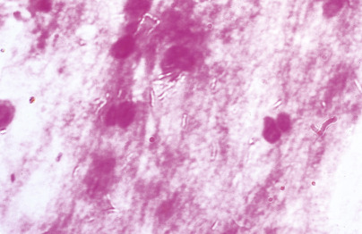
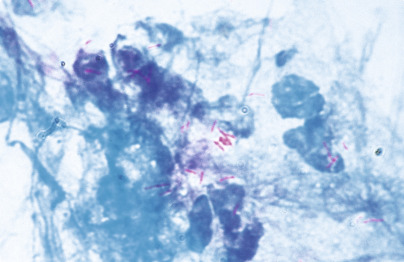
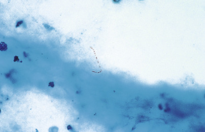

## Key Points

  * •

_Mycobacterium tuberculosis_ complex is the only mycobacterium that is transmitted from person to person and, therefore, is of public health importance. 

  * •

The Mantoux skin test and interferon-γ release assays are useful for identifying persons with latent _M. tuberculosis_ infection. 

  * •

For optimal detection of mycobacteria in clinical specimens, laboratories should use a fluorochrome stain and a liquid system with or without a concomitant solid medium for culture. 

  * •

Nucleic acid amplification testing for direct detection of _M. tuberculosis_ complex should be performed on respiratory specimens from patients with suspected tuberculosis. 

  * •

Susceptibility testing to the primary antituberculous agents (isoniazid, rifampin, ethambutol, and pyrazinamide) should be performed on all initial isolates of _M. tuberculosis_ complex. 

  * •

Infections caused by nontuberculous mycobacteria are acquired from the environment (e.g., water). 

  * •

The nontuberculous mycobacteria most commonly encountered in the clinical laboratory are _Mycobacterium avium_ complex, which causes pulmonary disease and, in immunocompromised patients, disseminated disease; the rapidly growing mycobacteria _Mycobacterium chelonae/Mycobacterium abscessus_ group and _Mycobacterium fortuitum_ group, which most often cause skin and soft-tissue infections; _Mycobacterium kansasii_ , which causes pulmonary infection; and _Mycobacterium marinum_ , which causes skin and soft-tissue infections. 

  * •

Molecular tests are becoming the standard for identification of mycobacteria and an important adjunct to phenotypic methods for susceptibility testing of _M. tuberculosis_ . 

Mycobacteria are aerobic, nonmotile, acid alcohol–fast, slightly curved or straight bacilli. The organisms contain high molecular weight (60 to 90 carbons) mycolic acids in their cell walls that on pyrolysis release C22 to C26 straight-chain saturated long-chain acids. Their guanine plus cytosine DNA-based content ratios are in the range of 62 to 70 mol%. Mycobacteria can be divided into two groups: those in the _Mycobacterium tuberculosis_ complex and nontuberculous mycobacteria. 

,  

##  _Mycobacterium Tuberculosis_ Complex 

The tubercle bacilli that make up the _M. tuberculosis_ complex (MTBC) include _Mycobacterium tuberculosis, Mycobacterium bovis, M. bovis Bacille Calmette-Gu érin _ strain (BCG), _Mycobacterium caprae, Mycobacterium pinnipedii, Mycobacterium africanum, Mycobacterium microti,_ and _Mycobacterium canettii._ The species that most commonly infects humans is _M. tuberculosis. M. bovis,_ which infects many warm-blooded animals (e.g., cattle, dogs, cats, pigs, badgers, deer, elk, and some birds) as well as primates and humans, is responsible for a small fraction of tuberculosis (TB) cases today. M. bovis BCG is used for vaccine purposes in many countries outside the United States. It also is administered intravesically to induce immunostimulation against bladder cancer, and in such situations rarely may cause disseminated disease. _M. africanum_ causes TB in humans in tropical Africa but has been reported elsewhere, including the United States, primarily in persons who had lived in Africa. _M. caprae_ predominantly infects goats, but also infects cattle and rarely humans (  Kubica, 2003  ). _M. microti_ was originally isolated from rodents, but has caused TB in other warm-blooded animals and rarely in humans (  Emmanuel et al, 2007  ). _M. canettii_ was first collected in 1969 by Georges Canetti, and it was recognized many years later as having the potential to cause disease in humans (  Castets et al, 1968  ;  van Soolingen et al, 1997  ;  Pfyffer et al, 1998  ). The natural host of _M. pinnipedii_ is sea lions, but it can infect other animals and apparently may be transmitted to humans (  Kiers et al, 2008  ). 

According to the World Health Organization, the global burden of TB has declined slowly over the past several years, but it remains high ( [ http://www.who.int/tb/publications/global_report/en/ ](<http://www.who.int/tb/publications/global_report/en/>) ). In 2012, there were an estimated 8.6 million (range, 8.3 million to 9.0 million) incident cases of TB worldwide. Of these, 0.5 million occurred in children, 2.9 million in women, and 1.1 million in persons infected with HIV. An estimated 450,000 of these cases were multidrug resistant (MDR-TB), defined as resistance to rifampin or any two of the other primary antituberculous drugs (discussed later in the chapter). Fifty-eight percent of the total TB cases occurred in Southeast Asia and Western Pacific regions, 28% in the African region, 8% in the Eastern Mediterranean region, 4% in the European region, and 3% in the region of the Americas. The five countries with the highest number of cases were India, China, South Africa, Indonesia, and Pakistan. The lowest rates were in the United States, Canada, Western Europe, Japan, Australia, and New Zealand. An estimated 1.3 million people died from TB in 2012, of which 320,000 were infected with HIV and 170,000 had MDR-TB. 

In the United States, TB was the leading cause of death at the turn of the 20th century. Mortality then decreased, initially because of public health efforts and later because of antituberculous drugs. Between 1953, when TB became notifiable on a national basis, and 1984, the incidence of TB steadily decreased (  Rieder et al, 1989  ). From 1985 to 1992, a resurgence of TB cases was seen, in large part because of the spread of human immunodeficiency virus (HIV), deterioration of the health care infrastructure, and an increase in the number of cases reported among foreign-born persons. In addition to the resurgence, MDR-TB emerged and remains a concern, although to a much lesser degree than in developing countries. Since 1992, the incidence of TB in the United States has declined each year, and MDR-TB has become uncommon. In 2013, 9588 new cases of TB were reported (incidence, 3.0 cases per 100,000 population); this represents a 4.2% decrease from 2012 (  Centers for Disease Control and Prevention, 2014b  ). The rate among foreign-born persons was about 13 times greater than the rate among U.S.-born persons, and rates among non-Hispanic Asians were nearly 26 times greater than among non-Hispanic whites. Over half (51.3%) of the cases occurred in California, Texas, New York, and Florida. Eighty-six cases of MDR-TB were reported in 2012 (the most recent year for which drug-susceptibility test results are complete), and 88.4% of these occurred in foreign-born persons. Appropriate treatment of MDR-TB is critical, because mismanagement can result in extensively drug-resistant TB (XDR-TB), defined as MDR-TB plus resistance to any fluoroquinolone and any second-line injectable antituberculosis agent (e.g., amikacin, kanamycin, capreomycin). 

Tubercle bacilli are transmitted primarily via inhalation of dried residues of small infected droplets (1 to 10 µm in diameter). Infection also may be acquired by direct inoculation of abraded skin—an event most likely to occur when pathologists or other laboratory personnel handle infected tissues. In addition, _M. bovis_ may be transmitted from cattle to humans by drinking contaminated raw milk or by respiratory exposure to live infected cattle or their carcasses, from humans to cattle via exposure to urine from persons with urinary tract infections due to _M. bovis_ , and from cattle and wild reservoirs to cattle probably by respiratory secretions. 

The most important source of infection is an undiagnosed person with cavitary (and sputum smear–positive) pulmonary disease. The risk for active pulmonary disease is low after one exposure to the organism but increases under conditions of stress or in a confined environment where repeated exposures to the organism occur. Most persons who become infected with _M. tuberculosis_ do not develop active disease. The lifetime risk for active disease is 5% to 10% for immunocompetent persons. For persons infected with both MTBC and HIV, in contrast, the risk for developing TB is 7% to 10% per year. 

Persons at increased risk for MTBC infection are close contacts of those with known or suspected active TB, foreign-born persons from an area with a high incidence of active TB (e.g., Asia, Africa), persons who visit a country with a high prevalence of active TB, residents and employees of congregate settings whose clients are at increased risk for active TB (e.g., correctional facilities, homeless shelters), health care workers who care for patients at increased risk for active TB, and persons who abuse drugs or alcohol. Factors that increase the risk for progression of infection to active TB include HIV infection, age younger than 5 years, immunosuppressive therapy, infection with MTBC within the past 2 years, history of inadequately treated active TB, silicosis, diabetes mellitus, chronic renal failure, various cancers, gastrectomy or jejunoileal bypass, weight <90% of ideal body weight, cigarette smoking, and abuse of drugs and/or alcohol. 

Based on analysis of its genomic sequence, _M. tuberculosis_ does not appear to encode typical bacterial virulence factors (e.g., toxins). However, certain genes and gene products have been identified as key factors enabling _M_ . _tuberculosis_ to cause disease. _PhoP_ has been shown to have an important role in virulence, because _phoP_ mutants grow very poorly in macrophages and in mice (  Ryndak, 2008  ). Phthiocerol dimycocerosates, which are lipids found at the outermost layers of the cell envelope, are required for optimal multiplication and persistence of _M. tuberculosis_ in mice lungs, and phenolic glycolipids are thought to be involved in the hypervirulence of certain _M. tuberculosis_ strains (  Gordon et al, 2009  ). In addition, the ESX secretion systems, which are specialized secretion systems present in many gram-positive bacteria, are important in pathogenesis, because mutants lacking the system or its substrates are attenuated in cultured macrophages and animal models of infection. Mutants with a deletion spanning much of the ESX-1 locus demonstrate defective cell-to-cell spread, altered cytokine profiles, and failure to inhibit phagolysosome fusion in cultured cells (  Tobin, 2008  ). 

The usual host response to infection with MTBC is activation of the cell-mediated immune system. During primary (initial) infection, inhaled bacilli travel to the alveolar spaces, where they are ingested by resident macrophages. These macrophages are unable to kill the tubercle bacilli, which multiply intracellularly during the first several days after infection. Macrophages infected with mycobacteria migrate to regional tracheobronchial lymph nodes and present sensitizing antigen(s) to immunocompetent T cells, or they enter the lymphatics and blood and travel back to the lungs (primarily the apices) and to distant organs such as lymph nodes, kidneys, epiphyseal areas of the long bones, vertebral bodies, and meninges, where bacilli continue to multiply until the cellular immune response is activated. 

Immunocompetent T cells migrate from regional lymph nodes to the site of infection in the lung. There they release chemotactic, migration-inhibitory, and mitogenic cytokines, which stimulate recruitment of blood-derived monocytes and lymphocytes, macrophage and lymphocyte division, and macrophage activation. Activated macrophages have enhanced microbicidal activity, and they produce cytokines such as interleukin-1, interferon-γ, and tumor necrosis factor, which stimulate or regulate other components of the immune system, properties that help control infection. The cytokines and lytic enzymes released by the macrophages also contribute to concomitant local tissue destruction. Over time, the activated T cell population declines and is replaced by long-lived memory immune T cells, which protect against reinfection with MTBC and provide some cross-protection against infection with other mycobacteria. Despite the limitation of further mycobacterial multiplication in primary and metastatic foci by the activated macrophages and memory T cells, a residual nidus of infection remains indefinitely in the lung (most frequently in the apex, where the oxygen tension is high) and less often in distant sites. Therefore, the potential for reactivation of disease in these quiescent foci exists during periods of immunosuppression. 

The primary focus of pulmonary infection, called the _Gohn lesion_ , is usually subjacent to the pleura in the lower part of the upper lobes or in the upper part of the lower lobes of one lung, corresponding to areas of the lung that receive the greatest volume flow of inspired air. Lesions (tubercles) are well-circumscribed, 1- to 2-cm–diameter areas of grayish white consolidation with soft to necrotic centers. Similar-appearing tubercles typically are found in the regional tracheobronchial lymph nodes, and these plus the primary lung lesion are termed the _Gohn complex._ Microscopically, tubercles are composed of well-circumscribed caseating or noncaseating granulomas; organisms may be seen in sections stained with an acid-fast stain. Over time, these lesions are replaced by hyalinized fibrous tissue and eventually calcify. Lesions of miliary tuberculosis are small (one to several millimeters in diameter), distinct, yellow-white areas of consolidation without gross caseation that histologically resemble tubercles. The ability to form granulomas depends on the immunocompetence of the host. Individuals infected with HIV, for example, may have extensive necrosis, many neutrophils, microabscesses, and numerous acid-fast bacilli (AFB), without granulomas. 

In the United States, pulmonary TB accounts for about 85% of cases of active disease. The clinical presentation may be insidious, with gradual onset of constitutional symptoms over months: catarrhal, with productive cough often attributed to a bad cold or lingering bronchitis; pneumonia- or flu-like, with high fever, aches and pains, and cough; hemoptoic, with acute onset of blood-streaked sputum; or pleuritic. Extrapulmonary TB may be localized but more commonly involves multiple organs with or without concurrent lung infection. Multiorgan TB occurs predominantly in infants and young children, older adults, and immunocompromised individuals, especially those infected with both HIV and MTBC. Additionally, most infections with _M. bovis_ in the United States are extrapulmonary, involving lymph nodes, the gastrointestinal tract, bones, and kidneys, and most commonly occur in children of Hispanic ethnicity (  Hlavsa et al, 2008  ;  Rodwell et al, 2008  ). Infrequently, infection follows intravesical instillation of _M. bovis_ BCG for treatment of superficial bladder carcinoma (  Lamm et al, 1992  ;  Kristjansson et al, 1993  ). 

,  

##  Nontuberculous Mycobacteria 

The nontuberculous mycobacteria (NTM; also called _mycobacteria other than tubercle bacilli_ ) may be categorized on the basis of colony pigmentation before and after exposure to light and growth rate on a solid medium as described by Runyon in 1957 ( [ Table 61-1 ](<#t0010>) ) (  Runyon, 1959  ). This classification system, however, has limits. For example, _M. kansasii_ is usually a photochromogen but rarely is nonchromogenic or scotochromogenic. Members of the _M. avium_ complex are nonchromogenic in Runyon's scheme, but some isolates produce slightly pigmented colonies after prolonged incubation, potentially causing incorrect classification as a scotochromogen. _Mycobacterium szulgai_ is a scotochromogen at 37° C and a photochromogen at 25° C. Moreover, when a liquid medium is used for mycobacterial culture, as is currently recommended (discussed in the section regarding culture methods), growth rates used by Runyon for classification do not apply. _Mycobacterium leprae_ is unique among mycobacteria by virtue of the fact that it has not yet been cultivated in vitro. 

TABLE 61-1 

Runyon's Classification of the Nontuberculous Mycobacteria 

Classification  |  Description of Colonies   
---|---  
Photochromogen  |  Not pigmented unless exposed to light (optimally during their early growth and with good aeration of the surface)   
Scotochromogen  |  Pigmented when grown in the dark and in light   
Nonchromogen  |  Not pigmented when grown in the dark or in light   
Rapid grower  |  Growth on solid media in ≤7 days   
  
In general, little is known about the antigens associated with virulence of the NTM, and the immune response to infection with these mycobacteria is poorly understood. With current molecular techniques, more than 100 species of NTM have been identified. Select potential pathogens are reviewed in the following sections. An extensive description of the more recently described and infrequently isolated mycobacteria is found in the excellent review by  Tortoli (2003)  . _Mycobacterium gordonae,_ often referred to as the “tap water bacillus,” is a common laboratory contaminant and rarely causes disease in humans. 

 

##  _Mycobacterium Avium_ Complex 

The _M. avium_ complex (MAC) is a heterogeneous group of mycobacteria classically composed of two taxa: _M. avium,_ which clinically appears to be the more important pathogen in disseminated disease, and _Mycobacterium intracellulare,_ which appears to be more important in respiratory disease _._ However, with the availability of molecular tools, new species and subspecies have been discovered. Currently, the species _M. avium_ consists of three subspecies: subsp. _avium,_ subsp. _silvaticum,_ and subsp. _paratuberculosis_ . New species that have been proposed are _M. chimaera_ sp. nov _., M. colombiense, M. vulneris, M. marseillense, M. timonense,_ and _M. bouchedurhonense._ These species have such similar growth characteristics and biochemical reactions that they often are not distinguished in the clinical microbiology laboratory; isolates commonly are reported as MAC. 

MAC bacilli are ubiquitous in the environment. They have been isolated from water, soil, food, house dust, and several animals, but the specific environmental sources responsible for human infection are not known (  Inderlied et al, 1993  ;  Falkinham, 1996  ). The most likely portal of entry is the gastrointestinal tract, but transmission via the respiratory tract is also possible. From sites of colonization, organisms enter the blood and infect many organs, especially those of the monocyte-macrophage system. In many clinical microbiology laboratories in the United States today, MAC is the most frequently isolated mycobacterium. 

For many years, pulmonary disease caused by MAC occurred most often in white older adult men who had underlying chronic lung disease or who had undergone gastrectomy; however, since the mid to late 1980s, it has become more common in persons without predisposing factors, especially older women (  Prince, 1989  ;  Dhillon & Watanakunakorn, 2000  ;  Griffith et al, 2007  ). Disseminated MAC occurs almost exclusively in immunosuppressed individuals, especially persons with advanced acquired immunodeficiency syndrome (AIDS). In the United States, MAC was the most common cause of systemic bacterial infection in patients with AIDS in the late 1980s and early 1990s (  Horsburgh, 1991  ). The numbers of such cases, however, decreased since highly active antiretroviral therapy became widely available (  Centers for Disease Control and Prevention, 2009a  ). The major risk factor for disseminated MAC in AIDS patients is the degree of immune dysfunction, indicated by the CD4  \+  lymphocyte count, as the disease is rare in individuals whose CD4  \+  lymphocyte count is over 50/µL. 

Manifestations of disease caused by MAC depend on the site and the extent of infection. Pulmonary disease may manifest as bronchiectasis or may mimic TB. Disseminated disease in persons without AIDS is manifested by fever, weight loss, bone pain, lymphadenopathy, hepatosplenomegaly, and skin lesions. In those with AIDS, persistent fever, weight loss, and diarrhea are most common; anorexia, weakness, lymphadenopathy, or hepatomegaly also may occur (  Inderlied et al, 1993  ;  Griffith et al, 2007  ;  Centers for Disease Control and Prevention, 2009a  ). Significant laboratory abnormalities include anemia and elevated alkaline phosphatase. Cervical lymphadenitis caused by MAC most often affects children but also occurs in adults. Other manifestations of infection with MAC are synovitis, genitourinary tract disease, cutaneous lesions, deep infection of the hand, osteomyelitis, meningitis, ulcer of the colon, and pericarditis (  Wolinsky, 1979  ;  Woods & Washington, 1987  ;  Inderlied et al, 1993  ). 

The histologic findings of lesions caused by MAC vary. Caseating granulomas with AFB, indistinguishable from TB; pulmonary interstitial fibrosis with organizing pneumonia; necrotizing granulomatous vasculitis resembling Wegener's granulomatosis; and, especially in persons with AIDS, aggregates of foamy macrophages containing many intracellular AFB may be seen. 

 

##  Mycobacterium Kansasii 

_M. kansasii,_ first described as the _yellow bacillus,_ accounted for 3% of mycobacterial isolates in the United States in 1979 and 1980; the highest numbers of cases were reported from California, Texas, Louisiana, Illinois, and Florida (  Buhler & Pollack, 1953  ;  Good & Snider, 1982  ). The natural reservoir of _M. kansasii_ is unknown; however, it has been recovered from water samples (  Falkinham, 1996  ). Pulmonary disease is most common in males 50 to 60 years of age living in urban areas, among certain occupational groups (miners, welders, sandblasters, and painters), and among individuals with pneumoconioses and chronic obstructive pulmonary disease. Disseminated disease generally affects persons with impaired cellular immunity. 

The most common manifestation of disease caused by _M. kansasii_ is chronic cavitary pulmonary lesions, usually involving the upper lobes (  Griffith et al, 2007  ). Extrapulmonary manifestations include cervical lymphadenitis in children, cutaneous disease, musculoskeletal involvement (carpal tunnel syndrome, synovitis, arthritis, tendinitis and fasciitis, or osteomyelitis), disseminated disease, isolated genitourinary tract disease, and pericarditis. Histologic findings of lesions caused by _M. kansasii_ vary and include caseating or noncaseating granulomas and, especially in skin lesions, necrosis or foci of acute and chronic inflammation without well-formed granulomas. AFB are common in lung and lymph node tissue but are seen less frequently in tissue from other sites. 

 

##  Mycobacterium Xenopi 

_M. xenopi_ was first isolated from a toad in 1957 and was recognized as a human pathogen in 1965 (  Costrini, 1981  ). It has been cultured from hot and cold water taps, hospital hot water generators and storage tanks, and other environmental sources. Birds are a possible natural reservoir. Most pulmonary infections caused by _M. xenopi_ have been reported from Canada, Europe, and Great Britain; it is an uncommon cause of mycobacterial disease in the United States. Disease has occurred only in adults, more frequently in males than in females. Most persons have preexisting lung damage or another predisposing condition, such as an extrapulmonary malignancy, alcoholism, diabetes mellitus, or immunosuppressive therapy. Pulmonary disease may be chronic, subacute, or acute; symptoms are indistinguishable from those associated with disease caused by _M. kansasii_ . Focal extrapulmonary infections (osteomyelitis, arthritis, lymphadenitis) and disseminated disease are uncommon, but the latter has been reported in persons with AIDS (  Tecson-Tumang & Bright, 1984  ). 

 

##  Mycobacterium Genavense 

_M. genavense_ was first isolated in 1991 in Switzerland from the blood of a patient with AIDS (  Böttger et al, 1991  ). Conditions for detection in the laboratory were described shortly thereafter (  Coyle et al, 1992  ). Disease occurs predominantly in immunocompromised patients. The most common presentation is disseminated disease in HIV-infected patients, which clinically is very similar to disseminated MAC (  Maschek et al, 1994  ;  Tortoli et al, 1998  ;  Griffith et al, 2007  ). Other manifestations include enteritis, genital and soft-tissue infections, and lymphadenitis. 

 

##  Mycobacterium Marinum 

_M. marinum_ was recognized as a human pathogen in 1951 (  Norden & Linell, 1951  ). It causes chronic granulomatous infections involving skin and soft tissue, often called _swimming pool granuloma_ or _fish tank granuloma,_ and occasionally bone (  Lewis et al, 2003  ;  Aubry et al, 2002  ;  Griffith et al, 2007  ). Human infection is typically acquired via trauma to the skin during contact with contaminated nonchlorinated fresh water or salt water, but it may be acquired via trauma unassociated with water contact or contact with water in the absence of preceding trauma. A single papulonodular lesion usually appears 2 to 3 weeks after inoculation, most commonly on the elbow, knee, foot, toe, or finger, and often becomes verrucous or ulcerated (  Ang et al, 2000  ). Occasionally, an abscess forms at the site of inoculation, and several secondary nodules develop and progress centrally along the lymphatics, resembling sporotrichosis. In immunocompromised persons, cutaneous lesions may become disseminated. Extracutaneous manifestations are uncommon: Synovitis, osteomyelitis, and ocular and laryngeal lesions have been reported (  Woods & Washington, 1987  ). 

The histology of skin lesions varies with the stage of infection. Early on, neutrophil aggregates are surrounded by histiocytes. Later, lymphocytes, epithelioid histiocytes, occasional Langhans giant cells, and foci of fibrinoid necrosis are seen. In lesions present for longer than 6 months, aggregates of lymphocytes are found in the dermis. Stains for AFB are usually negative, but organisms may be seen within histiocytes. 

 

##  Mycobacterium Haemophilum 

_M. haemophilum_ was first described in 1978 but very probably was the nonculturable AFB recognized in skin ulcers in 1972 and 1974 (  Lomwardias & Madge, 1972  ;  Feldman & Hershfield, 1974  ;  Sompolinsky et al, 1978  ). The organism is unique among mycobacteria in its growth requirement for hemoglobin or hemin. Human infections caused by _M. haemophilum_ are uncommon, usually seen in persons who have an underlying immunodeficiency such as lymphoma, exogenous immunosuppression after organ transplantation, or AIDS, but lymphadenitis in otherwise healthy children has been reported (  Centers for Disease Control and Prevention, 1991  ;  Lindeboom et al, 2005  ). Disease most commonly is manifested by multiple cutaneous nodules, ulcers, or painful swellings, typically involving the extremities, which occasionally become abscesses and open fistulas draining purulent material. Microscopically, lesions show foci of necrosis without caseation surrounded by a polymorphous inflammatory infiltrate with occasional Langhans giant cells in the lower dermis. AFB are seen singly or in small clusters, often within cells. 

 

##  Mycobacterium Ulcerans 

_M. ulcerans_ is endemic in areas of Zaire, Uganda, Nigeria, Ghana, Cameroon, Malaysia, New Guinea, Guyana, Mexico, and Australia located between latitudes 25° N and 38° S. In all endemic areas, disease is more frequent among children younger than 15 years of age and is slightly more common in males (  Debacker et al, 2004  ;  Piersimoni & Scarparo, 2009  ). The natural reservoir of _M. ulcerans_ and the usual route of its transmission to humans remain unknown. 

Eponyms for disease caused by _M. ulcerans_ include _Bairnsdale ulcer,_ for the area in Australia where it was first recognized, and _Buruli ulcer_ or _Buruli disease,_ after the area of Uganda reporting the greatest number of cases (  Amofah et al, 2002  ). The disease begins as one or, rarely, multiple painless boils or subcutaneous lumps on an exposed area, most often the leg, which possibly was a site of previous trauma. After several weeks, the lump ulcerates, and satellite nodules and ulcers may appear. Lymph nodes typically are not enlarged, and affected individuals are afebrile and without systemic symptoms unless lesions become secondarily infected with bacteria. Unless treatment is begun early and adherence is good, the infection spreads to the bone, causing deformities. 

 

##  Rapidly Growing Mycobacteria 

Rapidly growing mycobacteria are ubiquitous; they have been cultured from soil, freshwater lakes and rivers, seawater, wastewater from hospitals, reagents and wash solutions used in hospitals, drinking water, raw milk, and dust. The species of rapidly growing mycobacteria that most commonly cause human disease are _M. fortuitum_ group (predominantly _M. fortuitum_ ) and _M. chelonae/M. abscessus_ group (predominantly _M. chelonae_ and _M. abscessus_ subsp _. abscessus_ [formerly _M. abscessus_ ]). Species within the _M. fortuitum_ group are _M. fortuitum, M. peregrinum, M. senegalense, M. setense, M. septicum, M. porcinum, M. houstonense, M. boenickei, M. brisbanense,_ and _M. neworleansense._ Identification to the species level requires molecular techniques, but in most cases has little clinical relevance; it may, however, be useful for certain epidemiologic applications. Species in the _M. chelonae/M. abscessus_ group are _M. chelonae, M. immunogenum, M. abscessus_ subsp. _abscessus, M. abscessus_ subsp. _bolletii_ (formerly _M. massiliense_ and _M. bolletii_ ), and _M. salmoniphilum_ . Differentiating _M. chelonae_ from _M. abscessus_ subsp. _abscessus_ is recommended because the latter is more resistant to antimicrobial agents (  Brown-Elliott & Wallace, 2001  ). Other rapidly growing mycobacteria associated with human disease are _Mycobacterium mucogenicum_ group _, Mycobacterium goodii, Mycobacterium cosmeticum, Mycobacterium neoaurum, Mycobacterium peregrinum, Mycobacterium canariasense,_ and, rarely, _Mycobacterium smegmatis_ (  Brown-Elliott & Wallace, 2002  ;  Griffith et al, 2007  ). 

The most common manifestation of disease due to rapidly growing mycobacteria is skin and soft-tissue infection, typically following a penetrating injury (trauma or surgical procedure) with possible soil or water contamination, although outbreaks have been associated with administration of diphtheria-pertussis-tetanus-polio vaccines, histamine injections, lidocaine administration using a jet injector, use of foot baths in nail salons, and liposuction (  Wallace, 1983  ;  Brown-Elliott, 2002  ;  Piersimoni & Scarparo, 2009  ). Primary cutaneous/subcutaneous disease may present as localized cellulitis, draining abscesses, or minimally tender nodules, generally appearing 3 weeks to 12 months (most often 4 to 6 weeks) after the penetrating injury in persons with an intact immune system. Osteomyelitis is an occasional complication, especially following puncture wounds to the feet. Postoperative infections are characterized by a nonhealing wound or breakdown of a healed wound with serous drainage in a person with minimal systemic symptoms. They generally develop 3 weeks to 3 months after the procedure, especially median sternotomy, augmentation mammaplasty, or insertion of a percutaneous catheter. Disseminated skin and soft-tissue abscesses in which no primary source of infection is evident typically occur in immunocompromised adults, especially those receiving corticosteroid therapy. 

A less common manifestation of infection with rapidly growing mycobacteria is chronic pulmonary disease. It is most often seen in patients with underlying cystic fibrosis or bronchiectasis, is usually caused by _M. abscessus,_ and typically resembles disease due to _M. kansasii_ or MAC, except that cavitation is uncommon. Endocarditis involving a prosthetic valve has been reported, usually becoming manifest 4 to 12 weeks after surgery. Rarely, rapidly growing mycobacteria cause keratitis and corneal ulceration after trauma, or cervical lymphadenitis. A very thorough description of disease caused by rapidly growing mycobacteria is found in the excellent review by  Brown-Elliott and Wallace (2002)  . 

Lesions caused by rapidly growing mycobacteria are characterized histologically by necrosis with minimal caseation and a mixed inflammatory infiltrate composed of neutrophils and granulomas with foreign body or Langhans giant cells; lipid-laden macrophages are seen occasionally. Clumps of extracellular AFB are found within aggregates of neutrophils in less than one third of cases. In lung tissue, foamy macrophages may be seen in a pattern resembling lipoid pneumonia. 

 

##  Mycobacterium Leprae 

_M. leprae_ is the etiologic agent of leprosy, also called _Hansen 's disease _ (  Scollard et al, 2006  ). It is unique among the mycobacteria by virtue of the fact that it has not been cultivated. Useful animal models of infection are the mouse footpad model and the nine-banded armadillo. _M. leprae_ has been recognized in nearly every part of the world at some time. The reported number of new cases worldwide registered each year remains between 500,000 and 700,000 (  Lockwood & Suneetha, 2005  ). During 1994 to 2011, there were 2.323 new cases of leprosy in the United States, with an average annual incidence rate of 0.45 cases per 1 million persons (0.13 cases per 1 million persons among U.S.-born persons versus 2.81 cases per 1 million persons among foreign-born persons (  Centers for Disease Control and Prevention, 2014a  ). Persons born in Oceania were the population with the highest rate of leprosy in the United States, with a rate of diagnosis more than 10 times that of any other region. 

Leprosy predominantly affects humans but is also a natural infection of wild armadillos in Louisiana, Arkansas, and Texas, and spontaneous cases have been described in mangabey monkeys (  Hastings et al, 1988  ). The mechanism of transmission of _M. leprae_ is unknown, but person-to-person spread via aerosolization of organisms from the nose of a person with active lepromatous disease (see later), which then contacts the nasal mucosa of another individual, is the favored theory. Transmission also may occur through intact skin or via penetrating wounds, such as thorns or the bite of an arthropod. Breast milk from lactating women with lepromatous disease contains bacilli that may be transmitted to infants, and transplacental transmission of _M. leprae_ is possible. Cases of human leprosy following contact with armadillos have been reported (  Lumpkin et al, 1983  ). Moreover, the discovery of a naturally occurring leprosy-like disease among armadillos and the fact that sporadic cases of leprosy occur in persons who have no known contact with human leprosy suggest that nonhuman sources of _M. leprae_ may exist (  Blake et al, 1987  ). 

Most persons effectively resist infection with _M. leprae_ . Resistance depends on an effective cell-mediated immune response to _M. leprae_ antigens, as occurs in tuberculoid leprosy. In persons who lack specific cell-mediated immunity to these antigens, bacilli multiply within macrophages, eventually resulting in widely disseminated lepromatous leprosy. The defect in cellular immunity, which may involve T lymphocyte function or interaction of T lymphocytes with macrophages, is apparently specific for antigens to _M. leprae_ rather than a generalized defect. The lesions of leprosy develop after a 2- to 5-year incubation period, varying in appearance depending on the host's immune response. Leprosy always involves peripheral nerves, almost always involves the skin, and frequently involves mucous membranes. The three cardinal signs of the disease are skin lesions, areas of cutaneous anesthesia, and enlarged peripheral nerves. 

The system outlined by Ridey and Jopling (presented in the following section) is still used to classify the spectrum of clinical and histopathologic forms of leprosy (  Ridley & Jopling, 1964  ). Indeterminate leprosy, the earliest sign of disease, is characterized by one or a few hypopigmented skin macules with minimal local sensory loss. In about 75% of cases, the disease heals spontaneously; in the rest, it progresses, often after a prolonged period. 

The polar types of leprosy—lepromatous leprosy, the widespread anergic form of the disease, and tuberculoid leprosy, the localized form—are stable clinically. Lepromatous leprosy is characterized by cutaneous lesions ranging from diffuse generalized skin involvement to widespread, symmetrically distributed nodules (called _lepromas_ ) filled with organisms. Lesions generally involve the cooler parts of the body surface: the anterior third of the eye, the nasal mucosa, and the superficial peripheral nerve trunks. In advanced disease, lesions are accompanied by sensory loss from involvement of dermal nerve fibers. Microscopically, lesions show foamy histiocytes containing many AFB; few or no lymphocytes; minimal intraneural inflammation; and many AFB in nerves, the perineurium, blood vessel walls, and arrector muscles. In tuberculoid leprosy, one or a few well-circumscribed anesthetic macules or plaques develop, often accompanied by an enlarged peripheral nerve near the skin lesions. Histologically, lesions demonstrate noncaseating granulomas in the nerves and dermis, extending to involve the basal layer of the epidermis; few, if any, AFB are present. Borderline leprosy, a clinically unstable condition, encompasses the types of disease between the polar forms. It may develop features more closely resembling tuberculoid disease through a process termed _upgrading,_ or features more like those of lepromatous disease, called _downgrading._

,  

##  Testing for Latent _M. Tuberculosis_ Infection 

Two types of tests may be used to detect latent infection with MTBC: the tuberculin skin test (TST) and interferon-γ release assays; however, neither will differentiate active disease from latent infection. With the TST, persons infected with MTBC develop a hypersensitivity reaction to proteins of the bacilli, which make up the skin test reagent purified protein derivative (PPD). The preferred method of skin testing is the Mantoux test, performed by intracutaneous injection of 0.1 mL of intermediate-strength (5 tuberculin units) PPD-S. The reaction is interpreted after 48 to 72 hours by measuring the diameter of induration in millimeters (  Huebner et al, 1993  ). Induration of 5 mm or greater is considered positive in persons infected with HIV, those who have had recent close contact with someone who has infectious TB, and those who have chest radiograph findings consistent with old healed TB. A reaction of 10 mm or greater is positive in persons who do not meet the previous criteria but who have other risk factors for TB. Included in this group are foreign-born persons from countries where the prevalence of TB is high (such as Asia, Africa, or Latin America); injection drug users; medically underserved, low-income populations, especially racial or ethnic minorities; residents of long-term care institutions; and persons who have a medical condition associated with increased risk for TB (e.g., silicosis, gastrectomy, jejunoileal bypass, 10% or more below ideal body weight, chronic renal failure, diabetes mellitus, treatment with high-dose corticosteroids or with other immunosuppressive drugs, malignancies). A reaction of 15 mm or greater is positive in all other persons. Interpretation is difficult in those immunized with BCG. 

False-positive PPD reactions may occur in persons with NTM infection and in those immunized with BCG. False-negative reactions may be due to poor technique or improper storage of the reagent. If the test is administered appropriately, false-negative reactions are uncommon in relatively healthy people but occur in up to 20% of individuals with known TB when they are first tested. Most of these false-negative reactions are attributed to the general illness and revert to positive after 2 to 3 weeks of therapy when health is restored. Factors causing a state of general anergy, such as protein malnutrition, concurrent viral infection, sarcoidosis, malignancy (especially lymphoma), immunosuppressive or corticosteroid therapy, and infection with HIV, also may cause a false-negative tuberculin reaction. 

The Mantoux test generally remains positive as long as viable bacilli persist in quiescent foci. However, the reaction may wane below positive with increasing age, a phenomenon that occurs most frequently in those older than 55 years of age. In these individuals, the reaction will be boosted (or become positive) if retesting is performed as early as 1 week after the first test, a reaction termed the _booster effect._

Interferon-γ release assays (IGRAs) became commercially available in the early 21st century (  Madkukar et al, 2008  ;  Lalvani & Pareek, 2009  ). These are in vitro tests that are based on the detection of interferon-γ released by T cells in response to _M_ . _tuberculosis_ proteins (ESAT-6, CFP-10, TB7.7) not present in _M. bovis_ BCG or most NTM (except _M. kansasii, M. szulgai,_ and _M. marinum_ ). Performance of IGRAs requires collection of blood during a single visit, and results are available within 24 hours. Advantages of IGRAs over the TST include improved sensitivity in immunosuppressed persons (although false-negative results may occur) and children, and much better specificity in persons who have been vaccinated with BCG (  Mori, 2009  ;  Ruhwald & Ravn, 2009  ). According to experts at the Centers for Disease Control and Prevention (CDC), IGRAs can be used in all circumstances in which the TST is used, with the following preferences (  Centers for Disease Control and Prevention, 2010  ). An IGRA is preferred for testing persons who have received BCG vaccine and persons from groups that have been shown to have a low rate of returning to have the TST read (e.g., homeless persons and drug users). A TST is preferred for testing children younger than 5 years of age, although use of both a TST and an IGRA may increase diagnostic sensitivity in this age group. More recent data have shown that using an IGRA as a substitute for TST to screen for latent MTBC infection in health care workers is problematic. For example, the Quantiferon Gold In-Tube assay has been shown to have an unacceptably high number of false-positive results, poor reproducibility, especially with values near the cutoff for a positive, and a low predictive value of conversions (i.e., negative to positive result from one year to the next) (  Joshi et al  2012  ). 

,  

##  Laboratory Diagnosis 

 

##  Specimens 

Specimens recommended for diagnosis of mycobacterial infection are listed in [ Table 61-2 ](<#t0015>) . Samples from contaminated sites such as sputum and other respiratory secretions, gastric secretions, urine, and feces must be decontaminated prior to inoculation of media to prevent normal flora from overgrowing and thus masking the presence of mycobacteria, which grow more slowly. Concentrating the specimen after decontamination increases the sensitivity of smear and culture. Specimens from normally sterile body sites such as blood, cerebrospinal fluid (CSF), pleural and peritoneal fluid, and tissues may be inoculated directly without decontamination. 

TABLE 61-2 

Mycobacterial Diseases and Specimens for Diagnosis 

Disease  |  Common _Mycobacterium_ Species  |  Specimens   
---|---|---  
Pneumonia  |  MTBC, _M. kansasii,_ MAC, _M. abscessus_ subsp. _abscessus_ |  Sputum (early morning, deep cough on 3 consecutive days), BAL fluid, lung tissue, pleural fluid, gastric contents   
Disseminated  |  MTBC, MAC  |  Blood, bone marrow, involved tissue   
Lymphadenitis  |  MTBC, MAC  |  Lymph node aspirate or biopsy   
Skin, soft tissue  |  _M. fortuitum, M. abscessus/M. chelonae_ group _, M. marinum, M. haemophilum, M. ulcerans_ |  Aspirate or biopsy of lesion   
_M. leprae_ |  Smears of nasal secretions and skin slits, biopsy of lesion   
Musculoskeletal  |  MTBC _, M. fortuitum, M. abscessus/M. chelonae_ group _, M. marinum, M. kansasii_ |  Joint fluid, synovium, bone   
Meningitis  |  MTBC  |  Cerebrospinal fluid   
Brain abscess  |  MTBC  |  Abscess material   
Genitourinary  |  _M. tuberculosis, M. bovis_ BCG  |  Urine (early morning), involved tissue—kidney, bladder ( _M. bovis_ BCG), endometrium, fallopian tube, prostate, seminal vesicles, epididymis   
Gastrointestinal  |  _M. tuberculosis, M. bovis_ , MAC  |  Tissue, feces   
Peritonitis  |  MTBC  |  Peritoneal biopsy, peritoneal fluid   
Hepatitis  |  MTBC, MAC  |  Liver tissue   
Pericarditis  |  MTBC  |  Pericardium, pericardial tissue   
Catheter-related infection  |  Rapidly growing mycobacteria  |  Blood   
  
_BAL,_ Bronchoalveolar lavage; _BCG,_ bacille Calmette-Guérin; _MAC, M. avium_ complex; _MTBC, M. tuberculosis_ complex. 

Modified with permission from Woods GL: Mycobacteria. In: Woods GL, Gutierrez Y, editors: _Diagnostic pathology of infectious diseases_ , Philadelphia, 1993, Lea & Febiger, p 378. 

Processing and inoculation of specimens for mycobacterial culture should be performed in a biologic safety cabinet. The _N_ -acetyl-  l  -cysteine (NALC)–sodium hydroxide procedure ( [ Fig. 61-1 ](<#f0010>) ) is the most common method used in the clinical laboratory to liquefy, decontaminate, and concentrate specimens for detection of mycobacteria. Potentially contaminated specimens should be refrigerated if they cannot be processed immediately. Before proceeding to the steps outlined in [ Figure 61-1 ](<#f0010>) , additional handling is necessary for some specimens. Gastric lavage specimens should be processed immediately, but if a delay cannot be avoided, traditionally it has been recommended that 10% sodium hydroxide should be added until the pH of the sample is neutral. However, data from one study suggest that neutralization may not be necessary (  Parashar et al, 2013  ). If more than 10 mL of gastric secretions is collected, the sample is centrifuged at 3000 to 3600 _g_ for 20 to 30 minutes, the supernatant is decanted, and the sediment is processed as shown in [ Figure 61-1 ](<#f0010>) . For feces, 1 to 2 g of a formed sample or 5 mL of a liquid specimen is placed in a 50-mL centrifuge tube, and sterile filtered distilled water is added to obtain a volume of 10 mL. The suspension is agitated on a vortex mixer, filtered through gauze, and then processed as outlined. Urine specimens are divided into two to four 50-mL centrifuge tubes and are centrifuged at 3000 to 3600 _g_ for 30 minutes. The supernatant is decanted, leaving about 2 mL of sediment in each tube. Tubes are mixed on a vortex mixer, sediments are combined, and, if necessary, distilled water is added to obtain a volume of 10 mL, which then is decontaminated as shown in [ Figure 61-1 ](<#f0010>) . 

Figure 61-1 

Protocol for decontamination, using 2% sodium hydroxide– _N_ -acetyl-  l  -cysteine, and concentration of specimens for detection of mycobacteria by smear and culture. 

 

##  Microbial Stains 

In smears stained with the Gram stain, most mycobacteria appear as slender, poorly stained, beaded gram-positive bacilli, but sometimes the bacilli do not take up the crystal violet or safranin and appear “gram neutral” or as “Gram ghosts” ( [ Fig. 61-2 ](<#f0015>) ). Similar ghost images of bacilli may be found in macrophages in smears stained with the Wright or Papanicolaou stain. In general, specimens (except blood) collected from persons with suspected mycobacterial infection should be examined microscopically for organisms. However, to improve cost efficiency, many laboratories do not prepare smears of specimens in which AFB rarely are seen, such as CSF, urine, and bone marrow. To prepare a smear, two to three drops of the concentrated sediment are spread uniformly on a microscope slide, which then is fixed for 15 minutes at 80° C or for 1 to 2 hours at 65° to 70° C on an electric hot plate. 

Figure 61-2 

Smear of a sputum specimen stained with Gram stain shows “ghost cells” (mycobacterial culture grew _Mycobacterium tuberculosis;_ Gram stain, 400×). 

Two types of stain detect AFB: carbol fuchsin (the classic Ziehl-Neelsen stain, which requires heating, and the cold Kinyoun stain) and the preferred fluorochrome stains (auramine-rhodamine and auramine-O), which are more sensitive. Smears stained with a carbol fuchsin stain are examined at 800× to 1000× magnification (oil immersion). Smears stained with a fluorochrome stain are examined at lower magnifications (250× and 400×); this allows visualization of more fields in less time. Cells of some rapidly growing mycobacteria stain poorly with fluorochromic stains and may not be detected; therefore, when the latter organisms are suspected pathogens (e.g., in postsurgical wound infection), restaining negative fluorescent smears with a carbol fuchsin stain is reasonable. Results are reported after 100 fields are viewed and should include a statement indicating whether the smear was prepared directly from the specimen or after decontamination and concentration. Guidelines for reporting results of smears stained for AFB are shown in [ Table 61-3 ](<#t0020>) (  Kent & Kubica, 1985  ). 

TABLE 61-3 

Guidelines for Reporting Smears for Acid-Fast Bacilli 

No. of AFB with Carbol Fuchsin Stain (1000×)  |  No. of AFB with Fluorochrome Stain (450×)  |  Report   
---|---|---  
0  |  0  |  No AFB seen   
1-2/300 F (3 sweeps)  |  1-2/70 F (11/2 sweeps)  |  Doubtful; repeat   
1-9/100 F  |  2-18/50 F (1 sweep)  |  1+   
1-9/10 F  |  4-36/10 F  |  2+   
1-9/F  |  4-36/F  |  3+   
>9/F  |  >36/F  |  4+   
  
_AFB,_ Acid-fast bacilli; _F,_ field; _sweep,_ scanning full length of a smear. 

Modified with permission from Kent PT, Kubica GP: _Public health mycobacteriology: A guide for the level III laboratory_ , Atlanta, 1985, Department of Health and Human Services. 

In smears stained with carbol fuchsin, AFB typically appear as purple to red, slightly curved rods (1 to 10 µm long and 0.2 to 0.6 µm wide), which often are beaded or banded ( [ Fig. 61-3 ](<#f0020>) ) but may also appear coccoid or filamentous. In general, the appearance of AFB does not provide species identification; however, cells of certain species have features that may be useful diagnostically. The formation of “cords” in smears of broth cultures is typical (but not diagnostic) of MTBC. Cells of _M. kansasii_ often appear as cross-barred bacilli ( [ Fig. 61-4 ](<#f0025>) ), larger than _M. tuberculosis_ and resembling a “shepherd's crook.” Cells of MAC are typically pleomorphic and occasionally coccobacillary and stain positively with the periodic acid–Schiff stain. Cells of _M. marinum_ are typically longer and broader than those of _M. tuberculosis_ and often show cross-banding. Cells of _M. leprae_ stain weaker than those of most other mycobacteria. 

Figure 61-3 

Smear of a sputum specimen shows acid-fast bacilli ( _Mycobacterium tuberculosis;_ Kinyoun, 400×). 

Figure 61-4 

Smear of an aspirate from an enlarged cervical lymph node shows a large, cross-barred, acid-fast bacillus ( _Mycobacterium kansasii;_ Kinyoun, 400×). 

(Courtesy of Vicki J. Schnadig, MD, Department of Pathology, University of Texas Medical Branch, Galveston, Tex.) 

The specificity of stains for AFB typically is 99% or more, and the sensitivity ranges from about 25% to about 75% (  Strumpf et al, 1979  ;  Murray et al, 1980  ;  Rickman & Moyer, 1980  ). False-positive results (positive stain, negative culture) may be caused by nonviable organisms, such as might occur in patients receiving antituberculosis therapy; prolonged decontamination, killing mycobacteria as well as contaminating bacteria; or cross-contamination during the staining procedure. Factors that influence the sensitivity of smear results include (1) patient population (persons with cavitary lesions are more likely than those without cavities to have a smear-positive sputum), (2) specimen type (respiratory specimens are more likely than other specimen types to be positive), (3) the number of specimens examined, (4) the number of AFB present in the sample (5000 to 10,000 organisms/mL of specimen are needed for a positive result), (5) the species present (specimens containing _M. tuberculosis_ or _M. kansasii_ are more likely to be positive than are those that contain other mycobacteria), (6) observer experience, and (7) the stain used. Fluorochromic stains are more sensitive and are easier to read than carbol fuchsin stains, and they are recommended by experts at the CDC (  Tenover et al, 1993  ). The CDC also suggests that for respiratory specimens, results of stained smears should be reported within 24 hours of specimen receipt, which means processing 7 days a week. 

 

##  Culture Methods 

For optimal recovery of mycobacteria from clinical specimens, inoculation of both a broth and a solid medium is recommended (  Tenover et al, 1993  ), because broth is more sensitive than solid media and provides more rapid detection of mycobacterial growth (  Anargyros et al, 1990  ;  Stager et al, 1991  ;  Abe et al, 1992  ). However, use of a broth system alone may be considered if data show that adding a solid medium does not enhance recovery of mycobacterial pathogens. 

Two types of solid media are used for mycobacterial culture: egg-based (Löwenstein-Jensen) and agar-based (Middlebrook 7H10, 7H11, and selective 7H11). These media are available in screw-cap tubes and flasks; agar-based media also are available in Petri dishes. Flasks are preferred to screw-cap tubes for safety reasons and because they provide a larger surface area for mycobacterial growth. Specimens from cutaneous lesions should be inoculated to one egg- or agar-based medium, and to ensure recovery of _M. haemophilum_ (see later), they also should be plated on chocolate agar, 5% sheep blood Columbia agar, Mueller-Hinton agar with Fildes supplement, or Löwenstein-Jensen containing 2% ferric ammonium citrate. To recover _M. genavense_ (from specimens or subcultures of liquid to solid media), solid media must be supplemented with mycobactin J _._ All cultures should be incubated at 37° C in an atmosphere of 5% to 10% carbon dioxide (CO  2  ), and tubed media should be incubated in a slanted position with caps loose for at least 1 week to ensure even distribution of the inoculum over the surface. For specimens from cutaneous sites, a second set of cultures should be inoculated and incubated at 30° C, because some mycobacteria that cause skin lesions— _M. marinum, M. haemophilum,_ the rapidly growing mycobacteria, and _M. ulcerans_ —grow optimally at the lower temperature. All cultures should be examined weekly for at least 6 weeks. 

The major advantage of culture on solid media is that it allows visualization of colony morphology and pigmentation, which is useful diagnostically, especially for distinguishing colonies of _M. tuberculosis_ from those of some NTM. The colony appearance and growth characteristics of commonly encountered mycobacteria are outlined in [ Table 61-4 ](<#t0025>) . Disadvantages of conventional solid media include prolonged time to growth of mycobacteria (colonies often are not visible on tubed solid media for 3 to 4 weeks or longer) and low sensitivity. Inoculation of Middlebrook agar plates, which then are examined under the microscope, allows more rapid detection of colonies (  Welch et al, 1993  ), but this procedure is labor-intensive, thus prohibiting its use in many clinical laboratories. 

TABLE 61-4 

Colony Morphology and Growth Characteristics of Mycobacteria Commonly Isolated in the Clinical Laboratory 

_Mycobacterium_ Species  |  Colony Morphology  |  Pigment  |  Growth Rate, Weeks  |  Comments   
---|---|---|---|---  
**Slowly Growing Mycobacteria**  
_M. tuberculosis_ |  Rough  |  N (buff)  |  3-6  |  Generally niacin and nitrate positive   
_M. bovis_ |  Rough; thin or transparent on LJ  |  N (colorless to buff)  |  4-6  |  Generally niacin and nitrate negative; resistant to pyrazinamide   
MAC  |  Smooth; small, thin, transparent or large, opaque, domed; ± rough  |  N  |  3-6  |  Colonies of some isolates become lightly pigmented with prolonged incubation; grows at 42° C   
_M. kansasii_ |  Rough, ± smooth, β-carotene crystals  |  P  |  3-6  |  Rare strains are N or S   
_M. gordonae_ |  Smooth  |  S  |  3-6  |  Common laboratory contaminant; rare strains are N   
_M. marinum_ |  Wrinkled, shiny; smooth, hemispherical; (rarely) rough, dry  |  P  |  2  |  Optimal growth, 30°-33° C   
_M. xenopi_ |  Smooth, filamentous extensions (“bird's nest”)  |  S  |  3-6  |  Growth at 42° C   
_M. haemophilum_ |  Rough, ± smooth  |  N  |  3-6  |  Optimal growth, 20°-32° C; requires hemin for growth   
_M. szulgai_ |  Smooth or rough  |  S, 37° C; P, 25° C  |  3-6  |   
**Rapidly Growing Mycobacteria**  
_M. abscessus_ |  Smooth; ± rough, wrinkled  |  N  |  <1  |   
_M. fortuitum_ group  |  Wrinkled  |  N  |  <1  |  Branching filaments often are present on periphery of colonies   
_M. chelonae_ |  Smooth  |  N  |  <1  |   
  
_MAC, M. avium_ complex; _N,_ nonchromogenic; _P,_ photochromogenic; _S,_ scotochromogenic. 

The semiautomated radiometric BACTEC TB460 was the first commercial broth-based method for growth and detection of mycobacteria. However, the instrument is no longer supported by the manufacturer and in most laboratories has been replaced by one of the fully automated, nonradiometric broth systems. Therefore, the BACTEC TB460 is not discussed further. 

For laboratories with a low number of requests for mycobacterial culture, the manually read MGIT tubes, which can be used to culture all specimen types except blood and urine, may be the most cost-effective option. These tubes contain modified 7H9 broth and have a fluorescent indicator embedded in silicone in the bottom. Tubes are inoculated with the specimen, an antibiotic mixture to inhibit growth of contaminating bacteria and a mycobacterial growth enrichment are added, and the tubes are capped and incubated at 37°C for at least 6 weeks. To detect mycobacterial growth, tubes are manually placed on top of a 365-nm ultraviolet transilluminator or in front of a Wood's lamp. The appearance of strong fluorescence in the sensor (a bright orange color on the bottom of the tube and meniscus) indicates growth. For laboratories with a high volume of requests, the totally automated BACTEC 960 (or 320) instrument, which continuously monitors tubes for fluorescence and signals those that are positive, is more appropriate. MGIT is as sensitive as the BACTEC TB460 for recovery of mycobacteria, but the mean time to detection of growth is a few days longer with MGIT (  Cornfield et al, 1997  ;  Pfyffer et al, 1997  ;  Hanna et al, 1999  ). 

In addition to the BACTEC MGIT 960/320, two other fully automated continuously monitoring systems for growth and detection of mycobacteria in specimens are commercially available: the MB/BacT system (bioMerieux, Durham, N.C.) (  Rohner et al, 1997  ;  Brunello et al, 1999  ) and the VersaTrek (previously called ESP Culture System II, currently distributed by Thermo Scientific, Lenexa, Kan.) (  Tholcken et al, 1997  ;  Woods et al, 1997  ). With each system, bottles are inoculated with specimen, an antibiotic mixture, and a growth supplement. The MB/BacT has one bottle type for blood and another bottle for all other specimen types. Bottles are then incubated in the respective instrument, where they are monitored for changes in production or production and consumption of various gases, indicating growth of mycobacteria or other organisms. In general, these systems perform comparably with the BACTEC TB460 and offer the advantages of being fully automated, and thus less labor-intensive, and nonradiometric. 

 

##  Tests for Identification of Mycobacteria 

Identification of mycobacteria has traditionally been based on rate of growth on a solid medium, colony morphology (rough or smooth) and pigmentation with and without exposure to light, and results of biochemical tests (described in detail elsewhere [  Kent & Kubica, 1985  ]). Biochemical test results, however, are not usually available for several weeks to months after colonies appear on solid media, and for identification of MTBC especially, more rapid methods are recommended (  Tenover et al, 1993  ). Additionally, biochemical testing frequently does not provide unequivocal identification at the species level. 

Currently, the most rapid method for diagnosis of pulmonary TB is the use of a nucleic acid amplification test (NAAT) for direct detection of MTBC in clinical specimens (  Piersimoni & Scarparo, 2003  ). These tests, however, do not differentiate the species in the MTBC. Three NAATs are available worldwide for testing respiratory specimens: amplified _Mycobacterium tuberculosis_ Direct Test (Gen-Probe, Inc., San Diego), AMPLICOR _Mycobacterium tuberculosis_ Test (Roche Diagnostic Systems, Inc., Branchburg, N.J.), and the Xpert MTB/RIF assay (Cepheid, Sunnyvale, Calif.), which became available for use in the United States in 2012. The BDProbeTec ET System (BD Biosciences) is available outside the United States only. The AMPLICOR and Xpert assays have been cleared by the Food and Drug Administration (FDA) for testing AFB smear-positive respiratory specimens only. The Gen-Probe test is approved for testing smear-positive and smear-negative respiratory specimens. Data suggest that NAATs may be useful in AFB smear-negative patients at high risk for TB (e.g., persons infected with HIV, incarcerated persons in correctional facilities), allowing more rapid diagnosis and earlier initiation of treatment (  Gamboa et al, 1998  ;  Bergmann et al, 1999  ). The sensitivity of NAATs is generally slightly lower for nonrespiratory specimens, but they may be useful for diagnosis of some cases of extrapulmonary TB, especially when the AFB smear is positive. In 2009, the CDC updated its guidelines for use of NAATs for diagnosis of pulmonary TB, recommending that it should be performed on at least one respiratory specimen from each patient with consistent signs and symptoms for whom a diagnosis of TB is being considered but has not yet been established, and for whom the test result would alter management or TB control activities (  CDC, 2009b  ). 

The Xpert MTB/RIF assay is technically much less demanding than the other NAATs, and it has the added advantage of also detecting rifampin resistance. The assay has two components: (1) a plastic cartridge containing liquid sample-processing and PCR buffers and lyophilized real-time PCR reagents, and (2) the GeneXpert instrument, which performs sample processing and real-time PCR in a single hands-free step. It simultaneously detects _M_ . _tuberculosis_ and rifampin resistance by PCR amplification of the 81-bp fragment of the _M_ . _tuberculosis rpo β _ gene and subsequent probing for mutations associated with rifampin resistance. Approved specimen types are raw sputum and concentrated sputum sediments. Total hands-on time is less than 5 minutes per specimen, and results are available in less than 2 hours. The sensitivity versus culture for identifying _M. tuberculosis_ when testing sputum specimens is 98% to 100% for AFB smear-positive samples and 69% to 72% for smear-negative samples; specificity in studies to date has been 100% (  Boehme et al, 2010  ;  Helb et al, 2010  ;  Zeka et al, 2011  ). 

Chemiluminescent DNA probes allow identification of a few species or a species complex of mycobacteria within 1 to 2 hours after sufficient growth is present (on a solid or in a liquid medium) (  Evans et al, 1992  ;  Goto et al, 1992  ;  Lebrun et al, 1992  ;  Reisner et al, 1994  ). Commercial probes specific for MTBC, MAC, _M. avium, M. intracellulare, M. gordonae,_ and _M. kansasii_ are currently available. Testing requires minimal equipment (i.e., luminometer, sonicator, and heating block). Disadvantages of the probes include failure to identify some isolates of MAC, especially when testing growth from a liquid medium; false-positive results with the MAC probe when testing aliquots of broth cultures (  Cloud et al, 2005  ); and rare false-positive results with the MTBC probe (  Bull & Shanson, 1992  ;  Lebrun et al, 1992  ;  Butler et al, 1994  ). 

Several non–FDA-approved methods have been shown to provide accurate identification of the most commonly encountered mycobacteria. A relatively recently introduced technique is matrix-assisted laser desorption ionization-time of flight mass spectrometry, which provides rapid identification of growth on a solid medium (  Saleeb et al, 2011  ). This technique requires an expensive instrument, but the reagent-cost for identification is very low. Additionally, the instrument can be used to identify bacteria and fungi, in addition to mycobacteria, and it is technically simple to use. High-performance liquid chromatography allows identification of mycobacterial colonies on a solid medium or growth in a liquid medium in 2 to 4 hours. This technique was used in public health and some reference laboratories for many years but more recently has lost popularity due to the availability of other more accurate and less time-consuming techniques, such as reverse hybridization (line-probe) assays (  Wu et al, 2007  ;  Hoffman-Thiel et al, 2011  ;  Mitarai et al, 2012  ). Line-probe assays perform best using colonies on a solid medium or broth from a positive liquid culture, although direct testing of AFB smear-positive specimens is possible. With line-probe assays, the target sequences are first amplified by PCR using biotinylated primers. The amplified product is then applied to a nitrocellulose strip to which multiple probes are immobilized. Lines form at the site of amplicon-probe hybridization, and the pattern is compared with a key, allowing interpretation of the results and identification of the isolate. The most accurate identification method is sequencing, most commonly of the hypervariable regions of the 16S ribosomal RNA gene (  Patel, 2000  ;  Cloud et al, 2002  ;  Hall, 2003  ;  Wu et al, 2007  ). Molecular typing methods, such as spoligotyping (spacer oliogotyping), are useful for identifying members of the MTBC to the species level (  Mostowy et al, 2004  ). These techniques, which are technically complex and require expensive equipment, are performed predominantly in research and large reference laboratories. 

 

##  Susceptibility Testing 

Susceptibility testing of mycobacteria should be performed according to guidelines of the Clinical and Laboratory Standards Institute (CLSI M24-A2, 2011). Primary and secondary drugs that should be tested are listed in [ Table 61-5 ](<#t0030>) . 

TABLE 61-5 

Drugs Recommended for Susceptibility Testing of Mycobacteria 

_Mycobacterium_ Species  |  Indication  |  Drugs   
---|---|---  
MTBC  |  Primary  |  Isoniazid, [ * ](<#hl0000361>) rifampin, ethambutol, [ * ](<#hl0000361>) pyrazinamide   
Secondary  |  Capreomycin, ethionamide, ethambutol (higher concentration), amikacin, kanamycin, levofloxacin, ofloxacin, moxifloxacin, isoniazid (higher concentration), _p_ -aminosalicylic acid, rifabutin, streptomycin   
MAC  |  Primary  |  Clarithromycin   
Secondary  |  Moxifloxacin, linezolid   
_M. kansasii_ |  Primary  |  Rifampin   
Secondary  |  Amikacin, ciprofloxacin, clarithromycin, [ † ](<#hl0000364>) ethambutol, isoniazid, moxifloxacin, rifabutin, streptomycin, trimethoprim-sulfamethoxazole   
_M. marinum_ |  Primary  |  Amikacin, ciprofloxacin, clarithromycin, doxycycline or minocycline, moxifloxacin, rifabutin, rifampin, trimethoprim-sulfamethoxazole   
Rapidly growing mycobacteria  |  Primary  |  Amikacin, cefoxitin, ciprofloxacin, clarithromycin, doxycycline or minocycline, imipenem, linezolid, meropenem, moxifloxacin, tobramycin, trimethoprim-sulfamethoxazole   
  
_MAC, M. avium_ complex; _MTBC, M. tuberculosis_ complex. 

 * At the critical concentration. 

 † Clarithromycin is considered a primary drug for the short-course and/or intermittent therapeutic regimens consisting of rifampin, ethambutol, and clarithromycin; in the classic regimen (rifampin, ethambutol, and isoniazid), clarithromycin is a secondary agent. 

For MTBC, the initial isolate from every patient should be tested to all primary drugs. Testing should be repeated if specimens remain culture-positive after 3 months of appropriate therapy, or earlier if there is clinical evidence of treatment failure. Testing may be performed on isolated colonies or a positive broth culture (indirect test) or on sputum specimens that are AFB smear-positive (direct test). Agar proportion is the standard method of testing susceptibility of MTBC to antituberculosis agents. With this method, isolates showing greater than 1% resistance to a single concentration of drug are considered resistant to that drug. However, because the target turnaround time for results is an average of 28 days after specimens are received in the laboratory, use of an FDA-approved liquid-based system that provides results equivalent to those of agar proportion is recommended (  Tenover et al, 1993  ; CLSI M24-A2, 2011). With currently available liquid-based systems, results are generally available 5 to 7 days after bottles are inoculated with the MTBC isolate (  Bergmann & Woods 1998  ;  Bergmann et al, 2000  ;  Scarparo et al, 2004  ). Susceptibility to all secondary drugs should be tested when an isolate is resistant to rifampin alone or any two of the primary agents. Isolates resistant only to the critical concentration of isoniazid also should be tested for susceptibility to secondary agents if the planned treatment regimen will include a fluoroquinolone. 

Given the importance of rapid identification of drug-resistant TB, molecular methods that can be used to test positive cultures (broth or colonies) or AFB smear-positive specimens for detection of mutations associated with resistance (  Santos, 2012  ) have been developed. Use of a molecular test to detect drug resistance directly in an AFB smear-positive specimen may be considered in a patient who has a history of prior treatment for TB, comes from a country or ethnic group known to have increased drug resistance, fails to respond to standard therapy, and/or has known exposure to MDR-TB. Probe-based molecular methods (e.g., Cepheid's GeneXpert MTB/RIF assay using molecular beacons and HAIN's MTBDR _plus_ and MTBDR _sl_ assays using line probes) detect the presence or absence of mutations. Sequence-based methods (e.g., Sanger sequencing and pyrosequencing) provide sequences of either wild-type isolates or mutants. Genetic loci commonly examined are drug-resistance determining regions of _rpo β, embβ, _ and _gyrA_ , promoters of _inhA_ and _eis_ , regions of _katG_ and _rrs_ with established mutations, and complete open reading frames of _tlyA_ and _pncA_ (  Campbell et al, 2011  ). Because drug resistance can be caused by mutations other than those detected by these methods, failure to detect a mutation does not necessarily equate to a phenotypic result of susceptible. Because mutations are not always associated with drug resistance, detection of a mutation by a probe-based method may not in all cases equate with phenotypic resistance. Additionally, because not all mechanisms of resistance are known, failure to detect a mutation does not unequivocally exclude resistance. Therefore, although molecular-based methods provide useful information quickly, they are adjuncts to, not replacements for, phenotypic drug susceptibility testing (  Campbell et al, 2011  ). 

The GeneXpert MTB/RIF assay was described earlier in this chapter. With regard to detecting rifampin resistance in _M. tuberculosis,_ Zeka and colleagues (2011)  reported total agreement with agar proportion for 89 of the 429 specimens that were culture-positive for _M. tuberculosis_ : 88 were susceptible, 1 was resistant. In contrast,  Marlowe and colleagues (2011)  reported some false resistance. Of 217 specimens, 130 were culture-positive for _M_ . _tuberculosis_ . All 130 were susceptible to rifampin by broth microdilution; but three were initially rifampin-resistant by GeneXpert, and one remained resistant after retesting. 

The HAIN probe assays, which use reverse hybridization to detect mutations, are not FDA-approved in the United States but have been used in several countries outside the United States. Both MTBDR _plus_ and MTBDR _sl_ assays include both wild-type probes and probes for several commonly encountered mutations. The absence of a wild-type band indicates that a mutation is present. The simultaneous presence of a mutant band indicates that a specific mutation is present in the specimen/isolate. The absence of both a wild-type band and a mutant band indicates the presence of a mutation but does not provide information regarding the identification of the mutation. The performance of these assays varies depending on the drug, and is best with rifampin and the quinolones. For both assays, specificity (drug is susceptible by both the line-probe assay and phenotypic drug susceptibility testing) is ≥95% and is greater than the sensitivity (drug is resistant by both the line-probe assay and phenotypic drug susceptibility testing), with the exception of rifampin (  Mitarai et al, 2012  ;  Kiet et al, 2010  ;  Ignatyeva et al, 2012  ;  Crudu et al, 2012  ). 

Susceptibility testing of NTM should be performed on clinically significant isolates (  Griffith et al, 2007  ); however, for some species, little correlation has been found between susceptibility test results for some drugs and clinical response to therapy. This is especially true for MAC and results for ethambutol and the rifamycins. The method recommended by the CLSI for susceptibility testing of rapidly and slowly growing NTM is broth microdilution (  Woods et al, 1999  ; CLSI M24-A2, 2011). Media, incubation times and temperatures, and guidelines for interpretation of results are beyond the scope of this chapter but are described in detail for MAC, _M. kansasii, M. marinum,_ and the rapidly growing mycobacteria in the most recent edition of CLSI M24 (A2, 2011). Recommended drugs to test are listed in [ Table 61-5 ](<#t0030>) . In addition to the drugs listed for MAC, recent data support initial testing of amikacin, as well as clarithromycin (  Brown-Elliott et al, 2013  ). For slowly growing mycobacteria other than those mentioned earlier, the CLSI recommends testing the same primary and secondary drugs listed for _M. kansasii_ and using the same interpretive criteria. In general, both the minimum inhibitory concentration (MIC) and the interpretation (susceptible, intermediate, resistant) should be reported. 

,  

##  Treatment 

The chemotherapeutic regimen currently recommended for treatment of TB ( [ Table 61-6 ](<#t0035>) ) should be initiated before susceptibility test results are available, but treatment should be altered based on those results if an isolate is found to be resistant. Medications should be administered by directly observed therapy. Regimens commonly used to treat infections caused by the most frequently encountered NTM also are listed in [ Table 61-6 ](<#t0035>) (  Griffith et al, 2007  ). For many NTM, however, neither the optimal regimen nor the duration of therapy is known. 

TABLE 61-6 

Antimicrobial Agents Recommended for Primary Treatment of Common Mycobacterial Infections 

_Mycobacterium_ Species  |  Site of Infection  |  Antimicrobial Agents   
---|---|---  
MTBC  |  Any  |  Isoniazid, rifampin, ethambutol, pyrazinamide   
MAC  |  Pulmonary  |  Clarithromycin, [ * ](<#hl0000434>) rifampin, and ethambutol, inhaled amikacin   
Disseminated  |  Clarithromycin [ * ](<#hl0000434>) and ethambutol ± rifabutin   
Lymphadenitis [ † ](<#hl0000437>) |  None   
_M. kansasii_ |  Pulmonary  |  Rifampin, ethambutol, and isoniazid or clarithromycin   
_M. chelonae/M. abscessus_ group, _M. fortuitum_ group [ ‡ ](<#hl0000440>) |  Nonpulmonary  |  Clarithromycin (if susceptible) and one or more additional agents [ § ](<#hl0000443>)  
_M. abscessus_ [ _ ¶ _ ](<#hl0000446>) |  Pulmonary  |  Multidrug regimen, [ § ](<#hl0000443>) including clarithromycin   
_M. marinum_ |  Skin/soft tissue  |  Clarithromycin, doxycycline or minocycline, trimethoprim-sulfamethoxazole, or rifampin and ethambutol   
  
_MAC, M. avium_ complex; _MTBC, M. tuberculosis_ complex. 

 * Or azithromycin. 

 † Recommended management is surgery. 

 ‡ Surgical debridement often is necessary. 

 § Agent(s) selected should be based on results of susceptibility testing. 

 ¶ Currently, there are no drug regimens with proven efficacy, although antimicrobial therapy may provide symptomatic improvement and disease regression. If disease is limited, surgical resection plus multidrug therapy is optimal. 

,  

##  Prevention 

 

##  _Mycobacterium Tuberculosis_ Complex 

Four general strategies for controlling TB are described. The most important is early identification and adequate treatment of persons with infectious TB. This renders the infected person noncontagious within a few weeks and eventually results in cure. The second strategy entails identification and treatment of individuals with noncontagious TB: extrapulmonary disease, primary pulmonary disease in children, bacteriologically unconfirmed pulmonary disease, and latent infection with MTBC (i.e., positive TST or interferon-γ release assay, normal chest radiograph, no symptoms). 

The third strategy involves creation of a safe environment in situations in which the risk for transmitting infection is high: autopsy suites, sputum induction cubicles, chest clinic waiting areas, correctional institutions, some shelters for the homeless, and mycobacteriology laboratories. To accomplish this, several issues must be addressed (  Segal-Maurer & Kalkut, 1994  ). Rooms housing infectious patients or in which potentially infectious specimens are handled should be under negative pressure, and air likely to be contaminated with infectious droplet nuclei should be exhausted to the outside. A single-pass ventilation system (best accomplished by locating air supply outlets at the ceiling level and exhaust inlets near the floor) and a minimum of six air changes per hour (12 exchanges per hour for autopsy suites) are recommended. Universal precautions must be followed when handling all specimens, and both specimens and cultures must be handled in a certified, class II biologic safety cabinet. Moreover, a particulate respirator that filters out particles 1 to 5 µm in diameter should be worn, and personnel should be trained in a respiratory program; the standard surgical mask is not adequate. 

The fourth strategy is vaccination with the BCG vaccine, an attenuated vaccine derived from a strain of _M. bovis_ by Calmette and Guérin in France. This vaccine is used in many foreign countries where the prevalence of TB is high, to prevent TB meningitis and miliary TB in children, but generally is not recommended in the United States, because the risk for infection with MTBC is low and the effectiveness of the vaccine in adults is variable. The BCG vaccine should not be given to immunocompromised persons, persons likely to become immunocompromised, or pregnant women. Disseminated _M. bovis_ in patients with AIDS and _M. bovis_ lymphadenitis in symptomatic HIV-infected infants have occurred following BCG vaccination (  Centers for Disease Control and Prevention, 1985  ;  Blanche et al, 1986  ). However, disseminated _M. bovis_ has not been reported in asymptomatic persons infected with HIV. In populations where the risk for TB is high, the World Health Organization recommends that the BCG vaccine be given to HIV-infected children at birth or soon thereafter. It should not be given to children with symptomatic HIV infection, to populations in which the risk for tuberculosis is low, or to persons known or suspected to be infected with HIV (  World Health Organization, 1987  ). 

 

##  _Mycobacterium Avium_ Complex 

Disseminated MAC in patients with AIDS is associated with considerable morbidity and a shortened duration of survival (  Horsburgh et al, 1991  ;  Nightingale et al, 1992  ); therefore, prevention of the disease is desirable. Because MAC is ubiquitous in the environment, the most reasonable approach to prevention is chemoprophylaxis. Currently, the U.S. Public Health Service and the Infectious Diseases Society of America recommend clarithromycin or azithromycin prophylaxis in AIDS patients with CD4  \+  cell counts lower than 50/µL (  Centers for Disease Control and Prevention, 2009a  ). If neither of these drugs can be tolerated, rifabutin is an alternative prophylactic agent. Primary prophylaxis should be discontinued in patients who have responded to antiretroviral therapy with an increase in CD4  \+  count of >100 cells/µL for at least 3 months. 

,, 

## Selected References

* Brown-Elliott AB, Wallace RJ: Clinical and taxonomic status of pathogenic nonpigmented or late-pigmenting rapidly growing mycobacteria. Clin Microbiol Rev 2002; 15: pp. 716-746.
* _An excellent review of the taxonomy of rapidly growing mycobacteria. Also includes a discussion of laboratory tests for identification and the usual antimicrobial susceptibility patterns_ .
* Clinical and Laboratory Standards Institute : Susceptibility testing of Mycobacteria, Nocardia, and other aerobic actinomycetes. 2003. National Committee for Clinical Laboratory Standards Wayne, Pa Approved Standard M24-A2
* _Guidelines for testing susceptibility of_ M. tuberculosis _complex, rapidly growing mycobacteria, and select slowly growing mycobacteria, including_ M. avium _complex,_ M. kansasii _, and_ M. marinum _._
* Falkinham JO: Epidemiology of infection by nontuberculous mycobacteria. Clin Microbiol Rev 1996; 9: pp. 177.
* _An in-depth review of the epidemiology of more commonly encountered nontuberculous mycobacteria, including_ M. avium _complex,_ M. kansasii, _and_ M. marinum, _as well as_ M. simiae _and_ M. xenopi.
* Griffith DE, Aksamit T, Brown-Elliott BA, et. al.: An official ATS/IDSA statement: diagnosis, treatment, and prevention of nontuberculous mycobacterial diseases. Am J Respir Crit Care Med 2007; 175: pp. 367.
* _An excellent review of the laboratory diagnosis and treatment of commonly encountered nontuberculous mycobacteria, including_ M. avium _complex,_ M. kansasii, M. marinum, _and rapidly growing mycobacteria_ .
* Madkukar P, Zwerling A, Menzies D: Systematic review: T-cell-based assays for the diagnosis of latent tuberculosis infection: an update. Ann Intern Med 2008; 149: pp. 1.
* _An excellent discussion of the value of T cell –based assays for diagnosis of latent tuberculosis infection _ .
* Piersimoni C, Scarparo C: . J Clin Microbiol 2003; 41: pp. 5355-5365.
* _An excellent review of the commercial nucleic acid amplification tests for direct detection of_ M. tuberculosis _complex in clinical specimens_ .
* Runyon EH: Anonymous mycobacteria in pulmonary disease. Med Clin North Am 1959; 43: pp. 273.
* _A classic description of the different groups of nontuberculous mycobacteria_ .
* Santos LC: . Open Journal Med Microbiol 2012; 2: pp. 24-36.
* _An excellent summary of the molecular basis of resistance in_ M. tuberculosis.
* Scollard DM, Adams LB, Gillis TP, et. al.: The continuing challenges of leprosy. Clin Microbiol Rev 2006; 19: pp. 338.
* _An excellent up-to-date review of leprosy_ .
* Tortoli E: Impact of genotypic studies on mycobacterial taxonomy: the new mycobacteria of the 1990s. Clin Microbiol Rev 2003; 16: pp. 319-354.
* _An excellent discussion of the more recently described species of slowly growing and rapidly growing mycobacteria. Includes information regarding epidemiology, clinical manifestations, phenotypic characteristics, and antimicrobial susceptibility_ .
,
