## Key Points

  * •

Opportunistic fungal pathogens have emerged as common causes of invasive disease in the compromised host. 

  * •

Histopathologic examination of deep tissue is a major means used for the rapid detection and recognition of fungal pathogens causing invasive infection. 

  * •

Micromorphologic and phenotypic methods continue to be the general processes used in the clinical laboratory for the identification of fungal pathogens in culture. 

  * •

Molecular methods have advanced as techniques used for the confirmed identification of fungal pathogens from culture and are evolving as future methods for the rapid identification of fungal pathogens directly in clinical material. 

  * •

_Candida albicans_ continues to be the most common fungal species associated with human disease; however, non- _albicans Candida_ species are becoming more widespread in causing invasive disease with increased resistance to standard antifungal treatments. 

  * •

Dimorphic fungal pathogens are frequent causes of mild infection in people living in endemic areas; however, invasive disease, whether recurrent or primary, is becoming more common owing to the increase in immunocompromised hosts. 

  * •

Recent introduction of new antifungal agents and progression of resistance among molds and yeasts have added importance to the development and standardization of antifungal susceptibility testing. 

Medical mycology is the science devoted to the study of fungi and their relationship to human disease. This scientific discipline encompasses single-celled yeasts and filamentous molds as agents of disease ranging from superficial skin infection (cutaneous mycosis) to disseminated deep-seated visceral disease (systemic mycosis). Fungal agents include the historically pathogenic fungi (true pathogens), as well as the saprophytic fungi elevated to the status of pathogen by modern therapies and diseases (opportunistic pathogens). Modern therapies such as high-dose chemotherapy to treat cancer and solid organ transplantation, as well as immunosuppressive infection such as acquired immunodeficiency syndrome (AIDS), have served as the impetus to allow fungi to emerge as major causes of human disease (  Chen et al, 2011  ;  Miceli & Lee, 2011  ;  Petrikkos et al, 2012  ;  Pfaller & Diekema, 2007  ;  Shoham, 2013  ;  Tuite & Lacey, 2013  ). 

Although medical mycology education for the medical profession in general has been lacking, pathologists who have been nurtured in the surgical pathology suite have acquired a general understanding of the recognition of fungal pathogens. Overall, the general lack of education in this area is troublesome because most fungi are identified by skilled human observation rather than by machines. 

The goal of this chapter is to present the fundamentals of medical mycology with an emphasis on practical issues and a description of those fungal pathogens encountered regularly in the laboratory. For a comprehensive atlas of the histopathology of fungal infections, refer to the book by  Chandler and Watts (1987)  and the article by Guarner and Brandt (  Guarner & Brandt, 2011  ). Additionally, although not included in the fungal kingdom, infections caused by achlorophyllous algae are also discussed in this chapter because the characteristics of the algae and the diseases they produce resemble fungi more than other infectious agents. 

Since this chapter reports specifically on fungal mycoses, other types of fungal diseases are not discussed. Reviews of these other diseases are available and include the topics of noninvasive allergic responses to fungi (  Duggal & Wise, 2013  ;  Schubert, 2009  ;  Taxy et al, 2009  ), poisoning by the ingestion of poisonous fungi (mushroom poisoning or mycetismus) (  Lima et al, 2012  ), intoxication by ingestion of fungal toxins (mycotoxicosis) (  Etzel, 2002  ) and psychoactive drugs of fungal origin (  Stebeiska, 2013  ). 

,  

##  Nomenclature, Taxonomy, and Fungal Morphology 

 

##  Overview 

The first hurdle for the beginning mycologist consists of nomenclature and its handmaiden, taxonomy. Members of the fungal kingdom (Eumycota) are eukaryotic cells that have the capability to reproduce by both sexual and asexual methods. Fungi are classified into phyla by the nature of their sexual reproductive structures or lack thereof (  Hibbett et al, 2007  ), with fungi that have recognized sexual reproductive structures (perfect fungi) classified into the phylum _Zygomycota_ (now split into the phylum _Glomeromycota_ with four additional subphylums of uncertain placement), _Ascomycota_ , or _Basidiomycota_ based on the type of sexual reproductive structure produced (  Kwon-Chung, 2012  ). Fungi that lacked recognized sexual reproductive structures were classified in the phylum _Deuteromycota,_ also called the **imperfect fungi** , on the basis of their asexual reproductive structures. This classification, however, has complicated the naming and taxonomic positioning of fungi due to dual nomenclature to have two scientific names, mainly a species name for those producing asexual (anamorphic) structures and another species name for those with sexual (teleomorphic) structures. A major change in fungal systematics recently occurred at the July 2011 International Botanical Congress, where it was voted to abolish the dual system of fungal nomenclature and to rename the code regulating the naming of fungi the _International Code of Nomenclature for Algae, Fungi, and Plants_ (previously called the _International Code of Botanical Nomenclature_ ) (  Hawksworth, 2011  ;  Hibbett & Taylor, 2013  ). These new rules meant that after January 1, 2013, one fungus can only have one name, with the system of permitting names to be used for anamorphs to end. Although many challenges remain with respect to acceptance of what constitutes a valid name for those fungal species that had this dual nomenclature, a regulatory mechanism is now in place to allow for addressing these challenges of naming fungi (  Hawksworth, 2011  ). 

Historically, fungi were identified to species using a combination of morphologic and physiologic characteristics. Important terms, which are still commonly used today in the clinical laboratory to describe these characteristics of fungi, are displayed in [ Table 62-1 ](<#t0010>) . More recently, the development of molecular methods to identify fungi has led to the discovery of fungal species that are morphologically indistinguishable and described as cryptic species. In light of these recent developments, a polyphasic approach has been suggested for the identification of fungal species. This approach includes a combination of molecular sequencing (using at least two genomic targets), morphologic features, and physiologic characteristics in the identification process. However, since many mycology laboratories still rely on morphologic features for identification of species, recommendations now suggest using the name **species complex** when the identification is based on morphology since this approach cannot distinguish between closely related species. In this chapter, a simplified conceptual approach is used to recognize the pathogens most commonly encountered in the clinical laboratory. For practical purposes, a few general characteristics shown in [ Table 62-2 ](<#t0015>) serve as the basis for identification of fungi in the laboratory. 

TABLE 62-1 

Glossary of Terms Commonly Used in Medical Mycology 

Term  |  Definition   
---|---  
Aerial mycelium  |  Hyphae produced above the surface of the agar media   
Anamorph  |  Asexual form of fungal sporulation (imperfect state)   
Arthroconidium  |  Conidium derived from the fragmentation of specialized hyphae   
Ascocarp (ascoma)  |  Fruiting structure that contains asci (several types exist)   
Ascospore  |  Sexual spore formed within an ascus following meiosis   
Ascus (pl., asci)  |  Saclike structure that contains ascospores, characteristic of _Ascomycetes_  
Basidiospore  |  Sexual spore formed as on an outgrowth of a basidium   
Basidium  |  Structure that contains basidiospores (e.g., mushroom)   
Blastoconidium (pl., blastoconidia)  |  Asexual spore formed by budding of the hyphal, pseudohyphal, or yeast cell   
Chlamydospore  |  Thick-walled resting or survival structure (also called _chlamydoconidia_ )   
Cleistothecium (pl., cleistothecia)  |  Enclosed ascocarp, composed of layers of hyphae that contain randomly dispersed asci   
Collarette  |  Funnel-shaped structure at the apex of a phialide   
Columella  |  An extension of the sporangiophore into the base of the sporangium   
Conidiogenous cell  |  Cell that produces conidia   
Conidiophore  |  Specialized hyphal structure that carries the conidia   
Conidium (pl., conidia)  |  Asexual reproductive structure that forms on the side or the end of a hypha or conidiophore   
Dematiaceous (phaeoid)  |  Pigmented conidia, spores, or hyphae due to the presence of melanin   
Dimorphic  |  Displaying two morphologic types, one environmental (mold) and one in vivo (yeast)   
Glabrous  |  Smooth, referring to colonial morphology   
Heterothallic  |  Sexual reproduction requiring the interaction of two different thalli (mating strains)   
Holomorph  |  Whole fungus; the anamorphic plus the teleomorphic state of the fungus   
Homothallic  |  Sexual reproduction can take place within one thallus   
Hyaline  |  Clear, colorless, or transparent   
Hypha (pl., hyphae)  |  Septate or aseptate vegetative unit of a mold   
Intercalary  |  Borne within a hypha   
Macroconidium  |  Larger of two types of conidia produced by a mold   
Microconidium  |  Smaller of two types of conidia produced by a mold   
Mold  |  Filamentous fungus that reproduces by sexual or asexual means   
Mycelium  |  Mass of hyphae that make up the thallus of a mold   
Perithecium  |  Enclosed ascocarp with a pore at the top through which the ascospores are discharged   
Phialide  |  Cell with opening through which conidia are produced   
Pseudohyphae  |  Connected yeast cells (blastoconidia) that resemble a hypha but contain areas of constriction between adjacent cells   
Sclerotic body (pl., sclerotia)  |  Thick-walled, dematiaceous, muriform, rounded cells found in tissue diagnostic for chromoblastomycosis   
Septum (pl., septa)  |  Cross-wall in a hypha   
Spherule  |  A round structure containing endospores characteristic of _Coccidioides_ species in tissue   
Sporangiophore  |  Stalk bearing the sporangium   
Sporangiospore  |  Asexual spore produced within a sporangium   
Sporangium  |  Saclike structure in which the asexual sporangiospores develop   
Sterigmata  |  Slender outgrowth of a cell bearing conidia   
Teleomorph  |  Sexual form of a fungal sporulation (perfect state)   
Terminal  |  Borne at the end of a hypha   
Thallus (pl., thalli)  |  Vegetative growth of a fungus; includes an interwoven mass of hyphae   
Thermophillic  |  Fungi that grow at a high temperature   
Vegetative mycelium  |  Hyphae produced on the surface or extending into the agar media   
Vesicle  |  Enlarged or swollen cell, often at the end of a conidiophore or sporangiophore, which may also be within hyphae   
Yeast  |  Single-cell fungus that reproduces by budding or by fission   
Zygospore  |  A mucoraceous spore formed sexually by the union of two similar cells   
  

TABLE 62-2 

Characteristics Useful for the Identification of Fungi 

Characteristic  |  Examples   
---|---  
Type of macroscopic growth  |  Colonies of unicellular organisms (yeast)   
Colonies of filamentous organisms (molds)   
Morphology of yeast  |  Budding   
Budding with pseudohyphae   
Round yeast with capsules   
Budding yeast with collarettes   
Morphology of filamentous structures  |  True septate hyphae   
True nonseptate hyphae (or sparsely septate)   
Pigment of hyphae  |  Hyaline (lightly pigmented or nonpigmented)   
Dematiaceous (darkly pigmented)   
Morphology of asexual reproductive structures  |  Conidia   
Spores   
Morphology of sexual reproductive structures  |  Ascospores   
Cleistothecia   
Perithecia   
Growth rate  |  Slow (>10 days)   
Medium (4-10 days)   
Fast (<4 days)   
Inhibition by cycloheximide  |  Many saprophytic fungi   
Optimal growth temperature  |  25°-30° C   
35°-37° C   
40°-42° C   
50°-58° C   
Biochemical tests  |  Assimilation   
Fermentation   
Enzymatic degradation (e.g., urease)   
Growth enhancement   
Conversion from mold to yeast phase  |  Supplanted by DNA probe tests in most laboratories   
Immunologic detection of antigens or antibodies  |  _Cryptococcus, Histoplasma, Coccidioides, Blastomyces, Aspergillus_  
DNA probe  |  _Histoplasma, Coccidioides, Blastomyces_  
  
_DNA,_ Deoxyribonucleic acid. 

 

##  The Fungal Colony 

Two morphologic forms of fungi are recognized and include yeasts and molds. Yeasts are unicellular organisms that usually reproduce asexually by blastoconidia (also called **budding** ) to produce a daughter cell. The colonial mass of yeast is a collection of distinct individual organisms that macroscopically resemble bacterial colonies on the surface of the agar. Yeast colonies usually are smooth with a regular edge. When the colonies become heaped and dull, they may resemble those of staphylococci. Yeast produces catalase, so the noncautious microbiologist who does not perform a Gram stain or a wet preparation may mistake a yeast colony for a bacterium and provide a misleading report. The microscopic presence of “budding yeast” with or without pseudohyphae would be adequate to identify the colony as yeast. Furthermore, the pseudohyphae of yeast are often visible macroscopically as filamentous extensions from the edges of the colony, known colloquially as _feet_ ( [ Fig. 62-1 ](<#f0010>) ). 

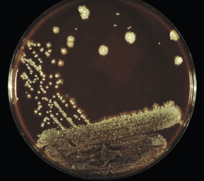

Figure 62-1 

Filamentous extensions from the periphery of colonies of _Candida albicans_ are known colloquially as “feet.”

In contrast to yeasts, molds are described as filamentous fungi that are multicellular in structure. Although the term **mold** is used to describe this morphologic type, the term **mould** is historically recognized and more commonly used by mycologists to describe this morphologic form. The filamentous nature of the mold gives colonies a woolly, fluffy, or velvety appearance, sometimes punctuated with a granular or powdery aspect that is produced by the formation of asexual reproductive structures ( [ Fig. 62-2 ](<#f0015>) ). At other times, the colony may have a glabrous (smooth) appearance. 

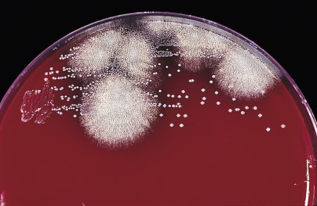

Figure 62-2 

Powdery surface of the colonies of _Aspergillus fumigatus_ overlies white masses of mycelium. 

Adjacent bacterial colonies contrast with the filamentous fungus. (Sheep blood agar.) 

The distinction between molds and yeasts is not firmly established. Some yeasts also develop a visually macroscopic filamentous component. For instance, _Trichosporon_ spp. are yeasts that develop such filamentous extensions, whereas _Exophiala jeanselmei_ is a dematiaceous yeast that develops a mycelium as it matures. The ultimate in fence-sitting is exemplified by the dimorphic fungi, which exhibit a mold form under some conditions and a yeast or yeastlike form in other circumstances. Clinically important dimorphic fungi are systemic pathogens that behave as molds in the environment and on agar media at 25° to 30° C. In contrast, the tissue form may be yeast (such as _Blastomyces dermatitidis, Histoplasma capsulatum,_ and _Sporothrix schenckii_ ) or, in the cases of _Coccidioides immitis_ and _Coccidioides posadasii,_ a yeastlike structure called a **spherule** . When cultivated in vitro at 37° C on appropriate media, the tissue form is reproduced by these fungi. Other agents also exhibit dimorphism but are less common in the clinical laboratory. For instance, black molds such as _Fonsecaea pedrosi_ and _Phialophora verrucosa_ produce nonhyphal cells in tissue called **sclerotic bodies** but appear as molds when grown on solid media at room temperature. Reverse dimorphism is exemplified by _Malassezia furfur,_ which produces both yeast cells and hyphae in the cutaneous lesions of patients with pityriasis versicolor. 

 

##  Structure of Yeasts and Hyphae 

The morphology of the fungus is an important characteristic for the identification of both yeasts and molds. The filamentous structure of a mold is referred to as **hyphae** (singular, **hypha** ), and a mass of hyphae is known as a _mycelium_ . The mycelium growing on the surface of or within the agar is known as the **vegetative mycelium** , whereas filamentous extensions above the colony are called **aerial mycelium** . True hyphae may have cross-walls that contain pores for communication through the hyphae or cross-walls that are complete, dividing the hyphae into multiple cells. Hyphae that have cross-walls are called **septate** , whereas those without cross-walls are referred to as **aseptate** . Some fungi that have septate hyphae also have aseptate or septate specialized hyphae (conidiophores) that bear asexual reproductive structures. Conversely, some so-called **nonseptate fungi** have occasional cross-walls and perhaps would be better designated as sparsely septate. 

The width of the hyphae and the angle of branching are important clues to fungal identity. Mucormycetes (also called **zygomycetes** and _Mucorales_ ), such as _Rhizopus_ spp., have broad, ribbon-like hyphae that branch predominantly at right angles ( [ Fig. 62-3 ](<#f0020>) ), whereas hyaline molds such as _Aspergillus_ spp. have narrow hyphae that branch at acute angles (dichotomous branching) ( [ Fig. 62-4 ](<#f0025>) ). The designation of a fungus as _Aspergillus_ on the basis of hyphal morphology in a smear or tissue section is, in truth, only a statement of the _a priori_ odds for this pathogen group. Describing the characteristics of the hyphae is a better approach to reporting this observation. 

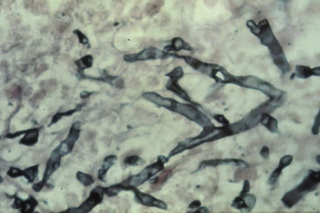

Figure 62-3 

Characteristic wide, nonseptate hypha of a mucormycete in lung tissue. 

(Gomori's methenamine silver stain, 400×.) 

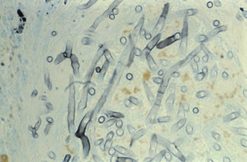

Figure 62-4 

Characteristic narrow branching, septate hyphae of a hyaline mold in tissue. 

(Gomori's methenamine silver stain, 400×.) 

Yeasts reproduce asexually by the formation of blastoconidia, where the daughter cell usually appears at one end of a yeast cell and eventually enlarges to form a new yeast cell. This process is also referred to in a more generic sense as budding. If a series of daughter cells do not detach fully from the originating cells, a **pseudohypha** (plural, **pseudohyphae)** is produced. Pseudohyphae are distinguished from true hyphae by the presence of a constriction at the junction of adjacent cells and by the restriction in size of the daughter cell to that of the parent ( [ Fig. 62-5 ](<#f0030>) ). In contrast, the walls of true hyphae are parallel without constrictions. _C. albicans_ and some strains of _Candida tropicalis_ may produce pseudohyphae that have the appearance of true hyphae, depending on growth conditions, and differentiation of _Candida_ from hyaline molds such as _Aspergillus_ in tissue sections on occasion may be problematic. In contradistinction, _Cryptococcus_ spp. produces only budding yeast and rarely rudimentary or primitive pseudohyphae, but true hyphae are not formed. 

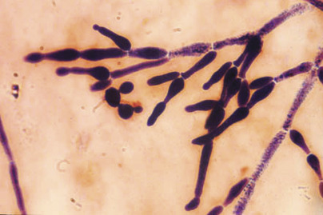

Figure 62-5 

Chains of elongated budding yeasts of _Candida albicans_ producing pseudohyphae observed in sputum. 

(Gram stain, 1000×.) 

 

##  Fungal Pigment 

Some mold hyphae and yeast can be characterized by the production of a dark pigment. These fungi contain melanin, which imparts a brown coloration to the fungal element in microscopic preparations and causes colonies of the fungi to appear dark green, brown, or black. The terms **dematiaceous** , **melanized** , **dark** , and **phaenoid** have been used interchangeably to denote those fungal elements that contain melanin (  Revankar & Sutton, 2010  ). Superimposed dyes in stained smears, wet preps, or histologic sections may partially obscure the color, which can be more obvious in unstained preparations. Those fungi that lack dark hyphal pigmentation are referred to as **hyaline** (clear or colorless). This term may not fully reflect the fungal species appearance, because in some cases a light pigmentation may produce colored colonies, and asexual reproductive structures of some hyaline molds may have green, brown, or black pigments that impart a color to the surface of the colony once the reproductive structures have formed. The true appearance of these molds usually can be discerned by observing the back of the colony, which maintains a light coloration. In contrast, both the front (obverse) and the back (reverse) of dematiaceous or highly melanized colonies usually demonstrate the dark pigment. 

 

##  Reproductive Structures 

The primary means for identification of mold fungi is by characterization of asexual reproductive structures. For yeast, phenotypic studies are the mainstay in identification, with asexual reproductive structures serving as ancillary clues in the identification process. The two principal asexual structures are spores (which may also be present as sexual structures) and conidia. Asexual spores (called **sporangiospores** ) are produced by cleavage within an encompassing structure called a **sporangium** ( [ Fig. 62-6 ](<#f0035>) ). **Conidia** (singular, **conidium** ) are much more diverse and form by differentiation from the tip or side of a fertile hypha, such as a conidiophore, or by hyphal differentiation. Unfortunately, interchangeable use of the terms _conidium_ and _spore_ in the literature has led to confusion. _Sporulation_ and _spores_ often are used as general terms for asexual reproduction, and the term _spore_ is sometimes used when _conidium_ would have been more accurate. 

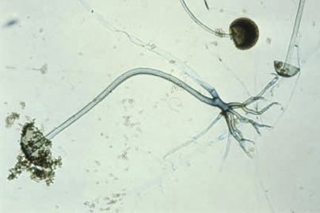

Figure 62-6 

Sporangiophores of _Rhizopus_ spp. supporting sporangia that contain sporangiospores. 

Rhizoids arise from the hyphae near the origin of the sporangiophores. (Lactophenol cotton blue stain, 100×.) 

The principal means of asexual reproduction in yeast is by the formation of blastoconidia (i.e., budding). A bud starts as a softening of the cell wall of the mother cell, followed by expansion of the cell wall (blown out) and migration of nucleus and cytoplasm to the swollen area. A septum seals the boundary between daughter and parent cells ( [ Fig. 62-7 ](<#f0040>) ). If separation does not occur, a pseudohypha results. 

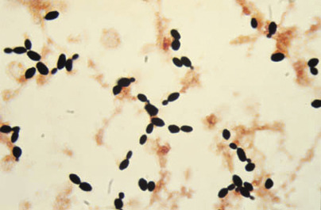

Figure 62-7 

Budding and nonbudding yeast cells detected in a blood culture bottle sample. 

(Gram stain, 1000×.) 

The portions of the vegetative mycelium that differentiate into conidia are referred to as **conidiogenous cells** . Specialized hyphae that support the conidia are termed **conidiophores** , which may be the conidiogenous cell itself arising from the vegetative mycelium or may be a supporting hypha. In _Aspergillus_ spp., the conidiophore, which is aseptate, enlarges at the tip to form a swollen vesicle ( [ Fig. 62-8 ](<#f0045>) ). Conidiogenous cells, now termed **phialides** , arise from the vesicle to support chains of conidia. Some species of _Aspergillus_ produce a row of phialides, which occur on a row of sterile cells called **metulae** , with the conidia arising from the distal phialides. The mucormycetes produce structures called sporangiophores, which support the sporangium with enclosed sporangiospores (see [ Fig. 62-6 ](<#f0035>) ). An extension of the apex of the sporangiophore into the sporangium is termed the **columella** . 

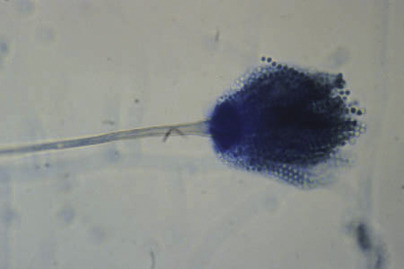

Figure 62-8 

Fruiting head of _Aspergillus fumigatus_ . 

The conidiophore is swollen at the tip to form a vesicle, and phialides arise from the upper half of the vesicle with chains of conidia present that align parallel to the long axis of the conidiophore. (Lactophenol cotton blue stain, 400×.) 

Thallic conidiogenesis is a process in which the conidium does not develop until a septum is formed between the conidium and the parent cell. The conidium originates from the whole of the parent cell. The most important human pathogens that exhibit thallic conidiogenesis are the dermatophytes and the dimorphic fungi in the genus _Coccidioides_ . As conidiogenesis progresses in these species, barrel-shaped conidia called **arthroconidia** are produced; these fragment easily and are disseminated with little difficulty, resulting in a high degree of infectivity demonstrated by these important human pathogens ( [ Fig. 62-9 ](<#f0050>) ). The thallic conidia of the dermatophytes are separated by size into two types: large septate macroconidia ( [ Fig. 62-10 ](<#f0055>) ) and small, one-celled microconidia that are simpler structures ( [ Fig. 62-11 ](<#f0060>) ). 

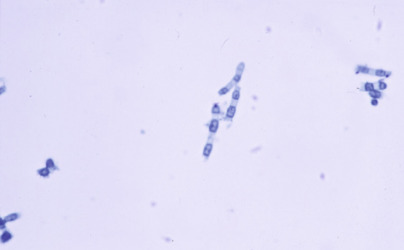

Figure 62-9 

Arthroconidia of _Coccidioides_ species. 

Alternating barrel-shaped arthroconidia are separated by thin-walled, empty disjunctor cells within portions of the hyphae. (Lactophenol cotton blue stain, 400×.) 

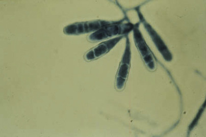

Figure 62-10 

Macroconidia of _Epidermophyton floccosum._

Typical blunt-ended macroconidia occur in aggregates along the hyphae with the absence of microconidia. (Lactophenol cotton blue stain, 400×.) 

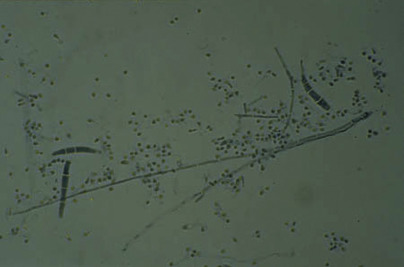

Figure 62-11 

Elongated macroconidia of _Trichophyton mentagrophytes_ along with microconidia are lined up along the surface of the hypha. 

(Lactophenol cotton blue stain, 400×.) 

The other type of conidiogenesis is called **blastic conidiogenesis,** whereby the protoplasm of the conidiogenous cell is blown out or blasted to form the conidium. The simplest form of blastic conidiogenesis is the budding process by which many types of yeast, including _Candida_ spp., develop. As with thallic conidia, blastoconidia are divided into two types: one where the cell wall is involved in the process and the other where it is not. Further division of blastic conidiogenesis is made among those species in which the outer cell wall does not participate in the process (called **enteroblastic conidiogenesis** ). In enteroblastic fungi, phialidic and annellidic conidiogenous cells have been recognized. Phialides are conidiogenous cells that often have a collarette at the apices, produced when the tip releases the first conidium. The collarette may be a conspicuous flask-shaped structure, as observed in _Phialophora_ spp., or an inconspicuous structure, as seen in _Aspergillus_ spp. In contrast, annellides are conidiogenous cells that rupture to leave a distinct ring of cellular material at the base of the conidium when it separates from the annellide. Formation of sequential conidia at the base pushes the oldest cell to the tip of the chain and leaves a series of rings or annellations at the apex of the annellide, providing a record of past events, like rings on a tree. Although important for the microscopic identification of some mold fungi, the fine details of these structures may be difficult to visualize using the light microscope. 

Differentiation of the various conidial structures is the key to correct identification of many fungal isolates. In some cases, the pertinent morphologic features are easily discerned; however, as in surgical pathology, pattern recognition is an essential tool for identification of the most common pathogens and saprobes. The pathologist should always appreciate the salient features of the entire morphologic preparation without primarily focusing on outliers or aberrant structures. Developing conidial structures of _Aspergillus_ or _Paecilomyces,_ for instance, may resemble the structures of _Penicillium,_ and the observer must not be misled into thinking that two molds are present. At the same time, the possibility of a mixed culture must be remembered. Mycologists must use a low-powered objective for initial observation from fungal culture; however, the details of cellular subsets in that low-powered picture must be appreciated for study at a higher magnification. 

The fine art of mycologic diagnosis rests in the appreciation and differentiation of cellular details, and in some instances, the task requires great subtlety and considerable experience. Sometimes, the isolate must be coaxed to produce the necessary diagnostic structures by selection of appropriate media ( [ Table 62-3 ](<#t0020>) ). In general, enriched media favor the propagation of vegetative mycelium, whereas asexual reproductive structures are encouraged by basal (starving) media. Subculture onto water agar or potato flake agar is a general technique for encouraging the development of conidial structures. The colors of _Aspergillus_ colonies are best studied on Czapek-Dox agar, whereas _Trichophyton rubrum_ is encouraged to produce red pigment on potato dextrose agar or cornmeal agar with 1% glucose. 

TABLE 62-3 

Media for the Identification and Isolation of Fungi 

Medium  |  Main Function   
---|---  
Ascospore medium, V-8 agar  |  Ascospore development   
Birdseed (niger) agar  |  Demonstration of melanin in _Cryptococcus neoformans_  
Brain-heart infusion agar with blood  |  Enhanced recovery of dimorphic fungi   
Christensen urea agar  |  Differentiation of _Trichophyton rubrum_ and _T. mentagrophytes_  
CHROMagar _Candida_ |  Chromogenic mixture to identify _Candida_ species   
Cornmeal agar with Tween 80  |  Visualization of yeast morphology   
Czapek-Dox agar  |  Identification of _Aspergillus_ species   
Inhibitory mold agar  |  Selective medium that contains chloramphenicol and gentamicin   
Potato dextrose agar  |  Pigment development of _Trichophyton rubrum_ and mold morphology   
Sabouraud dextrose (SAB) agar  |  General purpose fungal growth medium (traditional formulation or Emmon's modification)   
SAB agar with cycloheximide  |  Selective medium to inhibit saprophytic fungi (antibacterials such as chloramphenicol or gentamicin also included)   
Slide culture (various agars)  |  Study of microscopic structure   
_Trichophyton_ agars  |  Differentiation of _Trichophyton_ species   
  
Experience also is important in determining whether a subculture has been incubated sufficiently long for diagnostic structures to form. Rootlike structures (rhizoids) that develop from the hyphae of some mucormycetes are important differentiating features, but they may not be detected if observation is terminated prematurely. Some of the techniques necessary for complete differentiation are difficult or even beyond the reach of most clinical laboratories. For instance, the melanized pathogen _Exophiala dermatitidis_ produces blastic conidia with phialides and annellides. The presence of annellides was not recognized when the mold was studied with the light microscope, however, and this organism was once classified as _Phialophora dermatitidis._ Recognition that annellides were formed by the isolate led to a reassignment to a new genus, _Exophiala,_ which contained both phialides and annellides. 

Sexual reproductive structures are of occasional value for fungal identification in the general mycology laboratory. Although they are infrequently encountered in vitro, recognition of sexual structures for heterothallic fungi requires that a compatible mating strain be available for testing. Homothallic fungi, on the other hand, can produce sexual structures in culture without this mating process. The two structures most likely to be demonstrated in the laboratory from homothallic species are the naked asci of _Saccharomyces cerevisiae_ and the cleistothecium of _P. boydii_ (the sexual phase of _Scedosporium apiospermum_ ), _Aspergillus nidulans,_ or the _Aspergillus glaucus_ group of fungi. The naked asci of _Saccharomyces_ resemble oval yeast cells in which one to four individual haploid ascospores are enclosed ( [ Fig. 62-12 ](<#f0065>) ). The ascospores in this species may be visualized in wet preparations but are detected more reliably using a Gram stain or an acid-fast stain. A cleistothecium is a sexual fruiting body (ascocarp) in which the ascospores are entirely enclosed and can be released only by rupture of the cleistothecial wall ( [ Fig. 62-13 ](<#f0070>) ). The wall is composed of single or multiple layers of specialized hyphae. A perithecium is a sexual structure similar to a cleistothecium, but it contains an opening at the apex of the pear-shaped structure. 

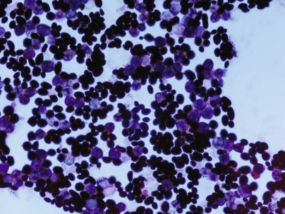

Figure 62-12 

Ascospores with asci (pale staining) along with budding yeast cells of _Saccharomyces cerevisiae._

(Gram stain, 1000×.) 

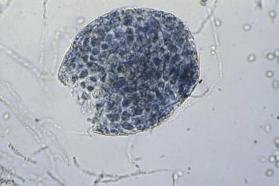

Figure 62-13 

Cleistothecium of _Pseudallescheria boydii._

This sexual reproductive structure is specifically referred to as an ascus containing ascospores. (Lactophenol cotton blue stain, 400×.) 

Although asexual and rarely sexual reproductive structures are necessary for the identification of fungi, especially molds, some isolates refuse to produce either of these structures for diagnosis. The colonies consist only of vegetative and aerial hyphae morphologically and subsequently are described as **sterile hyphae** or **mycelia sterilia** . Identification under this circumstance requires specialized molecular methods that are not available in most routine diagnostic laboratories (  Gomez, 2014  ;  Griffin & Hanson, 2014  ;  Zhang, 2013  ). 

 

##  Dimorphism 

Demonstration of dimorphism is the traditional approach to definitive identification of endemic fungal pathogens. In most laboratories, the initial isolate is the mold phase because culture plates usually are incubated at 25° to 30° C. Conversion to the tissue phase (yeast or yeastlike structure) is accomplished by incubating a subculture at 37° C. The transition from mold to yeast morphology may occur grudgingly, and hyphal forms are often intermixed with yeast cells. Some isolates may never be successfully converted. A rich medium, such as brain-heart infusion agar with a blood supplement, should be included with the primary isolation medium, particularly when _H. capsulatum_ is suspected _._ Cysteine hemoglobin agar is a common medium used for the conversion of _B. dermatitidis._ Media for conversion of coccidioidal species have been described but are not often used. Similarly, inoculation of animals is infrequently employed in clinical laboratories, although this method is effective when used for conversion to the in vivo phase. The recent introduction of molecular probes has considerably simplified the task of definitive identification for these endemic fungi and has eliminated the need to demonstrate both phases of the dimorphic fungi in the laboratory (  Reiss et al, 2000  ). Rapid deoxyribonucleic acid (DNA) probe tests, which utilize the technique of nucleic acid hybridization, are available for the identification of the three major dimorphic pathogens from culture (e.g., GenProbe AccuProbe, Hologic, Inc., Bedford, Mass.). Although demonstration of the characteristic yeast or yeastlike phase in tissue strongly supports the diagnosis of a dimorphic fungus, identification of the pathogen in culture is still necessary for disease confirmation (  Sangoi et al, 2009  ). 

,  

##  Diagnostic Techniques 

With the increased number of patients undergoing transplantation procedures or receiving aggressive immunosuppression and chemotherapy, the growing population of immunosuppressed hosts has dramatically increased, leading to a subsequent rise in the prevalence of invasive fungal infection (  Chandrasekar, 2009  ). Early recognition of a fungal infection to optimize patient management is becoming more realistic with advances in diagnostic applications for the identification of fungal etiologic agents. 

 

##  Laboratory Safety 

Biosafety considerations from specimen collection through culture conformation in the mycology laboratory are critical (  Clinical and Laboratory Standards Institute [CLSI], 2012a  ). Inoculation of specimens and manipulation of mold colonies should always be performed in a biologic safety cabinet to prevent dissemination of the highly mobile fungal conidia. Scrupulous attention to cleaning the surfaces of both the biologic safety cabinet and the incubator should be maintained. Separate safety cabinets for the study of isolated molds may minimize contamination of other clinical samples. 

The greatest hazard for laboratory personnel comes from handling mold cultures of the dimorphic pathogens, _Coccidioides immitis/posadasii_ and _H. capsulatum_ . These isolates are classified as risk group 3 (RG3) pathogens, requiring biosafety level 3 practices and institutions for propagating and manipulating cultures, as well as for processing soil or other environmental materials known or likely to contain infectious conidia from these agents (U.S.  Department of Health and Human Services [HHS], 2009  ;  HHS, 2013  ). Screw-capped tubes of culture media should be used for culture if these pathogens are suspected. Unfortunately, the diagnosis may not be appreciated before the pathogen is isolated in some cases. All work with molds, however, should be performed in a certified biologic safety cabinet. 

Of special note is that the tissue phase of dimorphic pathogens is not infectious by the airborne route, thus little or no biohazard is involved in handling tissue specimens from patients with blastomycosis, histoplasmosis, or coccidioidomycosis. A possible exception to this rule might occur if a _Coccidioides_ spp. grew as a mold within a lung cavity that connected with the bronchial tree, which would allow for in vivo sporulation. 

 

##  Specimen Collection and Transport 

The correct specimen for submission to the mycology laboratory depends on the clinical presentation and the organ system affected (  CLSI  2012  ). A summary of the major categories of diseases produced by fungi along with suggested specimens is presented in [ Table 62-4 ](<#t0025>) . 

TABLE 62-4 

Major Clinical Syndromes and Commonly Associated Fungal Pathogens 

Clinical Presentation/Organ System  |  Patient Group  |  Likely Pathogens  |  Specimen(s)   
---|---|---|---  
Skin, hair, or nail infection  |  All  |  Dermatophytes   
_Candida_   
_Malassezia_ |  Skin scraping   
Hair   
Nail clipping   
Subcutaneous tissue infection  |  All  |  _Coccidioides_   
_Blastomyces dermatitidis_   
_Sporothrix schenckii_ |  Lesion biopsy   
Patient with mycetoma  |  _Scedosporium apiospermum_   
_Madurella_   
_Actinomadura_ |   
Primary pneumonia  |  All  |  _Histoplasma capsulatum_   
_Blastomyces dermatitidis_   
_Cryptococcus neoformans_   
_Coccidioides_ |  Sputum   
Bronchoalveolar lavage   
Transbronchial biopsy   
Surgical lung biopsy   
Pleural fluid   
Thoracentesis fluid   
Immunodeficient  |  _Aspergillus_   
_Fusarium_   
Zygomycetes   
_Scedosporium apiospermum_   
_Pneumocystis jiroveci_ |   
Gastrointestinal infection  |  Immunodeficient  |  _Candida_   
_Aspergillus_   
Zygomycetes  |  Scrapings   
Curettings   
Biopsy   
Urinary tract infection  |  All  |  _Candida_ |  Urine   
Endocarditis  |  All  |  _Candida_   
_Fusarium_ |  Blood   
Meningitis  |  Immunodeficient  |  _Cryptococcus neoformans_   
_Candida_   
_Coccidioides_ |  Cerebrospinal fluid   
Encephalitis and brain abscess  |  Immunodeficient  |  Zygomycetes   
_Aspergillus_   
_Cladophialophora bantiana_ |  Brain biopsy   
Osteomyelitis  |  All  |  _Coccidioides_   
_Blastomyces dermatitidis_   
_Cryptococcus neoformans_ |  Biopsy   
Keratitis  |  All  |  _Aspergillus_   
_Fusarium_ |  Scraping   
External otitis  |  All  |  _Aspergillus_ |  Scraping   
Swab   
Sinusitis  |  All  |  _Aspergillus_   
_Fusarium_   
Dematiaceous molds  |  Biopsy   
Curettings   
Burn wounds  |  All  |  _Aspergillus_   
Zygomycetes   
_Fusarium_   
_Scedosporium apiospermum_ |  Biopsy   
Vaginitis  |  All  |  _Candida_ |  Vaginal secretions   
Intravenous catheter infection  |  Indwelling catheter  |  _Candida_   
_Malassezia_ (newborns)  |  Catheter tip   
Blood   
Disseminated infection  |  All  |  _Histoplasma capsulatum_   
_Blastomyces dermatitidis_   
_Coccidioides_ |  Blood, bone marrow   
Tissue biopsy   
Immunodeficient  |  _Candida_   
Zygomycetes   
_Aspergillus_   
_Fusarium_   
_Scedosporium apiospermum_   
_Cryptococcus neoformans_   
Potentially any fungus  |  Blood   
Tissue biopsy   
  
Yeast, particularly _Candida_ spp., may be recovered on occasion from swab specimens, especially from purulent lesions. Swabs may be used for sampling oral or vaginal lesions suggestive of candidiasis and may be adequate for collecting specimens from patients with chronic external otitis, in which large numbers of _Aspergillus_ conidia are usually present. However, swabs are decidedly inferior for collecting specimens in most areas of the infectious process. Particularly problematic is that swab fibers may be mistaken for hyphal elements upon direct examination of clinical specimens. A policy of rejecting swabs for fungal culture should be accompanied in most cases by assiduous and persistent educational efforts. 

The best specimens for mycologic diagnosis are scrapings, curettings, aspirates, and lesion biopsies. Hairs infected with a dermatophytic fungus (e.g., _Microsporum canis_ ) fluoresce under a long-wavelength ultraviolet light (Wood's lamp) and can be specifically selected for examination. Cutaneous lesions of dermatophytosis (ringworm) are characterized by an active advancing edge with central healing, so that scrapings can be collected from the edge of the process. Hair, nails, scalp, and skin scrapings should be sent to the laboratory in a clean dry container. Tissue samples should be sent in a sterile container with a small amount of sterile, preservative-free saline or a transport medium to prevent drying of the sample. Most samples can be handled as one would any other samples submitted for bacterial observation and culture. 

 

##  Direct Examination 

Most clinical specimens can be examined directly for the presence of a fungal pathogen, although negative results are not sensitive enough to rule out the presence of a fungus. Multiple techniques are employed for the direct examination of clinical material. As a reminder, multiple manipulations of specimen material in the laboratory may render the material not acceptable for culture, so in cases in which culture is warranted, specimens must be separated before this type of examination is performed. 

 

##  Wet Preparation 

The simplest method for direct examination of a specimen is to observe a suspension placed on a slide and coverslip under reduced light. For those specimens that are dry or viscous, the addition of a wetting agent such as saline is necessary prior to observation. For specimens that contain distracting tissue debris and cells, such as vaginal secretions, nails, and skin scrapings, a solution of potassium hydroxide (KOH) may be used as a means to dissolve the tissue material, so that fungal elements are more visible ( [ Box 62-1 ](<#b0010>) ). 

Box 62-1 

KOH Preparation 

  * 1.

Place 1 drop of 10% potassium hydroxide (KOH) on a clean glass slide. 

  * 2.

Immerse an aliquot of the specimen in the drop of KOH on the slide. 

  * 3.

Gently heat the mixture by passing the slide through a Bunsen burner flame several times. Do not allow the mixture to boil. 

  * 4.

Coverslip the slide and examine at 100× and 400× magnification using reduced light. Excessively tenacious specimens may require additional heating. 

  * 5.

KOH may also be used as a simple mounting medium without heating (the addition of lactophenol [aniline] blue or Calcofluor white stain with the KOH will enhance the visibility of fungal elements). 

 

##  Gram Stain 

This commonly used microbiologic stain is particularly useful for the detection of yeast. Most yeasts stain partially or completely gram-positive and are generally differentiated from bacteria by their larger size and by the presence of budding cells (see [ Fig. 62-5 ](<#f0030>) ). The hyphae of molds may appear gram-positive or gram-negative by this stain but may stain less reliably than yeast cells and are easily missed in clinical specimens using this method. 

 

##  Giemsa or Wright Stain 

In cases in which histoplasmosis is suspected, these hematologic stains are useful for demonstrating yeast cells within macrophages. 

 

##  India Ink Preparation 

The polysaccharide capsule of _C. gattii/neoformans_ can be demonstrated by negative staining using India ink particles; it is especially evident when infected cerebrospinal fluid is examined. When examined with the light microscope, the capsule stands out as a clear space around the fungal cell, with ink particles bouncing off the edge as brownian motion occurs ( [ Fig. 62-14 ](<#f0075>) ). When budding yeast cells are demonstrated along with the capsule in the cerebrospinal fluid of an infected patient, the specificity of the diagnosis of cryptococcal meningitis is ensured. Other potentially encapsulated fungi such as _Rhodotorula_ spp. or other cryptococcal species are infrequent pathogens and can be eliminated from practical consideration under this circumstance. Although the capsules usually are large in direct examination of specimens, isolation of the pathogen on agar media is usually characterized by the production of a much diminished capsule, which is not as obvious. Unfortunately, some _C. neoformans_ strains are poorly encapsulated; thus, the sensitivity of the India ink test is generally less than 50%, and the organism is especially evident in patients who are not infected with the human immunodeficiency virus (HIV). However, direct detection of antigen in cerebrospinal fluid or serum using a latex agglutination or enzyme immunoassay technique has increased the sensitivity to close to 100%. These techniques basically have replaced the use of India ink as a direct diagnostic technique, although the India ink technique is still useful when the antigen test is not immediately available and for examination of capsules in cells from isolated colonies that suggest _C. gattii/neoformans_ . 

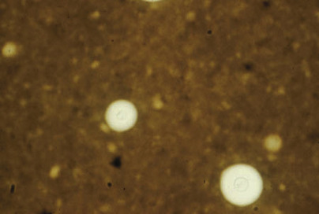

Figure 62-14 

India ink preparation of cerebrospinal fluid containing _Cryptococcus neoformans_ . 

This yeast produces a characteristic polysaccharide capsule around the budding yeast cells. (400×.) 

 

##  Histopathologic Stains 

Surgical pathologic examination of biopsy material is a common practice for the identification of suspected fungal infection (  Guarner & Brandt, 2011  ). A number of stains have proved useful in recognizing fungal elements in tissue and in showing the immunologic response to infection. The periodic acid–Schiff (PAS) method is useful for demonstrating internal details. Gomori's methenamine silver (GMS) technique is considered one of the better stains for demonstrating fungi because it provides high contrast with minimal background staining, thus allowing for the demonstration of sparsely present fungal elements in the sample. The hematoxylin and eosin (H&E) stain is best used for studying the host reaction and for determining whether a fungus is hyaline (colorless) or dematiaceous (naturally pigmented). Other more specialized stains include Mayer's mucicarmine stain for demonstration of the mucoid capsule of _C. neoformans_ and the Fontana-Masson stain for demonstration of melanin or melanin-like substances in the lightly pigmented agents of phaeohyphomycosis as well as the staining of minute amounts of melanin pigment in the cell wall of _C. gattii/neoformans_ . A book by Chandler and Watts provides greater detail on the utilization of stains to detect fungi in tissue (  Chandler & Watts, 1987  ). 

 

##  Calcofluor White Stain 

This fluorochrome compound, a whitener used in the textile and paper industries, binds to the chitin in the walls of fungal cells and fluoresces white ( [ Fig. 62-15 ](<#f0080>) ) or apple green (depending on the filter combination used) when exposed to short-wavelength ultraviolet light from a fluorescence microscope ( [ Box 62-2 ](<#b0015>) ) (  Hageage & Harrington, 1984  ). Calcofluor white can also be mixed with potassium hydroxide to clear the specimen for easier observation of fungi. As is true with all fluorescent staining, care must be used in interpreting the results because nonspecific staining of substances that resemble fungal elements may also occur. 

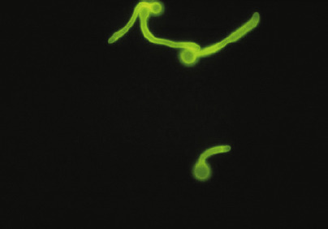

Figure 62-15 

Calcofluor white stain of _Candida albicans_ in culture. 

When viewed with a fluorescence microscope, the chitinous walls of the fungus will fluoresce. Germ tubes shown are produced following incubation of the yeast in serum. 

(Courtesy of Dr. Brian Harrington, CDC Public Health Image Library.) 

Box 62-2 

Calcofluor White Stain 

  * 1.

Place specimen on a clean glass slide. 

  * 2.

Mix with Calcofluor white reagent. 

  * 3.

Using a fluorescence microscope, examine the preparation for fungal elements at 100× to 400× magnification (will typically appear bluish white against a dark background). (Calcofluor white may be substituted for lactophenol [aniline] blue stain when microscopic morphology of culture isolates is studied.) 

 

##  Immunohistochemical Stains 

Immunohistochemistry has been used to identify a wide variety of infectious agents, including the fungi, in fresh, frozen, or paraffin-embedded tissues (  Eyzaguirre & Haque, 2008  ). Although many fungi can be readily identified by standard histologic staining, some fungal elements appear atypical in tissue sections and in some cases cannot be distinguished morphologically. Both monoclonal and polyclonal antibodies are commercially available for _Aspergillus_ species and _Candida albicans_ (AbD Serotec); however, these are not FDA-approved, which requires in-house validation testing prior to patient use. Cross-reactivity with _Fusarium_ species has been found using immunohistochemicals to detect _Aspergillus_ species (  Lackner & Lass-Florl, 2013  ). 

 

##  Isolation in Culture 

 

##  Selection of Media 

All specimens should be inoculated onto a general purpose fungal growth medium (see [ Table 62-3 ](<#t0020>) ). The medium used traditionally is Sabouraud dextrose agar, which has a pH of 5.5 to 5.6 and was designed for the isolation of dermatophytic fungi. Emmons' modification of Sabouraud dextrose agar, which contains less glucose with a pH of 6.8 to 7.0, is more widely used in the clinical mycology laboratory as a general growth medium because of its wide application for the culture of fungi. Inhibitory mold agar and potato dextrose agar are also utilized as general isolation media in the laboratory. 

For specimens from nonsterile sites or from sites that are likely to be contaminated with other microbial flora, inoculation of a nonselective agar and a selective agar in tandem is recommended. The most commonly used selective agar employs cycloheximide (500 mg/L) to inhibit saprophytic fungi and an antibacterial agent (usually chloramphenicol [50 mg/L] or gentamicin [50 mg/L]) to inhibit bacteria. For tissue specimens, especially when dimorphic fungi might be the etiologic agent, an enriched agar, such as brain-heart infusion agar with 5% to 10% sheep blood and supplemented with chloramphenicol and gentamicin or SABHI agar with antibiotics, may be added. 

A recent addition for the cultivation of yeast from clinical specimens is the selective and differential medium called CHROMagar _Candida_ (CHROMagar Company, Paris, France) for the isolation and differentiation of major clinically significant _Candida_ species. This medium uses a chromogenic mixture to differentiate major _Candida_ spp. by colony color: _C. albicans_ , green; _Candida krusei_ , pink; _Candida tropicalis_ , metallic blue, and other species, white to mauve. Numerous reports have shown this medium to be useful for the isolation and presumptive identification of yeasts and to optimize detection of mixed cultures in clinical specimens (  Ozcan et al, 2010  ;  Perry & Freydiere, 2007  ;  Raut & Varaiya, 2009  ). 

 

##  Inoculation and Incubation 

Processing of clinical specimens for fungal detection requires careful handling because some processes commonly used to prepare specimens for bacterial culture may be too disruptive for the fungal organism (e.g., grinding in a homogenizer). Inoculation of scrapings or curettings onto and into the agar at multiple points on the agar surface is a reliable technique for culture. Tissue should be teased or minced, after which the fragments are similarly inoculated. 

Plates or tubes should be incubated in ambient air at 25° to 30° C. A controlled temperature incubator is essential. Although it is not necessary to incubate parallel plates or tubes at 37° C for recovery of the yeast phase of dimorphic fungi, in cases where strong suspicion of endemic fungi occurs, incubation at this temperature should be considered. Most fungi grow within a 2-week incubation period, and among commonly isolated fungi, only the dimorphic fungi such as _H. capsulatum_ and _B. dermatitidis_ are frequently detected after 14 days of incubation. General recommendations for incubation times are as follows: 7 days to detect the presence of yeast in mouth, throat, or vaginal specimens; 21 days to detect fungal pathogens in tissues and sterile body fluids other than blood; and up to 28 days for respiratory, bone marrow, and blood pathogens, and for specimens in which a dimorphic fungus is suspected. In general, all other specimens should be incubated for up to 14 days. Plates should be examined at least twice during the first week, when rapidly growing isolates may appear, and at least weekly thereafter. 

 

##  Blood Cultures 

Recovery of fungi from blood requires special attention and can be accomplished by inoculating broth media by using a biphasic broth-agar system or by using the lysis centrifugation technique (Isolator system; Wampole, Cranbury, N.J.). The lysis centrifugation method consists of a tube containing a solution that lyses erythrocytes and leukocytes (  Cockerill et al, 1996  ;  Reimer et al, 1997  ). After the blood is drawn into the vacutainer tube, the lysed contents, including any microbes, are centrifuged into a pellet, which is removed and plated onto the surface of agar plates. Although the Isolator system is considered a sensitive method for detection of fungemia, this system is also more susceptible to contamination through handling of the tube or by airborne spores that settle onto the agar plates during processing. Because a high percentage of fungemias are caused by yeast, continuous-read automated-culture methods have become the mainstay for fungal detection. Two systems commonly used are the BACTEC system (Becton Dickinson Diagnostic Systems, Sparks, Md.) and the BacT-Alert system (bioMerieux, Inc, Durham, N.C.). Because yeasts are aerobic organisms, aerobic culture bottles are used for detection. Two systems in combination (i.e., BACTEC MYCO/F Lytic blood culture bottles and the Isolator system) have been shown to optimize the recovery of fungi from blood (  Vetter et al, 2001  ). 

 

##  Growth Rate 

The rate of growth of fungal isolates provides a useful clue to diagnostic possibilities. In general, the pathogenic dimorphic and dematiaceous fungi grow slower, requiring 1 week or longer for colonies to appear. Rapidly growing mold colonies that appear after prolonged incubation on mycologic media should be questioned as possible contaminants. However, many exceptions to this generalization have been noted, and laboratorians need to be aware that fungi such as the _Coccidioides_ spp _._ may grow quickly on nonfungal medium. Protocols on how to handle fungal growth on bacterial cultures are needed to prevent unnecessary exposure of laboratory personnel to highly infectious fungal pathogens that may be encountered. 

 

##  Growth Temperature 

Most molds grow best at 25° to 30° C. Most yeasts, however, grow well at 35° to 37° C and are often recovered first on enriched blood agar plates in the bacteriology laboratory. In some cases, growth of a fungus at elevated temperatures is useful for differentiation of species. 

 

##  Morphologic Identification 

Some of the morphologic studies necessary for the identification of fungal isolates can be accomplished with colonies from the original isolation plates. However, it is often necessary to transfer portions of colonies to new or different media (subculture) to demonstrate diagnostic structures. [ Table 62-3 ](<#t0020>) describes some of the media commonly used for the identification of fungal species. One of the media more commonly used is cornmeal agar supplemented with Tween 80 (CM-T80) for the visualization of yeast morphology. Recognition of pseudohyphae with chlamydoconidia on this medium is considered confirmatory for _C. albicans/dubliniensis_ . Other morphologic features can help to categorize yeasts into groups to facilitate separation into species. Although biochemical tests are important for identifying yeast isolates, complementation of these with a morphologic examination provides an important check on the biochemical information, especially if a commercial identification system has been used. 

 

##  Yeast Morphology 

The germ tube test is an important initial step in the identification of yeast isolates. Germ tubes, which are elongated, fingerlike extensions from a yeast cell, represent the beginnings of a true hypha ( [ Fig. 62-16 ](<#f0085>) ). This structure can be differentiated from pseudohyphae by the lack of a constriction at the junction of germ tube and yeast cell and by the parallel cell walls in the germ tube. True germ tubes are formed by both _C. albicans_ and _Candida dubliniensis_ after growth in serum at 37° C for up to 4 hours. In many laboratories with well-trained staff, the germ tube in combination with results of morphology on CM-T80 agar is considered confirmatory for the identification of _C. albicans/dubliniensis_ . 

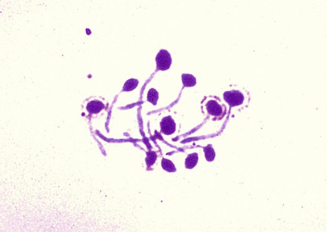

Figure 62-16 

Germ tubes have extended from the yeast cells of _Candida albicans._

No constriction is seen at the junction of yeast cell and germ tube. The walls of the germ tube are parallel. The yeast was incubated for 2 hours at 37° C in serum. (Gram stain, 400×.) 

The traditional germ tube test involves inoculation of a tube of serum ( [ Box 62-3 ](<#b0020>) ). After observation of the isolate for germ tubes at 37° C, incubation is continued for subsequent study of hyphal morphology and chlamydoconidia formation at 25° to 30° C. Thus, all the information necessary for rapid identification can be collected in one procedure. The CM-T80 agar may be substituted, but regardless of the medium used, incubation conditions must be carefully controlled and the test monitored with controls to achieve good results. The traditional Dalmau technique for demonstration of chlamydoconidia on cornmeal agar is detailed in [ Box 62-4 ](<#b0025>) . 

Box 62-3 

Serum Germ Tube Test 

  * 1.

Aseptically transfer several colonies of yeast to a 12- × 75-mm test tube containing approximately 0.5 mL of serum (human, fetal calf, bovine, or rabbit). 

  * 2.

Incubate the tube at 35° C for up to 3 hours. 

  * 3.

Place 1 drop of the mixture on a clean glass slide and coverslip. 

  * 4.

Examine under high dry (400×) magnification and reduced light for the presence of germ tubes. 

Box 62-4 

Yeast Morphology Test 

  * 1.

Streak a light inoculum of yeast onto a section of a cornmeal agar containing Tween 80. 

  * 2.

Coverslip the area inoculated. 

  * 3.

Incubate at 25° to 30° C for 24 to 72 hours. 

  * 4.

Observe under 100× and 400× magnification using reduced light for morphologic structures. 

 

##  Mold Morphology 

A simple method for examination of molds is the cellophane tape mount, using clear tape and staining with lactophenol cotton (aniline) blue (LPCB) stain. If diagnostic structures are not observed, incubation can be continued and the process repeated. The established method used in observing mold morphology is to tease the mycelium apart with inoculating needles and examine the teased hyphae with LPCB stain. 

Occasionally, a slide culture may be necessary to preserve easily disrupted conidial structures in their original relationships. The classic approach involves cutting a square of an appropriate agar medium (usually Sabouraud dextrose or potato dextrose agar), which is suspended on a glass slide and overlaid with a coverslip. The slide is supported by glass rods in a Petri dish, to which sterile water is added for maintenance of humidity. The coverslip subsequently can be removed after a few days' incubation, placed in a drop of LPCB, and observed for undisturbed reproductive structures. 

When a mold isolate is suspected of being a dimorphic fungus (e.g., growth on cycloheximide-containing medium), a slide culture should not be performed, and a cellophane tape test or teased preparation should be examined only after the preparation has been sealed in a biosafety cabinet certified for use. Lactophenol cotton blue is fungicidal, but sealing the coverslip with nail polish before observation provides additional protection. Alternatively, the culture may be flooded with 10% formalin (4% formaldehyde solution) and incubated at room temperature overnight before the mold is manipulated. 

 

##  Biochemical Identification 

Biochemical tests are at the core of identification schemes for yeast and occasionally are useful for identification of molds. A number of rapid tests for the presumptive identification of yeasts are described in [ Table 62-5 ](<#t0030>) . 

TABLE 62-5 

Rapid Testing for Presumptive Identification of Yeast Following Colonial Formation 

Urease production  |  _Cryptococcus gattii/neoformans_  
---|---  
Germ tube production  |  _Candida albicans_ / _dubliniensis_  
Pseudohyphae present  |  _Candida_ species   
Chlamydoconidia present  |  _Candida albicans/dubliniensis_  
Lipid growth requirement  |  _Malassezia furfur_ species complex   
Red colonial pigmentation  |  _Rhodotorula_ species   
Ascospore formation  |  _Saccharomyces cerevisiae_  
Trehalose assimilation  |  _Candida glabrata_  
  
Biochemical characterization of yeasts may be accomplished by study of fermentation or assimilation patterns. Assimilation testing, which is used more extensively in the laboratory, assesses the ability of an isolate to use a carbohydrate as the sole source of carbon needed for growth, or of nitrate as the sole source of nitrogen. Numerous commercial identification systems with varying incubation times from 4 to 72 hours are available and have become the mainstay for yeast identification. These systems include the API 20C AUX system and the VITEK 2 system (both from bio­Mérieux, Hazelwood, Mo.), the MicroScan system (Siemens Healthcare Diagnostics, West Sacramento, Calif.), the UniYeastTek system (Remel Laboratories, Lenexa, Kans.), the RapID Yeast Plus system (Innovative Diagnostics Systems, Norcross, Ga.), and the Phoenix Yeast ID Panel (Becton, Dickinson and Co., Franklin Lakes, N.J.). All of these systems perform well, as judged by reports in the literature and by proficiency testing surveys of the College of American Pathologists (  Bernal et al, 1998  ;  Crist et al, 1996  ;  Espinel-Ingroff et al, 1998  ;  Fenn et al, 1994  ;  Hata et al, 2007  ;  Ramani et al, 1998  ;  Riddle et al, 1994  ;  Gayibova et al, 2014  ). However, because no one system is known to be 100% accurate for identification of yeast species, a combination of methods should be considered, especially when rare species are recognized (  Pincus et al, 2007  ). 

In addition to fermentation and assimilation studies, stimulation of growth by biochemical compounds is a secondary test used in the differentiation of certain _Trichophyton_ spp. (  Weitzman et al, 1983  ). Inclusion of inositol and thiamine in various combinations into agar media ( _Trichophyton_ agars) allows assessment of growth-stimulating properties. The endpoint of the test, relative growth in comparison with a basal medium, is subjective, and both positive and negative controls should be included. 

The test for urease production in cryptococci is of general utility in the clinical laboratory to differentiate these species from _Candida_ spp., particularly in respiratory specimens (  Canteros et al, 1996  ). _C. neoformans_ is a pulmonary and systemic pathogen, whereas _Candida_ spp. are frequent inhabitants of the upper airways but uncommon causes of primary pneumonia. Urease, however, may be produced by other nonpathogenic species of _Cryptococcus,_ by _Rhodotorula_ spp., and by some isolates of _Trichosporon_ spp _._ and _C. krusei_ . Urease production can be tested by inoculation of the yeast isolate onto a slant of Christensen urea agar or into urea broth. Alkalinization of the medium after production of NH  3  by urea-splitting organisms is detected by inclusion of a pH indicator in the system. Colonies that have macroscopically visible pseudohyphae (feet) or that grow on cycloheximide-containing agar need not be tested, because _Cryptococcus_ does not produce pseudohyphae in vitro and does not grow in the presence of cycloheximide. 

Production of urease also is useful to differentiate the mold _Trichophyton mentagrophytes_ (urease positive) from _T. rubrum_ (urease negative). The isolate should be subcultured to a slant of Christensen urea agar and incubated at 25° to 30° C for at least 3 days. 

Although commercial biochemical tests are fairly reliable for the identification of yeast, confirmation of the identification by examination of yeast morphology on agar media should also be considered. Using morphologic observation as a check can save embarrassing mistakes that would be made if automated or packaged systems were trusted implicitly. 

 

##  Serologic Identification 

Immunologic tests are available for detection of both antigens and antibodies to selected fungal pathogens; these assays have been shown to be of value for diagnosing infection and for monitoring therapeutic response (  Lau et al, 2009  ;  Wheat  2006  ;  Wheat & Walsh, 2008  ). Although antibody testing for fungal pathogens has historically been used in some instances for diagnostics, these tests are no longer widely accepted owing to low sensitivity and specificity. In addition, the benefit of antibody detection remains unclear if patients are under immune suppression or are heavily colonized but not infected (  Einsele & Loeffler, 2008  ). 

Tests to detect fungal antigens or metabolic byproducts in serum or other body fluids, on the other hand, have been shown to be more useful for the diagnosis and management of fungal disease. Multiple antigen-detection methods are used for the specific diagnosis of a variety of diseases, including aspergillosis, cryptococcosis, histoplasmosis, blastomycosis, paracoccidioidomycosis, and penicillosis caused by _Penicillium marneffei._ One of the more widely used antigen-detection tests is the cryptococcal antigen test for the diagnosis of cryptococcal infection (  Perfect et al, 2010  ). The polysaccharide capsule of _C. neoformans_ becomes dissolved in the serum and cerebrospinal fluid and can be detected by the latex-based agglutination test or the enzyme immunoassay. Although these tests have limitations, they have been shown to be helpful in monitoring therapy over time through quantitative measurement of the titer of _Cryptococcus_ polysaccharide in cerebrospinal fluid (  Babady et al, 2009  ). 

Antigen detection for the diagnosis of histoplasmosis has also proved useful when serum, urine, or bronchoalveolar lavage fluid is tested (  Wheat, 2009b  ;  Wheat et al, 2007  ). As a screening test, detection of _Histoplasma_ antigen plays a special role in the diagnosis of disseminated and diffuse acute pulmonary histoplasmosis. Studies have shown that _H. capsulatum_ –specific antigen can be detected in the urine of 90% of patients with disseminated infection and 80% of patients with acute histoplasmosis. Detection of antigen in bronchoalveolar lavage has also proved useful for the diagnosis of histoplasmosis, especially when the results of testing are combined with those obtained from cytopathology (  Hage et al, 2007  ). 

The Platelia _Aspergillus_ Ag (Bio-Rad, Marnes-la-Coquette, France) is an immunoenzymatic sandwich microplate assay for the detection of the galactomannan antigen, a reliable marker for invasive aspergillosis (IA). This assay is available to screen serum and bronchoalveolar fluid samples of high-risk patients for IA. Although this test has been shown to only have moderate sensitivity for the diagnosis of IA, the test is highly specific and considered a reliable screening for the detection of IA when used with other clinical parameters (  Heng et al, 2014  ;  Morrissey et al, 2013  ). False-positive results have been reported in patients receiving piperacillin/tazobactam due to the presence of the galactomannan antigen in the preparation of this antibiotic, although some reports now suggest that the newer preparations no longer have this residual galactomannan present (  Mikulska et al, 2012  ). The FDA, however, still recommends that when reporting a positive Platelia _Aspergillus_ galactomannan test result, laboratories inform physicians of the limitations of the test with regard to potential interaction with piperacillin/tazobactam. 

A commercial test to detect (1-3)-beta-  d  -glucan (BG) is available for the presumptive diagnosis of invasive fungal infection (Fungitell Assay; Associates of Cape Cod, Inc., East Falmouth, Mass.) (  Pickering et al, 2005  ). This antigen is present in the cell walls of most pathogenic fungi (including _P. jiroveci_ ), with some notable exceptions such as _Cryptococcus_ spp _._ and the Mucorales. Published studies have shown that BG may be useful as a screening tool for surveillance of invasive aspergillosis, as well as other invasive fungal diseases in populations at risk (  Marty & Koo, 2009  ). Although false-positive results appear to limit the use of this test, additional studies are needed to further define its diagnostic utility (  Onishi et al, 2012  ). 

Skin tests have been used for the epidemiologic study of some infections, but they have limited utility for diagnostic purposes. 

 

##  Molecular Identification 

Recent advances in molecular testing for the identification of fungal pathogens have had a significant impact on the diagnosis of fungal infections (  Arvanitis et al, 2014  ;  Borman et al, 2008  ;  Griffin & Hanson, 2014  ;  Preuner & Loin, 2009  ). Numerous reviews have addressed these changes, and the general consensus is that approaches to species identification of many fungi today should include both morphologic and molecular testing methods (  Hibbett & Taylor, 2013  ). 

One of the greatest needs for clinical medicine is the development of a rapid and reliable detection method that can identify fungal pathogens directly from clinical specimens. This need reflects not only the inability of current laboratory tests to provide a timely result, but also the fact that fungal infections in immunocompromised patients usually appear suddenly, progress rapidly, and are often fatal unless treatment is started earlier in the course of infection. 

Numerous molecular assays using both probe-based and amplification-based technologies have been developed for the identification of fungal pathogens. With any of these approaches, an initial goal has been to define the genetic loci within the genome for use as the molecular target. Although multiple areas within the fungal genome have been evaluated, the targeted areas most commonly used are those found within the ribosomal DNA (rDNA) gene complex ( [ Table 62-6 ](<#t0035>) ) (  Iwen et al, 2002  ). This section of the genome includes variable nucleotide sequence areas within the 18S gene and the 28S gene, as well as DNA sequence areas of the intervening internal transcribed spacer (ITS) regions called _ITS1_ and _ITS2_ . Sequence homology within the rDNA genes and differences within the spacer regions are used as the genetic basis for the organization of fungi into taxonomic groups. The ITS regions of the nuclear rRNA gene had been proposed as the fungal barcode locus; however, more recent studies have now shown that other genetic markers are needed for the separation of species within many of the genera of fungi (  Balajee, 2009a  ;  Guarro, 2013  ;  Schoch et al, 2012  ). 

TABLE 62-6 

Genetic Targets Utilized for the Detection and Identification of Fungal Pathogens 

Gene Target  |  Fungal Species   
---|---  
Actin  |  _Candida albicans_  
β-Tubulin  |  _Aspergillus_ species   
Calmodulin  |  _Aspergillus_ species, _Fusarium_ species   
Chitin synthetase  |  Dermatophyte species   
Cytochrome b  |  _Candida albicans_  
Dihydrofolate reductase  |  _Pneumocystis jiroveci (carinii)_  
Elongation factor (EF-1α gene)  |  _Fusarium_ species   
Mitochondrial rRNA  |  _Pneumocystis jiroveci_  
rDNA complex (5S gene)  |  _Candida albicans, Pneumocystis jiroveci_  
rDNA complex (18S gene)  |  Multiple   
rDNA complex (28S gene)  |  _Aspergillus_ species _, Candida_ species   
rDNA complex (IGS regions)  |  _Aspergillus_ species   
rDNA complex (ITS regions)  |  Multiple   
RNA polymerase (RPB1 and RPB2)  |  _Fusarium_ species   
  
_IGS,_ Intergenic spacer region; _ITS,_ internal transcribed spacer region; _rDNA,_ ribosomal deoxyribonucleic acid. 

Probe-based assays are commercially available and are commonly used in the mycology laboratory for the identification of _Histoplasma capsulatum, Blastomyces dermatitidis,_ and _Coccidioides_ spp. from culture (GenProbe AccuProbe, Hologic, Inc., Bedford, Mass.). Another probe-based method called the peptide nucleic acid fluorescence in situ hybridization (PNA-FISH) assay was recently developed and has become commercially available for the qualitative identification of _C. albicans_ in blood cultures (  Forrest, 2007  ;  Wilson et al, 2005  ). This assay uses a fluorescent-labeled peptide nucleic acid probe that targets the species-specific ribosomal RNA of _C. albicans_ . The sensitivity and specificity of this test have been shown to be >99%, and the impact of rapid identification of _C. albicans_ in the blood can be seen in the significant reduction in the empirical use of antifungals (  Forrest, 2007  ). Incorporating the _C. albicans_ PNA-FISH test as part of the initial identification algorithm for yeast recovered from blood can result in substantial savings for hospitals. Major drawbacks to this assay include the high costs of reagents and the changes in work flow required to incorporate testing in the laboratory. 

Numerous amplification methods using both non–sequence-based and sequence-based approaches for analysis have been applied in identification of fungi. Most of the sequence-based analysis methods have used conventional polymerase chain reaction (PCR) with universal primers to target sequences within the _28S rDNA_ gene, the _18S rDNA_ gene, or the _ITS1-5.8S-ITS2_ target areas (  Arvanitis et al, 2014  ). 

The availability of a nucleotide-based sequence database that has the breadth of phylogenetics and the taxonomic accuracy needed to identify fungal species is desirable for sequence analysis alignment. The largest database currently used for sequence-based identification is the publicly available GenBank database (National Center for Biotechnology Information, Washington, D.C.). Unfortunately, because this is an open-source database, reports suggest that up to 20% of the sequenced entries listed for fungi are associated with erroneously identified species (  Balajee et al, 2007  ). Additionally, there is a need for sequences from a variety of genomic targets in the database that is phylogenetically represented with accurate species identification. Although multiple locus sequencing and alignment comparisons have been done using a variety of fungal species, additional studies using sequence comparison analysis are needed to determine the optimal target or targets for fungal identification. Multiple target evaluations for the identification of aspergilli and fusaria have been done and show this approach to be valid for identification purposes (  O'Donnell et al, 2009  ;  Peterson, 2008  ). 

Recently a high-order multiplex PCR assay was developed for the direct detection of microbial pathogens in positive blood cultures. The FilmArray Blood Culture ID Panel (BioFire Diagnostics, Salt Lake City, Utah) tests for a complex panel of 24 pathogens to include five _Candida_ species ( _C. albicans, C. glabrata, C. krusei, C. parapsilosis,_ and _C. tropicalis_ ). This assay includes the ability to automatically carry out all steps of the identification process in a closed system from DNA extraction to the interpretation of the PCR data. Limited prospective studies have shown that the FilmArray panel was a reliable alternative to identify the most common yeast from positive blood cultures (  Altun et al, 2013  ;  Desoubeaux et al, 2014  ). Additional studies are needed to determine how they will improve the management of patients by a reduction in the time of diagnosis and consequent length of hospitalization and mortality rates. 

 

##  MALDI-TOF Mass Spectrometry 

Proteomics using matrix-assisted laser desorption/ionization time-of-flight mass spectrometry (MALDI-TOF-MS) has emerged as a reliable method for the rapid identification of microbial pathogens (  Chalupova et al, 2014  ). This technology involves mixing of the pathogen with a suitable chemical matrix on a solid surface, pulsing the sample with a laser for ablation and desorption, followed by ionization using time-of-flight technology to create a mass spectrum of the samples. This mass spectrum is then compared with a database of known spectra to allow for organism identification. The complexity of the composition of the fungal cell wall and the different protein compositions seen (e.g., between vegetative cells and spores and between young and mature colonies) makes the creation of reliable databases for analysis a challenge. Also, the selection of the proper matrix compound and choice of the optimal separation technique are still undergoing review. Multiple studies have been done on both yeasts and molds with various levels of success. MALDI-TOF-MS has also been evaluated for the direct identification of yeast from a positive blood culture bottle with accuracy in identification >90% (  Rosevinge et al, 2013  ). Additional studies have also been done to show the potential of this technology for antifungal susceptibility testing (  Vella et al, 2013  ). 

 

##  Susceptibility Testing 

For many years, few antifungal chemotherapeutic agents were available, with amphotericin B virtually the only agent effective against most systemic fungal pathogens. Although this potent antifungal agent was frequently toxic, resistance to therapy was rare. With the recent introduction of new antifungal agents and with the widespread use of antifungal prophylaxis, the epidemiology of invasive fungal infections has changed, with non- _albicans Candida,_ non- _fumigatus Aspergillus,_ and molds other than _Aspergillus_ becoming more common as causes of invasive disease (  Baddley et al, 2009  ;  Lai et al, 2008  ;  Naggie & Perfect, 2009  ;  Rodriguez-Tudela et al, 2008  ). These emerging fungi are resistant to or less susceptible than other fungi to standard antifungal agents and thus become more difficult to treat. Furthermore, although the predictability of innate resistance frequently means that species identification is often sufficient to alert the clinician to the likelihood of in vitro and often associated in vivo resistance, the emergence of resistance in a previously susceptible strain during the course of treatment has become more problematic (  Arikan, 2007  ;  Johnson, 2008  ). 

The Clinical and Laboratory Standards Institute (CLSI) has developed reference broth dilution methods for antifungal susceptibility testing of yeasts (  CLSI, 2008c  ) and molds (  CLSI, 2008b  ). Methods for antifungal disk diffusion susceptibility testing of yeasts (  CLSI, 2009b  ) and a method for antifungal disk diffusion susceptibility testing of nondermatophyte filamentous fungi (  CLSI, 2009a  ) have also been developed. 

The CLSI M27-A3 document has been approved for the testing of _Candida_ spp. and _C. neoformans_ (  CLSI, 2008c  ). Since the publication of this document, an informational supplement has been published that includes the validation of 24-hour reading times for broth microdilution testing of the azoles (fluconazole and voriconazole) and the establishment of species-specific breakpoints for the five most common species of _Candida_ ( _C. albicans, C. glabrata, C. krusei, C. parapsilosis,_ and _C. tropicalis_ ) and the echinocandins (anidulafungin, caspofungin, and micafungin), fluconazole, and voriconazole (  CLSI, 2012b  ). 

The CLSI M38-A2 method has been developed for in vitro susceptibility testing of the more common rapidly growing filamentous fungi that can cause invasive disease (  CLSI, 2008b  ). Organisms included in this document for evaluation are _Aspergillus_ spp., _Fusarium_ spp., _Rhizopus oryzae (R. arrhizus), Pseudallescheria boydii, Scedosporium prolificans,_ and the mycelial form of _Sporothrix schenckii,_ as well as the dermatophytes ( _Epidermophyton, Microsporum,_ and _Trichophyton_ ). This document is a reference standard developed through a consensus process to facilitate agreement among laboratorians in measuring the susceptibility of molds to antifungal agents. The clinical relevance of testing filamentous fungi remains uncertain, and breakpoints with proven relevance have yet to be identified or approved by the CLSI or any regulatory agency. 

Since both reference broth methods are time consuming to perform, simplified alternatives to these methods have been assessed to include the disk-diffusion method, the Etest agar-gradient MIC method (bioMérieux, Inc., Durham, N.C.) (  Alexander et al, 2007  ), the Sensititre YeastOne method (TREK Diagnostic Systems, Inc., Cleveland, Ohio) (  Garcia-Agudao et al, 2012  ;  Pfaller et al, 2012b  ), and the VITEK 2 method (bioMérieux, Durham, N.C.) (  Cuenca-Estrella et al, 2010  ). The disk-diffusion method has also been approved for the testing of yeast, and studies have shown that results obtained from testing using this method are comparable with results obtained with the CLSI microdilution broth method (  Diekema et al, 2007  ;  Messer et al, 2007  ;  Pfaller et al, 2003b  ). 

The Etest uses a plastic strip that contains a predefined stable gradient of 15 antifungal concentrations to determine the on-scale MIC of the antifungal agent tested. These strips are commercially available for amphotericin B, anidulafungin, caspofungin, fluconazole, 5-flucytosine, itraconazole, ketoconazole, posaconazole, and voriconazole. Studies have shown the Etest strips to be as reliable as the CLSI guidelines for in vitro susceptibility testing of both molds and yeasts (  Alexander et al, 2007  ;  Diekema et al, 2007  ;  Pfaller et al, 2003b  ). 

The Sensititre YeastOne method uses a dried colorimetric microdilution panel in a microtiter format for antifungal testing. This method is the only FDA-approved kit method for in vitro diagnostic use in testing yeast susceptibility to fluconazole, itraconazole, 5-flucytosine, and voriconazole. Panels are also available for research use only in testing antifungal susceptibility to amphotericin B, anidulafungin, caspofungin, micafungin, and posaconazole. This testing platform has been shown to be dependable for the testing of both molds and yeasts (  Castro et al, 2004  ;  Pfaller et al, 2012b  ). 

Although the key elements involved in selecting an appropriate antifungal agent include the type of patient (e.g., solid organ or stem cell transplant), the severity of immunosuppression, a history of prolonged exposure to antifungal drugs, and knowledge of the genera and species of the infecting pathogen, susceptibility testing may be warranted in some circumstances, including the following: (1) as part of periodic surveys that establish antibiograms for isolates in an institution; (2) to help in the management of refractory oropharyngeal candidiasis in patients with apparent therapeutic failure; and (3) to aid in the management of invasive candidiasis when the use of azole antifungal agents is uncertain (  Cornely et al, 2014  ). Also, scant data are available regarding the clinical implications of in vitro susceptibility testing in many cases, and the refractile nature of many fungal pathogens to antifungal therapy makes susceptibility testing an option that needs to be considered. For instance, reports now show that resistance has emerged during treatment of _Aspergillus_ infections, thus highlighting the potential need for in vitro susceptibility testing under this circumstance (  Lass-Florl, 2010  ). 

,  

##  Candidiasis, Cryptococcosis, and Other Infections Caused by Yeast 

 

##  The Genus _Candida_

_Candida_ species are the most common recognized yeast pathogens and with increased use of immunosuppressive therapies, use of broad-spectrum antibiotics, and aging of the population, they have assumed a prominent place among nosocomial pathogens (  Guery et al, 2009  ;  Horn et al, 2009  ;  Pfaller et al, 2012c  ). These species are currently the fourth most common cause of hospital-acquired bloodstream infection in the United States and rank third among causes of bloodstream infection in the intensive care unit (  Lewis, 2009  ;  Mean et al, 2008  ). Although _C. albicans_ accounts for about 50% of invasive infections caused by _Candida_ spp., the non- _albicans Candida_ spp. have emerged as more common causes of disease (  Lewis, 2009  ;  Mean et al, 2008  ;  Pfaller et al, 2014  ). In a recent multicenter evaluation of patients with candidemia (Prospective Antifungal Therapy Alliance registry), _C. albicans_ accounted for 42.1% of cases, followed by _Candida glabrata_ (26.7%), _Candida parapsilosis_ (15.9%), _Candida tropicalis_ (8.7%), and _Candida krusei_ (3.4%) (  Pfaller et al, 2012c  ). 

 

##  Risk Factors 

_Candida_ infections are limited in extent and severity, depending on the immune status of the host. Since _Candida_ spp. are a part of the normal flora in the gastrointestinal (GI) tract, mucous membranes, and skin, infections generally occur as the result of an opportunity. For instance, the use of broad-spectrum antibacterial therapy upsets the balance of colonizing flora on the mucous membranes of the oral cavity and the GI tract by eliminating the predominant competing bacterial flora, thus allowing overgrowth of yeast (  Lewis, 2009  ;  Pfaller & Diekema 2007  ;  Singh et al, 2014  ). 

Invasive disease by _Candida_ spp. develops when host defenses are compromised. Diabetes, immunosuppressive disease or therapy, and neutropenia as a result of disease (e.g., AIDS) or treatment with high-dose chemotherapy are common risk factors. Bloodstream infections, including fungal endocarditis, are fostered by the use of indwelling vascular lines, which is common practice in the management of hospitalized patients (  Kojic & Darouiche, 2004  ;  Pfaller et al, 2014  ). 

 

##  Clinical Diseases 

Although _C. albicans_ is the most common pathogen within the genus _Candida,_ the frequency of the non- _albicans_ species associated with infections has been increasing (  Pfaller et al, 2014  ). Numerous reports describe invasive infections caused by _C. tropicalis_ (  Chai et al, 2010  ;  Kothavade et al, 2010  ), _C. parapsilosis_ (  Pammi et al, 2013  ), _C. glabrata_ (  Pfaller et al, 2012a  ;  Silva et al, 2012  ), _C. krusei_ (  Pelletier et al, 2005  ), and _C. lusitaniae_ (  Hawkins & Baddour, 2003  ). 

Resistance to antifungal agents has emerged as a problem with the introduction of newer agents, which is especially problematic within the non- _albicans Candida_ species (  Pfaller et al  2014  ). Resistance has been most notable within _C. glabrata_ (resistance to the imidazoles [fluconazole, itraconazole, posaconazole, and voriconazole] and to the echinocandins) and within _C. krusei_ (resistance to itraconazole). Antifungal intrinsic resistance is also present in _C. krusei_ and in _C. lusitaniae_ to fluconazole and amphotericin B, respectively. The Infectious Diseases Society of America has updated its clinical practice guidelines for the management of patients with invasive candidiasis and mucosal candidiasis to reflect changes noted with the addition of the new antifungals (  Pappas et al, 2009  ). 

 

##  Cutaneous Disease 

Cutaneous disease is the most frequent infection caused by the _Candida_ spp. This disease presents topically as an erythematous lesion of the skin, sometimes accompanied by a creamy white exudate or scaling. Moist conditions, such as diaper rash in infants and infection of skin folds (intertrigo) in adults, are precursors to infection. Common sites are those in the groin, between fingers and toes, under the female breast, and in the axilla. Workers who immerse their hands in water for long periods of time are also at risk for infection of the skin of the hands, the nails (onychomycosis), or the nail bed (paronychium) (  Jayatilake et al, 2009  ). Moreover, chronic cutaneous disease (referred to as chronic cutaneous candidiasis) is an uncommon manifestation of _Candida_ infection in patients with defective cellular immunity (  Lilic, 2012  ). 

 

##  Oral Candidiasis 

Oral candidiasis usually manifests as the appearance of creamy white patches overlying erythematous buccal mucosa (thrush) (  Singh et al, 2014  ). Although symptoms are usually minimal, dysphagia may result from heavy infection. Fissuring at the corners of the mouth is common and may be the primary complaint. Oral candidiasis is a common initial infection in patients with HIV and frequently is a marker of immune failure in these patients (  Egusa et al, 2008  ). Especially notable is the prevalence of _C. dubliniensis_ and the association with oral carriage and oropharyngeal infections in these patients with HIV (  Loreto et al, 2010  ). 

 

##  Gastrointestinal Candidiasis 

Gastrointestinal candidiasis occurs most frequently as esophagitis and less commonly as gastritis (  Bonacini, 2001  ). Erosive lesions of the distal esophagus and stomach result in substernal pain, which is aggravated by swallowing. White plaques overlie the lesions when viewed by endoscopy. The differential diagnosis includes infection with herpes simplex virus, although these two processes may coexist. Esophageal candidiasis was previously described as a frequent opportunistic infection in persons infected with HIV; however, the use of highly active antiretroviral therapy has led to a striking decline in the prevalence of this disease (  Raufman, 2005  ). Even though _Candida_ species are seen frequently as flora of the lower GI tract, the significance of finding yeast in stool is uncertain. True invasive infection of the lower GI tract is less common than disease of the upper tract, although overgrowth of _Candida_ spp. in the stool may accompany antimicrobial therapy. 

 

##  Vaginal Candidiasis 

Vaginal candidiasis afflicts postpubertal women; diabetes mellitus, utilization of antimicrobial therapy, pregnancy, and sexual activity are predisposing conditions (  Soong & Einarson, 2009  ). Vaginal burning and itching, dyspareunia, and a discharge that is classically curdlike are associated with an infection that may be acute or chronic and difficult to eradicate. 

 

##  Urinary Tract Infection 

Urinary tract infection caused by _Candida_ spp. is difficult to diagnose because these yeasts are frequently recovered from the urine as a result of vaginal contamination or colonization of the bladder in patients with indwelling catheters, especially when systemic antibiotics have been administered (  Bukhary, 2008  ;  Kauffman et al, 2011  ). Severe infection of the upper urinary tract, including necrosis of the renal papillae, is a serious complication that occurs particularly in patients who have obstructive uropathy. Quantitative cultures do not appear useful for assessing the significance of _Candida_ spp. in the urinary tract. 

 

##  Invasive Candidiasis 

Invasive candidiasis often involves sources other than the skin or mucous membranes. Most invasive infections caused by _Candida_ spp. result in bloodstream invasion with hematogenous spread of the organism (  Pfaller et al  2014  ). _Candidemia_ is defined as the isolation of _Candida_ spp. from at least one blood culture specimen with hematogenous spread of the yeast to one or more organs. Nonhematogenous _Candida_ infection of a single deep organ (also called _disseminated_ or _deep-seated_ candidiasis) is not common and often is suspected as hematogenous spread to a single organ in which the manifestations of disease are seen. Primary localized invasive infections occur normally after abdominal surgery and following perforation of the gut leading to contamination of the peritoneal cavity with _Candida_ . Other forms of deep-seated infection include endophthalmitis, meningitis, pneumonia, osteomyelitis, and hepatitis. Fungal endocarditis resulting from a bloodstream infection is uncommon, but when present is commonly caused by a _Candid_ a spp. Risk factors for this infection include prosthetic valve surgery, preexisting valvular heart disease, use of intravenous catheters or broad-spectrum antibiotics, intravenous drug abuse, and immunosuppression. 

 

##  Pathology 

The tissue response to _Candida_ is regularly purulent, resembling lesions of bacterial infection with abscess formation present. On occasion, the response to _Candida_ infection is granulomatous. In tissue, most _Candida_ organisms appear as mats of budding yeasts measuring 3 to 5 µm in diameter mixed with pseudohyphae (  Guarner & Brandt, 2011  ). _Candida glabrata,_ which is noted for producing the smaller-sized yeast cells (3 µm in diameter), does not produce pseudohyphae and must be differentiated from _Histoplasma_ in tissue. Vascular invasion, as occurs with _Aspergillus_ or the mucormycetes, is also uncommon in yeast infection. Yeast can often be demonstrated with an H&E stain but may be more easily recognized in sections stained with GMS or PAS. Studies have also shown that a finding of _Candida_ organisms on a Papanicolaou (PAP) smear is a reliable indicator of vaginitis (  Heller et al, 2008  ). 

 

##  Laboratory Diagnosis 

Specimens for culture should be taken from affected organs and from lesions in which they can be visualized. Modern continuous-monitoring blood culture systems detect most clinically significant yeast isolates with the ability to directly identify the five most common _Candida_ species in positive blood cultures using recently approved molecular tests (  Altun et al, 2013  ;  Desoubeaux et al, 2014  ). Tissue specimens, scrapings, and swabs from the mouth or vagina should be inoculated onto primary fungal isolation media with and without cycloheximide. The presence of filamentous extensions from the edges of the colony (feet) is a macroscopic indication that pseudohyphae are being produced (see [ Fig. 62-1 ](<#f0010>) ). _C. glabrata_ (formerly _Torulopsis glabrata_ ) and _Cryptococcus_ spp. do not form pseudohyphae in vitro, with some other _Candida_ spp., such as _C. lusitaniae_ and _Candida guilliermondii,_ also void of pseudohyphae formation. 

The extent of the mycologic evaluation depends on the clinical setting and the specimen type. _Candida_ spp. are frequently isolated from the respiratory and urinary tracts; however, interpretation of a finding of _Candida_ spp. in these areas is difficult. Complete identification of isolates from these sites should be accomplished only selectively after consultation with the responsible clinician. 

A preliminary report of _C. albicans/dubliniensis_ may be issued if the germ tube test is positive (see [ Fig. 62-16 ](<#f0085>) ). Additional study of yeast morphology using cornmeal agar to confirm the presence of chlamydoconidia can facilitate identification of _C. albicans/dubliniensis_ within 24 to 48 hours ( [ Fig. 62-17 ](<#f0090>) ). Since both _C. albicans_ and _C. dubliniensis_ are germ tube–positive, and because they have a high degree of phenotypic similarity, distinguishing between these two species has been difficult. However, strict adherence to detail when it comes to growth at 42° C, the production of abundant chlamydoconidia, and the sugar assimilation pattern can be used to differentiate between them (  Ellepoia & Khan, 2012  ;  Ells et al, 2011  ;  Loreto et al, 2010  ). 

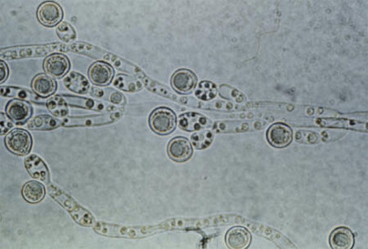

Figure 62-17 

Chlamydoconidia produced by _Candida albicans._

These thick-walled asexual reproductive structures that occur most commonly at the ends of pseudohyphae are characteristic for this species and for _Candida dubliniensis_ . (Cornmeal agar plate, 400×.) 

When germ tubes and chlamydoconidia are not demonstrated, a preliminary or presumptive identification of _Candida_ spp. can be made only if pseudohyphae are present and arthroconidia are absent. Conventional methods for identification of _Candida_ species based on morphologic and physiologic attributes are commonly used (see [ Table 62-6 ](<#t0035>) ) (  Neppelenbroek et al, 2014  ). For instance, a rapid assimilation trehalose test procedure has been suggested by the CLSI (document M35-A2) for the identification of _C. glabrata,_ a species that has emerged as a common cause of invasive disease with known resistance to standard antifungal therapy (  CLSI, 2008a  ). An accurate identification, however, is often complex and time-consuming, frequently requiring new techniques such as molecular typing to confirm the identification (  Castanheira et al, 2013  ;  Neppelenbroek et al, 2014  ). 

 

##  The Genus _Cryptococcus_

The _Cryptococcus_ species complex consists of two species: _C. neoformans_ and _Cryptococcus gattii_ (formerly called _C. neoformans_ var. _gattii_ ). These species are known to cause systemic infection in both immunocompetant and immunocompromised individuals (  Perfect et al, 2010  ). The environmental reservoir for _C. neoformans_ (teleomorph, _Filobasidiella neoformans_ ) is primarily pigeon guano, and infections caused by this organism occur worldwide. _C. gattii_ , on the other hand, was originally found predominantly in tropical and subtropical areas, especially those areas associated with eucalyptus trees, with infection apparently limited in distribution, primarily to northern Australia and Papua New Guinea (  Chen et al, 2014  ). More recently, infections have been noted in individuals after exposure in the Vancouver and U.S. Pacific Northwest regions, with recent emergence of this pathogen now identified in multiple states outside of these areas (  Chen et al, 2014  ;  Harris et al, 2013  ). Since both species are classified within the phylum _Basidiomycota,_ they are capable of producing basidiospores under the right circumstances. This sexual stage of cryptococci occurs only when appropriate mating types are crossed; thus this stage is not generally recognized in the clinical laboratory. Sexual reproduction in the genus _Cryptococcus,_ however, leads to increasing genetic diversity with the potential to produce strains that are hypervirulent and show increased antifungal resistance (  Huston & Mody, 2009  ). 

 

##  Risk Factors 

Immunosuppressive therapy or disease is a risk factor for cryptococcosis (  Perfect et al, 2010  ). Prior to the appearance of HIV infection, 30% to 50% of patients with cryptococcal infection were immunologically normal, as measured by available parameters. Risk factors for these patients include neoplasia, diabetes mellitus, immunosuppressive therapy, and immunologic disease. The introduction of the HIV-infected patient dramatically increased the number of cases of cryptococcosis, and although advances have been made in antiretroviral therapy, in antifungal treatment, and in intracranial pressure management in these patients, cryptococcosis continues to have a high rate of mortality. An estimate of the global burden of cryptococcal meningitis finds the numbers of cases and deaths to be excessive within areas of sub-Saharan Africa, where there is a high incidence of HIV-infected people (  Veltman et al, 2014  ). 

 

##  Clinical Disease 

Primary cryptococcal disease generally occurs in the lungs following inhalation of the fungus from the environment. This disease can remain localized or can disseminate by hematogenous spread to other tissues, most frequently the central nervous system. The severity of the disease is dependent on the host's immune response, with severe disease most frequent in immunologically compromised patients. Practical guidelines for the management of cryptococcal diseases are available from the Infectious Diseases Society of America (  Perfect et al, 2010  ). 

 

##  Respiratory Tract 

Cryptococcal infection of the respiratory tract exhibits a wide variety of presentations (  Shirley & Baddley, 2009  ). Immunologically competent patients may exhibit no symptoms despite the presence of cryptococci in the lower respiratory tract, and the infection may be diffuse or localized, to include the formation of coin lesions that usually do not calcify. Immunocompromised patients on the other hand may have extensive infection that often is accompanied by other infectious agents, particularly _Pneumocystis (carinii) jiroveci_ or cytomegalovirus. Extrapulmonary disease may appear weeks after a pulmonary infection has been documented. 

 

##  Skin Lesions 

Skin lesions usually result from hematogenous dissemination from the respiratory tract in immunocompromised patients (  Negroni, 2012  ). These lesions present as single or multiple papules, which enlarge and ulcerate, producing a thin exudate that contains the yeast. Primary cutaneous manifestations of the disease are rare but may also be reported in immunocompetent individuals (  Revenga et al, 2002  ). 

 

##  Bone and Joint Infection 

Bone and joint infection may occur usually as a result of dissemination from the respiratory tract (  Bariteau et al, 2014  ). Osteolytic lesions are produced, with abscesses formed in adjacent soft tissue that contain a thin exudate with large numbers of cryptococci. Less commonly, joint spaces are involved. 

 

##  Central Nervous System Infection 

Cryptococcal meningitis is the most frequent and most serious focus of disseminated cryptococcal infection (  Sloan, 2014  ). Onset of this disease may be acute, or presentation may be insidious and progression torpid. Headache and changes in mental status and personality often dominate the clinical picture. Basilar meningitis, involvement of the cranial nerves, and invasion of the underlying cortex result in hydrocephalus and decreased visual acuity. Fever, if present, usually is of low grade, and typical signs of acute meningeal irritation, such as stiff neck and Kernig's and Brudzinski's signs, are often absent. 

 

##  Pathology 

The histologic response depends on the degree of encapsulation of the infecting cryptococcal strain. Most commonly, little or no inflammatory response is seen, and the cells of normal tissue are separated by large numbers of encapsulated cryptococci. Poorly encapsulated strains of _C. neoformans_ elicit a granulomatous inflammatory response, and yeasts are found predominantly in the cytoplasm of macrophages. When cerebrospinal fluid is examined, the only cells present may be the yeasts, which may be misinterpreted as mononuclear host cells if infection is not suspected clinically. Large capsules usually are demonstrated in positive India ink preparations; however, they are not always evident, and the cells may be confused with those of _B. dermatitidis_ or even immature spherules of _Coccidioides_ spp _._

Differentiation in tissue sections can be accomplished by staining of cryptococcal mucopolysaccharide with mucin stains or demonstration of melanin pigment with the Fontana-Masson stain. Mayer's mucicarmine stain and the GMS stain have been shown to be important for the diagnosis of cryptococcosis when atypical forms were present in an uncommon location (  Gazzoni et al, 2009  ). The presence of a thick polysaccharide capsule gives these organisms the characteristic appearance of having a clear space around the yeast cells that can be seen in tissue sections using H&E stain. The encapsulated yeast in variable size (3 to 10 µm in diameter) with a decidedly round nature and narrow-based budding are clues to the identification of this organism in tissue (  Guarner & Brandt, 2011  ). 

 

##  Laboratory Diagnosis 

Possible cryptococci should always be identified as to the species complex level. Clues to the presence of this fungus include good growth on blood agar plates incubated in the bacteriology laboratory at 35° to 37° C, a mucoid appearance of the colonies ( [ Fig. 62-18 ](<#f0095>) ), a round appearance of the yeast cells without pseudohyphae in microscopic wet preps or stained preparations, and lack of growth on media that contain cycloheximide. Presumptive identification can be performed rapidly by examining an India ink preparation for capsules (see [ Fig. 62-14 ](<#f0075>) ) and/or conducting a rapid urease test. Capsules may be diminished even in heavily encapsulated strains once they have been isolated on agar media; however, subcultures of isolates may restore the mucoid capsule. Definitive identification of the species complex can be accomplished by biochemical testing. 

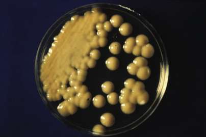

Figure 62-18 

Colonies of _Cryptococcus neoformans_ usually appear mucoid when first isolated. 

Some strains are poorly encapsulated and lack the mucoid appearance. (Sabouraud dextrose agar.) 

The differentiation between _C. gattii_ and _C. neoformans_ using standard phenotypic methods is difficult and generally not performed in the clinical laboratory (reported as _C. neoformans_ species complex or _C. gattii/neoformans_ ). The incorporation of glycine into specialized medium (  l  -canavanine-glycine-bromthymol blue medium) has been shown to be a reliable method for the differentiation of these species, in that _C. gattii_ readily assimilates glycine and _C. neoformans_ does not (  Klein et al, 2009  ). Molecular sequencing of the D1/D2 region of the 28S rDNA gene or the ITS regions of the rRNA genes has also been shown to be reliable in separating these two species (  Georgi et al, 2009  ). More recently, matrix-assisted laser desorption ionization time-of-flight mass spectrometry (MALDI-TOF MS) has been shown to be a reliable method to rapidly discriminate between these two species (  McTaggart et al, 2011  ;  Posteraro et al, 2012  ). 

The polysaccharide antigen of the _C. neoformans_ species complex can be detected in cerebrospinal fluid and serum, using the latex agglutination test (  Perfect et al, 2010  ). Although the sensitivity of this test exceeds 90%, considerable variability in performance has been noted among different commercial kits. The frequency of erroneous results can be diminished by treatment of serum specimens with pronase. False-positive reactions appear to be less common in patients infected with HIV, perhaps because of the large numbers of organisms present. Titration of positive results has been done traditionally to assess prognosis and to obtain a baseline for use in following the effects of treatment. Large amounts of antigen and persistence of antigen following therapy are poor prognostic signs in patients. Measurement of serum antigen appears to be a more sensitive test than testing of cerebrospinal fluid in HIV-infected patients. However, both serum and cerebrospinal fluid should be tested for optimal sensitivity. A negative India ink test on cerebrospinal fluid is a good prognostic sign in non–HIV-infected patients but does not have the same implication for patients with AIDS. 

 

##  The Genus _Malassezia_

The history of the nomenclature used for the genus _Malassezia_ is complicated. Currently, this genus is composed of one non–lipid-dependent species ( _Malassezia pachydermatis_ ) and 13 lipid-dependent species (  Gaitanis et al, 2012  ). _Malassezia furfur_ is considered the most common pathogen in this group among humans. Since differentiation of the _Malassezia_ spp. requires molecular sequencing, most clinical laboratories prefer to report results as “ _Malassezia furfur_ species complex” or “ _Malassezia_ species.”

 

##  Risk Factors 

_Malassezia_ yeasts are commensals of the normal skin, and cutaneous disease may occur in normal hosts. Systemic infection occurs primarily in neonates and is associated with intravenous hyperalimentation with lipid solutions (  Gaitanis et al, 2012  ). Although _Malassezia_ spp. are not ordinarily present on the skin of healthy infants, the yeasts have been recovered from the skin of >35% of infants who were in intensive care units. 

 

##  Clinical Diseases 

Infection caused by _Malassezia_ spp. can range from an asymptomatic lesion on the epidermis of normal individuals to systemic disease in the immunocompromised host. 

 

##  Cutaneous Infection 

_Malassezia_ species are known causes of pityriasis (tinea) versicolor and seborrheic dermatitis, and evidence is accumulating that they play a significant role in atopic eczema/dermatitis syndrome (formerly called **atopic dermatitis** ) (  Pedrosa et al, 2014  ;  Zisova, 2009  ). 

Pityriasis versicolor is a common infection of the epidermis in immunologically normal patients, resulting in hyperpigmentation or hypopigmentation of the skin, commonly on the trunk and upper arms. Fawn-colored macules are the most common presentation, but depigmenting lesions are more obvious in dark-skinned persons and may be accentuated by a suntan in light-skinned individuals. The ill effects are purely cosmetic but may be considerably troublesome. Hypopigmented lesions must be differentiated from vitiligo. Therapy consists of topical application of fungicidal creams or rinses. 

Seborrheic dermatitis is a multifactor disease that requires both endogenous and exogenous predisposing factors for development. An inflammatory reaction against the yeast is considered the basis for the development of this disease. 

 

##  Systemic Infection 

Systemic infection occurs almost invariably in infants who have received intravascular infusions of lipid (the disease is also called _Malassezia_ catheter–associated sepsis) (  Tragiannidis et al, 2010  ). Diluted lipid solution supports the growth of lipid-dependent _Malassezia_ spp. by supplying long-chain fatty acids that are also found on the skin and must be supplied in the laboratory for isolation of the yeast. Infected infants are often asymptomatic, but fever, leukocytosis, and thrombocytopenia may be present. Pneumonia is a common systemic manifestation of disease, probably resulting from emboli received from infected intravenous catheters. Removing the infected catheter is therapeutic. 

 

##  Pathology of _Malassezia_ Infection 

The diagnosis of pityriasis versicolor usually is made clinically or by demonstrating yeast and short hyphal forms (similar in appearance to spaghetti and meatballs) in KOH preparations of skin scrapings ( [ Fig. 62-19 ](<#f0100>) ). The addition of Calcofluor white or another fungal stain enhances detection because the fungal cells are small and difficult to visualize when unstained. When biopsied, hyperkeratosis, acanthosis, and dermal mononuclear infiltrates may be seen. Little is known of the pathology of systemic infection with _Malassezia_ spp. because biopsies are performed infrequently and lethal infection is uncommon. In rare fatal cases, vasculitis, septic infarcts, and granulomatous inflammation have been described in many organs, including the lung, liver, and kidney. 

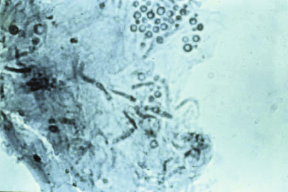

Figure 62-19 

Skin scrapings from a lesion of pityriasis versicolor. 

The yeast and short hyphal forms (spaghetti and meatballs appearance) are characteristic of _Malassezia furfur_ species complex. (Lactophenol cotton blue stain, 400×.) 

 

##  Laboratory Diagnosis 

Culture for _Malassezia_ spp. is rarely requested in cutaneous disease, and direct observation of yeast in KOH preparations usually is done in the physician's office. This yeast should be sought in cultures of blood and intravenous catheter tips from neonates. Before inoculation, a drop of sterile olive oil is added to the surface of a suitable agar medium, such as Sabouraud dextrose agar or sheep blood agar. Within 2 to 3 days, colonies appear light brown and often have a very dry appearance in the oil overlay. An initial clue to this pathogen is lack of growth in the absence of oil or stimulation of growth by the presence of oil overlay ( [ Fig. 62-20 ](<#f0105>) ). In contrast, _M. pachydermatis_ is not dependent on long-chain fatty acids for growth. 

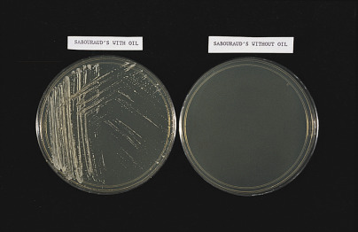

Figure 62-20 

Abundant growth of _Malassezia furfur_ is evident on a plate that was overlaid with oil before the inoculum was applied. 

No growth is seen on a companion plate without oil. (Sabouraud dextrose agar.) 

Identification of the genus can be suspected by microscopic examination of the yeast cells, which measure 3 to 7 µm in diameter. The budding process in _Malassezia_ is unusual because it occurs as an enteroblastic process with the formation of phialides. The bud is broad-based, and the collarettes of the phialides may be observed with the light microscope as a distinct dark ring separating the mother and daughter cells ( [ Fig. 62-21 ](<#f0110>) ). Species identification can be confirmed using molecular techniques that target regions within the rDNA complex (  Cafarchia et al, 2011  ). 

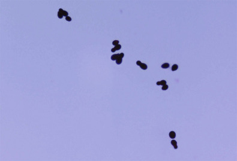

Figure 62-21 

Gram stain from culture demonstrating gram-positive yeast cells of _Malassezia_ spp. showing the characteristic collarette (bud scar). 

(Gram stain, 1000×.) 

 

##  Other Yeast and Yeastlike Pathogens 

Invasive infection caused by rare yeast pathogens continues to increase due in part to the severe immunosuppressive conditions that predispose patients to infection. Recently, a panel of experts of the European Society of Clinical Microbiology and Infectious Diseases (ESCMID) and the European Confederation of Medical Mycology (ECMM) undertook a data review and compiled guidelines for the diagnostic tests and procedures for detection and management of rare invasive yeast infections (  Arendrup et al, 2014  ). Their assessment showed that there are a number of non- _Candida_ species that continue to emerge and cause disease. Notable examples of species associated with invasive disease included the _Trichosporon_ species, _Geotrichum candidum_ , and _Rhodotorula mucilaginosa_ ( [ Fig. 62-22 ](<#f0115>) ). Currently, 50 species of _Trichosporon_ have been described with 16 linked to human disease (  Colombo et al, 2011  ). Of these _T. asahii, T. mucoides,_ and _T. asteroids_ are most commonly associated with invasive infection. The ability of these species to adhere to and form biofilms on implanted devices has been shown to account for the emergence of invasive trichosporonosis cases (  Colombo et al, 2011  ). Both _G. candidum_ and _R. mucilaginosa_ have emerged as causes of life-threatening fungemia in severely immunocompromised patients (  Henrich et al, 2009  ;  Spiliopoulou et al, 2012  ). Resistance to regularly used antifungal agents is not uncommon with these pathogens and other rare yeast-causing disease, making the correct identification mandatory for appropriate management of the infected patient. 

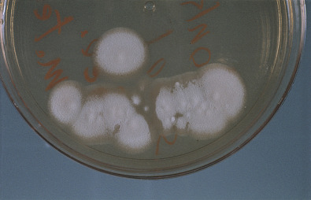

Figure 62-22 

An aerial mycelium arises from the yeastlike colony of _Geotrichum candidum_ . 

(Sabouraud dextrose agar.) 

Demonstration of these rare yeasts in tissues, by histopathology with culture or isolation in culture from multiple specimens of a sterile site, is required to document the role of an unusual yeast in the infectious process. Species confirmation in these circumstances requires molecular sequencing of the isolated pathogen. 

,  

##  Mycoses Caused by Dimorphic Fungi 

Thermally dimorphic fungi are the most pathogenic organisms encountered in a clinical mycology laboratory. In the United States, the most important dimorphic pathogens are _Histoplasma capsulatum_ var. _capsulatum, Blastomyces dermatitidis, Coccidioides immitis, Coccidioides posadasii,_ and _Sporothrix schenckii. Sporothrix_ is widely distributed throughout the world, and the other organisms are found predominantly in North America, where they have distinct geographic distributions ( [ Fig. 62-23 ](<#f0120>) ). Epidemic disease is most common with _Histoplasma_ and _Coccidioides_ and less common with _Sporothrix_ and _Blastomyces._ These endemic mycoses share several characteristics, including (1) the ability to cause disease in a healthy host, (2) association with a specific ecologic niche in the environment, and (3) demonstration of temperature dimorphism (mold in the environment at a temperature of 25° to 30° C and yeast or spherules [in the case of _Coccidioides_ ] at body temperature). 

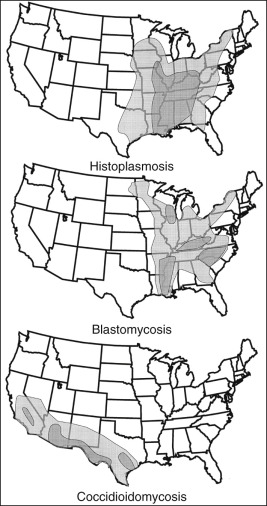

Figure 62-23 

Geographic distribution of dimorphic fungal infections in the United States. 

Areas of greatest endemicity _(dark shading)_ and lesser endemicity _(light shading)_ are illustrated. Sporadic cases may also occur in other areas outside of the endemic zones. 

 

##  The Genus _Histoplasma_

_H. capsulatum_ is subdivided into two varieties: _H. capsulatum_ var. _capsulatum_ (hereafter referred to as _H. capsulatum_ ) and _H. capsulatum_ var. _duboisii_ . Both of these fungal pathogens are geographically restricted, and acquisition of infection does not overlap in most cases. _H. capsulatum_ is found primarily along the Ohio, Mississippi, and St. Lawrence Rivers but may have worldwide distribution. _H. capsulatum_ var. _duboisii,_ on the other hand, is limited to equatorial Africa and causes a disease referred to as _African histoplasmosis._ Distinguishing characteristics of the tissue phase can be observed to differentiate between these two pathogens; however, lack of travel to the endemic area in Africa generally can be used to rule out infection with the var. _duboisii_ . 

 

##  Risk Factors 

The primary risk factor for acquiring histoplasmosis is living in endemic regions of the United States. In some areas, more than 90% of the population reacts positively to histoplasmin skin testing. Growth of _H. capsulatum_ in the soil is stimulated by bird guano, although the fungus does not infect the bird. Once growing in the soil, the fungus sporulates and produces conidia, which, during activities that generate aerosols, can be inhaled into the lungs. Occupationally acquired acute histoplasmosis has been reported, leading the U.S. HHS to issue a document outlining measures for protecting workers at risk (  HHS, 2004  ). 

Epidemic acute disease has occurred in individuals exposed to areas endemic for this fungus. The Centers for Disease Control and Prevention (CDC) described 221 cases of histoplasmosis among students representing 37 colleges in 18 states who had vacationed in Acapulco, Mexico, in March of 2001 and then returned to the United States (  CDC, 2001a  ). Most infected individuals were identified as visiting a common source point leading to spore exposure. The CDC also described an outbreak of histoplasmosis among day camp attendees with 22 confirmed cases (a serum or urine test positive for _H. capsulatum_ with characteristic pulmonary symptoms) and 14 suspected cases (characteristic pulmonary symptoms after camp arrival) of disease in counselors and children attending the camp (  CDC, 2012  ). Occupationally, a CDC report described an outbreak of histoplasmosis wherein at least 25 workers at an agricultural processing plant in Nebraska developed disease following exposure to soil known to be contaminated with _H. capsulatum_ (  CDC, 2004  ). 

 

##  Clinical Diseases 

The magnitude of the exposure and the immune status of the host influence the clinical manifestations of disease, which can range from an asymptomatic infectious process to disseminated life-threatening disease (  Kauffman, 2007  ;  Wheat et al, 2007  ). Exposure to low concentrations of spores from the environment in a normal host is typically asymptomatic. Therefore most adults living in an endemic area are seropositive and show immunologic evidence of infection; however, they remain asymptomatic to disease. Disseminated disease is usually reserved for individuals who are immunosuppressed. 

 

##  Acute Pulmonary Infection 

Individuals who are exposed to large numbers of conidia may develop a flulike syndrome with high fever, chills, fatigue, cough, and pleuritic or retrosternal chest pain. More severely affected individuals may be sick for several weeks, but resolution usually is complete without antifungal therapy in the normal host. If focal granulomatous inflammation has occurred, calcification of the focus typically leaves a well-circumscribed coin lesion, which may be seen on the chest radiograph. 

 

##  Granulomatous and Fibrosing Mediastinitis 

These types of manifestations involve the lymph nodes in the mediastinum (  Hammoud et al, 2009  ). Granulomatous disease is characterized by enlarged lymph nodes, which may obstruct the airways, pulmonary vessels, or esophagus. Fistulas can form within the lymph nodes and adjacent mediastinal structures. Fibrosing disease is a reaction that occurs in the mediastinum among individuals predisposed to an excessive response to _Histoplasma_ antigens. Obstructions may form that involve the superior vena cava, the airways, the pulmonary arteries or veins, or the esophagus. Both granulomatous and fibrosing diseases are thought to progress independently. 

 

##  Chronic Pulmonary Histoplasmosis 

This debilitating disease occurs primarily in patients with chronic obstructive pulmonary disease (COPD), most of whom are middle-aged men (  Kennedy & Limper, 2007  ). However, studies have shown that this disease is becoming more commonly recognized among females, and that females exhibited fewer cavities and presented with decreased numbers of smokers and reduced extent of smoking exposure, along with absence of COPD. In this disease, calcification and cavitations may occur, which may mimic chronic pulmonary tuberculosis and pulmonary neoplasia. 

 

##  Disseminated Histoplasmosis 

Dissemination of yeast through the reticuloendothelial system may occur as part of acute pulmonary histoplasmosis, resulting in healed granulomas that often calcify, especially in the spleen. Clinically disseminated infection occurs in two classes of patients. The first group consists of individuals at the extremes of age who do not have a recognized immunosuppressive condition but may have an immune system that is incompletely developed or is diminished by age in ways that are incompletely understood. The second group comprises patients with recognized immunosuppressive diseases or therapies. Before the 1980s, these diseases were predominantly hematologic neoplasms; however, in recent years, HIV infection has dominated the risk factors (  Adenis et al, 2014  ). Progression of disease may be rapid or insidious. 

Compromised patients may develop an infection of the reticuloendothelial system, resulting in lymphadenopathy, hepatosplenomegaly, or thrombocytopenia (  Wheat et al, 2007  ). Destruction of the adrenal cortex by the granulomatous process may be sufficiently extensive to cause hormonal insufficiency. Central nervous system infection may be manifested as chronic meningitis, intracerebral granulomas, or both. Endovascular infection includes endocarditis with large, bulky vegetations. Any part of the GI tract may be affected, and ulcerating lesions may suggest a neoplasm macroscopically. The hallmark of disease is an oropharyngeal ulcer, which may cause hoarseness, dysphagia, or a painful lesion on the tongue or gingiva (  Psevdos & Tanowitz, 2008  ). 

 

##  Pathology 

As a facultative intracellular pathogen, _H. capsulatum_ is found predominantly in macrophages. Pathologic lesions consist of collections of infected macrophages, noncaseating granulomas, or caseating granulomas. Histopathologic lesions are similar to those produced by _Mycobacterium tuberculosis,_ and these two pathogens should be considered at the same time in the patient workup differential. Intracellular yeasts are often well demonstrated by H&E staining ( [ Fig. 62-24 ](<#f0125>) ). However, PAS and GMS stains are more sensitive, with the silver stain essential for demonstration of old yeast cells in healed granulomas. This yeast, presumably no longer viable, may be enlarged and distorted in morphology, making diagnosis difficult. Differential diagnosis of yeast forms includes small forms of _B. dermatitidis, P. marneffei, Leishmania_ spp., or _Candida_ spp., especially _C. glabrata_ . The yeasts of _H. capsulatum_ in caseating granulomas are sufficiently distinctive to provide a presumptive diagnosis, but unusual granulomatous presentations of _P. (carinii) jiroveci_ must be differentiated. Culture is generally required for disease confirmation; however, molecular tests for direct testing on tissue have shown promise for the confirmation of histoplasmosis without culture (  Babady et al, 2011  ;  Koepsell et al, 2012  ). 

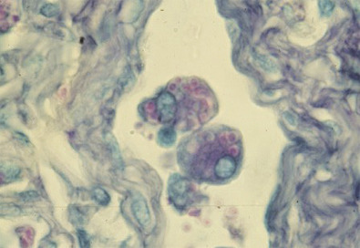

Figure 62-24 

Yeast cells of _Histoplasma capsulatum_ in macrophages. 

The presence of intracellular small, round to oval yeastlike cells in tissue is a characteristic pathologic finding in histoplasmosis. (Hematoxylin and eosin stain, 1000×.) 

 

##  Laboratory Diagnosis 

The yeast form in tissue may be demonstrated histologically or in preparations of respiratory secretions, fluids, peripheral blood, bone marrow, or tissue imprints. Wet preparations and Calcofluor white may be used, but the morphology of tissue and yeast cells is best seen with Giemsa staining because the details of nuclear morphology can be assessed. The yeast cells measure 3 to 5 µm in diameter, have a single nucleus, and bud with a narrow neck. 

If disseminated infection is suspected, blood cultures for _Histoplasma_ should be performed. The Isolator technique is a sensitive technique for recovering the yeast phase from blood, although other blood culture detection systems can also be used to detect this fungus. Other clinical specimens should be inoculated to an enriched agar, such as brain-heart infusion agar supplemented with sheep blood, which is incubated at 25° to 30° C. 

Colonies of _H. capsulatum_ usually appear after incubation for 10 to 14 days but occasionally require incubation for up to 4 weeks. They are fluffy and vary from white to buff-brown. Diagnostic asexual forms include microconidia and macroconidia. Microconidia, which are produced first, are similar to the structures produced by _B. dermatitidis._ The more characteristic macroconidia have roughened projections from the periphery of the conidia, a configuration referred to as _tuberculate_ ( [ Fig. 62-25 ](<#f0130>) ). The macroconidia of the saprophyte, _Sepedonium,_ may be confused with _Histoplasma,_ so differentiation of these two fungi is important. The macroscopic appearance of the colonies, the rate of growth, the growth of _H. capsulatum_ on media containing cycloheximide, the presence of yeast forms in tissue, and the clinical history usually are sufficient to diagnose histoplasmosis. Final confirmation most often is provided by nucleic acid hybridization probe testing from the culture isolate. Conversion of the mold to the yeast phase also confirms identification, but this is often difficult and has been supplanted in most clinical laboratories by the molecular probe technique (AccuProbe). 

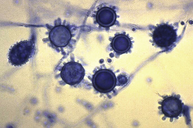

Figure 62-25 

Tuberculate macroconidia with microconidia of _Histoplasma capsulatum_ in culture _._

These structures are characteristic of the environmental mold form of this dimorphic fungus. (Lactophenol cotton blue stain, 400×.) 

(Courtesy of CDC Public Health Image Library.) 

Serologic tests for the detection of anti- _Histoplasma_ antibodies (i.e., immunodiffusion and complement fixation) have several limitations that need to be considered, making these tests marginal for the diagnosis of histoplasmosis. A 2- to 6-week delay after exposure is required for the production of antibodies, reducing the value of this testing for the diagnosis of acute disease. Once patients are infected with _H. capsulatum,_ antibody levels remain detectable for many years. Antibodies to _H. capsulatum_ and _B. dermatitidis_ also may cross-react. Additionally, patients with immune dysfunction may not produce detectable levels of antibodies, and patients with previous exposure might have elevated levels of antibodies (  Wheat, 2006  ). 

Antigen detection, on the other hand, has been shown to be useful for the diagnosis and management of histoplasmosis (  Wheat et al  2007  ). The sensitivity of urine antigen detection for diagnosis is greatest in patients with disseminated disease (up to 92%) or acute pulmonary histoplasmosis (75% to 80%). Antigen detection is also useful for following the effects of therapy on fungal burden; when antigen concentrations in urine or serum fall during therapy, treatment failure is suggested. Moreover, increased antigen levels in a previously infected individual suggest a relapse of infection. Use of the antigen assay to detect _Histoplasma_ antigen in bronchoalveolar fluid has been shown to complement antigen detection in serum and urine as an objective diagnostic test (  Hage & Wheat, 2010  ). 

The histoplasmin skin test antigen has been useful for epidemiologic studies but should not be used for diagnosis. Not only does the high frequency of positive tests in endemic areas cloud interpretation, but the skin test can cause an individual to seroconvert to positive, further confusing the issue. 

 

##  The Genus _Blastomyces_

_Blastomyces dermatitidis_ is the only species within the genus _Blastomyces_ . Endemic areas for this pathogen in the soil include the eastern part of the United States, mainly areas adjacent to the Mississippi and Ohio River basins; areas northwest of the Great Lakes in Canada; and areas within Africa (  Benedict et al, 2012  ). Other reports suggest that the endemic area for blastomycosis may be larger than originally described, with disease described in patients residing in Colorado and Nebraska (  CDC, 1999  ;  Veligandla et al, 2002  ). 

 

##  Risk Factors 

Most cases of blastomycosis (also referred to as North American blastomycosis) are sporadic, and an environmental source is not often found. Small outbreaks do occur, and the fungus has been isolated from soil at outbreak sites (  McKinnell et al, 2009  ). No specific risk factors for blastomycosis are known, although severe, disseminated infection has been described in immunocompromised patients. HIV-infected patients who reside in endemic areas are particularly at risk for serious infection (  Pappas & Dismukes, 2002  ). 

 

##  Clinical Diseases 

As is true with most other endemic dimorphic fungi, the portal of entry is the respiratory tract, where the infection may be asymptomatic, transient, or insidiously progressive (  Bariola et al, 2011  ;  Saccente et al, 2010  ). Chronic pulmonary blastomycosis with low-grade fever, weight loss, and localized pulmonary infiltrates may suggest neoplastic disease, for which diagnostic studies, including bronchoalveolar lavage, fine-needle aspiration of the lung, or surgical lung biopsy, may be undertaken. Dissemination of yeast from the lung most commonly results in cutaneous or skeletal infection (  Jain et al, 2014  ;  Mason et al, 2008  ). The central nervous and genitourinary systems are involved less frequently. Cutaneous lesions often are hypertrophic or ulcerative and may be locally destructive. The lesions may be mistaken for squamous cell carcinoma of the skin. Secondary involvement of the skin over bony lesions also occurs. A delay in diagnosis is not uncommon, especially when patients have no history of exposure to an endemic area (  Bradsher RW Jr, 2014  ;  Veligandla et al, 2002  ). 

 

##  Pathology of Blastomycosis 

The characteristic histologic response to _B. dermatitidis_ is a mixture of acute inflammation with microabscess formation and granulomatous inflammation. In cutaneous lesions, pseudoepitheliomatous hyperplasia of the epidermis overlying the inflammation is characteristic. Yeast cells are most often found in the microabscesses or within multinucleated giant cells. The characteristic yeast can frequently be demonstrated in tissue sections stained with H&E, but the organism may be more readily visible when stained with PAS or GMS. The thick-walled yeast cells measure 8 to 15 µm in diameter and maintain a broad base during the budding process ( [ Fig. 62-26 ](<#f0135>) ). An artifactual separation of the cytoplasm from the cell wall in formalin-fixed preparations may give the appearance of a double wall. Although nonbudding yeast cells must be differentiated from yeast cells of _Cryptococcus_ spp. and from developing spherules of _Coccidioides_ spp., the diagnosis of blastomycosis can generally be proposed by observation of characteristic yeast forms in tissues by an experienced pathologist (  Patel, 2010  ). 

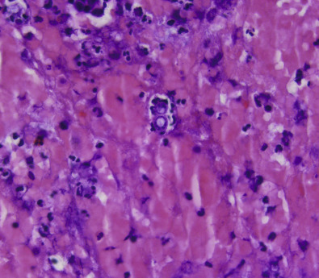

Figure 62-26 

_Blastomyces dermatitidis_ in tissue showing characteristic large, broad-based, budding yeast cells with a thick refractile (double-contoured) wall. 

(Hematoxylin and eosin stain, 400×.) 

Surgical pathology and cytopathology have been reported as the primary means of diagnosis because positive culture may not always be recovered. However, microbiology culture and conventional morphologic assessment of routine samples have redundant utility in diagnosis and generally are required to make a confirmed disease diagnosis (  Taxy, 2007  ). Recent advances in molecular diagnostics have shown promise for the identification of _B. dermatitidis_ directly from clinical specimens (  Babady et al, 2011  ). 

 

##  Laboratory Identification 

Direct demonstration of the yeast cells may be accomplished in tissue sections or in wet preparations of aspirated fluids and imprints of tissues. Calcofluor white staining may enhance detection of the yeast. Growth is somewhat more rapid than that of _Histoplasma_ , and fluffy white to buff colonies, which often cannot be distinguished from _H. capsulatum_ , usually appear within 1 to 2 weeks. The microconidia resemble those of _H. capsulatum_ ( [ Fig. 62-27 ](<#f0140>) ), but macroconidia are not formed. A saprophytic mold, _Chrysosporium_ resembles _Blastomyces_ but does not develop a yeast phase and does not grow on media that contain cycloheximide. Conversion to the yeast phase may occur on routine media incubated at 37° C with hemoglobin and cysteine containing agar used specifically for this purpose ( [ Fig. 62-28 ](<#f0145>) ). Once again, demonstration of the yeast form in tissue serves as a reasonable substitute for demonstration of dimorphism in the laboratory. The nucleic acid probe hybridization test (AccuProbe) from culture material is the preferred method for confirmation of isolates in most laboratories, although false-positive results have been reported (  Iwen et al, 2000  ). 

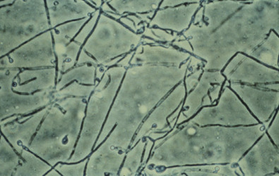

Figure 62-27 

Mold form of _Blastomyces dermatitidis_ in culture. 

The lollipop appearance of the conidium on a conidiophore is characteristic of the environmental mold form for this dimorphic fungus. (Lactophenol cotton blue stain, 400×.) 

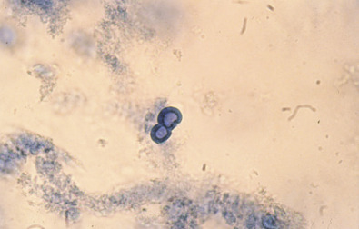

Figure 62-28 

Budding yeast cells of _Blastomyces dermatitidis_ in culture _._

When cultures are incubated at 37° C, large, broad-based budding yeasts with a double-contoured wall are detected that are characteristic of the yeast phase of this dimorphic fungus. (Lactophenol cotton blue stain, 400×.) 

Although the complement fixation test has been used as a serologic test for the diagnosis of blastomycosis, this test has considerable limitations and should be used only as an adjunct to culture of the fungus. A _Blastomyces_ antigen test similar to the _Histoplasma_ antigen test also is available in a reference laboratory; however, data regarding utility and reliability are lacking. 

 

##  The Genus _Coccidioides_

Until recently, _Coccidioides immitis_ was considered the sole etiologic agent of coccidioidomycosis (Valley fever, San Joaquin Valley fever, and desert fever). Phylogenetic studies now show the existence of two genetically distinct _Coccidioides_ clades: one called the **California clade** ( _C. immitis_ ) and the other called the **non-California clade** ( _C. posadasii_ ) (  Fisher et al, 2002  ). Although a strong difference in genotype has been noted between these two species, the phenotypic differences are minimal, thus making it difficult for most laboratories to distinguish between them (  Ampel, 2009  ;  Saubolle, 2007  ). 

The coccidioidal organisms are soil-dwelling fungi found in the southern portions of California and in other areas of the southwestern United States (especially southern regions of Arizona, Utah, Nevada, and New Mexico, as well as western Texas), northern Mexico, and Central and South America (especially Venezuela) (  Nguyen et al, 2013  ). Arizona has seen a dramatic increase in cases over the years, with a disproportionate rate of infection occurring in people older than 65 years of age and in those with HIV infection (  CDC, 2013  ;  Kim et al, 2009  ). Although coccidioidomycosis is endemic to the hot, arid regions of the southwestern United States and Central America, recognition of exposure to contaminated soil outside of these endemic areas should be considered by health care providers and veterinarians. A recent example of this is the detection of _C. immitis_ in soil in Benton County, Washington (  CDC, 2014b  ). 

 

##  Risk Factors 

Residence in an endemic area is the primary risk factor for the development of infection because the arthroconidia of the mold phase are in the soil and are easily disseminated through the air (  Johnson et al, 2014  ;  Parish & Blair, 2008  ). A classic example of epidemic coccidioidomycosis occurred among cast and crew members at an outdoor filming event in California in 2012 (  CDC, 2014a  ). Five individuals within this group were laboratory-confirmed to have pulmonary coccidioidomycosis, with an additional five probable cases following an extensive outbreak investigation of this filming event. The dry, dusty conditions during the filming associated with substantial soil-disruptive work including grading and digging illustrated the risk to employees working outdoors in _Coccidioides_ -endemic areas. The locations of military bases in the southwestern United States have also shown coccidioidomycosis to have a profound effect on military personnel training in these areas (  Crum-Cianflone, 2007  ). The development of an effective vaccine for Valley fever to protect both military members and civilians residing or training in endemic areas has been a suggested prevention strategy to avoid acquiring the disease (  Hector & Rutherford, 2007  ;  Nguyen et al, 2013  ). 

Genetic factors have been suggested to influence the frequency of severe and disseminated infection, but the nature of this association is not completely known (  Cox & Magee, 2004  ). Disseminated infection is reportedly more common in blacks and Filipinos than in whites. Asians, Native Americans, and Mexicans also appear to be at increased risk for the disease. 

Immunosuppressive infection or disease is a known risk factor for disseminated infection, with HIV-infected patients at particular risk for disseminated disease (  Johnson et al, 2014  ). Transplant recipients who travel to or reside part-time or full-time in endemic areas are also at risk for both primary and reactivation coccidioidomycosis (  Vikram & Blair, 2009  ). Clinicians in nonendemic areas should be aware of the potential for this disease, and should know that early diagnosis followed by prompt antifungal therapy could be lifesaving in these patients. 

 

##  Clinical Diseases 

Primary coccidioidomycosis is most frequently asymptomatic, as indicated by the high prevalence of positive skin tests for coccidioidal antigens in endemic areas. Symptomatic disease usually is manifested as fever with cough or chest pain, or both, and may mimic bacterial pneumonia clinically (  Parish & Blair, 2008  ). Erythema nodosum and erythema multiforme, which may accompany the primary infection, are good prognostic signs of disease. Solitary pulmonary nodules may persist as consequences of the primary pulmonary infection, also similar in appearance to a neoplasm or to tuberculosis. 

Disseminated infection most commonly affects the skin, the skeletal system, and the meninges. Skin lesions include papules, ulcers, draining sinuses, and subcutaneous abscesses. Arthritis most often results from involvement of adjacent bones. Meningitis may be acute but is more commonly indolent and chronic. 

 

##  Pathology 

The tissue response to _Coccidioides_ spp. is granulomatous, with and without caseation. Developing spherules are typically found in macrophages and multinucleated giant cells ( [ Fig. 62-29 ](<#f0150>) ). Endospores within the spherules measure 2 to 5 µm in diameter ( [ Fig. 62-30 ](<#f0155>) ). The spherules measure up to 250 µm in diameter, and developing spherules have a large range of sizes. The differential diagnosis of developing spherules primarily includes nonbudding forms of _B. dermatitidis_ or _C. neoformans._ The spherules must be differentiated from the fungal forms in adiaspiromycosis and rhinosporidiosis, both of which are uncommon infections in the United States. In early disease stages, spherules may not be readily observed, and the presence of only endospores may make the diagnosis of coccidioidomycosis difficult. 

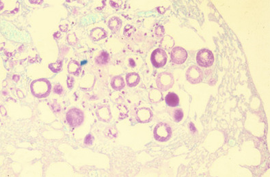

Figure 62-29 

Spherules of _Coccidioides_ spp. in tissue. 

Observation of these large structures in tissue is a presumptive diagnosis for coccidiodomycosis. (Hematoxylin and eosin stain, 100×.) 

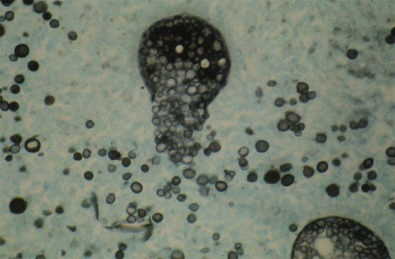

Figure 62-30 

Spherules of _Coccidioides_ spp. in tissue showing release of endospores. 

At maturity, the spherule ruptures and releases endospores, which, in turn, mature to become spherules. When seen in tissue, these immature endospores may be confused with other smaller yeasts. (Gomori's methenamine silver stain, 1000×.) 

 

##  Laboratory Diagnosis 

The diagnosis of coccidioidomycosis can involve a variety of direct microscopic methods (i.e., Calcofluor white stain of respiratory specimen and histopathology of tissue), as well as culture with specific molecular probes for identification (  Saubolle, 2007  ). Spherules may be demonstrated in sputum or, more commonly, in bronchoalveolar lavage fluid, but the sensitivity of direct examination for these structures is generally low. Calcofluor white staining following digestion of the specimen with KOH may increase the sensitivity of testing. If cavitary disease is present, hyphae may be present in clinical specimens, although this is a rare finding. In contrast to the other dimorphic pathogens, the possibility of communicability of arthroconidia directly from the specimen to medical personnel exists under this circumstance. 

_Coccidioides_ species grows rapidly (within 1 week) and can appear on standard bacteriology media such as blood agar in the laboratory. Unfortunately, the arthroconidia of the _Coccidioides_ are highly infectious and are easily transmitted by aerosolization. Infection of laboratory workers is a major concern, so inoculated cultures should be handled with great care in a biosafety cabinet (  CLSI, 2012a  ;  Sutton, 2007  ). The National Institutes of Health has classified both _C. immitis_ and _C. posadasii,_ along with _H. capsulatum,_ as biosafety risk group 3 biologic agents, that is, agents that are associated with serious or lethal human disease for which preventive or therapeutic interventions may not be available (  HHS, 2009  ). Biosafety level 3 containment is suggested when specimens known or likely to contain this organism are handled. In a survey of laboratory-acquired infections, coccidioidomycosis was included in a list of the 10 most frequently reported infections (  Singh, 2009  ). 

Colonies of _Coccidioides_ species are variable in appearance, ranging from velvety or cottony to granular or powdery. The colonial morphology may change as the colony and arthroconidia develop. Most isolates are white, but a variety of colors may be observed, and a diffusible pigment may be produced by some strains. Cultures often become gray with age. If a _Coccidioides_ spp. is suspected, some mycologists prefer to sterilize the culture before examination of the colonies by flooding the container with 10% formalin, followed by overnight incubation. In cases in which specimens are suspected to contain _Coccidioides,_ screw-capped slants should be used instead of plates. The mold form is not routinely converted to the tissue form because specialized synthetic broth is generally required for this to occur. Separation of species into _C. immitis_ and _C. posadasii_ is best achieved by specialized molecular techniques, which normally are not available in routine clinical laboratories (  Saubolle, 2007  ). Generally, laboratories will report the results as “ _Coccidioides immitis/posadasii_ ” or as a “ _Coccidioides_ species.”

Alternating barrel-shaped arthroconidia with empty disjuncture cells upon microscopic examination of culture material are distinctive (see [ Fig. 62-9 ](<#f0050>) ) but must be differentiated from other organisms that produce arthroconidia, such as _Trichosporon, Geotrichum,_ and some members of the family _Gymnoascaceae_ . A presumptive identification is generally adequate to make a diagnosis of coccidioidomycosis in an individual who has been in an endemic area and in whom spherules with endospores have been detected in clinical material. A molecular-based genetic probe (AccuProbe) is the method of choice for identification of the fungus into _Coccidioides immitis/posadasii_ (  McGinnis et al, 2006  ). 

In contrast to histoplasmosis and blastomycosis, serologic analysis with the complement fixation test is useful for assessing the extent and prognosis of coccidioidomycosis (  Nguyen et al, 2013  ). Of the serologic techniques available, complement fixation has been studied most extensively. Antibodies are detected approximately 2 to 6 weeks after infection. The height of the titer is an indication of the likelihood of disseminated disease, and a rising titer bodes a poor outcome. Skin testing does not confound the diagnosis by producing a seroconversion, as in histoplasmosis, but the high prevalence of skin test positivity decreases the usefulness of the test. Patients with disseminated infection may demonstrate anergy to the skin test antigen. In an update on diagnosis, Malo and colleagues provide examples of classic clinical and radiographic presentations, discuss the utility of serologic testing, and provide suggested algorithms that may aid in the diagnosis of coccidioidomycosis (  Malo et al, 2014  ). 

 

##  The Genus _Sporothrix_

Historically, the only known species responsible for sporotrichosis was _Sporothrix schenckii_ . However, molecular studies now demonstrate that _S. schenckii_ is a complex of at least five distinct species ( _S. schenckii, S. albicans, S. brasiliensis, S. globosa, S. luriei,_ and _S. mexicana_ ) (  Oliveira et al, 2014  ). Although methods for distinction among these species have been developed, most laboratories do not have the expertise to identify specific species and still refer to _S. schenckii_ as the sole cause of sporotrichosis. More appropriately, laboratory reports should now consider identification as a complex of multiple species and should report results as “ _Sporothrix schenckii_ species complex.”

_Sporothrix_ species are dimorphic fungi present worldwide in soil, plants, and decaying vegetation. Although considered endemic dimorphic fungi, this complex of species exhibit epidemiologic differences that separate them from the other classic endemic dimorphic fungi. The mode of entry for these fungi is usually traumatic implantation (vs. inhalation), the disease produced is usually a localized systemic infection (vs. pulmonary), and the incidence of systemic infection is rare (  Barros et al, 2011  ). 

 

##  Risk Factors 

Although _Sporothrix_ spp. are common in vegetation throughout the world, they do not appear to be plant pathogens; however, epidemics have been caused by exposure to plant products (  Hay & Morris-Jones, 2008  ). One major outbreak occurred among florists and nursery and forestry workers who handled contaminated sphagnum moss grown in Wisconsin (  CDC, 1988  ). Another recent major outbreak involved infected cats in Rio de Janeiro, Brazil, where 759 human cases of cat-transmitted sporotrichosis were reported (  Reis et al, 2009  ). An unusual epidemic occurred among members of a college fraternity in Florida who were building a wall with bricks packed in contaminated straw while consuming copious amounts of beer (  Sanders, 1971  ). The only predisposing factor that was identified with any frequency was consumption of alcohol. It is interesting that the stereotype of the patient at risk for sporotrichosis is the “alcoholic rose gardener.”

 

##  Clinical Diseases 

The overwhelming predominant clinical form of sporotrichosis is involvement of cutaneous and subcutaneous tissues (  Kauffman et al, 2007  ). A papule at the portal of entry may ulcerate and spread the pathogen through regional lymphatics, resulting in a series of lesions progressing up the affected limb (referred to as **lymphocutaneous sporotrichosis** ). Dissemination to osteoarticular structures and viscera is uncommon and appears to occur more often in patients who have a history of alcohol abuse or immunosuppression, especially in patients with AIDS. 

 

##  Pathology of Sporotrichosis 

Histologic responses to _Sporothrix_ and _Blastomyces_ are similar with a mixed suppurative (including eosinophils) and granulomatous inflammation (  Guarner & Brandt, 2011  ). In the skin, pseudoepitheliomatous hyperplasia of the epidermis is common. The yeast cells of _Sporothrix_ are rarely seen in tissue, but when present are pleomorphic and round or elongated, resembling cigars 2 to 6 µm in diameter with narrow-based budding. A tissue reaction to the fungus may result in radiating eosinophilic material up to 10 µm in thickness around the yeast cell, known as the **Splendore-Hoeppli phenomenon** (asteroid bodies) (  Hussein, 2008  ). This distinctive tissue reaction is uncommon, although the reaction is not specific for the diagnosis of sporotrichosis. The differential diagnosis of the skin lesions is primarily mycobacterial infection, especially _Mycobacterium marinum_ (swimming pool granuloma) in the United States and cutaneous leishmaniasis in the tropics. 

 

##  Laboratory Diagnosis 

The preferred specimen is an aspirate, curetting, or biopsy of the skin lesion. _S. schenckii_ grows well on primary isolation media with cycloheximide incubated at 25° to 30° C. The colonies, which may be moist or smooth (glabrous), are often light colored initially and may turn darker with increasing age. This organism produces two types of conidia: thin-walled hyaline conidia arranged as a rosette around the apex of a conidiophore, and thick-walled, dark, sessile conidia attached directly to the hyphae. These dark conidia account for a dematiaceous appearance of the fungus in culture (melanized fungus). The thin-walled microconidia are borne on conidiophores that arise at right angles from the hyphae. They may be arranged sympodially around an expanded vesicle at the tip of the conidiophore, producing an arrangement that has been described as a _floret_ ( [ Fig. 62-31 ](<#f0160>) ). Similar structures are produced by _Acremonium_ spp., which have rarely been reported as a cause of human disease. This mold is differentiated from _Sporothrix_ by the absence of growth on cycloheximide agar and by the absence of a yeast phase. Conversion of the mold phase to yeast is accomplished by incubation of the isolate at 37° C in an atmosphere of 5% carbon dioxide on an enriched medium, such as brain-heart infusion agar supplemented with sheep blood or on chocolate agar. Phenotypic characteristics such as the morphology of sessile pigmented conidia; growth at 30° C, 35° C, and 37° C; and the assimilation of sucrose, raffinose, and ribitol have been used successfully to distinguish among species (  Marimon et al, 2006  ). Molecular studies using the calmodulin gene sequence, the rRNA internal transcribed spacer sequence data, and the β-tubulin sequence have been shown to be reliable for differentiating among _Sporothrix_ spp. (  Barros et al, 2011  ). 

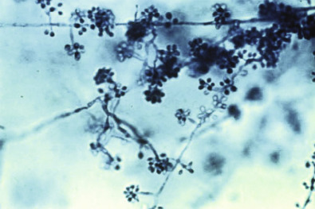

Figure 62-31 

Sympodial conidia of _Sporothrix schenckii_ are borne in clusters at the tips of lateral conidiophores. 

(Lactophenol cotton blue stain, 400×.) 

 

##  Other Dimorphic Fungi 

_H. capsulatum_ var. _duboisii_ causes cutaneous and systemic diseases in Africa (African histoplasmosis). The yeast is larger than that of _H. capsulatum_ var. _capsulatum,_ and the walls are thicker, resembling the cells of _B. dermatitidis,_ but without the broad-based buds. Fatty acid profiling has been shown to be useful for the differentiation between these two strains of _Histoplasma_ (  Zarnowski et al, 2007  ). This strain of _Histoplasma_ is considered an emerging infectious agent in HIV-infected patients in Africa (  Loulergue et al, 2007  ). 

Paracoccidioidomycosis (also known as South American blastomycosis) is a relatively common disease in southern Mexico, parts of Central America, and South America (mainly Brazil, Venezuela, Colombia, Ecuador, and Argentina) caused by the dimorphic fungus _Paracoccidioides brasiliensis_ (  Marques, 2012  ). This organism, which is generally acquired through the lungs, can cause a variety of clinical syndromes from acute infection (with a progressive lymphadenopathy) to a chronic infection that involves the lungs, skin and mucous membranes, lymph nodes, and adrenal glands (  Bocca et al, 2013  ). The clinical manifestations can mimic such conditions as tuberculosis, Hodgkin disease, several systemic and subcutaneous mycoses, and squamous cell carcinoma. The diagnosis is made by finding the organism in a biopsy specimen and isolating the organism in fungal culture (  Marques, 2012  ). The characteristic tissue phase yeast cells of _Paracoccidioides_ have multiple peripheral buds (ranging in size from 4 to 60 µm), producing an appearance that has been compared with a mariner's wheel (  Guarner & Brandt, 2011  ). 

_Penicillium marneffei_ is a common cause of disease in HIV-positive patients in Southeast Asia (  Ustianowski et al, 2008  ). This agent has also been found to be associated with the bamboo rat _(Rhizomys sinensis),_ which is thought to be the natural environmental reservoir for this fungus (  Cao et al, 2011  ). The species is unique among the penicillia in being dimorphic by growing as a mold form at 30° C and thus producing reproductive structures typical of _Penicillium_ spp., and producing in tissue small oval-shaped yeasts (2 to 5 µm in diameter) with transverse septums (due to division by fission) (  Guarner & Brandt, 2011  ). 

,  

##  Dermatophytoses 

Dermatophytic fungi are common and important causes of human morbidity (  Andrews & Burns, 2008  ;  Seebacher et al, 2008  ;  Vermout et al, 2008  ). Generally the infections are mild, and rarely do the fungi associated with these infections cause invasive disease. Three genera are recognized as causes of dermatophytosis: _Microsporum, Trichophyton,_ and _Epidermophyton_ . As a group, the dermatophytic fungi are distributed worldwide, but individual species may have a more restricted geographic distribution. Dermatophytes may also be found in strict association with humans (anthropophilic), with animals (zoophilic), and with soil (geophilic). 

 

##  Risk Factors 

Dermatophytic infections result from contact with the relevant source of the fungus, which may also provide a clue to the diagnosis. For instance, infection of the face in farmers who have contact with cows as they milk the animals is characteristically caused by _Trichophyton verrucosum,_ a zoophilic dermatophyte found in cattle. Geographic variation in dermatophytic pathogens are also noted, with tinea pedis (athlete's foot) more prevalent in developed countries and likely caused by the anthropophilic fungus _T. rubrum,_ while in poorer countries, scalp infections (tinea capitis) are caused by _T. soudanense_ or _M. audouinii_ (  Havilickova et al, 2008  ). Skin disorders caused by dermatophytic fungi are also now recognized more often in sports in which there is direct contact between athletes, such as wrestling (  Field & Adams, 2008  ). 

 

##  Clinical Diseases 

Dermatophytes produce infection of the epidermis, hair, and nails (  Seebacher et al, 2008  ). Infection is often referred to as **ringworm** (or **tinea** ), a name derived from the advancing, serpiginous nature of the lesions (especially evident on the skin). Clinical terminology uses the Latin name _tinea_ followed by the body part involved, such as tinea capitis (scalp), tinea barbae (beard), tinea corporis (trunk and limbs), tinea pedis (foot), tinea cruris (groin), and tinea unguium (nail, also called onychomycosis). With occasional exceptions, _Epidermophyton floccosum_ infects primarily the skin, _Microsporum_ spp. infect the scalp and skin, and _Trichophyton_ spp. infect the skin, scalp, and nails. _Trichophyton tonsurans_ is the most common cause of tinea capitis in the United States, with _M. canis_ a common cause of scalp infection, particularly in children. When deep infection of hair follicles occurs, a boggy inflammatory process called a _kerion_ results. _T. mentagrophytes_ and _T. verrucosum_ are particularly associated with kerion formation. _T. mentagrophytes, T. rubrum,_ and _M. canis_ are commonly found to cause tinea corporis and tinea pedis, and _E. floccosum_ is a common cause of tinea cruris. 

 

##  Laboratory Diagnosis 

Diagnosis of a dermatophyte infection generally involves both microscopic examination and culture, although treatment of dermatophyte infection is not directed by the specific identification of the isolate (  Robert & Pihet, 2008  ). Demonstration of hyphae in skin scrapings (using a KOH preparation) is frequently the only diagnostic technique performed before therapy is initiated ( [ Fig. 62-32 ](<#f0165>) ). The size and morphology of hyphae suggest the involvement of dermatophytes in the infection. Verification of the species is useful for confirming that the hyphae did in fact belong to a dermatophytic fungus, for assessing the probable source of the infection, and for assessing the increased likelihood of chronic, relapsing infections (especially when _T. rubrum_ is identified). Skin scrapings, nails, and hair can be examined in KOH preparations, which may incorporate Calcofluor white to facilitate the detection of hyphae. Care must be taken when reading this type of preparation in that tissue fragments, fibers, and cholesterol crystals may be mistaken for hyphae by the inexperienced observer. 

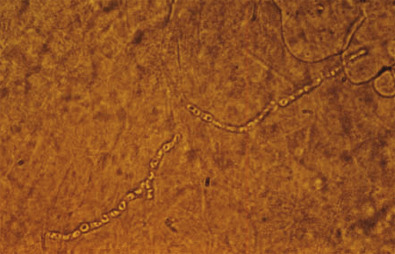

Figure 62-32 

Hyphae of a dermatophyte are demonstrated in a scraping from the edge of a tinea lesion. 

The presence of thin-segmented hyphae in this clinical setting establishes the diagnosis of dermatomycosis but does not define the specific cause. (Potassium hydroxide preparation, 400×.) 

Fungi such as _M. audouinii, M. canis,_ and _Microsporum ferrugineum_ are associated with hair infection and cause the hairs to fluoresce with a long-wavelength ultraviolet light (Wood's lamp). In the United States, tinea capitis due to a fluorescing fungus is most likely caused by _M. canis_ because the other two species are not common in this geographic area. Microscopic examination of infected hair by an experienced observer may suggest the etiologic agent, based on the appearance and location of the arthroconidia. In ectothrix colonization, as occurs with _M. canis_ and _M. audouinii_ infection, arthroconidia are external to the hair shaft. Endothrix invasion, as seen in infection with _T. tonsurans,_ is characterized by arthroconidia within the hair shaft. In favic infection, hyphae, air bubbles, or tunnels and fat droplets are present in the intrapilar area. 

Infected hairs, nail scrapings, or scrapings of the edges of skin lesions should be submitted to the laboratory in a clean, dry container or placed on the surface of primary isolation medium supplied by the laboratory. Sabouraud dextrose agar was designed for recovery of dermatophytic fungi and is also effective for isolating _Candida_ spp., especially _C. albicans,_ which may produce similar infections of the skin and nails. Dermatophytes are not inhibited by cycloheximide, which will inhibit many saprophytic fungi. All dermatophytic fungi have septate, hyaline hyphae and produce macroconidia and/or microconidia in various combinations. Arthroconidia and chlamydoconidia may also be produced, but the morphology of the macroconidia and especially of the microconidia is more important for identification. Sexual stages of the dermatophytes have been identified, but they are not encountered in the clinical laboratory. The combination of micromorphologic features with some phenotypic testing is most often used to differentiate the dermatophytes. 

_Microsporum_ species produce characteristic macroconidia, which are the key diagnostic structures. In some cases, microconidia, which are not as useful diagnostically, are produced. _M. canis_ , the most frequently isolated zoonotic species of this genus, produces a characteristic lemon-yellow pigment in culture ( [ Fig. 62-33 ](<#f0170>) ), which is intensified by growth on potato flake agar. The macroconidia of this species are illustrated in [ Figure 62-34 ](<#f0175>) . 

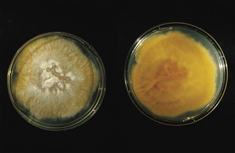

Figure 62-33 

The obverse of a _Microsporum canis_ colony _(left)_ showing the characteristic lemon-yellow pigment, which also may be seen on the reverse of the colony _(right)._ (Sabouraud dextrose agar with cycloheximide.) 

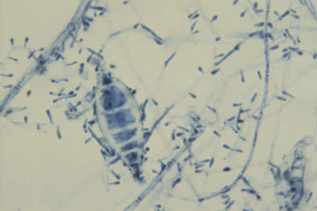

Figure 62-34 

Thick-walled, roughened, tapered, spindle-shaped macroconidia of _Microsporum canis_ with thin, septate hyphae. 

(Lactophenol cotton blue stain, 400×.) 

The genus _Trichophyton_ includes the important dermatophytic fungi _T. rubrum_ ( [ Fig. 62-35 ](<#f0180>) ), _T. verrucosum, T. mentagrophytes_ species complex (see [ Fig. 62-11 ](<#f0060>) ), and _T. tonsurans_ ( [ Fig. 62-36 ](<#f0185>) ). The colonies may have a fluffy, granular, or, less commonly, glabrous appearance. Macroconidia, which are useful for identification, may be produced by this genus, especially in strains that produce powdery colonies, but unfortunately they usually are absent. Microconidia are formed more commonly. When present, the macroconidia are thin-walled and smooth and contain variable numbers of septa. Interpretation of the microscopic morphology in some isolates can be difficult because overlap occurs frequently. Phenotypic testing using the _Trichophyton_ agars is helpful in the characterization of nutritional requirements among members of the genus. Seven media have been described; however, four of these seem to be the most useful for identification purposes. These media include T1, basal medium agar (for a control to compare with other supplemented media); T2, basal medium with inositol (growth stimulated by inositol); T3, basal medium with inositol plus thiamine (growth stimulated by the addition of both inositol and thiamine); and T4, basal medium with thiamine (growth stimulated by thiamine only). In combination, these media allow assessment of dependency on inositol, thiamine, or both compounds together for growth. 

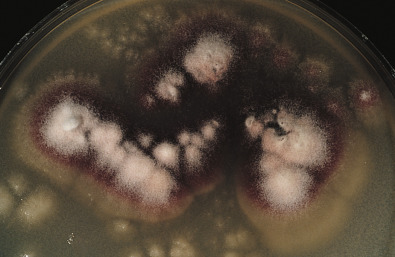

Figure 62-35 

Fluffy white colonies of _Trichophyton rubrum_ with diffusible red pigment, which may also be seen on the reverse of the colony. 

(Potato dextrose agar.) 

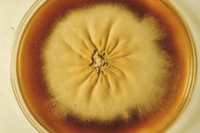

Figure 62-36 

A flat colony showing pale yellow coloration with a reddish-brown pigmentation at the periphery characteristic of _Trichophyton tonsurans_ . 

Radial furrowing of the thallus as seen is also common. (Sabouraud dextrose agar with cycloheximide.) 

Differentiation of _T. mentagrophytes_ and _T. rubrum_ is facilitated by several nonmorphologic tests as well (  Ates et al, 2008  ). A diffusible pigment may be produced by both species, but the intensely red pigment of _T. rubrum_ is encouraged by culture on potato dextrose agar or cornmeal agar with 1% dextrose. Production of urease within 3 to 5 days by _T. mentagrophytes_ but not by _T. rubrum_ also helps differentiate these two species. Finally, the hair penetration test can be used as a differential test wherein _T. mentagrophytes_ produces wedge-shaped defects in hairs in vitro, whereas _T. rubrum_ grows on the outside of the hair without penetration. Use of both morphologic and nonmorphologic approaches provides the most accurate identification of isolates. 

The only pathogen within the genus _Epidermophyton_ is _E. floccosum,_ an anthropophilic fungus that is an important cause of tinea cruris and, less commonly, tinea pedis. Colonies, which are initially brownish yellow, gray, or khaki brown, become velvety and folded as they mature ( [ Fig. 62-37 ](<#f0190>) ). _E. floccosum_ produces no microconidia, but distinctive macroconidia provide clues to identification (see [ Fig. 62-10 ](<#f0055>) ). These structures have smooth external walls, with up to four cross-walls and a club shape, and they tend to “flocculate,” hence the epithet name. 

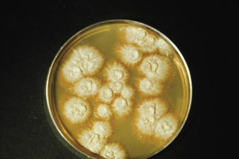

Figure 62-37 

The suedelike texture and yellowish green color of the mold colonies are characteristic of _Epidermophyton floccosum_ . 

(Sabouraud dextrose agar with cycloheximide.) 

To differentiate among closely related dermatophytes, molecular assays have been developed. Species identification for dermatophytes is time-consuming and requires knowledge and technical expertise because of morphologic similarity, variability, and polymorphism within dermatophytes (  Graser et al, 2012  ;  Rich et al, 2013  ;  Westerberg & Voyack, 2013  ). Molecular phylogenetic analysis of multiple dermatophytic species involved in infection has suggested that although profound differences in morphology and pattern of infection among species are noted, there does not appear to be a distinct species difference on modern molecular analysis. This observation suggests that a polyphasic approach to identification may need to be considered. A number of PCR assays have also been developed to identify dermatophytes directly from clinical specimens to enhance the diagnosis (  Graser et al, 2012  ). 

,  

##  Mycoses Caused by Dematiaceous (Melanized) Fungi 

The dematiaceous (also referred to as **melanized** , **dark** , and **phaeoid** ) fungi are a fascinating and complex group of fungi characterized by the formation of a dark pigment due to production of melanin in the cell walls of the fungal cell (  Revankar & Sutton, 2010  ). Although these fungi are soil and plant saprophytes and historically are considered rare causes of disease in humans, they appear to be emerging as more common fungal pathogens. 

 

##  Clinical Diseases 

The clinical syndromes are typically distinguished on the basis of histologic findings into eumycotic mycetoma (also called **eumycetoma** ), chromoblastomycosis (also called **chromomycosis** ), and phaeohyphomycosis (  Garnica et al, 2009  ;  Seyedmousavi et al  2013  ). These diseases are frequently diagnosed by a unique histologic picture in tissue followed by isolation of the fungus in culture and morphologic evaluation of the reproductive structures. The classification of black fungi has undergone numerous changes over the years, which adds difficulty to recognition of the etiologic agent. 

 

##  Mycetoma 

Mycetoma is a tropical disease causing a localized, chronic granulomatous infection characterized by the formation of a painless subcutaneous mass of chronic onset, with multiple sinuses draining pus and grains (also called granules) with extension to the bone (  Garnica et al, 2009  ). The disease is most often confined to the hands or feet (also called Madura foot) in immunocompetent individuals such as farmers, field hands, and others in contact with contaminated soil-laden materials. This disease can be caused by bacteria (actinomycotic mycetoma) or by fungi (eumycotic mycetoma) that are dark pigmented (dematiaceous) or, rarely, nonpigmented (hyaline). Recently, mycetoma was listed by the World Health Organization as a neglected tropical disease, leading to development of key research priorities needed to combat infection (  van de Sande et al, 2014  ). 

A mycetoma occurs after a traumatic injury with a contaminated object such as a splinter, a thorn, or any other penetrating item. Although more than 25 fungal species have been known to cause eumycotic mycetoma, the most common causes are molds that include _Madurella mycetomatis,_ followed by a variety of other dematiaceous and hyaline fungi. _Scedosporium apiospermum_ (teleomorph, _Pseudallescheria boydii_ ), a hyaline fungus, is considered the most common cause of this disease in the United States. 

A noninvasive disease involving the paranasal sinus has been described as a fungal mycetoma (also called a **fungus ball** ) (  Grosjean & Weber, 2007  ;  Pagella et al, 2007  ;  Robey et al, 2009  ). This condition involves the accumulation of dense fungal concrements in the sinus cavities, most often the maxillary sinus, and is associated with a variety of molds, including dematiaceous fungi. Although some categorize this infection as a mycetoma, others prefer to describe it as a fungal rhinosinusitis because this infection does not specifically fit the description of a mycetoma presented here (an absence of granule formation). Controversies on the categorization and definition of fungal rhinosinusitis occur because of the wide spectrum of immune and pathologic responses associated with this disease. Attempts are being made to develop a consensus on the terminology and disease classification for this condition (  Chakrabarti et al, 2009  ). 

A definitive diagnosis of a mycetoma can be achieved by the demonstration of grains (or granules) in a tissue biopsy, in draining exudates from a sinus tract, or in material aspirated from an unopened lesion ( [ Fig. 62-38 ](<#f0195>) ). These grains are microscopically composed of broad, interwoven, septate hyphae 2 to 5 µm in diameter that are lined with intense eosinophilic material (Splendore-Hoeppli phenomenon) ( [ Fig. 62-39 ](<#f0200>) ). For dematiaceous fungi, these grains are associated with a dark pigment and generally are called **black grains** ; with fungi that are nondematiaceous and produce nonpigmented hyphae, these are called white grains. Identification of the etiologic agent requires culture on standard fungal media such as Sabouraud dextrose agar, which may take 4 weeks or longer to grow ( [ Fig. 62-40 ](<#f0205>) ). Once isolated, the fungal species is identified using gross colony morphology and pigmentation, along with close observation of the micromorphologic characteristics of reproductive structures following sporulation ( [ Fig. 62-41 ](<#f0210>) ). In cases in which sporulation does not occur, physiologic tests such as carbohydrate and nitrate utilization may aid in identification. Molecular assays using targets within the rDNA complex have been shown to be reliable for identification of dematiaceous fungi (  Borman et al, 2008  ;  Revankar & Sutton, 2010  ;  Seyedmousavi et al, 2014  ). 

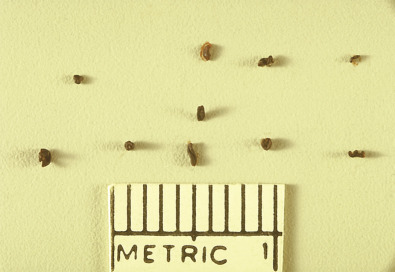

Figure 62-38 

Image showing granules of various sizes _(black grains)_ of the fungus _Madurella grisea_ composed of black masses of hyphae. 

(Courtesy of CDC Public Health Image Library.) 

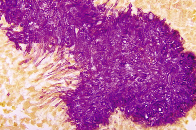

Figure 62-39 

Histologic appearance of “black grain mycetoma” due to _Madurella mycetomatis._

(Gridley stain, 1000×.) 

(Courtesy of Dr. Libero Ajello, CDC Public Health Image Library.) 

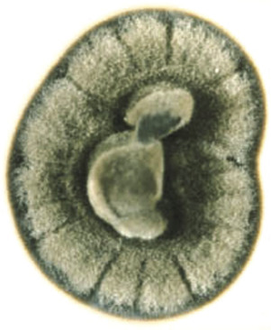

Figure 62-40 

Close-up of the surface of a dematiaceous (melanized) fungus growing on Sabouraud dextrose agar. 

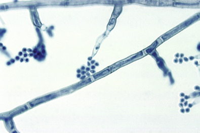

Figure 62-41 

Image showing phialides with terminal conidia of the _Madurella mycetomatis_ fungus. 

(Lactophenol cotton blue stain, 400×.) 

(Courtesy of Lucille George, CDC Public Health Image Library.) 

 

##  Chromoblastomycosis 

Chromoblastomycosis (chromomycosis) is a slowly progressing, chronic subcutaneous mycosis that is seen predominantly in tropical areas. The disease is characterized by the presence of large, muriform, thick-walled dematiaceous cells called **sclerotic bodies** (medular bodies or “copper pennies”) within the infected tissues (  Krzysciak et al, 2014  ;  Revankar & Sutton, 2010  ). The disease affects immunocompetent individuals who most often live in tropical and subtropical areas and is distinguished by the formation of a painless verrucous plaque or nodule at the site of inoculation following a penetrating trauma, with healing areas of the lesion evident along with the formation of scar materials (  Queiroz-Telles et al, 2009  ). The most common species causing this disease is _Fonsecaea pedrosi_ , followed by _Phialophora verrucosa_ and, less commonly, _Cladophialophora carrioni_ and _Rhinocladiella aquaspersa_ , although numerous other melanin-producing species may also be involved (  Revankar & Sutton, 2010  ). The distinguishing feature is the presence of round, nonhyphal, brown cells (sclerotic bodies) in tissues ( [ Fig. 62-42 ](<#f0215>) ). These structures, which divide by producing a septal plane, are diagnostic of the entity but do not provide a clue as to species identification of the mold. Culture and recognition of morphologic features of the isolate are needed to identify the infecting species. An additional characteristic is that both mycetoma and phaeohyphomycosis result in tissue necrosis, whereas chromoblastomycosis infections lead to excessive proliferation of host tissue (  Seyedmousavi et al, 2014  ). 

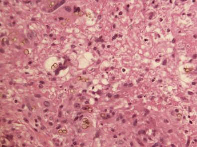

Figure 62-42 

Sclerotic cells observed in tissue that is characteristic of the etiologic agents of chromoblastomycosis. 

(Hematoxylin and eosin stain, 400×.) 

 

##  Phaeohyphomycosis 

Phaeohyphomycosis (from the Greek word **phaeo** , meaning “dark”) was a term originally proposed by Ajello as a histopathologic entity to cover all infections “caused by fungi that develop in tissue in the form of dark-walled dematiaceous septate mycelial elements” (  Ajello et al, 1974  ). Over the years, phaeohyphomycosis has become more recognized as a cause of subcutaneous and systemic diseases characterized by the formation of brownish to olivaceous hyphal elements in tissue (  Seyedmousavi et al, 2013  ). Although both chromoblastomycosis and eumycotic mycetoma are caused by dematiaceous fungi, they are distinguished from phaeohyphomycosis by the appearance in tissue of sclerotic bodies and mycotic granules, respectively. 

Phaeohyphomycosis can arbitrarily be divided into allergic disease (including allergic fungal sinusitis and allergic bronchopulmonary mycosis); superficial infection (including onychomycosis and tinea nigra); deep local infection such as subcutaneous lesions, keratitis, bone and joint infections, and peritonitis; pulmonary infection; central nervous system infection; and disseminated infection (  Revankar & Sutton, 2010  ). Allergic disease manifest as asthma is linked to exposure to _Alternaria_ spp. and _Cladosporium_ spp., while the bronchopulmonary form is most frequently due to _Bipolaris_ or _Curvularia_ . Superficial infections involve the keratinized tissues such as the fingernails and toenails and the stratum corneum (e.g., tinea nigra, a pigmented macule usually on the palms or soles). These asymptomatic infections are most commonly caused by _Hortaea werneckii_ (previously _Phaeoannellomyces werneckii_ ), _Scopulariopsis brevicaulis, Phoma euphyrena,_ and _Chaetomium globosum_ . The subcutaneous forms of the disease are characterized by the formation of a solitary asymptomatic subcutaneous nodule or cyst usually in an immunocompetent individual (  Naggie & Perfect, 2009  ). The most common dematiaceous fungi associated with the subcutaneous cutaneous condition are _Exophiala jeanselmei, Wangilla dermatitidis,_ and _Bipolaris_ spp. (  Garnica et al, 2009  ). Disseminated infection is a rare complication of immunosuppression. One of the more common species associated with this condition is _Scedosporium prolificans,_ an aggressive fungus that is generally resistant to all available antifungal agents. 

The variety of disease manifestations and the range of species associated with phaeohyphomycosis were brought to light in a recent multistate outbreak of phaeohyphomycosis that was associated with injection of methylprednisolone acetate solution contaminated with the dematiaceous fungus, _Exserohilum rostratum_ from a single compounding pharmacy (  Kainer et al, 2012  ;  Ritter et al, 2013  ). Epidural and intra-articular injections of this contaminated solution resulted in over 700 confirmed drug-related infections (ranging from localized epidural, paraspinal, and peripheral joint infections to fatal fungal meningitis) resulting in over 50 deaths. _E. rostratum_ had only rarely been reported as a cause of human disease prior to this outbreak. 

In most cases of phaeohyphomycosis, diagnosis may be difficult because many of the etiologic agents are often considered contaminants when isolated from culture. In tissue, the presence of irregular, swollen, septate hyphal forms with yeastlike structures that stain with a melanin-specific Masson-Fontana stain is presumptive for the diagnosis of phaeohyphomycosis. 

 

##  Sick Building Syndrome 

Dematiaceous molds have also been associated with the condition known as **sick building syndrome** . The mold most commonly associated with this condition is _Stachybotyrs chartarum,_ and although the causative association of mold contamination within a building with disease has been questioned, health concerns to indoor mold exposure leading to persistent allergy symptoms or asthma-like symptoms have been documented (  Al-Ahmad et al, 2010  ). Others have also suggested that toxins associated with molds such as _S. chartarum_ are associated with health problems following exposure (  Straus, 2009  ;  Terr, 2009  ). The National Institute for Occupational Safety and Health has provided a document that presents a comprehensive review on preventing occupational respiratory disease from exposures caused by dampness in office buildings, schools, and other nonindustrial buildings (  National Institute for Occupational Safety and Health, 2012  ). 

,  

##  Mucormycosis (Zygomycosis) 

Current advances in molecular techniques have contributed to taxonomic reorganization with the group of fungi formally classified within the phylum _Zygomycota_ and described as causative agents of the disease zygomycosis (also called **mucormycosis** and **phycomycosis** ). Phylogenetic analysis confirmed that the phylum _Zygomycota_ was polyphyletic, which led to a new phylum classification of _Glomeromycota_ with four additional subphyla of uncertain placement ( _incertae sedis_ ) (  Kwon-Chung, 2012  ). One of these subphyla, identified as _Mucoromycotina_ (with no class designation), contains the order _Mucorales,_ where the 20 species formally collectively called _zygomycetes_ reside (  Gomes et al, 2011  ;  Iwen et al, 2011  ). These recent changes in taxonomy now suggest that the species within the order _Mucorales_ be called **mucormycetes** and that the disease caused by these species be identified as mucormycosis (  Kwon-Chung, 2012  ). 

_Rhizopus_ spp. are the organisms most commonly isolated from patients with mucormycosis with _R. (oryzae) arrhizus_ and _R. microsporus_ recognized as causing a majority of cases (  Alvarez et al, 2009  ). Other less common species include _Lichtheimia (Absidia) corymbifera, Apophysomyces elegans, Cunninghamella bertholletiae, Mucor circinelloides,_ and _Rhizomucor (Mucor) pusillus_ . 

 

##  Risk Factors 

Uncontrolled diabetes, steroid use, neutropenia, infant prematurity, stem cell or solid organ transplantation, and the use of deferoxamine are all well-described risk factors for the development of mucormycosis (  Freifeld et al, 2004  ;  Roden et al, 2005  ). In general, most of these conditions are associated with impairment of normal leukocyte immune function. Diabetic ketoacidosis is the most common recognized underlying condition for the development of mucormycosis in humans. However, recognition of no underlying condition following penetrating trauma, surgery, and burns has also been seen at the time of infection (  Roden et al, 2005  ). 

 

##  Clinical Diseases 

The two major clinical presentations for mucormycosis are sinus infection with or without cerebral or orbital involvement and localized pulmonary infection that may lead to disseminated disease. Another, more rare condition is a localized cutaneous infection that occurs following trauma. Risk factors for the two major presentations are somewhat different (  Mantadakis & Samonis, 2009  ). 

An invasive infection that begins in the paranasal sinuses is known as _rhinosinus, rhinocerebral, sinus-orbital,_ or _craniofacial mucormycosis,_ depending on how far the infection has spread. The infection begins as an undifferentiated sinusitis, but the hyphae may rapidly break through the thin walls of the sinus and extend up into the orbit, forward into the skin of the face, and back up into the cranial cavity. Rhinocerebral disease may progress rapidly, and death often results. Thrombosis of the carotid artery or cavernous sinus may occur following invasion of deep tissue. 

The second major presentation of mucormycosis is pulmonary disease, which may be followed by hematogenous dissemination. Infection begins as an undifferentiated pneumonia, which may be complicated by hemoptysis and cavitation. Risk factors for pulmonary infection include neutropenia and immunosuppression, particularly by hematologic malignancy; disseminated infection is common, and the outcome is almost uniformly fatal (  Pagano et al, 2004  ). 

A less common presentation of mucormycosis is infection of skin and soft tissues (  Alsuwaida, 2002  ). Hyphae may reach the skin by the hematogenous route, by direct extension from a deep focus, or by introduction from the outside. Contaminated adhesive tape has been reported as a source of primary cutaneous disease in the compromised patient (  Alsuwaida, 2002  ). Other rare cases of zygomycosis include primary involvement of the GI tract, the heart, the brain, or the kidneys (  Roden et al, 2005  ). Since the mucormycetes are common in the environment, invasive fungal infections after natural disasters are also not uncommon. Soft-tissue infections have been identified following a volcanic eruption (8 cases, Colombia, _R. arrhizus_ ), tsunami (2 cases, Sri Lanka and Thailand, _Apophysomyces elegans_ ), and tornado (13 cases, United States, _Apophysomyces trapezoformis_ ) (  Benedict & Park, 2014  ;  Fanfair et al, 2012  ). 

 

##  Pathology 

The diagnosis of mucormycosis is made most frequently on the basis of characteristic histopathologic findings in tissue (  Guarner & Brandt, 2011  ). The tissue response is dominated by necrosis, regardless of the site of infection. The propensity for these molds to invade through the walls of arteries and veins, producing acute thrombosis, leads to extensive coagulative necrosis. The hyphae appear as ribbons of broad hyphae that are often twisted and collapsed with a variable width from 5 to 20 µm (see [ Fig. 62-3 ](<#f0020>) ). Septa are sparse and usually are not observed in tissue, but an overlay of the exterior walls of collapsed hyphae may be mistaken for septa. Swollen segments of hyphae and hyphae cut in cross-section may be incorrectly interpreted as yeast cells. Branching tends to occur at right angles in a haphazard pattern. These hyphal characteristics along with the angioinvasive property of these fungi are highly suggestive of a mucormycete-caused infection. Comparison of the histologic features of mucormycetes versus those of other nonpigmented hyphae in tissue is described in [ Table 62-7 ](<#t0040>) . The hyphae of these molds often stain better with the H&E stain than with the GMS method. 

TABLE 62-7 

Histopathologic Features of the Zygomycetes in Comparison with Other Fungi That Occur as Nonpigmented Hyphae in Tissue [ * ](<#hl0001068>)

Characteristic  |  Zygomycetes [ † ](<#hl0001071>) |  _Aspergillus_ [ ‡ ](<#hl0001074>) |  _Fusarium_  
---|---|---|---  
Hyphal characteristics  |  |  |   
Width (µm)  |  Variable (5-10)  |  Consistent (3-6)  |  Consistent (3-8)   
Branching pattern  |  Haphazard  |  Dichotomous  |  Right angle   
Septation frequency  |  Rare  |  High  |  High   
Reproductive structures in tissue  |  Absent  |  May be present where infected area communicates with air  |  Chlamydoconidia sometimes present   
Angioinvasiveness  |  Yes  |  Yes  |  Yes   
  
Modified with permission from Freifeld AG, Iwen PC: Zygomycosis. _Semin Respir Crit Care Med_ 25:221–231, 2004. 

 * In all cases, a definitive diagnosis of the species requires isolation and identification of the fungus on synthetic media. 

 † Entomophthorales are included in this group with the hyphal fragments in tissue generally coated by anophous eosinophilic Splencore-Hoepple material and lack of angioinvasiveness noted. 

 ‡ Because of hyphal degeneration or host immune response or both, the hyphae of the _Aspergillus_ species may exhibit atypical morphologic forms that may cause problems in the differential diagnosis. 

 

##  Laboratory Diagnosis 

The _Mucorales_ often are considered common contaminants within the mycology laboratory, and the potential clinical implications of isolates should be carefully investigated before they are dismissed as saprophytes. Collaboration between the pathologist and the laboratory is important because demonstration of hyphae in tissue provides important evidence that an isolated mold was present in vivo and was not an environmental contaminant. Broad, sparsely septate hyphae may be demonstrated in tissue sections or in imprint smears of tissue, using the Calcofluor white stain. 

Most mucormycetes grow well on standard fungal medium. Unfortunately, recovery of these organisms from tissue is difficult when negative culture results are common, although histologic evidence of a mucormycete is present (  Roden et al, 2005  ). Aggressive processing of a specimen is thought to damage the organism so it is no longer viable; therefore, tissue should be minced or teased, rather than homogenized, after which it is inoculated onto the surface of a primary isolation agar (  Ribes et al, 2000  ). Mucormycetes are inhibited by cycloheximide, so nonselective fungal medium should be included when fungal cultures are performed. Isolates grow rapidly (within 48 to 72 hours) and produce abundant aerial hyphae that rapidly reach the lid of the Petri dish, colloquially referred to as **lid lifters** ( [ Fig. 62-43 ](<#f0220>) ). The hyphae are characterized as woolly and initially white, turning gray to black as spores develop. 

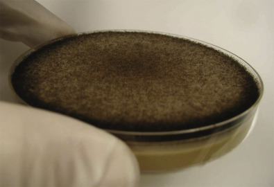

Figure 62-43 

A fluffy gray colony of _Rhizopus_ spp. fills the space within the Petri dish (lid lifter). 

(Sabouraud dextrose agar.) 

_Rhizopus_ species produce unbranched sporangiophores that support sporangia (60 to 350 µm) with an ellipsoidal columella containing sporangiospores. The sporangiospores are oval and frequently have a brown pigment (see [ Fig. 62-6 ](<#f0035>) ). An important diagnostic feature for _Rhizopus_ is the presence of hyaline-to-brown rootlike structures called **rhizoids** , which develop at the point where the sporangiophores arise. In contrast to _Rhizopus,_ the rhizoids of _Lichtheimia (Absidia)_ spp. arise from the stolons between conidiophores. The sporangiophores are pear-shaped rather than round, and a collarette is visible around the columella when the sporangium disintegrates. 

_Mucor_ species on the other hand do not produce rhizoids; the conidiophores usually are more branched than other mucormycetes, and growth does not occur above 37° C. _Rhizomucor,_ which is morphologically intermediate between _Rhizopus_ and _Mucor,_ has rudimentary rhizoids and branched conidiophores and grows at temperatures as high as 58° C. _Mucor_ species were commonly thought to be the second most recognized causes of mucormycosis; however, they now have been described as a rare cause of human disease (  Iwen et al, 2007  ). This is due to the fact that _Mucor corymbifera_ has been reassigned to the genus _Lichtheimia (Absidia)_ as _L. corymbifera,_ and _M. pusillus_ has been reclassified in the genus _Rhizomucor_ as _R. pusillus_ (  Iwen et al, 2011  ). 

Although genera of the mucormycetes can be readily recognized in the mycology laboratory, few laboratories have the expertise needed to identify specific species. One method used to accurately identify these organisms has been the observation of zygospores following mating studies because of the heterothallic nature of this group of organisms (  Weitzman et al, 1995  ). Although this method is used successfully, mating studies do not always yield a positive result. Additionally, the need to maintain a library of testing strains needed to perform mating does not make this method realistic for most clinical laboratories. 

Numerous molecular methods have been described for species identification of the mucormycetes using a variety of molecular targets (  Iwen et al, 2011  ). Nucleotide sequence comparisons using the ITS regions of the rDNA complex and the variable D1/D2 region of the _28S_ gene have been shown to have the highest discriminatory capability for the identification of most _Mucorales_ (  Balajee, 2009a  ). PCR-based diagnosis of mucormycosis in tissue samples has been shown to increase the sensitivity of detection and to allow for rapid identification of the mucormycete, leading to an optimization of treatment options (  Bialek & Zelck, 2013  ). 

,  

##  Aspergillosis, Fusariosis, and Other Mycoses Caused by Hyaline Fungi 

This large group of saprophytic fungi is frequently encountered in the clinical laboratory and contains some of the most important pathogenic molds. These molds are collectively classified as hyaline because they produce nonpigmented hyphae, and the disease is frequently called **hyalohyphomycosis** . The number of species within this group that are capable of causing human disease is large and continues to expand as immunosuppressive therapies become more common methods for the management of patients. By far the most recognized hyaline molds causing human disease are classified in the _Eurotiales_ ( _Aspergillus, Paecilomyces,_ and _Penicillium_ ), the _Microascales_ ( _Scedosporium_ and _Scopulariopsis_ ), and the _Hypocreales_ ( _Cylindrocarpon, Fusarium,_ and _Trichoderma_ ). In this section, detailed consideration will be given to _Aspergillus_ spp. and _Fusarium_ spp., the hyaline molds most commonly identified as causing invasive human disease. 

 

##  The Genus _Aspergillus_

Invasive aspergillosis is the most common life-threatening opportunistic invasive mycosis in immunosuppressed patients (  Leeflang et al, 2008  ). The term **aspergillosis** is used to describe these infections, which are caused by species within the genus _Aspergillus_ . This group of organisms has the ability to produce a wide spectrum of infections, which include mycotoxicosis, allergic manifestations, and superficial infection in the normal host; localized noninvasive infection in hosts with tissue damage or foreign body obstruction; and invasive infection in the compromised host. Although they are not discussed further here, numerous reviews are recommended for additional information on intoxication by ingestion of _Aspergillus_ toxin (  Etzel, 2002  ;  Hedayati et al, 2007  ) and allergic manifestations associated with _Aspergillus_ spore exposure (  Agarwal et al, 2013  ;  Schubert, 2009  ;  Thia et al, 2009  ). 

The number of new _Aspergillus_ spp. associated with human disease continues to expand with the utilization of genomic methods for identification (  Balajee, 2009a  ;  Balajee et al, 2009b  ;  Geiser, 2009  ;  Geiser et al, 2007  ). Historically, the aspergilli were identified to species based on observable morphologic (e.g., reproductive structures and cultural characteristics) and physiologic (e.g., effect of temperature on growth) characteristics. However, the utilization of molecular sequencing has now shown that many of the fungal species are morphologically indistinguishable, leading to the concept described as **cryptic species** (  Samson & Varga, 2009  ). A polyphasic approach has now been suggested for species identification to include morphologic, physiologic, and molecular characteristics (using a combination of multilocus sequence data). Since most clinical laboratories still utilize identification methods based on morphology, the recommendation for reporting to account for these cryptic species is to describe the identification as a “species complex” based on the major taxonomic section of the fungus (e.g., _Aspergillus fumigatus_ species complex, _A. flavus_ species complex, _A. terreus_ species complex, _A. ustus_ species complex, or _A. niger_ species complex [  Balajee et al, 2009  ;  Balajee, 2009a  ;  Balajee et al, 2009b  ;  Samson et al, 2007  ]). Antifungal resistance associated with these cryptic species may, however, in the future make more precise species identification useful to appropriately manage an infected patient (  Howard, 2014  ;  Nedel & Pasqualotto, 2014  ). 

_Aspergillus fumigatus_ species complex is considered the most common group associated with invasive aspergillosis, followed by the _Aspergillus flavus_ and _Aspergillus terreus_ species complexes (  Dagenais & Keller, 2009  ;  Krishnan et al, 2009  ). However, in some studies, the _A. flavus_ species complex has emerged as a predominant pathogen group, especially when those patients with fungal sinusitis and fungal keratitis were evaluated in several institutions worldwide (  Krishnan et al, 2009  ). Suggestions are that the bigger size of the _A. flavus_ spores, in comparison with the spores of _A. fumigatus,_ may favor their deposit in the upper respiratory tract and eye (  Pasqualotto, 2009  ). 

_Aspergillus terreus_ species complex, as the third most common species complex recognized, is often refractory to therapy with the antifungal amphotericin B and has the propensity to disseminate (  Balajee et al, 2009  ;  Lass-Florl et al, 2009  ). Multiple other species of _Aspergillus_ have rarely been recognized as causing invasive disease (  Balajee et al, 2009b  ;  Florescu et al, 2009  ). 

 

##  Risk Factors 

The aspergilli are ubiquitous fungi to which all people are exposed on a regular basis. These fungi reside in vegetation of all types and are ubiquitous in the environment. Nosocomial infections, although uncommon, have been linked to numerous cases associated with hospital construction in the literature (  Haiduven, 2009  ;  Karthaus & Buchheidt, 2013  ). Engineering infection control through institution design to prevent high-risk patients from spore exposure has been done to provide a safer environment for patients. 

The most important risk factors for invasive aspergillosis are immunosuppressive disease, high-dose chemotherapy with or without transplantation, and solid organ transplantation (  Ben-Ami et al, 2009  ;  Zilberberg & Shorr, 2009  ). Neutropenia is a prominent predisposing factor for disease; however, serious invasive disease may rarely occur in individuals who are not immunosuppressed by chemotherapy or malignancy. For instance, wound infection has been a problem in patients with extensive burn wounds and in individuals exposed to materials contaminated with conidia—a situation reminiscent of the mucormycetes. A fungus ball may also occur in the lung of patients with chronic obstructive lung disease, bronchiectasis, and an old cavity caused by tuberculosis (  Riscili & Wood, 2009  ). 

 

##  Clinical Diseases 

The spectrum of invasive disease caused by _Aspergillus_ species is broad. Although these fungi have a low pathogenicity in humans and rarely cause disease in the immunologically competent individual, immunocompromised patients are at risk for invasive disease. Those patients especially at risk are those with prolonged granulocytopenia or graft-versus-host disease and those undergoing immunosuppressive therapy or receiving corticosteroid treatment. Since _Aspergillus_ spores are normally present in the environment, the most common primary sites of infection are the lower respiratory tract and, to a lesser extent, the paranasal sinuses (  Zmeili & Soubani, 2007  ). 

 

##  Ocular Infections 

Keratomycosis usually follows trauma to the eye, especially in patients who have been treated with topical steroids. Pain and blurring of vision follow the traumatic episode, and if not treated, the infection may extend into the anterior chamber. Enucleation of the eye may be necessary if the process is not halted. The most common underlying disease recognized in a study of 15 patients with orbital invasive aspergillosis was diabetes mellitus, with all patients having a primary paranasal sinus infection (  Choi et al, 2008  ). Ocular symptoms of this disease in the immunosuppressed patient include visual disturbances, periorbital swelling, and periorbital pain. 

 

##  Otic Infections 

Otomycosis is an infection of the external ear that is usually caused by _Aspergillus niger_ or _A. fumigatus_ species complex _._ Pain, decreased hearing, and a discharge are accompanied by a fluffy green or black growth in the ear canal. Extension beyond the external ear is rare but may occur in immunosuppressed patients (  Parize et al, 2009  ;  Vennewald et al, 2003  ). 

 

##  Sinus Infection 

Invasive fungal sinusitis can be classified as an acute fulminant invasive disease or as a chronic indolent invasive disease (  Duggal & Wise, 2013  ). Spread of the fungus from the sinus into adjacent tissues is frequently dependent on the host immunologic response and on whether metabolic ketoacidosis is present, although invasive infection has also been reported in apparently healthy individuals (  El Naderi et al, 2013  ). 

 

##  Cutaneous Infection 

_Aspergillus_ spp. may infect the skin after dissemination from another site, usually pulmonary, or the infection may be a primary infection after direct cutaneous exposure to a contaminated environmental source (  Thomas et al, 2008  ). Recognized risk factors include immunosuppression, but local factors that abrogate defense mechanisms of the skin are also important, such as may occur with burn wounds and surgical wounds, especially if occlusive dressings are present. Dissemination to the skin from another primary source in the suppressed patient is difficult to treat and generally results in death. This condition is usually recognized by multiple lesions appearing over different areas of the body. 

 

##  Primary Pulmonary Infection 

Primary pulmonary aspergillosis is the most common invasive mold infection in immunocompromised patients, especially in those patients with hematologic malignancies who are undergoing intensive chemotherapy (  Zmeili & Soubani, 2007  ). Even though the disease is usually associated with severely immunocompromised persons, less invasive and noninvasive diseases that affect the lungs such as aspergilloma (fungus ball), chronic necrotizing pulmonary aspergillosis, semi-invasive aspergillosis, chronic invasive pulmonary aspergillosis, symptomatic pulmonary aspergillosis, and _Aspergillus_ pseudotuberculosis may also occur (  Denning et al, 2003  ). The predilection of aspergilli to invade blood vessels can lead to infarction and hemorrhage in the lungs and may involve hematogenous spread to other organs (  Thompson et al, 2008  ;  Zmeili & Soubani, 2007  ). 

 

##  Disseminated Infection 

Dissemination from the lung or any other primary site of infection may affect any other organ system within the body. The propensity of hyphae to invade vascular structures and cause thrombosis leads to infarcts and abscesses in multiple organs. Single or multiple organs, including the brain, skin, kidneys, pleura, heart, esophagus, liver, or any other site, may be involved (  Del Bono et al, 2008  ;  Denning, 1998  ). 

 

##  Pathology of Aspergillosis 

The histologic appearance of the aspergilli in tissue is similar to that observed with the other hyaline molds, and differentiation among genera and species usually is not possible, except in unusual cases in which sporulation within the tissue cavity has occurred (  Guarner & Brandt, 2011  ). The tissue reaction may be granulomatous but is more commonly dominated by polymorphonuclear neutrophils unless the patient is severely neutropenic. Vascular invasion, thrombosis, and infarction often are prominent features. The hyphae are thin (2 to 5 µm) and septate and branch at acute angles (dichotomous) (see [ Fig. 62-4 ](<#f0025>) ). The H&E stain often colors the hyphae, but the morphology may be demonstrated to advantage with the PAS or GMS technique. The histologic appearance of aspergilli in tissue and mucormycete can be differentiated on the basis of size, hyphal characteristics, and the presence of septations (see [ Table 62-7 ](<#t0040>) ). 

When the pathologic process is a fungus ball, the hyphae may stain poorly using histopathologic stains. A cavity that is in contact with air, as in the lung or sinuses, may develop fruiting heads, an event that permits identification of the genera and possibly the species ( [ Fig. 62-44 ](<#f0225>) ). The conidiophores, which are not septate and may be wider than the vegetative hyphae, should not be confused with the mucormycetes. Thick-walled Hülle cells and cleistothecia have also been described in vivo. When the patient is immunocompetent and the histologic response is granulomatous, the hyphae may be fragmented and confined to the cytoplasm of macrophages and multinucleated giant cells. The granulomatous response to _Aspergillus_ in the lung may be mistaken for bronchocentric granulomatosis in patients who have allergic disease. 

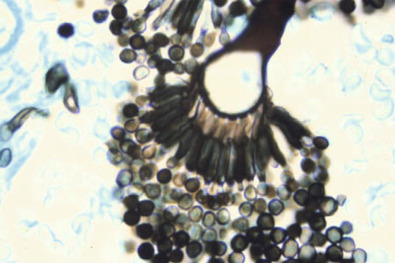

Figure 62-44 

A fruiting head of _Aspergillus_ is demonstrated within a pulmonary mycetoma (fungus ball). 

The phialides and conidia are well demonstrated. Although the hyphae of _Aspergillus_ are not etiologically diagnostic, demonstration of the fruiting head documents the presence of this genus. (Gomori's methenamine silver stain, 400×.) 

 

##  Laboratory Diagnosis 

Aspergilli are saprophytic fungi that should never be dismissed as contaminants without consultation with the attending physician. Isolation from a sterile site or repeated isolation from respiratory specimens suggests clinical significance. Hyphae may be demonstrated directly in clinical specimens in imprint preparations or wet preparations. Calcofluor white staining is useful for demonstrating the mold in specimens. Obtaining tissue, fluid, scrapings, or curettings for examination is important. Tissue should be teased or minced and inoculated directly onto the surface of the isolation medium. _Aspergillus_ species grow rapidly, but most are inhibited or are partially inhibited by cycloheximide. The colonies of many of these molds teem with conidia. To prevent contamination of the worker and other cultures, the colonies should be manipulated carefully in a biologic safety cabinet, after which the surfaces of the safety cabinet should be thoroughly wiped with a fungicidal solution. Maintenance of isolated molds in plastic bags with continuing incubation also reduces the probability of contaminating other cultures. 

Keeping in mind that cryptic species with similar morphologic features are common within the major groups of fungi, specific identification within the aspergilli complexes are made by study of the reproductive structures and the macroscopic appearance of the culture. Careful attention to details of the conidial head is needed for species complex identification. _A. fumigatus_ species complex grows rapidly, producing colonies with a fluffy appearance and a blue-green appearance to the colony (see [ Fig. 62-2 ](<#f0015>) ). Examination of the colony with a dissecting microscope reveals the conidiophores with their expanded vesicles as small globes projecting above the vegetative mycelium. The conidiophore is smooth, relatively short (300 to 500 µm), and expanded into a flask-shaped vesicle. The phialides develop in a single row (uniseriate), most commonly on only the upper two thirds of the vesicle, parallel to the axis of the conidiophore (see [ Fig. 62-8 ](<#f0045>) ). The conidia are roughened (echinulate) and are round to oval. 

Colonies of _A. flavus_ species complex have a velvety yellow to green appearance once fruiting heads develop ( [ Fig. 62-45 ](<#f0230>) ). The conidiophore is long (400 to 700 µm), ending in a vesicle that may be elliptical or round. The conidiophore is rough and stubbly. A single or double (biseriate) row of phialides occurs over the whole vesicle or the upper three quarters ( [ Fig. 62-46 ](<#f0235>) ). Round to oval conidia appear yellow-green en masse and measure 3 to 4.5 µm. _Aspergillus terreus_ species complex can be differentiated from other species by the production of a cinnamon-brown colony with microscopic characteristics that include short conidiophores (<250 µm) and biseriate phialides. 

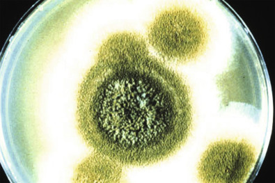

Figure 62-45 

Fluffy colonies with granular areas produced by fruiting heads of _Aspergillus flavus_ . 

The development of yellow or green coloration within the white colonies is characteristic. (Sabouraud dextrose agar.) 

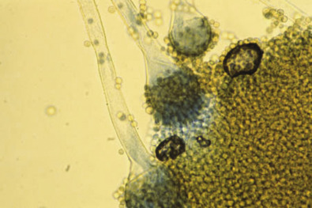

Figure 62-46 

The fruiting head of _Aspergillus flavus_ species complex is uniseriate and biseriate. 

The phialides extend around much of the vesicle with a roughened (spiny) appearance of the conidiophore. (Lactophenol cotton blue stain, 400×.) 

Although the gold standard for making a diagnosis of invasive aspergillosis is to obtain a positive culture from sterile tissue with histologic evidence of mycelial invasion, the need for invasive techniques to obtain the specimen, the delayed time required for culture, and the rapidity by which the aspergilli can spread make diagnosis problematic. Serologic tests are available for the detection of galactomannan to rapidly diagnose invasive aspergillosis (  Aquino et al, 2007  ;  Del Bono et al, 2008  ;  Foy et al, 2007  ;  Husain et al, 2007  ;  Leeflang et al, 2008  ;  Wheat, 2009a  ) and for the detection of (1-3)-beta-  d  -glucan for nonspecific diagnosis of an invasive fungal infection (  Marty & Koo, 2009  ;  Onishi et al, 2012  ). All of these tests have shown utility in the management of patients with invasive aspergillosis; however, limitations of the various assays need to be understood. 

Although molecular methods have led to dramatic changes in the taxonomy of the _Aspergillus_ species, they will continue to be evaluated as methods for the rapid diagnosis of fungal infection from clinical material. Multiple molecular targets for the identification of the aspergilli have been evaluated, and targets showing greatest promise for identification appear to be the partial β-tubulin and calmodulin genomic areas (  Geiser, 2009  ). The general consensus at the present time is that a combination of phenotypic and molecular testing needs to be considered for the accurate identification of _Aspergillus_ species (  Samson & Varga, 2009  ). 

Multiple platforms for direct detection of _Aspergillus_ DNA in clinical specimens have been evaluated with varying degrees of success (  Hummel et al, 2009  ;  Klingspor & Loeffler, 2009  ;  Logotheti et al, 2009  ;  Wengenack & Binnicker, 2009  ). A recent systematic review and meta-analysis done on the use of PCR tests for the diagnosis of invasive aspergillosis directly from blood, plasma, and serum samples concluded that a single PCR-negative result was sufficient to exclude a diagnosis of proven or probable aspergillosis (  Mengoli et al, 2009  ). However, two or more positive tests were required to confirm the diagnosis because of increased specificity after testing of multiple samples. With advances in molecular testing, a formal evaluation of PCR needs to be considered to assess its use in patients most likely to benefit from testing. 

 

##  The Genus _Fusarium_

_Fusarium_ species have been implicated in a number of infectious diseases, including keratomycosis, burn wounds, and invasive disease in immunocompromised patients (  Jossi et al, 2010  ). Fusariosis is, after aspergillosis, the second most common mold infection in humans (  Guarro, 2013  ). Although still considered a rare cause of human disease, a major outbreak of _Fusarium_ keratitis was recently reported wherein 130 cases of eye infection were confirmed (  CDC 2006  ;  O'Donnell et al, 2007  ). An epidemiologic investigation showed that most infected patients wore contact lenses that had been cleaned with a lens solution obtained from one manufacturer. This investigation led to the voluntary recall and permanent removal of the associated contact lens solution from the worldwide market. 

The histopathologic picture for fusariosis is essentially identical to that observed with invasive aspergillosis (angioinvasive and acute branching septate hyphae). _Fusarium_ species also have been shown to sporulate in tissues, and thus there may be a combination of yeastlike structures and hyphae in histopathologic preparations (  Nucci et al, 2007  ). A differentiating feature from invasive aspergillosis is that fungemia is more commonly described in fusariosis. _Fusarium_ -positive blood cultures are frequently detected during disseminated disease; however, even in documented disseminated disease, detection of aspergilli in the blood is rare (  Lionakis et al, 2004  ). 

In culture, _Fusarium_ colonies develop rapidly, producing a fluffy aerial mycelium, which often has a pink, lavender, or salmon color. Diffusible pigments may be seen in the surrounding agar. Simple or branched phialides develop directly from the hypha without a separate conidiophore. Short oval microconidia may be produced, but the distinctive structure is a canoe-shaped or crescent-shaped macroconidium, which may have one or more septa ( [ Fig. 62-47 ](<#f0240>) ). Identification of species in the mycology laboratory is difficult, usually requiring a reference laboratory with experience in recognition of subtle microscopic details related to the reproductive structures. 

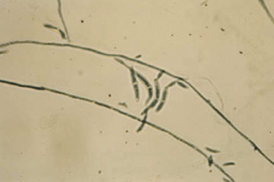

Figure 62-47 

Canoe-shaped conidia of _Fusarium_ species. 

The conidia are often septate. (Lactophenol cotton blue stain, 400×.) 

The taxonomy of _Fusarium_ species has undergone extensive evaluation using molecular sequence analysis of multiple genomic targets (  Guarro, 2013  ;  O'Donnell et al, 2009  ). Most fusaria pathogenic to humans are members of the _Fusarium solani_ or the _Fusarium oxysporum_ species complex; however, the traditional taxonomic practice is to refer to members of these complexes as single species (i.e., _F. solani_ and _F. oxysporum_ ). Recent molecular phylogenetic studies have begun to clarify species boundaries within evolutionary lineages of _Fusarium_ that contain human pathogens. Currently, however, recognition of the species, although important for epidemiologic purposes, does not have an impact on therapeutic decisions; thus many laboratories continue to report these as “ _Fusarium_ species.” For molecular identification of the fusaria, three different loci have been recommended and include the translation elongation factor 1 α (EF-1α), the largest subunit of RNA polymerase (RPB1), and the second largest subunit of RNA polymerase (RPB2). (  Balajee, 2009a  ;  Guarro, 2013  ;  O'Donnell et al, 2009  ). 

 

##  The Genus _Scedosporium_

Medically important species within the genus are _Scedosporium apiospermum_ (teleomorph _Pseudallescheria boydii,_ previously known as _Allescheria boydii_ and _Petriellidium boydii_ ) and _Scedosporium (inflatum) prolificans_ (  Cortez et al, 2008  ). These fungi are ubiquitous saprophytic fungi found in the soil and in decaying vegetation. _S. prolificans_ has been reported as a rare cause of disseminated infection, whereas _S. apiospermum,_ although most often associated with a subcutaneous infection (eumycotic mycetoma), is the most common species associated with invasive disease in the immunocompromised patient. A distinctive clinical syndrome of sinopulmonary and central nervous system infections in immunocompetent individuals has been associated with near drowning in polluted waters, with _P. boydii_ as the etiologic agent (  Gilgado et al, 2009  ). 

_S. apiospermum (P. boydii)_ grows rapidly on isolation medium at 25° C, producing a fluffy colony that develops a brownish gray to dark gray (“mousy”) color after incubation for several days. The culture darkens still further with continued incubation ( [ Fig. 62-48 ](<#f0245>) ). The asexual phase is characterized by single or small clusters of annelloconidia on a straight or branched conidiophore that may develop terminally or laterally from the vegetative hyphae. The conidia are light brown and have an oval, spermlike morphology ( [ Fig. 62-49 ](<#f0250>) ). In the sexual phase _(P. boydii),_ brown cleistothecia are produced that contain ascospores (see [ Fig. 62-13 ](<#f0070>) ). The cleistothecia (100 to 300 µm in diameter), which are found most readily at the edges of the colony, develop best on nutritionally deficient media, such as cornmeal agar, V-8 juice agar, or potato dextrose (potato flake) agar. Because this fungus is homothallic, recognition of brown cleistothecia in the clinical laboratory is common. Strictly speaking, when the cleistothecia are demonstrated, the isolate should be reported as _P. boydii,_ and it should be reported as _S. apiospermum_ if the asexual conidia are the only diagnostic structures observed. 

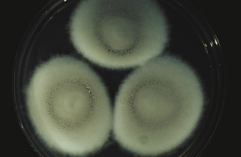

Figure 62-48 

A developing colony of _Scedosporium apiospermum_ with the characteristic mousy gray coloration. 

(Sabouraud dextrose agar.) 

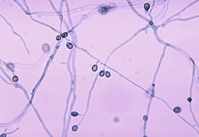

Figure 62-49 

Tadpole- or sperm-shaped microconidia of _Scedosporium apiospermum_ are representative of this organism _._

(Lactophenol cotton blue stain, 400×.) 

Although both macroscopic and microscopic characteristics can be used to separate species within the genus _Scedosporium,_ molecular studies now suggest that _P. boydii_ is a complex of multiple species (  Gilgado et al, 2009  ). 

 

##  Other Septate Hyaline Molds 

Hyaline molds comprise a long list of environmental saprophytes with low virulence that usually are not associated with clinical disease when isolated in the mycology laboratory (  Walsh et al, 2004b  ). However, any of these molds may be pathogenic under the right conditions. In most cases, the host defenses of the patient are compromised in some way, or the fungus is introduced into the body by trauma or medical manipulation. Increasing numbers of case reports document rare saprophytic fungi producing infection of deep tissue and systemic organs. Demonstration of hyphae in tissue is extremely important for documenting the pathogenicity of these isolates, with culture necessary for species recognition. Molecular methods with sequence comparison analysis are becoming the standard for identification of these unusual pathogens (  Balajee et al, 2007  ). 

,  

##  _Pneumocystis_ Pneumonia 

The taxonomic position of _P. (carinii) jiroveci_ has undergone numerous changes over the years. This organism was originally described as a protozoan, with the morphologic forms identified as trophozoites, cysts, and sporozoites. This protozoan hypothesis remained predominant until DNA analysis showed this organism to be more closely related to the fungi (  Edman et al, 1988  ). More recently, molecular information showed that the organism had differing DNA sequences when identified from diverse mammal hosts. To address this issue, the  _Pneumocystis_ Working Group in 1994  proposed the name _P. carinii_ f. sp. _hominis_ as a special form _(formae specialis)_ of the organism causing _P. carinii_ pneumonia (PCP) in humans (  Pneumocystis Working Group, 1994  ). Subsequently, those attending the International Workshop on Opportunistic Protists in 2001 began the process to rename the species to _P. jiroveci_ (pronounced “yee row vet zee”) (  Stringer et al, 2002  ). Although initially controversial, the name has now become widely accepted as the “microbe that causes PCP in humans,” with the acronym PCP now standing for “ _Pneumocystis_ pneumonia” (  Hughes, 2003  ). 

 

##  Risk Factors 

_P. jiroveci_ (human-derived _Pneumocystis_ ) is a pathogen capable of causing a broad spectrum of clinical presentations. This organism was first recognized in outbreaks of pulmonary disease among malnourished infants in Eastern Europe during and after World War II (called _interstitial plasma cell pneumonia_ ) (  Cushion, 2003  ). More recently, _Pneumocystis_ became a major cause of life-threatening pneumonia in 60% to 80% of HIV-infected adults in the United States and Western Europe, and it subsequently became known as one of the AIDS-defining illnesses (  Travis et al, 2009  ). Although still a serious problem within this patient population, the incidence of disease in people with AIDS has decreased to less than 10% of patients owing to the availability of highly active antiretroviral therapy (HAART), the increasing use of anti-PCP prophylaxis, and improved awareness of the infection (  D'Avignon et al, 2008  ). This disease should also be considered in any immunosuppressed patient who presents with fever, respiratory symptoms, or infiltrate on chest radiograph (  Morris & Norris, 2012  ). Initially, clinical disease was thought to be due to reactivation of childhood latent infection in immunosuppressed cases, but studies now show that the organism can be transmitted between humans by the airborne route. In individuals with compromised immune systems (e.g., HIV infection, chemotherapeutic regimens, organ transplantation), a potentially severe and fatal pneumonia can occur (  Catherinot et al, 2010  ). Disseminated disease may also occur via spread through lymphatic and blood routes, but this is uncommon. Although rare, infection has been documented in patients without a predisposing illness (  Morris & Norris, 2012  ). 

 

##  Clinical Diseases 

Pneumonia is the most common manifestation of _P. jiroveci_ infection (  Catherinot et al, 2010  ). Although the onset may be acute or insidious, symptomatic adults frequently present with dyspnea, a nonproductive cough, an inability to breathe deeply, chest tightness, and night sweats. The classic radiologic feature of PCP is fine, bilateral, perihilar interstitial shadowing; however, other radiographic features may be present (  Barry & Johnson, 2001  ). Often, radiographic infiltrates are much more extensive than would be suggested by the degree of symptoms. Concurrent infection with other agents, particularly cytomegalovirus and _C. neoformans,_ is common. The most common extrapulmonary sites of infection are the thyroid gland, liver, bone marrow, lymph nodes, and spleen (  Wazir & Ansari, 2004  ). 

 

##  Pathology 

The definitive diagnosis of PCP requires the demonstration of cysts or trophozoites within clinical specimens ( [ Fig. 62-50 ](<#f0255>) ). Historically, this required an open thorax lung biopsy because of the low number of organisms present in other respiratory specimens and the lack of sensitive diagnostic tests. Although open lung biopsy is still considered one of the most sensitive tests for the detection of this disease, other specimens such as induced sputum and bronchoalveolar lavage have proved to be reliable sources for diagnosis. Classic histopathologic findings of PCP in sections of lung stained with H&E include widening of the alveolar septa with an infiltrate of mononuclear cells and foamy exudate within the alveolar spaces (sometime referred to as **honeycombed exudates** ) (  Woods & Schnadig, 2003  ). This exudate consists of aggregated cysts and trophozoites. The cyst form of _P. jiroveci_ can be illustrated in tissue using the GMS stain. These cysts, which are 2 to 6 µm in diameter, stain brown to black and have the characteristic cup-shaped or crescent-shaped morphology. _Pneumocystis_ cysts do not bud; this feature can be used to distinguish this organism from other fungi found in tissue. 

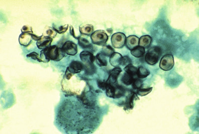

Figure 62-50 

Cysts of _Pneumocystis jiroveci_ in a smear from bronchoalveolar lavage. 

(Gomori's methenamine silver stain, 400×.) 

(Courtesy of Dr. Russell K. Brynes, CDC Public Health Image Library.) 

 

##  Laboratory Diagnosis 

_P. jiroveci_ has been cultivated in cell cultures, but serial maintenance of subcultures has not been accomplished. The standard for diagnosis is staining bronchoalveolar lavage fluid with an immunofluorescent monoclonal antibody directed against surface epitopes for _Pneumocystis_ cysts and trophozoites (  Cushion, 2003  ). The life cycle of _P. jiroveci_ involves development of sporozoites within a cyst, after which the sporozoites are released. In patients with HIV infection, sufficient numbers of organisms are produced that sputum induced with saline by a skilled respiratory therapist may provide the diagnosis. Experience with sputum has varied among centers, however, and the yield is very low in patients who have underlying disease other than HIV. Use of fluorescein-conjugated monoclonal antibodies to detect _P. jiroveci_ in clinical specimens has proved to be a specific and sensitive method for identification ( [ Fig. 62-51 ](<#f0260>) ) (  Kovacs et al, 2001  ). The immunofluorescence technique has been more sensitive in histochemical stains in some reports, but the skill and care of the observers undoubtedly play a role in the comparative sensitivity of the techniques. Recent studies have shown that the diagnostic accuracy of the serum (1-3)-beta-  d  -glucan assay is high for _Pneumocystis jiroveci_ pneumonia and that this assay can be used as a screening tool for this disease (  Onishi et al, 2012  ). Cysts of _P. jiroveci_ occasionally may also be encountered in Gram-stained preparations, although this technique is not a sensitive method for detection. 

Figure 62-51 

Immunofluorescence microscopy showing the presence of _Pneumocystis jiroveci._

(561×.) 

(Courtesy of CDC Public Health Image Library, Lois Norman, provider.) 

Various PCR amplification strategies have been described for detecting _P. jiroveci_ in clinical specimens (  Gupta et al, 2009  ;  Rober-Gangneux et al, 2014  ). In an evaluation of nine different molecular assays, the mitochondrial large subunit rRNA target using a nested PCR platform was shown to be the most sensitive assay, with the highest degree of concordance seen with findings of histologic examination (  Robberts et al, 2007  ). Additional studies have shown this assay to be useful in identifying patients who are in the early stages of infection (  Gupta et al, 2009  ). 

,  

##  Protothecosis 

Protothecosis is an infection caused by achlorophyllic algae of the genus _Prototheca_ (  Hillesheim & Bahrami, 2011  ;  Seok et al, 2013  ;  Todd et al, 2012  ). Most human infections are caused by _Prototheca wickerhamii;_ however, rare cases have also been caused by _Prototheca zopfii_ . Although these species are classified as algae, they are included in this chapter because of the resemblance of the infections to fungal disease. _Prototheca_ are found in fresh and marine waters and probably gain entrance to the body through superficial wounds. Some patients are immunocompetent, but serious underlying diseases, such as diabetes mellitus, or immunosuppressive therapies often predispose patients to infection with these pathogens. Other patients have received corticosteroid injections at the site of infection or have had musculoskeletal infection, particularly involving the tendons. Infections commonly involve the skin and subcutaneous tissue, with subsequent involvement of underlying tendons. 

_Prototheca_ form large, nonbudding cells that can readily be seen in tissue. The appearance is a spheroid or ovoid cell with a prominent wall and a “morula-like” structure containing thick-walled autospores (  Lass-Florl & Mayr, 2007  ). Although _Prototheca_ species are not readily apparent in H&E-stained smears, they can be observed with GMS or PAS stain. However, these structures must be differentiated from the dimorphic fungi ( [ Fig. 62-52 ](<#f0265>) ). Algae grow readily on fungal isolation media that do not contain cycloheximide, and the colonies resemble those of _Candida_ spp. ( [ Fig. 62-53 ](<#f0270>) ). _Prototheca_ species can be identified to the species level by using commercial yeast identification systems, such as the API 20C system and the VITEK 2 system (bioMérieux). 

Figure 62-52 

Histopathologic changes in protothecosis of the skin and mucous membrane of the nose due to _Prototheca wickerhamii_ . 

Septation of the algal cells leads to multiple intracellular bodies and structures known as _morula_ . 

(Courtesy of Dr. William Kaplan, CDC Public Health Image Library.) 

Figure 62-53 

Colonies of _Prototheca wickerhamii_ are yeastlike in appearance. 

(Sabouraud dextrose agar.) 

,,
